# Privacidade e Proteção de Dados: Curso de Mestrado

- Idioma: português do Brasil (`pt`); curso 165, curso de mestrado (2 anos). Edição de referência: [inglês](../../en/book/MANUSCRIPT.md).
- Estado editorial: **publicado**. Os capítulos 1–8 de 8 têm texto didático escrito à mão; os exercícios EX001–EX050 têm resoluções correspondentes com rubricas de 0 a 3; os três laboratórios offline usam apenas a biblioteca padrão do Python 3 sobre dados sintéticos, e suas saídas foram incorporadas de execuções reais, idênticas às da edição em inglês. Revisão independente, revisão linguística e a verificação de 300 páginas A4 continuam em aberto.
- Público: mestrandos que avaliam se uma mudança operacional melhora o cumprimento dos direitos dos titulares.
- Autor: [hiagokinlevi](https://github.com/hiagokinlevi). Texto original sob [CC0 1.0](../../../../../LICENSE); as obras citadas mantêm seus direitos.
- Limites: os laboratórios resumem tempos sintéticos de atendimento a pedidos de acesso, estimam tamanhos de amostra e calculam uma diferença por bootstrap com estratificação; nenhum pedido ou cliente real está envolvido. A análise jurídica é didática e não constitui aconselhamento jurídico; a LGPD e os atos da ANPD são citados pelo texto oficial e parafraseados. Pessoas, organizações, sistemas e dados são **sintéticos**, salvo quando uma frase cita uma fonte pública.

[Página do curso](../../README.md) · [Índice de capítulos](../SUBJECTS.md) · [Plano do livro](PLAN.md) · [Skill do curso](../../skill/SKILL.md) · [Resoluções](#worked-results)

## Como usar este rascunho

Leia na ordem. Os capítulos acompanham uma mestranda que estuda se um portal de autoatendimento melhora o atendimento dentro do prazo aos pedidos de acesso: a pergunta e a literatura, um seminário avançado, o desenho e a ética, as explicações concorrentes, o projeto e o piloto, os dados e a análise, a redação e as limitações, e a defesa. Execute cada laboratório onde ele aparece, tente os exercícios antes de consultar as resoluções e avalie-se com as rubricas.

### Caso sintético

| Elemento | Papel | Natureza |
|---|---|---|
| **Hana Kobayashi** | Mestranda | Inventada |
| **Dr. Owen Pritchard** | Orientador | Inventado |
| **Ellery Institute of Technology** | Universidade fictícia | Inventada |
| **Brookfield Online Retail** | Varejista fictícia que atende clientes na União Europeia e no Brasil | Inventada |

### Fontes principais

Regulamento (UE) 2016/679 (GDPR), artigos 12 e 15; Lei nº 13.709/2018 (LGPD), arts. 18 e 19; Resolução CD/ANPD nº 18/2024; Diretrizes 01/2022 do EDPB sobre o direito de acesso; Solove (2006), [doi:10.2307/40041279](https://doi.org/10.2307/40041279); Acquisti et al. (2015), [doi:10.1126/science.aaa1465](https://doi.org/10.1126/science.aaa1465); Shadish, Cook e Campbell (2002); Efron e Tibshirani (1994). Lista completa em [Referências](#references).

## Sumário

| Capítulos em português |
|---|
| [1](#ch-01) · [2](#ch-02) · [3](#ch-03) · [4](#ch-04) · [5](#ch-05) · [6](#ch-06) · [7](#ch-07) · [8](#ch-08) |

[Resoluções](#worked-results) · [Referências](#references)

<a id="ch-01"></a>

## Capítulo 1 — Pergunta de pesquisa e método de revisão da literatura

<!-- cykin:lesson-figures:start ch-01 -->
### Mapa da aula

Aula 01 publicada. Mapa, exemplo, EX001.

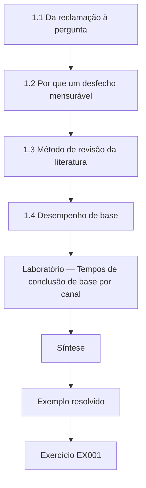

### Desenho lógico

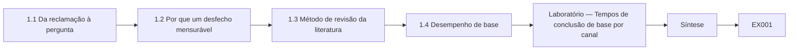

```text
[1.1 Da reclamação à pergunta]
    |
    v
[1.2 Por que um desfecho mensurável]
    |
    v
[1.3 Método de revisão da literatura]
    |
    v
[1.4 Desempenho de base]
    |
    v
[Laboratório — Tempos de conclusão de base por canal]
    |
    v
[Síntese]
    |
    v
[Exemplo resolvido] --> [Exercício EX001]
```
<!-- cykin:lesson-figures:end ch-01 -->


### Objetivos de aprendizagem

Você vai (1) transformar um problema de conformidade em uma pergunta pesquisável; (2) conduzir uma busca estruturada na literatura; (3) descrever o desempenho de base de um processo de atendimento aos direitos dos titulares.

### 1.1 Da reclamação à pergunta

Hana Kobayashi é mestranda no fictício Ellery Institute of Technology, sob orientação do Dr. Owen Pritchard. Seu estágio é na fictícia Brookfield Online Retail, que vende utilidades domésticas a clientes em toda a União Europeia e no Brasil. Os clientes reclamam que os pedidos para ver seus dados pessoais demoram demais. O artigo 15 do GDPR garante o direito de acesso, e o artigo 12(3) exige uma resposta sem demora injustificada e, em qualquer caso, no prazo de um mês, prorrogável por mais dois meses para pedidos complexos ou numerosos. No Brasil, o acesso aos dados é um dos direitos do titular listados no art. 18 da LGPD. A pergunta de Hana é se um portal de acesso por autoatendimento aumenta a parcela de pedidos respondidos dentro do prazo.

### 1.2 Por que um desfecho mensurável

Hana escolhe a conclusão dentro do prazo como desfecho principal porque ela é definida pela lei, já está registrada no sistema de chamados da Brookfield e tem sentido para os clientes. Ela também registra os dias até a conclusão, porque um portal poderia mover pedidos do vigésimo nono para o vigésimo quinto dia sem mudar a parcela dentro do prazo. Ela escreve os dois desfechos antes de coletar qualquer dado. O Dr. Pritchard lembra que um desfecho escolhido por ser fácil de contar ainda pode ser o errado, então ela acrescenta uma breve justificativa que liga cada desfecho ao interesse da pessoa que faz o pedido.

### 1.3 Método de revisão da literatura

Hana pesquisa separadamente fontes jurídicas, regulatórias e empíricas, porque elas respondem a perguntas diferentes. Para a lei, ela lê diretamente os artigos do GDPR e a LGPD, Lei nº 13.709/2018, cujo art. 19, II, exige que a declaração clara e completa de acesso seja fornecida em até quinze dias contados do requerimento do titular. Para a interpretação regulatória, ela lê as Diretrizes 01/2022 do EDPB sobre o direito de acesso, que explicam prazos, verificações de identidade e o formato das respostas. Para a evidência empírica, ela busca estudos sobre o atendimento de pedidos de direitos e registra cada expressão de busca, base de dados e data, para que a revisão possa ser repetida por um examinador e atualizada depois.

### 1.4 Desempenho de base

Antes de qualquer mudança, Hana descreve o processo atual usando 200 pedidos sintéticos modelados a partir das estatísticas de chamados da Brookfield. Os pedidos feitos pelo formulário web têm mediana de 18 dias, e 94,8% são concluídos em até trinta dias. Os pedidos por e-mail têm mediana de 28 dias, com 62,5% no prazo, e os pedidos por correio têm mediana de 46 dias, com apenas 29,2% no prazo. No total, 74,0% dos pedidos cumprem a marca de trinta dias. Hana observa que a composição dos canais importa tanto quanto a velocidade, porque a maioria dos pedidos atrasados chega por e-mail ou correio, em que a equipe precisa redigitar as informações à mão.

### Laboratório — Tempos de conclusão de base por canal

```python
# 200 synthetic subject access requests: days to complete and share within one month (30 days), by channel.
import random, statistics
r = random.Random(5)
ch = {"web form": (18, 9), "email": (27, 12), "post": (36, 14)}
rows = []
for _ in range(200):
    c = r.choices(list(ch), weights=[5, 4, 1])[0]
    rows.append((c, max(1, round(r.gauss(*ch[c])))))
for c in ch:
    d = [x for k, x in rows if k == c]
    print(f"{c:9s} n={len(d):3d} median {statistics.median(d):4.0f} days  within 30: {sum(x <= 30 for x in d)/len(d):5.1%}")
d = [x for _, x in rows]
print(f"all       n={len(d):3d} median {statistics.median(d):4.0f} days  within 30: {sum(x <= 30 for x in d)/len(d):5.1%}")
```

Execute com `python3 lab_deadline.py`. Saída verificada:

```text
web form  n= 96 median   18 days  within 30: 94.8%
email     n= 80 median   28 days  within 30: 62.5%
post      n= 24 median   46 days  within 30: 29.2%
all       n=200 median   23 days  within 30: 74.0%
```

### Exemplo resolvido

Hana formula a pergunta "um portal de autoatendimento aumenta a conclusão dentro do prazo dos pedidos de acesso?", fixa dois desfechos e encontra uma linha de base de 74,0% em até trinta dias, com os pedidos por correio no pior nível, 29,2%.

> **Caso sintético.** O Ellery, a Brookfield e todos os pedidos são sintéticos; os artigos 12 e 15 do GDPR, os arts. 18 e 19 da LGPD e as Diretrizes 01/2022 do EDPB são reais.

### Erros e limites

Trinta dias aproximam "um mês", cuja duração varia conforme o calendário. Uma linha de base sintética só é tão boa quanto as estatísticas usadas para construí-la.

### Exercícios

- **EX001 — Prazo legal.** Que prazo o artigo 12(3) do GDPR fixa para responder a um pedido de acesso? *Rubrica:* 3 = sem demora injustificada e em até um mês, prorrogável por dois meses por complexidade ou volume;; 2 = só um mês;; 1 = nenhum prazo;; 0 = nenhuma.
- **EX002 — Prazo na LGPD.** Quanto tempo o art. 19 da LGPD concede para uma resposta completa de acesso? *Rubrica:* 3 = quinze dias para uma declaração clara e completa;; 2 = cerca de duas semanas;; 1 = um mês;; 0 = nenhuma.
- **EX003 — Segundo desfecho.** Por que Hana também registra os dias até a conclusão? *Rubrica:* 3 = a parcela dentro do prazo pode esconder melhorias ou atrasos dentro do mês;; 2 = menciona detalhe;; 1 = ignora;; 0 = nenhuma.
- **EX004 — Registro das buscas.** Por que registrar expressões de busca, bases de dados e datas? *Rubrica:* 3 = para que a revisão possa ser repetida e atualizada;; 2 = menciona transparência;; 1 = omite;; 0 = nenhuma.
- **EX005 — Pior canal.** Que canal tem o pior desempenho na linha de base, e quão ruim? *Rubrica:* 3 = correio: mediana de 46 dias, 29,2% no prazo;; 2 = cita o correio;; 1 = cita o e-mail;; 0 = nenhuma.
- **EX006 — Linha de base geral.** Que parcela de todos os pedidos de base está no prazo? *Rubrica:* 3 = 74,0%;; 2 = cerca de três quartos;; 1 = errado;; 0 = nenhuma.
- **EX007 — Justificativa dos desfechos.** Por que ligar cada desfecho ao interesse do requerente? *Rubrica:* 3 = uma métrica fácil pode perder o que importa para quem exerce o direito;; 2 = menciona relevância;; 1 = diz que contar basta;; 0 = nenhuma.

### Síntese

O capítulo 1 enquadra a pergunta e a linha de base. O capítulo 2 realiza um seminário avançado sobre para que servem os direitos de acesso.

<!-- cykin:chapter-navigation:start ch-01 -->
### Continue estudando — aula 01 (capítulo 01 de 08)

[← Início do curso](../../README.md) · [Índice das aulas](../SUBJECTS.md) · [Capítulo 02 →](#ch-02)

Continue para a próxima aula já escrita.
<!-- cykin:chapter-navigation:end -->

<a id="ch-02"></a>

## Capítulo 2 — Privacidade e proteção de dados: seminário avançado

<!-- cykin:lesson-figures:start ch-02 -->
### Mapa da aula

Aula 02 publicada. Mapa, exemplo, EX008.

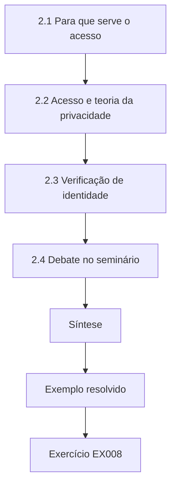

### Desenho lógico

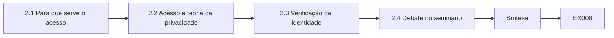

```text
[2.1 Para que serve o acesso]
    |
    v
[2.2 Acesso e teoria da privacidade]
    |
    v
[2.3 Verificação de identidade]
    |
    v
[2.4 Debate no seminário]
    |
    v
[Síntese]
    |
    v
[Exemplo resolvido] --> [Exercício EX008]
```
<!-- cykin:lesson-figures:end ch-02 -->


### Objetivos de aprendizagem

Você vai (1) explicar o propósito do direito de acesso; (2) ligar os direitos de acesso à teoria da privacidade; (3) avaliar onde a velocidade entra em conflito com a segurança.

### 2.1 Para que serve o acesso

No seminário do Dr. Pritchard, a turma lê as diretrizes de acesso do EDPB, que descrevem o direito de acesso como um meio para que as pessoas saibam se e como seus dados são tratados e verifiquem a licitude desse tratamento. O acesso costuma ser o primeiro passo para outros direitos, como a retificação ou o apagamento. A LGPD segue a mesma lógica: o art. 18 coloca a confirmação da existência de tratamento e o acesso aos dados antes da correção, da anonimização, do bloqueio e da eliminação. Hana percebe que uma resposta rápida, mas incompleta, falharia nesse propósito. Seu estudo precisa, portanto, de uma verificação de qualidade além da medida de tempo. Ela acrescenta uma revisão de completude de uma amostra de respostas, julgadas contra a lista de informações que o artigo 15 exige.

### 2.2 Acesso e teoria da privacidade

O seminário liga o acesso a uma teoria mais ampla. Solove (2006) classifica no grupo do processamento de informações problemas como a exclusão, em que as pessoas não são informadas sobre o uso de seus dados nem podem participar dele. Os pedidos de acesso são um remédio direto contra a exclusão. A integridade contextual de Nissenbaum oferece outra lente: clientes que deram o endereço para a entrega podem se surpreender ao vê-lo usado para formação de perfil, e uma resposta de acesso revela esses fluxos. Acquisti, Brandimarte e Loewenstein (2015) lembram à turma que as pessoas costumam ter incerteza sobre suas próprias preferências de privacidade, o que torna ainda mais valiosas as respostas de acesso claras.

### 2.3 Verificação de identidade

A velocidade pode entrar em conflito com a segurança. Se o portal liberar dados para qualquer pessoa que digite um endereço de e-mail, um atacante poderia obter o histórico de pedidos de um cliente. As diretrizes do EDPB dizem que as verificações de identidade devem ser proporcionais: o controlador não deve exigir mais dados do que o necessário e pode se apoiar em uma autenticação já existente, como o login da conta do cliente. Hana registra que o portal usa o login existente e pede prova adicional apenas nos pedidos de pessoas sem conta. Ela acrescenta a divulgação a pessoa errada como desfecho de segurança, porque um processo mais rápido que vaze dados seria pior do que um lento.

### 2.4 Debate no seminário

A turma discute se a automação elimina um julgamento humano útil. Um colega argumenta que a equipe pode perceber quando um pedido vem de um ex-parceiro abusivo em busca dos dados de outra pessoa. Hana concorda e desenha o portal para encaminhar a uma pessoa treinada os pedidos com sinais incomuns, como um pedido sobre uma conta familiar. Ela observa que o GDPR admite limites quando os direitos de terceiros seriam prejudicados, como o artigo 15(4) estabelece para as cópias. O debate a convence de que seu estudo precisa informar não só as taxas dentro do prazo, mas também como as exceções são tratadas e com que frequência ocorrem.

### Exemplo resolvido

Depois do seminário, Hana acrescenta ao seu desenho uma verificação de completude baseada no artigo 15, um desfecho de segurança para divulgações a pessoa errada e uma rota de exceção.

> **Caso sintético.** Os colegas e o portal são sintéticos; Solove (2006), Nissenbaum (2004), Acquisti et al. (2015), o artigo 15(4) do GDPR, o art. 18 da LGPD e as Diretrizes 01/2022 do EDPB são reais.

### Erros e limites

A teoria enquadra a pergunta, mas não a mede. Rotas de exceção podem virar portas dos fundos lentas se não forem monitoradas.

### Exercícios

- **EX008 — Propósito do acesso.** Que propósito o EDPB atribui ao direito de acesso? *Rubrica:* 3 = saber se e como os dados são tratados e verificar a licitude;; 2 = menciona transparência;; 1 = diz que é atendimento ao cliente;; 0 = nenhuma.
- **EX009 — Exclusão.** Que problema de Solove um pedido de acesso remedia diretamente? *Rubrica:* 3 = a exclusão;; 2 = cita processamento de informações;; 1 = cita uma categoria errada;; 0 = nenhuma.
- **EX010 — Verificações proporcionais.** O que torna proporcional uma verificação de identidade? *Rubrica:* 3 = não pede mais do que o necessário e reaproveita a autenticação existente;; 2 = menciona dados mínimos;; 1 = exige documento sempre;; 0 = nenhuma.
- **EX011 — Desfecho de segurança.** Por que acrescentar a divulgação a pessoa errada como desfecho? *Rubrica:* 3 = um processo mais rápido que vaze dados para a pessoa errada seria um dano líquido;; 2 = menciona segurança;; 1 = ignora;; 0 = nenhuma.
- **EX012 — Encaminhamento de exceções.** Por que encaminhar a uma pessoa os pedidos sobre contas familiares? *Rubrica:* 3 = para detectar pedidos que possam prejudicar terceiros, como prevê o artigo 15(4);; 2 = menciona abuso;; 1 = automatiza tudo;; 0 = nenhuma.
- **EX013 — Incerteza de preferências.** Como Acquisti et al. (2015) sustenta respostas de acesso claras? *Rubrica:* 3 = as pessoas têm incerteza sobre suas preferências, então ver os dados reais as ajuda a decidir;; 2 = menciona comportamento;; 1 = cita de modo errado;; 0 = nenhuma.
- **EX014 — Padrão de completude.** Contra o que Hana julga uma resposta completa? *Rubrica:* 3 = a lista de informações exigidas pelo artigo 15;; 2 = menciona o artigo 15;; 1 = intuição;; 0 = nenhuma.

### Síntese

O capítulo 2 amplia o conjunto de resultados para qualidade e segurança. O capítulo 3 desenha o estudo com ética e reprodutibilidade.

<!-- cykin:chapter-navigation:start ch-02 -->
### Continue estudando — aula 02 (capítulo 02 de 08)

[← Capítulo 01](#ch-01) · [Índice das aulas](../SUBJECTS.md) · [Capítulo 03 →](#ch-03)

Continue para a próxima aula já escrita.
<!-- cykin:chapter-navigation:end -->

<a id="ch-03"></a>

## Capítulo 3 — Desenho do estudo, ética e reprodutibilidade

<!-- cykin:lesson-figures:start ch-03 -->
### Mapa da aula

Aula 03 publicada. Mapa, exemplo, EX015.

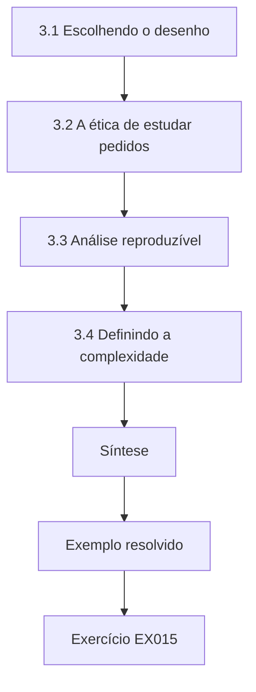

### Desenho lógico

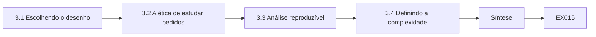

```text
[3.1 Escolhendo o desenho]
    |
    v
[3.2 A ética de estudar pedidos]
    |
    v
[3.3 Análise reproduzível]
    |
    v
[3.4 Definindo a complexidade]
    |
    v
[Síntese]
    |
    v
[Exemplo resolvido] --> [Exercício EX015]
```
<!-- cykin:lesson-figures:end ch-03 -->


### Objetivos de aprendizagem

Você vai (1) escolher um desenho quase experimental para uma mudança operacional; (2) planejar a ética de uma pesquisa sobre pedidos de direitos; (3) preparar uma análise reproduzível.

### 3.1 Escolhendo o desenho

A Brookfield vai lançar o portal para todos os clientes em uma única data, então Hana não pode sortear os clientes. Ela escolhe uma comparação interrompida: 240 pedidos nos seis meses anteriores ao lançamento e 240 nos seis meses seguintes. Shadish, Cook e Campbell (2002) advertem que esses desenhos são vulneráveis à história, à maturação e a mudanças em quem é estudado, por isso ela planeja medir a composição dos pedidos nos dois períodos. Ela também registra qualquer outra mudança na Brookfield durante o estudo, como o quadro de pessoal, para que possa ser considerada como explicação alternativa, em vez de descoberta tarde demais.

### 3.2 A ética de estudar pedidos

Os pedidos de direitos contêm dados pessoais delicados e às vezes revelam disputas. O pedido de aprovação ética de Hana ao Ellery e ao encarregado de proteção de dados da Brookfield limita seu acesso aos metadados dos chamados: canal, datas, complexidade e resultado. Ela nunca lê o conteúdo dos pedidos. A Brookfield extrai os metadados com base em seu próprio interesse legítimo em melhorar a conformidade, documentado em seus registros, e Hana recebe um extrato pseudonimizado; na LGPD, essa base corresponde ao legítimo interesse do art. 7º, IX, e o registro das operações é exigido pelo art. 37. Ela declara que não tentará vincular chamados a clientes. Todo resultado é informado apenas de forma agregada, e as categorias com menos de dez pedidos são fundidas para que nenhum indivíduo possa ser inferido.

### 3.3 Análise reproduzível

Hana escreve a análise em um script com semente aleatória fixa e o mantém sob controle de versão. Cada número da dissertação é gerado pelo script, e não digitado à mão. Ela guarda o extrato pseudonimizado dentro do ambiente da Brookfield e executa o script lá, exportando apenas tabelas agregadas. Esse arranjo permite que um examinador inspecione o código e o execute de novo sobre dados sintéticos com a mesma estrutura, enquanto o extrato real nunca sai da empresa. O Dr. Pritchard chama isso de "levar o código até os dados" e pede que ela o descreva no capítulo de métodos.

### 3.4 Definindo a complexidade

Como os pedidos complexos demoram mais, Hana precisa definir a complexidade antes de ver os resultados. Ela classifica um pedido como complexo se envolver mais de um sistema que guarda os dados da pessoa, um operador terceirizado ou um pedido de cópia de gravações de chamadas. Dois funcionários classificam uma amostra de forma independente para verificar a concordância. A definição fica registrada no protocolo. Ela explica que, se a complexidade fosse definida depois dos resultados, poderia ser ajustada para favorecer o portal, o que minaria todo o desenho e deixaria suas conclusões expostas à acusação de categorias convenientes criadas a posteriori.

### Exemplo resolvido

Hana escolhe um desenho interrompido de antes e depois com 240 pedidos por período, limita-se a metadados pseudonimizados analisados dentro da Brookfield e define a complexidade antes de ver os resultados.

> **Caso sintético.** O desenho e o extrato são sintéticos; Shadish, Cook e Campbell (2002) e os arts. 7º e 37 da LGPD são reais.

### Erros e limites

Desenhos interrompidos não descartam todas as alternativas; medir a composição dos pedidos reduz apenas uma ameaça.

### Exercícios

- **EX015 — Por que não sortear.** Por que Hana não pode sortear os clientes para o portal? *Rubrica:* 3 = a Brookfield o lança para todos em uma única data;; 2 = menciona o lançamento;; 1 = diz que o sorteio é antiético;; 0 = nenhuma.
- **EX016 — Ameaças à validade.** Cite duas ameaças que Shadish, Cook e Campbell associam a esses desenhos. *Rubrica:* 3 = história e mudanças em quem é estudado (também a maturação);; 2 = cita uma;; 1 = não cita nenhuma;; 0 = nenhuma.
- **EX017 — Só metadados.** Que dados Hana pode ver? *Rubrica:* 3 = metadados pseudonimizados dos chamados: canal, datas, complexidade, resultado;; 2 = lista alguns;; 1 = diz que vê os chamados inteiros;; 0 = nenhuma.
- **EX018 — Categorias pequenas.** Por que fundir categorias com menos de dez pedidos? *Rubrica:* 3 = para evitar que indivíduos sejam inferidos a partir de contagens pequenas;; 2 = menciona privacidade;; 1 = omite;; 0 = nenhuma.
- **EX019 — Código até os dados.** O que significa aqui "levar o código até os dados"? *Rubrica:* 3 = o script roda dentro da Brookfield e só saem agregados;; 2 = menciona o local;; 1 = exporta os dados;; 0 = nenhuma.
- **EX020 — Complexidade predefinida.** Por que definir a complexidade antes de ver os resultados? *Rubrica:* 3 = para impedir que a definição seja ajustada para favorecer o portal;; 2 = menciona viés;; 1 = diz que é organizado;; 0 = nenhuma.

### Síntese

O capítulo 3 fixa desenho, ética e reprodutibilidade. O capítulo 4 lista explicações concorrentes para qualquer melhoria.

<!-- cykin:chapter-navigation:start ch-03 -->
### Continue estudando — aula 03 (capítulo 03 de 08)

[← Capítulo 02](#ch-02) · [Índice das aulas](../SUBJECTS.md) · [Capítulo 04 →](#ch-04)

Continue para a próxima aula já escrita.
<!-- cykin:chapter-navigation:end -->

<a id="ch-04"></a>

## Capítulo 4 — Privacidade e proteção de dados: explicações concorrentes

<!-- cykin:lesson-figures:start ch-04 -->
### Mapa da aula

Aula 04 publicada. Mapa, exemplo, EX021.

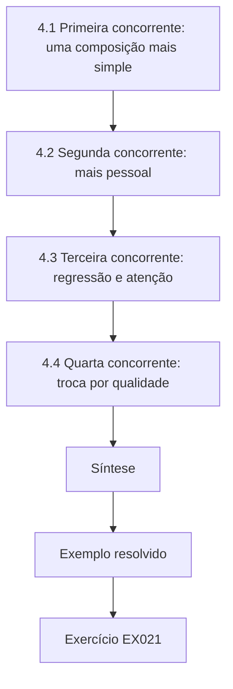

### Desenho lógico

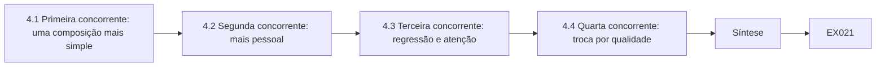

```text
[4.1 Primeira concorrente: uma composição mais simple]
    |
    v
[4.2 Segunda concorrente: mais pessoal]
    |
    v
[4.3 Terceira concorrente: regressão e atenção]
    |
    v
[4.4 Quarta concorrente: troca por qualidade]
    |
    v
[Síntese]
    |
    v
[Exemplo resolvido] --> [Exercício EX021]
```
<!-- cykin:lesson-figures:end ch-04 -->


### Objetivos de aprendizagem

Você vai (1) listar explicações concorrentes para uma melhora aparente; (2) desenhar verificações para cada uma; (3) decidir quais explicações concorrentes o estudo consegue ou não excluir.

### 4.1 Primeira concorrente: uma composição mais simples

Se, depois do lançamento, os clientes fizerem pedidos mais simples, as taxas dentro do prazo podem subir mesmo que o portal não faça nada. Hana planeja comparar a parcela de pedidos complexos nos dois períodos e informar os resultados separadamente para pedidos simples e complexos. Se o portal ajudar, ela espera melhora dentro dos dois grupos, e não apenas uma mudança na composição. Essa abordagem segue a recomendação usual de estratificar por um fator de confusão conhecido, o que significa comparar iguais com iguais antes de tirar conclusões sobre a intervenção, e é fácil de entender para um leitor sem estatística avançada.

### 4.2 Segunda concorrente: mais pessoal

A Brookfield poderia contratar mais pessoal de privacidade ao mesmo tempo, o que também aceleraria as respostas. Hana pede ao encarregado os números mensais de pessoal dos dois períodos e registra qualquer mudança. Se o quadro aumentar, ela o apontará como uma explicação concorrente que o estudo não consegue separar do portal, e dirá isso com clareza. Ela explica que uma dissertação honesta nomeia as explicações concorrentes que não consegue descartar, em vez de escondê-las, para que os gestores da Brookfield saibam quanto peso dar às suas conclusões ao decidir se estendem o portal a outros tipos de pedido.

### 4.3 Terceira concorrente: regressão e atenção

O lançamento do portal vem depois de um período de reclamações, que pode ter sido uma fase incomumente ruim. O desempenho poderia melhorar simplesmente porque uma fase ruim terminou, um padrão chamado regressão à média. A equipe também pode trabalhar mais por saber que está sendo observada. Hana coleta doze meses de histórico antes do estudo para verificar se o período anterior foi incomum, e mantém a medição discreta usando dados rotineiros dos chamados, em vez de pedir à equipe que registre informações extras, o que poderia mudar seu comportamento e ainda acrescentar trabalho a uma equipe já ocupada.

### 4.4 Quarta concorrente: troca por qualidade

Respostas mais rápidas poderiam ser menos completas. A verificação de completude de Hana, sobre uma amostra de quarenta respostas de cada período, trata disso. Se as taxas dentro do prazo subirem mas a completude cair, a melhora não é conformidade genuína. Ela também acompanha as divulgações a pessoa errada, que precisam ficar em zero. O Dr. Pritchard pede que ela se comprometa de antemão com uma regra: o portal conta como melhora somente se a conclusão dentro do prazo subir e nem a completude nem a segurança piorarem. Hana escreve essa regra no protocolo, para que um percentual de destaque não possa, sozinho, ser apresentado como sucesso.

### Exemplo resolvido

Hana lista quatro explicações concorrentes (composição mais simples, pessoal, regressão e atenção, troca por qualidade) e associa a cada uma a sua verificação: estratificação, registros de pessoal, histórico mais longo e desfechos de completude e segurança.

> **Caso sintético.** O quadro de pessoal e o histórico da Brookfield são sintéticos.

### Erros e limites

As verificações reduzem, mas raramente eliminam, as explicações concorrentes; as desconhecidas permanecem.

### Exercícios

- **EX021 — Estratificar pela complexidade.** Como Hana verifica a concorrente da "composição mais simples"? *Rubrica:* 3 = compara a parcela de complexos e informa os resultados dentro dos grupos simples e complexo;; 2 = menciona a complexidade;; 1 = ignora a composição;; 0 = nenhuma.
- **EX022 — Concorrente do pessoal.** O que Hana fará se o quadro de pessoal aumentar no lançamento? *Rubrica:* 3 = informar como uma concorrente que não pode ser separada;; 2 = menciona o pessoal;; 1 = ignora;; 0 = nenhuma.
- **EX023 — Regressão à média.** O que é a regressão à média neste estudo? *Rubrica:* 3 = melhora porque uma fase incomumente ruim terminou;; 2 = menciona acaso;; 1 = confunde com tendência;; 0 = nenhuma.
- **EX024 — Dados discretos.** Por que usar dados rotineiros dos chamados em vez de registros extras? *Rubrica:* 3 = registros extras poderiam mudar o comportamento da equipe e acrescentar trabalho;; 2 = menciona observação;; 1 = omite;; 0 = nenhuma.
- **EX025 — Regra de melhora.** Enuncie a regra de melhora que Hana fixou de antemão. *Rubrica:* 3 = a conclusão no prazo sobe e nem a completude nem a segurança pioram;; 2 = duas partes;; 1 = uma parte;; 0 = nenhuma.
- **EX026 — Concorrentes desconhecidas.** Por que uma lista de concorrentes nunca é completa? *Rubrica:* 3 = algumas explicações são desconhecidas do pesquisador;; 2 = menciona limites;; 1 = afirma completude;; 0 = nenhuma.

### Síntese

O capítulo 4 arma o desenho contra explicações rivais. O capítulo 5 redige a proposta e verifica o tamanho da amostra.

<!-- cykin:chapter-navigation:start ch-04 -->
### Continue estudando — aula 04 (capítulo 04 de 08)

[← Capítulo 03](#ch-03) · [Índice das aulas](../SUBJECTS.md) · [Capítulo 05 →](#ch-05)

Continue para a próxima aula já escrita.
<!-- cykin:chapter-navigation:end -->

<a id="ch-05"></a>

## Capítulo 5 — Projeto e piloto

<!-- cykin:lesson-figures:start ch-05 -->
### Mapa da aula

Aula 05 publicada. Mapa, exemplo, EX027.

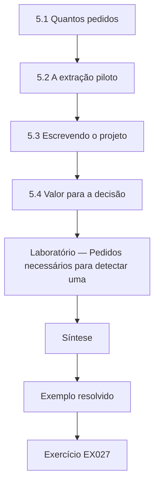

### Desenho lógico

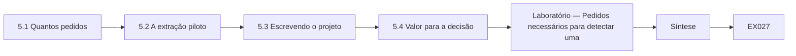

```text
[5.1 Quantos pedidos]
    |
    v
[5.2 A extração piloto]
    |
    v
[5.3 Escrevendo o projeto]
    |
    v
[5.4 Valor para a decisão]
    |
    v
[Laboratório — Pedidos necessários para detectar uma]
    |
    v
[Síntese]
    |
    v
[Exemplo resolvido] --> [Exercício EX027]
```
<!-- cykin:lesson-figures:end ch-05 -->


### Objetivos de aprendizagem

Você vai (1) estimar a amostra necessária para detectar uma mudança em uma proporção; (2) testar em piloto a extração dos dados; (3) escrever um projeto conciso.

### 5.1 Quantos pedidos

Hana pergunta se 240 pedidos por período bastam. Usando a taxa de base dentro do prazo de 0,74 e os parâmetros usuais de cinco por cento de significância e oitenta por cento de poder, o laboratório estima os pedidos necessários por período. Detectar uma subida para 0,85 exige 211 pedidos, uma subida para 0,90 exige 90, e uma subida para 0,95 exige 46. Com 240 por período, ela consegue detectar uma subida para 0,85 ou mais. Uma melhora menor poderia ser real e passar despercebida, e ela escreve essa frase no projeto para que um resultado nulo não seja lido, por engano, como prova de que o portal fracassou.

### 5.2 A extração piloto

Antes do estudo principal, Hana testa a extração de metadados em um mês de chamados. Ela encontra dois problemas. Alguns chamados registram a data em que o caso foi encerrado, e não a data em que a resposta foi enviada, e alguns pedidos por correio só foram registrados quando digitalizados, dias depois da chegada. Os dois erros distorceriam o desfecho de tempo. Ela combina correções com a Brookfield: conclusão significa a data em que a resposta foi enviada, e recebimento significa a data carimbada na sala de correspondência. As diretrizes de acesso do EDPB sustentam a contagem a partir do recebimento, e a LGPD também conta o prazo de quinze dias da data do requerimento do titular (art. 19, II), o que confirma que a definição corrigida corresponde ao relógio legal.

### 5.3 Escrevendo o projeto

O projeto cabe em seis páginas. Ele enuncia a pergunta, os desfechos e sua justificativa, o desenho e as explicações concorrentes, o tamanho da amostra, os arranjos éticos e o plano de análise. Hana inclui uma tabela que associa cada concorrente à sua verificação e um cronograma que termina três meses antes da entrega. O Dr. Pritchard pede que ela corte parte do contexto e acrescente um parágrafo sobre o que a Brookfield fará com cada resultado possível, porque um estudo que não pode mudar uma decisão é difícil de justificar para uma organização ocupada que está cedendo horas da equipe à pesquisa.

### 5.4 Valor para a decisão

Hana escreve o parágrafo da decisão. Se o portal melhorar a conclusão dentro do prazo sem prejudicar a qualidade, a Brookfield desativará a rota por e-mail para pedidos de acesso e promoverá o portal. Se melhorar o tempo mas prejudicar a qualidade, a Brookfield acrescentará uma verificação de completude antes do envio das respostas. Se não mudar nada, a Brookfield investigará o processo por correio, o canal mais lento. Cada resultado leva a uma ação específica. Ela observa que escrever o parágrafo da decisão também a obrigou a esclarecer o que conta como prejuízo à qualidade, o que tornou o plano de medição mais preciso e mais fácil de o encarregado aprovar.

### Laboratório — Pedidos necessários para detectar uma mudança na conclusão dentro do prazo

```python
# Requests per arm needed to detect a rise in on-time completion (two-sided alpha 0.05, power 0.80).
import math
za, zb = 1.959964, 0.841621
def n(p1, p2):
    pb = (p1 + p2) / 2
    return math.ceil((za * math.sqrt(2 * pb * (1 - pb)) + zb * math.sqrt(p1 * (1 - p1) + p2 * (1 - p2))) ** 2 / (p1 - p2) ** 2)
for p2 in [0.85, 0.90, 0.95]:
    print(f"on-time 0.74 -> {p2:.2f}: {n(0.74, p2):4d} requests per period")
```

Execute com `python3 lab_power.py`. Saída verificada:

```text
on-time 0.74 -> 0.85:  211 requests per period
on-time 0.74 -> 0.90:   90 requests per period
on-time 0.74 -> 0.95:   46 requests per period
```

### Exemplo resolvido

Hana descobre que 240 pedidos por período detectam uma subida de 0,74 para 0,85 (são necessários 211), corrige dois erros de tempo encontrados no piloto e associa cada resultado possível a uma ação da Brookfield.

> **Caso sintético.** Os dados dos chamados e os erros do piloto são sintéticos; as Diretrizes 01/2022 do EDPB e o art. 19 da LGPD são reais.

### Erros e limites

As fórmulas de poder presumem pedidos independentes; requerentes repetidos violam isso levemente. Uma mudança detectável não é o mesmo que uma mudança importante.

### Exercícios

- **EX027 — Amostra necessária.** Quantos pedidos por período detectam uma subida de 0,74 para 0,90? *Rubrica:* 3 = 90;; 2 = cerca de noventa;; 1 = errado;; 0 = nenhuma.
- **EX028 — Sentido do resultado nulo.** Por que um resultado nulo não deve ser lido como fracasso? *Rubrica:* 3 = o estudo pode deixar passar uma melhora real menor do que a detectável;; 2 = menciona poder;; 1 = trata o nulo como prova;; 0 = nenhuma.
- **EX029 — Erros do piloto.** Cite os dois erros de tempo que o piloto encontrou. *Rubrica:* 3 = data de encerramento em vez da data da resposta; pedidos por correio registrados na digitalização;; 2 = cita um;; 1 = vago;; 0 = nenhuma.
- **EX030 — Relógio legal.** Por que contar a partir do carimbo da sala de correspondência? *Rubrica:* 3 = o prazo corre a partir do recebimento, como as diretrizes confirmam;; 2 = menciona o recebimento;; 1 = usa a data de digitalização;; 0 = nenhuma.
- **EX031 — Parágrafo da decisão.** O que o parágrafo da decisão acrescenta ao projeto? *Rubrica:* 3 = associa cada resultado a uma ação concreta na Brookfield;; 2 = menciona uso;; 1 = omite;; 0 = nenhuma.
- **EX032 — Detectável versus importante.** Distinga uma mudança detectável de uma importante. *Rubrica:* 3 = a detectável depende do tamanho da amostra; a importante depende do dano aos requerentes;; 2 = define uma;; 1 = confunde as duas;; 0 = nenhuma.

### Síntese

O capítulo 5 dimensiona e pilota o estudo. O capítulo 6 coleta os dados e os analisa com um intervalo bootstrap.

<!-- cykin:chapter-navigation:start ch-05 -->
### Continue estudando — aula 05 (capítulo 05 de 08)

[← Capítulo 04](#ch-04) · [Índice das aulas](../SUBJECTS.md) · [Capítulo 06 →](#ch-06)

Continue para a próxima aula já escrita.
<!-- cykin:chapter-navigation:end -->

<a id="ch-06"></a>

## Capítulo 6 — Coleta e análise de dados

<!-- cykin:lesson-figures:start ch-06 -->
### Mapa da aula

Aula 06 publicada. Mapa, exemplo, EX033.

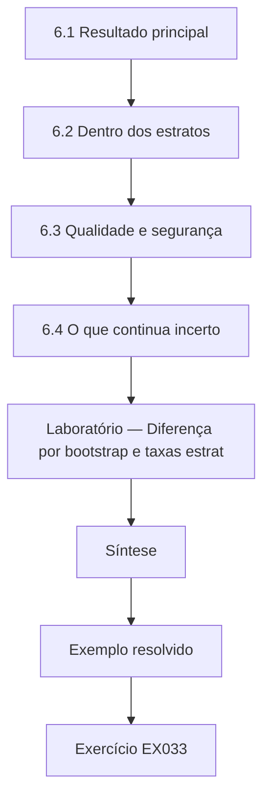

### Desenho lógico

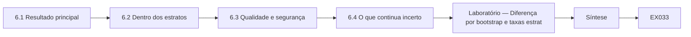

```text
[6.1 Resultado principal]
    |
    v
[6.2 Dentro dos estratos]
    |
    v
[6.3 Qualidade e segurança]
    |
    v
[6.4 O que continua incerto]
    |
    v
[Laboratório — Diferença por bootstrap e taxas estrat]
    |
    v
[Síntese]
    |
    v
[Exemplo resolvido] --> [Exercício EX033]
```
<!-- cykin:lesson-figures:end ch-06 -->


### Objetivos de aprendizagem

Você vai (1) estimar uma diferença de proporções com um intervalo por bootstrap; (2) estratificar por um fator de confusão; (3) interpretar os resultados à luz da regra fixada de antemão.

### 6.1 Resultado principal

Depois de seis meses, Hana executa a análise sobre 240 pedidos por período, reproduzida aqui com dados sintéticos. A conclusão dentro do prazo sobe de 0,708 para 0,929, uma diferença de 0,221. Um bootstrap com 4.000 reamostragens, segundo Efron e Tibshirani (1994), dá um intervalo de 95% de 0,154 a 0,287. O intervalo exclui o zero com folga. Mas a composição dos pedidos também mudou: os pedidos complexos caíram de 33% do total para 17%, exatamente a concorrente que ela previu no Capítulo 4, então a diferença principal não pode ser lida, sozinha, como o efeito do portal.

### 6.2 Dentro dos estratos

Por isso, Hana olha dentro dos grupos. Os pedidos simples melhoram de 0,800 para 0,960, uma diferença de 0,160. Os pedidos complexos melhoram de 0,525 para 0,780, uma diferença de 0,255. Os dois grupos melhoram, então o efeito do portal não é apenas uma mudança na composição, embora parte da diferença principal venha da composição. Ela informa os resultados gerais e estratificados na mesma tabela, com os números estratificados primeiro, para que os leitores não tomem o número geral, maior, como o efeito do portal e não possam citá-lo sem ver a ressalva.

### 6.3 Qualidade e segurança

A revisão de completude constata que 38 das 40 respostas da amostra cumpriram a lista do artigo 15 depois do lançamento, contra 35 de 40 antes, então a qualidade não caiu. Nenhuma divulgação a pessoa errada foi registrada em nenhum dos períodos. Os registros de pessoal não mostram mudança. Aplicando a regra fixada de antemão, Hana conclui que o portal conta como melhora. Ela tem o cuidado de acrescentar que a amostra de revisão é pequena e que uma única divulgação a pessoa errada no futuro mudaria a avaliação, por isso o desfecho de segurança precisa continuar sendo monitorado depois da dissertação e ter um responsável na Brookfield.

### 6.4 O que continua incerto

Hana lista o que seus dados não conseguem mostrar. O estudo cobre uma empresa e um ano; o portal foi lançado junto com uma reformulação do site que pode ter empurrado os clientes para os canais on-line; e o intervalo por bootstrap reflete a variação amostral, não as fraquezas do desenho. Ela escreve que o portal está associado a uma melhora substancial tanto nos pedidos simples quanto nos complexos, e que a explicação mais provável é o portal, com a reformulação do site como concorrente remanescente. O Dr. Pritchard elogia a frase porque ela diz exatamente o quanto a evidência permite.

### Laboratório — Diferença por bootstrap e taxas estratificadas

```python
# Before/after on-time rates with a bootstrap 95% interval, overall and within simple vs complex requests.
import random
r = random.Random(9)
def period(n, p_simple, p_complex, share_complex):
    out = []
    for _ in range(n):
        cx = r.random() < share_complex
        out.append((cx, r.random() < (p_complex if cx else p_simple)))
    return out
before = period(240, 0.82, 0.55, 0.30); after = period(240, 0.95, 0.70, 0.15)
rate = lambda s: sum(ok for _, ok in s) / len(s)
def boot(a, b, k=4000):
    d = sorted(rate(r.choices(b, k=len(b))) - rate(r.choices(a, k=len(a))) for _ in range(k))
    return d[int(0.025 * k)], d[int(0.975 * k)]
lo, hi = boot(before, after)
print(f"overall on-time {rate(before):.3f} -> {rate(after):.3f}; difference {rate(after)-rate(before):.3f} (95% CI {lo:.3f} to {hi:.3f})")
print(f"complex share {sum(c for c, _ in before)/240:.2f} -> {sum(c for c, _ in after)/240:.2f}")
for cx, name in [(False, "simple"), (True, "complex")]:
    a = [x for x in before if x[0] == cx]; b = [x for x in after if x[0] == cx]
    print(f"{name:7s} {rate(a):.3f} -> {rate(b):.3f}; difference {rate(b)-rate(a):.3f}")
```

Execute com `python3 lab_diff.py`. Saída verificada:

```text
overall on-time 0.708 -> 0.929; difference 0.221 (95% CI 0.154 to 0.287)
complex share 0.33 -> 0.17
simple  0.800 -> 0.960; difference 0.160
complex 0.525 -> 0.780; difference 0.255
```

### Exemplo resolvido

Hana informa que a conclusão dentro do prazo subiu de 0,708 para 0,929 (diferença de 0,221, intervalo de 95% de 0,154 a 0,287), mostra melhora dentro dos pedidos simples (0,160) e complexos (0,255) e confirma que a completude e a segurança não pioraram.

> **Caso sintético.** Todas as taxas são sintéticas; Efron e Tibshirani (1994) é real.

### Erros e limites

Os intervalos por bootstrap presumem pedidos independentes e não cobrem o viés do desenho. Estratificar por um fator de confusão deixa os demais.

### Exercícios

- **EX033 — Intervalo por bootstrap.** Que intervalo de 95% o bootstrap deu para a diferença geral? *Rubrica:* 3 = de 0,154 a 0,287;; 2 = cerca de 0,15 a 0,29;; 1 = errado;; 0 = nenhuma.
- **EX034 — Mudança de composição.** Como mudou a parcela de complexos, e por que isso importa? *Rubrica:* 3 = de 33% para 17%; parte do ganho pode vir de pedidos mais fáceis;; 2 = dá só os números;; 1 = ignora;; 0 = nenhuma.
- **EX035 — Estrato complexo.** O que aconteceu com a conclusão dentro do prazo nos pedidos complexos? *Rubrica:* 3 = de 0,525 para 0,780, diferença de 0,255;; 2 = só a direção;; 1 = errado;; 0 = nenhuma.
- **EX036 — Regra aplicada.** O portal cumpre a regra fixada de antemão, e por quê? *Rubrica:* 3 = sim; o tempo melhorou, completude 38/40 contra 35/40, nenhuma divulgação a pessoa errada;; 2 = sim, sem evidência;; 1 = não;; 0 = nenhuma.
- **EX037 — Limites do intervalo.** O que o intervalo por bootstrap não capta? *Rubrica:* 3 = fraquezas do desenho, como a concorrente da reformulação do site;; 2 = menciona viés;; 1 = diz que capta toda a incerteza;; 0 = nenhuma.
- **EX038 — Ordem de apresentação.** Por que apresentar primeiro os resultados estratificados? *Rubrica:* 3 = o número geral exagera o efeito do portal por causa da mudança de composição;; 2 = menciona clareza;; 1 = coloca o geral primeiro;; 0 = nenhuma.

### Síntese

O capítulo 6 produz um resultado delimitado e estratificado. O capítulo 7 o redige com limitações honestas.

<!-- cykin:chapter-navigation:start ch-06 -->
### Continue estudando — aula 06 (capítulo 06 de 08)

[← Capítulo 05](#ch-05) · [Índice das aulas](../SUBJECTS.md) · [Capítulo 07 →](#ch-07)

Continue para a próxima aula já escrita.
<!-- cykin:chapter-navigation:end -->

<a id="ch-07"></a>

## Capítulo 7 — Redação da dissertação e limitações

<!-- cykin:lesson-figures:start ch-07 -->
### Mapa da aula

Aula 07 publicada. Mapa, exemplo, EX039.

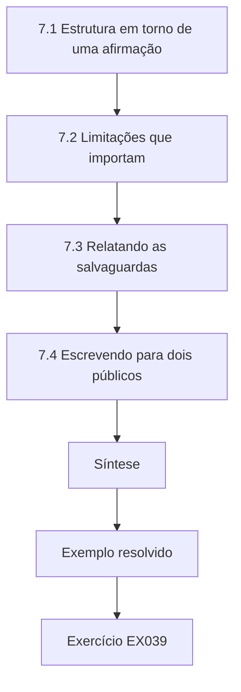

### Desenho lógico

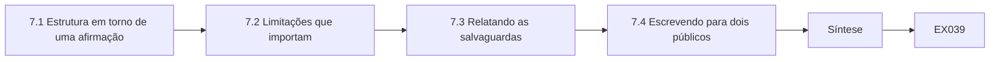

```text
[7.1 Estrutura em torno de uma afirmação]
    |
    v
[7.2 Limitações que importam]
    |
    v
[7.3 Relatando as salvaguardas]
    |
    v
[7.4 Escrevendo para dois públicos]
    |
    v
[Síntese]
    |
    v
[Exemplo resolvido] --> [Exercício EX039]
```
<!-- cykin:lesson-figures:end ch-07 -->


### Objetivos de aprendizagem

Você vai (1) estruturar uma dissertação em torno de uma afirmação; (2) escrever limitações que orientem decisões; (3) relatar as salvaguardas de privacidade usadas na pesquisa.

### 7.1 Estrutura em torno de uma afirmação

Hana organiza a dissertação em torno de uma afirmação: o portal está associado a uma conclusão dentro do prazo mais alta tanto nos pedidos de acesso simples quanto nos complexos, sem perda de completude nem de segurança. Cada capítulo sustenta uma parte dessa afirmação. A revisão da literatura explica por que o acesso dentro do prazo importa, o método explica o desenho e as concorrentes, os resultados apresentam os números estratificados e a discussão pondera a concorrente remanescente. O Dr. Pritchard pede que ela retire uma seção sobre avisos de cookies que ela achou interessante, mas que não sustenta a afirmação, e ela concorda depois de mover as notas para um apêndice de trabalhos futuros.

### 7.2 Limitações que importam

Hana escreve as limitações como informação para quem decide, e não como desculpas. Uma única empresa limita a generalização a varejistas semelhantes; a reformulação do site continua sendo uma concorrente não separada; a amostra de completude, de quarenta respostas por período, só detecta mudanças grandes; e a análise jurídica segue os textos do GDPR e da LGPD e as orientações do EDPB, não decisões judiciais. Para cada limitação, ela indica a direção provável: por exemplo, a reformulação provavelmente infla um pouco o efeito. Isso diz aos gestores da Brookfield como ajustar suas expectativas, em vez de deixá-los adivinhar a gravidade de cada fraqueza.

### 7.3 Relatando as salvaguardas

Uma dissertação sobre privacidade precisa mostrar que respeitou a privacidade. O capítulo de métodos de Hana descreve o extrato só com metadados, a análise dentro da Brookfield, a fusão das categorias pequenas e a proibição de vincular chamados a clientes. Ela também relata um incidente: um extrato inicial continha uma coluna de anotações em texto livre, que ela percebeu e devolveu sem abrir. Relatar o incidente mostra que as salvaguardas funcionaram e dá a outros estudantes um exemplo do que observar. O encarregado de proteção de dados da Brookfield revisa o capítulo antes da entrega e confirma que ele não revela nada sobre clientes individuais.

### 7.4 Escrevendo para dois públicos

Hana escreve a dissertação para os examinadores e um resumo de duas páginas para a Brookfield. O resumo começa pela decisão: desativar a rota por e-mail para pedidos de acesso e continuar monitorando a completude e as divulgações a pessoa errada. Ele apresenta o resultado em números simples, nomeia a concorrente remanescente e recomenda um acompanhamento depois que a reformulação se estabilizar. Ela evita termos como bootstrap no resumo, substituindo-os por "uma faixa em que a melhora real muito provavelmente está". O Dr. Pritchard observa que um bom resumo permite a um gestor agir corretamente mesmo que nunca leia a dissertação.

### Exemplo resolvido

Hana constrói a dissertação em torno de uma afirmação, escreve as limitações com sua direção provável, relata um incidente de texto livre detectado a tempo e produz um resumo de decisão de duas páginas.

> **Caso sintético.** O incidente e o resumo são sintéticos; o GDPR, a LGPD e as Diretrizes 01/2022 do EDPB são reais.

### Erros e limites

Um resumo curto pode perder nuances; ele deve remeter às limitações completas.

### Exercícios

- **EX039 — Seção cortada.** Por que Hana retirou a seção sobre avisos de cookies? *Rubrica:* 3 = não sustentava a afirmação central;; 2 = menciona foco;; 1 = mantém a seção;; 0 = nenhuma.
- **EX040 — Direção do viés.** Por que indicar a direção provável de cada limitação? *Rubrica:* 3 = para que quem decide saiba como ajustar as expectativas;; 2 = menciona utilidade;; 1 = só lista limites;; 0 = nenhuma.
- **EX041 — Incidente de texto livre.** O que Hana deve fazer quando um extrato contém anotações em texto livre? *Rubrica:* 3 = devolvê-lo sem abrir e relatar o incidente;; 2 = devolve;; 1 = lê;; 0 = nenhuma.
- **EX042 — Limite do escopo jurídico.** Qual é o limite da análise jurídica de Hana? *Rubrica:* 3 = usa as leis e as orientações do EDPB, não a jurisprudência;; 2 = menciona as fontes;; 1 = omite;; 0 = nenhuma.
- **EX043 — Linguagem simples.** Como o resumo descreve o intervalo por bootstrap? *Rubrica:* 3 = como uma faixa em que a melhora real muito provavelmente está;; 2 = frase semelhante;; 1 = usa jargão;; 0 = nenhuma.
- **EX044 — Revisão do encarregado.** Por que o encarregado de proteção de dados revisa o capítulo de métodos? *Rubrica:* 3 = para confirmar que não revela nada sobre clientes individuais;; 2 = menciona privacidade;; 1 = omite;; 0 = nenhuma.

### Síntese

O capítulo 7 redige uma dissertação delimitada e um resumo para decisão. O capítulo 8 enfrenta a revisão independente e a defesa.

<!-- cykin:chapter-navigation:start ch-07 -->
### Continue estudando — aula 07 (capítulo 07 de 08)

[← Capítulo 06](#ch-06) · [Índice das aulas](../SUBJECTS.md) · [Capítulo 08 →](#ch-08)

Continue para a próxima aula já escrita.
<!-- cykin:chapter-navigation:end -->

<a id="ch-08"></a>

## Capítulo 8 — Revisão independente e defesa

<!-- cykin:lesson-figures:start ch-08 -->
### Mapa da aula

Aula 08 publicada. Mapa, exemplo, EX045.

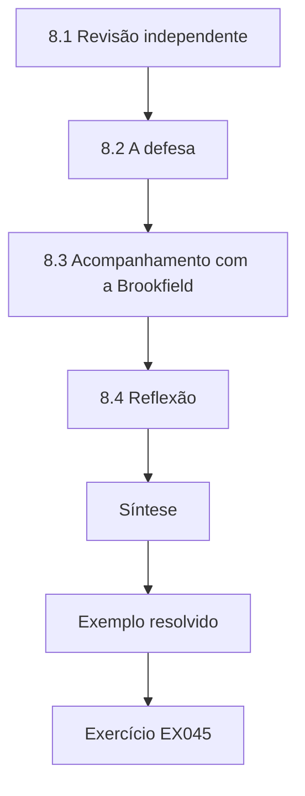

### Desenho lógico

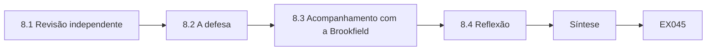

```text
[8.1 Revisão independente]
    |
    v
[8.2 A defesa]
    |
    v
[8.3 Acompanhamento com a Brookfield]
    |
    v
[8.4 Reflexão]
    |
    v
[Síntese]
    |
    v
[Exemplo resolvido] --> [Exercício EX045]
```
<!-- cykin:lesson-figures:end ch-08 -->


### Objetivos de aprendizagem

Você vai (1) responder a um revisor independente; (2) defender as escolhas de desenho; (3) combinar ações de acompanhamento com a organização.

### 8.1 Revisão independente

Antes da defesa, uma revisora independente de outra universidade lê a dissertação. Ela levanta três pontos: o bootstrap ignora os requerentes repetidos, a amostra de completude é pequena e a dissertação não discute os pedidos recusados por serem manifestamente infundados ou excessivos, nos termos do artigo 12(5). Hana confere os dados: os requerentes repetidos são 3% dos pedidos, então ela refaz a análise sem eles, e o resultado quase não muda. Ela acrescenta uma frase sobre a amostra de completude e uma seção curta sobre recusas, que se revelam raras, duas em cada período, e documentadas nos dois. Para os clientes brasileiros, ela observa que a LGPD não traz uma recusa equivalente: o atendimento é sem custos para o titular (art. 18, § 5º), e, quando a providência não pode ser imediata, o controlador deve indicar ao titular as razões de fato ou de direito que a impedem (art. 18, § 4º, II).

### 8.2 A defesa

Na defesa, os examinadores perguntam por que Hana não esperou um ano para separar o efeito da reformulação do site. Ela responde que a Brookfield precisava de uma decisão dentro do ano e que seu desenho torna explícita a concorrente remanescente, de modo que a decisão pode ser revista. Eles perguntam se a verificação de identidade baseada no login do portal poderia excluir clientes sem conta. Ela explica que esses pedidos continuam indo para a equipe, com verificações proporcionais, e que sua taxa dentro do prazo é apresentada separadamente em um apêndice. Os examinadores aceitam as duas respostas e recomendam correções menores, centradas em tabelas mais claras.

### 8.3 Acompanhamento com a Brookfield

Depois da defesa, Hana se reúne com o encarregado de proteção de dados da Brookfield para combinar o acompanhamento; no Brasil, a atuação do encarregado é regulamentada pela Resolução CD/ANPD nº 18/2024. A Brookfield desativará a rota por e-mail para pedidos de acesso, manterá a rota por correio para quem a preferir e acrescentará um relatório mensal sobre conclusão dentro do prazo, completude e divulgações a pessoa errada. Uma segunda revisão, em um ano, testará se a melhora persiste depois que a reformulação do site se estabilizar. Hana entrega seu script de análise para que a própria Brookfield produza o relatório mensal, e confirma que o script roda apenas sobre metadados pseudonimizados dentro do ambiente da empresa.

### 8.4 Reflexão

Hana reflete que as partes mais úteis de seu estudo foram decididas cedo: um desfecho definido pela lei, as concorrentes listadas antes dos dados e uma regra para o que conta como melhora. A análise estatística importou, mas foi o desenho que tornou o resultado crível. Ela também aprendeu que a pesquisa sobre privacidade precisa respeitar ela mesma a privacidade, o que moldou cada decisão sobre os dados. O Dr. Pritchard pede que ela escreva essas lições como conselhos para os estudantes do ano seguinte, e ela as inclui nas páginas finais da dissertação como orientação prática para quem for estudar um processo de conformidade.

### Exemplo resolvido

Hana responde à revisora refazendo a análise sem os requerentes repetidos e acrescentando as recusas, defende sua escolha de prazo e combina com a Brookfield um monitoramento mensal e uma segunda revisão.

> **Caso sintético.** A revisora, os examinadores e o acompanhamento são sintéticos; o artigo 12(5) do GDPR, o art. 18 da LGPD e a Resolução CD/ANPD nº 18/2024 são reais.

### Erros e limites

Entregar um script não garante seu uso correto; a Brookfield precisa de um responsável que o entenda.

### Exercícios

- **EX045 — Requerentes repetidos.** Como Hana tratou os requerentes repetidos? *Rubrica:* 3 = refez a análise sem eles (3%), e o resultado quase não mudou;; 2 = menciona refazer;; 1 = ignora;; 0 = nenhuma.
- **EX046 — Artigo 12(5).** O que o artigo 12(5) permite? *Rubrica:* 3 = recusar ou cobrar por pedidos manifestamente infundados ou excessivos;; 2 = menciona recusa;; 1 = errado;; 0 = nenhuma.
- **EX047 — Defesa do prazo.** Por que Hana não esperou um ano para a reformulação se estabilizar? *Rubrica:* 3 = a Brookfield precisava de uma decisão, e a concorrente fica explícita para revisão posterior;; 2 = menciona o prazo;; 1 = diz que não era necessário;; 0 = nenhuma.
- **EX048 — Pedidos sem conta.** Como são tratados os pedidos de pessoas sem conta? *Rubrica:* 3 = encaminhados à equipe com verificações proporcionais e apresentados separadamente;; 2 = menciona a equipe;; 1 = excluídos;; 0 = nenhuma.
- **EX049 — Conjunto de monitoramento.** O que o relatório mensal da Brookfield vai incluir? *Rubrica:* 3 = conclusão dentro do prazo, completude e divulgações a pessoa errada;; 2 = dois;; 1 = um;; 0 = nenhuma.
- **EX050 — Lição de desenho.** O que, segundo Hana, tornou o resultado crível? *Rubrica:* 3 = o desenho decidido cedo: desfecho legal, concorrentes, regra de melhora;; 2 = menciona o desenho;; 1 = diz que foi a estatística;; 0 = nenhuma.

### Síntese

O capítulo 8 conclui o percurso de mestrado com um resultado defendido e acompanhamento monitorado. Seguem-se as resoluções e, depois, as referências.

<!-- cykin:chapter-navigation:start ch-08 -->
### Continue estudando — aula 08 (capítulo 08 de 08)

[← Capítulo 07](#ch-07) · [Índice das aulas](../SUBJECTS.md) · [Próximo curso pelo índice →](../SUBJECTS.md)

O índice aponta para o próximo curso do percurso de estudos.
<!-- cykin:chapter-navigation:end -->

<a id="worked-results"></a>

## Resoluções

Respostas-modelo para EX001–EX050. Hana Kobayashi, o Dr. Owen Pritchard, o Ellery Institute of Technology, a Brookfield Online Retail e todos os números são sintéticos. As respostas dos laboratórios citam as saídas verificadas. Qualquer resposta que atenda à rubrica recebe a mesma pontuação.

**EX001.** Sem demora injustificada e, em qualquer caso, em até um mês do recebimento, prorrogável por mais dois meses quando necessário.

**EX002.** Até quinze dias para uma declaração clara e completa (art. 19, II).

**EX003.** Os dias até a conclusão mostram deslocamentos que a parcela binária dentro do prazo deixaria passar.

**EX004.** Buscas registradas tornam a revisão reproduzível e fácil de atualizar.

**EX005.** O correio: mediana de 46 dias e apenas 29,2% concluídos em até trinta dias.

**EX006.** 74,0% dos 200 pedidos são concluídos em até trinta dias.

**EX007.** Ligar os desfechos aos interesses dos requerentes evita escolher um desfecho só porque é fácil de contar.

**EX008.** Permite às pessoas saber se e como seus dados são tratados e verificar se o tratamento é lícito.

**EX009.** A exclusão: não ser informado sobre os usos dos próprios dados nem poder participar deles.

**EX010.** Não usa mais dados do que o necessário, por exemplo apoiando-se no login já existente do cliente.

**EX011.** Porque a velocidade obtida enviando dados à pessoa errada é pior do que uma resposta correta e lenta.

**EX012.** A revisão humana pode detectar pedidos que buscam os dados de outra pessoa, protegendo os direitos de terceiros.

**EX013.** Como as preferências de privacidade são incertas e dependem do contexto, respostas claras ajudam as pessoas a julgar os fluxos reais.

**EX014.** Contra as informações que o artigo 15 exige, como finalidades, destinatários e prazo de conservação.

**EX015.** O portal entra no ar para todos os clientes ao mesmo tempo, então não é possível designar um grupo de comparação.

**EX016.** A história e as mudanças de seleção em quem é estudado; a maturação é outra.

**EX017.** Apenas metadados pseudonimizados: canal, datas, complexidade e resultado, nunca o conteúdo do pedido.

**EX018.** Células pequenas podem apontar para indivíduos; fundi-las protege os requerentes.

**EX019.** A análise roda onde o extrato está, e só tabelas agregadas são exportadas.

**EX020.** Uma definição fixada de antemão não pode ser ajustada para favorecer a intervenção.

**EX021.** Ela mede a parcela de complexos em cada período e informa as taxas dentro do prazo separadamente para pedidos simples e complexos.

**EX022.** Apontá-lo abertamente como uma concorrente que o desenho não consegue separar do portal.

**EX023.** Depois de uma fase incomumente ruim, o desempenho tende a melhorar de qualquer forma, o que poderia ser confundido com um efeito do portal.

**EX024.** Os dados rotineiros evitam que a equipe mude o comportamento por saber que está sendo observada.

**EX025.** O portal só conta como melhor se a conclusão dentro do prazo subir sem perda de completude ou de segurança.

**EX026.** Algumas concorrentes são desconhecidas, então um estudo só pode tratar das que consegue identificar.

**EX027.** 90 pedidos por período.

**EX028.** Com 240 por período, melhoras menores do que até 0,85 podem passar despercebidas, então a ausência de diferença não prova a ausência de efeito.

**EX029.** Os chamados usavam a data de encerramento em vez da data de envio, e os pedidos por correio eram registrados com atraso, na digitalização.

**EX030.** Porque o prazo legal corre a partir do momento em que o controlador recebe o pedido; a LGPD conta o prazo da data do requerimento (art. 19, II).

**EX031.** Associa cada resultado possível a uma ação específica da Brookfield.

**EX032.** A detectabilidade é estatística; a importância diz respeito aos efeitos reais sobre as pessoas e a conformidade.

**EX033.** De 0,154 a 0,287.

**EX034.** Os pedidos complexos caíram de 33% para 17%, então parte do ganho principal reflete uma composição mais simples.

**EX035.** Subiu de 0,525 para 0,780, uma diferença de 0,255.

**EX036.** Sim: a conclusão dentro do prazo subiu enquanto a completude se manteve (38/40) e a segurança ficou em zero incidentes.

**EX037.** Reflete apenas a variação amostral, não o viés de concorrentes como a reformulação do site.

**EX038.** A diferença geral inclui uma mudança de composição, então os efeitos estratificados refletem melhor o portal.

**EX039.** Era interessante, mas não sustentava a afirmação da dissertação, então ela a moveu para trabalhos futuros.

**EX040.** Saber se uma fraqueza infla ou reduz o efeito permite aos gestores ajustar suas expectativas.

**EX041.** Devolvê-lo sem abrir, obter um extrato corrigido e relatar o incidente no capítulo de métodos.

**EX042.** Segue o GDPR, a LGPD e as orientações do EDPB, não decisões judiciais.

**EX043.** Como "uma faixa em que a melhora real muito provavelmente está".

**EX044.** Para verificar que o texto publicado não pode revelar nenhum cliente individual.

**EX045.** Ela refez a análise excluindo os 3% de requerentes repetidos, e o resultado quase não mudou.

**EX046.** O controlador pode cobrar uma taxa razoável ou recusar pedidos manifestamente infundados ou excessivos, cabendo-lhe o ônus da prova. A LGPD não tem regra equivalente: o atendimento é gratuito (art. 18, § 5º).

**EX047.** A Brookfield precisava de uma decisão dentro do ano; o desenho declara a concorrente para que a decisão possa ser revista.

**EX048.** A equipe os atende com verificações de identidade proporcionais, e seus tempos são apresentados separadamente.

**EX049.** Conclusão dentro do prazo, completude e divulgações a pessoa errada.

**EX050.** As escolhas de desenho feitas cedo: um desfecho definido pela lei, concorrentes listadas e uma regra de melhora fixada de antemão.

<a id="references"></a>
## Referências

Todos os DOIs foram resolvidos em doi.org em 12 de outubro de 2026, e as normas foram conferidas nas páginas de seus editores. A lista é idêntica à da edição em inglês e cobre o livro inteiro, acrescida apenas da Resolução CD/ANPD nº 18, de 16 de julho de 2024, citada nesta edição como referência brasileira e conferida em sua fonte oficial; nenhuma das normas técnicas citadas foi verificada aqui como adotada pela ABNT, por isso são citadas em sua edição internacional. Organizações, pessoas, sistemas e números dos casos são sintéticos; somente as obras abaixo são reais.

- Acquisti, A., Brandimarte, L., & Loewenstein, G. (2015). Privacy and human behavior in the age of information. *Science, 347*(6221), 509–514. <https://doi.org/10.1126/science.aaa1465>
- Brasil. (2018). *Lei nº 13.709, de 14 de agosto de 2018 — Lei Geral de Proteção de Dados Pessoais (LGPD)*. <https://www.planalto.gov.br/ccivil_03/_ato2015-2018/2018/lei/l13709.htm>
- Brasil. Agência Nacional de Proteção de Dados. (2024). *Resolução CD/ANPD nº 18, de 16 de julho de 2024 — Aprova o Regulamento sobre a atuação do encarregado pelo tratamento de dados pessoais*. Diário Oficial da União. <https://www.gov.br/anpd/pt-br/acesso-a-informacao/institucional/atos-normativos/regulamentacoes_anpd>
- Efron, B., & Tibshirani, R. J. (1994). *An introduction to the bootstrap*. Chapman and Hall/CRC. <https://doi.org/10.1201/9780429246593>
- European Data Protection Board. (2023). *Guidelines 01/2022 on data subject rights — Right of access* (Version 2.0 adopted 28 March 2023; Version 2.1 with minor corrections, 30 May 2024). <https://www.edpb.europa.eu/documents/guideline/guidelines-012022-on-data-subject-rights-right-of-access_en>
- European Union. (2016). Regulation (EU) 2016/679 (General Data Protection Regulation). *Official Journal of the European Union, L 119*, 1–88. <http://data.europa.eu/eli/reg/2016/679/oj>
- Nissenbaum, H. (2004). Privacy as contextual integrity. *Washington Law Review, 79*(1), 119–157.
- Shadish, W. R., Cook, T. D., & Campbell, D. T. (2002). *Experimental and quasi-experimental designs for generalized causal inference*. Houghton Mifflin.
- Solove, D. J. (2006). A taxonomy of privacy. *University of Pennsylvania Law Review, 154*(3), 477–564. <https://doi.org/10.2307/40041279>
