# Arquitetura e Engenharia de Segurança: Curso de Mestrado

- Idioma: português do Brasil (`pt`); curso 168, curso de mestrado (2 anos). Edição de referência: [inglês](../../en/book/MANUSCRIPT.md).
- Estado editorial: **publicado**. Os capítulos 1–8 de 8 têm texto didático escrito à mão na edição em inglês; os exercícios EX001–EX050 têm resoluções correspondentes com rubricas de 0 a 3; os três laboratórios offline usam apenas a biblioteca padrão do Python 3 sobre dados sintéticos, e suas saídas foram incorporadas de execuções reais, idênticas às da edição em inglês. Revisão independente, revisão linguística e a verificação de 300 páginas A4 continuam em aberto.
- Público: pesquisadores iniciantes em arquitetura e engenharia de segurança.
- Autor: [hiagokinlevi](https://github.com/hiagokinlevi). Texto original sob [CC0 1.0](../../../../../LICENSE); as obras citadas mantêm seus direitos.
- Limites: os laboratórios contam registros de triagem, calculam a alcançabilidade em grafos sob três políticas sintéticas de segmentação e fazem bootstrap de resultados pareados; nunca varrem nem tocam uma rede real. Pessoas, organizações, sistemas e dados são **sintéticos**, salvo quando uma frase cita uma fonte pública.

[Página do curso](../../README.md) · [Índice de capítulos](../SUBJECTS.md) · [Plano do livro](PLAN.md) · [Skill do curso](../../skill/SKILL.md) · [Resoluções](#worked-results)

## Como usar este rascunho

Leia na ordem. Os capítulos acompanham um mestrando que compara a microssegmentação baseada em identidade com a segmentação por zonas em redes corporativas simuladas: pergunta e método de revisão da literatura, um seminário avançado, desenho do estudo e ética, explicações concorrentes, proposta e piloto, análise, redação e limitações, e revisão independente e defesa. Execute cada laboratório onde ele aparece, tente os exercícios antes de consultar as resoluções e avalie-se com as rubricas.

### Caso sintético

| Elemento | Papel | Natureza |
|---|---|---|
| **Kenji Albrecht** | Mestrando, em meio período na Vantor | Inventado |
| **Dra. Selin Aydın** | Orientadora | Inventada |
| **Northmoor University** | Universidade fictícia | Inventada |
| **Vantor Logistics** | Empregadora fictícia cuja estrutura molda o modelo | Inventada |

### Fontes principais

NIST [SP 800-207](https://doi.org/10.6028/NIST.SP.800-207), [SP 800-160 Vol. 1 Rev. 1](https://doi.org/10.6028/NIST.SP.800-160v1r1) e [SP 800-53 Rev. 5](https://doi.org/10.6028/NIST.SP.800-53r5); Saltzer e Schroeder (1975), [doi:10.1109/PROC.1975.9939](https://doi.org/10.1109/PROC.1975.9939); Shostack (2014); Anderson (2020); Wohlin et al. (2012). Lista completa em [Referências](#references).

## Sumário

| Capítulos em português |
|---|
| [1](#ch-01) · [2](#ch-02) · [3](#ch-03) · [4](#ch-04) · [5](#ch-05) · [6](#ch-06) · [7](#ch-07) · [8](#ch-08) |

[Resoluções](#worked-results) · [Referências](#references)

<a id="ch-01"></a>

## Capítulo 1 — Pergunta de pesquisa e método de revisão da literatura

<!-- cykin:lesson-figures:start ch-01 -->
### Mapa da aula

Aula 01 publicada. Mapa, exemplo, EX001.

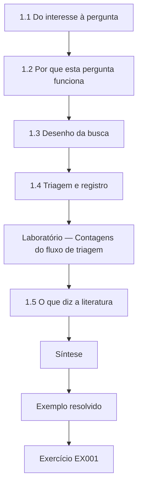

### Desenho lógico

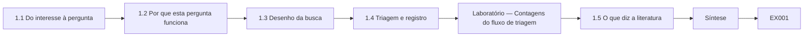

```text
[1.1 Do interesse à pergunta]
    |
    v
[1.2 Por que esta pergunta funciona]
    |
    v
[1.3 Desenho da busca]
    |
    v
[1.4 Triagem e registro]
    |
    v
[Laboratório — Contagens do fluxo de triagem]
    |
    v
[1.5 O que diz a literatura]
    |
    v
[Síntese]
    |
    v
[Exemplo resolvido] --> [Exercício EX001]
```
<!-- cykin:lesson-figures:end ch-01 -->


### Objetivos de aprendizagem

Você vai (1) transformar um interesse em arquitetura numa pergunta focada e respondível; (2) desenhar uma busca documentada na literatura; (3) fazer a triagem das fontes com critérios explícitos; (4) registrar a busca para que outros possam repeti-la.

### 1.1 Do interesse à pergunta

Kenji Albrecht é mestrando na fictícia Northmoor University, sob orientação da Dra. Selin Aydın. Ele trabalha em meio período na fictícia Vantor Logistics, cuja rede interna plana permite que quase qualquer estação de trabalho alcance quase qualquer servidor. Seu interesse é a arquitetura zero trust, descrita no NIST SP 800-207, mas um interesse não é uma pergunta. A Dra. Aydın o pressiona a estreitá-lo. Depois de vários rascunhos, ele chega a esta: em redes corporativas simuladas com a forma da Vantor, quanto a microssegmentação baseada em identidade reduz o número de servidores que um atacante consegue alcançar a partir de uma estação comprometida, em comparação com a segmentação por zonas? Todas as pessoas, organizações e redes aqui são sintéticas.

### 1.2 Por que esta pergunta funciona

A pergunta nomeia uma população, redes simuladas com a forma de um tipo real de empresa; uma intervenção, a microssegmentação baseada em identidade; uma comparação, a segmentação por zonas; e um desfecho, os servidores alcançáveis a partir de um ponto de apoio. Ela pode ser respondida dentro do prazo de um mestrado porque usa simulação em vez de alterar uma rede de produção, e evita os riscos éticos e operacionais de testar em sistemas reais. Ela também é limitada: a alcançabilidade é uma aproximação do avanço do atacante, não uma medida de incidentes reais. Kenji escreve essa limitação no documento da pergunta desde já, para que ela molde todos os capítulos seguintes, em vez de aparecer só no fim.

### 1.3 Desenho da busca

Kenji desenha a busca antes de executá-la. Escolhe as bases, as bibliotecas digitais do IEEE e da ACM mais as publicações do NIST, e escreve strings de busca que combinam termos de segmentação, zero trust e movimento lateral. Define os critérios de inclusão: estudos revisados por pares ou padrões oficiais de 2010 em diante que discutam os efeitos da segmentação de rede sobre o movimento do atacante. Exclui material de marketing de fornecedores e textos de opinião, mas mantém uma lista separada de literatura cinzenta para contexto. Escrever os critérios primeiro o impede de incluir, sem perceber, só os estudos que concordam com o que ele espera encontrar, um viés bem conhecido nas revisões de literatura.

### 1.4 Triagem e registro

A busca retorna 312 registros. A triagem por título e resumo remove os que estão fora do escopo, e a leitura do texto completo remove mais. Ele registra o número em cada etapa, os motivos de exclusão e a data de cada busca, numa tabela de fluxo semelhante às usadas em revisões sistemáticas. O laboratório abaixo reproduz as contagens do seu log de triagem. O conjunto final de 27 estudos é pequeno, e ele observa que a maioria relata designs ou simulações, e não medições de campo. Registrar a busca a torna repetível e permite aos examinadores julgar se algum trabalho importante pode ter ficado de fora.

### Laboratório — Contagens do fluxo de triagem

```python
# Screening flow from a synthetic search log.
log = {"ieee": 141, "acm": 118, "nist": 53}
dupes = 46; title_abstract_out = 197; fulltext_out = 42
total = sum(log.values()); after_d = total - dupes
after_ta = after_d - title_abstract_out; included = after_ta - fulltext_out
for k, v in log.items(): print(f"source {k:5} {v}")
print(f"records {total} -> after duplicates {after_d} -> after title/abstract {after_ta} -> included {included}")
```

Execute com `python3 lab_screen.py`. Saída verificada:

```text
source ieee  141
source acm   118
source nist  53
records 312 -> after duplicates 266 -> after title/abstract 69 -> included 27
```

### 1.5 O que diz a literatura

Kenji resume os temas. Os princípios fundamentais, incluindo o menor privilégio e a mediação completa de Saltzer e Schroeder (1975), sustentam a segmentação. O NIST SP 800-207 descreve pontos de aplicação de política que tomam decisões de acesso a cada requisição. Anderson (2020) traz estudos de caso em que redes planas permitiram aos atacantes se mover amplamente depois de um único comprometimento. Existem estudos de simulação com grafos de ataque, mas poucos comparam estratégias de segmentação nas mesmas redes e com as mesmas premissas. Essa lacuna molda sua contribuição: uma comparação controlada sob premissas declaradas, e não uma afirmação sobre como atacantes reais vão se comportar em qualquer empresa.

### Exemplo resolvido

Kenji estreita seu interesse numa pergunta sobre alcançabilidade, escreve de antemão as strings e os critérios de busca, faz a triagem de 312 registros até chegar a 27 estudos com uma tabela de fluxo e identifica a lacuna de comparação.

> **Caso sintético.** A Northmoor University, a Vantor Logistics, Kenji, a Dra. Aydın e os números da triagem são inventados; o SP 800-207, Saltzer e Schroeder (1975) e Anderson (2020) são reais.

### Erros e limites

A escolha das bases limita a cobertura; o conhecimento dos praticantes pode estar fora da literatura indexada. A alcançabilidade ignora a detecção e a resposta.

### Exercícios

- **EX001 — Partes da pergunta.** Nomeie a população, a intervenção, a comparação e o desfecho da pergunta de Kenji. *Rubrica:* 3 = redes simuladas como a da Vantor; microssegmentação por identidade; segmentação por zonas; servidores alcançáveis a partir de um ponto de apoio;; 2 = três;; 1 = vago;; 0 = nenhuma.

- **EX002 — Escolha da simulação.** Por que usar simulação em vez de alterar a rede da Vantor? *Rubrica:* 3 = cabe no prazo e evita riscos éticos e operacionais aos sistemas reais;; 2 = um motivo;; 1 = sem motivo;; 0 = nenhuma.

- **EX003 — Limite da aproximação.** Que limitação Kenji escreve no documento da pergunta? *Rubrica:* 3 = a alcançabilidade é uma aproximação do avanço do atacante, não de incidentes reais;; 2 = aproximação;; 1 = vago;; 0 = nenhuma.

- **EX004 — Critérios primeiro.** Por que escrever os critérios de inclusão antes de buscar? *Rubrica:* 3 = para evitar incluir seletivamente os estudos que concordam;; 2 = viés;; 1 = sem motivo;; 0 = nenhuma.

- **EX005 — Laboratório da triagem.** Quantos registros entraram na triagem e quantos estudos foram incluídos? *Rubrica:* 3 = 312 registros, 27 incluídos;; 2 = um número;; 1 = errado;; 0 = nenhuma.

- **EX006 — Evidência das redes planas.** O que Anderson (2020) contribui para a revisão de Kenji? *Rubrica:* 3 = estudos de caso em que redes planas permitiram movimento amplo depois de um comprometimento;; 2 = casos;; 1 = vago;; 0 = nenhuma.

- **EX007 — Lacuna de comparação.** Que lacuna Kenji identificou? *Rubrica:* 3 = poucos estudos comparam estratégias de segmentação nas mesmas redes sob as mesmas premissas;; 2 = lacuna;; 1 = vago;; 0 = nenhuma.

### Síntese

Uma boa pergunta de mestrado é estreita, respondível e honesta sobre a sua medida indireta, e uma busca bibliográfica registrada mostra onde ela acrescenta algo novo.

<!-- cykin:chapter-navigation:start ch-01 -->
### Continue estudando — aula 01 (capítulo 01 de 08)

[← Início do curso](../../README.md) · [Índice das aulas](../SUBJECTS.md) · [Capítulo 02 →](#ch-02)

Continue para a próxima aula já escrita.
<!-- cykin:chapter-navigation:end -->

<a id="ch-02"></a>

## Capítulo 2 — Arquitetura e engenharia de segurança: seminário avançado

<!-- cykin:lesson-figures:start ch-02 -->
### Mapa da aula

Aula 02 publicada. Mapa, exemplo, EX008.

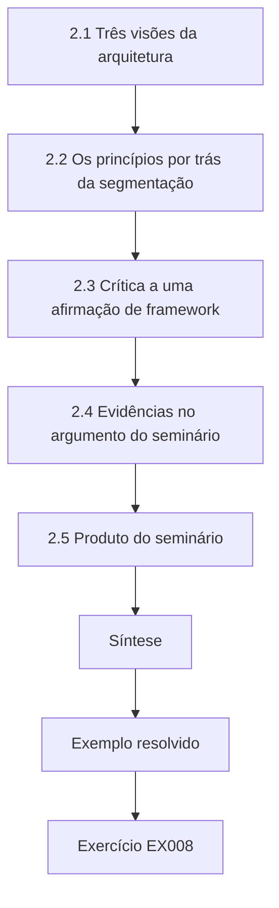

### Desenho lógico

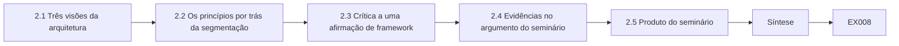

```text
[2.1 Três visões da arquitetura]
    |
    v
[2.2 Os princípios por trás da segmentação]
    |
    v
[2.3 Crítica a uma afirmação de framework]
    |
    v
[2.4 Evidências no argumento do seminário]
    |
    v
[2.5 Produto do seminário]
    |
    v
[Síntese]
    |
    v
[Exemplo resolvido] --> [Exercício EX008]
```
<!-- cykin:lesson-figures:end ch-02 -->


### Objetivos de aprendizagem

Você vai (1) comparar as visões corporativa, de engenharia de sistemas e orientada a ameaças da arquitetura de segurança; (2) relacionar os princípios de design à segmentação; (3) criticar uma afirmação de um framework; (4) apresentar um argumento de seminário com evidências.

### 2.1 Três visões da arquitetura

No seminário da Dra. Aydın, Kenji conhece três formas de ver a arquitetura de segurança. A visão corporativa, representada pelo SABSA e pelo guia do TOGAF, do The Open Group, sobre a integração de risco e segurança, parte dos atributos de negócio e os desdobra até os controles. A visão de engenharia de sistemas, representada pelo NIST SP 800-160 Vol. 1 Rev. 1, trata a segurança como uma propriedade emergente construída ao longo do ciclo de vida, com casos de garantia explícitos. A visão orientada a ameaças, representada por Shostack (2014), parte do que pode dar errado num design específico. Cada visão faz uma primeira pergunta diferente, e os bons arquitetos transitam entre elas de forma deliberada.

### 2.2 Os princípios por trás da segmentação

A segmentação aplica princípios mais antigos. O menor privilégio diz que cada estação deve alcançar apenas os serviços de que precisa. A mediação completa diz que todo acesso deve ser verificado, o que o SP 800-207 implementa por meio de pontos de aplicação de política. A separação de privilégios sugere que o acesso sensível exija mais de uma condição, como a integridade do dispositivo e a identidade do usuário. A economia de mecanismo alerta contra políticas tão complexas que ninguém consegue verificá-las. Kenji percebe que esse último princípio puxa contra os outros: uma segmentação mais fina aplica melhor o menor privilégio, mas cria mais regras, e cada regra não gerenciada é uma lacuna potencial.

### 2.3 Crítica a uma afirmação de framework

Uma leitura do seminário afirma que adotar zero trust elimina o movimento lateral. Kenji a critica. O próprio SP 800-207 descreve o zero trust como um conjunto de princípios e uma jornada, e não como um produto único, e reconhece ameaças às implantações de zero trust, como o comprometimento do ponto de decisão de política e as credenciais roubadas. O movimento lateral pode continuar com uma identidade válida por um caminho permitido. A afirmação justa é mais estreita: o zero trust pode reduzir os caminhos alcançáveis e tornar o movimento mais fácil de observar. Ele apresenta essa distinção com citação direta da seção de ameaças da publicação, e não com paráfrases de fontes secundárias.

### 2.4 Evidências no argumento do seminário

A Dra. Aydın pede a cada apresentador que marque as afirmações como princípio, orientação de framework, evidência de caso ou resultado medido. Os slides de Kenji trazem pequenas etiquetas. Quando um colega afirma que a microssegmentação sempre reduz os incidentes, Kenji pergunta que etiqueta se aplica, e a resposta é princípio mais estudos de caso de fornecedores, não medição. O exercício é desconfortável, mas útil: mostra à turma quanto da prática de arquitetura se apoia em raciocínio e experiência, e não em resultados medidos, o que é aceitável desde que seja dito com clareza e não seja apresentado como prova.

### 2.5 Produto do seminário

O artigo de seminário de Kenji argumenta que as estratégias de segmentação devem ser comparadas ao mesmo tempo pela alcançabilidade e pela complexidade das regras, porque uma estratégia que reduz o alcance mas exige milhares de regras impossíveis de gerenciar pode falhar na operação. Ele propõe medir as duas na dissertação. A turma o desafia a definir complexidade; ele escolhe o número de regras de permissão distintas como uma medida simples e imperfeita, e lista suas fraquezas. O artigo vira o capítulo conceitual da dissertação, e o desafio dos colegas vira uma das explicações concorrentes que ele vai testar depois.

### Exemplo resolvido

Kenji contrasta três visões de arquitetura, associa quatro princípios de Saltzer e Schroeder à segmentação, critica a afirmação de que o zero trust elimina o movimento lateral e propõe medir o alcance junto com o número de regras.

> **Caso sintético.** Os participantes do seminário e as afirmações são sintéticos; o SABSA, o TOGAF G152, o SP 800-160v1r1, o SP 800-207 e Shostack (2014) são reais.

### Erros e limites

O número de regras é uma aproximação grosseira da complexidade operacional. A marcação no seminário pode simplificar demais evidências mistas.

### Exercícios

- **EX008 — Primeiras perguntas.** Que primeira pergunta cada visão de arquitetura faz? *Rubrica:* 3 = corporativa: atributos de negócio; engenharia de sistemas: garantia ao longo do ciclo de vida; orientada a ameaças: o que pode dar errado;; 2 = duas;; 1 = uma;; 0 = nenhuma.

- **EX009 — Tensão entre princípios.** Que princípio puxa contra a segmentação fina, e por quê? *Rubrica:* 3 = economia de mecanismo, porque a segmentação mais fina cria mais regras a verificar;; 2 = nomeado;; 1 = vago;; 0 = nenhuma.

- **EX010 — Ameaças ao zero trust.** Cite uma ameaça às implantações de zero trust reconhecida no SP 800-207. *Rubrica:* 3 = comprometimento do ponto de decisão de política ou credenciais roubadas;; 2 = uma;; 1 = vago;; 0 = nenhuma.

- **EX011 — Afirmação justa sobre zero trust.** Qual é a versão justa de o zero trust elimina o movimento lateral? *Rubrica:* 3 = ele pode reduzir os caminhos alcançáveis e tornar o movimento mais fácil de observar;; 2 = reduz;; 1 = elimina;; 0 = nenhuma.

- **EX012 — Etiquetas de evidência.** Que quatro etiquetas a Dra. Aydın exige nas afirmações? *Rubrica:* 3 = princípio, orientação de framework, evidência de caso, resultado medido;; 2 = três;; 1 = uma;; 0 = nenhuma.

- **EX013 — Medida de complexidade.** Como Kenji mede a complexidade das regras, e qual é a fraqueza disso? *Rubrica:* 3 = número de regras de permissão distintas; aproximação grosseira;; 2 = medida;; 1 = vago;; 0 = nenhuma.

- **EX014 — Motivo do duplo desfecho.** Por que comparar as estratégias pelo alcance e pelo número de regras juntos? *Rubrica:* 3 = uma estratégia pode reduzir o alcance mas ser impossível de gerenciar na operação;; 2 = ambos;; 1 = só alcance;; 0 = nenhuma.

### Síntese

Um seminário avançado treina o estudante a transitar entre visões de arquitetura, ligar desenhos a princípios e marcar cada afirmação pelo tipo de evidência que a sustenta.

<!-- cykin:chapter-navigation:start ch-02 -->
### Continue estudando — aula 02 (capítulo 02 de 08)

[← Capítulo 01](#ch-01) · [Índice das aulas](../SUBJECTS.md) · [Capítulo 03 →](#ch-03)

Continue para a próxima aula já escrita.
<!-- cykin:chapter-navigation:end -->

<a id="ch-03"></a>

## Capítulo 3 — Desenho do estudo, ética e reprodutibilidade

<!-- cykin:lesson-figures:start ch-03 -->
### Mapa da aula

Aula 03 publicada. Mapa, exemplo, EX015.

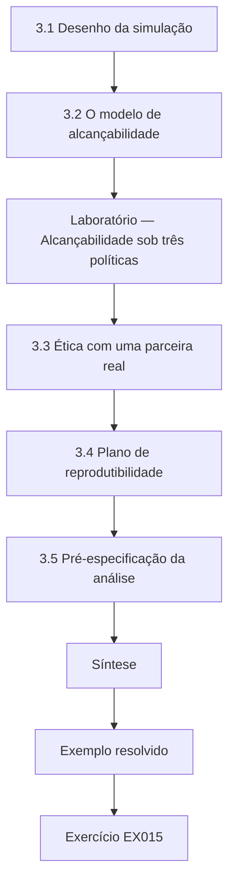

### Desenho lógico

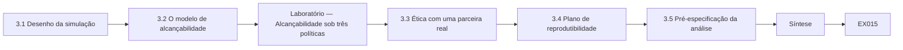

```text
[3.1 Desenho da simulação]
    |
    v
[3.2 O modelo de alcançabilidade]
    |
    v
[Laboratório — Alcançabilidade sob três políticas]
    |
    v
[3.3 Ética com uma parceira real]
    |
    v
[3.4 Plano de reprodutibilidade]
    |
    v
[3.5 Pré-especificação da análise]
    |
    v
[Síntese]
    |
    v
[Exemplo resolvido] --> [Exercício EX015]
```
<!-- cykin:lesson-figures:end ch-03 -->


### Objetivos de aprendizagem

Você vai (1) desenhar um estudo de simulação com comparações controladas; (2) construir um modelo de alcançabilidade sobre redes sintéticas; (3) tratar a ética quando uma organização real molda o modelo; (4) planejar a reprodutibilidade desde o início.

### 3.1 Desenho da simulação

Kenji desenha seu estudo como uma simulação controlada. Ele gera muitas redes sintéticas cuja estrutura se parece com a da Vantor: departamentos de estações de trabalho, servidores compartilhados, alguns jump hosts administrativos e um controlador de domínio. A cada rede ele aplica três políticas: plana, por zonas com zonas departamentais e microssegmentação baseada em identidade. O desfecho é o número de servidores alcançáveis a partir de uma estação comprometida escolhida ao acaso. Gerar muitas redes em vez de uma protege contra conclusões que dependam de um único layout arbitrário, e comparar as três políticas na mesma rede elimina a variação que nada tem a ver com a política.

### 3.2 O modelo de alcançabilidade

Uma rede é modelada como um grafo direcionado: uma aresta do host A para o host B significa que a política permite que A se conecte a B. Um atacante numa estação consegue alcançar qualquer coisa ligada por um caminho, supondo que cada salto seja explorável. Essa premissa é deliberadamente pessimista e dá um limite superior para o alcance. O laboratório abaixo constrói uma pequena rede sintética sob as três políticas e conta os servidores alcançáveis com uma busca em largura. Os resultados mostram o padrão que Kenji espera: o acesso plano alcança todos os servidores, as zonas alcançam menos, as regras baseadas em identidade menos ainda, mas os jump hosts reabrem caminhos se suas regras forem amplas.

### Laboratório — Alcançabilidade sob três políticas

```python
# Count servers reachable from one compromised workstation under three synthetic policies (BFS).
from collections import deque
ws = ["ws-fin1", "ws-fin2", "ws-ops1", "ws-ops2"]
srv = {"erp": "fin", "payroll": "fin", "wms": "ops", "fleet": "ops", "files": "all", "dc": "all"}
dept = lambda h: h[3:6]
def edges(policy, broad_jump=False):
    E = {h: set() for h in ws + list(srv) + ["jump"]}
    for w in ws:
        for s, d in srv.items():
            if policy == "flat" or (policy == "zone" and d in (dept(w), "all")) \
               or (policy == "identity" and s == {"fin": "erp", "ops": "wms"}[dept(w)]):
                E[w].add(s)
        if policy == "identity": E[w].add("jump")
    if broad_jump: E["jump"] |= set(srv)
    return E
def reach(E, start):
    seen, q = {start}, deque([start])
    while q:
        for n in E[q.popleft()]:
            if n not in seen: seen.add(n); q.append(n)
    return len([n for n in seen if n in srv])
for p in ["flat", "zone", "identity"]:
    print(f"{p:9} servers reachable from ws-fin1: {reach(edges(p), 'ws-fin1')}")
print(f"identity + broad jump-host rule: {reach(edges('identity', True), 'ws-fin1')}")
```

Execute com `python3 lab_reach.py`. Saída verificada:

```text
flat      servers reachable from ws-fin1: 6
zone      servers reachable from ws-fin1: 4
identity  servers reachable from ws-fin1: 1
identity + broad jump-host rule: 6
```

### 3.3 Ética com uma parceira real

Embora as redes sejam sintéticas, elas são moldadas pela estrutura real da Vantor, que é uma informação sensível. Kenji obtém a permissão por escrito do empregador, combina que nenhum nome de host, endereço ou regra real aparecerá na dissertação e abstrai a estrutura em parâmetros como o número de departamentos e a proporção de servidores. Seu pedido ao comitê de ética declara que não há participantes humanos e que nenhum teste toca os sistemas da Vantor. Ele também considera o uso dual: um mapa detalhado de onde a Vantor é mais fraca ajudaria atacantes, então a dissertação relata apenas padrões agregados entre as redes geradas.

### 3.4 Plano de reprodutibilidade

Desde o primeiro dia, Kenji mantém o código em controle de versão, fixa as sementes aleatórias de cada experimento e registra os parâmetros de cada execução num arquivo de configuração guardado junto com os resultados. Ele escreve um script curto que roda de novo todos os experimentos do zero e confere se os números resumidos batem com os guardados. Registra as versões do software. A Dra. Aydın pede que ele tente rodar o pipeline inteiro numa máquina limpa na metade do projeto, o que revela uma dependência faltando. Planejar a reprodutibilidade cedo é muito mais barato do que reconstruí-la antes da entrega, quando a memória das decisões passadas já se apagou.

### 3.5 Pré-especificação da análise

Antes de rodar os experimentos principais, Kenji escreve seu plano de análise: a comparação principal é o alcance médio da segmentação por identidade contra o da segmentação por zonas, com um intervalo de confiança por bootstrap; as medidas secundárias são o número de regras e o efeito da amplitude das regras dos jump hosts. Ele faz commit do plano no repositório com carimbo de tempo. Análises exploratórias são permitidas depois, mas precisam ser rotuladas. Essa disciplina importa mesmo em simulação, porque com muitos parâmetros é fácil procurar até que alguma configuração mostre uma diferença marcante e depois apresentá-la como se tivesse sido o plano desde o começo.

### Exemplo resolvido

Kenji desenha uma simulação de três políticas sobre redes geradas, roda o laboratório de alcançabilidade, escreve um plano ético que abstrai a estrutura da Vantor e faz commit de um plano de análise com sementes e configurações.

> **Caso sintético.** Os parâmetros de estrutura da Vantor e a rede do laboratório são sintéticos.

### Erros e limites

Supor que todo salto é explorável superestima o alcance; atacantes reais enfrentam patches e detecção. As redes geradas podem não reproduzir topologias reais incomuns.

### Exercícios

- **EX015 — Comparação na mesma rede.** Por que aplicar as três políticas à mesma rede gerada? *Rubrica:* 3 = elimina a variação não relacionada à política;; 2 = controle;; 1 = sem motivo;; 0 = nenhuma.

- **EX016 — Significado da aresta.** O que significa uma aresta de A para B no modelo? *Rubrica:* 3 = a política permite que A se conecte a B;; 2 = conexão permitida;; 1 = cabo físico;; 0 = nenhuma.

- **EX017 — Limite pessimista.** Por que supor que todo salto é explorável é chamado de pessimista? *Rubrica:* 3 = dá um limite superior para o alcance do atacante;; 2 = limite superior;; 1 = otimista;; 0 = nenhuma.

- **EX018 — Contagens do laboratório.** Que contagens de servidores alcançáveis o laboratório imprimiu para as políticas plana, por zonas e por identidade? *Rubrica:* 3 = plana 6, zonas 4, identidade 1;; 2 = duas corretas;; 1 = erradas;; 0 = nenhuma.

- **EX019 — Efeito do jump host.** O que o laboratório mostrou quando as regras do jump host eram amplas? *Rubrica:* 3 = o alcance voltou a 6, reabrindo caminhos;; 2 = subiu;; 1 = sem mudança;; 0 = nenhuma.

- **EX020 — Preocupação com o uso dual.** Como Kenji lida com o risco de uso dual dos achados? *Rubrica:* 3 = relata só padrões agregados, sem pontos fracos específicos da Vantor;; 2 = agregado;; 1 = publica o mapa;; 0 = nenhuma.

### Síntese

Um estudo de simulação sólido controla as comparações, declara premissas pessimistas, protege as informações dos parceiros e fixa de antemão a sua análise e as suas sementes.

<!-- cykin:chapter-navigation:start ch-03 -->
### Continue estudando — aula 03 (capítulo 03 de 08)

[← Capítulo 02](#ch-02) · [Índice das aulas](../SUBJECTS.md) · [Capítulo 04 →](#ch-04)

Continue para a próxima aula já escrita.
<!-- cykin:chapter-navigation:end -->

<a id="ch-04"></a>

## Capítulo 4 — Arquitetura e engenharia de segurança: explicações concorrentes

<!-- cykin:lesson-figures:start ch-04 -->
### Mapa da aula

Aula 04 publicada. Mapa, exemplo, EX021.

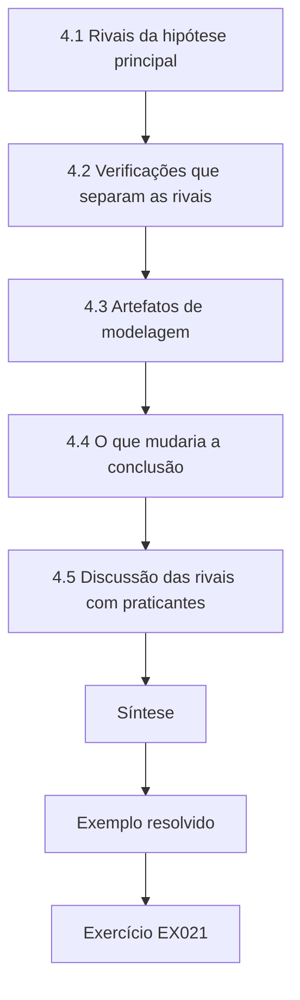

### Desenho lógico

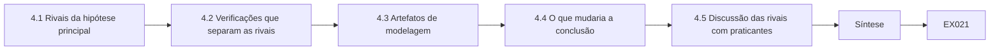

```text
[4.1 Rivais da hipótese principal]
    |
    v
[4.2 Verificações que separam as rivais]
    |
    v
[4.3 Artefatos de modelagem]
    |
    v
[4.4 O que mudaria a conclusão]
    |
    v
[4.5 Discussão das rivais com praticantes]
    |
    v
[Síntese]
    |
    v
[Exemplo resolvido] --> [Exercício EX021]
```
<!-- cykin:lesson-figures:end ch-04 -->


### Objetivos de aprendizagem

Você vai (1) listar as explicações rivais para um resultado esperado; (2) desenhar verificações que as distingam; (3) reconhecer os artefatos das escolhas de modelagem; (4) decidir de antemão o que mudaria sua conclusão.

### 4.1 Rivais da hipótese principal

Kenji espera que a microssegmentação baseada em identidade reduza o alcance. Antes de testar, ele lista as rivais que poderiam produzir o mesmo padrão. Primeiro, a diferença poderia vir só do número de arestas permitidas, e não da identidade: qualquer política com menos arestas pareceria melhor. Segundo, ela poderia depender do tamanho da rede e aparecer só em redes pequenas. Terceiro, poderia ser um artefato do modo como ele gerou as regras de identidade, dando a cada estação exatamente um servidor. Quarto, os resultados poderiam depender dos jump hosts, que o laboratório do capítulo 3 mostrou serem capazes de apagar o benefício. Cada rival prevê algo diferente que ele pode verificar.

### 4.2 Verificações que separam as rivais

Para a rival do número de arestas, Kenji acrescenta uma política de controle: arestas aleatórias removidas da rede plana até ela ter o mesmo número de arestas da política por identidade. Se a identidade ainda vencer esse controle aleatório, a estrutura importa, e não só o número de arestas. Para a rival do tamanho, ele gera redes de três tamanhos. Para o artefato de geração, varia quantos servidores cada identidade pode alcançar, de um a quatro. Para os jump hosts, varia a amplitude das suas regras. Cada verificação é um pequeno experimento escrito no plano antes das execuções principais, para que a dissertação possa relatar quais rivais sobreviveram.

### 4.3 Artefatos de modelagem

Os resultados de simulação podem refletir as escolhas de modelagem, e não a realidade. O modelo de Kenji trata todos os hosts como igualmente exploráveis, ignora o tempo e supõe que as políticas são aplicadas com perfeição. Se os pontos de aplicação reais estiverem mal configurados uma parte do tempo, as políticas por identidade, com muitas regras finas, podem vazar mais do que as políticas por zonas, com poucas regras amplas. Ele acrescenta um parâmetro de configuração incorreta que adiciona ao acaso uma pequena parcela de arestas não intencionais. Isso retoma a preocupação com a economia de mecanismo do seminário: conjuntos complexos de regras oferecem mais chances de erro, e o modelo deve conseguir mostrar esse tradeoff, em vez de eliminá-lo por premissa.

### 4.4 O que mudaria a conclusão

Kenji escreve, antes de ver os resultados, o que o faria concluir que a segmentação baseada em identidade não oferece uma vantagem relevante: se seu alcance médio ficar a menos de um servidor do controle de arestas aleatórias, ou se uma taxa de configuração incorreta de dois por cento apagar a maior parte da diferença. Escrever esses limiares de antemão o protege de mudar as regras do jogo depois de ver os dados. A Dra. Aydın observa que a maioria das dissertações de mestrado nunca declara essas condições, e que fazê-lo é um dos sinais mais claros de maturidade de pesquisa que um examinador pode ver.

### 4.5 Discussão das rivais com praticantes

Kenji apresenta sua lista de rivais a dois engenheiros de rede da Vantor. Eles acrescentam uma rival que ele não tinha visto: na prática, as regras baseadas em identidade costumam ser escritas copiando modelos, de modo que muitas estações acabam com o mesmo acesso amplo, o que reduz o benefício. Ele acrescenta um parâmetro de modelo que faz uma parcela das estações herdar um conjunto amplo de regras. Os praticantes conhecem modos de falha que a literatura raramente registra, e consultá-los cedo melhora o realismo do modelo. Ele reconhece a contribuição deles na dissertação sem nomeá-los, como combinado.

### Exemplo resolvido

Kenji lista cinco rivais, acrescenta um controle de arestas aleatórias, variações de tamanho e de geração, uma taxa de configuração incorreta e um parâmetro de cópia de modelos, e escreve os limiares que derrubariam sua expectativa.

> **Caso sintético.** As rivais, os limiares e a contribuição dos engenheiros são sintéticos.

### Erros e limites

Nenhuma lista de rivais é completa. Os parâmetros acrescentados para modelar a realidade podem multiplicar as execuções e tentar a um relato seletivo.

### Exercícios

- **EX021 — Rival do número de arestas.** O que o controle de arestas aleatórias testa? *Rubrica:* 3 = se a vantagem da identidade vem da estrutura ou só de ter menos arestas;; 2 = estrutura;; 1 = vago;; 0 = nenhuma.

- **EX022 — Artefato de geração.** Como Kenji testa o artefato de geração das regras de identidade? *Rubrica:* 3 = varia de um a quatro quantos servidores cada identidade pode alcançar;; 2 = varia;; 1 = ignora;; 0 = nenhuma.

- **EX023 — Parâmetro de configuração incorreta.** Por que acrescentar ao modelo uma taxa de configuração incorreta? *Rubrica:* 3 = a aplicação real erra, e conjuntos complexos de regras oferecem mais chances de erro;; 2 = erros;; 1 = não é necessário;; 0 = nenhuma.

- **EX024 — Limiares de reversão.** Enuncie uma condição pré-definida que derrubaria a expectativa de Kenji. *Rubrica:* 3 = identidade a menos de um servidor do controle aleatório, ou dois por cento de configuração incorreta apagando a maior parte do ganho;; 2 = uma;; 1 = vago;; 0 = nenhuma.

- **EX025 — Rival dos praticantes.** Que rival os engenheiros acrescentaram? *Rubrica:* 3 = a cópia de modelos dá a muitas estações o mesmo acesso amplo;; 2 = modelo;; 1 = vago;; 0 = nenhuma.

- **EX026 — Sinal de maturidade.** O que a Dra. Aydın chama de sinal claro de maturidade de pesquisa? *Rubrica:* 3 = declarar de antemão o que mudaria a conclusão;; 2 = condições prévias;; 1 = tese longa;; 0 = nenhuma.

### Síntese

Listar as explicações rivais, testar cada uma com uma verificação planejada e fixar de antemão as condições de reversão transforma um resultado esperado em um resultado testado.

<!-- cykin:chapter-navigation:start ch-04 -->
### Continue estudando — aula 04 (capítulo 04 de 08)

[← Capítulo 03](#ch-03) · [Índice das aulas](../SUBJECTS.md) · [Capítulo 05 →](#ch-05)

Continue para a próxima aula já escrita.
<!-- cykin:chapter-navigation:end -->

<a id="ch-05"></a>

## Capítulo 5 — Proposta e piloto

<!-- cykin:lesson-figures:start ch-05 -->
### Mapa da aula

Aula 05 publicada. Mapa, exemplo, EX027.

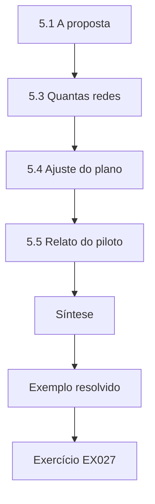

### Desenho lógico

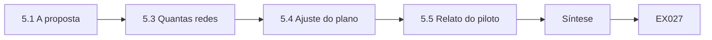

```text
[5.1 A proposta]
    |
    v
[5.3 Quantas redes]
    |
    v
[5.4 Ajuste do plano]
    |
    v
[5.5 Relato do piloto]
    |
    v
[Síntese]
    |
    v
[Exemplo resolvido] --> [Exercício EX027]
```
<!-- cykin:lesson-figures:end ch-05 -->


### Objetivos de aprendizagem

Você vai (1) escrever uma proposta de dissertação concisa; (2) conduzir um piloto para testar o código e os parâmetros; (3) estimar quantas redes simuladas são necessárias; (4) ajustar o plano a partir das evidências do piloto.

### 5.1 A proposta

A proposta de Kenji cabe em seis páginas. Ela declara a pergunta, as três políticas e o controle de arestas aleatórias, os desfechos de alcance médio e número de regras, as verificações das rivais e os limiares de reversão, o acordo ético com a Vantor e o cronograma. Lista as entregas: uma dissertação, um repositório de código com sementes fixas e um resumo curto para praticantes. A Dra. Aydın pede que ele corte pela metade a seção de contexto e amplie os métodos, porque os avaliadores julgam a viabilidade pelos métodos. A banca a aprova com uma condição: um piloto deve confirmar que a simulação roda dentro do tempo de computação disponível.

### 5.2 Objetivos do piloto

O piloto roda o pipeline completo em vinte redes pequenas. Seus objetivos são práticos: confirmar que o código produz valores de alcance sensatos, verificar o tempo de execução por rede, encontrar bugs e medir quanto os resultados variam entre as redes. Ele não serve para responder à pergunta. Kenji escreve um teste que compara a busca em largura com uma contagem por força bruta em redes minúsculas, nas quais a resposta certa pode ser conferida à mão, um teste de resposta conhecida parecido, em espírito, com os vetores de teste. O teste encontra um bug em que as arestas dos jump hosts eram adicionadas duas vezes, inflando o alcance numa das políticas.

### 5.3 Quantas redes

Usando a variação do piloto, Kenji estima quantas redes são necessárias para a comparação principal. O desvio padrão da diferença entre o alcance por identidade e por zonas nas redes do piloto é de cerca de dois servidores. Para estimar a diferença média com margem de cerca de meio servidor e noventa e cinco por cento de confiança, ele precisa de aproximadamente sessenta redes por tamanho. Escolhe duzentas por tamanho para acomodar os parâmetros extras das verificações das rivais. O tempo de execução do piloto mostra que isso cabe com folga num notebook durante uma noite, de modo que a condição de computação da banca é cumprida.

### 5.4 Ajuste do plano

O piloto também mostra que, no menor tamanho de rede, as políticas por zonas e por identidade muitas vezes dão o mesmo alcance, porque cada departamento tem um único servidor. Kenji descarta esse tamanho e acrescenta um maior, documentando a mudança e o motivo no log de mudanças do plano. Ele também descobre que o parâmetro de configuração incorreta em dez por cento torna todas as políticas quase planas, então limita a faixa a de zero a cinco por cento, uma faixa que os engenheiros da Vantor consideram realista. Cada ajuste é registrado antes do início das execuções principais.

### 5.5 Relato do piloto

O relatório do piloto de Kenji tem duas páginas: o que foi rodado, o que foi encontrado, o que mudou e por quê. Ele inclui o bug encontrado pelo teste de resposta conhecida e o tamanho de rede descartado. A Dra. Aydın insiste que o relatório seja honesto sobre os problemas, porque os examinadores confiam mais num estudo quando conseguem ver como ele foi depurado. O relatório vira um apêndice da dissertação. Kenji também marca com uma tag, no repositório, a versão do código usada no piloto, para que os experimentos principais partam de um estado conhecido e testado, e não de um código ainda em mudança.

### Exemplo resolvido

Kenji escreve uma proposta de seis páginas, pilota vinte redes, corrige com um teste de resposta conhecida um bug de contagem dupla nos jump hosts, dimensiona o estudo principal em duzentas redes por tamanho e registra dois ajustes no plano.

> **Caso sintético.** Os números do piloto e as decisões da banca são sintéticos.

### Erros e limites

As estimativas de tamanho de amostra feitas com um piloto pequeno também são incertas. Descartar um tamanho de rede muda a população que os resultados descrevem.

### Exercícios

- **EX027 — Condição da banca.** Que condição a banca impôs à aprovação? *Rubrica:* 3 = um piloto que confirme que a simulação cabe no tempo de computação disponível;; 2 = piloto;; 1 = vago;; 0 = nenhuma.

- **EX028 — Bug da resposta conhecida.** Que bug o teste de resposta conhecida encontrou? *Rubrica:* 3 = arestas de jump host adicionadas duas vezes, inflando o alcance;; 2 = jump host;; 1 = vago;; 0 = nenhuma.

- **EX029 — Redes necessárias.** Quantas redes por tamanho a estimativa exigia, e quantas foram escolhidas? *Rubrica:* 3 = cerca de sessenta necessárias; duzentas escolhidas;; 2 = um número;; 1 = errado;; 0 = nenhuma.

- **EX030 — Tamanho descartado.** Por que o menor tamanho de rede foi descartado? *Rubrica:* 3 = um servidor por departamento deixava iguais os alcances por zonas e por identidade;; 2 = motivo;; 1 = vago;; 0 = nenhuma.

- **EX031 — Faixa de configuração incorreta.** Que faixa foi definida para a configuração incorreta, e por quê? *Rubrica:* 3 = de zero a cinco por cento, considerada realista pelos engenheiros;; 2 = faixa;; 1 = dez por cento;; 0 = nenhuma.

- **EX032 — Tag do código do piloto.** Por que marcar com tag a versão do código do piloto? *Rubrica:* 3 = para que os experimentos principais partam de um estado conhecido e testado;; 2 = estado conhecido;; 1 = sem motivo;; 0 = nenhuma.

### Síntese

Uma proposta curta e um piloto honesto transformam um plano de pesquisa em um pipeline testado, com um tamanho de amostra justificado.

<!-- cykin:chapter-navigation:start ch-05 -->
### Continue estudando — aula 05 (capítulo 05 de 08)

[← Capítulo 04](#ch-04) · [Índice das aulas](../SUBJECTS.md) · [Capítulo 06 →](#ch-06)

Continue para a próxima aula já escrita.
<!-- cykin:chapter-navigation:end -->

<a id="ch-06"></a>

## Capítulo 6 — Coleta e análise de dados

<!-- cykin:lesson-figures:start ch-06 -->
### Mapa da aula

Aula 06 publicada. Mapa, exemplo, EX033.

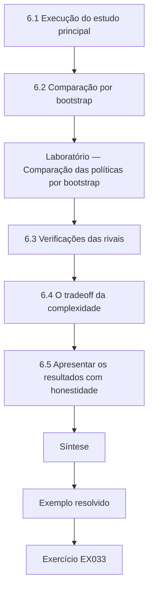

### Desenho lógico

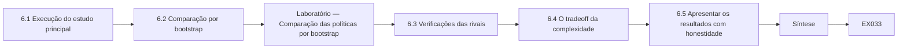

```text
[6.1 Execução do estudo principal]
    |
    v
[6.2 Comparação por bootstrap]
    |
    v
[Laboratório — Comparação das políticas por bootstrap]
    |
    v
[6.3 Verificações das rivais]
    |
    v
[6.4 O tradeoff da complexidade]
    |
    v
[6.5 Apresentar os resultados com honestidade]
    |
    v
[Síntese]
    |
    v
[Exemplo resolvido] --> [Exercício EX033]
```
<!-- cykin:lesson-figures:end ch-06 -->


### Objetivos de aprendizagem

Você vai (1) rodar a simulação principal e coletar os resultados de forma reprodutível; (2) comparar as políticas com intervalos de confiança por bootstrap; (3) avaliar as verificações das rivais; (4) apresentar os resultados sem exagerá-los.

### 6.1 Execução do estudo principal

Kenji roda duzentas redes em cada um de três tamanhos, aplicando as políticas plana, por zonas, por identidade e de arestas aleatórias, com os parâmetros das rivais variados como planejado. Cada execução grava sua configuração, sua semente e seus resultados num arquivo, e o script de nova execução confirma que uma amostra aleatória das execuções se reproduz exatamente. Ele resiste à vontade de olhar os resultados enquanto as execuções ainda estão incompletas, porque espiar cedo tende a moldar as decisões posteriores. Quando todas as execuções terminam, ele calcula primeiro a comparação principal pré-especificada, antes de qualquer análise exploratória, e registra a hora em que fez isso.

### 6.2 Comparação por bootstrap

A comparação principal é a diferença média de servidores alcançáveis entre as políticas por zonas e por identidade nas mesmas redes. Kenji usa bootstrap: reamostra as redes com reposição muitas vezes, recalcula a diferença média a cada vez e toma os noventa e cinco por cento centrais desses valores como intervalo de confiança. O bootstrap exige poucas premissas sobre a forma dos dados. O laboratório abaixo aplica esse procedimento a resultados pareados sintéticos de um tamanho de rede e também compara a identidade com o controle de arestas aleatórias, relatando os dois intervalos e o número médio de regras.

### Laboratório — Comparação das políticas por bootstrap

```python
# Bootstrap CIs for paired synthetic results (servers reachable) across 200 generated networks.
import random, statistics
random.seed(42)
nets = []
for _ in range(200):
    zone = random.randint(4, 9); ident = max(0, zone - random.choice([1, 2, 2, 3, 3, 4]))
    ctrl = max(ident, ident + random.choice([0, 1, 2, 2, 3]))
    nets.append((zone, ident, ctrl, random.randint(18, 26), random.randint(60, 75)))
def boot(diffs, B=4000):
    m = [statistics.mean(random.choices(diffs, k=len(diffs))) for _ in range(B)]; m.sort()
    return statistics.mean(diffs), m[int(.025 * B)], m[int(.975 * B)]
for name, i in [("zone - identity", 0), ("control - identity", 2)]:
    est, lo, hi = boot([n[i] - n[1] for n in nets])
    print(f"{name:20} mean {est:.2f}  95% CI [{lo:.2f}, {hi:.2f}]")
print(f"mean rules: zone {statistics.mean(n[3] for n in nets):.1f}, identity {statistics.mean(n[4] for n in nets):.1f}")
```

Execute com `python3 lab_compare.py`. Saída verificada:

```text
zone - identity      mean 2.43  95% CI [2.29, 2.56]
control - identity   mean 1.56  95% CI [1.42, 1.71]
mean rules: zone 22.2, identity 67.7
```

### 6.3 Verificações das rivais

O controle de arestas aleatórias alcança visivelmente mais servidores do que a identidade, então a estrutura, e não só o número de arestas, explica boa parte do benefício. A vantagem se mantém entre os tamanhos de rede, embora diminua no menor tamanho que restou. Permitir que as identidades alcancem até quatro servidores reduz a vantagem, mas não a elimina. A cópia de modelos é a rival mais forte: quando um terço das estações herda um conjunto amplo de regras, a maior parte da vantagem desaparece. A configuração incorreta em cinco por cento estreita a diferença, mas a deixa acima do limiar de reversão de Kenji. Ele relata cada verificação de rival numa tabela com seu resultado.

### 6.4 O tradeoff da complexidade

As políticas por identidade exigem muito mais regras de permissão do que as políticas por zonas: no laboratório, cerca de três vezes mais, em média. Kenji apresenta o alcance e o número de regras lado a lado, para que os leitores vejam o tradeoff, e não só o ganho de segurança. Ele não afirma saber quantas regras uma organização consegue gerenciar, mas observa que o resultado da cópia de modelos sugere que as organizações muitas vezes lidam com a complexidade das regras copiando-as, o que mina o benefício. Isso liga os resultados quantitativos de volta ao princípio da economia de mecanismo discutido no seminário.

### 6.5 Apresentar os resultados com honestidade

O capítulo de resultados de Kenji declara os efeitos com intervalos, explica o que cada verificação mostrou e rotula qualquer análise exploratória. Ele evita dizer que a segmentação por identidade é segura ou que a segmentação por zonas é insegura. Escreve que, sob as premissas do modelo, a segmentação baseada em identidade reduziu o alcance no pior caso a partir de uma única estação comprometida, em comparação com a segmentação por zonas, que boa parte desse ganho dependeu de evitar regras amplas copiadas de modelos e que ela exigiu cerca de três vezes mais regras. Essa frase é mais longa do que uma manchete, mas cada palavra está apoiada num resultado relatado.

### Exemplo resolvido

Kenji roda seiscentas redes, calcula intervalos por bootstrap para zonas menos identidade e controle aleatório menos identidade, relata as verificações das rivais numa tabela e apresenta o alcance com o número de regras.

> **Caso sintético.** Todos os resultados vêm de simulações sintéticas.

### Erros e limites

Os intervalos por bootstrap descrevem a variação entre as redes geradas, e não a incerteza sobre empresas reais. Os achados exploratórios precisam de confirmação.

### Exercícios

- **EX033 — Espiar cedo.** Por que evitar olhar os resultados antes do fim das execuções? *Rubrica:* 3 = espiar cedo tende a moldar as decisões posteriores;; 2 = viés;; 1 = sem motivo;; 0 = nenhuma.

- **EX034 — Etapas do bootstrap.** Descreva o bootstrap que Kenji usa. *Rubrica:* 3 = reamostrar as redes com reposição, recalcular a diferença média, tomar os 95% centrais;; 2 = parcial;; 1 = vago;; 0 = nenhuma.

- **EX035 — Intervalos do laboratório.** Que diferenças médias o laboratório relatou para zonas menos identidade e controle menos identidade? *Rubrica:* 3 = cerca de 2,4 e 1,6 servidor, ambos os intervalos acima de zero;; 2 = um;; 1 = errado;; 0 = nenhuma.

- **EX036 — Rival mais forte.** Que verificação de rival removeu a maior parte da vantagem? *Rubrica:* 3 = a cópia de regras amplas de modelos para um terço das estações;; 2 = modelo;; 1 = tamanho;; 0 = nenhuma.

- **EX037 — Razão de regras.** Quantas vezes mais regras, aproximadamente, as políticas por identidade exigiram em relação às por zonas no laboratório? *Rubrica:* 3 = cerca de três vezes mais;; 2 = razão;; 1 = menos;; 0 = nenhuma.

- **EX038 — Frase apoiada.** Por que Kenji evita chamar de segura a segmentação por identidade? *Rubrica:* 3 = os resultados só sustentam um alcance modelado menor sob premissas, com condições;; 2 = condicional;; 1 = é segura;; 0 = nenhuma.

### Síntese

Uma análise cuidadosa relata comparações pré-especificadas com intervalos, testa cada explicação rival e mantém lado a lado os ganhos de segurança e os custos operacionais.

<!-- cykin:chapter-navigation:start ch-06 -->
### Continue estudando — aula 06 (capítulo 06 de 08)

[← Capítulo 05](#ch-05) · [Índice das aulas](../SUBJECTS.md) · [Capítulo 07 →](#ch-07)

Continue para a próxima aula já escrita.
<!-- cykin:chapter-navigation:end -->

<a id="ch-07"></a>

## Capítulo 7 — Redação da dissertação e limitações

<!-- cykin:lesson-figures:start ch-07 -->
### Mapa da aula

Aula 07 publicada. Mapa, exemplo, EX039.

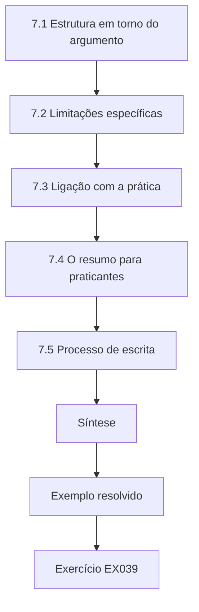

### Desenho lógico

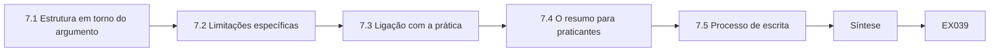

```text
[7.1 Estrutura em torno do argumento]
    |
    v
[7.2 Limitações específicas]
    |
    v
[7.3 Ligação com a prática]
    |
    v
[7.4 O resumo para praticantes]
    |
    v
[7.5 Processo de escrita]
    |
    v
[Síntese]
    |
    v
[Exemplo resolvido] --> [Exercício EX039]
```
<!-- cykin:lesson-figures:end ch-07 -->


### Objetivos de aprendizagem

Você vai (1) estruturar uma dissertação em torno do seu argumento; (2) escrever limitações específicas e úteis; (3) ligar os achados à prática de arquitetura com responsabilidade; (4) preparar um resumo para praticantes.

### 7.1 Estrutura em torno do argumento

Kenji estrutura a dissertação para que cada capítulo sustente uma etapa do argumento: a pergunta e sua lacuna, o capítulo conceitual vindo do seminário, o método e o piloto, os resultados e as verificações das rivais, e a discussão. Ele escreve primeiro a discussão em esboço e depois confere se cada afirmação nela aponta de volta para um resultado. As afirmações sem apoio são cortadas ou levadas para os trabalhos futuros. A Dra. Aydın lembra que os examinadores leem com atenção o resumo, a introdução e a conclusão e procuram qualquer descompasso com o capítulo de resultados, então essas três seções devem ser escritas por último e conferidas linha a linha.

### 7.2 Limitações específicas

As limitações de Kenji são concretas. O modelo supõe que todo salto é explorável, então o alcance é um limite superior. As redes foram geradas a partir de parâmetros abstraídos de um único empregador e podem não representar organizações com estruturas muito diferentes, como hospitais com muitos dispositivos legados. Supôs-se que as políticas eram aplicadas com exatidão, exceto pelo parâmetro de configuração incorreta. O tempo, a detecção e a resposta não foram modelados. O número de regras é uma medida grosseira da complexidade. Para cada limitação, ele declara a provável direção do seu efeito sobre os achados, o que ajuda os leitores a julgar se ela enfraquece ou fortalece as conclusões.

### 7.3 Ligação com a prática

Na discussão, Kenji relaciona os achados aos padrões sem exagerar. O NIST SP 800-207 recomenda decisões de acesso a cada requisição; seus resultados sugerem que o benefício depende muito de evitar regras amplas copiadas de modelos. O SP 800-53 Rev. 5 inclui controles de proteção de fronteira e de menor privilégio, e seu resultado sobre a complexidade sugere que as organizações devem planejar a gestão das regras, e não só a criação delas. Ele apresenta esses pontos como considerações para arquitetos, e não como requisitos. Também declara que seu estudo não pode dizer se atacantes reais explorariam os caminhos que o modelo encontrou, algo que só evidências de campo poderiam estabelecer.

### 7.4 O resumo para praticantes

Kenji escreve um resumo de duas páginas para a Vantor e organizações semelhantes. Ele explica em linguagem simples que, em simulações com a forma da rede deles, a segmentação baseada em identidade reduziu até onde um atacante conseguiria se mover a partir de um notebook comprometido, mas que copiar modelos amplos de regras removeu a maior parte do benefício, e que as regras por identidade eram cerca de três vezes mais numerosas para gerenciar. Recomenda pilotar num departamento com revisões de regras. Aponta para a dissertação completa e lista as limitações. Ele confere o resumo com a Dra. Aydın para garantir que não diz nada que a dissertação não sustente.

### 7.5 Processo de escrita

Kenji escreve em sessões diárias curtas, mantendo uma lista de perguntas em aberto no topo do arquivo de cada capítulo. Envia os capítulos à Dra. Aydın um de cada vez e registra os comentários dela e suas respostas numa tabela, como depois lhe será pedido que faça para os examinadores. Uma colega lê o capítulo de resultados sem contexto e marca cada frase que não consegue verificar a partir de uma tabela ou figura; Kenji reescreve essas frases. Essa verificação por um leitor frio capta premissas que o autor já não percebe, porque convive com o trabalho há meses.

### Exemplo resolvido

Kenji esboça primeiro a discussão, corta as afirmações sem apoio, escreve cinco limitações específicas com a direção do efeito, relaciona os achados ao SP 800-207 e ao SP 800-53 Rev. 5 e redige um resumo de duas páginas conferido.

> **Caso sintético.** Os rascunhos da dissertação e os comentários da leitora são sintéticos; o SP 800-207 e o SP 800-53 Rev. 5 são reais.

### Erros e limites

As afirmações sobre a direção do efeito também são julgamentos. Os resumos para praticantes correm o risco de serem lidos sem suas limitações.

### Exercícios

- **EX039 — Últimas seções.** Que seções são escritas por último, e por quê? *Rubrica:* 3 = resumo, introdução e conclusão, para que batam com os resultados;; 2 = nomeadas;; 1 = primeiro;; 0 = nenhuma.

- **EX040 — Direção da limitação.** Por que declarar a provável direção do efeito de cada limitação? *Rubrica:* 3 = ajuda os leitores a julgar se ela enfraquece ou fortalece as conclusões;; 2 = direção;; 1 = não é necessário;; 0 = nenhuma.

- **EX041 — Ligação com o SP 800-53.** O que o resultado de complexidade de Kenji sugere sobre os controles de fronteira do SP 800-53 Rev. 5? *Rubrica:* 3 = planejar a gestão das regras, não só a criação;; 2 = gestão;; 1 = vago;; 0 = nenhuma.

- **EX042 — Lacuna de evidência de campo.** O que só a evidência de campo pode estabelecer? *Rubrica:* 3 = se atacantes reais explorariam os caminhos modelados;; 2 = atacantes reais;; 1 = a simulação mostra;; 0 = nenhuma.

- **EX043 — Recomendação do resumo.** O que o resumo recomenda que a Vantor faça? *Rubrica:* 3 = pilotar num departamento com revisões de regras;; 2 = piloto;; 1 = implantação total;; 0 = nenhuma.

- **EX044 — Leitor frio.** O que a verificação por um leitor frio captou? *Rubrica:* 3 = frases que não podiam ser verificadas por uma tabela ou figura;; 2 = sem apoio;; 1 = erros de digitação;; 0 = nenhuma.

### Síntese

Uma dissertação convence quando cada afirmação remonta a um resultado, as limitações são específicas e os conselhos aos profissionais ficam dentro das evidências.

<!-- cykin:chapter-navigation:start ch-07 -->
### Continue estudando — aula 07 (capítulo 07 de 08)

[← Capítulo 06](#ch-06) · [Índice das aulas](../SUBJECTS.md) · [Capítulo 08 →](#ch-08)

Continue para a próxima aula já escrita.
<!-- cykin:chapter-navigation:end -->

<a id="ch-08"></a>

## Capítulo 8 — Revisão independente e defesa

<!-- cykin:lesson-figures:start ch-08 -->
### Mapa da aula

Aula 08 publicada. Mapa, exemplo, EX045.

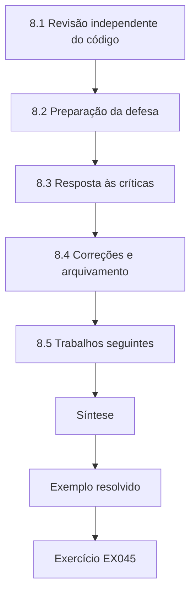

### Desenho lógico


```text
[8.1 Revisão independente do código]
    |
    v
[8.2 Preparação da defesa]
    |
    v
[8.3 Resposta às críticas]
    |
    v
[8.4 Correções e arquivamento]
    |
    v
[8.5 Trabalhos seguintes]
    |
    v
[Síntese]
    |
    v
[Exemplo resolvido] --> [Exercício EX045]
```
<!-- cykin:lesson-figures:end ch-08 -->


### Objetivos de aprendizagem

Você vai (1) obter uma revisão independente do código e dos resultados; (2) se preparar para uma defesa oral; (3) responder às críticas dos examinadores; (4) planejar os trabalhos seguintes.

### 8.1 Revisão independente do código

Antes da entrega, uma doutoranda de outro grupo revisa o código de Kenji usando apenas o repositório e sua documentação. Ela roda de novo todos os experimentos do zero na própria máquina e chega aos resumos guardados, o que confirma a reprodutibilidade. Ela também descobre que o controle de arestas aleatórias removia arestas da rede plana de forma uniforme, quando um controle mais justo poderia preservar o grau de cada estação. Kenji acrescenta esse controle alternativo como análise de sensibilidade; ele estreita um pouco a vantagem da identidade, mas a mantém clara. Kenji agradece à revisora e registra a mudança na tabela de revisões.

### 8.2 Preparação da defesa

Kenji lista as perguntas prováveis: por que simulação em vez de dados de campo, por que alcance por busca em largura em vez de probabilidade de ataque, como os parâmetros foram escolhidos, o que mudaria sua conclusão e como os praticantes devem usar os resultados. Para cada uma, prepara uma resposta curta que aponta para uma seção e um resultado. Ele ensaia com dois colegas, que interrompem e contestam. A Dra. Aydın o aconselha a responder à pergunta feita, e não à que ele preparou, a admitir a incerteza com franqueza e a usar os limiares de reversão escritos no capítulo 4 como evidência da sua disciplina.

### 8.3 Resposta às críticas

Na defesa, o examinador externo argumenta que a alcançabilidade sem a probabilidade de exploração exagera as diferenças entre as políticas. Kenji concorda que o alcance é um limite superior, explica por que o escolheu pela tratabilidade e pela transparência e sugere ponderar as arestas pela probabilidade de exploração como trabalho futuro. Um segundo examinador pergunta se a rival da cópia de modelos mina toda a recomendação. Kenji responde que ela a qualifica: a segmentação por identidade só ajuda se a gestão das regras impedir modelos amplos, o que já é em si um achado prático. Os examinadores aceitam a dissertação com correções menores.

### 8.4 Correções e arquivamento

Kenji conclui as correções dentro do prazo permitido: esclarece a descrição do bootstrap, leva o controle que preserva o grau para o texto principal e amplia a discussão sobre a probabilidade de exploração. Ele arquiva o código final, as configurações e os resultados com um identificador persistente no repositório da universidade e inclui um manifesto SHA-256 dos arquivos arquivados. A Vantor revisa a versão final e confirma que nenhuma estrutura sensível é revelada. O arquivo permite que outros rodem de novo ou ampliem o estudo com outras formas de rede. Também permite que os examinadores e os leitores futuros confiram se os números publicados vieram do código arquivado.

### 8.5 Trabalhos seguintes

Kenji lista os estudos seguintes: ponderar as arestas pela probabilidade de exploração, modelar o tempo de detecção e de resposta, testar formas de rede de outros setores e conduzir um piloto de campo na Vantor que meça o número real de regras e as tentativas de acesso. Ele oferece o código a outro estudante. Sua reflexão observa que os momentos mais úteis foram aqueles em que suas expectativas foram contestadas, pelo controle aleatório, pela rival da cópia de modelos e pela crítica do examinador, porque cada um tornou sua afirmação final menor, mas muito mais defensável. Agora ele trata uma expectativa contestada como progresso, e não como revés.

### Exemplo resolvido

O código de Kenji é rodado de novo por uma revisora independente, um controle que preserva o grau é acrescentado, ele defende a escolha do limite superior e o achado sobre os modelos e arquiva o estudo corrigido com um manifesto.

> **Caso sintético.** Os revisores, os examinadores e os desfechos são sintéticos.

### Erros e limites

A nova execução independente confirma a reprodutibilidade, não a validade das premissas. Correções menores ainda podem mudar a ênfase.

### Exercícios

- **EX045 — Confirmação da nova execução.** O que a nova execução da revisora independente confirmou? *Rubrica:* 3 = a reprodutibilidade: os resultados bateram com os resumos guardados;; 2 = bateram;; 1 = validade;; 0 = nenhuma.

- **EX046 — Controle mais justo.** Que controle mais justo a revisora sugeriu, e com que efeito? *Rubrica:* 3 = controle aleatório que preserva o grau; estreitou um pouco a vantagem, que continuou clara;; 2 = controle;; 1 = removeu a vantagem;; 0 = nenhuma.

- **EX047 — Defesa do limite superior.** Como Kenji respondeu à crítica de exagero? *Rubrica:* 3 = concordou que o alcance é um limite superior, escolhido pela tratabilidade, e sugeriu ponderar pela probabilidade;; 2 = concordância mais motivo;; 1 = negou;; 0 = nenhuma.

- **EX048 — Os modelos qualificam.** Como Kenji enquadrou o achado da cópia de modelos? *Rubrica:* 3 = ele qualifica a recomendação: o benefício exige gestão de regras contra modelos amplos;; 2 = qualifica;; 1 = mina;; 0 = nenhuma.

- **EX049 — Conteúdo do arquivo.** O que o arquivo de Kenji contém? *Rubrica:* 3 = código final, configurações, resultados e um manifesto SHA-256;; 2 = três itens;; 1 = dados da Vantor;; 0 = nenhuma.

- **EX050 — Momentos valorizados.** Que momentos Kenji considera os mais úteis na reflexão? *Rubrica:* 3 = quando as expectativas foram contestadas pelo controle, pela rival e pelo examinador;; 2 = contestadas;; 1 = elogios;; 0 = nenhuma.

### Síntese

A revisão independente e uma defesa franca tornam um resultado de mestrado menor, mais forte e pronto para que outras pessoas construam sobre ele.

<!-- cykin:chapter-navigation:start ch-08 -->
### Continue estudando — aula 08 (capítulo 08 de 08)

[← Capítulo 07](#ch-07) · [Índice das aulas](../SUBJECTS.md) · [Próximo curso pelo índice →](../SUBJECTS.md)

O índice aponta para o próximo curso do percurso de estudos.
<!-- cykin:chapter-navigation:end -->

<a id="worked-results"></a>

## Resoluções

Respostas-modelo para EX001–EX050. Kenji Albrecht, a Dra. Selin Aydın, a Northmoor University, a Vantor Logistics e todos os números são sintéticos; as respostas dos laboratórios citam saídas verificadas. Qualquer resposta que atenda à rubrica recebe a mesma pontuação.

**EX001.** População: redes simuladas como a da Vantor; intervenção: microssegmentação baseada em identidade; comparação: segmentação por zonas; desfecho: servidores alcançáveis a partir de uma estação comprometida.

**EX002.** Cabe no prazo de um mestrado e evita os riscos de experimentar numa rede de produção.

**EX003.** Que a alcançabilidade só aproxima o avanço do atacante e não mede incidentes reais.

**EX004.** Para evitar escolher, sem perceber, só os estudos que apoiam a resposta esperada.

**EX005.** 312 registros passaram pela triagem e 27 estudos foram incluídos.

**EX006.** Estudos de caso que mostram atacantes se movendo amplamente por redes planas depois de um único comprometimento.

**EX007.** Poucos estudos comparam estratégias de segmentação em redes idênticas com premissas idênticas.

**EX008.** A corporativa pergunta que atributos de negócio importam; a de engenharia de sistemas pergunta como a segurança é construída e garantida ao longo do ciclo de vida; a orientada a ameaças pergunta o que pode dar errado neste design.

**EX009.** A economia de mecanismo, já que a segmentação mais fina multiplica as regras que precisam ser entendidas e verificadas.

**EX010.** O comprometimento dos componentes de decisão ou de aplicação de política, ou o uso indevido de credenciais válidas roubadas.

**EX011.** Que o zero trust pode reduzir os caminhos disponíveis e tornar o movimento lateral mais fácil de detectar, e não eliminá-lo.

**EX012.** Princípio, orientação de framework, evidência de caso e resultado medido.

**EX013.** Pelo número de regras de permissão distintas, uma aproximação grosseira que ignora a interação entre as regras e a frequência de mudança.

**EX014.** Porque uma estratégia que corta o alcance mas exige regras impossíveis de gerenciar pode falhar na prática.

**EX015.** Para garantir que as diferenças de alcance venham da política, e não de layouts de rede diferentes.

**EX016.** Que a política permite que o host A abra uma conexão com o host B.

**EX017.** Porque supõe que o atacante sempre tem sucesso em cada salto, de modo que o resultado é um limite superior para o alcance.

**EX018.** A plana alcançou 6 servidores, a por zonas alcançou 4 e a baseada em identidade alcançou 1.

**EX019.** Com uma regra ampla no jump host, o alcance da baseada em identidade voltou a 6 servidores, mostrando que os jump hosts podem reabrir caminhos.

**EX020.** Ele relata apenas padrões agregados entre as redes geradas, nunca um mapa das fraquezas específicas da Vantor.

**EX021.** Se a segmentação por identidade ajuda por causa da sua estrutura, e não simplesmente porque permite menos arestas.

**EX022.** Variando de um a quatro o número de servidores que a identidade de cada estação pode alcançar.

**EX023.** Porque as políticas reais às vezes são configuradas incorretamente, e conjuntos de regras finos dão mais oportunidades para esses erros.

**EX024.** Se o alcance médio da identidade ficar a menos de um servidor do controle de arestas aleatórias.

**EX025.** Que as regras de identidade costumam ser copiadas de modelos, dando a muitas estações o mesmo acesso amplo.

**EX026.** Escrever, antes de ver os resultados, as observações que mudariam a conclusão.

**EX027.** Que um piloto mostre que a simulação roda dentro do tempo de computação disponível.

**EX028.** As arestas dos jump hosts eram adicionadas duas vezes, inflando o alcance numa das políticas.

**EX029.** Eram necessárias cerca de sessenta por tamanho; Kenji escolheu duzentas para acomodar as verificações das rivais.

**EX030.** Porque cada departamento tinha um único servidor, de modo que as políticas por zonas e por identidade davam o mesmo alcance.

**EX031.** De zero a cinco por cento, porque dez por cento deixava todas as políticas quase planas e os engenheiros julgaram realista a faixa menor.

**EX032.** Para que os experimentos principais partam de uma versão do código testada e identificável.

**EX033.** Porque ver resultados parciais tende a influenciar as escolhas de análise posteriores.

**EX034.** Ele reamostra as redes com reposição muitas vezes, recalcula a diferença média e usa os 95% centrais dos valores como intervalo.

**EX035.** Zonas menos identidade deu cerca de 2,4 servidores e controle aleatório menos identidade cerca de 1,6 (2,43 e 1,56), ambos com intervalos acima de zero.

**EX036.** A cópia de modelos, quando um terço das estações herdou um conjunto amplo de regras.

**EX037.** Cerca de três vezes mais regras de permissão.

**EX038.** Porque as evidências só sustentam um alcance modelado menor sob premissas e condições declaradas, e não uma afirmação geral de segurança.

**EX039.** O resumo, a introdução e a conclusão, para que possam ser conferidos com os resultados finais.

**EX040.** Para que os leitores vejam se cada limitação provavelmente reduziria ou aumentaria o efeito relatado.

**EX041.** Que as organizações devem planejar a gestão das regras ao longo do tempo, e não só criá-las.

**EX042.** Se atacantes reais de fato usariam os caminhos que o modelo encontrou.

**EX043.** Pilotar a segmentação por identidade num departamento, com revisões regulares das regras.

**EX044.** Frases que não podiam ser verificadas a partir de nenhuma tabela ou figura.

**EX045.** A reprodutibilidade: os experimentos se reproduzem exatamente a partir do repositório e da documentação.

**EX046.** Um controle que preserva o grau de cada estação; ele estreitou um pouco a vantagem da identidade, mas a manteve clara.

**EX047.** Concordou que o alcance é um limite superior, explicou que foi escolhido pela tratabilidade e pela transparência e propôs arestas ponderadas pela probabilidade como trabalho futuro.

**EX048.** Como uma qualificação: a segmentação por identidade só ajuda quando a gestão das regras impede regras amplas de modelos.

**EX049.** O código final, as configurações das execuções, os resultados e um manifesto SHA-256 dos arquivos.

**EX050.** Os momentos em que suas expectativas foram contestadas, que tornaram sua afirmação menor, porém mais defensável.

<a id="references"></a>
## Referências

Todos os DOIs foram resolvidos em doi.org em 12 de outubro de 2026, e as normas foram conferidas nas páginas de seus editores. A lista é idêntica à da edição em inglês e cobre o livro inteiro, acrescida apenas da ABNT NBR ISO/IEC 27001:2022, citada nesta edição como referência brasileira e conferida em sua fonte oficial; as adoções brasileiras da ABNT listadas foram conferidas no catálogo oficial da ABNT, e as demais normas técnicas são citadas em sua edição internacional. Organizações, pessoas, sistemas e números dos casos são sintéticos; somente as obras abaixo são reais.

- Anderson, R. (2020). *Security engineering: A guide to building dependable distributed systems* (3rd ed.). Wiley. Author's page: <https://www.cl.cam.ac.uk/archive/rja14/book.html>
- Associação Brasileira de Normas Técnicas. (2022). *ABNT NBR ISO/IEC 27001:2022 — Segurança da informação, segurança cibernética e proteção à privacidade — Sistemas de gestão da segurança da informação — Requisitos* (versão corrigida 2023). ABNT. <https://www.abntcatalogo.com.br/>
- Herley, C., & van Oorschot, P. C. (2017). SoK: Science, security and the elusive goal of security as a scientific pursuit. *2017 IEEE Symposium on Security and Privacy*, 99–120. <https://doi.org/10.1109/SP.2017.38>
- Joint Task Force. (2020). *Security and privacy controls for information systems and organizations* (NIST SP 800-53 Rev. 5). NIST. <https://doi.org/10.6028/NIST.SP.800-53r5>
- Rose, S., Borchert, O., Mitchell, S., & Connelly, S. (2020). *Zero trust architecture* (NIST SP 800-207). NIST. <https://doi.org/10.6028/NIST.SP.800-207>
- Ross, R., Winstead, M., & McEvilley, M. (2022). *Engineering trustworthy secure systems* (NIST SP 800-160 Vol. 1 Rev. 1). NIST. <https://doi.org/10.6028/NIST.SP.800-160v1r1>
- Saltzer, J. H., & Schroeder, M. D. (1975). The protection of information in computer systems. *Proceedings of the IEEE*, 63(9), 1278–1308. <https://doi.org/10.1109/PROC.1975.9939>
- Sherwood, J., Clark, A., & Lynas, D. (2005). *Enterprise security architecture: A business-driven approach* (SABSA). CMP Books.
- Shostack, A. (2014). *Threat modeling: Designing for security*. Wiley.
- The Open Group. (2016, revised 2022). *Integrating risk and security within a TOGAF enterprise architecture* (TOGAF Series Guide G152). The Open Group.
- Wohlin, C., Runeson, P., Höst, M., Ohlsson, M. C., Regnell, B., & Wesslén, A. (2012). *Experimentation in software engineering*. Springer. <https://doi.org/10.1007/978-3-642-29044-2>
