# Governança, Riscos e Compliance de Segurança: Curso de Mestrado

- Idioma: português do Brasil (`pt`); curso 166, curso de mestrado (2 anos). Edição de referência: [inglês](../../en/book/MANUSCRIPT.md).
- Estado editorial: **publicado**. Os capítulos 1–8 de 8 têm texto didático escrito à mão; os exercícios EX001–EX050 têm resoluções correspondentes com rubricas de 0 a 3; os três laboratórios offline usam apenas a biblioteca padrão do Python 3 sobre dados sintéticos, e suas saídas foram incorporadas de execuções reais, idênticas às da edição em inglês. Revisão independente, revisão linguística e a verificação de 300 páginas A4 continuam em aberto.
- Público: mestrandos que avaliam se uma mudança num controle de governança melhora um resultado de segurança mensurável.
- Autor: [hiagokinlevi](https://github.com/hiagokinlevi). Texto original sob [CC0 1.0](../../../../../LICENSE); as obras citadas mantêm seus direitos.
- Limites: os laboratórios calculam a cobertura de requisito a evidência, limites exatos de amostragem por atributos e uma diferença bootstrap entre taxas de acesso excessivo, sempre sobre dados sintéticos; nenhuma conta, funcionário ou auditoria real está envolvido. Os mapeamentos e os testes no estilo de auditoria são ilustrações didáticas, e não atestações reais nem aconselhamento jurídico. Pessoas, organizações, sistemas e dados são **sintéticos**, salvo quando uma frase cita uma fonte pública.

[Página do curso](../../README.md) · [Índice de capítulos](../SUBJECTS.md) · [Plano do livro](PLAN.md) · [Skill do curso](../../skill/SKILL.md) · [Resoluções](#worked-results)

## Como usar este rascunho

Leia na ordem. Os capítulos acompanham um mestrando que estuda se a revisão trimestral de acessos reduz o acesso excessivo: a pergunta e a literatura, o seminário de frameworks, o desenho e a ética, as explicações rivais, a proposta e o piloto, os dados e a análise, a redação e as limitações, e a defesa. Execute cada laboratório onde ele aparece, tente os exercícios antes de consultar as resoluções e avalie-se com as rubricas.

### Caso sintético

| Elemento | Papel | Natureza |
|---|---|---|
| **Lucas Ferreira** | Mestrando | Inventado |
| **Dra. Ingrid Solberg** | Orientadora | Inventada |
| **Marlow Institute of Technology** | Universidade fictícia | Inventada |
| **Tessaly Logistics** | Empresa fictícia certificada na ISO/IEC 27001, com 1.200 funcionários | Inventada |

### Fontes principais

ISO/IEC 27001:2022 (no Brasil, ABNT NBR ISO/IEC 27001:2022) e 27002:2022; NIST [SP 800-53 Rev. 5](https://doi.org/10.6028/NIST.SP.800-53r5); NIST [CSF 2.0](https://doi.org/10.6028/NIST.CSWP.29); COBIT 2019; Spears e Barki (2010), [doi:10.2307/25750689](https://doi.org/10.2307/25750689); Gordon e Loeb (2002), [doi:10.1145/581271.581274](https://doi.org/10.1145/581271.581274); Wohlin et al. (2012). Lista completa em [Referências](#references).

## Sumário

| Capítulos em português |
|---|
| [1](#ch-01) · [2](#ch-02) · [3](#ch-03) · [4](#ch-04) · [5](#ch-05) · [6](#ch-06) · [7](#ch-07) · [8](#ch-08) |

[Resoluções](#worked-results) · [Referências](#references)

<a id="ch-01"></a>

## Capítulo 1 — Pergunta de pesquisa e método de revisão da literatura

<!-- open-cyber-academy:lesson-figures:start ch-01 -->
### Mapa da aula

Aula 01 publicada. Mapa, exemplo, EX001.

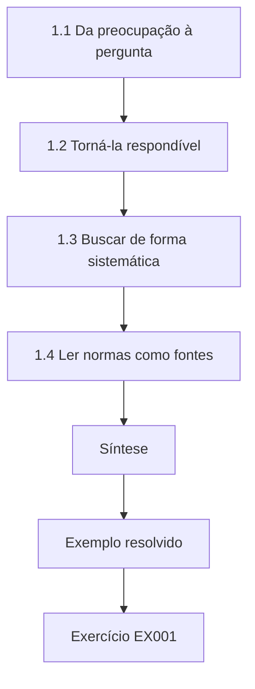

### Desenho lógico

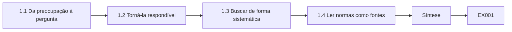

```text
[1.1 Da preocupação à pergunta]
    |
    v
[1.2 Torná-la respondível]
    |
    v
[1.3 Buscar de forma sistemática]
    |
    v
[1.4 Ler normas como fontes]
    |
    v
[Síntese]
    |
    v
[Exemplo resolvido] --> [Exercício EX001]
```
<!-- open-cyber-academy:lesson-figures:end ch-01 -->


### Objetivos de aprendizagem

Você vai (1) transformar uma preocupação de governança numa pergunta pesquisável; (2) buscar e triar a literatura de forma sistemática; (3) registrar as fontes para que outros possam repetir a busca.

### 1.1 Da preocupação à pergunta

Lucas Ferreira, mestrando no fictício Marlow Institute of Technology, trabalha meio período no escritório de segurança da Tessaly Logistics, uma empresa fictícia com 1.200 funcionários e um sistema de gestão certificado pela ISO/IEC 27001:2022 (no Brasil, ABNT NBR ISO/IEC 27001:2022). Os auditores continuam encontrando funcionários com acessos de que já não precisam. O gestor dele pergunta se revisar os acessos a cada trimestre, em vez de uma vez por ano, ajudaria. Lucas transforma isso numa pergunta de pesquisa: nas unidades de negócio da Tessaly, a revisão trimestral de acessos está associada a uma taxa menor de acesso excessivo do que a revisão anual, e a que custo em horas de revisores?

### 1.2 Torná-la respondível

Sua orientadora, a Dra. Ingrid Solberg, cobra precisão. O acesso excessivo precisa ser definido: uma conta que detém uma permissão que o papel atual do titular não exige, julgada contra um catálogo de papéis escrito. A unidade de análise é a conta, não a pessoa. O desfecho é medido num único momento por um revisor independente. O custo são as horas registradas pelos revisores. Lucas também anota o que o estudo não consegue mostrar: ele é observacional, porque as unidades escolheram a própria frequência de revisão, então qualquer diferença pode refletir outras características das unidades.

### 1.3 Buscar de forma sistemática

Lucas consulta duas bases acadêmicas e os sites de organismos de normalização com uma string de busca escrita que combina access review, entitlement, recertificação e achados de auditoria. Para cada busca, ele registra num log a data, a base, a string e o número de resultados. Tria títulos e resumos com regras de inclusão: fontes empíricas ou normativas sobre revisão periódica de acessos ou eficácia de controles em organizações. Mantém uma lista dos itens excluídos com os motivos. Esse log permite que a Dra. Solberg, ou qualquer pessoa, repita a busca e veja se Lucas deixou passar trabalhos relevantes.

### 1.4 Ler normas como fontes

As normas são um tipo especial de literatura. A ISO/IEC 27002:2022 orienta sobre direitos de acesso, incluindo a revisão dos direitos em intervalos planejados, mas não prescreve uma frequência. O NIST SP 800-53 Rev. 5 inclui um controle de gestão de contas cuja frequência de revisão é definida pela organização. Lucas observa que as normas expressam o consenso sobre boas práticas, e não efeitos testados, então definem a pergunta, mas não conseguem respondê-la. Ele as parafraseia em vez de copiá-las e cita cada uma pela edição, para que o leitor saiba exatamente a que texto se refere.

### Exemplo resolvido

Lucas define o acesso excessivo contra um catálogo de papéis, registra buscas reproduzíveis e trata as normas como contexto, e não como evidência de efeito.

> **Caso sintético.** A Tessaly, o Marlow e todos os dados são sintéticos; a ISO/IEC 27002:2022 e o SP 800-53 Rev. 5 são reais.

### Erros e limites

Desenhos observacionais não provam causa. Logs de busca deixam escapar a literatura cinzenta.

### Exercícios

- **EX001 — Unidade de análise.** Qual é a unidade de análise no estudo de Lucas? *Rubrica:* 3 = a conta;; 2 = contas;; 1 = pessoas;; 0 = nenhuma.
- **EX002 — Definição de excesso.** Como se define o acesso excessivo? *Rubrica:* 3 = uma permissão que o papel atual do titular não exige, segundo o catálogo de papéis;; 2 = catálogo de papéis;; 1 = vago;; 0 = nenhuma.
- **EX003 — Medida de custo.** Como Lucas mede o custo? *Rubrica:* 3 = horas registradas pelos revisores;; 2 = horas;; 1 = vago;; 0 = nenhuma.
- **EX004 — Limite do desenho.** Por que o estudo não consegue provar causa? *Rubrica:* 3 = as unidades escolheram a própria frequência de revisão;; 2 = observacional;; 1 = vago;; 0 = nenhuma.
- **EX005 — Campos do log de busca.** O que Lucas registra para cada busca? *Rubrica:* 3 = data, base, string e número de resultados;; 2 = log;; 1 = vago;; 0 = nenhuma.
- **EX006 — Orientação de frequência.** A ISO/IEC 27002:2022 prescreve uma frequência de revisão? *Rubrica:* 3 = não, pede intervalos planejados;; 2 = não;; 1 = sim;; 0 = nenhuma.
- **EX007 — Papel das normas.** O que as normas podem fazer por essa pergunta? *Rubrica:* 3 = defini-la, mas não respondê-la;; 2 = contexto;; 1 = evidência de efeito;; 0 = nenhuma.

### Síntese

Uma pergunta precisa e respondível e uma busca reproduzível vêm antes de quaisquer dados.

<!-- open-cyber-academy:chapter-navigation:start ch-01 -->
### Continue estudando — aula 01 (capítulo 01 de 08)

[← Início do curso](../../README.md) · [Índice das aulas](../SUBJECTS.md) · [Capítulo 02 →](#ch-02)

Continue para a próxima aula já escrita.
<!-- open-cyber-academy:chapter-navigation:end -->

<a id="ch-02"></a>

## Capítulo 2 — Governança, riscos e compliance de segurança: seminário avançado

<!-- open-cyber-academy:lesson-figures:start ch-02 -->
### Mapa da aula

Aula 02 publicada. Mapa, exemplo, EX008.

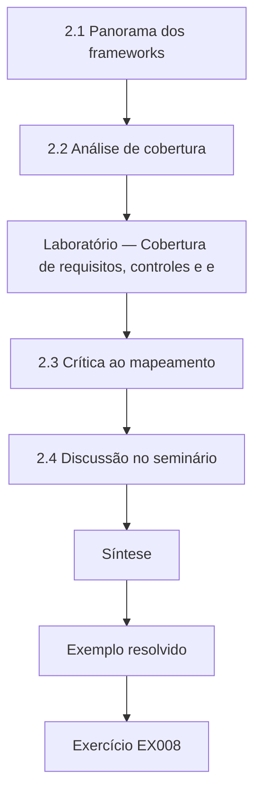

### Desenho lógico

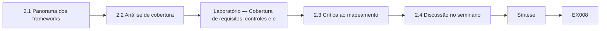

```text
[2.1 Panorama dos frameworks]
    |
    v
[2.2 Análise de cobertura]
    |
    v
[Laboratório — Cobertura de requisitos, controles e e]
    |
    v
[2.3 Crítica ao mapeamento]
    |
    v
[2.4 Discussão no seminário]
    |
    v
[Síntese]
    |
    v
[Exemplo resolvido] --> [Exercício EX008]
```
<!-- open-cyber-academy:lesson-figures:end ch-02 -->


### Objetivos de aprendizagem

Você vai (1) comparar os principais frameworks de governança e de controles; (2) analisar a cobertura de requisito a controle e a evidência; (3) apresentar um argumento crítico em seminário.

### 2.1 Panorama dos frameworks

No seminário, Lucas compara frameworks. A ISO/IEC 27001:2022 especifica os requisitos de um sistema de gestão da segurança da informação e lista no Anexo A controles de referência extraídos da ISO/IEC 27002:2022. O NIST CSF 2.0 organiza os resultados em seis funções, incluindo a nova função Govern. O COBIT 2019 trata da governança da informação e da tecnologia corporativas, separando governança de gestão. O NIST SP 800-53 Rev. 5 oferece um catálogo detalhado de controles. Ele observa que esses frameworks se sobrepõem bastante, mas diferem em finalidade, granularidade e na possibilidade de certificação, e guarda uma tabela dessas diferenças para os capítulos seguintes.

### 2.2 Análise de cobertura

O compliance muitas vezes pergunta se cada requisito tem um controle e uma evidência de que o controle funciona. Lucas monta um pequeno exemplo sintético para a Tessaly: dez requisitos de política, oito controles e um registro de quais controles têm evidência atual. O laboratório encontra oito requisitos mapeados a pelo menos um controle, mas só seis com evidência; dois requisitos estão sem mapeamento e dois estão mapeados a controles sem evidência. A cobertura é, portanto, de 80% no papel, mas de só 60% em termos demonstráveis, uma lacuna que os auditores provavelmente vão encontrar.

### Laboratório — Cobertura de requisitos, controles e evidências

```python
"""Requirement-to-control-to-evidence coverage on synthetic data (stdlib only)."""
reqs = {"R1": ["C1"], "R2": ["C2", "C3"], "R3": [], "R4": ["C4"], "R5": ["C5"],
        "R6": ["C6"], "R7": ["C2"], "R8": [], "R9": ["C7"], "R10": ["C8"]}
evidence = {"C1": True, "C2": True, "C3": False, "C4": True, "C5": False,
            "C6": True, "C7": True, "C8": False}
mapped = [r for r, c in reqs.items() if c]
evidenced = [r for r in mapped if any(evidence[c] for c in reqs[r])]
print(f"requirements {len(reqs)}; mapped {len(mapped)}; evidenced {len(evidenced)}")
print("unmapped:", ", ".join(r for r, c in reqs.items() if not c))
print("mapped but no evidence:", ", ".join(r for r in mapped if r not in evidenced))
print(f"coverage mapped {len(mapped)/len(reqs):.0%}; evidenced {len(evidenced)/len(reqs):.0%}")
```

Execute com `python3 lab_map.py`. Saída verificada:

```text
requirements 10; mapped 8; evidenced 6
unmapped: R3, R8
mapped but no evidence: R5, R10
coverage mapped 80%; evidenced 60%
```

### 2.3 Crítica ao mapeamento

No artigo do seminário, Lucas argumenta que o mapeamento pode criar uma ilusão de garantia. Um requisito mapeado a um controle parece coberto, mas o controle pode estar mal desenhado, mal operado ou evidenciado por um documento que ninguém confere. Spears e Barki (2010) constataram que envolver os usuários de negócio na gestão de riscos de segurança melhorou o alinhamento com os processos de negócio, o que sugere que a cobertura depende de pessoas, e não só de tabelas. Ele recomenda que os mapeamentos registrem a qualidade e a data das evidências, e não apenas um vínculo, para que as lacunas continuem visíveis.

### 2.4 Discussão no seminário

Os colegas o contestam. Um argumenta que o mapeamento continua valioso porque revela requisitos sem mapeamento, como R3 e R8 no laboratório, que de outro modo seriam esquecidos. Outro observa que conferir evidências custa tempo, então as organizações fazem amostragem em vez de conferir tudo. Lucas aceita os dois pontos e refina sua tese: o mapeamento é um primeiro passo necessário, mas a garantia exige evidência testada, e a profundidade dos testes deve acompanhar o risco. Esse refinamento liga o seminário à pergunta da dissertação sobre as revisões de acesso.

### Exemplo resolvido

Lucas compara quatro frameworks, encontra cobertura de 80% mapeada, mas de 60% evidenciada, e argumenta que a garantia exige evidência testada.

> **Caso sintético.** Os dados de cobertura são sintéticos; os frameworks são reais.

### Erros e limites

Percentuais de cobertura escondem a qualidade dos controles. Os frameworks mudam de edição.

### Exercícios

- **EX008 — Norma certificável.** Qual dos frameworks discutidos especifica requisitos certificáveis de SGSI? *Rubrica:* 3 = ISO/IEC 27001:2022;; 2 = 27001;; 1 = CSF;; 0 = nenhuma.
- **EX009 — Separação do COBIT.** O que o COBIT 2019 separa? *Rubrica:* 3 = governança de gestão;; 2 = governança;; 1 = vago;; 0 = nenhuma.
- **EX010 — Número mapeado.** Quantos requisitos o laboratório encontrou mapeados? *Rubrica:* 3 = oito de dez;; 2 = 8;; 1 = 10;; 0 = nenhuma.
- **EX011 — Cobertura evidenciada.** Que parcela dos requisitos tinha evidência? *Rubrica:* 3 = 60%;; 2 = seis;; 1 = 80%;; 0 = nenhuma.
- **EX012 — Itens sem mapeamento.** Que requisitos estavam sem mapeamento? *Rubrica:* 3 = R3 e R8;; 2 = dois;; 1 = vago;; 0 = nenhuma.
- **EX013 — Ilusão de garantia.** Por que o mapeamento pode criar uma ilusão de garantia? *Rubrica:* 3 = controles mapeados podem estar mal desenhados, mal operados ou mal evidenciados;; 2 = qualidade oculta;; 1 = vago;; 0 = nenhuma.
- **EX014 — Tese refinada.** Como Lucas refinou sua tese depois da discussão? *Rubrica:* 3 = o mapeamento é necessário; a garantia exige evidência testada conforme o risco;; 2 = refinou;; 1 = vago;; 0 = nenhuma.

### Síntese

Os frameworks se sobrepõem; uma cobertura demonstrável exige evidências, e não apenas mapeamentos.

<!-- open-cyber-academy:chapter-navigation:start ch-02 -->
### Continue estudando — aula 02 (capítulo 02 de 08)

[← Capítulo 01](#ch-01) · [Índice das aulas](../SUBJECTS.md) · [Capítulo 03 →](#ch-03)

Continue para a próxima aula já escrita.
<!-- open-cyber-academy:chapter-navigation:end -->

<a id="ch-03"></a>

## Capítulo 3 — Desenho do estudo, ética e reprodutibilidade

<!-- open-cyber-academy:lesson-figures:start ch-03 -->
### Mapa da aula

Aula 03 publicada. Mapa, exemplo, EX015.

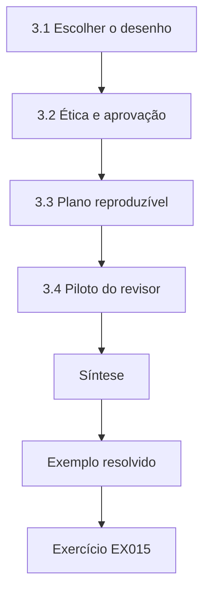

### Desenho lógico

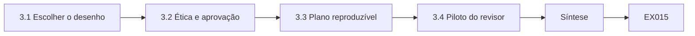

```text
[3.1 Escolher o desenho]
    |
    v
[3.2 Ética e aprovação]
    |
    v
[3.3 Plano reproduzível]
    |
    v
[3.4 Piloto do revisor]
    |
    v
[Síntese]
    |
    v
[Exemplo resolvido] --> [Exercício EX015]
```
<!-- open-cyber-academy:lesson-figures:end ch-03 -->


### Objetivos de aprendizagem

Você vai (1) desenhar uma comparação observacional levando em conta os fatores de confusão; (2) obter aprovação ética e organizacional; (3) planejar uma análise reproduzível.

### 3.1 Escolher o desenho

A Tessaly tem dez unidades de negócio: cinco revisam acessos trimestralmente e cinco anualmente. Lucas não pode randomizar a frequência, então desenha uma comparação transversal. Um revisor independente sorteia 300 contas de cada grupo e julga cada uma contra o catálogo de papéis. Para lidar com a confusão, Lucas registra o tamanho da unidade, a rotatividade de pessoal, o número de sistemas e o número de contas, porque uma rotatividade alta poderia aumentar o acesso excessivo independentemente da frequência de revisão. Ele planeja comparar as taxas e depois verificar se a diferença se mantém entre unidades com rotatividade parecida.

### 3.2 Ética e aprovação

Embora ninguém seja objeto de experimento, o estudo trata dados sobre os acessos dos funcionários. Lucas obtém a aprovação do comitê de ética do Marlow e do encarregado de proteção de dados da Tessaly. Os revisores veem só identificadores de contas, não nomes, e os resultados são relatados por grupo, nunca por pessoa nem por unidade identificada. Os achados não serão usados para punir ninguém. Lucas também combina com a Tessaly que qualquer acesso excessivo grave encontrado, como direitos de administrador de um terceiro que já saiu, será comunicado imediatamente à equipe de segurança como questão operacional.

### 3.3 Plano reproduzível

Lucas escreve o plano de análise antes de ver os dados: o desfecho, a comparação, um intervalo bootstrap para a diferença entre as taxas, a verificação por rotatividade e o tratamento dos julgamentos ausentes. Fixa as sementes aleatórias nos scripts, guarda o plano datado e mantém scripts e plano numa única pasta versionada para revisão. Ele observa que especificar as análises de antemão protege contra escolher o resultado mais lisonjeiro depois do fato, um problema que Wohlin e colegas (2012) discutem para experimentos de engenharia de software e que vale igualmente para estudos de governança.

### 3.4 Piloto do revisor

Antes do estudo principal, Lucas testa se o acesso excessivo pode ser julgado de forma consistente. Dois revisores julgam 40 contas de forma independente. Concordam em 36, e a discussão revela que a maioria das divergências envolvia caixas de correio compartilhadas, que o catálogo de papéis não cobria. Lucas acrescenta uma regra para recursos compartilhados e a registra no livro de códigos. O piloto mostra que o desfecho é mensurável, mas depende da qualidade do catálogo, um limite que ele vai relatar. Sugere também um benefício prático para a Tessaly: um catálogo melhor facilita todas as revisões futuras.

### Exemplo resolvido

Lucas desenha uma comparação de 300 mais 300 contas, registra a rotatividade como fator de confusão, obtém as aprovações e pré-registra a análise.

> **Caso sintético.** Todas as unidades, contas e números de concordância são sintéticos.

### Erros e limites

Fatores de confusão medidos não eliminam os não medidos. A qualidade do catálogo limita a validade.

### Exercícios

- **EX015 — Tamanho dos grupos.** Quantas contas são sorteadas por grupo? *Rubrica:* 3 = 300;; 2 = trezentas;; 1 = vago;; 0 = nenhuma.
- **EX016 — Principal fator de confusão.** Que fator de confusão poderia aumentar o acesso excessivo independentemente da frequência? *Rubrica:* 3 = a rotatividade de pessoal;; 2 = rotatividade;; 1 = vago;; 0 = nenhuma.
- **EX017 — Aprovações necessárias.** De quem Lucas obteve aprovação? *Rubrica:* 3 = do comitê de ética do Marlow e do encarregado de proteção de dados da Tessaly;; 2 = os dois;; 1 = vago;; 0 = nenhuma.
- **EX018 — Regra para achados graves.** O que acontece se for encontrado um acesso excessivo grave? *Rubrica:* 3 = é comunicado imediatamente à segurança como questão operacional;; 2 = comunicar;; 1 = ignorar;; 0 = nenhuma.
- **EX019 — Concordância no piloto.** Em quantas das 40 contas do piloto os revisores concordaram? *Rubrica:* 3 = 36;; 2 = 90%;; 1 = vago;; 0 = nenhuma.
- **EX020 — Correção do catálogo.** Que regra Lucas acrescentou depois do piloto? *Rubrica:* 3 = uma regra para recursos compartilhados, como caixas de correio;; 2 = caixas compartilhadas;; 1 = vago;; 0 = nenhuma.

### Síntese

Desenhos observacionais precisam de fatores de confusão registrados, aprovações e um plano pré-registrado.

<!-- open-cyber-academy:chapter-navigation:start ch-03 -->
### Continue estudando — aula 03 (capítulo 03 de 08)

[← Capítulo 02](#ch-02) · [Índice das aulas](../SUBJECTS.md) · [Capítulo 04 →](#ch-04)

Continue para a próxima aula já escrita.
<!-- open-cyber-academy:chapter-navigation:end -->

<a id="ch-04"></a>

## Capítulo 4 — Governança, riscos e compliance de segurança: explicações concorrentes

<!-- open-cyber-academy:lesson-figures:start ch-04 -->
### Mapa da aula

Aula 04 publicada. Mapa, exemplo, EX021.

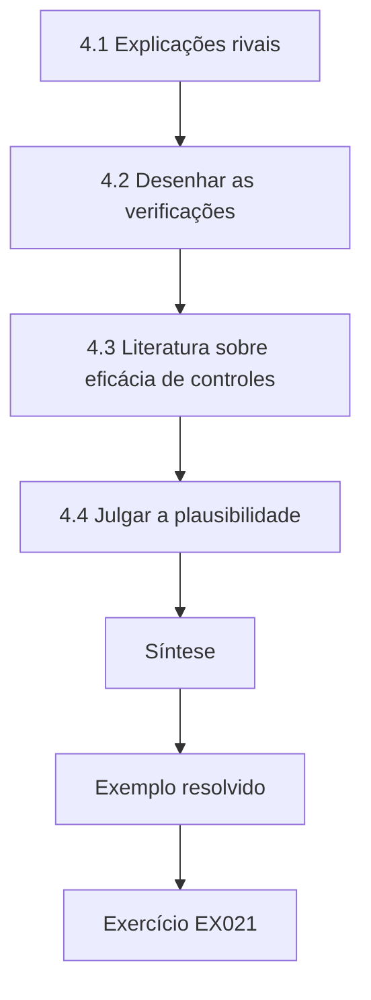

### Desenho lógico

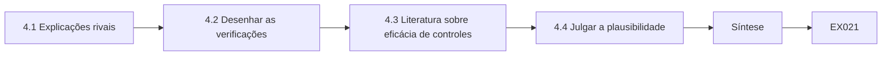

```text
[4.1 Explicações rivais]
    |
    v
[4.2 Desenhar as verificações]
    |
    v
[4.3 Literatura sobre eficácia de controles]
    |
    v
[4.4 Julgar a plausibilidade]
    |
    v
[Síntese]
    |
    v
[Exemplo resolvido] --> [Exercício EX021]
```
<!-- open-cyber-academy:lesson-figures:end ch-04 -->


### Objetivos de aprendizagem

Você vai (1) listar explicações rivais para uma diferença observada; (2) desenhar verificações capazes de distingui-las; (3) julgar quais explicações continuam plausíveis.

### 4.1 Explicações rivais

Antes de coletar dados, Lucas lista explicações que poderiam produzir menos acesso excessivo nas unidades trimestrais mesmo que a frequência, por si só, não fizesse diferença. As unidades trimestrais poderiam ter menor rotatividade. Poderiam ter menos sistemas, o que simplifica os acessos. Seus gestores poderiam ser mais diligentes em geral, e a diligência, e não a frequência, poderia explicar os resultados. As revisões também poderiam ser só carimbadas, caso em que a frequência acrescentaria custo sem benefício. Escrever isso cedo o obriga a planejar verificações, em vez de explicar os resultados depois.

### 4.2 Desenhar as verificações

Para cada rival, Lucas planeja uma verificação e a escreve no plano. Compara a rotatividade e o número de sistemas entre os grupos. Para sondar a diligência, registra se as unidades concluíram no prazo outros controles, como o treinamento de segurança. Para detectar o carimbo automático, mede quantas remoções de acesso cada revisão produziu e quanto tempo os revisores gastaram por conta. Se as revisões trimestrais quase não removem nada e levam segundos por conta, seu benefício aparente é suspeito. Essas verificações não provam causa, mas podem tornar algumas explicações muito menos plausíveis.

### 4.3 Literatura sobre eficácia de controles

Lucas liga suas verificações à literatura. Herley e van Oorschot (2017) argumentam que a pesquisa em segurança muitas vezes carece de afirmações falseáveis, e ele usa esse ponto para insistir que sua hipótese possa falhar. Gordon e Loeb (2002) lembram que mais controle nem sempre compensa o custo, então ele vai comparar o benefício com as horas dos revisores. A ênfase do COBIT 2019 na gestão de desempenho apoia medir se um processo atinge seu objetivo, e não apenas se ele acontece. Juntas, essas fontes moldam o que ele mede, como enquadra os custos e o que conta como um teste justo da sua ideia.

### 4.4 Julgar a plausibilidade

Lucas planeja relatar cada rival com o resultado da verificação e um julgamento: considerada menos provável, ainda plausível ou não testada. Ele vai evitar afirmar que a revisão trimestral causa menos acesso excessivo, a menos que as principais rivais sejam enfraquecidas. A Dra. Solberg aprova essa estrutura, observando que os examinadores valorizam a franqueza sobre o que continua incerto. Ela também pede que ele declare de antemão que resultado contaria contra a hipótese: nenhuma diferença relevante, ou uma diferença que desaparece entre unidades com rotatividade parecida. Lucas acrescenta isso ao plano.

### Exemplo resolvido

Lucas lista quatro explicações rivais, planeja uma verificação para cada uma e declara de antemão que resultado contaria contra sua hipótese.

> **Caso sintético.** As verificações planejadas são sintéticas; as obras citadas são reais.

### Erros e limites

Algumas rivais não podem ser testadas. As medidas de diligência são grosseiras.

### Exercícios

- **EX021 — Teste do carimbo.** Como Lucas vai detectar revisões só carimbadas? *Rubrica:* 3 = remoções por revisão e tempo por conta;; 2 = remoções;; 1 = vago;; 0 = nenhuma.
- **EX022 — Proxy de diligência.** Que proxy Lucas usa para a diligência geral? *Rubrica:* 3 = conclusão no prazo de outros controles, como o treinamento;; 2 = treinamento;; 1 = vago;; 0 = nenhuma.
- **EX023 — Lente de custo.** Que fonte lembra Lucas de que mais controle nem sempre compensa o custo? *Rubrica:* 3 = Gordon e Loeb (2002);; 2 = Gordon-Loeb;; 1 = vago;; 0 = nenhuma.
- **EX024 — Falseabilidade.** Por que Lucas cita Herley e van Oorschot? *Rubrica:* 3 = para insistir que sua hipótese possa falhar;; 2 = falseável;; 1 = vago;; 0 = nenhuma.
- **EX025 — Categorias de julgamento.** Que três julgamentos cada rival vai receber? *Rubrica:* 3 = menos provável, ainda plausível ou não testada;; 2 = três;; 1 = vago;; 0 = nenhuma.
- **EX026 — Resultado refutador.** Que resultado contaria contra a hipótese? *Rubrica:* 3 = nenhuma diferença relevante, ou uma que desaparece com rotatividade parecida;; 2 = declarado;; 1 = vago;; 0 = nenhuma.

### Síntese

Listar e verificar explicações rivais é o núcleo da pesquisa observacional honesta.

<!-- open-cyber-academy:chapter-navigation:start ch-04 -->
### Continue estudando — aula 04 (capítulo 04 de 08)

[← Capítulo 03](#ch-03) · [Índice das aulas](../SUBJECTS.md) · [Capítulo 05 →](#ch-05)

Continue para a próxima aula já escrita.
<!-- open-cyber-academy:chapter-navigation:end -->

<a id="ch-05"></a>

## Capítulo 5 — Proposta e piloto

<!-- open-cyber-academy:lesson-figures:start ch-05 -->
### Mapa da aula

Aula 05 publicada. Mapa, exemplo, EX027.

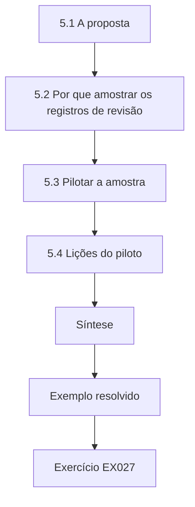

### Desenho lógico

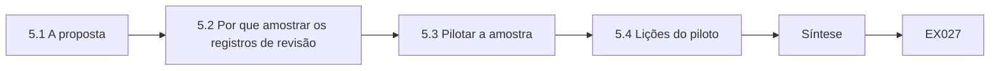

```text
[5.1 A proposta]
    |
    v
[5.2 Por que amostrar os registros de revisão]
    |
    v
[5.3 Pilotar a amostra]
    |
    v
[5.4 Lições do piloto]
    |
    v
[Síntese]
    |
    v
[Exemplo resolvido] --> [Exercício EX027]
```
<!-- open-cyber-academy:lesson-figures:end ch-05 -->


### Objetivos de aprendizagem

Você vai (1) escrever uma proposta de pesquisa concisa; (2) pilotar testes de evidência com amostragem por atributos; (3) interpretar limites superiores de taxas de desvio.

### 5.1 A proposta

Lucas escreve uma proposta de doze páginas: a pergunta, uma revisão curta de normas e estudos, o desenho transversal, a definição do desfecho, os fatores de confusão, as explicações rivais com as verificações planejadas, os arranjos éticos e um cronograma de nove meses. Inclui o plano de análise como apêndice e um resumo de uma página para o CISO da Tessaly. A proposta declara claramente que os resultados descrevem as unidades da Tessaly num ano e podem não se generalizar para outras empresas, outros sistemas ou outros tipos de revisão.

### 5.2 Por que amostrar os registros de revisão

Além do acesso excessivo, Lucas quer saber se as revisões de fato acontecem como registrado. Conferir todos os registros é lento demais, então ele toma emprestada a ferramenta do auditor, a amostragem por atributos: sortear uma amostra aleatória de registros, contar os desvios, como uma assinatura ausente, e calcular um limite superior para a taxa real de desvio. Se esse limite ficar abaixo de uma taxa tolerável fixada de antemão, o controle é considerado em operação eficaz. Ele fixa a taxa tolerável em 5%, uma escolha comum que registra no plano com sua justificativa.

### 5.3 Pilotar a amostra

No piloto, Lucas calcula limites superiores exatos de 95% para vários resultados de amostra. Com 60 registros e nenhum desvio, o limite é 0,049, logo abaixo da taxa tolerável de 5%. Um desvio em 60 eleva o limite para 0,077, e três desvios, para 0,124. Uma amostra de 25 com um desvio dá 0,176. Só a amostra limpa de 60 sustenta a conclusão de operação eficaz. O laboratório deixa claro que amostras pequenas não sustentam uma garantia forte, mesmo quando os desvios são raros. Ele anota cada limite para que a escolha do tamanho da amostra possa ser conferida depois pela orientadora e pelos examinadores.

### Laboratório — Limites superiores exatos para amostras por atributos

```python
"""Attribute sampling: exact upper 95% bound on control deviation rate (stdlib only)."""
from math import comb
def cdf(k, n, p): return sum(comb(n, i)*p**i*(1-p)**(n-i) for i in range(k+1))
def upper(k, n):
    lo, hi = 0.0, 1.0
    for _ in range(60):
        mid = (lo+hi)/2
        if cdf(k, n, mid) > 0.05: lo = mid
        else: hi = mid
    return hi
for n, k in [(60, 0), (60, 1), (60, 3), (25, 1)]:
    print(f"sample {n}, deviations {k}: upper 95% bound {upper(k, n):.3f}")
print("tolerable rate 0.05 met:", [f"{n}/{k}" for n, k in [(60,0),(60,1),(60,3),(25,1)] if upper(k,n) <= 0.05])
```

Execute com `python3 lab_sample.py`. Saída verificada:

```text
sample 60, deviations 0: upper 95% bound 0.049
sample 60, deviations 1: upper 95% bound 0.077
sample 60, deviations 3: upper 95% bound 0.124
sample 25, deviations 1: upper 95% bound 0.176
tolerable rate 0.05 met: ['60/0']
```

### 5.4 Lições do piloto

O piloto muda o plano. Lucas decide amostrar 60 registros de revisão por grupo, e não 25, porque amostras menores não conseguem atender à taxa tolerável nem com um único desvio. Ele também esclarece o que conta como desvio: uma revisão sem assinatura, uma assinatura depois do prazo ou uma assinatura de alguém que não é responsável pela unidade, e atualiza o plano. A Dra. Solberg observa que esse teste de evidência complementa a medida de acesso excessivo: um mostra se as revisões aconteceram; o outro, se os acessos terminaram corretos.

### Exemplo resolvido

Lucas pilota a amostragem por atributos e constata que só uma amostra limpa de 60 dá um limite abaixo de 5%, então fixa n = 60 por grupo.

> **Caso sintético.** Os resultados das amostras são sintéticos; o método é estatística padrão.

### Erros e limites

A amostragem não detecta falhas sistemáticas raras. As taxas toleráveis são questão de julgamento.

### Exercícios

- **EX027 — Tamanho da proposta.** Qual é o tamanho da proposta de Lucas e de seu cronograma? *Rubrica:* 3 = doze páginas, nove meses;; 2 = 12 páginas;; 1 = vago;; 0 = nenhuma.
- **EX028 — Taxa tolerável.** Que taxa tolerável de desvio Lucas fixou? *Rubrica:* 3 = 5%;; 2 = 0,05;; 1 = vago;; 0 = nenhuma.
- **EX029 — Limite da amostra limpa.** Com 60 registros e nenhum desvio, qual é o limite superior? *Rubrica:* 3 = 0,049;; 2 = abaixo de 5%;; 1 = vago;; 0 = nenhuma.
- **EX030 — Limite com um desvio.** Quanto vale o limite com um desvio em 60? *Rubrica:* 3 = 0,077;; 2 = acima de 5%;; 1 = vago;; 0 = nenhuma.
- **EX031 — Amostra pequena.** Uma amostra de 25 com um desvio sustenta a operação eficaz? *Rubrica:* 3 = não, o limite é 0,176;; 2 = não;; 1 = sim;; 0 = nenhuma.
- **EX032 — Tipos de desvio.** Liste os três tipos de desvio definidos por Lucas. *Rubrica:* 3 = sem assinatura, assinatura atrasada, signatário errado;; 2 = três;; 1 = vago;; 0 = nenhuma.

### Síntese

Os pilotos definem tamanhos de amostra realistas e aprimoram as definições antes do estudo principal.

<!-- open-cyber-academy:chapter-navigation:start ch-05 -->
### Continue estudando — aula 05 (capítulo 05 de 08)

[← Capítulo 04](#ch-04) · [Índice das aulas](../SUBJECTS.md) · [Capítulo 06 →](#ch-06)

Continue para a próxima aula já escrita.
<!-- open-cyber-academy:chapter-navigation:end -->

<a id="ch-06"></a>

## Capítulo 6 — Coleta e análise de dados

<!-- open-cyber-academy:lesson-figures:start ch-06 -->
### Mapa da aula

Aula 06 publicada. Mapa, exemplo, EX033.

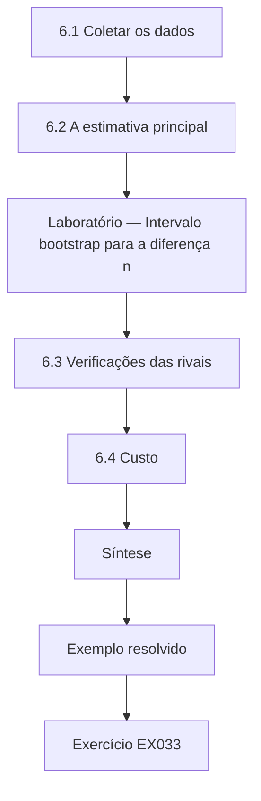

### Desenho lógico

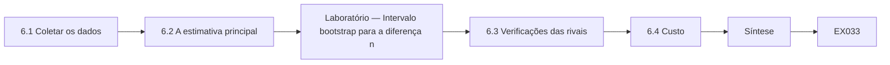

```text
[6.1 Coletar os dados]
    |
    v
[6.2 A estimativa principal]
    |
    v
[Laboratório — Intervalo bootstrap para a diferença n]
    |
    v
[6.3 Verificações das rivais]
    |
    v
[6.4 Custo]
    |
    v
[Síntese]
    |
    v
[Exemplo resolvido] --> [Exercício EX033]
```
<!-- open-cyber-academy:lesson-figures:end ch-06 -->


### Objetivos de aprendizagem

Você vai (1) coletar dados de governança segundo um plano pré-registrado; (2) estimar uma diferença com um intervalo bootstrap; (3) executar as verificações planejadas das explicações rivais.

### 6.1 Coletar os dados

Ao longo de seis semanas, um revisor independente julga 300 contas sorteadas no grupo trimestral e 300 no grupo anual, usando o catálogo de papéis com a nova regra para recursos compartilhados, sem saber de que grupo veio cada conta. Lucas sorteia 60 registros de revisão por grupo para o teste de evidência. Ele registra cada passo: os sorteios com suas sementes, os julgamentos com as datas e as contas que não puderam ser julgadas. Só quatro contas não tinham informação suficiente, e ele as registra como ausentes em vez de adivinhar, como o plano exige.

### 6.2 A estimativa principal

O revisor encontra 18 contas com excesso em 300 no grupo trimestral e 39 em 300 no anual: taxas de 0,060 e 0,130. A diferença é de 0,070, cerca de sete pontos percentuais. Um bootstrap com 2.000 reamostragens dá um intervalo de 95% de 0,023 a 0,117. O intervalo exclui o zero, então os dados são compatíveis com uma diferença real nessas unidades, embora seu tamanho seja incerto: pode ser de apenas dois pontos ou chegar a doze. Lucas apresenta o intervalo ao lado da estimativa pontual em todas as tabelas e figuras, para que o leitor nunca veja a diferença sem sua incerteza.

### Laboratório — Intervalo bootstrap para a diferença nas taxas de acesso excessivo

```python
"""Bootstrap difference in excess-access rate, quarterly vs annual review units (synthetic)."""
import random
random.seed(7)
q = [1]*18 + [0]*282   # quarterly units: 300 accounts, 18 excess
a = [1]*39 + [0]*261   # annual units: 300 accounts, 39 excess
diff = sum(a)/len(a) - sum(q)/len(q)
boots = []
for _ in range(2000):
    bq = [random.choice(q) for _ in q]; ba = [random.choice(a) for _ in a]
    boots.append(sum(ba)/len(ba) - sum(bq)/len(bq))
boots.sort()
print(f"excess rate annual {sum(a)/len(a):.3f}; quarterly {sum(q)/len(q):.3f}; difference {diff:.3f}")
print(f"95% bootstrap interval {boots[49]:.3f} to {boots[1949]:.3f}")
```

Execute com `python3 lab_boot.py`. Saída verificada:

```text
excess rate annual 0.130; quarterly 0.060; difference 0.070
95% bootstrap interval 0.023 to 0.117
```

### 6.3 Verificações das rivais

Lucas executa as verificações planejadas. A rotatividade é parecida nos dois grupos, e, quando ele compara só as seis unidades com rotatividade intermediária, a diferença diminui, mas permanece. O número de sistemas é parecido. As unidades trimestrais concluíram o treinamento no prazo um pouco mais vezes, então a diligência continua sendo uma explicação parcial plausível. As revisões trimestrais removeram em média nove permissões cada, e os revisores gastaram cerca de quarenta segundos por conta, então o carimbo automático parece improvável. Os testes de evidência não encontraram desvios nos 60 registros trimestrais e encontraram dois nos 60 anuais.

### 6.4 Custo

A revisão trimestral consome mais tempo. Os revisores das unidades trimestrais registraram cerca de quatro vezes mais horas por ano do que os das unidades anuais, embora cada revisão fosse mais curta, porque se acumulavam menos mudanças. Lucas apresenta benefício e custo sem combiná-los num número único, porque o valor de remover um acesso excessivo depende do que esse acesso poderia expor. Ele sugere que a Tessaly adote revisões trimestrais para os sistemas de alto risco e mantenha as anuais no restante, um meio-termo baseado em risco coerente com a orientação da ISO/IEC 27002:2022.

### Exemplo resolvido

Lucas encontra acesso excessivo de 0,060 contra 0,130, uma diferença de 0,070 com intervalo de 0,023 a 0,117, e verifica as rivais e o custo.

> **Caso sintético.** Todas as contagens e custos são sintéticos.

### Erros e limites

A diligência continua sendo uma rival parcial. A relação custo-benefício depende do valor dos ativos.

### Exercícios

- **EX033 — Julgamentos ausentes.** Como Lucas tratou as contas que não puderam ser julgadas? *Rubrica:* 3 = registrou-as como ausentes;; 2 = ausentes;; 1 = adivinhou;; 0 = nenhuma.
- **EX034 — Taxas dos grupos.** Que taxas de acesso excessivo cada grupo mostrou? *Rubrica:* 3 = trimestral 0,060, anual 0,130;; 2 = 18 e 39;; 1 = vago;; 0 = nenhuma.
- **EX035 — Intervalo bootstrap.** Dê o intervalo bootstrap de 95% para a diferença. *Rubrica:* 3 = 0,023 a 0,117;; 2 = exclui o zero;; 1 = vago;; 0 = nenhuma.
- **EX036 — Verificação por rotatividade.** O que aconteceu com a diferença entre as unidades de rotatividade intermediária? *Rubrica:* 3 = diminuiu, mas permaneceu;; 2 = permaneceu;; 1 = desapareceu;; 0 = nenhuma.
- **EX037 — Evidência contra o carimbo.** Por que o carimbo automático parece improvável? *Rubrica:* 3 = nove remoções por revisão e quarenta segundos por conta;; 2 = remoções;; 1 = vago;; 0 = nenhuma.
- **EX038 — Opção baseada em risco.** Que meio-termo Lucas sugere? *Rubrica:* 3 = trimestral para sistemas de alto risco, anual no restante;; 2 = baseado em risco;; 1 = vago;; 0 = nenhuma.

### Síntese

Uma análise pré-registrada produz uma diferença incerta, mas real, relatada junto com as explicações rivais e o custo.

<!-- open-cyber-academy:chapter-navigation:start ch-06 -->
### Continue estudando — aula 06 (capítulo 06 de 08)

[← Capítulo 05](#ch-05) · [Índice das aulas](../SUBJECTS.md) · [Capítulo 07 →](#ch-07)

Continue para a próxima aula já escrita.
<!-- open-cyber-academy:chapter-navigation:end -->

<a id="ch-07"></a>

## Capítulo 7 — Redação da dissertação e limitações

<!-- open-cyber-academy:lesson-figures:start ch-07 -->
### Mapa da aula

Aula 07 publicada. Mapa, exemplo, EX039.

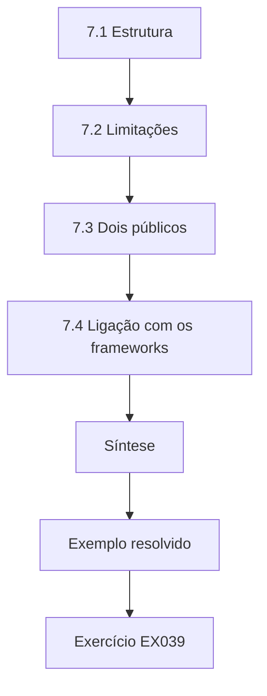

### Desenho lógico

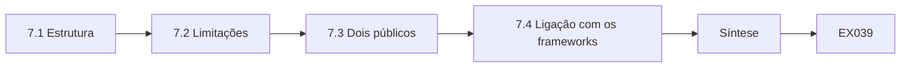

```text
[7.1 Estrutura]
    |
    v
[7.2 Limitações]
    |
    v
[7.3 Dois públicos]
    |
    v
[7.4 Ligação com os frameworks]
    |
    v
[Síntese]
    |
    v
[Exemplo resolvido] --> [Exercício EX039]
```
<!-- open-cyber-academy:lesson-figures:end ch-07 -->


### Objetivos de aprendizagem

Você vai (1) estruturar uma dissertação de mestrado; (2) escrever uma seção de limitações franca; (3) relatar os resultados para leitores acadêmicos e profissionais.

### 7.1 Estrutura

Seguindo o modelo do Marlow, Lucas estrutura a dissertação em sete partes: introdução, literatura e normas, método, resultados, explicações rivais, discussão e conclusão, seguidas de apêndices com o plano de análise, o livro de códigos e os scripts. Cada afirmação de resultado cita uma tabela ou figura, e cada tabela informa o tamanho da amostra. Ele mantém o texto principal perto de 20.000 palavras, como o Marlow exige, levando o material longo para os apêndices. Escreve o método com tanta precisão que outro estudante, em outra empresa, poderia repetir o estudo com seus próprios dados de acesso.

### 7.2 Limitações

A seção de limitações é direta. O desenho é observacional, então a frequência pode não ser a causa. A diligência continua sendo uma explicação alternativa parcial. O estudo cobre uma empresa num ano. O acesso excessivo depende do catálogo de papéis, que foi revisado durante o piloto. O intervalo bootstrap é amplo. A estimativa de custo depende de horas registradas pelos próprios revisores, que podem ser imprecisas. Para cada limite, ele declara como poderia enviesar os resultados e em que direção, em vez de listar limites sem consequências, para que os leitores possam pesá-los.

### 7.3 Dois públicos

Junto com a dissertação, Lucas escreve um resumo de quatro páginas para os profissionais da Tessaly. O resumo evita o jargão estatístico, explica que as unidades trimestrais tinham cerca de metade do acesso excessivo, com ampla margem de incerteza, e apresenta a opção baseada em risco com seu custo, sem exagerar. Ele mostra o resumo a dois gestores de unidade, que apontam uma frase que sugeria descuido nas unidades deles. Lucas a reescreve, porque relatórios que culpam grupos podem reduzir a cooperação em revisões futuras, e os dois gestores aprovam o texto.

### 7.4 Ligação com os frameworks

Na discussão, Lucas relaciona os achados aos frameworks. A ISO/IEC 27001:2022 exige monitoramento e avaliação do sistema de gestão, e seu método oferece uma forma de avaliar um controle de acesso, em vez de só confirmar que as revisões ocorreram. Os resultados da função Govern do NIST CSF 2.0 incluem a supervisão da estratégia de gestão de riscos, e ele sugere que os conselhos peçam medidas de desfecho, como as taxas de acesso excessivo. Ele apresenta isso como sugestões apoiadas num único estudo, e não como exigências das normas, que parafraseia em vez de citar longamente.

### Exemplo resolvido

Lucas escreve uma dissertação em sete partes, declara cada limite com seu viés provável e produz um resumo para profissionais que não culpa ninguém.

> **Caso sintético.** A dissertação é sintética; as normas são reais.

### Erros e limites

Resumos para profissionais podem simplificar demais. As ligações com os frameworks são interpretações.

### Exercícios

- **EX039 — Tamanho do texto principal.** Qual é o tamanho aproximado do texto principal? *Rubrica:* 3 = cerca de 20.000 palavras;; 2 = 20 mil;; 1 = vago;; 0 = nenhuma.
- **EX040 — Estilo dos limites.** Como Lucas apresenta cada limitação? *Rubrica:* 3 = com seu viés provável e a direção;; 2 = viés;; 1 = só uma lista;; 0 = nenhuma.
- **EX041 — Horas autodeclaradas.** Que limitação afeta a estimativa de custo? *Rubrica:* 3 = as horas foram registradas pelos próprios revisores;; 2 = autodeclaração;; 1 = vago;; 0 = nenhuma.
- **EX042 — Tamanho do resumo.** Qual é o tamanho do resumo para profissionais? *Rubrica:* 3 = quatro páginas;; 2 = 4;; 1 = vago;; 0 = nenhuma.
- **EX043 — Retorno dos gestores.** Por que Lucas reescreveu uma frase do resumo? *Rubrica:* 3 = sugeria que as unidades eram descuidadas;; 2 = culpa;; 1 = vago;; 0 = nenhuma.
- **EX044 — Sugestão aos conselhos.** O que Lucas sugere que os conselhos peçam? *Rubrica:* 3 = medidas de desfecho, como as taxas de acesso excessivo;; 2 = desfechos;; 1 = vago;; 0 = nenhuma.

### Síntese

Boas dissertações tornam as afirmações rastreáveis, os limites consequentes e os resumos justos.

<!-- open-cyber-academy:chapter-navigation:start ch-07 -->
### Continue estudando — aula 07 (capítulo 07 de 08)

[← Capítulo 06](#ch-06) · [Índice das aulas](../SUBJECTS.md) · [Capítulo 08 →](#ch-08)

Continue para a próxima aula já escrita.
<!-- open-cyber-academy:chapter-navigation:end -->

<a id="ch-08"></a>

## Capítulo 8 — Revisão independente e defesa

<!-- open-cyber-academy:lesson-figures:start ch-08 -->
### Mapa da aula

Aula 08 publicada. Mapa, exemplo, EX045.

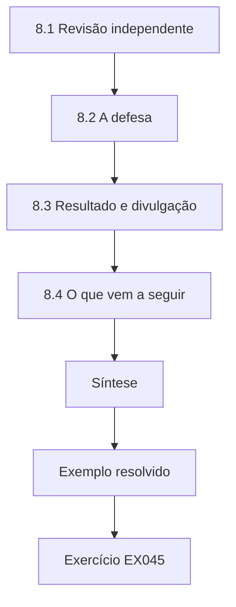

### Desenho lógico

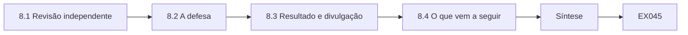

```text
[8.1 Revisão independente]
    |
    v
[8.2 A defesa]
    |
    v
[8.3 Resultado e divulgação]
    |
    v
[8.4 O que vem a seguir]
    |
    v
[Síntese]
    |
    v
[Exemplo resolvido] --> [Exercício EX045]
```
<!-- open-cyber-academy:lesson-figures:end ch-08 -->


### Objetivos de aprendizagem

Você vai (1) obter e responder a uma revisão independente; (2) defender as escolhas do desenho; (3) planejar a divulgação e os próximos passos.

### 8.1 Revisão independente

Antes da submissão, Lucas pede a uma pesquisadora de outra universidade que execute de novo seus scripts a partir do arquivo. Ela reproduz exatamente todas as tabelas e o intervalo bootstrap, graças às sementes fixas. Também pergunta se as quatro contas ausentes poderiam mudar o resultado. Lucas executa uma verificação de pior caso, supondo que as quatro contas ausentes fossem do grupo trimestral e tivessem acesso excessivo; a diferença cai um pouco, mas o intervalo continua excluindo o zero. Ele acrescenta essa análise de sensibilidade ao capítulo de resultados e agradece à revisora.

### 8.2 A defesa

Na defesa, os examinadores perguntam por que Lucas não randomizou a frequência. Ele explica que a Tessaly não podia mudar os calendários de revisão para fins de pesquisa, e que tratou isso com as verificações dos fatores de confusão e com franqueza sobre a diligência. Outra examinadora pergunta se o acesso excessivo é o desfecho certo. Lucas argumenta que ele está mais perto do risco do que contar revisões concluídas, mas admite que não mede se o acesso excessivo chegou a ser mal usado. Um terceiro pergunta sobre a generalização; ele responde que o método se generaliza com mais facilidade do que o resultado específico.

### 8.3 Resultado e divulgação

A banca aprova a dissertação com revisões menores: rótulos mais claros em duas figuras e uma breve discussão sobre a fadiga de revisão. Lucas planeja um artigo curto para uma revista profissional e uma palestra num fórum regional de segurança, ambos citando o arquivo. A Tessaly decide pilotar revisões trimestrais nos sistemas de gestão de armazéns e financeiro, as aplicações de maior risco, e medir de novo o acesso excessivo depois de um ano. Lucas oferece seus scripts e seu livro de códigos para que a nova medição use exatamente o mesmo método.

### 8.4 O que vem a seguir

A Dra. Solberg sugere que um estudo randomizado seria o próximo passo natural: se várias empresas aceitassem sortear a frequência de revisão entre unidades comparáveis, a frequência poderia ser testada diretamente. Lucas aponta as questões práticas e éticas, como garantir que nenhuma unidade fique com risco inaceitável. Ele reflete que o mestrado o ensinou a valorizar achados modestos e bem verificados mais do que afirmações impactantes, e que a pesquisa em governança é mais útil quando mede desfechos que importam para o risco. Ele registra essa reflexão.

### Exemplo resolvido

Lucas passa pela reprodução independente, acrescenta uma verificação de pior caso para os dados ausentes, defende seu desenho e planeja a divulgação.

> **Caso sintético.** A revisão, a defesa e o estudo seguinte são sintéticos.

### Erros e limites

A reprodução confere o código, não a verdade. Os resultados do estudo seguinte podem ser diferentes.

### Exercícios

- **EX045 — Resultado da reprodução.** A revisora independente reproduziu as tabelas? *Rubrica:* 3 = sim, exatamente, graças às sementes fixas;; 2 = sim;; 1 = não;; 0 = nenhuma.
- **EX046 — Verificação de pior caso.** O que mostrou a verificação de pior caso dos dados ausentes? *Rubrica:* 3 = a diferença caiu um pouco, mas o intervalo continuou excluindo o zero;; 2 = robusto;; 1 = inverteu;; 0 = nenhuma.
- **EX047 — Sem randomização.** Por que a frequência não foi randomizada? *Rubrica:* 3 = a Tessaly não podia mudar os calendários para pesquisa;; 2 = prático;; 1 = vago;; 0 = nenhuma.
- **EX048 — Limite do desfecho.** O que o acesso excessivo não mede? *Rubrica:* 3 = se o acesso foi mal usado;; 2 = mau uso;; 1 = vago;; 0 = nenhuma.
- **EX049 — Decisão da Tessaly.** Em que sistemas a Tessaly vai pilotar revisões trimestrais? *Rubrica:* 3 = gestão de armazéns e financeiro;; 2 = alto risco;; 1 = todos;; 0 = nenhuma.
- **EX050 — Próximo estudo.** Que estudo seguinte a Dra. Solberg sugere? *Rubrica:* 3 = um estudo randomizado com várias empresas;; 2 = randomizar;; 1 = vago;; 0 = nenhuma.

### Síntese

Reprodução independente, defesa franca e acompanhamento planejado completam um estudo de mestrado.

<!-- open-cyber-academy:chapter-navigation:start ch-08 -->
### Continue estudando — aula 08 (capítulo 08 de 08)

[← Capítulo 07](#ch-07) · [Índice das aulas](../SUBJECTS.md) · [Próximo curso pelo índice →](../SUBJECTS.md)

O índice aponta para o próximo curso do percurso de estudos.
<!-- open-cyber-academy:chapter-navigation:end -->

<a id="worked-results"></a>

## Resoluções

Respostas-modelo para EX001–EX050. Lucas Ferreira, a Dra. Ingrid Solberg, o Marlow Institute of Technology, a Tessaly Logistics e todos os números são sintéticos. As respostas dos laboratórios citam saídas verificadas. Qualquer resposta que atenda à rubrica recebe a mesma pontuação.

**EX001.** A conta, e não a pessoa.

**EX002.** Uma permissão que o papel atual do titular da conta não exige, julgada contra o catálogo de papéis escrito.

**EX003.** Pelas horas registradas pelos revisores.

**EX004.** Porque as unidades escolheram a própria frequência, então as diferenças podem refletir outras características delas.

**EX005.** A data, a base, a string de busca e o número de resultados.

**EX006.** Não; pede revisão em intervalos planejados, sem fixar uma frequência.

**EX007.** Definem a pergunta como prática de consenso, mas não fornecem evidência testada de um efeito.

**EX008.** ISO/IEC 27001:2022.

**EX009.** Governança de gestão da informação e da tecnologia corporativas.

**EX010.** Oito de dez.

**EX011.** 60%, seis de dez.

**EX012.** R3 e R8.

**EX013.** Porque um controle mapeado pode estar mal desenhado, mal operado ou evidenciado por documentos que ninguém confere.

**EX014.** O mapeamento é um primeiro passo necessário, mas a garantia exige evidência testada, com profundidade proporcional ao risco.

**EX015.** 300 contas de cada grupo.

**EX016.** A rotatividade de pessoal.

**EX017.** Do comitê de ética do Marlow e do encarregado de proteção de dados da Tessaly.

**EX018.** É comunicado imediatamente à equipe de segurança como questão operacional.

**EX019.** 36 de 40.

**EX020.** Uma regra para recursos compartilhados, como caixas de correio compartilhadas.

**EX021.** Medindo as remoções de acesso por revisão e o tempo do revisor por conta.

**EX022.** Se as unidades concluíram no prazo outros controles, como o treinamento de segurança.

**EX023.** Gordon e Loeb (2002).

**EX024.** Para insistir que sua hipótese precisa ser falseável.

**EX025.** Considerada menos provável, ainda plausível ou não testada.

**EX026.** Nenhuma diferença relevante, ou uma diferença que desaparece entre unidades com rotatividade parecida.

**EX027.** Doze páginas, com um cronograma de nove meses.

**EX028.** 5%.

**EX029.** 0,049, logo abaixo de 5%.

**EX030.** 0,077.

**EX031.** Não; o limite superior é 0,176.

**EX032.** Revisão sem assinatura, assinatura depois do prazo e assinatura de alguém que não é o responsável.

**EX033.** Registrou-as como ausentes em vez de adivinhar.

**EX034.** 0,060 no trimestral e 0,130 no anual.

**EX035.** De 0,023 a 0,117.

**EX036.** Diminuiu, mas permaneceu.

**EX037.** As revisões removeram cerca de nove permissões cada e levaram cerca de quarenta segundos por conta.

**EX038.** Revisões trimestrais para sistemas de alto risco e anuais no restante.

**EX039.** Cerca de 20.000 palavras.

**EX040.** Declarando como ela poderia enviesar os resultados e em que direção.

**EX041.** As horas dos revisores foram autodeclaradas e podem ser imprecisas.

**EX042.** Quatro páginas.

**EX043.** Porque sugeria que algumas unidades eram descuidadas, o que poderia reduzir a cooperação.

**EX044.** Medidas de desfecho, como as taxas de acesso excessivo, e não só a confirmação de que as revisões ocorreram.

**EX045.** Sim, exatamente, porque as sementes eram fixas.

**EX046.** A diferença caiu um pouco, mas o intervalo continuou excluindo o zero.

**EX047.** Porque a Tessaly não podia mudar os calendários de revisão para fins de pesquisa.

**EX048.** Se o acesso excessivo chegou de fato a ser mal usado.

**EX049.** Seus sistemas de gestão de armazéns e financeiro.

**EX050.** Um estudo randomizado que sorteie a frequência de revisão entre unidades comparáveis de várias empresas.

<a id="references"></a>
## Referências

Todos os DOIs foram resolvidos em doi.org em 12 de outubro de 2026, e as normas foram conferidas nas páginas de seus editores. A lista é idêntica à da edição em inglês e cobre o livro inteiro, acrescida apenas da ABNT NBR ISO/IEC 27001:2022, citada nesta edição como referência brasileira e conferida em sua fonte oficial; as adoções brasileiras da ABNT listadas foram conferidas no catálogo oficial da ABNT, e as demais normas técnicas são citadas em sua edição internacional. Organizações, pessoas, sistemas e números dos casos são sintéticos; somente as obras abaixo são reais.

- Associação Brasileira de Normas Técnicas. (2022). *ABNT NBR ISO/IEC 27001:2022 — Segurança da informação, segurança cibernética e proteção à privacidade — Sistemas de gestão da segurança da informação — Requisitos* (versão corrigida 2023). ABNT. <https://www.abntcatalogo.com.br/>
- Gordon, L. A., & Loeb, M. P. (2002). The economics of information security investment. *ACM Transactions on Information and System Security*, 5(4), 438–457. <https://doi.org/10.1145/581271.581274>
- Herley, C., & van Oorschot, P. C. (2017). SoK: Science, security and the elusive goal of security as a scientific pursuit. *2017 IEEE Symposium on Security and Privacy*, 99–120. <https://doi.org/10.1109/SP.2017.38>
- International Organization for Standardization. (2022a). *ISO/IEC 27001:2022 Information security, cybersecurity and privacy protection — Information security management systems — Requirements*. <https://www.iso.org/standard/27001>
- International Organization for Standardization. (2022b). *ISO/IEC 27002:2022 Information security, cybersecurity and privacy protection — Information security controls*. <https://www.iso.org/standard/75652.html>
- ISACA. (2018). *COBIT 2019 framework: Introduction and methodology*. ISACA. <https://www.isaca.org/resources/cobit>
- Joint Task Force. (2020). *Security and privacy controls for information systems and organizations* (NIST SP 800-53 Rev. 5). NIST. <https://doi.org/10.6028/NIST.SP.800-53r5>
- National Institute of Standards and Technology. (2024). *The NIST Cybersecurity Framework (CSF) 2.0* (NIST CSWP 29). <https://doi.org/10.6028/NIST.CSWP.29>
- Spears, J. L., & Barki, H. (2010). User participation in information systems security risk management. *MIS Quarterly*, 34(3), 503–522. <https://doi.org/10.2307/25750689>
- Wohlin, C., Runeson, P., Höst, M., Ohlsson, M. C., Regnell, B., & Wesslén, A. (2012). *Experimentation in software engineering*. Springer. <https://doi.org/10.1007/978-3-642-29044-2>
