# Operações de Segurança e Blue Team: Curso de Mestrado

- Idioma: português do Brasil (`pt`); curso 176, curso de mestrado (2 anos). Edição de referência: [inglês](../../en/book/MANUSCRIPT.md).
- Estado editorial: **publicado**. Os capítulos 1–8 de 8 têm texto didático escrito à mão; os exercícios EX001–EX050 têm resoluções correspondentes com rubricas de 0 a 3; três laboratórios offline usam apenas a biblioteca padrão do Python 3 sobre evidências sintéticas, e suas saídas foram incorporadas a partir de execuções reais. A revisão independente e a verificação de 300 páginas A4 continuam em aberto.
- Público: mestrandos que vão planejar, conduzir e defender um estudo aplicado sobre a prática de operações de segurança.
- Autor: [hiagokinlevi](https://github.com/hiagokinlevi). Texto original sob [CC0 1.0](../../../../../LICENSE); as obras citadas mantêm seus direitos.
- Limite ético e legal: monitore e responda apenas em sistemas que você está autorizado a defender; nada de código de exploração, *payloads*, procedimentos de ataque ou instruções para escapar da detecção. As detecções são ensinadas do lado do defensor, com telemetria sintética. Todas as evidências, pessoas e organizações são **sintéticas**, salvo quando uma frase cita uma fonte pública.

[Página do curso](../../README.md) · [Índice de capítulos](../SUBJECTS.md) · [Plano do livro](PLAN.md) · [Skill do curso](../../skill/SKILL.md) · [Resoluções](#worked-results)

## Como usar este rascunho

Leia em ordem: os capítulos acompanham uma única dissertação sobre o ajuste, por listas de permissão, de regras de detecção ruidosas, da pergunta de pesquisa à defesa. Execute cada laboratório onde ele aparece, tente os exercícios antes das resoluções e pontue-se com as rubricas.

### Caso contínuo sintético

| Elemento | Papel | Limite |
|---|---|---|
| **Tariq Haddad** | Mestrando e analista de SOC em meio período | Inventado |
| **Dra. Ingrid Solberg** | Orientadora | Inventada |
| **Marcus Bell** | Líder do SOC | Inventado |
| **Ashworth Institute of Technology** | Universidade fictícia | Inventada |
| **Pelham Water Utility** | Organização anfitriã fictícia | Inventada |

### Fontes principais

NIST [SP 800-61r3](https://doi.org/10.6028/NIST.SP.800-61r3), [SP 800-92](https://doi.org/10.6028/NIST.SP.800-92), [SP 800-137](https://doi.org/10.6028/NIST.SP.800-137) e [CSF 2.0](https://doi.org/10.6028/NIST.CSWP.29); [MITRE ATT&CK](https://attack.mitre.org/); [MITRE D3FEND](https://d3fend.mitre.org/); [Sigma](https://github.com/SigmaHQ/sigma); Knerler, Parker e Zimmerman, *11 Strategies of a World-Class Cybersecurity Operations Center* (MITRE, 2022). Lista completa em [Referências](#references).

## Sumário

| Capítulos |
|---|
| [1](#ch-01) · [2](#ch-02) · [3](#ch-03) · [4](#ch-04) · [5](#ch-05) · [6](#ch-06) · [7](#ch-07) · [8](#ch-08) |

[Resoluções](#worked-results) · [Referências](#references)

<a id="ch-01"></a>

## Capítulo 1 — Pergunta de pesquisa e método de revisão da literatura

<!-- cykin:lesson-figures:start ch-01 -->
### Mapa da aula

Aula 01 publicada. Mapa, exemplo, EX001.

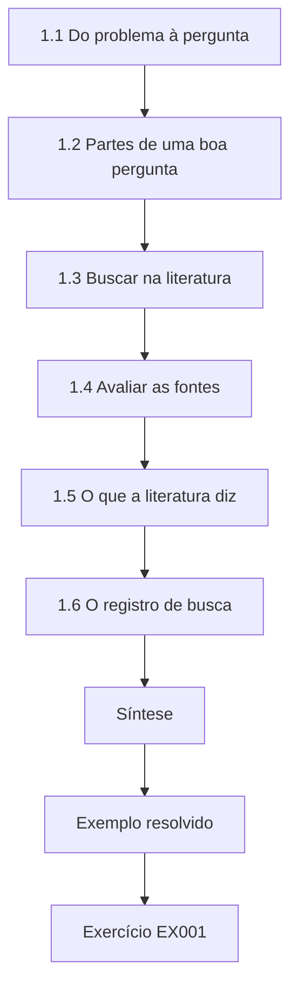

### Desenho lógico

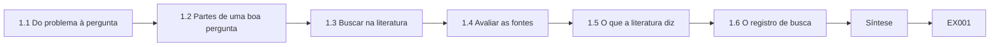

```text
[1.1 Do problema à pergunta]
    |
    v
[1.2 Partes de uma boa pergunta]
    |
    v
[1.3 Buscar na literatura]
    |
    v
[1.4 Avaliar as fontes]
    |
    v
[1.5 O que a literatura diz]
    |
    v
[1.6 O registro de busca]
    |
    v
[Síntese]
    |
    v
[Exemplo resolvido] --> [Exercício EX001]
```
<!-- cykin:lesson-figures:end ch-01 -->


### Objetivos de aprendizagem

Você vai (1) transformar um problema prático de SOC numa pergunta pesquisável; (2) conduzir uma busca estruturada na literatura; (3) avaliar as fontes por tipo e força; (4) manter um registro de busca reprodutível.

### 1.1 Do problema à pergunta

**Tariq Haddad**, mestrando no fictício **Ashworth Institute of Technology**, trabalha meio período no SOC corporativo da fictícia **Pelham Water Utility**. Os analistas reclamam de "alertas demais". Isso é um problema, não uma pergunta. Com a orientadora, a **Dra. Ingrid Solberg**, Tariq o estreita: "Acrescentar listas de permissão revisadas às dez regras de detecção mais ruidosas reduz o volume semanal de alertas sem suprimir ataques verdadeiros, em comparação com regras não ajustadas nas mesmas semanas?" A segunda metade da pergunta, "sem suprimir ataques verdadeiros", é o que faz dela uma pergunta de segurança, e não de carga de trabalho.

### 1.2 Partes de uma boa pergunta

A pergunta nomeia uma intervenção (listas de permissão), uma população (dez regras, um SOC), uma comparação (regras não ajustadas), desfechos (volume e ataques suprimidos) e um horizonte de tempo. Cada parte pode ser medida. Cada parte também limita a afirmação. "Dez regras, um SOC" significa que o resultado descreve as regras mais ruidosas da Pelham, não o ajuste de detecções em geral. "Regras não ajustadas nas mesmas semanas" significa que qualquer coisa que tenha afetado todas as regras, como um feriado, pode ser descontada. Nomear dois desfechos significa que uma queda no volume não pode ser relatada sem a contagem de ataques suprimidos ao lado.

### 1.3 Buscar na literatura

Tariq busca em bibliotecas digitais (ACM, IEEE, USENIX) e na literatura cinzenta (NIST, MITRE) com termos registrados: "alert fatigue", "false positive" AND "security operations", "detection tuning", "SOC" AND "qualitative". Ele registra datas, bases e números de resultados. Sua busca na ACM em 3 de fevereiro de 2026 retornou 214 resultados; 31 foram triados pelo resumo e 9 incluídos. As exclusões são registradas com motivos: 12 artigos sobre algoritmos de IDS de rede sem dados de analistas e 10 duplicatas. A literatura cinzenta é buscada à parte, para que documentos do NIST e da MITRE não se misturem aos estudos empíricos nas contagens.

### 1.4 Avaliar as fontes

Estudos empíricos revisados por pares, como Alahmadi, Axon e Martinovic (2022) sobre disparos benignos, pesam mais do que blogs de fornecedores. Frameworks — a NIST SP 800-92 sobre gestão de logs, o formato de regras do SigmaHQ — definem a prática, mas não são evidência de efeito. Tariq etiqueta cada fonte por tipo. As etiquetas determinam o que cada fonte pode sustentar na dissertação. Alahmadi et al. podem ser citados sobre como os analistas vivenciam os alarmes; a SP 800-92 pode ser citada sobre como é uma boa gestão de logs; nenhuma das duas pode mostrar que listas de permissão reduzem o volume sem esconder ataques. Essa afirmação exige a medição do próprio Tariq.

### 1.5 O que a literatura diz

Os analistas relatam que a maioria dos alarmes são disparos benignos (Alahmadi et al., 2022); taxas de base baixas fazem os alarmes falsos predominarem (Axelsson, 2000); incentivos desalinhados distorcem as métricas de SOC (Kokulu et al., 2019). Poucos trabalhos publicados medem efeitos do ajuste com um grupo de comparação. A última frase é a lacuna de Tariq. Os estudos descrevem por que os alertas são ruidosos e por que as métricas enganam, mas poucos comparam regras ajustadas com regras não ajustadas no mesmo período. Sua afirmação no seminário parte disso: a redução de volume, sozinha, é uma métrica de sucesso enganosa, enquanto a constatação de Alahmadi et al. de que o volume causa esgotamento é a contraevidência de que a redução ainda tem valor.

### 1.6 O registro de busca

O registro permite que um leitor refaça a busca e veja por que as fontes foram incluídas ou excluídas. A entrada de Tariq para a busca na ACM mostra o que isso exige: a data, a base, a expressão exata, o intervalo de anos, os números de resultados em cada etapa e os motivos de exclusão. Um leitor que discorde da exclusão dos 12 artigos sobre algoritmos de IDS de rede pode ver a decisão e julgá-la, em vez de suspeitar que artigos inconvenientes sumiram. A Dra. Solberg revisa o registro antes da redação do capítulo de literatura.

### Exemplo resolvido

Entrada do registro de busca de Tariq: "2026-02-03, ACM DL, ('alert fatigue' OR 'false positive') AND ('security operations' OR SOC), 2010–2026: 214 resultados; 31 triados pelo resumo; 9 incluídos. Exclusões: 12 artigos sobre algoritmos de IDS de rede sem dados de analistas; 10 duplicatas."

> **Caso sintético.** O Ashworth, a Pelham Water Utility e todas as pessoas são inventados.

### Erros e limites

As buscas deixam passar relatórios do setor protegidos por *paywall*; registre isso como limitação.

### Exercícios

- **EX001 — Problema versus pergunta.** Por que "alertas demais" ainda não é uma pergunta de pesquisa? *Rubrica:* 3 = sem intervenção, comparação, desfecho mensurável nem horizonte de tempo; 2 = parcial; 1 = já é; 0 = nada.
- **EX002 — Partes da pergunta.** Cite as cinco partes da pergunta de Tariq. *Rubrica:* 3 = intervenção, população, comparação, desfechos, tempo; 2 = três; 1 = uma; 0 = nada.
- **EX003 — Registro da busca.** O que Tariq registra em cada busca? *Rubrica:* 3 = data, base, termos, resultados, contagens da triagem; 2 = três; 1 = um; 0 = nada.
- **EX004 — Peso das fontes.** Compare o peso como evidência de Alahmadi et al. e de um blog de fornecedor. *Rubrica:* 3 = empírico revisado por pares vs. marketing não revisado; 2 = parcial; 1 = iguais; 0 = nada.
- **EX005 — Frameworks.** Que papel a NIST SP 800-92 e o Sigma têm na revisão? *Rubrica:* 3 = definem prática/formato, não evidência de efeito; 2 = parcial; 1 = evidência; 0 = nada.
- **EX006 — Lacuna.** Indique a lacuna de que o estudo de Tariq trata. *Rubrica:* 3 = poucas medições de efeitos do ajuste com grupo de comparação; 2 = parcial; 1 = vago; 0 = nada.
- **EX007 — Exclusões.** Por que os artigos sobre algoritmos de IDS de rede foram excluídos? *Rubrica:* 3 = sem dados de analistas/operacionais relevantes para a pergunta; 2 = parcial; 1 = ao acaso; 0 = nada.

### Síntese

Uma pergunta pesquisável tem partes mensuráveis; uma busca na literatura registrada e avaliada mostra onde ela se encaixa.

### Continue estudando — capítulo 01 de 08

[← Página do curso](../../README.md) · [Índice de capítulos do curso](../SUBJECTS.md) · [Capítulo 02 (rascunho) →](#ch-02)

<a id="ch-02"></a>

## Capítulo 2 — Operações de segurança e blue team: seminário avançado

<!-- cykin:lesson-figures:start ch-02 -->
### Mapa da aula

Aula 02 publicada. Mapa, exemplo, EX008.

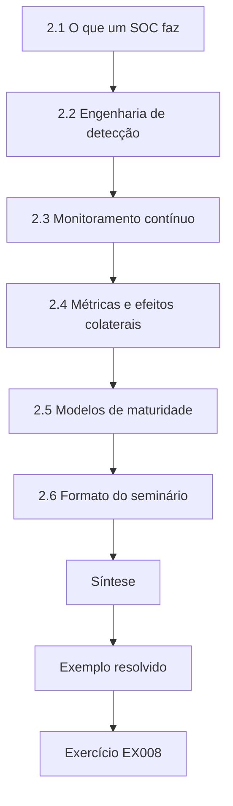

### Desenho lógico

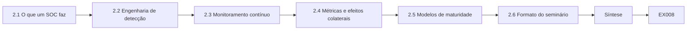

```text
[2.1 O que um SOC faz]
    |
    v
[2.2 Engenharia de detecção]
    |
    v
[2.3 Monitoramento contínuo]
    |
    v
[2.4 Métricas e efeitos colaterais]
    |
    v
[2.5 Modelos de maturidade]
    |
    v
[2.6 Formato do seminário]
    |
    v
[Síntese]
    |
    v
[Exemplo resolvido] --> [Exercício EX008]
```
<!-- cykin:lesson-figures:end ch-02 -->


### Objetivos de aprendizagem

Você vai (1) discutir criticamente modelos e funções de SOC; (2) relacionar a engenharia de detecção a frameworks; (3) debater métricas e seus efeitos colaterais; (4) apresentar um argumento de seminário com fontes.

### 2.1 O que um SOC faz

Knerler, Parker e Zimmerman (2022) descrevem as funções de um SOC, do monitoramento e da análise à resposta a incidentes, à inteligência de ameaças e a serviços ampliados como a caça a ameaças. Sua primeira estratégia, "saiba o que você está protegendo e por quê", ancora as decisões de ajuste: uma regra importa conforme os ativos que ela guarda. Para a Pelham, saber o que está protegido significa saber que uma regra que guarda os servidores de gestão de patches importa mais do que uma que guarda os monitores das salas de reunião. Essa ordem afeta o ajuste: uma lista de permissão numa regra que vigia a conta de aplicação de patches traz mais risco se estiver errada, e é exatamente aí que o estudo de Tariq depois encontra um problema.

### 2.2 Engenharia de detecção

As detecções são escritas, testadas, implantadas e mantidas como software. O MITRE ATT&CK (Strom et al., 2018) oferece um vocabulário comum do comportamento adversário para que a cobertura possa ser mapeada; o Sigma oferece um formato de regra portátil. O D3FEND (Kaloroumakis e Smith, 2021) mapeia técnicas defensivas, ajudando as equipes a ver a que contramedida uma detecção pertence. Tratar as regras como software é o que torna o estudo de Tariq possível: as regras da Pelham são guardadas em formato Sigma, e as entradas das listas de permissão ficam sob controle de versão com seus motivos, de modo que o ajuste pode ser descrito, comparado e revisado. Mapear cada uma das vinte regras para uma tática do ATT&CK também lhe permitiu parear regras ajustadas e de controle pela tática.

### 2.3 Monitoramento contínuo

A NIST SP 800-137 enquadra o monitoramento como um programa contínuo ligado ao risco, com frequências e métricas definidas, e não como um conjunto de ferramentas. Para Tariq, isso significa que o ajuste não é um projeto que termina na semana 8. As listas de permissão mudam o que o SOC monitora, inclusive na regra que vigia a conta de aplicação de patches, então pertencem ao programa de monitoramento, com sua própria frequência de revisão e sua métrica. As recomendações dele depois tornam isso concreto: reprodução trimestral das entradas das listas de permissão contra eventos de *purple team*, e testes de ataques suprimidos acompanhados ao lado do volume.

### 2.4 Métricas e efeitos colaterais

Contar alertas fechados recompensa a velocidade em vez da profundidade; o tempo médio de resolução pode levar os analistas a fechar casos incertos. Kokulu et al. (2019) constataram que esses desencontros de métricas são um problema frequente. O seminário de Tariq argumenta que os estudos de ajuste precisam medir os ataques suprimidos junto com o volume, ou recompensarão o silêncio. A pergunta de Tariq no seminário afia o argumento: que taxa de ataques suprimidos um analista aceitaria por um corte de 30% no volume? Fazê-la obriga uma equipe a declarar o custo-benefício antes do ajuste, em vez de descobri-lo depois. Sem uma medida de ataques suprimidos, um projeto de ajuste só consegue relatar sucesso.

### 2.5 Modelos de maturidade

O SOC-CMM (van Os, 2016) avalia os domínios de negócio, pessoas, processo, tecnologia e serviços. Ele ajuda a situar o ajuste dentro da maturidade de processo, em vez de tratá-lo como uma limpeza pontual. Para a Pelham, o enquadramento do SOC-CMM situa o trabalho de Tariq no domínio de processo: as entradas das listas de permissão precisam da mesma revisão, do mesmo controle de versão e dos mesmos testes periódicos que as regras. O comentário posterior do revisor externo, de que o processo de revisão dele pressupõe um processo de mudanças maduro, é uma questão de maturidade exatamente nesse sentido. O modelo também dá à Pelham uma forma de mostrar progresso depois do estudo, reavaliando o domínio de processo assim que a reprodução trimestral estiver funcionando.

### 2.6 Formato do seminário

Cada estudante apresenta uma afirmação, evidências, contraevidências e uma pergunta para discussão. A pergunta é a parte que a maioria dos estudantes negligencia. A pergunta de Tariq, citada no exemplo resolvido abaixo, obrigou o seminário a discutir um custo-benefício em vez de concordar que ruído é ruim. Apresentar contraevidências ao lado da própria afirmação também mostrou depois aos examinadores que ele havia enfrentado a objeção mais forte a ela. O slide de Tariq citava Axelsson e Kokulu et al. como evidência e Alahmadi et al. como contraevidência, e a Dra. Solberg usou a pergunta para abrir a discussão.

### Exemplo resolvido

Afirmação de Tariq no seminário: "A redução do volume de alertas, sozinha, é uma métrica de sucesso enganosa." Evidência: o argumento da taxa de base de Axelsson e Kokulu et al. sobre métricas. Contraevidência: Alahmadi et al. relatam que o próprio volume causa esgotamento, então a redução tem valor. Pergunta: "Que taxa de ataques suprimidos você aceitaria por um corte de 30% no volume?"

> **Caso sintético.** O seminário é inventado.

### Erros e limites

Os frameworks mudam de versão; cite a versão usada.

### Exercícios

- **EX008 — Estratégia um.** Como "saiba o que você está protegendo e por quê" orienta o ajuste? *Rubrica:* 3 = o valor da regra depende dos ativos guardados; 2 = parcial; 1 = vago; 0 = nada.
- **EX009 — Uso do ATT&CK.** O que o ATT&CK oferece à engenharia de detecção? *Rubrica:* 3 = vocabulário comum de comportamentos para mapear a cobertura; 2 = parcial; 1 = *exploits*; 0 = nada.
- **EX010 — Uso do D3FEND.** O que o D3FEND acrescenta? *Rubrica:* 3 = mapa de técnicas defensivas/contramedidas; 2 = parcial; 1 = o mesmo que o ATT&CK; 0 = nada.
- **EX011 — Programa de monitoramento.** Como a SP 800-137 enquadra o monitoramento? *Rubrica:* 3 = programa contínuo ligado ao risco, com frequências e métricas; 2 = parcial; 1 = ferramentas; 0 = nada.
- **EX012 — Efeito colateral de métrica.** Dê um efeito colateral de métrica. *Rubrica:* 3 = p. ex., a contagem de fechados recompensa velocidade em vez de profundidade; 2 = parcial; 1 = vago; 0 = nada.
- **EX013 — Contraevidência.** Que contraevidência Tariq apresentou? *Rubrica:* 3 = Alahmadi et al.: o volume causa esgotamento, então a redução tem valor; 2 = parcial; 1 = vago; 0 = nada.
- **EX014 — Enquadramento de maturidade.** Como o SOC-CMM muda a visão do ajuste? *Rubrica:* 3 = parte da maturidade de processo, não limpeza pontual; 2 = parcial; 1 = vago; 0 = nada.

### Síntese

A prática avançada de SOC liga as detecções a frameworks, ativos e maturidade, e julga as métricas por seus efeitos colaterais.

### Continue estudando — capítulo 02 de 08

[← Capítulo 01 (rascunho)](#ch-01) · [Índice de capítulos do curso](../SUBJECTS.md) · [Capítulo 03 (rascunho) →](#ch-03)

<a id="ch-03"></a>

## Capítulo 3 — Desenho do estudo, ética e reprodutibilidade

<!-- cykin:lesson-figures:start ch-03 -->
### Mapa da aula

Aula 03 publicada. Mapa, exemplo, EX015.

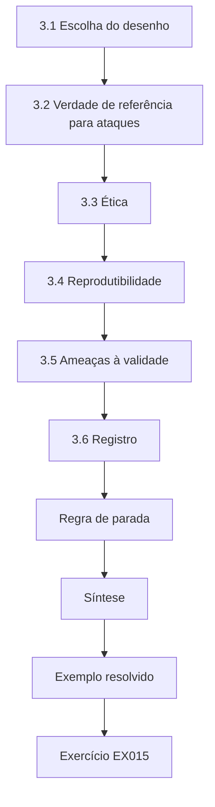

### Desenho lógico

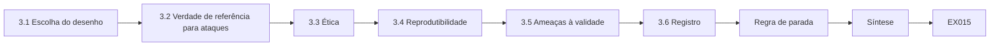

```text
[3.1 Escolha do desenho]
    |
    v
[3.2 Verdade de referência para ataques]
    |
    v
[3.3 Ética]
    |
    v
[3.4 Reprodutibilidade]
    |
    v
[3.5 Ameaças à validade]
    |
    v
[3.6 Registro]
    |
    v
[Regra de parada]
    |
    v
[Síntese]
    |
    v
[Exemplo resolvido] --> [Exercício EX015]
```
<!-- cykin:lesson-figures:end ch-03 -->


### Objetivos de aprendizagem

Você vai (1) escolher um desenho adequado a uma intervenção operacional; (2) planejar a ética e a proteção de dados; (3) tornar o estudo reprodutível; (4) definir a verdade de referência para "ataque suprimido".

### 3.1 Escolha do desenho

Sortear quais regras serão ajustadas é possível, mas o SOC quer as regras mais ruidosas corrigidas primeiro. Tariq usa um desenho antes-depois controlado: dez regras ajustadas e dez regras comparáveis não ajustadas, quatro semanas antes e quatro depois. Comparar as mudanças nos dois grupos elimina os efeitos comuns a todas as regras. Parear as regras de controle por volume e por tática do ATT&CK torna a comparação mais justa: uma regra não ajustada que vigia uma tática tranquila se comportaria de modo diferente de uma ruidosa. Quatro semanas antes e quatro depois dão a cada grupo sua própria linha de base, de modo que a análise compara quanto cada grupo mudou, e não seus níveis brutos.

### 3.2 Verdade de referência para ataques

Ataques reais são raros e desconhecidos de antemão. Com a aprovação do CISO, os exercícios autorizados de *purple team* da empresa de saneamento injetam, durante o estudo, comportamentos simulados benignos que correspondem à lógica das regras, registrados com os horários exatos. Um "ataque suprimido" é um evento injetado que casou com uma regra, mas foi removido por uma lista de permissão. Oito eventos injetados no total é um número pequeno, o que Tariq declara como limite. Os horários exatos são o que os torna utilizáveis: cada evento pode ser associado à regra que deveria acionar e verificado quanto a ter sido removido por uma lista de permissão. Como o líder do exercício registra os horários de forma independente do SIEM, um evento suprimido não pode passar despercebido só porque não existe alerta.

### 3.3 Ética

Os alertas contêm nomes de usuários. Os dados de Tariq são pseudonimizados antes de sair do SOC; só o SOC vê os nomes reais. A aprovação ética cobre as entrevistas com analistas. O escopo do *purple team* é assinado pelo CISO e exclui totalmente as redes de tecnologia operacional. Excluir as redes de tecnologia operacional importa numa empresa de saneamento: comportamentos simulados em sistemas de controle poderiam afetar o tratamento ou o bombeamento, e nenhum benefício do estudo justificaria isso. A pseudonimização na origem significa que, mesmo que a exportação se perdesse, ela não mostraria qual analista ou funcionário acionou qual alerta.

### 3.4 Reprodutibilidade

As entradas das listas de permissão ficam sob controle de versão com seus motivos; os scripts de análise e as contagens são arquivados; o conjunto de regras é guardado em formato Sigma, com as diferenças do ajuste. O controle de versão é o que depois torna rastreável o estreitamento da entrada AL-07: o registro de mudanças mostra o par original de *host* e conta, a condição estreitada e a data. As diferenças do ajuste em formato Sigma permitem que outro SOC veja exatamente o que mudou em cada regra sem acesso ao SIEM da Pelham. Arquivar as contagens semanais por regra permite que qualquer pessoa refaça o laboratório de diferença em diferenças com os números reais do estudo, e não só com os sintéticos.

### 3.5 Ameaças à validade

Mudança sazonal, interrupções de fontes de log, outros ajustes feitos por colegas e a consciência dos analistas sobre o estudo. Cada uma tem uma verificação planejada. Cada verificação é concreta. A mudança sazonal é absorvida pelo grupo de controle. As interrupções de fontes de log são verificadas contra as contagens de ingestão por fonte. Os outros ajustes são verificados no registro de mudanças das regras. A consciência dos analistas é mais difícil: eles sabiam que o estudo estava em andamento, o que poderia mudar como tratavam os alertas, então Tariq a lista como limitação em vez de afirmar tê-la eliminado.

### 3.6 Registro

O desenho, os desfechos e as verificações são registrados com a orientadora antes da semana 1. Registrar antes da semana 1 significa que os desfechos, o grupo de comparação e a regra de parada para um ataque suprimido foram fixados antes de chegar qualquer dado. Quando um evento injetado foi suprimido na semana 6, a regra registrada ditou o que aconteceu em seguida, uma revisão em até um dia, em vez de deixar Tariq decidir sob pressão se pausaria o estudo. O registro também lista, por regra, os oito comportamentos de *purple team* planejados, para que ninguém pudesse acrescentar depois comportamentos mais fáceis para melhorar o resultado de segurança.

### Regra de parada

Se qualquer evento injetado for suprimido, a entrada da lista de permissão responsável é revisada em até um dia; o estudo continua, mas a constatação é registrada e a entrada pode ser estreitada.

### Exemplo resolvido

Tabela de desenho de Tariq: "Grupos: T (10 ajustadas) e C (10 não ajustadas, pareadas por volume e tática do ATT&CK). Semanas 1–4 linha de base, 5–8 com ajuste. Primário: alertas semanais por grupo. Segurança: eventos injetados de *purple team* por regra (8 no total) e quantos foram suprimidos. Dados: pseudonimizados na origem."

> **Caso sintético.** O desenho é inventado.

### Erros e limites

Eventos injetados testam apenas os comportamentos que foram injetados; atacantes reais podem ser diferentes.

### Exercícios

- **EX015 — Seleção do desenho.** Por que um desenho antes-depois controlado em vez de sorteio? *Rubrica:* 3 = o SOC quer as regras mais ruidosas ajustadas; o grupo de comparação elimina efeitos comuns; 2 = parcial; 1 = mais fácil; 0 = nada.
- **EX016 — Verdade de referência.** Como "ataque suprimido" é definido e medido? *Rubrica:* 3 = eventos injetados autorizados que casam com uma regra e são removidos pela lista de permissão; horários registrados; 2 = parcial; 1 = ataques reais; 0 = nada.
- **EX017 — Limites do purple team.** Que limites se aplicaram ao escopo do *purple team*? *Rubrica:* 3 = assinado pelo CISO; exclui redes de TO; simulações benignas; 2 = dois; 1 = um; 0 = nada.
- **EX018 — Pseudonimização.** Onde acontece a pseudonimização, e por que ali? *Rubrica:* 3 = na origem, no SOC; os nomes nunca saem; 2 = parcial; 1 = depois; 0 = nada.
- **EX019 — Ameaças à validade.** Liste três ameaças à validade. *Rubrica:* 3 = mudança sazonal, interrupções, outros ajustes, consciência (três); 2 = duas; 1 = uma; 0 = nada.
- **EX020 — Pareamento.** Por quais critérios as regras de controle foram pareadas? *Rubrica:* 3 = volume e tática do ATT&CK; 2 = um; 1 = ao acaso; 0 = nada.

### Síntese

Estudos operacionais precisam de grupos de comparação, verdade de referência definida, dados protegidos e ameaças à validade registradas.

### Continue estudando — capítulo 03 de 08

[← Capítulo 02 (rascunho)](#ch-02) · [Índice de capítulos do curso](../SUBJECTS.md) · [Capítulo 04 (rascunho) →](#ch-04)

<a id="ch-04"></a>

## Capítulo 4 — Operações de segurança e blue team: explicações concorrentes

<!-- cykin:lesson-figures:start ch-04 -->
### Mapa da aula

Aula 04 publicada. Mapa, exemplo, EX021.

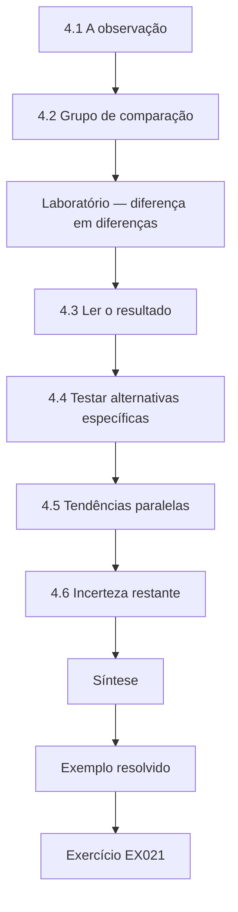

### Desenho lógico

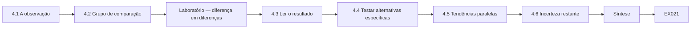

```text
[4.1 A observação]
    |
    v
[4.2 Grupo de comparação]
    |
    v
[Laboratório — diferença em diferenças]
    |
    v
[4.3 Ler o resultado]
    |
    v
[4.4 Testar alternativas específicas]
    |
    v
[4.5 Tendências paralelas]
    |
    v
[4.6 Incerteza restante]
    |
    v
[Síntese]
    |
    v
[Exemplo resolvido] --> [Exercício EX021]
```
<!-- cykin:lesson-figures:end ch-04 -->


### Objetivos de aprendizagem

Você vai (1) listar explicações concorrentes para uma mudança observada; (2) usar um grupo de comparação para eliminar efeitos compartilhados; (3) testar alternativas específicas com dados; (4) indicar o que continua incerto.

### 4.1 A observação

Depois que as listas de permissão foram acrescentadas na semana 5, os alertas das dez regras ajustadas caíram fortemente. Conclusão tentadora: o ajuste funcionou. Mas outras coisas aconteceram nas semanas 5–8: um feriado, uma atualização do SIEM e a migração de uma fonte de logs de firewall. Cada um dos três eventos ameaça a conclusão de um jeito. Um feriado reduz a atividade, e portanto os alertas, de forma geral. Uma atualização do SIEM poderia mudar a forma como as regras disparam. A migração de uma fonte de logs poderia cortar a entrada de uma regra. Qualquer um deles, acontecendo na semana 5, poderia produzir uma queda forte nas regras ajustadas sem que as listas de permissão fizessem nada.

### 4.2 Grupo de comparação

Se a queda se devesse ao feriado ou à atualização do SIEM, as regras não ajustadas também deveriam cair. A diferença em diferenças subtrai a mudança do grupo de controle da mudança do grupo ajustado. As regras de controle são o motivo pelo qual Tariq consegue separar esses efeitos. Sem elas, uma queda nas regras ajustadas numa semana de feriado seria impossível de interpretar. Com elas, o feriado e a atualização do SIEM aparecem nos dois grupos, e só a parte da queda exclusiva das regras ajustadas é atribuída ao ajuste.

### Laboratório — diferença em diferenças

```python
"""Difference-in-differences on synthetic weekly alert counts.
Tuned group: rules given allow-lists in week 5. Control group: untuned rules."""
tuned   = [410, 395, 402, 420, 230, 241, 225, 236]
control = [300, 290, 305, 310, 262, 270, 258, 266]
def mean(x): return sum(x) / len(x)
t_pre, t_post = mean(tuned[:4]), mean(tuned[4:])
c_pre, c_post = mean(control[:4]), mean(control[4:])
print(f"tuned   pre={t_pre:.1f} post={t_post:.1f} change={t_post-t_pre:.1f}")
print(f"control pre={c_pre:.1f} post={c_post:.1f} change={c_post-c_pre:.1f}")
print(f"difference-in-differences = {(t_post-t_pre)-(c_post-c_pre):.1f} alerts/week")
```

Execute com `python3 lab_did.py`. Saída verificada:

```text
tuned   pre=406.8 post=233.0 change=-173.8
control pre=301.2 post=264.0 change=-37.2
difference-in-differences = -136.5 alerts/week
```

### 4.3 Ler o resultado

As regras ajustadas caíram de 406.8 para 233.0 alertas por semana (−173.8). As regras de controle também caíram, de 301.2 para 264.0 (−37.2), o que mostra um efeito compartilhado. A estimativa líquida atribuível ao ajuste é de −136.5 alertas por semana. As mudanças impressas são arredondadas para uma casa decimal; calculadas a partir das médias não arredondadas dos grupos, a mudança das ajustadas é −173.75 e a do controle, −37.25, e é por isso que a estimativa líquida é −136.5, e não −136.6. Tariq relata a estimativa líquida, não a queda bruta, como o efeito do ajuste. A nota sobre o arredondamento importa porque um examinador que conferisse a aritmética à mão poderia suspeitar de um erro.

### 4.4 Testar alternativas específicas

**Interrupção de fonte de logs:** as contagens de ingestão por fonte não mostram lacunas nas semanas 5–8. **Migração do firewall:** nenhuma das regras ajustadas usa logs de firewall. **Ajuste por colegas:** o registro de mudanças não mostra outras edições nas vinte regras. **Feriado:** afeta os dois grupos; absorvido pela comparação. Cada alternativa foi verificada com sua própria evidência, em vez de descartada no argumento: as contagens de ingestão para a interrupção, as definições das regras para a migração do firewall e o registro de mudanças para o ajuste por colegas. Só o feriado precisou do grupo de comparação, porque afetou os dois.

### 4.5 Tendências paralelas

A diferença em diferenças supõe que os dois grupos teriam se movido da mesma forma sem o ajuste. Nas semanas 1–4, suas tendências são semelhantes (ambas aproximadamente estáveis), o que sustenta, mas não prova, essa suposição. As quatro semanas de linha de base mostram os dois grupos aproximadamente estáveis: as regras ajustadas entre 395 e 420 alertas por semana, as de controle entre 290 e 310. Se as regras ajustadas já estivessem caindo, parte da queda depois da semana 5 seria a continuação de uma tendência. Um comportamento semelhante no período anterior é a melhor evidência disponível de que elas teriam continuado estáveis juntas.

### 4.6 Incerteza restante

Oito semanas é pouco; o intervalo da estimativa é largo porque as contagens semanais variam. Tariq relata na dissertação a estimativa pontual com um intervalo *bootstrap*. O intervalo *bootstrap* relatado na dissertação vai de 98 a 171 alertas por semana. É largo, mas exclui o zero e os efeitos pequenos, então a conclusão de que o ajuste reduziu o volume se mantém mesmo no limite inferior. A largura diz à Pelham que não prometa uma economia precisa aos analistas. Mais semanas depois do ajuste o estreitariam, porque as contagens semanais variam até cerca de 25 alertas de uma semana para outra, e oito semanas dão apenas quatro valores pós-ajuste por grupo.

### Exemplo resolvido

Tabela de alternativas de Tariq: cada explicação, a evidência que a sustentaria, a verificação feita e o resultado. Só a explicação do ajuste sobrevive a todas as verificações; o feriado explica a queda do grupo de controle.

> **Caso sintético.** As contagens vêm do script do laboratório.

### Erros e limites

Os grupos de comparação eliminam apenas os efeitos compartilhados; algo que afetasse só as regras ajustadas ainda enviesaria a estimativa.

### Exercícios

- **EX021 — Lista de alternativas.** Cite três explicações concorrentes para a queda. *Rubrica:* 3 = feriado, atualização do SIEM, migração do firewall (ou interrupção/ajuste por colegas); 2 = duas; 1 = uma; 0 = nada.
- **EX022 — Lógica da DiD.** Explique a diferença em diferenças numa frase. *Rubrica:* 3 = subtrair a mudança do controle da mudança do tratado para eliminar efeitos compartilhados; 2 = parcial; 1 = vago; 0 = nada.
- **EX023 — Estimativa do laboratório.** Dê as mudanças dos dois grupos e a estimativa líquida. *Rubrica:* 3 = −173.8, −37.2, −136.5; 2 = duas; 1 = uma; 0 = nada.
- **EX024 — Verificações específicas.** Como a migração do firewall foi descartada? *Rubrica:* 3 = as regras ajustadas não usam logs de firewall; 2 = parcial; 1 = suposto; 0 = nada.
- **EX025 — Tendências paralelas.** Que suposição o método exige, e o que a sustenta? *Rubrica:* 3 = tendências paralelas; período anterior semelhante e estável; 2 = só a suposição; 1 = vago; 0 = nada.
- **EX026 — Viés residual.** O que ainda poderia enviesar a estimativa? *Rubrica:* 3 = algo que afete só as regras ajustadas; 2 = parcial; 1 = vago; 0 = nada.

### Síntese

Antes de dar crédito a uma intervenção, liste as rivais, subtraia os efeitos compartilhados e teste as demais uma a uma.

### Continue estudando — capítulo 04 de 08

[← Capítulo 03 (rascunho)](#ch-03) · [Índice de capítulos do curso](../SUBJECTS.md) · [Capítulo 05 (rascunho) →](#ch-05)

<a id="ch-05"></a>

## Capítulo 5 — Proposta e piloto

<!-- cykin:lesson-figures:start ch-05 -->
### Mapa da aula

Aula 05 publicada. Mapa, exemplo, EX027.

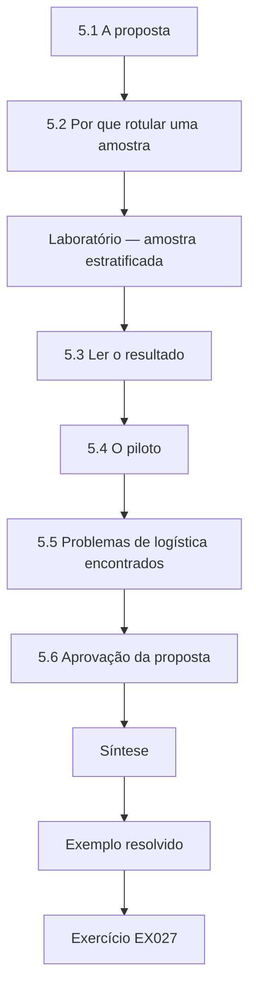

### Desenho lógico

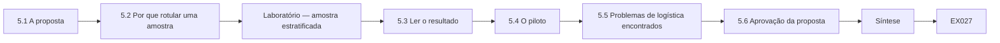

```text
[5.1 A proposta]
    |
    v
[5.2 Por que rotular uma amostra]
    |
    v
[Laboratório — amostra estratificada]
    |
    v
[5.3 Ler o resultado]
    |
    v
[5.4 O piloto]
    |
    v
[5.5 Problemas de logística encontrados]
    |
    v
[5.6 Aprovação da proposta]
    |
    v
[Síntese]
    |
    v
[Exemplo resolvido] --> [Exercício EX027]
```
<!-- cykin:lesson-figures:end ch-05 -->


### Objetivos de aprendizagem

Você vai (1) escrever uma proposta de dissertação; (2) planejar com eficiência uma amostra para rotulagem; (3) pilotar a coleta de dados e a rotulagem; (4) ajustar o plano a partir do piloto.

### 5.1 A proposta

Seções: contexto e lacuna; pergunta e hipóteses; desenho; dados e ética; análise; ameaças à validade; cronograma; riscos. A Dra. Solberg pede no máximo uma página por seção. O limite de páginas obriga cada parte a se comprometer. A página do desenho nomeia as vinte regras e os critérios de pareamento; a página da análise nomeia a diferença em diferenças e o *bootstrap*; a página de riscos nomeia o que interromperia o estudo, como a indisponibilidade do *purple team*. A Dra. Solberg consegue ler a proposta inteira de uma vez e ver cada decisão.

### 5.2 Por que rotular uma amostra

O volume, sozinho, não mostra se os alertas suprimidos eram benignos. Tariq vai rotular manualmente uma amostra de alertas como disparo benigno, falso positivo ou verdadeiro positivo, para estimar quanto da redução removeu apenas ruído benigno. Rotular todos os 4.000 alertas é impossível; uma amostra estratificada por severidade dá estimativas precisas onde importa. Os três rótulos respondem a perguntas diferentes. Um disparo benigno é ruído que o SOC pode remover com segurança; um falso positivo aponta para uma regra que precisa ser corrigida; um verdadeiro positivo removido por uma lista de permissão é um ataque suprimido. Estratificar por severidade garante que os alertas de alta severidade, em que um ataque suprimido mais importaria, não sejam representados por um punhado de casos.

### Laboratório — amostra estratificada

```python
"""Stratified sample of synthetic alerts for manual labelling."""
import random
random.seed(7)
population = {"high": 120, "medium": 900, "low": 2980}
budget = 200
total = sum(population.values())
alloc = {k: max(20, round(budget * v / total)) for k, v in population.items()}
over = sum(alloc.values()) - budget
alloc["low"] -= over
for k, v in population.items():
    ids = random.sample(range(v), alloc[k])
    print(f"{k:6} population={v:5} sampled={alloc[k]:3} first ids={sorted(ids)[:3]}")
print("total sampled", sum(alloc.values()))
```

Execute com `python3 lab_strata.py`. Saída verificada:

```text
high   population=  120 sampled= 20 first ids=[4, 6, 7]
medium population=  900 sampled= 45 first ids=[47, 50, 60]
low    population= 2980 sampled=135 first ids=[16, 49, 92]
total sampled 200
```

### 5.3 Ler o resultado

Com um orçamento de 200, a alocação proporcional daria ao estrato de alta severidade apenas 6 alertas, poucos demais para estimar qualquer coisa. Fixa-se um mínimo de 20, o que dá alta 20, média 45, baixa 135. Uma semente fixa (7) torna o sorteio reprodutível; as estimativas para a população inteira são reponderadas pelo tamanho de cada estrato. Elevar o estrato alto para 20 tira alertas do estrato baixo, que cai de 149 para 135 para manter o total em 200. É a troca certa: os alertas de baixa severidade são numerosos e parecidos, então 135 ainda estimam bem sua composição, enquanto 6 alertas de alta severidade teriam tornado sem sentido qualquer afirmação sobre esse estrato.

### 5.4 O piloto

Tariq e um colega do SOC rotulam 30 alertas de forma independente. Eles discordam em 6, principalmente entre "disparo benigno" e "falso positivo". As definições são afiadas: um disparo benigno é o comportamento pretendido ocorrendo de forma legítima; um falso positivo é a regra casando com um comportamento que ela não deveria pegar. Seis discordâncias em 30 alertas são uma taxa de discordância de 20%, alta demais para a rotulagem principal. Afiar as definições antes da amostra principal, e não depois, significa que a rotulagem dos 200 alertas usa um critério estável. O piloto também mostra onde as definições eram vagas, o que entra nas limitações como possível fonte de viés compartilhado.

### 5.5 Problemas de logística encontrados

Exportar os alertas com campos pseudonimizados levava duas horas à mão; Tariq automatiza a tarefa com um script. O sistema de chamados do SOC trunca as notas; ele usa a exportação do SIEM em seu lugar. As duas correções importam para o estudo principal. Uma exportação manual de duas horas toda semana convidaria a atalhos ou erros ao longo de oito semanas; um script roda sempre da mesma forma e pode ser arquivado. Notas truncadas nos chamados teriam perdido os motivos dos analistas para fechar alertas, de que os rotuladores precisam para decidir entre disparo benigno e falso positivo.

### 5.6 Aprovação da proposta

Solberg e o líder do SOC, **Marcus Bell**, assinam a proposta; o CISO assina o anexo do *purple team*. Três assinaturas refletem três tipos de autoridade: Solberg pelo desenho acadêmico, Bell pelos dados e pelo tempo da equipe do SOC, e o CISO pelos testes autorizados nos sistemas da Pelham. O anexo do *purple team* define o escopo, incluindo a exclusão das redes de tecnologia operacional, para que o líder do exercício possa recusar qualquer coisa fora dele. O anexo do CISO é o documento que o líder do exercício carrega durante as injeções, para que o escopo possa ser conferido no dia sem precisar ligar para ninguém.

### Exemplo resolvido

Cronograma da proposta: "Semanas 1–4: linha de base e rotulagem da amostra da linha de base; semana 5: listas de permissão implantadas após revisão por pares; semanas 5–8: acompanhamento; semana 9: resumo do *purple team*; semanas 10–14: análise e redação."

> **Caso sintético.** Os números da amostra vêm do script do laboratório.

### Erros e limites

Tamanhos mínimos de estrato melhoram as estimativas de estratos pequenos, mas exigem reponderação; esquecê-la enviesa os totais.

### Exercícios

- **EX027 — Seções da proposta.** Liste seis seções da proposta. *Rubrica:* 3 = seis entre contexto, pergunta, desenho, dados/ética, análise, ameaças, cronograma, riscos; 2 = quatro; 1 = duas; 0 = nada.
- **EX028 — Por que amostrar.** Por que rotular uma amostra em vez de confiar no volume? *Rubrica:* 3 = o volume não mostra se os alertas removidos eram benignos; todos são demais; 2 = parcial; 1 = sem motivo; 0 = nada.
- **EX029 — Alocação.** Dê as alocações por estrato e por que o alto recebe 20. *Rubrica:* 3 = 20/45/135; a proporcional dá 6, poucos demais; 2 = só os números; 1 = errado; 0 = nada.
- **EX030 — Reponderação.** Por que reponderar as estimativas? *Rubrica:* 3 = amostra não proporcional; reponderar pelo tamanho do estrato para evitar viés; 2 = parcial; 1 = não precisa; 0 = nada.
- **EX031 — Definições afiadas.** Como disparo benigno e falso positivo foram distinguidos? *Rubrica:* 3 = comportamento pretendido legítimo vs. correspondência não pretendida; 2 = parcial; 1 = iguais; 0 = nada.
- **EX032 — Assinaturas.** Quem assinou a proposta e o anexo? *Rubrica:* 3 = Solberg e Bell; o CISO, o anexo do *purple team*; 2 = parcial; 1 = vago; 0 = nada.

### Síntese

Uma proposta fixa o plano; um piloto testa definições e logística; a amostragem torna a rotulagem manual viável e reprodutível.

### Continue estudando — capítulo 05 de 08

[← Capítulo 04 (rascunho)](#ch-04) · [Índice de capítulos do curso](../SUBJECTS.md) · [Capítulo 06 (rascunho) →](#ch-06)

<a id="ch-06"></a>

## Capítulo 6 — Coleta e análise de dados

<!-- cykin:lesson-figures:start ch-06 -->
### Mapa da aula

Aula 06 publicada. Mapa, exemplo, EX033.

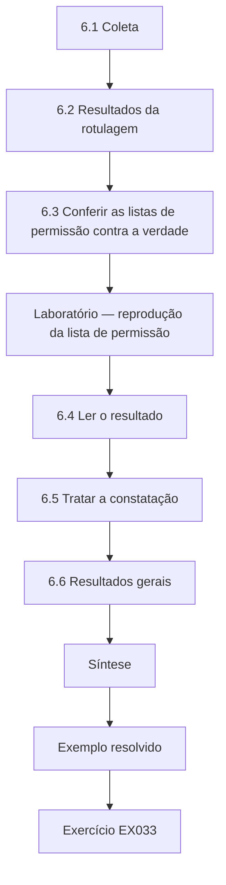

### Desenho lógico

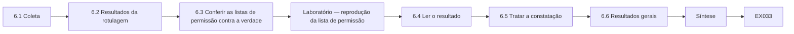

```text
[6.1 Coleta]
    |
    v
[6.2 Resultados da rotulagem]
    |
    v
[6.3 Conferir as listas de permissão contra a verdade]
    |
    v
[Laboratório — reprodução da lista de permissão]
    |
    v
[6.4 Ler o resultado]
    |
    v
[6.5 Tratar a constatação]
    |
    v
[6.6 Resultados gerais]
    |
    v
[Síntese]
    |
    v
[Exemplo resolvido] --> [Exercício EX033]
```
<!-- cykin:lesson-figures:end ch-06 -->


### Objetivos de aprendizagem

Você vai (1) coletar dados operacionais conforme o protocolo aprovado; (2) avaliar listas de permissão contra a verdade de referência injetada; (3) combinar volume, rótulos e desfechos de segurança; (4) tratar adequadamente constatações inesperadas.

### 6.1 Coleta

Exportações semanais do SIEM dão as contagens de alertas por regra, pseudonimizadas na origem. A amostra para rotulagem é sorteada com a semente registrada. Os eventos de *purple team* são registrados pelo líder do exercício com os horários exatos. Registrar os eventos de *purple team* de forma independente do SIEM é a salvaguarda principal: se uma lista de permissão suprime um evento, o SIEM não tem registro dele, mas o log do líder do exercício ainda mostra o horário e o alvo. Sortear a amostra com a semente registrada significa que os 200 alertas foram escolhidos antes que alguém visse quais eram interessantes.

### 6.2 Resultados da rotulagem

Da amostra reponderada de alertas removidos pelas listas de permissão, estima-se que 93% eram disparos benignos, 6% falsos positivos e 1% não resolvidos. Isso sustenta a afirmação de que o ajuste removeu principalmente atividade legítima. A reponderação importa aqui porque a amostra super-representa os alertas de alta severidade. Sem ela, a composição dos 20 alertas de alta severidade contaria muito mais do que sua participação na população. O 1% não resolvido é relatado em vez de atribuído, porque adivinhar esses rótulos faria a parcela benigna parecer mais certa do que é. Os 6% de falsos positivos apontam para regras que precisam de correção, e não de lista de permissão.

### 6.3 Conferir as listas de permissão contra a verdade de referência

As entradas das listas de permissão suprimem alertas para combinações específicas de regra, *host* e conta. A preocupação é que um atacante que use uma conta permitida num *host* permitido fique escondido. A preocupação decorre de como as listas de permissão funcionam: uma entrada que diz "espera-se que esta conta, neste *host*, faça isto" também manda a regra ignorar qualquer pessoa que tenha tomado essa conta nesse *host*. Conferir as entradas contra a verdade de referência do *purple team* é a única forma de ver isso, porque um alerta suprimido não deixa rastro nos dados de alertas.

### Laboratório — reprodução da lista de permissão

```python
"""Apply an allow-list to synthetic labelled alerts; check for suppressed attacks."""
alerts = [
    ("ps-encoded", "SCADA-HIST01", "svc_backup", "benign"),
    ("ps-encoded", "SCADA-HIST01", "svc_backup", "benign"),
    ("ps-encoded", "FIN-PC07", "a.moss", "attack"),
    ("new-service", "PATCH-SRV2", "svc_patch", "benign"),
    ("new-service", "PATCH-SRV2", "svc_patch", "attack"),
    ("new-service", "HR-PC03", "j.ward", "benign"),
    ("rdp-logon", "JUMP01", "it.admin", "benign"),
    ("rdp-logon", "JUMP01", "it.admin", "benign"),
]
allow = {("ps-encoded", "SCADA-HIST01", "svc_backup"), ("new-service", "PATCH-SRV2", "svc_patch"), ("rdp-logon", "JUMP01", "it.admin")}
kept = [a for a in alerts if a[:3] not in allow]
suppressed = [a for a in alerts if a[:3] in allow]
print("alerts", len(alerts), "kept", len(kept), "suppressed", len(suppressed))
print("attacks kept", sum(a[3] == "attack" for a in kept), "attacks suppressed", sum(a[3] == "attack" for a in suppressed))
for a in suppressed:
    if a[3] == "attack": print("SUPPRESSED ATTACK:", a[:3])
```

Execute com `python3 lab_allow.py`. Saída verificada:

```text
alerts 8 kept 2 suppressed 6
attacks kept 1 attacks suppressed 1
SUPPRESSED ATTACK: ('new-service', 'PATCH-SRV2', 'svc_patch')
```

### 6.4 Ler o resultado

Dos 8 alertas da amostra, 6 são suprimidos e 2 mantidos. Um alerta mantido é um ataque (FIN-PC07). Um alerta suprimido é um ataque: um novo serviço em PATCH-SRV2 criado por svc_patch — o uso indevido simulado da conta de aplicação de patches pelo *purple team*. A entrada "new-service em PATCH-SRV2 por svc_patch" esconde exatamente isso. Este é o caso que o estudo foi desenhado para pegar. O evento suprimido não é uma falha da regra, mas da entrada da lista de permissão: ao confiar em todo novo serviço que svc_patch cria em PATCH-SRV2, ela confiou também no uso indevido. Uma avaliação só de volume teria contado essa entrada como um sucesso.

### 6.5 Tratar a constatação

Conforme a regra de parada registrada, a entrada é revisada em até um dia. Marcus Bell a estreita: novos serviços criados por svc_patch em PATCH-SRV2 só são permitidos quando o nome do serviço corresponde ao padrão de nomes assinado da ferramenta de patches e o evento ocorre na janela de manutenção. Uma nova reprodução mostra que o evento injetado agora gera alerta. A entrada estreitada ainda remove o ruído rotineiro da aplicação legítima de patches, porque os serviços reais de patch seguem o padrão de nomes assinado e rodam na janela de manutenção. O que ela deixa de fazer é confiar só na conta. A nova reprodução confirma a correção no caso injetado; o registro de mudanças registra o estreitamento da entrada AL-07 na semana 6.

### 6.6 Resultados gerais

Redução líquida de 136.5 alertas/semana (capítulo 4); 93% dos alertas removidos eram benignos; 1 de 8 eventos injetados suprimido antes do estreitamento, 0 depois. Os três resultados respondem às três partes da pergunta: o volume caiu, o que foi removido era em sua maioria benigno, e o único ataque suprimido foi encontrado e corrigido. Relatá-los juntos impede que algum seja citado sozinho, como a redução de volume sem o evento suprimido. O segundo resultado se apoia na rotulagem estratificada de 200 alertas, reponderada pelo tamanho dos estratos; o terceiro, no log independente do líder do exercício com todos os oito eventos injetados. Cada um tem seu próprio arquivo-fonte no pacote arquivado.

### Exemplo resolvido

A tabela de resultados de Tariq tem três linhas — volume, composição dos rótulos, segurança —, cada uma com estimativa, incerteza e arquivo-fonte, mais uma nota: "A constatação de segurança levou ao estreitamento da entrada AL-07 da lista de permissão na semana 6."

> **Caso sintético.** Os alertas vêm do script do laboratório.

### Erros e limites

Oito eventos injetados são poucos; zero supressões depois do estreitamento não prova que não haverá supressões futuras.

### Exercícios

- **EX033 — Composição dos rótulos.** Que parcela dos alertas removidos era de disparos benignos? *Rubrica:* 3 = cerca de 93%, reponderada; 2 = só o número; 1 = errado; 0 = nada.
- **EX034 — Risco da lista de permissão.** Por que as listas de permissão podem esconder ataques? *Rubrica:* 3 = um atacante que usa uma combinação permitida de conta/*host* é suprimido; 2 = parcial; 1 = não podem; 0 = nada.
- **EX035 — Saída da reprodução.** Resuma a saída do laboratório. *Rubrica:* 3 = 8 alertas, 6 suprimidos, 2 mantidos; 1 ataque mantido, 1 suprimido (PATCH-SRV2 svc_patch); 2 = parcial; 1 = errado; 0 = nada.
- **EX036 — Estreitamento.** Como a entrada AL-07 foi estreitada? *Rubrica:* 3 = padrão de nomes assinado mais janela de manutenção; nova reprodução gera alerta; 2 = parcial; 1 = regra excluída; 0 = nada.
- **EX037 — Três desfechos.** Relate os três resultados gerais. *Rubrica:* 3 = −136.5/semana, 93% benignos, injeções suprimidas 1→0; 2 = dois; 1 = um; 0 = nada.
- **EX038 — Zero supressões.** Por que zero depois do estreitamento não prova segurança? *Rubrica:* 3 = poucos eventos injetados; comportamentos futuros podem ser diferentes; 2 = parcial; 1 = prova; 0 = nada.

### Síntese

Meça volume, composição e segurança juntos; quando a verdade de referência expõe um buraco, corrija-o conforme o protocolo e relate-o.

### Continue estudando — capítulo 06 de 08

[← Capítulo 05 (rascunho)](#ch-05) · [Índice de capítulos do curso](../SUBJECTS.md) · [Capítulo 07 (rascunho) →](#ch-07)

<a id="ch-07"></a>

## Capítulo 7 — Redação da dissertação e limitações

<!-- cykin:lesson-figures:start ch-07 -->
### Mapa da aula

Aula 07 publicada. Mapa, exemplo, EX039.

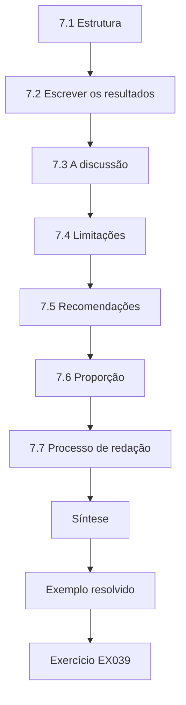

### Desenho lógico

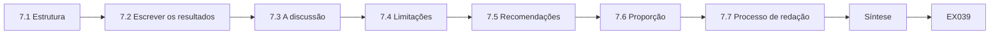

```text
[7.1 Estrutura]
    |
    v
[7.2 Escrever os resultados]
    |
    v
[7.3 A discussão]
    |
    v
[7.4 Limitações]
    |
    v
[7.5 Recomendações]
    |
    v
[7.6 Proporção]
    |
    v
[7.7 Processo de redação]
    |
    v
[Síntese]
    |
    v
[Exemplo resolvido] --> [Exercício EX039]
```
<!-- cykin:lesson-figures:end ch-07 -->


### Objetivos de aprendizagem

Você vai (1) estruturar uma dissertação de mestrado; (2) escrever os resultados sem exagerar; (3) escrever uma seção de limitações forte; (4) fazer recomendações proporcionais à evidência.

### 7.1 Estrutura

Resumo; introdução; revisão da literatura; método; resultados; discussão; limitações; recomendações; conclusão; referências; apêndices (protocolo, scripts, registro de mudanças das listas de permissão). O registro de mudanças das listas de permissão nos apêndices é o que mais importa aos profissionais: mostra a forma original e a estreitada de cada entrada, com datas e motivos, incluindo a AL-07. Os scripts permitem que um leitor reproduza a diferença em diferenças e a amostra estratificada a partir das contagens arquivadas. Pôr as recomendações num capítulo próprio, depois das limitações, significa que cada recomendação é lida à luz do que o estudo não conseguiu mostrar.

### 7.2 Escrever os resultados

Os resultados relatam o que foi medido, com a incerteza: "Redução líquida de 136.5 alertas por semana (intervalo *bootstrap* de 95%: 98–171)." A interpretação pertence à discussão. Tariq evita palavras como "prova" e "elimina". O intervalo importa tanto quanto a estimativa: de 98 a 171 alertas por semana diz aos gestores da Pelham que a economia é real, mas de tamanho incerto. Manter a interpretação fora do capítulo de resultados significa que um leitor pode conferir os números com os scripts antes de ler o que Tariq acha que eles significam. O resumo em linguagem simples para a Pelham usa o mesmo intervalo, para que gestores e examinadores vejam a mesma incerteza.

### 7.3 A discussão

O ajuste removeu principalmente disparos benignos, em linha com Alahmadi et al. (2022). O evento injetado suprimido mostra que as listas de permissão deslocam o risco em vez de eliminá-lo: elas trocam tempo de analista por pontos cegos. Entradas estreitas e condicionais reduzem esse custo-benefício. A discussão retoma a afirmação do seminário: a redução de volume, sozinha, teria escondido o problema da AL-07. Ela também explica por que entradas estreitas ajudam: uma condição como um padrão de nomes assinado e uma janela de manutenção remove o ruído rotineiro e deixa visível o uso indevido da mesma conta.

### 7.4 Limitações

Um SOC; oito semanas; vinte regras; oito eventos injetados; rotulagem por duas pessoas da mesma equipe; suposição de tendências paralelas impossível de testar depois da semana 5; comportamentos de *purple team* escolhidos por pessoas que conheciam as regras. Cada limitação indica, quando possível, a direção provável do viés — por exemplo, eventos injetados desenhados com conhecimento da lógica das regras provavelmente fazem a supressão parecer mais rara do que seria diante de atacantes desconhecidos. A limitação da rotulagem é escrita por extenso na dissertação: os dois rotuladores compartilham suposições sobre o que é normal, então um viés compartilhado não apareceria como discordância, e um rotulador externo fortaleceria trabalhos futuros.

### 7.5 Recomendações

Revisar as entradas das listas de permissão com o mesmo rigor das regras; acrescentar condições (janela de tempo, nomes assinados) em vez de pares amplos de *host* e conta; reproduzir as entradas contra eventos de *purple team* a cada trimestre; acompanhar os testes de ataques suprimidos como métrica ao lado do volume. Cada recomendação vem de uma constatação específica. Revisar as entradas como regras decorre do caso da AL-07. Condições em vez de pares de *host* e conta decorrem de como o estreitamento o corrigiu. A reprodução trimestral decorre de o problema só ter ficado visível com eventos injetados. Acompanhar os testes de ataques suprimidos ao lado do volume decorre do argumento do seminário de que o volume, sozinho, recompensa o silêncio.

### 7.6 Proporção

As recomendações são formuladas para SOCs semelhantes ao da Pelham, não para "todos os SOCs". Esse limite decorre do estudo: um SOC, vinte regras e oito eventos injetados não podem mostrar o que acontece num SOC com outras ferramentas, outra equipe ou outros processos de mudança. Quando a revisora externa apontou que SOCs menores podem não ter um processo de mudanças maduro, Tariq acrescentou um parágrafo dizendo como as recomendações se adaptam a uma escala menor, em vez de ampliar a afirmação. A versão reduzida mantém os passos centrais, entradas condicionais e reprodução contra eventos simulados, e dispensa o comitê formal de mudanças que só um SOC maior como o da Pelham consegue manter.

### 7.7 Processo de redação

Tariq escreve primeiro o método, depois os resultados e por último a discussão, e envia cada capítulo a Solberg assim que o termina. Escrever o método primeiro, enquanto o desenho está fresco, significa que ele descreve o que de fato foi feito, incluindo o script de exportação e o estreitamento da AL-07. Enviar cada capítulo assim que fica pronto permite que Solberg pegue problemas cedo, como uma frase de resultados que escorrega para a interpretação, em vez de numa leitura final, quando as mudanças são caras. Os comentários dela sobre o capítulo de método ainda podem mudar a forma como os resultados são relatados, o que seria impossível se todos os capítulos chegassem juntos no fim.

### Exemplo resolvido

Parágrafo de limitação de Tariq sobre a rotulagem: "Os dois rotuladores trabalham no SOC da Pelham e podem compartilhar suposições sobre o que é normal. A concordância depois das mudanças de definição foi alta, mas um viés compartilhado não apareceria como discordância. Um rotulador externo fortaleceria trabalhos futuros."

> **Caso sintético.** O texto é inventado.

### Erros e limites

Longas listas de limitações sem direção nem impacto são menos úteis do que poucas limitações analisadas.

### Exercícios

- **EX039 — Partes da dissertação.** Liste em ordem as principais seções da dissertação. *Rubrica:* 3 = do resumo aos apêndices, em ordem; 2 = pequenos deslizes; 1 = embaralhadas; 0 = nada.
- **EX040 — Redação dos resultados.** Reescreva "o ajuste eliminou o ruído" no estilo de resultados. *Rubrica:* 3 = estimativa medida com intervalo, sem exagero; 2 = parcial; 1 = sem mudança; 0 = nada.
- **EX041 — Troca de riscos.** Que custo-benefício a discussão identifica? *Rubrica:* 3 = tempo de analista vs. pontos cegos; entradas estreitas o reduzem; 2 = parcial; 1 = vago; 0 = nada.
- **EX042 — Direção do viés.** Em que direção o desenho do *purple team* enviesa a estimativa de supressão? *Rubrica:* 3 = faz a supressão parecer mais rara; os desenhistas conheciam as regras; 2 = só a direção; 1 = errado; 0 = nada.
- **EX043 — Recomendações.** Dê três recomendações. *Rubrica:* 3 = revisar entradas com rigor, entradas condicionais, reprodução trimestral, métrica de supressão (três); 2 = duas; 1 = uma; 0 = nada.
- **EX044 — Viés compartilhado.** Por que um viés compartilhado entre rotuladores não apareceria como discordância? *Rubrica:* 3 = os dois têm as mesmas suposições, então concordam no erro; 2 = parcial; 1 = apareceria; 0 = nada.

### Síntese

Relate os resultados medidos com clareza, interprete na discussão, analise as limitações com sua direção e mantenha as recomendações proporcionais.

### Continue estudando — capítulo 07 de 08

[← Capítulo 06 (rascunho)](#ch-06) · [Índice de capítulos do curso](../SUBJECTS.md) · [Capítulo 08 (rascunho) →](#ch-08)

<a id="ch-08"></a>

## Capítulo 8 — Revisão independente e defesa

<!-- cykin:lesson-figures:start ch-08 -->
### Mapa da aula

Aula 08 publicada. Mapa, exemplo, EX045.

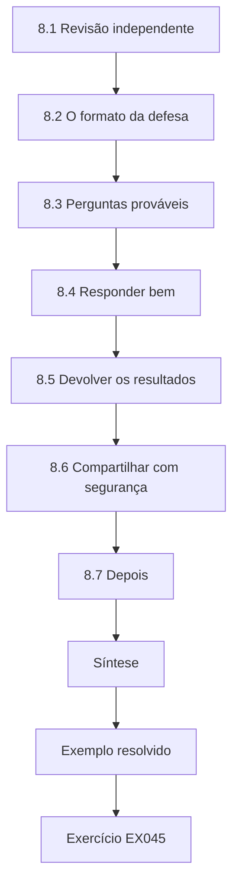

### Desenho lógico

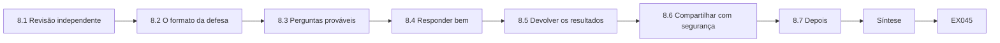

```text
[8.1 Revisão independente]
    |
    v
[8.2 O formato da defesa]
    |
    v
[8.3 Perguntas prováveis]
    |
    v
[8.4 Responder bem]
    |
    v
[8.5 Devolver os resultados]
    |
    v
[8.6 Compartilhar com segurança]
    |
    v
[8.7 Depois]
    |
    v
[Síntese]
    |
    v
[Exemplo resolvido] --> [Exercício EX045]
```
<!-- cykin:lesson-figures:end ch-08 -->


### Objetivos de aprendizagem

Você vai (1) providenciar uma revisão independente antes da entrega; (2) preparar uma defesa oral; (3) responder às perguntas dos examinadores; (4) devolver os resultados à organização anfitriã de forma responsável.

### 8.1 Revisão independente

Antes da entrega, uma analista de SOC de outra organização revisa o método e as recomendações, e um colega de mestrado reexecuta os scripts de análise a partir do pacote arquivado. O principal comentário da analista: "Seu processo de revisão das listas de permissão pressupõe um processo de mudanças maduro; SOCs menores podem não ter um." Tariq acrescenta um parágrafo que adapta a escala das recomendações. As duas revisões testam coisas diferentes. A reexecução do colega verifica que os scripts produzem, a partir do pacote, os números relatados. A analista externa verifica se as recomendações fazem sentido fora da Pelham. O comentário dela levou a uma mudança concreta, registrada no registro de mudanças ao lado do estreitamento da AL-07.

### 8.2 O formato da defesa

Uma apresentação de 20 minutos e 40 minutos de perguntas de dois examinadores. Os vinte minutos de Tariq seguem a dissertação: pergunta, desenho, os três resultados juntos, o caso da AL-07 e os limites. Ele mantém o intervalo *bootstrap* no mesmo slide da estimativa de 136.5, para que os examinadores vejam a incerteza junto com o número. Os quarenta minutos de perguntas são onde acontece a maior parte da avaliação, então ele prepara respostas para as perguntas que mais espera. Os dois examinadores leram o apêndice restrito com os nomes de *hosts* e contas.

### 8.3 Perguntas prováveis

"Por que não sortear?" "Como você sabe que o feriado afetou igualmente os dois grupos?" "Um evento suprimido em oito é muito ou pouco?" "Você implantaria essas listas de permissão em outra empresa de saneamento?" Cada pergunta mira uma escolha de desenho. O sorteio foi rejeitado porque o SOC queria as regras mais ruidosas corrigidas primeiro. O feriado é tratado pelo grupo de controle. A pergunta do um em oito testa se Tariq consegue dizer o que um resultado significa sem exagerá-lo. A última pergunta testa se ele entende o que em seu trabalho se transfere e o que é específico da Pelham.

### 8.4 Responder bem

Tariq responde de forma direta, dá a evidência e depois o limite. Sobre o "um em oito": "Neste exercício, foram 12,5% dos comportamentos injetados, mas os eventos foram poucos e escolhidos; a constatação importante é que uma entrada ampla podia esconder um uso indevido realista, e estreitá-la corrigiu esse caso." Sua resposta sobre a implantação em outro lugar segue o mesmo padrão: não as listas de permissão como estão, porque codificam os *hosts* e as contas da Pelham, mas o processo de entradas condicionais, revisão por pares e reprodução trimestral contra simulações autorizadas. Responder assim mostra aos examinadores que ele consegue separar os artefatos específicos da Pelham do método transferível.

### 8.5 Devolver os resultados

A Pelham recebe um relatório-resumo, a política de listas de permissão estreitada e o script de reprodução. Tariq apresenta os resultados primeiro aos analistas e, na semana seguinte, aos gestores, com o mesmo relatório-resumo, para que as pessoas que fizeram o trabalho ouçam os resultados primeiro. O script de reprodução permite que a Pelham repita o teste da AL-07 em todas as entradas a cada trimestre, sem Tariq. Apresentar primeiro aos analistas também é prático: são eles que mantêm as listas de permissão no dia a dia e que vão perceber se as entradas estreitadas ainda removem o ruído rotineiro.

### 8.6 Compartilhar com segurança

A dissertação pública omite nomes de *hosts*, nomes de contas e detalhes da lógica das regras que ajudariam um atacante a escapar das detecções da Pelham; esses dados ficam num apêndice restrito para os examinadores. A regra é a mesma que Tariq aplicou aos próprios dados: compartilhar o método, não os meios de evasão. Um leitor do texto público fica sabendo que uma entrada ampla de *host* e conta escondeu o uso indevido de uma conta de aplicação de patches e como o estreitamento o corrigiu, sem saber qual *host*, qual conta ou qual lógica de regra permitiria a um atacante repetir isso na Pelham.

### 8.7 Depois

As correções dos examinadores são acompanhadas e concluídas; o pacote arquivado recebe a etiqueta da versão final. A etiqueta final liga o pacote à versão aprovada pelos examinadores, de modo que os scripts, as contagens e o registro de mudanças que alguém baixar depois coincidam exatamente com os números da dissertação. A Pelham recebe a mesma versão etiquetada do script de reprodução. As correções são listadas numa tabela curta com o comentário do examinador, a mudança feita e a página, que entra no pacote com a etiqueta final. Se uma correção mudou algum número, os scripts são reexecutados e a nova saída é arquivada ao lado da antiga.

### Exemplo resolvido

Diante da pergunta "Você implantaria essas listas de permissão em outro lugar?", Tariq responde: "Não como estão — elas codificam os *hosts* e as contas da Pelham. Eu implantaria o processo: entradas condicionais, revisão por pares e reprodução trimestral contra simulações autorizadas."

> **Caso sintético.** A revisão e a defesa são inventadas.

### Erros e limites

Restringir detalhes protege a organização anfitriã, mas limita a reprodutibilidade; o pacote arquivado explica o que foi retido e por quê.

### Exercícios

- **EX045 — Comentário externo.** O que a analista externa apontou, e o que mudou? *Rubrica:* 3 = pressupõe processo de mudanças maduro; parágrafo de adaptação de escala acrescentado; 2 = parcial; 1 = vago; 0 = nada.
- **EX046 — Perguntas da defesa.** Liste três perguntas prováveis dos examinadores. *Rubrica:* 3 = sortear, igualdade do feriado, um em oito, implantar em outro lugar (três); 2 = duas; 1 = uma; 0 = nada.
- **EX047 — Um em oito.** Como Tariq enquadrou o resultado de um em oito? *Rubrica:* 3 = 12,5% de poucos eventos escolhidos; ponto-chave: entrada ampla escondeu uso indevido realista; corrigido com o estreitamento; 2 = parcial; 1 = só a porcentagem; 0 = nada.
- **EX048 — Devolver os resultados.** O que a Pelham recebeu, e quem ouviu primeiro? *Rubrica:* 3 = relatório, política, script de reprodução; analistas antes dos gestores; 2 = parcial; 1 = vago; 0 = nada.
- **EX049 — Apêndice restrito.** O que foi retido da versão pública, e por quê? *Rubrica:* 3 = nomes de *hosts*/contas, detalhes das regras; ajudariam a evasão; 2 = parcial; 1 = vago; 0 = nada.
- **EX050 — Implantar em outro lugar.** Por que não reutilizar as listas de permissão em outra empresa de saneamento? *Rubrica:* 3 = codificam *hosts*/contas específicos da Pelham; transferir o processo; 2 = parcial; 1 = reutilizaria; 0 = nada.

### Síntese

Revisão independente, respostas diretas com seus limites e uma devolução e um compartilhamento responsáveis completam um projeto de mestrado.

### Continue estudando — capítulo 08 de 08

[← Capítulo 07 (rascunho)](#ch-07) · [Índice de capítulos do curso](../SUBJECTS.md) · [Resoluções ↓](#worked-results) · [Próximo curso pelo índice de capítulos →](../SUBJECTS.md)

<a id="worked-results"></a>

## Resoluções

Respostas-modelo para EX001–EX050. Tariq Haddad, a Dra. Ingrid Solberg, Marcus Bell, o Ashworth Institute of Technology, a Pelham Water Utility e todos os números são sintéticos. As respostas dos laboratórios citam saídas verificadas. Qualquer resposta que atenda à rubrica recebe a mesma pontuação.

**EX001.** Não nomeia intervenção, comparação, desfecho mensurável nem horizonte de tempo.

**EX002.** Intervenção (listas de permissão), população (dez regras num SOC), comparação (regras não ajustadas), desfechos (volume e ataques suprimidos) e horizonte de tempo (as mesmas semanas).

**EX003.** A data, a base, os termos exatos, o número de resultados e quantos foram triados e incluídos.

**EX004.** Alahmadi et al. é um estudo empírico revisado por pares; um blog de fornecedor não é revisado e pode servir a objetivos de marketing.

**EX005.** Eles descrevem a prática e os formatos; não mostram se o ajuste funciona.

**EX006.** Quase nenhum estudo mede o efeito do ajuste contra um grupo de comparação.

**EX007.** Eles estudam algoritmos sem dados de analistas nem operacionais, então não podem responder a uma pergunta sobre o tratamento de alertas num SOC.

**EX008.** Vale a pena manter uma regra ativa e ruidosa na proporção da importância dos ativos que ela protege.

**EX009.** Um vocabulário comum de técnicas adversárias, para que a cobertura de detecção possa ser mapeada e comparada.

**EX010.** Um mapa estruturado de técnicas defensivas, que mostra qual contramedida uma detecção representa.

**EX011.** Como um programa contínuo, orientado ao risco, com frequências e métricas definidas, e não como a compra de uma ferramenta.

**EX012.** Contar alertas fechados incentiva o fechamento rápido em vez da investigação cuidadosa.

**EX013.** Alahmadi et al. constataram que o próprio volume alto causa esgotamento, então reduzi-lo tem valor real.

**EX014.** O ajuste se torna um processo repetível e em amadurecimento dentro do SOC, e não uma limpeza única.

**EX015.** O SOC insistiu em ajustar primeiro suas regras mais ruidosas, então o sorteio era inviável; um grupo de comparação não ajustado ainda elimina as mudanças que afetam todas as regras.

**EX016.** Um evento autorizado de *purple team*, registrado com seu horário, que casou com uma regra mas foi removido por uma entrada da lista de permissão.

**EX017.** O CISO o assinou, ele usou comportamento simulado benigno e excluiu as redes de tecnologia operacional.

**EX018.** Dentro do SOC, antes de os dados saírem, para que os nomes reais nunca cheguem à cópia da pesquisa.

**EX019.** Variação sazonal, interrupções de fontes de log e colegas ajustando outras regras (e analistas sabendo do estudo).

**EX020.** Pelo volume semanal de alertas e pela tática do ATT&CK que cobrem.

**EX021.** O feriado, a atualização do SIEM e a migração dos logs de firewall.

**EX022.** Ela toma a mudança no grupo ajustado e subtrai a mudança no grupo não ajustado, cancelando as influências que os dois compartilham.

**EX023.** Ajustadas −173.8, controle −37.2, líquido −136.5 alertas por semana.

**EX024.** Nenhuma das regras ajustadas lê logs de firewall, então a migração não poderia mudar suas contagens.

**EX025.** Que os dois grupos teriam seguido trajetórias paralelas sem o ajuste; suas semanas 1–4, semelhantes e estáveis, sustentam isso.

**EX026.** Qualquer evento que tenha atingido só as regras ajustadas, como uma mudança nos *hosts* que elas monitoram.

**EX027.** Contexto e lacuna, pergunta e hipóteses, desenho, dados e ética, análise e ameaças à validade (e também cronograma e riscos).

**EX028.** Uma queda no volume não diz nada sobre se os alertas removidos eram inofensivos, e rotular todos os alertas não é viável.

**EX029.** Alta 20, média 45, baixa 135; a alocação proporcional daria aos alertas de alta severidade apenas 6, poucos demais para uma estimativa.

**EX030.** A amostra super-representa o estrato alto, então os resultados de cada estrato são ponderados pelo tamanho de sua população para evitar viés.

**EX031.** Um disparo benigno é o comportamento pretendido acontecendo de forma legítima; um falso positivo é a regra pegando um comportamento que nunca deveria casar.

**EX032.** A Dra. Solberg e Marcus Bell assinaram a proposta; o CISO assinou o anexo do *purple team*.

**EX033.** Cerca de 93%, depois de reponderar a amostra estratificada.

**EX034.** Qualquer pessoa que abuse de uma conta permitida num *host* permitido produz atividade que a entrada remove em silêncio.

**EX035.** Oito alertas: seis suprimidos e dois mantidos; um ataque (FIN-PC07) mantido e um ataque (novo serviço em PATCH-SRV2 por svc_patch) suprimido.

**EX036.** Agora ela só vale quando o nome do serviço segue o padrão assinado da ferramenta de patches e o evento cai na janela de manutenção; a nova reprodução então gerou alerta.

**EX037.** Um corte líquido de 136.5 alertas por semana, cerca de 93% dos alertas removidos benignos, e as injeções suprimidas caindo de uma para zero depois do estreitamento.

**EX038.** Só oito eventos foram injetados, e os atacantes podem se comportar de formas que nenhum deles cobriu.

**EX039.** Resumo, introdução, revisão da literatura, método, resultados, discussão, limitações, recomendações, conclusão, referências, apêndices.

**EX040.** "Os alertas semanais das regras ajustadas caíram, em termos líquidos, 136.5 (intervalo de 95%: 98–171) em comparação com as regras não ajustadas."

**EX041.** As listas de permissão poupam tempo dos analistas, mas criam pontos cegos; entradas condicionais reduzem esse custo.

**EX042.** Para baixo: pessoas que conheciam as regras desenharam as injeções, então a supressão provavelmente parece menos comum do que atacantes reais causariam.

**EX043.** Revisar as entradas das listas de permissão como regras, acrescentar condições como janelas de tempo e nomes assinados, e reproduzir as entradas a cada trimestre contra eventos de *purple team* (e também acompanhar os testes de supressão como métrica).

**EX044.** Se os dois rotuladores têm a mesma visão equivocada, concordam um com o outro, e o erro nunca aparece como discordância.

**EX045.** Que o processo de revisão pressupõe um processo de mudanças maduro, que SOCs pequenos podem não ter; Tariq acrescentou um parágrafo adaptando as recomendações ao tamanho do SOC.

**EX046.** Por que não sortear? O feriado afetou igualmente os dois grupos? Um evento suprimido em oito é muito?

**EX047.** Ele disse que foram 12,5% de poucos eventos escolhidos de propósito, e que a verdadeira lição era que uma entrada ampla escondeu um uso indevido realista até ser estreitada.

**EX048.** Um relatório-resumo, a política de listas de permissão estreitada e o script de reprodução; os analistas foram informados antes dos gestores.

**EX049.** Nomes de *hosts*, nomes de contas e a lógica detalhada das regras, que poderiam ajudar alguém a escapar das detecções da Pelham.

**EX050.** Elas foram construídas em torno dos próprios *hosts* e contas da Pelham; o que se transfere é o método de entradas condicionais, revisadas e testadas por reprodução.

<a id="references"></a>
## Referências

Todos os DOIs foram resolvidos em doi.org em 12 de outubro de 2026, e as normas foram conferidas nas páginas de seus editores. A lista é idêntica à da edição em inglês e cobre o livro inteiro; nenhuma das normas técnicas citadas foi verificada aqui como adotada pela ABNT, por isso são citadas em sua edição internacional. Organizações, pessoas, sistemas e números dos casos são sintéticos; somente as obras abaixo são reais.

- Alahmadi, B. A., Axon, L., & Martinovic, I. (2022). 99% false positives: A qualitative study of SOC analysts' perspectives on security alarms. *31st USENIX Security Symposium*, 2783–2800. <https://www.usenix.org/conference/usenixsecurity22/presentation/alahmadi>
- Axelsson, S. (2000). The base-rate fallacy and the difficulty of intrusion detection. *ACM Transactions on Information and System Security*, 3(3), 186–205. <https://doi.org/10.1145/357830.357849>
- Dempsey, K., Chawla, N. S., Johnson, A., Johnston, R., Jones, A. C., Orebaugh, A., Scholl, M., & Stine, K. (2011). *Information Security Continuous Monitoring (ISCM) for Federal Information Systems and Organizations* (NIST SP 800-137). <https://doi.org/10.6028/NIST.SP.800-137>
- Hassan, W. U., Guo, S., Li, D., Chen, Z., Jee, K., Li, Z., & Bates, A. (2019). NoDoze: Combatting threat alert fatigue with automated provenance triage. *NDSS Symposium*. <https://doi.org/10.14722/ndss.2019.23349>
- Kaloroumakis, P. E., & Smith, M. J. (2021). *Toward a Knowledge Graph of Cybersecurity Countermeasures* (MITRE D3FEND). The MITRE Corporation. <https://d3fend.mitre.org/resources/D3FEND.pdf>
- Kent, K., & Souppaya, M. (2006). *Guide to Computer Security Log Management* (NIST SP 800-92). <https://doi.org/10.6028/NIST.SP.800-92>
- Knerler, K., Parker, I., & Zimmerman, C. (2022). *11 Strategies of a World-Class Cybersecurity Operations Center* (2nd ed.). The MITRE Corporation. <https://www.mitre.org/news-insights/publication/11-strategies-world-class-cybersecurity-operations-center>
- Kokulu, F. B., Soneji, A., Bao, T., Shoshitaishvili, Y., Zhao, Z., Doupé, A., & Ahn, G.-J. (2019). Matched and mismatched SOCs: A qualitative study on security operations center issues. *ACM CCS 2019*, 1955–1970. <https://doi.org/10.1145/3319535.3354239>
- Landis, J. R., & Koch, G. G. (1977). The measurement of observer agreement for categorical data. *Biometrics*, 33(1), 159–174. <https://doi.org/10.2307/2529310>
- National Institute of Standards and Technology. (2024). *The NIST Cybersecurity Framework (CSF) 2.0* (NIST CSWP 29). <https://doi.org/10.6028/NIST.CSWP.29>
- Nelson, A., Rekhi, S., Souppaya, M., & Scarfone, K. (2025). *Incident Response Recommendations and Considerations for Cybersecurity Risk Management* (NIST SP 800-61 Rev. 3). <https://doi.org/10.6028/NIST.SP.800-61r3>
- SigmaHQ. *Sigma: Generic signature format for SIEM systems* (rule specification and repository). <https://github.com/SigmaHQ/sigma>
- Sommer, R., & Paxson, V. (2010). Outside the closed world: On using machine learning for network intrusion detection. *IEEE Symposium on Security and Privacy*, 305–316. <https://doi.org/10.1109/SP.2010.25>
- Strom, B. E., Applebaum, A., Miller, D. P., Nickels, K. C., Pennington, A. G., & Thomas, C. B. (2018, rev. 2020). *MITRE ATT&CK: Design and Philosophy* (MP180360R1). The MITRE Corporation. <https://attack.mitre.org/docs/ATTACK_Design_and_Philosophy_March_2020.pdf>
- Sundaramurthy, S. C., Case, J., Truong, T., Zomlot, L., & Hoffmann, M. (2014). A tale of three security operation centers. *ACM Workshop on Security Information Workers (SIW '14)*, 43–50. <https://doi.org/10.1145/2663887.2663904>
- van Os, R. (2016). *SOC-CMM: Designing and Evaluating a Tool for Measurement of Capability Maturity in Security Operations Centers* (Master's thesis). Luleå University of Technology. <https://ltu.diva-portal.org/smash/get/diva2:1031560/FULLTEXT02>
- Vielberth, M., Böhm, F., Fichtinger, I., & Pernul, G. (2020). Security operations center: A systematic study and open challenges. *IEEE Access*, 8, 227756–227779. <https://doi.org/10.1109/ACCESS.2020.3045514>
- Zimmerman, C. (2014). *Ten Strategies of a World-Class Cybersecurity Operations Center*. The MITRE Corporation. ISBN 978-0-692-24310-7. <https://www.mitre.org/sites/default/files/publications/pr-13-1028-mitre-10-strategies-cyber-ops-center.pdf>
