# Inteligência de ameaças e OSINT: um livro de pesquisa para o mestrado

- Idioma: português do Brasil (`pt`); mestrado, dois anos. Edição de referência: [inglês](../../en/book/MANUSCRIPT.md).
- Estado editorial: **publicado**. Os capítulos 1–8 de 8 têm texto didático escrito; os exercícios EX001–EX056 têm resoluções correspondentes com rubricas de 0 a 3; três laboratórios offline usam apenas a biblioteca padrão do Python 3 sobre dados sintéticos, com saídas vindas de execuções reais. A revisão independente e a verificação de 300 páginas A4 continuam em aberto.
- Público: mestrandos que vão desenhar e defender um estudo empírico delimitado sobre a prática de inteligência de ameaças cibernéticas (CTI) ou de OSINT.
- Autor: [hiagokinlevi](https://github.com/hiagokinlevi). Texto original sob [CC0 1.0](../../../../../LICENSE); as obras citadas mantêm seus direitos.
- Limite ético: nenhuma coleta sobre pessoas privadas reais, nenhuma evasão de termos de uso, nenhum acesso a sistemas de adversários. Organizações, pessoas e conjuntos de dados são **sintéticos**, salvo quando uma frase cita uma fonte pública.

[Página do curso](../../README.md) · [Índice de capítulos](../SUBJECTS.md) · [Plano do livro](PLAN.md) · [Skill do curso](../../skill/SKILL.md) · [Resoluções](#worked-results)

## Como usar este rascunho

Os capítulos 1–2 formulam uma pergunta e percorrem a área; o 3 trata de desenho, ética e reprodutibilidade; o 4 treina o raciocínio com hipóteses concorrentes; o 5 é a proposta e o piloto; o 6 coleta e analisa; o 7 escreve com as limitações; o 8 cuida da revisão independente e da defesa. Cada capítulo tem objetivos, texto didático, um exemplo resolvido, um caso sintético rotulado, erros e limites, sete exercícios pontuados de 0 a 3, uma síntese e um bloco **Continue estudando**.

### Caso contínuo sintético

| Elemento | Papel | Limite |
|---|---|---|
| **Coastline Ports Sharing Group (CPSG)** — comunidade setorial de doze operadores portuários que trocam indicadores por TAXII 2.1 | População estudada | Inventado |
| **Lucía Ferraz** | Mestranda que mede se a filiação encurta o tempo até o bloqueio | Inventada |
| **Prof. Daniel Okafor** | Orientador da dissertação | Inventado |

### Fontes principais

MITRE [ATT&CK](https://attack.mitre.org/); OASIS [STIX 2.1](https://docs.oasis-open.org/cti/stix/v2.1/stix-v2.1.html) e [TAXII 2.1](https://docs.oasis-open.org/cti/taxii/v2.1/taxii-v2.1.html); [Diamond Model](https://www.activeresponse.org/wp-content/uploads/2013/07/diamond.pdf); a [kill chain](https://www.lockheedmartin.com/content/dam/lockheed-martin/rms/documents/cyber/LM-White-Paper-Intel-Driven-Defense.pdf) de Hutchins et al.; NIST [SP 800-150](https://doi.org/10.6028/NIST.SP.800-150); FIRST [TLP 2.0](https://www.first.org/tlp/); [ICD 203](https://www.odni.gov/files/documents/ICD/ICD-203.pdf). Lista completa em [Referências](#references).

## Sumário

| Capítulos |
|---|
| [1](#ch-01) · [2](#ch-02) · [3](#ch-03) · [4](#ch-04) · [5](#ch-05) · [6](#ch-06) · [7](#ch-07) · [8](#ch-08) |

[Resoluções](#worked-results) · [Referências](#references)

<a id="ch-01"></a>

## Capítulo 1 — Pergunta de pesquisa e método de revisão da literatura

<!-- cyberabc:lesson-figures:start ch-01 -->
### Mapa da aula

Aula 01 publicada. Mapa, exemplo, EX001.

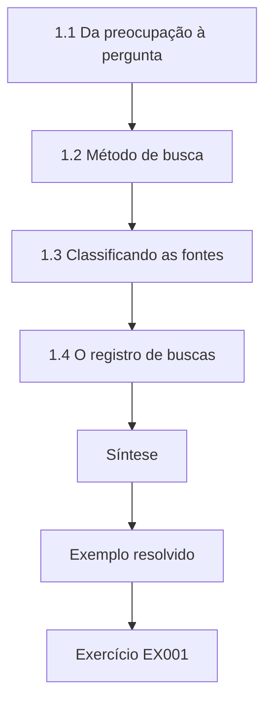

### Desenho lógico

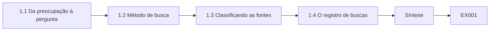

```text
[1.1 Da preocupação à pergunta]
    |
    v
[1.2 Método de busca]
    |
    v
[1.3 Classificando as fontes]
    |
    v
[1.4 O registro de buscas]
    |
    v
[Síntese]
    |
    v
[Exemplo resolvido] --> [Exercício EX001]
```
<!-- cyberabc:lesson-figures:end ch-01 -->


### Objetivos de aprendizagem

Você vai (1) transformar uma preocupação de profissionais em uma pergunta pesquisável; (2) conduzir uma busca documentada na literatura, com critérios de inclusão; (3) classificar as fontes por tipo e confiabilidade; (4) manter um registro de buscas que outra pessoa possa repetir.

### 1.1 Da preocupação à pergunta

Os gestores de segurança portuária do CPSG acreditam que compartilhar indicadores "ajuda". Lucía converte essa crença em uma pergunta com população, intervenção, comparação e desfecho: entre operadores portuários, receber indicadores pela coleção TAXII 2.1 do CPSG encurta o tempo entre a primeira publicação de um indicador e uma regra de bloqueio nos controles do membro, em comparação com operadores semelhantes fora do grupo? Essa estrutura deixa claro de que dados ela precisa e de quais não precisa. O desfecho, as horas entre a publicação e o bloqueio, é a parte que os gestores portuários nunca tinham medido.

### 1.2 Método de busca

Um método de revisão da literatura declara as bases de dados, as expressões de busca, os limites de data, os idiomas e as regras de inclusão e exclusão. Lucía busca em bibliotecas digitais por `"threat intelligence sharing" AND (effectiveness OR evaluation OR measurement)`, de 2011 a 2026, em inglês e espanhol. Inclui estudos empíricos e normas; exclui páginas de marketing sem método. A primeira execução dessa expressão retornou 412 registros. O ramo em espanhol importa para uma pergunta sobre portos, porque várias autoridades portuárias da região dela publicam orientações de segurança apenas em espanhol; deixá-lo de fora enviesaria a revisão em favor dos operadores de língua inglesa. O limite de data começa em 2011, antes do STIX e do TAXII 2.1, para que os primeiros estudos sobre compartilhamento sejam incluídos.

### 1.3 Classificando as fontes

Normas como o NIST SP 800-150 e as especificações OASIS STIX/TAXII 2.1 definem práticas e formatos. Estudos revisados por pares testam afirmações. Relatórios de fornecedores descrevem observações sob incentivos comerciais. Orientações governamentais como a ICD 203 fixam normas analíticas. Um capítulo de literatura deve manter essas vertentes separadas, para que o leitor saiba quais afirmações foram medidas e quais são recomendações. As 19 obras incluídas por Lucía se dividem segundo essas linhas: 4 normas, 9 estudos revisados por pares e 6 relatórios de literatura cinzenta. Apenas 3 dos estudos mediram um desfecho em vez de descrever um processo; assim, o capítulo de literatura dela pode dizer exatamente quão escassa é a evidência medida, em vez de deixar que seis relatórios confiantes de fornecedores ocupem esse lugar.

### 1.4 O registro de buscas

Cada busca ganha uma linha: data, base de dados, expressão, resultados, triados, incluídos e motivo das exclusões. O registro é um apêndice e permite a um examinador ver que a revisão não foi escolhida a dedo. O registro de Lucía mostra o funil em números: 412 registros, 300 removidos pelos títulos, mais 80 pelos resumos e 19 incluídos após a leitura do texto completo. Cada etapa de remoção nomeia o motivo, como "nenhum desfecho medido" ou "página de marketing sem método". Um examinador que duvide de uma exclusão pode encontrar a linha e julgá-la, e outro estudante pode executar de novo as mesmas expressões no mesmo intervalo de datas e comparar as contagens.

### Exemplo resolvido

A primeira expressão de Lucía retorna 412 registros. A triagem dos títulos remove 300 itens fora do tema; os resumos removem mais 80; a leitura do texto completo deixa 19 obras incluídas: 4 normas, 9 estudos revisados por pares e 6 relatórios de literatura cinzenta. Ela observa que apenas 3 estudos medem um desfecho em vez de descrever um processo — o início da sua lacuna.

> **Caso sintético.** O CPSG e as contagens da busca de Lucía são inventados.

### Erros e limites

Buscar em uma única base de dados, ou mudar as regras de inclusão depois de ler os resultados, enviesa uma revisão. A revisão de um mestrado é sistemática no método, mesmo quando não é uma revisão sistemática completa.

### Exercícios

- **EX001 — Formato PICO.** Identifique a população, a intervenção, a comparação e o desfecho na pergunta de Lucía. *Rubrica:* 3 = os quatro corretos; 2 = três; 1 = um ou dois; 0 = nenhum.
- **EX002 — Regra de inclusão.** Escreva um critério de inclusão e um de exclusão para a revisão dela. *Rubrica:* 3 = um critério claro de cada tipo, ligado à pergunta; 2 = um claro; 1 = vago; 0 = nenhum.
- **EX003 — Vertente da fonte.** Coloque o NIST SP 800-150 na vertente correta e explique. *Rubrica:* 3 = norma/orientação; define a prática, não desfechos medidos; 2 = apenas a vertente; 1 = estudo revisado por pares; 0 = nenhum.
- **EX004 — Linha do registro.** Escreva uma linha completa do registro de buscas para a primeira busca dela. *Rubrica:* 3 = data, base, expressão, resultados, triados, incluídos, motivos de exclusão; 2 = cinco campos; 1 = dois; 0 = nenhum.
- **EX005 — Números do funil.** Dos 412 resultados, quantos restaram após a triagem dos resumos? *Rubrica:* 3 = 32; 2 = método certo; 1 = errado; 0 = nenhum.
- **EX006 — Semente da lacuna.** Que observação da triagem sugere uma lacuna de pesquisa? *Rubrica:* 3 = poucos estudos medem desfechos (3 de 19); 2 = poucos estudos; 1 = muitos estudos; 0 = nenhuma.
- **EX007 — Escolha a dedo.** Por que as regras de inclusão precisam ser fixadas antes da triagem? *Rubrica:* 3 = impede selecionar fontes para caber em uma conclusão; repetibilidade; 2 = justiça, de forma vaga; 1 = rapidez; 0 = nenhum.

### Síntese

Estruture a pergunta, documente a busca, mantenha separadas as vertentes de fontes e registre cada etapa, para que a revisão possa ser repetida.

### Continue estudando — capítulo 01 de 08

[← Página do curso](../../README.md) · [Índice de capítulos do curso](../SUBJECTS.md) · [Capítulo 02 (rascunho) →](#ch-02)

<a id="ch-02"></a>

## Capítulo 2 — Inteligência de ameaças e OSINT: seminário avançado

<!-- cyberabc:lesson-figures:start ch-02 -->
### Mapa da aula

Aula 02 publicada. Mapa, exemplo, EX008.

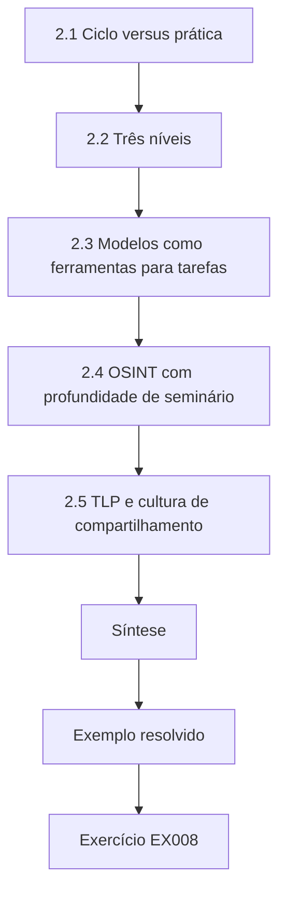

### Desenho lógico

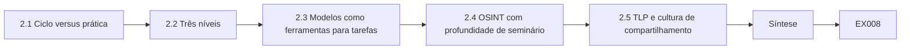

```text
[2.1 Ciclo versus prática]
    |
    v
[2.2 Três níveis]
    |
    v
[2.3 Modelos como ferramentas para tarefas]
    |
    v
[2.4 OSINT com profundidade de seminário]
    |
    v
[2.5 TLP e cultura de compartilhamento]
    |
    v
[Síntese]
    |
    v
[Exemplo resolvido] --> [Exercício EX008]
```
<!-- cyberabc:lesson-figures:end ch-02 -->


### Objetivos de aprendizagem

Você vai (1) comparar o ciclo de inteligência com a prática de CTI em um SOC; (2) explicar a inteligência estratégica, operacional e tática; (3) relacionar a kill chain, o Diamond Model e o ATT&CK às tarefas dos analistas; (4) discutir, com profundidade de seminário, os limites legais e éticos da OSINT.

### 2.1 Ciclo versus prática

Nos manuais, a inteligência percorre direção, coleta, processamento, análise, disseminação e retroalimentação. Em um SOC portuário, o ciclo é comprimido e ruidoso: os requisitos chegam como chamados de incidente, a coleta é a assinatura de um feed e a retroalimentação é rara. A discussão no seminário deve perguntar onde o ciclo se rompe — em geral, na direção e na retroalimentação. A pergunta de Lucía testa um dos pontos em que o ciclo se rompe. Os membros do CPSG recebem os indicadores por assinatura TAXII, então a coleta funciona; o que ninguém mediu foi a disseminação para os controles, o tempo entre a publicação e uma regra de bloqueio. O estudo dela acrescenta um circuito de retroalimentação que o grupo nunca teve.

### 2.2 Três níveis

A inteligência estratégica informa os conselhos sobre a intenção e as tendências dos adversários; a operacional descreve as campanhas e o seu calendário; a tática fornece indicadores e detalhes de técnicas. O estudo de Lucía fica na fronteira entre o tático e o operacional: indicadores e a rapidez com que viram controles. O boletim de seminário de Lucía sobre a onda de phishing contra agentes portuários mostra essa fronteira na prática: o calendário da campanha é operacional, enquanto os indicadores são táticos. O estudo dela mede a parte tática, a rapidez com que os indicadores viram regras de bloqueio, e nada diz sobre se a estratégia em nível de conselho mudou por causa do CPSG.

### 2.3 Modelos como ferramentas para tarefas

Hutchins et al. ajudam a decidir onde colocar controles ao longo das fases. O Diamond Model ajuda a fazer pivô de um evento para eventos relacionados por meio de infraestrutura ou capacidade compartilhadas. O ATT&CK fornece um vocabulário comum — por exemplo, T1566 Phishing ou T1071 Application Layer Protocol — que permite a um grupo de compartilhamento descrever comportamentos para além de indicadores frágeis; a Pirâmide da Dor de Bianco classifica o comportamento como mais custoso de mudar para os adversários do que hashes, endereços IP ou domínios.

O mapeamento que Lucía fez no seminário da onda de phishing contra agentes portuários para o T1566 é o exemplo: os domínios e endereços IP do boletim estarão obsoletos em poucos dias, mas a descrição do comportamento continua útil para membros que nunca viram os indicadores originais.

### 2.4 OSINT com profundidade de seminário

As fontes abertas incluem registros de empresas, transmissões de rastreamento de navios, repositórios públicos de código e notícias. Usá-las ainda gera deveres: a legislação de proteção de dados quando há pessoas identificáveis, os termos das plataformas e o risco de alertar os investigados. Os exercícios do seminário usam apenas perfis sintéticos. No Brasil, o tratamento de dados de pessoas identificáveis segue a Lei Geral de Proteção de Dados Pessoais (LGPD, Lei nº 13.709/2018), sob a fiscalização da Autoridade Nacional de Proteção de Dados (ANPD).

Para um grupo de portos, o risco é concreto. As transmissões de rastreamento de navios e os registros de empresas podem ser combinados para mostrar que agente atendeu qual embarcação e identificar os funcionários visados pela onda de phishing. O estudo de Lucía não precisa de nada disso: os dados dela são tempos registrados nos controles dos membros, de modo que a OSINT sobre pessoas fica fora do desenho, e os exercícios do seminário usam perfis sintéticos.

### 2.5 TLP e cultura de compartilhamento

O FIRST TLP 2.0 define CLEAR, GREEN, AMBER, AMBER+STRICT e RED. Comunidades como o CPSG dependem de que os membros respeitem os rótulos; uma única violação pode acabar com o compartilhamento por anos. A coleção do CPSG é TLP:AMBER, e é por isso que Lucía precisa da concordância do conselho de governança e que a dissertação dela, escrita para a biblioteca da universidade, precisa ser TLP:CLEAR. Uma legenda de figura que nomeasse a cidade de um porto teria sido uma violação desse tipo, e o revisor de vazamentos encontrou uma antes da entrega. As três condições do conselho — grupos de pelo menos três, nenhum nome de porto e exclusão dos tempos brutos — são a forma pela qual o estudo de Lucía honra o AMBER e ainda produz uma dissertação pública.

### Exemplo resolvido

No seminário, Lucía apresenta um boletim do CPSG sobre uma onda de phishing contra agentes portuários. Ela o classifica como operacional (calendário da campanha), mapeia o comportamento para o T1566, observa que os indicadores ficam na base da Pirâmide da Dor e argumenta que o mapeamento ATT&CK é a contribuição mais durável.

> **Caso sintético.** O boletim e a onda de phishing são inventados.

### Erros e limites

Tratar todo feed como "inteligência" confunde dados com análise. A legalidade da OSINT varia conforme a jurisdição; as conclusões do seminário não são aconselhamento jurídico.

### Exercícios

- **EX008 — Etapa rompida.** Que etapas do ciclo de inteligência se rompem com mais frequência em um SOC, e por quê? *Rubrica:* 3 = direção e retroalimentação, com motivo; 2 = uma, com motivo; 1 = apenas a coleta; 0 = nenhuma.
- **EX009 — Escolha do nível.** Classifique por nível de inteligência a frase "grupos de ransomware visam cada vez mais empresas de logística". *Rubrica:* 3 = estratégica (tendência para quem decide); 2 = apenas o nível; 1 = tática; 0 = nenhuma.
- **EX010 — Camada durável.** Por que o mapeamento ATT&CK é mais durável do que a lista de IPs do boletim? *Rubrica:* 3 = comportamentos custam mais a mudar do que IPs (Pirâmide da Dor); 2 = parcial; 1 = IPs mais duráveis; 0 = nenhum.
- **EX011 — Uso do Diamond.** Dê um pivô que o Diamond Model permite com o domínio remetente do boletim de phishing. *Rubrica:* 3 = infraestrutura → outros eventos/vítimas com o mesmo domínio/registrante; 2 = pivô vago; 1 = tentativa mínima; 0 = nenhum.
- **EX012 — Os cinco do TLP.** Liste os cinco rótulos do TLP 2.0. *Rubrica:* 3 = CLEAR, GREEN, AMBER, AMBER+STRICT, RED; 2 = quatro; 1 = o antigo rótulo WHITE; 0 = nenhum.
- **EX013 — Risco de alertar.** Por que uma coleta descuidada de OSINT pode prejudicar uma investigação? *Rubrica:* 3 = pode alertar o investigado/adversário, causando mudanças ou danos; 2 = risco vago; 1 = nenhum risco; 0 = nenhum.
- **EX014 — Posição na kill chain.** Em que ponto da kill chain chega um e-mail de phishing? *Rubrica:* 3 = entrega; 2 = fase adjacente com motivo; 1 = ações sobre os objetivos; 0 = nenhum.

### Síntese

Saiba onde o ciclo se rompe, rotule o nível, prefira descrições duráveis de comportamento e pratique a OSINT dentro da lei, dos termos e do TLP.

### Continue estudando — capítulo 02 de 08

[← Capítulo 01 (rascunho)](#ch-01) · [Índice de capítulos do curso](../SUBJECTS.md) · [Capítulo 03 (rascunho) →](#ch-03)

<a id="ch-03"></a>

## Capítulo 3 — Desenho do estudo, ética e reprodutibilidade

<!-- cyberabc:lesson-figures:start ch-03 -->
### Mapa da aula

Aula 03 publicada. Mapa, exemplo, EX015.

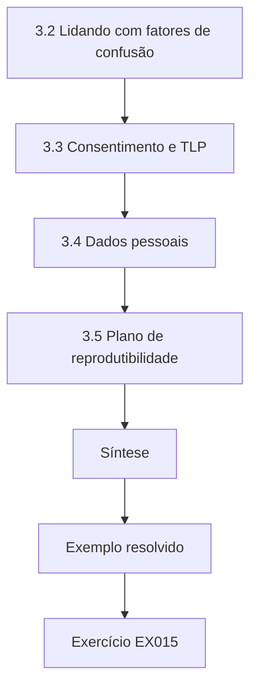

### Desenho lógico

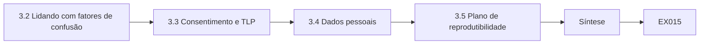

```text
[3.2 Lidando com fatores de confusão]
    |
    v
[3.3 Consentimento e TLP]
    |
    v
[3.4 Dados pessoais]
    |
    v
[3.5 Plano de reprodutibilidade]
    |
    v
[Síntese]
    |
    v
[Exemplo resolvido] --> [Exercício EX015]
```
<!-- cyberabc:lesson-figures:end ch-03 -->


### Objetivos de aprendizagem

Você vai (1) escolher entre desenhos observacionais e quase experimentais; (2) identificar fatores de confusão em estudos sobre compartilhamento; (3) obter o consentimento dos membros de uma comunidade de compartilhamento para o uso em pesquisa; (4) planejar uma análise reprodutível.

### 3.1 Limites do estudo observacional

Lucía não pode designar portos ao acaso para a filiação ao CPSG. Pode comparar membros com não membros, mas os membros podem ser diferentes — orçamentos maiores, mais pessoal —, e essas diferenças, e não o compartilhamento, podem explicar um bloqueio mais rápido. Um desenho que ignore isso é um estudo de correlação vestido de avaliação. O desenho de Lucía responde com duas comparações: quatro portos que entraram no CPSG em 2025 são comparados consigo mesmos antes e depois da entrada, e os membros são comparados com seis não membros voluntários pareados por porte. Nenhuma das duas elimina todas as diferenças, mas elas falham de maneiras diferentes, de modo que a concordância entre ambas convence mais do que cada uma isolada.

### 3.2 Lidando com fatores de confusão

As opções incluem parear membros com não membros de porte semelhante, comparar o mesmo porto antes e depois da entrada ou ajustar pelo tamanho da equipe do SOC. Cada escolha é escrita na proposta, e não feita depois de ver qual dá o resultado mais bonito. Lucía escolheu tanto o pareamento por porte quanto um estrato antes e depois para os quatro portos que entraram em 2025, e escreveu essa escolha na proposta antes de coletar qualquer tempo. Se o estrato antes e depois mostrar uma queda consistente com a entrada, ela pode afirmar com mais força do que a comparação transversal permite.

### 3.3 Consentimento e TLP

Os dados do CPSG têm o rótulo TLP:AMBER. O uso em pesquisa exige a concordância explícita do conselho de governança da comunidade, e cada membro precisa poder recusar a participação. Os resultados serão agregados de modo que os tempos de nenhum membro isolado possam ser recuperados. Os dados de não membros precisam vir de participantes voluntários, e não de sondagens na infraestrutura deles. O conselho de governança aprovou o desenho de Lucía com três condições: resultados agregados em grupos de pelo menos três, nenhum nome de porto e exclusão dos tempos brutos depois que a dissertação for avaliada. Os seis portos não membros forneceram voluntariamente os próprios tempos; nada foi coletado da infraestrutura deles sem a sua participação.

### 3.4 Dados pessoais

Os registros de tempo até o bloqueio podem incluir nomes de usuário dos analistas. Lucía os remove na origem; ela precisa de tempos, não de pessoas. A legislação de proteção de dados, como o GDPR, se aplica mesmo na pesquisa em segurança, e a minimização é o passo de conformidade mais simples. No Brasil, a LGPD (Lei nº 13.709/2018) adota o mesmo princípio da minimização, e a ANPD fiscaliza seu cumprimento. Remover os nomes na origem significa que a exportação do membro para Lucía contém apenas carimbos de tempo, tipo de indicador e decisão. Se o nome de um analista fosse mantido, mesmo em um arquivo de trabalho, os dados identificariam a pessoa que demorou a bloquear um indicador específico, um dano a esse analista que o estudo não precisa arriscar.

### 3.5 Plano de reprodutibilidade

Scripts de análise com a biblioteca padrão, um dicionário de dados, arquivos de amostra sintéticos e uma semente aleatória fixa para qualquer reamostragem. O plano faz parte da proposta. Para Lucía, os arquivos de amostra sintéticos usam exatamente os campos do dicionário de dados dela, `t_pub`, `t_block`, `ttb_h`, `ioc_type` e `decision`, de modo que os mesmos scripts rodam sobre ambos, e um examinador sem acesso aos dados AMBER do CPSG ainda consegue executar cada script. A semente fixa importa para o intervalo bootstrap em torno das medianas; sem ela, uma reexecução daria um intervalo ligeiramente diferente e pareceria um erro.

### Exemplo resolvido

Lucía propõe um desenho antes e depois para quatro portos que entraram no CPSG em 2025, mais uma comparação pareada com seis não membros voluntários. O conselho de governança aprova com condições: agregação em grupos de pelo menos três, nenhum nome de porto e exclusão dos tempos brutos depois que a dissertação for avaliada.

> **Caso sintético.** O desenho, os portos e as condições do conselho são inventados.

### Erros e limites

Amostras pequenas não sustentam afirmações causais, mesmo com um bom desenho; formule os achados de acordo. O consentimento de um conselho não se sobrepõe à recusa de um membro individual.

### Exercícios

- **EX015 — Nomeie o fator de confusão.** Nomeie um fator de confusão entre a filiação ao CPSG e o bloqueio mais rápido. *Rubrica:* 3 = fator plausível (orçamento, tamanho da equipe, maturidade) com mecanismo; 2 = apenas o nome; 1 = não relacionado; 0 = nenhum.
- **EX016 — Escolha do desenho.** Por que um desenho antes e depois ajuda com esse fator de confusão? *Rubrica:* 3 = o mesmo porto comparado consigo mesmo mantém constantes as características estáveis; 2 = parcial; 1 = não ajuda; 0 = nenhum.
- **EX017 — Condição do conselho.** Explique o propósito da "agregação em grupos de pelo menos três". *Rubrica:* 3 = impede recuperar os dados de um único membro; 2 = privacidade, de forma vaga; 1 = apenas estatística; 0 = nenhum.
- **EX018 — Dados de não membros.** Como Lucía pode obter os tempos de não membros? *Rubrica:* 3 = participantes voluntários que compartilham os próprios registros sob acordo; nunca por sondagem; 2 = apenas voluntários; 1 = varrer os sistemas deles; 0 = nenhum.
- **EX019 — Minimize os registros.** Que campo deve ser removido dos registros de tempo até o bloqueio, e por quê? *Rubrica:* 3 = nomes de usuário dos analistas; desnecessários; dados pessoais; 2 = remover nomes; 1 = manter tudo; 0 = nenhum.
- **EX020 — Conflito de recusa.** O conselho aprova, mas um membro recusa. O que acontece? *Rubrica:* 3 = excluir os dados desse membro; o consentimento do conselho não se sobrepõe; 2 = excluir; 1 = incluir; 0 = nenhum.
- **EX021 — Motivo da semente.** Por que fixar uma semente aleatória para a reamostragem? *Rubrica:* 3 = resultados idênticos na reexecução; reprodutibilidade; 2 = vago; 1 = rapidez; 0 = nenhum.

### Síntese

Nomeie cedo os fatores de confusão, escolha um desenho que os enfraqueça, obtenha o consentimento do conselho e dos membros, minimize os dados pessoais e planeje a reprodutibilidade antes de os dados chegarem.

### Continue estudando — capítulo 03 de 08

[← Capítulo 02 (rascunho)](#ch-02) · [Índice de capítulos do curso](../SUBJECTS.md) · [Capítulo 04 (rascunho) →](#ch-04)

<a id="ch-04"></a>

## Capítulo 4 — Inteligência de ameaças e OSINT: explicações concorrentes

<!-- cyberabc:lesson-figures:start ch-04 -->
### Mapa da aula

Aula 04 publicada. Mapa, exemplo, EX022.

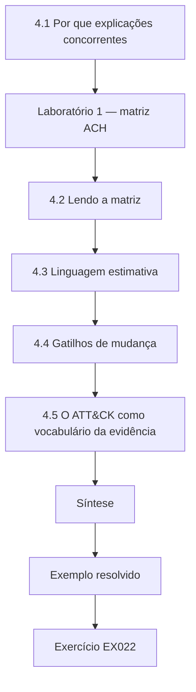

### Desenho lógico

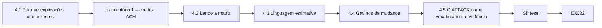

```text
[4.1 Por que explicações concorrentes]
    |
    v
[Laboratório 1 — matriz ACH]
    |
    v
[4.2 Lendo a matriz]
    |
    v
[4.3 Linguagem estimativa]
    |
    v
[4.4 Gatilhos de mudança]
    |
    v
[4.5 O ATT&CK como vocabulário da evidência]
    |
    v
[Síntese]
    |
    v
[Exemplo resolvido] --> [Exercício EX022]
```
<!-- cyberabc:lesson-figures:end ch-04 -->


### Objetivos de aprendizagem

Você vai (1) montar uma matriz de análise de hipóteses concorrentes (ACH); (2) identificar a evidência diagnóstica; (3) expressar um julgamento com linguagem estimativa calibrada; (4) registrar que nova evidência mudaria o julgamento.

### 4.1 Por que explicações concorrentes

Os analistas tendem a se fixar na primeira história plausível. O método de Heuer força várias hipóteses para a mesa e pergunta que evidência é inconsistente com cada uma. A hipótese com menos inconsistências sérias sobrevive — provisoriamente. O exercício de seminário de Lucía sobre o incidente de ransomware no CPSG usa três hipóteses: um grupo criminoso de ransomware (H1), um agente interno (H2) e espionagem alinhada a um Estado (H3). Listar as três antes de ler a evidência impede que a história mais comum, ransomware significa criminosos, feche a pergunta cedo demais. No exercício do ransomware no CPSG, as três são pontuadas contra os mesmos cinco itens de evidência, de E1 a E5, de modo que nenhuma hipótese é julgada por evidência escolhida sob medida para ela.

### Laboratório 1 — matriz ACH

```python
"""Lab 1 (ch 04): analysis of competing hypotheses - count inconsistencies per hypothesis (synthetic)."""
hyps = ["H1 criminal ransomware crew", "H2 insider", "H3 state-aligned espionage"]
# per evidence item: C consistent, I inconsistent, N neutral for H1,H2,H3
evidence = [
    ("E1 data staged then encrypted",         "C", "N", "I"),
    ("E2 access from a contractor VPN account", "C", "C", "C"),
    ("E3 ransom note with payment portal",     "C", "I", "I"),
    ("E4 activity outside staff working hours", "C", "I", "N"),
    ("E5 tooling sold on criminal markets",    "C", "N", "I"),
]
for i, h in enumerate(hyps):
    inc = sum(1 for e in evidence if e[i + 1] == "I")
    print(f"{h:30} inconsistent={inc}")
diag = [e[0] for e in evidence if len(set(e[1:])) > 1]
print("diagnostic items:", len(diag), "of", len(evidence))
```

Execute com `python3 lab_ach.py`. Saída verificada:

```text
H1 criminal ransomware crew    inconsistent=0
H2 insider                     inconsistent=2
H3 state-aligned espionage     inconsistent=3
diagnostic items: 4 of 5
```

### 4.2 Lendo a matriz

H1, um grupo criminoso de ransomware, não tem inconsistências; H2, um agente interno, tem duas; H3, espionagem alinhada a um Estado, tem três. O item E2 — acesso a partir de uma conta de VPN de um prestador de serviços — se ajusta a todas as hipóteses e, portanto, não é diagnóstico. Quatro dos cinco itens discriminam. A matriz não prova a H1; mostra que a H1 é a menos contradita por essa evidência. O julgamento escrito de Lucía decorre diretamente disso: é provável, 55–80% na escala dela, que um grupo criminoso tenha conduzido a intrusão, e não se pode excluir a participação de um agente interno. Vale a pena nomear no texto o E2, não diagnóstico, porque os analistas costumam citar esse tipo de evidência em primeiro lugar.

### 4.3 Linguagem estimativa

A ICD 203 pede que os produtos expressem a incerteza e distingam a evidência do julgamento. O ensaio de Kent sobre as *words of estimative probability* mostrou como os leitores interpretam "provável" de maneiras muito diferentes. Uma equipe deve publicar a própria escala — por exemplo, "provável" significando cerca de 55–80% — e usá-la de forma consistente. O julgamento de Lucía sobre o ransomware usa essa escala: "provável (55–80%)". Um membro que lê "provável" em um boletim do CPSG e "provável" em outro deveria tirar o mesmo significado de ambos, o que só funciona se o grupo publicar a escala e todo redator a aplicar.

### 4.4 Gatilhos de mudança

Todo julgamento traz indicadores que o mudariam: evidência de venda de dados sem resgate (elevaria a H3) ou a confissão de um funcionário insatisfeito (elevaria a H2). Escrever os gatilhos impede uma deriva silenciosa. A avaliação escrita de Lucía nomeia um gatilho na última frase: evidência de venda de dados sem pedido de resgate reduziria a avaliação do grupo criminoso. Nomear o gatilho no produto permite que um membro que veja mais tarde essa evidência saiba de imediato que o julgamento deve ser reaberto. A evidência atual não consegue fazer esse trabalho: o E2, acesso a partir de uma conta de VPN de um prestador de serviços, se ajusta a todas as hipóteses, de modo que só uma nova evidência do tipo que os gatilhos nomeiam pode mover o julgamento.

### 4.5 O ATT&CK como vocabulário da evidência

Mapear a evidência para o ATT&CK — preparação e T1486 Data Encrypted for Impact para o E1 — ajuda outros analistas a verificar se o comportamento corresponde ao perfil de um grupo conhecido sem depender demais de nomes. No incidente do CPSG, o T1486 descreve a própria criptografia, e o acesso pela VPN do prestador no E2 pode ser mapeado para o uso de contas válidas. Os membros que compararem esse perfil com relatórios publicados sobre grupos podem ver se o comportamento se encaixa, enquanto o texto evita nomear um grupo com base em uma única semelhança. Na matriz de Lucía, o rótulo T1486 fica ao lado do E1 como descrição do que foi observado; não é tratado como evidência a favor de nenhum grupo em particular.

### Exemplo resolvido

Um membro do CPSG sofre um incidente de ransomware. Lucía, como exercício de seminário, monta a matriz e escreve: "Avaliamos ser provável (55–80%) que um grupo criminoso de ransomware tenha conduzido esta intrusão; não se pode excluir a participação de um agente interno. Evidência de venda de dados sem pedido de resgate reduziria esta avaliação."

> **Caso sintético.** O incidente e os itens de evidência são inventados.

### Erros e limites

A ACH depende das hipóteses consideradas; uma hipótese ausente não pode vencer. Contar inconsistências é uma heurística, não um cálculo de probabilidade.

### Exercícios

- **EX022 — Resultado da matriz.** Cite as contagens de inconsistências de H1, H2 e H3. *Rubrica:* 3 = 0, 2, 3; 2 = duas certas; 1 = uma; 0 = nenhuma.
- **EX023 — Não diagnóstico.** Que item de evidência não é diagnóstico, e por quê? *Rubrica:* 3 = E2; consistente com todas as hipóteses; 2 = apenas E2; 1 = item errado; 0 = nenhum.
- **EX024 — Sobrevive, não está provada.** Por que "a H1 está provada" é a conclusão errada? *Rubrica:* 3 = apenas a menos contradita; o conjunto de hipóteses pode estar incompleto; evidência limitada; 2 = um motivo; 1 = está provada; 0 = nenhum.
- **EX025 — Entrada da escala.** Defina "provável" em uma escala publicada pela equipe e explique por que a definição importa. *Rubrica:* 3 = intervalo numérico + os leitores interpretam as palavras de modo diferente (Kent); 2 = apenas o intervalo; 1 = sem intervalo; 0 = nenhum.
- **EX026 — Gatilho.** Escreva um gatilho de mudança que elevaria a H2. *Rubrica:* 3 = evidência observável específica a favor do agente interno; 2 = vago; 1 = tentativa mínima; 0 = nenhum.
- **EX027 — Hipótese ausente.** Proponha uma quarta hipótese que valha a pena acrescentar. *Rubrica:* 3 = hipótese plausível e distinta (por exemplo, hacktivista, corretor de acesso revendendo) com motivo; 2 = apenas o nome; 1 = duplicada; 0 = nenhuma.
- **EX028 — ID da técnica.** Dê o ID da técnica ATT&CK para dados criptografados para impacto. *Rubrica:* 3 = T1486; 2 = apenas o nome; 1 = ID errado; 0 = nenhum.

### Síntese

Liste os rivais, procure inconsistências, relate as sobreviventes com palavras calibradas e escreva o que mudaria a sua opinião.

### Continue estudando — capítulo 04 de 08

[← Capítulo 03 (rascunho)](#ch-03) · [Índice de capítulos do curso](../SUBJECTS.md) · [Capítulo 05 (rascunho) →](#ch-05)

<a id="ch-05"></a>

## Capítulo 5 — Proposta e piloto

<!-- cyberabc:lesson-figures:start ch-05 -->
### Mapa da aula

Aula 05 publicada. Mapa, exemplo, EX029.

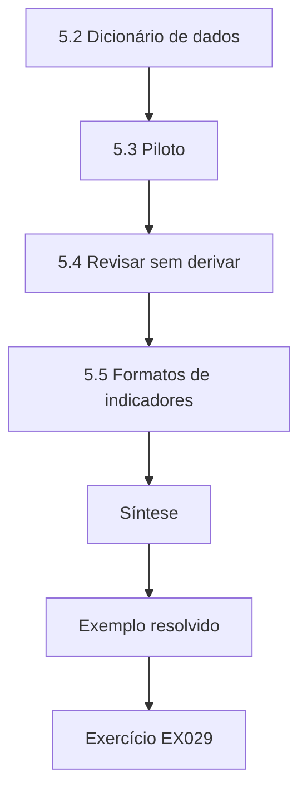

### Desenho lógico

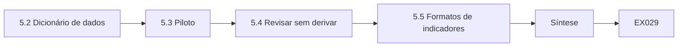

```text
[5.2 Dicionário de dados]
    |
    v
[5.3 Piloto]
    |
    v
[5.4 Revisar sem derivar]
    |
    v
[5.5 Formatos de indicadores]
    |
    v
[Síntese]
    |
    v
[Exemplo resolvido] --> [Exercício EX029]
```
<!-- cyberabc:lesson-figures:end ch-05 -->


### Objetivos de aprendizagem

Você vai (1) escrever uma proposta de dissertação com objetivos mensuráveis; (2) definir cada variável em um dicionário de dados; (3) conduzir um piloto para verificar a viabilidade; (4) revisar o plano a partir da evidência do piloto sem mudar a pergunta.

### 5.1 Objetivos e medidas

Objetivo 1: medir a mediana do tempo até o bloqueio para os indicadores recebidos pelo CPSG. Objetivo 2: comparar com não membros pareados. Objetivo 3: descrever com que frequência os indicadores compartilhados foram julgados indignos de bloqueio. Cada objetivo nomeia a sua variável e a sua análise. O Objetivo 3 é fácil de esquecer, mas importa para a interpretação. Se os membros ignoram muitos indicadores compartilhados por considerá-los de pouco valor, uma mediana rápida para os bloqueados pode esconder o fato de que a maioria dos indicadores nunca vira controle. Relatar as proporções de bloqueados, monitorados e ignorados ao lado da mediana mantém o resultado honesto.

### 5.2 Dicionário de dados

`t_pub`: carimbo de tempo em que o indicador foi publicado pela primeira vez na coleção TAXII (UTC). `t_block`: carimbo de tempo em que uma regra de bloqueio ficou ativa no controle do membro. `ttb_h`: horas entre os dois. `ioc_type`: domain, ip, hash ou url. `decision`: `blocked`, `monitored`, `ignored`. Cada campo tem tipo, unidade e valores permitidos. O dicionário também decide como tratar um valor ausente: um indicador ignorado não tem `t_block`, então o seu `ttb_h` fica vazio, e não zero, e ele é contado no Objetivo 3, não na mediana. Fixar essa regra antes de os dados chegarem impede que os indicadores ignorados sejam tratados como bloqueios instantâneos.

### 5.3 Piloto

Um piloto com um membro e duas semanas de registros no formato sintético testa se o `t_block` chega a ser registrado. Muitas organizações registram as edições de regras apenas em chamados de mudança com precisão de dia, o que tornaria impossíveis os tempos em horas. O piloto de Lucía encontrou exatamente essa divisão: o firewall do primeiro membro registrava a ativação da regra com precisão de segundos, enquanto a ferramenta de chamados do segundo membro guardava apenas datas. Descobrir isso no piloto, com duas semanas de registros, custou pouco; descobrir depois da coleta principal teria forçado um novo desenho.

### 5.4 Revisar sem derivar

Se o piloto mostrar apenas precisão de dia, Lucía pode mudar a unidade para dias — uma revisão da medição —, mas não deve trocar a pergunta por algo mais fácil, como "os membros gostam do feed?". Isso seria deriva de escopo. A revisão de Lucía manteve as duas unidades: horas para os membros com registros precisos e dias para os demais, como um estrato separado, com a menor precisão anotada como limitação. A pergunta, o tempo entre a publicação e o bloqueio, não mudou; mudou apenas a precisão com que alguns membros podiam respondê-la.

### 5.5 Formatos de indicadores

O CPSG publica objetos indicator do STIX 2.1. O piloto confirma que `created` e `valid_from` estão preenchidos, o que dá um `t_pub` confiável. Os objetos sem propriedades obrigatórias são registrados como achados de qualidade de dados para a comunidade. Os achados de qualidade de dados são registrados por classe de membro publicador, e não por membro, seguindo a regra de agregação do conselho. Um indicador sem `valid_from` ainda conta para o Objetivo 3 se um membro agiu sobre ele, mas não pode contribuir com um tempo de publicação para a mediana. As duas semanas de registros do membro do piloto deram a Lucía uma primeira contagem desses achados antes de a exportação principal chegar.

### Exemplo resolvido

O firewall do membro do piloto registra a ativação da regra com precisão de segundos, mas o segundo membro usa uma ferramenta de chamados que guarda apenas datas. Lucía mantém as horas para os membros com registros precisos, registra dias para os demais como um estrato separado e anota a menor precisão como limitação.

> **Caso sintético.** Os membros do piloto e as ferramentas de registro são inventados.

### Erros e limites

Um piloto não é uma versão pequena do resultado; não relate as medianas dele como achados. Mudar a pergunta depois de um piloto exige a aprovação do orientador e uma nova verificação ética.

### Exercícios

- **EX029 — Entrada de variável.** Escreva uma entrada completa do dicionário de dados para `ttb_h`. *Rubrica:* 3 = nome, definição, tipo, unidade, derivação; 2 = três desses; 1 = apenas o nome; 0 = nenhum.
- **EX030 — Propósito do piloto.** Que pergunta específica de viabilidade o piloto de duas semanas responde? *Rubrica:* 3 = se o t_block é registrado com precisão utilizável; 2 = se os dados existem, em geral; 1 = se o compartilhamento funciona; 0 = nenhum.
- **EX031 — Ajuste de precisão.** Como Lucía lida com um membro que registra apenas datas? *Rubrica:* 3 = estrato separado em dias + limitação; 2 = descartar o membro; 1 = adivinhar as horas; 0 = nenhum.
- **EX032 — Teste de deriva.** Trocar para "os membros gostam do feed?" é uma revisão ou uma deriva? Explique. *Rubrica:* 3 = deriva; desvia o constructo do tempo até o bloqueio; 2 = deriva; 1 = revisão; 0 = nenhum.
- **EX033 — Objetivo três.** Por que o valor de decisão "ignored" é importante para o Objetivo 3? *Rubrica:* 3 = capta os indicadores julgados indignos de bloqueio; evita a visão de sobrevivência; 2 = parcial; 1 = irrelevante; 0 = nenhum.
- **EX034 — Tempo no STIX.** Que propriedades do STIX 2.1 dão um tempo de publicação confiável? *Rubrica:* 3 = created (e valid_from) no indicator; 2 = uma; 1 = name; 0 = nenhuma.
- **EX035 — Números do piloto.** Lucía pode citar a mediana do piloto no capítulo de resultados? *Rubrica:* 3 = não; o piloto só testa a viabilidade; mencionar nos métodos; 2 = não; 1 = sim; 0 = nenhum.

### Síntese

Objetivos mensuráveis, um dicionário preciso, um piloto voltado para a viabilidade e revisões que mantêm a pergunta intacta.

### Continue estudando — capítulo 05 de 08

[← Capítulo 04 (rascunho)](#ch-04) · [Índice de capítulos do curso](../SUBJECTS.md) · [Capítulo 06 (rascunho) →](#ch-06)

<a id="ch-06"></a>

## Capítulo 6 — Coleta e análise de dados

<!-- cyberabc:lesson-figures:start ch-06 -->
### Mapa da aula

Aula 06 publicada. Mapa, exemplo, EX036.

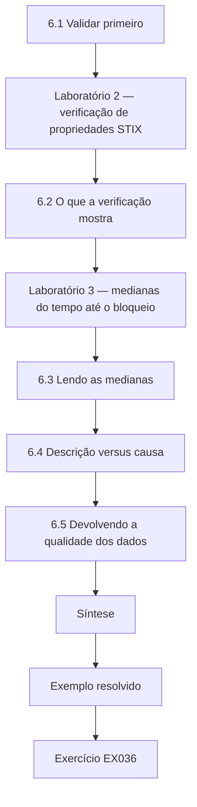

### Desenho lógico

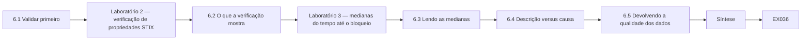

```text
[6.1 Validar primeiro]
    |
    v
[Laboratório 2 — verificação de propriedades STIX]
    |
    v
[6.2 O que a verificação mostra]
    |
    v
[Laboratório 3 — medianas do tempo até o bloqueio]
    |
    v
[6.3 Lendo as medianas]
    |
    v
[6.4 Descrição versus causa]
    |
    v
[6.5 Devolvendo a qualidade dos dados]
    |
    v
[Síntese]
    |
    v
[Exemplo resolvido] --> [Exercício EX036]
```
<!-- cyberabc:lesson-figures:end ch-06 -->


### Objetivos de aprendizagem

Você vai (1) validar os dados estruturados recebidos antes da análise; (2) calcular e comparar medianas para dados de tempo assimétricos; (3) relatar tamanhos de efeito com incerteza honesta; (4) separar os achados descritivos das afirmações causais.

### 6.1 Validar primeiro

Os membros exportam objetos STIX 2.1 da coleção TAXII do CPSG junto com os registros de bloqueio. Antes de qualquer estatística, Lucía verifica se os objetos trazem as propriedades obrigatórias e identificadores bem formados. Os objetos malformados são contados e relatados à comunidade, não consertados em silêncio. O lote de demonstração de Lucía verifica três objetos, e só um passa. Na exportação completa do estudo, 94% dos indicadores eram válidos. Contar as falhas antes da análise diz ao leitor quanto dos dados do CPSG podia de fato contribuir com tempos. Um objeto inválido que um membro ainda assim bloqueou ou monitorou é contado no Objetivo 3, porque a decisão do membro aconteceu, embora o tempo de publicação dele não seja confiável.

### Laboratório 2 — verificação de propriedades STIX

```python
"""Lab 2 (ch 06): check synthetic STIX 2.1-style objects for common required properties."""
import json, re
objs = json.loads("""[
 {"type":"indicator","spec_version":"2.1","id":"indicator--8e2e2d2b-17d4-4cbf-938f-98ee46b3cd3f",
  "created":"2026-09-01T10:00:00.000Z","modified":"2026-09-01T10:00:00.000Z",
  "pattern":"[domain-name:value = 'c2.example']","pattern_type":"stix","valid_from":"2026-09-01T10:00:00Z"},
 {"type":"indicator","spec_version":"2.1","id":"indicator-123",
  "created":"2026-09-02T10:00:00.000Z","modified":"2026-09-02T10:00:00.000Z","pattern_type":"stix"},
 {"type":"threat-actor","id":"threat-actor--0f9c3a5e-6b1d-4c39-9a8e-2b9f6a7d1c11",
  "created":"2026-09-03T10:00:00.000Z","modified":"2026-09-03T10:00:00.000Z","name":"SYNTH-CARRION"}
]""")
COMMON = ["type", "spec_version", "id", "created", "modified"]
EXTRA = {"indicator": ["pattern", "pattern_type", "valid_from"], "threat-actor": ["name"]}
for o in objs:
    miss = [k for k in COMMON + EXTRA.get(o["type"], []) if k not in o]
    bad_id = not re.fullmatch(o["type"] + r"--[0-9a-f-]{36}", o.get("id", ""))
    probs = miss + (["id format"] if bad_id else [])
    print(o.get("id"), "OK" if not probs else "PROBLEMS: " + ", ".join(probs))
```

Execute com `python3 lab_stix.py`. Saída verificada:

```text
indicator--8e2e2d2b-17d4-4cbf-938f-98ee46b3cd3f OK
indicator-123 PROBLEMS: pattern, valid_from, id format
threat-actor--0f9c3a5e-6b1d-4c39-9a8e-2b9f6a7d1c11 PROBLEMS: spec_version
```

### 6.2 O que a verificação mostra

O primeiro indicador passa. O segundo não tem `pattern` nem `valid_from` e tem um identificador que não segue `type--UUID`. O objeto threat-actor não tem `spec_version`, que o STIX 2.1 exige nos objetos de domínio. Apenas os objetos válidos contribuem com valores de `t_pub`. Cada falha tem uma consequência diferente. Sem `valid_from`, o indicador não tem um tempo de publicação confiável e, portanto, não pode contribuir para o tempo até o bloqueio. Um identificador malformado quebra os vínculos entre objetos. A falta de `spec_version` sugere que a ferramenta de publicação é anterior ao STIX 2.1 ou está mal configurada, o que é um retorno útil para essa classe de membros.

### Laboratório 3 — medianas do tempo até o bloqueio

```python
"""Lab 3 (ch 06): median time-to-block (hours) for synthetic sharing-community members vs non-members."""
from statistics import median
members = [2.0, 3.5, 1.0, 6.0, 2.5, 4.0, 3.0]
non_members = [9.0, 14.0, 5.0, 22.0, 11.0, 8.0]
mm, mn = median(members), median(non_members)
print(f"members n={len(members)} median={mm:.1f}h")
print(f"non-members n={len(non_members)} median={mn:.1f}h")
print(f"difference={mn - mm:.1f}h ratio={mn / mm:.2f}")
```

Execute com `python3 lab_ttb.py`. Saída verificada:

```text
members n=7 median=3.0h
non-members n=6 median=10.0h
difference=7.0h ratio=3.33
```

### 6.3 Lendo as medianas

Dados de tempo são assimétricos — alguns casos lentos dominam as médias —, por isso se relatam medianas. A mediana dos membros é de 3,0 horas; a dos não membros, de 10,0 horas: uma diferença de 7,0 horas, razão de 3,33. Com amostras de sete e seis, a incerteza é grande; um intervalo bootstrap ou um teste baseado em postos seria relatado ao lado das medianas. O texto de Lucía põe as medianas de 3,0 e 10,0 horas ao lado do seu intervalo, e não sozinhas em uma frase. Com seis não membros, um porto excepcionalmente lento pode mover a mediana em horas, então o intervalo diz aos membros quanto peso a diferença consegue suportar.

### 6.4 Descrição versus causa

O resultado descreve um bloqueio mais rápido entre os membros nesta amostra. Dados os fatores de confusão discutidos no Capítulo 3, Lucía escreve "está associado a", e não "causa", a menos que o estrato antes e depois mostre uma mudança consistente com a entrada. Os quatro portos que entraram no CPSG em 2025 são o estrato que poderia sustentar uma afirmação mais forte. Se cada um bloqueou mais rápido depois da entrada do que antes, com a mesma equipe e as mesmas ferramentas, a associação fica mais difícil de explicar por porte ou orçamento, embora ainda não prove a causa.

### 6.5 Devolvendo a qualidade dos dados

As contagens da validação são, elas mesmas, uma contribuição. Lucía envia ao CPSG uma nota curta de qualidade de dados listando quantos objetos não tinham propriedades obrigatórias, agrupados por classe de membro publicador, para que os produtores possam corrigir as exportações. A nota segue a mesma regra de agregação que a dissertação. Com 94% dos indicadores válidos na exportação completa, a nota pode dizer aos produtores que cerca de um objeto em cada dezessete não pôde contribuir com um tempo de publicação. Agrupar por classe de membro, e não por membro, mantém a nota dentro da regra de agregação do conselho.

### Exemplo resolvido

Lucía relata: 3 objetos verificados, 1 válido no lote de demonstração; na exportação real do estudo (sintética), 94% dos indicadores eram válidos. Mediana do tempo até o bloqueio de 3,0 h para os membros contra 10,0 h para os não membros pareados, com as amostras pequenas sinalizadas.

> **Caso sintético.** Todos os objetos, tempos e percentuais são inventados.

### Erros e limites

Consertar dados malformados por palpite cria ficção. Relatar uma razão sem os tamanhos das amostras engana os leitores.

### Exercícios

- **EX036 — Objeto inválido.** Que problemas o laboratório relata para `indicator-123`? *Rubrica:* 3 = pattern, valid_from, formato do id; 2 = dois; 1 = um; 0 = nenhum.
- **EX037 — Problema do ator.** Por que o objeto threat-actor falha? *Rubrica:* 3 = falta spec_version, obrigatório no STIX 2.1; 2 = falta um campo; 1 = falta o nome; 0 = nenhum.
- **EX038 — Escolha da mediana.** Por que relatar medianas, e não médias, para o tempo até o bloqueio? *Rubrica:* 3 = dados assimétricos; valores extremos distorcem a média; 2 = vago; 1 = médias são melhores; 0 = nenhum.
- **EX039 — Citação das medianas.** Cite as duas medianas e a razão do laboratório. *Rubrica:* 3 = 3,0 h, 10,0 h, 3,33; 2 = dois; 1 = um; 0 = nenhum.
- **EX040 — Redação causal.** Reescreva "a filiação ao CPSG corta o tempo de bloqueio em 70%" com a redação adequada. *Rubrica:* 3 = associação + ressalva de tamanho da amostra/incerteza; 2 = apenas associação; 1 = inalterada; 0 = nenhuma.
- **EX041 — Ferramenta de incerteza.** Nomeie um método para expressar a incerteza em torno de uma diferença de medianas. *Rubrica:* 3 = IC bootstrap ou teste de postos (Mann–Whitney) corretamente descrito; 2 = apenas o nome; 1 = teste t sobre médias sem ressalva; 0 = nenhum.
- **EX042 — Tentação de consertar.** Lucía deve inventar um `valid_from` igual a `created` para o indicador quebrado? *Rubrica:* 3 = não; excluir e relatar o problema de qualidade de dados; 2 = não; 1 = sim; 0 = nenhum.

### Síntese

Valide antes de contar, prefira medianas para tempos assimétricos, mostre os tamanhos das amostras e a incerteza e diga "está associado a" até que o desenho sustente mais.

### Continue estudando — capítulo 06 de 08

[← Capítulo 05 (rascunho)](#ch-05) · [Índice de capítulos do curso](../SUBJECTS.md) · [Capítulo 07 (rascunho) →](#ch-07)

<a id="ch-07"></a>

## Capítulo 7 — Redação da dissertação e limitações

<!-- cyberabc:lesson-figures:start ch-07 -->
### Mapa da aula

Aula 07 publicada. Mapa, exemplo, EX043.

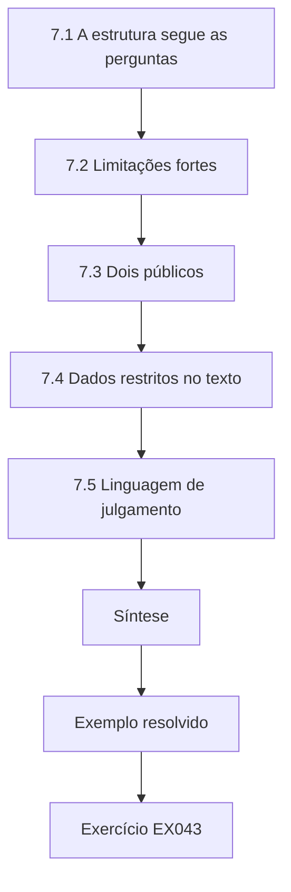

### Desenho lógico

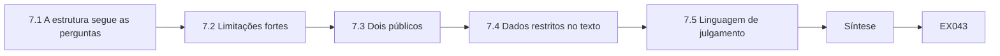

```text
[7.1 A estrutura segue as perguntas]
    |
    v
[7.2 Limitações fortes]
    |
    v
[7.3 Dois públicos]
    |
    v
[7.4 Dados restritos no texto]
    |
    v
[7.5 Linguagem de julgamento]
    |
    v
[Síntese]
    |
    v
[Exemplo resolvido] --> [Exercício EX043]
```
<!-- cyberabc:lesson-figures:end ch-07 -->


### Objetivos de aprendizagem

Você vai (1) estruturar uma dissertação em torno das perguntas de pesquisa; (2) escrever uma seção de limitações que fortaleça em vez de pedir desculpas; (3) apresentar os resultados a dois públicos — examinadores e profissionais; (4) tratar os dados restritos no produto escrito.

### 7.1 A estrutura segue as perguntas

A introdução enuncia a pergunta e por que ela importa para os portos. A literatura mostra o que se sabe e a lacuna. Os métodos descrevem o desenho, o dicionário de dados, a ética e a validação. Os resultados respondem a cada objetivo, em ordem. A discussão interpreta, compara com a literatura e enuncia as implicações. A conclusão é curta. Cada subseção de resultados deve começar pelo objetivo a que responde. O capítulo de resultados de Lucía tem três subseções, uma por objetivo: a mediana do tempo até o bloqueio dos membros, a comparação com os não membros pareados e a proporção de indicadores bloqueados, monitorados ou ignorados. A discussão retoma então o julgamento sobre a automação, rotulado como tal.

### 7.2 Limitações fortes

Uma limitação forte nomeia o problema, a provável direção do viés e o que foi feito a respeito. "Amostra pequena", sozinha, é fraca. "Com sete membros e seis não membros, a diferença de medianas é imprecisa; o intervalo bootstrap é largo e cruza efeitos pequenos, de modo que a significância prática é incerta" é forte. O estrato em dias de Lucía recebe o mesmo tratamento: os membros que só têm datas de chamados têm tempos arredondados para dias inteiros, o que provavelmente superestima o tempo até o bloqueio deles; analisá-los separadamente impede que esse erro alargue a diferença entre membros e não membros.

### 7.3 Dois públicos

Os examinadores querem método e argumento. Os membros do CPSG querem um resumo de uma página: qual foi a diferença de medianas, o que ela sugere para equipe e automação e o que ela não mostra. O resumo traz as mesmas ressalvas em linguagem mais simples. O resumo de Lucía para o conselho do CPSG diz que a mediana dos membros foi de 3,0 horas contra 10,0 dos não membros pareados, que dois membros com pipelines automatizados de TAXII para o firewall responderam pelos bloqueios mais rápidos e que as amostras pequenas e a automação autodeclarada limitam os dois pontos. Ele não diz aos membros que comprem automação; sugere o que medir a seguir.

### 7.4 Dados restritos no texto

A dissertação provavelmente será pública pela biblioteca da universidade; por isso, é escrita como TLP:CLEAR. Nenhum nome de membro, nenhum valor de indicador da coleção AMBER, nenhuma citação de boletins de membros. Exemplos sintéticos ilustram os formatos. A revisão de vazamentos encontrou o único ponto em que isso falhou: uma legenda de figura nomeava a cidade de um porto, o que identificaria o membro. Lucía a substituiu por "Membro C", registrou a alteração e avisou o conselho. Exemplos sintéticos de STIX ilustram o formato no capítulo de métodos sem trazer nenhum valor real de indicador.

### 7.5 Linguagem de julgamento

Ao interpretar, separe a observação ("os membros bloquearam mais rápido nesta amostra") do julgamento ("a automação da ingestão TAXII provavelmente explica parte da diferença"), como a ICD 203 recomenda para os produtos analíticos. Rotule a confiança e o fundamento do julgamento. A discussão de Lucía rotula a explicação pela automação como um julgamento de confiança moderada, porque a situação de automação foi autodeclarada pelos membros, e propõe um estudo de acompanhamento que a meça diretamente a partir dos registros dos pipelines. A frase de observação traz as medianas de 3,0 e 10,0 horas e o seu intervalo; a frase de julgamento traz a sua confiança e o fundamento autodeclarado. Um leitor que rejeite o julgamento ainda tem a observação intacta.

### Exemplo resolvido

A discussão de Lucía argumenta que dois membros com pipelines automatizados de TAXII para o firewall respondem pelos bloqueios mais rápidos. Ela rotula isso como um julgamento de confiança moderada, observa que a situação de automação foi autodeclarada e sugere um estudo de acompanhamento que a meça diretamente.

> **Caso sintético.** Os detalhes da automação e os membros são inventados.

### Erros e limites

Esconder as limitações para parecer mais forte convida o ataque dos examinadores. Resumos para profissionais que descartam as ressalvas podem levar a decisões ruins de investimento.

### Exercícios

- **EX043 — Frase de abertura.** Como cada subseção de resultados deve começar? *Rubrica:* 3 = nomeando o objetivo/a pergunta a que responde; 2 = com dados; 1 = com literatura; 0 = nenhum.
- **EX044 — De fraca a forte.** Transforme a limitação "os dados eram limitados" em uma limitação forte. *Rubrica:* 3 = problema específico + direção do viés + mitigação; 2 = duas partes; 1 = inalterada; 0 = nenhuma.
- **EX045 — Conteúdo do resumo.** Liste três itens do resumo de uma página para profissionais. *Rubrica:* 3 = achado, implicação, o que não mostra (ressalvas); 2 = dois; 1 = o método completo; 0 = nenhum.
- **EX046 — TLP da dissertação.** Que nível de TLP o texto da dissertação deve assumir, e qual é uma consequência? *Rubrica:* 3 = CLEAR; nenhum valor de indicador AMBER/nome de membro; 2 = apenas CLEAR; 1 = AMBER; 0 = nenhum.
- **EX047 — Observação versus julgamento.** Rotule "dois membros têm pipelines automatizados e os tempos mais rápidos" e "a automação explica a diferença". *Rubrica:* 3 = a primeira é observação (autodeclarada), a segunda é julgamento; 2 = uma certa; 1 = ambas como fatos; 0 = nenhum.
- **EX048 — Ressalva da autodeclaração.** Por que a situação de automação autodeclarada precisa ser sinalizada? *Rubrica:* 3 = não verificada; pode ser imprecisa/enviesada; afeta o julgamento causal; 2 = parcial; 1 = não é necessário; 0 = nenhum.
- **EX049 — Desenho do acompanhamento.** Proponha como um estudo de acompanhamento poderia medir a automação diretamente. *Rubrica:* 3 = medida observável (registros de pipeline, revisão de configuração com consentimento); 2 = vago; 1 = nova pesquisa de opinião; 0 = nenhum.

### Síntese

Deixe as perguntas moldarem o texto, escreva as limitações com direção e mitigação, informe os profissionais com honestidade e escreva como se fosse TLP:CLEAR.

### Continue estudando — capítulo 07 de 08

[← Capítulo 06 (rascunho)](#ch-06) · [Índice de capítulos do curso](../SUBJECTS.md) · [Capítulo 08 (rascunho) →](#ch-08)

<a id="ch-08"></a>

## Capítulo 8 — Revisão independente e defesa

<!-- cyberabc:lesson-figures:start ch-08 -->
### Mapa da aula

Aula 08 publicada. Mapa, exemplo, EX050.

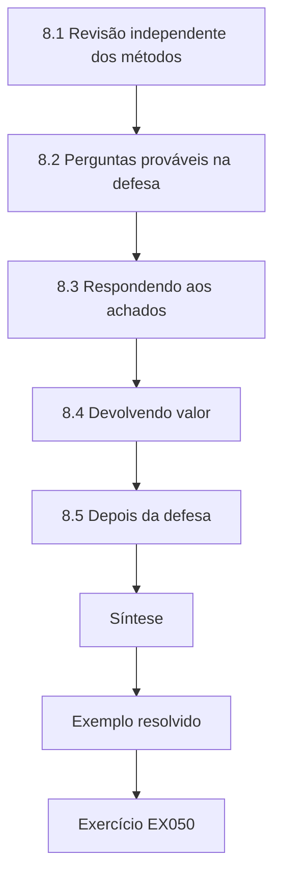

### Desenho lógico

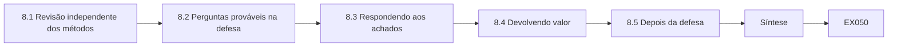

```text
[8.1 Revisão independente dos métodos]
    |
    v
[8.2 Perguntas prováveis na defesa]
    |
    v
[8.3 Respondendo aos achados]
    |
    v
[8.4 Devolvendo valor]
    |
    v
[8.5 Depois da defesa]
    |
    v
[Síntese]
    |
    v
[Exemplo resolvido] --> [Exercício EX050]
```
<!-- cyberabc:lesson-figures:end ch-08 -->


### Objetivos de aprendizagem

Você vai (1) encomendar uma revisão independente dos métodos antes da entrega; (2) preparar-se para as perguntas da defesa sobre desenho e ética; (3) responder com transparência aos achados da revisão; (4) planejar a devolução dos resultados à comunidade que forneceu os dados.

### 8.1 Revisão independente dos métodos

Um colega de fora do projeto refaz a análise a partir do arquivo, usando os arquivos de amostra sintéticos, e verifica se cada figura coincide. Um segundo leitor verifica se nenhuma informação restrita vazou para o texto, as tabelas ou as legendas das figuras. As duas revisões são documentadas. No caso de Lucía, o colega que conferiu as figuras constatou que todas as medianas se reproduziam exatamente a partir do arquivo. O revisor de vazamentos encontrou uma legenda que nomeava a cidade de um porto. Cada achado e a sua correção foram para o registro de alterações, de modo que os examinadores puderam ver que as duas revisões foram reais, e não etapas formais.

### 8.2 Perguntas prováveis na defesa

Por que não um desenho aleatorizado? Como você lidou com os fatores de confusão? Com o que os membros consentiram? O que mudaria a sua conclusão? Por que medianas? O conjunto de regras de validação STIX está completo? Pratique respostas que citem as páginas da própria dissertação. Para Lucía, a resposta sobre os fatores de confusão cita a comparação pareada e o estrato antes e depois; a resposta sobre as medianas cita os dados de tempo assimétricos; e "o que mudaria a sua conclusão" cita a evidência de que o estrato antes e depois não mostre queda com a entrada. Respostas enraizadas no próprio desenho são mais difíceis de derrubar.

### 8.3 Respondendo aos achados

Se o revisor encontrar uma figura que não coincide, corrija-a, registre a correção em um registro de alterações e verifique se alguma conclusão muda. Os examinadores respeitam mais uma correção visível do que uma invisível descoberta depois. O registro de alterações de Lucía mostra o padrão para outro achado, a legenda que nomeava a cidade de um porto: a alteração, a data e o aviso ao conselho estão todos registrados. Se uma mediana não tivesse se reproduzido, o mesmo registro mostraria o valor corrigido e se a diferença de 7,0 horas ainda se mantinha.

### 8.4 Devolvendo valor

O CPSG deu os dados; a comunidade deve receber os resultados primeiro. Lucía apresenta o resumo ao conselho de governança antes da defesa pública, sob as regras de agregação acordadas. O NIST SP 800-150 ressalta que as relações de compartilhamento dependem de confiança e reciprocidade; uma pesquisa que extrai sem devolver corrói as duas. O resumo também traz a nota de qualidade de dados, sobre a qual os membros podem agir de imediato: ao corrigir as exportações sem `valid_from` ou `spec_version`, os produtores tornam mais confiáveis o próximo estudo e a automação dos seus próprios consumidores. As medianas de 3,0 e 10,0 horas chegaram ao conselho do CPSG antes de os examinadores as verem, o que preserva a reciprocidade que o NIST SP 800-150 descreve.

### 8.5 Depois da defesa

Exclua os tempos brutos conforme o acordado, arquive o código e as amostras sintéticas e registre a exclusão. Se for publicar um artigo, verifique de novo se a versão publicada ainda atende às condições do conselho. Para Lucía, o registro da exclusão é o último item que o conselho recebe: que arquivos foram excluídos, quando e por quem. Qualquer artigo redigido depois a partir da dissertação é verificado de novo contra as três condições do conselho antes da submissão. O código arquivado e as amostras sintéticas continuam disponíveis, de modo que o estudo ainda pode ser refeito depois que os tempos brutos se forem; a exclusão não enfraquece a reprodutibilidade, porque o arquivo foi desenhado em torno de arquivos sintéticos desde o início.

### Exemplo resolvido

O revisor de vazamentos descobre que uma legenda de figura nomeia a cidade de um porto, o que identificaria o membro. Lucía a substitui por "Membro C", registra a alteração e avisa o conselho. O colega que confere as figuras constata que todas as medianas se reproduzem exatamente.

> **Caso sintético.** Os achados da revisão e o aviso ao conselho são inventados.

### Erros e limites

Um amigo que ajudou na análise não é independente. Apresentar à comunidade depois da publicação pode violar o acordo.

### Exercícios

- **EX050 — Duas revisões.** O que cada um dos dois revisores independentes verifica? *Rubrica:* 3 = reprodutibilidade das figuras + vazamento de informação restrita; 2 = um; 1 = gramática; 0 = nenhum.
- **EX051 — Resposta sobre a aleatorização.** Redija uma resposta de uma frase para a defesa à pergunta "por que não aleatorizar?". *Rubrica:* 3 = não se pode designar a filiação, por razões éticas/práticas; usou antes e depois e pareamento; 2 = parcial; 1 = desconhece; 0 = nenhuma.
- **EX052 — Vazamento na legenda.** Por que nomear a cidade de um porto viola o acordo? *Rubrica:* 3 = identifica o membro apesar da regra de agregação; 2 = privacidade, de forma vaga; 1 = inofensivo; 0 = nenhum.
- **EX053 — Registro de correção.** O que contém uma entrada do registro de correções? *Rubrica:* 3 = o que mudou, por quê, a data, o efeito nas conclusões; 2 = dois; 1 = vago; 0 = nenhum.
- **EX054 — Comunidade primeiro.** Por que apresentar ao conselho antes da defesa pública? *Rubrica:* 3 = reciprocidade/confiança; acordo; oportunidade de verificar a agregação; 2 = cortesia; 1 = desnecessário; 0 = nenhum.
- **EX055 — Prova da exclusão.** Depois da avaliação, o que Lucía deve fazer com os tempos brutos? *Rubrica:* 3 = excluí-los conforme o acordado e registrar a exclusão; 2 = excluir; 1 = manter; 0 = nenhum.
- **EX056 — Nova verificação para o artigo.** O que precisa ser verificado de novo antes de transformar a dissertação em artigo? *Rubrica:* 3 = condições do conselho (agregação, nenhum nome) ainda atendidas no novo texto/figuras; 2 = vago; 1 = tentativa mínima; 0 = nenhum.

### Síntese

Ponha olhos independentes sobre os números e os vazamentos, ensaie as respostas sobre desenho e ética, corrija às claras e devolva os resultados às pessoas que compartilharam.

### Continue estudando — capítulo 08 de 08

[← Capítulo 07 (rascunho)](#ch-07) · [Índice de capítulos do curso](../SUBJECTS.md) · [Resoluções ↓](#worked-results) · [Próximo curso pelo índice de capítulos →](../SUBJECTS.md)

<a id="worked-results"></a>

## Resoluções

Respostas-modelo para EX001–EX056. O Coastline Ports Sharing Group, Lucía Ferraz, o Prof. Daniel Okafor e todos os números são sintéticos. As respostas dos laboratórios citam saídas verificadas. Qualquer resposta que atenda à rubrica recebe a mesma pontuação.

**EX001.** População: operadores portuários. Intervenção: receber indicadores pela coleção TAXII 2.1 do CPSG. Comparação: operadores semelhantes fora do CPSG. Desfecho: tempo entre a publicação do indicador e uma regra de bloqueio.

**EX002.** Incluir: estudos empíricos que medem um desfecho do compartilhamento de informações sobre ameaças. Excluir: páginas de marketing de fornecedores sem método ou dados descritos.

**EX003.** Vertente de normas e orientações: o SP 800-150 explica como montar e operar o compartilhamento, mas não mede o desfecho que Lucía estuda.

**EX004.** Exemplo: "2026-02-03 | Biblioteca A | `"threat intelligence sharing" AND (effectiveness OR evaluation OR measurement)`, 2011–2026 | 412 resultados | 112 resumos triados | 19 incluídos | excluídos: fora do tema, sem método, duplicados."

**EX005.** 32 (412 − 300 − 80).

**EX006.** Apenas 3 das 19 obras incluídas medem um desfecho; a maioria descreve processos, então a eficácia medida é a área escassa.

**EX007.** Regras fixadas depois de ler os resultados podem ser dobradas para manter as fontes convenientes e descartar as inconvenientes; regras fixas tornam a revisão repetível e sem viés.

**EX008.** Direção e retroalimentação: os SOCs raramente recebem requisitos escritos, e os consumidores raramente relatam se a inteligência ajudou, então o ciclo funciona em malha aberta.

**EX009.** Estratégica — uma tendência do setor dirigida a executivos e planejadores, e não a analistas que escrevem regras.

**EX010.** Os adversários trocam endereços IP a baixo custo, mas mudar um comportamento como a técnica de phishing custa mais, então o mapeamento para o T1566 continua útil por mais tempo.

**EX011.** A partir do domínio remetente (infraestrutura), encontrar outros eventos nos dados da comunidade que usaram o mesmo domínio ou registrante, revelando outras vítimas ou campanhas.

**EX012.** TLP:CLEAR, TLP:GREEN, TLP:AMBER, TLP:AMBER+STRICT, TLP:RED.

**EX013.** Consultas ou contatos visíveis podem alertar o investigado, que pode trocar de infraestrutura, destruir evidências ou retaliar, e podem expor o investigador.

**EX014.** Entrega.

**EX015.** Tamanho da equipe do SOC: portos maiores tanto entram com mais frequência em comunidades quanto têm mais analistas para escrever regras de bloqueio depressa.

**EX016.** Comparar um porto com o seu próprio período anterior à filiação mantém constantes características estáveis como porte e orçamento, isolando a mudança em torno da entrada.

**EX017.** Com pelo menos três portos em cada grupo, nenhum leitor consegue deduzir de trás para a frente os tempos de um único membro.

**EX018.** De operadores não membros que se voluntariam e compartilham os próprios registros sob acordo escrito — nunca sondando os sistemas deles.

**EX019.** Os nomes de usuário dos analistas: o estudo precisa de tempos, não de pessoas, então removê-los minimiza o tratamento de dados pessoais.

**EX020.** Os dados desse membro são excluídos por inteiro; a aprovação do conselho não se sobrepõe a uma recusa individual.

**EX021.** Para que qualquer pessoa que refaça a análise obtenha exatamente os mesmos resultados reamostrados.

**EX022.** `H1 ... inconsistent=0`, `H2 ... inconsistent=2`, `H3 ... inconsistent=3` (0, 2 e 3 inconsistências).

**EX023.** E2, acesso a partir de uma conta de VPN de um prestador de serviços: é consistente com as três hipóteses, então não consegue discriminar entre elas.

**EX024.** A H1 é apenas a menos contradita entre as hipóteses consideradas; o conjunto de evidências é pequeno, e uma explicação não listada poderia se ajustar melhor.

**EX025.** Exemplo: "provável" = 55–80%. Kent mostrou que os leitores atribuem números muito diferentes à mesma palavra, então um intervalo publicado mantém o significado consistente.

**EX026.** Exemplo: a descoberta de que a conta do prestador foi usada a partir de uma estação de trabalho de funcionário dentro do porto durante a intrusão.

**EX027.** Exemplo: um corretor de acesso inicial que vendeu o acesso à VPN ao grupo de ransomware — distinta porque envolveria dois atores.

**EX028.** T1486.

**EX029.** `ttb_h`: horas entre a publicação do indicador (`t_pub`) e a ativação da regra de bloqueio (`t_block`); float; unidade horas; derivado como (t_block − t_pub)/3600 s; ausente se não houve bloqueio.

**EX030.** Se os membros registram o momento de ativação da regra de bloqueio (`t_block`) com precisão suficiente para calcular horas.

**EX031.** Analisar esse membro em um estrato separado, em dias, e relatar a menor precisão como limitação.

**EX032.** Deriva: substitui o constructo do tempo até o bloqueio pela satisfação, respondendo a uma pergunta diferente e mais fácil.

**EX033.** Registra os indicadores que os membros escolheram não bloquear, para que o estudo não olhe apenas os indicadores bem-sucedidos.

**EX034.** O carimbo de tempo `created` do indicador, apoiado por `valid_from`.

**EX035.** Não. Os dados do piloto testam a viabilidade; pertencem ao capítulo de métodos, não aos resultados.

**EX036.** `PROBLEMS: pattern, valid_from, id format`.

**EX037.** Falta `spec_version`, que o STIX 2.1 exige em todo objeto de domínio.

**EX038.** Alguns bloqueios muito lentos tornam a distribuição assimétrica; a mediana reflete o caso típico sem ser arrastada pelos valores extremos.

**EX039.** Mediana dos membros 3,0 h (`median=3.0h`), mediana dos não membros 10,0 h (`median=10.0h`), razão 3,33 (`ratio=3.33`).

**EX040.** Exemplo: "Nesta pequena amostra (7 membros, 6 não membros), a filiação esteve associada a uma mediana menor do tempo até o bloqueio (3,0 h contra 10,0 h); a causalidade não está estabelecida."

**EX041.** Um intervalo de confiança bootstrap para a diferença de medianas, reamostrando cada grupo com reposição muitas vezes; ou um teste de postos de Mann–Whitney.

**EX042.** Não. Excluir o objeto da análise de tempos e relatá-lo como achado de qualidade de dados; inventar valores é fabricar dados.

**EX043.** Enunciando a que objetivo ou pergunta de pesquisa responde.

**EX044.** Exemplo: "Apenas os membros com registros em segundos puderam contribuir com tempos em horas, o que provavelmente sobrerrepresenta os portos com mais recursos e enviesa para baixo as medianas dos membros; um estrato em dias foi analisado separadamente."

**EX045.** A diferença de medianas encontrada, a implicação para equipe ou automação e o que o estudo não mostra (nenhuma prova causal, amostra pequena).

**EX046.** TLP:CLEAR; portanto, não podem aparecer valores de indicadores AMBER, nomes de membros nem citações de boletins.

**EX047.** A primeira é uma observação (baseada em autodeclaração); a segunda é um julgamento analítico.

**EX048.** As descrições que os membros fizeram da própria automação não foram verificadas e podem ser imprecisas, o que enfraquece qualquer julgamento de que a automação explica a diferença.

**EX049.** Com o consentimento dos membros, revisar os registros ou as configurações dos pipelines para registrar se a ingestão TAXII cria regras de bloqueio sem etapas humanas, com carimbo de tempo em cada etapa.

**EX050.** Um refaz a análise para confirmar que cada figura se reproduz; o outro verifica o texto, as tabelas e as legendas em busca de informação restrita vazada.

**EX051.** "A filiação não pode ser designada ao acaso aos operadores portuários, então usei uma comparação antes e depois para os membros que entraram, mais não membros voluntários pareados, para reduzir os fatores de confusão."

**EX052.** Uma cidade pode identificar um único porto membro, anulando a regra de agregação imposta pelo conselho.

**EX053.** O que mudou, por quê, a data e se alguma conclusão se moveu em consequência.

**EX054.** O CPSG compartilhou os dados com base na confiança; apresentar primeiro honra a reciprocidade e permite ao conselho confirmar que as regras de agregação foram cumpridas antes que algo se torne público.

**EX055.** Excluir os tempos brutos conforme exige o acordo e manter um registro datado da exclusão.

**EX056.** Que cada nova frase, tabela e figura ainda atende às condições do conselho — agregação em grupos de três ou mais e nenhum nome ou localização de membro.

<a id="references"></a>
## Referências

Todos os DOIs foram resolvidos em doi.org em 12 de outubro de 2026, e as normas foram conferidas nas páginas de seus editores. A lista é idêntica à da edição em inglês e cobre o livro inteiro, acrescida apenas da LGPD, citada nesta edição como referência brasileira e conferida em sua fonte oficial; nenhuma das normas técnicas citadas foi verificada aqui como adotada pela ABNT, por isso são citadas em sua edição internacional. Organizações, pessoas, sistemas e números dos casos são sintéticos; somente as obras abaixo são reais.

- Bianco, D. (2013). The Pyramid of Pain. <https://detect-respond.blogspot.com/2013/03/the-pyramid-of-pain.html>
- Brasil. (2018). *Lei nº 13.709, de 14 de agosto de 2018 — Lei Geral de Proteção de Dados Pessoais (LGPD)*. Diário Oficial da União. <https://www.planalto.gov.br/ccivil_03/_ato2015-2018/2018/lei/l13709.htm>
- Caltagirone, S., Pendergast, A. and Betz, C. (2013). The Diamond Model of Intrusion Analysis. Technical Report ADA586960, Center for Cyber Intelligence Analysis and Threat Research. <https://www.activeresponse.org/wp-content/uploads/2013/07/diamond.pdf>
- European Union. Regulation (EU) 2016/679 (General Data Protection Regulation). <https://eur-lex.europa.eu/eli/reg/2016/679/oj>
- FIRST. Traffic Light Protocol (TLP) version 2.0. <https://www.first.org/tlp/>
- Heuer, R. J. (1999). Psychology of Intelligence Analysis. CIA Center for the Study of Intelligence. <https://www.cia.gov/resources/csi/books-monographs/psychology-of-intelligence-analysis-2/>
- Hutchins, E. M., Cloppert, M. J. and Amin, R. M. (2011). Intelligence-Driven Computer Network Defense Informed by Analysis of Adversary Campaigns and Intrusion Kill Chains. Lockheed Martin. <https://www.lockheedmartin.com/content/dam/lockheed-martin/rms/documents/cyber/LM-White-Paper-Intel-Driven-Defense.pdf>
- Kent, S. (1964). Words of Estimative Probability. CIA Studies in Intelligence. <https://www.cia.gov/resources/csi/static/Words-of-Estimative-Probability.pdf>
- MITRE ATT&CK Enterprise matrix, groups, software and technique pages. <https://attack.mitre.org/>
- NIST SP 800-150 (2016). Guide to Cyber Threat Information Sharing. <https://doi.org/10.6028/NIST.SP.800-150>
- NIST SP 800-61 Rev. 3 (2025). Incident Response Recommendations and Considerations for Cybersecurity Risk Management. <https://doi.org/10.6028/NIST.SP.800-61r3>
- OASIS. STIX Version 2.1 (Committee Specification / OASIS Standard). <https://docs.oasis-open.org/cti/stix/v2.1/stix-v2.1.html>
- OASIS. TAXII Version 2.1. <https://docs.oasis-open.org/cti/taxii/v2.1/taxii-v2.1.html>
- ODNI. Intelligence Community Directive 203: Analytic Standards (2015, amended 2022). <https://www.odni.gov/files/documents/ICD/ICD-203.pdf>
