# Application and Software Supply Chain Security: Postgraduate Course

- Language: English (`en`); course 152, Postgraduate course (2 years).
- Editorial state: **published**. Chapters 1–12 of 12 have hand-written teaching text; exercises EX001–EX060 have matching worked results with 0–3 rubrics; four offline labs use only the Python 3 standard library on synthetic evidence, and their outputs are embedded from real runs. Independent review and the 300-page A4 verification remain open.
- Audience: experienced practitioners who lead application and software supply chain security decisions and must evaluate and defend them.
- Author: [hiagokinlevi](https://github.com/hiagokinlevi). Original text [CC0 1.0](../../../../../LICENSE); cited works keep their rights.
- Ethical and legal boundary: test and review only software you are authorised to assess; no exploit code, no payloads, no attack procedures and no instructions for bypassing controls. Weaknesses are taught from the defender's side using synthetic code and data. All evidence, people and organisations are **synthetic** unless a sentence cites a public source.

[Course home](../../README.md) · [Chapter index](../SUBJECTS.md) · [Book plan](PLAN.md) · [Course skill](../../skill/SKILL.md) · [Worked results](#worked-results)

## How to use this draft

Read in order: the chapters follow one product security lead at a bank from an unreviewed SDK data-collection change through decisions, evidence, design, evaluation, integration, difficult cases and assurance to an applied project. Run each lab where it appears, attempt the five exercises before the worked results, and score yourself with the rubrics.

### Synthetic running case

| Element | Role | Boundary |
|---|---|---|
| **Hannah Brooks** | Product security lead and postgraduate student | Invented |
| **Dr Ravi Menon** | Programme tutor | Invented |
| **Northbridge Bank** | Fictional retail bank | Invented |
| **Calder College** | Fictional college | Invented |

### Core sources

[OWASP Top 10:2021](https://owasp.org/Top10/); OWASP [ASVS](https://owasp.org/www-project-application-security-verification-standard/) 4.0.3 and 5.0.0; OWASP [WSTG](https://owasp.org/www-project-web-security-testing-guide/) and [SAMM](https://owaspsamm.org/); NIST [SP 800-218 (SSDF)](https://doi.org/10.6028/NIST.SP.800-218); [CWE Top 25](https://cwe.mitre.org/top25/); [SLSA v1.0](https://slsa.dev/spec/v1.0/); Shostack, *Threat Modeling: Designing for Security* (Wiley, 2014). Full list in [References](#references).

## Contents

| Chapters |
|---|
| [1](#ch-01) · [2](#ch-02) · [3](#ch-03) · [4](#ch-04) · [5](#ch-05) · [6](#ch-06) · [7](#ch-07) · [8](#ch-08) · [9](#ch-09) · [10](#ch-10) |
| [11](#ch-11) · [12](#ch-12) |

[Worked results](#worked-results) · [References](#references)

<a id="ch-01"></a>

## Chapter 1 — Advanced security decision-making

<!-- cyberabc:lesson-figures:start ch-01 -->
### Lesson map

Lesson 01 published. Map, example, EX001.

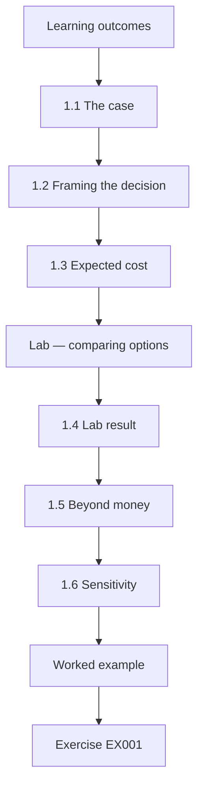

### Logical drawing

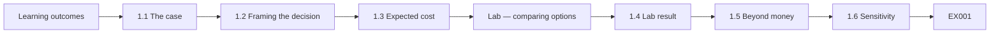

```text
[Learning outcomes]
    |
    v
[1.1 The case]
    |
    v
[1.2 Framing the decision]
    |
    v
[1.3 Expected cost]
    |
    v
[Lab — comparing options]
    |
    v
[1.4 Lab result]
    |
    v
[1.5 Beyond money]
    |
    v
[1.6 Sensitivity]
    |
    v
[Worked example] --> [Exercise EX001]
```
<!-- cyberabc:lesson-figures:end ch-01 -->


### Learning outcomes

You will (1) frame application-security decisions as choices under uncertainty; (2) compare options using expected cost; (3) account for non-financial harms; (4) document decisions for accountability.

### 1.1 The case

Hannah Brooks is product security lead at the fictional Northbridge Bank and a postgraduate student at the fictional Calder College, tutored by Dr Ravi Menon. In February, a routine update of a third-party analytics software development kit (SDK) in Northbridge's mobile banking app began sending approximate device location to the SDK vendor. Nobody reviewed SDK updates; the update arrived automatically with a dependency refresh. A privacy engineer noticed the new network traffic 19 days later. No account data was exposed, but customers' location data had gone to a third party without a lawful basis. The bank reported the incident to its data protection regulator. Hannah's course follows her as she decides how the bank should govern third-party code in its apps.

### 1.2 Framing the decision

Hannah's board asks: what should we do about third-party SDKs? She frames three options: continue without review; review every SDK update before release; or remove third-party SDKs and build analytics in-house.

The February incident had already shown the cost of the first option: an analytics SDK update began collecting location data, and nobody at Northbridge noticed for nineteen days. The board wanted options it could compare, so Hannah describes each one in the same terms: what it costs to run, what it would have caught in February, and what it would change for the mobile teams.

### 1.3 Expected cost

For each option she estimates the annual cost of the control, the probability of a similar incident in a year and its impact (fines, remediation, customer trust), using the February incident and industry reports as anchors.

Every probability is an estimate, so she writes down where each one came from and who she asked. The impact figure of 900k combines remediation work, the regulator's likely response and an allowance for customers leaving. She keeps the inputs in a small table the board can question, rather than presenting a single total.

### Lab — comparing options

```python
"""Expected annual cost of three SDK-governance options (synthetic estimates, GBP thousands)."""
options = {"no review": (0, 0.30, 900), "review on update": (60, 0.08, 900), "remove SDKs, in-house analytics": (220, 0.02, 900)}
for name, (cost, p, impact) in options.items():
    print(f"{name:32} control {cost:4}k + {p:.2f} x {impact}k = {cost + p * impact:6.1f}k")
```

Run with `python3 lab_decision.py`. Verified output:

```text
no review                        control    0k + 0.30 x 900k =  270.0k
review on update                 control   60k + 0.08 x 900k =  132.0k
remove SDKs, in-house analytics  control  220k + 0.02 x 900k =  238.0k
```

### 1.4 Lab result

With an impact of 900k, "no review" has an expected cost of 270k (0.30 × 900k). "Review on update" costs 60k plus 0.08 × 900k, totalling 132k. Removing SDKs costs 220k plus 0.02 × 900k, totalling 238k. On these estimates, reviewing updates is cheapest overall.

The ranking holds only as long as the estimates are roughly right, which is why the next step tests how far they can move. Hannah also notes that the 60k for review is mostly staff time, which the bank can measure after the first year.

### 1.5 Beyond money

Some harms are not well captured in money: customer trust, regulatory relationships, and the bank's duty to treat customers fairly. Hannah lists these alongside the numbers and notes that they strengthen the case for review rather than changing the ranking.

She does not convert trust into a money figure, because any number she chose would look more precise than it is. Instead, the board paper keeps a separate short list of harms that the expected-cost table leaves out, so the directors weigh them openly when they decide.

### 1.6 Sensitivity

If the incident probability without review were 0.15 instead of 0.30, "no review" would cost 135k, almost tied with review. Hannah shows the board this sensitivity so they see the decision depends on her estimates.

She also checks the other direction: if the review control cost twice as much, it would still be cheaper than having no review at all. The board can therefore see which estimates matter most to the choice and which ones barely move it. The directors agree that the estimates should be revisited after a year of data from the review process.

### 1.7 Accountability

The decision, options, estimates and sensitivity are recorded and signed by the chief information security officer (CISO), so later reviewers can see what was known and why the choice was made.

The record also names the estimates most likely to be wrong and when they will be checked, so a later review can compare them with what actually happened. Hannah stores it with the February incident report, because the two documents explain each other. When the evaluation in chapter 6 reports, she adds its results to the same file.

### Worked example

The board approves "review on update" plus a plan to reduce the number of SDKs over two years. Hannah sets up a review process (chapter 5) and an evaluation (chapter 6) to check whether the estimates hold.

> **Synthetic case.** Northbridge Bank, Calder College, the SDK, its vendor and all figures are synthetic.

### Errors and limits

Probability estimates for rare events are uncertain; present ranges and sensitivities, not single numbers.

### Exercises

- **EX001 — February incident.** Summarise the February incident. *Rubric:* 3 = SDK update sent location to vendor; unreviewed; found after 19 days; reported to regulator; 2 = partial; 1 = one; 0 = none.
- **EX002 — Three options.** What were the three options? *Rubric:* 3 = no review; review on update; remove SDKs; 2 = two; 1 = one; 0 = none.
- **EX003 — Lab totals.** Give the expected cost of each option. *Rubric:* 3 = 270k, 132k, 238k; 2 = two; 1 = one; 0 = none.
- **EX004 — Sensitivity.** What happens if the no-review probability is 0.15? *Rubric:* 3 = 135k, near tie; 2 = partial; 1 = vague; 0 = none.
- **EX005 — Non-financial harms.** Name two harms not well captured in money. *Rubric:* 3 = trust, regulator relationship, fairness (two); 2 = one; 1 = vague; 0 = none.

### Synthesis

Frame choices, compare expected costs with sensitivity, add non-financial harms and record the decision.

### Continue studying — chapter 01 of 12

[← Course home](../../README.md) · [Course chapter index](../SUBJECTS.md) · [Chapter 02 (draft) →](#ch-02)

<a id="ch-02"></a>

## Chapter 2 — Application and software supply chain security: current practice

<!-- cyberabc:lesson-figures:start ch-02 -->
### Lesson map

Lesson 02 published. Map, example, EX006.

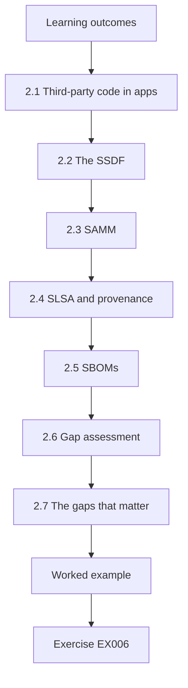

### Logical drawing

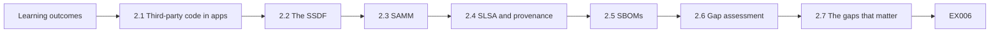

```text
[Learning outcomes]
    |
    v
[2.1 Third-party code in apps]
    |
    v
[2.2 The SSDF]
    |
    v
[2.3 SAMM]
    |
    v
[2.4 SLSA and provenance]
    |
    v
[2.5 SBOMs]
    |
    v
[2.6 Gap assessment]
    |
    v
[2.7 The gaps that matter]
    |
    v
[Worked example] --> [Exercise EX006]
```
<!-- cyberabc:lesson-figures:end ch-02 -->


### Learning outcomes

You will (1) describe current industry practice for third-party code in applications; (2) relate practice to the SSDF, SAMM and SLSA; (3) assess Northbridge against current practice; (4) identify the gaps that matter most.

### 2.1 Third-party code in apps

Mobile and web apps typically include open-source libraries and commercial SDKs for analytics, crash reporting, payments and identity checks. SDKs run with the app's permissions and can collect data or change behaviour with each update.

Northbridge's mobile app includes SDKs for analytics, crash reporting and identity verification, and the February change came through the analytics one. The bank's own engineers never read the SDK's code, because it arrives as a compiled binary inside an automated dependency refresh. Whatever an SDK does with the app's permissions, the bank answers for it to its customers.

### 2.2 The SSDF

NIST SP 800-218 (Souppaya et al., 2022) asks organisations to acquire and maintain well-secured software components (PW.4), to protect all forms of code from unauthorised access and tampering (PS.1), and to identify and confirm vulnerabilities on an ongoing basis (RV.1). Third-party SDK governance falls largely under PW.4.

Hannah uses the SSDF as a checklist rather than a score, asking whether Northbridge has a working practice for each relevant task. For PW.4, the answer in February was no for commercial SDKs, even though open-source libraries were already scanned.

### 2.3 SAMM

OWASP SAMM v2 (2020) assesses maturity across governance, design, implementation, verification and operations. Its implementation function includes secure build and secure deployment practices, while the design function includes security requirements, including requirements for suppliers.

Hannah runs a light SAMM assessment with the mobile and platform leads, scoring each practice from interviews and samples of recent work. The scores show secure build is reasonably mature, while supplier security requirements are close to absent, which matches what the February incident exposed. Hannah repeats the assessment a year later with the same leads to measure change.

### 2.4 SLSA and provenance

SLSA v1.0 focuses on build integrity: knowing which source and build produced an artifact. For vendor SDKs delivered as binaries, provenance and signatures from the vendor would show the SDK was built as claimed, but most SDK vendors do not yet provide them.

Hannah therefore treats SLSA as the target for Northbridge's own builds and as something to ask vendors about, not as a requirement she can enforce on them yet. Her own release pipeline can produce provenance now; the SDKs inside it remain the weaker link.

### 2.5 SBOMs

NTIA (2021) minimum elements give a baseline for listing components. Northbridge generates SBOMs for its own builds, but the SDK appears as a single opaque entry.

That opaque entry tells the bank which SDK version is in the app but nothing about the components or data collection inside it. Hannah records this as a gap: the SBOM supports vulnerability matching for open-source code but could not have revealed the February behaviour change. A vendor SBOM would help with components, but behaviour still needs observing.

### 2.6 Gap assessment

Hannah's assessment finds: no review of SDK updates, no inventory of what data each SDK collects, no contractual SBOM requirement for vendors, and update automation that pulls SDKs along with open-source libraries.

She lists the four gaps in a table with the framework reference beside each, so the CISO can see why each one matters and which standard supports closing it. The fourth gap matters because automation treats a commercial SDK like any open-source library: a weekly dependency refresh can pull a new SDK version into the app without anyone reading its changelog. That is exactly how the February analytics update reached customers without review. Hannah adds the gaps to the bank's risk register so they are tracked like any other risk.

### 2.7 The gaps that matter

The February incident maps directly to the first two gaps; Hannah prioritises them.

The first gap let the update reach customers unreviewed, and the second meant nobody could say what the SDK was supposed to collect. Fixing these two would have caught February's change before release, so they come first. The contract and automation gaps matter too, but they would not on their own have stopped the location collection, so they follow in the plan. Each gap gets an owner and a target quarter in the plan the CISO approves.

### Worked example

Hannah presents a one-page gap table to the CISO: practice, framework reference, Northbridge status, risk, owner. The CISO assigns owners for each of the four gaps and asks for monthly progress.

> **Synthetic case.** Assessments are synthetic.

### Errors and limits

Current practice differs by sector; banking regulation may require more than general frameworks.

### Exercises

- **EX006 — SDK risk.** Why are SDKs risky? *Rubric:* 3 = run with app permissions; updates can change behaviour/data; 2 = partial; 1 = vague; 0 = none.
- **EX007 — SSDF practice.** Which SSDF practice covers third-party components? *Rubric:* 3 = PW.4; 2 = partial; 1 = vague; 0 = none.
- **EX008 — SBOM limit.** What is the SBOM limit for SDKs? *Rubric:* 3 = opaque single entry; 2 = partial; 1 = vague; 0 = none.
- **EX009 — Four gaps.** List the four gaps. *Rubric:* 3 = no update review; no data inventory; no vendor SBOM clause; automation pulls SDKs; 2 = three; 1 = one; 0 = none.
- **EX010 — Gap table.** What columns did Hannah's table have? *Rubric:* 3 = practice, reference, status, risk, owner; 2 = four; 1 = two; 0 = none.

### Synthesis

Compare practice with frameworks and focus on the gaps your incidents expose.

### Continue studying — chapter 02 of 12

[← Chapter 01 (draft)](#ch-01) · [Course chapter index](../SUBJECTS.md) · [Chapter 03 (draft) →](#ch-03)

<a id="ch-03"></a>

## Chapter 3 — Application and software supply chain security: specialist evidence

<!-- cyberabc:lesson-figures:start ch-03 -->
### Lesson map

Lesson 03 published. Map, example, EX011.

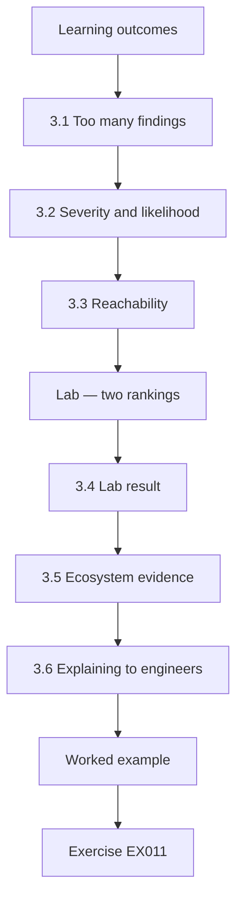

### Logical drawing

```mermaid
flowchart LR
  N0["Learning outcomes"]
  N1["3.1 Too many findings"]
  N2["3.2 Severity and likelihood"]
  N3["3.3 Reachability"]
  N4["Lab — two rankings"]
  N5["3.4 Lab result"]
  N6["3.5 Ecosystem evidence"]
  N7["3.6 Explaining to engineers"]
  N0 --> N1 --> N2 --> N3 --> N4 --> N5 --> N6 --> N7 --> Q["EX011"]
```

```text
[Learning outcomes]
    |
    v
[3.1 Too many findings]
    |
    v
[3.2 Severity and likelihood]
    |
    v
[3.3 Reachability]
    |
    v
[Lab — two rankings]
    |
    v
[3.4 Lab result]
    |
    v
[3.5 Ecosystem evidence]
    |
    v
[3.6 Explaining to engineers]
    |
    v
[Worked example] --> [Exercise EX011]
```
<!-- cyberabc:lesson-figures:end ch-03 -->


### Learning outcomes

You will (1) use specialist evidence to prioritise vulnerabilities in dependencies; (2) combine severity, exploitation likelihood and reachability; (3) read research on ecosystem risk; (4) explain prioritisation to engineers.

### 3.1 Too many findings

Northbridge's apps have hundreds of dependency findings each quarter. Treating all high-severity findings as urgent overwhelms teams.

In a typical quarter the mobile app alone reports more than two hundred findings, most of them in transitive dependencies the team never chose directly. Engineers had learned to treat the list as noise, and real fixes were delayed while they triaged items that could not affect the app. Hannah wants a ranking that sends effort to the few findings that matter most, and that engineers will accept as fair rather than arbitrary.

### 3.2 Severity and likelihood

CVSS gives a severity score describing how bad a flaw could be. EPSS (Jacobs et al., 2021) estimates the probability that a vulnerability will be exploited in the next 30 days, using observed activity. Severity and likelihood answer different questions.

Hannah uses both, because a severe flaw that nobody exploits may wait while a moderate one under active exploitation needs fixing this week. EPSS scores change daily, so the ranking is refreshed each time it is used. Neither input is enough alone, which is why the lab combines them.

### 3.3 Reachability

A flaw matters most if the vulnerable function is reachable from the app's code. Static analysis can estimate reachability, though imperfectly.

Northbridge's tool marks a finding reachable when a call path exists from app code to the vulnerable function. It can miss calls made through reflection or configuration, so Hannah keeps unreachable findings on the list at reduced weight rather than dropping them. Engineers can ask for a manual check whenever they think the tool has got a call path wrong. The reachability judgement is stored with each finding, so later reviews can see why it was ranked low.

### Lab — two rankings

```python
"""Rank synthetic findings by CVSS alone and by CVSS weighted with EPSS and reachability."""
f = [("F1 xml-lib", 9.8, 0.02, False), ("F2 http-client", 7.5, 0.61, True), ("F3 image-sdk", 8.1, 0.09, True),
     ("F4 json-lib", 5.3, 0.33, True), ("F5 crypto-shim", 9.1, 0.01, True)]
print("by CVSS:      ", [x[0].split()[0] for x in sorted(f, key=lambda x: -x[1])])
score = lambda x: x[1] * x[2] * (1 if x[3] else 0.1)
print("by risk score:", [x[0].split()[0] for x in sorted(f, key=lambda x: -score(x))])
```

Run with `python3 lab_prioritise.py`. Verified output:

```text
by CVSS:       ['F1', 'F5', 'F3', 'F2', 'F4']
by risk score: ['F2', 'F4', 'F3', 'F5', 'F1']
```

### 3.4 Lab result

By CVSS alone, the order is F1, F5, F3, F2, F4. Weighting CVSS by EPSS and reducing unreachable findings to one tenth gives F2, F4, F3, F5, F1. F1 (CVSS 9.8) falls to last because its EPSS is low and it is not reachable; F2 (7.5) rises to first because it is reachable and has EPSS 0.61.

Hannah shares the five-finding example with team leads before rolling out the method, so they can see how one finding falls and another rises. Hannah notes that the weighting is a judgement, not a law, and teams may question it.

### 3.5 Ecosystem evidence

Decan et al. (2018) showed vulnerabilities spread through dependency networks and fixes reach dependents slowly; Kula et al. (2018) found developers often do not update. These support investing in fast updating, not only prioritisation.

For Northbridge this means the ranking is only half the answer. Hannah also asks teams to shorten the time between a fixed version appearing and the app adopting it, because slow updating leaves known flaws in place however well they are ranked. Batched weekly updates with tests make this routine work rather than a special project.

### 3.6 Explaining to engineers

Engineers trust prioritisation they can understand. Hannah shows the three inputs for each finding and lets teams challenge reachability judgements.

Each finding in the weekly list shows its CVSS score, its EPSS probability and the reachability result, with a link to the call path when one exists. If a team shows the tool was wrong, the finding is re-ranked and the correction is noted, which also helps Hannah judge how far to trust the tool. Shared reasoning makes the ranking easier to defend when a deprioritised finding is questioned later.

### Deadlines remain

Every finding keeps a deadline by severity, so low-ranked items are still fixed.

### Worked example

Using the weighted ranking, Northbridge's mobile team fixes the top ten findings in two weeks rather than spreading effort over sixty. A later review finds none of the deprioritised findings were exploited during the quarter.

> **Synthetic case.** Findings and scores are synthetic.

### Errors and limits

EPSS and reachability are estimates; a low score is not a guarantee, so keep deadlines for all findings.

### Exercises

- **EX011 — CVSS vs EPSS.** Distinguish CVSS and EPSS. *Rubric:* 3 = severity vs exploitation probability; 2 = partial; 1 = vague; 0 = none.
- **EX012 — Lab rankings.** Give both lab rankings. *Rubric:* 3 = CVSS F1,F5,F3,F2,F4; risk F2,F4,F3,F5,F1; 2 = partial; 1 = one; 0 = none.
- **EX013 — F1 drop.** Why did F1 fall to last? *Rubric:* 3 = low EPSS; unreachable; 2 = partial; 1 = vague; 0 = none.
- **EX014 — Ecosystem lesson.** What do Decan et al. and Kula et al. suggest? *Rubric:* 3 = invest in fast updating; 2 = partial; 1 = vague; 0 = none.
- **EX015 — Engineer trust.** How did Hannah build engineers' trust? *Rubric:* 3 = show inputs; allow challenges; 2 = partial; 1 = vague; 0 = none.

### Synthesis

Combine severity, likelihood and reachability, and explain the ranking openly.

### Continue studying — chapter 03 of 12

[← Chapter 02 (draft)](#ch-02) · [Course chapter index](../SUBJECTS.md) · [Chapter 04 (draft) →](#ch-04)

<a id="ch-04"></a>

## Chapter 4 — Advanced risk and ethics

<!-- cyberabc:lesson-figures:start ch-04 -->
### Lesson map

Lesson 04 published. Map, example, EX016.

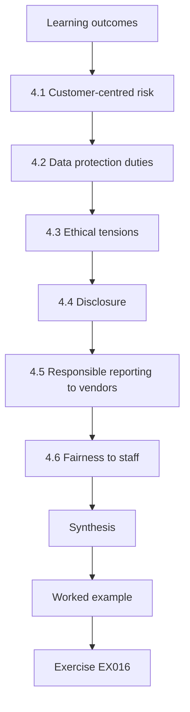

### Logical drawing

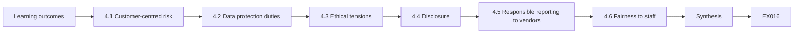

```text
[Learning outcomes]
    |
    v
[4.1 Customer-centred risk]
    |
    v
[4.2 Data protection duties]
    |
    v
[4.3 Ethical tensions]
    |
    v
[4.4 Disclosure]
    |
    v
[4.5 Responsible reporting to vendors]
    |
    v
[4.6 Fairness to staff]
    |
    v
[Synthesis]
    |
    v
[Worked example] --> [Exercise EX016]
```
<!-- cyberabc:lesson-figures:end ch-04 -->


### Learning outcomes

You will (1) assess risk to customers, not only to the organisation; (2) apply data protection duties to third-party code; (3) handle ethical tensions in vendor relationships; (4) decide disclosure obligations.

### 4.1 Customer-centred risk

The February incident cost the bank little money, but customers lost control of their location data. Hannah's risk method now rates harm to customers separately from harm to the bank, so a cheap incident with real customer harm is not under-ranked.

The two ratings sit side by side in the risk register, and either one can raise an item's priority. For February, harm to the bank was rated low, while harm to customers was rated high, because people had not agreed to share where they were.

### 4.2 Data protection duties

The bank is responsible for data its app collects, including data an SDK sends to a vendor. A lawful basis and transparency are needed; the privacy notice did not mention location. Data protection impact assessments are now required for SDKs that process personal data.

The privacy team leads these assessments, with Hannah's team supplying what the diff harness observes about each SDK's data. The privacy notice was corrected, and the analytics SDK's location collection was switched off until the vendor changed its default.

### 4.3 Ethical tensions

The SDK vendor's sales team argued that location helped "improve analytics". Hannah's view: collecting data customers were not told about breaks trust regardless of usefulness. The bank asks the vendor to disable location collection by default for all its customers, not just Northbridge.

Hannah writes her reasoning into the vendor review so the position does not depend on her being in the room. The bank also decides that usefulness alone will not justify any new data field an SDK starts sending.

### 4.4 Disclosure

The bank told the regulator and published a short notice for customers explaining what happened, what data was involved and what the bank did. Hannah argues that clear, early disclosure protects trust better than silence.

The notice was written in plain language and reviewed by legal and the privacy team before publication. It avoided blaming the vendor and stated the bank's own responsibility for what its app collects. Customers who asked further questions were answered through the normal complaints route.

### 4.5 Responsible reporting to vendors

The change in data collection was not a vulnerability but a behaviour change; still, the bank reports it to the vendor's security contact so other customers can be told.

The report sets out what changed between versions, how the bank observed it in testing, and which customers' data was affected. It does not accuse the vendor of bad intent, since the change may have been a default the vendor had not thought through. Hannah asks the vendor to confirm in writing how other customers will be informed, and records the reply in the vendor file.

### 4.6 Fairness to staff

The engineer who merged the dependency refresh followed the process as it was; the analysis focuses on the missing review step, not on blame.

The incident review records that the automated refresh had no step where anyone could have seen the new data collection. Naming the engineer would have taught other teams to avoid merging refreshes, slowing security updates, so the fix targets the process. Hannah thanks the engineer for helping reconstruct the timeline, which made the review faster and more accurate. The finding is phrased as a missing control, with the action owned by Hannah's team.

### Worked example

The vendor releases a new version with location off by default and a changelog entry describing data-collection changes. Northbridge adds a contract clause requiring advance notice of any change to data collected by SDKs.

> **Synthetic case.** The vendor exchange and outcomes are synthetic.

### Errors and limits

Ethical judgements can conflict with commercial pressure; record reasoning and escalate disagreements.

### Exercises

- **EX016 — Customer harm.** Why rate customer harm separately? *Rubric:* 3 = cheap incidents may still harm customers; 2 = partial; 1 = vague; 0 = none.
- **EX017 — Notice gap.** What did the privacy notice lack? *Rubric:* 3 = location not mentioned; 2 = partial; 1 = vague; 0 = none.
- **EX018 — Vendor request.** What did the bank ask the vendor? *Rubric:* 3 = location off by default for all customers; 2 = partial; 1 = vague; 0 = none.
- **EX019 — Contract clause.** What contract clause was added? *Rubric:* 3 = advance notice of data collection changes; 2 = partial; 1 = vague; 0 = none.
- **EX020 — No blame.** Why not blame the engineer? *Rubric:* 3 = followed process; missing review step; 2 = partial; 1 = vague; 0 = none.

### Synthesis

Weigh customer harm, meet data duties, disclose honestly and fix processes, not people.

### Continue studying — chapter 04 of 12

[← Chapter 03 (draft)](#ch-03) · [Course chapter index](../SUBJECTS.md) · [Chapter 05 (draft) →](#ch-05)

<a id="ch-05"></a>

## Chapter 5 — Application and software supply chain security: design alternatives

<!-- cyberabc:lesson-figures:start ch-05 -->
### Lesson map

Lesson 05 published. Map, example, EX021.

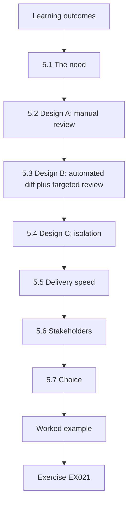

### Logical drawing

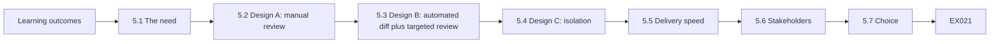

```text
[Learning outcomes]
    |
    v
[5.1 The need]
    |
    v
[5.2 Design A: manual review]
    |
    v
[5.3 Design B: automated diff plus targeted review]
    |
    v
[5.4 Design C: isolation]
    |
    v
[5.5 Delivery speed]
    |
    v
[5.6 Stakeholders]
    |
    v
[5.7 Choice]
    |
    v
[Worked example] --> [Exercise EX021]
```
<!-- cyberabc:lesson-figures:end ch-05 -->


### Learning outcomes

You will (1) design alternative processes for governing third-party code; (2) compare isolation, review and contractual approaches; (3) evaluate effects on delivery speed; (4) select a design with stakeholders.

### 5.1 The need

The board chose "review on update". Hannah must design how. Three designs are considered.

Each design must have been able to catch a change like February's location collection before release, and Hannah writes that down as the first requirement. The others are a cost the two-person security team can carry, an acceptable delay to releases, and evidence that audit can check later. She scores each design against these four requirements with the mobile and privacy leads, so the comparison is shared rather than hers alone.

### 5.2 Design A: manual review

Every SDK update is reviewed by the security team before merging: changelog, permissions requested, network destinations observed in a test run. Strong but slow; the security team has two people.

With more than twenty SDKs across the apps and frequent updates, two reviewers would soon become a queue that teams try to bypass. Design A would have caught February's change, but only if the reviewer happened to run the right test. Hannah keeps Design A as the fallback for SDKs the harness cannot exercise, such as those that only activate on specific devices or account types.

### 5.3 Design B: automated diff plus targeted review

A CI job runs the app in a test harness with synthetic data, records network destinations, permissions and data fields sent by each SDK, and compares with the previous version. Only changes trigger human review.

The harness uses fixed synthetic accounts and scripted journeys, so differences between runs come from the SDK rather than from the test data. A reviewer sees only what changed, such as a new destination or a new field, which keeps reviews short. Design B depends on the harness covering the journeys where SDKs actually run.

### 5.4 Design C: isolation

Run SDKs in a restricted wrapper that limits the data they can access, for example passing only anonymised events rather than giving SDKs direct access to device APIs. Strong but requires engineering work per SDK.

For the analytics SDK, isolation would mean the app passes it a fixed list of events with no location or device identifiers. Some SDKs, such as fraud detection, need direct device signals to work, so isolation cannot be applied everywhere. Isolation also needs maintenance whenever the SDK's interface changes between versions.

### 5.5 Delivery speed

Hannah models effects: Design A adds a median of 5 days per SDK update; B adds 1 day; C adds no delay after initial work but takes three months to build.

She takes these figures from a small dry run with one mobile team and from the platform team's estimate for building the wrapper. A five-day delay matters because security fixes also arrive as SDK updates, and slowing them adds risk of another kind. Hannah shows the mobile leads the assumptions, and they agree to measure the real delay during the pilot.

### 5.6 Stakeholders

Mobile engineers prefer B; privacy prefers C; the CISO wants something in place within a month.

Hannah sets out what each group gains and gives up in a short table. Engineers want speed, privacy wants the strongest limit on data, and the CISO needs a control that exists before the next SDK update arrives. She also records which concerns the chosen design does not answer, so they stay visible after the decision. Each concern on that list has an owner and a date when it will be looked at again.

### 5.7 Choice

B now, with C for the two SDKs that handle the most sensitive events over the next six months.

The diff can run within the CISO's one-month window, and the two SDKs chosen for isolation process the most sensitive events. The choice is recorded with the scores and the stakeholders' positions, and the CISO signs it. Hannah agrees to revisit the choice after the evaluation, in case the diff misses changes the pilot was designed to test. Design A remains as the fallback for SDKs the harness cannot reach in its scripted journeys.

### Review records

Each review records the SDK, versions, changes found and decision.

### Worked example

The February change would have been caught by Design B: a new network destination and a new data field (location) would appear in the diff. Hannah demonstrates this by replaying the February update in the harness with synthetic data.

> **Synthetic case.** Designs and estimates are synthetic.

### Errors and limits

Test harnesses may not trigger all SDK behaviours; some changes appear only with real usage patterns.

### Exercises

- **EX021 — Design B.** Describe Design B. *Rubric:* 3 = automated harness diff of destinations, permissions, data fields; human review of changes; 2 = partial; 1 = vague; 0 = none.
- **EX022 — Speed effects.** Give the delivery effects of A, B and C. *Rubric:* 3 = A +5 days; B +1 day; C none after 3 months' build; 2 = two; 1 = one; 0 = none.
- **EX023 — Stakeholder views.** What did each stakeholder prefer? *Rubric:* 3 = engineers B; privacy C; CISO fast; 2 = two; 1 = one; 0 = none.
- **EX024 — Final choice.** What was chosen? *Rubric:* 3 = B now; C for two sensitive SDKs; 2 = partial; 1 = vague; 0 = none.
- **EX025 — February replay.** Would B have caught February? *Rubric:* 3 = yes; new destination and location field; 2 = partial; 1 = vague; 0 = none.

### Synthesis

Compare designs on protection, speed and stakeholder needs, then stage the solution.

### Continue studying — chapter 05 of 12

[← Chapter 04 (draft)](#ch-04) · [Course chapter index](../SUBJECTS.md) · [Chapter 06 (draft) →](#ch-06)

<a id="ch-06"></a>

## Chapter 6 — Application and software supply chain security: controlled evaluation

<!-- cyberabc:lesson-figures:start ch-06 -->
### Lesson map

Lesson 06 published. Map, example, EX026.

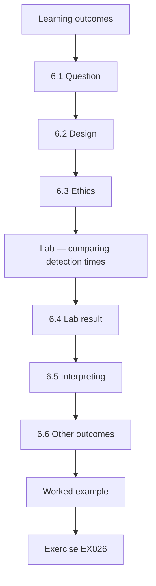

### Logical drawing

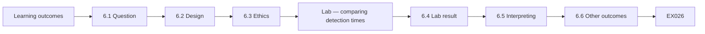

```text
[Learning outcomes]
    |
    v
[6.1 Question]
    |
    v
[6.2 Design]
    |
    v
[6.3 Ethics]
    |
    v
[Lab — comparing detection times]
    |
    v
[6.4 Lab result]
    |
    v
[6.5 Interpreting]
    |
    v
[6.6 Other outcomes]
    |
    v
[Worked example] --> [Exercise EX026]
```
<!-- cyberabc:lesson-figures:end ch-06 -->


### Learning outcomes

You will (1) evaluate a new control with a controlled comparison; (2) choose outcome measures; (3) estimate uncertainty with the bootstrap; (4) interpret results cautiously.

### 6.1 Question

Does the automated SDK diff (Design B) shorten the time to detect unreviewed changes in third-party code?

The answer matters because the board's choice in chapter 1 assumed review would cut the chance of a repeat incident. If the diff does not detect changes faster than the old process, that assumption fails. Hannah writes the question down before the study starts, so the result cannot be reframed afterwards to fit whatever is found. Delivery delay and false alarms are recorded as secondary outcomes.

### 6.2 Design

Two mobile teams pilot Design B; two comparable teams continue with the old process for three months. Synthetic test changes, harmless but detectable (a new test-only network destination), are introduced into SDK updates in all four teams' test builds, with the teams' managers aware but not the engineers.

The planted changes are scheduled at random times across the three months, so neither group can predict them. Detection is timed from the moment a changed SDK reaches a team's test build to the moment someone on that team records it for review. Each team receives the same number of planted changes, so the groups face equal workloads.

### 6.3 Ethics

The engineers' managers and the works council approved the study. No real customer data is involved; results are reported by team, not by person.

Managers held the schedule of planted changes, so the engineers' detection reflected their normal routine rather than an alert they had been warned about. Data showing which engineer reviewed which change was kept by Hannah only and deleted at the end of the study. Teams were told in advance that a study was running, though not when changes would appear. Afterwards, every engineer in all four teams saw the results.

### Lab — comparing detection times

```python
"""Controlled evaluation: days to detect unreviewed SDK changes, pilot teams vs comparison teams, bootstrap (seed 3)."""
import random
from statistics import median
pilot = [1, 2, 1, 3, 2, 1, 4, 2]; comp = [9, 14, 6, 21, 11, 8, 30, 12]
rng = random.Random(3); d = sorted(median(rng.choices(comp, k=8)) - median(rng.choices(pilot, k=8)) for _ in range(4000))
print("median pilot", median(pilot), "comparison", median(comp), "difference", median(comp) - median(pilot))
print("95% interval", d[99], "to", d[3899])
```

Run with `python3 lab_eval.py`. Verified output:

```text
median pilot 2.0 comparison 11.5 difference 9.5
95% interval 6.0 to 19.0
```

### 6.4 Lab result

Pilot teams detected test changes in a median of 2 days; comparison teams in 11.5 days, a difference of 9.5 days. The bootstrap 95% interval (4,000 resamples, seed 3) runs from 6.0 to 19.0 days, so the improvement is unlikely to be chance, though its size is uncertain.

The interval is wide because there were only eight planted changes per group, a point the next paragraph takes further. The lab script resamples the eight detection times in each group with replacement, recomputes the difference in medians each time, and reports the middle 95% of those differences. Hannah publishes the script alongside the result so audit can rerun it.

### 6.5 Interpreting

Eight changes per group is a small sample. Comparison teams knew a study was running, which might have changed their behaviour; if anything this would narrow the difference.

Planted changes may also be easier to spot than real ones, since each added a whole new network destination. Hannah reports these limits in the evaluation summary, and she recommends tracking real detections after rollout to confirm the effect outside the study. She also notes that the four teams were not chosen at random, so team differences could explain part of the gap between the groups.

### 6.6 Other outcomes

Delivery speed: pilot teams' median SDK update time rose by 1 day, as modelled. False alarms: 3 harmless changes flagged per month, each taking about 20 minutes to review.

The one-day rise matches the delivery model in chapter 5, which gives the mobile leads some confidence in the other estimates. Three false alarms a month means about an hour of review, which the teams judged acceptable. Hannah reports both figures beside the detection result so the CISO sees benefits and costs together. Neither figure gave the CISO a reason to delay the wider rollout.

### Pre-registered measures

Before the pilot started, Hannah wrote down the outcome measures, the comparison and how she would decide success, and shared them with Dr Menon. This prevents choosing favourable measures after seeing results.

### Worked example

The CISO approves rolling out Design B to all teams, with the same measures tracked quarterly.

> **Synthetic case.** The study and data are synthetic.

### Errors and limits

Planted test changes may be easier to spot than real ones; supplement with real-world monitoring.

### Exercises

- **EX026 — Study question.** State the evaluation question. *Rubric:* 3 = does diff shorten detection of unreviewed changes; 2 = partial; 1 = vague; 0 = none.
- **EX027 — Lab results.** Give the medians, difference and interval. *Rubric:* 3 = 2 vs 11.5; 9.5; 6.0–19.0; 2 = partial; 1 = one; 0 = none.
- **EX028 — Ethics.** How was the study made ethical? *Rubric:* 3 = approval by managers and works council; no customer data; team-level reporting; 2 = partial; 1 = vague; 0 = none.
- **EX029 — Side effects.** What other outcomes were measured? *Rubric:* 3 = +1 day update time; 3 false alarms/month at 20 min; 2 = partial; 1 = vague; 0 = none.
- **EX030 — Limitation.** Name one limitation. *Rubric:* 3 = small sample; awareness; planted changes easier; 2 = partial; 1 = vague; 0 = none.

### Synthesis

Evaluate controls with comparisons, uncertainty and side effects before scaling.

### Continue studying — chapter 06 of 12

[← Chapter 05 (draft)](#ch-05) · [Course chapter index](../SUBJECTS.md) · [Chapter 07 (draft) →](#ch-07)

<a id="ch-07"></a>

## Chapter 7 — Application and software supply chain security: organizational integration

<!-- cyberabc:lesson-figures:start ch-07 -->
### Lesson map

Lesson 07 published. Map, example, EX031.

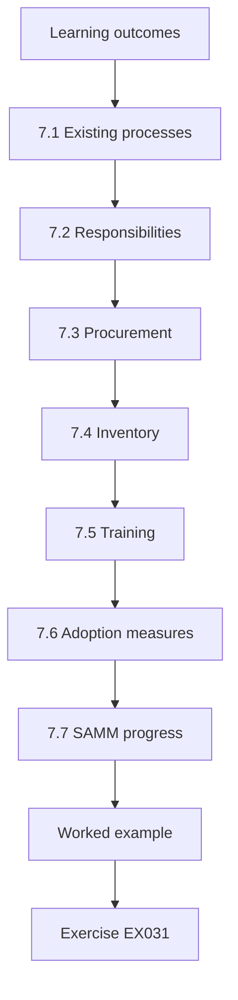

### Logical drawing

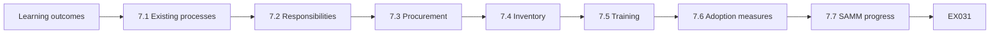

```text
[Learning outcomes]
    |
    v
[7.1 Existing processes]
    |
    v
[7.2 Responsibilities]
    |
    v
[7.3 Procurement]
    |
    v
[7.4 Inventory]
    |
    v
[7.5 Training]
    |
    v
[7.6 Adoption measures]
    |
    v
[7.7 SAMM progress]
    |
    v
[Worked example] --> [Exercise EX031]
```
<!-- cyberabc:lesson-figures:end ch-07 -->


### Learning outcomes

You will (1) embed third-party code governance into existing processes; (2) assign responsibilities across teams; (3) align procurement, privacy and engineering; (4) measure adoption.

### 7.1 Existing processes

Rather than adding a separate approval board, Hannah connects SDK governance to processes teams already use: the dependency update pull request triggers the diff; the privacy impact assessment covers new SDKs; procurement contracts include SDK clauses.

Each existing process gains one small step rather than a new meeting. Teams see the diff result in the pull request they already review, and procurement uses a revised template instead of a separate security questionnaire. Fitting into existing work also means the controls survive when the people who designed them move on to other roles.

### 7.2 Responsibilities

Mobile teams own SDK updates and first review of diffs; the security team reviews flagged changes involving new destinations or permissions; privacy reviews new data fields; procurement manages vendor terms. A RACI table makes this clear.

The table is published on the engineering wiki and linked from the pull request template, so anyone reviewing a diff can see who to call. Where two teams share an SDK, the RACI names one owner, so neither team can assume the other has already checked. Hannah reviews the table each quarter as teams and SDKs change.

### 7.3 Procurement

Standard contract terms now require: notice of data-collection changes, a security contact, timely fixes, and SBOMs where available. These align with SSDF PW.4.

Procurement applies the terms at renewal, so existing contracts move over during the year rather than all at once. Where a vendor refuses a clause, the refusal goes to Hannah's team for a risk decision, as happened with the fraud-detection vendor in chapter 8. The legal team keeps a short list of acceptable alternatives to each clause. Vendors receive the revised terms well in advance of renewal talks, so objections surface early.

### 7.4 Inventory

A register lists every SDK in every app, its owner, purpose, data processed and contract. It is generated partly from SBOMs and partly from the harness results.

The harness supplies what each SDK actually sends, while SBOMs supply names and versions, so the register can show where stated purpose and observed behaviour differ. Each entry has an owner who confirms it every quarter. The register is the starting point for the SDK reduction review in the applied project. Missing entries are chased by the register's owner each month.

### 7.5 Training

Short sessions for mobile engineers explain why SDK changes matter, using the February incident.

Each session lasts about forty-five minutes and walks through the February change as it would appear in the diff today. Engineers practise reading a diff result and deciding whether to approve it, send it to privacy, or ask the vendor. The sessions are repeated for new joiners, and the material is updated whenever a new difficult case is written up. Attendance is recorded for each team, but the sessions are not assessed or graded.

### 7.6 Adoption measures

Share of apps with the diff enabled, share of SDK updates with completed reviews, and register completeness.

Each measure has a definition and a data source, so the numbers can be checked rather than reported from memory. The diff measure comes from the CI configuration, review completion from pull requests, and register completeness from comparing the register against SBOMs. Hannah reports all three monthly to the CISO, with the apps that are behind named alongside their owners and expected dates. Trends across several months matter more to the CISO than any single month's figure.

### 7.7 SAMM progress

Using SAMM v2, Northbridge's maturity for supplier security in design and for secure build in implementation rises one level over a year.

The rise rests on evidence an assessor can check, such as contract terms, the register and pull request records, rather than on new policy documents. Hannah reports the change cautiously, because SAMM levels summarise practice and a one-level rise does not prove fewer incidents. She records the evidence behind each scored practice, so the next assessment can check whether the rise held. The assessment is repeated each year with the same leads.

### Feedback loop

Teams can propose changes to the process through a shared channel. In the first quarter, engineers asked for the diff report to show SDK changes in plain language; the security team rewrote the report format, and review time per flag fell.

### Worked example

Six months in, 11 of 12 apps have the diff enabled; the twelfth, a legacy app due for retirement, is given an exception with an expiry date. Register completeness is 96%; the missing entries are internal test SDKs.

> **Synthetic case.** Teams and figures are synthetic.

### Errors and limits

Integration depends on people; turnover can erode it, so keep processes documented and simple.

### Exercises

- **EX031 — Integration principle.** How did Hannah avoid a separate board? *Rubric:* 3 = connect to existing PR, PIA, procurement processes; 2 = partial; 1 = vague; 0 = none.
- **EX032 — Responsibilities.** Who reviews new data fields? *Rubric:* 3 = privacy team; 2 = partial; 1 = vague; 0 = none.
- **EX033 — Contract terms.** List three standard contract terms. *Rubric:* 3 = notice of changes, security contact, timely fixes, SBOMs (three); 2 = two; 1 = one; 0 = none.
- **EX034 — Adoption status.** What was the six-month adoption status? *Rubric:* 3 = 11/12 apps; legacy exception; 96% register; 2 = partial; 1 = one; 0 = none.
- **EX035 — Exception rule.** How was the legacy app handled? *Rubric:* 3 = exception with expiry; 2 = partial; 1 = vague; 0 = none.

### Synthesis

Embed governance into existing processes with clear owners and measured adoption.

### Continue studying — chapter 07 of 12

[← Chapter 06 (draft)](#ch-06) · [Course chapter index](../SUBJECTS.md) · [Chapter 08 (draft) →](#ch-08)

<a id="ch-08"></a>

## Chapter 8 — Application and software supply chain security: difficult cases

<!-- cyberabc:lesson-figures:start ch-08 -->
### Lesson map

Lesson 08 published. Map, example, EX036.

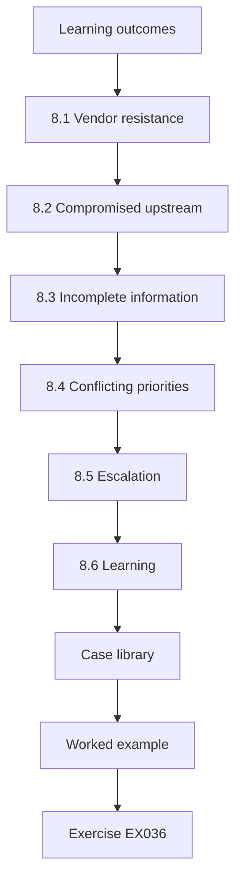

### Logical drawing

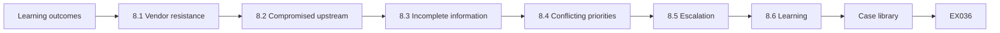

```text
[Learning outcomes]
    |
    v
[8.1 Vendor resistance]
    |
    v
[8.2 Compromised upstream]
    |
    v
[8.3 Incomplete information]
    |
    v
[8.4 Conflicting priorities]
    |
    v
[8.5 Escalation]
    |
    v
[8.6 Learning]
    |
    v
[Case library]
    |
    v
[Worked example] --> [Exercise EX036]
```
<!-- cyberabc:lesson-figures:end ch-08 -->


### Learning outcomes

You will (1) handle cases where good options conflict; (2) manage vendor resistance; (3) respond to a compromised upstream component; (4) make decisions with incomplete information.

### 8.1 Vendor resistance

A fraud-detection SDK vendor refuses to disclose which data its SDK collects, citing trade secrets. The SDK reduces fraud losses significantly. Options: accept with isolation, negotiate, or replace. Hannah negotiates a confidential data schedule shared with the bank's privacy team only, plus isolation of the SDK's inputs.

Hannah records why the bank accepted less transparency than its standard terms require: the fraud losses the SDK prevents are large and measurable, and isolation limits what it can reach. The exception has an expiry date, and the vendor is asked again at renewal.

### 8.2 Compromised upstream

An open-source library used by the web banking app is reported to have had a malicious version published for six hours after a maintainer's account was taken over, a pattern described by Ohm et al. (2020). Using SBOMs, the team confirms no Northbridge build included that version, because lockfile hashes pinned the previous version and updates are batched weekly.

The team posts its conclusion in the incident channel with the evidence attached: the SBOM entries, the lockfile hashes and the dates of the weekly batches. Hannah also checks whether any developer machine fetched the bad version directly, since lockfiles protect builds but not local experiments.

### 8.3 Incomplete information

Early reports are confused about which versions were affected. Hannah's rule: assume the wider range until confirmed, check builds against it, and update the assessment as facts emerge.

She writes each update with the time, what is confirmed and what is still assumed. The first assessment covered every version released that week, and it narrowed as the maintainers published details. Because each update says what it rests on, a later correction does not undermine trust in the earlier ones or in the team's final conclusion.

### 8.4 Conflicting priorities

A product launch depends on a new identity-verification SDK whose diff shows it sends device identifiers to a new destination. The vendor explains it is a fraud-prevention service. Privacy approves with a notice update; launch slips by three days.

The launch team was frustrated by the delay, but the diff had shown a real change that customers needed to be told about. The vendor's explanation was checked against its published documentation before privacy agreed. Hannah records the case to show the diff working under deadline pressure.

### 8.5 Escalation

When teams disagree, the CISO decides within two working days, with reasoning recorded.

The CISO hears both sides together, usually in a short call, and decides on the evidence in the diff and the register. The written decision states the reasoning, any conditions, and when it will be revisited. Recording reasons means a similar dispute later can be settled by pointing to the earlier decision. Teams may ask for a decision to be reviewed if new evidence appears, such as a vendor changing its documentation.

### 8.6 Learning

Each difficult case is written up as a short case study for training.

A case study is one page: what happened, what the team knew at each point, what they decided, and what they would do differently. The fraud-detection vendor, the compromised library and the delayed launch were the first three written up. Each is used in the mobile engineers' training sessions, and new joiners read them during onboarding. Hannah removes vendor names from the versions shared outside the security team.

### Case library

The case studies are short and anonymised.

### Worked example

In the compromised-library case, the team also checks build logs for any download of the malicious version during the six-hour window and finds none. They publish an internal note within four hours of the report, reassuring product owners and recording evidence.

> **Synthetic case.** Cases are synthetic.

### Errors and limits

Quick reassurance is valuable but must rest on evidence; say what was checked.

### Exercises

- **EX036 — Trade-secret vendor.** How was the trade-secret vendor handled? *Rubric:* 3 = confidential data schedule to privacy; isolation; 2 = partial; 1 = vague; 0 = none.
- **EX037 — Compromise check.** How did the team know no build was affected? *Rubric:* 3 = SBOM, lockfile hashes pinned previous, weekly batching, logs; 2 = partial; 1 = vague; 0 = none.
- **EX038 — Uncertain ranges.** What is Hannah's rule for unclear version ranges? *Rubric:* 3 = assume wider range until confirmed; 2 = partial; 1 = vague; 0 = none.
- **EX039 — Launch case.** What happened with the identity SDK? *Rubric:* 3 = new destination; privacy approved with notice update; 3-day slip; 2 = partial; 1 = vague; 0 = none.
- **EX040 — Escalation.** How are disagreements resolved? *Rubric:* 3 = CISO decides within 2 days, reasoning recorded; 2 = partial; 1 = vague; 0 = none.

### Synthesis

Difficult cases need evidence, staged assumptions, clear escalation and recorded reasoning.

### Continue studying — chapter 08 of 12

[← Chapter 07 (draft)](#ch-07) · [Course chapter index](../SUBJECTS.md) · [Chapter 09 (draft) →](#ch-09)

<a id="ch-09"></a>

## Chapter 9 — Application and software supply chain security: leadership and assurance

<!-- cyberabc:lesson-figures:start ch-09 -->
### Lesson map

Lesson 09 published. Map, example, EX041.

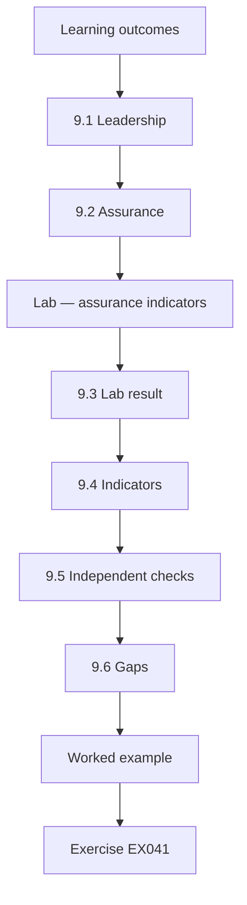

### Logical drawing

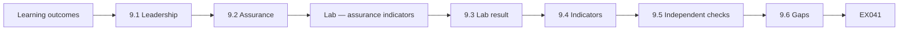

```text
[Learning outcomes]
    |
    v
[9.1 Leadership]
    |
    v
[9.2 Assurance]
    |
    v
[Lab — assurance indicators]
    |
    v
[9.3 Lab result]
    |
    v
[9.4 Indicators]
    |
    v
[9.5 Independent checks]
    |
    v
[9.6 Gaps]
    |
    v
[Worked example] --> [Exercise EX041]
```
<!-- cyberabc:lesson-figures:end ch-09 -->


### Learning outcomes

You will (1) lead a programme for application and supply-chain security; (2) provide assurance to boards and regulators; (3) choose assurance indicators; (4) respond to assurance gaps.

### 9.1 Leadership

Hannah leads a programme with three goals for the year: every app release verifiable (provenance and signatures), every SDK update reviewed, and critical dependency findings fixed within 14 days.

Each goal is tied to a measure the chapter later reports, so progress can be checked quarter by quarter. The goals came from the gaps found in chapter 2 and the February incident, which helps engineers see why they matter. Hannah presents the three goals to the CISO with the resources each needs, so the programme's cost is agreed at the start.

### 9.2 Assurance

Assurance means giving decision-makers justified confidence. The board and the regulator want evidence that controls work, not just that they exist.

At Northbridge, assurance for the SDK programme rests on three things: indicators reported each quarter, records that let someone check an individual release, and periodic independent checks by internal audit. Each part supports the others, so a gap in one is noticed elsewhere. The board receives the summary, and the detailed records stay available for audit. Hannah designs the programme's indicators with that standard of evidence in mind.

### Lab — assurance indicators

```python
"""Quarterly assurance indicators for app releases (synthetic)."""
q = {"Q1": (14, 9, 22, 15), "Q2": (16, 13, 24, 21), "Q3": (15, 15, 25, 25)}
for k, (rel, prov, sdks, reviewed) in q.items():
    print(f"{k}: provenance verified {prov}/{rel} = {100 * prov // rel}%  SDKs reviewed {reviewed}/{sdks} = {100 * reviewed // sdks}%")
```

Run with `python3 lab_assurance.py`. Verified output:

```text
Q1: provenance verified 9/14 = 64%  SDKs reviewed 15/22 = 68%
Q2: provenance verified 13/16 = 81%  SDKs reviewed 21/24 = 87%
Q3: provenance verified 15/15 = 100%  SDKs reviewed 25/25 = 100%
```

### 9.3 Lab result

Provenance-verified releases rose from 9 of 14 (64%) in Q1 to 13 of 16 (81%) in Q2 and 15 of 15 (100%) in Q3. SDK updates reviewed rose from 15 of 22 (68%) to 21 of 24 (87%) and 25 of 25 (100%).

The Q1 provenance gap came from the legacy build path described below, and the review gap came from apps that had not yet enabled the diff. Both figures reached 100% by Q3, but the totals are small, so one missed release would show clearly. Hannah shows the board the counts beside the percentages for that reason, and explains each quarter's misses by name.

### 9.4 Indicators

Indicators are chosen because they link to the February incident and SLSA-style build integrity. Each has a definition, data source and owner.

Hannah avoids indicators that are easy to count but say little, such as the number of policies written. She documents each indicator's definition on one page, so a new owner can produce the same figure next year. Data is drawn from build systems and pull requests rather than self-reported spreadsheets. Owners confirm each quarter's figures before they go to the CISO and the board.

### 9.5 Independent checks

Internal audit samples five releases each quarter and re-verifies provenance and review records.

Auditors pick the releases themselves, without notice, and rerun the provenance check using the published verification steps. They also confirm that each SDK update in those releases has a review record with a named reviewer and a date. Findings go to the CISO and to Hannah, with an agreed date for each fix. The Q3 sample led to the reviewer-name field becoming mandatory in the review template.

### 9.6 Gaps

In Q1, five releases lacked verified provenance because a legacy build path was still in use; it was retired in Q2.

Hannah reported the gap rather than waiting for it to close, because hiding it would have weakened trust in the other figures. The legacy path's owner agreed a retirement date with the platform team, and releases using it were listed until then. Reporting the gap also explained the Q1 figure to the board without anyone having to ask. The legacy app's later exception follows the same open approach.

### 9.7 Regulator

Northbridge's regulator receives a summary showing the February incident's follow-up and the indicators.

The summary covers what happened in February, the controls introduced since, and the quarterly indicators with their definitions. It states the remaining limits, such as the legacy app with an exception, rather than presenting the programme as finished. Hannah prepares it with the compliance team, which manages the bank's contact with the regulator, and it is sent alongside the regular reporting cycle. Questions from the regulator are answered within the agreed timeframe.

### Reporting format

The board receives one page each quarter: three indicators with trends, the main risks, decisions needed and audit findings. Hannah writes the page in plain language and presents it in five minutes, leaving time for questions. Board members said the trend lines were more useful than any single number, because they showed whether the programme was working.

### Regulator dialogue

Hannah meets the regulator's supervisor twice a year to discuss progress.

### Worked example

Internal audit's Q3 sample finds all five releases verified, but one SDK review record lacked the reviewer's name. The template is changed to make the field mandatory.

> **Synthetic case.** Indicators and audits are synthetic.

### Errors and limits

100% indicators can hide weak reviews; audit quality as well as completion.

### Exercises

- **EX041 — Programme goals.** List the three programme goals. *Rubric:* 3 = verifiable releases; SDK updates reviewed; criticals in 14 days; 2 = two; 1 = one; 0 = none.
- **EX042 — Lab trend.** Give the provenance trend. *Rubric:* 3 = 64% → 81% → 100%; 2 = partial; 1 = vague; 0 = none.
- **EX043 — Q1 gap cause.** Why were Q1 releases unverified? *Rubric:* 3 = legacy build path; 2 = partial; 1 = vague; 0 = none.
- **EX044 — Audit finding.** What did internal audit find in Q3? *Rubric:* 3 = missing reviewer name; field made mandatory; 2 = partial; 1 = vague; 0 = none.
- **EX045 — Assurance meaning.** What is assurance? *Rubric:* 3 = justified confidence with evidence; 2 = partial; 1 = vague; 0 = none.

### Synthesis

Lead with clear goals and give assurance through verified, audited indicators.

### Continue studying — chapter 09 of 12

[← Chapter 08 (draft)](#ch-08) · [Course chapter index](../SUBJECTS.md) · [Chapter 10 (draft) →](#ch-10)

<a id="ch-10"></a>

## Chapter 10 — Research reading and critique

<!-- cyberabc:lesson-figures:start ch-10 -->
### Lesson map

Lesson 10 published. Map, example, EX046.

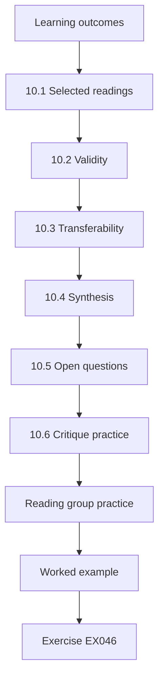

### Logical drawing

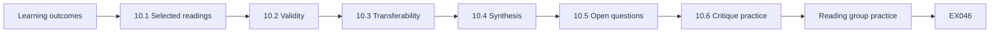

```text
[Learning outcomes]
    |
    v
[10.1 Selected readings]
    |
    v
[10.2 Validity]
    |
    v
[10.3 Transferability]
    |
    v
[10.4 Synthesis]
    |
    v
[10.5 Open questions]
    |
    v
[10.6 Critique practice]
    |
    v
[Reading group practice]
    |
    v
[Worked example] --> [Exercise EX046]
```
<!-- cyberabc:lesson-figures:end ch-10 -->


### Learning outcomes

You will (1) read research on software supply chains critically; (2) assess validity and transferability to a bank; (3) synthesise findings into guidance; (4) identify open questions.

### 10.1 Selected readings

Hannah reads Ladisa et al. (2023), a taxonomy of attacks on open-source supply chains with safeguards; Zimmermann et al. (2019) on concentration of risk in npm; Wermke et al. (2022) on trust practices in open-source projects; Newman et al. (2022) on Sigstore; and Torres-Arias et al. (2019) on in-toto.

She chose them because they cover the threats Northbridge faces: compromised packages, concentrated maintainer risk, and the verification tools that might answer both. Each reading is linked to a decision in her programme, so the reading group has a practical reason to discuss it.

### 10.2 Validity

For each paper she asks: what data, what method, what claims, what threats to validity? The taxonomy is built from literature and expert input, valuable for structure but not for estimating frequency. Ecosystem studies measure one registry at one time.

She notes each answer in a short table for each paper, so the group can compare the strength of evidence across them. Where a paper's method cannot support a claim, she marks the claim as a hypothesis to test at Northbridge rather than a finding to apply.

### 10.3 Transferability

Northbridge uses several ecosystems and commercial SDKs, which open-source studies may not cover. Findings about maintainer concentration likely transfer; specific percentages may not.

Commercial SDKs are the biggest gap, because they come as binaries from companies whose practices the open-source studies did not examine. Hannah therefore uses the papers to frame questions for vendors rather than to estimate Northbridge's own risk. She notes the date of each study as well, since registries and maintainer behaviour change over time. Where she cites a figure, she states which ecosystem and year it comes from.

### 10.4 Synthesis

Guidance for Northbridge: reduce dependency count; prefer well-maintained components; verify integrity (signatures, provenance); monitor maintainer and behaviour changes; and require vendors to provide transparency equivalent to open-source practice.

Each item links back to a reading and to a control already in Northbridge's programme, or to a gap in it. Signing and provenance for internal libraries is the clearest gap, which is why the reading group later chose it for a pilot. Hannah shares the synthesis with the platform team, who own the build pipeline.

### 10.5 Open questions

How should banks verify closed-source SDKs that offer no provenance? How effective are behaviour diffs at catching subtle changes? Hannah lists these as research gaps.

The first matters most to Northbridge, because several of its most sensitive SDKs are closed-source and their vendors offer no provenance. The second matters because the pilot used planted changes, which may be easier to see than the subtle changes a vendor might make in practice. She shares the list with her tutor as possible topics for further study, and with vendors as questions.

### 10.6 Critique practice

She writes a one-page critique of each paper, shared with her team as a reading group.

Each critique states the paper's claim, the evidence offered, the main threat to validity and what Northbridge should take from it. Team members take turns presenting a paper and answering questions on it. Disagreements are recorded rather than settled, since several papers support more than one reasonable reading. The practice also gives junior staff experience in reading research carefully before citing it in their work.

### Reading group practice

Each month one team member presents a paper in fifteen minutes using the same questions: data, method, claims, limits, transfer. The group then agrees one practical takeaway. Over a year this builds a shared understanding of evidence across engineers, privacy and security staff, who previously relied on vendor marketing.

### Worked example

The reading group decides to pilot Sigstore-style verification for internal libraries shared between teams, inspired by Newman et al. (2022), since internal libraries had no signing at all.

> **Synthetic case.** Reading group decisions are synthetic; cited papers are real.

### Errors and limits

Applying research outside its context can mislead; pilot before adopting.

### Exercises

- **EX046 — Five readings.** Name three of Hannah's readings. *Rubric:* 3 = Ladisa, Zimmermann, Wermke, Newman, Torres-Arias (three); 2 = two; 1 = one; 0 = none.
- **EX047 — Taxonomy limit.** What is the taxonomy good and not good for? *Rubric:* 3 = structure, not frequency; 2 = partial; 1 = vague; 0 = none.
- **EX048 — Transferability.** What transfers to Northbridge and what may not? *Rubric:* 3 = concentration likely; percentages may not; 2 = partial; 1 = vague; 0 = none.
- **EX049 — Open question.** Name one open question. *Rubric:* 3 = verifying closed-source SDKs; effectiveness of diffs; 2 = partial; 1 = vague; 0 = none.
- **EX050 — Pilot decision.** What did the reading group decide to pilot? *Rubric:* 3 = signing internal shared libraries; 2 = partial; 1 = vague; 0 = none.

### Synthesis

Read critically, judge transferability and turn evidence into local guidance and open questions.

### Continue studying — chapter 10 of 12

[← Chapter 09 (draft)](#ch-09) · [Course chapter index](../SUBJECTS.md) · [Chapter 11 (draft) →](#ch-11)

<a id="ch-11"></a>

## Chapter 11 — Applied project

<!-- cyberabc:lesson-figures:start ch-11 -->
### Lesson map

Lesson 11 published. Map, example, EX051.

```mermaid
flowchart TD
  N0["Learning outcomes"]
  N1["11.1 The project"]
  N2["11.2 Baseline"]
  N3["11.3 Actions"]
  N4["11.4 Results"]
  N5["11.5 Stakeholders"]
  N6["11.7 Reporting"]
  N7["Project governance"]
  N0 --> N1 --> N2 --> N3 --> N4 --> N5 --> N6 --> N7
  N7 --> EX["Worked example"]
  EX --> Q["Exercise EX051"]
```

### Logical drawing

```mermaid
flowchart LR
  N0["Learning outcomes"]
  N1["11.1 The project"]
  N2["11.2 Baseline"]
  N3["11.3 Actions"]
  N4["11.4 Results"]
  N5["11.5 Stakeholders"]
  N6["11.7 Reporting"]
  N7["Project governance"]
  N0 --> N1 --> N2 --> N3 --> N4 --> N5 --> N6 --> N7 --> Q["EX051"]
```

```text
[Learning outcomes]
    |
    v
[11.1 The project]
    |
    v
[11.2 Baseline]
    |
    v
[11.3 Actions]
    |
    v
[11.4 Results]
    |
    v
[11.5 Stakeholders]
    |
    v
[11.7 Reporting]
    |
    v
[Project governance]
    |
    v
[Worked example] --> [Exercise EX051]
```
<!-- cyberabc:lesson-figures:end ch-11 -->


### Learning outcomes

You will (1) plan and carry out an applied project in the workplace; (2) measure outcomes against a baseline; (3) manage stakeholders; (4) report results and limits.

### 11.1 The project

Hannah's applied project: reduce the number of third-party SDKs in the mobile app and cut the time from SDK data-collection change to detection to under three days, across all Northbridge apps.

The two aims are linked: fewer SDKs means fewer updates to review, and faster detection reduces the harm from the changes that do get through. The three-day target came from the February detection time of nineteen days and the median of two days seen in the pilot. Dr Menon approves the plan, and the CISO agrees to sponsor the work across all apps. The project runs for nine months, matching the period reported in the results.

### 11.2 Baseline

At the start: 22 SDKs across apps; February detection time 19 days; no SDK register.

These figures come from the February incident record and from a manual count Hannah's team made across the apps' build files. Without a register, the count of twenty-two had to be checked by hand, and two SDKs were found that nobody could name an owner for. Hannah records the baseline in the project plan before any action starts, so the results can be compared fairly. Dr Menon reviews the baseline method before the project begins.

### 11.3 Actions

Diff harness rollout (chapter 7), isolation of two sensitive SDKs, contract clauses, and an SDK reduction review asking each team to justify each SDK.

The reduction review asks each team three questions about every SDK: what it is used for, whether another SDK already provides it, and what data it processes. Isolation work is done by the platform team, while contract changes follow procurement's renewal calendar. Hannah tracks each action on the project board with an owner and a date. Progress against each action is reviewed monthly with the CISO, who sponsors the project.

### 11.4 Results

After nine months: 15 SDKs (seven removed or replaced with in-house code); median detection of planted changes 2 days across all teams; register complete; two real vendor data-collection changes detected and reviewed before release.

The detection figure comes from planted changes, so it measures the same thing as the pilot, now across every team. The two real detections, including the crash-reporting change described in the worked example, show the diff catching changes outside the study. Hannah compares each figure with the baseline recorded before any action started.

### 11.5 Stakeholders

Product owners worried about losing analytics features; Hannah worked with them to replace duplicated SDKs first, keeping features.

Replacing duplicates first meant no team lost a feature it relied on, which built goodwill for the harder cases later. Where a team wanted to keep an SDK that duplicated another, it had to state why in the register, and the CISO decided on the few disputed cases. Product owners were invited to the monthly review, so they saw the project's progress and its costs together.

### 11.6 Limits

Planted changes test detection, not every real-world variation; nine months is short; the cost of in-house replacements will continue.

Hannah states these limits in both the academic report and the board summary, so neither audience reads the results as proof of lasting change. She also notes that the in-house replacements now need maintaining, with their own security updates and owners. A follow-up measurement after a further year is proposed, using the same planted-change method. She lists which conclusions would change if that measurement showed detection had slowed again.

### 11.7 Reporting

A project report for Calder College and a summary for Northbridge's board.

The college report sets out the method, data, evaluation and limits in academic form, with references and the lab scripts as appendices. The board summary is two pages: the problem, what was done, what changed, what remains uncertain, and what it costs to keep going. Dr Menon reads both before submission, checking that the summary makes no claim the report does not support. The board receives its version at the next quarterly meeting.

### Project governance

A steering group of the CISO, the head of mobile and the privacy lead meets monthly to review progress against milestones and resolve blockers. Hannah reports risks honestly, including a two-month delay in isolating one SDK because the vendor changed its interface. The steering group agrees to accept the delay rather than rush the work.

### Closure

The project closes with a handover to the SDK register owner.

### Worked example

One of the real changes detected was a crash-reporting SDK that began uploading device names, which can contain customers' real names. The update was held, the vendor was asked to change it, and a configuration setting turned the feature off.

> **Synthetic case.** Project data are synthetic.

### Errors and limits

Reductions may reverse as new features arrive; keep the justification step for new SDKs.

### Exercises

- **EX051 — Project goal.** State the project goal. *Rubric:* 3 = fewer SDKs; detection under 3 days; 2 = partial; 1 = vague; 0 = none.
- **EX052 — Baseline.** Give the baseline. *Rubric:* 3 = 22 SDKs; 19 days; no register; 2 = two; 1 = one; 0 = none.
- **EX053 — Results.** Give the main results. *Rubric:* 3 = 15 SDKs; 2-day detection; register complete; 2 real changes caught; 2 = partial; 1 = one; 0 = none.
- **EX054 — Product concerns.** How were product owners' concerns handled? *Rubric:* 3 = replace duplicated SDKs first, keep features; 2 = partial; 1 = vague; 0 = none.
- **EX055 — Device names.** Why did device-name uploads matter? *Rubric:* 3 = may contain real names; 2 = partial; 1 = vague; 0 = none.

### Synthesis

Applied projects deliver measurable change with honest limits and stakeholder care.

### Continue studying — chapter 11 of 12

[← Chapter 10 (draft)](#ch-10) · [Course chapter index](../SUBJECTS.md) · [Chapter 12 (draft) →](#ch-12)

<a id="ch-12"></a>

## Chapter 12 — Final review and transfer

<!-- cyberabc:lesson-figures:start ch-12 -->
### Lesson map

Lesson 12 published. Map, example, EX056.

```mermaid
flowchart TD
  N0["Learning outcomes"]
  N1["12.1 Looking back"]
  N2["12.2 Transfer"]
  N3["12.3 Sustainability"]
  N4["12.4 Sharing"]
  N5["12.5 Personal goals"]
  N6["12.6 Next steps"]
  N7["What changed in practice"]
  N0 --> N1 --> N2 --> N3 --> N4 --> N5 --> N6 --> N7
  N7 --> EX["Worked example"]
  EX --> Q["Exercise EX056"]
```

### Logical drawing

```mermaid
flowchart LR
  N0["Learning outcomes"]
  N1["12.1 Looking back"]
  N2["12.2 Transfer"]
  N3["12.3 Sustainability"]
  N4["12.4 Sharing"]
  N5["12.5 Personal goals"]
  N6["12.6 Next steps"]
  N7["What changed in practice"]
  N0 --> N1 --> N2 --> N3 --> N4 --> N5 --> N6 --> N7 --> Q["EX056"]
```

```text
[Learning outcomes]
    |
    v
[12.1 Looking back]
    |
    v
[12.2 Transfer]
    |
    v
[12.3 Sustainability]
    |
    v
[12.4 Sharing]
    |
    v
[12.5 Personal goals]
    |
    v
[12.6 Next steps]
    |
    v
[What changed in practice]
    |
    v
[Worked example] --> [Exercise EX056]
```
<!-- cyberabc:lesson-figures:end ch-12 -->


### Learning outcomes

You will (1) review the course's learning against practice; (2) transfer lessons to other contexts; (3) plan sustainable ownership; (4) set personal development goals.

### 12.1 Looking back

From an unreviewed SDK update to a governed, measured process, Hannah's course connected decisions, evidence, design, evaluation, integration and assurance.

Each chapter answered a question the previous one raised: what to decide, which practices were missing, which findings mattered, what was fair to customers, how to build the control, whether it worked, how to fit it into daily work, how to handle hard cases, and how to show it to others. Hannah keeps the February incident as the thread linking them, because every later choice can be traced back to it.

### 12.2 Transfer

The same pattern applies to browser scripts on the web banking site and to internal shared libraries: inventory, behaviour diff, isolation where needed, contracts or ownership, and indicators.

Browser scripts on the web banking site behave much like mobile SDKs: they come from third parties, change without notice and run with the page's access to customer data. Hannah proposes extending the harness to record script destinations on the site, with the same register and review rules. Internal libraries need ownership and signing rather than contracts, which links to the reading group's Sigstore-style pilot.

### 12.3 Sustainability

The SDK register and harness have named owners; the indicators are part of quarterly reporting; training is in onboarding.

Each owner has a deputy, so the harness and register keep running during leave or staff changes. Indicator definitions are documented, so the quarterly figures do not depend on Hannah producing them herself. The CISO reviews the programme once a year and decides whether its targets need changing. Training material is updated whenever a new case study is written, so onboarding reflects the latest difficult cases.

### 12.4 Sharing

Hannah presents an anonymised version at an industry forum, with all examples synthetic.

Before presenting, she removes vendor names and replaces the bank's figures with synthetic ones, and the bank's communications team approves the slides. The talk focuses on the method, behaviour diffs plus a register, which other banks can adapt to their own apps. She invites listeners to share their own results, since closed-source SDK verification is still an open problem across the sector. Questions from the forum feed into her list of research gaps.

### 12.5 Personal goals

Deepen knowledge of build provenance (SLSA levels) and contribute to an open-source verification tool.

Both goals grow from the research gaps in chapter 10: verifying closed-source components and making provenance routine. Hannah plans to start by reading the SLSA specification in full and joining the community discussions of an open-source verification project. She agrees with Dr Menon to review her progress against these goals in six months. Contributing in the open also lets her test whether her ideas hold outside Northbridge.

### 12.6 Next steps

Further study in the next course of the curriculum.

Hannah will carry her SDK register, diff harness design and evaluation method into the next course as worked material. Dr Menon advises her to choose a topic linked to the open questions from chapter 10, such as verifying closed-source SDKs that offer no provenance. Before starting, she writes a short handover for the register's owner at Northbridge, listing open actions, the legacy app's exception date and the indicators to report each quarter. The handover is stored with the project report, and she agrees to answer questions from the team during the first months.

### What changed in practice

Before the course, SDK updates arrived unseen; after it, every update is diffed, reviewed when behaviour changes, and recorded in a register linked to contracts. Detection fell from 19 days to about two. The number of SDKs fell by a third. The board receives evidence each quarter, and the regulator has seen the follow-up. Hannah notes that most of the gains came from making things visible and assigning owners, not from expensive tools.

### Advice to others

Hannah's advice to peers in other banks: start with an inventory of third-party code and what data it touches; make behaviour changes visible automatically; agree owners across engineering, privacy and procurement; and measure a few indicators that link to real incidents. Avoid starting with large tool purchases before the process and owners exist.

### Worked example

Dr Menon asks which single change mattered most. Hannah answers: making SDK behaviour changes visible automatically; everything else depended on seeing them.

> **Synthetic case.** The review is synthetic.

### Errors and limits

Lessons from one bank may not suit organisations without similar resources; adapt.

### Exercises

- **EX056 — Transfer targets.** Where else does the pattern apply? *Rubric:* 3 = web scripts; internal libraries; 2 = one; 1 = vague; 0 = none.
- **EX057 — Pattern steps.** List the pattern's steps. *Rubric:* 3 = inventory, diff, isolation, contracts/ownership, indicators; 2 = four; 1 = two; 0 = none.
- **EX058 — Sustainability.** How is the work sustained? *Rubric:* 3 = owners; quarterly reporting; onboarding training; 2 = two; 1 = one; 0 = none.
- **EX059 — Most important.** What did Hannah say mattered most? *Rubric:* 3 = making SDK changes visible automatically; 2 = partial; 1 = vague; 0 = none.
- **EX060 — Personal goal.** Name one personal goal. *Rubric:* 3 = SLSA provenance; open-source tool; 2 = partial; 1 = vague; 0 = none.

### Synthesis

Transfer the pattern, sustain ownership and keep learning.

### Continue studying — chapter 12 of 12

[← Chapter 11 (draft)](#ch-11) · [Course chapter index](../SUBJECTS.md) · [Worked results ↓](#worked-results) · [Next course via chapter index →](../SUBJECTS.md)

<a id="worked-results"></a>

## Worked results

Model answers for EX001–EX060. Hannah Brooks, Dr Ravi Menon, Northbridge Bank, Calder College and every figure are synthetic. Lab answers quote verified outputs. Any answer meeting the rubric scores equally.

**EX001.** An unreviewed analytics SDK update sent device location to the vendor, found 19 days later and reported to the regulator.

**EX002.** Continue without review, review every SDK update, or remove SDKs and build analytics in-house.

**EX003.** No review 270k, review on update 132k, remove SDKs 238k.

**EX004.** No review would cost 135k, nearly tied with review.

**EX005.** Customer trust and the bank's relationship with its regulator.

**EX006.** They run with the app's permissions and each update can change behaviour or data collection.

**EX007.** PW.4: acquire and maintain well-secured software components.

**EX008.** The SDK appears as a single opaque entry.

**EX009.** No update review, no data inventory, no vendor SBOM requirement and automation that pulls SDKs.

**EX010.** Practice, framework reference, Northbridge status, risk and owner.

**EX011.** CVSS measures severity; EPSS estimates probability of exploitation in 30 days.

**EX012.** CVSS: F1, F5, F3, F2, F4; risk score: F2, F4, F3, F5, F1.

**EX013.** Its EPSS is low and it is not reachable.

**EX014.** That fast updating matters, since fixes propagate slowly and developers often do not update.

**EX015.** By showing the three inputs and letting teams challenge reachability.

**EX016.** So incidents that cost the bank little but harm customers are not under-ranked.

**EX017.** It did not mention location data.

**EX018.** To disable location collection by default for all its customers.

**EX019.** Advance notice of any change to data collected by SDKs.

**EX020.** Because they followed the process; the gap was the missing review step.

**EX021.** A CI harness records SDK network destinations, permissions and data fields and flags changes for human review.

**EX022.** A adds 5 days, B adds 1 day, C adds none after three months of building.

**EX023.** Engineers preferred B, privacy preferred C, and the CISO wanted something within a month.

**EX024.** Design B now, plus isolation for the two most sensitive SDKs.

**EX025.** Yes; the new destination and location field would appear in the diff.

**EX026.** Does the automated SDK diff shorten time to detect unreviewed changes in third-party code?

**EX027.** Pilot 2 days, comparison 11.5, difference 9.5, interval 6.0 to 19.0.

**EX028.** Managers and the works council approved, no customer data was used and results were reported by team.

**EX029.** Update time rose by one day and there were about three false alarms a month taking 20 minutes each.

**EX030.** Only eight changes per group.

**EX031.** By connecting governance to existing processes: pull requests, privacy assessments and procurement.

**EX032.** The privacy team.

**EX033.** Notice of data-collection changes, a security contact and timely fixes.

**EX034.** 11 of 12 apps, an exception for a legacy app and 96% register completeness.

**EX035.** With an exception that has an expiry date.

**EX036.** A confidential data schedule shared with privacy, plus isolation of inputs.

**EX037.** SBOMs and build logs showed lockfiles pinned the previous version and no download of the bad version.

**EX038.** Assume the wider range until confirmed and update as facts emerge.

**EX039.** Privacy approved after a notice update, and the launch slipped three days.

**EX040.** The CISO decides within two working days and records reasoning.

**EX041.** Every release verifiable, every SDK update reviewed, critical findings fixed within 14 days.

**EX042.** 64% in Q1, 81% in Q2 and 100% in Q3.

**EX043.** A legacy build path was still in use.

**EX044.** One review record lacked the reviewer's name; the field became mandatory.

**EX045.** Giving decision-makers justified confidence backed by evidence that controls work.

**EX046.** Ladisa et al. (2023), Zimmermann et al. (2019) and Newman et al. (2022).

**EX047.** Good for structure, not for estimating how often attacks happen.

**EX048.** Maintainer concentration likely transfers; specific percentages may not.

**EX049.** How to verify closed-source SDKs that offer no provenance.

**EX050.** Sigstore-style signing for internal shared libraries.

**EX051.** Reduce SDKs and cut detection time for data-collection changes to under three days.

**EX052.** 22 SDKs, 19-day detection and no register.

**EX053.** 15 SDKs, 2-day median detection, a complete register and two real changes caught.

**EX054.** By replacing duplicated SDKs first while keeping features.

**EX055.** Device names can contain customers' real names.

**EX056.** Browser scripts on the web site and internal shared libraries.

**EX057.** Inventory, behaviour diff, isolation where needed, contracts or ownership, and indicators.

**EX058.** Named owners, quarterly reporting and onboarding training.

**EX059.** Making SDK behaviour changes visible automatically.

**EX060.** Deepen knowledge of SLSA build provenance.

<a id="references"></a>

## References

Links checked 12 October 2026; re-verify editions before citing. Organisations, people, systems, code and data in this book are synthetic unless a sentence cites a public source.

- Decan, A., Mens, T., & Constantinou, E. (2018). On the impact of security vulnerabilities in the npm package dependency network. *Proceedings of the 15th International Conference on Mining Software Repositories (MSR '18)*, 181–191. <https://doi.org/10.1145/3196398.3196401>
- Jacobs, J., Romanosky, S., Edwards, B., Adjerid, I., & Roytman, M. (2021). Exploit Prediction Scoring System (EPSS). *Digital Threats: Research and Practice*, 2(3), 1–17. <https://doi.org/10.1145/3436242>
- Johnson, B., Song, Y., Murphy-Hill, E., & Bowdidge, R. (2013). Why don't software developers use static analysis tools to find bugs? *35th International Conference on Software Engineering (ICSE)*, 672–681. <https://doi.org/10.1109/ICSE.2013.6606613>
- Kula, R. G., German, D. M., Ouni, A., Ishio, T., & Inoue, K. (2018). Do developers update their library dependencies? *Empirical Software Engineering*, 23(1), 384–417. <https://doi.org/10.1007/s10664-017-9521-5>
- Ladisa, P., Plate, H., Martinez, M., & Barais, O. (2023). SoK: Taxonomy of attacks on open-source software supply chains. *IEEE Symposium on Security and Privacy*, 1509–1526. <https://doi.org/10.1109/SP46215.2023.10179304>
- Lamb, C., & Zacchiroli, S. (2022). Reproducible builds: Increasing the integrity of software supply chains. *IEEE Software*, 39(2), 62–70. <https://doi.org/10.1109/MS.2021.3073045>
- Landis, J. R., & Koch, G. G. (1977). The measurement of observer agreement for categorical data. *Biometrics*, 33(1), 159–174. <https://doi.org/10.2307/2529310>
- MITRE. (2024). *CWE Top 25 Most Dangerous Software Weaknesses*. <https://cwe.mitre.org/top25/>
- Newman, Z., Meyers, J. S., & Torres-Arias, S. (2022). Sigstore: Software signing for everybody. *ACM SIGSAC Conference on Computer and Communications Security (CCS '22)*, 2353–2367. <https://doi.org/10.1145/3548606.3560596>
- NTIA. (2021). *The minimum elements for a software bill of materials (SBOM)*. U.S. Department of Commerce. <https://www.ntia.gov/report/2021/minimum-elements-software-bill-materials-sbom>
- Ohm, M., Plate, H., Sykosch, A., & Meier, M. (2020). Backstabber's knife collection: A review of open source software supply chain attacks. *DIMVA 2020*, LNCS 12223, 23–43. <https://doi.org/10.1007/978-3-030-52683-2_2>
- OpenSSF. (2023). *SLSA: Supply-chain Levels for Software Artifacts, version 1.0*. <https://slsa.dev/spec/v1.0/>
- OWASP Foundation. (2020). *Software Assurance Maturity Model (SAMM) v2.0*. <https://owaspsamm.org/model/>
- OWASP Foundation. (2020). *Web Security Testing Guide v4.2*. <https://owasp.org/www-project-web-security-testing-guide/>
- OWASP Foundation. (2021). *Application Security Verification Standard 4.0.3*. <https://owasp.org/www-project-application-security-verification-standard/>
- OWASP Foundation. (2021). *OWASP Top 10:2021*. <https://owasp.org/Top10/>
- OWASP Foundation. (2025). *Application Security Verification Standard 5.0.0*. <https://owasp.org/www-project-application-security-verification-standard/>
- Shostack, A. (2014). *Threat modeling: Designing for security*. Wiley. ISBN 978-1-118-80999-0.
- Souppaya, M., Scarfone, K., & Dodson, D. (2022). *Secure Software Development Framework (SSDF) version 1.1* (NIST SP 800-218). NIST. <https://doi.org/10.6028/NIST.SP.800-218>
- Thompson, K. (1984). Reflections on trusting trust. *Communications of the ACM*, 27(8), 761–763. <https://doi.org/10.1145/358198.358210>
- Torres-Arias, S., Afzali, H., Kuppusamy, T. K., Curtmola, R., & Cappos, J. (2019). in-toto: Providing farm-to-table guarantees for bits and bytes. *28th USENIX Security Symposium*, 1393–1410. <https://www.usenix.org/conference/usenixsecurity19/presentation/torres-arias>
- Wermke, D., Wöhler, N., Klemmer, J. H., Fourné, M., Acar, Y., & Fahl, S. (2022). Committed to trust: A qualitative study on security & trust in open source software projects. *IEEE Symposium on Security and Privacy*, 1880–1896. <https://doi.org/10.1109/SP46214.2022.9833686>
- Zimmermann, M., Staicu, C.-A., Tenny, C., & Pradel, M. (2019). Small world with high risks: A study of security threats in the npm ecosystem. *28th USENIX Security Symposium*, 995–1010. <https://www.usenix.org/conference/usenixsecurity19/presentation/zimmerman>
