# Cloud and Container Security: Postgraduate Course

- Language: English (`en`); course 151, Postgraduate course (2 years).
- Editorial state: **published**. Chapters 1–12 of 12 have hand-written teaching text; exercises EX001–EX060 have matching worked results with 0–3 rubrics; four offline labs use only the Python 3 standard library on synthetic evidence, and their outputs are embedded from real runs. Independent review and the 300-page A4 verification remain open.
- Audience: working professionals who lead cloud and container security decisions and must justify them with evidence.
- Author: [hiagokinlevi](https://github.com/hiagokinlevi). Original text [CC0 1.0](../../../../../LICENSE); cited works keep their rights.
- Ethical and legal boundary: review and test only cloud accounts, clusters and workloads you are authorised to assess; no exploit code, no payloads, no attack procedures and no instructions for bypassing controls. Misconfigurations are taught from the defender's side using synthetic configurations, logs and data. All evidence, people and organisations are **synthetic** unless a sentence cites a public source.

[Course home](../../README.md) · [Chapter index](../SUBJECTS.md) · [Book plan](PLAN.md) · [Course skill](../../skill/SKILL.md) · [Worked results](#worked-results)

## How to use this draft

Read in order: the chapters follow one cloud security lead from an audit finding about missing pod admission enforcement after a Kubernetes upgrade, through decision, evidence, risk and ethics, design, controlled evaluation, integration, difficult cases, assurance, research critique and an applied project. Run each lab where it appears, attempt the exercises before the worked results, and score yourself with the rubrics.

### Synthetic running case

| Element | Role | Boundary |
|---|---|---|
| **Inês Carvalho** | Cloud security lead | Invented |
| **Prof. Sunita Rao** | Tutor | Invented |
| **Fenwick Graduate School** | Fictional school | Invented |
| **Beacon Mutual** | Fictional insurer | Invented |

### Core sources

NIST [SP 800-145](https://doi.org/10.6028/NIST.SP.800-145), [SP 800-210](https://doi.org/10.6028/NIST.SP.800-210), [SP 800-190](https://doi.org/10.6028/NIST.SP.800-190) and [SP 800-207](https://doi.org/10.6028/NIST.SP.800-207); CSA [Cloud Controls Matrix v4](https://cloudsecurityalliance.org/research/cloud-controls-matrix); [CIS Benchmarks](https://www.cisecurity.org/cis-benchmarks); the [AWS](https://aws.amazon.com/compliance/shared-responsibility-model/), [Azure](https://learn.microsoft.com/en-us/azure/security/fundamentals/shared-responsibility) and [Google Cloud](https://cloud.google.com/architecture/framework/security/shared-responsibility-shared-fate) shared responsibility pages; Kubernetes [Pod Security Standards](https://kubernetes.io/docs/concepts/security/pod-security-standards/) and [RBAC](https://kubernetes.io/docs/reference/access-authn-authz/rbac/) documentation. Full list in [References](#references).

## Contents

| Chapters |
|---|
| [1](#ch-01) · [2](#ch-02) · [3](#ch-03) · [4](#ch-04) · [5](#ch-05) · [6](#ch-06) · [7](#ch-07) · [8](#ch-08) · [9](#ch-09) · [10](#ch-10) |
| [11](#ch-11) · [12](#ch-12) |

[Worked results](#worked-results) · [References](#references)

<a id="ch-01"></a>

## Chapter 1 — Advanced security decision-making

<!-- open-cyber-academy:lesson-figures:start ch-01 -->
### Lesson map

Lesson 01 published. Map, example, EX001.

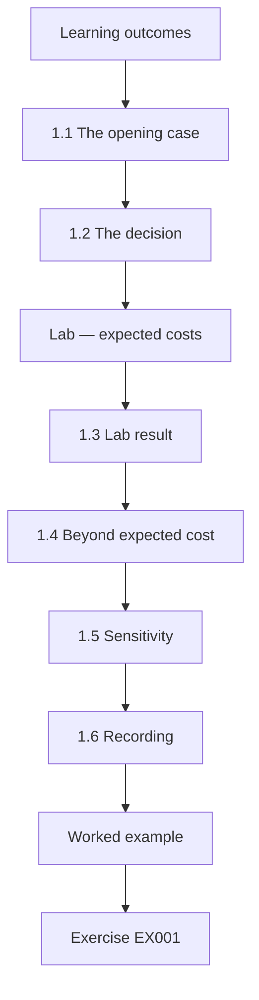

### Logical drawing

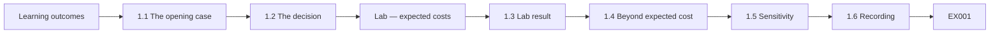

```text
[Learning outcomes]
    |
    v
[1.1 The opening case]
    |
    v
[1.2 The decision]
    |
    v
[Lab — expected costs]
    |
    v
[1.3 Lab result]
    |
    v
[1.4 Beyond expected cost]
    |
    v
[1.5 Sensitivity]
    |
    v
[1.6 Recording]
    |
    v
[Worked example] --> [Exercise EX001]
```
<!-- open-cyber-academy:lesson-figures:end ch-01 -->


### Learning outcomes

You will (1) frame a cloud security decision with options, costs and risks; (2) estimate expected costs; (3) weigh factors that numbers miss; (4) record the decision and its assumptions.

### 1.1 The opening case

Inês Carvalho leads cloud security at the fictional insurer Beacon Mutual and is studying on the two-year postgraduate course at the fictional Fenwick Graduate School, with tutor Prof. Sunita Rao. Beacon runs four Kubernetes clusters for claims, quotes, shared services and analytics. During an upgrade to Kubernetes 1.25, the old PodSecurityPolicy mechanism was removed from Kubernetes, as the project had announced, and the replacement, Pod Security admission, was not configured on most namespaces. For three months nothing enforced pod security settings in most of the estate. An internal audit found it; no misuse was detected.

### 1.2 The decision

Inês must choose how Beacon enforces workload security from now on. Option A: built-in Pod Security admission only. Option B: admission plus a policy engine for checks the built-in profiles do not cover, such as image registry and signature rules. Option C: B plus runtime monitoring of container behaviour. Each option answers the audit finding differently: A relies entirely on correct namespace labels, B adds rules for where images come from and whether they are signed, and C adds detection of behaviour after a container starts. Prof. Rao asks Inês to compare them on cost, risk and how well each would survive the next cluster upgrade.

### Lab — expected costs

```python
"""Expected annual cost of three pod security options (synthetic figures, stdlib only)."""
options = {  # annual cost (k), yearly probability of a serious workload-config incident, incident impact (k)
    "A built-in admission only": (40, 0.10, 900),
    "B admission + policy engine": (95, 0.04, 900),
    "C admission + engine + runtime monitoring": (210, 0.03, 900),
}
for name, (cost, p, impact) in options.items():
    print(f"{name:42} control {cost:>4}k + risk {p*impact:>5.0f}k = {cost + p*impact:>5.0f}k")
```

Run with `python3 lab_decision.py`. Verified output:

```text
A built-in admission only                  control   40k + risk    90k =   130k
B admission + policy engine                control   95k + risk    36k =   131k
C admission + engine + runtime monitoring  control  210k + risk    27k =   237k
```

### 1.3 Lab result

With synthetic estimates, A costs 40k a year plus an expected incident cost of 90k (10% × 900k) = 130k. B costs 95k plus 36k = 131k. C costs 210k plus 27k = 237k. A and B are almost equal on expected cost; C costs much more for a small further reduction. The figures are estimates, so Inês treats the near-tie between A and B as a reason to look beyond expected cost rather than as a decision. Each number in the lab is listed with its source, including the 900k impact estimate, so the risk committee can see which inputs drive the result.

### 1.4 Beyond expected cost

A and B tie on numbers, but B also covers registry and signature rules that regulators ask about, and reduces dependence on correct namespace labels. It also gives one policy language for future checks. Expected cost ignores how bad the worst case is and how confident the estimates are. For an insurer regulated on how it protects health and claims data, being able to show registry and signature checks matters beyond the numbers. Inês writes these non-financial reasons into the decision record next to the expected costs, so the committee can see that B was chosen for coverage and confidence, not because the arithmetic favoured it.

### 1.5 Sensitivity

Inês varies the incident probability for A from 5% to 15%. A's total ranges from 85k to 175k; B's from 113k to 149k. B's narrower range is attractive for a risk-averse insurer. A's cost depends heavily on how likely an incident is, because its only protection is labels that the audit showed can be lost. B depends less on that probability, since the policy engine adds checks of its own. Inês shows both ranges in one chart for the committee. Prof. Rao asks her to note that the probabilities are judgements, not measured rates, and Inês adds the source of each one to the decision record.

### 1.6 Recording

The decision record lists options, estimates, sources, sensitivity, the choice (B) and conditions that would reopen it. Conditions that would reopen the decision include a large change in the incident estimate, a new regulatory requirement for runtime monitoring, or Kubernetes adding registry and signature checks to its built-in admission. Inês also records the range around the 900k impact figure and who produced it, as Prof. Rao asked. The record is stored with the risk committee's minutes and reviewed each year with the risk register.

### Worked example

Beacon's risk committee approves option B. Prof. Rao asks Inês to note that the 900k impact figure came from one internal estimate; Inês adds a range and the estimate's author to the record.

> **Synthetic case.** Beacon Mutual, Fenwick Graduate School, people and figures are synthetic.

### Errors and limits

Expected-cost models give false precision when inputs are guesses; show ranges.

### Exercises

- **EX001 — Opening gap.** What caused the enforcement gap? *Rubric:* 3 = PSP removed in 1.25; replacement not configured; 2 = partial; 1 = vague; 0 = none.
- **EX002 — Lab totals.** Give the three expected totals. *Rubric:* 3 = A 130k, B 131k, C 237k; 2 = two; 1 = one; 0 = none.
- **EX003 — Why B.** Why choose B despite the tie? *Rubric:* 3 = registry/signature rules, less label dependence, narrower range; 2 = two; 1 = one; 0 = none.
- **EX004 — Sensitivity ranges.** What were the ranges for A and B? *Rubric:* 3 = A 85-175k; B 113-149k; 2 = partial; 1 = vague; 0 = none.
- **EX005 — Impact source.** What did Prof. Rao ask Inês to note? *Rubric:* 3 = impact from one estimate; add range; 2 = partial; 1 = vague; 0 = none.

### Synthesis

Decide with explicit options, ranges and recorded assumptions.

### Continue studying — chapter 01 of 12

[← Course home](../../README.md) · [Course chapter index](../SUBJECTS.md) · [Chapter 02 (draft) →](#ch-02)

<a id="ch-02"></a>

## Chapter 2 — Cloud and container security: current practice

<!-- open-cyber-academy:lesson-figures:start ch-02 -->
### Lesson map

Lesson 02 published. Map, example, EX006.

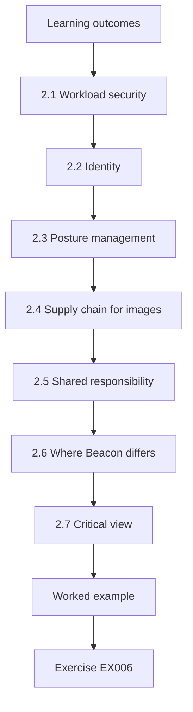

### Logical drawing

```mermaid
flowchart LR
  N0["Learning outcomes"]
  N1["2.1 Workload security"]
  N2["2.2 Identity"]
  N3["2.3 Posture management"]
  N4["2.4 Supply chain for images"]
  N5["2.5 Shared responsibility"]
  N6["2.6 Where Beacon differs"]
  N7["2.7 Critical view"]
  N0 --> N1 --> N2 --> N3 --> N4 --> N5 --> N6 --> N7 --> Q["EX006"]
```

```text
[Learning outcomes]
    |
    v
[2.1 Workload security]
    |
    v
[2.2 Identity]
    |
    v
[2.3 Posture management]
    |
    v
[2.4 Supply chain for images]
    |
    v
[2.5 Shared responsibility]
    |
    v
[2.6 Where Beacon differs]
    |
    v
[2.7 Critical view]
    |
    v
[Worked example] --> [Exercise EX006]
```
<!-- open-cyber-academy:lesson-figures:end ch-02 -->


### Learning outcomes

You will (1) survey current practice in workload security, identity and posture management; (2) relate practice to standards; (3) identify where Beacon differs; (4) judge practice critically.

### 2.1 Workload security

Kubernetes now provides Pod Security admission with Privileged, Baseline and Restricted profiles applied by namespace labels. Many organisations add a policy engine for custom rules. NIST SP 800-190 remains the reference for container risk areas: image, registry, orchestrator, container and host. These areas give Inês a checklist for Beacon's estate: whether images are trusted, whether the registry is controlled, whether the orchestrator enforces safe settings, whether containers run with limited rights, and whether hosts are protected. The audit finding sits in the orchestrator area, where admission decides what may run.

### 2.2 Identity

Current practice favours federated human access with multi-factor authentication and workload identity for services, issuing short-lived credentials instead of stored keys. NIST SP 800-210 and SP 800-207 provide the access control and zero trust framing. Short-lived credentials mean a leaked token stops working quickly, while a stored key can be used until someone notices and revokes it. Beacon already uses workload identity in two clusters, so Inês knows the approach works in its environment and can be extended to the others. The access control framing helps her explain to engineers why service identities need the same care as human ones.

### 2.3 Posture management

Organisations continuously compare cloud configuration with benchmarks such as the CIS Benchmarks and control catalogues such as CSA CCM v4, alerting on drift. Continuous comparison catches drift between audits, which is exactly what Beacon lacked: Pod Security labels went missing during an upgrade and nobody noticed until the audit. Beacon already checks its cloud accounts this way but not its clusters, which is one of the three gaps the platform team agrees to close. Inês asks for alerts on cluster drift to go to the platform team's queue rather than a shared mailbox.

### 2.4 Supply chain for images

Signing images, verifying at admission and keeping images in private registries are increasingly common, along with scanning and inventories of components. Signing lets the cluster check at admission that an image was built by Beacon's own pipeline and has not been changed since. A private registry limits Beacon's clusters to images its own pipeline has stored. Beacon has no image signing yet, so this becomes one of the top three gaps in the platform team's plan, alongside Pod Security labels everywhere and cluster posture checks. Inês notes which parts the policy engine in option B would enforce.

### 2.5 Shared responsibility

Provider documentation from AWS, Microsoft and Google stresses that customers own workload and identity configuration; Google's "shared fate" language adds provider responsibility for secure defaults. For Beacon, this means the audit finding cannot be passed to the provider: the missing labels were Beacon's configuration. Shared fate suggests providers should make secure defaults easier, but customers still have to choose and keep them. Inês cites each provider's page in the control record, so auditors can see where Beacon's responsibility begins.

### 2.6 Where Beacon differs

Beacon has workload identity in two clusters, no image signing, posture checks on accounts but not clusters, and incomplete Pod Security labels. Comparing Beacon with current practice turns a long list of possible improvements into specific gaps. Inês presents the comparison as a table with current practice, Beacon's state and priority, so the platform team can agree which gaps to close first. The table also shows strengths, such as workload identity in two clusters, which can be extended rather than built from nothing.

### 2.7 Critical view

Practice is shaped by vendors; Inês distinguishes what standards require from what products market. For example, runtime monitoring is heavily marketed, but no standard Beacon follows requires it for its risk level, which is one reason option C was not chosen. Inês checks each claimed practice against the standard behind it, such as NIST SP 800-190 or CSA CCM v4, before adding it to the gap table. Where only vendor material supports a practice, she labels it as such, so the committee can weigh it accordingly.

### Learning from peers

Inês joins a regional cloud security practitioners' group where members share anonymised practices. Several insurers report the same upgrade gap, which reassures Beacon's board that the problem was common, while reminding Inês that common does not mean acceptable.

### Worked example

Inês presents a gap table to Beacon's platform team: current practice, Beacon's state and priority. The team agrees the top three gaps: Pod Security labels everywhere, cluster posture checks and image signing.

> **Synthetic case.** Beacon's state is synthetic.

### Errors and limits

"Common practice" is not necessarily good practice; check evidence.

### Exercises

- **EX006 — PSA profiles.** Name the Pod Security profiles. *Rubric:* 3 = Privileged, Baseline, Restricted; 2 = partial; 1 = vague; 0 = none.
- **EX007 — Identity practice.** What is current identity practice for services? *Rubric:* 3 = workload identity, short-lived credentials; 2 = partial; 1 = vague; 0 = none.
- **EX008 — Beacon gaps.** List two Beacon gaps. *Rubric:* 3 = signing, cluster posture, labels, partial workload identity; 2 = one; 1 = vague; 0 = none.
- **EX009 — Shared fate.** What does shared fate add? *Rubric:* 3 = provider secure defaults; 2 = partial; 1 = vague; 0 = none.
- **EX010 — Top three.** Which three gaps were prioritised? *Rubric:* 3 = labels, cluster posture, signing; 2 = two; 1 = one; 0 = none.

### Synthesis

Compare practice with standards and with your own estate.

### Continue studying — chapter 02 of 12

[← Chapter 01 (draft)](#ch-01) · [Course chapter index](../SUBJECTS.md) · [Chapter 03 (draft) →](#ch-03)

<a id="ch-03"></a>

## Chapter 3 — Cloud and container security: specialist evidence

<!-- open-cyber-academy:lesson-figures:start ch-03 -->
### Lesson map

Lesson 03 published. Map, example, EX011.

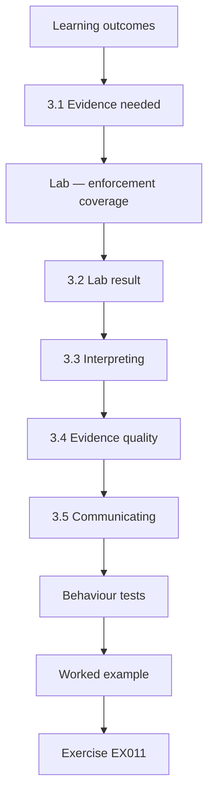

### Logical drawing

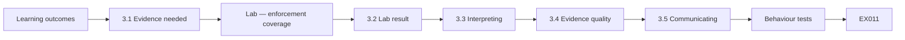

```text
[Learning outcomes]
    |
    v
[3.1 Evidence needed]
    |
    v
[Lab — enforcement coverage]
    |
    v
[3.2 Lab result]
    |
    v
[3.3 Interpreting]
    |
    v
[3.4 Evidence quality]
    |
    v
[3.5 Communicating]
    |
    v
[Behaviour tests]
    |
    v
[Worked example] --> [Exercise EX011]
```
<!-- open-cyber-academy:lesson-figures:end ch-03 -->


### Learning outcomes

You will (1) gather specialist evidence about workload security across clusters; (2) measure enforcement coverage; (3) interpret gaps; (4) communicate evidence to decision makers.

### 3.1 Evidence needed

To plan the fix, Inês needs to know exactly which namespaces enforce which profile in each cluster. The audit gave a summary; she needs the detail. The summary gave a single figure for the estate, which could hide a cluster with no enforcement at all. The fix has to be applied namespace by namespace, so Inês needs to know each namespace's label and whether it actually enforces a profile. She collects this from the clusters directly rather than from documentation, since the audit showed that documentation and reality had drifted apart.

### Lab — enforcement coverage

```python
"""Pod security enforcement coverage per synthetic cluster after the upgrade (stdlib only)."""
clusters = {  # cluster: list of (namespace, enforce level or None)
    "claims-prod": [("claims", "restricted"), ("docs", "restricted"), ("batch", None)],
    "quotes-prod": [("quotes", None), ("pricing", None)],
    "shared-prod": [("monitoring", "privileged"), ("ingress", "baseline"), ("web", "restricted"), ("api", None)],
    "analytics":   [("etl", None), ("notebooks", None)],
}
tot = enf = 0
for c, ns in clusters.items():
    e = sum(1 for _, lvl in ns if lvl in ("baseline", "restricted"))
    tot += len(ns); enf += e
    print(f"{c:12} {e}/{len(ns)} namespaces enforce baseline or restricted; unenforced: {', '.join(n for n, l in ns if l is None) or 'none'}")
print(f"estate {enf}/{tot} = {100*enf/tot:.0f}%")
```

Run with `python3 lab_evidence.py`. Verified output:

```text
claims-prod  2/3 namespaces enforce baseline or restricted; unenforced: batch
quotes-prod  0/2 namespaces enforce baseline or restricted; unenforced: quotes, pricing
shared-prod  2/4 namespaces enforce baseline or restricted; unenforced: api
analytics    0/2 namespaces enforce baseline or restricted; unenforced: etl, notebooks
estate 4/11 = 36%
```

### 3.2 Lab result

claims-prod enforces on 2 of 3 namespaces (batch unenforced). quotes-prod enforces on 0 of 2 (quotes and pricing). shared-prod enforces on 2 of 4 (ingress at Baseline, web at Restricted; monitoring is labelled Privileged, which enforces nothing; api unenforced). analytics enforces on 0 of 2. Across the estate, 4 of 11 namespaces enforce Baseline or Restricted, 36%. The overall figure hides large differences between clusters: two clusters enforce nothing at all, while claims-prod enforces on most of its namespaces. Inês notes that monitoring counts as labelled but not enforcing, so a label check alone would have overstated coverage at shared-prod.

### 3.3 Interpreting

Unenforced namespaces include pricing and quotes, which handle customer data. monitoring's Privileged label is deliberate for its node agents but should be confined to that namespace. Pricing and quotes face the internet and process customer data, so their missing enforcement matters most for policyholders. Confining Privileged to the monitoring namespace means the exception does not spread to other workloads. Inês also notes that analytics enforces nothing while running code written by data scientists, which raises its priority. She marks pricing and quotes as the first namespaces to move to audit mode.

### 3.4 Evidence quality

The data come from live namespace labels exported on one date; Inês records the export time and checks a sample manually. Labels can change at any time, so a single export shows the state on one day only. Recording the time lets later exports be compared with this one. The manual sample checks that the export reflects what the API server actually enforces, not just what labels say. Inês keeps the export and her notes with the evidence for the risk committee, so the figure can be traced to its source if questioned.

### 3.5 Communicating

For the risk committee, a single coverage figure and a list of customer-data namespaces unenforced; for engineers, the full table. The risk committee needs to know how much of the estate is protected and whether customer data is exposed, not the label of every namespace. Engineers need the full namespace table, because each fix is applied one namespace at a time. Inês keeps both versions consistent by producing them from the same export, and she includes the export date on each, so nobody compares figures from different days without knowing it.

### Behaviour tests

To confirm labels match behaviour, Inês submits a synthetic privileged pod to one enforced and one unenforced namespace in each cluster's test environment. Enforced namespaces reject it; unenforced ones admit it, matching the label data. She records each test with the cluster version and time. The tests also reveal that one cluster's admission configuration sets a cluster-wide default of Privileged for unlabelled namespaces, which explains why the gap was silent: nothing failed, so nobody noticed.

### Worked example

Inês notices analytics has no enforcement at all, but its notebooks run code written by data scientists. She ranks analytics with quotes-prod as first priority, despite analytics holding less customer data, because arbitrary code runs there.

> **Synthetic case.** Clusters and labels are synthetic.

### Errors and limits

Labels show intended enforcement; test behaviour to confirm.

### Exercises

- **EX011 — Estate coverage.** What was estate coverage? *Rubric:* 3 = 4/11, 36%; 2 = partial; 1 = vague; 0 = none.
- **EX012 — quotes-prod.** What was quotes-prod's state? *Rubric:* 3 = 0/2 enforced; 2 = partial; 1 = vague; 0 = none.
- **EX013 — monitoring.** Why does monitoring's label not count? *Rubric:* 3 = Privileged enforces nothing; 2 = partial; 1 = vague; 0 = none.
- **EX014 — analytics priority.** Why rank analytics first? *Rubric:* 3 = arbitrary code in notebooks; 2 = partial; 1 = vague; 0 = none.
- **EX015 — Evidence check.** How did Inês check evidence quality? *Rubric:* 3 = recorded export time; manual sample; 2 = partial; 1 = vague; 0 = none.

### Synthesis

Detailed evidence turns an audit finding into a plan.

### Continue studying — chapter 03 of 12

[← Chapter 02 (draft)](#ch-02) · [Course chapter index](../SUBJECTS.md) · [Chapter 04 (draft) →](#ch-04)

<a id="ch-04"></a>

## Chapter 4 — Advanced risk and ethics

<!-- open-cyber-academy:lesson-figures:start ch-04 -->
### Lesson map

Lesson 04 published. Map, example, EX016.

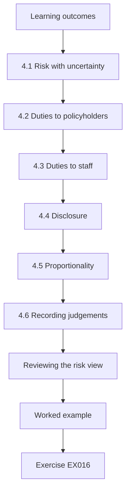

### Logical drawing


```text
[Learning outcomes]
    |
    v
[4.1 Risk with uncertainty]
    |
    v
[4.2 Duties to policyholders]
    |
    v
[4.3 Duties to staff]
    |
    v
[4.4 Disclosure]
    |
    v
[4.5 Proportionality]
    |
    v
[4.6 Recording judgements]
    |
    v
[Reviewing the risk view]
    |
    v
[Worked example] --> [Exercise EX016]
```
<!-- open-cyber-academy:lesson-figures:end ch-04 -->


### Learning outcomes

You will (1) assess risk across the cloud estate with uncertainty; (2) consider ethical duties to policyholders and staff; (3) balance disclosure, fairness and proportionality.

### 4.1 Risk with uncertainty

For each unenforced namespace, Inês estimates likelihood and impact as ranges, noting the evidence for each. Pricing and quotes hold customer data and face the internet, so their impact range is high; analytics runs user code, so its likelihood range is higher. Ranges reflect what Inês actually knows: she cannot give an exact probability that an unenforced namespace will be exploited, but she can explain why one is more exposed than another. Writing down the evidence for each range lets others challenge it. The result ranks analytics with quotes-prod as first priority, even though analytics holds less customer data.

### 4.2 Duties to policyholders

Beacon holds health and claims information. Policyholders cannot protect themselves from configuration gaps; Beacon has a duty of care to fix them promptly and to report breaches honestly. A policyholder submitting a claim has no way to check how Beacon configures its clusters, so they rely on Beacon to do it properly. That reliance is why Inês treats unenforced namespaces holding health and claims information as urgent, and why honest reporting matters if something goes wrong. Her plan therefore moves pricing and quotes, which hold customer data, through enforcement first.

### 4.3 Duties to staff

The audit finding could be framed as someone's failure. Inês frames it as a process gap: the upgrade checklist lacked a step for the PodSecurityPolicy replacement. Blame would discourage people from reporting future problems. Framing the finding as a process gap also points to the fix: a checklist step that confirms admission configuration during upgrades. When the engineer who ran the upgrade worried he would be blamed, Inês showed him the review wording and invited him to co-write the new step. He later led the rollout for two of Beacon's four clusters. Inês notes that the same gap could have occurred with anyone running the upgrade.

### 4.4 Disclosure

No misuse was detected, so regulatory notification is not required, but Beacon's board and the regulator's supervisory contact are informed in the regular risk report, as Beacon's policy requires for significant control gaps. Informing the board and supervisory contact through the regular report keeps them aware without treating the gap as a breach. The report states what was found, that no misuse was detected, and what is being done. Inês records the disclosure decision with its reasons and the policy it follows, so it can be reviewed if new evidence appears. If later evidence showed misuse, the notification question would be reopened.

### 4.5 Proportionality

Controls must not stop claims processing; changes are staged to avoid harming policyholders waiting for payments. Claims processing pays policyholders, so a control that blocks a claims job could delay money people are waiting for. Staging changes means each namespace moves through audit and warn modes before enforcement, giving teams time to fix workloads. The legacy claims batch receives a time-limited exception with compensating controls rather than being blocked outright, so payments continue while the rewrite proceeds. Claims-prod is moved last, after the other clusters have shown the staged approach works.

### 4.6 Recording judgements

Each ethical judgement, such as the disclosure decision, is written with reasons and who made it. Writing judgements down makes them open to review, which matters because ethical decisions are easy to make quietly and hard to check later. For the disclosure decision, the record names Inês and Beacon's risk officer, cites the policy for significant control gaps, and explains why notification was not required. Prof. Rao reviews the records as part of the course, asking whether each reason would convince an outsider. The records are kept with the risk committee's minutes, so later reviewers find them alongside the decisions they explain.

### Reviewing the risk view

Prof. Rao asks Inês to state what evidence would change her risk ranges. She lists three: a detected misuse in logs, a new public exposure of a quotes service, and a change in the analytics user base. Writing these down turns the assessment into something that can be updated rather than defended, and it gives the risk committee clear triggers for revisiting the ranking.

### Worked example

A platform engineer worries he will be blamed because he ran the upgrade. Inês shows him the review wording and invites him to co-write the new upgrade checklist step. He later leads the rollout for two clusters.

> **Synthetic case.** People and decisions are synthetic.

### Errors and limits

Ethical choices often lack a single right answer; make reasoning visible.

### Exercises

- **EX016 — Risk ranges.** Why use ranges for likelihood and impact? *Rubric:* 3 = uncertainty in estimates; 2 = partial; 1 = vague; 0 = none.
- **EX017 — Process framing.** How was the finding framed? *Rubric:* 3 = process gap in upgrade checklist; 2 = partial; 1 = vague; 0 = none.
- **EX018 — Disclosure.** How was the gap disclosed? *Rubric:* 3 = board and regulator contact via risk report; 2 = partial; 1 = vague; 0 = none.
- **EX019 — Proportionality.** How is proportionality applied? *Rubric:* 3 = staged changes so claims continue; 2 = partial; 1 = vague; 0 = none.
- **EX020 — Engineer outcome.** What happened with the worried engineer? *Rubric:* 3 = co-wrote checklist; led rollout; 2 = partial; 1 = vague; 0 = none.

### Synthesis

Weigh risk honestly and treat people fairly.

### Continue studying — chapter 04 of 12

[← Chapter 03 (draft)](#ch-03) · [Course chapter index](../SUBJECTS.md) · [Chapter 05 (draft) →](#ch-05)

<a id="ch-05"></a>

## Chapter 5 — Cloud and container security: design alternatives

<!-- open-cyber-academy:lesson-figures:start ch-05 -->
### Lesson map

Lesson 05 published. Map, example, EX021.

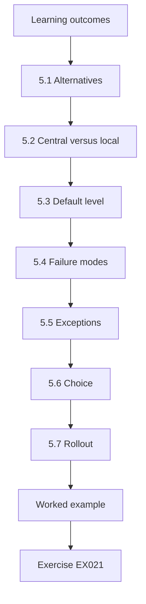

### Logical drawing

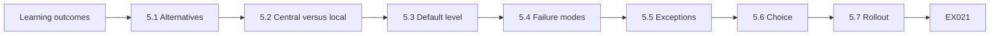

```text
[Learning outcomes]
    |
    v
[5.1 Alternatives]
    |
    v
[5.2 Central versus local]
    |
    v
[5.3 Default level]
    |
    v
[5.4 Failure modes]
    |
    v
[5.5 Exceptions]
    |
    v
[5.6 Choice]
    |
    v
[5.7 Rollout]
    |
    v
[Worked example] --> [Exercise EX021]
```
<!-- open-cyber-academy:lesson-figures:end ch-05 -->


### Learning outcomes

You will (1) compare designs for enforcing workload security across clusters; (2) evaluate central versus per-cluster policy; (3) consider failure modes; (4) choose a design.

### 5.1 Alternatives

Design 1: Pod Security admission labels set by each team. Design 2: labels set centrally by GitOps, with a cluster-wide default of Restricted for unlabelled namespaces. Design 3: Design 2 plus a policy engine for extra rules, its policies distributed from one repository. Each design answers the audit finding in a different way. Design 1 keeps the current approach, which relies on teams remembering labels. Design 2 makes the safe setting the default, so a forgotten label leaves a namespace protected rather than exposed. Design 3 adds the policy engine from option B, so registry and signature rules are enforced from the same central repository.

### 5.2 Central versus local

Local control lets teams move quickly but recreates the original gap: labels forgotten. Central defaults make the safe choice automatic. The audit finding came from exactly this: labels set locally were lost during an upgrade. With central defaults, a new or forgotten namespace starts at Restricted, and teams ask for exceptions when they need less. The quotes team at first preferred local control, but agreed once Inês showed exceptions could be granted within a day. Inês records the quotes team's objection and her answer in the design document.

### 5.3 Default level

Kubernetes allows configuring cluster-wide defaults for the admission controller. Setting the default to Restricted means a new namespace is protected unless an exception is approved. With a Restricted default, the upgrade gap that caused the audit finding would have left namespaces protected rather than unenforced. Teams that need a weaker profile, such as monitoring, request an exception, which is recorded with its reason. The default is set in the cluster configuration managed by GitOps, so it cannot be changed without review.

### 5.4 Failure modes

If the policy engine fails, Design 3 can fail closed for production namespaces; built-in admission runs inside the API server and has no separate availability risk. Failing closed means that if the policy engine is unavailable, production deployments wait rather than running unchecked. This protects customer data but could delay urgent fixes, so the incident runbook includes a break-glass path. Built-in admission keeps working even if the engine fails, so Pod Security profiles still apply. Inês documents both behaviours, so engineers know what to expect during an outage.

### 5.5 Exceptions

Monitoring and node agents need Privileged; they get their own namespace with an exception record. Node agents need access to the host to collect data, which Restricted and Baseline do not allow. Placing them in their own namespace keeps the Privileged label away from workloads that do not need it. The exception record names the agents, the reason and the owner, and it is reviewed with the other exceptions. Any new agent must go into the same namespace or justify a separate exception.

### 5.6 Choice

Design 3, with built-in admission as the foundation and the engine for registry and signature rules. Design 3 combines the protection of central defaults with the extra checks option B was chosen for. Built-in admission handles Pod Security profiles without a separate service to fail, while the policy engine adds rules the profiles cannot express. Inês records the choice with the alternatives and the reasons in the design document, which the platform team and quotes team both review. The platform team confirms it can operate the engine within the funded engineer's year.

### 5.7 Rollout

Audit and warn modes first, then enforce. Audit mode logs workloads that would break the policy without stopping them, and warn mode tells the deploying engineer. These steps let teams find and fix problems before enforcement begins. Each cluster moves to enforce only when its audit logs show no unexplained violations. Inês tracks each cluster's mode in the plan, so the working group can see progress and spot clusters that stall. Inês sets a minimum of two weeks in warn mode for each cluster, so teams see warnings on their normal deployment cycle before anything is blocked.

### Testing the design on paper

Before building, Inês walks through three scenarios against Design 3: a new team creates a namespace, a cluster is upgraded, and the policy engine is unavailable. In each case she writes what happens and who notices. The upgrade scenario is the most important, since it reproduces the original gap; under Design 3 the central default and GitOps labels survive the upgrade.

### Design note

The final design note records the rejected alternatives and why, so that a future team revisiting the choice understands the trade-offs instead of reopening settled questions.

### Worked example

The quotes team asks to keep Design 1 for flexibility. Inês shows that under Design 3 they can still request exceptions within a day, while the default prevents the next upgrade gap. They agree.

> **Synthetic case.** Designs are synthetic.

### Errors and limits

Central control can become a bottleneck; staff the exception process.

### Exercises

- **EX021 — Three designs.** Describe the three designs. *Rubric:* 3 = team labels; central GitOps with default; plus engine; 2 = two; 1 = one; 0 = none.
- **EX022 — Default benefit.** Why set a cluster-wide Restricted default? *Rubric:* 3 = new namespaces protected automatically; 2 = partial; 1 = vague; 0 = none.
- **EX023 — Built-in availability.** Why does built-in admission add no separate availability risk? *Rubric:* 3 = runs inside API server; 2 = partial; 1 = vague; 0 = none.
- **EX024 — Chosen design.** Which design was chosen? *Rubric:* 3 = Design 3; 2 = partial; 1 = vague; 0 = none.
- **EX025 — Quotes objection.** How was the quotes team persuaded? *Rubric:* 3 = exceptions within a day; prevents gap; 2 = partial; 1 = vague; 0 = none.

### Synthesis

Make the safe choice the default and keep exceptions workable.

### Continue studying — chapter 05 of 12

[← Chapter 04 (draft)](#ch-04) · [Course chapter index](../SUBJECTS.md) · [Chapter 06 (draft) →](#ch-06)

<a id="ch-06"></a>

## Chapter 6 — Cloud and container security: controlled evaluation

<!-- open-cyber-academy:lesson-figures:start ch-06 -->
### Lesson map

Lesson 06 published. Map, example, EX026.

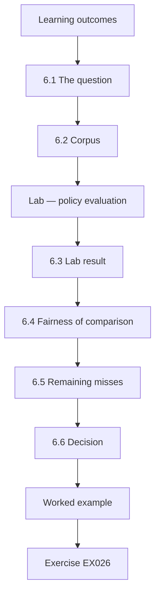

### Logical drawing

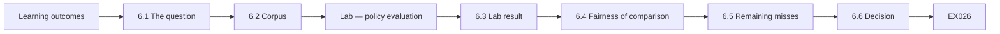

```text
[Learning outcomes]
    |
    v
[6.1 The question]
    |
    v
[6.2 Corpus]
    |
    v
[Lab — policy evaluation]
    |
    v
[6.3 Lab result]
    |
    v
[6.4 Fairness of comparison]
    |
    v
[6.5 Remaining misses]
    |
    v
[6.6 Decision]
    |
    v
[Worked example] --> [Exercise EX026]
```
<!-- open-cyber-academy:lesson-figures:end ch-06 -->


### Learning outcomes

You will (1) evaluate policy sets on a labelled corpus; (2) measure recall and false rejections; (3) compare alternatives fairly; (4) decide using evidence.

### 6.1 The question

Before enforcing, Inês compares two policy-engine rule sets on past deployments: P1, a broad set copied from an example, and P2, tuned to Beacon's workloads. Comparing rule sets on past deployments shows how each would behave before it can block real work. An example set copied from documentation may include rules that do not fit Beacon's workloads, while a tuned set may miss risks its authors did not think of. Measuring both on the same deployments gives evidence for the choice instead of opinion.

### 6.2 Corpus

200 synthetic deployment manifests based on Beacon's recent changes, each labelled risky or not by two reviewers who agreed on the label guide beforehand. Labelling before running the rule sets means the labels cannot be influenced by which set caught what. The two reviewers agreed a guide that defines a risky deployment, such as one running as root or using an unapproved registry. Basing manifests on Beacon's recent changes keeps the corpus close to what developers actually deploy. The label guide and the 200 labels are kept with the evaluation, so later quarters reuse them.

### Lab — policy evaluation

```python
"""Compare two policy sets on a labelled synthetic deployment corpus (stdlib only)."""
# each item: (truly risky?, rejected by policy P1?, rejected by policy P2?)
corpus = [(True, True, True)] * 18 + [(True, False, True)] * 4 + [(True, False, False)] * 2 + \
         [(False, True, False)] * 9 + [(False, True, True)] * 1 + [(False, False, False)] * 166
for i, name in ((1, "P1 broad"), (2, "P2 tuned")):
    tp = sum(1 for r, *p in corpus if r and p[i-1]); fp = sum(1 for r, *p in corpus if not r and p[i-1])
    fn = sum(1 for r, *p in corpus if r and not p[i-1])
    print(f"{name}: caught {tp}/{tp+fn} risky (recall {tp/(tp+fn):.2f}), false rejections {fp}, precision {tp/(tp+fp):.2f}")
print(f"corpus {len(corpus)} deployments, {sum(1 for c in corpus if c[0])} risky")
```

Run with `python3 lab_eval.py`. Verified output:

```text
P1 broad: caught 18/24 risky (recall 0.75), false rejections 10, precision 0.64
P2 tuned: caught 22/24 risky (recall 0.92), false rejections 1, precision 0.96
corpus 200 deployments, 24 risky
```

### 6.3 Lab result

Of 200 deployments, 24 are risky. P1 catches 18 (recall 0.75) with 10 false rejections (precision 0.64). P2 catches 22 (recall 0.92) with 1 false rejection (precision 0.96). P2 is better on both measures: it covers Beacon's actual risky patterns and avoids rules that misfire on Beacon's normal workloads. The precision difference matters in practice, because each false rejection costs a developer time and weakens trust in the controls. At Beacon's deployment rate, P1's misfiring rules would have caused about 40 false rejections a month, which is why precision weighs as heavily as recall here. Inês records both results with the rule versions, so the quarterly re-evaluation can compare against them.

### 6.4 Fairness of comparison

Both sets run on the same corpus, labels were fixed before running, and the tuning of P2 used a different sample to avoid fitting the test set. Using a separate sample for tuning prevents P2 from looking good only because it was fitted to the same deployments it was tested on. Fixing labels first stops reviewers adjusting them after seeing results. Inês records the corpus, labels, rule versions and tuning sample, so the comparison can be repeated when rules change. The quarterly re-evaluation uses the same method on newly added manifests from Beacon's recent changes.

### 6.5 Remaining misses

Two risky deployments pass both sets; both use a host path volume pattern not yet covered, which becomes a new rule. A miss that both sets share shows a gap in Beacon's rules rather than a weakness of one set. Adding a rule for the host path pattern closes that gap, and Inês checks the new rule against the corpus to confirm it catches both deployments without adding false rejections. She records the host path rule and its corpus result in the policy repository's change log. The new host path rule enters P2 before any cluster moves to enforce mode.

### 6.6 Decision

Enforce P2, add the new rule, and re-evaluate quarterly. Enforcing P2 gives Beacon the better recall and far fewer false rejections. Adding the host path rule closes the gap both sets shared. Re-evaluating each quarter keeps the rules matched to Beacon's changing workloads, because a rule set tuned today may misfire on new deployment patterns next year. Inês adds the quarterly evaluation to the security team's assurance schedule. The platform team signs off the decision, and the evaluation report goes to the risk committee with the corpus description and both rule sets' results, so the choice can be checked later.

### Reporting the evaluation

The evaluation report states the question, corpus, labelling method, both results, the limitation of a historical corpus, and the decision. Prof. Rao notes that recording the inter-reviewer agreement on labels would strengthen it, so Inês adds the agreement figure from the reviewers' calibration session and the method used to settle disagreements.

### Worked example

The platform team asks whether 10 false rejections from P1 really matter. Inês estimates each costs a developer about an hour and erodes trust in the controls; at Beacon's deployment rate, P1 would cause about 40 false rejections a month.

> **Synthetic case.** Corpus and results are synthetic.

### Errors and limits

A corpus from past deployments may not represent future workloads.

### Exercises

- **EX026 — Lab figures.** Give recall and precision for P1 and P2. *Rubric:* 3 = P1 0.75/0.64; P2 0.92/0.96; 2 = two; 1 = one; 0 = none.
- **EX027 — Fairness.** How was the comparison kept fair? *Rubric:* 3 = same corpus, fixed labels, separate tuning sample; 2 = two; 1 = one; 0 = none.
- **EX028 — Misses.** What did the two misses share? *Rubric:* 3 = host path pattern not covered; 2 = partial; 1 = vague; 0 = none.
- **EX029 — False rejection cost.** How did Inês estimate false rejection cost? *Rubric:* 3 = hour each, ~40/month, trust; 2 = partial; 1 = vague; 0 = none.
- **EX030 — Decision.** What was decided? *Rubric:* 3 = enforce P2 plus new rule, quarterly re-evaluation; 2 = partial; 1 = vague; 0 = none.

### Synthesis

Evaluate controls on labelled evidence before enforcing them.

### Continue studying — chapter 06 of 12

[← Chapter 05 (draft)](#ch-05) · [Course chapter index](../SUBJECTS.md) · [Chapter 07 (draft) →](#ch-07)

<a id="ch-07"></a>

## Chapter 7 — Cloud and container security: organizational integration

<!-- open-cyber-academy:lesson-figures:start ch-07 -->
### Lesson map

Lesson 07 published. Map, example, EX031.

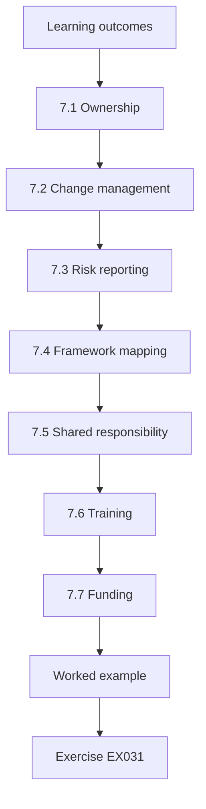

### Logical drawing

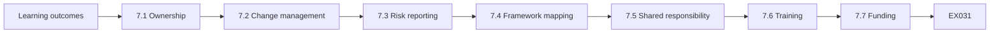

```text
[Learning outcomes]
    |
    v
[7.1 Ownership]
    |
    v
[7.2 Change management]
    |
    v
[7.3 Risk reporting]
    |
    v
[7.4 Framework mapping]
    |
    v
[7.5 Shared responsibility]
    |
    v
[7.6 Training]
    |
    v
[7.7 Funding]
    |
    v
[Worked example] --> [Exercise EX031]
```
<!-- open-cyber-academy:lesson-figures:end ch-07 -->


### Learning outcomes

You will (1) integrate cluster security into Beacon's governance; (2) assign ownership; (3) connect to change management and risk reporting; (4) map controls to frameworks.

### 7.1 Ownership

The platform team owns the central policies; each product team owns its namespace exceptions; the security team owns evaluation and assurance; the risk committee owns acceptance of residual risk. Splitting ownership this way matches who at Beacon can actually make each kind of change. The platform team controls the central repository and cluster configuration, product teams know why their workloads need exceptions, the security team can test independently, and only the risk committee can accept residual risk on Beacon's behalf. Inês writes the split into the control record, so each owner knows their part.

### 7.2 Change management

Cluster upgrades now include a checklist step: confirm admission configuration and run the behaviour tests before and after. The change board will not approve an upgrade without the test record. The checklist step answers the cause of the audit finding directly: the upgrade that removed PodSecurityPolicy had no step to confirm its replacement was configured. Running behaviour tests before and after shows whether admission still rejects unsafe workloads. In a test run, the step took ten minutes and caught a missing label in a staging upgrade, and the change board made it standard.

### 7.3 Risk reporting

A monthly metric: share of namespaces enforced at the intended level, open exceptions and their age. The metric shows the risk committee whether enforcement is holding and whether exceptions are being cleared or accumulating. Exception age matters because an old exception may no longer have a valid reason. The platform team produces the figures from live cluster data each month, and Inês adds a short note on any change. Expired exceptions are flagged in red, so they cannot quietly continue past their agreed date. Exception age is shown in bands, so the committee can see at a glance which exceptions are nearing expiry.

### 7.4 Framework mapping

Beacon maps the controls to CSA CCM v4 domains and NIST SP 800-190 recommendations, so auditors can see coverage without new documents. Mapping to existing frameworks avoids writing new documents for auditors who already know CSA CCM and NIST guidance. Each control in the baseline is listed with the domain or recommendation it supports, and the evidence that it works, such as behaviour test records. Inês notes where a framework recommendation is not covered, so gaps are visible. Internal audit reviews the mapping before it is used in any external audit response.

### 7.5 Shared responsibility

Beacon uses a managed Kubernetes service; the provider secures the control plane, while Beacon configures admission and workloads. The provider's shared responsibility page is cited in the control record. Citing the provider's page shows auditors where Beacon's responsibility begins and confirms that the audit finding falls on Beacon's side. If Beacon moved to another provider, the split would need to be checked again, as Inês later explained to an examiner. The control record is reviewed each year with the provider's current documentation, in case the split changes.

### 7.6 Training

Short guidance for product teams explains levels and how to request exceptions. Product teams do not need to understand every rule, but they need to know what each Pod Security level allows and how to ask for an exception if a workload needs more. The guidance gives examples from Beacon's own workloads, such as why monitoring is Privileged and how the quotes team requested an exception. It is published where teams already look for platform documentation. Product leads review the guidance before it is published, so its examples match their workloads.

### 7.7 Funding

Option B's budget covers one engineer for a year; ongoing work goes into the platform team's plan. Funding one engineer for a year covers the rollout across four clusters, the policy engine and the assurance tests. After that, maintaining the baseline becomes part of the platform team's normal work rather than a separate project. Inês records the funding decision and the hand-over date in the plan, so it is clear when the project ends and routine ownership begins. The risk committee approves the hand-over date, after which the platform team's plan carries the work.

### Auditor walkthrough

When the external auditor returns, Inês walks through the control record: the mapping to CSA CCM v4, the upgrade checklist, the monthly metric and the evaluation report. The auditor samples two upgrades and confirms the test records exist. Because evidence was produced by normal work rather than prepared for the audit, the walkthrough takes an afternoon instead of a week, and the finding is closed with one minor observation about exception review dates.

### Worked example

The change board initially sees the new step as overhead. After a test run takes ten minutes and catches a missing label in a staging upgrade, the board makes it standard.

> **Synthetic case.** Organisation details are synthetic.

### Errors and limits

Integration succeeds when controls fit existing processes.

### Exercises

- **EX031 — Owners.** Who owns central policies and exceptions? *Rubric:* 3 = platform team; product teams; 2 = partial; 1 = vague; 0 = none.
- **EX032 — Upgrade step.** What upgrade checklist step was added? *Rubric:* 3 = confirm admission config and behaviour tests; 2 = partial; 1 = vague; 0 = none.
- **EX033 — Metric.** What monthly metric is reported? *Rubric:* 3 = namespaces enforced, exceptions and age; 2 = partial; 1 = vague; 0 = none.
- **EX034 — Shared responsibility.** What does the provider secure versus Beacon? *Rubric:* 3 = control plane; admission and workloads; 2 = partial; 1 = vague; 0 = none.
- **EX035 — Change board.** What convinced the change board? *Rubric:* 3 = ten-minute test caught missing label; 2 = partial; 1 = vague; 0 = none.

### Synthesis

Embed controls in ownership and change processes.

### Continue studying — chapter 07 of 12

[← Chapter 06 (draft)](#ch-06) · [Course chapter index](../SUBJECTS.md) · [Chapter 08 (draft) →](#ch-08)

<a id="ch-08"></a>

## Chapter 8 — Cloud and container security: difficult cases

<!-- open-cyber-academy:lesson-figures:start ch-08 -->
### Lesson map

Lesson 08 published. Map, example, EX036.

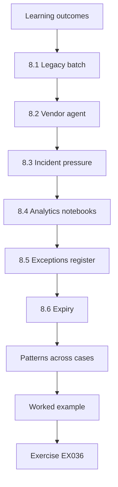

### Logical drawing

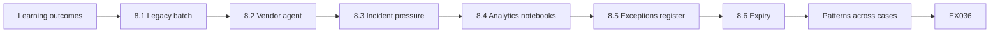

```text
[Learning outcomes]
    |
    v
[8.1 Legacy batch]
    |
    v
[8.2 Vendor agent]
    |
    v
[8.3 Incident pressure]
    |
    v
[8.4 Analytics notebooks]
    |
    v
[8.5 Exceptions register]
    |
    v
[8.6 Expiry]
    |
    v
[Patterns across cases]
    |
    v
[Worked example] --> [Exercise EX036]
```
<!-- open-cyber-academy:lesson-figures:end ch-08 -->


### Learning outcomes

You will (1) handle conflicts between enforcement and operations; (2) manage legacy workloads; (3) decide under pressure; (4) document exceptions.

### 8.1 Legacy batch

Claims batch jobs run as root using an old image. Rewriting takes months. Inês grants a time-limited exception with compensating controls: dedicated nodes, no network access beyond the database, and monitoring. The compensating controls reduce what a compromise of the batch jobs could reach: dedicated nodes keep them away from other workloads, limited network access stops them reaching the internet or other services, and monitoring shows unusual behaviour. The exception has an expiry date tied to the rewrite. When the rewrite was incomplete at expiry, the committee extended it once for three months.

### 8.2 Vendor agent

A vendor monitoring agent needs privileged access. Inês asks the vendor for documentation on why, limits it to its own namespace, and records the exception with annual review. Asking for documentation turns a vendor's request into evidence that can be reviewed. If the vendor cannot explain why privileged access is needed, that is a reason to question the agent itself. Keeping it in its own namespace limits the effect of a compromise. The annual review checks whether a newer version of the agent needs less access, which some vendors introduce over time.

### 8.3 Incident pressure

During a claims outage, an engineer wants to disable enforcement to deploy a debug pod. The runbook gives a break-glass path: a pre-approved debug namespace at Baseline, logged and removed afterwards. A break-glass path lets engineers act quickly during an outage without disabling the controls that protect customer data. The debug namespace is approved in advance, runs at Baseline, and is logged, so its use can be reviewed afterwards. Removing it after the incident ensures it does not become a permanent gap. The runbook names who may use the path and how its use is reported.

### 8.4 Analytics notebooks

Analysts need flexible environments. Restricted applies, and common needs are met by preapproved images. Data scientists often install packages and run code that platform teams cannot predict, which is why analytics was a first priority. Pre-approved images give analysts their common notebook tools without needing an exception from Restricted. When an analyst needs something not covered, they request a new image, which is reviewed and added for everyone. Inês checks with the analytics lead that the images cover most daily work, so Restricted does not push analysts towards workarounds.

### 8.5 Exceptions register

Each exception has an owner, reason, compensating controls and expiry date. Recording all four fields turns an exception into a decision others can check. The owner is the product team that needs the exception, the reason explains why the standard profile does not fit, compensating controls show how risk is reduced, and the expiry forces a fresh decision. The register lives in the central repository, so it is reviewed with policy changes and visible to auditors. Inês checks the register against live cluster labels each month.

### 8.6 Expiry

Expired exceptions are flagged in the monthly metric. Flagging expired exceptions in the monthly metric means the risk committee sees them, not just the security team. The owner must renew the exception with a fresh reason, close it, or explain the delay. The claims batch exception was flagged at expiry, and the committee extended it once while recording that any further extension requires the risk committee. The metric is designed so that every expiry reaches the committee in the month it falls due. Owners receive a reminder a month before each expiry date.

### Patterns across cases

Looking across the cases, Inês notices that each difficult case was easier when a path had been agreed in advance. The break-glass namespace, the exception template and the vendor questionnaire all turned arguments in the moment into routine decisions. She adds a short rule to the programme: when a new kind of difficult case appears twice, write a pre-agreed path for it. This keeps the control firm without forcing people to choose between security and getting work done under pressure.

### Reviewing exceptions together

Each quarter, owners present their open exceptions briefly to the working group, which keeps expiry dates visible and spreads good compensating controls between teams.

### Worked example

The claims batch exception reaches expiry with the rewrite incomplete. The committee extends it once, for three months, after the team shows progress, and records that further extension requires the risk committee.

> **Synthetic case.** Cases are synthetic.

### Errors and limits

Exceptions are part of a good control, not a failure of it, when governed.

### Exercises

- **EX036 — Batch controls.** What compensating controls applied to legacy batch? *Rubric:* 3 = dedicated nodes, limited network, monitoring; 2 = two; 1 = one; 0 = none.
- **EX037 — Vendor.** How was the vendor agent handled? *Rubric:* 3 = documentation, own namespace, annual review; 2 = partial; 1 = vague; 0 = none.
- **EX038 — Break-glass.** What is the break-glass path? *Rubric:* 3 = preapproved debug namespace at Baseline, logged, removed; 2 = partial; 1 = vague; 0 = none.
- **EX039 — Register fields.** What does each exception record contain? *Rubric:* 3 = owner, reason, controls, expiry; 2 = two; 1 = one; 0 = none.
- **EX040 — Extension.** How was the batch extension governed? *Rubric:* 3 = one 3-month extension; further needs committee; 2 = partial; 1 = vague; 0 = none.

### Synthesis

Govern exceptions with owners, controls and expiry.

### Continue studying — chapter 08 of 12

[← Chapter 07 (draft)](#ch-07) · [Course chapter index](../SUBJECTS.md) · [Chapter 09 (draft) →](#ch-09)

<a id="ch-09"></a>

## Chapter 9 — Cloud and container security: leadership and assurance

<!-- open-cyber-academy:lesson-figures:start ch-09 -->
### Lesson map

Lesson 09 published. Map, example, EX041.

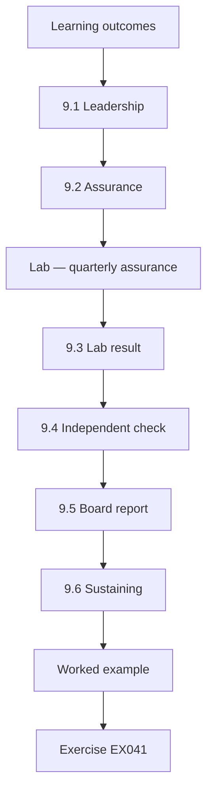

### Logical drawing

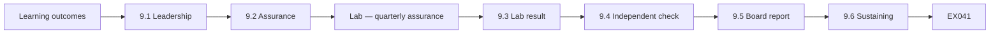

```text
[Learning outcomes]
    |
    v
[9.1 Leadership]
    |
    v
[9.2 Assurance]
    |
    v
[Lab — quarterly assurance]
    |
    v
[9.3 Lab result]
    |
    v
[9.4 Independent check]
    |
    v
[9.5 Board report]
    |
    v
[9.6 Sustaining]
    |
    v
[Worked example] --> [Exercise EX041]
```
<!-- open-cyber-academy:lesson-figures:end ch-09 -->


### Learning outcomes

You will (1) lead the programme across teams; (2) provide assurance with measured evidence; (3) track improvement; (4) report to the board.

### 9.1 Leadership

Inês chairs a fortnightly working group with platform and product leads, keeping a visible plan and celebrating milestones. A fortnightly group keeps the platform and product leads talking, so problems such as a team resisting enforcement are raised early. The visible plan shows which clusters have moved through audit, warn and enforce, and celebrating milestones, such as the first cluster fully enforced, keeps momentum during a long rollout. When one product lead resisted tests in Q2, the group helped Inês find a compromise.

### 9.2 Assurance

Each quarter the security team runs behaviour tests on 15 sample namespaces, measures exception age and counts exceptions. Behaviour tests show whether admission actually rejects unsafe workloads, not just whether labels are set. Sampling 15 namespaces each quarter keeps the work manageable while covering every cluster. Exception age and count show whether exceptions are being cleared. Inês designs the tests to run in staging mirrors where possible, with one production check, after a product lead raised concerns about disruption. Results go to the working group and the risk committee.

### Lab — quarterly assurance

```python
"""Quarterly assurance indicators for the cloud estate (synthetic, stdlib only)."""
q = {"Q1": (6, 15, 61, 21), "Q2": (11, 15, 38, 9), "Q3": (15, 15, 12, 4)}
# (namespaces enforced... out of 15, total namespaces, median days risky config live, open exceptions)
for k, (e, t, days, ex) in q.items():
    print(f"{k}: enforced {e}/{t} ({100*e/t:.0f}%), median days risky config live {days}, open exceptions {ex}")
```

Run with `python3 lab_assurance.py`. Verified output:

```text
Q1: enforced 6/15 (40%), median days risky config live 61, open exceptions 21
Q2: enforced 11/15 (73%), median days risky config live 38, open exceptions 9
Q3: enforced 15/15 (100%), median days risky config live 12, open exceptions 4
```

### 9.3 Lab result

Q1: 6/15 namespaces pass (40%), mean exception age 61 days, 21 exceptions. Q2: 11/15 (73%), 38 days, 9. Q3: 15/15 (100%), 12 days, 4. Improvement is steady; the sample is small, so the board report gives counts and notes the sampling method. The improvement follows the rollout: as clusters moved to enforce, more sampled namespaces passed, and exceptions fell as teams fixed workloads. Inês reports how the 15 namespaces were sampled beside each quarter's figure. With 15 namespaces per quarter, one failing namespace changes the pass rate by about seven points, so Inês reports counts alongside each percentage and warns the board against reading small changes as trends. The Q3 result is checked independently by internal audit before it is presented as final.

### 9.4 Independent check

Internal audit repeats the Q3 tests on a different sample and finds the same result. Using a different sample tests whether the security team's result depended on which namespaces it chose. Internal audit works independently of the platform and security teams, so its result adds confidence for the board and regulator. Internal audit's report is filed with the security team's Q3 records, so both samples sit together. Inês notes that agreement on one quarter does not guarantee future results, which is why assurance continues. Internal audit's report names the namespaces it tested, so the two samples can be compared.

### 9.5 Board report

A one-page summary: what happened, what changed, measured results, remaining exceptions. The board needs to know whether the audit finding is closed and what risk remains, not technical detail. Inês keeps the summary to one page, reports the assurance figures as counts with the sample size, and lists remaining exceptions with their owners and expiry dates. The report is reviewed by Beacon's risk officer before it goes to the board. Prof. Rao reviews the draft as an example of reporting for a non-technical audience, and Inês shortens the technical terms after her comments.

### 9.6 Sustaining

Assurance continues quarterly; results feed the risk register. Quarterly assurance keeps checking that controls still work after changes such as cluster upgrades, which caused the original gap. Results feed the risk register, so a falling pass rate raises the risk rating and draws the committee's attention. The security team owns the tests, and their schedule is written into the control record. Inês hands the test scripts and method to the security team at the end of the project. The first post-project quarter is tested by the security team alone.

### Reading the trend carefully

Prof. Rao asks whether the improvement could be explained by easier samples in later quarters. Inês shows that the sample was drawn the same way each quarter from the full namespace list, stratified by cluster, and that the namespaces with known exceptions were always eligible. She also notes that the number of namespaces grew during the year, so the later quarters cover a larger estate. These checks do not prove the trend, but they rule out the most obvious alternative explanation, and the board report says so in one sentence.

She also separates measures of activity from measures of outcome. Counting meetings held or rules written shows effort; pass rates and exception age show whether the estate is actually safer.

### Worked example

In Q2 one product lead resists, saying tests disrupt deployments. Inês moves tests to staging mirrors except for one production check, and the lead agrees.

> **Synthetic case.** Figures are synthetic.

### Errors and limits

Small samples limit claims; say so.

### Exercises

- **EX041 — Lab trend.** Give pass rates for Q1 to Q3. *Rubric:* 3 = 40%, 73%, 100%; 2 = two; 1 = one; 0 = none.
- **EX042 — Exceptions trend.** How did exceptions change? *Rubric:* 3 = 21 to 9 to 4; age 61 to 12; 2 = partial; 1 = vague; 0 = none.
- **EX043 — Sample caution.** Why note the sampling method? *Rubric:* 3 = small sample of 15; 2 = partial; 1 = vague; 0 = none.
- **EX044 — Independent check.** What did internal audit do? *Rubric:* 3 = repeated tests on different sample; 2 = partial; 1 = vague; 0 = none.
- **EX045 — Resistance.** How was the product lead's concern resolved? *Rubric:* 3 = tests on staging mirrors plus one prod check; 2 = partial; 1 = vague; 0 = none.

### Synthesis

Lead with visible plans and assure with measured evidence.

### Continue studying — chapter 09 of 12

[← Chapter 08 (draft)](#ch-08) · [Course chapter index](../SUBJECTS.md) · [Chapter 10 (draft) →](#ch-10)

<a id="ch-10"></a>

## Chapter 10 — Research reading and critique

<!-- open-cyber-academy:lesson-figures:start ch-10 -->
### Lesson map

Lesson 10 published. Map, example, EX046.

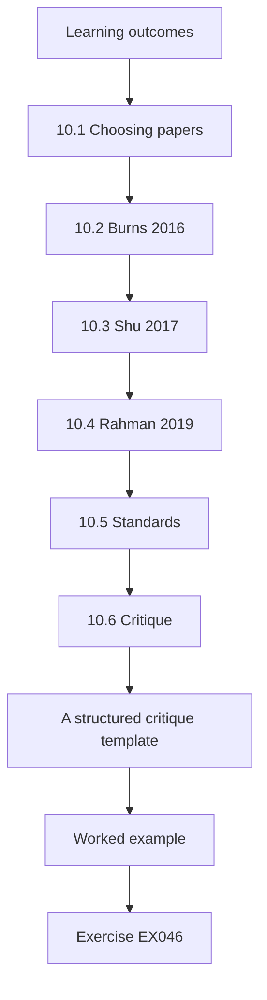

### Logical drawing

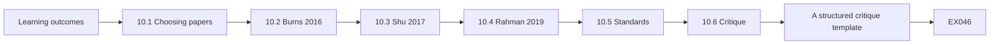

```text
[Learning outcomes]
    |
    v
[10.1 Choosing papers]
    |
    v
[10.2 Burns 2016]
    |
    v
[10.3 Shu 2017]
    |
    v
[10.4 Rahman 2019]
    |
    v
[10.5 Standards]
    |
    v
[10.6 Critique]
    |
    v
[A structured critique template]
    |
    v
[Worked example] --> [Exercise EX046]
```
<!-- open-cyber-academy:lesson-figures:end ch-10 -->


### Learning outcomes

You will (1) read research on cloud security critically; (2) judge relevance to Beacon; (3) summarise limitations.

### 10.1 Choosing papers

Inês reads Burns et al. (2016) on Borg, Omega and Kubernetes, Shu et al. (2017) on Docker Hub image vulnerabilities and Rahman et al. (2019) on security smells in infrastructure as code. Each paper covers a different part of Inês's work: Burns et al. explain why Kubernetes is designed the way it is, Shu et al. measure risks in public images that Beacon's registry rules address, and Rahman et al. describe mistakes in infrastructure code like Beacon's GitOps repository. She reads each for method and limits, not just conclusions.

### 10.2 Burns 2016

Explains the design history of cluster managers. Useful context for why namespaces and admission exist; not a security evaluation. The paper helps Inês explain to the risk committee why admission control exists and why namespaces are the unit Pod Security works on. She does not cite it as evidence that any control works, because it describes design, not security outcomes. Her notes record what the paper supports and what it does not, so she cites it only for design history in the final report.

### 10.3 Shu 2017

Measured vulnerabilities in public images. Supports Beacon's registry rules; the data is several years old, so figures should not be quoted as current. Shu et al.'s findings support the policy engine's rule that images must come from Beacon's private registry. Because public images change constantly, Inês does not repeat the paper's percentages as current figures. When a colleague quoted them in a slide as today's numbers, she suggested citing them as historical and adding Beacon's own scan data instead.

### 10.4 Rahman 2019

Identified recurring security smells such as hard-coded secrets in scripts. Supports scanning Beacon's GitOps repository. Hard-coded secrets in Beacon's GitOps repository could expose credentials to anyone who can read it. Rahman et al.'s categories give Inês a checklist for scanning the repository. The paper studied scripts from open-source projects, so Inês checks whether its smells appear in Beacon's own code before relying on it. She records which smells the scan found, if any, with the date. Inês asks the platform team to add a secrets scan to the GitOps pipeline, so new commits are checked automatically.

### 10.5 Standards

NIST SP 800-190 and SP 800-207 give frameworks; they are guidance, not evidence of effectiveness. Inês uses the standards to organise the baseline and to explain it to auditors, but she does not claim that following them proves Beacon is secure. Evidence that controls work comes from Beacon's own behaviour tests and the policy evaluation. Her final report keeps the two kinds of source apart, citing standards for structure and her own measurements for results. Prof. Rao asks her to keep this distinction in her viva answers, since examiners may challenge claims that standards prove effectiveness.

### 10.6 Critique

For each, Inês notes method, data age, and whether results transfer to a managed service. Method shows how much weight a result can bear, data age shows whether it still applies, and transfer shows whether it fits Beacon's managed Kubernetes service. A study of self-managed clusters may not apply where the provider runs the control plane. Inês records her notes for each paper in a short table, which appears in the final report's literature chapter. Prof. Rao checks the table against the papers themselves and queries one data-age entry.

### A structured critique template

Inês uses a short template for each source: the question it asks, the method, the data and its date, the main finding, the limits stated by the authors, and the relevance to Beacon. For Ristenpart et al. (2009), on information leakage between co-located virtual machines, she records that the work shows why providers isolate tenants carefully, that providers have since changed their platforms, and that Beacon relies on the provider's isolation under the shared responsibility model rather than testing it. For Mell and Grance (2011), the NIST definition of cloud computing, she notes it is a definition, useful for shared vocabulary in board reports, not a security control.

The template makes reviews comparable and keeps her from treating a well-known paper as stronger evidence than its method supports.

### Worked example

A colleague quotes Shu's percentages in a slide as today's figures. Inês suggests citing them as historical and adding Beacon's own scan data.

> **Synthetic case.** Summaries are paraphrased.

### Errors and limits

Old data can mislead when quoted as current.

### Exercises

- **EX046 — Burns relevance.** How is Burns 2016 relevant? *Rubric:* 3 = design context, not security evaluation; 2 = partial; 1 = vague; 0 = none.
- **EX047 — Shu caution.** What caution applies to Shu 2017? *Rubric:* 3 = data age; 2 = partial; 1 = vague; 0 = none.
- **EX048 — Rahman.** What does Rahman 2019 support? *Rubric:* 3 = scanning GitOps repo for smells; 2 = partial; 1 = vague; 0 = none.
- **EX049 — Standards.** How should standards be treated? *Rubric:* 3 = guidance, not evidence of effectiveness; 2 = partial; 1 = vague; 0 = none.
- **EX050 — Slide.** How was the slide corrected? *Rubric:* 3 = cite as historical, add own data; 2 = partial; 1 = vague; 0 = none.

### Synthesis

Read research for method, age and transfer.

### Continue studying — chapter 10 of 12

[← Chapter 09 (draft)](#ch-09) · [Course chapter index](../SUBJECTS.md) · [Chapter 11 (draft) →](#ch-11)

<a id="ch-11"></a>

## Chapter 11 — Applied project

<!-- open-cyber-academy:lesson-figures:start ch-11 -->
### Lesson map

Lesson 11 published. Map, example, EX051.

```mermaid
flowchart TD
  N0["Learning outcomes"]
  N1["11.1 Project"]
  N2["11.2 Scope"]
  N3["11.3 Method"]
  N4["11.4 Evaluation"]
  N5["11.5 Outcome"]
  N6["11.6 Presentation"]
  N7["Project timeline"]
  N0 --> N1 --> N2 --> N3 --> N4 --> N5 --> N6 --> N7
  N7 --> EX["Worked example"]
  EX --> Q["Exercise EX051"]
```

### Logical drawing

```mermaid
flowchart LR
  N0["Learning outcomes"]
  N1["11.1 Project"]
  N2["11.2 Scope"]
  N3["11.3 Method"]
  N4["11.4 Evaluation"]
  N5["11.5 Outcome"]
  N6["11.6 Presentation"]
  N7["Project timeline"]
  N0 --> N1 --> N2 --> N3 --> N4 --> N5 --> N6 --> N7 --> Q["EX051"]
```

```text
[Learning outcomes]
    |
    v
[11.1 Project]
    |
    v
[11.2 Scope]
    |
    v
[11.3 Method]
    |
    v
[11.4 Evaluation]
    |
    v
[11.5 Outcome]
    |
    v
[11.6 Presentation]
    |
    v
[Project timeline]
    |
    v
[Worked example] --> [Exercise EX051]
```
<!-- open-cyber-academy:lesson-figures:end ch-11 -->


### Learning outcomes

You will (1) plan and complete a substantial project; (2) define scope, method and evaluation; (3) present outcomes.

### 11.1 Project

Inês's final project: a reusable cluster security baseline for Beacon, with central labels, policy engine rules, upgrade checklist and assurance tests. Making the baseline reusable means Beacon can apply it to any new cluster, rather than repeating the analysis each time. It brings together the central labels and Restricted default, the P2 rules with the host path addition, the upgrade checklist step and the quarterly behaviour tests. Prof. Rao approves the project scope as the course's final assessment. The baseline is stored in the central repository as one versioned package.

### 11.2 Scope

Four clusters; excludes provider control plane and developer laptops. Limiting the scope to four clusters keeps the project achievable within the course and covers every cluster in the audit finding. The provider's control plane is excluded because the provider secures it, while developer laptops are a separate risk with different controls. Inês records both exclusions with their reasons in the project plan, so examiners can see the boundaries were chosen deliberately. Analytics stays in scope despite holding less customer data, because arbitrary code runs there.

### 11.3 Method

Build in staging, evaluate on the corpus, roll out by cluster in audit, warn, enforce order. Building in staging first means problems are found before production is affected. Evaluating on the 200-manifest corpus tests the rules before any deployment can be blocked. Rolling out cluster by cluster through audit, warn and enforce gives each team time to fix workloads and lets the working group learn from early clusters before later ones. Inês records each cluster's dates in audit, warn and enforce mode, with any problems found. Claims-prod goes last because its legacy batch jobs need the time-limited exception before enforcement begins.

### 11.4 Evaluation

Success means P2-level recall on the corpus, all four clusters enforced, and quarterly assurance at least 90%. Each of the three criteria tests a different part of the baseline. Recall on the corpus checks the rules, enforcement on all four clusters checks the rollout, and assurance of at least 90% checks that controls keep working over time. The criteria were set before rollout, so they could not be adjusted to match results. Inês reports each criterion against the evidence that shows whether it was met. Prof. Rao approved the criteria with the scope, so the examiners can check them against the original plan.

### 11.5 Outcome

All criteria met by Q3; four exceptions remain with expiry dates. The evidence comes from the corpus evaluation, the cluster configuration and the Q3 behaviour tests, repeated by internal audit on a different sample. The four remaining exceptions are recorded in the register with owners, compensating controls and expiry dates, and they are reported to the risk committee each month. Inês's results table lists which criterion each piece of evidence supports, so examiners can check them one by one. Internal audit's repeat of the Q3 tests on a different sample supports the assurance criterion, and the remaining exceptions include the claims batch jobs awaiting their rewrite.

### 11.6 Presentation

She presents to Fenwick examiners and Beacon's risk committee, with limits stated. The examiners assess the method and evidence, while the risk committee decides whether the baseline is ready to become Beacon's standard. Stating limits, such as the small assurance sample and estimates behind the cost comparison, lets both audiences judge the results fairly. An examiner asked what would happen if Beacon moved to a second provider, and Inês explained which parts of the baseline would need re-checking. The risk committee's questions focus on the remaining exceptions and when each will close.

### Project timeline

The project ran over three quarters. In the first, Inês built the baseline in staging and assembled the evaluation corpus. In the second, she ran the evaluation, chose P2 and rolled out to analytics and quotes, the clusters with fewer legacy workloads. In the third, she rolled out to claims and shared, handled the batch and vendor exceptions, and ran the independent check with internal audit.

Each phase ended with a short review recording what went well, what did not and what would change. The biggest lesson was that the rollout order mattered: starting with simpler clusters built confidence and produced worked examples that helped the claims team prepare.

### Examiner feedback

The examiners praise the clear success criteria and the honest limits section. They suggest that a future version could test the baseline on a cluster built from scratch, to confirm the documentation is enough for a new team without Inês's help. Beacon's platform team later does this for a new pricing cluster and records two gaps in the guidance, which are fixed.

### Worked example

An examiner asks what would happen if Beacon moved to a second cloud provider. Inês explains that the baseline relies on Kubernetes features, not provider features, but the shared responsibility split would need to be re-checked.

> **Synthetic case.** Project details are synthetic.

### Errors and limits

Define success before starting.

### Exercises

- **EX051 — Deliverables.** What did the baseline include? *Rubric:* 3 = labels, engine rules, checklist, tests; 2 = two; 1 = one; 0 = none.
- **EX052 — Exclusions.** What was out of scope? *Rubric:* 3 = control plane, laptops; 2 = partial; 1 = vague; 0 = none.
- **EX053 — Success.** What were success criteria? *Rubric:* 3 = recall, all enforced, ≥90% assurance; 2 = two; 1 = one; 0 = none.
- **EX054 — Outcome.** What remained at the end? *Rubric:* 3 = two exceptions with expiry; 2 = partial; 1 = vague; 0 = none.
- **EX055 — Second provider.** What changes with a second provider? *Rubric:* 3 = re-check shared responsibility; 2 = partial; 1 = vague; 0 = none.

### Synthesis

Scope, evaluate and present honestly.

### Continue studying — chapter 11 of 12

[← Chapter 10 (draft)](#ch-10) · [Course chapter index](../SUBJECTS.md) · [Chapter 12 (draft) →](#ch-12)

<a id="ch-12"></a>

## Chapter 12 — Final review and transfer

<!-- open-cyber-academy:lesson-figures:start ch-12 -->
### Lesson map

Lesson 12 published. Map, example, EX056.

```mermaid
flowchart TD
  N0["Learning outcomes"]
  N1["12.1 Review"]
  N2["12.2 Transfer"]
  N3["12.3 Next steps"]
  N4["12.4 Learning"]
  N5["12.5 Sharing"]
  N6["Self-assessment"]
  N7["Carrying it to other controls"]
  N0 --> N1 --> N2 --> N3 --> N4 --> N5 --> N6 --> N7
  N7 --> EX["Worked example"]
  EX --> Q["Exercise EX056"]
```

### Logical drawing

```mermaid
flowchart LR
  N0["Learning outcomes"]
  N1["12.1 Review"]
  N2["12.2 Transfer"]
  N3["12.3 Next steps"]
  N4["12.4 Learning"]
  N5["12.5 Sharing"]
  N6["Self-assessment"]
  N7["Carrying it to other controls"]
  N0 --> N1 --> N2 --> N3 --> N4 --> N5 --> N6 --> N7 --> Q["EX056"]
```

```text
[Learning outcomes]
    |
    v
[12.1 Review]
    |
    v
[12.2 Transfer]
    |
    v
[12.3 Next steps]
    |
    v
[12.4 Learning]
    |
    v
[12.5 Sharing]
    |
    v
[Self-assessment]
    |
    v
[Carrying it to other controls]
    |
    v
[Worked example] --> [Exercise EX056]
```
<!-- open-cyber-academy:lesson-figures:end ch-12 -->


### Learning outcomes

You will (1) review the course; (2) transfer methods to other contexts; (3) plan continued learning.

### 12.1 Review

The course moved from an audit finding to a decision, evidence, design, evaluation, integration, difficult cases, assurance, research and a project. Each step of Inês's work at Beacon built on the one before it. The audit finding led to a decision between options, which needed evidence about enforcement. The evidence shaped the design, which was evaluated before enforcement. Integration made the design part of Beacon's routines, difficult cases tested its limits, and assurance showed whether it worked. Research tested her choices against published work, and the final project turned them into a reusable baseline.

### 12.2 Transfer

The same pattern applies to other cloud controls: storage access, identity, network policy. For storage access, the same steps would apply: measure which buckets have the intended settings, choose between local and central control, evaluate rules before enforcement, and test that controls survive change. Inês notes that the pattern is not specific to Kubernetes, which is why she plans to use it for identity permissions next. Her final report includes the pattern as a short checklist. For network policy, the same idea applies: deny by default and grant exceptions centrally.

### 12.3 Next steps

Inês plans to apply the method to identity permissions next. Identity permissions at Beacon share the same risk as admission: settings that drift without anyone noticing. Inês plans to start by measuring which roles have more permissions than they use, then choose a design and evaluate it before enforcement, as she did for workloads. She discusses the plan with the platform team and the risk committee before starting. The identity work would reuse the decision record format, the evaluation method and the quarterly assurance routine, with identity owners taking the places the platform and product teams held here.

### 12.4 Learning

She keeps reading standards updates and Kubernetes release notes for removed features. The audit finding came from a removed feature: PodSecurityPolicy was dropped and its replacement not configured. Reading release notes for removed or changed features helps Inês spot similar risks before an upgrade. She shares relevant changes with the platform team, so the upgrade checklist can be updated in advance. Standards updates, such as new CSA CCM versions, may also change the framework mapping. She checks release notes before each planned Beacon cluster upgrade, so any removed feature reaches the checklist in advance.

### 12.5 Sharing

She writes an anonymised case for the practitioners' group. The case removes Beacon's name and any details that could identify it, while keeping the decision, evidence and lessons. Other practitioners can use it to plan their own baselines. Inês asks Beacon's risk officer to approve the anonymised version before sharing, and she cites only public sources in it. The case ends with her answer to a peer: check that controls survive change. The practitioners' group publishes it with the upgrade checklist step as an example others can adapt to their own clusters.

### Self-assessment

Inês completes a self-assessment against the course outcomes. She rates herself strong on evidence gathering and evaluation, and weaker on the financial case, where she relied on the finance team's cost estimates without fully understanding them. She plans a short course on cost modelling.

Prof. Rao adds feedback: the work showed good judgement in separating what the data proved from what it suggested, and the exceptions register is a model other teams could reuse.

### Carrying it to other controls

For identity permissions, the same steps would apply. The finding might be unused administrator roles; the evidence would be access logs over a period; the alternatives would include central role templates; the evaluation would compare candidate permission sets against a labelled set of real tasks; and assurance would sample accounts quarterly. Writing this outline helps Inês check that the method is general, not tied to Kubernetes. She also notes what does not transfer directly: identity changes affect people's ability to do their jobs immediately, so the rollout would need more communication and a faster exception route than the cluster programme did.

### Closing note

Inês closes her final notes with a reminder for herself: every control is temporary until it survives the next change.

### Worked example

A peer asks for the one lesson. Inês answers: check that controls survive change.

> **Synthetic case.** Synthetic case.

### Errors and limits

Lessons transfer when stated as methods.

### Exercises

- **EX056 — Pattern.** Name the course pattern. *Rubric:* 3 = finding to assurance; 2 = partial; 1 = vague; 0 = none.
- **EX057 — Transfer area.** Where will Inês apply it next? *Rubric:* 3 = identity permissions; 2 = partial; 1 = vague; 0 = none.
- **EX058 — Release notes.** Why read release notes? *Rubric:* 3 = removed features; 2 = partial; 1 = vague; 0 = none.
- **EX059 — Sharing.** How does she share? *Rubric:* 3 = anonymised case; 2 = partial; 1 = vague; 0 = none.
- **EX060 — Lesson.** What is the one lesson? *Rubric:* 3 = controls survive change; 2 = partial; 1 = vague; 0 = none.

### Synthesis

Carry the method forward.

### Continue studying — chapter 12 of 12

[← Chapter 11 (draft)](#ch-11) · [Course chapter index](../SUBJECTS.md) · [Worked results ↓](#worked-results) · [Next course via chapter index →](../SUBJECTS.md)

<a id="worked-results"></a>

## Worked results

Model answers for EX001–EX060. Inês Carvalho, Prof. Sunita Rao, Fenwick Graduate School, Beacon Mutual and every figure are synthetic. Lab answers quote verified outputs. Any answer meeting the rubric scores equally.

**EX001.** PodSecurityPolicy was removed in 1.25 and Pod Security admission was not configured on most namespaces.

**EX002.** A 130k, B 131k, C 237k.

**EX003.** It covers registry and signature rules, depends less on labels and has a narrower cost range.

**EX004.** A 85k to 175k; B 113k to 149k.

**EX005.** The impact came from a single estimate; add a range and source.

**EX006.** Privileged, Baseline and Restricted.

**EX007.** Workload identity with short-lived credentials.

**EX008.** No image signing, no cluster posture checks, incomplete labels, partial workload identity.

**EX009.** Provider responsibility for secure defaults and guidance.

**EX010.** Pod Security labels, cluster posture checks and image signing.

**EX011.** 4 of 11 namespaces, 36%.

**EX012.** No namespaces enforced.

**EX013.** The Privileged profile enforces no restrictions.

**EX014.** Notebooks run arbitrary code written by users.

**EX015.** She recorded the export time and checked a sample manually.

**EX016.** Estimates are uncertain; ranges show it.

**EX017.** As a process gap: the upgrade checklist lacked a step.

**EX018.** To the board and the regulator's supervisory contact in the regular risk report.

**EX019.** Changes are staged so claims processing continues.

**EX020.** He co-wrote the checklist step and led two cluster rollouts.

**EX021.** Team-set labels; central labels with Restricted default; central plus policy engine.

**EX022.** New namespaces are protected unless an exception is approved.

**EX023.** It runs inside the API server.

**EX024.** Design 3.

**EX025.** Exceptions remain available within a day and the default prevents the next gap.

**EX026.** P1 recall 0.75, precision 0.64; P2 recall 0.92, precision 0.96.

**EX027.** Same corpus, labels fixed beforehand, P2 tuned on a different sample.

**EX028.** A host path volume pattern not yet covered.

**EX029.** About an hour each, roughly 40 a month, plus lost trust.

**EX030.** Enforce P2 with a new rule and re-evaluate quarterly.

**EX031.** The platform team owns policies; product teams own their exceptions.

**EX032.** Confirm admission configuration and run behaviour tests before and after.

**EX033.** Share of namespaces enforced, open exceptions and their age.

**EX034.** The provider secures the control plane; Beacon configures admission and workloads.

**EX035.** A ten-minute test caught a missing label in staging.

**EX036.** Dedicated nodes, network limited to the database, and monitoring.

**EX037.** Documentation requested, own namespace, annual review.

**EX038.** A preapproved Baseline debug namespace, logged and removed after.

**EX039.** Owner, reason, compensating controls and expiry.

**EX040.** One three-month extension; further extension needs the risk committee.

**EX041.** 6/15 (40%), 11/15 (73%), 15/15 (100%).

**EX042.** 21, 9, 4, with mean age falling from 61 to 12 days.

**EX043.** 15 namespaces is a small sample.

**EX044.** Repeated the tests on a different sample with the same result.

**EX045.** Testing moved to staging mirrors with one production check.

**EX046.** It gives design context, not a security evaluation.

**EX047.** Its data is several years old.

**EX048.** Scanning the GitOps repository for security smells.

**EX049.** As guidance, not evidence of effectiveness.

**EX050.** Cite as historical and add Beacon's scan data.

**EX051.** Central labels, policy rules, upgrade checklist and assurance tests.

**EX052.** Provider control plane and developer laptops.

**EX053.** P2-level recall, all clusters enforced, assurance at least 90%.

**EX054.** Two exceptions with expiry dates.

**EX055.** The shared responsibility split must be re-checked.

**EX056.** Finding, decision, evidence, design, evaluation, integration, cases, assurance.

**EX057.** Identity permissions.

**EX058.** To spot removed features.

**EX059.** An anonymised case for peers.

**EX060.** Check that controls survive change.

<a id="references"></a>

## References

Links checked 12 October 2026; re-verify editions before citing. Organisations, people, systems, code and data in this book are synthetic unless a sentence cites a public source.

- Amazon Web Services. (n.d.). *Shared responsibility model*. <https://aws.amazon.com/compliance/shared-responsibility-model/>
- Armbrust, M., Fox, A., Griffith, R., Joseph, A. D., Katz, R., Konwinski, A., Lee, G., Patterson, D., Rabkin, A., Stoica, I., & Zaharia, M. (2010). A view of cloud computing. *Communications of the ACM*, 53(4), 50–58. <https://doi.org/10.1145/1721654.1721672>
- Burns, B., Grant, B., Oppenheimer, D., Brewer, E., & Wilkes, J. (2016). Borg, Omega, and Kubernetes. *Communications of the ACM*, 59(5), 50–57. <https://doi.org/10.1145/2890784>
- Center for Internet Security. (n.d.). *CIS Benchmarks*. <https://www.cisecurity.org/cis-benchmarks>
- Cloud Security Alliance. (2021). *Cloud Controls Matrix (CCM) v4*. <https://cloudsecurityalliance.org/research/cloud-controls-matrix>
- Google Cloud. (n.d.). *Shared responsibilities and shared fate on Google Cloud*. <https://cloud.google.com/architecture/framework/security/shared-responsibility-shared-fate>
- Hu, V. C., Iorga, M., Bao, W., Li, A., Li, Q., & Gouglidis, A. (2020). *General access control guidance for cloud systems* (NIST SP 800-210). NIST. <https://doi.org/10.6028/NIST.SP.800-210>
- Jacobs, J., Romanosky, S., Edwards, B., Adjerid, I., & Roytman, M. (2021). Exploit Prediction Scoring System (EPSS). *Digital Threats: Research and Practice*, 2(3), 1–17. <https://doi.org/10.1145/3436242>
- Kubernetes Authors. (n.d.). *Pod Security Standards*. <https://kubernetes.io/docs/concepts/security/pod-security-standards/>
- Kubernetes Authors. (n.d.). *Using RBAC authorization*. <https://kubernetes.io/docs/reference/access-authn-authz/rbac/>
- Kubernetes Authors. (n.d.). *Network policies*. <https://kubernetes.io/docs/concepts/services-networking/network-policies/>
- Kubernetes Authors. (n.d.). *Good practices for Kubernetes Secrets*. <https://kubernetes.io/docs/concepts/security/secrets-good-practices/>
- Landis, J. R., & Koch, G. G. (1977). The measurement of observer agreement for categorical data. *Biometrics*, 33(1), 159–174. <https://doi.org/10.2307/2529310>
- Mell, P., & Grance, T. (2011). *The NIST definition of cloud computing* (NIST SP 800-145). NIST. <https://doi.org/10.6028/NIST.SP.800-145>
- Microsoft. (n.d.). *Shared responsibility in the cloud*. <https://learn.microsoft.com/en-us/azure/security/fundamentals/shared-responsibility>
- Rahman, A., Parnin, C., & Williams, L. (2019). The seven sins: Security smells in infrastructure as code scripts. *41st International Conference on Software Engineering (ICSE)*, 164–175. <https://doi.org/10.1109/ICSE.2019.00033>
- Ristenpart, T., Tromer, E., Shacham, H., & Savage, S. (2009). Hey, you, get off of my cloud: Exploring information leakage in third-party compute clouds. *16th ACM Conference on Computer and Communications Security (CCS '09)*, 199–212. <https://doi.org/10.1145/1653662.1653687>
- Rose, S., Borchert, O., Mitchell, S., & Connelly, S. (2020). *Zero trust architecture* (NIST SP 800-207). NIST. <https://doi.org/10.6028/NIST.SP.800-207>
- Sandhu, R. S., Coyne, E. J., Feinstein, H. L., & Youman, C. E. (1996). Role-based access control models. *Computer*, 29(2), 38–47. <https://doi.org/10.1109/2.485845>
- Shu, R., Gu, X., & Enck, W. (2017). A study of security vulnerabilities on Docker Hub. *7th ACM Conference on Data and Application Security and Privacy (CODASPY '17)*, 269–280. <https://doi.org/10.1145/3029806.3029832>
- Souppaya, M., Morello, J., & Scarfone, K. (2017). *Application container security guide* (NIST SP 800-190). NIST. <https://doi.org/10.6028/NIST.SP.800-190>
- Verma, A., Pedrosa, L., Korupolu, M., Oppenheimer, D., Tune, E., & Wilkes, J. (2015). Large-scale cluster management at Google with Borg. *10th European Conference on Computer Systems (EuroSys '15)*, 1–17. <https://doi.org/10.1145/2741948.2741964>
