# Critical Infrastructure and Sector Security: Advanced Specialist Practice

- Language: English (`en`); postgraduate specialist course, two years; approximately 600 hours of planned study (course 161 of 207 in the [study path](../../../../../STUDY_PATH.md)).
- Editorial state: **published**. Chapters 1–12 of 12 have authored teaching text, twelve offline labs, exercises EX001–EX060 and matching worked results. Independent subject-matter review, source re-verification, accessibility review, language editing and the 300-page A4 verification remain open. Draft-chapter coverage is not a completed book.
- Audience: experienced practitioners — security engineers, OT and IT managers, risk and resilience leads, auditors, regulators' technical staff and consultants — who already work in or near an essential service and now have to **lead** security choices for a whole organization or a group of interdependent operators. Entry knowledge: a first degree or equivalent professional experience in the field; working knowledge of networks, identity, incident handling and at least one operational sector; comfort with proportions, expected values and confidence intervals; and the ability to run a short Python script.
- How this course differs from its neighbours. The [bachelor's book](../../../../bachelors-4-years/critical-sector-security/en/book/MANUSCRIPT.md) builds foundations subject by subject. The [engineering book](../../../../engineering-5-years/critical-sector-security/en/book/MANUSCRIPT.md) designs, builds and verifies systems. The [master's book](../../../../masters-2-years/critical-sector-security/en/book/MANUSCRIPT.md) designs and defends one empirical study; the [doctoral book](../../../../doctorate-2-years/critical-sector-security/en/book/MANUSCRIPT.md) makes an original research contribution. **This postgraduate book is about advanced professional judgement**: making, justifying, evaluating and owning organization-scale decisions under uncertainty, with evidence good enough for a board, a regulator and the people who depend on the service. It reads research in order to use it, not to produce it, and it builds systems only far enough to compare and test design choices.
- Author and editorial responsibility: [hiagokinlevi](https://github.com/hiagokinlevi). Original maintainer-owned teaching text is dedicated under [CC0 1.0](../../../../../LICENSE); cited works keep their own rights and are not relicensed here.
- Educational boundary: this course is an independent educational blueprint. It is not an accredited postgraduate programme, grants no qualification and grants no authority to access, scan, test or study any real infrastructure, operator, dataset or person. Every organization, place, person, record, cost, probability and numerical result in a worked example is **synthetic** unless a sentence explicitly cites a public source. Nothing in this book is an operational procedure for a real utility, hospital, port or grid, and nothing in it is legal, clinical or regulatory advice.

[Course home](../../README.md) · [Chapter index](../SUBJECTS.md) · [Book plan](PLAN.md) · [Course skill](../../skill/SKILL.md) · [Book standard](../../../../../BOOK_STANDARD.md) · [Worked results](#worked-results)

## How to use this draft

The twelve chapters follow the work of one specialist across two years. Stage 1 (Chapters 1–3) builds the three habits everything else rests on: deciding well under uncertainty, knowing what current good practice actually requires in each sector, and producing specialist evidence that survives scrutiny. Stage 2 (Chapters 4–6) applies them to the hardest parts of the job: quantified risk with its ethical distribution, choosing between architectures, and evaluating controls before trusting them. Stage 3 (Chapters 7–9) moves to the organization: integrating security into operations, suppliers and regional emergency arrangements; handling cases where every option hurts someone; and leading and assuring a security function. Stage 4 (Chapters 10–12) closes the loop: reading research and vendor claims critically, carrying out an applied project with an honest evaluation, and transferring what was learnt to another sector.

Every chapter has learning outcomes, teaching sections with definitions, a worked example, a practical activity with a Python lab, a list of common errors and limits, five numbered exercises and a synthesis. Labs use the Python 3 standard library only (outputs in this draft were produced with Python 3.13); they need no network, packages or real data, and every output is printed in the text so you can check your run. Write your answer to each exercise before opening the [worked results](#worked-results). Many exercises have more than one defensible answer: the worked result shows one, and the rubric shows what an experienced assessor would reward.

Keep five labels in every working note: **observation** (what a named source recorded), **inference** (what you conclude and under which assumptions), **judgement** (what you weigh when evidence runs out), **decision** (what someone chose, with authority to choose it) and **consequence** (the effect on people who depend on the service). The commonest failure at specialist level is not ignorance of a control; it is a confident recommendation whose evidence, assumptions and owner cannot be found afterwards.

### The synthetic setting used in this book

| Synthetic element | Role in the book | Boundary |
|---|---|---|
| **Merrow Bay** — a coastal region of about 230,000 people | Setting for all worked examples. | Invented region. |
| **Merrow Water (MW)** — drinking water and wastewater; treatment works at Hollin, Fenley, Upper Merrow, Kettle Ford, Ashby, Saltings and six smaller sites | The organization where the reader is **Principal Security Specialist**, reporting to the Director of Operations with a dotted line to the Chief Information Security Officer (CISO). | Invented; no real utility, staff or system. |
| **Merrow Health (MH)**, **Merrow Energy Networks (ME)**, **Port of Merrow (PoM)** | Neighbouring operators that share suppliers, power and telecoms with MW. | Invented. |
| **Merrow Bay Resilience Forum (MBRF)** | Regional multi-agency emergency planning group. | Invented. |
| Suppliers **Corvane Systems**, **Lumen Watch**, **BayTel**, **Halden Cloud** | SCADA integrator, managed detection provider, telecoms carrier, cloud host. | Invented companies; any resemblance to real firms is accidental. |
| The board, regulators, the "vendor-svc" account, every cost, probability, log line and drill time | Decision context for the exercises. | Invented values chosen for teaching. |

Because the data are synthetic, the book can sometimes tell you what a real operator never knows — for example, which of two explanations generated a log. Use that privilege to learn how methods fail, never as evidence about real organizations.

### Source policy

Every factual statement about a law, standard, public incident or published study links to a source consulted in October 2026. Laws, standards and guidance change: each is cited with its version or date and must be re-verified before you rely on it, and nothing here interprets a law for a particular organization. Where a statement is standard professional or statistical vocabulary — for example, that expected value weights each outcome by its probability — the text says so rather than inventing a reference. A citation supports the general claim beside it, never the synthetic details. Public incidents are described only at the level their publishers released, and where a first account was later revised, both are cited.

## Contents

1. [Advanced security decision-making](#ch-01) — framing decisions, objectives in service units, expected value, regret and robustness, value of information, biases and the decision record.
2. [Critical infrastructure and sector security: current practice](#ch-02) — what baselines and regimes require across sectors, claimed versus verified coverage, and prioritizing by consequence.
3. [Critical infrastructure and sector security: specialist evidence](#ch-03) — evidence in OT and mixed environments, clocks and timelines, preservation without disrupting the process, and findings that separate observation from inference.
4. [Advanced risk and ethics](#ch-04) — quantified risk with uncertainty, loss exceedance, risk appetite in service units, and who bears residual risk.
5. [Critical infrastructure and sector security: design alternatives](#ch-05) — comparing architectures as attack graphs and as operable systems, failure modes of controls, and architecture decision records.
6. [Critical infrastructure and sector security: controlled evaluation](#ch-06) — testing detections and drills before trusting them, intervals, false-alarm burden, and safe test design.
7. [Critical infrastructure and sector security: organizational integration](#ch-07) — operating models, ownership, supplier concentration and integration with emergency management.
8. [Critical infrastructure and sector security: difficult cases](#ch-08) — cascades, restoration priorities, faulty trusted updates, ambiguous insiders and conflicting obligations.
9. [Critical infrastructure and sector security: leadership and assurance](#ch-09) — leading a function, board reporting, assurance cases, evidence freshness and telling signal from noise.
10. [Research reading and critique](#ch-10) — reading studies, advisories and vendor claims for decisions; denominators, confounding and transfer.
11. [Applied project](#ch-11) — scoping, delivering and honestly evaluating an organization-scale improvement.
12. [Final review and transfer](#ch-12) — integrating the course, transferring decisions between sectors and planning continuing practice.

Appendices: [Worked results and assessment notes](#worked-results) · [Glossary](#glossary) · [References](#references).

<a id="ch-01"></a>

## Chapter 1 — Advanced security decision-making

<!-- open-cyber-academy:lesson-figures:start ch-01 -->
### Lesson map

Lesson 01 published. Map, example, EX001.

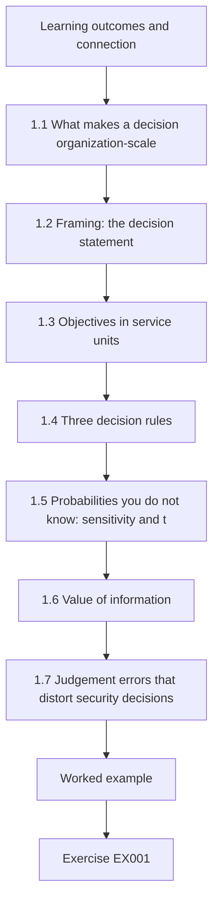

### Logical drawing

```mermaid
flowchart LR
  N0["Learning outcomes and connection"]
  N1["1.1 What makes a decision organization-scale"]
  N2["1.2 Framing: the decision statement"]
  N3["1.3 Objectives in service units"]
  N4["1.4 Three decision rules"]
  N5["1.5 Probabilities you do not know: sensitivity and t"]
  N6["1.6 Value of information"]
  N7["1.7 Judgement errors that distort security decisions"]
  N0 --> N1 --> N2 --> N3 --> N4 --> N5 --> N6 --> N7 --> Q["EX001"]
```

```text
[Learning outcomes and connection]
    |
    v
[1.1 What makes a decision organization-scale]
    |
    v
[1.2 Framing: the decision statement]
    |
    v
[1.3 Objectives in service units]
    |
    v
[1.4 Three decision rules]
    |
    v
[1.5 Probabilities you do not know: sensitivity and t]
    |
    v
[1.6 Value of information]
    |
    v
[1.7 Judgement errors that distort security decisions]
    |
    v
[Worked example] --> [Exercise EX001]
```
<!-- open-cyber-academy:lesson-figures:end ch-01 -->


### Learning outcomes and connection

After this chapter you should be able to:

1. Frame an organization-scale security decision: who decides, by when, among which options, against which objectives.
2. Express objectives in units of the essential service — hours of supply lost, patients diverted, households affected — rather than only in money or control counts.
3. Compare options with expected value, worst case and minimax regret, and explain when each rule is appropriate.
4. Test how sensitive a recommendation is to the probabilities you were least sure of, and state the threshold at which it changes.
5. Estimate the value of further information before buying it.
6. Recognize the judgement errors that most often distort security decisions in essential services.
7. Write a decision record that a successor, auditor or regulator could follow.

This chapter sets the decision habits every later chapter uses. Chapter 4 adds quantified risk and its distribution across people; Chapter 5 applies the same reasoning to architectures; Chapter 9 turns decision records into assurance.

### 1.1 What makes a decision "organization-scale"

A practitioner at earlier stages chooses settings, tools and procedures. A specialist leading security for an essential service chooses **portfolios under constraint**: which of several worthwhile programmes to fund this year, which risk to accept, which supplier to keep, when to disconnect a plant from a network. Such decisions share five features. They are **irreversible or expensive to reverse** — a three-year managed-service contract, a re-architected control network. Their outcomes are **uncertain and rare**, so experience alone gives poor feedback: a utility may go a decade without the event a control was bought for. They have **several objectives** that cannot be collapsed honestly into one number: continuity of supply, safety of staff and public, cost, legal compliance, privacy and reputation. They have **several stakeholders** with legitimate but different interests — the board, operators, the regulator, customers, neighbouring operators. And they are **made by someone with authority**, who must later explain them.

The specialist's job is rarely to make the decision alone. It is to **structure** it so the person with authority can decide well, and to make the structure inspectable. That distinction matters for accountability (Chapter 7) and for ethics (Chapter 4): an analyst who quietly chooses the weights has made the decision while appearing only to advise.

### 1.2 Framing: the decision statement

Most poor security decisions are well analysed answers to badly framed questions. A **decision statement** fixes six things before any analysis:

| Element | Question | Merrow Water example (synthetic) |
|---|---|---|
| Decision-maker | Who has authority to choose and to accept the residual risk? | Director of Operations, with board approval above £500k a year |
| Decision | What exactly is being chosen? | Which security programme to fund for the next financial year from a fixed envelope |
| Options | Which genuinely different alternatives are on the table, including "defer"? | A remote-access hardening; B manual-operations capability; C half of each; D defer |
| Objectives | What are we trying to protect or achieve, in which units? | Minimize expected and worst-case cost of loss of treated-water supply, including programme cost; keep the public safe; meet regulatory duties |
| Horizon and deadline | Over what period are outcomes judged, and when must we choose? | One budget year; decision at the March board |
| Constraints | What cannot be violated whatever the analysis says? | No option may reduce operators' ability to run plants manually; no unbudgeted headcount |

The **"defer" option** deserves explicit attention. It is always available, it is what happens when nobody decides, and in essential services it is often worse than it looks because its losses are concentrated in rare, severe scenarios. Writing it down forces the analysis to show its cost.

Good options are **genuinely different**, not one favoured option with two straw men. A useful test: could a reasonable, informed person prefer each one under some plausible view of the world? If not, the option set is a justification exercise.

### 1.3 Objectives in service units

The NIST Cybersecurity Framework 2.0 places "Govern" at the centre of security management and asks organizations to understand their mission, stakeholders and risk appetite before choosing controls ([NIST, CSF 2.0, 2024](https://doi.org/10.6028/NIST.CSWP.29)). For an essential service, the mission is delivered in **service units**: litres of compliant water, megawatt-hours delivered, patients treated within clinical time targets, containers moved, payments settled. An objective expressed in service units does three things a monetary objective cannot. It keeps the people who depend on the service visible; it lets operators — who think in service units — check the analysis; and it exposes cases where money and harm diverge, for example when a cheap outage falls on people who cannot cope with it (Chapter 4).

In practice you will use both: service units for consequence and money for cost. Keep them in separate columns until the decision-maker agrees an exchange rate, and record that rate as a judgement, not a fact. The UK National Cyber Security Centre's Cyber Assessment Framework makes a similar move by organizing its objectives around the essential function rather than around IT assets ([NCSC, Cyber Assessment Framework](https://www.ncsc.gov.uk/collection/caf)).

### 1.4 Three decision rules

Suppose you have a table of options by scenarios, with the total annual cost (programme cost plus loss) in each cell. Three decision rules read that table differently.

**Expected value (EV).** Weight each scenario's outcome by its probability and sum. Choose the option with the lowest expected cost. EV is the right rule when you face many similar, independent decisions and can absorb variation, because over many repetitions the average is what you pay. It is the default in insurance and portfolio thinking. Its weaknesses: it depends on probabilities that, for rare cyber-physical events, nobody knows well; and it treats a small chance of catastrophe as interchangeable with a certain small loss.

**Minimax (worst case).** Choose the option whose worst outcome is least bad. Minimax is appropriate when one outcome would be unacceptable regardless of its probability — loss of life, loss of the organization, loss of public trust in drinking water. Its weakness is that it ignores probabilities entirely and can buy expensive protection against a scenario that is almost impossible.

**Minimax regret.** For each scenario, find the best option; an option's **regret** in that scenario is how much worse it is than that best. Choose the option whose largest regret is smallest ([Savage, 1951](https://doi.org/10.1080/01621459.1951.10500768)). Regret captures how a decision will look afterwards — "we should have done X" — and tends to favour balanced options when no scenario dominates. Its weakness is that adding or removing an irrelevant option can change the answer.

None of these rules is "correct". A specialist reports what each rule recommends, explains why they differ, and helps the decision-maker choose a rule *before* seeing which option it favours. When all three agree, the decision is robust. When they disagree, the disagreement is the most useful thing you can show a board.

### 1.5 Probabilities you do not know: sensitivity and thresholds

Probabilities of rare security scenarios are judgements, not measurements. Three practices keep them honest. First, **elicit carefully**: ask for ranges, ask several people independently, and ask about base rates before the specific case ([O'Hagan et al., 2006](https://doi.org/10.1002/0470033312)). Second, **show several belief sets** — the analyst's, a pessimist's, the regulator's implied view — rather than one. Third, and most useful, **find the threshold**: the probability at which the recommendation changes. A board cannot easily say whether the probability of an OT remote-access compromise is 3% or 6% a year, but it can often say whether it is above or below a stated threshold, especially if you show it the evidence behind each view — for example, public advisories describing pre-positioning in infrastructure networks ([CISA, AA24-038A, 2024](https://www.cisa.gov/news-events/cybersecurity-advisories/aa24-038a)).

### 1.6 Value of information

Before commissioning an assessment, a penetration test or a consultancy study, ask what it could change. The **expected value of perfect information (EVPI)** is the difference between the expected cost of the best option now and the expected cost if you could learn which scenario will happen before choosing. It is an upper bound on what any study is worth for this decision: if EVPI is £50k, a £200k study cannot pay for itself through this decision alone. Real studies give imperfect information, so they are worth less than EVPI; if a study cannot plausibly move a probability across the threshold found in §1.5, it is worth little for the decision, however interesting it is. This is standard decision-analysis reasoning; the point for practice is to write down, before buying information, which result would change which choice.

### 1.7 Judgement errors that distort security decisions

Classic research on judgement under uncertainty describes heuristics — availability, representativeness, anchoring — that lead to systematic errors ([Tversky and Kahneman, 1974](https://doi.org/10.1126/science.185.4157.1124)). In essential-service security they appear in recognizable forms:

- **Availability after a headline.** A widely reported incident in another sector raises the perceived probability of that scenario and crowds out quieter, more likely ones.
- **Anchoring on last year's budget or on a vendor's first quote.**
- **Compliance substitution.** Treating "the regulator requires X" as if it answered "X is the best use of the next pound". Compliance is a constraint (§1.2), not an objective.
- **Control counting.** Preferring the option that closes most audit findings rather than the one that most reduces consequence.
- **Optimism about manual fallback.** Assuming operators can run a plant by hand because they once could, without a recent drill (Chapter 6).
- **Groupthink and deference.** The most senior person speaks first and the rest anchor on them.

Structural remedies work better than exhortation: independent estimates before discussion; a nominated sceptic; a **pre-mortem**, in which the group imagines the decision has failed and writes down why ([Klein, 2007](https://hbr.org/2007/09/performing-a-project-premortem)); and a written record of dissent.

### 1.8 The decision record

A **decision record** is a short document written at the time of the decision, containing: the decision statement; the options and why each was considered; the evidence used, with sources; the probability and weight judgements and who made them; what each decision rule recommended; the threshold analysis; the choice made, by whom, and on which rule; the residual risk accepted and its owner; dissent; and the **review trigger** — the observation that would reopen the decision (for example, "a credible advisory reporting compromise of remote-access appliances of the type we use"). The record protects good decision-makers when a rare event happens anyway, and it is how organizations learn: without it, hindsight rewrites what was known.

### 1.9 Worked example: Merrow Water's programme choice (synthetic)

Merrow Water's envelope allows one of four options for the coming year. The specialist and the operations team built the table below (thousands of pounds per year, including each option's own cost; lower is better). Option A hardens remote access (brokered vendor sessions, phishing-resistant MFA, removal of standing accounts). Option B builds manual-operations capability (procedures, local instrumentation, drills, staffing cover) so plants keep producing safe water when control systems are lost. Option C does half of each. Option D defers.

| Option | IT ransomware | OT remote-access compromise | Vendor/cloud outage | Quiet year |
|---|---:|---:|---:|---:|
| A remote-access hardening | 700 | 240 | 650 | 170 |
| B manual-operations capability | 450 | 900 | 330 | 230 |
| C half of each | 560 | 520 | 470 | 200 |
| D defer | 1,300 | 2,600 | 780 | 0 |

The reasoning behind some cells matters more than the numbers. B performs well whenever control systems are *lost* (ransomware, outage) because the plant keeps running by hand, but poorly when they are *misused* by an intruder, because manual capability does not stop malicious commands before they are noticed. A performs well against the intruder but not against loss. D is cheapest in a quiet year and catastrophic in the OT scenario, whose cost includes a boil-water notice affecting the whole Hollin supply zone.

The team recorded three belief sets for the scenario probabilities: the analyst's (15% / 3% / 10% / 72%), a pessimist's (25% / 10% / 15% / 50%) and an implied regulator's view with more weight on OT compromise (10% / 8% / 5% / 77%). Lab 1 computes the results.

### 1.10 Practical activity: one decision, three rules

Run the lab, then read the interpretation.

```python
# Lab 1 - one decision, three decision rules (offline, standard library only)
# Synthetic: Merrow Water's annual security investment choice. Figures are invented, in GBP thousands per year,
# and already include each option's own annual cost. Lower is better (cost + expected/realized loss).
OPTIONS = ["A remote-access hardening", "B manual-operations capability", "C half of each", "D defer"]
SCEN = ["IT ransomware", "OT remote-access compromise", "vendor/cloud outage", "quiet year"]
COST = {  # option -> loss in each scenario (k GBP)
    "A remote-access hardening":      [ 700,  240,  650, 170],
    "B manual-operations capability": [ 450,  900,  330, 230],
    "C half of each":                 [ 560,  520,  470, 200],
    "D defer":                        [1300, 2600,  780,   0],
}
BELIEFS = {
    "analyst":    [0.15, 0.03, 0.10, 0.72],
    "pessimist":  [0.25, 0.10, 0.15, 0.50],
    "regulator":  [0.10, 0.08, 0.05, 0.77],
}
def ev(o, p): return sum(c * q for c, q in zip(COST[o], p))
for name, p in BELIEFS.items():
    assert abs(sum(p) - 1) < 1e-9
    ranked = sorted(OPTIONS, key=lambda o: ev(o, p))
    print(f"{name:10s}", "  ".join(f"{o[0]}={ev(o, p):7.1f}" for o in OPTIONS), " best:", ranked[0][0])
best_in = [min(COST[o][s] for o in OPTIONS) for s in range(len(SCEN))]
regret = {o: max(COST[o][s] - best_in[s] for s in range(len(SCEN))) for o in OPTIONS}
worst = {o: max(COST[o]) for o in OPTIONS}
print("max regret:", "  ".join(f"{o[0]}={regret[o]}" for o in OPTIONS), " minimax-regret:", min(OPTIONS, key=regret.get)[0])
print("worst case:", "  ".join(f"{o[0]}={worst[o]}" for o in OPTIONS), " minimax:", min(OPTIONS, key=worst.get)[0])
# Robustness: sweep P(OT compromise) from 0 to 0.30, keeping the analyst's other ratios, and report the EV winner.
base = BELIEFS["analyst"]
prev = None
for k in range(0, 31):
    q = k / 100
    rest = [base[0], base[2], base[3]]; s = sum(rest)
    p = [rest[0] / s * (1 - q), q, rest[1] / s * (1 - q), rest[2] / s * (1 - q)]
    win = min(OPTIONS, key=lambda o: ev(o, p))[0]
    if win != prev:
        print(f"P(OT compromise)={q:.2f}: EV winner {win}")
        prev = win
```

Expected output:

```text
analyst    A=  299.6  B=  293.1  C=  290.6  D=  351.0  best: C
pessimist  A=  381.5  B=  367.0  C=  362.5  D=  702.0  best: C
regulator  A=  252.6  B=  310.6  C=  275.1  D=  377.0  best: A
max regret: A=320  B=660  C=280  D=2360  minimax-regret: C
worst case: A=700  B=900  C=560  D=2600  minimax: C
P(OT compromise)=0.00: EV winner B
P(OT compromise)=0.03: EV winner C
P(OT compromise)=0.07: EV winner A
```

**Interpretation.** Under the analyst's and pessimist's beliefs, C has the lowest expected cost, but only narrowly: 290.6 against 293.1 for B and 299.6 for A under the analyst's view. Differences of £3k–£9k on estimates this rough are not a basis for decision on their own. Under the regulator's beliefs A wins. The threshold sweep makes the structure visible: B wins only if the probability of OT compromise is below about 3%; C between about 3% and 7%; A above about 7%. Minimax and minimax regret both choose C, because C never does very badly. **C is therefore the robust recommendation**: it is best or near-best under every belief set and every rule. The decision record should say exactly that, and add the review trigger: evidence that pushes the probability of OT compromise above 7% (for example, credible reporting of exploitation of the remote-access products Merrow uses) moves the recommendation to A. Note also what the table cannot show: C's value assumes that "half of each" delivers more than half the benefit of each, which is a judgement the operations director must confirm.

### 1.11 Common errors and limits

- Presenting a single "risk score" per option, which hides whether the score came from frequency, severity or an arbitrary weighting.
- Omitting the defer option, or giving it zero cost.
- Choosing the decision rule after seeing which option it favours.
- Reporting expected values to the pound when the inputs are rough judgements; report differences that matter and thresholds instead.
- Treating precise-looking vendor or survey statistics as probabilities for your organization without asking how they were produced (Chapter 10).
- Letting the analyst's weights silently become the decision.
- Writing the decision record afterwards, when hindsight has already shaped it.

The main limit of formal decision analysis is that it is only as good as the option set and the consequence model. Its value is not that it produces the right answer automatically, but that it makes the reasons for an answer **inspectable** and **revisable** when new evidence arrives.

### Exercises — chapter 1

**EX001 — Frame a hospital decision.** *Objective:* write a decision statement for a real-feeling choice. *Inputs:* Merrow Health must decide whether to replace its unsupported pathology laboratory system this year or isolate it and replace it in two years. *Constraints:* use the six elements in §1.2; at least three genuinely different options including defer; objectives in service units. *Steps:* (1) write the statement; (2) apply the "reasonable person could prefer it" test to each option; (3) list two constraints that are not objectives. *Expected evidence:* one-page decision statement. *Rubric:* 3 = all six elements, options genuinely different, service-unit objectives (for example turnaround of urgent results), constraints distinguished from objectives; 2 = one element weak; 1 = options are straw men or objectives only in money; 0 = missing.

**EX002 — Change one cell.** *Objective:* see how decision rules respond to a revised consequence estimate. *Inputs:* Lab 1. *Constraints:* change only D's cost in the OT scenario from 2,600 to 1,200 (the engineers believe a boil-water notice could be confined to one zone). *Steps:* (1) rerun; (2) report the EV winner under each belief set, each option's maximum regret and the minimax-regret choice; (3) explain why D still does not win. *Expected evidence:* outputs and 150-word explanation. *Rubric:* 3 = correct numbers and an explanation linking D's regret to the ransomware scenario, not only the OT one; 2 = numbers right, explanation thin; 1 = not run; 0 = none.

**EX003 — Value of perfect information.** *Objective:* bound what further study is worth. *Inputs:* Lab 1 table and the analyst's beliefs. *Constraints:* compute by hand or with a short addition to the lab. *Steps:* (1) compute the expected cost of the best option now; (2) compute the expected cost if you knew the scenario before choosing; (3) report EVPI; (4) a consultant offers a £60k OT threat assessment — explain under what condition it could be worth buying for this decision. *Expected evidence:* calculation and paragraph. *Rubric:* 3 = EVPI correct and the purchase linked to whether the study could move the OT probability across the 3% or 7% thresholds; 2 = EVPI right, link weak; 1 = arithmetic errors; 0 = none.

**EX004 — Decision record with dissent.** *Objective:* produce an inspectable record. *Inputs:* the worked example and Lab 1 output. *Constraints:* one page; all elements of §1.8. *Steps:* (1) write the record for choosing C; (2) include a realistic dissent from the operations manager who prefers B; (3) state the review trigger and the residual-risk owner. *Expected evidence:* decision record. *Rubric:* 3 = complete, honest about narrow EV margins, dissent stated fairly, measurable trigger; 2 = one element missing; 1 = reads as advocacy; 0 = none.

**EX005 — Bias audit.** *Objective:* recognize judgement errors in a meeting. *Inputs:* synthetic minutes: "The chair opened by noting the recent pipeline ransomware case and said OT security is now the top priority. The vendor's proposal of £400k was taken as the starting point. The operations manager said manual running is 'no problem — we did it in 2009'. The internal audit lead noted that option A closes nine of eleven open findings. No other views were recorded." *Constraints:* name at most five errors from §1.7 and propose one structural remedy for each. *Steps:* identify, explain, remedy. *Expected evidence:* table. *Rubric:* 3 = availability, anchoring, manual-fallback optimism, control counting and deference/groupthink identified with structural remedies (independent estimates, pre-mortem, drill evidence, consequence-based scoring, recorded dissent); 2 = three or four; 1 = generic advice; 0 = none.

### Chapter synthesis

Organization-scale security decisions are irreversible, rare-event, multi-objective and multi-stakeholder, and they belong to someone with authority. The specialist's contribution is structure: a decision statement with genuinely different options including defer, objectives in service units, several decision rules reported side by side, belief sets rather than a single probability, thresholds at which the recommendation changes, the value of further information, structural defences against biased judgement and a decision record written at the time. A robust recommendation is one that survives changes of rule and of belief; when it does not, show the threshold and let the accountable person decide knowingly.

<!-- open-cyber-academy:chapter-navigation:start ch-01 -->
### Continue studying — chapter 01 of 12

[← Course home](../../README.md) · [Course chapter index](../SUBJECTS.md) · [Chapter 02 →](#ch-02)

Continue to the next authored lesson.
<!-- open-cyber-academy:chapter-navigation:end -->

<a id="ch-02"></a>

## Chapter 2 — Critical infrastructure and sector security: current practice

<!-- open-cyber-academy:lesson-figures:start ch-02 -->
### Lesson map

Lesson 02 published. Map, example, EX007.

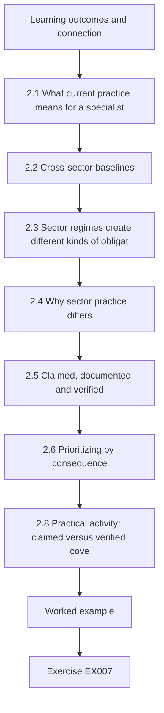

### Logical drawing

```mermaid
flowchart LR
  N0["Learning outcomes and connection"]
  N1["2.1 What current practice means for a specialist"]
  N2["2.2 Cross-sector baselines"]
  N3["2.3 Sector regimes create different kinds of obligat"]
  N4["2.4 Why sector practice differs"]
  N5["2.5 Claimed, documented and verified"]
  N6["2.6 Prioritizing by consequence"]
  N7["2.8 Practical activity: claimed versus verified cove"]
  N0 --> N1 --> N2 --> N3 --> N4 --> N5 --> N6 --> N7 --> Q["EX007"]
```

```text
[Learning outcomes and connection]
    |
    v
[2.1 What current practice means for a specialist]
    |
    v
[2.2 Cross-sector baselines]
    |
    v
[2.3 Sector regimes create different kinds of obligat]
    |
    v
[2.4 Why sector practice differs]
    |
    v
[2.5 Claimed, documented and verified]
    |
    v
[2.6 Prioritizing by consequence]
    |
    v
[2.8 Practical activity: claimed versus verified cove]
    |
    v
[Worked example] --> [Exercise EX007]
```
<!-- open-cyber-academy:lesson-figures:end ch-02 -->


### Learning outcomes and connection

After this chapter you should be able to:

1. Describe the main cross-sector and sector-specific baselines and regimes an essential-service operator is likely to meet, and what kind of obligation each creates.
2. Explain why sectors that share technology still need different practice: consequence, physics, regulation and workforce differ.
3. Distinguish claimed, documented and verified implementation of a practice, and measure the gap.
4. Prioritize gaps by consequence for the essential service rather than by count.
5. Critique a common practice and propose a better-evidenced alternative.

Chapter 1 gave you a way to choose among options. This chapter supplies the options a competent specialist is expected to know and the evidence standard for saying they are in place. Chapter 3 then asks what counts as evidence when something goes wrong.

### 2.1 What "current practice" means for a specialist

"Current practice" is not a single list. It is the overlap of three things: what **regulators and standards require** in your jurisdiction and sector; what **authoritative guidance** recommends based on observed attacks; and what **comparable operators actually do** and can show. A specialist must know all three, and must be able to say which statements in a security programme come from which source, because they carry different weight. A legal obligation is a constraint; a standard's requirement may be contractual or certifiable; guidance is advice to be weighed against your own consequence analysis.

Practice also ages. Advisories about pre-positioning in infrastructure networks by state-sponsored actors using legitimate administration tools ([CISA, AA24-038A, 2024](https://www.cisa.gov/news-events/cybersecurity-advisories/aa24-038a)) changed what "adequate logging" and "adequate credential hygiene" mean for operators who had treated those as IT housekeeping. A baseline that was current three years ago may now be a floor.

### 2.2 Cross-sector baselines

Four families of documents recur across sectors:

- **Outcome frameworks.** NIST CSF 2.0 organizes outcomes under Govern, Identify, Protect, Detect, Respond and Recover ([NIST, 2024](https://doi.org/10.6028/NIST.CSWP.29)). The UK NCSC Cyber Assessment Framework sets four objectives — managing security risk, protecting against cyber attack, detecting cyber security events and minimizing the impact of incidents — with indicators of good practice for each principle, and is designed around essential functions ([NCSC, CAF](https://www.ncsc.gov.uk/collection/caf)). Outcome frameworks say *what* must be achieved, not *how*; they are good for structuring a programme and poor as test scripts.
- **Prioritized baselines.** CISA's Cross-Sector Cybersecurity Performance Goals list a small set of practices with high risk-reduction value for organizations of any size ([CISA, CPGs](https://www.cisa.gov/cross-sector-cybersecurity-performance-goals)); the U.S. Department of Health and Human Services published healthcare-specific performance goals in the same spirit ([HHS, HPH CPGs, 2024](https://hphcyber.hhs.gov/performance-goals.html)). They are useful precisely because they are short; they are not a complete programme.
- **Control catalogues.** NIST SP 800-53 Rev. 5 is a comprehensive catalogue of security and privacy controls ([NIST](https://csrc.nist.gov/pubs/sp/800/53/r5/upd1/final)); NIST SP 800-82 Rev. 3 adapts guidance to operational technology, including overlays and the particular constraints of control systems ([NIST, 2023](https://doi.org/10.6028/NIST.SP.800-82r3)).
- **Industrial standards.** The ISA/IEC 62443 series addresses security of industrial automation and control systems across asset owners, integrators and product suppliers, including zones and conduits, security levels and secure product development ([ISA overview](https://www.isa.org/standards-and-publications/isa-standards/isa-iec-62443-series-of-standards)). Its risk-assessment part for system design, IEC 62443-3-2, is the usual starting point for an OT architecture review ([IEC catalogue page](https://webstore.iec.ch/en/publication/30727)).

### 2.3 Sector regimes create different kinds of obligation

At organization scale, the question is not "which framework is best" but "which obligations apply to us, and what evidence will each regulator expect". Examples, all to be re-verified for your jurisdiction and date:

| Regime | Scope (summary) | Kind of obligation | Typical evidence expected |
|---|---|---|---|
| [NIS2 Directive (EU) 2022/2555](https://eur-lex.europa.eu/eli/dir/2022/2555/oj/) | Essential and important entities in listed sectors, transposed into national law | Risk-management measures and incident reporting in stages (early warning, notification, final report) | Board-approved measures, incident reports within national deadlines |
| [CER Directive (EU) 2022/2557](https://eur-lex.europa.eu/eli/dir/2022/2557/oj) | Critical entities' resilience across hazards | Risk assessment and resilience measures, not cyber-only | Resilience plans, cooperation with authorities |
| [DORA, Regulation (EU) 2022/2554](https://eur-lex.europa.eu/eli/reg/2022/2554/oj) | Financial entities and their critical ICT third-party providers | Directly applicable ICT risk, testing, incident and third-party rules | Registers of ICT third-party arrangements, test results |
| [NERC CIP standards](https://www.nerc.com/pa/Stand/Pages/CIPStandards.aspx) | Bulk electric system in North America | Mandatory, auditable requirements by asset impact category | Audit evidence per requirement, often highly prescriptive |
| [America's Water Infrastructure Act 2018, s.2013](https://www.epa.gov/waterresilience/americas-water-infrastructure-act-2018-risk-assessments-and-emergency-response-plans) | U.S. community water systems above a size threshold | Risk and resilience assessment and emergency response plan, with certification | Certified assessments and plans on a cycle |

Two lessons follow. First, an operator spanning sectors — a multi-utility, a port with its own power network — may sit under several regimes with different reporting clocks and evidence styles; harmonizing them into one internal control set with mappings is a core specialist task. Second, **compliance is a floor and a constraint**, as Chapter 1 argued: two operators fully compliant with the same regime can have very different resilience.

### 2.4 Why sector practice differs

Shared technology tempts people to copy practice between sectors. Four differences make that unsafe:

1. **Consequence and time.** A hospital's clinical systems fail into minutes-to-hours harm; a water system with storage may have hours to days; a payment system's harm accumulates in settlement windows; a port's in cargo dwell time and supply chains. The time to harm sets how much manual fallback and how fast a response must be.
2. **Physics and safety.** In OT, a security action can itself cause harm: an aggressive scan can crash a controller; isolating a network can blind operators. NIST SP 800-82 stresses that availability and safety constraints shape what security controls are acceptable ([NIST, 2023](https://doi.org/10.6028/NIST.SP.800-82r3)).
3. **Regulation and evidence culture.** Electricity in North America works to auditable, prescriptive requirements; many water utilities work to periodic certified assessments; healthcare works under privacy law and clinical-safety governance as well as security rules.
4. **Workforce and suppliers.** Small utilities may have no security staff; hospitals depend on medical-device manufacturers for patching; ports depend on terminal-operating-system vendors and shipping lines. Who can actually implement a practice determines whether it is real.

### 2.5 Claimed, documented and verified

Most baseline assessments are self-assessments. They are useful, but a specialist must know how much of a "yes" is **verified**. Use three evidence grades:

- **Verified (V):** the practice was observed working by test, inspection or reconciliation — a restore was performed and timed; the identity provider's configuration was exported and checked; broker logs were reconciled against firewall sessions.
- **Documented (D):** a policy, design or procedure exists and says the practice is in place, but nobody tested that reality matches.
- **Statement (S):** someone said so.

Assessment methods in the NIST catalogue distinguish examining, interviewing and testing for the same reason ([NIST SP 800-53 Rev. 5](https://csrc.nist.gov/pubs/sp/800/53/r5/upd1/final)). The gap between claimed and verified coverage is often the most important number in a baseline report, and the most often omitted. It is also where incidents live: offline backups that "exist" but have never been restored; vendor access that is "brokered" except for the one legacy modem.

### 2.6 Prioritizing by consequence

A practice's importance depends on how much it limits loss of the essential service. Weight practices by consequence — not by how many framework references they map to — and prioritize gaps where the weight is high and the verified score is low. The weights are judgements; record who set them (Chapter 1). For Merrow Bay, the forum agreed that MFA on remote access, IT/OT segmentation, tested offline backups and brokered vendor access carry the highest weight, because each directly limits a pathway to loss of supply seen in public incidents — remote-access compromise of a water treatment system was the subject of a 2021 joint advisory ([CISA, AA21-042A](https://www.cisa.gov/news-events/cybersecurity-advisories/aa21-042a)), even though the account of that specific event was later disputed ([WUSF, 2023](https://www.wusf.org/local-state/2023-04-13/official-hack-oldsmar-city-water-treatment-plant-2021)); the remote-access weakness the advisory described remains a valid design concern either way.

### 2.7 Worked example: four operators' self-assessments (synthetic)

The Merrow Bay Resilience Forum asked four operators to self-assess eight practices, scoring 0 (absent), 1 (partial) or 2 (in place), and to grade the evidence V, D or S. The specialist's task is to turn the answers into a regional picture without insulting anyone or believing everything. Rather than "rejecting" statements, Lab 2 gives them zero **provisional** credit until tested and half credit for documents. Those credits are a policy choice; EX007 tests their effect.

Two conventions shape the results. The weights for each practice were agreed by the forum, so the regional picture reflects their judgement about which practices limit loss of supply. And the operators are named in this example only because it is synthetic; a real forum report would normally show each operator its own row and give the others only the regional summary. The specialist should send each operator its result privately before the forum meets, so that nobody learns of an uncomfortable gap in front of peers.

### 2.8 Practical activity: claimed versus verified coverage

```python
# Lab 2 - claimed versus verified baseline coverage, weighted by consequence (offline, standard library only)
# Synthetic: four Merrow Bay operators self-assess eight baseline practices (0 = absent, 1 = partial, 2 = in place)
# and say what evidence backs each answer: V = verified by test or inspection, D = document only, S = statement only.
PRACTICES = {  # practice -> consequence weight (how much it limits loss of the essential service; invented)
    "MFA on remote access": 3, "asset inventory incl. OT": 2, "IT/OT segmentation": 3,
    "offline backups restored in test": 3, "central logging retained 90d": 1,
    "incident plan exercised in 12 months": 2, "vendor access brokered and recorded": 3,
    "default credentials removed": 2,
}
ANSWERS = {  # operator -> list of (score, evidence) in PRACTICES order
    "Merrow Water":     [(2,"V"),(1,"D"),(2,"D"),(2,"S"),(1,"V"),(2,"V"),(1,"S"),(2,"S")],
    "Merrow Health":    [(2,"V"),(1,"D"),(1,"D"),(2,"V"),(2,"V"),(2,"D"),(1,"D"),(1,"S")],
    "Merrow Energy":    [(2,"V"),(2,"V"),(2,"V"),(1,"D"),(2,"V"),(2,"V"),(2,"D"),(2,"D")],
    "Port of Merrow":   [(2,"S"),(0,"S"),(1,"S"),(2,"S"),(1,"D"),(1,"S"),(0,"S"),(2,"S")],
}
CREDIT = {"V": 1.0, "D": 0.5, "S": 0.0}  # how much of a claimed score we accept without further testing
W = list(PRACTICES.values()); maxw = 2 * sum(W)
print(f"{'operator':16s} claimed  verified  gap(weighted points)")
gaps = []
for op, ans in ANSWERS.items():
    claimed = sum(w * s for w, (s, e) in zip(W, ans))
    verified = sum(w * s * CREDIT[e] for w, (s, e) in zip(W, ans))
    print(f"{op:16s} {claimed/maxw:6.0%}   {verified/maxw:6.0%}   {maxw-verified:5.1f}")
    for (name, w), (s, e) in zip(PRACTICES.items(), ans):
        unverified = w * (2 - s * CREDIT[e])
        if w == 3 and unverified >= 3:
            gaps.append((unverified, op, name, s, e))
print("\nHigh-consequence practices with >= 3 unverified weighted points:")
for u, op, name, s, e in sorted(gaps, reverse=True):
    print(f"  {u:4.1f}  {op:16s} {name}  (claimed {s}, evidence {e})")
```

Expected output:

```text
operator         claimed  verified  gap(weighted points)
Merrow Water        84%      39%    23.0
Merrow Health       74%      53%    18.0
Merrow Energy       92%      75%     9.5
Port of Merrow      58%       1%    37.5

High-consequence practices with >= 3 unverified weighted points:
   6.0  Port of Merrow   vendor access brokered and recorded  (claimed 0, evidence S)
   6.0  Port of Merrow   offline backups restored in test  (claimed 2, evidence S)
   6.0  Port of Merrow   MFA on remote access  (claimed 2, evidence S)
   6.0  Port of Merrow   IT/OT segmentation  (claimed 1, evidence S)
   6.0  Merrow Water     vendor access brokered and recorded  (claimed 1, evidence S)
   6.0  Merrow Water     offline backups restored in test  (claimed 2, evidence S)
   4.5  Merrow Health    vendor access brokered and recorded  (claimed 1, evidence D)
   4.5  Merrow Health    IT/OT segmentation  (claimed 1, evidence D)
   4.5  Merrow Energy    offline backups restored in test  (claimed 1, evidence D)
   3.0  Merrow Water     IT/OT segmentation  (claimed 2, evidence D)
   3.0  Merrow Energy    vendor access brokered and recorded  (claimed 2, evidence D)
```

**Interpretation.** Claimed coverage ranges from 58% to 92%; verified coverage from 1% to 75%. Merrow Water's own position — 84% claimed, 39% verified — is uncomfortable for its specialist: the two highest-weight gaps are statements that offline backups are restorable and that vendor access is brokered. Port of Merrow's 1% does not mean the port has no security; it means nothing has been shown. The prioritized list is a **verification plan** before it is a remediation plan: every one of the eleven items rests on a statement or a document, so the first action for each is to test the claim — cheap compared with buying controls, and sometimes enough to close the gap. Merrow Energy, with mostly verified evidence, is the region's best source of practical method — an asset for the forum, not just a score.

### 2.9 Critiquing a common practice

Specialists are expected to challenge practices that persist by habit. Take the annual "OT penetration test" written into many contracts. It often produces a list of findings on a sample of systems in a short window, using techniques that must be throttled to avoid process disruption, and it is commonly scoped to avoid the most consequential assets. Alternatives with better evidence value include: a consequence-driven review that starts from the worst credible physical outcome and works back to the digital paths that could cause it ([Idaho National Laboratory, CCE](https://inl.gov/national-security/cce/)); continuous reconciliation of remote-access and change records; and testing on a representative rig rather than live plant (Chapter 6). The critique is not "never test"; it is "choose the evidence method that answers the question the board is actually asking".

### 2.10 Common errors and limits

- Treating a framework mapping as evidence of implementation.
- Reporting claimed coverage alone, or averaging claimed and verified into one number.
- Copying another sector's practice without checking time-to-harm and safety constraints.
- Treating the shortest baseline as the whole programme, or the longest catalogue as a to-do list.
- Assuming a regulator in one sector will accept evidence designed for another.
- Weighting practices by how many standards mention them rather than by consequence.

The limit of any baseline is that it describes defences that are common because attacks were common. It says little about rare, targeted or novel paths, which is why Chapters 4 and 5 add consequence-driven analysis.

### Exercises — chapter 2

**EX006 — Map one practice across frameworks.** *Objective:* connect a practice to obligations and guidance without confusing them. *Inputs:* "vendor access brokered and recorded" for Merrow Water. *Constraints:* use only sources cited in §2.2–2.3; do not quote paywalled standard text. *Steps:* (1) identify the CSF 2.0 function(s) and the CAF objective it supports; (2) state whether it appears as a CISA cross-sector goal; (3) explain how IEC 62443's zones-and-conduits idea frames it; (4) state, without legal advice, whether it is a legal obligation for a water utility in your jurisdiction and how you would verify that. *Expected evidence:* a short mapping table and paragraph. *Rubric:* 3 = mappings correct at the level of function and objective, obligations kept separate from guidance, a verification route to legal advice stated; 2 = one mapping wrong; 1 = treats guidance as law; 0 = none.

**EX007 — Change the evidence policy.** *Objective:* test how a scoring policy changes the picture. *Inputs:* Lab 2. *Constraints:* change the credit for a statement from 0.0 to 0.25 and change nothing else. *Steps:* (1) rerun and report verified coverage for each operator; (2) say which conclusions in §2.8 survive; (3) argue for one credit policy for the forum's report. *Expected evidence:* outputs and 200-word argument. *Rubric:* 3 = numbers correct, recognition that rank order and the priority of testing statements survive, a policy argued from the use of the report; 2 = numbers right, argument weak; 1 = not run; 0 = none.

**EX008 — Verification plan.** *Objective:* turn the top gaps into tests. *Inputs:* the three highest-weight Merrow Water items in Lab 2's list. *Constraints:* tests must be safe for operating plant; name evidence that would count as V. *Steps:* for each item give method (test, inspection, reconciliation), owner, safe conditions, pass criterion and expected cost in staff-days. *Expected evidence:* table. *Rubric:* 3 = methods genuinely test reality (for example a timed restore of a named system to an isolated host; reconciliation of broker logs against firewall sessions over 30 days), safe conditions explicit, pass criteria measurable; 2 = one method only documentary; 1 = "review policy"; 0 = none.

**EX009 — Multi-regime operator.** *Objective:* plan evidence for overlapping regimes. *Inputs:* a synthetic multi-utility in the EU that supplies water and operates a small electricity distribution network, and has a payments subsidiary. *Constraints:* identify regimes from §2.3 that may apply, without deciding legal scope. *Steps:* (1) list candidate regimes and why each might apply; (2) design one internal control set with mappings; (3) identify the incident-reporting clocks that must be reconciled; (4) state what you would ask counsel. *Expected evidence:* one-page plan. *Rubric:* 3 = candidate regimes plausible, one control set with mappings, reporting clocks identified as a design problem, legal questions specific; 2 = mappings vague; 1 = presents legal conclusions as fact; 0 = none.

**EX010 — Critique a practice.** *Objective:* argue for a better evidence method. *Inputs:* Merrow Health's contract requires an "annual external penetration test of the clinical network". *Constraints:* 300 words; respect patient safety. *Steps:* (1) state the question the board wants answered; (2) say what the annual test does and does not answer; (3) propose an alternative evidence portfolio; (4) state its limits. *Expected evidence:* memo. *Rubric:* 3 = question explicit, limits of point-in-time testing identified (sample, window, throttling, excluded devices), alternatives matched to the question, honest limits; 2 = critique without alternative; 1 = rejects testing outright; 0 = none.

### Chapter synthesis

Current practice is the overlap of obligation, guidance and demonstrated peer practice, and each carries different weight. Know the outcome frameworks, the prioritized baselines, the control catalogues and the industrial standards, and know which regimes oblige your organization and what evidence each expects. Do not copy practice across sectors without checking time-to-harm, physics, regulation and workforce. Grade evidence as verified, documented or statement, report the gap honestly, weight practices by consequence, and turn the largest gaps into verification before remediation. Challenge habitual practices by asking which question their evidence answers.

<!-- open-cyber-academy:chapter-navigation:start ch-02 -->
### Continue studying — chapter 02 of 12

[← Chapter 01](#ch-01) · [Course chapter index](../SUBJECTS.md) · [Chapter 03 →](#ch-03)

Continue to the next authored lesson.
<!-- open-cyber-academy:chapter-navigation:end -->

<a id="ch-03"></a>

## Chapter 3 — Critical infrastructure and sector security: specialist evidence

<!-- open-cyber-academy:lesson-figures:start ch-03 -->
### Lesson map

Lesson 03 published. Map, example, EX011.

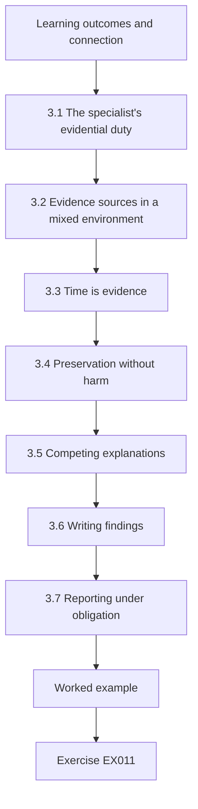

### Logical drawing

```mermaid
flowchart LR
  N0["Learning outcomes and connection"]
  N1["3.1 The specialist's evidential duty"]
  N2["3.2 Evidence sources in a mixed environment"]
  N3["3.3 Time is evidence"]
  N4["3.4 Preservation without harm"]
  N5["3.5 Competing explanations"]
  N6["3.6 Writing findings"]
  N7["3.7 Reporting under obligation"]
  N0 --> N1 --> N2 --> N3 --> N4 --> N5 --> N6 --> N7 --> Q["EX011"]
```

```text
[Learning outcomes and connection]
    |
    v
[3.1 The specialist's evidential duty]
    |
    v
[3.2 Evidence sources in a mixed environment]
    |
    v
[3.3 Time is evidence]
    |
    v
[3.4 Preservation without harm]
    |
    v
[3.5 Competing explanations]
    |
    v
[3.6 Writing findings]
    |
    v
[3.7 Reporting under obligation]
    |
    v
[Worked example] --> [Exercise EX011]
```
<!-- open-cyber-academy:lesson-figures:end ch-03 -->


### Learning outcomes and connection

After this chapter you should be able to:

1. Identify the evidence sources available in a mixed IT/OT environment and what each can and cannot show.
2. Reconstruct a timeline from sources whose clocks disagree, using anchor events, and state the remaining uncertainty.
3. Plan evidence preservation that does not endanger the physical process.
4. Generate competing explanations and identify the evidence that would discriminate between them.
5. Write findings that separate observation, inference and judgement, at a level of confidence the evidence supports.
6. Meet reporting obligations without overstating what is known.

Chapter 2 graded evidence that controls are in place. This chapter deals with evidence about **what happened** — the material a specialist brings to an incident review, a regulator, an insurer or a court. Chapter 6 applies the same discipline to planned tests.

### 3.1 The specialist's evidential duty

When something unexplained happens at an essential service, many people will form a story quickly: the vendor, the operators, the press, the regulator. The specialist's duty is to establish what the evidence supports, at what confidence, and what remains unknown — and to keep those apart under pressure. NIST's incident response recommendations frame response as part of overall risk management, with preparation, detection, analysis and improvement linked to governance ([NIST SP 800-61 Rev. 3, 2025](https://csrc.nist.gov/pubs/sp/800/61/r3/final)). For OT, NIST SP 800-82 Rev. 3 adds that response must protect safety and the process first ([NIST, 2023](https://doi.org/10.6028/NIST.SP.800-82r3)).

The water-sector case from Chapter 2 shows why this matters. In February 2021 an advisory described a compromise of a U.S. water treatment facility's control system through remote-access software ([CISA, AA21-042A](https://www.cisa.gov/news-events/cybersecurity-advisories/aa21-042a)). In 2023 the city's former manager was reported as saying the event was likely employee error rather than an external intrusion ([WUSF, 2023](https://www.wusf.org/local-state/2023-04-13/official-hack-oldsmar-city-water-treatment-plant-2021)). Whatever the truth, the episode shows how an early public account can harden before the evidence is complete, and how much later analysis depends on what was preserved at the time.

### 3.2 Evidence sources in a mixed environment

| Source | What it can show | Typical weaknesses |
|---|---|---|
| Firewall and VPN logs | Sessions, accounts, addresses, times at the boundary | Retention short; NAT hides hosts; no content |
| Identity provider and jump-host logs | Who authenticated, from where, which sessions | Shared or service accounts defeat attribution |
| Windows/Linux host logs on HMIs and engineering workstations | Logons, processes, file changes | Often disabled on OT hosts; small local buffers overwrite |
| SCADA historian | Process values and operator commands with source tags | Time from historian server clock; compression may drop short events; "source" can be a station, not a person |
| Controller (PLC) state and project files | Current logic and configuration; sometimes change counters | Reading may require vendor tools; online interaction carries process risk |
| Network captures in the control zone | Exactly which protocol commands were sent | Rarely collected continuously; large |
| Operator logbooks and shift handovers | Human observations and decisions | Minute-level or worse; written after the fact; wall clocks unsynchronized |
| Interviews | Intent, context, actions not logged | Memory reconstructs; incentives shape accounts |
| Vendor and supplier records | Remote sessions, maintenance, updates | Held by a third party; access needs contract terms |

A specialist knows these sources **before** an incident and fixes the weaknesses that matter most: synchronized time, longer retention for boundary and identity logs, named accounts, and contractual access to supplier records. NIST's control catalogue includes audit-record content, retention and time-stamp requirements for precisely this reason ([NIST SP 800-53 Rev. 5](https://csrc.nist.gov/pubs/sp/800/53/r5/upd1/final)).

### 3.3 Time is evidence

The order of events usually decides the explanation: did the remote session begin before or after the setpoint changed? Each source records time by its own clock, and OT clocks are frequently unsynchronized, drifted or set by hand. Three practices make timelines defensible:

1. **Choose a reference clock** whose synchronization you can verify (for example a firewall synchronized to a known time source and checked), and express all events in it.
2. **Estimate each source's offset from anchor events** — a single real-world moment recorded by two sources, such as both ends of the same network session, or a synchronization query passing a firewall. Two independent anchors per source are better than one; disagreement between them reveals drift.
3. **State the residual uncertainty** for each source — the anchor's own precision, resolution (a handwritten log may have only minutes), and drift over the interval — and check whether any conclusion depends on an ordering closer than that uncertainty.

### 3.4 Preservation without harm

Evidence preservation in OT must not create the harm it investigates. Principles:

- **Safety and process first.** The operations lead decides whether a system can be touched. Preservation steps are planned with them, not imposed.
- **Collect from the least intrusive source first.** Boundary logs, identity logs, historian exports and backups can usually be collected without touching the control network. Controller state should be read with the vendor's supported tools under change control, or not at all until the process is safe.
- **Preserve volatile evidence when it is safe.** Memory and live connection state on Windows-based HMIs and jump hosts disappear on reboot; capture them if the host can be spared.
- **Record chain of custody.** Who collected what, when, how, with which hashes — the same discipline as any forensic work. A cryptographic hash such as SHA-256 ([FIPS 180-4](https://csrc.nist.gov/pubs/fips/180-4/upd1/final)) shows later that an exported file was not altered.
- **Ask suppliers early.** Vendor session records and remote-support logs are often overwritten on the supplier's own schedule.

### 3.5 Competing explanations

A setpoint change with a remote session nearby invites the story "an attacker did it". A specialist lists every explanation that could produce the same evidence and asks what would distinguish them — the method of multiple working hypotheses ([Chamberlin, 1965 reprint](https://doi.org/10.1126/science.148.3671.754)). For an unexplained dosing change, candidates include an external intruder using a stolen credential, a legitimate vendor engineer making an unrecorded change, an operator mistake on a local HMI, an automated script or recipe, a historian tagging error, and an instrument fault that the operator corrected manually. Each predicts different traces: an intruder's change should come from the remote station after the remote logon; a vendor's planned work should match a ticket and a pattern seen on other sites; an operator error should come from a local station; a recipe should repeat on schedule; a tagging error should disagree with the controller's own record.

### 3.6 Writing findings

A finding has four parts: the **observation** with its source; the **inference** with its assumptions; the **confidence** in words that map to explicit ranges if your organization uses them; and the **consequence** for decisions. For example: "The historian records a dosing setpoint change from 1.8 to 2.6 mg/L attributed to station HMI-JH2 at 02:23:03 (firewall time, ±10 s). Station HMI-JH2 is the HMI client on jump host JH-2. The only interactive session on JH-2 at that time was the vendor-svc account, which connected through the VPN from 02:11:40. We assess with moderate confidence that the change was made within the vendor-svc session; we cannot yet say who used that account. The account is shared by four Corvane engineers." This is far more useful to a decision-maker than "the vendor account was compromised".

### 3.7 Reporting under obligation

Many regimes now require early reporting of significant incidents in stages. NIS2, for example, provides for an early warning, a fuller notification and a final report on fixed timescales ([Directive (EU) 2022/2555](https://eur-lex.europa.eu/eli/dir/2022/2555/oj/)); NERC CIP and other sector rules have their own clocks. Early reports must be made before the facts are known. The specialist's contribution is to make them **accurate about uncertainty**: say what has been observed, what is being investigated, and what is not yet known, and avoid attribution that later evidence may reverse. Track every external statement so later reports can correct earlier ones explicitly.

### 3.8 Worked example: a night at Hollin (synthetic)

At Hollin treatment works, the chlorine dosing setpoint briefly rose from 1.8 to 2.6 mg/L and returned within a minute. The handwritten operator log says the operator noticed an alarm at "02:20" and restored the setpoint. The specialist gathered firewall, jump-host and historian records. Read naively, the historian shows the change at 02:06, *before* the vendor-svc VPN session began at 02:11 — which would clear the remote session. But the historian server's clock is known to be unsynchronized. Two anchors exist: a TCP session start seen by both the firewall and the jump host, and the historian's own synchronization query passing the firewall.

### 3.9 Practical activity: timeline across disagreeing clocks

```python
# Lab 3 - reconstructing a timeline from sources whose clocks disagree (offline, standard library only)
# Synthetic: Merrow Water, Hollin treatment works, night of an unexplained chlorine dosing setpoint change.
# Each source records time in its own clock. Anchor events were seen by two sources at the same real moment.
from datetime import datetime, timedelta
T = lambda s: datetime.strptime(s, "%H:%M:%S")
EVENTS = [  # (source, local clock time, description)
    ("firewall",  "02:11:40", "VPN session opened for account vendor-svc"),
    ("firewall",  "02:13:05", "RDP from VPN pool to jump host JH-2 allowed"),
    ("jumphost",  "02:20:31", "interactive logon vendor-svc on JH-2"),
    ("jumphost",  "02:22:58", "HMI client launched on JH-2"),
    ("historian", "02:06:12", "dosing setpoint changed 1.8 -> 2.6 mg/L, source HMI-JH2"),
    ("historian", "02:06:50", "dosing setpoint restored 2.6 -> 1.8 mg/L, source HMI-OPS1"),
    ("ops-log",   "02:20",    "operator notices dosing alarm, restores setpoint (handwritten, minute only)"),
    ("firewall",  "02:31:10", "VPN session closed for vendor-svc"),
]
ANCHORS = [  # the same real moment seen by two sources: (source_a, time_a, source_b, time_b)
    ("firewall", "02:13:07", "jumphost", "02:20:33"),   # TCP session start seen at both ends
    ("firewall", "02:14:30", "historian", "01:57:39"),  # historian's NTP query passing the firewall
]
offset = {"firewall": timedelta(0)}  # firewall is the reference clock (NTP-synchronized, checked)
for a, ta, b, tb in ANCHORS:
    offset[b] = (T(ta) - T(tb)) + offset[a]
offset["ops-log"] = timedelta(0)  # a handwritten log has no known offset, only minute resolution
def show(title, rows):
    print(title)
    for t, src, d in rows: print(f"  {t.strftime('%H:%M:%S')}  {src:9s} {d}")
naive = sorted((T(t) if len(t) > 5 else T(t + ':00'), s, d) for s, t, d in EVENTS)
show("Naive order (raw clocks):", naive)
fixed = sorted(((T(t) if len(t) > 5 else T(t + ':00')) + offset[s], s, d) for s, t, d in EVENTS)
show("Corrected to firewall time:", fixed)
print("offsets:", {k: int(v.total_seconds()) for k, v in offset.items()}, "seconds")
```

Expected output:

```text
Naive order (raw clocks):
  02:06:12  historian dosing setpoint changed 1.8 -> 2.6 mg/L, source HMI-JH2
  02:06:50  historian dosing setpoint restored 2.6 -> 1.8 mg/L, source HMI-OPS1
  02:11:40  firewall  VPN session opened for account vendor-svc
  02:13:05  firewall  RDP from VPN pool to jump host JH-2 allowed
  02:20:00  ops-log   operator notices dosing alarm, restores setpoint (handwritten, minute only)
  02:20:31  jumphost  interactive logon vendor-svc on JH-2
  02:22:58  jumphost  HMI client launched on JH-2
  02:31:10  firewall  VPN session closed for vendor-svc
Corrected to firewall time:
  02:11:40  firewall  VPN session opened for account vendor-svc
  02:13:05  firewall  RDP from VPN pool to jump host JH-2 allowed
  02:13:05  jumphost  interactive logon vendor-svc on JH-2
  02:15:32  jumphost  HMI client launched on JH-2
  02:20:00  ops-log   operator notices dosing alarm, restores setpoint (handwritten, minute only)
  02:23:03  historian dosing setpoint changed 1.8 -> 2.6 mg/L, source HMI-JH2
  02:23:41  historian dosing setpoint restored 2.6 -> 1.8 mg/L, source HMI-OPS1
  02:31:10  firewall  VPN session closed for vendor-svc
offsets: {'firewall': 0, 'jumphost': -446, 'historian': 1011, 'ops-log': 0} seconds
```

**Interpretation.** The jump host runs 446 seconds (7 min 26 s) fast relative to the firewall; the historian runs 1,011 seconds (16 min 51 s) slow. Corrected, the order reverses: the vendor-svc session opens at 02:11:40, the jump-host logon follows the allowed RDP connection within the same second (a consistency check that supports the first anchor), the HMI client starts at 02:15:32, and the setpoint change from station HMI-JH2 occurs at 02:23:03, with a restore from the operators' station 38 seconds later. The naive timeline would have exonerated the remote session; the corrected one places the change inside it. Notice the remaining inconsistency: the handwritten log's "02:20" is three minutes *before* the change it describes. The likely explanation is that the control-room wall clock is slow, but that is an inference; it should be checked against the wall clock and recorded, not silently "fixed". The finding remains about the **session**, not a person, and competing explanations (§3.5) — a vendor engineer's legitimate but unrecorded change versus misuse of the shared account — are still open.

### 3.10 Common errors and limits

- Ordering events across sources by raw timestamps.
- Correcting clocks with a single anchor and never checking it against a second.
- Treating a historian "source" tag as a person.
- Touching controllers to collect evidence without the operations lead's decision.
- Letting the first plausible story define what evidence is collected.
- Writing "compromised" or "attack" in early reports when the evidence supports only "unexplained change during a remote session".
- Forgetting that supplier records expire.

The limit is that evidence can narrow explanations but rarely eliminates all but one. A specialist reports which explanations remain and what would separate them; the decision to act — for example suspending a vendor's access — can and often should be taken before attribution is settled.

### Exercises — chapter 3

**EX011 — Robustness of the order.** *Objective:* quantify how much a timeline conclusion depends on one anchor. *Inputs:* Lab 3. *Constraints:* consider errors only in the historian anchor. *Steps:* (1) compute how many seconds earlier the corrected setpoint change would have to be for it to precede the HMI client launch on JH-2; (2) change the historian anchor's firewall time by one minute (02:14:30 → 02:15:30), rerun, and report whether the order changes; (3) state what independent evidence would confirm the historian offset. *Expected evidence:* calculation, rerun output and paragraph. *Rubric:* 3 = margin computed (451 s), rerun shows the order is unchanged, a second independent anchor proposed; 2 = one part missing; 1 = not run; 0 = none.

**EX012 — Preservation plan.** *Objective:* plan safe evidence collection. *Inputs:* the Hollin event. *Constraints:* the plant must keep producing water; the operations lead has authority over control systems. *Steps:* list sources in collection order with method, who approves, volatility and risk to process; include chain of custody and supplier requests. *Expected evidence:* table and a one-paragraph rationale. *Rubric:* 3 = least-intrusive first, JH-2 volatile capture before any reboot, controller reads under operations approval with vendor tools, hashes and custody, Corvane session records requested immediately; 2 = order partly wrong; 1 = endangers process; 0 = none.

**EX013 — Write the finding.** *Objective:* separate observation, inference, confidence and consequence. *Inputs:* Lab 3 output. *Constraints:* 200 words; no attribution to a person. *Steps:* write the finding for the board and a one-sentence version for the regulator's early notification. *Expected evidence:* both texts. *Rubric:* 3 = observations sourced with clock basis and uncertainty, inference explicit, confidence stated, consequence for decisions (for example suspend shared account) clear, regulator sentence accurate about unknowns; 2 = one element merged; 1 = asserts compromise as fact; 0 = none.

**EX014 — Discriminating evidence.** *Objective:* apply multiple working hypotheses. *Inputs:* the six candidate explanations in §3.5. *Constraints:* for each, one prediction that the others do not share. *Steps:* build a table of explanation, distinguishing prediction, evidence source and current status (supported, contradicted, open). *Expected evidence:* table. *Rubric:* 3 = predictions genuinely discriminating, statuses consistent with Lab 3 (operator error at a local station contradicted for the change itself; vendor-legitimate versus misuse open), next evidence identified; 2 = some predictions shared; 1 = list only; 0 = none.

**EX015 — Staged reporting.** *Objective:* draft external statements that survive later evidence. *Inputs:* the Hollin event; assume Merrow Water is subject to a staged incident-reporting regime similar to NIS2 Article 23. *Constraints:* do not interpret real law for a real entity; use placeholders for deadlines. *Steps:* draft the early warning, the notification and the outline of the final report, showing how each corrects or extends the previous one. *Expected evidence:* three short texts. *Rubric:* 3 = early warning factual and uncertainty-explicit, notification adds the corrected timeline and actions, final report outline includes root cause, corrections and lessons; 2 = early text over-claims; 1 = attribution asserted; 0 = none.

### Chapter synthesis

Specialist evidence is the material decisions and accountability rest on. Know your sources before an incident and fix the weaknesses that matter — time, retention, named accounts and supplier access. Treat time as evidence: choose a reference clock, estimate offsets from anchors, and state residual uncertainty. Preserve without harming the process, least intrusive first, with chain of custody. Generate competing explanations and seek evidence that discriminates. Write findings that keep observation, inference, confidence and consequence apart, and report early in a way later evidence will extend rather than contradict.

<!-- open-cyber-academy:chapter-navigation:start ch-03 -->
### Continue studying — chapter 03 of 12

[← Chapter 02](#ch-02) · [Course chapter index](../SUBJECTS.md) · [Chapter 04 →](#ch-04)

Continue to the next authored lesson.
<!-- open-cyber-academy:chapter-navigation:end -->

<a id="ch-04"></a>

## Chapter 4 — Advanced risk and ethics

<!-- open-cyber-academy:lesson-figures:start ch-04 -->
### Lesson map

Lesson 04 published. Map, example, EX016.

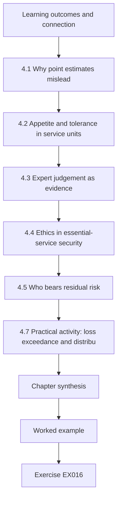

### Logical drawing

```mermaid
flowchart LR
  N0["Learning outcomes and connection"]
  N1["4.1 Why point estimates mislead"]
  N2["4.2 Appetite and tolerance in service units"]
  N3["4.3 Expert judgement as evidence"]
  N4["4.4 Ethics in essential-service security"]
  N5["4.5 Who bears residual risk"]
  N6["4.7 Practical activity: loss exceedance and distribu"]
  N7["Chapter synthesis"]
  N0 --> N1 --> N2 --> N3 --> N4 --> N5 --> N6 --> N7 --> Q["EX016"]
```

```text
[Learning outcomes and connection]
    |
    v
[4.1 Why point estimates mislead]
    |
    v
[4.2 Appetite and tolerance in service units]
    |
    v
[4.3 Expert judgement as evidence]
    |
    v
[4.4 Ethics in essential-service security]
    |
    v
[4.5 Who bears residual risk]
    |
    v
[4.7 Practical activity: loss exceedance and distribu]
    |
    v
[Chapter synthesis]
    |
    v
[Worked example] --> [Exercise EX016]
```
<!-- open-cyber-academy:lesson-figures:end ch-04 -->


### Learning outcomes and connection

After this chapter you should be able to:

1. Build a quantified risk estimate with explicit frequency and severity uncertainty, and read it as a loss exceedance curve rather than a single number.
2. Express risk appetite and tolerance in service units, with limits on the tail, not only the average.
3. Elicit and document expert judgement so that it can be challenged.
4. Analyse who bears residual risk, and recognize when an option that is better on average is worse for a specific group.
5. Apply recognized ethical principles to security decisions, testing and disclosure in essential services.

Chapter 1 compared options under a table of scenarios. This chapter replaces the table with distributions and adds the question decision tables hide: *for whom* is an option better? Chapter 8 applies both to cases where every choice harms someone.

### 4.1 Why point estimates mislead

A risk register entry such as "likelihood 3, impact 4, score 12" hides three things a decision needs: how often, how bad, and how uncertain. NIST's risk-assessment guidance describes risk as a function of threat, vulnerability, likelihood and impact, and warns that assessments must state assumptions and uncertainty ([NIST SP 800-30 Rev. 1](https://csrc.nist.gov/pubs/sp/800/30/r1/final)). Multiplying ordinal scores also does arithmetic on numbers that are only labels.

A better minimal model has two parts: a **frequency** distribution for how many loss events occur in a year, and a **severity** distribution for how bad each is. Severity in infrastructure is usually right-skewed: most interruptions are short, a few are very long. A lognormal distribution is a common, simple choice for such quantities; its parameters should be anchored on evidence (past interruption durations, exercise results, peer incidents) and the choice itself recorded as an assumption. Simulating many years gives a distribution of annual loss, which you can summarize three ways: the **mean** (what you pay on average), the **probability of exceeding** thresholds that matter, and a **high percentile** such as the 99th (a one-in-a-hundred-year bad year). Plotting probability of exceedance against loss gives the **loss exceedance curve** (LEC).

### 4.2 Appetite and tolerance in service units

**Risk appetite** is the amount and type of risk an organization is willing to pursue or retain; **tolerance** sets the boundaries of acceptable variation. NIST CSF 2.0 places both under governance ([NIST, 2024](https://doi.org/10.6028/NIST.CSWP.29)). For an essential service, appetite statements should be in service units and should constrain the tail. For example (synthetic): "Merrow Water will not accept a greater than 2% annual chance of a cyber-related interruption exceeding one million household-hours of supply, nor any credible scenario in which households in a single district lose supply for more than 48 hours without alternative provision." The first clause bounds the LEC; the second bounds *distribution* — a theme we return to in §4.5.

### 4.3 Expert judgement as evidence

Where data are thin, frequency and severity parameters come from people. Structured elicitation — defining quantities precisely, training experts on calibration, asking for quantiles rather than single values, aggregating several experts and recording rationale — makes judgement inspectable ([O'Hagan et al., 2006](https://doi.org/10.1002/0470033312)). Practical rules for the specialist: ask about observable quantities ("how many hours to restore supply to Upper Merrow from a total SCADA loss?") rather than abstract probabilities; ask for a 90% range first, then a median; ask for base rates from comparable operators; and record the person, date, question and rationale so that the estimate can be revisited when evidence arrives.

### 4.4 Ethics in essential-service security

Security decisions in infrastructure distribute harm. Several established frameworks help reason about them:

- The **Menlo Report** adapted the principles of research ethics — respect for persons, beneficence, justice — to information and communication technology research and added respect for law and public interest ([Dittrich and Kenneally, 2012](https://www.dhs.gov/sites/default/files/publications/CSD-MenloPrinciplesCORE-20120803_1.pdf)). Its principles apply directly to testing and data collection in operational environments.
- Professional codes such as the [ACM Code of Ethics](https://www.acm.org/code-of-ethics) and the [NSPE Code of Ethics for Engineers](https://www.nspe.org/resources/ethics/code-ethics) place public welfare and safety above employer or client interest, and require honesty about the limits of one's competence and of a system's safety.
- Data-protection law imposes duties on processing personal data in security monitoring and incident handling ([GDPR, Regulation (EU) 2016/679](https://eur-lex.europa.eu/eli/reg/2016/679/oj)); privacy frameworks such as the [NIST Privacy Framework](https://www.nist.gov/privacy-framework) help manage those duties in design.

For a specialist, four ethical questions recur. **Distribution:** who bears the residual risk of the chosen option, and did they have a voice? **Proportionality:** is the intrusion of a security measure — monitoring of staff, restriction of patients' or customers' access — proportionate to the harm it prevents? **Honesty:** are risks and uncertainties communicated truthfully to decision-makers and, where appropriate, to the public? **Disclosure:** when you discover a weakness that also affects others — a vendor product used by other utilities — how do you protect them without arming attackers? Coordinated vulnerability disclosure processes exist for exactly this case ([CISA, CVD Program](https://www.cisa.gov/resources-tools/programs/coordinated-vulnerability-disclosure-cvd-program)).

### 4.5 Who bears residual risk

Aggregate measures — total household-hours lost, expected loss — can favour options that protect dense, well-served areas, because protecting many people a little scores more than protecting few people a lot. A specialist should therefore report, alongside totals, **per-capita burden by group** (district, customer type) and burden on **people least able to cope**, such as households with medical dependence on water or power. Neither totals nor per-capita measures settle the question; the choice between them is a value judgement that belongs to the accountable decision-maker, informed by legal duties (for example, duties to vulnerable customers) and by the organization's stated appetite. The specialist's ethical duty is to make the distribution visible so the trade-off is chosen knowingly.

### 4.6 Worked example: two options with the same budget (synthetic)

Merrow Water serves three districts. Harbour is urban (60,000 households); Fenley suburban (25,000); Upper Merrow rural (6,000 households on a single trunk main, with telemetry that is slow to restore and long travel times for crews). Cyber-related supply interruptions are modelled as Poisson events with lognormal duration (median 8 hours). Upper Merrow's restoration currently takes three times as long. Two options cost the same:

- **X: harden central SCADA** — reduces event frequency from 0.30 to 0.20 a year everywhere; does nothing for Upper Merrow's long restoration.
- **Y: second feed and local control for Upper Merrow** — leaves frequency at 0.30, but cuts Upper Merrow restoration to 0.75 of the base duration.

Vulnerable households (registered medical or care needs) are counted separately: 900 in Harbour, 500 in Fenley, 400 in Upper Merrow.

### 4.7 Practical activity: loss exceedance and distribution

```python
# Lab 4 - same budget, different people: loss exceedance and the distribution of harm (offline, stdlib only)
# Synthetic: Merrow Water supply interruptions caused by cyber events. Two options cost the same.
import random, math
random.seed(4)
YEARS = 20000
DISTRICTS = {  # name: (households, share of interruption events that hit this district, vulnerable households)
    "Harbour (urban)":  (60000, 0.40, 900),
    "Fenley (suburban)": (25000, 0.25, 500),
    "Upper Merrow (rural, single main)": (6000, 0.35, 400),
}
def poisson(lam):
    L, k, p = math.exp(-lam), 0, 1.0
    while True:
        p *= random.random()
        if p < L: return k
        k += 1
def simulate(freq, hours_mu, hours_sigma, rural_hours_factor):
    annual_hh_hours = []; per_district = {d: 0.0 for d in DISTRICTS}; vuln = {d: 0.0 for d in DISTRICTS}
    for _ in range(YEARS):
        total = 0.0
        for _ in range(poisson(freq)):
            hours = random.lognormvariate(hours_mu, hours_sigma)
            r = random.random(); acc = 0
            for d, (hh, share, v) in DISTRICTS.items():
                acc += share
                if r < acc:
                    h = hours * (rural_hours_factor if d.startswith("Upper") else 1.0)
                    per_district[d] += hh * h; vuln[d] += v * h; total += hh * h
                    break
        annual_hh_hours.append(total)
    return annual_hh_hours, per_district, vuln
OPTIONS = {
    "X: harden central SCADA (fewer events)":      (0.20, math.log(8), 0.9, 3.0),
    "Y: second feed + local control Upper Merrow": (0.30, math.log(8), 0.9, 0.75),
}
for name, args in OPTIONS.items():
    loss, per, vul = simulate(*args)
    loss.sort()
    mean = sum(loss) / YEARS
    p_any = sum(1 for x in loss if x > 0) / YEARS
    p_big = sum(1 for x in loss if x > 1_000_000) / YEARS
    p99 = loss[int(0.99 * YEARS)]
    print(name)
    print(f"  mean household-hours/yr {mean:9.0f}  P(any)={p_any:.3f}  P(>1M hh-h)={p_big:.4f}  99th pct {p99:9.0f}")
    for d, (hh, share, v) in DISTRICTS.items():
        print(f"  {d:34s} hours per household/yr {per[d]/YEARS/hh:5.2f}   vulnerable-household-hours/yr {vul[d]/YEARS:7.0f}")
```

Expected output:

```text
X: harden central SCADA (fewer events)
  mean household-hours/yr     88346  P(any)=0.183  P(>1M hh-h)=0.0204  99th pct   1498603
  Harbour (urban)                    hours per household/yr  0.97   vulnerable-household-hours/yr     872
  Fenley (suburban)                  hours per household/yr  0.64   vulnerable-household-hours/yr     318
  Upper Merrow (rural, single main)  hours per household/yr  2.39   vulnerable-household-hours/yr     956
Y: second feed + local control Upper Merrow
  mean household-hours/yr    117262  P(any)=0.261  P(>1M hh-h)=0.0305  99th pct   1920694
  Harbour (urban)                    hours per household/yr  1.48   vulnerable-household-hours/yr    1332
  Fenley (suburban)                  hours per household/yr  0.91   vulnerable-household-hours/yr     453
  Upper Merrow (rural, single main)  hours per household/yr  0.96   vulnerable-household-hours/yr     386
```

**Interpretation.** On every aggregate measure X is better: mean loss 88,346 against 117,262 household-hours a year; a 2.0% against 3.1% annual chance of exceeding one million household-hours; a lower 99th percentile. Against the appetite in §4.2, X sits on the 2% tail bound (0.0204, within simulation error of the limit) and Y clearly breaches it. But the **distribution** reverses the picture. Under X, an Upper Merrow household loses on average 2.39 hours a year — more than twice an urban household and nearly four times a suburban one — and Upper Merrow's 400 vulnerable households bear 956 vulnerable-household-hours a year, more than Harbour's 900 households. Y cuts the rural burden to 0.96 hours per household and rural vulnerable-household-hours to 386, at the cost of higher burdens elsewhere. Total vulnerable-household-hours are almost identical (about 2,146 under X and 2,171 under Y): the options do not differ much in how much harm falls on vulnerable people overall, but sharply in *which* vulnerable people bear it. The second appetite clause — no district without supply beyond 48 hours — would require looking at Upper Merrow's tail, which the summary does not show; that is EX016's extension.

The analysis does not decide between X and Y. It shows that "X is better" is true only under an aggregate-utilitarian view and that the choice concentrates risk on a small rural population. A defensible recommendation might combine X with cheaper non-technical measures for Upper Merrow (pre-positioned bottled water, a priority register for vulnerable households), and must record the value judgement.

### 4.8 Common errors and limits

- Multiplying ordinal scores and treating the product as a quantity.
- Reporting the mean annual loss alone for a heavy-tailed risk.
- Stating risk appetite as a colour or adjective rather than a bound in service units.
- Treating elicited numbers as data while discarding the elicitation record.
- Reporting only aggregate benefit, so that concentrated harm on small groups is invisible.
- Presenting a value judgement (aggregate versus distribution) as a technical result.
- Sitting on a vulnerability that affects other operators because disclosure is awkward.

The model's limits are those of its assumptions: Poisson independence ignores campaigns that hit several sites at once; the lognormal may understate the longest interruptions; district shares are judgements. Change them and the numbers move; the *method* of showing distribution alongside totals does not.

### Exercises — chapter 4

**EX016 — Partial rural improvement.** *Objective:* see how distribution responds to a weaker option. *Inputs:* Lab 4. *Constraints:* change Y's rural duration factor from 0.75 to 1.5 (the second feed is delayed; only local control is delivered). *Steps:* (1) rerun; (2) report Upper Merrow's hours per household and vulnerable-household-hours under the modified Y; (3) compare with X and the original Y; (4) extend the lab to report the probability that Upper Merrow has a single interruption longer than 48 hours in a year under X and under Y. *Expected evidence:* outputs and paragraph. *Rubric:* 3 = modified-Y numbers correct (1.93 hours; 771 vulnerable-household-hours), still better for Upper Merrow than X but much less than original Y, 48-hour extension implemented with a correct per-event check; 2 = extension missing; 1 = not run; 0 = none.

**EX017 — Ethical analysis memo.** *Objective:* apply ethical principles to the X/Y choice. *Inputs:* §4.4–4.7. *Constraints:* 400 words; principles from the Menlo Report and one professional code. *Steps:* (1) identify affected groups and their voice; (2) analyse beneficence and justice; (3) state the value judgement the board must make; (4) recommend a combined option with non-technical measures. *Expected evidence:* memo. *Rubric:* 3 = groups specific, trade-off between aggregate and distributional views named as a judgement, combined recommendation concrete, duty of honesty to the board observed; 2 = principles listed but not applied; 1 = asserts X or Y as technically correct; 0 = none.

**EX018 — Elicitation protocol.** *Objective:* obtain defensible severity parameters. *Inputs:* the question "how long would it take to restore supply to Upper Merrow after total loss of SCADA?" *Constraints:* three experts; observable quantity; quantiles. *Steps:* (1) define the quantity precisely; (2) write the elicitation script including a calibration question; (3) explain how you would aggregate and record. *Expected evidence:* protocol. *Rubric:* 3 = quantity unambiguous (start and end events defined), 5th/50th/95th quantiles asked, independent elicitation before discussion, calibration and record kept; 2 = single values asked; 1 = probability of a vague event; 0 = none.

**EX019 — Appetite statement.** *Objective:* write appetite and tolerance in service units. *Inputs:* Merrow Health (three hospitals, an ambulance service dependency). *Constraints:* at least one tail bound and one distribution bound; measurable from the organization's own data. *Steps:* draft; then test it against one plausible scenario and say whether it is breached. *Expected evidence:* statement and test. *Rubric:* 3 = service units (for example hours of emergency department diversion, delayed time-critical treatments), tail and distribution bounds measurable, test honest; 2 = only averages; 1 = adjectives; 0 = none.

**EX020 — Disclosure dilemma.** *Objective:* handle a weakness that affects others. *Inputs:* during a review, Merrow Water finds that Corvane's remote-support tool accepts a default credential on a maintenance port; Corvane supports other utilities in the region. *Constraints:* no testing beyond Merrow's own systems; no public disclosure before a coordinated process. *Steps:* (1) immediate protective actions for Merrow; (2) notification route to Corvane and, if needed, a coordinator; (3) what to tell the resilience forum, and when; (4) ethical justification. *Expected evidence:* plan. *Rubric:* 3 = protect own systems first, private notification to vendor with evidence, use of a coordinated disclosure process if the vendor does not act, forum informed in a way that protects others without publishing exploit details, principles cited; 2 = one step missing; 1 = tests other utilities' systems or publishes; 0 = none.

### Chapter synthesis

Quantify risk as frequency and severity with explicit uncertainty, and read it through the loss exceedance curve, not a single score. Write appetite and tolerance in service units with bounds on the tail and on distribution. Treat expert judgement as evidence that must be elicited carefully and recorded. Show who bears residual risk — per capita and for those least able to cope — because options that are better on average can concentrate harm. Apply recognized ethical principles to choices, testing and disclosure, and keep value judgements visible as judgements for the accountable decision-maker.

<!-- open-cyber-academy:chapter-navigation:start ch-04 -->
### Continue studying — chapter 04 of 12

[← Chapter 03](#ch-03) · [Course chapter index](../SUBJECTS.md) · [Chapter 05 →](#ch-05)

Continue to the next authored lesson.
<!-- open-cyber-academy:chapter-navigation:end -->

<a id="ch-05"></a>

## Chapter 5 — Critical infrastructure and sector security: design alternatives

<!-- open-cyber-academy:lesson-figures:start ch-05 -->
### Lesson map

Lesson 05 published. Map, example, EX021.

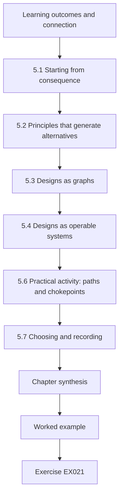

### Logical drawing

```mermaid
flowchart LR
  N0["Learning outcomes and connection"]
  N1["5.1 Starting from consequence"]
  N2["5.2 Principles that generate alternatives"]
  N3["5.3 Designs as graphs"]
  N4["5.4 Designs as operable systems"]
  N5["5.6 Practical activity: paths and chokepoints"]
  N6["5.7 Choosing and recording"]
  N7["Chapter synthesis"]
  N0 --> N1 --> N2 --> N3 --> N4 --> N5 --> N6 --> N7 --> Q["EX021"]
```

```text
[Learning outcomes and connection]
    |
    v
[5.1 Starting from consequence]
    |
    v
[5.2 Principles that generate alternatives]
    |
    v
[5.3 Designs as graphs]
    |
    v
[5.4 Designs as operable systems]
    |
    v
[5.6 Practical activity: paths and chokepoints]
    |
    v
[5.7 Choosing and recording]
    |
    v
[Chapter synthesis]
    |
    v
[Worked example] --> [Exercise EX021]
```
<!-- open-cyber-academy:lesson-figures:end ch-05 -->


### Learning outcomes and connection

After this chapter you should be able to:

1. Generate genuinely different architectural alternatives for a security problem in an essential service, starting from consequences rather than products.
2. Represent alternatives as graphs of permitted paths and compare them by paths, chokepoints and the barriers on each path.
3. Evaluate each alternative as an operable system: failure modes of the security controls themselves, break-glass access, maintainability and the workforce that must run it.
4. Combine security, operability and cost evidence into a recommendation, using the decision methods of Chapters 1 and 4.
5. Record the choice in an architecture decision record.

Chapter 4 quantified risk; this chapter shows where design choices change it. Chapter 6 then tests whether a chosen design works as claimed.

### 5.1 Starting from consequence

Architecture reviews often start from a product ("should we buy a data diode?") or a pattern ("we need zero trust"). A specialist starts from the **consequence to be prevented** and works backwards to the digital paths that could cause it. Consequence-driven, cyber-informed engineering, developed at Idaho National Laboratory, formalizes this: identify the functions whose failure would be intolerable, map the systems and dependencies that could cause it, and choose engineering mitigations — including non-digital ones such as mechanical limits — that remove or bound the consequence ([INL, CCE](https://inl.gov/national-security/cce/); [Bochman and Freeman, 2021](https://www.routledge.com/Countering-Cyber-Sabotage-Introducing-Consequence-Driven-Cyber-Informed-Engineering-CCE/Bochman-Freeman/p/book/9780367673710)). For Merrow Water's Hollin works the intolerable consequence is an unsafe chlorine dose reaching customers; the design question is how remote access to the dosing controller should work, if at all.

The non-digital mitigation deserves first place in the option set. A dosing pump sized so that it physically cannot exceed a safe dose, or an independent analyser that trips dosing at a hard limit, bounds the consequence whatever happens to the network. Digital controls are then chosen to reduce the frequency of attempts on what remains.

### 5.2 Principles that generate alternatives

Classic design principles still generate good alternatives: economy of mechanism, fail-safe defaults, complete mediation and least privilege ([Saltzer and Schroeder, 1975](https://doi.org/10.1109/PROC.1975.9939)). IEC 62443 applies them to control systems through **zones** (groups of assets with common security requirements) and **conduits** (the controlled communication between zones) ([ISA overview](https://www.isa.org/standards-and-publications/isa-standards/isa-iec-62443-series-of-standards)). Zero-trust architecture moves enforcement from network location to per-session decisions on identity, device and context ([NIST SP 800-207](https://csrc.nist.gov/pubs/sp/800/207/final)). Cyber-resilience engineering adds techniques — segmentation, non-persistence, diversity, redundancy, substantiated integrity — aimed at operating through compromise rather than only preventing it ([NIST SP 800-160 Vol. 2 Rev. 1](https://doi.org/10.6028/NIST.SP.800-160v2r1)). Each principle points to a different design; using several deliberately produces alternatives that differ in kind.

### 5.3 Designs as graphs

A simple, powerful representation: nodes are systems, directed edges are permitted connections, and each edge carries the barrier an intruder must defeat to use it. Three measures then compare designs:

- **Number of paths** from plausible entry points to the consequence-bearing asset. Fewer is better, but only with the next measure.
- **Smallest chokepoint set** — the fewest nodes whose removal (or perfect defence) cuts every path. A single, strong chokepoint is easier to defend, monitor and evidence than several weak ones; it is also a single point of failure for legitimate operations (§5.4).
- **Barrier strength along each path** — a path whose edges after initial entry carry no barrier ("none") lets one foothold become control.

The graph should include the **unexpected paths** that real environments contain: historian connections, backup links, vendor modems, cloud monitoring agents. Many architectural weaknesses are not in the intended design but in the path someone added later for convenience. Graph analysis does not prove security; it makes assumptions explicit and countable.

### 5.4 Designs as operable systems

A design that is secure on paper can fail operations. For each alternative ask:

1. **What happens when the security control fails?** If the access broker is down during a night-time emergency, how does an engineer reach the controller? A **break-glass** path — sealed credentials, physical presence, a recorded and alarmed emergency route — must exist and be tested, or operators will build their own.
2. **Who runs it?** A design that needs skills the organization does not have, or a supplier it cannot hold to account, will degrade.
3. **How is it changed?** Every exception to a rule is a new edge in the graph; designs that make legitimate work easy reduce pressure for exceptions.
4. **What does it cost over its life?** Licences, staff, testing, renewals.
5. **What does it do to monitoring?** One-way data flows can protect a control network while still letting the business see process data; they also limit remote diagnosis.

### 5.5 Worked example: three remote-access designs at Hollin (synthetic)

Merrow Water has three candidate designs for remote access to Hollin's control network:

- **D1 flat VPN** — today's arrangement: vendor and staff VPN lands directly in the control network; the historian is reachable from the corporate network.
- **D2 VPN plus jump host** — MFA on the VPN; all interactive access through a hardened jump host; the historian moved to a DMZ.
- **D3 brokered access with one-way historian** — remote access only through an access broker requiring MFA and per-session approval, sessions recorded and time-boxed, landing on one engineering workstation; the historian replicates out to the DMZ through a one-way link; the dosing controller's key switch is left in RUN, which (on this synthetic controller) blocks program downloads.

Two entry points are modelled: the internet and a phishing email reaching a corporate PC.

### 5.6 Practical activity: paths and chokepoints

```python
# Lab 5 - comparing three remote-access architectures as graphs (offline, standard library only)
# Synthetic: paths from the internet to the dosing PLC at Merrow Water's Hollin works under three designs.
# An edge is a permitted connection; its label is what an intruder must defeat to use it.
from itertools import combinations
DESIGNS = {
 "D1 flat VPN": {
   "internet": [("vpn", "password")],
   "vpn": [("hmi", "none"), ("eng-ws", "none"), ("historian", "none")],
   "corp-pc": [("vpn", "none"), ("historian", "password")],
   "eng-ws": [("plc", "none")], "hmi": [("plc", "none")], "historian": [("hmi", "none")],
   "email": [("corp-pc", "user click")], "plc": []},
 "D2 VPN + jump host": {
   "internet": [("vpn", "MFA")],
   "vpn": [("jump", "password")], "corp-pc": [("jump", "password"), ("historian-dmz", "password")],
   "jump": [("hmi", "password"), ("eng-ws", "password")],
   "historian-dmz": [("historian", "none")], "historian": [("hmi", "none")],
   "eng-ws": [("plc", "none")], "hmi": [("plc", "none")], "email": [("corp-pc", "user click")], "plc": []},
 "D3 brokered access + one-way historian": {
   "internet": [("broker", "MFA + per-session approval")],
   "broker": [("eng-ws", "recorded session, time-boxed")],
   "corp-pc": [("broker", "MFA + per-session approval")],
   "historian": [("historian-dmz", "one-way")],  # data leaves OT only; nothing flows back
   "eng-ws": [("plc", "PLC key switch in RUN blocks writes")], "hmi": [("plc", "none")],
   "email": [("corp-pc", "user click")], "historian-dmz": [], "plc": []},
}
ENTRY, TARGET = ["internet", "email"], "plc"
def paths(g, node, seen):
    if node == TARGET: yield [node]; return
    for nxt, _ in g.get(node, []):
        if nxt not in seen:
            for rest in paths(g, nxt, seen | {nxt}): yield [node] + rest
def reachable(g, removed):
    stack = [e for e in ENTRY if e not in removed]; seen = set(stack)
    while stack:
        n = stack.pop()
        for nxt, _ in g.get(n, []):
            if nxt not in seen and nxt not in removed: seen.add(nxt); stack.append(nxt)
    return TARGET in seen
for name, g in DESIGNS.items():
    ps = [p for e in ENTRY for p in paths(g, e, {e})]
    inner = sorted({n for n in g if n not in ENTRY + [TARGET]})
    cut = next(c for k in range(1, len(inner) + 1) for c in combinations(inner, k) if not reachable(g, set(c)))
    free = [p for p in ps if all(lbl == "none" for a, b in zip(p, p[1:]) for nxt, lbl in g[a] if nxt == b and a not in ENTRY)]
    print(f"{name}: {len(ps)} paths; smallest chokepoint set {list(cut)}; "
          f"paths with no barrier after the first hop: {len(free)}")
    for p in ps:
        bars = [lbl for a, b in zip(p, p[1:]) for nxt, lbl in g[a] if nxt == b]
        print("   ", " -> ".join(p), "|", ", ".join(bars))
```

Expected output:

```text
D1 flat VPN: 7 paths; smallest chokepoint set ['corp-pc', 'vpn']; paths with no barrier after the first hop: 6
    internet -> vpn -> hmi -> plc | password, none, none
    internet -> vpn -> eng-ws -> plc | password, none, none
    internet -> vpn -> historian -> hmi -> plc | password, none, none, none
    email -> corp-pc -> vpn -> hmi -> plc | user click, none, none, none
    email -> corp-pc -> vpn -> eng-ws -> plc | user click, none, none, none
    email -> corp-pc -> vpn -> historian -> hmi -> plc | user click, none, none, none, none
    email -> corp-pc -> historian -> hmi -> plc | user click, password, none, none
D2 VPN + jump host: 5 paths; smallest chokepoint set ['corp-pc', 'jump']; paths with no barrier after the first hop: 0
    internet -> vpn -> jump -> hmi -> plc | MFA, password, password, none
    internet -> vpn -> jump -> eng-ws -> plc | MFA, password, password, none
    email -> corp-pc -> jump -> hmi -> plc | user click, password, password, none
    email -> corp-pc -> jump -> eng-ws -> plc | user click, password, password, none
    email -> corp-pc -> historian-dmz -> historian -> hmi -> plc | user click, password, none, none, none
D3 brokered access + one-way historian: 2 paths; smallest chokepoint set ['broker']; paths with no barrier after the first hop: 0
    internet -> broker -> eng-ws -> plc | MFA + per-session approval, recorded session, time-boxed, PLC key switch in RUN blocks writes
    email -> corp-pc -> broker -> eng-ws -> plc | user click, MFA + per-session approval, recorded session, time-boxed, PLC key switch in RUN blocks writes
```

**Interpretation.** D1 has seven paths; on six of them nothing stands between the first foothold and the controller. Its smallest chokepoint set is two nodes. D2 removes all barrier-free paths and adds MFA, but the graph exposes a flaw the design document did not mention: the path `corp-pc → historian-dmz → historian → hmi → plc`. Moving the historian to a DMZ while leaving a connection *from the DMZ into* the control-zone historian recreates a route around the jump host. This is exactly the kind of convenience edge that §5.3 warned about; EX021 fixes it. D3 has two paths, both through one chokepoint (the broker), each crossing several strong barriers. On security grounds D3 is clearly best.

On operability grounds, D3's single chokepoint is also its weakness. If the broker or its identity provider fails during an emergency, no remote path exists; the design therefore needs a tested break-glass route, which is itself a new edge to model and protect. The key-switch barrier is only real if operating procedures keep switches in RUN and a site visit is acceptable for program changes. A complete recommendation would add these to the cost and to the graph.

### 5.7 Choosing and recording

Bring the evidence together with Chapter 1's methods: a scenario table for each design (incidents prevented, operational costs of slower access, broker-outage scenarios) and the distributional check from Chapter 4 (does a design make remote sites harder to support?). Then write an **architecture decision record (ADR)**: context, the consequence addressed, alternatives considered with their graphs, decision, consequences (including new risks such as broker dependence), the break-glass design, the evidence that will show the design is working (Chapter 6), and a review trigger. An ADR is a decision record (§1.8) specialized for designs; its value is that the next engineer who wants to add a convenient edge can see why it was not there.

### 5.8 Common errors and limits

- Starting from a product or slogan rather than the consequence.
- Omitting non-digital mitigations that bound the consequence outright.
- Drawing the intended design and missing the paths added later.
- Counting controls instead of examining barriers along each path.
- Celebrating a single chokepoint without designing for its failure.
- Ignoring who will operate the design and how exceptions will be handled.
- Writing no decision record, so the next change silently undoes the design.

Graphs are only as complete as the inventory behind them, and barrier labels are judgements of strength, not measurements. Use them to compare designs and expose assumptions, then test the chosen design (Chapter 6).

### Exercises — chapter 5

**EX021 — Fix D2.** *Objective:* remove an unintended path and re-evaluate. *Inputs:* Lab 5. *Constraints:* change only the historian links in D2 so that data flows one way from the control-zone historian to the DMZ copy, as in D3. *Steps:* (1) edit and rerun; (2) report paths and smallest chokepoint set for D2; (3) compare D2-fixed with D3 in two sentences. *Expected evidence:* edit, output and comparison. *Rubric:* 3 = edit correct, D2 now four paths with chokepoint `jump`, comparison notes D2's remaining password-only hops versus D3's per-session approval and recording; 2 = numbers right, comparison thin; 1 = not run; 0 = none.

**EX022 — A new edge.** *Objective:* evaluate a convenience proposal. *Inputs:* D3; Corvane proposes a cloud monitoring agent on the engineering workstation that keeps an outbound connection to Corvane's cloud "for diagnostics". *Constraints:* model it as an edge `internet → eng-ws` with barrier "vendor cloud account". *Steps:* (1) add the edge and rerun; (2) report paths and chokepoints; (3) propose an alternative that meets the diagnostic need. *Expected evidence:* output and proposal. *Rubric:* 3 = recognizes that the chokepoint set changes because a path now bypasses the broker, proposes an alternative (for example diagnostics exported through the one-way historian, or agent on a DMZ host), states residual risk; 2 = output right, alternative weak; 1 = accepts the edge as outbound-only therefore safe; 0 = none.

**EX023 — Break-glass design.** *Objective:* design for failure of the chokepoint. *Inputs:* D3. *Constraints:* must work when the broker and identity provider are down; must not become a routine path. *Steps:* (1) design the break-glass route; (2) add it to the graph; (3) specify alarms, records and test frequency. *Expected evidence:* design and updated path list. *Rubric:* 3 = physical or sealed-credential route with alarms and after-use review, modelled as an edge with its barrier, tested on a schedule; 2 = no testing; 1 = shared standing password; 0 = none.

**EX024 — Choose with evidence.** *Objective:* combine security and operability. *Inputs:* D1, D2-fixed, D3 with break-glass; synthetic annual costs £20k, £70k, £110k; your judgement of scenario losses using Chapter 1's format. *Constraints:* at least three scenarios including broker outage during an emergency. *Steps:* (1) build the table; (2) apply EV and minimax regret; (3) state the threshold that would change your recommendation. *Expected evidence:* table and recommendation. *Rubric:* 3 = scenarios plausible and include operational downsides of D3, both rules applied correctly, threshold explicit; 2 = one rule only; 1 = security only; 0 = none.

**EX025 — Architecture decision record.** *Objective:* record the design choice. *Inputs:* your EX024 recommendation. *Constraints:* one page; all elements of §5.7. *Steps:* write the ADR. *Expected evidence:* ADR. *Rubric:* 3 = consequence-first context, alternatives with graph evidence, new risks and break-glass, verification evidence and review trigger; 2 = one element missing; 1 = product description; 0 = none.

### Chapter synthesis

Design from the consequence backwards, and put non-digital limits first. Use established principles — least privilege, complete mediation, zones and conduits, per-session decisions, resilience techniques — to generate alternatives that differ in kind. Represent designs as graphs of permitted paths and compare paths, chokepoints and barriers, including the convenience edges real environments accumulate. Evaluate each design as an operable system, designing for failure of its own controls. Choose with the decision methods of earlier chapters and record the choice in an ADR so that it survives the next change request.

<!-- open-cyber-academy:chapter-navigation:start ch-05 -->
### Continue studying — chapter 05 of 12

[← Chapter 04](#ch-04) · [Course chapter index](../SUBJECTS.md) · [Chapter 06 →](#ch-06)

Continue to the next authored lesson.
<!-- open-cyber-academy:chapter-navigation:end -->

<a id="ch-06"></a>

## Chapter 6 — Critical infrastructure and sector security: controlled evaluation

<!-- open-cyber-academy:lesson-figures:start ch-06 -->
### Lesson map

Lesson 06 published. Map, example, EX026.

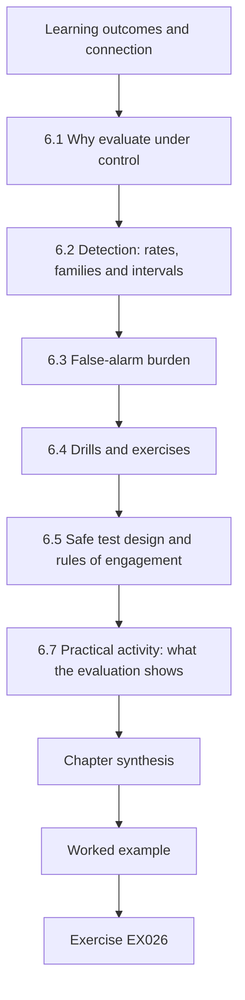

### Logical drawing

```mermaid
flowchart LR
  N0["Learning outcomes and connection"]
  N1["6.1 Why evaluate under control"]
  N2["6.2 Detection: rates, families and intervals"]
  N3["6.3 False-alarm burden"]
  N4["6.4 Drills and exercises"]
  N5["6.5 Safe test design and rules of engagement"]
  N6["6.7 Practical activity: what the evaluation shows"]
  N7["Chapter synthesis"]
  N0 --> N1 --> N2 --> N3 --> N4 --> N5 --> N6 --> N7 --> Q["EX026"]
```

```text
[Learning outcomes and connection]
    |
    v
[6.1 Why evaluate under control]
    |
    v
[6.2 Detection: rates, families and intervals]
    |
    v
[6.3 False-alarm burden]
    |
    v
[6.4 Drills and exercises]
    |
    v
[6.5 Safe test design and rules of engagement]
    |
    v
[6.7 Practical activity: what the evaluation shows]
    |
    v
[Chapter synthesis]
    |
    v
[Worked example] --> [Exercise EX026]
```
<!-- open-cyber-academy:lesson-figures:end ch-06 -->


### Learning outcomes and connection

After this chapter you should be able to:

1. Plan a controlled evaluation of a security control — a detection rule, a design, a recovery procedure — that answers a stated question safely.
2. Report detection and success rates with intervals, and calculate how many trials a claim needs.
3. Measure false-alarm burden in the units operators experience.
4. Evaluate drills and exercises with paired comparisons and recognize threats to their validity.
5. Write rules of engagement and safety conditions for tests near operating plant.

Chapter 5 chose designs; Chapter 2 graded evidence that controls exist. This chapter asks whether they **work**, by how much, and how sure we can be — before a real incident answers the question for us. Chapter 11 extends the method to evaluating a whole project.

### 6.1 Why evaluate under control

Security controls in essential services are rarely exercised by real attacks, so their effectiveness is usually assumed. Controlled evaluation creates the evidence deliberately: inject known events and see whether they are detected; run a recovery and time it; run a drill and observe whether staff can operate manually. The phrase *controlled* matters twice. Scientifically, it means the evaluator controls what is injected, so detection and miss can be counted against a known truth. Operationally, it means the test is controlled so it cannot harm the process: rigs, simulators, digital twins, isolated restore targets and tabletop exercises carry most of the load, and live tests happen only with operations' authority and safety conditions.

### 6.2 Detection: rates, families and intervals

A detection evaluation counts how many injected scenarios were detected. A single rate hides two things. First, **families**: a rule that catches every direct HMI write but half of slow-drift manipulations has a different risk profile from one that catches 85% of everything. Report by technique family — for OT, the families in MITRE ATT&CK for ICS are a good vocabulary ([MITRE, ATT&CK for ICS](https://attack.mitre.org/matrices/ics/)). Second, **uncertainty**: 17 detections out of 20 trials is consistent with a wide range of true rates. The Wilson score interval ([Wilson, 1927](https://doi.org/10.1080/01621459.1927.10502953)) behaves well for small samples and rates near 0 or 1; use it rather than the simple normal approximation.

A practical consequence follows: **claims need sample sizes**. To claim "at least 90% detection" with a 95% Wilson lower bound, you need dozens of successful trials, not a handful; each miss raises the number further. Plan trial counts before testing and say which claim the planned count can support.

Two further cautions come from research on evaluating detection systems. Test data must resemble the operating environment — the base rate of real attacks, the variety of benign behaviour — or results will not transfer ([Sommer and Paxson, 2010](https://doi.org/10.1109/SP.2010.25); [Arp et al., 2022](https://www.usenix.org/conference/usenixsecurity22/presentation/arp)). And for time-series anomaly detection, some popular scoring conventions inflate performance; evaluation must be defined carefully ([Kim et al., 2022](https://ojs.aaai.org/index.php/AAAI/article/view/20680)).

### 6.3 False-alarm burden

A detection is useful only if operators can act on its alerts. Measure false alarms by replaying representative benign traffic for a long enough period and counting alerts, then express the rate **per shift or per operator** and with an interval; for counts of rare events the exact Poisson interval is appropriate. Combine it with the base rate of real events: when real attacks are rare, even a low false-alarm rate means most alerts are false. Agree an acceptable burden with operations *before* the test — for example "no more than one investigation per night shift" — so the result can pass or fail.

### 6.4 Drills and exercises

Manual-operation drills, recovery exercises and tabletop exercises test people and procedures. NIST's contingency-planning guidance treats testing, training and exercises as a cycle with documented objectives and after-action results ([NIST SP 800-34 Rev. 1](https://csrc.nist.gov/pubs/sp/800/34/r1/upd1/final)). To evaluate whether training improved performance, compare the **same people** before and after (a paired design), report the mean improvement with an interval, and look at individual differences: a mean improvement can hide one operator who did not improve at all. Threats to validity are serious in drills: participants learn the scenario (practice effect), know they are observed, and are often the most willing staff. Vary scenarios, include night shifts and less experienced staff, and do not treat one good drill as proof of readiness.

### 6.5 Safe test design and rules of engagement

Every test near operating plant needs written **rules of engagement**: scope (systems, times), excluded systems, permitted techniques, stop conditions (any unexpected process change, any alarm the operators cannot explain), named authority to stop, communications, rollback and evidence handling. The operations lead signs them. Tests that inject commands should use rigs or simulators wherever possible; tests on live plant should be read-only or use pre-agreed benign markers. The ethical principles from Chapter 4 apply: the test must not shift risk onto customers without their protection.

### 6.6 Worked example: a new detection rule and a drill (synthetic)

Merrow Water's managed-detection provider proposes a rule to detect unauthorised setpoint writes. The specialist designs an evaluation on the test rig: 20 injected scenarios in three families, 336 hours of replayed benign traffic from Hollin, and a manual-dosing drill with six operators before and after a new training module. The operations lead agreed acceptance criteria in advance: detection lower bound at least 0.80 overall with no family below 0.50 point estimate; no more than one false alarm per night shift on average; and a manual-dosing time improvement whose interval excludes zero.

### 6.7 Practical activity: what the evaluation shows

```python
# Lab 6 - what a controlled evaluation can and cannot show (offline, standard library only)
# Synthetic: Merrow Water tests a new detection rule for unauthorised setpoint writes on a test rig,
# replays two weeks of benign plant traffic, and times a manual-operation drill before and after training.
import math
def wilson(k, n, z=1.96):
    p = k / n; d = 1 + z*z/n
    c = (p + z*z/(2*n)) / d; h = z*math.sqrt(p*(1-p)/n + z*z/(4*n*n)) / d
    return c - h, c + h
def pois_cdf(k, mu): return sum(math.exp(-mu) * mu**i / math.factorial(i) for i in range(k + 1))
def pois_ci(k, a=0.05):  # exact (Garwood) interval by bisection
    def solve(f, lo, hi):
        for _ in range(200):
            mid = (lo + hi) / 2
            if f(mid): lo = mid
            else: hi = mid
        return (lo + hi) / 2
    lower = 0.0 if k == 0 else solve(lambda m: 1 - pois_cdf(k - 1, m) < a/2, 0, 10*k + 10)
    upper = solve(lambda m: pois_cdf(k, m) > a/2, 0, 10*k + 10)
    return lower, upper
# 1. Detection on injected scenarios, split by technique family
RESULTS = {"direct HMI write": (9, 9), "engineering-workstation download": (6, 7), "slow drift via historian tag": (2, 4)}
k = sum(a for a, b in RESULTS.values()); n = sum(b for a, b in RESULTS.values())
lo, hi = wilson(k, n); print(f"overall detected {k}/{n} = {k/n:.2f}, 95% Wilson [{lo:.2f}, {hi:.2f}]")
for fam, (a, b) in RESULTS.items():
    lo, hi = wilson(a, b); print(f"  {fam:34s} {a}/{b}  [{lo:.2f}, {hi:.2f}]")
# 2. How many trials, all detected, before the lower bound clears 0.90?
n = 1
while wilson(n, n)[0] < 0.90: n += 1
print(f"perfect runs needed for Wilson lower bound >= 0.90: {n}")
# 3. False alarms in 336 hours of benign replay
fa, hours = 9, 336
lo, hi = pois_ci(fa); print(f"false alarms {fa} in {hours} h = {fa/hours*24:.2f}/day, 95% CI [{lo/hours*24:.2f}, {hi/hours*24:.2f}]/day")
# 4. Drill: minutes to stable manual dosing, same six operators before and after training (paired)
before = [34, 41, 29, 52, 38, 45]; after = [22, 30, 27, 31, 25, 44]
diffs = [b - a for b, a in zip(before, after)]
md = sum(diffs) / len(diffs); sd = math.sqrt(sum((d - md)**2 for d in diffs) / (len(diffs) - 1))
t = 2.571  # two-sided 95% t quantile, 5 degrees of freedom
print(f"paired improvement mean {md:.1f} min, 95% CI [{md - t*sd/math.sqrt(6):.1f}, {md + t*sd/math.sqrt(6):.1f}]; diffs {diffs}")
```

Expected output:

```text
overall detected 17/20 = 0.85, 95% Wilson [0.64, 0.95]
  direct HMI write                   9/9  [0.70, 1.00]
  engineering-workstation download   6/7  [0.49, 0.97]
  slow drift via historian tag       2/4  [0.15, 0.85]
perfect runs needed for Wilson lower bound >= 0.90: 35
false alarms 9 in 336 h = 0.64/day, 95% CI [0.29, 1.22]/day
paired improvement mean 10.0 min, 95% CI [2.1, 17.9]; diffs [12, 11, 2, 21, 13, 1]
```

**Interpretation.** Overall detection is 17/20 = 0.85, but the 95% Wilson interval [0.64, 0.95] does not clear the pre-agreed lower bound of 0.80. By family, direct HMI writes were all detected, engineering-workstation downloads six of seven, and slow drift via a historian tag only two of four — the point estimate meets the 0.50 floor, but its interval runs from 0.15 to 0.85, so the evaluation cannot say whether slow drift is detected reliably at all. To claim 90% detection with all trials successful would need 35 consecutive successes. False alarms run at 0.64 a day (interval 0.29–1.22), about 0.21 per eight-hour shift, comfortably inside the burden criterion. The drill shows a mean improvement of 10.0 minutes with a 95% interval of 2.1 to 17.9 minutes — the interval excludes zero, so the criterion is met — but two operators improved by only one and two minutes; their experience is worth understanding before rollout.

The honest result is therefore mixed: **adopt the rule for direct writes and downloads with monitoring of its performance, do not rely on it for slow drift, and design further trials for that family**. That is a more useful answer than "85% detection".

### 6.8 Common errors and limits

- Reporting one detection rate without families or intervals.
- Running too few trials to support the claim, then making the claim anyway.
- Testing with scenarios the rule's author designed, and only those.
- Measuring false alarms on a short or unrepresentative replay.
- Expressing false alarms per day for a whole network instead of per shift or operator.
- Treating one successful drill as proof of readiness.
- Testing on live plant without signed rules of engagement and stop conditions.

The limit of controlled evaluation is transfer: a rig is not a plant and injected scenarios are not adversaries. Use evaluation to bound claims and find weaknesses, keep measuring in operation, and repeat when the environment changes.

### Exercises — chapter 6

**EX026 — Intervals and sample size.** *Objective:* connect claims to trial counts. *Inputs:* Lab 6 functions. *Constraints:* 95% Wilson intervals. *Steps:* (1) compute the interval for 19/20; (2) find the number of consecutive successes needed for a lower bound of 0.80; (3) find the trials needed for a lower bound of 0.90 if exactly one miss occurs; (4) explain to a manager why "we tested it 20 times" is not enough for a 90% claim. *Expected evidence:* numbers and paragraph. *Rubric:* 3 = 19/20 → [0.76, 0.99], 16 successes, 53 trials with one miss, explanation in plain language; 2 = one number wrong; 1 = normal approximation used without comment; 0 = none.

**EX027 — Test plan for slow drift.** *Objective:* design trials for the weakest family. *Inputs:* the slow-drift result. *Constraints:* rig only; scenarios must vary rate, duration and target tag; include scenarios not written by the rule's author. *Steps:* (1) define the claim to test; (2) choose trial count; (3) list scenario variations; (4) define pass/fail and what you will do if it fails. *Expected evidence:* plan. *Rubric:* 3 = claim explicit and trial count justified by an interval calculation, independent scenario authorship, realistic variations, pre-agreed decision; 2 = count not justified; 1 = reuses the four scenarios; 0 = none.

**EX028 — Alarm burden.** *Objective:* express false alarms in operators' units and combine with base rates. *Inputs:* 0.64 false alarms a day; assume real unauthorised writes occur about once every two years; detection 0.85. *Constraints:* three eight-hour shifts a day. *Steps:* (1) false alarms per shift and per year; (2) expected true alerts per year; (3) share of alerts that are true; (4) what this means for the response procedure. *Expected evidence:* calculation and paragraph. *Rubric:* 3 = about 0.21 per shift and 234 a year, about 0.43 true alerts a year, about 0.2% of alerts true, a procedure that makes each investigation fast and cheap; 2 = arithmetic right, implication missing; 1 = confuses rates; 0 = none.

**EX029 — Drill validity.** *Objective:* critique a drill evaluation. *Inputs:* the six-operator paired result. *Constraints:* name at least four threats to validity. *Steps:* list threats, the direction each would bias the result, and a design change for each. *Expected evidence:* table. *Rubric:* 3 = practice effect, observation effect, selection of willing staff, same scenario, small sample, day versus night; directions stated; changes concrete; 2 = threats without directions; 1 = generic; 0 = none.

**EX030 — Rules of engagement.** *Objective:* write safe test conditions. *Inputs:* a proposal to verify on live plant at Fenley that the new rule alerts on a harmless, pre-agreed setpoint write (from 1.80 to 1.81 mg/L). *Constraints:* operations has authority; customers must not be affected. *Steps:* write scope, timing, roles, stop conditions, communications, rollback and evidence handling. *Expected evidence:* one-page rules of engagement. *Rubric:* 3 = operations sign-off, low-demand timing, explicit stop conditions and authority, independent verification of dose, rollback, alert-handling team forewarned without telling detection analysts if blind detection is part of the test, evidence recorded; 2 = one element missing; 1 = no stop conditions; 0 = none.

### Chapter synthesis

Controlled evaluation turns assumed controls into measured ones. Inject known events on rigs and simulators, report detection by family with Wilson intervals, and plan trial counts for the claims you want to make. Measure false alarms over representative periods and express them in operators' units alongside base rates. Evaluate drills with paired comparisons, look at individuals, and design against practice and selection effects. Test near live plant only under written, signed rules of engagement. The honest result of an evaluation is often mixed; say exactly which uses a control is fit for.

<!-- open-cyber-academy:chapter-navigation:start ch-06 -->
### Continue studying — chapter 06 of 12

[← Chapter 05](#ch-05) · [Course chapter index](../SUBJECTS.md) · [Chapter 07 →](#ch-07)

Continue to the next authored lesson.
<!-- open-cyber-academy:chapter-navigation:end -->

<a id="ch-07"></a>

## Chapter 7 — Critical infrastructure and sector security: organizational integration

<!-- open-cyber-academy:lesson-figures:start ch-07 -->
### Lesson map

Lesson 07 published. Map, example, EX031.

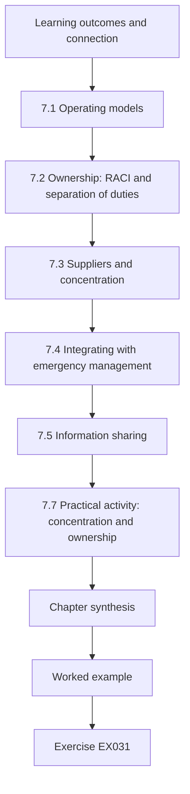

### Logical drawing

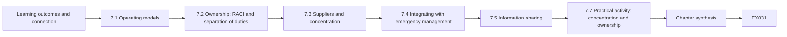

```text
[Learning outcomes and connection]
    |
    v
[7.1 Operating models]
    |
    v
[7.2 Ownership: RACI and separation of duties]
    |
    v
[7.3 Suppliers and concentration]
    |
    v
[7.4 Integrating with emergency management]
    |
    v
[7.5 Information sharing]
    |
    v
[7.7 Practical activity: concentration and ownership]
    |
    v
[Chapter synthesis]
    |
    v
[Worked example] --> [Exercise EX031]
```
<!-- open-cyber-academy:lesson-figures:end ch-07 -->


### Learning outcomes and connection

After this chapter you should be able to:

1. Compare operating models for OT and IT security in an essential-service organization and choose one with reasons.
2. Assign ownership so that every critical security activity has exactly one accountable role and conflicts of duty are visible.
3. Measure supplier concentration within an organization and across a region, and plan for common-mode supplier failure.
4. Integrate cyber incident response with emergency management, business continuity and regional resilience arrangements.
5. Design information sharing among operators that is useful, lawful and trusted.

Chapters 1–6 equipped the specialist to decide, evidence and evaluate. This chapter places that work inside an organization and a region, because most failures in essential services are failures of integration — between IT and operations, between an operator and its suppliers, between a cyber incident team and the people running emergency response. Chapter 8 tests integration in the hardest cases; Chapter 9 leads and assures it.

### 7.1 Operating models

Three common models for security in an organization that runs both IT and OT:

| Model | Description | Strengths | Weaknesses |
|---|---|---|---|
| Central | The CISO's team owns security for IT and OT | One standard, one risk view, efficient tooling | Distance from plant; controls designed for IT; operations may route around |
| Federated | Operations owns OT security with its own specialists; CISO sets policy and assures | Close to the process; safety culture; credible with operators | Inconsistent standards; duplicated tools; gaps at the IT/OT boundary |
| Integrated | A joint OT security function reporting to operations with a formal line to the CISO, shared standards, shared incident process | Combines process knowledge and security depth | Needs explicit ownership and conflict resolution; depends on people |

There is no universally right model. NIST SP 800-82 recommends forming a cross-functional team including control engineers, operators, IT security and safety staff ([NIST, 2023](https://doi.org/10.6028/NIST.SP.800-82r3)); NIST CSF 2.0 places roles, responsibilities and authorities under governance ([NIST, 2024](https://doi.org/10.6028/NIST.CSWP.29)). Merrow Water's choice of the integrated model — a Principal Security Specialist reporting to the Director of Operations with a dotted line to the CISO — follows from its size and from the weight it places on operators' trust. The model must then be made real through ownership, budget and incident process; an organization chart alone integrates nothing.

### 7.2 Ownership: RACI and separation of duties

For each critical activity, one role is **Accountable** (owns the outcome and approves), one or more are **Responsible** (do the work), others are **Consulted** or **Informed**. Two rules catch most ownership failures: every critical activity has **exactly one** accountable role; and where a single role both performs and approves an activity with security consequence — an emergency firewall change, a payment, a vendor access grant — the conflict is either removed or covered by a compensating control such as an after-the-fact review of every instance. Separation of duties is a long-standing control principle in NIST's catalogue ([NIST SP 800-53 Rev. 5](https://csrc.nist.gov/pubs/sp/800/53/r5/upd1/final)). Two accountable roles for "declare a cyber incident" sounds like extra safety; in practice it creates a gap at 3 a.m. when each assumes the other has decided.

### 7.3 Suppliers and concentration

Essential services depend on suppliers for control systems support, managed detection, telecoms and cloud hosting. Concentration has two levels:

- **Within an operator.** If one supplier provides all of a critical function, its failure — technical, commercial or a compromise — is the operator's failure. A standard measure of concentration is the Herfindahl–Hirschman index (HHI): the sum of squared percentage shares, from near 0 (many small suppliers) to 10,000 (one supplier) ([U.S. Department of Justice, HHI](https://www.justice.gov/atr/herfindahl-hirschman-index)). It is a coarse but useful flag.
- **Across a region.** If one supplier is a majority dependency for several operators, a single event becomes a regional event. The global outage of July 2024 caused by a faulty security-software update, which affected an estimated 8.5 million Windows devices according to Microsoft ([Microsoft, 2024](https://blogs.microsoft.com/blog/2024/07/20/helping-our-customers-through-the-crowdstrike-outage/)), showed how a trusted supplier can become a common-mode failure across sectors. Financial regulation has moved furthest on this: DORA requires registers of ICT third-party arrangements and creates oversight of critical ICT third-party providers ([Regulation (EU) 2022/2554](https://eur-lex.europa.eu/eli/reg/2022/2554/oj)).

Concentration is not automatically bad — one well-managed supplier can be safer than three poorly managed ones. The specialist's task is to make it visible, decide which concentrations are acceptable, and prepare **exit and continuity plans**: what would we do if this supplier were unavailable for a week, or compromised? Contracts should give rights to logs, notification of incidents, security requirements and support during the supplier's own incidents. Software supply-chain practices — software bills of materials ([CISA, SBOM](https://www.cisa.gov/sbom)), secure development ([NIST SP 800-218](https://csrc.nist.gov/pubs/sp/800/218/final)) and secure-by-design commitments ([CISA, Secure by Design](https://www.cisa.gov/securebydesign)) — help with the product side.

### 7.4 Integrating with emergency management

A major cyber incident at an essential service is also an emergency: boil-water notices, hospital diversions, port closures. The cyber incident team must therefore fit into the organization's **emergency and business-continuity command** rather than run in parallel. Practical integration points:

- A shared **incident classification** that maps cyber severity to service impact, so the duty manager can escalate without a security specialist present.
- Cyber representation in the emergency command structure, and emergency management representation in cyber exercises.
- **Manual-operation and continuity plans** owned by operations and tested with security scenarios (Chapter 6).
- Pre-agreed **regional arrangements**: who tells neighbouring operators, health services and local authorities; how mutual aid works; how public messages are coordinated. The EU CER Directive frames critical-entity resilience as all-hazards and cross-sector ([Directive (EU) 2022/2557](https://eur-lex.europa.eu/eli/dir/2022/2557/oj)); U.S. policy on critical infrastructure security and resilience similarly emphasizes sector coordination ([NSM-22 overview, CISA](https://www.cisa.gov/topics/critical-infrastructure-security-and-resilience/national-security-memorandum-critical-infrastructure-security-and-resilience)).

### 7.5 Information sharing

Operators learn faster together, but sharing carries legal, commercial and security risk. Useful sharing is **specific** (indicators, techniques, affected product versions, mitigations that worked), **timely**, **protected** (agreed handling rules, such as traffic-light labels), and **reciprocal**. A sharing agreement for a regional forum should cover: what is shared and in what format; handling and onward-sharing rules; personal data (minimize; check the lawful basis, [GDPR](https://eur-lex.europa.eu/eli/reg/2016/679/oj)); competition-law care for commercially sensitive information; liability; and how shared information may reach regulators. Trust is built mostly by behaviour: sharing first, protecting what others share, and giving credit.

### 7.6 Worked example: Merrow Bay's dependencies and a draft RACI (synthetic)

The resilience forum asked each operator which suppliers serve its essential functions and what share they provide. At the same time, Merrow Water's specialist drafted a RACI for five critical security activities, to be agreed with operations and the CISO. Lab 7 analyses both.

The questions were deliberately simple: which supplier serves each essential function, and roughly what share. Operators answered from contracts and asset registers rather than from memory, and the forum agreed in advance that answers would be used only for the regional analysis. The RACI draft covers approving and making emergency OT firewall changes, granting vendor remote sessions, declaring a cyber incident and restoring from offline backup, each chosen because a mistake in ownership there would delay response or weaken control.

### 7.7 Practical activity: concentration and ownership checks

```python
# Lab 7 - concentration and ownership checks for an integrated security function (offline, stdlib only)
# Synthetic: which suppliers Merrow Bay operators depend on for essential functions, and a draft RACI.
from collections import defaultdict
DEPENDS = [  # (operator, function, supplier, share of that operator's function served by the supplier)
    ("Merrow Water", "SCADA support", "Corvane Systems", 1.0),
    ("Merrow Water", "managed detection", "Lumen Watch", 1.0),
    ("Merrow Water", "telemetry links", "BayTel", 0.7), ("Merrow Water", "telemetry links", "radio (own)", 0.3),
    ("Merrow Health", "EPR hosting", "Halden Cloud", 1.0),
    ("Merrow Health", "managed detection", "Lumen Watch", 1.0),
    ("Merrow Health", "pathology LIMS", "Corvane Systems", 1.0),
    ("Merrow Energy", "SCADA support", "Corvane Systems", 0.6), ("Merrow Energy", "SCADA support", "in-house", 0.4),
    ("Merrow Energy", "telemetry links", "BayTel", 0.5), ("Merrow Energy", "telemetry links", "private fibre", 0.5),
    ("Port of Merrow", "terminal OS hosting", "Halden Cloud", 1.0),
    ("Port of Merrow", "managed detection", "Lumen Watch", 1.0),
]
by_op_fn = defaultdict(list)
for op, fn, sup, share in DEPENDS: by_op_fn[(op, fn)].append((sup, share))
print("Herfindahl-Hirschman index per operator function (10000 = single supplier):")
for (op, fn), lst in by_op_fn.items():
    hhi = sum((100 * s) ** 2 for _, s in lst)
    print(f"  {op:15s} {fn:20s} HHI {hhi:6.0f}")
reach = defaultdict(set)
for op, fn, sup, share in DEPENDS:
    if sup not in ("in-house", "radio (own)", "private fibre") and share >= 0.5: reach[sup].add(op)
print("Suppliers that are a majority dependency for 2+ operators (regional common mode):")
for sup, ops in sorted(reach.items(), key=lambda x: -len(x[1])):
    if len(ops) >= 2: print(f"  {sup:16s} {len(ops)} operators: {', '.join(sorted(ops))}")
RACI = {  # activity -> {role: letters}
    "approve OT firewall change":   {"OT engineer": "R", "OT manager": "A", "CISO": "C"},
    "emergency OT firewall change": {"OT engineer": "RA", "OT manager": "I"},
    "grant vendor remote session":  {"OT engineer": "R", "Service desk": "R"},
    "declare cyber incident":       {"CISO": "A", "Duty manager": "A", "OT manager": "C"},
    "restore from offline backup":  {"OT engineer": "R", "OT manager": "A", "IT ops": "R"},
}
print("RACI findings:")
for act, roles in RACI.items():
    a = [r for r, l in roles.items() if "A" in l]
    if len(a) != 1: print(f"  {act}: {len(a)} accountable roles {a}")
    for r, l in roles.items():
        if "R" in l and "A" in l: print(f"  {act}: {r} both does and approves (needs compensating control or record)")
```

Expected output:

```text
Herfindahl-Hirschman index per operator function (10000 = single supplier):
  Merrow Water    SCADA support        HHI  10000
  Merrow Water    managed detection    HHI  10000
  Merrow Water    telemetry links      HHI   5800
  Merrow Health   EPR hosting          HHI  10000
  Merrow Health   managed detection    HHI  10000
  Merrow Health   pathology LIMS       HHI  10000
  Merrow Energy   SCADA support        HHI   5200
  Merrow Energy   telemetry links      HHI   5000
  Port of Merrow  terminal OS hosting  HHI  10000
  Port of Merrow  managed detection    HHI  10000
Suppliers that are a majority dependency for 2+ operators (regional common mode):
  Corvane Systems  3 operators: Merrow Energy, Merrow Health, Merrow Water
  Lumen Watch      3 operators: Merrow Health, Merrow Water, Port of Merrow
  BayTel           2 operators: Merrow Energy, Merrow Water
  Halden Cloud     2 operators: Merrow Health, Port of Merrow
RACI findings:
  emergency OT firewall change: OT engineer both does and approves (needs compensating control or record)
  grant vendor remote session: 0 accountable roles []
  declare cyber incident: 2 accountable roles ['CISO', 'Duty manager']
```

**Interpretation.** Within operators, seven of ten function–operator pairs have HHI 10,000 — a single supplier — which is common and not alarming in itself. The regional view is more important: Corvane Systems is a majority dependency for three operators (SCADA support at water and energy, pathology systems at health), Lumen Watch provides managed detection to three, and BayTel and Halden Cloud each to two. A compromise of Lumen Watch would blind three operators' detection simultaneously; a Corvane remote-support compromise could reach three sectors' operational systems. These are forum-level risks no single operator's register will show. The RACI check finds three problems: the emergency firewall change has the OT engineer both doing and approving, which may be acceptable at night if every instance is reviewed the next working day; granting vendor remote sessions has **no** accountable role — the most dangerous finding, given Chapter 3's Hollin event; and declaring a cyber incident has two accountable roles, which should become one (the duty manager, who is always available) with the CISO consulted.

### 7.8 Common errors and limits

- Choosing an operating model by copying another organization rather than by size, risk and culture.
- Drawing an organization chart and calling it integration.
- Leaving critical activities with no accountable owner, or two.
- Assessing supplier risk one contract at a time, missing regional concentration.
- Treating a supplier's certification as evidence of resilience during the supplier's own incident.
- Running cyber incident response in parallel with emergency command.
- Sharing information without handling rules, or never sharing because rules are unclear.

The limit of structural analysis is that integration ultimately depends on relationships and practice. RACI tables and HHI values identify where to look; exercises and real incidents show whether integration works.

### Exercises — chapter 7

**EX031 — Repair the RACI.** *Objective:* fix ownership defects and verify. *Inputs:* Lab 7. *Constraints:* every activity exactly one A; any R+A conflict either removed or documented with a compensating control. *Steps:* (1) edit the RACI; (2) rerun and show no unaddressed findings; (3) write the compensating control for any conflict you keep. *Expected evidence:* edited table, output, control text. *Rubric:* 3 = vendor session grant given one accountable role (OT manager) with the service desk and OT engineer responsible, incident declaration single-accountable, emergency change conflict either removed or kept with next-day review of every instance; 2 = output clean but control missing; 1 = not rerun; 0 = none.

**EX032 — Regional common mode.** *Objective:* plan for a concentrated supplier. *Inputs:* Lumen Watch serving three operators. *Constraints:* forum has no authority over contracts; operators keep their own choices. *Steps:* (1) describe two failure scenarios (outage; compromise of the provider); (2) propose operator-level and forum-level actions; (3) define contract clauses to request at renewal. *Expected evidence:* plan. *Rubric:* 3 = scenarios distinct (blindness versus provider as attack path), actions include local minimum detection or logging retained by each operator, joint exercise, notification clauses, log access and exit plan; 2 = one scenario; 1 = "change supplier"; 0 = none.

**EX033 — Choose an operating model.** *Objective:* justify a model for another organization. *Inputs:* Port of Merrow: 600 staff, a two-person IT security team, terminal OT run by a contractor, a harbour master's operations centre. *Constraints:* use §7.1. *Steps:* compare models; choose; state the three conditions that would make your choice fail. *Expected evidence:* one-page recommendation. *Rubric:* 3 = choice argued from size, contractor dependence and operations culture, failure conditions specific; 2 = generic pros and cons; 1 = no choice; 0 = none.

**EX034 — Cyber within emergency command.** *Objective:* integrate response structures. *Inputs:* Merrow Water's existing emergency plan (boil-water, loss of supply) and its cyber incident procedure, which currently do not reference each other. *Constraints:* one shared classification; no duplicated command. *Steps:* (1) draft a combined classification table from service impact; (2) define the cyber lead's place in emergency command; (3) list the regional notifications and who makes them. *Expected evidence:* table and diagram description. *Rubric:* 3 = classification by service impact usable by a duty manager, cyber lead advising the incident commander rather than running a parallel structure, regional notifications assigned; 2 = parallel structures remain; 1 = cyber-only severity; 0 = none.

**EX035 — Concentration arithmetic and judgement.** *Objective:* compute and interpret HHI. *Inputs:* Merrow Health telemetry and network services split 40% / 40% / 20% across three carriers, two of which share the same duct along the harbour road. *Constraints:* show the calculation. *Steps:* (1) compute HHI; (2) explain why the number understates the real concentration; (3) propose how to represent shared physical paths. *Expected evidence:* calculation and paragraph. *Rubric:* 3 = HHI 3,600, recognition that 80% of service shares one physical route so effective concentration is far higher, proposal to compute concentration on physical paths or failure domains; 2 = number only; 1 = arithmetic wrong; 0 = none.

### Chapter synthesis

Integration is where essential-service security usually fails. Choose an operating model for your size, risk and culture, then make it real with ownership: exactly one accountable role per critical activity and visible handling of conflicts of duty. Measure supplier concentration within the organization and across the region, and prepare exit and continuity plans for common-mode supplier failure. Put cyber response inside emergency and continuity command with a shared, service-based classification. Share information specifically, under agreed handling rules, and build trust by behaviour.

<!-- open-cyber-academy:chapter-navigation:start ch-07 -->
### Continue studying — chapter 07 of 12

[← Chapter 06](#ch-06) · [Course chapter index](../SUBJECTS.md) · [Chapter 08 →](#ch-08)

Continue to the next authored lesson.
<!-- open-cyber-academy:chapter-navigation:end -->

<a id="ch-08"></a>

## Chapter 8 — Critical infrastructure and sector security: difficult cases

<!-- open-cyber-academy:lesson-figures:start ch-08 -->
### Lesson map

Lesson 08 published. Map, example, EX036.

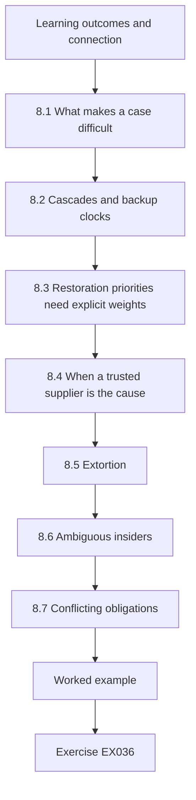

### Logical drawing

```mermaid
flowchart LR
  N0["Learning outcomes and connection"]
  N1["8.1 What makes a case difficult"]
  N2["8.2 Cascades and backup clocks"]
  N3["8.3 Restoration priorities need explicit weights"]
  N4["8.4 When a trusted supplier is the cause"]
  N5["8.5 Extortion"]
  N6["8.6 Ambiguous insiders"]
  N7["8.7 Conflicting obligations"]
  N0 --> N1 --> N2 --> N3 --> N4 --> N5 --> N6 --> N7 --> Q["EX036"]
```

```text
[Learning outcomes and connection]
    |
    v
[8.1 What makes a case difficult]
    |
    v
[8.2 Cascades and backup clocks]
    |
    v
[8.3 Restoration priorities need explicit weights]
    |
    v
[8.4 When a trusted supplier is the cause]
    |
    v
[8.5 Extortion]
    |
    v
[8.6 Ambiguous insiders]
    |
    v
[8.7 Conflicting obligations]
    |
    v
[Worked example] --> [Exercise EX036]
```
<!-- open-cyber-academy:lesson-figures:end ch-08 -->


### Learning outcomes and connection

After this chapter you should be able to:

1. Recognize the features that make a case difficult: interdependence, time pressure, conflicting duties, incomplete evidence and harm in every option.
2. Analyse cascading failures across sectors and set restoration priorities with explicit weights.
3. Structure decisions about trusted-supplier failures, extortion and ambiguous insider events.
4. Handle conflicting obligations to regulators, customers, partners and law enforcement without deceiving any of them.
5. Communicate under uncertainty in ways that later evidence will not discredit.

This chapter brings together the decision rules of Chapter 1, the evidence discipline of Chapter 3, the ethics of Chapter 4 and the integration of Chapter 7, and applies them where they strain. Chapter 9 then asks how a leader prepares an organization for such cases.

### 8.1 What makes a case difficult

Easy cases have a right answer that is hard to execute. Difficult cases have **no option without harm**, and the specialist must help choose which harm, quickly, with incomplete evidence, under scrutiny. Five features recur: **interdependence**, so that a decision for one service changes outcomes in others; **time pressure**, because backup supplies, storage and patience run down; **conflicting duties** to different stakeholders; **ambiguous evidence**, especially about cause and intent; and **irreversibility**, because some actions — paying, disconnecting, announcing — cannot be undone. The disciplines of earlier chapters still apply; what changes is that they must be prepared in advance, because there will be no time to invent them.

### 8.2 Cascades and backup clocks

Infrastructures depend on one another physically (power for pumps), digitally (telemetry over telecoms), geographically (shared ducts and sites) and logically (markets, staffing) ([Rinaldi, Peerenboom and Kelly, 2001](https://doi.org/10.1109/37.969131)). Network studies show that interdependent systems can fail more abruptly than either alone ([Buldyrev et al., 2010](https://doi.org/10.1038/nature08932)). For a specialist the practical tool is the **backup clock**: for each essential site, how long its own backup (generator fuel, storage, battery, manual workaround) lasts after a dependency fails. Harm begins when a clock runs out. Restoration decisions — which feeder to re-energize, which site to visit first — are choices about which clocks to stop.

The December 2015 intrusions at three Ukrainian electricity distribution companies, described in an industrial control systems alert, caused outages affecting approximately 225,000 customers; after power was restored, the companies continued to run under constrained operations ([CISA, IR-ALERT-H-16-056-01](https://www.cisa.gov/news-events/ics-alerts/ir-alert-h-16-056-01)). The case is a reminder that the end of an outage is not the end of a cyber-induced incident: control systems may not be trusted for some time, and restoration and continued operation may depend on manual work.

### 8.3 Restoration priorities need explicit weights

Restoration order is usually set by habit: largest load first, or quickest job first. Neither is designed to minimize harm. Ordering jobs to minimize total weighted completion time is a classic scheduling result ([Smith, 1956](https://doi.org/10.1002/nav.3800030106)); once backup clocks act as due dates, the problem becomes one of weighted tardiness, which is much harder in general — but for a handful of feeders you can simply enumerate every order. The harder part is the **weights**. Is an hour without power in a hospital worth the same as an hour without power in a home? Treating every person-hour equally is itself a value judgement, and usually a poor one when some sites carry life-critical functions. Weights must be agreed in advance with emergency management and recorded; the analysis then shows the order those weights imply and how sensitive it is to a backup failing.

### 8.4 When a trusted supplier is the cause

Supplier failures are difficult because the organization's own processes trust the supplier. The July 2024 faulty-update outage required affected organizations to recover many endpoints by hand ([Microsoft, 2024](https://blogs.microsoft.com/blog/2024/07/20/helping-our-customers-through-the-crowdstrike-outage/)). The decisions in such a case include: whether to disconnect the supplier's channel before knowing whether the cause is error or compromise; which systems to recover first (§8.3's restoration logic applies to endpoints as well as feeders); whether to delay updates in future and accept the security cost of slower protection; and how to keep detection while the detection tool itself is the problem. Preparing for this case means staged update rings for critical systems, independent recovery media, and a minimum capability that does not depend on the supplier.

### 8.5 Extortion

Ransomware and data-extortion cases force a decision about payment while services are degraded. A specialist does not decide whether to pay — that belongs to the executive, advised by counsel — but structures the decision: the realistic recovery time with and without decryption (decryptors are often slow and imperfect); the service and safety consequences of each timeline; the legal position, including sanctions risks, which must be checked with counsel; insurer conditions; the ethical and strategic consequences of funding criminal activity; and the evidence that would change the assessment. In May 2021 the Colonial Pipeline Company proactively shut down its pipeline system in response to a ransomware attack and restarted it six days later ([U.S. Department of Energy](https://www.energy.gov/ceser/colonial-pipeline-cyber-incident); see also [CISA, 2023](https://www.cisa.gov/news-events/news/attack-colonial-pipeline-what-weve-learned-what-weve-done-over-past-two-years)), illustrating that the decision to stop an essential service can itself be a precaution taken under uncertainty, with large consequences for others. Recovery readiness — tested backups, manual operation, clean rebuild capability — is what gives an organization freedom in this decision; it must exist before the case arises.

### 8.6 Ambiguous insiders

The Hollin event (Chapter 3) could be misuse of a shared vendor account, a vendor engineer's unrecorded legitimate change, or something else. Insider cases are difficult because the people involved are colleagues or partners, evidence is ambiguous, and premature accusation is harmful and sometimes unlawful. The water-sector case discussed in Chapters 2 and 3, whose first account was later disputed ([WUSF, 2023](https://www.wusf.org/local-state/2023-04-13/official-hack-oldsmar-city-water-treatment-plant-2021)), shows how public narratives can run ahead of evidence. Practice: **act on the access, not the person** (suspend the shared account, require named accounts), preserve evidence, involve HR and legal early, keep accusations out of communications, and remember that human error is usually a symptom of system design ([Reason, 2000](https://doi.org/10.1136/bmj.320.7237.768)).

### 8.7 Conflicting obligations

In a significant incident, a specialist may face, at once: a regulator's reporting deadline; law enforcement asking that some details remain confidential; a partner operator asking whether it is exposed; customers needing safety information; a supplier asking for delay before anything is said about its product; and insurers' conditions. The resolution principles are: **never deceive** anyone; **separate what you say from what you withhold**, and withhold only with a reason you could defend; give **safety information first**; meet **legal duties**, checking with counsel when duties conflict; and **record** each decision and its reason. Coordinated vulnerability disclosure (Chapter 4) is one structured way to manage the supplier conflict.

### 8.8 Worked example: restoration after a regional outage (synthetic)

A cyber incident at Merrow Energy's control centre has de-energized four feeders. Operators can safely restore one feeder at a time, manually. Each feeder serves essential sites with backup clocks: Hollin water works has six hours of storage; Fenley pumping four hours; the Harbour hospital has 48 hours of generator fuel; the container terminal two hours of battery; a fuel depot eight hours. Homes have no backup. The regional forum's emergency cell must recommend an order. Lab 8 enumerates every order, first with every person-hour weighted equally.

### 8.9 Practical activity: restoration order

```python
# Lab 8 - restoration order after a regional outage, with backup clocks running (offline, stdlib only)
# Synthetic: after a cyber-induced distribution outage, Merrow Energy can re-energize one feeder at a time.
# Each feeder carries essential sites whose backup lasts a fixed number of hours; after that, people lose service.
from itertools import permutations
FEEDERS = {  # feeder: (hours to restore safely, [(site, people served, backup hours)])
    "F1 Harbour":  (4, [("homes", 40000, 0), ("Harbour hospital", 3000, 48)]),
    "F2 Hollin":   (3, [("Hollin water works", 70000, 6)]),
    "F3 Fenley":   (2, [("homes", 18000, 0), ("Fenley pumping", 25000, 4)]),
    "F4 Port":     (5, [("container terminal", 2000, 2), ("fuel depot", 15000, 8)]),
}
def harm(order):
    t, total = 0, 0
    for f in order:
        t += FEEDERS[f][0]
        for site, people, backup in FEEDERS[f][1]:
            total += people * max(0, t - backup)
    return total
res = sorted((harm(o), o) for o in permutations(FEEDERS))
print("best five orders (person-hours without service):")
for h, o in res[:5]: print(f"  {h:9,d}  {' > '.join(o)}")
print(f"worst: {res[-1][0]:,d}  {' > '.join(res[-1][1])}")
largest = sorted(FEEDERS, key=lambda f: -sum(p for _, p, _ in FEEDERS[f][1]))
print(f"'largest load first' {' > '.join(largest)}: {harm(largest):,d}")
shortest = sorted(FEEDERS, key=lambda f: FEEDERS[f][0])
print(f"'quickest job first' {' > '.join(shortest)}: {harm(shortest):,d}")
# What if the hospital generator fails at hour 2 (backup 48 -> 2)? Re-solve.
FEEDERS["F1 Harbour"][1][1] = ("Harbour hospital", 3000, 2)
res2 = sorted((harm(o), o) for o in permutations(FEEDERS))
print(f"after hospital generator failure, best: {res2[0][0]:,d}  {' > '.join(res2[0][1])}")
```

Expected output:

```text
best five orders (person-hours without service):
    510,000  F3 Fenley > F2 Hollin > F1 Harbour > F4 Port
    589,000  F2 Hollin > F3 Fenley > F1 Harbour > F4 Port
    600,000  F3 Fenley > F1 Harbour > F2 Hollin > F4 Port
    631,000  F1 Harbour > F2 Hollin > F3 Fenley > F4 Port
    642,000  F1 Harbour > F3 Fenley > F2 Hollin > F4 Port
worst: 1,299,000  F4 Port > F1 Harbour > F3 Fenley > F2 Hollin
'largest load first' F2 Hollin > F1 Harbour > F3 Fenley > F4 Port: 681,000
'quickest job first' F3 Fenley > F2 Hollin > F1 Harbour > F4 Port: 510,000
after hospital generator failure, best: 531,000  F3 Fenley > F2 Hollin > F1 Harbour > F4 Port
```

**Interpretation.** With equal weights, the best order — Fenley, Hollin, Harbour, Port — loses 510,000 person-hours of service; the worst loses 1,299,000. The habit "largest load first" costs 681,000, a third more than the best; "quickest job first" happens to coincide with the best here, but only because short jobs and short backup clocks coincide (Fenley's pumping clock is four hours). Strikingly, when the hospital's generator fails, the equal-weight best order does not change: 3,000 hospital users are few compared with 70,000 water customers, so equal weights keep the hospital third. That result is the analysis telling you that its weights are wrong for this purpose. EX036 asks you to weight hospital person-hours more heavily; under a plausible weighting the hospital moves to first once its generator fails. The decision belongs to the emergency cell; the specialist's contribution is to show the order implied by each defensible set of weights, and how one failed backup changes it.

### 8.10 Common errors and limits

- Treating a difficult case as if it had a harmless option and searching for it while clocks run out.
- Restoring by habit rather than by explicit, pre-agreed weights.
- Weighting all person-hours equally and calling it neutral.
- Trusting the supplier's channel during a supplier-caused incident.
- Letting a specialist, rather than the accountable executive, decide on extortion payment.
- Accusing individuals before evidence supports it.
- Making statements to one stakeholder that contradict statements to another.

The limit of analysis in difficult cases is time. The enumeration in Lab 8 takes milliseconds; agreeing the weights takes weeks of planning. Do that work before the event, rehearse it, and accept that during the event you will be choosing among imperfect options with incomplete information.

### Exercises — chapter 8

**EX036 — Weights change the order.** *Objective:* see how value weights determine restoration. *Inputs:* Lab 8. *Constraints:* weight each hospital person-hour 20 times a home person-hour; leave others at 1. *Steps:* (1) modify the harm function; (2) report the best order with the 48-hour generator and after the generator fails at 2 hours; (3) explain the change and who should set the weight. *Expected evidence:* code change, outputs, paragraph. *Rubric:* 3 = with a working generator the best order is unchanged (510,000); after failure, Harbour moves first (best 751,000 weighted person-hours, Harbour > Hollin > Fenley > Port); explanation identifies the weight as a pre-agreed emergency-management judgement; 2 = numbers right, explanation thin; 1 = not run; 0 = none.

**EX037 — Structure an extortion decision.** *Objective:* support an executive decision without making it. *Inputs:* Merrow Health's patient-administration system encrypted; backups intact but a clean rebuild estimated at 9 days; attackers claim to hold patient data and offer a decryptor. *Constraints:* no legal conclusions; patient safety first. *Steps:* (1) list options; (2) for each, recovery timeline, safety and service consequences, legal questions for counsel, ethical considerations and uncertainties; (3) state what evidence would change the analysis. *Expected evidence:* decision brief. *Rubric:* 3 = options include rebuild without payment and partial measures, decryptor reliability treated as uncertain, data-extortion separated from recovery, sanctions and reporting questions for counsel, safety measures independent of the choice; 2 = one consideration missing; 1 = recommends payment or refusal as technical fact; 0 = none.

**EX038 — Supplier-caused outage.** *Objective:* decide under a trusted-supplier failure. *Inputs:* an update from Merrow Water's endpoint security supplier crashes HMIs at four works overnight; the supplier says it is a defect. *Constraints:* plants must keep producing safe water. *Steps:* (1) immediate actions; (2) recovery order across sites; (3) whether and how to block further updates; (4) changes to update policy afterwards, with their security cost. *Expected evidence:* plan. *Rubric:* 3 = manual operation first, supplier channel paused pending verification, recovery ordered by backup clocks, staged update rings afterwards with explicit acceptance of slower protection; 2 = no policy change; 1 = waits for the supplier; 0 = none.

**EX039 — Insider communications.** *Objective:* communicate an ambiguous insider case. *Inputs:* Hollin event with the corrected timeline. *Constraints:* no individual named; employment and contractual processes respected. *Steps:* draft (1) an internal message to staff; (2) a message to Corvane; (3) a statement for the resilience forum. *Expected evidence:* three short texts. *Rubric:* 3 = factual, no accusation, actions on access stated (named accounts, suspended shared account), Corvane asked for session records under contract, forum given useful protective information; 2 = one text over-claims; 1 = accusatory; 0 = none.

**EX040 — Conflicting obligations.** *Objective:* reconcile demands without deception. *Inputs:* during the Hollin investigation, police ask Merrow Water not to disclose the vendor account detail; the regulator's notification deadline arrives; Merrow Energy asks whether it should suspend Corvane access; a journalist asks whether water was unsafe. *Constraints:* follow §8.7 principles; check with counsel where needed. *Steps:* for each party, what you say, what you withhold and why, and who approves. *Expected evidence:* table. *Rubric:* 3 = safety answer given truthfully (dose returned to normal within a minute and verified), regulator informed fully under confidentiality, Merrow Energy given protective advice without breaching police request (for example advice to review all shared vendor accounts), journalist not misled, approvals recorded; 2 = one party mishandled; 1 = deceptive statement; 0 = none.

### Chapter synthesis

Difficult cases have harm in every option, under time pressure, with ambiguous evidence and conflicting duties. Prepare for them: map dependencies and backup clocks; agree restoration weights with emergency management in advance; plan for supplier-caused failures with update rings and independent recovery; structure extortion decisions for the accountable executive; act on access rather than on people in insider cases; and resolve conflicting obligations by never deceiving, putting safety first, withholding only with defensible reasons and recording each decision. Analysis is fast; agreement is slow — do the slow part before the event.

<!-- open-cyber-academy:chapter-navigation:start ch-08 -->
### Continue studying — chapter 08 of 12

[← Chapter 07](#ch-07) · [Course chapter index](../SUBJECTS.md) · [Chapter 09 →](#ch-09)

Continue to the next authored lesson.
<!-- open-cyber-academy:chapter-navigation:end -->

<a id="ch-09"></a>

## Chapter 9 — Critical infrastructure and sector security: leadership and assurance

<!-- open-cyber-academy:lesson-figures:start ch-09 -->
### Lesson map

Lesson 09 published. Map, example, EX041.

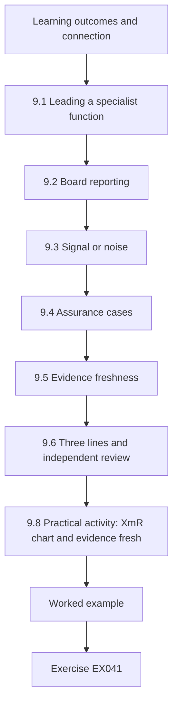

### Logical drawing

```mermaid
flowchart LR
  N0["Learning outcomes and connection"]
  N1["9.1 Leading a specialist function"]
  N2["9.2 Board reporting"]
  N3["9.3 Signal or noise"]
  N4["9.4 Assurance cases"]
  N5["9.5 Evidence freshness"]
  N6["9.6 Three lines and independent review"]
  N7["9.8 Practical activity: XmR chart and evidence fresh"]
  N0 --> N1 --> N2 --> N3 --> N4 --> N5 --> N6 --> N7 --> Q["EX041"]
```

```text
[Learning outcomes and connection]
    |
    v
[9.1 Leading a specialist function]
    |
    v
[9.2 Board reporting]
    |
    v
[9.3 Signal or noise]
    |
    v
[9.4 Assurance cases]
    |
    v
[9.5 Evidence freshness]
    |
    v
[9.6 Three lines and independent review]
    |
    v
[9.8 Practical activity: XmR chart and evidence fresh]
    |
    v
[Worked example] --> [Exercise EX041]
```
<!-- open-cyber-academy:lesson-figures:end ch-09 -->


### Learning outcomes and connection

After this chapter you should be able to:

1. Lead a security function in an essential service: set direction, build capability, and keep the trust of operations and the board.
2. Report to a board in service units with a small set of indicators that inform decisions.
3. Tell real change from noise in a security indicator using a process-behaviour (XmR) chart.
4. Build an assurance case for a resilience claim and maintain the freshness of its evidence.
5. Use the three lines model and independent review without turning assurance into paperwork.

Chapters 7 and 8 integrated security into the organization and tested it in difficult cases. This chapter is about the person responsible for it over years: what they report, how they know whether things are improving, and how they show others that claims are true. Chapter 10 then turns to the external evidence a leader must read.

### 9.1 Leading a specialist function

A security leader in an essential service leads people who are scarce, often stretched, and working across cultures — control engineers, IT staff, operators, suppliers. Four responsibilities dominate. **Direction:** a small number of priorities tied to the service and its consequence, revisited when evidence changes (Chapter 1's review triggers). **Capability:** the skills, tools and time to do the work, including succession, so that knowledge of a critical system does not live in one head. **Trust:** operations must believe that security understands the plant and will not endanger it; the board must believe reports are candid. **Accountability:** clear ownership (Chapter 7) and a record of decisions (Chapter 1). Professional codes require honesty about limits ([ACM Code of Ethics](https://www.acm.org/code-of-ethics)); for a leader this includes telling the board what is not known.

Building capability in OT security is partly a matter of mixing backgrounds: control engineers who learn security and security specialists who learn the process. Rotations, joint exercises (Chapter 6) and shared incident reviews (Chapter 3) do more than courses alone.

### 9.2 Board reporting

Boards need to make decisions about appetite, investment and accountability. A good report is short and answers four questions: **Are we within appetite?** (Chapter 4's tail and distribution bounds, in service units); **What changed?** (new threats, incidents, assumptions); **Are our controls working?** (verified evidence, Chapter 2; evaluated performance, Chapter 6); **What do you need to decide?** Indicators should be few, defined, and tied to consequence: verified coverage of high-weight practices; time to remediate known-exploited vulnerabilities on exposed systems, using a reference list such as CISA's catalogue ([CISA, KEV](https://www.cisa.gov/known-exploited-vulnerabilities-catalog)); last successful manual-operation drill per major site; recovery time demonstrated for critical systems; and open decisions with owners. Avoid counts that measure activity rather than outcome — numbers of alerts, trainings delivered, findings closed.

### 9.3 Signal or noise

Every indicator varies month to month. Reacting to every rise wastes attention; ignoring a real shift wastes time. A **process-behaviour chart** (also called an individuals and moving-range, or XmR, chart) separates the two using the indicator's own history. From a baseline period, compute the mean and the average absolute difference between consecutive values (the mean moving range); natural process limits are the mean plus or minus 2.66 times the mean moving range. Points outside the limits, or long runs on one side of the mean, signal a change worth investigating; points inside are routine variation ([NIST/SEMATECH e-Handbook, control charts](https://www.itl.nist.gov/div898/handbook/pmc/section3/pmc32.htm)). Two practical rules: choose the baseline from a period believed stable and **do not include the period you are testing**; and treat a signal as a prompt to investigate, not as proof of a cause.

### 9.4 Assurance cases

An **assurance case** is a structured argument that a claim is true, supported by evidence. It follows the general structure of argument — claim, grounds, warrant, rebuttal ([Toulmin, 2003](https://doi.org/10.1017/CBO9780511840005)) — applied to systems. For example: *Claim:* "Hollin can supply safe water for 72 hours without its control system." *Sub-claims:* manual dosing can be maintained by the staff on any shift; chemical stock lasts 72 hours; analysers work without SCADA; staff can be relieved. *Evidence:* drill reports with times and participants; stock records; analyser tests; rota. *Rebuttals considered:* night shift with minimum staff; analyser power loss; simultaneous incident at Fenley. An assurance case makes visible which evidence each claim depends on, so that when evidence ages or fails the affected claims are known.

### 9.5 Evidence freshness

Evidence decays. A restore tested eighteen months ago says little about today's backups; a firewall review before a network change says little after it. For each assurance claim, set a **maximum evidence age** related to how fast the underlying system changes, and report stale evidence as a gap, even if nothing is known to be wrong. A low-grade evidence type (an attestation) with a long allowed age deserves particular scrutiny: it may be "fresh" by the rule but weak by nature (Chapter 2's grades).

### 9.6 Three lines and independent review

The Institute of Internal Auditors' Three Lines Model describes roles for management (first line: owning and managing risk), specialist risk and compliance functions (second line: expertise, support and challenge) and internal audit (third line: independent assurance), all accountable to a governing body ([IIA, 2020](https://www.theiia.org/en/content/position-papers/2020/the-iias-three-lines-model-an-update-of-the-three-lines-of-defense/)). For essential-service security, the model's value is clarity: operations owns the risk of its plant; the security function sets standards, challenges and helps; internal audit or an external reviewer tests that the system works. The model fails when the second line does the first line's work (so nobody in operations owns it) or when audit tests documents rather than reality.

### 9.7 Worked example: Merrow Water's board pack (synthetic)

Merrow Water's board receives monthly the median days to remediate known-exploited vulnerabilities on internet-facing systems. After a December reading of 24 days, a non-executive director asked whether things were getting worse or whether December was a bad month. At the same meeting, the specialist presented the evidence behind six assurance claims. Lab 9 examines both.

The director's question is the right one, and it cannot be answered by comparing December with November alone. The specialist needs a baseline from months when nothing unusual was known to have happened, so the chart uses the first eleven months and keeps the later readings out of it. The six claims were chosen because each supports the board's statement that Merrow Water can recover safely from a cyber incident; each has a named evidence type, a date and a maximum acceptable age agreed with internal audit.

### 9.8 Practical activity: XmR chart and evidence freshness

```python
# Lab 9 - is the assurance signal a change or noise? An XmR chart and evidence freshness (offline, stdlib only)
# Synthetic: Merrow Water's monthly median days to remediate known-exploited vulnerabilities on internet-facing
# systems, reported to the board, and the age of the evidence behind six assurance claims.
from datetime import date
MONTHS = ["Jan","Feb","Mar","Apr","May","Jun","Jul","Aug","Sep","Oct","Nov","Dec","Jan2","Feb2","Mar2"]
DAYS =   [  12,   9,  14,  11,  13,  10,   12,  15,   11,   9,   13,   24,   21,    23,    25]
BASE = 11  # first 11 months form the baseline
x = DAYS[:BASE]; mean = sum(x) / BASE
mr = [abs(b - a) for a, b in zip(x, x[1:])]; mrbar = sum(mr) / len(mr)
ucl, lcl = mean + 2.66 * mrbar, max(0, mean - 2.66 * mrbar)
print(f"baseline mean {mean:.2f} days, mean moving range {mrbar:.2f}, limits [{lcl:.2f}, {ucl:.2f}]")
run = 0
for m, d in zip(MONTHS, DAYS):
    flag = []
    if d > ucl or d < lcl: flag.append("outside limits")
    run = run + 1 if d > mean else 0
    if run >= 4: flag.append(f"{run} in a row above mean")
    print(f"  {m:5s} {d:3d} {'; '.join(flag)}")
TODAY = date(2026, 10, 12)
CLAIMS = [  # (claim, evidence type, date of evidence, maximum acceptable age in days)
    ("offline backups restorable", "restore test record", date(2026, 3, 2), 180),
    ("vendor sessions all brokered", "broker log reconciliation", date(2026, 9, 20), 31),
    ("no default credentials on PLCs", "engineer attestation", date(2025, 11, 5), 365),
    ("manual dosing drill passed", "drill report", date(2026, 6, 18), 365),
    ("IT/OT firewall rules reviewed", "rule review sign-off", date(2026, 1, 9), 180),
    ("MFA on all remote access", "IdP configuration export", date(2026, 10, 1), 90),
]
print("evidence freshness:")
for c, ev, d, mx in CLAIMS:
    age = (TODAY - d).days
    print(f"  {'STALE' if age > mx else 'ok   '} {age:4d}d / {mx:3d}d  {c} ({ev})")
```

Expected output:

```text
baseline mean 11.73 days, mean moving range 3.10, limits [3.48, 19.97]
  Jan    12 
  Feb     9 
  Mar    14 
  Apr    11 
  May    13 
  Jun    10 
  Jul    12 
  Aug    15 
  Sep    11 
  Oct     9 
  Nov    13 
  Dec    24 outside limits
  Jan2   21 outside limits
  Feb2   23 outside limits; 4 in a row above mean
  Mar2   25 outside limits; 5 in a row above mean
evidence freshness:
  STALE  224d / 180d  offline backups restorable (restore test record)
  ok      22d /  31d  vendor sessions all brokered (broker log reconciliation)
  ok     341d / 365d  no default credentials on PLCs (engineer attestation)
  ok     116d / 365d  manual dosing drill passed (drill report)
  STALE  276d / 180d  IT/OT firewall rules reviewed (rule review sign-off)
  ok      11d /  90d  MFA on all remote access (IdP configuration export)
```

**Interpretation.** Over the eleven-month baseline the indicator averaged 11.7 days with natural limits of about 3.5 to 20.0 days. December's 24 days is outside the limits — a signal, not just a bad month — and the following three months are also outside, with a run above the mean. Something changed in December; candidate causes include a staff departure, a change in the vulnerability catalogue's content, a new class of internet-facing systems, or a change in how the indicator is computed. The chart tells the board *that* to ask, not *which* answer is right. On evidence, two of six claims are stale: the offline-backup restore test (224 days old against a 180-day limit) and the IT/OT firewall review (276 days against 180). The PLC default-credential claim is within its age limit but rests on an engineer's attestation — the weakest evidence grade — and expires within a month. The board should hear three things: a real deterioration in remediation time since December with an investigation under way; two stale assurance claims with dates for renewal; and one claim that needs stronger evidence, not just newer.

### 9.9 Common errors and limits

- Reporting activity counts rather than consequence-related indicators.
- Reacting to every monthly rise, or explaining away a real shift as noise.
- Including the suspect period in the baseline, which widens limits and hides the signal.
- Writing assurance claims with no named evidence, or evidence with no date.
- Treating fresh but weak evidence as strong.
- Letting the security function own operational risk on operations' behalf.
- Presenting only good news to the board.

The limit of indicators and charts is that they summarize. They tell a leader where to look; the looking — conversations with operators, site visits, reading incident reviews — remains the leader's job.

### Exercises — chapter 9

**EX041 — A contaminated baseline.** *Objective:* see how baseline choice affects signals. *Inputs:* Lab 9. *Constraints:* change the baseline to the first twelve months (including December). *Steps:* (1) rerun; (2) report the new mean, moving range and limits; (3) report which later months are now outside the limits; (4) explain the lesson. *Expected evidence:* output and paragraph. *Rubric:* 3 = mean 12.75, mean moving range about 3.82, limits about [2.6, 22.9]; December still outside but January (21) now inside; lesson that including the period under test widens limits and can hide a shift; 2 = numbers right, lesson missing; 1 = not run; 0 = none.

**EX042 — One-page board report.** *Objective:* report in service units for decisions. *Inputs:* Lab 9 outputs, Chapter 2 verified coverage for Merrow Water (39%), Chapter 6 evaluation, Chapter 7 RACI findings. *Constraints:* one page; at most six indicators; end with decisions requested. *Steps:* write the report. *Expected evidence:* report. *Rubric:* 3 = appetite status in service units, signal reported with uncertainty about cause, stale and weak evidence identified, decisions specific with owners; 2 = activity metrics included; 1 = reassurance without evidence; 0 = none.

**EX043 — Assurance case.** *Objective:* build a structured argument. *Inputs:* the claim "Hollin can supply safe water for 72 hours without its control system". *Constraints:* at least four sub-claims; each with evidence type, maximum age and current status; at least three rebuttals. *Steps:* build the case as a table or tree. *Expected evidence:* assurance case. *Rubric:* 3 = sub-claims cover people, materials, instruments and duration; evidence verified-grade where possible with ages; rebuttals realistic (night shift, analyser power, concurrent incident) with responses; 2 = evidence undated; 1 = restates the claim; 0 = none.

**EX044 — Three lines in practice.** *Objective:* assign assurance roles. *Inputs:* the six assurance claims in Lab 9. *Constraints:* use the Three Lines Model. *Steps:* for each claim assign first-line owner, second-line challenge activity and third-line test method; identify one claim where the second line is currently doing first-line work. *Expected evidence:* table and paragraph. *Rubric:* 3 = owners are operational roles, challenge and test methods distinct, a credible example of role confusion (for example the security team running restore tests that operations should own); 2 = lines confused in one row; 1 = generic; 0 = none.

**EX045 — Capability and succession.** *Objective:* reduce single-person dependence. *Inputs:* Merrow Water's only engineer who understands the Hollin dosing controller logic plans to retire in 18 months. *Constraints:* budget for one additional post; operations must not be disrupted. *Steps:* (1) identify what knowledge is at risk and how to capture it; (2) design a development plan for two successors; (3) define evidence that succession has worked. *Expected evidence:* plan. *Rubric:* 3 = knowledge captured as verified artefacts (annotated logic, test procedures, recorded walkthroughs), paired working and supervised changes, evidence such as a successor-led change and drill without the retiring engineer; 2 = training courses only; 1 = documentation only; 0 = none.

### Chapter synthesis

Leading security for an essential service means setting direction tied to consequence, building capability that survives departures, and keeping the trust of operations and the board. Report to the board in service units with few indicators and explicit decisions. Use process-behaviour charts to tell change from noise, with a clean baseline. Build assurance cases that connect each claim to dated evidence of known grade, and report stale or weak evidence as gaps. Use the three lines to keep ownership with operations, challenge with specialists and independent testing with audit.

<!-- open-cyber-academy:chapter-navigation:start ch-09 -->
### Continue studying — chapter 09 of 12

[← Chapter 08](#ch-08) · [Course chapter index](../SUBJECTS.md) · [Chapter 10 →](#ch-10)

Continue to the next authored lesson.
<!-- open-cyber-academy:chapter-navigation:end -->

<a id="ch-10"></a>

## Chapter 10 — Research reading and critique

<!-- open-cyber-academy:lesson-figures:start ch-10 -->
### Lesson map

Lesson 10 published. Map, example, EX046.

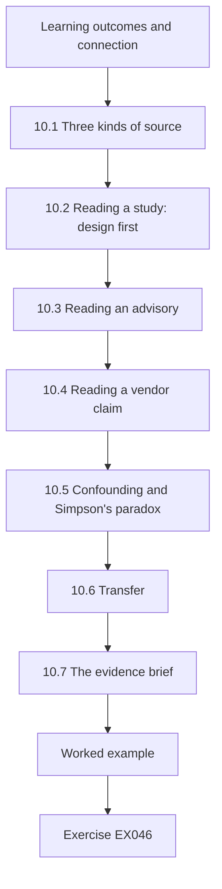

### Logical drawing

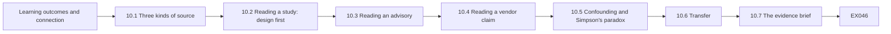

```text
[Learning outcomes and connection]
    |
    v
[10.1 Three kinds of source]
    |
    v
[10.2 Reading a study: design first]
    |
    v
[10.3 Reading an advisory]
    |
    v
[10.4 Reading a vendor claim]
    |
    v
[10.5 Confounding and Simpson's paradox]
    |
    v
[10.6 Transfer]
    |
    v
[10.7 The evidence brief]
    |
    v
[Worked example] --> [Exercise EX046]
```
<!-- open-cyber-academy:lesson-figures:end ch-10 -->


### Learning outcomes and connection

After this chapter you should be able to:

1. Read a published study, an official advisory and a vendor claim for what it can contribute to a practical decision.
2. Identify the design of a study and the strongest claim that design supports.
3. Check denominators, comparisons and outcome definitions, and detect confounding such as Simpson's paradox.
4. Judge whether a finding transfers to your organization and sector.
5. Write a short evidence brief that states what a source shows, what it does not, and what you will do with it.

A specialist does not need to produce research, but must use it: to choose controls, to set probabilities (Chapters 1 and 4), to argue with suppliers and to brief boards. This chapter teaches reading for decisions. Chapter 11 then applies the same critical eye to evaluating your own project.

### 10.1 Three kinds of source

| Source type | Strength | Typical weakness | How to use it |
|---|---|---|---|
| Peer-reviewed study | Explicit method, reviewed, citable | Narrow setting; lag; may not measure what you care about | Learn effect sizes and mechanisms; check transfer |
| Official advisory or report | Timely, operational detail, authority | Written for action, not inference; selection of cases | Learn techniques and mitigations; do not infer frequency |
| Vendor or survey report | Large samples, current | Commercial interest; undefined denominators; respondent selection | Use for hypotheses; verify before acting |

None is automatically trustworthy or worthless. Each answers some questions well and others badly. Your job is to match the source to the question.

### 10.2 Reading a study: design first

Before reading results, identify the design, because it limits the claim. A before-and-after comparison at one site can show that something changed but struggles to show why. A comparison with an unaffected control group, or an interrupted time series, supports stronger causal language. A survey of victims cannot estimate how often attacks happen in the whole population. Then check: the **unit** (hospital, patient, day), the **outcome** and how it was measured, the **comparison** (what would have happened otherwise), the **time window**, and the **setting**.

Consider two real health-sector studies. Ghafur and colleagues analysed national hospital activity data around the 2017 WannaCry attack and found no significant change in total activity across all English trusts, but about 6% fewer admissions per day at infected hospitals, an estimated £5.9 million of lost activity, and no detected difference in mortality — while noting that mortality is a crude measure of patient harm ([Ghafur et al., 2019](https://doi.org/10.1038/s41746-019-0161-6)). Dameff and colleagues compared emergency-department volumes at two hospitals next to a health system under a month-long ransomware attack in 2021, before, during and after the attack, and reported significant increases in census, ambulance arrivals and other measures during the attack ([Dameff et al., 2023](https://doi.org/10.1001/jamanetworkopen.2023.12270)). Both are valuable; both are bounded by design. The first uses national data with comparison across trusts; the second is a before-and-after study at one institution, so seasonal or local changes cannot be fully excluded. Neither tells Merrow Health how likely an attack is; both inform how severe and how regional the consequences can be.

Population-level datasets answer different questions. Neprash and colleagues used a database of publicly reported ransomware attacks on U.S. health care delivery organizations and found that annual attacks more than doubled from 2016 to 2021 and that almost half disrupted care delivery ([Neprash et al., 2022](https://doi.org/10.1001/jamahealthforum.2022.4873)). Because the data are *publicly reported* attacks, trends combine changes in attacks with changes in reporting — a limitation the authors' design makes explicit and a reader must carry forward.

### 10.3 Reading an advisory

Advisories such as CISA's joint advisory on state-sponsored pre-positioning in U.S. critical infrastructure ([AA24-038A, 2024](https://www.cisa.gov/news-events/cybersecurity-advisories/aa24-038a)) give techniques, indicators and mitigations from investigated cases. Read them for: **what was observed** (techniques, targeted sectors, entry vectors); **what is recommended** (mitigations, often prioritized); and **what is inferred** (intent, scale). Translate the observed techniques into questions about your own environment — "would we see this?" — rather than into a probability. An advisory is evidence that a threat exists and how it operates, not an estimate of how often it succeeds.

### 10.4 Reading a vendor claim

Vendor claims deserve the same reading discipline. Ask: what is the **outcome** (reported incidents? detected incidents? losses?); what is the **denominator** (customers, sites, operator-years?); **who is in each group** and why (self-selection, size, sector); and **what would a detection product do to the outcome** (more monitoring finds more incidents). Research on machine learning in security lists pitfalls — sampling bias, data snooping, inappropriate baselines, base-rate fallacy, unrealistic threat models — that apply to many product evaluations ([Arp et al., 2022](https://www.usenix.org/conference/usenixsecurity22/presentation/arp)).

### 10.5 Confounding and Simpson's paradox

When groups differ in a factor that also affects the outcome, a pooled comparison can point in the opposite direction from every within-group comparison. This is **Simpson's paradox** ([Simpson, 1951](https://doi.org/10.1111/j.2517-6161.1951.tb00088.x)). In security data, size is a frequent confounder: large operators have more systems, more reporting obligations and more incidents, and they buy products in different proportions from small ones. The remedy is to **stratify** (compare within size bands) or **standardize** (re-weight groups to the same mix) and to ask whether the outcome measures harm or detection.

### 10.6 Transfer

A finding transfers to your setting only if the mechanism that produced it operates there. The formal literature on transportability asks which population differences change the effect ([Pearl and Bareinboim, 2014](https://doi.org/10.1214/14-STS486)); in practice, list the conditions the finding depended on — size, sector, regulatory reporting, technology, staffing — and check each for your organization. A mortality finding from a national health system with network-wide diversion arrangements may not transfer to a rural region with one hospital.

For the vendor brochure in this chapter, transfer is a further question after confounding: even a well-designed comparison among other operators would apply to Merrow Bay only if their size, reporting practice and plant resembled the forum's members. Write the conditions down and mark each as checked, unknown or different.

### 10.7 The evidence brief

Summarize each important source for decision-makers in a short **evidence brief**: the question it helps with; design and setting; main finding with its size and uncertainty; strongest claim supported; key limitations and their likely direction; transfer to our setting; and what we will do with it. Keep briefs in a library so later decisions can cite them (Chapter 1's decision records).

A brief is short by design, usually one page, so that a director can read it before a meeting. The strongest claim supported should be written in the words you would be willing to defend in front of the authors; if the source's own conclusion is stronger, say so and explain the difference. Date every brief and note when it should be reviewed, since advisories and vendor data age quickly.

### 10.8 Worked example: a monitoring vendor's brochure (synthetic)

A vendor of OT monitoring tells the resilience forum: "Customers using our monitoring had 40% fewer reported incidents." Asked for data, the vendor supplies counts by operator size. Lab 10 re-reads them.

The specialist's first move is to ask what lies behind the number before arguing about it: what counts as an incident, over how many operator-years, and how the customers and non-customers differ. The vendor's willingness to supply counts by size is itself useful; a vendor that refuses to share any denominator has given the forum a reason to treat the claim as marketing. The forum agrees to review the data together rather than respond to the brochure.

### 10.9 Practical activity: aggregation, denominators and detection

```python
# Lab 10 - re-reading a vendor claim: aggregation, denominators and survivorship (offline, stdlib only)
# Synthetic: a vendor brochure says "customers using our OT monitoring had 40% fewer reported incidents".
# Below are the (invented) counts behind such a claim, split by operator size.
DATA = {  # stratum: {group: (operators, operator-years observed, incidents reported)}
    "small (<50 staff)": {"monitoring": (240, 720, 54), "none": (100, 300, 15)},
    "large (>=50 staff)": {"monitoring": (20, 60, 18),   "none": (100, 300, 75)},
}
def rate(g):
    oy = sum(DATA[s][g][1] for s in DATA); inc = sum(DATA[s][g][2] for s in DATA)
    return inc / oy, inc, oy
for g in ("monitoring", "none"):
    r, inc, oy = rate(g); print(f"pooled {g:10s} {inc:3d} incidents / {oy:4d} operator-years = {r:.3f}")
rm, rn = rate("monitoring")[0], rate("none")[0]
print(f"pooled relative difference: {(rm - rn) / rn:+.0%}")
for s, grp in DATA.items():
    a = grp["monitoring"][2] / grp["monitoring"][1]; b = grp["none"][2] / grp["none"][1]
    print(f"{s:20s} monitoring {a:.3f}  none {b:.3f}  ratio {a/b:.2f}")
# Standardize both groups to the same size mix (the 'none' group's operator-years) - direct standardization
w = {s: DATA[s]["none"][1] for s in DATA}; W = sum(w.values())
std = {g: sum(w[s] / W * DATA[s][g][2] / DATA[s][g][1] for s in DATA) for g in ("monitoring", "none")}
print(f"size-standardized: monitoring {std['monitoring']:.3f}  none {std['none']:.3f}  ratio {std['monitoring']/std['none']:.2f}")
```

Expected output:

```text
pooled monitoring  72 incidents /  780 operator-years = 0.092
pooled none        90 incidents /  600 operator-years = 0.150
pooled relative difference: -38%
small (<50 staff)    monitoring 0.075  none 0.050  ratio 1.50
large (>=50 staff)   monitoring 0.300  none 0.250  ratio 1.20
size-standardized: monitoring 0.188  none 0.150  ratio 1.25
```

**Interpretation.** Pooled, monitored operators report 0.092 incidents per operator-year against 0.150 for unmonitored operators, a 38% difference — the brochure's claim. But within each size band, monitored operators report **more** incidents: 1.5 times as many among small operators, 1.2 times among large ones. The pooled comparison reverses because most monitored operators are small, and small operators report fewer incidents whatever they use. Standardized to the same size mix, monitored operators report 1.25 times as many incidents. And "reported incidents" is a detection outcome: a monitoring product that works should *increase* reported incidents by finding what was missed. Neither the pooled nor the stratified figures say anything about harm prevented. The right response to the vendor is not "your product is bad" but "your claim does not follow from these data; show us outcomes in service units, matched by size and sector, over time".

### 10.10 Common errors and limits

- Reading results before identifying the design.
- Treating an advisory's case list as a frequency estimate.
- Comparing groups that differ in size or sector without stratifying.
- Treating reported incidents as a measure of harm or of security.
- Accepting a finding without checking whether its mechanism operates in your setting.
- Dismissing a source entirely because it has one weakness.
- Citing a source for more than it showed.

The limit of critical reading is time. Prioritize sources that could change a decision (Chapter 1's value of information), read those carefully, and accept lighter reading for the rest.

### Exercises — chapter 10

**EX046 — Re-read the brochure.** *Objective:* reproduce and explain a reversal. *Inputs:* Lab 10. *Constraints:* 250 words for the explanation. *Steps:* (1) run the lab; (2) explain the reversal to the forum in plain language; (3) propose two outcome measures that would better show the product's value. *Expected evidence:* output and explanation. *Rubric:* 3 = reversal explained via size mix and detection effect, standardized ratio quoted, outcome measures tied to harm (for example hours of service interruption, time to detect injected tests); 2 = reversal explained, measures weak; 1 = repeats the brochure; 0 = none.

**EX047 — Evidence brief: neighbouring hospitals.** *Objective:* brief a study for Merrow Health. *Inputs:* Dameff et al. (2023) abstract. *Constraints:* use §10.7 structure; quote numbers only from the source. *Steps:* write the brief. *Expected evidence:* one-page brief. *Rubric:* 3 = design identified as before-and-after at one institution, findings stated with their measures, limitations (single site, seasonality, no control region) with direction, transfer to Merrow Bay's three-hospital system discussed, action (for example regional diversion planning) stated; 2 = limitations undirected; 1 = over-claims causality; 0 = none.

**EX048 — Evidence brief: WannaCry.** *Objective:* brief a national study. *Inputs:* Ghafur et al. (2019) and the NAO investigation. *Constraints:* distinguish the two sources' purposes. *Steps:* write a brief answering "what does WannaCry tell Merrow Health about the consequences of a large-scale ransomware event?" *Expected evidence:* brief. *Rubric:* 3 = study's findings (about 6% fewer admissions per day at infected hospitals; no detected mortality difference with the authors' caution) and NAO's audit purpose distinguished, transfer issues stated, action stated; 2 = sources merged; 1 = "no deaths so low risk"; 0 = none.

**EX049 — From advisory to questions.** *Objective:* use an advisory well. *Inputs:* CISA AA24-038A. *Constraints:* do not estimate probability from it. *Steps:* (1) extract five observed techniques or behaviours; (2) for each, write the question "would we see this at Merrow Water?" and the evidence source that would answer it; (3) pick two recommended mitigations and map them to Chapter 2's practices. *Expected evidence:* table. *Rubric:* 3 = observed behaviours accurately summarized (for example valid-account use and living-off-the-land techniques), detection questions tied to specific logs, mitigations mapped; 2 = mixes observation and inference; 1 = summary only; 0 = none.

**EX050 — Pitfall check.** *Objective:* apply a research checklist to a product evaluation. *Inputs:* a vendor states its machine-learning anomaly detector "achieved 99% accuracy on a public water-treatment testbed dataset". *Constraints:* use pitfalls from Arp et al. (2022). *Steps:* list five questions you would ask and why each matters. *Expected evidence:* list. *Rubric:* 3 = base-rate and accuracy-versus-precision issue, train/test leakage (data snooping), testbed-to-plant transfer, baseline comparison, threat model realism; 2 = three; 1 = generic scepticism; 0 = none.

### Chapter synthesis

Read for decisions. Match the source to the question: studies for effect sizes and mechanisms, advisories for techniques and mitigations, vendor reports for hypotheses to verify. Identify design before results and limit claims to what the design supports. Check outcome, denominator, comparison and confounders; stratify or standardize when groups differ, and remember that reported incidents measure detection as much as harm. Ask whether the mechanism transfers to your setting. Record what you learn in evidence briefs that decision records can cite.

<!-- open-cyber-academy:chapter-navigation:start ch-10 -->
### Continue studying — chapter 10 of 12

[← Chapter 09](#ch-09) · [Course chapter index](../SUBJECTS.md) · [Chapter 11 →](#ch-11)

Continue to the next authored lesson.
<!-- open-cyber-academy:chapter-navigation:end -->

<a id="ch-11"></a>

## Chapter 11 — Applied project

<!-- open-cyber-academy:lesson-figures:start ch-11 -->
### Lesson map

Lesson 11 published. Map, example, EX051.

```mermaid
flowchart TD
  N0["Learning outcomes and connection"]
  N1["11.1 Choosing the project"]
  N2["11.2 The project charter"]
  N3["11.3 Delivering through people"]
  N4["11.4 Evaluating the result"]
  N5["11.5 Reporting the project"]
  N6["11.6 Assessment rubric"]
  N7["11.8 Practical activity: did it work?"]
  N0 --> N1 --> N2 --> N3 --> N4 --> N5 --> N6 --> N7
  N7 --> EX["Worked example"]
  EX --> Q["Exercise EX051"]
```

### Logical drawing

```mermaid
flowchart LR
  N0["Learning outcomes and connection"]
  N1["11.1 Choosing the project"]
  N2["11.2 The project charter"]
  N3["11.3 Delivering through people"]
  N4["11.4 Evaluating the result"]
  N5["11.5 Reporting the project"]
  N6["11.6 Assessment rubric"]
  N7["11.8 Practical activity: did it work?"]
  N0 --> N1 --> N2 --> N3 --> N4 --> N5 --> N6 --> N7 --> Q["EX051"]
```

```text
[Learning outcomes and connection]
    |
    v
[11.1 Choosing the project]
    |
    v
[11.2 The project charter]
    |
    v
[11.3 Delivering through people]
    |
    v
[11.4 Evaluating the result]
    |
    v
[11.5 Reporting the project]
    |
    v
[11.6 Assessment rubric]
    |
    v
[11.8 Practical activity: did it work?]
    |
    v
[Worked example] --> [Exercise EX051]
```
<!-- open-cyber-academy:lesson-figures:end ch-11 -->


### Learning outcomes and connection

After this chapter you should be able to:

1. Scope an organization-scale security improvement as a project with a decision-maker, a consequence-based objective and measurable benefits.
2. Plan delivery with stakeholders, risks, safety conditions and checkpoints.
3. Evaluate the result honestly with a comparison group, a difference-in-differences estimate and a permutation check.
4. Test the robustness of a project result and report its limits.
5. Present the project for assessment against an explicit rubric.

The applied project is where the course becomes practice. It uses every earlier chapter: framing and decision records (1), current practice and verification (2), evidence (3), risk and ethics (4), design (5), controlled evaluation (6), integration (7), difficult-case thinking (8), assurance (9) and critical reading (10). Unlike a master's dissertation, its purpose is not to answer a research question for others; it is to **improve a real service and show credibly whether it did**. Chapter 12 then reviews the course and transfers it.

### 11.1 Choosing the project

A good postgraduate applied project is: **consequential** (it changes an essential service's exposure, not just a document); **bounded** (deliverable within about two semesters of part-time work); **owned** (a named sponsor with authority, and operational owners who want it); **measurable** (a benefit that can be observed, preferably in service units); **safe and authorized** (it creates no unapproved risk to operations, people or data); and **evaluable** (there is a way to compare with what would have happened without it). Typical projects: manual-operation readiness for a group of sites; brokered vendor access for one control system; a restore capability for clinical systems; a regional supplier-concentration plan. If you are not employed in the sector, the project can be carried out on a realistic synthetic case like Merrow Bay, with the same deliverables.

### 11.2 The project charter

A one-page **charter** fixes: the problem and its consequence; the sponsor and decision rights; objectives and benefits with measures and baselines; scope and exclusions; deliverables; stakeholders; constraints (safety, budget, regulation); risks; the evaluation design; milestones and checkpoints; and the assessment rubric. Writing the evaluation design into the charter before delivery is the project equivalent of pre-registration ([Nosek et al., 2018](https://doi.org/10.1073/pnas.1708274114)): it protects the specialist from the temptation to choose, afterwards, the measure that looks best ([Kerr, 1998](https://doi.org/10.1207/s15327957pspr0203_4)).

### 11.3 Delivering through people

Most security projects in essential services fail on adoption, not technology. Map stakeholders by influence and interest; agree with operations how and when changes touch plant; plan training and supervised practice; and anticipate who loses something (convenience, autonomy, budget). A **pre-mortem** at the start ([Klein, 2007](https://hbr.org/2007/09/performing-a-project-premortem)) surfaces adoption risks early. Keep a project decision log in the Chapter 1 format so later reviewers can see why the plan changed.

At Merrow Water the people most affected by the runbook project are shift operators, who must practise manual operation during quarterly drills on top of normal work. Agreeing drill times with shift managers and using their feedback to revise the runbook makes adoption far more likely than issuing it from head office.

### 11.4 Evaluating the result

Before-and-after comparisons are seductive and weak: the outcome may have improved anyway because of season, practice, new staff or other projects. A stronger, practical design is **difference-in-differences (DiD)**: compare the change at sites that received the project (pilot) with the change at similar sites that did not (comparison) over the same period. The estimate is (pilot after − pilot before) − (comparison after − comparison before). Its key assumption is **parallel trends**: without the project, pilot and comparison sites would have changed by the same amount. The design was popularized in economics by a well-known study comparing employment in neighbouring states ([Card and Krueger, 1994](https://www.jstor.org/stable/2118030)); it applies equally to drill times or recovery times across sites.

With few sites, ordinary standard errors are unreliable. A **permutation check** is simple and honest: compute the DiD for every possible way of choosing which sites were "pilot", and ask how unusual the real assignment's estimate is. If many random assignments produce estimates as large, the result could be chance. Finally, test **robustness**: drop the most influential site, use a different outcome definition, or check whether pilot and comparison sites were already diverging before the project.

### 11.5 Reporting the project

The final report states the problem, what was done, what changed, how sure we are, and what remains. It reports the pre-specified measure first; additional analyses are labelled exploratory. Limitations are written with their **direction** — would this weakness make the effect look larger or smaller? — so readers can judge the result. Benefits that could not be measured are described, not invented. The report ends with handover: owners, maintenance, the assurance evidence that will keep the claim fresh (Chapter 9) and the review trigger.

### 11.6 Assessment rubric

Projects are assessed against five criteria, each scored 0–3:

| Criterion | 3 (excellent) | 1 (weak) |
|---|---|---|
| Framing | Consequence-based problem, sponsor, measurable benefit, evaluation pre-specified | Problem vague; measure chosen after results |
| Delivery | Safe, authorized, adopted by operations; decisions logged | Delivered to paper only; operations bypassed |
| Evaluation | Comparison group, DiD or equivalent, uncertainty and robustness reported | Before-and-after only, no uncertainty |
| Ethics and safety | Risks to people and service assessed; distribution considered | Not considered |
| Communication and handover | Clear report, directed limitations, owners and assurance evidence | Advocacy; no handover |

### 11.7 Worked example: the manual-operation runbook project (synthetic)

Merrow Water's specialist ran a project to introduce a manual-operation runbook and quarterly drills at six works (pilot), chosen because they had the oldest control systems; six other works continued as before (comparison). The pre-specified outcome was mean minutes to stable manual operation in quarterly drills, averaged over two quarters before and two after. The charter pre-specified DiD with a permutation check and a robustness check dropping the most influential site.

Choosing pilot sites for their old control systems was sensible for the service, because those works most needed the runbook, but it means the pilot and comparison groups were not alike at the start. That is why the charter required difference-in-differences rather than an after-only comparison, and why parallel trends must be argued rather than assumed. The six comparison works are expected to receive the runbook in the next phase, which gives a later chance to test the result.

### 11.8 Practical activity: did it work?

```python
# Lab 11 - did the project work? Difference-in-differences with a permutation check (offline, stdlib only)
# Synthetic: Merrow Water piloted a manual-operation runbook and drills at six works (pilot) and not at six others.
# Outcome: mean minutes to stable manual operation in quarterly drills, two quarters before and two after.
from itertools import combinations
SITES = {  # site: (pilot?, mean minutes before, mean minutes after)
    "Hollin": (1, 41, 27), "Fenley": (1, 38, 29), "Upper Merrow": (1, 55, 36), "Kettle Ford": (1, 33, 28),
    "Ashby": (1, 47, 35), "Saltings": (1, 36, 30),
    "Brack": (0, 39, 35), "Dunmere": (0, 44, 40), "Orrin": (0, 35, 34), "Pelling": (0, 50, 43),
    "Quarry Lane": (0, 31, 30), "Rook": (0, 42, 36),
}
def did(treated):
    t = [SITES[s][2] - SITES[s][1] for s in SITES if s in treated]
    c = [SITES[s][2] - SITES[s][1] for s in SITES if s not in treated]
    return sum(t) / len(t) - sum(c) / len(c), sum(t) / len(t), sum(c) / len(c)
pilot = {s for s, v in SITES.items() if v[0]}
est, dt, dc = did(pilot)
print(f"pilot change {dt:+.2f} min, comparison change {dc:+.2f} min, difference-in-differences {est:+.2f} min")
naive = sum(SITES[s][2] for s in pilot) / 6 - sum(SITES[s][2] for s in SITES if s not in pilot) / 6
print(f"naive after-only difference {naive:+.2f} min")
allc = [did(set(c))[0] for c in combinations(SITES, 6)]
p = sum(1 for d in allc if d <= est) / len(allc)
print(f"permutation: {len(allc)} assignments; share with DiD <= observed = {p:.4f}")
# Sensitivity: drop the site with the largest pilot improvement
big = min(pilot, key=lambda s: SITES[s][2] - SITES[s][1])
rest = {s: SITES[s] for s in SITES if s != big}
t = [v[2]-v[1] for s, v in rest.items() if v[0]]; c = [v[2]-v[1] for s, v in rest.items() if not v[0]]
print(f"without {big}: DiD {sum(t)/len(t) - sum(c)/len(c):+.2f} min")
```

Expected output:

```text
pilot change -10.83 min, comparison change -3.83 min, difference-in-differences -7.00 min
naive after-only difference -5.50 min
permutation: 924 assignments; share with DiD <= observed = 0.0087
without Upper Merrow: DiD -5.37 min
```

**Interpretation.** Pilot sites improved by 10.8 minutes on average; comparison sites by 3.8 minutes, probably through general practice and awareness. The DiD estimate is a 7.0-minute improvement attributable to the project under the parallel-trends assumption. A naive after-only comparison (5.5 minutes) would understate it, because pilot sites started slower — they were chosen for their old systems. Of 924 possible assignments of six "pilot" sites, fewer than 1% produce an improvement as large as the real one, so chance is an unlikely explanation. Dropping Upper Merrow, the site with the largest improvement, reduces the estimate to 5.4 minutes: the result is robust in direction but sensitive in size to one site. The report should state "about 5 to 7 minutes faster, mainly but not only driven by Upper Merrow", note that pilot sites were selected for old systems (so parallel trends is an assumption to defend), and recommend extending the runbook to comparison sites with the same evaluation.

### 11.9 Common errors and limits

- Choosing a project for its interest rather than its consequence.
- Starting without a sponsor who can make decisions.
- Defining the success measure after seeing results.
- Evaluating with before-and-after only.
- Reporting a single estimate without a chance check or robustness test.
- Listing limitations without their direction.
- Finishing without handover, so the benefit decays.

With a dozen sites, no evaluation is definitive. The project's evaluation should be honest about that and designed so the next phase (for example, rolling out to comparison sites in a staggered order) yields more evidence.

### Exercises — chapter 11

**EX051 — Project charter.** *Objective:* scope your own applied project. *Inputs:* your organization, or Merrow Bay. *Constraints:* one page; all charter elements in §11.2; evaluation pre-specified. *Steps:* write the charter. *Expected evidence:* charter. *Rubric:* use §11.6 "Framing" and "Ethics and safety" criteria; 3 = consequential, bounded, owned, measurable, safe and evaluable, with a named comparison; 2 = evaluation vague; 1 = activity rather than outcome; 0 = none.

**EX052 — Robustness of the permutation result.** *Objective:* check sensitivity to one site. *Inputs:* Lab 11. *Constraints:* remove Upper Merrow from the data entirely (11 sites, 5 pilot). *Steps:* (1) recompute DiD; (2) recompute the permutation share over all assignments of 5 pilots among 11 sites; (3) interpret. *Expected evidence:* numbers and paragraph. *Rubric:* 3 = DiD −5.37 minutes, 462 assignments, share about 0.017; interpretation that the result remains unlikely under chance but is weaker, with direction of the selection limitation; 2 = numbers right, interpretation thin; 1 = not run; 0 = none.

**EX053 — Stakeholder and adoption plan.** *Objective:* plan delivery through people. *Inputs:* the runbook project. *Constraints:* include night shifts and contractors. *Steps:* map stakeholders; identify who loses what; plan training, supervised practice and feedback; run a short pre-mortem and list three failure stories with mitigations. *Expected evidence:* plan. *Rubric:* 3 = stakeholders specific, losses acknowledged, practice-based training, credible pre-mortem stories; 2 = no pre-mortem; 1 = communications plan only; 0 = none.

**EX054 — Directed limitations.** *Objective:* write limitations that help readers judge. *Inputs:* Lab 11 result. *Constraints:* at least five limitations, each with direction and how a later phase could address it. *Steps:* write them. *Expected evidence:* list. *Rubric:* 3 = selection of pilot sites, regression to the mean (slow sites improve more anyway — would inflate), practice effects, small sample, drill realism versus real events, contamination of comparison sites; directions correct; 2 = directions missing; 1 = generic; 0 = none.

**EX055 — Handover and benefits.** *Objective:* make benefits last. *Inputs:* the runbook project at completion. *Constraints:* use Chapter 9's assurance case and freshness ideas. *Steps:* (1) name owners; (2) define the assurance claim and evidence with maximum ages; (3) define an indicator for the board with an XmR baseline; (4) define the review trigger. *Expected evidence:* handover note. *Rubric:* 3 = operational owners, verified-grade evidence with ages, indicator with baseline period stated, trigger specific; 2 = one element missing; 1 = "project closed"; 0 = none.

### Chapter synthesis

An applied project improves a real service and shows credibly whether it did. Choose something consequential, bounded, owned, measurable, safe and evaluable; fix the evaluation in a charter before delivery; deliver through people, with operations' consent and a pre-mortem; evaluate with a comparison group, difference-in-differences, a permutation check and robustness tests; report limitations with their direction; and hand over with owners, assurance evidence and a review trigger.

<!-- open-cyber-academy:chapter-navigation:start ch-11 -->
### Continue studying — chapter 11 of 12

[← Chapter 10](#ch-10) · [Course chapter index](../SUBJECTS.md) · [Chapter 12 →](#ch-12)

Continue to the next authored lesson.
<!-- open-cyber-academy:chapter-navigation:end -->

<a id="ch-12"></a>

## Chapter 12 — Final review and transfer

<!-- open-cyber-academy:lesson-figures:start ch-12 -->
### Lesson map

Lesson 12 published. Map, example, EX056.

```mermaid
flowchart TD
  N0["Learning outcomes and connection"]
  N1["12.1 The course as one method"]
  N2["12.2 Transfer between sectors"]
  N3["12.3 Multi-criteria decisions and reversal points"]
  N4["12.4 Self-assessment and continuing practice"]
  N5["12.6 Practical activity: same options, different wei"]
  N6["Chapter synthesis"]
  N7["Chapter 1: EX001–EX005"]
  N0 --> N1 --> N2 --> N3 --> N4 --> N5 --> N6 --> N7
  N7 --> EX["Worked example"]
  EX --> Q["Exercise EX056"]
```

### Logical drawing

```mermaid
flowchart LR
  N0["Learning outcomes and connection"]
  N1["12.1 The course as one method"]
  N2["12.2 Transfer between sectors"]
  N3["12.3 Multi-criteria decisions and reversal points"]
  N4["12.4 Self-assessment and continuing practice"]
  N5["12.6 Practical activity: same options, different wei"]
  N6["Chapter synthesis"]
  N7["Chapter 1: EX001–EX005"]
  N0 --> N1 --> N2 --> N3 --> N4 --> N5 --> N6 --> N7 --> Q["EX056"]
```

```text
[Learning outcomes and connection]
    |
    v
[12.1 The course as one method]
    |
    v
[12.2 Transfer between sectors]
    |
    v
[12.3 Multi-criteria decisions and reversal points]
    |
    v
[12.4 Self-assessment and continuing practice]
    |
    v
[12.6 Practical activity: same options, different wei]
    |
    v
[Chapter synthesis]
    |
    v
[Chapter 1: EX001–EX005]
    |
    v
[Worked example] --> [Exercise EX056]
```
<!-- open-cyber-academy:lesson-figures:end ch-12 -->


### Learning outcomes and connection

After this chapter you should be able to:

1. Integrate the course's methods into one coherent approach to organization-scale security decisions.
2. Transfer a decision from one sector to another by re-examining assumptions and re-eliciting weights.
3. Find the weight at which a multi-criteria recommendation reverses, and use it to focus discussion.
4. Assess your own competence against the course outcome with evidence, and plan continuing development.
5. Complete an advanced case analysis that draws on every chapter.

This final chapter reviews the course as a single method, practises transferring it to a new sector, and prepares the final assessment. Its last exercise is the course's integrating case.

### 12.1 The course as one method

Read across the chapters, the course describes one cycle that a specialist runs continuously:

1. **Frame** the decision: owner, options including defer, objectives in service units (Chapter 1).
2. **Know the baseline**: obligations, guidance and verified practice (Chapter 2).
3. **Establish the facts**: evidence that separates observation from inference (Chapter 3).
4. **Quantify and distribute risk**: frequency, severity, tail, and who bears it (Chapter 4).
5. **Design alternatives**: consequence-first, compared as graphs and as operable systems (Chapter 5).
6. **Evaluate before trusting**: controlled tests with intervals (Chapter 6).
7. **Integrate**: ownership, suppliers, emergency command and sharing (Chapter 7).
8. **Prepare for the hard cases**: weights, clocks and obligations agreed in advance (Chapter 8).
9. **Lead and assure**: indicators, assurance cases, fresh evidence (Chapter 9).
10. **Read critically**: studies, advisories and claims, for transfer (Chapter 10).
11. **Deliver and evaluate projects** honestly (Chapter 11).

Each step produces an artefact others can inspect — a decision record, a verification plan, a finding, a loss exceedance curve with a distribution table, an ADR, an evaluation report, a RACI, a restoration-weight agreement, an assurance case, an evidence brief, a project report. A specialist's credibility rests on those artefacts more than on any single judgement.

### 12.2 Transfer between sectors

Specialists move between sectors, and regional work requires reasoning about several at once. Transfer fails in two characteristic ways: copying **conclusions** that depended on the first sector's conditions; and copying **weights** that reflected the first sector's values. Transfer succeeds when you copy the **method** and re-examine each assumption. A practical transfer checklist:

- **Consequence and time:** what is the essential function, and how fast does harm arrive when it fails? (A hospital's minutes, a water system's hours, a port's days.)
- **Physics and safety:** what failure modes can a security action itself cause?
- **Regulation:** which regimes and reporting clocks apply, and what evidence do they expect?
- **People and suppliers:** who will implement and operate the measure; which suppliers concentrate risk?
- **Data and privacy:** what personal or sensitive data are involved, and what duties follow? Healthcare security, for instance, sits under data-protection and health-privacy duties that a water utility rarely faces ([GDPR](https://eur-lex.europa.eu/eli/reg/2016/679/oj); [HHS, HPH CPGs](https://hphcyber.hhs.gov/performance-goals.html)).
- **Values:** what do this sector's leaders and the people it serves weigh most heavily, and who should set the weights?

### 12.3 Multi-criteria decisions and reversal points

When options are compared on several criteria with weights — a simple weighted-sum model — the recommendation depends on the weights. Rather than defending one weight set, find the **reversal point**: the weight at which the recommendation changes. If the reversal point is far from any plausible weight, the recommendation is robust; if it is close, the discussion should focus on that weight. Systematic sensitivity analysis of models is a field in its own right ([Saltelli et al., 2008](https://doi.org/10.1002/9780470725184)); for a three-option decision, a one-dimensional sweep is usually enough. This is the multi-criteria counterpart of the probability thresholds in Chapter 1.

### 12.4 Self-assessment and continuing practice

The course outcome is to **lead advanced application and justify organization-scale choices** in critical infrastructure and sector security. Assess yourself against it with evidence, not feelings: for each chapter, which artefact have you produced, to what standard (the exercise rubrics), and what feedback did you receive? Gaps become a continuing-development plan with specific practice, not only courses: lead a drill; write a decision record for a real decision; review a supplier contract; brief a board; present an evidence brief to peers. Professional codes expect practitioners to maintain competence and to work within it ([ACM Code of Ethics](https://www.acm.org/code-of-ethics); [NSPE Code of Ethics](https://www.nspe.org/resources/ethics/code-ethics)). Laws, standards and threats will change during your career; the habits of framing, evidence, honest uncertainty and recorded judgement will not.

### 12.5 Worked example: transferring a programme choice to Merrow Health (synthetic)

Merrow Water's panel scored three security programmes on four criteria (0–10): continuity of the essential service, safety of people, affordability and privacy. Merrow Water's leadership weighted continuity heavily and privacy lightly. Merrow Health wants to reuse the analysis. The specialist copies the scores only after checking each one with clinical and information-governance colleagues (in this example they are confirmed), and asks Merrow Health's leadership to set its own weights. Lab 12 compares the results and finds the reversal point.

Copying the scores is a judgement in itself. Continuity and safety scores might differ in a hospital, where clinical systems fail into harm within minutes and privacy carries legal duties that a water utility rarely faces. Recording that each score was checked, and by whom, lets a reader see that the transfer rests on verified inputs rather than on Merrow Water's panel alone.

### 12.6 Practical activity: same options, different weights

```python
# Lab 12 - transferring a decision to another sector: same options, different weights (offline, stdlib only)
# Synthetic: three security programmes scored 0-10 on four criteria by Merrow Water's panel, then reused
# by Merrow Health. Scores are invented; the weights are what each sector's leadership agreed.
OPTIONS = {  # option: scores on (continuity of essential service, safety of people, cost-affordability, privacy)
    "P1 manual-operation readiness":     (9, 7, 6, 4),
    "P2 identity and remote-access":     (6, 6, 7, 8),
    "P3 network monitoring and response": (7, 5, 4, 6),
}
CRIT = ["continuity", "safety", "affordability", "privacy"]
WEIGHTS = {
    "water":  (0.45, 0.30, 0.20, 0.05),
    "health": (0.25, 0.30, 0.15, 0.30),
}
for sector, w in WEIGHTS.items():
    assert abs(sum(w) - 1) < 1e-9
    scores = {o: sum(a * b for a, b in zip(s, w)) for o, s in OPTIONS.items()}
    print(sector, " ".join(f"{o.split()[0]}={v:.2f}" for o, v in scores.items()), " best:", max(scores, key=scores.get).split()[0])
# Sweep the privacy weight, taking it proportionally from the other water weights, to find the reversal point
w0 = WEIGHTS["water"]; prev = None
for k in range(0, 61):
    p = k / 100; rest = sum(w0[:3])
    w = tuple(x / rest * (1 - p) for x in w0[:3]) + (p,)
    best = max(OPTIONS, key=lambda o: sum(a * b for a, b in zip(OPTIONS[o], w))).split()[0]
    if best != prev: print(f"privacy weight {p:.2f}: best {best}"); prev = best
```

Expected output:

```text
water P1=7.55 P2=6.30 P3=5.75  best: P1
health P1=6.45 P2=6.75 P3=5.65  best: P2
privacy weight 0.00: best P1
privacy weight 0.28: best P2
```

**Interpretation.** With water's weights, manual-operation readiness (P1) scores 7.55 and is clearly preferred. With health's weights — privacy now 0.30 because patient data are at stake — identity and remote-access (P2) wins at 6.75 against 6.45. The sweep on water's weights shows that P2 overtakes P1 once privacy's weight passes about 0.28; for health, the reverse sweep (EX056) shows P1 regains first place once continuity's weight exceeds about 0.32. The transfer lesson is that **the scores travelled, the conclusion did not**: the same evidence, weighed by a different sector's legitimate values, recommends a different programme. The specialist's job is to make that visible, not to argue one sector into the other's weights. The reversal points also tell each leadership exactly which judgement to debate.

### 12.7 Common errors and limits

- Copying a conclusion from one sector without re-examining its conditions.
- Re-using another organization's weights as if they were facts.
- Defending a single weight set instead of reporting reversal points.
- Treating course completion as competence without evidence.
- Planning development only as courses, not as practice with feedback.
- Assuming today's laws, standards and threat picture will hold.

Weighted-sum models assume criteria can trade off linearly and that scores are on comparable scales; neither is fully true. They are tools for structured conversation, best used with the reversal points and the decision record.

### Exercises — chapter 12

**EX056 — Health's reversal point.** *Objective:* find where the recommendation changes. *Inputs:* Lab 12. *Constraints:* sweep continuity's weight for health, taking the remainder proportionally from the other three criteria. *Steps:* (1) modify the sweep; (2) report the weight at which P1 overtakes P2; (3) derive the same point algebraically; (4) explain what Merrow Health's leadership should debate. *Expected evidence:* code, output, derivation and paragraph. *Rubric:* 3 = reversal between 0.31 and 0.32 by sweep and 0.318 algebraically (4.4c − 1.4 = 0), discussion focused on continuity versus privacy for clinical services; 2 = sweep only; 1 = not run; 0 = none.

**EX057 — Transfer checklist.** *Objective:* transfer a water-sector conclusion to a port. *Inputs:* Chapter 1's robust recommendation C (half remote-access hardening, half manual-operations capability) for Merrow Water. *Constraints:* use the §12.2 checklist for Port of Merrow. *Steps:* for each item state what differs and whether it changes the conclusion; then state what you would re-elicit. *Expected evidence:* table and conclusion. *Rubric:* 3 = differences specific (time to harm in days; contractor-run terminal OT; different regimes; supplier concentration on Halden Cloud and Lumen Watch; commercial rather than public-health consequences), conclusion re-derived rather than copied, re-elicitation listed; 2 = some items generic; 1 = copies the conclusion; 0 = none.

**EX058 — Self-assessment with evidence.** *Objective:* assess competence against the course outcome. *Inputs:* your exercise answers and feedback. *Constraints:* evidence for each claim. *Steps:* (1) for each chapter, list your artefact and its rubric score; (2) identify your three weakest areas; (3) write a 12-month development plan with practice activities and evidence of progress. *Expected evidence:* table and plan. *Rubric:* 3 = honest scores with evidence, weaknesses specific, plan practice-based with measurable evidence; 2 = plan course-only; 1 = no evidence; 0 = none.

**EX059 — Integrating case: Merrow Bay supplier compromise.** *Objective:* apply the whole course to one advanced case. *Inputs:* synthetic scenario: Corvane Systems reports that an attacker accessed its remote-support platform for eleven days; Corvane supports SCADA at Merrow Water and Merrow Energy and pathology systems at Merrow Health. Logs at Merrow Water show three Corvane sessions in that period, one at night outside any ticket. *Constraints:* 3,000 words maximum; synthetic data only; cite chapters for methods. *Steps:* (1) frame the immediate and the strategic decisions (Ch. 1); (2) state the evidence plan and initial findings (Ch. 3); (3) set restoration and protective priorities across the three operators with explicit weights (Ch. 4, 8); (4) evaluate design changes to vendor access (Ch. 5, 6); (5) address ownership, supplier concentration and forum coordination (Ch. 7); (6) draft board and regulator communications (Ch. 3, 9); (7) assess Corvane's statements critically (Ch. 10); (8) propose a follow-on project with an evaluation design (Ch. 11). *Expected evidence:* case report. *Rubric:* 0–3 on each of eight parts (maximum 24); 20+ = excellent, 14–19 = competent, below 14 = not yet competent. Full marks require explicit uncertainty, recorded value judgements and no deception in communications.

**EX060 — Continuing practice and review triggers.** *Objective:* keep the course current. *Inputs:* the references in this book. *Constraints:* identify sources likely to change. *Steps:* (1) list five sources (laws, standards, guidance) that you must re-verify, with how you will monitor them; (2) set review triggers for your own practice (for example a new advisory affecting your remote-access products); (3) state how you will record changes in your decision records. *Expected evidence:* one-page plan. *Rubric:* 3 = sources genuinely volatile (for example NIS2 transposition, NERC CIP revisions, SP 800-82 revision, CPG updates, sector guidance), monitoring concrete, triggers specific, change-recording method; 2 = generic monitoring; 1 = list only; 0 = none.

### Chapter synthesis

The course is one method: frame, baseline, evidence, risk and distribution, design, evaluation, integration, preparation for hard cases, leadership and assurance, critical reading and honest projects — each producing an inspectable artefact. Transfer the method, not the conclusion: re-examine consequence, physics, regulation, people, data and values, and let each sector set its own weights. Report reversal points so leaders debate the judgement that matters. Assess yourself with evidence, plan practice with feedback, and keep sources and decisions under review as the field changes.

<!-- open-cyber-academy:chapter-navigation:start ch-12 -->
### Continue studying — chapter 12 of 12

[← Chapter 11](#ch-11) · [Course chapter index](../SUBJECTS.md) · [Next course via chapter index →](../SUBJECTS.md)

This is the final chapter of this course; the index links the next course in the full study path.
<!-- open-cyber-academy:chapter-navigation:end -->

<a id="worked-results"></a>

## Worked results and assessment notes

Each worked result shows one defensible answer and explains what the rubric rewards. A different answer can earn full credit when it meets the same standard of evidence, scope and honesty about limits. Numerical results come from the offline labs in this book run with Python 3 (3.13 was used for this draft) and the standard library only; if your output differs, first check the Python version, the seed where one is used, and whether you changed the order of random draws. All figures describe synthetic data; never present them as findings about real operators.

### Chapter 1: EX001–EX005

**EX001 — Frame a hospital decision.** *Decision-maker:* Merrow Health Chief Operating Officer, with board approval above a stated capital threshold. *Decision:* whether and when to replace the unsupported pathology laboratory information system. *Options:* (A) replace this year with a supported product; (B) isolate the current system, restrict its interfaces, and replace in two years; (C) replace in two years without further isolation (a weak option that a reasonable person might prefer only under extreme budget pressure — better replaced by a genuine third option such as migrate urgent work to another site's system); (D) defer indefinitely. *Objectives (service units):* maximize turnaround of urgent results within clinical targets; minimize cancelled elective procedures; minimize patient-identifiable data exposure. *Horizon:* decision this quarter; consequences over three years. *Constraints:* no unbudgeted headcount; clinical safety sign-off required; data-protection duties. Full credit requires a genuine third option (not a straw man), service-unit objectives and constraints distinguished from objectives.

**EX002 — Change one cell.** With D's OT cost at 1,200: maximum regrets A=320, B=660, C=280, D=960; minimax regret still C. Expected values: analyst A 299.6, B 293.1, C 290.6, D 309.0 (C wins); pessimist A 381.5, B 367.0, C 362.5, D 562.0 (C wins); regulator A 252.6, B 310.6, C 275.1, D 265.0 (A still wins, with D now second). D does not win because its ransomware and vendor/cloud cells remain expensive: even if the OT scenario were ignored, its regret in the ransomware scenario would be 1,300 − 450 = 850 (against B), far above C's maximum regret of 280; with the revised cell its largest regret is 960, in the OT scenario against A's 240. The point: one revised cell rarely flips a robust recommendation when several scenarios contribute.

**EX003 — Value of perfect information.** Best option now is C at expected cost 290.6. With perfect information the expected cost is 0.15×450 + 0.03×240 + 0.10×330 + 0.72×0 = 107.7. EVPI ≈ 182.9 (thousand pounds). A £60k assessment is worth buying for this decision only if it can move the probability of OT compromise across the 3% or 7% thresholds that change the recommendation, and if its expected value of *imperfect* information approaches its cost. An assessment that cannot change the choice has low decision value whatever its quality.

**EX004 — Decision record with dissent.** A full-credit record includes the statement, the table, the three belief sets, the threshold (B below ~3%, C between ~3–7%, A above ~7%), all three rules preferring C, the choice of C by the Director of Operations, residual risk (partial remote-access exposure and partial manual capability) owned by that director, the operations manager's dissent preferring B because "we can lose SCADA tomorrow", and a review trigger such as "credible advisory reporting compromise of our remote-access products, or an OT incident at a peer utility".

**EX005 — Bias audit.** Availability (pipeline ransomware), anchoring (£400k quote), manual-fallback optimism (2009), control counting (nine of eleven findings), deference/groupthink (chair spoke first, no other views). Remedies: independent estimates before discussion; pre-mortem; require recent drill evidence; score options by consequence; record dissent and rotate who speaks first.

### Chapter 2: EX006–EX010

**EX006 — Map one practice.** Brokered vendor access supports CSF Protect and Detect functions and CAF principles under protecting against cyber attack and detecting events; it appears in CISA CPGs under account and access themes; IEC 62443 frames it as a controlled conduit into a zone. Whether it is a legal obligation for a water utility depends on jurisdiction and transposition — verify with counsel against the applicable regime (for example NIS2 measures) rather than asserting it. Full credit keeps obligation separate from guidance.

**EX007 — Change the evidence policy.** With statement credit 0.25: Merrow Water verified 48%, Health 54%, Energy 75%, Port 15%. Rank order and the priority of testing statements survive; only the Port's absolute number looks less catastrophic. A defensible policy for a forum report: statements get zero provisional credit (to motivate testing), with a footnote that some statements may be true — because the report's purpose is to drive verification.

**EX008 — Verification plan.** Offline backups: timed restore of a named SCADA backup to an isolated host; pass = successful restore within a stated time; ~2 staff-days. Vendor access: reconcile broker logs with firewall VPN sessions over 30 days; pass = every session matched and approved; ~1 staff-day. IT/OT segmentation: inspect firewall rules and attempt a permitted-versus-denied path from corporate to a non-production control host under rules of engagement; pass = no unexpected path; ~3 staff-days. Full credit requires tests of reality, not policy review.

**EX009 — Multi-regime operator.** Candidate regimes: NIS2 (water and electricity as essential), CER (critical entity resilience), DORA (payments subsidiary), possibly national electricity codes. One internal control set mapped to each; incident-reporting clocks (early warning / notification / final report under NIS2; DORA ICT incident reporting; any electricity-specific clocks) reconciled in a single procedure. Specific questions for counsel: which entities are designated; which clocks bind which subsidiary; whether one report can satisfy several.

**EX010 — Critique a practice.** The board wants to know whether an attacker can disrupt clinical care. An annual external test of a sample of the clinical network answers a narrow question about that sample in that window, with techniques throttled for safety and often excluding medical devices. A better portfolio: consequence-driven review of the worst clinical outcomes; continuous monitoring and restore tests; testing on a representative non-production environment; and a focused assessment of medical-device and supplier paths. Limits: no portfolio eliminates residual risk; each method needs operations' consent.

### Chapter 3: EX011–EX015

**EX011 — Robustness of the order.** The corrected change is at 02:23:03 and the HMI client launch at 02:15:32 — a margin of 451 seconds. Shifting the historian anchor by one minute moves the change to 02:24:03; the order is unchanged. Confirm the offset with a second independent anchor (for example a process event recorded both by the historian and by an analyser with a known clock, or a second NTP query).

**EX012 — Preservation plan.** Order: firewall and VPN logs (export, hash); identity and jump-host logs; volatile capture of JH-2 if safe; historian export for the window; operator logbooks; Corvane session records (immediate contractual request); controller state only under operations approval with vendor tools. Chain of custody for every item. No online controller interaction without the operations lead.

**EX013 — Write the finding.** Observation: corrected timeline with offsets and ±10 s uncertainty; change attributed to HMI-JH2 during the vendor-svc session. Inference: change made within that session; person unknown because the account is shared. Confidence: moderate. Consequence: suspend the shared account; require named accounts; ask Corvane for session records. Regulator sentence: "An unexplained dosing setpoint change occurred during a remote vendor session; the setpoint was restored within one minute; investigation continues; no evidence of unsafe water leaving the works."

**EX014 — Discriminating evidence.** External intruder predicts unknown source IP and novel techniques — open. Legitimate vendor change predicts a ticket and a pattern at other sites — contradicted by no ticket; pattern open. Operator local error predicts a local station source — contradicted for the change (HMI-JH2). Automated recipe predicts schedule — open, check historian. Tagging error predicts disagreement with controller — open. Misuse of shared account predicts session without matching ticket — supported so far. Next: Corvane session records and named-account comparison.

**EX015 — Staged reporting.** Early warning: fact of the event, service impact (none lasting), investigation opened. Notification: corrected timeline, actions (account suspended, named accounts required), open questions. Final outline: root cause, corrections to earlier statements, lessons, residual risk. Full credit never asserts "attack" or names a person early.

### Chapter 4: EX016–EX020

**EX016 — Partial rural improvement.** Modified Y: Upper Merrow 1.93 hours/household/year and 771 vulnerable-household-hours — better than X (2.39; 956) but much worse than original Y (0.96; 386). Extending the lab to report P(any Upper Merrow interruption > 48 h) gives about 0.015 under X, 0.001 under original Y and 0.007 under modified Y (seed 4). Full credit implements a per-event duration check for Upper Merrow.

**EX017 — Ethical analysis memo.** Affected groups: Harbour and Fenley households, Upper Merrow households (including vulnerable), staff. Beneficence and justice (Menlo; ACM/NSPE public-welfare primacy): X reduces total harm and meets the tail appetite; Y reduces concentrated rural harm. The board must choose the value judgement; a combined recommendation (X plus non-technical rural measures) is honest about residual concentration.

**EX018 — Elicitation protocol.** Quantity: hours from "SCADA declared unavailable at Upper Merrow" to "treated water flowing to the zone under documented manual procedure". Ask three experts independently for 5th, 50th and 95th percentiles after a calibration question; discuss; aggregate (for example equal-weighted median of medians and envelopes of ranges); record person, date, rationale.

**EX019 — Appetite statement.** Example: "Merrow Health will not accept more than a 5% annual chance of cyber-related emergency-department diversion exceeding 24 continuous hours at any hospital, nor any credible scenario in which time-critical emergency care is unavailable at all three hospitals simultaneously." Test against a ransomware scenario affecting two hospitals' clinical systems.

**EX020 — Disclosure dilemma.** Immediate: remove or change the default credential on Merrow systems; block the port; monitor. Private notification to Corvane with evidence; if Corvane does not act, engage a coordinated disclosure process (CISA CVD). Inform the forum that a class of remote-support tools needs credential review, without publishing exploit details. Justify under Menlo's beneficence and justice and professional duties to the public.

### Chapter 5: EX021–EX025

**EX021 — Fix D2.** Making the historian one-way out of the control zone leaves D2 with four paths and a single chokepoint `jump`. Compared with D3: D2 still relies on password hops after MFA; D3 adds per-session approval and recording. D3 remains stronger on security; D2-fixed is a clear improvement on D2.

**EX022 — A new edge.** Adding `internet → eng-ws` with barrier "vendor cloud account" gives D3 three paths and moves the chokepoint to `eng-ws`, bypassing the broker. Alternative: export diagnostics through the one-way historian to a DMZ host the vendor can see, or a vendor agent only on that DMZ host. Residual risk: outbound channel misuse — monitor and allow-list.

**EX023 — Break-glass design.** Physical presence with a sealed credential envelope, or a local break-glass account alarmed and reviewed after every use; tested quarterly; modelled as an edge with a strong barrier and detection. Never a standing shared password.

**EX024 — Choose with evidence.** A full-credit table includes OT compromise, ransomware, vendor outage, broker outage during an emergency, and quiet year; applies EV and minimax regret; states a threshold (for example probability of broker outage above X% → prefer D2-fixed). Numbers may vary; the structure is what earns credit.

**EX025 — Architecture decision record.** Context: unsafe dose consequence. Alternatives with path and chokepoint evidence. Decision (state yours). Consequences including broker dependence. Break-glass. Verification evidence (Chapter 6). Review trigger (for example proposed vendor agent).

### Chapter 6: EX026–EX030

**EX026 — Intervals and sample size.** 19/20 → Wilson [0.76, 0.99]. Consecutive successes for lower bound ≥ 0.80: 16. With one miss, trials for lower bound ≥ 0.90: 53. Plain-language explanation: small samples leave room for the true rate to be much lower than the observed rate; managers hear "85%" and miss that.

**EX027 — Test plan for slow drift.** Claim: "slow-drift setpoint manipulation is detected with Wilson lower bound ≥ 0.70". Trial count justified by an interval calculation (for example at least 20 trials if few misses expected). Scenarios vary rate, duration, target tag and start from both HMI and historian paths; authored by someone other than the rule writer. Pass/fail and the decision if it fails (do not rely on the rule for this family) pre-agreed.

**EX028 — Alarm burden.** About 0.21 false alarms per shift; about 234 per year. Expected true alerts about 0.43 per year. Share of alerts that are true about 0.2%. Response must be fast and cheap — a short checklist, not a full investigation every time — or the rule will be ignored.

**EX029 — Drill validity.** Practice effect (inflate improvement); observation effect (inflate); selection of willing staff (inflate); same scenario (inflate); small sample (wide uncertainty); day-only drills (miss night-shift performance). Design changes: vary scenarios, include night shifts and less experienced staff, larger samples, unannounced drills where safe.

**EX030 — Rules of engagement.** Scope: Fenley dosing, one write 1.80→1.81 mg/L; timing: low demand; roles: operations lead can stop; stop conditions: any unexpected process change or unexplained alarm; independent dose verification; detection analysts blinded if blind detection is the point; alert handlers forewarned; rollback plan; evidence recorded. Signed by operations.

### Chapter 7: EX031–EX035

**EX031 — Repair the RACI.** Vendor session grant: OT manager Accountable; OT engineer and service desk Responsible. Incident declaration: duty manager Accountable; CISO Consulted. Emergency change: keep OT engineer Responsible and Accountable only with a documented next-day review of every instance (or make OT manager Accountable with the engineer Responsible). Rerun shows no unaddressed findings.

**EX032 — Regional common mode.** Outage: temporary blindness — retain local logging, minimum detection, joint exercise of the degraded state. Compromise: provider as attack path — isolate the provider's access, joint hunt, notification clauses, exit plan. Contract clauses: incident notification within hours, log access, right to audit, exit assistance.

**EX033 — Choose an operating model.** For the Port: federated or integrated with a named OT security lead in the harbour master's organization and a formal line to the small CISO team; central alone risks distance from contractor-run OT. Failure conditions: contractor refuses the model; no budget for the OT lead; CISO team absorbs OT without operations ownership.

**EX034 — Cyber within emergency command.** Classification by service impact (loss of supply zones, boil-water, etc.) usable by the duty manager. Cyber lead advises the incident commander; no parallel gold/silver structure. Regional notifications assigned (health, local authority, forum, regulator) with named roles.

**EX035 — Concentration arithmetic.** HHI = 40² + 40² + 20² = 3,600. Understates concentration because two carriers share a duct: an 80% share of traffic shares one physical failure domain. Represent concentration on physical paths or failure domains, not only on contractual carriers.

### Chapter 8: EX036–EX040

**EX036 — Weights change the order.** With hospital weight 20 and a working generator, the best order remains Fenley → Hollin → Harbour → Port at 510,000 (hospital contribution still zero). After generator failure (backup 2 h), the best becomes Harbour → Hollin → Fenley → Port at 751,000 weighted person-hours. The weight is a pre-agreed emergency-management judgement, not a technical one.

**EX037 — Structure an extortion decision.** Options: rebuild from backups without payment; negotiate; partial restoration. For each: timeline (decryptor uncertain), safety (manual workarounds for clinical processes), legal questions for counsel (sanctions, reporting, insurer), ethics (funding crime; patient data), and evidence that would change the analysis (decryptor reliability tests; confirmation of data possession). Payment is the executive's decision.

**EX038 — Supplier-caused outage.** Immediate: confirm plants can run manually; pause the supplier's update channel; recover HMIs ordered by which sites' backup clocks are shortest. Afterwards: staged update rings for OT endpoints, accepting slower protection as the security cost of resilience.

**EX039 — Insider communications.** Staff: factual event, no names, access changes. Corvane: request session records under contract, suspend shared account, require named accounts. Forum: protective advice to review shared vendor accounts, without accusing Corvane of malice.

**EX040 — Conflicting obligations.** Journalist: water was returned to the correct dose within a minute and verified — truthful, no speculation. Regulator: full notification under confidentiality. Merrow Energy: protective advice to review shared vendor accounts and named-account policy, without disclosing police-sensitive detail if counsel so advises. Record each decision; never deceive.

### Chapter 9: EX041–EX045

**EX041 — A contaminated baseline.** Baseline of 12 months: mean 12.75, mean moving range ≈ 3.82, limits ≈ [2.59, 22.91]. December (24) still outside; January (21) now inside. Lesson: including the suspect period in the baseline widens limits and can hide a shift.

**EX042 — One-page board report.** Appetite status; remediation-time signal since December with investigation under way; verified coverage 39% with the two high-weight gaps; evaluation of the detection rule (adopt for some families, not slow drift); stale backup and firewall evidence; RACI gap on vendor sessions; decisions requested with owners. No activity counts as headline indicators.

**EX043 — Assurance case.** Sub-claims: people (any-shift staffing), materials (chemical stock), instruments (analysers without SCADA), duration (72 h). Evidence: drill reports, stock records, analyser tests, rotas — with ages and grades. Rebuttals: night shift, analyser power loss, concurrent Fenley incident — each with a response or a residual.

**EX044 — Three lines.** Example: offline backups — first line: OT operations owns restores; second line: security challenges evidence freshness; third line: internal audit observes a restore. Role confusion: security team currently running restores that operations should own.

**EX045 — Capability and succession.** Capture annotated logic, test procedures and recorded walkthroughs. Develop two successors by paired working and supervised changes over 18 months. Evidence: a successor-led change and a drill without the retiring engineer.

### Chapter 10: EX046–EX050

**EX046 — Re-read the brochure.** See §10.9. Better outcomes: hours of service interruption; time to detect injected tests on a rig; verified against matched comparison operators.

**EX047 — Evidence brief: neighbouring hospitals.** Design: before-and-after at one institution during a proximal attack. Findings: significant increases in ED census, EMS arrivals and related measures (quote from the paper). Limitations: single site, seasonality, no unaffected control region — likely inflate if season or local events contributed. Transfer: Merrow Bay's three hospitals and shared EMS — plan regional diversion. Action: tabletop the diversion scenario with Merrow Health and EMS.

**EX048 — Evidence brief: WannaCry.** Study: about 6% fewer admissions per day at infected hospitals; £5.9m estimated lost activity; no detected mortality difference, with the authors' caution that mortality is crude. NAO: audit investigation of the attack and the NHS response. Transfer: Merrow Health is smaller; network effects differ. Action: do not take "no mortality difference" as low clinical risk; focus on continuity of care measures.

**EX049 — From advisory to questions.** Extract techniques from AA24-038A (for example use of valid accounts, living-off-the-land binaries, targeting of operational environments — confirm against the advisory text). Questions: would our identity logs show anomalous use of service accounts? Would we retain the relevant host logs? Mitigations map to MFA, named accounts, logging retention, segmentation.

**EX050 — Pitfall check.** Questions: what was the base rate and how was accuracy defined (precision/recall)? Was the test set temporally and entity-separated from training? How does the testbed differ from our plant? What baseline detector was compared? What adversary model was assumed? Each maps to a known pitfall in Arp et al. (2022).

### Chapter 11: EX051–EX055

**EX051 — Project charter.** Assess against §11.6 Framing and Ethics. A full-credit charter for a Merrow Bay (or real) project has a named sponsor, a consequence-based objective, a pre-specified measure and comparison, safety conditions and exclusions.

**EX052 — Robustness of the permutation result.** DiD −5.37 minutes; 462 assignments of 5 pilots among 11; share with DiD ≤ observed ≈ 0.017. Still unlikely under chance, but weaker; selection of the most improved site inflated the original estimate.

**EX053 — Stakeholder and adoption plan.** Stakeholders: operators (including night), OT engineers, Corvane, CISO, board sponsor. Losses: time, autonomy. Training: supervised practice, not slides. Pre-mortem stories: night shift ignores the runbook; contractor never trained; drill cancelled for "operational pressure" — with mitigations.

**EX054 — Directed limitations.** Selection of old-system pilots (may inflate if they had more room to improve); regression to the mean (inflate); practice effects (inflate); small sample (wide uncertainty); drills ≠ real events (uncertain direction); contamination if comparison sites heard about the runbook (deflate). Later phase: staggered rollout with pre-trends checked.

**EX055 — Handover and benefits.** Owners: OT operations for drills, specialist for the assurance case. Claim: "pilot works can achieve stable manual operation within X minutes". Evidence: quarterly drill reports, max age 365 days. Indicator: median drill time, XmR baseline from the first eight quarters. Trigger: a drill exceeding the upper limit, or a staff change at a pilot site.

### Chapter 12: EX056–EX060

**EX056 — Health's reversal point.** Sweep: P1 overtakes P2 when continuity's weight reaches about 0.32. Algebra: let scores be P1 = (9,7,6,4), P2 = (6,6,7,8); with weights (c, 0.30/0.75·(1−c), 0.15/0.75·(1−c), 0.30/0.75·(1−c)) the difference P1−P2 = 0 at c ≈ 0.318. Leadership should debate how much continuity outweighs privacy for clinical services.

**EX057 — Transfer checklist.** Port differences: slower time to harm; contractor-run OT; different regimes; Halden Cloud and Lumen Watch concentration; commercial consequences. Manual-operations half may matter less than identity and cloud resilience; re-elicit scenarios, probabilities and weights with the harbour master and contractor.

**EX058 — Self-assessment with evidence.** Full credit requires chapter-by-chapter artefacts with rubric scores, three specific weaknesses and a practice-based 12-month plan with evidence of progress (for example "lead two drills; write three decision records reviewed by a peer").

**EX059 — Integrating case.** Assess 0–3 on each of the eight parts in the exercise (maximum 24). A strong answer frames immediate (suspend Corvane access? notify?) and strategic (redesign vendor access) decisions; plans evidence across three operators; sets restoration weights with the forum; proposes D3-like access with evaluation; repairs ownership and addresses Corvane concentration; communicates without deception; reads Corvane's statements critically; and proposes a follow-on project with DiD or equivalent. Uncertainty and value judgements are explicit throughout.

**EX060 — Continuing practice and review triggers.** Volatile sources: NIS2 national transposition and guidance; NERC CIP revisions; NIST SP 800-82 and CSF updates; CISA CPGs and KEV; sector-specific guidance (HPH CPGs, water sector). Monitoring: standards mailing lists, regulator pages, advisory subscriptions. Triggers: new advisory affecting remote-access products; a peer incident; a supplier concentration change. Record changes as updates to decision records with dates.

<a id="glossary"></a>

## Glossary

**Architecture decision record (ADR).** A short record of an architecture choice: context, alternatives, decision, consequences, verification and review trigger.

**Assurance case.** A structured argument that a claim is true, with sub-claims, evidence and considered rebuttals.

**Backup clock.** How long a site can continue its essential function after a dependency fails, using its own storage, fuel, battery or manual workaround.

**Break-glass.** An emergency access path used when primary security controls are unavailable; must be alarmed, recorded and tested, and must not become routine.

**Claimed / documented / verified.** Evidence grades for a practice: statement, document, or observation by test or inspection.

**Chokepoint set.** The smallest set of nodes whose removal (or perfect defence) cuts every path from entry points to a target in an architecture graph.

**Consequence-driven design.** Designing security from the intolerable physical or service outcome backwards to the digital paths that could cause it.

**Decision record.** A contemporaneous record of a decision: statement, options, evidence, judgements, rules applied, choice, residual risk, dissent and review trigger.

**Difference-in-differences (DiD).** An estimate of a project's effect: the change in the pilot group minus the change in a comparison group over the same period.

**Expected value of perfect information (EVPI).** The most a decision-maker should pay for information that reveals which scenario will occur before the choice.

**Herfindahl–Hirschman index (HHI).** Sum of squared percentage shares; a measure of concentration from near 0 to 10,000 (monopoly).

**Loss exceedance curve (LEC).** The probability that annual loss exceeds each level; a way to read risk that shows the tail.

**Minimax.** Choose the option whose worst-case outcome is least bad.

**Minimax regret.** Choose the option whose largest regret (extra cost versus the best option in each scenario) is smallest.

**Parallel trends.** The assumption, in difference-in-differences, that pilot and comparison groups would have changed by the same amount without the project.

**Permutation check.** Assessing an estimate by asking how unusual it is among all ways of assigning units to groups.

**Process-behaviour (XmR) chart.** A chart that uses an indicator's own history to separate routine variation from signals of change.

**RACI.** A matrix assigning Responsible, Accountable, Consulted and Informed roles for activities; each critical activity should have exactly one Accountable role.

**Review trigger.** A pre-declared observation that reopens a decision or assurance claim.

**Risk appetite / tolerance.** How much and what type of risk an organization will retain, and the bounds of acceptable variation; ideally stated in service units with tail and distribution limits.

**Service units.** Units of the essential function: household-hours of supply, patients diverted, megawatt-hours delivered, and similar.

**Simpson's paradox.** A pattern in which a pooled comparison points in the opposite direction from every within-group comparison, usually because of a confounder such as size.

**Three Lines Model.** An IIA model of roles: management owning risk (first line), specialist risk and compliance (second), independent assurance (third).

**Wilson score interval.** A confidence interval for a proportion that behaves well for small samples and rates near 0 or 1.

**Zones and conduits.** IEC 62443 concepts: groups of assets with common security requirements, and the controlled communications between them.

<a id="references"></a>

## References

Laws, guidance and public pages change. Versions and dates below are those consulted for this draft (October 2026); re-verify before relying on them. A citation supports the general claim beside it in the text, never the synthetic case details.

### Policy, law and standards

- Bank for International Settlements, Committee on Payments and Market Infrastructures, and International Organization of Securities Commissions. [Guidance on Cyber Resilience for Financial Market Infrastructures](https://www.bis.org/cpmi/publ/d146.htm). June 2016.
- Cybersecurity and Infrastructure Security Agency. [Coordinated Vulnerability Disclosure (CVD) Program](https://www.cisa.gov/resources-tools/programs/coordinated-vulnerability-disclosure-cvd-program).
- Cybersecurity and Infrastructure Security Agency. [Cross-Sector Cybersecurity Performance Goals](https://www.cisa.gov/cross-sector-cybersecurity-performance-goals).
- Cybersecurity and Infrastructure Security Agency. [Known Exploited Vulnerabilities Catalog](https://www.cisa.gov/known-exploited-vulnerabilities-catalog).
- Cybersecurity and Infrastructure Security Agency. [National Critical Functions Set](https://www.cisa.gov/national-critical-functions-set).
- Cybersecurity and Infrastructure Security Agency. [National Security Memorandum on Critical Infrastructure Security and Resilience (overview)](https://www.cisa.gov/topics/critical-infrastructure-security-and-resilience/national-security-memorandum-critical-infrastructure-security-and-resilience).
- Cybersecurity and Infrastructure Security Agency. [Secure by Design](https://www.cisa.gov/securebydesign).
- Cybersecurity and Infrastructure Security Agency. [Software Bill of Materials (SBOM)](https://www.cisa.gov/sbom).
- Dittrich, D., and Kenneally, E. [The Menlo Report: Ethical Principles Guiding Information and Communication Technology Research](https://www.dhs.gov/sites/default/files/publications/CSD-MenloPrinciplesCORE-20120803_1.pdf). U.S. Department of Homeland Security, August 2012.
- European Union. [Directive (EU) 2022/2555 (NIS2 Directive)](https://eur-lex.europa.eu/eli/dir/2022/2555/oj/). Official Journal, 27 December 2022.
- European Union. [Directive (EU) 2022/2557 on the resilience of critical entities (CER Directive)](https://eur-lex.europa.eu/eli/dir/2022/2557/oj). Official Journal, 27 December 2022.
- European Union. [Regulation (EU) 2016/679 (General Data Protection Regulation)](https://eur-lex.europa.eu/eli/reg/2016/679/oj). Official Journal, 4 May 2016.
- European Union. [Regulation (EU) 2022/2554 on digital operational resilience for the financial sector (DORA)](https://eur-lex.europa.eu/eli/reg/2022/2554/oj). Official Journal, 27 December 2022.
- International Electrotechnical Commission. [IEC 62443-3-2:2020, Security for industrial automation and control systems — Part 3-2: Security risk assessment for system design](https://webstore.iec.ch/en/publication/30727). Catalogue page.
- International Society of Automation. [ISA/IEC 62443 Series of Standards (overview)](https://www.isa.org/standards-and-publications/isa-standards/isa-iec-62443-series-of-standards).
- National Institute of Standards and Technology. [FIPS 180-4, Secure Hash Standard](https://csrc.nist.gov/pubs/fips/180-4/upd1/final).
- National Institute of Standards and Technology. [SP 800-30 Rev. 1, Guide for Conducting Risk Assessments](https://csrc.nist.gov/pubs/sp/800/30/r1/final).
- National Institute of Standards and Technology. [SP 800-34 Rev. 1, Contingency Planning Guide for Federal Information Systems](https://csrc.nist.gov/pubs/sp/800/34/r1/upd1/final).
- National Institute of Standards and Technology. [SP 800-53 Rev. 5, Security and Privacy Controls](https://csrc.nist.gov/pubs/sp/800/53/r5/upd1/final).
- National Institute of Standards and Technology. [SP 800-61 Rev. 3, Incident Response Recommendations and Considerations for Cybersecurity Risk Management](https://csrc.nist.gov/pubs/sp/800/61/r3/final).
- National Institute of Standards and Technology. [SP 800-82 Rev. 3, Guide to Operational Technology (OT) Security](https://doi.org/10.6028/NIST.SP.800-82r3).
- National Institute of Standards and Technology. [SP 800-160 Vol. 2 Rev. 1, Developing Cyber-Resilient Systems: A Systems Security Engineering Approach](https://doi.org/10.6028/NIST.SP.800-160v2r1).
- National Institute of Standards and Technology. [SP 800-207, Zero Trust Architecture](https://csrc.nist.gov/pubs/sp/800/207/final).
- National Institute of Standards and Technology. [SP 800-218, Secure Software Development Framework (SSDF) Version 1.1](https://csrc.nist.gov/pubs/sp/800/218/final).
- National Institute of Standards and Technology. [The NIST Cybersecurity Framework (CSF) 2.0](https://doi.org/10.6028/NIST.CSWP.29).
- National Institute of Standards and Technology. [NIST Privacy Framework](https://www.nist.gov/privacy-framework).
- National Cyber Security Centre (UK). [Cyber Assessment Framework](https://www.ncsc.gov.uk/collection/caf).
- North American Electric Reliability Corporation. [Critical Infrastructure Protection (CIP) Standards](https://www.nerc.com/pa/Stand/Pages/CIPStandards.aspx).
- U.S. Department of Health and Human Services. [Healthcare and Public Health Cybersecurity Performance Goals](https://hphcyber.hhs.gov/performance-goals.html). January 2024.
- U.S. Environmental Protection Agency. [America's Water Infrastructure Act of 2018: Risk Assessments and Emergency Response Plans](https://www.epa.gov/waterresilience/americas-water-infrastructure-act-2018-risk-assessments-and-emergency-response-plans).
- U.S. Department of Justice. [Herfindahl-Hirschman Index](https://www.justice.gov/atr/herfindahl-hirschman-index).

### Incidents and sector evidence

- Cybersecurity and Infrastructure Security Agency. [Compromise of U.S. Water Treatment Facility (AA21-042A)](https://www.cisa.gov/news-events/cybersecurity-advisories/aa21-042a). February 2021.
- Cybersecurity and Infrastructure Security Agency. [Cyber-Attack Against Ukrainian Critical Infrastructure (IR-ALERT-H-16-056-01)](https://www.cisa.gov/news-events/ics-alerts/ir-alert-h-16-056-01).
- Cybersecurity and Infrastructure Security Agency. [PRC State-Sponsored Actors Compromise and Maintain Persistent Access to U.S. Critical Infrastructure (AA24-038A)](https://www.cisa.gov/news-events/cybersecurity-advisories/aa24-038a). February 2024.
- Cybersecurity and Infrastructure Security Agency. [The Attack on Colonial Pipeline: What We've Learned & What We've Done Over the Past Two Years](https://www.cisa.gov/news-events/news/attack-colonial-pipeline-what-weve-learned-what-weve-done-over-past-two-years). May 2023.
- Dameff, C., Tully, J., Chan, T. C., et al. [Ransomware Attack Associated With Disruptions at Adjacent Emergency Departments in the US](https://doi.org/10.1001/jamanetworkopen.2023.12270). *JAMA Network Open*, 6(5), e2312270, 2023.
- Ghafur, S., Kristensen, S., Honeyford, K., Martin, G., Darzi, A., and Aylin, P. [A Retrospective Impact Analysis of the WannaCry Cyberattack on the NHS](https://doi.org/10.1038/s41746-019-0161-6). *npj Digital Medicine*, 2, 98, 2019.
- Microsoft. [Helping Our Customers Through the CrowdStrike Outage](https://blogs.microsoft.com/blog/2024/07/20/helping-our-customers-through-the-crowdstrike-outage/). 20 July 2024.
- National Audit Office. [Investigation: WannaCry Cyber Attack and the NHS](https://www.nao.org.uk/reports/investigation-wannacry-cyber-attack-and-the-nhs/). October 2017.
- Neprash, H. T., McGlave, C. C., Cross, D. A., et al. [Trends in Ransomware Attacks on US Hospitals, Clinics, and Other Health Care Delivery Organizations, 2016–2021](https://doi.org/10.1001/jamahealthforum.2022.4873). *JAMA Health Forum*, 3(12), e224873, 2022.
- U.S. Department of Energy, Office of Cybersecurity, Energy Security, and Emergency Response. [Colonial Pipeline Cyber Incident](https://www.energy.gov/ceser/colonial-pipeline-cyber-incident).
- WUSF Public Media. [Former Oldsmar City Manager Says 2021 Water Treatment Plant 'Hack' Was Likely Employee Error](https://www.wusf.org/local-state/2023-04-13/official-hack-oldsmar-city-water-treatment-plant-2021). 13 April 2023.

### Methods, decision analysis and ethics

- Association for Computing Machinery. [ACM Code of Ethics and Professional Conduct](https://www.acm.org/code-of-ethics).
- Arp, D., Quiring, E., Pendlebury, F., et al. [Dos and Don'ts of Machine Learning in Computer Security](https://www.usenix.org/conference/usenixsecurity22/presentation/arp). *USENIX Security*, 2022.
- Bochman, A., and Freeman, S. [Countering Cyber Sabotage: Introducing Consequence-Driven, Cyber-Informed Engineering (CCE)](https://www.routledge.com/Countering-Cyber-Sabotage-Introducing-Consequence-Driven-Cyber-Informed-Engineering-CCE/Bochman-Freeman/p/book/9780367673710). CRC Press, 2021.
- Buldyrev, S. V., Parshani, R., Paul, G., Stanley, H. E., and Havlin, S. [Catastrophic Cascade of Failures in Interdependent Networks](https://doi.org/10.1038/nature08932). *Nature*, 464, 1025–1028, 2010.
- Card, D., and Krueger, A. B. [Minimum Wages and Employment: A Case Study of the Fast-Food Industry in New Jersey and Pennsylvania](https://www.jstor.org/stable/2118030). *American Economic Review*, 84(4), 772–793, 1994.
- Chamberlin, T. C. [The Method of Multiple Working Hypotheses](https://doi.org/10.1126/science.148.3671.754). *Science*, 148(3671), 754–759, 1965 (reprint of the 1890 paper).
- Idaho National Laboratory. [Consequence-driven Cyber-informed Engineering (CCE)](https://inl.gov/national-security/cce/).
- Institute of Internal Auditors. [The IIA's Three Lines Model: An Update of the Three Lines of Defense](https://www.theiia.org/en/content/position-papers/2020/the-iias-three-lines-model-an-update-of-the-three-lines-of-defense/). 2020.
- Kerr, N. L. [HARKing: Hypothesizing After the Results Are Known](https://doi.org/10.1207/s15327957pspr0203_4). *Personality and Social Psychology Review*, 2(3), 196–217, 1998.
- Kim, S., Choi, K., Choi, H.-S., Lee, B., and Yoon, S. [Towards a Rigorous Evaluation of Time-Series Anomaly Detection](https://ojs.aaai.org/index.php/AAAI/article/view/20680). *AAAI*, 2022.
- Klein, G. [Performing a Project Premortem](https://hbr.org/2007/09/performing-a-project-premortem). *Harvard Business Review*, September 2007.
- MITRE. [ATT&CK for ICS Matrix](https://attack.mitre.org/matrices/ics/).
- National Society of Professional Engineers. [NSPE Code of Ethics for Engineers](https://www.nspe.org/resources/ethics/code-ethics).
- NIST/SEMATECH. [e-Handbook of Statistical Methods, 6.3.2 What are Variables Control Charts?](https://www.itl.nist.gov/div898/handbook/pmc/section3/pmc32.htm).
- Nosek, B. A., Ebersole, C. R., DeHaven, A. C., and Mellor, D. T. [The Preregistration Revolution](https://doi.org/10.1073/pnas.1708274114). *Proceedings of the National Academy of Sciences*, 115(11), 2600–2606, 2018.
- O'Hagan, A., Buck, C. E., Daneshkhah, A., et al. [Uncertain Judgements: Eliciting Experts' Probabilities](https://doi.org/10.1002/0470033312). Wiley, 2006.
- Pearl, J., and Bareinboim, E. [External Validity: From Do-Calculus to Transportability Across Populations](https://doi.org/10.1214/14-STS486). *Statistical Science*, 29(4), 579–595, 2014.
- Reason, J. [Human Error: Models and Management](https://doi.org/10.1136/bmj.320.7237.768). *BMJ*, 320, 768–770, 2000.
- Rinaldi, S. M., Peerenboom, J. P., and Kelly, T. K. [Identifying, Understanding, and Analyzing Critical Infrastructure Interdependencies](https://doi.org/10.1109/37.969131). *IEEE Control Systems Magazine*, 21(6), 11–25, 2001.
- Saltelli, A., Ratto, M., Andres, T., et al. [Global Sensitivity Analysis: The Primer](https://doi.org/10.1002/9780470725184). Wiley, 2008.
- Saltzer, J. H., and Schroeder, M. D. [The Protection of Information in Computer Systems](https://doi.org/10.1109/PROC.1975.9939). *Proceedings of the IEEE*, 63(9), 1278–1308, 1975.
- Savage, L. J. [The Theory of Statistical Decision](https://doi.org/10.1080/01621459.1951.10500768). *Journal of the American Statistical Association*, 46(253), 55–67, 1951.
- Simpson, E. H. [The Interpretation of Interaction in Contingency Tables](https://doi.org/10.1111/j.2517-6161.1951.tb00088.x). *Journal of the Royal Statistical Society Series B*, 13(2), 238–241, 1951.
- Smith, W. E. [Various Optimizers for Single-Stage Production](https://doi.org/10.1002/nav.3800030106). *Naval Research Logistics Quarterly*, 3(1–2), 59–66, 1956.
- Sommer, R., and Paxson, V. [Outside the Closed World: On Using Machine Learning for Network Intrusion Detection](https://doi.org/10.1109/SP.2010.25). *IEEE Symposium on Security and Privacy*, 2010.
- Toulmin, S. E. [The Uses of Argument](https://doi.org/10.1017/CBO9780511840005). Updated edition, Cambridge University Press, 2003.
- Tversky, A., and Kahneman, D. [Judgment under Uncertainty: Heuristics and Biases](https://doi.org/10.1126/science.185.4157.1124). *Science*, 185(4157), 1124–1131, 1974.
- Wilson, E. B. [Probable Inference, the Law of Succession, and Statistical Inference](https://doi.org/10.1080/01621459.1927.10502953). *Journal of the American Statistical Association*, 22(158), 209–212, 1927.

