# Infraestrutura Crítica e Segurança Setorial: Prática Especializada Avançada

- Idioma: português do Brasil (`pt`); curso de pós-graduação de especialização, dois anos; aproximadamente 600 horas de estudo planejado (curso 161 de 207 da [trilha de estudo](../../../../../STUDY_PATH.md)). Edição de referência: [inglês](../../en/book/MANUSCRIPT.md).
- Estado editorial: **publicado**. Os capítulos 1–12 de 12 têm texto didático escrito, doze laboratórios offline, os exercícios EX001–EX060 e as resoluções correspondentes. Revisão independente por especialistas, nova verificação das fontes, revisão de acessibilidade, revisão linguística e a verificação de 300 páginas A4 continuam em aberto. Cobertura de capítulos em rascunho não é um livro concluído.
- Público: profissionais experientes — engenheiros de segurança, gestores de TO e de TI, responsáveis por risco e resiliência, auditores, equipes técnicas de reguladores e consultores — que já trabalham num serviço essencial ou perto dele e agora precisam **liderar** as escolhas de segurança de uma organização inteira ou de um grupo de operadores interdependentes. Conhecimento de entrada: uma primeira graduação ou experiência profissional equivalente na área; conhecimento prático de redes, identidade, tratamento de incidentes e de pelo menos um setor operacional; familiaridade com proporções, valores esperados e intervalos de confiança; e a capacidade de executar um script curto em Python.
- Como este curso difere dos vizinhos. O [livro de bacharelado](../../../../bachelors-4-years/critical-sector-security/en/book/MANUSCRIPT.md) constrói os fundamentos disciplina por disciplina. O [livro de engenharia](../../../../engineering-5-years/critical-sector-security/en/book/MANUSCRIPT.md) projeta, constrói e verifica sistemas. O [livro de mestrado](../../../../masters-2-years/critical-sector-security/en/book/MANUSCRIPT.md) desenha e defende um estudo empírico; o [livro de doutorado](../../../../doctorate-2-years/critical-sector-security/en/book/MANUSCRIPT.md) faz uma contribuição de pesquisa original. **Este livro de pós-graduação trata do julgamento profissional avançado**: tomar, justificar, avaliar e assumir decisões na escala da organização sob incerteza, com evidências boas o bastante para um conselho de administração, um regulador e as pessoas que dependem do serviço. Ele lê pesquisas para usá-las, não para produzi-las, e só constrói sistemas o suficiente para comparar e testar escolhas de projeto.
- Autoria e responsabilidade editorial: [hiagokinlevi](https://github.com/hiagokinlevi). O texto didático original, de titularidade do mantenedor, é dedicado sob [CC0 1.0](../../../../../LICENSE); as obras citadas mantêm seus próprios direitos e não são relicenciadas aqui.
- Limite educacional: este curso é um projeto educacional independente. Não é um programa de pós-graduação credenciado, não concede qualificação e não concede nenhuma autorização para acessar, varrer, testar ou estudar qualquer infraestrutura, operador, conjunto de dados ou pessoa reais. Toda organização, lugar, pessoa, registro, custo, probabilidade e resultado numérico de um exemplo resolvido é **sintético**, a menos que uma frase cite explicitamente uma fonte pública. Nada neste livro é um procedimento operacional para uma concessionária, um hospital, um porto ou uma rede elétrica reais, e nada nele é aconselhamento jurídico, clínico ou regulatório.

[Página do curso](../../README.md) · [Índice de capítulos](../SUBJECTS.md) · [Plano do livro](PLAN.md) · [Skill do curso](../../skill/SKILL.md) · [Padrão de livros](../../../../../BOOK_STANDARD.md) · [Resoluções](#worked-results)

## Como usar este rascunho

Os doze capítulos acompanham o trabalho de um especialista ao longo de dois anos. A Etapa 1 (Capítulos 1–3) constrói os três hábitos sobre os quais todo o resto se apoia: decidir bem sob incerteza, saber o que a boa prática atual de fato exige em cada setor e produzir evidências especializadas que resistam ao escrutínio. A Etapa 2 (Capítulos 4–6) os aplica às partes mais difíceis do trabalho: o risco quantificado com sua distribuição ética, a escolha entre arquiteturas e a avaliação dos controles antes de confiar neles. A Etapa 3 (Capítulos 7–9) passa à organização: integrar a segurança às operações, aos fornecedores e aos arranjos regionais de emergência; lidar com casos em que toda opção prejudica alguém; e liderar e assegurar uma função de segurança. A Etapa 4 (Capítulos 10–12) fecha o ciclo: ler criticamente pesquisas e alegações de fornecedores, conduzir um projeto aplicado com uma avaliação honesta e transferir o que foi aprendido para outro setor.

Cada capítulo tem objetivos de aprendizagem, seções didáticas com definições, um exemplo resolvido, uma atividade prática com um laboratório em Python, uma lista de erros comuns e limites, cinco exercícios numerados e uma síntese. Os laboratórios usam apenas a biblioteca padrão do Python 3 (as saídas deste rascunho foram produzidas com o Python 3.13); não precisam de rede, pacotes nem dados reais, e toda saída está impressa no texto para que você confira sua execução. Escreva sua resposta a cada exercício antes de abrir as [resoluções](#worked-results). Muitos exercícios têm mais de uma resposta defensável: a resolução mostra uma, e a rubrica mostra o que um avaliador experiente recompensaria.

Mantenha cinco rótulos em toda nota de trabalho: **observação** (o que uma fonte nomeada registrou), **inferência** (o que você conclui e sob quais pressupostos), **julgamento** (o que você pondera quando as evidências acabam), **decisão** (o que alguém escolheu, com autoridade para escolher) e **consequência** (o efeito sobre as pessoas que dependem do serviço). A falha mais comum no nível de especialista não é desconhecer um controle; é uma recomendação confiante cujas evidências, pressupostos e responsável não podem ser encontrados depois.

### O cenário sintético usado neste livro

| Elemento sintético | Papel no livro | Limite |
|---|---|---|
| **Merrow Bay** — uma região costeira de cerca de 230.000 habitantes | Cenário de todos os exemplos resolvidos. | Região inventada. |
| **Merrow Water (MW)** — água potável e esgoto; estações de tratamento em Hollin, Fenley, Upper Merrow, Kettle Ford, Ashby, Saltings e seis locais menores | A organização em que o leitor é **Especialista Principal de Segurança**, subordinado ao Diretor de Operações, com uma linha pontilhada para o Diretor de Segurança da Informação (CISO). | Inventada; nenhuma concessionária, equipe ou sistema real. |
| **Merrow Health (MH)**, **Merrow Energy Networks (ME)**, **Port of Merrow (PoM)** | Operadores vizinhos que compartilham fornecedores, energia e telecomunicações com a MW. | Inventados. |
| **Merrow Bay Resilience Forum (MBRF)** | Grupo regional multiagências de planejamento de emergências. | Inventado. |
| Fornecedores **Corvane Systems**, **Lumen Watch**, **BayTel**, **Halden Cloud** | Integrador de SCADA, provedor de detecção gerenciada, operadora de telecomunicações, hospedagem em nuvem. | Empresas inventadas; qualquer semelhança com empresas reais é acidental. |
| O conselho, os reguladores, a conta "vendor-svc", todo custo, probabilidade, linha de log e tempo de simulado | Contexto de decisão dos exercícios. | Valores inventados, escolhidos para o ensino. |

Como os dados são sintéticos, o livro às vezes pode dizer algo que um operador real nunca sabe — por exemplo, qual de duas explicações gerou um log. Use esse privilégio para aprender como os métodos falham, nunca como evidência sobre organizações reais.

### Política de fontes

Toda afirmação factual sobre uma lei, uma norma, um incidente público ou um estudo publicado remete a uma fonte consultada em outubro de 2026. Leis, normas e orientações mudam: cada uma é citada com sua versão ou data e deve ser verificada de novo antes que você se apoie nela, e nada aqui interpreta uma lei para uma organização em particular. Onde uma afirmação é vocabulário profissional ou estatístico padrão — por exemplo, que o valor esperado pondera cada resultado por sua probabilidade —, o texto diz isso em vez de inventar uma referência. Uma citação apoia a afirmação geral ao seu lado, nunca os detalhes sintéticos. Incidentes públicos são descritos apenas no nível de detalhe que seus editores divulgaram e, onde um primeiro relato foi revisado depois, ambos são citados.

## Sumário

1. [Tomada de decisão avançada em segurança](#ch-01) — enquadramento das decisões, objetivos em unidades de serviço, valor esperado, arrependimento e robustez, valor da informação, vieses e o registro de decisão.
2. [Infraestrutura crítica e segurança setorial: prática atual](#ch-02) — o que as linhas de base e os regimes exigem nos setores, cobertura declarada versus verificada e priorização pela consequência.
3. [Infraestrutura crítica e segurança setorial: evidências especializadas](#ch-03) — evidências em ambientes de TO e mistos, relógios e linhas do tempo, preservação sem perturbar o processo e constatações que separam observação de inferência.
4. [Risco avançado e ética](#ch-04) — risco quantificado com incerteza, excedência de perdas, apetite a risco em unidades de serviço e quem arca com o risco residual.
5. [Infraestrutura crítica e segurança setorial: alternativas de projeto](#ch-05) — comparação de arquiteturas como grafos de ataque e como sistemas operáveis, modos de falha dos controles e registros de decisão de arquitetura.
6. [Infraestrutura crítica e segurança setorial: avaliação controlada](#ch-06) — testar detecções e simulados antes de confiar neles, intervalos, carga de alarmes falsos e desenho seguro de testes.
7. [Infraestrutura crítica e segurança setorial: integração organizacional](#ch-07) — modelos operacionais, responsabilidade, concentração de fornecedores e integração com a gestão de emergências.
8. [Infraestrutura crítica e segurança setorial: casos difíceis](#ch-08) — cascatas, prioridades de restauração, atualizações confiáveis defeituosas, insiders ambíguos e obrigações conflitantes.
9. [Infraestrutura crítica e segurança setorial: liderança e asseguração](#ch-09) — liderar uma função, relatórios ao conselho, casos de asseguração, atualidade das evidências e distinção entre sinal e ruído.
10. [Leitura e crítica de pesquisas](#ch-10) — ler estudos, alertas e alegações de fornecedores para decidir; denominadores, confusão e transferência.
11. [Projeto aplicado](#ch-11) — delimitar, entregar e avaliar com honestidade uma melhoria na escala da organização.
12. [Revisão final e transferência](#ch-12) — integrar o curso, transferir decisões entre setores e planejar a prática continuada.

Apêndices: [Resoluções e notas de avaliação](#worked-results) · [Glossário](#glossary) · [Referências](#references).

<a id="ch-01"></a>

## Capítulo 1 — Tomada de decisão avançada em segurança

<!-- cykin:lesson-figures:start ch-01 -->
### Mapa da aula

Aula 01 publicada. Mapa, exemplo, EX001.

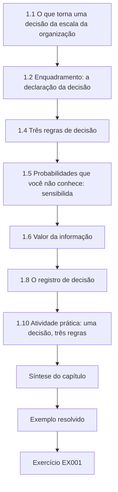

### Desenho lógico

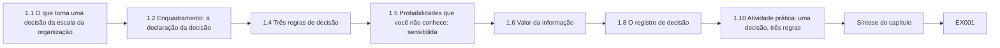

```text
[1.1 O que torna uma decisão da escala da organização]
    |
    v
[1.2 Enquadramento: a declaração da decisão]
    |
    v
[1.4 Três regras de decisão]
    |
    v
[1.5 Probabilidades que você não conhece: sensibilida]
    |
    v
[1.6 Valor da informação]
    |
    v
[1.8 O registro de decisão]
    |
    v
[1.10 Atividade prática: uma decisão, três regras]
    |
    v
[Síntese do capítulo]
    |
    v
[Exemplo resolvido] --> [Exercício EX001]
```
<!-- cykin:lesson-figures:end ch-01 -->


### Objetivos de aprendizagem e conexão

Ao final deste capítulo, você deverá ser capaz de:

1. Enquadrar uma decisão de segurança na escala da organização: quem decide, até quando, entre quais opções, segundo quais objetivos.
2. Expressar os objetivos em unidades do serviço essencial — horas de fornecimento perdidas, pacientes desviados, domicílios afetados — e não apenas em dinheiro ou em contagens de controles.
3. Comparar opções pelo valor esperado, pelo pior caso e pelo arrependimento minimax, e explicar quando cada regra é adequada.
4. Testar quão sensível uma recomendação é às probabilidades sobre as quais você tinha menos certeza e declarar o limiar em que ela muda.
5. Estimar o valor de mais informação antes de comprá-la.
6. Reconhecer os erros de julgamento que mais frequentemente distorcem as decisões de segurança em serviços essenciais.
7. Escrever um registro de decisão que um sucessor, um auditor ou um regulador consiga acompanhar.

Este capítulo estabelece os hábitos de decisão que todos os capítulos seguintes usam. O Capítulo 4 acrescenta o risco quantificado e sua distribuição entre as pessoas; o Capítulo 5 aplica o mesmo raciocínio às arquiteturas; o Capítulo 9 transforma os registros de decisão em asseguração.

### 1.1 O que torna uma decisão "da escala da organização"

Um profissional em estágios anteriores escolhe configurações, ferramentas e procedimentos. Um especialista que lidera a segurança de um serviço essencial escolhe **portfólios sob restrição**: qual de vários programas que valem a pena financiar neste ano, que risco aceitar, que fornecedor manter, quando desconectar uma planta de uma rede. Essas decisões têm cinco características em comum. São **irreversíveis ou caras de reverter** — um contrato de serviço gerenciado de três anos, uma rede de controle rearquitetada. Seus resultados são **incertos e raros**, de modo que a experiência sozinha dá um retorno pobre: uma concessionária pode passar uma década sem o evento para o qual um controle foi comprado. Têm **vários objetivos** que não podem ser reduzidos honestamente a um único número: continuidade do fornecimento, segurança dos funcionários e do público, custo, conformidade legal, privacidade e reputação. Têm **várias partes interessadas** com interesses legítimos, mas diferentes — o conselho, os operadores, o regulador, os clientes, os operadores vizinhos. E são **tomadas por alguém com autoridade**, que precisará explicá-las depois.

O trabalho do especialista raramente é tomar a decisão sozinho. É **estruturá-la** para que a pessoa com autoridade possa decidir bem, e tornar essa estrutura inspecionável. Essa distinção importa para a responsabilização (Capítulo 7) e para a ética (Capítulo 4): um analista que escolhe os pesos em silêncio tomou a decisão enquanto parecia apenas aconselhar.

### 1.2 Enquadramento: a declaração da decisão

A maioria das más decisões de segurança são respostas bem analisadas a perguntas mal enquadradas. Uma **declaração da decisão** fixa seis coisas antes de qualquer análise:

| Elemento | Pergunta | Exemplo da Merrow Water (sintético) |
|---|---|---|
| Tomador de decisão | Quem tem autoridade para escolher e para aceitar o risco residual? | Diretor de Operações, com aprovação do conselho acima de £500 mil por ano |
| Decisão | O que exatamente está sendo escolhido? | Qual programa de segurança financiar no próximo exercício a partir de um envelope fixo |
| Opções | Quais alternativas genuinamente diferentes estão na mesa, incluindo "adiar"? | A endurecimento do acesso remoto; B capacidade de operação manual; C metade de cada; D adiar |
| Objetivos | O que tentamos proteger ou alcançar, em quais unidades? | Minimizar o custo esperado e o de pior caso da perda do fornecimento de água tratada, incluindo o custo do programa; manter o público seguro; cumprir os deveres regulatórios |
| Horizonte e prazo | Em que período os resultados são julgados, e quando precisamos escolher? | Um ano orçamentário; decisão na reunião do conselho de março |
| Restrições | O que não pode ser violado, diga a análise o que disser? | Nenhuma opção pode reduzir a capacidade dos operadores de operar as plantas manualmente; nenhum aumento de quadro fora do orçamento |

A **opção "adiar"** merece atenção explícita. Ela está sempre disponível, é o que acontece quando ninguém decide e, em serviços essenciais, costuma ser pior do que parece, porque suas perdas se concentram em cenários raros e graves. Escrevê-la obriga a análise a mostrar seu custo.

Boas opções são **genuinamente diferentes**, e não uma opção favorita com dois espantalhos. Um teste útil: uma pessoa razoável e informada poderia preferir cada uma delas sob alguma visão plausível do mundo? Se não, o conjunto de opções é um exercício de justificação.

### 1.3 Objetivos em unidades de serviço

O NIST Cybersecurity Framework 2.0 coloca a função "Govern" (Governar) no centro da gestão de segurança e pede às organizações que entendam sua missão, suas partes interessadas e seu apetite a risco antes de escolher controles ([NIST, CSF 2.0, 2024](https://doi.org/10.6028/NIST.CSWP.29)). Para um serviço essencial, a missão é entregue em **unidades de serviço**: litros de água conforme, megawatts-hora entregues, pacientes atendidos dentro das metas de tempo clínico, contêineres movimentados, pagamentos liquidados. Um objetivo expresso em unidades de serviço faz três coisas que um objetivo monetário não consegue. Mantém visíveis as pessoas que dependem do serviço; permite que os operadores — que pensam em unidades de serviço — confiram a análise; e expõe os casos em que dinheiro e dano divergem, por exemplo quando uma interrupção barata recai sobre pessoas que não conseguem lidar com ela (Capítulo 4).

Na prática, você usará ambos: unidades de serviço para a consequência e dinheiro para o custo. Mantenha-os em colunas separadas até que o tomador de decisão concorde com uma taxa de conversão, e registre essa taxa como um julgamento, não como um fato. O Cyber Assessment Framework do National Cyber Security Centre do Reino Unido faz um movimento semelhante ao organizar seus objetivos em torno da função essencial, e não dos ativos de TI ([NCSC, Cyber Assessment Framework](https://www.ncsc.gov.uk/collection/caf)).

### 1.4 Três regras de decisão

Suponha que você tenha uma tabela de opções por cenários, com o custo anual total (custo do programa mais a perda) em cada célula. Três regras de decisão leem essa tabela de modos diferentes.

**Valor esperado (VE).** Pondere o resultado de cada cenário por sua probabilidade e some. Escolha a opção com o menor custo esperado. O VE é a regra certa quando você enfrenta muitas decisões semelhantes e independentes e consegue absorver a variação, porque ao longo de muitas repetições a média é o que você paga. É o padrão no raciocínio de seguros e de portfólio. Suas fraquezas: depende de probabilidades que, para eventos ciberfísicos raros, ninguém conhece bem; e trata uma pequena chance de catástrofe como intercambiável com uma pequena perda certa.

**Minimax (pior caso).** Escolha a opção cujo pior resultado seja o menos ruim. O minimax é adequado quando um resultado seria inaceitável independentemente de sua probabilidade — perda de vidas, perda da organização, perda da confiança pública na água potável. Sua fraqueza é ignorar por completo as probabilidades e poder comprar uma proteção cara contra um cenário quase impossível.

**Arrependimento minimax.** Para cada cenário, encontre a melhor opção; o **arrependimento** de uma opção nesse cenário é quanto ela é pior do que essa melhor. Escolha a opção cujo maior arrependimento seja o menor ([Savage, 1951](https://doi.org/10.1080/01621459.1951.10500768)). O arrependimento captura como uma decisão parecerá depois — "deveríamos ter feito X" — e tende a favorecer opções equilibradas quando nenhum cenário domina. Sua fraqueza é que acrescentar ou retirar uma opção irrelevante pode mudar a resposta.

Nenhuma dessas regras é "a correta". Um especialista relata o que cada regra recomenda, explica por que elas diferem e ajuda o tomador de decisão a escolher uma regra *antes* de ver qual opção ela favorece. Quando as três concordam, a decisão é robusta. Quando discordam, a discordância é a coisa mais útil que você pode mostrar a um conselho.

### 1.5 Probabilidades que você não conhece: sensibilidade e limiares

As probabilidades de cenários de segurança raros são julgamentos, não medições. Três práticas as mantêm honestas. Primeiro, **elicite com cuidado**: peça intervalos, pergunte a várias pessoas de forma independente e pergunte pelas taxas de base antes do caso específico ([O'Hagan et al., 2006](https://doi.org/10.1002/0470033312)). Segundo, **mostre vários conjuntos de crenças** — o do analista, o de um pessimista, a visão implícita do regulador — em vez de um só. Terceiro, e mais útil, **encontre o limiar**: a probabilidade em que a recomendação muda. Um conselho dificilmente consegue dizer se a probabilidade de comprometimento do acesso remoto de TO é de 3% ou de 6% ao ano, mas muitas vezes consegue dizer se ela está acima ou abaixo de um limiar declarado, sobretudo se você lhe mostrar as evidências por trás de cada visão — por exemplo, alertas públicos que descrevem o pré-posicionamento em redes de infraestrutura ([CISA, AA24-038A, 2024](https://www.cisa.gov/news-events/cybersecurity-advisories/aa24-038a)).

### 1.6 Valor da informação

Antes de encomendar uma avaliação, um teste de intrusão ou um estudo de consultoria, pergunte o que ele poderia mudar. O **valor esperado da informação perfeita (VEIP)** é a diferença entre o custo esperado da melhor opção agora e o custo esperado se você pudesse saber, antes de escolher, qual cenário vai acontecer. É um limite superior para o que qualquer estudo vale para esta decisão: se o VEIP é de £50 mil, um estudo de £200 mil não pode se pagar apenas por meio desta decisão. Estudos reais dão informação imperfeita, então valem menos do que o VEIP; se um estudo não puder plausivelmente mover uma probabilidade para o outro lado do limiar encontrado na §1.5, ele vale pouco para a decisão, por mais interessante que seja. Esse é o raciocínio padrão da análise de decisão; o ponto para a prática é escrever, antes de comprar a informação, qual resultado mudaria qual escolha.

### 1.7 Erros de julgamento que distorcem as decisões de segurança

A pesquisa clássica sobre julgamento sob incerteza descreve heurísticas — disponibilidade, representatividade, ancoragem — que levam a erros sistemáticos ([Tversky e Kahneman, 1974](https://doi.org/10.1126/science.185.4157.1124)). Na segurança de serviços essenciais, elas aparecem em formas reconhecíveis:

- **Disponibilidade depois de uma manchete.** Um incidente amplamente noticiado em outro setor eleva a probabilidade percebida desse cenário e afasta cenários mais discretos e mais prováveis.
- **Ancoragem no orçamento do ano passado ou na primeira cotação de um fornecedor.**
- **Substituição pela conformidade.** Tratar "o regulador exige X" como se respondesse "X é o melhor uso da próxima libra". A conformidade é uma restrição (§1.2), não um objetivo.
- **Contagem de controles.** Preferir a opção que fecha mais constatações de auditoria em vez da que mais reduz a consequência.
- **Otimismo sobre o recurso manual.** Supor que os operadores conseguem operar uma planta à mão porque um dia conseguiram, sem um simulado recente (Capítulo 6).
- **Pensamento de grupo e deferência.** A pessoa mais graduada fala primeiro e os demais se ancoram nela.

Remédios estruturais funcionam melhor do que exortações: estimativas independentes antes da discussão; um cético designado; um **pré-mortem**, em que o grupo imagina que a decisão fracassou e escreve por quê ([Klein, 2007](https://hbr.org/2007/09/performing-a-project-premortem)); e um registro escrito das divergências.

### 1.8 O registro de decisão

Um **registro de decisão** é um documento curto, escrito no momento da decisão, que contém: a declaração da decisão; as opções e por que cada uma foi considerada; as evidências usadas, com as fontes; os julgamentos de probabilidade e de peso e quem os fez; o que cada regra de decisão recomendou; a análise de limiares; a escolha feita, por quem e com base em qual regra; o risco residual aceito e seu responsável; as divergências; e o **gatilho de revisão** — a observação que reabriria a decisão (por exemplo, "um alerta crível relatando o comprometimento de appliances de acesso remoto do tipo que usamos"). O registro protege os bons tomadores de decisão quando um evento raro acontece mesmo assim, e é o modo como as organizações aprendem: sem ele, a visão retrospectiva reescreve o que se sabia.

### 1.9 Exemplo resolvido: a escolha de programa da Merrow Water (sintético)

O envelope da Merrow Water permite uma de quatro opções para o próximo ano. O especialista e a equipe de operações montaram a tabela abaixo (milhares de libras por ano, incluindo o próprio custo de cada opção; menor é melhor). A opção A endurece o acesso remoto (sessões de fornecedores intermediadas, MFA resistente a phishing, remoção de contas permanentes). A opção B constrói a capacidade de operação manual (procedimentos, instrumentação local, simulados, cobertura de pessoal) para que as plantas continuem produzindo água segura quando os sistemas de controle forem perdidos. A opção C faz metade de cada. A opção D adia.

| Opção | Ransomware em TI | Comprometimento do acesso remoto de TO | Indisponibilidade de fornecedor/nuvem | Ano tranquilo |
|---|---:|---:|---:|---:|
| A endurecimento do acesso remoto | 700 | 240 | 650 | 170 |
| B capacidade de operação manual | 450 | 900 | 330 | 230 |
| C metade de cada | 560 | 520 | 470 | 200 |
| D adiar | 1.300 | 2.600 | 780 | 0 |

O raciocínio por trás de algumas células importa mais do que os números. B se sai bem sempre que os sistemas de controle são *perdidos* (ransomware, indisponibilidade), porque a planta continua funcionando à mão, mas mal quando eles são *mal utilizados* por um intruso, porque a capacidade manual não impede comandos maliciosos antes que sejam notados. A se sai bem contra o intruso, mas não contra a perda. D é a mais barata num ano tranquilo e catastrófica no cenário de TO, cujo custo inclui um aviso de fervura da água que afeta toda a zona de abastecimento de Hollin.

A equipe registrou três conjuntos de crenças para as probabilidades dos cenários: o do analista (15% / 3% / 10% / 72%), o de um pessimista (25% / 10% / 15% / 50%) e uma visão implícita do regulador, com mais peso no comprometimento de TO (10% / 8% / 5% / 77%). O Laboratório 1 calcula os resultados.

### 1.10 Atividade prática: uma decisão, três regras

Execute o laboratório e depois leia a interpretação.

```python
# Lab 1 - one decision, three decision rules (offline, standard library only)
# Synthetic: Merrow Water's annual security investment choice. Figures are invented, in GBP thousands per year,
# and already include each option's own annual cost. Lower is better (cost + expected/realized loss).
OPTIONS = ["A remote-access hardening", "B manual-operations capability", "C half of each", "D defer"]
SCEN = ["IT ransomware", "OT remote-access compromise", "vendor/cloud outage", "quiet year"]
COST = {  # option -> loss in each scenario (k GBP)
    "A remote-access hardening":      [ 700,  240,  650, 170],
    "B manual-operations capability": [ 450,  900,  330, 230],
    "C half of each":                 [ 560,  520,  470, 200],
    "D defer":                        [1300, 2600,  780,   0],
}
BELIEFS = {
    "analyst":    [0.15, 0.03, 0.10, 0.72],
    "pessimist":  [0.25, 0.10, 0.15, 0.50],
    "regulator":  [0.10, 0.08, 0.05, 0.77],
}
def ev(o, p): return sum(c * q for c, q in zip(COST[o], p))
for name, p in BELIEFS.items():
    assert abs(sum(p) - 1) < 1e-9
    ranked = sorted(OPTIONS, key=lambda o: ev(o, p))
    print(f"{name:10s}", "  ".join(f"{o[0]}={ev(o, p):7.1f}" for o in OPTIONS), " best:", ranked[0][0])
best_in = [min(COST[o][s] for o in OPTIONS) for s in range(len(SCEN))]
regret = {o: max(COST[o][s] - best_in[s] for s in range(len(SCEN))) for o in OPTIONS}
worst = {o: max(COST[o]) for o in OPTIONS}
print("max regret:", "  ".join(f"{o[0]}={regret[o]}" for o in OPTIONS), " minimax-regret:", min(OPTIONS, key=regret.get)[0])
print("worst case:", "  ".join(f"{o[0]}={worst[o]}" for o in OPTIONS), " minimax:", min(OPTIONS, key=worst.get)[0])
# Robustness: sweep P(OT compromise) from 0 to 0.30, keeping the analyst's other ratios, and report the EV winner.
base = BELIEFS["analyst"]
prev = None
for k in range(0, 31):
    q = k / 100
    rest = [base[0], base[2], base[3]]; s = sum(rest)
    p = [rest[0] / s * (1 - q), q, rest[1] / s * (1 - q), rest[2] / s * (1 - q)]
    win = min(OPTIONS, key=lambda o: ev(o, p))[0]
    if win != prev:
        print(f"P(OT compromise)={q:.2f}: EV winner {win}")
        prev = win
```

Saída esperada:

```text
analyst    A=  299.6  B=  293.1  C=  290.6  D=  351.0  best: C
pessimist  A=  381.5  B=  367.0  C=  362.5  D=  702.0  best: C
regulator  A=  252.6  B=  310.6  C=  275.1  D=  377.0  best: A
max regret: A=320  B=660  C=280  D=2360  minimax-regret: C
worst case: A=700  B=900  C=560  D=2600  minimax: C
P(OT compromise)=0.00: EV winner B
P(OT compromise)=0.03: EV winner C
P(OT compromise)=0.07: EV winner A
```

**Interpretação.** Sob as crenças do analista e do pessimista, C tem o menor custo esperado, mas por pouco: 290,6 contra 293,1 de B e 299,6 de A na visão do analista. Diferenças de £3 mil a £9 mil em estimativas tão grosseiras não são, por si sós, base para uma decisão. Sob as crenças do regulador, A vence. A varredura de limiares torna a estrutura visível: B vence apenas se a probabilidade de comprometimento de TO estiver abaixo de cerca de 3%; C entre cerca de 3% e 7%; A acima de cerca de 7%. O minimax e o arrependimento minimax escolhem ambos C, porque C nunca se sai muito mal. **C é, portanto, a recomendação robusta**: é a melhor ou quase a melhor sob todo conjunto de crenças e toda regra. O registro de decisão deve dizer exatamente isso e acrescentar o gatilho de revisão: evidências que empurrem a probabilidade de comprometimento de TO para acima de 7% (por exemplo, relatos críveis de exploração dos produtos de acesso remoto que a Merrow usa) movem a recomendação para A. Note também o que a tabela não consegue mostrar: o valor de C pressupõe que "metade de cada" entrega mais da metade do benefício de cada uma, o que é um julgamento que o diretor de operações precisa confirmar.

### 1.11 Erros comuns e limites

- Apresentar um único "escore de risco" por opção, o que esconde se o escore veio da frequência, da gravidade ou de uma ponderação arbitrária.
- Omitir a opção de adiar, ou atribuir-lhe custo zero.
- Escolher a regra de decisão depois de ver qual opção ela favorece.
- Relatar valores esperados até a libra quando os insumos são julgamentos grosseiros; relate, em vez disso, as diferenças que importam e os limiares.
- Tratar estatísticas de fornecedores ou de pesquisas com aparência precisa como probabilidades para a sua organização sem perguntar como foram produzidas (Capítulo 10).
- Deixar que os pesos do analista se tornem, em silêncio, a decisão.
- Escrever o registro de decisão depois, quando a visão retrospectiva já o moldou.

O principal limite da análise formal de decisão é que ela só é tão boa quanto o conjunto de opções e o modelo de consequências. Seu valor não está em produzir automaticamente a resposta certa, mas em tornar as razões de uma resposta **inspecionáveis** e **revisáveis** quando chegam novas evidências.

### Exercícios — capítulo 1

**EX001 — Enquadre uma decisão hospitalar.** *Objetivo:* escrever uma declaração da decisão para uma escolha com cara de real. *Insumos:* a Merrow Health precisa decidir se substitui neste ano seu sistema de laboratório de patologia sem suporte ou se o isola e o substitui em dois anos. *Restrições:* usar os seis elementos da §1.2; pelo menos três opções genuinamente diferentes, incluindo adiar; objetivos em unidades de serviço. *Passos:* (1) escrever a declaração; (2) aplicar a cada opção o teste "uma pessoa razoável poderia preferi-la"; (3) listar duas restrições que não sejam objetivos. *Evidência esperada:* declaração da decisão de uma página. *Rubrica:* 3 = todos os seis elementos, opções genuinamente diferentes, objetivos em unidades de serviço (por exemplo, o tempo de liberação dos resultados urgentes), restrições distinguidas dos objetivos; 2 = um elemento fraco; 1 = as opções são espantalhos ou os objetivos estão apenas em dinheiro; 0 = ausente.

**EX002 — Mude uma célula.** *Objetivo:* ver como as regras de decisão respondem a uma estimativa de consequência revisada. *Insumos:* Laboratório 1. *Restrições:* mudar apenas o custo de D no cenário de TO, de 2.600 para 1.200 (os engenheiros acreditam que um aviso de fervura poderia ficar restrito a uma zona). *Passos:* (1) reexecutar; (2) relatar o vencedor pelo VE sob cada conjunto de crenças, o arrependimento máximo de cada opção e a escolha pelo arrependimento minimax; (3) explicar por que D ainda não vence. *Evidência esperada:* saídas e explicação de 150 palavras. *Rubrica:* 3 = números corretos e uma explicação que liga o arrependimento de D ao cenário de ransomware, e não apenas ao de TO; 2 = números certos, explicação rasa; 1 = não executado; 0 = nada.

**EX003 — Valor da informação perfeita.** *Objetivo:* delimitar quanto vale um estudo adicional. *Insumos:* a tabela do Laboratório 1 e as crenças do analista. *Restrições:* calcular à mão ou com um pequeno acréscimo ao laboratório. *Passos:* (1) calcular o custo esperado da melhor opção agora; (2) calcular o custo esperado se você soubesse o cenário antes de escolher; (3) relatar o VEIP; (4) um consultor oferece uma avaliação de ameaças de TO por £60 mil — explicar sob que condição ela poderia valer a compra para esta decisão. *Evidência esperada:* cálculo e parágrafo. *Rubrica:* 3 = VEIP correto e a compra ligada a se o estudo poderia mover a probabilidade de TO para o outro lado dos limiares de 3% ou 7%; 2 = VEIP certo, ligação fraca; 1 = erros aritméticos; 0 = nada.

**EX004 — Registro de decisão com divergência.** *Objetivo:* produzir um registro inspecionável. *Insumos:* o exemplo resolvido e a saída do Laboratório 1. *Restrições:* uma página; todos os elementos da §1.8. *Passos:* (1) escrever o registro da escolha de C; (2) incluir uma divergência realista do gerente de operações, que prefere B; (3) declarar o gatilho de revisão e o responsável pelo risco residual. *Evidência esperada:* registro de decisão. *Rubrica:* 3 = completo, honesto sobre as margens estreitas de VE, divergência declarada com justiça, gatilho mensurável; 2 = falta um elemento; 1 = parece advocacia; 0 = nada.

**EX005 — Auditoria de vieses.** *Objetivo:* reconhecer erros de julgamento numa reunião. *Insumos:* ata sintética: "O presidente abriu mencionando o recente caso de ransomware no oleoduto e disse que a segurança de TO é agora a prioridade máxima. A proposta de £400 mil do fornecedor foi tomada como ponto de partida. O gerente de operações disse que operar manualmente 'não é problema — fizemos isso em 2009'. A responsável pela auditoria interna observou que a opção A fecha nove das onze constatações em aberto. Nenhuma outra opinião foi registrada." *Restrições:* nomear no máximo cinco erros da §1.7 e propor um remédio estrutural para cada um. *Passos:* identificar, explicar, remediar. *Evidência esperada:* tabela. *Rubrica:* 3 = disponibilidade, ancoragem, otimismo sobre o recurso manual, contagem de controles e deferência/pensamento de grupo identificados com remédios estruturais (estimativas independentes, pré-mortem, evidência de simulado, pontuação baseada na consequência, divergência registrada); 2 = três ou quatro; 1 = conselhos genéricos; 0 = nada.

### Síntese do capítulo

As decisões de segurança na escala da organização são irreversíveis, envolvem eventos raros, múltiplos objetivos e múltiplas partes interessadas, e pertencem a alguém com autoridade. A contribuição do especialista é a estrutura: uma declaração da decisão com opções genuinamente diferentes, incluindo adiar; objetivos em unidades de serviço; várias regras de decisão relatadas lado a lado; conjuntos de crenças em vez de uma única probabilidade; os limiares em que a recomendação muda; o valor de mais informação; defesas estruturais contra o julgamento enviesado; e um registro de decisão escrito no momento. Uma recomendação robusta é aquela que sobrevive a mudanças de regra e de crença; quando não sobrevive, mostre o limiar e deixe a pessoa responsável decidir com conhecimento de causa.

<!-- cykin:chapter-navigation:start ch-01 -->
### Continue estudando — capítulo 01 de 12

[← Página do curso](../../README.md) · [Índice de capítulos do curso](../SUBJECTS.md) · [Capítulo 02 →](#ch-02)

Siga para a próxima lição escrita.
<!-- cykin:chapter-navigation:end -->

<a id="ch-02"></a>

## Capítulo 2 — Infraestrutura crítica e segurança setorial: prática atual

<!-- cykin:lesson-figures:start ch-02 -->
### Mapa da aula

Aula 02 publicada. Mapa, exemplo, EX007.

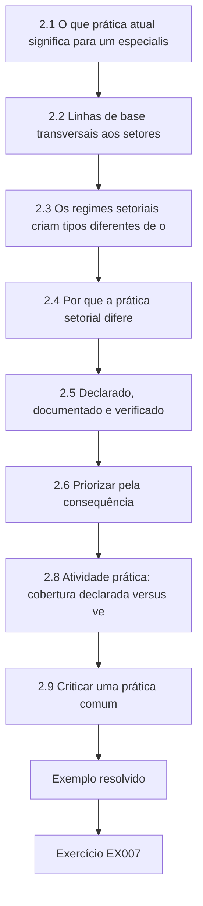

### Desenho lógico

```mermaid
flowchart LR
  N0["2.1 O que prática atual significa para um especialis"]
  N1["2.2 Linhas de base transversais aos setores"]
  N2["2.3 Os regimes setoriais criam tipos diferentes de o"]
  N3["2.4 Por que a prática setorial difere"]
  N4["2.5 Declarado, documentado e verificado"]
  N5["2.6 Priorizar pela consequência"]
  N6["2.8 Atividade prática: cobertura declarada versus ve"]
  N7["2.9 Criticar uma prática comum"]
  N0 --> N1 --> N2 --> N3 --> N4 --> N5 --> N6 --> N7 --> Q["EX007"]
```

```text
[2.1 O que prática atual significa para um especialis]
    |
    v
[2.2 Linhas de base transversais aos setores]
    |
    v
[2.3 Os regimes setoriais criam tipos diferentes de o]
    |
    v
[2.4 Por que a prática setorial difere]
    |
    v
[2.5 Declarado, documentado e verificado]
    |
    v
[2.6 Priorizar pela consequência]
    |
    v
[2.8 Atividade prática: cobertura declarada versus ve]
    |
    v
[2.9 Criticar uma prática comum]
    |
    v
[Exemplo resolvido] --> [Exercício EX007]
```
<!-- cykin:lesson-figures:end ch-02 -->


### Objetivos de aprendizagem e conexão

Ao final deste capítulo, você deverá ser capaz de:

1. Descrever as principais linhas de base e regimes, transversais e setoriais, que um operador de serviço essencial provavelmente encontrará, e que tipo de obrigação cada um cria.
2. Explicar por que setores que compartilham tecnologia ainda precisam de práticas diferentes: consequência, física, regulação e força de trabalho diferem.
3. Distinguir a implementação declarada, documentada e verificada de uma prática, e medir a lacuna.
4. Priorizar as lacunas pela consequência para o serviço essencial, e não pela contagem.
5. Criticar uma prática comum e propor uma alternativa mais bem fundamentada em evidências.

O Capítulo 1 deu a você um modo de escolher entre opções. Este capítulo fornece as opções que se espera que um especialista competente conheça e o padrão de evidências para dizer que elas estão implementadas. O Capítulo 3 pergunta, então, o que conta como evidência quando algo dá errado.

### 2.1 O que "prática atual" significa para um especialista

"Prática atual" não é uma lista única. É a sobreposição de três coisas: o que **reguladores e normas exigem** na sua jurisdição e no seu setor; o que **orientações autorizadas** recomendam com base em ataques observados; e o que **operadores comparáveis efetivamente fazem** e conseguem demonstrar. Um especialista precisa conhecer as três e precisa saber dizer quais afirmações de um programa de segurança vêm de qual fonte, porque elas têm pesos diferentes. Uma obrigação legal é uma restrição; o requisito de uma norma pode ser contratual ou certificável; uma orientação é um conselho a ser ponderado contra a sua própria análise de consequências.

A prática também envelhece. Alertas sobre o pré-posicionamento em redes de infraestrutura por atores patrocinados por Estados que usam ferramentas legítimas de administração ([CISA, AA24-038A, 2024](https://www.cisa.gov/news-events/cybersecurity-advisories/aa24-038a)) mudaram o que "registro adequado" e "higiene adequada de credenciais" significam para operadores que tratavam essas coisas como faxina de TI. Uma linha de base que era atual há três anos pode agora ser um piso.

### 2.2 Linhas de base transversais aos setores

Quatro famílias de documentos se repetem entre os setores:

- **Frameworks de resultados.** O NIST CSF 2.0 organiza os resultados em Govern, Identify, Protect, Detect, Respond e Recover (Governar, Identificar, Proteger, Detectar, Responder e Recuperar) ([NIST, 2024](https://doi.org/10.6028/NIST.CSWP.29)). O Cyber Assessment Framework do NCSC do Reino Unido estabelece quatro objetivos — gerir o risco de segurança, proteger contra ataques cibernéticos, detectar eventos de segurança cibernética e minimizar o impacto dos incidentes —, com indicadores de boa prática para cada princípio, e é desenhado em torno das funções essenciais ([NCSC, CAF](https://www.ncsc.gov.uk/collection/caf)). Os frameworks de resultados dizem *o que* precisa ser alcançado, não *como*; são bons para estruturar um programa e fracos como roteiros de teste.
- **Linhas de base priorizadas.** As Cross-Sector Cybersecurity Performance Goals da CISA listam um pequeno conjunto de práticas com alto valor de redução de risco para organizações de qualquer porte ([CISA, CPGs](https://www.cisa.gov/cross-sector-cybersecurity-performance-goals)); o Departamento de Saúde e Serviços Humanos dos EUA publicou metas de desempenho específicas para a saúde no mesmo espírito ([HHS, HPH CPGs, 2024](https://hphcyber.hhs.gov/performance-goals.html)). São úteis justamente por serem curtas; não são um programa completo.
- **Catálogos de controles.** A NIST SP 800-53 Rev. 5 é um catálogo abrangente de controles de segurança e privacidade ([NIST](https://csrc.nist.gov/pubs/sp/800/53/r5/upd1/final)); a NIST SP 800-82 Rev. 3 adapta as orientações à tecnologia operacional, incluindo overlays e as restrições particulares dos sistemas de controle ([NIST, 2023](https://doi.org/10.6028/NIST.SP.800-82r3)).
- **Normas industriais.** A série ISA/IEC 62443 trata da segurança dos sistemas de automação e controle industrial para proprietários de ativos, integradores e fornecedores de produtos, incluindo zonas e conduítes, níveis de segurança e desenvolvimento seguro de produtos ([visão geral da ISA](https://www.isa.org/standards-and-publications/isa-standards/isa-iec-62443-series-of-standards)). Sua parte de avaliação de riscos para o projeto de sistemas, a IEC 62443-3-2, é o ponto de partida usual de uma revisão de arquitetura de TO ([página do catálogo da IEC](https://webstore.iec.ch/en/publication/30727)).

### 2.3 Os regimes setoriais criam tipos diferentes de obrigação

Na escala da organização, a pergunta não é "qual framework é o melhor", mas "quais obrigações se aplicam a nós, e que evidências cada regulador vai esperar". Exemplos, todos a verificar de novo para a sua jurisdição e data:

| Regime | Escopo (resumo) | Tipo de obrigação | Evidências tipicamente esperadas |
|---|---|---|---|
| [Diretiva NIS2 (UE) 2022/2555](https://eur-lex.europa.eu/eli/dir/2022/2555/oj/) | Entidades essenciais e importantes dos setores listados, transposta para o direito nacional | Medidas de gestão de risco e notificação de incidentes em etapas (alerta precoce, notificação, relatório final) | Medidas aprovadas pelo órgão de administração, relatórios de incidentes dentro dos prazos nacionais |
| [Diretiva CER (UE) 2022/2557](https://eur-lex.europa.eu/eli/dir/2022/2557/oj) | Resiliência das entidades críticas frente a todos os perigos | Avaliação de riscos e medidas de resiliência, não apenas cibernéticas | Planos de resiliência, cooperação com as autoridades |
| [DORA, Regulamento (UE) 2022/2554](https://eur-lex.europa.eu/eli/reg/2022/2554/oj) | Entidades financeiras e seus prestadores terceiros críticos de serviços de TIC | Regras diretamente aplicáveis de risco de TIC, testes, incidentes e terceiros | Registros dos acordos com terceiros de TIC, resultados de testes |
| [Normas NERC CIP](https://www.nerc.com/pa/Stand/Pages/CIPStandards.aspx) | Sistema elétrico de grande porte na América do Norte | Requisitos obrigatórios e auditáveis por categoria de impacto do ativo | Evidências de auditoria por requisito, muitas vezes altamente prescritivas |
| [America's Water Infrastructure Act 2018, s.2013](https://www.epa.gov/waterresilience/americas-water-infrastructure-act-2018-risk-assessments-and-emergency-response-plans) | Sistemas comunitários de água dos EUA acima de um limiar de porte | Avaliação de risco e resiliência e plano de resposta a emergências, com certificação | Avaliações e planos certificados em ciclos |

Seguem-se duas lições. Primeiro, um operador que abrange vários setores — uma multiconcessionária, um porto com rede elétrica própria — pode estar sob vários regimes com relógios de notificação e estilos de evidência diferentes; harmonizá-los num único conjunto interno de controles com mapeamentos é uma tarefa central do especialista. Segundo, **a conformidade é um piso e uma restrição**, como o Capítulo 1 argumentou: dois operadores plenamente conformes com o mesmo regime podem ter resiliências muito diferentes.

### 2.4 Por que a prática setorial difere

A tecnologia compartilhada tenta as pessoas a copiar práticas entre setores. Quatro diferenças tornam isso inseguro:

1. **Consequência e tempo.** Os sistemas clínicos de um hospital falham em danos que chegam em minutos ou horas; um sistema de água com reservação pode ter de horas a dias; o dano de um sistema de pagamentos se acumula nas janelas de liquidação; o de um porto, no tempo de permanência da carga e nas cadeias de suprimento. O tempo até o dano define quanto recurso manual é necessário e quão rápida uma resposta precisa ser.
2. **Física e segurança operacional.** Na TO, uma ação de segurança pode ela mesma causar dano: uma varredura agressiva pode derrubar um controlador; isolar uma rede pode cegar os operadores. A NIST SP 800-82 enfatiza que as restrições de disponibilidade e de segurança operacional moldam quais controles de segurança são aceitáveis ([NIST, 2023](https://doi.org/10.6028/NIST.SP.800-82r3)).
3. **Regulação e cultura de evidências.** A eletricidade na América do Norte trabalha com requisitos auditáveis e prescritivos; muitas concessionárias de água trabalham com avaliações certificadas periódicas; a saúde trabalha sob a legislação de privacidade e a governança de segurança clínica, além das regras de segurança.
4. **Força de trabalho e fornecedores.** Concessionárias pequenas podem não ter nenhuma equipe de segurança; hospitais dependem dos fabricantes de dispositivos médicos para aplicar correções; portos dependem dos fornecedores de sistemas operacionais de terminais e das companhias de navegação. Quem consegue de fato implementar uma prática determina se ela é real.

### 2.5 Declarado, documentado e verificado

A maioria das avaliações de linha de base são autoavaliações. São úteis, mas um especialista precisa saber quanto de um "sim" é **verificado**. Use três graus de evidência:

- **Verificado (V):** a prática foi observada funcionando por teste, inspeção ou conciliação — uma restauração foi realizada e cronometrada; a configuração do provedor de identidade foi exportada e conferida; os logs do intermediador foram conciliados com as sessões do firewall.
- **Documentado (D):** existe uma política, um projeto ou um procedimento que diz que a prática está implementada, mas ninguém testou se a realidade corresponde.
- **Declaração (S):** alguém disse que sim.

Os métodos de avaliação do catálogo do NIST distinguem examinar, entrevistar e testar pela mesma razão ([NIST SP 800-53 Rev. 5](https://csrc.nist.gov/pubs/sp/800/53/r5/upd1/final)). A lacuna entre a cobertura declarada e a verificada costuma ser o número mais importante de um relatório de linha de base, e o mais frequentemente omitido. É também onde os incidentes moram: backups offline que "existem", mas nunca foram restaurados; acesso de fornecedores que é "intermediado", exceto por aquele modem legado.

### 2.6 Priorizar pela consequência

A importância de uma prática depende de quanto ela limita a perda do serviço essencial. Pondere as práticas pela consequência — não por quantas referências de frameworks elas mapeiam — e priorize as lacunas em que o peso é alto e a pontuação verificada é baixa. Os pesos são julgamentos; registre quem os definiu (Capítulo 1). Para Merrow Bay, o fórum concordou que MFA no acesso remoto, segmentação TI/TO, backups offline testados e acesso intermediado de fornecedores têm o maior peso, porque cada um limita diretamente um caminho para a perda do fornecimento observado em incidentes públicos — o comprometimento do acesso remoto de um sistema de tratamento de água foi objeto de um alerta conjunto de 2021 ([CISA, AA21-042A](https://www.cisa.gov/news-events/cybersecurity-advisories/aa21-042a)), ainda que o relato desse evento específico tenha sido contestado depois ([WUSF, 2023](https://www.wusf.org/local-state/2023-04-13/official-hack-oldsmar-city-water-treatment-plant-2021)); a fraqueza de acesso remoto que o alerta descreveu continua sendo uma preocupação de projeto válida em qualquer caso.

### 2.7 Exemplo resolvido: as autoavaliações de quatro operadores (sintético)

O Merrow Bay Resilience Forum pediu a quatro operadores que autoavaliassem oito práticas, pontuando 0 (ausente), 1 (parcial) ou 2 (implementada), e que graduassem as evidências como V, D ou S. A tarefa do especialista é transformar as respostas num retrato regional sem ofender ninguém nem acreditar em tudo. Em vez de "rejeitar" as declarações, o Laboratório 2 lhes dá crédito **provisório** zero até que sejam testadas, e meio crédito aos documentos. Esses créditos são uma escolha de política; o EX007 testa seu efeito.

Duas convenções moldam os resultados. Os pesos de cada prática foram acordados pelo fórum, então o retrato regional reflete o julgamento dele sobre quais práticas limitam a perda do fornecimento. E os operadores são nomeados neste exemplo apenas porque ele é sintético; um relatório real do fórum normalmente mostraria a cada operador a sua própria linha e daria aos demais apenas o resumo regional. O especialista deve enviar a cada operador seu resultado em privado antes da reunião do fórum, para que ninguém descubra uma lacuna desconfortável diante dos pares.

### 2.8 Atividade prática: cobertura declarada versus verificada

```python
# Lab 2 - claimed versus verified baseline coverage, weighted by consequence (offline, standard library only)
# Synthetic: four Merrow Bay operators self-assess eight baseline practices (0 = absent, 1 = partial, 2 = in place)
# and say what evidence backs each answer: V = verified by test or inspection, D = document only, S = statement only.
PRACTICES = {  # practice -> consequence weight (how much it limits loss of the essential service; invented)
    "MFA on remote access": 3, "asset inventory incl. OT": 2, "IT/OT segmentation": 3,
    "offline backups restored in test": 3, "central logging retained 90d": 1,
    "incident plan exercised in 12 months": 2, "vendor access brokered and recorded": 3,
    "default credentials removed": 2,
}
ANSWERS = {  # operator -> list of (score, evidence) in PRACTICES order
    "Merrow Water":     [(2,"V"),(1,"D"),(2,"D"),(2,"S"),(1,"V"),(2,"V"),(1,"S"),(2,"S")],
    "Merrow Health":    [(2,"V"),(1,"D"),(1,"D"),(2,"V"),(2,"V"),(2,"D"),(1,"D"),(1,"S")],
    "Merrow Energy":    [(2,"V"),(2,"V"),(2,"V"),(1,"D"),(2,"V"),(2,"V"),(2,"D"),(2,"D")],
    "Port of Merrow":   [(2,"S"),(0,"S"),(1,"S"),(2,"S"),(1,"D"),(1,"S"),(0,"S"),(2,"S")],
}
CREDIT = {"V": 1.0, "D": 0.5, "S": 0.0}  # how much of a claimed score we accept without further testing
W = list(PRACTICES.values()); maxw = 2 * sum(W)
print(f"{'operator':16s} claimed  verified  gap(weighted points)")
gaps = []
for op, ans in ANSWERS.items():
    claimed = sum(w * s for w, (s, e) in zip(W, ans))
    verified = sum(w * s * CREDIT[e] for w, (s, e) in zip(W, ans))
    print(f"{op:16s} {claimed/maxw:6.0%}   {verified/maxw:6.0%}   {maxw-verified:5.1f}")
    for (name, w), (s, e) in zip(PRACTICES.items(), ans):
        unverified = w * (2 - s * CREDIT[e])
        if w == 3 and unverified >= 3:
            gaps.append((unverified, op, name, s, e))
print("\nHigh-consequence practices with >= 3 unverified weighted points:")
for u, op, name, s, e in sorted(gaps, reverse=True):
    print(f"  {u:4.1f}  {op:16s} {name}  (claimed {s}, evidence {e})")
```

Saída esperada:

```text
operator         claimed  verified  gap(weighted points)
Merrow Water        84%      39%    23.0
Merrow Health       74%      53%    18.0
Merrow Energy       92%      75%     9.5
Port of Merrow      58%       1%    37.5

High-consequence practices with >= 3 unverified weighted points:
   6.0  Port of Merrow   vendor access brokered and recorded  (claimed 0, evidence S)
   6.0  Port of Merrow   offline backups restored in test  (claimed 2, evidence S)
   6.0  Port of Merrow   MFA on remote access  (claimed 2, evidence S)
   6.0  Port of Merrow   IT/OT segmentation  (claimed 1, evidence S)
   6.0  Merrow Water     vendor access brokered and recorded  (claimed 1, evidence S)
   6.0  Merrow Water     offline backups restored in test  (claimed 2, evidence S)
   4.5  Merrow Health    vendor access brokered and recorded  (claimed 1, evidence D)
   4.5  Merrow Health    IT/OT segmentation  (claimed 1, evidence D)
   4.5  Merrow Energy    offline backups restored in test  (claimed 1, evidence D)
   3.0  Merrow Water     IT/OT segmentation  (claimed 2, evidence D)
   3.0  Merrow Energy    vendor access brokered and recorded  (claimed 2, evidence D)
```

**Interpretação.** A cobertura declarada vai de 58% a 92%; a verificada, de 1% a 75%. A posição da própria Merrow Water — 84% declarados, 39% verificados — é desconfortável para seu especialista: as duas lacunas de maior peso são declarações de que os backups offline são restauráveis e de que o acesso de fornecedores é intermediado. O 1% do Port of Merrow não significa que o porto não tenha segurança; significa que nada foi demonstrado. A lista priorizada é um **plano de verificação** antes de ser um plano de remediação: cada um dos onze itens se apoia numa declaração ou num documento, então a primeira ação para cada um é testar a alegação — barato em comparação com comprar controles, e às vezes suficiente para fechar a lacuna. A Merrow Energy, com evidências majoritariamente verificadas, é a melhor fonte de método prático da região — um ativo para o fórum, e não apenas uma pontuação.

### 2.9 Criticar uma prática comum

Espera-se que os especialistas questionem práticas que persistem por hábito. Tome o "teste de intrusão de TO" anual escrito em muitos contratos. Ele frequentemente produz uma lista de constatações sobre uma amostra de sistemas numa janela curta, usando técnicas que precisam ser contidas para evitar perturbar o processo, e costuma ter um escopo que evita os ativos de maior consequência. Alternativas com melhor valor de evidência incluem: uma revisão orientada pela consequência que parte do pior resultado físico crível e volta até os caminhos digitais que poderiam causá-lo ([Idaho National Laboratory, CCE](https://inl.gov/national-security/cce/)); a conciliação contínua dos registros de acesso remoto e de mudanças; e testes num ambiente de bancada representativo em vez da planta em operação (Capítulo 6). A crítica não é "nunca teste"; é "escolha o método de evidência que responde à pergunta que o conselho está de fato fazendo".

### 2.10 Erros comuns e limites

- Tratar um mapeamento de framework como evidência de implementação.
- Relatar apenas a cobertura declarada, ou fazer a média entre a declarada e a verificada num único número.
- Copiar a prática de outro setor sem verificar o tempo até o dano e as restrições de segurança operacional.
- Tratar a linha de base mais curta como o programa inteiro, ou o catálogo mais longo como uma lista de tarefas.
- Supor que o regulador de um setor aceitará evidências desenhadas para outro.
- Ponderar as práticas por quantas normas as mencionam, e não pela consequência.

O limite de qualquer linha de base é que ela descreve defesas que são comuns porque os ataques foram comuns. Ela diz pouco sobre caminhos raros, direcionados ou novos, e é por isso que os Capítulos 4 e 5 acrescentam a análise orientada pela consequência.

### Exercícios — capítulo 2

**EX006 — Mapeie uma prática entre frameworks.** *Objetivo:* ligar uma prática a obrigações e orientações sem confundi-las. *Insumos:* "acesso de fornecedores intermediado e registrado" na Merrow Water. *Restrições:* usar apenas as fontes citadas nas §2.2–2.3; não citar textos de normas pagas. *Passos:* (1) identificar a(s) função(ões) do CSF 2.0 e o objetivo do CAF que ela apoia; (2) declarar se ela aparece como meta transversal da CISA; (3) explicar como a ideia de zonas e conduítes da IEC 62443 a enquadra; (4) declarar, sem dar aconselhamento jurídico, se ela é uma obrigação legal para uma concessionária de água na sua jurisdição e como você verificaria isso. *Evidência esperada:* uma tabela curta de mapeamento e um parágrafo. *Rubrica:* 3 = mapeamentos corretos no nível de função e objetivo, obrigações mantidas separadas das orientações, um caminho de verificação por meio de aconselhamento jurídico declarado; 2 = um mapeamento errado; 1 = trata orientação como lei; 0 = nada.

**EX007 — Mude a política de evidências.** *Objetivo:* testar como uma política de pontuação muda o retrato. *Insumos:* Laboratório 2. *Restrições:* mudar o crédito de uma declaração de 0,0 para 0,25 e nada mais. *Passos:* (1) reexecutar e relatar a cobertura verificada de cada operador; (2) dizer quais conclusões da §2.8 sobrevivem; (3) defender uma política de crédito para o relatório do fórum. *Evidência esperada:* saídas e argumento de 200 palavras. *Rubrica:* 3 = números corretos, reconhecimento de que a ordem do ranking e a prioridade de testar as declarações sobrevivem, uma política defendida a partir do uso do relatório; 2 = números certos, argumento fraco; 1 = não executado; 0 = nada.

**EX008 — Plano de verificação.** *Objetivo:* transformar as maiores lacunas em testes. *Insumos:* os três itens de maior peso da Merrow Water na lista do Laboratório 2. *Restrições:* os testes precisam ser seguros para a planta em operação; nomear as evidências que contariam como V. *Passos:* para cada item, dar o método (teste, inspeção, conciliação), o responsável, as condições de segurança, o critério de aprovação e o custo esperado em dias de trabalho. *Evidência esperada:* tabela. *Rubrica:* 3 = os métodos testam genuinamente a realidade (por exemplo, a restauração cronometrada de um sistema nomeado num host isolado; a conciliação dos logs do intermediador com as sessões do firewall ao longo de 30 dias), condições de segurança explícitas, critérios de aprovação mensuráveis; 2 = um método apenas documental; 1 = "revisar a política"; 0 = nada.

**EX009 — Operador sob vários regimes.** *Objetivo:* planejar as evidências para regimes sobrepostos. *Insumos:* uma multiconcessionária sintética na UE que fornece água, opera uma pequena rede de distribuição de eletricidade e tem uma subsidiária de pagamentos. *Restrições:* identificar os regimes da §2.3 que podem se aplicar, sem decidir o escopo jurídico. *Passos:* (1) listar os regimes candidatos e por que cada um poderia se aplicar; (2) desenhar um único conjunto interno de controles com mapeamentos; (3) identificar os relógios de notificação de incidentes que precisam ser conciliados; (4) declarar o que você perguntaria ao jurídico. *Evidência esperada:* plano de uma página. *Rubrica:* 3 = regimes candidatos plausíveis, um conjunto de controles com mapeamentos, relógios de notificação identificados como um problema de projeto, perguntas jurídicas específicas; 2 = mapeamentos vagos; 1 = apresenta conclusões jurídicas como fato; 0 = nada.

**EX010 — Critique uma prática.** *Objetivo:* defender um método de evidência melhor. *Insumos:* o contrato da Merrow Health exige um "teste de intrusão externo anual da rede clínica". *Restrições:* 300 palavras; respeitar a segurança dos pacientes. *Passos:* (1) declarar a pergunta que o conselho quer ver respondida; (2) dizer o que o teste anual responde e o que não responde; (3) propor um portfólio alternativo de evidências; (4) declarar seus limites. *Evidência esperada:* memorando. *Rubrica:* 3 = pergunta explícita, limites dos testes pontuais identificados (amostra, janela, contenção das técnicas, dispositivos excluídos), alternativas ajustadas à pergunta, limites honestos; 2 = crítica sem alternativa; 1 = rejeita os testes por completo; 0 = nada.

### Síntese do capítulo

A prática atual é a sobreposição entre obrigação, orientação e prática demonstrada pelos pares, e cada uma tem um peso diferente. Conheça os frameworks de resultados, as linhas de base priorizadas, os catálogos de controles e as normas industriais, e saiba quais regimes obrigam a sua organização e que evidências cada um espera. Não copie práticas entre setores sem verificar o tempo até o dano, a física, a regulação e a força de trabalho. Gradue as evidências como verificadas, documentadas ou declarações, relate a lacuna com honestidade, pondere as práticas pela consequência e transforme as maiores lacunas em verificação antes da remediação. Questione as práticas habituais perguntando a qual pergunta suas evidências respondem.

<!-- cykin:chapter-navigation:start ch-02 -->
### Continue estudando — capítulo 02 de 12

[← Capítulo 01](#ch-01) · [Índice de capítulos do curso](../SUBJECTS.md) · [Capítulo 03 →](#ch-03)

Siga para a próxima lição escrita.
<!-- cykin:chapter-navigation:end -->

<a id="ch-03"></a>

## Capítulo 3 — Infraestrutura crítica e segurança setorial: evidências especializadas

<!-- cykin:lesson-figures:start ch-03 -->
### Mapa da aula

Aula 03 publicada. Mapa, exemplo, EX011.

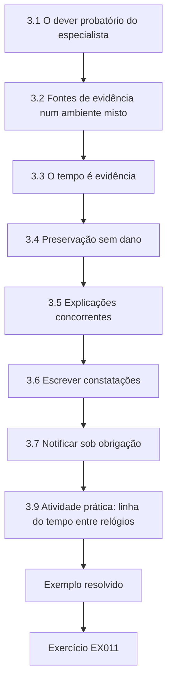

### Desenho lógico

```mermaid
flowchart LR
  N0["3.1 O dever probatório do especialista"]
  N1["3.2 Fontes de evidência num ambiente misto"]
  N2["3.3 O tempo é evidência"]
  N3["3.4 Preservação sem dano"]
  N4["3.5 Explicações concorrentes"]
  N5["3.6 Escrever constatações"]
  N6["3.7 Notificar sob obrigação"]
  N7["3.9 Atividade prática: linha do tempo entre relógios"]
  N0 --> N1 --> N2 --> N3 --> N4 --> N5 --> N6 --> N7 --> Q["EX011"]
```

```text
[3.1 O dever probatório do especialista]
    |
    v
[3.2 Fontes de evidência num ambiente misto]
    |
    v
[3.3 O tempo é evidência]
    |
    v
[3.4 Preservação sem dano]
    |
    v
[3.5 Explicações concorrentes]
    |
    v
[3.6 Escrever constatações]
    |
    v
[3.7 Notificar sob obrigação]
    |
    v
[3.9 Atividade prática: linha do tempo entre relógios]
    |
    v
[Exemplo resolvido] --> [Exercício EX011]
```
<!-- cykin:lesson-figures:end ch-03 -->


### Objetivos de aprendizagem e conexão

Ao final deste capítulo, você deverá ser capaz de:

1. Identificar as fontes de evidência disponíveis num ambiente misto de TI/TO e o que cada uma pode e não pode mostrar.
2. Reconstruir uma linha do tempo a partir de fontes cujos relógios discordam, usando eventos-âncora, e declarar a incerteza que resta.
3. Planejar a preservação de evidências sem pôr em risco o processo físico.
4. Gerar explicações concorrentes e identificar as evidências que discriminariam entre elas.
5. Escrever constatações que separem observação, inferência e julgamento, num nível de confiança que as evidências sustentem.
6. Cumprir as obrigações de notificação sem exagerar o que se sabe.

O Capítulo 2 graduou as evidências de que os controles estão implementados. Este capítulo trata das evidências sobre **o que aconteceu** — o material que um especialista leva a uma revisão de incidente, a um regulador, a uma seguradora ou a um tribunal. O Capítulo 6 aplica a mesma disciplina aos testes planejados.

### 3.1 O dever probatório do especialista

Quando algo inexplicado acontece num serviço essencial, muitas pessoas formarão uma história depressa: o fornecedor, os operadores, a imprensa, o regulador. O dever do especialista é estabelecer o que as evidências sustentam, com que confiança e o que continua desconhecido — e manter essas coisas separadas sob pressão. As recomendações de resposta a incidentes do NIST enquadram a resposta como parte da gestão de riscos como um todo, com a preparação, a detecção, a análise e a melhoria ligadas à governança ([NIST SP 800-61 Rev. 3, 2025](https://csrc.nist.gov/pubs/sp/800/61/r3/final)). Para a TO, a NIST SP 800-82 Rev. 3 acrescenta que a resposta deve proteger primeiro a segurança operacional e o processo ([NIST, 2023](https://doi.org/10.6028/NIST.SP.800-82r3)).

O caso do setor de água do Capítulo 2 mostra por que isso importa. Em fevereiro de 2021, um alerta descreveu o comprometimento do sistema de controle de uma instalação de tratamento de água dos EUA por meio de um software de acesso remoto ([CISA, AA21-042A](https://www.cisa.gov/news-events/cybersecurity-advisories/aa21-042a)). Em 2023, noticiou-se que o ex-administrador da cidade teria dito que o evento provavelmente foi um erro de um funcionário, e não uma intrusão externa ([WUSF, 2023](https://www.wusf.org/local-state/2023-04-13/official-hack-oldsmar-city-water-treatment-plant-2021)). Seja qual for a verdade, o episódio mostra como um relato público inicial pode se cristalizar antes que as evidências estejam completas, e quanto a análise posterior depende do que foi preservado na época.

### 3.2 Fontes de evidência num ambiente misto

| Fonte | O que pode mostrar | Fraquezas típicas |
|---|---|---|
| Logs de firewall e de VPN | Sessões, contas, endereços e horários na fronteira | Retenção curta; o NAT esconde os hosts; sem conteúdo |
| Logs do provedor de identidade e do jump host | Quem se autenticou, de onde, quais sessões | Contas compartilhadas ou de serviço frustram a atribuição |
| Logs de host Windows/Linux em IHMs e estações de engenharia | Logons, processos, alterações de arquivos | Frequentemente desabilitados em hosts de TO; buffers locais pequenos são sobrescritos |
| Historiador SCADA | Valores do processo e comandos dos operadores com etiquetas de origem | Horário do relógio do servidor do historiador; a compressão pode descartar eventos curtos; a "origem" pode ser uma estação, não uma pessoa |
| Estado e arquivos de projeto do controlador (CLP) | Lógica e configuração atuais; às vezes contadores de alterações | A leitura pode exigir ferramentas do fornecedor; a interação online traz risco ao processo |
| Capturas de rede na zona de controle | Exatamente quais comandos de protocolo foram enviados | Raramente coletadas de forma contínua; volumosas |
| Livros de registro dos operadores e passagens de turno | Observações e decisões humanas | Resolução de minutos ou pior; escritos depois do fato; relógios de parede não sincronizados |
| Entrevistas | Intenção, contexto, ações não registradas | A memória reconstrói; os incentivos moldam os relatos |
| Registros de fornecedores e prestadores | Sessões remotas, manutenção, atualizações | Mantidos por terceiros; o acesso exige cláusulas contratuais |

Um especialista conhece essas fontes **antes** de um incidente e corrige as fraquezas que mais importam: tempo sincronizado, retenção mais longa dos logs de fronteira e de identidade, contas nominais e acesso contratual aos registros dos fornecedores. O catálogo de controles do NIST inclui requisitos de conteúdo, retenção e carimbo de tempo dos registros de auditoria exatamente por esse motivo ([NIST SP 800-53 Rev. 5](https://csrc.nist.gov/pubs/sp/800/53/r5/upd1/final)).

### 3.3 O tempo é evidência

A ordem dos eventos costuma decidir a explicação: a sessão remota começou antes ou depois de o setpoint mudar? Cada fonte registra o tempo pelo seu próprio relógio, e os relógios de TO frequentemente estão dessincronizados, derivados ou ajustados à mão. Três práticas tornam as linhas do tempo defensáveis:

1. **Escolha um relógio de referência** cuja sincronização você consiga verificar (por exemplo, um firewall sincronizado com uma fonte de tempo conhecida e conferido) e expresse todos os eventos nele.
2. **Estime o deslocamento de cada fonte a partir de eventos-âncora** — um único momento do mundo real registrado por duas fontes, como as duas pontas da mesma sessão de rede ou uma consulta de sincronização passando por um firewall. Duas âncoras independentes por fonte são melhores do que uma; a discordância entre elas revela deriva.
3. **Declare a incerteza residual** de cada fonte — a precisão da própria âncora, a resolução (um registro manuscrito pode ter apenas minutos) e a deriva ao longo do intervalo — e verifique se alguma conclusão depende de uma ordenação mais próxima do que essa incerteza.

### 3.4 Preservação sem dano

A preservação de evidências em TO não pode criar o dano que ela investiga. Princípios:

- **Segurança operacional e processo em primeiro lugar.** O responsável pelas operações decide se um sistema pode ser tocado. As etapas de preservação são planejadas com ele, não impostas.
- **Colete primeiro da fonte menos intrusiva.** Logs de fronteira, logs de identidade, exportações do historiador e backups geralmente podem ser coletados sem tocar na rede de controle. O estado do controlador deve ser lido com as ferramentas suportadas pelo fornecedor, sob controle de mudanças, ou não ser lido até que o processo esteja seguro.
- **Preserve as evidências voláteis quando for seguro.** A memória e o estado das conexões ativas em IHMs e jump hosts baseados em Windows desaparecem com a reinicialização; capture-os se o host puder ser dispensado.
- **Registre a cadeia de custódia.** Quem coletou o quê, quando, como, com quais hashes — a mesma disciplina de qualquer trabalho forense. Um hash criptográfico como o SHA-256 ([FIPS 180-4](https://csrc.nist.gov/pubs/fips/180-4/upd1/final)) mostra depois que um arquivo exportado não foi alterado.
- **Peça cedo aos fornecedores.** Os registros de sessões dos fornecedores e os logs de suporte remoto costumam ser sobrescritos segundo o cronograma do próprio fornecedor.

### 3.5 Explicações concorrentes

Uma mudança de setpoint com uma sessão remota por perto convida à história "um atacante fez isso". Um especialista lista toda explicação que poderia produzir as mesmas evidências e pergunta o que as distinguiria — o método das múltiplas hipóteses de trabalho ([Chamberlin, reimpressão de 1965](https://doi.org/10.1126/science.148.3671.754)). Para uma mudança de dosagem inexplicada, os candidatos incluem um intruso externo usando uma credencial roubada, um engenheiro legítimo do fornecedor fazendo uma mudança não registrada, um erro de um operador numa IHM local, um script ou receita automatizados, um erro de etiquetagem do historiador e uma falha de instrumento que o operador corrigiu manualmente. Cada um prevê rastros diferentes: a mudança de um intruso deveria vir da estação remota depois do logon remoto; o trabalho planejado de um fornecedor deveria corresponder a um chamado e a um padrão visto em outros locais; um erro de operador deveria vir de uma estação local; uma receita deveria se repetir segundo um cronograma; um erro de etiquetagem deveria discordar do registro do próprio controlador.

### 3.6 Escrever constatações

Uma constatação tem quatro partes: a **observação** com sua fonte; a **inferência** com seus pressupostos; a **confiança**, em palavras que correspondam a faixas explícitas se a sua organização as usar; e a **consequência** para as decisões. Por exemplo: "O historiador registra uma mudança do setpoint de dosagem de 1,8 para 2,6 mg/L atribuída à estação HMI-JH2 às 02:23:03 (horário do firewall, ±10 s). A estação HMI-JH2 é o cliente de IHM no jump host JH-2. A única sessão interativa no JH-2 naquele momento era a da conta vendor-svc, que se conectou pela VPN a partir das 02:11:40. Avaliamos com confiança moderada que a mudança foi feita dentro da sessão vendor-svc; ainda não podemos dizer quem usou essa conta. A conta é compartilhada por quatro engenheiros da Corvane." Isso é muito mais útil para um tomador de decisão do que "a conta do fornecedor foi comprometida".

### 3.7 Notificar sob obrigação

Muitos regimes exigem hoje a notificação precoce, em etapas, de incidentes significativos. A NIS2, por exemplo, prevê um alerta precoce, uma notificação mais completa e um relatório final em prazos fixos ([Diretiva (UE) 2022/2555](https://eur-lex.europa.eu/eli/dir/2022/2555/oj/)); a NERC CIP e outras regras setoriais têm seus próprios relógios. As notificações precoces precisam ser feitas antes que os fatos sejam conhecidos. A contribuição do especialista é torná-las **exatas quanto à incerteza**: dizer o que foi observado, o que está sendo investigado e o que ainda não se sabe, e evitar uma atribuição que evidências posteriores possam reverter. Acompanhe cada declaração externa para que as notificações posteriores possam corrigir explicitamente as anteriores.

### 3.8 Exemplo resolvido: uma noite em Hollin (sintético)

Na estação de tratamento de Hollin, o setpoint de dosagem de cloro subiu brevemente de 1,8 para 2,6 mg/L e voltou em menos de um minuto. O registro manuscrito do operador diz que ele notou um alarme às "02:20" e restaurou o setpoint. O especialista reuniu os registros do firewall, do jump host e do historiador. Lido de forma ingênua, o historiador mostra a mudança às 02:06, *antes* de a sessão VPN vendor-svc começar, às 02:11 — o que inocentaria a sessão remota. Mas sabe-se que o relógio do servidor do historiador não está sincronizado. Existem duas âncoras: o início de uma sessão TCP visto tanto pelo firewall quanto pelo jump host, e a própria consulta de sincronização do historiador passando pelo firewall.

### 3.9 Atividade prática: linha do tempo entre relógios que discordam

```python
# Lab 3 - reconstructing a timeline from sources whose clocks disagree (offline, standard library only)
# Synthetic: Merrow Water, Hollin treatment works, night of an unexplained chlorine dosing setpoint change.
# Each source records time in its own clock. Anchor events were seen by two sources at the same real moment.
from datetime import datetime, timedelta
T = lambda s: datetime.strptime(s, "%H:%M:%S")
EVENTS = [  # (source, local clock time, description)
    ("firewall",  "02:11:40", "VPN session opened for account vendor-svc"),
    ("firewall",  "02:13:05", "RDP from VPN pool to jump host JH-2 allowed"),
    ("jumphost",  "02:20:31", "interactive logon vendor-svc on JH-2"),
    ("jumphost",  "02:22:58", "HMI client launched on JH-2"),
    ("historian", "02:06:12", "dosing setpoint changed 1.8 -> 2.6 mg/L, source HMI-JH2"),
    ("historian", "02:06:50", "dosing setpoint restored 2.6 -> 1.8 mg/L, source HMI-OPS1"),
    ("ops-log",   "02:20",    "operator notices dosing alarm, restores setpoint (handwritten, minute only)"),
    ("firewall",  "02:31:10", "VPN session closed for vendor-svc"),
]
ANCHORS = [  # the same real moment seen by two sources: (source_a, time_a, source_b, time_b)
    ("firewall", "02:13:07", "jumphost", "02:20:33"),   # TCP session start seen at both ends
    ("firewall", "02:14:30", "historian", "01:57:39"),  # historian's NTP query passing the firewall
]
offset = {"firewall": timedelta(0)}  # firewall is the reference clock (NTP-synchronized, checked)
for a, ta, b, tb in ANCHORS:
    offset[b] = (T(ta) - T(tb)) + offset[a]
offset["ops-log"] = timedelta(0)  # a handwritten log has no known offset, only minute resolution
def show(title, rows):
    print(title)
    for t, src, d in rows: print(f"  {t.strftime('%H:%M:%S')}  {src:9s} {d}")
naive = sorted((T(t) if len(t) > 5 else T(t + ':00'), s, d) for s, t, d in EVENTS)
show("Naive order (raw clocks):", naive)
fixed = sorted(((T(t) if len(t) > 5 else T(t + ':00')) + offset[s], s, d) for s, t, d in EVENTS)
show("Corrected to firewall time:", fixed)
print("offsets:", {k: int(v.total_seconds()) for k, v in offset.items()}, "seconds")
```

Saída esperada:

```text
Naive order (raw clocks):
  02:06:12  historian dosing setpoint changed 1.8 -> 2.6 mg/L, source HMI-JH2
  02:06:50  historian dosing setpoint restored 2.6 -> 1.8 mg/L, source HMI-OPS1
  02:11:40  firewall  VPN session opened for account vendor-svc
  02:13:05  firewall  RDP from VPN pool to jump host JH-2 allowed
  02:20:00  ops-log   operator notices dosing alarm, restores setpoint (handwritten, minute only)
  02:20:31  jumphost  interactive logon vendor-svc on JH-2
  02:22:58  jumphost  HMI client launched on JH-2
  02:31:10  firewall  VPN session closed for vendor-svc
Corrected to firewall time:
  02:11:40  firewall  VPN session opened for account vendor-svc
  02:13:05  firewall  RDP from VPN pool to jump host JH-2 allowed
  02:13:05  jumphost  interactive logon vendor-svc on JH-2
  02:15:32  jumphost  HMI client launched on JH-2
  02:20:00  ops-log   operator notices dosing alarm, restores setpoint (handwritten, minute only)
  02:23:03  historian dosing setpoint changed 1.8 -> 2.6 mg/L, source HMI-JH2
  02:23:41  historian dosing setpoint restored 2.6 -> 1.8 mg/L, source HMI-OPS1
  02:31:10  firewall  VPN session closed for vendor-svc
offsets: {'firewall': 0, 'jumphost': -446, 'historian': 1011, 'ops-log': 0} seconds
```

**Interpretação.** O jump host está 446 segundos (7 min 26 s) adiantado em relação ao firewall; o historiador, 1.011 segundos (16 min 51 s) atrasado. Corrigida, a ordem se inverte: a sessão vendor-svc abre às 02:11:40, o logon no jump host segue a conexão RDP permitida no mesmo segundo (uma verificação de consistência que apoia a primeira âncora), o cliente de IHM inicia às 02:15:32 e a mudança de setpoint a partir da estação HMI-JH2 ocorre às 02:23:03, com uma restauração a partir da estação dos operadores 38 segundos depois. A linha do tempo ingênua teria inocentado a sessão remota; a corrigida coloca a mudança dentro dela. Note a inconsistência que resta: o "02:20" do registro manuscrito está três minutos *antes* da mudança que ele descreve. A explicação provável é que o relógio de parede da sala de controle esteja atrasado, mas isso é uma inferência; deve ser conferido com o relógio de parede e registrado, e não "corrigido" em silêncio. A constatação continua sendo sobre a **sessão**, não sobre uma pessoa, e as explicações concorrentes (§3.5) — a mudança legítima, mas não registrada, de um engenheiro do fornecedor versus o mau uso da conta compartilhada — continuam em aberto.

### 3.10 Erros comuns e limites

- Ordenar eventos de fontes diferentes pelos carimbos de tempo brutos.
- Corrigir relógios com uma única âncora e nunca conferi-la com uma segunda.
- Tratar uma etiqueta de "origem" do historiador como uma pessoa.
- Tocar nos controladores para coletar evidências sem a decisão do responsável pelas operações.
- Deixar a primeira história plausível definir quais evidências são coletadas.
- Escrever "comprometido" ou "ataque" em notificações precoces quando as evidências sustentam apenas "mudança inexplicada durante uma sessão remota".
- Esquecer que os registros dos fornecedores expiram.

O limite é que as evidências podem estreitar as explicações, mas raramente eliminam todas menos uma. Um especialista relata quais explicações restam e o que as separaria; a decisão de agir — por exemplo, suspender o acesso de um fornecedor — pode e muitas vezes deve ser tomada antes que a atribuição esteja resolvida.

### Exercícios — capítulo 3

**EX011 — Robustez da ordem.** *Objetivo:* quantificar quanto uma conclusão da linha do tempo depende de uma âncora. *Insumos:* Laboratório 3. *Restrições:* considerar erros apenas na âncora do historiador. *Passos:* (1) calcular quantos segundos mais cedo a mudança de setpoint corrigida teria de ocorrer para preceder o início do cliente de IHM no JH-2; (2) mudar em um minuto o horário de firewall da âncora do historiador (02:14:30 → 02:15:30), reexecutar e relatar se a ordem muda; (3) declarar que evidência independente confirmaria o deslocamento do historiador. *Evidência esperada:* cálculo, saída da reexecução e parágrafo. *Rubrica:* 3 = margem calculada (451 s), a reexecução mostra que a ordem não muda, uma segunda âncora independente proposta; 2 = falta uma parte; 1 = não executado; 0 = nada.

**EX012 — Plano de preservação.** *Objetivo:* planejar uma coleta de evidências segura. *Insumos:* o evento de Hollin. *Restrições:* a planta precisa continuar produzindo água; o responsável pelas operações tem autoridade sobre os sistemas de controle. *Passos:* listar as fontes na ordem de coleta, com o método, quem aprova, a volatilidade e o risco ao processo; incluir a cadeia de custódia e os pedidos aos fornecedores. *Evidência esperada:* tabela e uma justificativa de um parágrafo. *Rubrica:* 3 = menos intrusiva primeiro, captura volátil do JH-2 antes de qualquer reinicialização, leituras do controlador com aprovação das operações e ferramentas do fornecedor, hashes e custódia, registros de sessão da Corvane pedidos imediatamente; 2 = ordem parcialmente errada; 1 = põe o processo em risco; 0 = nada.

**EX013 — Escreva a constatação.** *Objetivo:* separar observação, inferência, confiança e consequência. *Insumos:* a saída do Laboratório 3. *Restrições:* 200 palavras; nenhuma atribuição a uma pessoa. *Passos:* escrever a constatação para o conselho e uma versão de uma frase para a notificação precoce ao regulador. *Evidência esperada:* os dois textos. *Rubrica:* 3 = observações com fonte, base de relógio e incerteza, inferência explícita, confiança declarada, consequência para as decisões (por exemplo, suspender a conta compartilhada) clara, frase ao regulador exata quanto ao que não se sabe; 2 = um elemento misturado; 1 = afirma o comprometimento como fato; 0 = nada.

**EX014 — Evidências discriminantes.** *Objetivo:* aplicar as múltiplas hipóteses de trabalho. *Insumos:* as seis explicações candidatas da §3.5. *Restrições:* para cada uma, uma previsão que as outras não compartilhem. *Passos:* montar uma tabela com a explicação, a previsão distintiva, a fonte de evidência e o estado atual (apoiada, contrariada, em aberto). *Evidência esperada:* tabela. *Rubrica:* 3 = previsões genuinamente discriminantes, estados coerentes com o Laboratório 3 (erro do operador numa estação local contrariado para a própria mudança; legítima do fornecedor versus mau uso em aberto), próximas evidências identificadas; 2 = algumas previsões compartilhadas; 1 = apenas uma lista; 0 = nada.

**EX015 — Notificação em etapas.** *Objetivo:* redigir declarações externas que sobrevivam às evidências posteriores. *Insumos:* o evento de Hollin; suponha que a Merrow Water esteja sujeita a um regime de notificação de incidentes em etapas semelhante ao do artigo 23 da NIS2. *Restrições:* não interpretar a lei real para uma entidade real; usar marcadores para os prazos. *Passos:* redigir o alerta precoce, a notificação e o esboço do relatório final, mostrando como cada um corrige ou amplia o anterior. *Evidência esperada:* três textos curtos. *Rubrica:* 3 = alerta precoce factual e explícito quanto à incerteza, a notificação acrescenta a linha do tempo corrigida e as ações, o esboço do relatório final inclui a causa raiz, as correções e as lições; 2 = o texto inicial exagera; 1 = atribuição afirmada; 0 = nada.

### Síntese do capítulo

As evidências especializadas são o material em que se apoiam as decisões e a responsabilização. Conheça suas fontes antes de um incidente e corrija as fraquezas que importam — tempo, retenção, contas nominais e acesso aos fornecedores. Trate o tempo como evidência: escolha um relógio de referência, estime os deslocamentos a partir de âncoras e declare a incerteza residual. Preserve sem prejudicar o processo, a menos intrusiva primeiro, com cadeia de custódia. Gere explicações concorrentes e busque as evidências que discriminam entre elas. Escreva constatações que mantenham separadas a observação, a inferência, a confiança e a consequência, e notifique cedo de um modo que as evidências posteriores ampliem, em vez de contradizer.

<!-- cykin:chapter-navigation:start ch-03 -->
### Continue estudando — capítulo 03 de 12

[← Capítulo 02](#ch-02) · [Índice de capítulos do curso](../SUBJECTS.md) · [Capítulo 04 →](#ch-04)

Siga para a próxima lição escrita.
<!-- cykin:chapter-navigation:end -->

<a id="ch-04"></a>

## Capítulo 4 — Risco avançado e ética

<!-- cykin:lesson-figures:start ch-04 -->
### Mapa da aula

Aula 04 publicada. Mapa, exemplo, EX016.

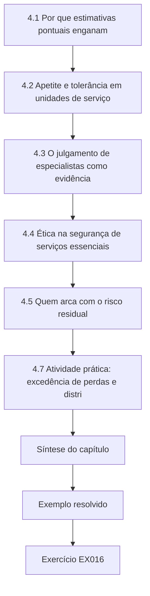

### Desenho lógico

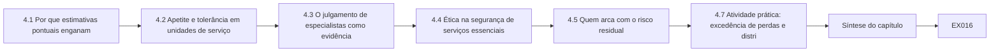

```text
[4.1 Por que estimativas pontuais enganam]
    |
    v
[4.2 Apetite e tolerância em unidades de serviço]
    |
    v
[4.3 O julgamento de especialistas como evidência]
    |
    v
[4.4 Ética na segurança de serviços essenciais]
    |
    v
[4.5 Quem arca com o risco residual]
    |
    v
[4.7 Atividade prática: excedência de perdas e distri]
    |
    v
[Síntese do capítulo]
    |
    v
[Exemplo resolvido] --> [Exercício EX016]
```
<!-- cykin:lesson-figures:end ch-04 -->


### Objetivos de aprendizagem e conexão

Ao final deste capítulo, você deverá ser capaz de:

1. Construir uma estimativa quantificada de risco com incerteza explícita de frequência e de gravidade, e lê-la como uma curva de excedência de perdas, e não como um número único.
2. Expressar o apetite e a tolerância a risco em unidades de serviço, com limites sobre a cauda, e não apenas sobre a média.
3. Elicitar e documentar o julgamento de especialistas de modo que ele possa ser contestado.
4. Analisar quem arca com o risco residual e reconhecer quando uma opção melhor na média é pior para um grupo específico.
5. Aplicar princípios éticos reconhecidos às decisões, aos testes e à divulgação de segurança em serviços essenciais.

O Capítulo 1 comparou opções numa tabela de cenários. Este capítulo substitui a tabela por distribuições e acrescenta a pergunta que as tabelas de decisão escondem: *para quem* uma opção é melhor? O Capítulo 8 aplica ambas as coisas a casos em que toda escolha prejudica alguém.

### 4.1 Por que estimativas pontuais enganam

Uma entrada de registro de riscos como "probabilidade 3, impacto 4, escore 12" esconde três coisas de que uma decisão precisa: com que frequência, quão grave e quão incerto. As orientações de avaliação de riscos do NIST descrevem o risco como função da ameaça, da vulnerabilidade, da probabilidade e do impacto, e advertem que as avaliações precisam declarar pressupostos e incerteza ([NIST SP 800-30 Rev. 1](https://csrc.nist.gov/pubs/sp/800/30/r1/final)). Multiplicar escores ordinais também faz aritmética com números que são apenas rótulos.

Um modelo mínimo melhor tem duas partes: uma distribuição de **frequência** para quantos eventos de perda ocorrem num ano e uma distribuição de **gravidade** para quão grave cada um é. Na infraestrutura, a gravidade costuma ser assimétrica à direita: a maioria das interrupções é curta, e poucas são muito longas. A distribuição lognormal é uma escolha comum e simples para grandezas assim; seus parâmetros devem ser ancorados em evidências (durações de interrupções passadas, resultados de exercícios, incidentes de pares), e a própria escolha deve ser registrada como um pressuposto. Simular muitos anos dá uma distribuição da perda anual, que você pode resumir de três modos: a **média** (o que você paga em média), a **probabilidade de exceder** limiares que importam e um **percentil alto**, como o 99º (um ano ruim de uma vez em cem anos). Plotar a probabilidade de excedência contra a perda dá a **curva de excedência de perdas** (LEC, na sigla em inglês).

### 4.2 Apetite e tolerância em unidades de serviço

O **apetite a risco** é a quantidade e o tipo de risco que uma organização está disposta a buscar ou a reter; a **tolerância** fixa os limites da variação aceitável. O NIST CSF 2.0 coloca ambos sob a governança ([NIST, 2024](https://doi.org/10.6028/NIST.CSWP.29)). Para um serviço essencial, as declarações de apetite devem estar em unidades de serviço e devem restringir a cauda. Por exemplo (sintético): "A Merrow Water não aceitará uma chance anual superior a 2% de uma interrupção de origem cibernética que exceda um milhão de domicílios-hora de fornecimento, nem nenhum cenário crível em que os domicílios de um único distrito fiquem sem fornecimento por mais de 48 horas sem provisão alternativa." A primeira cláusula limita a LEC; a segunda limita a *distribuição* — um tema ao qual voltamos na §4.5.

### 4.3 O julgamento de especialistas como evidência

Onde os dados são escassos, os parâmetros de frequência e de gravidade vêm de pessoas. A elicitação estruturada — definir as grandezas com precisão, treinar os especialistas em calibração, pedir quantis em vez de valores únicos, agregar vários especialistas e registrar a justificativa — torna o julgamento inspecionável ([O'Hagan et al., 2006](https://doi.org/10.1002/0470033312)). Regras práticas para o especialista: pergunte sobre grandezas observáveis ("quantas horas para restaurar o fornecimento de Upper Merrow após a perda total do SCADA?") em vez de probabilidades abstratas; peça primeiro um intervalo de 90% e depois uma mediana; peça as taxas de base de operadores comparáveis; e registre a pessoa, a data, a pergunta e a justificativa, para que a estimativa possa ser revista quando chegarem evidências.

### 4.4 Ética na segurança de serviços essenciais

As decisões de segurança na infraestrutura distribuem danos. Vários frameworks estabelecidos ajudam a raciocinar sobre elas:

- O **Menlo Report** adaptou os princípios da ética em pesquisa — respeito às pessoas, beneficência, justiça — à pesquisa em tecnologia da informação e comunicação e acrescentou o respeito à lei e ao interesse público ([Dittrich e Kenneally, 2012](https://www.dhs.gov/sites/default/files/publications/CSD-MenloPrinciplesCORE-20120803_1.pdf)). Seus princípios se aplicam diretamente aos testes e à coleta de dados em ambientes operacionais.
- Códigos profissionais como o [Código de Ética da ACM](https://www.acm.org/code-of-ethics) e o [Código de Ética para Engenheiros da NSPE](https://www.nspe.org/resources/ethics/code-ethics) colocam o bem-estar e a segurança do público acima dos interesses do empregador ou do cliente, e exigem honestidade sobre os limites da própria competência e da segurança de um sistema.
- A legislação de proteção de dados impõe deveres ao tratamento de dados pessoais no monitoramento de segurança e no tratamento de incidentes ([GDPR, Regulamento (UE) 2016/679](https://eur-lex.europa.eu/eli/reg/2016/679/oj)); no Brasil, a [LGPD, Lei nº 13.709/2018](https://www.planalto.gov.br/ccivil_03/_ato2015-2018/2018/lei/l13709.htm), fiscalizada pela ANPD, exige uma base legal para o tratamento (art. 7º) e medidas de segurança técnicas e administrativas (art. 46). Frameworks de privacidade como o [NIST Privacy Framework](https://www.nist.gov/privacy-framework) ajudam a gerir esses deveres no projeto.

Para um especialista, quatro perguntas éticas se repetem. **Distribuição:** quem arca com o risco residual da opção escolhida, e essas pessoas tiveram voz? **Proporcionalidade:** a intrusão de uma medida de segurança — o monitoramento dos funcionários, a restrição do acesso de pacientes ou clientes — é proporcional ao dano que ela evita? **Honestidade:** os riscos e as incertezas são comunicados com veracidade aos tomadores de decisão e, quando apropriado, ao público? **Divulgação:** quando você descobre uma fraqueza que também afeta outros — um produto de fornecedor usado por outras concessionárias —, como protegê-los sem armar os atacantes? Os processos de divulgação coordenada de vulnerabilidades existem exatamente para esse caso ([CISA, CVD Program](https://www.cisa.gov/resources-tools/programs/coordinated-vulnerability-disclosure-cvd-program)).

### 4.5 Quem arca com o risco residual

Medidas agregadas — total de domicílios-hora perdidos, perda esperada — podem favorecer opções que protegem áreas densas e bem atendidas, porque proteger muita gente um pouco pontua mais do que proteger pouca gente muito. Um especialista deve, portanto, relatar, ao lado dos totais, a **carga per capita por grupo** (distrito, tipo de cliente) e a carga sobre as **pessoas menos capazes de lidar com a situação**, como os domicílios com dependência médica de água ou de energia. Nem os totais nem as medidas per capita resolvem a questão; a escolha entre eles é um julgamento de valor que pertence ao tomador de decisão responsável, informado pelos deveres legais (por exemplo, os deveres para com clientes vulneráveis) e pelo apetite declarado da organização. O dever ético do especialista é tornar a distribuição visível, para que o trade-off seja escolhido com conhecimento de causa.

### 4.6 Exemplo resolvido: duas opções com o mesmo orçamento (sintético)

A Merrow Water atende três distritos. Harbour é urbano (60.000 domicílios); Fenley, suburbano (25.000); Upper Merrow, rural (6.000 domicílios numa única adutora, com uma telemetria lenta de restaurar e longos tempos de deslocamento das equipes). As interrupções de fornecimento de origem cibernética são modeladas como eventos de Poisson com duração lognormal (mediana de 8 horas). A restauração de Upper Merrow hoje leva três vezes mais tempo. Duas opções custam o mesmo:

- **X: endurecer o SCADA central** — reduz a frequência dos eventos de 0,30 para 0,20 por ano em toda parte; não faz nada pela longa restauração de Upper Merrow.
- **Y: segunda alimentação e controle local para Upper Merrow** — mantém a frequência em 0,30, mas reduz a restauração de Upper Merrow a 0,75 da duração base.

Os domicílios vulneráveis (com necessidades médicas ou de cuidado registradas) são contados separadamente: 900 em Harbour, 500 em Fenley, 400 em Upper Merrow.

### 4.7 Atividade prática: excedência de perdas e distribuição

```python
# Lab 4 - same budget, different people: loss exceedance and the distribution of harm (offline, stdlib only)
# Synthetic: Merrow Water supply interruptions caused by cyber events. Two options cost the same.
import random, math
random.seed(4)
YEARS = 20000
DISTRICTS = {  # name: (households, share of interruption events that hit this district, vulnerable households)
    "Harbour (urban)":  (60000, 0.40, 900),
    "Fenley (suburban)": (25000, 0.25, 500),
    "Upper Merrow (rural, single main)": (6000, 0.35, 400),
}
def poisson(lam):
    L, k, p = math.exp(-lam), 0, 1.0
    while True:
        p *= random.random()
        if p < L: return k
        k += 1
def simulate(freq, hours_mu, hours_sigma, rural_hours_factor):
    annual_hh_hours = []; per_district = {d: 0.0 for d in DISTRICTS}; vuln = {d: 0.0 for d in DISTRICTS}
    for _ in range(YEARS):
        total = 0.0
        for _ in range(poisson(freq)):
            hours = random.lognormvariate(hours_mu, hours_sigma)
            r = random.random(); acc = 0
            for d, (hh, share, v) in DISTRICTS.items():
                acc += share
                if r < acc:
                    h = hours * (rural_hours_factor if d.startswith("Upper") else 1.0)
                    per_district[d] += hh * h; vuln[d] += v * h; total += hh * h
                    break
        annual_hh_hours.append(total)
    return annual_hh_hours, per_district, vuln
OPTIONS = {
    "X: harden central SCADA (fewer events)":      (0.20, math.log(8), 0.9, 3.0),
    "Y: second feed + local control Upper Merrow": (0.30, math.log(8), 0.9, 0.75),
}
for name, args in OPTIONS.items():
    loss, per, vul = simulate(*args)
    loss.sort()
    mean = sum(loss) / YEARS
    p_any = sum(1 for x in loss if x > 0) / YEARS
    p_big = sum(1 for x in loss if x > 1_000_000) / YEARS
    p99 = loss[int(0.99 * YEARS)]
    print(name)
    print(f"  mean household-hours/yr {mean:9.0f}  P(any)={p_any:.3f}  P(>1M hh-h)={p_big:.4f}  99th pct {p99:9.0f}")
    for d, (hh, share, v) in DISTRICTS.items():
        print(f"  {d:34s} hours per household/yr {per[d]/YEARS/hh:5.2f}   vulnerable-household-hours/yr {vul[d]/YEARS:7.0f}")
```

Saída esperada:

```text
X: harden central SCADA (fewer events)
  mean household-hours/yr     88346  P(any)=0.183  P(>1M hh-h)=0.0204  99th pct   1498603
  Harbour (urban)                    hours per household/yr  0.97   vulnerable-household-hours/yr     872
  Fenley (suburban)                  hours per household/yr  0.64   vulnerable-household-hours/yr     318
  Upper Merrow (rural, single main)  hours per household/yr  2.39   vulnerable-household-hours/yr     956
Y: second feed + local control Upper Merrow
  mean household-hours/yr    117262  P(any)=0.261  P(>1M hh-h)=0.0305  99th pct   1920694
  Harbour (urban)                    hours per household/yr  1.48   vulnerable-household-hours/yr    1332
  Fenley (suburban)                  hours per household/yr  0.91   vulnerable-household-hours/yr     453
  Upper Merrow (rural, single main)  hours per household/yr  0.96   vulnerable-household-hours/yr     386
```

**Interpretação.** Em toda medida agregada, X é melhor: perda média de 88.346 contra 117.262 domicílios-hora por ano; chance anual de 2,0% contra 3,1% de exceder um milhão de domicílios-hora; um 99º percentil mais baixo. Diante do apetite da §4.2, X fica sobre o limite de cauda de 2% (0,0204, dentro do erro de simulação do limite) e Y o viola claramente. Mas a **distribuição** inverte o retrato. Sob X, um domicílio de Upper Merrow perde em média 2,39 horas por ano — mais que o dobro de um domicílio urbano e quase quatro vezes um suburbano —, e os 400 domicílios vulneráveis de Upper Merrow arcam com 956 domicílios vulneráveis-hora por ano, mais do que os 900 domicílios de Harbour. Y reduz a carga rural a 0,96 hora por domicílio e os domicílios vulneráveis-hora rurais a 386, ao custo de cargas maiores nos outros distritos. O total de domicílios vulneráveis-hora é quase idêntico (cerca de 2.146 sob X e 2.171 sob Y): as opções não diferem muito em quanto dano recai sobre as pessoas vulneráveis no conjunto, mas diferem fortemente em *quais* pessoas vulneráveis arcam com ele. A segunda cláusula do apetite — nenhum distrito sem fornecimento além de 48 horas — exigiria olhar para a cauda de Upper Merrow, que o resumo não mostra; essa é a extensão do EX016.

A análise não decide entre X e Y. Ela mostra que "X é melhor" só é verdade sob uma visão utilitarista agregada e que a escolha concentra o risco numa pequena população rural. Uma recomendação defensável poderia combinar X com medidas não técnicas mais baratas para Upper Merrow (água engarrafada pré-posicionada, um cadastro prioritário de domicílios vulneráveis), e precisa registrar o julgamento de valor.

### 4.8 Erros comuns e limites

- Multiplicar escores ordinais e tratar o produto como uma grandeza.
- Relatar apenas a perda anual média para um risco de cauda pesada.
- Declarar o apetite a risco como uma cor ou um adjetivo, e não como um limite em unidades de serviço.
- Tratar números elicitados como dados e descartar o registro da elicitação.
- Relatar apenas o benefício agregado, de modo que o dano concentrado em pequenos grupos fique invisível.
- Apresentar um julgamento de valor (agregado versus distribuição) como um resultado técnico.
- Segurar uma vulnerabilidade que afeta outros operadores porque a divulgação é incômoda.

Os limites do modelo são os de seus pressupostos: a independência de Poisson ignora campanhas que atingem vários locais ao mesmo tempo; a lognormal pode subestimar as interrupções mais longas; as participações dos distritos são julgamentos. Mude-os e os números se movem; o *método* de mostrar a distribuição ao lado dos totais não.

### Exercícios — capítulo 4

**EX016 — Melhoria rural parcial.** *Objetivo:* ver como a distribuição responde a uma opção mais fraca. *Insumos:* Laboratório 4. *Restrições:* mudar o fator de duração rural de Y de 0,75 para 1,5 (a segunda alimentação atrasa; só o controle local é entregue). *Passos:* (1) reexecutar; (2) relatar as horas por domicílio e os domicílios vulneráveis-hora de Upper Merrow sob o Y modificado; (3) comparar com X e com o Y original; (4) estender o laboratório para relatar a probabilidade de que Upper Merrow tenha, num ano, uma única interrupção de mais de 48 horas sob X e sob Y. *Evidência esperada:* saídas e parágrafo. *Rubrica:* 3 = números do Y modificado corretos (1,93 hora; 771 domicílios vulneráveis-hora), ainda melhor para Upper Merrow do que X, mas muito menos do que o Y original, extensão de 48 horas implementada com uma verificação correta por evento; 2 = falta a extensão; 1 = não executado; 0 = nada.

**EX017 — Memorando de análise ética.** *Objetivo:* aplicar princípios éticos à escolha entre X e Y. *Insumos:* §4.4–4.7. *Restrições:* 400 palavras; princípios do Menlo Report e de um código profissional. *Passos:* (1) identificar os grupos afetados e sua voz; (2) analisar a beneficência e a justiça; (3) declarar o julgamento de valor que o conselho precisa fazer; (4) recomendar uma opção combinada com medidas não técnicas. *Evidência esperada:* memorando. *Rubrica:* 3 = grupos específicos, trade-off entre a visão agregada e a distributiva nomeado como um julgamento, recomendação combinada concreta, dever de honestidade para com o conselho observado; 2 = princípios listados, mas não aplicados; 1 = afirma X ou Y como tecnicamente correto; 0 = nada.

**EX018 — Protocolo de elicitação.** *Objetivo:* obter parâmetros de gravidade defensáveis. *Insumos:* a pergunta "quanto tempo levaria para restaurar o fornecimento de Upper Merrow após a perda total do SCADA?". *Restrições:* três especialistas; grandeza observável; quantis. *Passos:* (1) definir a grandeza com precisão; (2) escrever o roteiro de elicitação, incluindo uma pergunta de calibração; (3) explicar como você agregaria e registraria. *Evidência esperada:* protocolo. *Rubrica:* 3 = grandeza inequívoca (eventos de início e de fim definidos), quantis de 5%, 50% e 95% pedidos, elicitação independente antes da discussão, calibração e registro mantidos; 2 = pedidos valores únicos; 1 = probabilidade de um evento vago; 0 = nada.

**EX019 — Declaração de apetite.** *Objetivo:* escrever o apetite e a tolerância em unidades de serviço. *Insumos:* a Merrow Health (três hospitais, uma dependência de serviço de ambulâncias). *Restrições:* pelo menos um limite de cauda e um limite de distribuição; mensuráveis a partir dos próprios dados da organização. *Passos:* redigir; depois testá-la contra um cenário plausível e dizer se ela é violada. *Evidência esperada:* declaração e teste. *Rubrica:* 3 = unidades de serviço (por exemplo, horas de desvio do departamento de emergência, tratamentos tempo-dependentes atrasados), limites de cauda e de distribuição mensuráveis, teste honesto; 2 = apenas médias; 1 = adjetivos; 0 = nada.

**EX020 — Dilema de divulgação.** *Objetivo:* lidar com uma fraqueza que afeta outros. *Insumos:* durante uma revisão, a Merrow Water descobre que a ferramenta de suporte remoto da Corvane aceita uma credencial padrão numa porta de manutenção; a Corvane dá suporte a outras concessionárias da região. *Restrições:* nenhum teste além dos sistemas da própria Merrow; nenhuma divulgação pública antes de um processo coordenado. *Passos:* (1) ações de proteção imediatas para a Merrow; (2) via de notificação à Corvane e, se necessário, a um coordenador; (3) o que dizer ao fórum de resiliência, e quando; (4) justificativa ética. *Evidência esperada:* plano. *Rubrica:* 3 = proteger primeiro os próprios sistemas, notificação privada ao fornecedor com evidências, uso de um processo de divulgação coordenada se o fornecedor não agir, fórum informado de um modo que proteja os outros sem publicar detalhes de exploração, princípios citados; 2 = falta uma etapa; 1 = testa os sistemas de outras concessionárias ou publica; 0 = nada.

### Síntese do capítulo

Quantifique o risco como frequência e gravidade com incerteza explícita, e leia-o pela curva de excedência de perdas, não por um escore único. Escreva o apetite e a tolerância em unidades de serviço, com limites sobre a cauda e sobre a distribuição. Trate o julgamento de especialistas como evidência que precisa ser elicitada com cuidado e registrada. Mostre quem arca com o risco residual — per capita e para os menos capazes de lidar com ele —, porque opções melhores na média podem concentrar o dano. Aplique princípios éticos reconhecidos às escolhas, aos testes e à divulgação, e mantenha os julgamentos de valor visíveis como julgamentos para o tomador de decisão responsável.

<!-- cykin:chapter-navigation:start ch-04 -->
### Continue estudando — capítulo 04 de 12

[← Capítulo 03](#ch-03) · [Índice de capítulos do curso](../SUBJECTS.md) · [Capítulo 05 →](#ch-05)

Siga para a próxima lição escrita.
<!-- cykin:chapter-navigation:end -->

<a id="ch-05"></a>

## Capítulo 5 — Infraestrutura crítica e segurança setorial: alternativas de projeto

<!-- cykin:lesson-figures:start ch-05 -->
### Mapa da aula

Aula 05 publicada. Mapa, exemplo, EX021.

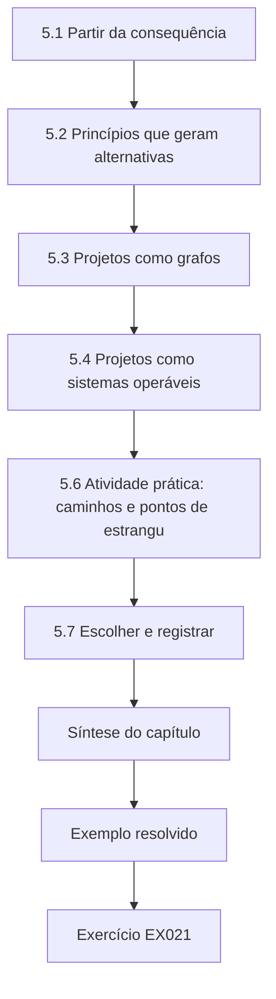

### Desenho lógico

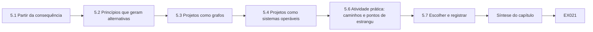

```text
[5.1 Partir da consequência]
    |
    v
[5.2 Princípios que geram alternativas]
    |
    v
[5.3 Projetos como grafos]
    |
    v
[5.4 Projetos como sistemas operáveis]
    |
    v
[5.6 Atividade prática: caminhos e pontos de estrangu]
    |
    v
[5.7 Escolher e registrar]
    |
    v
[Síntese do capítulo]
    |
    v
[Exemplo resolvido] --> [Exercício EX021]
```
<!-- cykin:lesson-figures:end ch-05 -->


### Objetivos de aprendizagem e conexão

Ao final deste capítulo, você deverá ser capaz de:

1. Gerar alternativas de arquitetura genuinamente diferentes para um problema de segurança num serviço essencial, partindo das consequências, e não dos produtos.
2. Representar as alternativas como grafos de caminhos permitidos e compará-las pelos caminhos, pelos pontos de estrangulamento e pelas barreiras em cada caminho.
3. Avaliar cada alternativa como um sistema operável: os modos de falha dos próprios controles de segurança, o acesso de emergência (break-glass), a manutenibilidade e a força de trabalho que precisa operá-la.
4. Combinar as evidências de segurança, operabilidade e custo numa recomendação, usando os métodos de decisão dos Capítulos 1 e 4.
5. Registrar a escolha num registro de decisão de arquitetura.

O Capítulo 4 quantificou o risco; este capítulo mostra onde as escolhas de projeto o mudam. O Capítulo 6 testa, então, se um projeto escolhido funciona como alegado.

### 5.1 Partir da consequência

As revisões de arquitetura muitas vezes partem de um produto ("devemos comprar um diodo de dados?") ou de um padrão ("precisamos de zero trust"). Um especialista parte da **consequência a ser evitada** e volta até os caminhos digitais que poderiam causá-la. A engenharia orientada pela consequência e informada pelo cibernético (CCE), desenvolvida no Idaho National Laboratory, formaliza isso: identificar as funções cuja falha seria intolerável, mapear os sistemas e as dependências que poderiam causá-la e escolher mitigações de engenharia — inclusive não digitais, como limites mecânicos — que eliminem ou limitem a consequência ([INL, CCE](https://inl.gov/national-security/cce/); [Bochman e Freeman, 2021](https://www.routledge.com/Countering-Cyber-Sabotage-Introducing-Consequence-Driven-Cyber-Informed-Engineering-CCE/Bochman-Freeman/p/book/9780367673710)). Para a estação de Hollin da Merrow Water, a consequência intolerável é uma dose insegura de cloro chegando aos clientes; a pergunta de projeto é como o acesso remoto ao controlador de dosagem deve funcionar, se é que deve existir.

A mitigação não digital merece o primeiro lugar no conjunto de opções. Uma bomba dosadora dimensionada de modo que fisicamente não consiga exceder uma dose segura, ou um analisador independente que desarma a dosagem num limite rígido, limita a consequência aconteça o que acontecer com a rede. Os controles digitais são então escolhidos para reduzir a frequência das tentativas contra o que resta.

### 5.2 Princípios que geram alternativas

Os princípios clássicos de projeto ainda geram boas alternativas: economia de mecanismo, padrões à prova de falhas (fail-safe defaults), mediação completa e menor privilégio ([Saltzer e Schroeder, 1975](https://doi.org/10.1109/PROC.1975.9939)). A IEC 62443 os aplica aos sistemas de controle por meio de **zonas** (grupos de ativos com requisitos de segurança comuns) e **conduítes** (a comunicação controlada entre as zonas) ([visão geral da ISA](https://www.isa.org/standards-and-publications/isa-standards/isa-iec-62443-series-of-standards)). A arquitetura zero trust desloca a aplicação das regras da localização na rede para decisões por sessão sobre identidade, dispositivo e contexto ([NIST SP 800-207](https://csrc.nist.gov/pubs/sp/800/207/final)). A engenharia de ciber-resiliência acrescenta técnicas — segmentação, não persistência, diversidade, redundância, integridade comprovada — voltadas a operar através do comprometimento, e não apenas a evitá-lo ([NIST SP 800-160 Vol. 2 Rev. 1](https://doi.org/10.6028/NIST.SP.800-160v2r1)). Cada princípio aponta para um projeto diferente; usar vários deliberadamente produz alternativas que diferem em natureza.

### 5.3 Projetos como grafos

Uma representação simples e poderosa: os nós são sistemas, as arestas direcionadas são conexões permitidas e cada aresta carrega a barreira que um intruso precisa vencer para usá-la. Três medidas comparam então os projetos:

- **Número de caminhos** desde os pontos de entrada plausíveis até o ativo que carrega a consequência. Menos é melhor, mas apenas junto com a medida seguinte.
- **Menor conjunto de pontos de estrangulamento** — o menor número de nós cuja remoção (ou defesa perfeita) corta todos os caminhos. Um único ponto de estrangulamento forte é mais fácil de defender, monitorar e evidenciar do que vários fracos; é também um ponto único de falha para as operações legítimas (§5.4).
- **Força das barreiras ao longo de cada caminho** — um caminho cujas arestas depois da entrada inicial não têm barreira ("none") permite que um único ponto de apoio vire controle.

O grafo deve incluir os **caminhos inesperados** que os ambientes reais contêm: conexões do historiador, links de backup, modems de fornecedores, agentes de monitoramento em nuvem. Muitas fraquezas de arquitetura não estão no projeto pretendido, mas no caminho que alguém acrescentou depois por conveniência. A análise de grafos não prova a segurança; ela torna os pressupostos explícitos e contáveis.

### 5.4 Projetos como sistemas operáveis

Um projeto seguro no papel pode fracassar na operação. Para cada alternativa, pergunte:

1. **O que acontece quando o controle de segurança falha?** Se o intermediador de acesso estiver fora do ar durante uma emergência noturna, como um engenheiro chega ao controlador? Um caminho de **acesso de emergência (break-glass)** — credenciais lacradas, presença física, uma rota de emergência registrada e alarmada — precisa existir e ser testado, ou os operadores construirão o seu próprio.
2. **Quem o opera?** Um projeto que exige competências que a organização não tem, ou um fornecedor que ela não consegue responsabilizar, vai se degradar.
3. **Como ele é alterado?** Toda exceção a uma regra é uma nova aresta no grafo; projetos que tornam fácil o trabalho legítimo reduzem a pressão por exceções.
4. **Quanto ele custa ao longo da vida?** Licenças, pessoal, testes, renovações.
5. **O que ele faz com o monitoramento?** Fluxos de dados unidirecionais podem proteger uma rede de controle e ainda permitir que o negócio veja os dados do processo; eles também limitam o diagnóstico remoto.

### 5.5 Exemplo resolvido: três projetos de acesso remoto em Hollin (sintético)

A Merrow Water tem três projetos candidatos para o acesso remoto à rede de controle de Hollin:

- **D1 VPN plana** — o arranjo atual: a VPN de fornecedores e funcionários cai diretamente na rede de controle; o historiador é alcançável a partir da rede corporativa.
- **D2 VPN mais jump host** — MFA na VPN; todo acesso interativo passa por um jump host endurecido; o historiador é transferido para uma DMZ.
- **D3 acesso intermediado com historiador unidirecional** — acesso remoto apenas por meio de um intermediador de acesso que exige MFA e aprovação por sessão, com sessões gravadas e limitadas no tempo, chegando a uma única estação de engenharia; o historiador se replica para a DMZ por um link unidirecional; a chave seletora do controlador de dosagem é deixada em RUN, o que (neste controlador sintético) bloqueia o download de programas.

Dois pontos de entrada são modelados: a internet e um e-mail de phishing que chega a um PC corporativo.

### 5.6 Atividade prática: caminhos e pontos de estrangulamento

```python
# Lab 5 - comparing three remote-access architectures as graphs (offline, standard library only)
# Synthetic: paths from the internet to the dosing PLC at Merrow Water's Hollin works under three designs.
# An edge is a permitted connection; its label is what an intruder must defeat to use it.
from itertools import combinations
DESIGNS = {
 "D1 flat VPN": {
   "internet": [("vpn", "password")],
   "vpn": [("hmi", "none"), ("eng-ws", "none"), ("historian", "none")],
   "corp-pc": [("vpn", "none"), ("historian", "password")],
   "eng-ws": [("plc", "none")], "hmi": [("plc", "none")], "historian": [("hmi", "none")],
   "email": [("corp-pc", "user click")], "plc": []},
 "D2 VPN + jump host": {
   "internet": [("vpn", "MFA")],
   "vpn": [("jump", "password")], "corp-pc": [("jump", "password"), ("historian-dmz", "password")],
   "jump": [("hmi", "password"), ("eng-ws", "password")],
   "historian-dmz": [("historian", "none")], "historian": [("hmi", "none")],
   "eng-ws": [("plc", "none")], "hmi": [("plc", "none")], "email": [("corp-pc", "user click")], "plc": []},
 "D3 brokered access + one-way historian": {
   "internet": [("broker", "MFA + per-session approval")],
   "broker": [("eng-ws", "recorded session, time-boxed")],
   "corp-pc": [("broker", "MFA + per-session approval")],
   "historian": [("historian-dmz", "one-way")],  # data leaves OT only; nothing flows back
   "eng-ws": [("plc", "PLC key switch in RUN blocks writes")], "hmi": [("plc", "none")],
   "email": [("corp-pc", "user click")], "historian-dmz": [], "plc": []},
}
ENTRY, TARGET = ["internet", "email"], "plc"
def paths(g, node, seen):
    if node == TARGET: yield [node]; return
    for nxt, _ in g.get(node, []):
        if nxt not in seen:
            for rest in paths(g, nxt, seen | {nxt}): yield [node] + rest
def reachable(g, removed):
    stack = [e for e in ENTRY if e not in removed]; seen = set(stack)
    while stack:
        n = stack.pop()
        for nxt, _ in g.get(n, []):
            if nxt not in seen and nxt not in removed: seen.add(nxt); stack.append(nxt)
    return TARGET in seen
for name, g in DESIGNS.items():
    ps = [p for e in ENTRY for p in paths(g, e, {e})]
    inner = sorted({n for n in g if n not in ENTRY + [TARGET]})
    cut = next(c for k in range(1, len(inner) + 1) for c in combinations(inner, k) if not reachable(g, set(c)))
    free = [p for p in ps if all(lbl == "none" for a, b in zip(p, p[1:]) for nxt, lbl in g[a] if nxt == b and a not in ENTRY)]
    print(f"{name}: {len(ps)} paths; smallest chokepoint set {list(cut)}; "
          f"paths with no barrier after the first hop: {len(free)}")
    for p in ps:
        bars = [lbl for a, b in zip(p, p[1:]) for nxt, lbl in g[a] if nxt == b]
        print("   ", " -> ".join(p), "|", ", ".join(bars))
```

Saída esperada:

```text
D1 flat VPN: 7 paths; smallest chokepoint set ['corp-pc', 'vpn']; paths with no barrier after the first hop: 6
    internet -> vpn -> hmi -> plc | password, none, none
    internet -> vpn -> eng-ws -> plc | password, none, none
    internet -> vpn -> historian -> hmi -> plc | password, none, none, none
    email -> corp-pc -> vpn -> hmi -> plc | user click, none, none, none
    email -> corp-pc -> vpn -> eng-ws -> plc | user click, none, none, none
    email -> corp-pc -> vpn -> historian -> hmi -> plc | user click, none, none, none, none
    email -> corp-pc -> historian -> hmi -> plc | user click, password, none, none
D2 VPN + jump host: 5 paths; smallest chokepoint set ['corp-pc', 'jump']; paths with no barrier after the first hop: 0
    internet -> vpn -> jump -> hmi -> plc | MFA, password, password, none
    internet -> vpn -> jump -> eng-ws -> plc | MFA, password, password, none
    email -> corp-pc -> jump -> hmi -> plc | user click, password, password, none
    email -> corp-pc -> jump -> eng-ws -> plc | user click, password, password, none
    email -> corp-pc -> historian-dmz -> historian -> hmi -> plc | user click, password, none, none, none
D3 brokered access + one-way historian: 2 paths; smallest chokepoint set ['broker']; paths with no barrier after the first hop: 0
    internet -> broker -> eng-ws -> plc | MFA + per-session approval, recorded session, time-boxed, PLC key switch in RUN blocks writes
    email -> corp-pc -> broker -> eng-ws -> plc | user click, MFA + per-session approval, recorded session, time-boxed, PLC key switch in RUN blocks writes
```

**Interpretação.** O D1 tem sete caminhos; em seis deles, nada fica entre o primeiro ponto de apoio e o controlador. Seu menor conjunto de pontos de estrangulamento tem dois nós. O D2 elimina todos os caminhos sem barreira e acrescenta MFA, mas o grafo expõe uma falha que o documento de projeto não mencionava: o caminho `corp-pc → historian-dmz → historian → hmi → plc`. Transferir o historiador para uma DMZ e deixar uma conexão *da DMZ para dentro* do historiador da zona de controle recria uma rota que contorna o jump host. É exatamente o tipo de aresta de conveniência contra o qual a §5.3 advertiu; o EX021 a corrige. O D3 tem dois caminhos, ambos passando por um único ponto de estrangulamento (o intermediador), e cada um atravessa várias barreiras fortes. Do ponto de vista da segurança, o D3 é claramente o melhor.

Do ponto de vista da operabilidade, o ponto de estrangulamento único do D3 é também sua fraqueza. Se o intermediador ou seu provedor de identidade falhar durante uma emergência, não existe nenhum caminho remoto; o projeto precisa, portanto, de uma rota de acesso de emergência testada, que é ela mesma uma nova aresta a modelar e proteger. A barreira da chave seletora só é real se os procedimentos operacionais mantiverem as chaves em RUN e se uma visita ao local for aceitável para as mudanças de programa. Uma recomendação completa acrescentaria isso ao custo e ao grafo.

### 5.7 Escolher e registrar

Reúna as evidências com os métodos do Capítulo 1: uma tabela de cenários para cada projeto (incidentes evitados, custos operacionais de um acesso mais lento, cenários de indisponibilidade do intermediador) e a verificação distributiva do Capítulo 4 (algum projeto torna os locais remotos mais difíceis de atender?). Depois, escreva um **registro de decisão de arquitetura (ADR)**: o contexto, a consequência tratada, as alternativas consideradas com seus grafos, a decisão, as consequências (incluindo riscos novos, como a dependência do intermediador), o projeto do acesso de emergência, as evidências que mostrarão que o projeto está funcionando (Capítulo 6) e um gatilho de revisão. Um ADR é um registro de decisão (§1.8) especializado para projetos; seu valor é que o próximo engenheiro que quiser acrescentar uma aresta conveniente possa ver por que ela não estava lá.

### 5.8 Erros comuns e limites

- Partir de um produto ou de um slogan, e não da consequência.
- Omitir as mitigações não digitais que limitam a consequência de uma vez.
- Desenhar o projeto pretendido e deixar de ver os caminhos acrescentados depois.
- Contar controles em vez de examinar as barreiras ao longo de cada caminho.
- Celebrar um ponto de estrangulamento único sem projetar para a sua falha.
- Ignorar quem vai operar o projeto e como as exceções serão tratadas.
- Não escrever nenhum registro de decisão, de modo que a próxima mudança desfaça o projeto em silêncio.

Os grafos são tão completos quanto o inventário por trás deles, e os rótulos das barreiras são julgamentos de força, não medições. Use-os para comparar projetos e expor pressupostos e, depois, teste o projeto escolhido (Capítulo 6).

### Exercícios — capítulo 5

**EX021 — Corrija o D2.** *Objetivo:* eliminar um caminho não pretendido e reavaliar. *Insumos:* Laboratório 5. *Restrições:* mudar apenas os links do historiador no D2, de modo que os dados fluam num único sentido, do historiador da zona de controle para a cópia na DMZ, como no D3. *Passos:* (1) editar e reexecutar; (2) relatar os caminhos e o menor conjunto de pontos de estrangulamento do D2; (3) comparar o D2 corrigido com o D3 em duas frases. *Evidência esperada:* edição, saída e comparação. *Rubrica:* 3 = edição correta, o D2 agora com quatro caminhos e ponto de estrangulamento `jump`, a comparação aponta os saltos do D2 protegidos apenas por senha, em contraste com a aprovação por sessão e a gravação do D3; 2 = números certos, comparação rasa; 1 = não executado; 0 = nada.

**EX022 — Uma nova aresta.** *Objetivo:* avaliar uma proposta de conveniência. *Insumos:* D3; a Corvane propõe um agente de monitoramento em nuvem na estação de engenharia que mantém uma conexão de saída com a nuvem da Corvane "para diagnóstico". *Restrições:* modelá-lo como uma aresta `internet → eng-ws` com a barreira "vendor cloud account". *Passos:* (1) acrescentar a aresta e reexecutar; (2) relatar os caminhos e os pontos de estrangulamento; (3) propor uma alternativa que atenda à necessidade de diagnóstico. *Evidência esperada:* saída e proposta. *Rubrica:* 3 = reconhece que o conjunto de pontos de estrangulamento muda porque um caminho agora contorna o intermediador, propõe uma alternativa (por exemplo, diagnóstico exportado pelo historiador unidirecional, ou o agente num host da DMZ), declara o risco residual; 2 = saída certa, alternativa fraca; 1 = aceita a aresta como segura por ser apenas de saída; 0 = nada.

**EX023 — Projeto do acesso de emergência.** *Objetivo:* projetar para a falha do ponto de estrangulamento. *Insumos:* D3. *Restrições:* precisa funcionar quando o intermediador e o provedor de identidade estiverem fora do ar; não pode se tornar um caminho de rotina. *Passos:* (1) projetar a rota de acesso de emergência; (2) acrescentá-la ao grafo; (3) especificar os alarmes, os registros e a frequência de testes. *Evidência esperada:* projeto e lista de caminhos atualizada. *Rubrica:* 3 = rota física ou com credenciais lacradas, com alarmes e revisão depois do uso, modelada como uma aresta com sua barreira, testada segundo um cronograma; 2 = sem testes; 1 = senha permanente compartilhada; 0 = nada.

**EX024 — Escolha com evidências.** *Objetivo:* combinar segurança e operabilidade. *Insumos:* D1, D2 corrigido e D3 com acesso de emergência; custos anuais sintéticos de £20 mil, £70 mil e £110 mil; seu julgamento das perdas por cenário no formato do Capítulo 1. *Restrições:* pelo menos três cenários, incluindo a indisponibilidade do intermediador durante uma emergência. *Passos:* (1) montar a tabela; (2) aplicar o VE e o arrependimento minimax; (3) declarar o limiar que mudaria a sua recomendação. *Evidência esperada:* tabela e recomendação. *Rubrica:* 3 = cenários plausíveis e que incluem as desvantagens operacionais do D3, as duas regras aplicadas corretamente, limiar explícito; 2 = só uma regra; 1 = apenas segurança; 0 = nada.

**EX025 — Registro de decisão de arquitetura.** *Objetivo:* registrar a escolha de projeto. *Insumos:* sua recomendação do EX024. *Restrições:* uma página; todos os elementos da §5.7. *Passos:* escrever o ADR. *Evidência esperada:* ADR. *Rubrica:* 3 = contexto que parte da consequência, alternativas com evidências dos grafos, riscos novos e acesso de emergência, evidências de verificação e gatilho de revisão; 2 = falta um elemento; 1 = descrição de produto; 0 = nada.

### Síntese do capítulo

Projete a partir da consequência, de trás para a frente, e coloque os limites não digitais em primeiro lugar. Use princípios estabelecidos — menor privilégio, mediação completa, zonas e conduítes, decisões por sessão, técnicas de resiliência — para gerar alternativas que diferem em natureza. Represente os projetos como grafos de caminhos permitidos e compare caminhos, pontos de estrangulamento e barreiras, incluindo as arestas de conveniência que os ambientes reais acumulam. Avalie cada projeto como um sistema operável, projetando para a falha de seus próprios controles. Escolha com os métodos de decisão dos capítulos anteriores e registre a escolha num ADR, para que ela sobreviva ao próximo pedido de mudança.

<!-- cykin:chapter-navigation:start ch-05 -->
### Continue estudando — capítulo 05 de 12

[← Capítulo 04](#ch-04) · [Índice de capítulos do curso](../SUBJECTS.md) · [Capítulo 06 →](#ch-06)

Siga para a próxima lição escrita.
<!-- cykin:chapter-navigation:end -->

<a id="ch-06"></a>

## Capítulo 6 — Infraestrutura crítica e segurança setorial: avaliação controlada

<!-- cykin:lesson-figures:start ch-06 -->
### Mapa da aula

Aula 06 publicada. Mapa, exemplo, EX026.

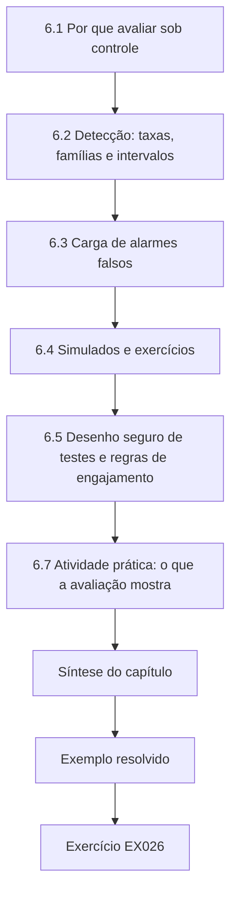

### Desenho lógico

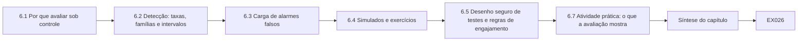

```text
[6.1 Por que avaliar sob controle]
    |
    v
[6.2 Detecção: taxas, famílias e intervalos]
    |
    v
[6.3 Carga de alarmes falsos]
    |
    v
[6.4 Simulados e exercícios]
    |
    v
[6.5 Desenho seguro de testes e regras de engajamento]
    |
    v
[6.7 Atividade prática: o que a avaliação mostra]
    |
    v
[Síntese do capítulo]
    |
    v
[Exemplo resolvido] --> [Exercício EX026]
```
<!-- cykin:lesson-figures:end ch-06 -->


### Objetivos de aprendizagem e conexão

Ao final deste capítulo, você deverá ser capaz de:

1. Planejar uma avaliação controlada de um controle de segurança — uma regra de detecção, um projeto, um procedimento de recuperação — que responda a uma pergunta declarada com segurança.
2. Relatar as taxas de detecção e de sucesso com intervalos, e calcular de quantas tentativas uma alegação precisa.
3. Medir a carga de alarmes falsos nas unidades que os operadores vivenciam.
4. Avaliar simulados e exercícios com comparações pareadas e reconhecer as ameaças à sua validade.
5. Escrever regras de engajamento e condições de segurança para testes perto de uma planta em operação.

O Capítulo 5 escolheu projetos; o Capítulo 2 graduou as evidências de que os controles existem. Este capítulo pergunta se eles **funcionam**, em que medida e com quanta certeza podemos dizê-lo — antes que um incidente real responda à pergunta por nós. O Capítulo 11 estende o método à avaliação de um projeto inteiro.

### 6.1 Por que avaliar sob controle

Os controles de segurança em serviços essenciais raramente são exercitados por ataques reais, então sua eficácia costuma ser presumida. A avaliação controlada cria as evidências deliberadamente: injetar eventos conhecidos e ver se são detectados; executar uma recuperação e cronometrá-la; realizar um simulado e observar se a equipe consegue operar manualmente. A palavra *controlada* importa duas vezes. Cientificamente, significa que o avaliador controla o que é injetado, de modo que detecções e falhas possam ser contadas contra uma verdade conhecida. Operacionalmente, significa que o teste é controlado para que não possa prejudicar o processo: bancadas de teste, simuladores, gêmeos digitais, alvos de restauração isolados e exercícios de mesa carregam a maior parte da carga, e os testes ao vivo só acontecem com a autorização das operações e com condições de segurança.

### 6.2 Detecção: taxas, famílias e intervalos

Uma avaliação de detecção conta quantos cenários injetados foram detectados. Uma taxa única esconde duas coisas. Primeiro, as **famílias**: uma regra que pega toda escrita direta pela IHM, mas metade das manipulações por deriva lenta, tem um perfil de risco diferente de uma que pega 85% de tudo. Relate por família de técnicas — para a TO, as famílias do MITRE ATT&CK for ICS são um bom vocabulário ([MITRE, ATT&CK for ICS](https://attack.mitre.org/matrices/ics/)). Segundo, a **incerteza**: 17 detecções em 20 tentativas são compatíveis com uma ampla faixa de taxas verdadeiras. O intervalo de escore de Wilson ([Wilson, 1927](https://doi.org/10.1080/01621459.1927.10502953)) se comporta bem com amostras pequenas e taxas próximas de 0 ou de 1; use-o em vez da aproximação normal simples.

Segue-se uma consequência prática: **as alegações precisam de tamanhos de amostra**. Para alegar "pelo menos 90% de detecção" com um limite inferior de Wilson de 95%, você precisa de dezenas de tentativas bem-sucedidas, não de um punhado; cada falha eleva ainda mais esse número. Planeje o número de tentativas antes de testar e diga qual alegação o número planejado consegue sustentar.

Duas outras cautelas vêm da pesquisa sobre a avaliação de sistemas de detecção. Os dados de teste precisam se parecer com o ambiente de operação — a taxa de base dos ataques reais, a variedade do comportamento benigno —, ou os resultados não se transferirão ([Sommer e Paxson, 2010](https://doi.org/10.1109/SP.2010.25); [Arp et al., 2022](https://www.usenix.org/conference/usenixsecurity22/presentation/arp)). E, para a detecção de anomalias em séries temporais, algumas convenções de pontuação populares inflam o desempenho; a avaliação precisa ser definida com cuidado ([Kim et al., 2022](https://ojs.aaai.org/index.php/AAAI/article/view/20680)).

### 6.3 Carga de alarmes falsos

Uma detecção só é útil se os operadores conseguirem agir sobre seus alertas. Meça os alarmes falsos reproduzindo tráfego benigno representativo por um período longo o bastante e contando os alertas; depois expresse a taxa **por turno ou por operador**, com um intervalo; para contagens de eventos raros, o intervalo exato de Poisson é o adequado. Combine-a com a taxa de base dos eventos reais: quando os ataques reais são raros, mesmo uma taxa baixa de alarmes falsos significa que a maioria dos alertas é falsa. Acorde uma carga aceitável com as operações *antes* do teste — por exemplo, "no máximo uma investigação por turno da noite" —, para que o resultado possa ser aprovado ou reprovado.

### 6.4 Simulados e exercícios

Simulados de operação manual, exercícios de recuperação e exercícios de mesa testam pessoas e procedimentos. As orientações de planejamento de contingência do NIST tratam testes, treinamento e exercícios como um ciclo, com objetivos documentados e resultados pós-ação ([NIST SP 800-34 Rev. 1](https://csrc.nist.gov/pubs/sp/800/34/r1/upd1/final)). Para avaliar se o treinamento melhorou o desempenho, compare as **mesmas pessoas** antes e depois (um desenho pareado), relate a melhoria média com um intervalo e olhe para as diferenças individuais: uma melhoria média pode esconder um operador que não melhorou nada. As ameaças à validade são sérias nos simulados: os participantes aprendem o cenário (efeito de prática), sabem que estão sendo observados e costumam ser os funcionários mais dispostos. Varie os cenários, inclua turnos da noite e funcionários menos experientes, e não trate um bom simulado como prova de prontidão.

### 6.5 Desenho seguro de testes e regras de engajamento

Todo teste perto de uma planta em operação precisa de **regras de engajamento** escritas: escopo (sistemas, horários), sistemas excluídos, técnicas permitidas, condições de parada (qualquer mudança inesperada no processo, qualquer alarme que os operadores não consigam explicar), autoridade nomeada para parar, comunicações, reversão e tratamento das evidências. O responsável pelas operações as assina. Os testes que injetam comandos devem usar bancadas ou simuladores sempre que possível; os testes na planta em operação devem ser somente de leitura ou usar marcadores benignos acordados de antemão. Os princípios éticos do Capítulo 4 se aplicam: o teste não pode transferir risco para os clientes sem a proteção deles.

### 6.6 Exemplo resolvido: uma nova regra de detecção e um simulado (sintético)

O provedor de detecção gerenciada da Merrow Water propõe uma regra para detectar escritas não autorizadas de setpoint. O especialista desenha uma avaliação na bancada de teste: 20 cenários injetados em três famílias, 336 horas de tráfego benigno de Hollin reproduzido e um simulado de dosagem manual com seis operadores antes e depois de um novo módulo de treinamento. O responsável pelas operações acordou os critérios de aceitação com antecedência: limite inferior de detecção de pelo menos 0,80 no geral, sem nenhuma família com estimativa pontual abaixo de 0,50; no máximo um alarme falso por turno da noite, em média; e uma melhoria no tempo de dosagem manual cujo intervalo exclua o zero.

### 6.7 Atividade prática: o que a avaliação mostra

```python
# Lab 6 - what a controlled evaluation can and cannot show (offline, standard library only)
# Synthetic: Merrow Water tests a new detection rule for unauthorised setpoint writes on a test rig,
# replays two weeks of benign plant traffic, and times a manual-operation drill before and after training.
import math
def wilson(k, n, z=1.96):
    p = k / n; d = 1 + z*z/n
    c = (p + z*z/(2*n)) / d; h = z*math.sqrt(p*(1-p)/n + z*z/(4*n*n)) / d
    return c - h, c + h
def pois_cdf(k, mu): return sum(math.exp(-mu) * mu**i / math.factorial(i) for i in range(k + 1))
def pois_ci(k, a=0.05):  # exact (Garwood) interval by bisection
    def solve(f, lo, hi):
        for _ in range(200):
            mid = (lo + hi) / 2
            if f(mid): lo = mid
            else: hi = mid
        return (lo + hi) / 2
    lower = 0.0 if k == 0 else solve(lambda m: 1 - pois_cdf(k - 1, m) < a/2, 0, 10*k + 10)
    upper = solve(lambda m: pois_cdf(k, m) > a/2, 0, 10*k + 10)
    return lower, upper
# 1. Detection on injected scenarios, split by technique family
RESULTS = {"direct HMI write": (9, 9), "engineering-workstation download": (6, 7), "slow drift via historian tag": (2, 4)}
k = sum(a for a, b in RESULTS.values()); n = sum(b for a, b in RESULTS.values())
lo, hi = wilson(k, n); print(f"overall detected {k}/{n} = {k/n:.2f}, 95% Wilson [{lo:.2f}, {hi:.2f}]")
for fam, (a, b) in RESULTS.items():
    lo, hi = wilson(a, b); print(f"  {fam:34s} {a}/{b}  [{lo:.2f}, {hi:.2f}]")
# 2. How many trials, all detected, before the lower bound clears 0.90?
n = 1
while wilson(n, n)[0] < 0.90: n += 1
print(f"perfect runs needed for Wilson lower bound >= 0.90: {n}")
# 3. False alarms in 336 hours of benign replay
fa, hours = 9, 336
lo, hi = pois_ci(fa); print(f"false alarms {fa} in {hours} h = {fa/hours*24:.2f}/day, 95% CI [{lo/hours*24:.2f}, {hi/hours*24:.2f}]/day")
# 4. Drill: minutes to stable manual dosing, same six operators before and after training (paired)
before = [34, 41, 29, 52, 38, 45]; after = [22, 30, 27, 31, 25, 44]
diffs = [b - a for b, a in zip(before, after)]
md = sum(diffs) / len(diffs); sd = math.sqrt(sum((d - md)**2 for d in diffs) / (len(diffs) - 1))
t = 2.571  # two-sided 95% t quantile, 5 degrees of freedom
print(f"paired improvement mean {md:.1f} min, 95% CI [{md - t*sd/math.sqrt(6):.1f}, {md + t*sd/math.sqrt(6):.1f}]; diffs {diffs}")
```

Saída esperada:

```text
overall detected 17/20 = 0.85, 95% Wilson [0.64, 0.95]
  direct HMI write                   9/9  [0.70, 1.00]
  engineering-workstation download   6/7  [0.49, 0.97]
  slow drift via historian tag       2/4  [0.15, 0.85]
perfect runs needed for Wilson lower bound >= 0.90: 35
false alarms 9 in 336 h = 0.64/day, 95% CI [0.29, 1.22]/day
paired improvement mean 10.0 min, 95% CI [2.1, 17.9]; diffs [12, 11, 2, 21, 13, 1]
```

**Interpretação.** A detecção geral é de 17/20 = 0,85, mas o intervalo de Wilson de 95%, [0,64, 0,95], não supera o limite inferior de 0,80 acordado de antemão. Por família, as escritas diretas pela IHM foram todas detectadas, os downloads pela estação de engenharia seis em sete, e a deriva lenta por meio de uma etiqueta do historiador apenas duas em quatro — a estimativa pontual atinge o piso de 0,50, mas seu intervalo vai de 0,15 a 0,85, de modo que a avaliação não consegue dizer se a deriva lenta é detectada de forma confiável. Para alegar 90% de detecção com todas as tentativas bem-sucedidas, seriam necessários 35 sucessos consecutivos. Os alarmes falsos ocorrem a 0,64 por dia (intervalo de 0,29 a 1,22), cerca de 0,21 por turno de oito horas, confortavelmente dentro do critério de carga. O simulado mostra uma melhoria média de 10,0 minutos, com um intervalo de 95% de 2,1 a 17,9 minutos — o intervalo exclui o zero, então o critério é atendido —, mas dois operadores melhoraram apenas um e dois minutos; vale a pena entender a experiência deles antes da implantação.

O resultado honesto é, portanto, misto: **adotar a regra para escritas diretas e downloads, monitorando seu desempenho, não confiar nela para a deriva lenta e desenhar novas tentativas para essa família**. Essa é uma resposta mais útil do que "85% de detecção".

### 6.8 Erros comuns e limites

- Relatar uma única taxa de detecção sem famílias nem intervalos.
- Executar poucas tentativas demais para sustentar a alegação e fazer a alegação mesmo assim.
- Testar com os cenários que o autor da regra desenhou, e apenas com eles.
- Medir os alarmes falsos numa reprodução curta ou não representativa.
- Expressar os alarmes falsos por dia para a rede inteira, em vez de por turno ou por operador.
- Tratar um simulado bem-sucedido como prova de prontidão.
- Testar na planta em operação sem regras de engajamento assinadas e sem condições de parada.

O limite da avaliação controlada é a transferência: uma bancada não é uma planta, e cenários injetados não são adversários. Use a avaliação para delimitar as alegações e encontrar fraquezas, continue medindo na operação e repita quando o ambiente mudar.

### Exercícios — capítulo 6

**EX026 — Intervalos e tamanho de amostra.** *Objetivo:* ligar as alegações ao número de tentativas. *Insumos:* as funções do Laboratório 6. *Restrições:* intervalos de Wilson de 95%. *Passos:* (1) calcular o intervalo para 19/20; (2) encontrar o número de sucessos consecutivos necessários para um limite inferior de 0,80; (3) encontrar as tentativas necessárias para um limite inferior de 0,90 se ocorrer exatamente uma falha; (4) explicar a um gestor por que "testamos 20 vezes" não basta para uma alegação de 90%. *Evidência esperada:* números e parágrafo. *Rubrica:* 3 = 19/20 → [0,76, 0,99], 16 sucessos, 53 tentativas com uma falha, explicação em linguagem simples; 2 = um número errado; 1 = aproximação normal usada sem comentário; 0 = nada.

**EX027 — Plano de teste para a deriva lenta.** *Objetivo:* desenhar tentativas para a família mais fraca. *Insumos:* o resultado da deriva lenta. *Restrições:* apenas na bancada; os cenários precisam variar a taxa, a duração e a etiqueta-alvo; incluir cenários não escritos pelo autor da regra. *Passos:* (1) definir a alegação a testar; (2) escolher o número de tentativas; (3) listar as variações de cenário; (4) definir aprovação/reprovação e o que você fará se reprovar. *Evidência esperada:* plano. *Rubrica:* 3 = alegação explícita e número de tentativas justificado por um cálculo de intervalo, autoria independente dos cenários, variações realistas, decisão acordada de antemão; 2 = número não justificado; 1 = reutiliza os quatro cenários; 0 = nada.

**EX028 — Carga de alarmes.** *Objetivo:* expressar os alarmes falsos nas unidades dos operadores e combiná-los com as taxas de base. *Insumos:* 0,64 alarme falso por dia; suponha que escritas reais não autorizadas ocorram cerca de uma vez a cada dois anos; detecção de 0,85. *Restrições:* três turnos de oito horas por dia. *Passos:* (1) alarmes falsos por turno e por ano; (2) alertas verdadeiros esperados por ano; (3) parcela dos alertas que são verdadeiros; (4) o que isso significa para o procedimento de resposta. *Evidência esperada:* cálculo e parágrafo. *Rubrica:* 3 = cerca de 0,21 por turno e 234 por ano, cerca de 0,43 alerta verdadeiro por ano, cerca de 0,2% dos alertas verdadeiros, um procedimento que torne cada investigação rápida e barata; 2 = aritmética certa, implicação ausente; 1 = confunde as taxas; 0 = nada.

**EX029 — Validade do simulado.** *Objetivo:* criticar a avaliação de um simulado. *Insumos:* o resultado pareado dos seis operadores. *Restrições:* nomear pelo menos quatro ameaças à validade. *Passos:* listar as ameaças, a direção em que cada uma enviesaria o resultado e uma mudança de desenho para cada uma. *Evidência esperada:* tabela. *Rubrica:* 3 = efeito de prática, efeito de observação, seleção de funcionários dispostos, mesmo cenário, amostra pequena, dia versus noite; direções declaradas; mudanças concretas; 2 = ameaças sem direções; 1 = genérico; 0 = nada.

**EX030 — Regras de engajamento.** *Objetivo:* escrever condições de teste seguras. *Insumos:* uma proposta de verificar, na planta em operação de Fenley, que a nova regra alerta sobre uma escrita de setpoint inofensiva e acordada de antemão (de 1,80 para 1,81 mg/L). *Restrições:* as operações têm a autoridade; os clientes não podem ser afetados. *Passos:* escrever o escopo, o horário, os papéis, as condições de parada, as comunicações, a reversão e o tratamento das evidências. *Evidência esperada:* regras de engajamento de uma página. *Rubrica:* 3 = aprovação das operações, horário de baixa demanda, condições de parada e autoridade explícitas, verificação independente da dose, reversão, equipe de tratamento de alertas avisada de antemão sem avisar os analistas de detecção se a detecção às cegas fizer parte do teste, evidências registradas; 2 = falta um elemento; 1 = sem condições de parada; 0 = nada.

### Síntese do capítulo

A avaliação controlada transforma controles presumidos em controles medidos. Injete eventos conhecidos em bancadas e simuladores, relate a detecção por família com intervalos de Wilson e planeje o número de tentativas para as alegações que você quer fazer. Meça os alarmes falsos em períodos representativos e expresse-os nas unidades dos operadores, ao lado das taxas de base. Avalie os simulados com comparações pareadas, olhe para os indivíduos e desenhe contra os efeitos de prática e de seleção. Teste perto da planta em operação apenas sob regras de engajamento escritas e assinadas. O resultado honesto de uma avaliação muitas vezes é misto; diga exatamente para quais usos um controle serve.

<!-- cykin:chapter-navigation:start ch-06 -->
### Continue estudando — capítulo 06 de 12

[← Capítulo 05](#ch-05) · [Índice de capítulos do curso](../SUBJECTS.md) · [Capítulo 07 →](#ch-07)

Siga para a próxima lição escrita.
<!-- cykin:chapter-navigation:end -->

<a id="ch-07"></a>

## Capítulo 7 — Infraestrutura crítica e segurança setorial: integração organizacional

<!-- cykin:lesson-figures:start ch-07 -->
### Mapa da aula

Aula 07 publicada. Mapa, exemplo, EX031.

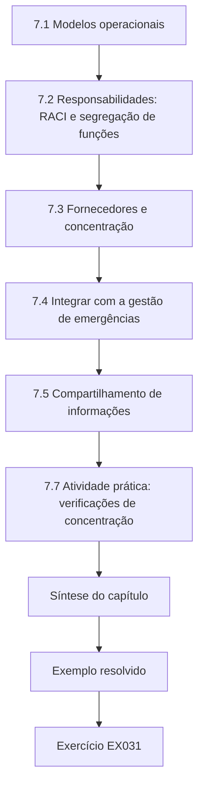

### Desenho lógico

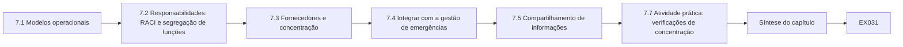

```text
[7.1 Modelos operacionais]
    |
    v
[7.2 Responsabilidades: RACI e segregação de funções]
    |
    v
[7.3 Fornecedores e concentração]
    |
    v
[7.4 Integrar com a gestão de emergências]
    |
    v
[7.5 Compartilhamento de informações]
    |
    v
[7.7 Atividade prática: verificações de concentração]
    |
    v
[Síntese do capítulo]
    |
    v
[Exemplo resolvido] --> [Exercício EX031]
```
<!-- cykin:lesson-figures:end ch-07 -->


### Objetivos de aprendizagem e conexão

Ao final deste capítulo, você deverá ser capaz de:

1. Comparar modelos operacionais para a segurança de TO e de TI numa organização de serviço essencial e escolher um, com razões.
2. Atribuir as responsabilidades de modo que toda atividade crítica de segurança tenha exatamente um papel aprovador e que os conflitos de funções fiquem visíveis.
3. Medir a concentração de fornecedores dentro de uma organização e numa região, e planejar para a falha de modo comum de fornecedores.
4. Integrar a resposta a incidentes cibernéticos à gestão de emergências, à continuidade de negócios e aos arranjos regionais de resiliência.
5. Desenhar um compartilhamento de informações entre operadores que seja útil, lícito e confiável.

Os Capítulos 1–6 equiparam o especialista para decidir, evidenciar e avaliar. Este capítulo coloca esse trabalho dentro de uma organização e de uma região, porque a maioria das falhas nos serviços essenciais é falha de integração — entre a TI e as operações, entre um operador e seus fornecedores, entre uma equipe de incidentes cibernéticos e as pessoas que conduzem a resposta a emergências. O Capítulo 8 testa a integração nos casos mais difíceis; o Capítulo 9 a lidera e a assegura.

### 7.1 Modelos operacionais

Três modelos comuns para a segurança numa organização que opera tanto TI quanto TO:

| Modelo | Descrição | Pontos fortes | Pontos fracos |
|---|---|---|---|
| Central | A equipe do CISO é dona da segurança de TI e de TO | Um padrão, uma visão de risco, ferramentas eficientes | Distância da planta; controles desenhados para a TI; as operações podem contorná-los |
| Federado | As operações são donas da segurança de TO, com seus próprios especialistas; o CISO define a política e assegura | Perto do processo; cultura de segurança operacional; credibilidade junto aos operadores | Padrões inconsistentes; ferramentas duplicadas; lacunas na fronteira TI/TO |
| Integrado | Uma função conjunta de segurança de TO subordinada às operações, com uma linha formal para o CISO, padrões compartilhados e processo de incidentes compartilhado | Combina conhecimento do processo e profundidade em segurança | Precisa de responsabilidades explícitas e de resolução de conflitos; depende das pessoas |

Não existe um modelo universalmente certo. A NIST SP 800-82 recomenda formar uma equipe multifuncional que inclua engenheiros de controle, operadores, segurança de TI e pessoal de segurança operacional ([NIST, 2023](https://doi.org/10.6028/NIST.SP.800-82r3)); o NIST CSF 2.0 coloca os papéis, as responsabilidades e as autoridades sob a governança ([NIST, 2024](https://doi.org/10.6028/NIST.CSWP.29)). A escolha do modelo integrado pela Merrow Water — um Especialista Principal de Segurança subordinado ao Diretor de Operações, com uma linha pontilhada para o CISO — decorre de seu porte e do peso que ela dá à confiança dos operadores. O modelo precisa então se tornar real por meio das responsabilidades, do orçamento e do processo de incidentes; um organograma sozinho não integra nada.

### 7.2 Responsabilidades: RACI e segregação de funções

Para cada atividade crítica, um papel é o **Aprovador** (Accountable: é dono do resultado e aprova), um ou mais são **Responsáveis** (Responsible: fazem o trabalho), e outros são **Consultados** ou **Informados**. Duas regras pegam a maioria das falhas de responsabilidade: toda atividade crítica tem **exatamente um** papel aprovador; e, quando um único papel tanto executa quanto aprova uma atividade com consequência de segurança — uma mudança emergencial de firewall, um pagamento, uma concessão de acesso a um fornecedor —, o conflito é eliminado ou coberto por um controle compensatório, como uma revisão posterior de cada ocorrência. A segregação de funções é um princípio de controle de longa data no catálogo do NIST ([NIST SP 800-53 Rev. 5](https://csrc.nist.gov/pubs/sp/800/53/r5/upd1/final)). Dois papéis aprovadores para "declarar um incidente cibernético" soa como segurança adicional; na prática, cria uma lacuna às 3 da manhã, quando cada um supõe que o outro já decidiu.

### 7.3 Fornecedores e concentração

Os serviços essenciais dependem de fornecedores para o suporte aos sistemas de controle, a detecção gerenciada, as telecomunicações e a hospedagem em nuvem. A concentração tem dois níveis:

- **Dentro de um operador.** Se um fornecedor provê toda uma função crítica, sua falha — técnica, comercial ou um comprometimento — é a falha do operador. Uma medida padrão de concentração é o índice de Herfindahl–Hirschman (HHI): a soma dos quadrados das participações percentuais, de perto de 0 (muitos fornecedores pequenos) a 10.000 (um único fornecedor) ([U.S. Department of Justice, HHI](https://www.justice.gov/atr/herfindahl-hirschman-index)). É um sinalizador grosseiro, mas útil.
- **Numa região.** Se um fornecedor é uma dependência majoritária de vários operadores, um único evento se torna um evento regional. A indisponibilidade global de julho de 2024, causada por uma atualização defeituosa de um software de segurança, que afetou cerca de 8,5 milhões de dispositivos Windows segundo a Microsoft ([Microsoft, 2024](https://blogs.microsoft.com/blog/2024/07/20/helping-our-customers-through-the-crowdstrike-outage/)), mostrou como um fornecedor confiável pode se tornar uma falha de modo comum entre setores. A regulação financeira foi a que mais avançou nisso: o DORA exige registros dos acordos com terceiros de TIC e cria a supervisão dos prestadores terceiros críticos de serviços de TIC ([Regulamento (UE) 2022/2554](https://eur-lex.europa.eu/eli/reg/2022/2554/oj)).

A concentração não é automaticamente ruim — um fornecedor bem gerido pode ser mais seguro do que três mal geridos. A tarefa do especialista é torná-la visível, decidir quais concentrações são aceitáveis e preparar **planos de saída e de continuidade**: o que faríamos se este fornecedor ficasse indisponível por uma semana, ou fosse comprometido? Os contratos devem dar direito aos logs, à notificação de incidentes, a requisitos de segurança e a suporte durante os incidentes do próprio fornecedor. As práticas de cadeia de suprimentos de software — listas de materiais de software ([CISA, SBOM](https://www.cisa.gov/sbom)), desenvolvimento seguro ([NIST SP 800-218](https://csrc.nist.gov/pubs/sp/800/218/final)) e compromissos de segurança desde o projeto ([CISA, Secure by Design](https://www.cisa.gov/securebydesign)) — ajudam no lado do produto.

### 7.4 Integrar com a gestão de emergências

Um grande incidente cibernético num serviço essencial é também uma emergência: avisos de fervura da água, desvios de hospitais, fechamento de portos. A equipe de incidentes cibernéticos precisa, portanto, encaixar-se no **comando de emergência e de continuidade de negócios** da organização, em vez de funcionar em paralelo. Pontos práticos de integração:

- Uma **classificação de incidentes** compartilhada, que mapeie a gravidade cibernética para o impacto no serviço, para que o gerente de plantão possa escalar sem um especialista de segurança presente.
- Representação cibernética na estrutura de comando de emergência, e representação da gestão de emergências nos exercícios cibernéticos.
- **Planos de operação manual e de continuidade** de propriedade das operações e testados com cenários de segurança (Capítulo 6).
- **Arranjos regionais** acordados de antemão: quem avisa os operadores vizinhos, os serviços de saúde e as autoridades locais; como funciona a ajuda mútua; como as mensagens ao público são coordenadas. A Diretiva CER da UE enquadra a resiliência das entidades críticas como abrangendo todos os perigos e todos os setores ([Diretiva (UE) 2022/2557](https://eur-lex.europa.eu/eli/dir/2022/2557/oj)); a política dos EUA sobre segurança e resiliência da infraestrutura crítica enfatiza, de modo semelhante, a coordenação setorial ([visão geral do NSM-22, CISA](https://www.cisa.gov/topics/critical-infrastructure-security-and-resilience/national-security-memorandum-critical-infrastructure-security-and-resilience)).

### 7.5 Compartilhamento de informações

Os operadores aprendem mais depressa juntos, mas o compartilhamento traz riscos jurídicos, comerciais e de segurança. Um compartilhamento útil é **específico** (indicadores, técnicas, versões de produtos afetadas, mitigações que funcionaram), **oportuno**, **protegido** (regras de manuseio acordadas, como os rótulos do protocolo de semáforo) e **recíproco**. Um acordo de compartilhamento para um fórum regional deve cobrir: o que é compartilhado e em que formato; as regras de manuseio e de repasse; os dados pessoais (minimizar; verificar a base legal, [GDPR](https://eur-lex.europa.eu/eli/reg/2016/679/oj); no Brasil, as hipóteses do art. 7º da [LGPD](https://www.planalto.gov.br/ccivil_03/_ato2015-2018/2018/lei/l13709.htm)); o cuidado com o direito da concorrência quanto a informações comercialmente sensíveis; a responsabilidade; e como as informações compartilhadas podem chegar aos reguladores. A confiança se constrói sobretudo pelo comportamento: compartilhar primeiro, proteger o que os outros compartilham e dar o crédito.

### 7.6 Exemplo resolvido: as dependências de Merrow Bay e uma matriz RACI preliminar (sintético)

O fórum de resiliência perguntou a cada operador quais fornecedores atendem suas funções essenciais e que parcela eles proveem. Ao mesmo tempo, o especialista da Merrow Water redigiu uma matriz RACI para cinco atividades críticas de segurança, a ser acordada com as operações e com o CISO. O Laboratório 7 analisa as duas coisas.

As perguntas foram deliberadamente simples: qual fornecedor atende cada função essencial e, aproximadamente, com que parcela. Os operadores responderam com base nos contratos e nos registros de ativos, e não de memória, e o fórum acordou de antemão que as respostas seriam usadas apenas para a análise regional. O rascunho da RACI cobre aprovar e executar mudanças emergenciais no firewall de TO, conceder sessões remotas a fornecedores, declarar um incidente cibernético e restaurar a partir do backup offline, cada uma escolhida porque um erro de responsabilidade ali atrasaria a resposta ou enfraqueceria o controle.

### 7.7 Atividade prática: verificações de concentração e de responsabilidade

```python
# Lab 7 - concentration and ownership checks for an integrated security function (offline, stdlib only)
# Synthetic: which suppliers Merrow Bay operators depend on for essential functions, and a draft RACI.
from collections import defaultdict
DEPENDS = [  # (operator, function, supplier, share of that operator's function served by the supplier)
    ("Merrow Water", "SCADA support", "Corvane Systems", 1.0),
    ("Merrow Water", "managed detection", "Lumen Watch", 1.0),
    ("Merrow Water", "telemetry links", "BayTel", 0.7), ("Merrow Water", "telemetry links", "radio (own)", 0.3),
    ("Merrow Health", "EPR hosting", "Halden Cloud", 1.0),
    ("Merrow Health", "managed detection", "Lumen Watch", 1.0),
    ("Merrow Health", "pathology LIMS", "Corvane Systems", 1.0),
    ("Merrow Energy", "SCADA support", "Corvane Systems", 0.6), ("Merrow Energy", "SCADA support", "in-house", 0.4),
    ("Merrow Energy", "telemetry links", "BayTel", 0.5), ("Merrow Energy", "telemetry links", "private fibre", 0.5),
    ("Port of Merrow", "terminal OS hosting", "Halden Cloud", 1.0),
    ("Port of Merrow", "managed detection", "Lumen Watch", 1.0),
]
by_op_fn = defaultdict(list)
for op, fn, sup, share in DEPENDS: by_op_fn[(op, fn)].append((sup, share))
print("Herfindahl-Hirschman index per operator function (10000 = single supplier):")
for (op, fn), lst in by_op_fn.items():
    hhi = sum((100 * s) ** 2 for _, s in lst)
    print(f"  {op:15s} {fn:20s} HHI {hhi:6.0f}")
reach = defaultdict(set)
for op, fn, sup, share in DEPENDS:
    if sup not in ("in-house", "radio (own)", "private fibre") and share >= 0.5: reach[sup].add(op)
print("Suppliers that are a majority dependency for 2+ operators (regional common mode):")
for sup, ops in sorted(reach.items(), key=lambda x: -len(x[1])):
    if len(ops) >= 2: print(f"  {sup:16s} {len(ops)} operators: {', '.join(sorted(ops))}")
RACI = {  # activity -> {role: letters}
    "approve OT firewall change":   {"OT engineer": "R", "OT manager": "A", "CISO": "C"},
    "emergency OT firewall change": {"OT engineer": "RA", "OT manager": "I"},
    "grant vendor remote session":  {"OT engineer": "R", "Service desk": "R"},
    "declare cyber incident":       {"CISO": "A", "Duty manager": "A", "OT manager": "C"},
    "restore from offline backup":  {"OT engineer": "R", "OT manager": "A", "IT ops": "R"},
}
print("RACI findings:")
for act, roles in RACI.items():
    a = [r for r, l in roles.items() if "A" in l]
    if len(a) != 1: print(f"  {act}: {len(a)} accountable roles {a}")
    for r, l in roles.items():
        if "R" in l and "A" in l: print(f"  {act}: {r} both does and approves (needs compensating control or record)")
```

Saída esperada:

```text
Herfindahl-Hirschman index per operator function (10000 = single supplier):
  Merrow Water    SCADA support        HHI  10000
  Merrow Water    managed detection    HHI  10000
  Merrow Water    telemetry links      HHI   5800
  Merrow Health   EPR hosting          HHI  10000
  Merrow Health   managed detection    HHI  10000
  Merrow Health   pathology LIMS       HHI  10000
  Merrow Energy   SCADA support        HHI   5200
  Merrow Energy   telemetry links      HHI   5000
  Port of Merrow  terminal OS hosting  HHI  10000
  Port of Merrow  managed detection    HHI  10000
Suppliers that are a majority dependency for 2+ operators (regional common mode):
  Corvane Systems  3 operators: Merrow Energy, Merrow Health, Merrow Water
  Lumen Watch      3 operators: Merrow Health, Merrow Water, Port of Merrow
  BayTel           2 operators: Merrow Energy, Merrow Water
  Halden Cloud     2 operators: Merrow Health, Port of Merrow
RACI findings:
  emergency OT firewall change: OT engineer both does and approves (needs compensating control or record)
  grant vendor remote session: 0 accountable roles []
  declare cyber incident: 2 accountable roles ['CISO', 'Duty manager']
```

**Interpretação.** Dentro dos operadores, sete dos dez pares função–operador têm HHI 10.000 — um único fornecedor —, o que é comum e não alarmante por si só. A visão regional é mais importante: a Corvane Systems é uma dependência majoritária de três operadores (suporte ao SCADA na água e na energia, sistemas de patologia na saúde), a Lumen Watch fornece detecção gerenciada a três, e a BayTel e a Halden Cloud a dois cada. Um comprometimento da Lumen Watch cegaria a detecção de três operadores ao mesmo tempo; um comprometimento do suporte remoto da Corvane poderia alcançar os sistemas operacionais de três setores. São riscos no nível do fórum que nenhum registro de um operador isolado mostrará. A verificação da RACI encontra três problemas: na mudança emergencial de firewall, o engenheiro de TO executa e aprova, o que pode ser aceitável à noite se toda ocorrência for revisada no dia útil seguinte; a concessão de sessões remotas a fornecedores **não** tem papel aprovador — a constatação mais perigosa, dado o evento de Hollin do Capítulo 3; e a declaração de um incidente cibernético tem dois papéis aprovadores, que devem virar um só (o gerente de plantão, que está sempre disponível), com o CISO consultado.

### 7.8 Erros comuns e limites

- Escolher um modelo operacional copiando outra organização, e não pelo porte, pelo risco e pela cultura.
- Desenhar um organograma e chamá-lo de integração.
- Deixar atividades críticas sem nenhum dono aprovador, ou com dois.
- Avaliar o risco de fornecedores contrato por contrato, sem ver a concentração regional.
- Tratar a certificação de um fornecedor como evidência de resiliência durante o incidente do próprio fornecedor.
- Conduzir a resposta a incidentes cibernéticos em paralelo com o comando de emergência.
- Compartilhar informações sem regras de manuseio, ou nunca compartilhar porque as regras não estão claras.

O limite da análise estrutural é que a integração depende, em última instância, de relações e de prática. As tabelas RACI e os valores de HHI indicam onde olhar; os exercícios e os incidentes reais mostram se a integração funciona.

### Exercícios — capítulo 7

**EX031 — Repare a RACI.** *Objetivo:* corrigir os defeitos de responsabilidade e verificar. *Insumos:* Laboratório 7. *Restrições:* toda atividade com exatamente um A; todo conflito R+A eliminado ou documentado com um controle compensatório. *Passos:* (1) editar a RACI; (2) reexecutar e mostrar que não restam constatações sem tratamento; (3) escrever o controle compensatório de qualquer conflito que você mantiver. *Evidência esperada:* tabela editada, saída, texto do controle. *Rubrica:* 3 = concessão de sessão a fornecedores com um único papel aprovador (gerente de TO), com a central de serviços e o engenheiro de TO como responsáveis, declaração de incidente com um único aprovador, conflito da mudança emergencial eliminado ou mantido com revisão de toda ocorrência no dia seguinte; 2 = saída limpa, mas sem o controle; 1 = não reexecutado; 0 = nada.

**EX032 — Modo comum regional.** *Objetivo:* planejar para um fornecedor concentrado. *Insumos:* a Lumen Watch atendendo três operadores. *Restrições:* o fórum não tem autoridade sobre os contratos; os operadores mantêm suas próprias escolhas. *Passos:* (1) descrever dois cenários de falha (indisponibilidade; comprometimento do provedor); (2) propor ações no nível do operador e no nível do fórum; (3) definir as cláusulas contratuais a pedir na renovação. *Evidência esperada:* plano. *Rubrica:* 3 = cenários distintos (cegueira versus o provedor como caminho de ataque), ações que incluem uma detecção mínima local ou registros mantidos por cada operador, exercício conjunto, cláusulas de notificação, acesso aos logs e plano de saída; 2 = um cenário; 1 = "trocar de fornecedor"; 0 = nada.

**EX033 — Escolha um modelo operacional.** *Objetivo:* justificar um modelo para outra organização. *Insumos:* o Port of Merrow: 600 funcionários, uma equipe de segurança de TI de duas pessoas, a TO dos terminais operada por um terceirizado, um centro de operações da capitania. *Restrições:* usar a §7.1. *Passos:* comparar os modelos; escolher; declarar as três condições que fariam a sua escolha fracassar. *Evidência esperada:* recomendação de uma página. *Rubrica:* 3 = escolha argumentada a partir do porte, da dependência do terceirizado e da cultura das operações, condições de fracasso específicas; 2 = prós e contras genéricos; 1 = nenhuma escolha; 0 = nada.

**EX034 — O cibernético dentro do comando de emergência.** *Objetivo:* integrar as estruturas de resposta. *Insumos:* o plano de emergência existente da Merrow Water (fervura da água, perda de fornecimento) e seu procedimento de incidentes cibernéticos, que hoje não fazem referência um ao outro. *Restrições:* uma única classificação compartilhada; nenhum comando duplicado. *Passos:* (1) redigir uma tabela de classificação combinada a partir do impacto no serviço; (2) definir o lugar do responsável cibernético no comando de emergência; (3) listar as notificações regionais e quem as faz. *Evidência esperada:* tabela e descrição de um diagrama. *Rubrica:* 3 = classificação pelo impacto no serviço utilizável por um gerente de plantão, responsável cibernético assessorando o comandante do incidente em vez de conduzir uma estrutura paralela, notificações regionais atribuídas; 2 = as estruturas paralelas permanecem; 1 = gravidade apenas cibernética; 0 = nada.

**EX035 — Aritmética da concentração e julgamento.** *Objetivo:* calcular e interpretar o HHI. *Insumos:* a telemetria e os serviços de rede da Merrow Health divididos em 40% / 40% / 20% entre três operadoras, duas das quais compartilham o mesmo duto ao longo da avenida do porto. *Restrições:* mostrar o cálculo. *Passos:* (1) calcular o HHI; (2) explicar por que o número subestima a concentração real; (3) propor como representar os caminhos físicos compartilhados. *Evidência esperada:* cálculo e parágrafo. *Rubrica:* 3 = HHI 3.600, reconhecimento de que 80% do serviço compartilha uma rota física, de modo que a concentração efetiva é muito maior, proposta de calcular a concentração sobre caminhos físicos ou domínios de falha; 2 = apenas o número; 1 = aritmética errada; 0 = nada.

### Síntese do capítulo

A integração é onde a segurança dos serviços essenciais costuma falhar. Escolha um modelo operacional para o seu porte, risco e cultura, e torne-o real com responsabilidades: exatamente um papel aprovador por atividade crítica e tratamento visível dos conflitos de funções. Meça a concentração de fornecedores dentro da organização e na região, e prepare planos de saída e de continuidade para a falha de modo comum de fornecedores. Coloque a resposta cibernética dentro do comando de emergência e de continuidade, com uma classificação compartilhada baseada no serviço. Compartilhe informações de forma específica, sob regras de manuseio acordadas, e construa a confiança pelo comportamento.

<!-- cykin:chapter-navigation:start ch-07 -->
### Continue estudando — capítulo 07 de 12

[← Capítulo 06](#ch-06) · [Índice de capítulos do curso](../SUBJECTS.md) · [Capítulo 08 →](#ch-08)

Siga para a próxima lição escrita.
<!-- cykin:chapter-navigation:end -->

<a id="ch-08"></a>

## Capítulo 8 — Infraestrutura crítica e segurança setorial: casos difíceis

<!-- cykin:lesson-figures:start ch-08 -->
### Mapa da aula

Aula 08 publicada. Mapa, exemplo, EX036.

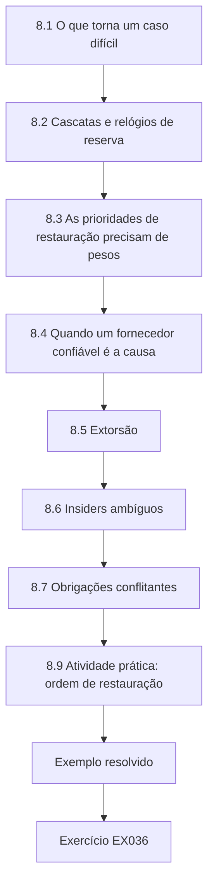

### Desenho lógico

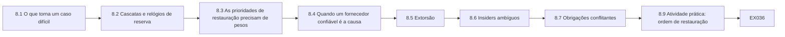

```text
[8.1 O que torna um caso difícil]
    |
    v
[8.2 Cascatas e relógios de reserva]
    |
    v
[8.3 As prioridades de restauração precisam de pesos]
    |
    v
[8.4 Quando um fornecedor confiável é a causa]
    |
    v
[8.5 Extorsão]
    |
    v
[8.6 Insiders ambíguos]
    |
    v
[8.7 Obrigações conflitantes]
    |
    v
[8.9 Atividade prática: ordem de restauração]
    |
    v
[Exemplo resolvido] --> [Exercício EX036]
```
<!-- cykin:lesson-figures:end ch-08 -->


### Objetivos de aprendizagem e conexão

Ao final deste capítulo, você deverá ser capaz de:

1. Reconhecer as características que tornam um caso difícil: interdependência, pressão de tempo, deveres conflitantes, evidências incompletas e dano em toda opção.
2. Analisar falhas em cascata entre setores e definir prioridades de restauração com pesos explícitos.
3. Estruturar decisões sobre falhas de fornecedores confiáveis, extorsão e eventos ambíguos envolvendo insiders.
4. Lidar com obrigações conflitantes perante reguladores, clientes, parceiros e autoridades policiais sem enganar nenhum deles.
5. Comunicar sob incerteza de modos que as evidências posteriores não desacreditem.

Este capítulo reúne as regras de decisão do Capítulo 1, a disciplina de evidências do Capítulo 3, a ética do Capítulo 4 e a integração do Capítulo 7, e as aplica onde elas são postas à prova. O Capítulo 9 pergunta, então, como um líder prepara uma organização para casos assim.

### 8.1 O que torna um caso difícil

Os casos fáceis têm uma resposta certa que é difícil de executar. Os casos difíceis **não têm nenhuma opção sem dano**, e o especialista precisa ajudar a escolher qual dano, depressa, com evidências incompletas, sob escrutínio. Cinco características se repetem: **interdependência**, de modo que uma decisão para um serviço muda os resultados de outros; **pressão de tempo**, porque os suprimentos de reserva, a reservação e a paciência se esgotam; **deveres conflitantes** para com diferentes partes interessadas; **evidências ambíguas**, sobretudo quanto à causa e à intenção; e **irreversibilidade**, porque algumas ações — pagar, desconectar, anunciar — não podem ser desfeitas. As disciplinas dos capítulos anteriores continuam valendo; o que muda é que elas precisam ser preparadas de antemão, porque não haverá tempo para inventá-las.

### 8.2 Cascatas e relógios de reserva

As infraestruturas dependem umas das outras fisicamente (energia para as bombas), digitalmente (telemetria pelas telecomunicações), geograficamente (dutos e locais compartilhados) e logicamente (mercados, pessoal) ([Rinaldi, Peerenboom e Kelly, 2001](https://doi.org/10.1109/37.969131)). Estudos de redes mostram que sistemas interdependentes podem falhar de forma mais abrupta do que qualquer um deles sozinho ([Buldyrev et al., 2010](https://doi.org/10.1038/nature08932)). Para um especialista, a ferramenta prática é o **relógio de reserva**: para cada local essencial, quanto tempo dura sua própria reserva (combustível do gerador, reservação, bateria, alternativa manual) depois que uma dependência falha. O dano começa quando um relógio se esgota. As decisões de restauração — qual alimentador reenergizar, qual local visitar primeiro — são escolhas sobre quais relógios parar.

As intrusões de dezembro de 2015 em três distribuidoras de eletricidade ucranianas, descritas num alerta sobre sistemas de controle industrial, causaram interrupções que afetaram cerca de 225.000 clientes; depois que a energia foi restaurada, as empresas continuaram funcionando sob operações restritas ([CISA, IR-ALERT-H-16-056-01](https://www.cisa.gov/news-events/ics-alerts/ir-alert-h-16-056-01)). O caso lembra que o fim de uma interrupção não é o fim de um incidente induzido por meios cibernéticos: os sistemas de controle podem não ser confiáveis por algum tempo, e a restauração e a operação continuada podem depender de trabalho manual.

### 8.3 As prioridades de restauração precisam de pesos explícitos

A ordem de restauração costuma ser definida por hábito: a maior carga primeiro, ou o trabalho mais rápido primeiro. Nenhuma das duas foi pensada para minimizar o dano. Ordenar tarefas para minimizar o tempo de conclusão ponderado total é um resultado clássico de programação da produção ([Smith, 1956](https://doi.org/10.1002/nav.3800030106)); quando os relógios de reserva funcionam como prazos, o problema se torna um de atraso ponderado, muito mais difícil em geral — mas, para um punhado de alimentadores, basta enumerar todas as ordens. A parte mais difícil são os **pesos**. Uma hora sem energia num hospital vale o mesmo que uma hora sem energia numa casa? Tratar toda pessoa-hora igualmente é, em si, um julgamento de valor, e geralmente um julgamento ruim quando alguns locais carregam funções críticas para a vida. Os pesos precisam ser acordados de antemão com a gestão de emergências e registrados; a análise mostra, então, a ordem que esses pesos implicam e quão sensível ela é à falha de uma reserva.

### 8.4 Quando um fornecedor confiável é a causa

As falhas de fornecedores são difíceis porque os próprios processos da organização confiam no fornecedor. A indisponibilidade de julho de 2024 causada por uma atualização defeituosa exigiu que as organizações afetadas recuperassem muitos endpoints à mão ([Microsoft, 2024](https://blogs.microsoft.com/blog/2024/07/20/helping-our-customers-through-the-crowdstrike-outage/)). As decisões num caso assim incluem: se desconectar o canal do fornecedor antes de saber se a causa é erro ou comprometimento; quais sistemas recuperar primeiro (a lógica de restauração do §8.3 se aplica tanto a endpoints quanto a alimentadores); se atrasar as atualizações no futuro e aceitar o custo de segurança de uma proteção mais lenta; e como manter a detecção quando a própria ferramenta de detecção é o problema. Preparar-se para esse caso significa anéis de atualização escalonados para os sistemas críticos, mídias de recuperação independentes e uma capacidade mínima que não dependa do fornecedor.

### 8.5 Extorsão

Os casos de ransomware e de extorsão de dados forçam uma decisão sobre o pagamento enquanto os serviços estão degradados. Um especialista não decide se paga — isso cabe ao executivo, aconselhado pelo jurídico —, mas estrutura a decisão: o tempo realista de recuperação com e sem descriptografia (os descriptografadores costumam ser lentos e imperfeitos); as consequências de cada cronograma para o serviço e para a segurança; a posição jurídica, incluindo os riscos de sanções, que precisa ser verificada com o jurídico; as condições da seguradora; as consequências éticas e estratégicas de financiar atividade criminosa; e as evidências que mudariam a avaliação. Em maio de 2021, a Colonial Pipeline Company desligou proativamente seu sistema de dutos em resposta a um ataque de ransomware e o reiniciou seis dias depois ([U.S. Department of Energy](https://www.energy.gov/ceser/colonial-pipeline-cyber-incident); ver também [CISA, 2023](https://www.cisa.gov/news-events/news/attack-colonial-pipeline-what-weve-learned-what-weve-done-over-past-two-years)), o que ilustra que a decisão de parar um serviço essencial pode ser ela mesma uma precaução tomada sob incerteza, com grandes consequências para outros. A prontidão para a recuperação — backups testados, operação manual, capacidade de reconstrução limpa — é o que dá à organização liberdade nessa decisão; ela precisa existir antes que o caso surja.

### 8.6 Insiders ambíguos

O evento de Hollin (Capítulo 3) poderia ser o mau uso de uma conta compartilhada de fornecedor, uma mudança legítima não registrada de um engenheiro do fornecedor ou outra coisa. Os casos envolvendo insiders são difíceis porque as pessoas envolvidas são colegas ou parceiros, as evidências são ambíguas e uma acusação prematura é danosa e às vezes ilícita. O caso do setor de água discutido nos Capítulos 2 e 3, cujo primeiro relato foi contestado depois ([WUSF, 2023](https://www.wusf.org/local-state/2023-04-13/official-hack-oldsmar-city-water-treatment-plant-2021)), mostra como as narrativas públicas podem se adiantar às evidências. Prática: **aja sobre o acesso, não sobre a pessoa** (suspenda a conta compartilhada, exija contas nominais), preserve as evidências, envolva o RH e o jurídico cedo, mantenha as acusações fora das comunicações e lembre-se de que o erro humano costuma ser um sintoma do desenho do sistema ([Reason, 2000](https://doi.org/10.1136/bmj.320.7237.768)).

### 8.7 Obrigações conflitantes

Num incidente significativo, um especialista pode enfrentar ao mesmo tempo: o prazo de notificação de um regulador; a polícia pedindo que alguns detalhes permaneçam confidenciais; um operador parceiro perguntando se está exposto; clientes que precisam de informações de segurança; um fornecedor pedindo um adiamento antes que se diga qualquer coisa sobre seu produto; e as condições das seguradoras. Os princípios de resolução são: **nunca engane** ninguém; **separe o que você diz do que você retém**, e retenha apenas com uma razão que você conseguiria defender; dê **primeiro as informações de segurança**; cumpra os **deveres legais**, consultando o jurídico quando os deveres conflitarem; e **registre** cada decisão e sua razão. A divulgação coordenada de vulnerabilidades (Capítulo 4) é um modo estruturado de gerir o conflito com o fornecedor.

### 8.8 Exemplo resolvido: restauração após uma interrupção regional (sintético)

Um incidente cibernético no centro de controle da Merrow Energy desenergizou quatro alimentadores. Os operadores conseguem restaurar com segurança um alimentador de cada vez, manualmente. Cada alimentador atende locais essenciais com relógios de reserva: a estação de tratamento de Hollin tem seis horas de reservação; o bombeamento de Fenley, quatro horas; o hospital de Harbour, 48 horas de combustível de gerador; o terminal de contêineres, duas horas de bateria; um depósito de combustível, oito horas. As residências não têm reserva. A célula de emergência do fórum regional precisa recomendar uma ordem. O Laboratório 8 enumera todas as ordens, primeiro com toda pessoa-hora ponderada igualmente.

### 8.9 Atividade prática: ordem de restauração

```python
# Lab 8 - restoration order after a regional outage, with backup clocks running (offline, stdlib only)
# Synthetic: after a cyber-induced distribution outage, Merrow Energy can re-energize one feeder at a time.
# Each feeder carries essential sites whose backup lasts a fixed number of hours; after that, people lose service.
from itertools import permutations
FEEDERS = {  # feeder: (hours to restore safely, [(site, people served, backup hours)])
    "F1 Harbour":  (4, [("homes", 40000, 0), ("Harbour hospital", 3000, 48)]),
    "F2 Hollin":   (3, [("Hollin water works", 70000, 6)]),
    "F3 Fenley":   (2, [("homes", 18000, 0), ("Fenley pumping", 25000, 4)]),
    "F4 Port":     (5, [("container terminal", 2000, 2), ("fuel depot", 15000, 8)]),
}
def harm(order):
    t, total = 0, 0
    for f in order:
        t += FEEDERS[f][0]
        for site, people, backup in FEEDERS[f][1]:
            total += people * max(0, t - backup)
    return total
res = sorted((harm(o), o) for o in permutations(FEEDERS))
print("best five orders (person-hours without service):")
for h, o in res[:5]: print(f"  {h:9,d}  {' > '.join(o)}")
print(f"worst: {res[-1][0]:,d}  {' > '.join(res[-1][1])}")
largest = sorted(FEEDERS, key=lambda f: -sum(p for _, p, _ in FEEDERS[f][1]))
print(f"'largest load first' {' > '.join(largest)}: {harm(largest):,d}")
shortest = sorted(FEEDERS, key=lambda f: FEEDERS[f][0])
print(f"'quickest job first' {' > '.join(shortest)}: {harm(shortest):,d}")
# What if the hospital generator fails at hour 2 (backup 48 -> 2)? Re-solve.
FEEDERS["F1 Harbour"][1][1] = ("Harbour hospital", 3000, 2)
res2 = sorted((harm(o), o) for o in permutations(FEEDERS))
print(f"after hospital generator failure, best: {res2[0][0]:,d}  {' > '.join(res2[0][1])}")
```

Saída esperada:

```text
best five orders (person-hours without service):
    510,000  F3 Fenley > F2 Hollin > F1 Harbour > F4 Port
    589,000  F2 Hollin > F3 Fenley > F1 Harbour > F4 Port
    600,000  F3 Fenley > F1 Harbour > F2 Hollin > F4 Port
    631,000  F1 Harbour > F2 Hollin > F3 Fenley > F4 Port
    642,000  F1 Harbour > F3 Fenley > F2 Hollin > F4 Port
worst: 1,299,000  F4 Port > F1 Harbour > F3 Fenley > F2 Hollin
'largest load first' F2 Hollin > F1 Harbour > F3 Fenley > F4 Port: 681,000
'quickest job first' F3 Fenley > F2 Hollin > F1 Harbour > F4 Port: 510,000
after hospital generator failure, best: 531,000  F3 Fenley > F2 Hollin > F1 Harbour > F4 Port
```

**Interpretação.** Com pesos iguais, a melhor ordem — Fenley, Hollin, Harbour, Port — perde 510.000 pessoas-hora de serviço; a pior perde 1.299.000. O hábito "maior carga primeiro" custa 681.000, um terço a mais do que a melhor; "trabalho mais rápido primeiro" coincide com a melhor aqui, mas apenas porque os trabalhos curtos e os relógios de reserva curtos coincidem (o relógio do bombeamento de Fenley é de quatro horas). Chama a atenção que, quando o gerador do hospital falha, a melhor ordem com pesos iguais não muda: 3.000 usuários do hospital são poucos em comparação com 70.000 clientes de água, então os pesos iguais mantêm o hospital em terceiro lugar. Esse resultado é a análise dizendo que seus pesos estão errados para esse propósito. O EX036 pede que você pondere mais as pessoas-hora do hospital; sob uma ponderação plausível, o hospital passa para o primeiro lugar quando seu gerador falha. A decisão pertence à célula de emergência; a contribuição do especialista é mostrar a ordem implicada por cada conjunto defensável de pesos e como a falha de uma reserva a muda.

### 8.10 Erros comuns e limites

- Tratar um caso difícil como se ele tivesse uma opção inofensiva e procurá-la enquanto os relógios se esgotam.
- Restaurar por hábito, e não por pesos explícitos acordados de antemão.
- Ponderar todas as pessoas-hora igualmente e chamar isso de neutro.
- Confiar no canal do fornecedor durante um incidente causado pelo fornecedor.
- Deixar que um especialista, e não o executivo responsável, decida sobre o pagamento de uma extorsão.
- Acusar indivíduos antes que as evidências o sustentem.
- Fazer a uma parte interessada declarações que contradizem as feitas a outra.

O limite da análise nos casos difíceis é o tempo. A enumeração do Laboratório 8 leva milissegundos; acordar os pesos leva semanas de planejamento. Faça esse trabalho antes do evento, ensaie-o e aceite que, durante o evento, você estará escolhendo entre opções imperfeitas com informações incompletas.

### Exercícios — capítulo 8

**EX036 — Os pesos mudam a ordem.** *Objetivo:* ver como os pesos de valor determinam a restauração. *Insumos:* Laboratório 8. *Restrições:* ponderar cada pessoa-hora do hospital 20 vezes uma pessoa-hora residencial; deixar as demais em 1. *Passos:* (1) modificar a função de dano; (2) relatar a melhor ordem com o gerador de 48 horas e depois que o gerador falha às 2 horas; (3) explicar a mudança e quem deve definir o peso. *Evidência esperada:* mudança no código, saídas, parágrafo. *Rubrica:* 3 = com o gerador funcionando, a melhor ordem não muda (510.000); depois da falha, Harbour passa para o primeiro lugar (melhor: 751.000 pessoas-hora ponderadas, Harbour > Hollin > Fenley > Port); a explicação identifica o peso como um julgamento da gestão de emergências acordado de antemão; 2 = números certos, explicação rasa; 1 = não executado; 0 = nada.

**EX037 — Estruture uma decisão de extorsão.** *Objetivo:* apoiar uma decisão executiva sem tomá-la. *Insumos:* o sistema de administração de pacientes da Merrow Health foi criptografado; os backups estão intactos, mas uma reconstrução limpa é estimada em 9 dias; os atacantes dizem ter dados de pacientes e oferecem um descriptografador. *Restrições:* nenhuma conclusão jurídica; a segurança dos pacientes em primeiro lugar. *Passos:* (1) listar as opções; (2) para cada uma, o cronograma de recuperação, as consequências para a segurança e para o serviço, as perguntas jurídicas ao jurídico, as considerações éticas e as incertezas; (3) declarar quais evidências mudariam a análise. *Evidência esperada:* nota de decisão. *Rubrica:* 3 = as opções incluem reconstruir sem pagar e medidas parciais, a confiabilidade do descriptografador tratada como incerta, a extorsão de dados separada da recuperação, as perguntas sobre sanções e notificação dirigidas ao jurídico, medidas de segurança independentes da escolha; 2 = falta uma consideração; 1 = recomenda pagar ou recusar como fato técnico; 0 = nada.

**EX038 — Indisponibilidade causada por fornecedor.** *Objetivo:* decidir sob a falha de um fornecedor confiável. *Insumos:* uma atualização do fornecedor de segurança de endpoints da Merrow Water derruba as IHMs de quatro estações durante a noite; o fornecedor diz que é um defeito. *Restrições:* as plantas precisam continuar produzindo água segura. *Passos:* (1) ações imediatas; (2) ordem de recuperação entre os locais; (3) se e como bloquear novas atualizações; (4) mudanças na política de atualizações depois, com seu custo de segurança. *Evidência esperada:* plano. *Rubrica:* 3 = operação manual primeiro, canal do fornecedor pausado até a verificação, recuperação ordenada pelos relógios de reserva, anéis de atualização escalonados depois, com aceitação explícita de uma proteção mais lenta; 2 = nenhuma mudança de política; 1 = espera pelo fornecedor; 0 = nada.

**EX039 — Comunicações num caso de insider.** *Objetivo:* comunicar um caso ambíguo envolvendo insider. *Insumos:* o evento de Hollin com a linha do tempo corrigida. *Restrições:* nenhum indivíduo nomeado; processos trabalhistas e contratuais respeitados. *Passos:* redigir (1) uma mensagem interna aos funcionários; (2) uma mensagem à Corvane; (3) uma declaração para o fórum de resiliência. *Evidência esperada:* três textos curtos. *Rubrica:* 3 = factuais, sem acusação, ações sobre o acesso declaradas (contas nominais, conta compartilhada suspensa), registros de sessão pedidos à Corvane com base no contrato, informações de proteção úteis dadas ao fórum; 2 = um texto exagera; 1 = acusatório; 0 = nada.

**EX040 — Obrigações conflitantes.** *Objetivo:* conciliar demandas sem enganar. *Insumos:* durante a investigação de Hollin, a polícia pede à Merrow Water que não divulgue o detalhe da conta do fornecedor; chega o prazo de notificação do regulador; a Merrow Energy pergunta se deve suspender o acesso da Corvane; um jornalista pergunta se a água ficou insegura. *Restrições:* seguir os princípios da §8.7; consultar o jurídico quando necessário. *Passos:* para cada parte, o que você diz, o que você retém e por quê, e quem aprova. *Evidência esperada:* tabela. *Rubrica:* 3 = resposta sobre a segurança dada com veracidade (a dose voltou ao normal em menos de um minuto e foi verificada), regulador plenamente informado sob confidencialidade, Merrow Energy recebe orientação de proteção sem violar o pedido da polícia (por exemplo, a orientação de revisar todas as contas compartilhadas de fornecedores), jornalista não enganado, aprovações registradas; 2 = uma parte mal conduzida; 1 = declaração enganosa; 0 = nada.

### Síntese do capítulo

Os casos difíceis têm dano em toda opção, sob pressão de tempo, com evidências ambíguas e deveres conflitantes. Prepare-se para eles: mapeie as dependências e os relógios de reserva; acorde os pesos de restauração com a gestão de emergências de antemão; planeje para as falhas causadas por fornecedores com anéis de atualização e recuperação independente; estruture as decisões de extorsão para o executivo responsável; aja sobre o acesso, e não sobre as pessoas, nos casos envolvendo insiders; e resolva as obrigações conflitantes nunca enganando, colocando a segurança em primeiro lugar, retendo apenas com razões defensáveis e registrando cada decisão. A análise é rápida; o acordo é lento — faça a parte lenta antes do evento.

<!-- cykin:chapter-navigation:start ch-08 -->
### Continue estudando — capítulo 08 de 12

[← Capítulo 07](#ch-07) · [Índice de capítulos do curso](../SUBJECTS.md) · [Capítulo 09 →](#ch-09)

Siga para a próxima lição escrita.
<!-- cykin:chapter-navigation:end -->

<a id="ch-09"></a>

## Capítulo 9 — Infraestrutura crítica e segurança setorial: liderança e asseguração

<!-- cykin:lesson-figures:start ch-09 -->
### Mapa da aula

Aula 09 publicada. Mapa, exemplo, EX041.

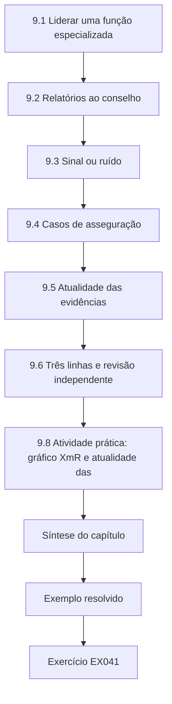

### Desenho lógico

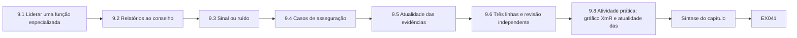

```text
[9.1 Liderar uma função especializada]
    |
    v
[9.2 Relatórios ao conselho]
    |
    v
[9.3 Sinal ou ruído]
    |
    v
[9.4 Casos de asseguração]
    |
    v
[9.5 Atualidade das evidências]
    |
    v
[9.6 Três linhas e revisão independente]
    |
    v
[9.8 Atividade prática: gráfico XmR e atualidade das]
    |
    v
[Síntese do capítulo]
    |
    v
[Exemplo resolvido] --> [Exercício EX041]
```
<!-- cykin:lesson-figures:end ch-09 -->


### Objetivos de aprendizagem e conexão

Ao final deste capítulo, você deverá ser capaz de:

1. Liderar uma função de segurança num serviço essencial: definir a direção, construir capacidade e manter a confiança das operações e do conselho.
2. Reportar a um conselho em unidades de serviço, com um pequeno conjunto de indicadores que informem as decisões.
3. Distinguir uma mudança real de ruído num indicador de segurança usando um gráfico de comportamento do processo (XmR).
4. Construir um caso de asseguração para uma alegação de resiliência e manter a atualidade de suas evidências.
5. Usar o modelo das três linhas e a revisão independente sem transformar a asseguração em papelada.

Os Capítulos 7 e 8 integraram a segurança à organização e a testaram em casos difíceis. Este capítulo trata da pessoa responsável por ela ao longo dos anos: o que ela reporta, como ela sabe se as coisas estão melhorando e como ela mostra aos outros que as alegações são verdadeiras. O Capítulo 10 se volta, então, às evidências externas que um líder precisa ler.

### 9.1 Liderar uma função especializada

Um líder de segurança num serviço essencial lidera pessoas escassas, muitas vezes sobrecarregadas e que trabalham entre culturas diferentes — engenheiros de controle, pessoal de TI, operadores, fornecedores. Quatro responsabilidades predominam. **Direção:** um pequeno número de prioridades ligadas ao serviço e à sua consequência, revistas quando as evidências mudam (os gatilhos de revisão do Capítulo 1). **Capacidade:** as competências, as ferramentas e o tempo para fazer o trabalho, incluindo a sucessão, para que o conhecimento de um sistema crítico não viva numa única cabeça. **Confiança:** as operações precisam acreditar que a segurança entende a planta e não vai colocá-la em risco; o conselho precisa acreditar que os relatórios são francos. **Responsabilização:** responsabilidades claras (Capítulo 7) e um registro das decisões (Capítulo 1). Os códigos profissionais exigem honestidade sobre os limites ([Código de Ética da ACM](https://www.acm.org/code-of-ethics)); para um líder, isso inclui dizer ao conselho o que não se sabe.

Construir capacidade em segurança de TO é em parte uma questão de misturar formações: engenheiros de controle que aprendem segurança e especialistas em segurança que aprendem o processo. Rodízios, exercícios conjuntos (Capítulo 6) e revisões de incidentes compartilhadas (Capítulo 3) fazem mais do que cursos sozinhos.

### 9.2 Relatórios ao conselho

Os conselhos precisam tomar decisões sobre apetite, investimento e responsabilização. Um bom relatório é curto e responde a quatro perguntas: **Estamos dentro do apetite?** (os limites de cauda e de distribuição do Capítulo 4, em unidades de serviço); **O que mudou?** (novas ameaças, incidentes, pressupostos); **Nossos controles estão funcionando?** (evidências verificadas, Capítulo 2; desempenho avaliado, Capítulo 6); **O que vocês precisam decidir?** Os indicadores devem ser poucos, definidos e ligados à consequência: cobertura verificada das práticas de maior peso; tempo para remediar vulnerabilidades conhecidamente exploradas em sistemas expostos, usando uma lista de referência como o catálogo da CISA ([CISA, KEV](https://www.cisa.gov/known-exploited-vulnerabilities-catalog)); último simulado de operação manual bem-sucedido por local principal; tempo de recuperação demonstrado para os sistemas críticos; e decisões em aberto com seus responsáveis. Evite contagens que medem atividade em vez de resultado — número de alertas, treinamentos realizados, constatações fechadas.

### 9.3 Sinal ou ruído

Todo indicador varia de um mês para o outro. Reagir a cada alta desperdiça atenção; ignorar uma mudança real desperdiça tempo. Um **gráfico de comportamento do processo** (também chamado de gráfico de valores individuais e amplitude móvel, ou XmR) separa as duas coisas usando o próprio histórico do indicador. A partir de um período de base, calcule a média e a diferença absoluta média entre valores consecutivos (a amplitude móvel média); os limites naturais do processo são a média mais ou menos 2,66 vezes a amplitude móvel média. Pontos fora dos limites, ou longas sequências de um mesmo lado da média, sinalizam uma mudança que vale investigar; pontos dentro são variação rotineira ([NIST/SEMATECH e-Handbook, control charts](https://www.itl.nist.gov/div898/handbook/pmc/section3/pmc32.htm)). Duas regras práticas: escolha a base num período considerado estável e **não inclua o período que você está testando**; e trate um sinal como um convite a investigar, não como prova de uma causa.

### 9.4 Casos de asseguração

Um **caso de asseguração** é um argumento estruturado de que uma alegação é verdadeira, apoiado por evidências. Ele segue a estrutura geral da argumentação — alegação, fundamentos, garantia, refutação ([Toulmin, 2003](https://doi.org/10.1017/CBO9780511840005)) — aplicada a sistemas. Por exemplo: *Alegação:* "Hollin consegue fornecer água segura por 72 horas sem seu sistema de controle." *Subalegações:* a dosagem manual pode ser mantida pela equipe de qualquer turno; o estoque de produtos químicos dura 72 horas; os analisadores funcionam sem o SCADA; a equipe pode ser substituída. *Evidências:* relatórios de simulados com tempos e participantes; registros de estoque; testes dos analisadores; escala de turnos. *Refutações consideradas:* turno da noite com equipe mínima; perda de energia dos analisadores; incidente simultâneo em Fenley. Um caso de asseguração torna visível de quais evidências cada alegação depende, de modo que, quando as evidências envelhecem ou falham, as alegações afetadas são conhecidas.

### 9.5 Atualidade das evidências

As evidências se deterioram. Uma restauração testada há dezoito meses diz pouco sobre os backups de hoje; uma revisão de firewall anterior a uma mudança de rede diz pouco depois dela. Para cada alegação de asseguração, defina uma **idade máxima das evidências** relacionada à rapidez com que o sistema subjacente muda, e relate as evidências vencidas como uma lacuna, mesmo que não se saiba de nada errado. Um tipo de evidência de grau baixo (uma declaração formal) com uma idade permitida longa merece escrutínio especial: ele pode estar "atual" pela regra, mas ser fraco por natureza (os graus do Capítulo 2).

### 9.6 Três linhas e revisão independente

O Modelo das Três Linhas do Institute of Internal Auditors descreve os papéis da gestão (primeira linha: ser dona do risco e geri-lo), das funções especializadas de risco e conformidade (segunda linha: conhecimento especializado, apoio e questionamento) e da auditoria interna (terceira linha: asseguração independente), todos prestando contas a um órgão de governança ([IIA, 2020](https://www.theiia.org/en/content/position-papers/2020/the-iias-three-lines-model-an-update-of-the-three-lines-of-defense/)). Para a segurança de serviços essenciais, o valor do modelo é a clareza: as operações são donas do risco de sua planta; a função de segurança define padrões, questiona e ajuda; a auditoria interna ou um revisor externo testa se o sistema funciona. O modelo falha quando a segunda linha faz o trabalho da primeira (de modo que ninguém nas operações é dono dele) ou quando a auditoria testa documentos em vez da realidade.

### 9.7 Exemplo resolvido: o pacote do conselho da Merrow Water (sintético)

O conselho da Merrow Water recebe mensalmente a mediana de dias para remediar vulnerabilidades conhecidamente exploradas nos sistemas voltados para a internet. Depois de uma leitura de 24 dias em dezembro, um conselheiro independente perguntou se as coisas estavam piorando ou se dezembro tinha sido um mês ruim. Na mesma reunião, o especialista apresentou as evidências por trás de seis alegações de asseguração. O Laboratório 9 examina as duas coisas.

A pergunta do conselheiro é a certa, e ela não pode ser respondida comparando apenas dezembro com novembro. O especialista precisa de uma base formada por meses em que não se sabia de nada incomum, então o gráfico usa os onze primeiros meses e deixa as leituras posteriores de fora. As seis alegações foram escolhidas porque cada uma apoia a afirmação do conselho de que a Merrow Water consegue se recuperar com segurança de um incidente cibernético; cada uma tem um tipo de evidência nomeado, uma data e uma idade máxima aceitável acordada com a auditoria interna.

### 9.8 Atividade prática: gráfico XmR e atualidade das evidências

```python
# Lab 9 - is the assurance signal a change or noise? An XmR chart and evidence freshness (offline, stdlib only)
# Synthetic: Merrow Water's monthly median days to remediate known-exploited vulnerabilities on internet-facing
# systems, reported to the board, and the age of the evidence behind six assurance claims.
from datetime import date
MONTHS = ["Jan","Feb","Mar","Apr","May","Jun","Jul","Aug","Sep","Oct","Nov","Dec","Jan2","Feb2","Mar2"]
DAYS =   [  12,   9,  14,  11,  13,  10,   12,  15,   11,   9,   13,   24,   21,    23,    25]
BASE = 11  # first 11 months form the baseline
x = DAYS[:BASE]; mean = sum(x) / BASE
mr = [abs(b - a) for a, b in zip(x, x[1:])]; mrbar = sum(mr) / len(mr)
ucl, lcl = mean + 2.66 * mrbar, max(0, mean - 2.66 * mrbar)
print(f"baseline mean {mean:.2f} days, mean moving range {mrbar:.2f}, limits [{lcl:.2f}, {ucl:.2f}]")
run = 0
for m, d in zip(MONTHS, DAYS):
    flag = []
    if d > ucl or d < lcl: flag.append("outside limits")
    run = run + 1 if d > mean else 0
    if run >= 4: flag.append(f"{run} in a row above mean")
    print(f"  {m:5s} {d:3d} {'; '.join(flag)}")
TODAY = date(2026, 10, 12)
CLAIMS = [  # (claim, evidence type, date of evidence, maximum acceptable age in days)
    ("offline backups restorable", "restore test record", date(2026, 3, 2), 180),
    ("vendor sessions all brokered", "broker log reconciliation", date(2026, 9, 20), 31),
    ("no default credentials on PLCs", "engineer attestation", date(2025, 11, 5), 365),
    ("manual dosing drill passed", "drill report", date(2026, 6, 18), 365),
    ("IT/OT firewall rules reviewed", "rule review sign-off", date(2026, 1, 9), 180),
    ("MFA on all remote access", "IdP configuration export", date(2026, 10, 1), 90),
]
print("evidence freshness:")
for c, ev, d, mx in CLAIMS:
    age = (TODAY - d).days
    print(f"  {'STALE' if age > mx else 'ok   '} {age:4d}d / {mx:3d}d  {c} ({ev})")
```

Saída esperada:

```text
baseline mean 11.73 days, mean moving range 3.10, limits [3.48, 19.97]
  Jan    12 
  Feb     9 
  Mar    14 
  Apr    11 
  May    13 
  Jun    10 
  Jul    12 
  Aug    15 
  Sep    11 
  Oct     9 
  Nov    13 
  Dec    24 outside limits
  Jan2   21 outside limits
  Feb2   23 outside limits; 4 in a row above mean
  Mar2   25 outside limits; 5 in a row above mean
evidence freshness:
  STALE  224d / 180d  offline backups restorable (restore test record)
  ok      22d /  31d  vendor sessions all brokered (broker log reconciliation)
  ok     341d / 365d  no default credentials on PLCs (engineer attestation)
  ok     116d / 365d  manual dosing drill passed (drill report)
  STALE  276d / 180d  IT/OT firewall rules reviewed (rule review sign-off)
  ok      11d /  90d  MFA on all remote access (IdP configuration export)
```

**Interpretação.** Ao longo da base de onze meses, o indicador teve média de 11,7 dias, com limites naturais de cerca de 3,5 a 20,0 dias. Os 24 dias de dezembro estão fora dos limites — um sinal, e não apenas um mês ruim —, e os três meses seguintes também estão fora, com uma sequência acima da média. Algo mudou em dezembro; as causas candidatas incluem a saída de um funcionário, uma mudança no conteúdo do catálogo de vulnerabilidades, uma nova classe de sistemas voltados para a internet ou uma mudança no modo como o indicador é calculado. O gráfico diz ao conselho *que* é preciso perguntar, não *qual* resposta está certa. Quanto às evidências, duas das seis alegações estão vencidas: o teste de restauração do backup offline (224 dias contra um limite de 180) e a revisão do firewall TI/TO (276 dias contra 180). A alegação sobre as credenciais padrão dos CLPs está dentro de seu limite de idade, mas se apoia na declaração formal de um engenheiro — o grau de evidência mais fraco — e vence em menos de um mês. O conselho deve ouvir três coisas: uma deterioração real no tempo de remediação desde dezembro, com uma investigação em andamento; duas alegações de asseguração vencidas, com datas de renovação; e uma alegação que precisa de evidências mais fortes, e não apenas mais novas.

### 9.9 Erros comuns e limites

- Reportar contagens de atividade em vez de indicadores relacionados à consequência.
- Reagir a cada alta mensal, ou descartar uma mudança real como ruído.
- Incluir o período suspeito na base, o que alarga os limites e esconde o sinal.
- Escrever alegações de asseguração sem evidências nomeadas, ou evidências sem data.
- Tratar evidências atuais, mas fracas, como fortes.
- Deixar a função de segurança ser dona do risco operacional em nome das operações.
- Apresentar apenas boas notícias ao conselho.

O limite dos indicadores e dos gráficos é que eles resumem. Eles dizem a um líder onde olhar; o olhar — conversas com os operadores, visitas aos locais, leitura das revisões de incidentes — continua sendo o trabalho do líder.

### Exercícios — capítulo 9

**EX041 — Uma base contaminada.** *Objetivo:* ver como a escolha da base afeta os sinais. *Insumos:* Laboratório 9. *Restrições:* mudar a base para os doze primeiros meses (incluindo dezembro). *Passos:* (1) reexecutar; (2) relatar a nova média, a amplitude móvel e os limites; (3) relatar quais meses posteriores estão agora fora dos limites; (4) explicar a lição. *Evidência esperada:* saída e parágrafo. *Rubrica:* 3 = média 12,75, amplitude móvel média de cerca de 3,82, limites de cerca de [2,6, 22,9]; dezembro ainda fora, mas janeiro (21) agora dentro; a lição de que incluir o período em teste alarga os limites e pode esconder uma mudança; 2 = números certos, lição ausente; 1 = não executado; 0 = nada.

**EX042 — Relatório de uma página ao conselho.** *Objetivo:* reportar em unidades de serviço para decisões. *Insumos:* as saídas do Laboratório 9, a cobertura verificada da Merrow Water no Capítulo 2 (39%), a avaliação do Capítulo 6, as constatações da RACI do Capítulo 7. *Restrições:* uma página; no máximo seis indicadores; terminar com as decisões solicitadas. *Passos:* escrever o relatório. *Evidência esperada:* relatório. *Rubrica:* 3 = situação do apetite em unidades de serviço, sinal relatado com incerteza sobre a causa, evidências vencidas e fracas identificadas, decisões específicas com responsáveis; 2 = métricas de atividade incluídas; 1 = tranquilização sem evidências; 0 = nada.

**EX043 — Caso de asseguração.** *Objetivo:* construir um argumento estruturado. *Insumos:* a alegação "Hollin consegue fornecer água segura por 72 horas sem seu sistema de controle". *Restrições:* pelo menos quatro subalegações, cada uma com o tipo de evidência, a idade máxima e a situação atual; pelo menos três refutações. *Passos:* construir o caso como uma tabela ou uma árvore. *Evidência esperada:* caso de asseguração. *Rubrica:* 3 = as subalegações cobrem pessoas, materiais, instrumentos e duração; evidências de grau verificado onde possível, com idades; refutações realistas (turno da noite, energia dos analisadores, incidente simultâneo) com respostas; 2 = evidências sem data; 1 = repete a alegação; 0 = nada.

**EX044 — Três linhas na prática.** *Objetivo:* atribuir os papéis de asseguração. *Insumos:* as seis alegações de asseguração do Laboratório 9. *Restrições:* usar o Modelo das Três Linhas. *Passos:* para cada alegação, atribuir o dono na primeira linha, a atividade de questionamento da segunda linha e o método de teste da terceira linha; identificar uma alegação em que a segunda linha esteja hoje fazendo o trabalho da primeira. *Evidência esperada:* tabela e parágrafo. *Rubrica:* 3 = os donos são papéis operacionais, os métodos de questionamento e de teste são distintos, um exemplo crível de confusão de papéis (por exemplo, a equipe de segurança executando testes de restauração que deveriam ser das operações); 2 = linhas confundidas numa linha da tabela; 1 = genérico; 0 = nada.

**EX045 — Capacidade e sucessão.** *Objetivo:* reduzir a dependência de uma única pessoa. *Insumos:* o único engenheiro da Merrow Water que entende a lógica do controlador de dosagem de Hollin pretende se aposentar em 18 meses. *Restrições:* orçamento para um cargo adicional; as operações não podem ser perturbadas. *Passos:* (1) identificar qual conhecimento está em risco e como capturá-lo; (2) desenhar um plano de desenvolvimento para dois sucessores; (3) definir as evidências de que a sucessão funcionou. *Evidência esperada:* plano. *Rubrica:* 3 = conhecimento capturado como artefatos verificados (lógica anotada, procedimentos de teste, demonstrações gravadas), trabalho em dupla e mudanças supervisionadas, evidências como uma mudança conduzida por um sucessor e um simulado sem o engenheiro que se aposenta; 2 = apenas cursos; 1 = apenas documentação; 0 = nada.

### Síntese do capítulo

Liderar a segurança de um serviço essencial significa definir uma direção ligada à consequência, construir uma capacidade que sobreviva às saídas de pessoas e manter a confiança das operações e do conselho. Reporte ao conselho em unidades de serviço, com poucos indicadores e decisões explícitas. Use gráficos de comportamento do processo para distinguir mudança de ruído, com uma base limpa. Construa casos de asseguração que liguem cada alegação a evidências datadas de grau conhecido, e relate as evidências vencidas ou fracas como lacunas. Use as três linhas para manter a responsabilidade com as operações, o questionamento com os especialistas e os testes independentes com a auditoria.

<!-- cykin:chapter-navigation:start ch-09 -->
### Continue estudando — capítulo 09 de 12

[← Capítulo 08](#ch-08) · [Índice de capítulos do curso](../SUBJECTS.md) · [Capítulo 10 →](#ch-10)

Siga para a próxima lição escrita.
<!-- cykin:chapter-navigation:end -->

<a id="ch-10"></a>

## Capítulo 10 — Leitura e crítica de pesquisas

<!-- cykin:lesson-figures:start ch-10 -->
### Mapa da aula

Aula 10 publicada. Mapa, exemplo, EX046.

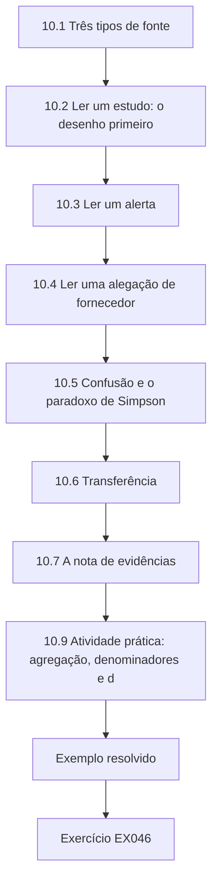

### Desenho lógico

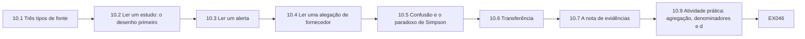

```text
[10.1 Três tipos de fonte]
    |
    v
[10.2 Ler um estudo: o desenho primeiro]
    |
    v
[10.3 Ler um alerta]
    |
    v
[10.4 Ler uma alegação de fornecedor]
    |
    v
[10.5 Confusão e o paradoxo de Simpson]
    |
    v
[10.6 Transferência]
    |
    v
[10.7 A nota de evidências]
    |
    v
[10.9 Atividade prática: agregação, denominadores e d]
    |
    v
[Exemplo resolvido] --> [Exercício EX046]
```
<!-- cykin:lesson-figures:end ch-10 -->


### Objetivos de aprendizagem e conexão

Ao final deste capítulo, você deverá ser capaz de:

1. Ler um estudo publicado, um alerta oficial e uma alegação de fornecedor pelo que cada um pode contribuir para uma decisão prática.
2. Identificar o desenho de um estudo e a alegação mais forte que esse desenho sustenta.
3. Verificar denominadores, comparações e definições de desfecho, e detectar confusão, como o paradoxo de Simpson.
4. Julgar se uma constatação se transfere para a sua organização e o seu setor.
5. Escrever uma nota de evidências curta que declare o que uma fonte mostra, o que não mostra e o que você fará com ela.

Um especialista não precisa produzir pesquisas, mas precisa usá-las: para escolher controles, para definir probabilidades (Capítulos 1 e 4), para discutir com fornecedores e para informar conselhos. Este capítulo ensina a ler para decidir. O Capítulo 11 aplica, então, o mesmo olhar crítico à avaliação do seu próprio projeto.

### 10.1 Três tipos de fonte

| Tipo de fonte | Ponto forte | Fraqueza típica | Como usá-la |
|---|---|---|---|
| Estudo revisado por pares | Método explícito, revisado, citável | Contexto estreito; defasagem; pode não medir o que importa para você | Aprender tamanhos de efeito e mecanismos; verificar a transferência |
| Alerta ou relatório oficial | Oportuno, detalhe operacional, autoridade | Escrito para a ação, não para a inferência; seleção dos casos | Aprender técnicas e mitigações; não inferir frequência |
| Relatório de fornecedor ou pesquisa de opinião | Amostras grandes, atual | Interesse comercial; denominadores indefinidos; seleção dos respondentes | Usar para hipóteses; verificar antes de agir |

Nenhuma é automaticamente confiável ou inútil. Cada uma responde bem a algumas perguntas e mal a outras. Seu trabalho é associar a fonte à pergunta.

### 10.2 Ler um estudo: o desenho primeiro

Antes de ler os resultados, identifique o desenho, porque ele limita a alegação. Uma comparação antes e depois num único local pode mostrar que algo mudou, mas tem dificuldade para mostrar por quê. Uma comparação com um grupo de controle não afetado, ou uma série temporal interrompida, sustenta uma linguagem causal mais forte. Uma pesquisa com vítimas não consegue estimar com que frequência os ataques acontecem na população inteira. Depois, verifique: a **unidade** (hospital, paciente, dia), o **desfecho** e como ele foi medido, a **comparação** (o que teria acontecido de outro modo), a **janela de tempo** e o **contexto**.

Considere dois estudos reais do setor de saúde. Ghafur e colegas analisaram dados nacionais de atividade hospitalar em torno do ataque WannaCry de 2017 e não encontraram mudança significativa na atividade total do conjunto das trusts inglesas, mas cerca de 6% menos internações por dia nos hospitais infectados, uma perda estimada de £5,9 milhões em atividade e nenhuma diferença detectada na mortalidade — ressalvando que a mortalidade é uma medida grosseira do dano aos pacientes ([Ghafur et al., 2019](https://doi.org/10.1038/s41746-019-0161-6)). Dameff e colegas compararam os volumes dos departamentos de emergência de dois hospitais vizinhos a um sistema de saúde sob um ataque de ransomware de um mês, em 2021, antes, durante e depois do ataque, e relataram aumentos significativos na ocupação, nas chegadas de ambulâncias e em outras medidas durante o ataque ([Dameff et al., 2023](https://doi.org/10.1001/jamanetworkopen.2023.12270)). Ambos são valiosos; ambos são limitados pelo desenho. O primeiro usa dados nacionais com comparação entre trusts; o segundo é um estudo antes e depois numa única instituição, de modo que mudanças sazonais ou locais não podem ser totalmente excluídas. Nenhum dos dois diz à Merrow Health qual a probabilidade de um ataque; ambos informam quão graves e quão regionais as consequências podem ser.

Os conjuntos de dados de nível populacional respondem a perguntas diferentes. Neprash e colegas usaram uma base de dados de ataques de ransomware publicamente relatados contra organizações prestadoras de cuidados de saúde nos EUA e constataram que os ataques anuais mais do que dobraram de 2016 a 2021 e que quase metade deles perturbou a prestação de cuidados ([Neprash et al., 2022](https://doi.org/10.1001/jamahealthforum.2022.4873)). Como os dados são de ataques *publicamente relatados*, as tendências combinam mudanças nos ataques com mudanças nos relatos — uma limitação que o desenho dos autores torna explícita e que o leitor precisa levar adiante.

### 10.3 Ler um alerta

Alertas como o alerta conjunto da CISA sobre o pré-posicionamento patrocinado por Estados na infraestrutura crítica dos EUA ([AA24-038A, 2024](https://www.cisa.gov/news-events/cybersecurity-advisories/aa24-038a)) trazem técnicas, indicadores e mitigações de casos investigados. Leia-os buscando: **o que foi observado** (técnicas, setores visados, vetores de entrada); **o que é recomendado** (mitigações, muitas vezes priorizadas); e **o que é inferido** (intenção, escala). Traduza as técnicas observadas em perguntas sobre o seu próprio ambiente — "veríamos isso?" —, e não numa probabilidade. Um alerta é evidência de que uma ameaça existe e de como ela opera, não uma estimativa de com que frequência ela tem sucesso.

### 10.4 Ler uma alegação de fornecedor

As alegações de fornecedores merecem a mesma disciplina de leitura. Pergunte: qual é o **desfecho** (incidentes relatados? incidentes detectados? perdas?); qual é o **denominador** (clientes, locais, operadores-ano?); **quem está em cada grupo** e por quê (autosseleção, porte, setor); e **o que um produto de detecção faria com o desfecho** (mais monitoramento encontra mais incidentes). A pesquisa sobre aprendizado de máquina em segurança lista armadilhas — viés de amostragem, bisbilhotagem de dados (data snooping), linhas de base inadequadas, falácia da taxa de base, modelos de ameaça irrealistas — que se aplicam a muitas avaliações de produtos ([Arp et al., 2022](https://www.usenix.org/conference/usenixsecurity22/presentation/arp)).

### 10.5 Confusão e o paradoxo de Simpson

Quando os grupos diferem num fator que também afeta o desfecho, uma comparação agregada pode apontar na direção oposta à de todas as comparações dentro dos grupos. Esse é o **paradoxo de Simpson** ([Simpson, 1951](https://doi.org/10.1111/j.2517-6161.1951.tb00088.x)). Nos dados de segurança, o porte é um fator de confusão frequente: os grandes operadores têm mais sistemas, mais obrigações de notificação e mais incidentes, e compram produtos em proporções diferentes dos pequenos. O remédio é **estratificar** (comparar dentro das faixas de porte) ou **padronizar** (reponderar os grupos para a mesma composição) e perguntar se o desfecho mede dano ou detecção.

### 10.6 Transferência

Uma constatação só se transfere para o seu contexto se o mecanismo que a produziu operar ali. A literatura formal sobre transportabilidade pergunta quais diferenças entre populações mudam o efeito ([Pearl e Bareinboim, 2014](https://doi.org/10.1214/14-STS486)); na prática, liste as condições de que a constatação dependia — porte, setor, notificação regulatória, tecnologia, pessoal — e verifique cada uma para a sua organização. Uma constatação sobre mortalidade de um sistema nacional de saúde com arranjos de desvio em toda a rede pode não se transferir para uma região rural com um único hospital.

Para o folheto do fornecedor deste capítulo, a transferência é uma pergunta adicional, depois da confusão: mesmo uma comparação bem desenhada entre outros operadores só se aplicaria a Merrow Bay se o porte, a prática de notificação e as plantas deles se parecessem com os dos membros do fórum. Escreva as condições e marque cada uma como verificada, desconhecida ou diferente.

### 10.7 A nota de evidências

Resuma cada fonte importante para os tomadores de decisão numa **nota de evidências** curta: a pergunta para a qual ela ajuda; o desenho e o contexto; a constatação principal, com seu tamanho e sua incerteza; a alegação mais forte que ela sustenta; as principais limitações e sua direção provável; a transferência para o nosso contexto; e o que faremos com ela. Mantenha as notas numa biblioteca para que as decisões posteriores possam citá-las (os registros de decisão do Capítulo 1).

Uma nota é curta por desenho, geralmente uma página, para que um diretor consiga lê-la antes de uma reunião. A alegação mais forte sustentada deve ser escrita nas palavras que você estaria disposto a defender diante dos autores; se a conclusão da própria fonte for mais forte, diga isso e explique a diferença. Date cada nota e registre quando ela deve ser revista, já que os alertas e os dados de fornecedores envelhecem depressa.

### 10.8 Exemplo resolvido: o folheto de um fornecedor de monitoramento (sintético)

Um fornecedor de monitoramento de TO diz ao fórum de resiliência: "Os clientes que usam o nosso monitoramento tiveram 40% menos incidentes relatados." Instado a mostrar os dados, o fornecedor entrega contagens por porte de operador. O Laboratório 10 as relê.

O primeiro movimento do especialista é perguntar o que está por trás do número antes de discuti-lo: o que conta como incidente, ao longo de quantos operadores-ano e como os clientes e os não clientes diferem. A disposição do fornecedor de entregar contagens por porte já é útil; um fornecedor que se recusa a compartilhar qualquer denominador deu ao fórum uma razão para tratar a alegação como marketing. O fórum concorda em revisar os dados em conjunto, em vez de responder ao folheto.

### 10.9 Atividade prática: agregação, denominadores e detecção

```python
# Lab 10 - re-reading a vendor claim: aggregation, denominators and survivorship (offline, stdlib only)
# Synthetic: a vendor brochure says "customers using our OT monitoring had 40% fewer reported incidents".
# Below are the (invented) counts behind such a claim, split by operator size.
DATA = {  # stratum: {group: (operators, operator-years observed, incidents reported)}
    "small (<50 staff)": {"monitoring": (240, 720, 54), "none": (100, 300, 15)},
    "large (>=50 staff)": {"monitoring": (20, 60, 18),   "none": (100, 300, 75)},
}
def rate(g):
    oy = sum(DATA[s][g][1] for s in DATA); inc = sum(DATA[s][g][2] for s in DATA)
    return inc / oy, inc, oy
for g in ("monitoring", "none"):
    r, inc, oy = rate(g); print(f"pooled {g:10s} {inc:3d} incidents / {oy:4d} operator-years = {r:.3f}")
rm, rn = rate("monitoring")[0], rate("none")[0]
print(f"pooled relative difference: {(rm - rn) / rn:+.0%}")
for s, grp in DATA.items():
    a = grp["monitoring"][2] / grp["monitoring"][1]; b = grp["none"][2] / grp["none"][1]
    print(f"{s:20s} monitoring {a:.3f}  none {b:.3f}  ratio {a/b:.2f}")
# Standardize both groups to the same size mix (the 'none' group's operator-years) - direct standardization
w = {s: DATA[s]["none"][1] for s in DATA}; W = sum(w.values())
std = {g: sum(w[s] / W * DATA[s][g][2] / DATA[s][g][1] for s in DATA) for g in ("monitoring", "none")}
print(f"size-standardized: monitoring {std['monitoring']:.3f}  none {std['none']:.3f}  ratio {std['monitoring']/std['none']:.2f}")
```

Saída esperada:

```text
pooled monitoring  72 incidents /  780 operator-years = 0.092
pooled none        90 incidents /  600 operator-years = 0.150
pooled relative difference: -38%
small (<50 staff)    monitoring 0.075  none 0.050  ratio 1.50
large (>=50 staff)   monitoring 0.300  none 0.250  ratio 1.20
size-standardized: monitoring 0.188  none 0.150  ratio 1.25
```

**Interpretação.** No agregado, os operadores monitorados relatam 0,092 incidente por operador-ano, contra 0,150 dos não monitorados, uma diferença de 38% — a alegação do folheto. Mas, dentro de cada faixa de porte, os operadores monitorados relatam **mais** incidentes: 1,5 vez mais entre os pequenos, 1,2 vez entre os grandes. A comparação agregada se inverte porque a maioria dos operadores monitorados é pequena, e os operadores pequenos relatam menos incidentes, seja lá o que usem. Padronizados para a mesma composição de porte, os operadores monitorados relatam 1,25 vez mais incidentes. E "incidentes relatados" é um desfecho de detecção: um produto de monitoramento que funciona deveria *aumentar* os incidentes relatados, ao encontrar o que passava despercebido. Nem os números agregados nem os estratificados dizem algo sobre o dano evitado. A resposta certa ao fornecedor não é "seu produto é ruim", mas "sua alegação não decorre desses dados; mostre-nos desfechos em unidades de serviço, pareados por porte e setor, ao longo do tempo".

### 10.10 Erros comuns e limites

- Ler os resultados antes de identificar o desenho.
- Tratar a lista de casos de um alerta como uma estimativa de frequência.
- Comparar grupos que diferem em porte ou setor sem estratificar.
- Tratar os incidentes relatados como uma medida de dano ou de segurança.
- Aceitar uma constatação sem verificar se seu mecanismo opera no seu contexto.
- Descartar uma fonte inteiramente porque ela tem uma fraqueza.
- Citar uma fonte para mais do que ela mostrou.

O limite da leitura crítica é o tempo. Priorize as fontes que poderiam mudar uma decisão (o valor da informação do Capítulo 1), leia essas com cuidado e aceite uma leitura mais leve para o resto.

### Exercícios — capítulo 10

**EX046 — Releia o folheto.** *Objetivo:* reproduzir e explicar uma inversão. *Insumos:* Laboratório 10. *Restrições:* 250 palavras para a explicação. *Passos:* (1) executar o laboratório; (2) explicar a inversão ao fórum em linguagem simples; (3) propor duas medidas de desfecho que mostrariam melhor o valor do produto. *Evidência esperada:* saída e explicação. *Rubrica:* 3 = inversão explicada pela composição de porte e pelo efeito de detecção, razão padronizada citada, medidas de desfecho ligadas ao dano (por exemplo, horas de interrupção do serviço, tempo para detectar testes injetados); 2 = inversão explicada, medidas fracas; 1 = repete o folheto; 0 = nada.

**EX047 — Nota de evidências: hospitais vizinhos.** *Objetivo:* preparar uma nota sobre um estudo para a Merrow Health. *Insumos:* o resumo de Dameff et al. (2023). *Restrições:* usar a estrutura da §10.7; citar números apenas da fonte. *Passos:* escrever a nota. *Evidência esperada:* nota de uma página. *Rubrica:* 3 = desenho identificado como antes e depois numa única instituição, constatações declaradas com suas medidas, limitações (local único, sazonalidade, nenhuma região de controle) com direção, transferência para o sistema de três hospitais de Merrow Bay discutida, ação (por exemplo, planejamento regional de desvios) declarada; 2 = limitações sem direção; 1 = exagera a causalidade; 0 = nada.

**EX048 — Nota de evidências: WannaCry.** *Objetivo:* preparar uma nota sobre um estudo nacional. *Insumos:* Ghafur et al. (2019) e a investigação do NAO. *Restrições:* distinguir os propósitos das duas fontes. *Passos:* escrever uma nota que responda "o que o WannaCry diz à Merrow Health sobre as consequências de um evento de ransomware em grande escala?". *Evidência esperada:* nota. *Rubrica:* 3 = as constatações do estudo (cerca de 6% menos internações por dia nos hospitais infectados; nenhuma diferença de mortalidade detectada, com a ressalva dos autores) e o propósito de auditoria do NAO distinguidos, questões de transferência declaradas, ação declarada; 2 = fontes misturadas; 1 = "nenhuma morte, logo risco baixo"; 0 = nada.

**EX049 — Do alerta às perguntas.** *Objetivo:* usar bem um alerta. *Insumos:* CISA AA24-038A. *Restrições:* não estimar probabilidades a partir dele. *Passos:* (1) extrair cinco técnicas ou comportamentos observados; (2) para cada um, escrever a pergunta "veríamos isso na Merrow Water?" e a fonte de evidência que a responderia; (3) escolher duas mitigações recomendadas e mapeá-las para as práticas do Capítulo 2. *Evidência esperada:* tabela. *Rubrica:* 3 = comportamentos observados resumidos com exatidão (por exemplo, uso de contas válidas e técnicas living-off-the-land), perguntas de detecção ligadas a logs específicos, mitigações mapeadas; 2 = mistura observação e inferência; 1 = apenas um resumo; 0 = nada.

**EX050 — Verificação de armadilhas.** *Objetivo:* aplicar uma lista de verificação de pesquisa à avaliação de um produto. *Insumos:* um fornecedor afirma que seu detector de anomalias baseado em aprendizado de máquina "alcançou 99% de acurácia num conjunto de dados público de uma bancada de testes de tratamento de água". *Restrições:* usar as armadilhas de Arp et al. (2022). *Passos:* listar cinco perguntas que você faria e por que cada uma importa. *Evidência esperada:* lista. *Rubrica:* 3 = a questão da taxa de base e de acurácia versus precisão, vazamento entre treino e teste (data snooping), transferência da bancada para a planta, comparação com uma linha de base, realismo do modelo de ameaça; 2 = três; 1 = ceticismo genérico; 0 = nada.

### Síntese do capítulo

Leia para decidir. Associe a fonte à pergunta: estudos para tamanhos de efeito e mecanismos, alertas para técnicas e mitigações, relatórios de fornecedores para hipóteses a verificar. Identifique o desenho antes dos resultados e limite as alegações ao que o desenho sustenta. Verifique o desfecho, o denominador, a comparação e os fatores de confusão; estratifique ou padronize quando os grupos diferirem, e lembre-se de que os incidentes relatados medem a detecção tanto quanto o dano. Pergunte se o mecanismo se transfere para o seu contexto. Registre o que você aprende em notas de evidências que os registros de decisão possam citar.

<!-- cykin:chapter-navigation:start ch-10 -->
### Continue estudando — capítulo 10 de 12

[← Capítulo 09](#ch-09) · [Índice de capítulos do curso](../SUBJECTS.md) · [Capítulo 11 →](#ch-11)

Siga para a próxima lição escrita.
<!-- cykin:chapter-navigation:end -->

<a id="ch-11"></a>

## Capítulo 11 — Projeto aplicado

<!-- cykin:lesson-figures:start ch-11 -->
### Mapa da aula

Aula 11 publicada. Mapa, exemplo, EX051.

```mermaid
flowchart TD
  N0["11.1 Escolher o projeto"]
  N1["11.2 O termo de abertura do projeto"]
  N2["11.3 Entregar por meio das pessoas"]
  N3["11.4 Avaliar o resultado"]
  N4["11.5 Relatar o projeto"]
  N5["11.6 Rubrica de avaliação"]
  N6["11.8 Atividade prática: funcionou?"]
  N7["Síntese do capítulo"]
  N0 --> N1 --> N2 --> N3 --> N4 --> N5 --> N6 --> N7
  N7 --> EX["Exemplo resolvido"]
  EX --> Q["Exercício EX051"]
```

### Desenho lógico

```mermaid
flowchart LR
  N0["11.1 Escolher o projeto"]
  N1["11.2 O termo de abertura do projeto"]
  N2["11.3 Entregar por meio das pessoas"]
  N3["11.4 Avaliar o resultado"]
  N4["11.5 Relatar o projeto"]
  N5["11.6 Rubrica de avaliação"]
  N6["11.8 Atividade prática: funcionou?"]
  N7["Síntese do capítulo"]
  N0 --> N1 --> N2 --> N3 --> N4 --> N5 --> N6 --> N7 --> Q["EX051"]
```

```text
[11.1 Escolher o projeto]
    |
    v
[11.2 O termo de abertura do projeto]
    |
    v
[11.3 Entregar por meio das pessoas]
    |
    v
[11.4 Avaliar o resultado]
    |
    v
[11.5 Relatar o projeto]
    |
    v
[11.6 Rubrica de avaliação]
    |
    v
[11.8 Atividade prática: funcionou?]
    |
    v
[Síntese do capítulo]
    |
    v
[Exemplo resolvido] --> [Exercício EX051]
```
<!-- cykin:lesson-figures:end ch-11 -->


### Objetivos de aprendizagem e conexão

Ao final deste capítulo, você deverá ser capaz de:

1. Delimitar uma melhoria de segurança em escala organizacional como um projeto com um tomador de decisão, um objetivo baseado em consequências e benefícios mensuráveis.
2. Planejar a entrega com partes interessadas, riscos, condições de segurança e pontos de verificação.
3. Avaliar o resultado com honestidade, com um grupo de comparação, uma estimativa de diferença em diferenças e uma verificação por permutação.
4. Testar a robustez do resultado de um projeto e relatar seus limites.
5. Apresentar o projeto para avaliação segundo uma rubrica explícita.

O projeto aplicado é onde o curso se torna prática. Ele usa todos os capítulos anteriores: enquadramento e registros de decisão (1), prática atual e verificação (2), evidências (3), risco e ética (4), projeto (5), avaliação controlada (6), integração (7), raciocínio para casos difíceis (8), asseguração (9) e leitura crítica (10). Diferentemente de uma dissertação de mestrado, seu propósito não é responder a uma pergunta de pesquisa para outras pessoas; é **melhorar um serviço real e mostrar de modo crível se melhorou**. O Capítulo 12 revisa, então, o curso e o transfere.

### 11.1 Escolher o projeto

Um bom projeto aplicado de pós-graduação é: **consequente** (muda a exposição de um serviço essencial, não apenas um documento); **delimitado** (entregável em cerca de dois semestres de trabalho em tempo parcial); **com dono** (um patrocinador nomeado com autoridade e responsáveis operacionais que o querem); **mensurável** (um benefício que possa ser observado, de preferência em unidades de serviço); **seguro e autorizado** (não cria risco não aprovado para as operações, as pessoas ou os dados); e **avaliável** (há um modo de comparar com o que teria acontecido sem ele). Projetos típicos: prontidão para operação manual num grupo de instalações; acesso intermediado de fornecedores para um sistema de controle; uma capacidade de restauração para sistemas clínicos; um plano regional de concentração de fornecedores. Se você não trabalha no setor, o projeto pode ser realizado sobre um caso sintético realista como Merrow Bay, com as mesmas entregas.

### 11.2 O termo de abertura do projeto

Um **termo de abertura** de uma página fixa: o problema e sua consequência; o patrocinador e os direitos de decisão; objetivos e benefícios, com medidas e linhas de base; escopo e exclusões; entregas; partes interessadas; restrições (segurança, orçamento, regulação); riscos; o desenho da avaliação; marcos e pontos de verificação; e a rubrica de avaliação. Escrever o desenho da avaliação no termo antes da entrega é o equivalente, no projeto, ao pré-registro ([Nosek et al., 2018](https://doi.org/10.1073/pnas.1708274114)): protege o especialista da tentação de escolher, depois, a medida que parece melhor ([Kerr, 1998](https://doi.org/10.1207/s15327957pspr0203_4)).

### 11.3 Entregar por meio das pessoas

A maioria dos projetos de segurança em serviços essenciais fracassa na adoção, não na tecnologia. Mapeie as partes interessadas por influência e interesse; combine com as operações como e quando as mudanças tocam a planta; planeje treinamento e prática supervisionada; e antecipe quem perde algo (conveniência, autonomia, orçamento). Um **pré-mortem** no início ([Klein, 2007](https://hbr.org/2007/09/performing-a-project-premortem)) faz surgir cedo os riscos de adoção. Mantenha um registro de decisões do projeto no formato do Capítulo 1, para que revisores posteriores possam ver por que o plano mudou.

Na Merrow Water, as pessoas mais afetadas pelo projeto do runbook são os operadores de turno, que precisam praticar a operação manual em simulados trimestrais além do trabalho normal. Combinar os horários dos simulados com os gerentes de turno e usar o retorno deles para revisar o runbook torna a adoção muito mais provável do que emiti-lo a partir da sede.

### 11.4 Avaliar o resultado

As comparações antes e depois são sedutoras e fracas: o desfecho pode ter melhorado de qualquer forma, por causa da estação, da prática, de novos funcionários ou de outros projetos. Um desenho mais forte e prático é a **diferença em diferenças (DiD)**: comparar a mudança nas instalações que receberam o projeto (piloto) com a mudança em instalações semelhantes que não o receberam (comparação), no mesmo período. A estimativa é (piloto depois − piloto antes) − (comparação depois − comparação antes). Seu pressuposto central são as **tendências paralelas**: sem o projeto, as instalações piloto e as de comparação teriam mudado na mesma medida. O desenho foi popularizado na economia por um estudo conhecido que comparou o emprego em estados vizinhos ([Card e Krueger, 1994](https://www.jstor.org/stable/2118030)); aplica-se igualmente aos tempos de simulado ou aos tempos de recuperação entre instalações.

Com poucas instalações, os erros-padrão comuns não são confiáveis. Uma **verificação por permutação** é simples e honesta: calcule a DiD para todas as formas possíveis de escolher quais instalações foram "piloto" e pergunte quão incomum é a estimativa da atribuição real. Se muitas atribuições aleatórias produzirem estimativas igualmente grandes, o resultado pode ser acaso. Por fim, teste a **robustez**: retire a instalação mais influente, use uma definição diferente de desfecho ou verifique se as instalações piloto e as de comparação já divergiam antes do projeto.

### 11.5 Relatar o projeto

O relatório final declara o problema, o que foi feito, o que mudou, quão seguros estamos e o que resta. Ele relata primeiro a medida pré-especificada; as análises adicionais são rotuladas como exploratórias. As limitações são escritas com sua **direção** — essa fraqueza faria o efeito parecer maior ou menor? —, para que os leitores possam julgar o resultado. Os benefícios que não puderam ser medidos são descritos, não inventados. O relatório termina com a passagem de responsabilidade: responsáveis, manutenção, as evidências de asseguração que manterão a alegação atual (Capítulo 9) e o gatilho de revisão.

### 11.6 Rubrica de avaliação

Os projetos são avaliados segundo cinco critérios, cada um pontuado de 0 a 3:

| Critério | 3 (excelente) | 1 (fraco) |
|---|---|---|
| Enquadramento | Problema baseado em consequências, patrocinador, benefício mensurável, avaliação pré-especificada | Problema vago; medida escolhida depois dos resultados |
| Entrega | Segura, autorizada, adotada pelas operações; decisões registradas | Entregue apenas no papel; operações contornadas |
| Avaliação | Grupo de comparação, DiD ou equivalente, incerteza e robustez relatadas | Apenas antes e depois, sem incerteza |
| Ética e segurança | Riscos às pessoas e ao serviço avaliados; distribuição considerada | Não considerados |
| Comunicação e passagem de responsabilidade | Relatório claro, limitações com direção, responsáveis e evidências de asseguração | Advocacia; sem passagem de responsabilidade |

### 11.7 Exemplo resolvido: o projeto do runbook de operação manual (sintético)

O especialista da Merrow Water conduziu um projeto para introduzir um runbook de operação manual e simulados trimestrais em seis estações (piloto), escolhidas por terem os sistemas de controle mais antigos; outras seis estações continuaram como antes (comparação). O desfecho pré-especificado foi a média de minutos até uma operação manual estável nos simulados trimestrais, calculada sobre dois trimestres antes e dois depois. O termo de abertura pré-especificou a DiD com uma verificação por permutação e uma verificação de robustez que retira a instalação mais influente.

Escolher as instalações piloto pelos sistemas de controle antigos foi sensato para o serviço, porque eram essas estações que mais precisavam do runbook, mas significa que os grupos piloto e de comparação não eram parecidos no início. É por isso que o termo exigiu diferença em diferenças, e não uma comparação apenas posterior, e por isso as tendências paralelas precisam ser argumentadas, não presumidas. Espera-se que as seis estações de comparação recebam o runbook na próxima fase, o que dá uma oportunidade posterior de testar o resultado.

### 11.8 Atividade prática: funcionou?

```python
# Lab 11 - did the project work? Difference-in-differences with a permutation check (offline, stdlib only)
# Synthetic: Merrow Water piloted a manual-operation runbook and drills at six works (pilot) and not at six others.
# Outcome: mean minutes to stable manual operation in quarterly drills, two quarters before and two after.
from itertools import combinations
SITES = {  # site: (pilot?, mean minutes before, mean minutes after)
    "Hollin": (1, 41, 27), "Fenley": (1, 38, 29), "Upper Merrow": (1, 55, 36), "Kettle Ford": (1, 33, 28),
    "Ashby": (1, 47, 35), "Saltings": (1, 36, 30),
    "Brack": (0, 39, 35), "Dunmere": (0, 44, 40), "Orrin": (0, 35, 34), "Pelling": (0, 50, 43),
    "Quarry Lane": (0, 31, 30), "Rook": (0, 42, 36),
}
def did(treated):
    t = [SITES[s][2] - SITES[s][1] for s in SITES if s in treated]
    c = [SITES[s][2] - SITES[s][1] for s in SITES if s not in treated]
    return sum(t) / len(t) - sum(c) / len(c), sum(t) / len(t), sum(c) / len(c)
pilot = {s for s, v in SITES.items() if v[0]}
est, dt, dc = did(pilot)
print(f"pilot change {dt:+.2f} min, comparison change {dc:+.2f} min, difference-in-differences {est:+.2f} min")
naive = sum(SITES[s][2] for s in pilot) / 6 - sum(SITES[s][2] for s in SITES if s not in pilot) / 6
print(f"naive after-only difference {naive:+.2f} min")
allc = [did(set(c))[0] for c in combinations(SITES, 6)]
p = sum(1 for d in allc if d <= est) / len(allc)
print(f"permutation: {len(allc)} assignments; share with DiD <= observed = {p:.4f}")
# Sensitivity: drop the site with the largest pilot improvement
big = min(pilot, key=lambda s: SITES[s][2] - SITES[s][1])
rest = {s: SITES[s] for s in SITES if s != big}
t = [v[2]-v[1] for s, v in rest.items() if v[0]]; c = [v[2]-v[1] for s, v in rest.items() if not v[0]]
print(f"without {big}: DiD {sum(t)/len(t) - sum(c)/len(c):+.2f} min")
```

Saída esperada:

```text
pilot change -10.83 min, comparison change -3.83 min, difference-in-differences -7.00 min
naive after-only difference -5.50 min
permutation: 924 assignments; share with DiD <= observed = 0.0087
without Upper Merrow: DiD -5.37 min
```

**Interpretação.** As instalações piloto melhoraram 10,8 minutos em média; as de comparação, 3,8 minutos, provavelmente pela prática e pela conscientização gerais. A estimativa por DiD é uma melhoria de 7,0 minutos atribuível ao projeto sob o pressuposto de tendências paralelas. Uma comparação ingênua apenas posterior (5,5 minutos) a subestimaria, porque as instalações piloto começaram mais lentas — foram escolhidas por seus sistemas antigos. Das 924 atribuições possíveis de seis instalações "piloto", menos de 1% produz uma melhoria tão grande quanto a real, de modo que o acaso é uma explicação improvável. Retirar Upper Merrow, a instalação com a maior melhoria, reduz a estimativa para 5,4 minutos: o resultado é robusto em direção, mas sensível em tamanho a uma única instalação. O relatório deve declarar "cerca de 5 a 7 minutos mais rápido, principalmente, mas não apenas, impulsionado por Upper Merrow", observar que as instalações piloto foram selecionadas pelos sistemas antigos (de modo que as tendências paralelas são um pressuposto a defender) e recomendar estender o runbook às instalações de comparação com a mesma avaliação.

### 11.9 Erros comuns e limites

- Escolher um projeto por ser interessante, e não por sua consequência.
- Começar sem um patrocinador que possa tomar decisões.
- Definir a medida de sucesso depois de ver os resultados.
- Avaliar apenas com antes e depois.
- Relatar uma única estimativa sem verificação de acaso nem teste de robustez.
- Listar limitações sem sua direção.
- Terminar sem passagem de responsabilidade, de modo que o benefício se deteriora.

Com uma dúzia de instalações, nenhuma avaliação é definitiva. A avaliação do projeto deve ser honesta sobre isso e desenhada para que a próxima fase (por exemplo, a implantação escalonada nas instalações de comparação) produza mais evidências.

### Exercícios — capítulo 11

**EX051 — Termo de abertura do projeto.** *Objetivo:* delimitar o seu próprio projeto aplicado. *Insumos:* sua organização, ou Merrow Bay. *Restrições:* uma página; todos os elementos do termo da §11.2; avaliação pré-especificada. *Passos:* escrever o termo. *Evidência esperada:* termo de abertura. *Rubrica:* usar os critérios "Enquadramento" e "Ética e segurança" da §11.6; 3 = consequente, delimitado, com dono, mensurável, seguro e avaliável, com uma comparação nomeada; 2 = avaliação vaga; 1 = atividade em vez de resultado; 0 = nada.

**EX052 — Robustez do resultado da permutação.** *Objetivo:* verificar a sensibilidade a uma instalação. *Insumos:* Laboratório 11. *Restrições:* remover Upper Merrow inteiramente dos dados (11 instalações, 5 piloto). *Passos:* (1) recalcular a DiD; (2) recalcular a proporção da permutação sobre todas as atribuições de 5 pilotos entre 11 instalações; (3) interpretar. *Evidência esperada:* números e parágrafo. *Rubrica:* 3 = DiD de −5,37 minutos, 462 atribuições, proporção de cerca de 0,017; interpretação de que o resultado continua improvável sob o acaso, mas é mais fraco, com a direção da limitação de seleção; 2 = números certos, interpretação rasa; 1 = não executado; 0 = nada.

**EX053 — Plano de partes interessadas e de adoção.** *Objetivo:* planejar a entrega por meio das pessoas. *Insumos:* o projeto do runbook. *Restrições:* incluir os turnos noturnos e os terceirizados. *Passos:* mapear as partes interessadas; identificar quem perde o quê; planejar treinamento, prática supervisionada e retorno; conduzir um pré-mortem curto e listar três histórias de fracasso com mitigações. *Evidência esperada:* plano. *Rubrica:* 3 = partes interessadas específicas, perdas reconhecidas, treinamento baseado em prática, histórias de pré-mortem críveis; 2 = sem pré-mortem; 1 = apenas um plano de comunicação; 0 = nada.

**EX054 — Limitações com direção.** *Objetivo:* escrever limitações que ajudem os leitores a julgar. *Insumos:* resultado do Laboratório 11. *Restrições:* pelo menos cinco limitações, cada uma com direção e com o modo como uma fase posterior poderia tratá-la. *Passos:* escrevê-las. *Evidência esperada:* lista. *Rubrica:* 3 = seleção das instalações piloto, regressão à média (instalações lentas melhoram mais de qualquer forma — inflaria), efeitos de prática, amostra pequena, realismo dos simulados frente a eventos reais, contaminação das instalações de comparação; direções corretas; 2 = direções ausentes; 1 = genéricas; 0 = nada.

**EX055 — Passagem de responsabilidade e benefícios.** *Objetivo:* fazer os benefícios durarem. *Insumos:* o projeto do runbook na conclusão. *Restrições:* usar as ideias de caso de asseguração e de atualidade do Capítulo 9. *Passos:* (1) nomear os responsáveis; (2) definir a alegação de asseguração e as evidências, com idades máximas; (3) definir um indicador para o conselho com uma base XmR; (4) definir o gatilho de revisão. *Evidência esperada:* nota de passagem de responsabilidade. *Rubrica:* 3 = responsáveis operacionais, evidências de grau verificado com idades, indicador com o período de base declarado, gatilho específico; 2 = falta um elemento; 1 = "projeto encerrado"; 0 = nada.

### Síntese do capítulo

Um projeto aplicado melhora um serviço real e mostra de modo crível se melhorou. Escolha algo consequente, delimitado, com dono, mensurável, seguro e avaliável; fixe a avaliação num termo de abertura antes da entrega; entregue por meio das pessoas, com o consentimento das operações e um pré-mortem; avalie com um grupo de comparação, diferença em diferenças, uma verificação por permutação e testes de robustez; relate as limitações com sua direção; e faça a passagem de responsabilidade com responsáveis, evidências de asseguração e um gatilho de revisão.

<!-- cykin:chapter-navigation:start ch-11 -->
### Continue estudando — capítulo 11 de 12

[← Capítulo 10](#ch-10) · [Índice de capítulos do curso](../SUBJECTS.md) · [Capítulo 12 →](#ch-12)

Siga para a próxima lição escrita.
<!-- cykin:chapter-navigation:end -->

<a id="ch-12"></a>

## Capítulo 12 — Revisão final e transferência

<!-- cykin:lesson-figures:start ch-12 -->
### Mapa da aula

Aula 12 publicada. Mapa, exemplo, EX056.

```mermaid
flowchart TD
  N0["12.1 O curso como um método"]
  N1["12.2 Transferência entre setores"]
  N2["12.3 Decisões multicritério e pontos de inversão"]
  N3["12.4 Autoavaliação e prática contínua"]
  N4["12.6 Atividade prática: mesmas opções, pesos diferen"]
  N5["Síntese do capítulo"]
  N6["Capítulo 1: EX001–EX005"]
  N7["Capítulo 2: EX006–EX010"]
  N0 --> N1 --> N2 --> N3 --> N4 --> N5 --> N6 --> N7
  N7 --> EX["Exemplo resolvido"]
  EX --> Q["Exercício EX056"]
```

### Desenho lógico

```mermaid
flowchart LR
  N0["12.1 O curso como um método"]
  N1["12.2 Transferência entre setores"]
  N2["12.3 Decisões multicritério e pontos de inversão"]
  N3["12.4 Autoavaliação e prática contínua"]
  N4["12.6 Atividade prática: mesmas opções, pesos diferen"]
  N5["Síntese do capítulo"]
  N6["Capítulo 1: EX001–EX005"]
  N7["Capítulo 2: EX006–EX010"]
  N0 --> N1 --> N2 --> N3 --> N4 --> N5 --> N6 --> N7 --> Q["EX056"]
```

```text
[12.1 O curso como um método]
    |
    v
[12.2 Transferência entre setores]
    |
    v
[12.3 Decisões multicritério e pontos de inversão]
    |
    v
[12.4 Autoavaliação e prática contínua]
    |
    v
[12.6 Atividade prática: mesmas opções, pesos diferen]
    |
    v
[Síntese do capítulo]
    |
    v
[Capítulo 1: EX001–EX005]
    |
    v
[Capítulo 2: EX006–EX010]
    |
    v
[Exemplo resolvido] --> [Exercício EX056]
```
<!-- cykin:lesson-figures:end ch-12 -->


### Objetivos de aprendizagem e conexão

Ao final deste capítulo, você deverá ser capaz de:

1. Integrar os métodos do curso numa abordagem coerente para decisões de segurança em escala organizacional.
2. Transferir uma decisão de um setor para outro, reexaminando os pressupostos e voltando a elicitar os pesos.
3. Encontrar o peso em que uma recomendação multicritério se inverte e usá-lo para focar a discussão.
4. Avaliar a sua própria competência frente ao resultado do curso, com evidências, e planejar o desenvolvimento contínuo.
5. Concluir uma análise de caso avançada que recorra a todos os capítulos.

Este capítulo final revisa o curso como um método único, pratica a sua transferência para um novo setor e prepara a avaliação final. Seu último exercício é o caso integrador do curso.

### 12.1 O curso como um método

Lidos em conjunto, os capítulos descrevem um ciclo que o especialista executa continuamente:

1. **Enquadrar** a decisão: dono, opções incluindo adiar, objetivos em unidades de serviço (Capítulo 1).
2. **Conhecer a linha de base**: obrigações, orientações e prática verificada (Capítulo 2).
3. **Estabelecer os fatos**: evidências que separam observação de inferência (Capítulo 3).
4. **Quantificar e distribuir o risco**: frequência, severidade, cauda e quem o suporta (Capítulo 4).
5. **Projetar alternativas**: consequência primeiro, comparadas como grafos e como sistemas operáveis (Capítulo 5).
6. **Avaliar antes de confiar**: testes controlados com intervalos (Capítulo 6).
7. **Integrar**: propriedade, fornecedores, comando de emergência e compartilhamento (Capítulo 7).
8. **Preparar-se para os casos difíceis**: pesos, relógios e obrigações acordados de antemão (Capítulo 8).
9. **Liderar e assegurar**: indicadores, casos de asseguração, evidências atuais (Capítulo 9).
10. **Ler criticamente**: estudos, alertas e alegações, visando a transferência (Capítulo 10).
11. **Entregar e avaliar projetos** com honestidade (Capítulo 11).

Cada etapa produz um artefato que outras pessoas podem inspecionar — um registro de decisão, um plano de verificação, uma constatação, uma curva de excedência de perdas com uma tabela de distribuição, um ADR, um relatório de avaliação, uma matriz RACI, um acordo de pesos de restauração, um caso de asseguração, uma nota de evidências, um relatório de projeto. A credibilidade de um especialista se apoia nesses artefatos mais do que em qualquer julgamento isolado.

### 12.2 Transferência entre setores

Os especialistas mudam de setor, e o trabalho regional exige raciocinar sobre vários ao mesmo tempo. A transferência fracassa de dois modos característicos: copiar **conclusões** que dependiam das condições do primeiro setor; e copiar **pesos** que refletiam os valores do primeiro setor. A transferência dá certo quando você copia o **método** e reexamina cada pressuposto. Uma lista de verificação prática para a transferência:

- **Consequência e tempo:** qual é a função essencial e com que rapidez o dano chega quando ela falha? (Os minutos de um hospital, as horas de um sistema de água, os dias de um porto.)
- **Física e segurança:** que modos de falha uma ação de segurança pode, ela mesma, causar?
- **Regulação:** que regimes e prazos de notificação se aplicam, e que evidências eles esperam?
- **Pessoas e fornecedores:** quem implementará e operará a medida; que fornecedores concentram risco?
- **Dados e privacidade:** que dados pessoais ou sensíveis estão envolvidos, e que deveres decorrem disso? A segurança na saúde, por exemplo, está sujeita a deveres de proteção de dados e de privacidade em saúde que uma empresa de água raramente enfrenta ([GDPR](https://eur-lex.europa.eu/eli/reg/2016/679/oj); [HHS, HPH CPGs](https://hphcyber.hhs.gov/performance-goals.html)); no Brasil, a [LGPD](https://www.planalto.gov.br/ccivil_03/_ato2015-2018/2018/lei/l13709.htm) classifica os dados referentes à saúde como dados pessoais sensíveis (art. 5º, II), com hipóteses de tratamento próprias (art. 11).
- **Valores:** o que os líderes deste setor e as pessoas que ele atende pesam mais, e quem deve definir os pesos?

### 12.3 Decisões multicritério e pontos de inversão

Quando as opções são comparadas em vários critérios com pesos — um modelo simples de soma ponderada —, a recomendação depende dos pesos. Em vez de defender um único conjunto de pesos, encontre o **ponto de inversão**: o peso em que a recomendação muda. Se o ponto de inversão estiver longe de qualquer peso plausível, a recomendação é robusta; se estiver perto, a discussão deve focar esse peso. A análise de sensibilidade sistemática de modelos é um campo próprio ([Saltelli et al., 2008](https://doi.org/10.1002/9780470725184)); para uma decisão com três opções, uma varredura unidimensional geralmente basta. Esta é a contraparte multicritério dos limiares de probabilidade do Capítulo 1.

### 12.4 Autoavaliação e prática contínua

O resultado do curso é **liderar a aplicação avançada e justificar escolhas em escala organizacional** em infraestrutura crítica e segurança setorial. Avalie-se frente a ele com evidências, não com sensações: para cada capítulo, que artefato você produziu, em que padrão (as rubricas dos exercícios) e que retorno recebeu? As lacunas tornam-se um plano de desenvolvimento contínuo com prática específica, não apenas cursos: conduzir um simulado; escrever um registro de decisão para uma decisão real; revisar um contrato de fornecedor; fazer uma apresentação a um conselho; apresentar uma nota de evidências aos pares. Os códigos profissionais esperam que os profissionais mantenham sua competência e trabalhem dentro dela ([ACM Code of Ethics](https://www.acm.org/code-of-ethics); [NSPE Code of Ethics](https://www.nspe.org/resources/ethics/code-ethics)). Leis, normas e ameaças mudarão ao longo da sua carreira; os hábitos de enquadramento, evidência, incerteza honesta e julgamento registrado, não.

### 12.5 Exemplo resolvido: transferir uma escolha de programa para a Merrow Health (sintético)

O painel da Merrow Water pontuou três programas de segurança em quatro critérios (0–10): continuidade do serviço essencial, segurança das pessoas, viabilidade financeira e privacidade. A liderança da Merrow Water deu peso alto à continuidade e baixo à privacidade. A Merrow Health quer reutilizar a análise. O especialista só copia as pontuações depois de verificar cada uma com colegas clínicos e de governança da informação (neste exemplo, elas são confirmadas) e pede à liderança da Merrow Health que defina os seus próprios pesos. O Laboratório 12 compara os resultados e encontra o ponto de inversão.

Copiar as pontuações é, em si, um julgamento. As pontuações de continuidade e de segurança podem ser diferentes num hospital, onde as falhas de sistemas clínicos se convertem em dano em minutos e a privacidade traz deveres legais que uma empresa de água raramente enfrenta. Registrar que cada pontuação foi verificada, e por quem, permite ao leitor ver que a transferência se apoia em insumos verificados, e não apenas no painel da Merrow Water.

### 12.6 Atividade prática: mesmas opções, pesos diferentes

```python
# Lab 12 - transferring a decision to another sector: same options, different weights (offline, stdlib only)
# Synthetic: three security programmes scored 0-10 on four criteria by Merrow Water's panel, then reused
# by Merrow Health. Scores are invented; the weights are what each sector's leadership agreed.
OPTIONS = {  # option: scores on (continuity of essential service, safety of people, cost-affordability, privacy)
    "P1 manual-operation readiness":     (9, 7, 6, 4),
    "P2 identity and remote-access":     (6, 6, 7, 8),
    "P3 network monitoring and response": (7, 5, 4, 6),
}
CRIT = ["continuity", "safety", "affordability", "privacy"]
WEIGHTS = {
    "water":  (0.45, 0.30, 0.20, 0.05),
    "health": (0.25, 0.30, 0.15, 0.30),
}
for sector, w in WEIGHTS.items():
    assert abs(sum(w) - 1) < 1e-9
    scores = {o: sum(a * b for a, b in zip(s, w)) for o, s in OPTIONS.items()}
    print(sector, " ".join(f"{o.split()[0]}={v:.2f}" for o, v in scores.items()), " best:", max(scores, key=scores.get).split()[0])
# Sweep the privacy weight, taking it proportionally from the other water weights, to find the reversal point
w0 = WEIGHTS["water"]; prev = None
for k in range(0, 61):
    p = k / 100; rest = sum(w0[:3])
    w = tuple(x / rest * (1 - p) for x in w0[:3]) + (p,)
    best = max(OPTIONS, key=lambda o: sum(a * b for a, b in zip(OPTIONS[o], w))).split()[0]
    if best != prev: print(f"privacy weight {p:.2f}: best {best}"); prev = best
```

Saída esperada:

```text
water P1=7.55 P2=6.30 P3=5.75  best: P1
health P1=6.45 P2=6.75 P3=5.65  best: P2
privacy weight 0.00: best P1
privacy weight 0.28: best P2
```

**Interpretação.** Com os pesos da água, a prontidão para operação manual (P1) obtém 7,55 e é claramente preferida. Com os pesos da saúde — a privacidade agora com 0,30, porque há dados de pacientes em jogo —, identidade e acesso remoto (P2) vence com 6,75 contra 6,45. A varredura sobre os pesos da água mostra que P2 ultrapassa P1 quando o peso da privacidade passa de cerca de 0,28; para a saúde, a varredura inversa (EX056) mostra que P1 recupera o primeiro lugar quando o peso da continuidade excede cerca de 0,32. A lição da transferência é que **as pontuações viajaram, a conclusão não**: as mesmas evidências, pesadas pelos valores legítimos de outro setor, recomendam um programa diferente. O trabalho do especialista é tornar isso visível, não convencer um setor a adotar os pesos do outro. Os pontos de inversão também dizem a cada liderança exatamente qual julgamento debater.

### 12.7 Erros comuns e limites

- Copiar uma conclusão de um setor sem reexaminar suas condições.
- Reutilizar os pesos de outra organização como se fossem fatos.
- Defender um único conjunto de pesos em vez de relatar pontos de inversão.
- Tratar a conclusão do curso como competência sem evidências.
- Planejar o desenvolvimento apenas como cursos, não como prática com retorno.
- Presumir que as leis, as normas e o panorama de ameaças de hoje se manterão.

Os modelos de soma ponderada pressupõem que os critérios podem ser compensados linearmente e que as pontuações estão em escalas comparáveis; nenhuma das duas coisas é inteiramente verdadeira. São ferramentas para uma conversa estruturada, mais bem usadas com os pontos de inversão e o registro de decisão.

### Exercícios — capítulo 12

**EX056 — O ponto de inversão da saúde.** *Objetivo:* encontrar onde a recomendação muda. *Insumos:* Laboratório 12. *Restrições:* varrer o peso da continuidade para a saúde, tirando o restante proporcionalmente dos outros três critérios. *Passos:* (1) modificar a varredura; (2) relatar o peso em que P1 ultrapassa P2; (3) derivar o mesmo ponto algebricamente; (4) explicar o que a liderança da Merrow Health deve debater. *Evidência esperada:* código, saída, derivação e parágrafo. *Rubrica:* 3 = inversão entre 0,31 e 0,32 pela varredura e 0,318 algebricamente (4,4c − 1,4 = 0), discussão focada em continuidade versus privacidade para os serviços clínicos; 2 = apenas a varredura; 1 = não executado; 0 = nada.

**EX057 — Lista de verificação de transferência.** *Objetivo:* transferir uma conclusão do setor de água para um porto. *Insumos:* a recomendação robusta C do Capítulo 1 (metade em endurecimento do acesso remoto, metade em capacidade de operação manual) para a Merrow Water. *Restrições:* usar a lista de verificação da §12.2 para o Port of Merrow. *Passos:* para cada item, declarar o que difere e se isso muda a conclusão; depois, declarar o que você voltaria a elicitar. *Evidência esperada:* tabela e conclusão. *Rubrica:* 3 = diferenças específicas (tempo até o dano em dias; TO dos terminais operada por terceirizados; regimes diferentes; concentração de fornecedores em Halden Cloud e Lumen Watch; consequências comerciais em vez de saúde pública), conclusão derivada de novo em vez de copiada, nova elicitação listada; 2 = alguns itens genéricos; 1 = copia a conclusão; 0 = nada.

**EX058 — Autoavaliação com evidências.** *Objetivo:* avaliar a competência frente ao resultado do curso. *Insumos:* suas respostas aos exercícios e o retorno recebido. *Restrições:* evidências para cada afirmação. *Passos:* (1) para cada capítulo, listar o seu artefato e a pontuação na rubrica; (2) identificar as suas três áreas mais fracas; (3) escrever um plano de desenvolvimento de 12 meses com atividades práticas e evidências de progresso. *Evidência esperada:* tabela e plano. *Rubrica:* 3 = pontuações honestas com evidências, fraquezas específicas, plano baseado em prática com evidências mensuráveis; 2 = plano só com cursos; 1 = sem evidências; 0 = nada.

**EX059 — Caso integrador: comprometimento de fornecedor em Merrow Bay.** *Objetivo:* aplicar o curso inteiro a um caso avançado. *Insumos:* cenário sintético: a Corvane Systems relata que um atacante acessou sua plataforma de suporte remoto durante onze dias; a Corvane dá suporte ao SCADA da Merrow Water e da Merrow Energy e aos sistemas de patologia da Merrow Health. Os logs da Merrow Water mostram três sessões da Corvane nesse período, uma delas à noite, fora de qualquer chamado. *Restrições:* no máximo 3.000 palavras; apenas dados sintéticos; citar os capítulos para os métodos. *Passos:* (1) enquadrar as decisões imediatas e as estratégicas (Cap. 1); (2) declarar o plano de evidências e as constatações iniciais (Cap. 3); (3) definir as prioridades de restauração e de proteção entre os três operadores, com pesos explícitos (Cap. 4, 8); (4) avaliar mudanças de projeto no acesso de fornecedores (Cap. 5, 6); (5) tratar da propriedade, da concentração de fornecedores e da coordenação do fórum (Cap. 7); (6) redigir as comunicações ao conselho e ao regulador (Cap. 3, 9); (7) avaliar criticamente as declarações da Corvane (Cap. 10); (8) propor um projeto de continuidade com um desenho de avaliação (Cap. 11). *Evidência esperada:* relatório do caso. *Rubrica:* 0–3 em cada uma das oito partes (máximo de 24); 20 ou mais = excelente, 14–19 = competente, abaixo de 14 = ainda não competente. A nota máxima exige incerteza explícita, julgamentos de valor registrados e nenhum engano nas comunicações.

**EX060 — Prática contínua e gatilhos de revisão.** *Objetivo:* manter o curso atualizado. *Insumos:* as referências deste livro. *Restrições:* identificar as fontes com probabilidade de mudar. *Passos:* (1) listar cinco fontes (leis, normas, orientações) que você precisa verificar de novo, com o modo como as monitorará; (2) definir gatilhos de revisão para a sua própria prática (por exemplo, um novo alerta que afete os seus produtos de acesso remoto); (3) declarar como registrará as mudanças nos seus registros de decisão. *Evidência esperada:* plano de uma página. *Rubrica:* 3 = fontes genuinamente voláteis (por exemplo, a transposição da NIS2, as revisões da NERC CIP, a revisão da SP 800-82, as atualizações das CPGs, orientações setoriais), monitoramento concreto, gatilhos específicos, método de registro das mudanças; 2 = monitoramento genérico; 1 = apenas a lista; 0 = nada.

### Síntese do capítulo

O curso é um método: enquadramento, linha de base, evidências, risco e distribuição, projeto, avaliação, integração, preparação para os casos difíceis, liderança e asseguração, leitura crítica e projetos honestos — cada um produzindo um artefato inspecionável. Transfira o método, não a conclusão: reexamine consequência, física, regulação, pessoas, dados e valores, e deixe que cada setor defina os seus próprios pesos. Relate os pontos de inversão para que os líderes debatam o julgamento que importa. Avalie-se com evidências, planeje a prática com retorno e mantenha as fontes e as decisões sob revisão à medida que o campo muda.

<!-- cykin:chapter-navigation:start ch-12 -->
### Continue estudando — capítulo 12 de 12

[← Capítulo 11](#ch-11) · [Índice de capítulos do curso](../SUBJECTS.md) · [Resoluções →](#worked-results)

Siga para a próxima lição escrita.
<!-- cykin:chapter-navigation:end -->

<a id="worked-results"></a>

## Resoluções e notas de avaliação

Cada resolução mostra uma resposta defensável e explica o que a rubrica recompensa. Uma resposta diferente pode receber a pontuação máxima quando atende ao mesmo padrão de evidências, escopo e honestidade sobre os limites. Os resultados numéricos vêm dos laboratórios offline deste livro, executados com o Python 3 (a versão 3.13 foi usada neste rascunho) e apenas a biblioteca padrão; se sua saída for diferente, confira primeiro a versão do Python, a semente, quando houver, e se você mudou a ordem dos sorteios aleatórios. Todos os números descrevem dados sintéticos; nunca os apresente como constatações sobre operadores reais.

### Capítulo 1: EX001–EX005

**EX001 — Enquadre uma decisão hospitalar.** *Tomador de decisão:* o Diretor de Operações (COO) da Merrow Health, com aprovação do conselho acima de um limiar de capital declarado. *Decisão:* se e quando substituir o sistema de informação do laboratório de patologia sem suporte. *Opções:* (A) substituir neste ano por um produto com suporte; (B) isolar o sistema atual, restringir suas interfaces e substituí-lo em dois anos; (C) substituir em dois anos sem isolamento adicional (uma opção fraca, que uma pessoa razoável só poderia preferir sob pressão orçamentária extrema — melhor trocá-la por uma terceira opção genuína, como migrar o trabalho urgente para o sistema de outra unidade); (D) adiar indefinidamente. *Objetivos (unidades de serviço):* maximizar a liberação dos resultados urgentes dentro das metas clínicas; minimizar os procedimentos eletivos cancelados; minimizar a exposição de dados que identifiquem pacientes. *Horizonte:* decisão neste trimestre; consequências ao longo de três anos. *Restrições:* nenhum aumento de quadro fora do orçamento; aprovação de segurança clínica exigida; deveres de proteção de dados. A nota máxima exige uma terceira opção genuína (não um espantalho), objetivos em unidades de serviço e restrições distinguidas dos objetivos.

**EX002 — Mude uma célula.** Com o custo de TO de D em 1.200: arrependimentos máximos A=320, B=660, C=280, D=960; o arrependimento minimax continua escolhendo C. Valores esperados: analista A 299,6, B 293,1, C 290,6, D 309,0 (C vence); pessimista A 381,5, B 367,0, C 362,5, D 562,0 (C vence); regulador A 252,6, B 310,6, C 275,1, D 265,0 (A continua vencendo, com D agora em segundo lugar). D não vence porque suas células de ransomware e de fornecedor/nuvem continuam caras: mesmo que o cenário de TO fosse ignorado, seu arrependimento no cenário de ransomware seria de 1.300 − 450 = 850 (em relação a B), muito acima do arrependimento máximo de C, de 280; com a célula revisada, seu maior arrependimento é 960, no cenário de TO, em relação aos 240 de A. O ponto: uma célula revisada raramente inverte uma recomendação robusta quando vários cenários contribuem.

**EX003 — Valor da informação perfeita.** A melhor opção agora é C, com custo esperado de 290,6. Com informação perfeita, o custo esperado é 0,15×450 + 0,03×240 + 0,10×330 + 0,72×0 = 107,7. VEIP ≈ 182,9 (milhares de libras). Uma avaliação de £60 mil vale a compra para esta decisão apenas se puder mover a probabilidade de comprometimento de TO para o outro lado dos limiares de 3% ou 7% que mudam a recomendação, e se seu valor esperado de informação *imperfeita* se aproximar do seu custo. Uma avaliação que não consegue mudar a escolha tem baixo valor para a decisão, qualquer que seja sua qualidade.

**EX004 — Registro de decisão com divergência.** Um registro de nota máxima inclui a declaração, a tabela, os três conjuntos de crenças, o limiar (B abaixo de ~3%, C entre ~3–7%, A acima de ~7%), as três regras preferindo C, a escolha de C pelo Diretor de Operações, o risco residual (exposição parcial do acesso remoto e capacidade manual parcial) assumido por esse diretor, a divergência do gerente de operações, que prefere B porque "podemos perder o SCADA amanhã", e um gatilho de revisão como "alerta crível relatando o comprometimento dos nossos produtos de acesso remoto, ou um incidente de TO numa concessionária par".

**EX005 — Auditoria de vieses.** Disponibilidade (o ransomware no oleoduto), ancoragem (a cotação de £400 mil), otimismo sobre o recurso manual (2009), contagem de controles (nove de onze constatações), deferência/pensamento de grupo (o presidente falou primeiro, nenhuma outra opinião). Remédios: estimativas independentes antes da discussão; pré-mortem; exigir evidência de um simulado recente; pontuar as opções pela consequência; registrar as divergências e alternar quem fala primeiro.

### Capítulo 2: EX006–EX010

**EX006 — Mapeie uma prática.** O acesso intermediado de fornecedores apoia as funções Protect e Detect do CSF e os princípios do CAF sob a proteção contra ataques cibernéticos e a detecção de eventos; aparece nas CPGs da CISA sob os temas de contas e acesso; a IEC 62443 o enquadra como um conduíte controlado para dentro de uma zona. Se ele é uma obrigação legal para uma concessionária de água depende da jurisdição e da transposição — verifique com o jurídico diante do regime aplicável (por exemplo, as medidas da NIS2) em vez de afirmá-lo. A nota máxima mantém a obrigação separada da orientação.

**EX007 — Mude a política de evidências.** Com crédito de 0,25 para as declarações: Merrow Water verificada em 48%, Health 54%, Energy 75%, Port 15%. A ordem do ranking e a prioridade de testar as declarações sobrevivem; só o número absoluto do porto parece menos catastrófico. Uma política defensável para um relatório do fórum: as declarações recebem crédito provisório zero (para motivar os testes), com uma nota de rodapé de que algumas declarações podem ser verdadeiras — porque o propósito do relatório é impulsionar a verificação.

**EX008 — Plano de verificação.** Backups offline: restauração cronometrada de um backup nomeado do SCADA num host isolado; aprovação = restauração bem-sucedida dentro de um tempo declarado; ~2 dias de trabalho. Acesso de fornecedores: conciliar os logs do intermediador com as sessões VPN do firewall ao longo de 30 dias; aprovação = toda sessão correspondida e aprovada; ~1 dia de trabalho. Segmentação TI/TO: inspecionar as regras do firewall e tentar um caminho permitido versus negado da rede corporativa até um host de controle que não seja de produção, sob regras de engajamento; aprovação = nenhum caminho inesperado; ~3 dias de trabalho. A nota máxima exige testes da realidade, não revisão de políticas.

**EX009 — Operador sob vários regimes.** Regimes candidatos: NIS2 (água e eletricidade como essenciais), CER (resiliência das entidades críticas), DORA (subsidiária de pagamentos), possivelmente códigos nacionais de eletricidade. Um único conjunto interno de controles mapeado para cada um; os relógios de notificação de incidentes (alerta precoce / notificação / relatório final na NIS2; notificação de incidentes de TIC no DORA; quaisquer relógios específicos da eletricidade) conciliados num único procedimento. Perguntas específicas ao jurídico: quais entidades são designadas; quais relógios obrigam qual subsidiária; se uma única notificação pode satisfazer vários regimes.

**EX010 — Critique uma prática.** O conselho quer saber se um atacante consegue perturbar o atendimento clínico. Um teste externo anual de uma amostra da rede clínica responde a uma pergunta estreita sobre aquela amostra naquela janela, com técnicas contidas por segurança e frequentemente excluindo os dispositivos médicos. Um portfólio melhor: revisão orientada pela consequência dos piores desfechos clínicos; monitoramento contínuo e testes de restauração; testes num ambiente representativo que não seja de produção; e uma avaliação focada dos caminhos via dispositivos médicos e fornecedores. Limites: nenhum portfólio elimina o risco residual; cada método precisa do consentimento das operações.

### Capítulo 3: EX011–EX015

**EX011 — Robustez da ordem.** A mudança corrigida está às 02:23:03 e o início do cliente de IHM às 02:15:32 — uma margem de 451 segundos. Deslocar a âncora do historiador em um minuto move a mudança para 02:24:03; a ordem não muda. Confirme o deslocamento com uma segunda âncora independente (por exemplo, um evento de processo registrado tanto pelo historiador quanto por um analisador com relógio conhecido, ou uma segunda consulta NTP).

**EX012 — Plano de preservação.** Ordem: logs de firewall e de VPN (exportar, calcular o hash); logs de identidade e do jump host; captura volátil do JH-2, se for seguro; exportação do historiador para a janela; livros de registro dos operadores; registros de sessão da Corvane (pedido contratual imediato); estado do controlador apenas com aprovação das operações e com as ferramentas do fornecedor. Cadeia de custódia para cada item. Nenhuma interação online com o controlador sem o responsável pelas operações.

**EX013 — Escreva a constatação.** Observação: linha do tempo corrigida, com deslocamentos e incerteza de ±10 s; mudança atribuída à HMI-JH2 durante a sessão vendor-svc. Inferência: mudança feita dentro dessa sessão; pessoa desconhecida porque a conta é compartilhada. Confiança: moderada. Consequência: suspender a conta compartilhada; exigir contas nominais; pedir à Corvane os registros de sessão. Frase ao regulador: "Ocorreu uma mudança inexplicada no setpoint de dosagem durante uma sessão remota de um fornecedor; o setpoint foi restaurado em menos de um minuto; a investigação continua; não há evidência de que água insegura tenha saído da estação."

**EX014 — Evidências discriminantes.** O intruso externo prevê um IP de origem desconhecido e técnicas novas — em aberto. A mudança legítima do fornecedor prevê um chamado e um padrão em outros locais — contrariada pela ausência de chamado; o padrão está em aberto. O erro local do operador prevê uma estação local como origem — contrariado para a mudança (HMI-JH2). A receita automatizada prevê um cronograma — em aberto, verificar no historiador. O erro de etiquetagem prevê discordância com o controlador — em aberto. O mau uso da conta compartilhada prevê uma sessão sem chamado correspondente — apoiado até agora. Próximos passos: os registros de sessão da Corvane e a comparação com contas nominais.

**EX015 — Notificação em etapas.** Alerta precoce: o fato do evento, o impacto no serviço (nenhum duradouro), investigação aberta. Notificação: linha do tempo corrigida, ações (conta suspensa, contas nominais exigidas), perguntas em aberto. Esboço final: causa raiz, correções das declarações anteriores, lições, risco residual. A nota máxima nunca afirma "ataque" nem nomeia uma pessoa cedo.

### Capítulo 4: EX016–EX020

**EX016 — Melhoria rural parcial.** Y modificado: Upper Merrow com 1,93 hora por domicílio por ano e 771 domicílios vulneráveis-hora — melhor do que X (2,39; 956), mas muito pior do que o Y original (0,96; 386). Estender o laboratório para relatar P(alguma interrupção em Upper Merrow > 48 h) dá cerca de 0,015 sob X, 0,001 sob o Y original e 0,007 sob o Y modificado (semente 4). A nota máxima implementa uma verificação da duração por evento para Upper Merrow.

**EX017 — Memorando de análise ética.** Grupos afetados: domicílios de Harbour e de Fenley, domicílios de Upper Merrow (incluindo os vulneráveis), funcionários. Beneficência e justiça (Menlo; primazia do bem-estar público na ACM e na NSPE): X reduz o dano total e cumpre o apetite de cauda; Y reduz o dano rural concentrado. O conselho precisa fazer o julgamento de valor; uma recomendação combinada (X mais medidas rurais não técnicas) é honesta sobre a concentração residual.

**EX018 — Protocolo de elicitação.** Grandeza: horas entre "SCADA declarado indisponível em Upper Merrow" e "água tratada fluindo para a zona sob procedimento manual documentado". Pedir a três especialistas, de forma independente, os percentis 5, 50 e 95 depois de uma pergunta de calibração; discutir; agregar (por exemplo, mediana das medianas com pesos iguais e envoltória dos intervalos); registrar a pessoa, a data e a justificativa.

**EX019 — Declaração de apetite.** Exemplo: "A Merrow Health não aceitará uma chance anual superior a 5% de desvio de departamento de emergência de origem cibernética que exceda 24 horas contínuas em qualquer hospital, nem nenhum cenário crível em que o atendimento de emergência tempo-dependente fique indisponível nos três hospitais ao mesmo tempo." Testá-la contra um cenário de ransomware que afete os sistemas clínicos de dois hospitais.

**EX020 — Dilema de divulgação.** Imediato: remover ou trocar a credencial padrão nos sistemas da Merrow; bloquear a porta; monitorar. Notificação privada à Corvane com evidências; se a Corvane não agir, acionar um processo de divulgação coordenada (CVD da CISA). Informar ao fórum que uma classe de ferramentas de suporte remoto precisa de revisão de credenciais, sem publicar detalhes de exploração. Justificar pela beneficência e pela justiça do Menlo e pelos deveres profissionais para com o público.

### Capítulo 5: EX021–EX025

**EX021 — Corrija o D2.** Tornar o historiador unidirecional para fora da zona de controle deixa o D2 com quatro caminhos e um único ponto de estrangulamento, `jump`. Em comparação com o D3: o D2 ainda depende de saltos protegidos por senha depois do MFA; o D3 acrescenta a aprovação por sessão e a gravação. O D3 continua mais forte em segurança; o D2 corrigido é uma melhoria clara em relação ao D2.

**EX022 — Uma nova aresta.** Acrescentar `internet → eng-ws` com a barreira "vendor cloud account" dá ao D3 três caminhos e move o ponto de estrangulamento para `eng-ws`, contornando o intermediador. Alternativa: exportar o diagnóstico pelo historiador unidirecional para um host da DMZ que o fornecedor possa ver, ou um agente do fornecedor apenas nesse host da DMZ. Risco residual: mau uso do canal de saída — monitorar e usar lista de permissões.

**EX023 — Projeto do acesso de emergência.** Presença física com um envelope de credenciais lacrado, ou uma conta local de emergência alarmada e revisada depois de cada uso; testada trimestralmente; modelada como uma aresta com barreira forte e detecção. Nunca uma senha permanente compartilhada.

**EX024 — Escolha com evidências.** Uma tabela de nota máxima inclui comprometimento de TO, ransomware, indisponibilidade do fornecedor, indisponibilidade do intermediador durante uma emergência e ano tranquilo; aplica o VE e o arrependimento minimax; declara um limiar (por exemplo, probabilidade de indisponibilidade do intermediador acima de X% → preferir o D2 corrigido). Os números podem variar; é a estrutura que recebe o crédito.

**EX025 — Registro de decisão de arquitetura.** Contexto: a consequência da dose insegura. Alternativas com as evidências de caminhos e de pontos de estrangulamento. Decisão (declare a sua). Consequências, incluindo a dependência do intermediador. Acesso de emergência. Evidências de verificação (Capítulo 6). Gatilho de revisão (por exemplo, a proposta de um agente do fornecedor).

### Capítulo 6: EX026–EX030

**EX026 — Intervalos e tamanho de amostra.** 19/20 → Wilson [0,76, 0,99]. Sucessos consecutivos para um limite inferior ≥ 0,80: 16. Com uma falha, tentativas para um limite inferior ≥ 0,90: 53. Explicação em linguagem simples: amostras pequenas deixam espaço para que a taxa verdadeira seja muito menor do que a observada; os gestores ouvem "85%" e não percebem isso.

**EX027 — Plano de teste para a deriva lenta.** Alegação: "a manipulação de setpoint por deriva lenta é detectada com limite inferior de Wilson ≥ 0,70". Número de tentativas justificado por um cálculo de intervalo (por exemplo, pelo menos 20 tentativas se forem esperadas poucas falhas). Os cenários variam a taxa, a duração e a etiqueta-alvo e partem tanto do caminho da IHM quanto do historiador; são escritos por alguém que não o autor da regra. Aprovação/reprovação e a decisão em caso de reprovação (não confiar na regra para essa família) acordadas de antemão.

**EX028 — Carga de alarmes.** Cerca de 0,21 alarme falso por turno; cerca de 234 por ano. Alertas verdadeiros esperados: cerca de 0,43 por ano. Parcela dos alertas que são verdadeiros: cerca de 0,2%. A resposta precisa ser rápida e barata — uma lista de verificação curta, e não uma investigação completa a cada vez —, ou a regra será ignorada.

**EX029 — Validade do simulado.** Efeito de prática (infla a melhoria); efeito de observação (infla); seleção de funcionários dispostos (infla); mesmo cenário (infla); amostra pequena (incerteza ampla); simulados só de dia (não captam o desempenho do turno da noite). Mudanças de desenho: variar os cenários, incluir turnos da noite e funcionários menos experientes, amostras maiores, simulados sem aviso prévio onde for seguro.

**EX030 — Regras de engajamento.** Escopo: dosagem de Fenley, uma escrita de 1,80→1,81 mg/L; horário: baixa demanda; papéis: o responsável pelas operações pode parar; condições de parada: qualquer mudança inesperada no processo ou alarme inexplicado; verificação independente da dose; analistas de detecção às cegas se a detecção às cegas for o objetivo; equipe de tratamento de alertas avisada de antemão; plano de reversão; evidências registradas. Assinadas pelas operações.

### Capítulo 7: EX031–EX035

**EX031 — Repare a RACI.** Concessão de sessão a fornecedores: gerente de TO Aprovador; engenheiro de TO e central de serviços Responsáveis. Declaração de incidente: gerente de plantão Aprovador; CISO Consultado. Mudança emergencial: manter o engenheiro de TO como Responsável e Aprovador apenas com uma revisão documentada, no dia seguinte, de cada ocorrência (ou tornar o gerente de TO Aprovador, com o engenheiro como Responsável). A reexecução não mostra constatações sem tratamento.

**EX032 — Modo comum regional.** Indisponibilidade: cegueira temporária — manter registros locais, uma detecção mínima e um exercício conjunto do estado degradado. Comprometimento: o provedor como caminho de ataque — isolar o acesso do provedor, caça conjunta, cláusulas de notificação, plano de saída. Cláusulas contratuais: notificação de incidentes em horas, acesso aos logs, direito de auditoria, assistência na saída.

**EX033 — Escolha um modelo operacional.** Para o porto: federado ou integrado, com um responsável nomeado pela segurança de TO na organização da capitania e uma linha formal para a pequena equipe do CISO; o modelo central sozinho corre o risco de ficar distante da TO operada pelo terceirizado. Condições de fracasso: o terceirizado recusa o modelo; não há orçamento para o responsável de TO; a equipe do CISO absorve a TO sem que as operações sejam donas dela.

**EX034 — O cibernético dentro do comando de emergência.** Classificação pelo impacto no serviço (perda de zonas de abastecimento, fervura da água etc.) utilizável pelo gerente de plantão. O responsável cibernético assessora o comandante do incidente; nenhuma estrutura paralela de níveis estratégico e tático. Notificações regionais atribuídas (saúde, autoridade local, fórum, regulador), com papéis nomeados.

**EX035 — Aritmética da concentração.** HHI = 40² + 40² + 20² = 3.600. Subestima a concentração porque duas operadoras compartilham um duto: 80% do tráfego compartilha um único domínio físico de falha. Represente a concentração sobre caminhos físicos ou domínios de falha, e não apenas sobre as operadoras contratuais.

### Capítulo 8: EX036–EX040

**EX036 — Os pesos mudam a ordem.** Com peso 20 para o hospital e o gerador funcionando, a melhor ordem continua sendo Fenley → Hollin → Harbour → Port, com 510.000 (a contribuição do hospital continua zero). Depois da falha do gerador (reserva de 2 h), a melhor passa a ser Harbour → Hollin → Fenley → Port, com 751.000 pessoas-hora ponderadas. O peso é um julgamento da gestão de emergências acordado de antemão, não um julgamento técnico.

**EX037 — Estruture uma decisão de extorsão.** Opções: reconstruir a partir dos backups sem pagar; negociar; restauração parcial. Para cada uma: cronograma (descriptografador incerto), segurança (alternativas manuais para os processos clínicos), perguntas jurídicas ao jurídico (sanções, notificação, seguradora), ética (financiar o crime; dados de pacientes) e as evidências que mudariam a análise (testes de confiabilidade do descriptografador; confirmação da posse dos dados). O pagamento é decisão do executivo.

**EX038 — Indisponibilidade causada por fornecedor.** Imediato: confirmar que as plantas conseguem funcionar manualmente; pausar o canal de atualização do fornecedor; recuperar as IHMs na ordem dos locais com os relógios de reserva mais curtos. Depois: anéis de atualização escalonados para os endpoints de TO, aceitando uma proteção mais lenta como custo de segurança da resiliência.

**EX039 — Comunicações num caso de insider.** Funcionários: o evento factual, sem nomes, as mudanças de acesso. Corvane: pedir os registros de sessão com base no contrato, suspender a conta compartilhada, exigir contas nominais. Fórum: orientação de proteção para revisar as contas compartilhadas de fornecedores, sem acusar a Corvane de má-fé.

**EX040 — Obrigações conflitantes.** Jornalista: a água voltou à dose correta em menos de um minuto, o que foi verificado — verdadeiro, sem especulação. Regulador: notificação completa sob confidencialidade. Merrow Energy: orientação de proteção para revisar as contas compartilhadas de fornecedores e a política de contas nominais, sem revelar detalhes sensíveis para a polícia, se o jurídico assim aconselhar. Registrar cada decisão; nunca enganar.

### Capítulo 9: EX041–EX045

**EX041 — Uma base contaminada.** Base de 12 meses: média 12,75, amplitude móvel média ≈ 3,82, limites ≈ [2,59, 22,91]. Dezembro (24) continua fora; janeiro (21) passa a ficar dentro. Lição: incluir o período suspeito na base alarga os limites e pode esconder uma mudança.

**EX042 — Relatório de uma página para o conselho.** Situação frente ao apetite; sinal no tempo de remediação desde dezembro, com investigação em curso; cobertura verificada de 39%, com as duas lacunas de peso alto; avaliação da regra de detecção (adotar para algumas famílias, não para a deriva lenta); evidências de backup e de firewall vencidas; lacuna de RACI nas sessões de fornecedores; decisões solicitadas, com responsáveis. Nenhuma contagem de atividades como indicador principal.

**EX043 — Caso de asseguração.** Subalegações: pessoas (pessoal em qualquer turno), materiais (estoque de produtos químicos), instrumentos (analisadores sem SCADA), duração (72 h). Evidências: relatórios de simulados, registros de estoque, testes de analisadores, escalas — com idades e graus. Contestações: turno noturno, perda de energia dos analisadores, incidente simultâneo em Fenley — cada uma com uma resposta ou um residual.

**EX044 — Três linhas.** Exemplo: backups offline — primeira linha: as operações de TO são donas das restaurações; segunda linha: a segurança questiona a atualidade das evidências; terceira linha: a auditoria interna observa uma restauração. Confusão de papéis: a equipe de segurança executa hoje restaurações que deveriam pertencer às operações.

**EX045 — Capacidade e sucessão.** Capturar a lógica anotada, os procedimentos de teste e demonstrações gravadas. Desenvolver dois sucessores por trabalho em dupla e mudanças supervisionadas ao longo de 18 meses. Evidências: uma mudança conduzida por um sucessor e um simulado sem o engenheiro que se aposenta.

### Capítulo 10: EX046–EX050

**EX046 — Releia o folheto.** Ver §10.9. Desfechos melhores: horas de interrupção do serviço; tempo para detectar testes injetados numa bancada; verificados frente a operadores de comparação pareados.

**EX047 — Nota de evidências: hospitais vizinhos.** Desenho: antes e depois numa única instituição, durante um ataque a um sistema vizinho. Constatações: aumentos significativos na ocupação do departamento de emergência, nas chegadas de ambulâncias e em medidas relacionadas (citar o artigo). Limitações: local único, sazonalidade, nenhuma região de controle não afetada — provavelmente inflam, se a estação ou eventos locais contribuíram. Transferência: os três hospitais de Merrow Bay e o atendimento pré-hospitalar compartilhado — planejar desvios regionais. Ação: fazer um exercício de mesa do cenário de desvio com a Merrow Health e o atendimento pré-hospitalar.

**EX048 — Nota de evidências: WannaCry.** Estudo: cerca de 6% menos internações por dia nos hospitais infectados; £5,9 milhões de atividade perdida estimada; nenhuma diferença de mortalidade detectada, com a ressalva dos autores de que a mortalidade é grosseira. NAO: investigação de auditoria do ataque e da resposta do NHS. Transferência: a Merrow Health é menor; os efeitos de rede diferem. Ação: não tomar "nenhuma diferença de mortalidade" como risco clínico baixo; focar em medidas de continuidade do cuidado.

**EX049 — Do alerta às perguntas.** Extrair técnicas do AA24-038A (por exemplo, uso de contas válidas, binários living-off-the-land, ataque a ambientes operacionais — confirmar no texto do alerta). Perguntas: nossos logs de identidade mostrariam uso anômalo de contas de serviço? Reteríamos os logs de host relevantes? As mitigações correspondem a MFA, contas nominais, retenção de logs, segmentação.

**EX050 — Verificação de armadilhas.** Perguntas: qual era a taxa de base e como a acurácia foi definida (precisão/revocação)? O conjunto de teste estava separado do treino no tempo e por entidade? Como a bancada difere da nossa planta? Com que detector de linha de base houve comparação? Que modelo de adversário foi presumido? Cada uma corresponde a uma armadilha conhecida em Arp et al. (2022).

### Capítulo 11: EX051–EX055

**EX051 — Termo de abertura do projeto.** Avaliar segundo os critérios Enquadramento e Ética da §11.6. Um termo com nota máxima para um projeto em Merrow Bay (ou real) tem um patrocinador nomeado, um objetivo baseado em consequências, uma medida e uma comparação pré-especificadas, condições de segurança e exclusões.

**EX052 — Robustez do resultado da permutação.** DiD de −5,37 minutos; 462 atribuições de 5 pilotos entre 11; proporção com DiD ≤ observada ≈ 0,017. Continua improvável sob o acaso, mas mais fraco; a seleção da instalação que mais melhorou inflou a estimativa original.

**EX053 — Plano de partes interessadas e de adoção.** Partes interessadas: operadores (inclusive os noturnos), engenheiros de TO, Corvane, CISO, patrocinador no conselho. Perdas: tempo, autonomia. Treinamento: prática supervisionada, não slides. Histórias de pré-mortem: o turno noturno ignora o runbook; o terceirizado nunca é treinado; o simulado é cancelado por "pressão operacional" — com mitigações.

**EX054 — Limitações com direção.** Seleção de pilotos com sistemas antigos (pode inflar, se tinham mais espaço para melhorar); regressão à média (infla); efeitos de prática (inflam); amostra pequena (incerteza ampla); simulados ≠ eventos reais (direção incerta); contaminação, se as instalações de comparação souberam do runbook (deflaciona). Fase posterior: implantação escalonada, com verificação das tendências prévias.

**EX055 — Passagem de responsabilidade e benefícios.** Responsáveis: as operações de TO pelos simulados, o especialista pelo caso de asseguração. Alegação: "as estações piloto conseguem atingir operação manual estável em X minutos". Evidências: relatórios trimestrais de simulados, idade máxima de 365 dias. Indicador: tempo mediano dos simulados, base XmR dos oito primeiros trimestres. Gatilho: um simulado que exceda o limite superior, ou uma mudança de pessoal numa instalação piloto.

### Capítulo 12: EX056–EX060

**EX056 — O ponto de inversão da saúde.** Varredura: P1 ultrapassa P2 quando o peso da continuidade chega a cerca de 0,32. Álgebra: sejam as pontuações P1 = (9,7,6,4) e P2 = (6,6,7,8); com os pesos (c, 0,30/0,75·(1−c), 0,15/0,75·(1−c), 0,30/0,75·(1−c)), a diferença P1−P2 = 0 em c ≈ 0,318. A liderança deve debater quanto a continuidade pesa mais do que a privacidade para os serviços clínicos.

**EX057 — Lista de verificação de transferência.** Diferenças do porto: tempo até o dano mais lento; TO operada por terceirizados; regimes diferentes; concentração em Halden Cloud e Lumen Watch; consequências comerciais. A metade de operação manual pode importar menos do que a identidade e a resiliência da nuvem; voltar a elicitar cenários, probabilidades e pesos com o capitão do porto e o terceirizado.

**EX058 — Autoavaliação com evidências.** A nota máxima exige artefatos capítulo a capítulo com pontuações nas rubricas, três fraquezas específicas e um plano de 12 meses baseado em prática, com evidências de progresso (por exemplo, "conduzir dois simulados; escrever três registros de decisão revisados por um par").

**EX059 — Caso integrador.** Avaliar de 0 a 3 em cada uma das oito partes do exercício (máximo de 24). Uma resposta forte enquadra as decisões imediatas (suspender o acesso da Corvane? notificar?) e as estratégicas (reprojetar o acesso de fornecedores); planeja as evidências entre os três operadores; define pesos de restauração com o fórum; propõe um acesso do tipo D3, com avaliação; repara a propriedade e trata da concentração na Corvane; comunica sem engano; lê criticamente as declarações da Corvane; e propõe um projeto de continuidade com DiD ou equivalente. A incerteza e os julgamentos de valor são explícitos do começo ao fim.

**EX060 — Prática contínua e gatilhos de revisão.** Fontes voláteis: transposição nacional e orientações da NIS2; revisões da NERC CIP; atualizações da NIST SP 800-82 e do CSF; CPGs e KEV da CISA; orientações setoriais (HPH CPGs, setor de água). Monitoramento: listas de e-mail de normas, páginas dos reguladores, assinaturas de alertas. Gatilhos: novo alerta que afete produtos de acesso remoto; um incidente num par; uma mudança na concentração de fornecedores. Registrar as mudanças como atualizações datadas dos registros de decisão.

<a id="glossary"></a>

## Glossário

**Registro de decisão de arquitetura (ADR, architecture decision record).** Um registro curto de uma escolha de arquitetura: contexto, alternativas, decisão, consequências, verificação e gatilho de revisão.

**Caso de asseguração (assurance case).** Um argumento estruturado de que uma alegação é verdadeira, com subalegações, evidências e refutações consideradas.

**Relógio de reserva (backup clock).** Por quanto tempo um local consegue continuar sua função essencial depois que uma dependência falha, usando sua própria reservação, combustível, bateria ou alternativa manual.

**Acesso de emergência (break-glass).** Um caminho de acesso de emergência usado quando os controles de segurança primários estão indisponíveis; precisa ser alarmado, registrado e testado, e não pode se tornar rotina.

**Declarado / documentado / verificado.** Graus de evidência de uma prática: declaração, documento ou observação por teste ou inspeção.

**Conjunto de pontos de estrangulamento (chokepoint set).** O menor conjunto de nós cuja remoção (ou defesa perfeita) corta todo caminho dos pontos de entrada até um alvo num grafo de arquitetura.

**Projeto orientado pela consequência.** Projetar a segurança a partir do resultado físico ou de serviço intolerável, de trás para a frente, até os caminhos digitais que poderiam causá-lo.

**Registro de decisão.** Um registro contemporâneo de uma decisão: declaração, opções, evidências, julgamentos, regras aplicadas, escolha, risco residual, divergências e gatilho de revisão.

**Diferença em diferenças (DiD).** Uma estimativa do efeito de um projeto: a mudança no grupo piloto menos a mudança num grupo de comparação no mesmo período.

**Valor esperado da informação perfeita (VEIP; EVPI, em inglês).** O máximo que um tomador de decisão deveria pagar por uma informação que revelasse, antes da escolha, qual cenário vai ocorrer.

**Índice de Herfindahl–Hirschman (HHI).** Soma dos quadrados das participações percentuais; uma medida de concentração que vai de perto de 0 a 10.000 (monopólio).

**Curva de excedência de perdas (LEC).** A probabilidade de que a perda anual exceda cada nível; um modo de ler o risco que mostra a cauda.

**Minimax.** Escolher a opção cujo resultado no pior caso seja o menos ruim.

**Arrependimento minimax.** Escolher a opção cujo maior arrependimento (custo adicional em relação à melhor opção em cada cenário) seja o menor.

**Tendências paralelas.** O pressuposto, na diferença em diferenças, de que os grupos piloto e de comparação teriam mudado na mesma quantidade sem o projeto.

**Verificação por permutação.** Avaliar uma estimativa perguntando quão incomum ela é entre todas as maneiras de atribuir as unidades aos grupos.

**Gráfico de comportamento do processo (XmR).** Um gráfico que usa o próprio histórico de um indicador para separar a variação rotineira dos sinais de mudança.

**RACI.** Uma matriz que atribui os papéis de Responsável (Responsible), Aprovador (Accountable), Consultado (Consulted) e Informado (Informed) às atividades; cada atividade crítica deve ter exatamente um papel Aprovador.

**Gatilho de revisão.** Uma observação declarada de antemão que reabre uma decisão ou uma alegação de asseguração.

**Apetite / tolerância a risco.** Quanto risco, e de que tipo, uma organização reterá, e os limites da variação aceitável; idealmente declarados em unidades de serviço, com limites de cauda e de distribuição.

**Unidades de serviço.** Unidades da função essencial: domicílios-hora de fornecimento, pacientes desviados, megawatts-hora entregues e semelhantes.

**Paradoxo de Simpson.** Um padrão em que uma comparação agregada aponta na direção oposta à de todas as comparações dentro dos grupos, geralmente por causa de um fator de confusão, como o porte.

**Modelo das Três Linhas.** Um modelo de papéis do IIA: a gestão como dona do risco (primeira linha), as funções especializadas de risco e conformidade (segunda) e a asseguração independente (terceira).

**Intervalo de escore de Wilson.** Um intervalo de confiança para uma proporção que se comporta bem com amostras pequenas e taxas próximas de 0 ou de 1.

**Zonas e conduítes.** Conceitos da IEC 62443: grupos de ativos com requisitos de segurança comuns, e as comunicações controladas entre eles.

<a id="references"></a>

## Referências

Leis, orientações e páginas públicas mudam. As versões e datas abaixo são as consultadas para este rascunho (outubro de 2026); verifique-as de novo antes de se apoiar nelas. Uma citação apoia a afirmação geral ao seu lado no texto, nunca os detalhes do caso sintético. A lista é idêntica à da edição em inglês, com o acréscimo da LGPD, citada na §4.4, na §7.5 e na §12.2.

### Políticas, leis e normas

- Bank for International Settlements, Committee on Payments and Market Infrastructures, and International Organization of Securities Commissions. [Guidance on Cyber Resilience for Financial Market Infrastructures](https://www.bis.org/cpmi/publ/d146.htm). June 2016.
- Brasil. (2018). *Lei nº 13.709, de 14 de agosto de 2018 — Lei Geral de Proteção de Dados Pessoais (LGPD)*. Diário Oficial da União. <https://www.planalto.gov.br/ccivil_03/_ato2015-2018/2018/lei/l13709.htm>
- Cybersecurity and Infrastructure Security Agency. [Coordinated Vulnerability Disclosure (CVD) Program](https://www.cisa.gov/resources-tools/programs/coordinated-vulnerability-disclosure-cvd-program).
- Cybersecurity and Infrastructure Security Agency. [Cross-Sector Cybersecurity Performance Goals](https://www.cisa.gov/cross-sector-cybersecurity-performance-goals).
- Cybersecurity and Infrastructure Security Agency. [Known Exploited Vulnerabilities Catalog](https://www.cisa.gov/known-exploited-vulnerabilities-catalog).
- Cybersecurity and Infrastructure Security Agency. [National Critical Functions Set](https://www.cisa.gov/national-critical-functions-set).
- Cybersecurity and Infrastructure Security Agency. [National Security Memorandum on Critical Infrastructure Security and Resilience (overview)](https://www.cisa.gov/topics/critical-infrastructure-security-and-resilience/national-security-memorandum-critical-infrastructure-security-and-resilience).
- Cybersecurity and Infrastructure Security Agency. [Secure by Design](https://www.cisa.gov/securebydesign).
- Cybersecurity and Infrastructure Security Agency. [Software Bill of Materials (SBOM)](https://www.cisa.gov/sbom).
- Dittrich, D., and Kenneally, E. [The Menlo Report: Ethical Principles Guiding Information and Communication Technology Research](https://www.dhs.gov/sites/default/files/publications/CSD-MenloPrinciplesCORE-20120803_1.pdf). U.S. Department of Homeland Security, August 2012.
- European Union. [Directive (EU) 2022/2555 (NIS2 Directive)](https://eur-lex.europa.eu/eli/dir/2022/2555/oj/). Official Journal, 27 December 2022.
- European Union. [Directive (EU) 2022/2557 on the resilience of critical entities (CER Directive)](https://eur-lex.europa.eu/eli/dir/2022/2557/oj). Official Journal, 27 December 2022.
- European Union. [Regulation (EU) 2016/679 (General Data Protection Regulation)](https://eur-lex.europa.eu/eli/reg/2016/679/oj). Official Journal, 4 May 2016.
- European Union. [Regulation (EU) 2022/2554 on digital operational resilience for the financial sector (DORA)](https://eur-lex.europa.eu/eli/reg/2022/2554/oj). Official Journal, 27 December 2022.
- International Electrotechnical Commission. [IEC 62443-3-2:2020, Security for industrial automation and control systems — Part 3-2: Security risk assessment for system design](https://webstore.iec.ch/en/publication/30727). Catalogue page.
- International Society of Automation. [ISA/IEC 62443 Series of Standards (overview)](https://www.isa.org/standards-and-publications/isa-standards/isa-iec-62443-series-of-standards).
- National Institute of Standards and Technology. [FIPS 180-4, Secure Hash Standard](https://csrc.nist.gov/pubs/fips/180-4/upd1/final).
- National Institute of Standards and Technology. [SP 800-30 Rev. 1, Guide for Conducting Risk Assessments](https://csrc.nist.gov/pubs/sp/800/30/r1/final).
- National Institute of Standards and Technology. [SP 800-34 Rev. 1, Contingency Planning Guide for Federal Information Systems](https://csrc.nist.gov/pubs/sp/800/34/r1/upd1/final).
- National Institute of Standards and Technology. [SP 800-53 Rev. 5, Security and Privacy Controls](https://csrc.nist.gov/pubs/sp/800/53/r5/upd1/final).
- National Institute of Standards and Technology. [SP 800-61 Rev. 3, Incident Response Recommendations and Considerations for Cybersecurity Risk Management](https://csrc.nist.gov/pubs/sp/800/61/r3/final).
- National Institute of Standards and Technology. [SP 800-82 Rev. 3, Guide to Operational Technology (OT) Security](https://doi.org/10.6028/NIST.SP.800-82r3).
- National Institute of Standards and Technology. [SP 800-160 Vol. 2 Rev. 1, Developing Cyber-Resilient Systems: A Systems Security Engineering Approach](https://doi.org/10.6028/NIST.SP.800-160v2r1).
- National Institute of Standards and Technology. [SP 800-207, Zero Trust Architecture](https://csrc.nist.gov/pubs/sp/800/207/final).
- National Institute of Standards and Technology. [SP 800-218, Secure Software Development Framework (SSDF) Version 1.1](https://csrc.nist.gov/pubs/sp/800/218/final).
- National Institute of Standards and Technology. [The NIST Cybersecurity Framework (CSF) 2.0](https://doi.org/10.6028/NIST.CSWP.29).
- National Institute of Standards and Technology. [NIST Privacy Framework](https://www.nist.gov/privacy-framework).
- National Cyber Security Centre (UK). [Cyber Assessment Framework](https://www.ncsc.gov.uk/collection/caf).
- North American Electric Reliability Corporation. [Critical Infrastructure Protection (CIP) Standards](https://www.nerc.com/pa/Stand/Pages/CIPStandards.aspx).
- U.S. Department of Health and Human Services. [Healthcare and Public Health Cybersecurity Performance Goals](https://hphcyber.hhs.gov/performance-goals.html). January 2024.
- U.S. Environmental Protection Agency. [America's Water Infrastructure Act of 2018: Risk Assessments and Emergency Response Plans](https://www.epa.gov/waterresilience/americas-water-infrastructure-act-2018-risk-assessments-and-emergency-response-plans).
- U.S. Department of Justice. [Herfindahl-Hirschman Index](https://www.justice.gov/atr/herfindahl-hirschman-index).

### Incidentes e evidências setoriais

- Cybersecurity and Infrastructure Security Agency. [Compromise of U.S. Water Treatment Facility (AA21-042A)](https://www.cisa.gov/news-events/cybersecurity-advisories/aa21-042a). February 2021.
- Cybersecurity and Infrastructure Security Agency. [Cyber-Attack Against Ukrainian Critical Infrastructure (IR-ALERT-H-16-056-01)](https://www.cisa.gov/news-events/ics-alerts/ir-alert-h-16-056-01).
- Cybersecurity and Infrastructure Security Agency. [PRC State-Sponsored Actors Compromise and Maintain Persistent Access to U.S. Critical Infrastructure (AA24-038A)](https://www.cisa.gov/news-events/cybersecurity-advisories/aa24-038a). February 2024.
- Cybersecurity and Infrastructure Security Agency. [The Attack on Colonial Pipeline: What We've Learned & What We've Done Over the Past Two Years](https://www.cisa.gov/news-events/news/attack-colonial-pipeline-what-weve-learned-what-weve-done-over-past-two-years). May 2023.
- Dameff, C., Tully, J., Chan, T. C., et al. [Ransomware Attack Associated With Disruptions at Adjacent Emergency Departments in the US](https://doi.org/10.1001/jamanetworkopen.2023.12270). *JAMA Network Open*, 6(5), e2312270, 2023.
- Ghafur, S., Kristensen, S., Honeyford, K., Martin, G., Darzi, A., and Aylin, P. [A Retrospective Impact Analysis of the WannaCry Cyberattack on the NHS](https://doi.org/10.1038/s41746-019-0161-6). *npj Digital Medicine*, 2, 98, 2019.
- Microsoft. [Helping Our Customers Through the CrowdStrike Outage](https://blogs.microsoft.com/blog/2024/07/20/helping-our-customers-through-the-crowdstrike-outage/). 20 July 2024.
- National Audit Office. [Investigation: WannaCry Cyber Attack and the NHS](https://www.nao.org.uk/reports/investigation-wannacry-cyber-attack-and-the-nhs/). October 2017.
- Neprash, H. T., McGlave, C. C., Cross, D. A., et al. [Trends in Ransomware Attacks on US Hospitals, Clinics, and Other Health Care Delivery Organizations, 2016–2021](https://doi.org/10.1001/jamahealthforum.2022.4873). *JAMA Health Forum*, 3(12), e224873, 2022.
- U.S. Department of Energy, Office of Cybersecurity, Energy Security, and Emergency Response. [Colonial Pipeline Cyber Incident](https://www.energy.gov/ceser/colonial-pipeline-cyber-incident).
- WUSF Public Media. [Former Oldsmar City Manager Says 2021 Water Treatment Plant 'Hack' Was Likely Employee Error](https://www.wusf.org/local-state/2023-04-13/official-hack-oldsmar-city-water-treatment-plant-2021). 13 April 2023.

### Métodos, análise de decisão e ética

- Association for Computing Machinery. [ACM Code of Ethics and Professional Conduct](https://www.acm.org/code-of-ethics).
- Arp, D., Quiring, E., Pendlebury, F., et al. [Dos and Don'ts of Machine Learning in Computer Security](https://www.usenix.org/conference/usenixsecurity22/presentation/arp). *USENIX Security*, 2022.
- Bochman, A., and Freeman, S. [Countering Cyber Sabotage: Introducing Consequence-Driven, Cyber-Informed Engineering (CCE)](https://www.routledge.com/Countering-Cyber-Sabotage-Introducing-Consequence-Driven-Cyber-Informed-Engineering-CCE/Bochman-Freeman/p/book/9780367673710). CRC Press, 2021.
- Buldyrev, S. V., Parshani, R., Paul, G., Stanley, H. E., and Havlin, S. [Catastrophic Cascade of Failures in Interdependent Networks](https://doi.org/10.1038/nature08932). *Nature*, 464, 1025–1028, 2010.
- Card, D., and Krueger, A. B. [Minimum Wages and Employment: A Case Study of the Fast-Food Industry in New Jersey and Pennsylvania](https://www.jstor.org/stable/2118030). *American Economic Review*, 84(4), 772–793, 1994.
- Chamberlin, T. C. [The Method of Multiple Working Hypotheses](https://doi.org/10.1126/science.148.3671.754). *Science*, 148(3671), 754–759, 1965 (reprint of the 1890 paper).
- Idaho National Laboratory. [Consequence-driven Cyber-informed Engineering (CCE)](https://inl.gov/national-security/cce/).
- Institute of Internal Auditors. [The IIA's Three Lines Model: An Update of the Three Lines of Defense](https://www.theiia.org/en/content/position-papers/2020/the-iias-three-lines-model-an-update-of-the-three-lines-of-defense/). 2020.
- Kerr, N. L. [HARKing: Hypothesizing After the Results Are Known](https://doi.org/10.1207/s15327957pspr0203_4). *Personality and Social Psychology Review*, 2(3), 196–217, 1998.
- Kim, S., Choi, K., Choi, H.-S., Lee, B., and Yoon, S. [Towards a Rigorous Evaluation of Time-Series Anomaly Detection](https://ojs.aaai.org/index.php/AAAI/article/view/20680). *AAAI*, 2022.
- Klein, G. [Performing a Project Premortem](https://hbr.org/2007/09/performing-a-project-premortem). *Harvard Business Review*, September 2007.
- MITRE. [ATT&CK for ICS Matrix](https://attack.mitre.org/matrices/ics/).
- National Society of Professional Engineers. [NSPE Code of Ethics for Engineers](https://www.nspe.org/resources/ethics/code-ethics).
- NIST/SEMATECH. [e-Handbook of Statistical Methods, 6.3.2 What are Variables Control Charts?](https://www.itl.nist.gov/div898/handbook/pmc/section3/pmc32.htm).
- Nosek, B. A., Ebersole, C. R., DeHaven, A. C., and Mellor, D. T. [The Preregistration Revolution](https://doi.org/10.1073/pnas.1708274114). *Proceedings of the National Academy of Sciences*, 115(11), 2600–2606, 2018.
- O'Hagan, A., Buck, C. E., Daneshkhah, A., et al. [Uncertain Judgements: Eliciting Experts' Probabilities](https://doi.org/10.1002/0470033312). Wiley, 2006.
- Pearl, J., and Bareinboim, E. [External Validity: From Do-Calculus to Transportability Across Populations](https://doi.org/10.1214/14-STS486). *Statistical Science*, 29(4), 579–595, 2014.
- Reason, J. [Human Error: Models and Management](https://doi.org/10.1136/bmj.320.7237.768). *BMJ*, 320, 768–770, 2000.
- Rinaldi, S. M., Peerenboom, J. P., and Kelly, T. K. [Identifying, Understanding, and Analyzing Critical Infrastructure Interdependencies](https://doi.org/10.1109/37.969131). *IEEE Control Systems Magazine*, 21(6), 11–25, 2001.
- Saltelli, A., Ratto, M., Andres, T., et al. [Global Sensitivity Analysis: The Primer](https://doi.org/10.1002/9780470725184). Wiley, 2008.
- Saltzer, J. H., and Schroeder, M. D. [The Protection of Information in Computer Systems](https://doi.org/10.1109/PROC.1975.9939). *Proceedings of the IEEE*, 63(9), 1278–1308, 1975.
- Savage, L. J. [The Theory of Statistical Decision](https://doi.org/10.1080/01621459.1951.10500768). *Journal of the American Statistical Association*, 46(253), 55–67, 1951.
- Simpson, E. H. [The Interpretation of Interaction in Contingency Tables](https://doi.org/10.1111/j.2517-6161.1951.tb00088.x). *Journal of the Royal Statistical Society Series B*, 13(2), 238–241, 1951.
- Smith, W. E. [Various Optimizers for Single-Stage Production](https://doi.org/10.1002/nav.3800030106). *Naval Research Logistics Quarterly*, 3(1–2), 59–66, 1956.
- Sommer, R., and Paxson, V. [Outside the Closed World: On Using Machine Learning for Network Intrusion Detection](https://doi.org/10.1109/SP.2010.25). *IEEE Symposium on Security and Privacy*, 2010.
- Toulmin, S. E. [The Uses of Argument](https://doi.org/10.1017/CBO9780511840005). Updated edition, Cambridge University Press, 2003.
- Tversky, A., and Kahneman, D. [Judgment under Uncertainty: Heuristics and Biases](https://doi.org/10.1126/science.185.4157.1124). *Science*, 185(4157), 1124–1131, 1974.
- Wilson, E. B. [Probable Inference, the Law of Succession, and Statistical Inference](https://doi.org/10.1080/01621459.1927.10502953). *Journal of the American Statistical Association*, 22(158), 209–212, 1927.
