# Criptografia e Serviços de Confiança: Curso de Pós-Graduação

- Idioma: português do Brasil (`pt`); curso 146, curso de pós-graduação (2 anos). Edição de referência: [inglês](../../en/book/MANUSCRIPT.md).
- Estado editorial: **publicado**. Os capítulos 1–12 de 12 têm texto didático escrito à mão; os exercícios EX001–EX060 têm resoluções correspondentes com rubricas de 0 a 3; os quatro laboratórios offline usam apenas a biblioteca padrão do Python 3 sobre dados sintéticos, e suas saídas foram incorporadas de execuções reais, idênticas às da edição em inglês. Revisão independente, revisão linguística e a verificação de 300 páginas A4 continuam em aberto.
- Público: profissionais experientes que conduzem decisões criptográficas em escala organizacional.
- Autor: [hiagokinlevi](https://github.com/hiagokinlevi). Texto original sob [CC0 1.0](../../../../../LICENSE); as obras citadas mantêm seus direitos.
- Limites: os laboratórios resumem inventários, pontuações, tamanhos e dados de avaliação; não implementam criptografia. Sistemas de produção usam bibliotecas avaliadas, HSMs e produtos de fornecedores; nunca crie sua própria criptografia. Pessoas, organizações e dados são **sintéticos**, salvo quando uma frase cita uma fonte pública.

[Página do curso](../../README.md) · [Índice de capítulos](../SUBJECTS.md) · [Plano do livro](PLAN.md) · [Skill do curso](../../skill/SKILL.md) · [Resoluções](#worked-results)

## Como usar este rascunho

Leia na ordem. Os capítulos acompanham uma arquiteta de segurança que conduz um programa de dois anos de modernização criptográfica numa empresa de logística: enquadramento das decisões, prática atual e inventário, evidências pós-quânticas, risco e ética, alternativas de gerenciamento de chaves, uma avaliação controlada, integração organizacional, casos difíceis, liderança e garantia, crítica de pesquisas, um projeto aplicado de desativação de sistemas legados e a transferência final. Execute cada laboratório onde ele aparece, tente os exercícios antes de consultar as resoluções e avalie-se com as rubricas.

### Caso sintético

| Elemento | Papel | Natureza |
|---|---|---|
| **Leila Moradi** | Arquiteta de segurança e estudante de pós-graduação | Inventada |
| **Prof.ª Anika Rao** | Diretora do programa | Inventada |
| **Westbrook School of Security** | Escola fictícia | Inventada |
| **Corvane Logistics** | Empresa fictícia de transporte marítimo e de cargas | Inventada |

### Fontes principais

Katz e Lindell (3ª ed.); Boneh e Shoup, [*A Graduate Course in Applied Cryptography*](https://toc.cryptobook.us/); NIST [SP 800-57 Part 1](https://doi.org/10.6028/NIST.SP.800-57pt1r5), [SP 800-131A](https://doi.org/10.6028/NIST.SP.800-131Ar2), [FIPS 203](https://doi.org/10.6028/NIST.FIPS.203), [FIPS 204](https://doi.org/10.6028/NIST.FIPS.204), [FIPS 205](https://doi.org/10.6028/NIST.FIPS.205); [RFC 8446](https://www.rfc-editor.org/rfc/rfc8446); [RFC 8555](https://www.rfc-editor.org/rfc/rfc8555). Lista completa em [Referências](#references).

## Sumário

| Capítulos em português |
|---|
| [1](#ch-01) · [2](#ch-02) · [3](#ch-03) · [4](#ch-04) · [5](#ch-05) · [6](#ch-06) · [7](#ch-07) · [8](#ch-08) · [9](#ch-09) · [10](#ch-10) · [11](#ch-11) · [12](#ch-12) |

[Resoluções](#worked-results) · [Referências](#references)

<a id="ch-01"></a>

## Capítulo 1 — Tomada de decisão avançada em segurança

<!-- cyberabc:lesson-figures:start ch-01 -->
### Mapa da aula

Aula 01 publicada. Mapa, exemplo, EX001.

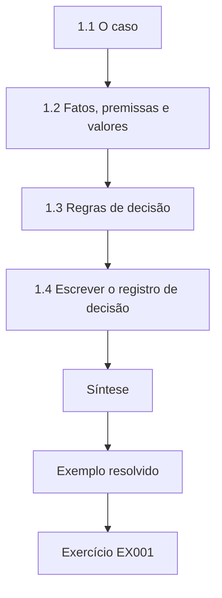

### Desenho lógico

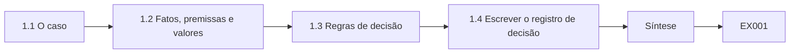

```text
[1.1 O caso]
    |
    v
[1.2 Fatos, premissas e valores]
    |
    v
[1.3 Regras de decisão]
    |
    v
[1.4 Escrever o registro de decisão]
    |
    v
[Síntese]
    |
    v
[Exemplo resolvido] --> [Exercício EX001]
```
<!-- cyberabc:lesson-figures:end ch-01 -->


### Objetivos de aprendizagem

Você vai (1) enquadrar uma decisão criptográfica em escala organizacional; (2) separar fatos, premissas e valores num registro de decisão; (3) escolher regras de decisão que resistam ao escrutínio de executivos e auditores.

### 1.1 O caso

Leila Moradi é arquiteta de segurança na fictícia Corvane Logistics, uma empresa de transporte marítimo e de cargas com terminais portuários, uma frota de caminhões, uma divisão financeira e uma plataforma envelhecida de intercâmbio eletrônico de dados (EDI). Ela estuda em meio período no programa de pós-graduação da fictícia Westbrook School of Security, sob a orientação da Prof.ª Anika Rao. O conselho da Corvane pediu um plano para modernizar a criptografia em toda a empresa em dois anos: desativar o TLS legado, consolidar o gerenciamento de chaves e preparar a migração pós-quântica. Todos os sistemas, números e pessoas deste livro são sintéticos. A decisão não é qual cifra é a mais forte, mas como gastar dinheiro e tempo de engenharia limitados em muitos sistemas.

### 1.2 Fatos, premissas e valores

A Prof.ª Rao pede aos estudantes que dividam cada decisão em três colunas. Os fatos são verificáveis, como o número de endpoints que ainda aceitam TLS 1.0 ou a data em que termina um contrato com um fornecedor. As premissas são crenças que podem estar erradas, como a rapidez com que chegarão computadores quânticos grandes ou quanto tempo levará uma migração. Os valores são preferências que a organização precisa assumir, como quanto risco de indisponibilidade ela tolera durante uma mudança. Leila descobre que seu primeiro rascunho misturava as três colunas, apresentando uma premissa sobre os prazos quânticos como se fosse um fato. Separá-las permite que os executivos debatam os valores abertamente e que os engenheiros testem as premissas.

### 1.3 Regras de decisão

Leila compara regras de decisão. Minimizar o pior caso convém a riscos catastróficos e irreversíveis, como perder a chave raiz do firmware. Maximizar o valor esperado convém a riscos frequentes e mensuráveis, como a expiração de certificados. A satisficência, que aceita a primeira opção que atende a todos os requisitos, convém a decisões em que a análise custa mais do que as pequenas melhorias. Ela escolhe as regras decisão por decisão, documenta o porquê e registra que nova evidência mudaria a escolha. A ênfase de Katz e Lindell em modelos de ameaça explícitos se transfere para a gestão: uma decisão sem premissas declaradas não pode ser avaliada depois, e os auditores vão perguntar em que a Corvane acreditava quando escolheu.

### 1.4 Escrever o registro de decisão

Leila redige o primeiro registro de decisão do programa, que adota uma linha de base de TLS para toda a empresa. Ele enuncia a decisão, os fatos (as contagens do inventário), as premissas (que a maioria dos clientes suporta TLS 1.2), os valores (a perturbação aceitável para os parceiros legados), as alternativas consideradas, a regra usada (satisficência em relação a uma linha de base publicada) e os gatilhos de revisão. Ela liga cada afirmação à sua fonte, incluindo a RFC 8446 para o comportamento do TLS 1.3 e a NIST SP 800-52 Rev. 2, a diretriz de TLS referenciada na política da Corvane. A Prof.ª Rao considera o registro forte porque um recém-chegado conseguiria reconstruir o raciocínio em cinco minutos sem perguntar nada a Leila.

### Exemplo resolvido

Leila separa fatos, premissas e valores no programa de modernização, escolhe a satisficência para a linha de base de TLS e o minimax para as chaves raiz e escreve um registro de decisão com gatilhos de revisão.

> **Caso sintético.** A Corvane, a Westbrook e todos os números são inventados; a RFC 8446 é real.

### Erros e limites

Estruturas de decisão não substituem o julgamento; elas o tornam visível. Premissas apresentadas como fatos são a falha mais comum nas justificativas de negócio em segurança.

### Exercícios

- **EX001 — Escopo do programa.** Quais três metas o conselho da Corvane estabeleceu para o programa? *Rubrica:* 3 = desativar o TLS legado, consolidar o gerenciamento de chaves, preparar a migração pós-quântica;; 2 = duas;; 1 = uma;; 0 = nenhuma.

- **EX002 — Três colunas.** Distinga um fato, uma premissa e um valor com exemplos da Corvane. *Rubrica:* 3 = fato: endpoints com TLS 1.0; premissa: prazo quântico; valor: risco de indisponibilidade tolerado;; 2 = dois corretos;; 1 = confusos;; 0 = nenhuma.

- **EX003 — Associar as regras.** Que regra de decisão convém à perda da chave raiz, e qual convém à expiração de certificados? *Rubrica:* 3 = minimax para a perda catastrófica da raiz; valor esperado para a expiração frequente;; 2 = uma;; 1 = invertidas;; 0 = nenhuma.

- **EX004 — Falha do rascunho.** Que falha Leila encontrou no seu primeiro rascunho? *Rubrica:* 3 = uma premissa sobre os prazos quânticos apresentada como fato;; 2 = mistura;; 1 = vago;; 0 = nenhuma.

- **EX005 — Teste do registro.** Por que a Prof.ª Rao considerou o registro forte? *Rubrica:* 3 = um recém-chegado conseguiria reconstruir o raciocínio em cinco minutos;; 2 = clareza;; 1 = tamanho;; 0 = nenhuma.

### Síntese

Decisões criptográficas em escala organizacional melhoram quando fatos, premissas e valores são separados e cada decisão usa uma regra explícita e registrada.

<!-- cyberabc:chapter-navigation:start ch-01 -->
### Continue estudando — aula 01 (capítulo 01 de 12)

[← Início do curso](../../README.md) · [Índice das aulas](../SUBJECTS.md) · [Capítulo 02 →](#ch-02)

Continue para a próxima aula já escrita.
<!-- cyberabc:chapter-navigation:end -->

<a id="ch-02"></a>

## Capítulo 2 — Criptografia e serviços de confiança: prática atual

<!-- cyberabc:lesson-figures:start ch-02 -->
### Mapa da aula

Aula 02 publicada. Mapa, exemplo, EX006.

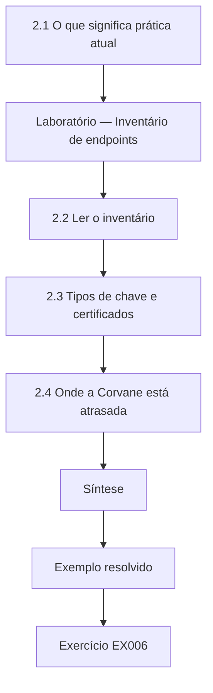

### Desenho lógico

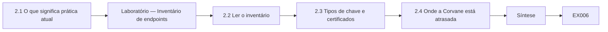

```text
[2.1 O que significa prática atual]
    |
    v
[Laboratório — Inventário de endpoints]
    |
    v
[2.2 Ler o inventário]
    |
    v
[2.3 Tipos de chave e certificados]
    |
    v
[2.4 Onde a Corvane está atrasada]
    |
    v
[Síntese]
    |
    v
[Exemplo resolvido] --> [Exercício EX006]
```
<!-- cyberabc:lesson-figures:end ch-02 -->


### Objetivos de aprendizagem

Você vai (1) levantar a prática criptográfica atual a partir das normas; (2) construir e ler um inventário de endpoints; (3) identificar onde uma organização está atrasada em relação à prática atual.

### 2.1 O que significa prática atual

A prática atual é definida por normas e por padrões amplamente implantados, e não pelo marketing dos fornecedores. Para a segurança do transporte, ela é o TLS 1.3 da RFC 8446, com o TLS 1.2 ainda aceitável quando configurado com cuidado e as versões mais antigas desativadas. Para a troca de chaves, é o Diffie-Hellman efêmero sobre curvas elípticas, como o X25519 da RFC 7748; para as assinaturas, ECDSA ou EdDSA conforme o FIPS 186-5; para a cifração simétrica, AES-GCM conforme a SP 800-38D. O gerenciamento de chaves segue a SP 800-57 Part 1, e as transições de algoritmos seguem a SP 800-131A. Leila escreve um resumo de uma página dessas referências para os engenheiros da Corvane, para que os debates posteriores partam de uma base comum.

### Laboratório — Inventário de endpoints

```python
"""Summarise a synthetic TLS endpoint inventory for an organisation-scale decision."""
from collections import Counter
# (business unit, highest TLS version offered, accepts legacy <=1.1?, cert key type)
EP = ([("ports", "1.3", False, "ecdsa")] * 46 + [("ports", "1.2", True, "rsa2048")] * 9 +
      [("fleet", "1.3", False, "ecdsa")] * 38 + [("fleet", "1.2", False, "rsa2048")] * 21 +
      [("finance", "1.3", False, "rsa3072")] * 30 + [("finance", "1.2", True, "rsa2048")] * 4 +
      [("legacy-edi", "1.2", True, "rsa2048")] * 12)

def main():
    n = len(EP)
    print(f"endpoints {n}")
    for v, c in sorted(Counter(e[1] for e in EP).items()):
        print(f"  max TLS {v}: {c} ({100 * c / n:.1f}%)")
    leg = Counter(e[0] for e in EP if e[2])
    print("legacy-accepting by unit:", dict(leg), "total", sum(leg.values()))

if __name__ == "__main__":
    main()
```

Execute com `python3 lab_inventory.py`. Saída verificada:

```text
endpoints 160
  max TLS 1.2: 46 (28.8%)
  max TLS 1.3: 114 (71.2%)
legacy-accepting by unit: {'ports': 9, 'finance': 4, 'legacy-edi': 12} total 25
```

### 2.2 Ler o inventário

O inventário sintético da Corvane lista 160 endpoints TLS. Desses, 114 (71,2 por cento) oferecem TLS 1.3 e 46 (28,8 por cento) chegam no máximo ao TLS 1.2. Vinte e cinco endpoints ainda aceitam TLS 1.1 ou anterior: nove nos portos, quatro nas finanças e todos os doze da plataforma EDI legada. Leila observa que a unidade da frota tem muitos endpoints apenas com TLS 1.2, mas nenhum que aceite versões legadas, de modo que está atrasada, mas não é perigosa, ao passo que o EDI legado está ao mesmo tempo atrasado e exposto. O inventário muda a conversa de "a Corvane é insegura" para uma lista específica de unidades, contagens e donos.

### 2.3 Tipos de chave e certificados

O inventário também mostra os tipos de chave dos certificados: ECDSA nos endpoints modernos, RSA 3072 nas finanças e RSA 2048 nos serviços mais antigos. O RSA 2048 continua aceitável segundo as orientações atuais do NIST, por ora, mas Leila o registra como candidato à migração, porque certificados e chaves de vida longa precisarão passar para alternativas mais fortes ou pós-quânticas. Ela confere as validades dos certificados e descobre que a plataforma EDI usa certificados válidos por dois anos, renovados à mão, enquanto a maioria das outras unidades usa certificados automatizados de noventa dias por meio do ACME, a RFC 8555. As validades são um indicador indireto da maturidade da automação.

### 2.4 Onde a Corvane está atrasada

Leila resume as lacunas em relação à prática atual: aceitação de protocolos legados em três unidades; gerenciamento manual de certificados no EDI; nenhum registro central de quais aplicações usam quais chaves; e nenhuma avaliação de prontidão pós-quântica. Ela as ordena por exposição e esforço. A aceitação de protocolos legados nos endpoints EDI voltados para a internet fica em primeiro lugar, porque os parceiros se conectam pela internet. Ela evita exagerar: nenhuma das lacunas implica uma violação conhecida, e várias têm controles compensatórios, como restrições de rede. Apresentar as lacunas com seu contexto mantém os executivos focados, em vez de alarmados.

### Exemplo resolvido

Leila lê um inventário de 160 endpoints, encontra 25 endpoints que aceitam protocolos legados, concentrados no EDI, nos portos e nas finanças, e ordena quatro lacunas com seu contexto.

> **Caso sintético.** O inventário é inventado; as normas citadas são reais.

### Erros e limites

Inventários feitos por varredura deixam passar serviços apenas internos e configurações do lado do cliente. O RSA 2048 é aceitável hoje, mas não é uma escolha de longo prazo.

### Exercícios

- **EX006 — Linhas de base atuais.** Cite as normas que Leila usa para o TLS, a troca de chaves e o AEAD. *Rubrica:* 3 = RFC 8446, RFC 7748, SP 800-38D;; 2 = duas;; 1 = uma;; 0 = nenhuma.

- **EX007 — Divisão do inventário.** Que parcela dos endpoints oferece TLS 1.3? *Rubrica:* 3 = 114 de 160, 71,2 por cento;; 2 = contagem;; 1 = errada;; 0 = nenhuma.

- **EX008 — Legado por unidade.** Como se distribuem os 25 endpoints que aceitam protocolos legados? *Rubrica:* 3 = ports 9, finance 4, legacy-edi 12;; 2 = duas unidades;; 1 = só o total;; 0 = nenhuma.

- **EX009 — Indicador de validade.** Por que Leila trata a validade dos certificados como um indicador indireto? *Rubrica:* 3 = validades curtas indicam gerenciamento automatizado; os certificados manuais de dois anos do EDI mostram baixa maturidade;; 2 = automação;; 1 = vago;; 0 = nenhuma.

- **EX010 — Principal lacuna.** Que lacuna fica em primeiro lugar, e por quê? *Rubrica:* 3 = aceitação de protocolos legados no EDI voltado para a internet, já que os parceiros se conectam pela internet;; 2 = lacuna;; 1 = outra;; 0 = nenhuma.

### Síntese

A prática atual é definida pelas normas; um inventário a traduz em lacunas específicas, com donos, ordenadas por exposição.

<!-- cyberabc:chapter-navigation:start ch-02 -->
### Continue estudando — aula 02 (capítulo 02 de 12)

[← Capítulo 01](#ch-01) · [Índice das aulas](../SUBJECTS.md) · [Capítulo 03 →](#ch-03)

Continue para a próxima aula já escrita.
<!-- cyberabc:chapter-navigation:end -->

<a id="ch-03"></a>

## Capítulo 3 — Criptografia e serviços de confiança: evidências especializadas

<!-- cyberabc:lesson-figures:start ch-03 -->
### Mapa da aula

Aula 03 publicada. Mapa, exemplo, EX011.

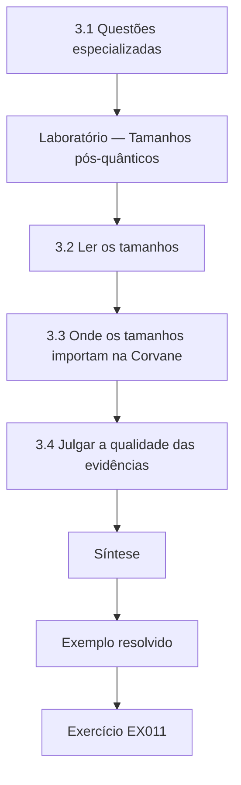

### Desenho lógico

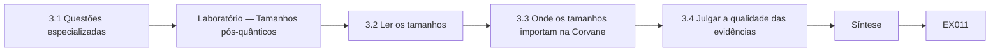

```text
[3.1 Questões especializadas]
    |
    v
[Laboratório — Tamanhos pós-quânticos]
    |
    v
[3.2 Ler os tamanhos]
    |
    v
[3.3 Onde os tamanhos importam na Corvane]
    |
    v
[3.4 Julgar a qualidade das evidências]
    |
    v
[Síntese]
    |
    v
[Exemplo resolvido] --> [Exercício EX011]
```
<!-- cyberabc:lesson-figures:end ch-03 -->


### Objetivos de aprendizagem

Você vai (1) reunir evidências especializadas sobre a prontidão pós-quântica; (2) ler as normas em busca de tamanhos e de implicações de desempenho; (3) julgar a qualidade das evidências para as decisões.

### 3.1 Questões especializadas

A migração pós-quântica levanta questões que a equipe em geral não sabe responder: quais algoritmos estão padronizados, qual o tamanho de suas chaves e assinaturas e o que isso significa para os protocolos e os dispositivos. O NIST publicou o FIPS 203 (ML-KEM) para o estabelecimento de chaves e o FIPS 204 (ML-DSA) e o FIPS 205 (SLH-DSA) para as assinaturas. Leila reúne as evidências diretamente desses documentos, e não de resumos, e registra quais conjuntos de parâmetros a Corvane provavelmente usaria. Ela também anota que a integração aos protocolos, como a troca de chaves híbrida no TLS, é definida em trabalhos do IETF que ainda estão amadurecendo, de modo que datas e detalhes precisam ser conferidos de novo.

### Laboratório — Tamanhos pós-quânticos

```python
"""Public-key and signature/ciphertext sizes in bytes, from RFC 7748/8032 and FIPS 203/204/205."""
ROWS = [("X25519 (RFC 7748)", "key share", 32, 32), ("ML-KEM-768 (FIPS 203)", "encaps key / ciphertext", 1184, 1088),
        ("Ed25519 (RFC 8032)", "public key / signature", 32, 64), ("ML-DSA-65 (FIPS 204)", "public key / signature", 1952, 3309),
        ("SLH-DSA-SHA2-128s (FIPS 205)", "public key / signature", 32, 7856)]

def main():
    for name, what, a, b in ROWS:
        print(f"{name:<29} {what:<24} {a:>5} / {b:>5}")
    print(f"ML-DSA-65 signature is {3309 / 64:.0f}x an Ed25519 signature")
    print(f"hybrid X25519+ML-KEM-768 client share: {32 + 1184} bytes")

if __name__ == "__main__":
    main()
```

Execute com `python3 lab_sizes.py`. Saída verificada:

```text
X25519 (RFC 7748)             key share                   32 /    32
ML-KEM-768 (FIPS 203)         encaps key / ciphertext   1184 /  1088
Ed25519 (RFC 8032)            public key / signature      32 /    64
ML-DSA-65 (FIPS 204)          public key / signature    1952 /  3309
SLH-DSA-SHA2-128s (FIPS 205)  public key / signature      32 /  7856
ML-DSA-65 signature is 52x an Ed25519 signature
hybrid X25519+ML-KEM-768 client share: 1216 bytes
```

### 3.2 Ler os tamanhos

O laboratório tabula os tamanhos a partir das normas. Uma parcela de chave X25519 tem 32 bytes; uma chave de encapsulamento ML-KEM-768 tem 1.184 bytes, e seu texto cifrado, 1.088. Uma assinatura Ed25519 tem 64 bytes; uma assinatura ML-DSA-65 tem 3.309 bytes, cerca de 52 vezes maior, e sua chave pública, 1.952 bytes. O SLH-DSA-SHA2-128s mantém uma chave pública de 32 bytes, mas produz assinaturas de 7.856 bytes. Uma parcela híbrida do cliente TLS que combina X25519 e ML-KEM-768 tem 1.216 bytes. Leila conclui que a largura de banda nas redes modernas raramente é o problema; os dispositivos com recursos limitados, as cadeias de certificados e os protocolos com limites fixos de tamanho de mensagem é que são.

### 3.3 Onde os tamanhos importam na Corvane

Leila mapeia os tamanhos sobre os sistemas da Corvane. O tráfego de escritório e de nuvem consegue absorver handshakes maiores. As unidades de telemática dos caminhões enviam mensagens pequenas por enlaces celulares caros e verificam assinaturas de firmware com memória limitada, de modo que as assinaturas ML-DSA e as cadeias de certificados precisam ser testadas. Os controladores dos terminais portuários rodam firmware de fornecedores com ciclos longos de substituição. O protocolo da plataforma EDI tem limites de tamanho de mensagem que podem quebrar com assinaturas grandes. Ela classifica os sistemas como prontos, precisando de testes ou bloqueados pelos fornecedores e pede aos fornecedores planos de migração por escrito, em vez de garantias verbais.

### 3.4 Julgar a qualidade das evidências

Leila atribui graus às evidências. As normas têm autoridade sobre os algoritmos e os tamanhos, mas não dizem nada sobre os fornecedores da Corvane. As declarações dos fornecedores são relevantes, mas interessadas. As medições de laboratório nos próprios dispositivos da Corvane são as mais fortes para as decisões locais, mas são caras. Os benchmarks públicos podem usar outro hardware. Ela registra os graus na sua tabela de evidências e usa o elo de grau mais baixo de qualquer argumento para descrever sua força geral. A Prof.ª Rao observa que os executivos costumam tratar os slides dos fornecedores como fatos e que o valor de um profissional pós-graduado está em mostrar onde as evidências são fracas.

### Exemplo resolvido

Leila lê os tamanhos do FIPS 203/204/205, descobre que as assinaturas ML-DSA-65 são 52 vezes maiores que as Ed25519 e classifica os sistemas da Corvane como prontos, precisando de testes ou bloqueados pelos fornecedores.

> **Caso sintético.** Os sistemas da Corvane são inventados; os tamanhos vêm da RFC 7748, da RFC 8032 e dos FIPS 203–205.

### Erros e limites

Os tamanhos sozinhos não determinam o desempenho; a computação e a memória também importam. Os detalhes de integração do IETF mudam, então confira de novo antes de se comprometer.

### Exercícios

- **EX011 — Mapa das normas.** Quais normas FIPS cobrem o ML-KEM, o ML-DSA e o SLH-DSA? *Rubrica:* 3 = FIPS 203, 204, 205, respectivamente;; 2 = duas;; 1 = erradas;; 0 = nenhuma.

- **EX012 — Razão de tamanho.** Quanto maior é uma assinatura ML-DSA-65 do que uma Ed25519? *Rubrica:* 3 = 3.309 contra 64 bytes, cerca de 52 vezes;; 2 = razão;; 1 = errada;; 0 = nenhuma.

- **EX013 — Parcela híbrida.** Qual é o tamanho de uma parcela híbrida do cliente com X25519 mais ML-KEM-768? *Rubrica:* 3 = 1.216 bytes;; 2 = aproximado;; 1 = errado;; 0 = nenhuma.

- **EX014 — Sistemas limitados.** Quais sistemas da Corvane são os mais afetados pelos tamanhos, e por quê? *Rubrica:* 3 = telemática (celular, memória), controladores portuários (ciclos dos fornecedores), EDI (limites de mensagem);; 2 = dois;; 1 = vago;; 0 = nenhuma.

- **EX015 — Força das evidências.** Como Leila descreve a força geral de um argumento? *Rubrica:* 3 = pelo seu elo de evidência de grau mais baixo;; 2 = elo mais fraco;; 1 = média;; 0 = nenhuma.

### Síntese

Evidências especializadas, vindas das normas e de testes locais e avaliadas com honestidade, mostram onde a migração pós-quântica vai doer e onde não vai.

<!-- cyberabc:chapter-navigation:start ch-03 -->
### Continue estudando — aula 03 (capítulo 03 de 12)

[← Capítulo 02](#ch-02) · [Índice das aulas](../SUBJECTS.md) · [Capítulo 04 →](#ch-04)

Continue para a próxima aula já escrita.
<!-- cyberabc:chapter-navigation:end -->

<a id="ch-04"></a>

## Capítulo 4 — Risco avançado e ética

<!-- cyberabc:lesson-figures:start ch-04 -->
### Mapa da aula

Aula 04 publicada. Mapa, exemplo, EX016.

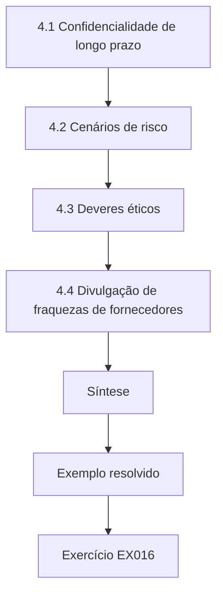

### Desenho lógico

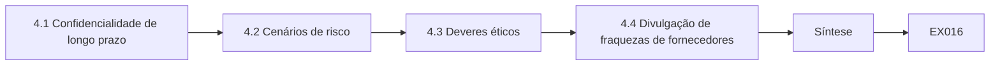

```text
[4.1 Confidencialidade de longo prazo]
    |
    v
[4.2 Cenários de risco]
    |
    v
[4.3 Deveres éticos]
    |
    v
[4.4 Divulgação de fraquezas de fornecedores]
    |
    v
[Síntese]
    |
    v
[Exemplo resolvido] --> [Exercício EX016]
```
<!-- cyberabc:lesson-figures:end ch-04 -->


### Objetivos de aprendizagem

Você vai (1) avaliar o risco para dados confidenciais de vida longa; (2) pesar os deveres éticos para com parceiros e clientes; (3) decidir sobre a divulgação de fraquezas criptográficas em produtos de fornecedores.

### 4.1 Confidencialidade de longo prazo

Alguns dados da Corvane precisam continuar confidenciais por décadas: registros aduaneiros, contratos e identidades de clientes. Leila aplica um teste simples da literatura de planejamento pós-quântico: se os dados precisam continuar secretos por x anos, a migração leva y anos e um computador quântico criptograficamente relevante pode surgir em z anos, então x mais y maior que z sinaliza risco desde já, porque o tráfego gravado poderia ser decifrado mais tarde. Ela estima x em quinze anos para os contratos e y em três, mas trata z como profundamente incerto, apresentando cenários em vez de uma data única. O teste identifica quais fluxos de dados merecem primeiro a troca de chaves híbrida.

### 4.2 Cenários de risco

Leila escreve três cenários para o conselho: progresso lento, em que computadores quânticos grandes continuam a décadas de distância; moderado, em torno de quinze anos; e rápido, menos de dez. Para cada um, ela mostra a exposição do tráfego gravado do EDI e das finanças, o custo da migração e o risco residual. Em vez de prever, ela pede ao conselho que escolha um cenário de planejamento compatível com seu apetite de risco. O conselho escolhe o moderado, com uma revisão a cada dois anos. Isso transforma uma data impossível de conhecer numa premissa governada, de forma coerente com a separação entre premissas e fatos do Capítulo 1.

### 4.3 Deveres éticos

A Corvane guarda dados que pertencem a clientes e parceiros que não conseguem ver suas escolhas de segurança. Leila argumenta que isso cria deveres que vão além da conformidade: proteger os dados de forma proporcional, avisar os parceiros quando os sistemas compartilhados são fracos e evitar transferir o risco para quem tem menos condições de suportá-lo. Um exemplo é a plataforma EDI legada, em que pequenos parceiros ainda usam clientes antigos; impor um corte abrupto os prejudicaria, enquanto esperar indefinidamente expõe todo mundo. Ela propõe uma transição apoiada, com software cliente atualizado gratuito e um prazo firme e publicado.

### 4.4 Divulgação de fraquezas de fornecedores

Durante os testes, a equipe de Leila descobre que o controlador de um fornecedor de terminais portuários aceita firmware assinado com um algoritmo descontinuado. Ela segue a política de divulgação coordenada da Corvane: relatar em particular ao fornecedor, combinar um prazo de correção, aplicar controles compensatórios, como o isolamento de rede, e informar os outros clientes afetados por meio do fornecedor quando existir uma correção. Ela não publica detalhes nem testa além do laboratório autorizado da Corvane. O episódio se torna um caso didático sobre o equilíbrio entre a transparência e o risco de ajudar os atacantes antes que as correções sejam distribuídas.

### Exemplo resolvido

Leila aplica o teste x + y > z aos contratos, apresenta três cenários quânticos para a escolha do conselho, propõe uma transição apoiada do EDI e trata uma fraqueza de firmware de um fornecedor por meio de divulgação coordenada.

> **Caso sintético.** Os cenários e o caso do fornecedor são inventados.

### Erros e limites

Os prazos quânticos são incertos; os cenários precisam ser revisitados. Uma divulgação sem correção pode pôr em perigo outros clientes.

### Exercícios

- **EX016 — Desigualdade de planejamento.** Enuncie o teste x + y > z e o que ele significa. *Rubrica:* 3 = anos de sigilo mais anos de migração excedendo os anos até um computador quântico sinalizam risco desde já;; 2 = parcial;; 1 = vago;; 0 = nenhuma.

- **EX017 — Escolha do conselho.** Que cenário de planejamento o conselho escolheu, com que revisão? *Rubrica:* 3 = moderado (cerca de quinze anos), revisto a cada dois anos;; 2 = cenário;; 1 = vago;; 0 = nenhuma.

- **EX018 — Ética do EDI.** Que transição Leila propôs para os pequenos parceiros do EDI? *Rubrica:* 3 = transição apoiada, com clientes atualizados gratuitos e um prazo firme e publicado;; 2 = parcial;; 1 = corte abrupto;; 0 = nenhuma.

- **EX019 — Falha do fornecedor.** Que fraqueza a equipe encontrou no controlador portuário? *Rubrica:* 3 = aceita firmware assinado com um algoritmo descontinuado;; 2 = fraqueza;; 1 = vago;; 0 = nenhuma.

- **EX020 — Passos da divulgação.** Liste os passos de divulgação que Leila seguiu. *Rubrica:* 3 = relato privado, prazo de correção combinado, controles compensatórios, o fornecedor informa os demais após a correção;; 2 = três;; 1 = publicar;; 0 = nenhuma.

### Síntese

O trabalho avançado de risco governa as premissas incertas por meio de cenários e trata os deveres éticos para com os parceiros como parte das decisões criptográficas.

<!-- cyberabc:chapter-navigation:start ch-04 -->
### Continue estudando — aula 04 (capítulo 04 de 12)

[← Capítulo 03](#ch-03) · [Índice das aulas](../SUBJECTS.md) · [Capítulo 05 →](#ch-05)

Continue para a próxima aula já escrita.
<!-- cyberabc:chapter-navigation:end -->

<a id="ch-05"></a>

## Capítulo 5 — Criptografia e serviços de confiança: alternativas de desenho

<!-- cyberabc:lesson-figures:start ch-05 -->
### Mapa da aula

Aula 05 publicada. Mapa, exemplo, EX021.

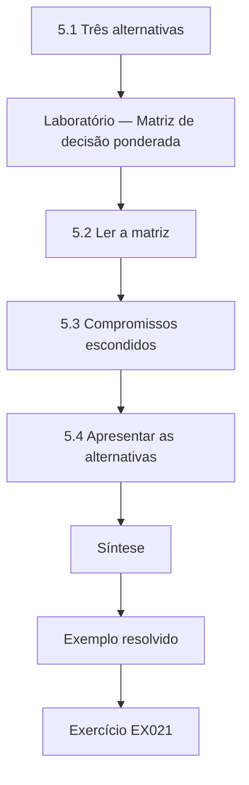

### Desenho lógico

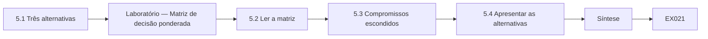

```text
[5.1 Três alternativas]
    |
    v
[Laboratório — Matriz de decisão ponderada]
    |
    v
[5.2 Ler a matriz]
    |
    v
[5.3 Compromissos escondidos]
    |
    v
[5.4 Apresentar as alternativas]
    |
    v
[Síntese]
    |
    v
[Exemplo resolvido] --> [Exercício EX021]
```
<!-- cyberabc:lesson-figures:end ch-05 -->


### Objetivos de aprendizagem

Você vai (1) comparar arquiteturas de gerenciamento de chaves em escala organizacional; (2) aplicar uma matriz de decisão ponderada e testar sua sensibilidade; (3) apresentar as alternativas sem esconder os compromissos.

### 5.1 Três alternativas

As chaves da Corvane estão espalhadas por servidores de aplicação, dois HSMs antigos e várias contas de nuvem. Leila define três alternativas de consolidação. HSMs locais dão à Corvane a custódia total, mas exigem pessoal especializado e renovações de hardware. Um serviço de gerenciamento de chaves em nuvem oferece disponibilidade e pouco esforço operacional, com a custódia compartilhada por contrato. Uma solução híbrida mantém as chaves raiz e as chaves de assinatura de alto valor em HSMs locais, enquanto as chaves de dados das aplicações ficam no serviço de nuvem, envolvidas sob chaves que a Corvane controla. Cada alternativa é descrita com suas premissas de confiança, seguindo a ênfase da SP 800-57 em quem pode acessar as chaves.

### Laboratório — Matriz de decisão ponderada

```python
"""Weighted decision matrix for key-management options (synthetic scores 1-5)."""
W = {"custody": 0.30, "availability": 0.20, "ops_effort": 0.20, "cost": 0.15, "pq_path": 0.15}
OPT = {"on-prem HSM": {"custody": 5, "availability": 3, "ops_effort": 2, "cost": 2, "pq_path": 3},
       "cloud KMS": {"custody": 3, "availability": 5, "ops_effort": 4, "cost": 4, "pq_path": 4},
       "hybrid (HSM root + cloud KMS)": {"custody": 4, "availability": 4, "ops_effort": 3, "cost": 3, "pq_path": 4}}

def main():
    for name, s in sorted(OPT.items(), key=lambda kv: -sum(W[k] * kv[1][k] for k in W)):
        print(f"{name:<31} {sum(W[k] * s[k] for k in W):.2f}")
    W2 = dict(W, custody=0.45, cost=0.0)
    best = max(OPT, key=lambda o: sum(W2[k] * OPT[o][k] for k in W2))
    print("if custody weight 0.45 and cost 0:", best)

if __name__ == "__main__":
    main()
```

Execute com `python3 lab_matrix.py`. Saída verificada:

```text
cloud KMS                       3.90
hybrid (HSM root + cloud KMS)   3.65
on-prem HSM                     3.25
if custody weight 0.45 and cost 0: hybrid (HSM root + cloud KMS)
```

### 5.2 Ler a matriz

Com pesos de 0,30 para a custódia, 0,20 para a disponibilidade e para o esforço operacional e 0,15 para o custo e para o caminho pós-quântico, o serviço de nuvem obtém 3,90, a solução híbrida 3,65 e os HSMs locais 3,25. Um teste de sensibilidade eleva a custódia para 0,45 e elimina o custo, refletindo um conselho que valoriza o controle acima do preço; a solução híbrida então vence. Leila apresenta os dois resultados. A matriz não decide; ela mostra que a escolha depende principalmente de quanto o conselho valoriza a custódia, o que é um juízo de valor, e não um fato de engenharia.

### 5.3 Compromissos escondidos

Leila lista os compromissos que a matriz não consegue mostrar. A custódia em nuvem depende dos termos do contrato, das leis regionais sobre dados e dos controles sobre a própria equipe do provedor. Os HSMs locais concentram o conhecimento em poucos engenheiros, criando risco de pessoa-chave. A solução híbrida dobra o número de sistemas a auditar e exige um envolvimento cuidadoso das chaves, para que os serviços de nuvem nunca vejam as chaves raiz. Ela também anota o esforço de migração: mover chaves entre sistemas é arriscado por si só e precisa ser feito com mecanismos suportados pelos fornecedores, nunca exportando as chaves em claro.

### 5.4 Apresentar as alternativas

O documento de Leila para o conselho apresenta as três opções com as pontuações, os resultados de sensibilidade, os compromissos e sua recomendação: a solução híbrida, porque os reguladores e os clientes da Corvane esperam controle sobre as raízes de assinatura, enquanto os serviços de nuvem convêm às chaves de dados de alto volume. Ela declara a condição que a reverteria: o provedor de nuvem oferecer chaves controladas pelo cliente e apoiadas em HSM, que atendam aos requisitos dos reguladores, a um custo menor. Apresentar a segunda colocada com justiça constrói confiança com o conselho e protege a recomendação de acusações de parcialidade. O conselho pede um detalhamento de custos antes de decidir.

### Exemplo resolvido

A matriz de Leila põe a nuvem em primeiro lugar, com 3,90, mas um teste de sensibilidade com mais peso na custódia favorece a solução híbrida, que ela recomenda com uma condição de reversão explícita.

> **Caso sintético.** As pontuações e os pesos são inventados; a SP 800-57 é real.

### Erros e limites

Matrizes ponderadas escondem o julgamento nos pesos; teste sempre a sensibilidade. A migração de chaves precisa usar mecanismos dos fornecedores, nunca a exportação em claro.

### Exercícios

- **EX021 — Definição da híbrida.** Descreva a alternativa híbrida. *Rubrica:* 3 = chaves raiz e de assinatura de alto valor em HSMs locais; chaves de dados no KMS em nuvem, envolvidas sob chaves controladas pela Corvane;; 2 = parcial;; 1 = só nuvem;; 0 = nenhuma.

- **EX022 — Pontuações de base.** Dê as três pontuações de base. *Rubrica:* 3 = nuvem 3,90, híbrida 3,65, local 3,25;; 2 = duas;; 1 = uma;; 0 = nenhuma.

- **EX023 — Resultado da sensibilidade.** O que o teste de sensibilidade mostrou? *Rubrica:* 3 = com custódia 0,45 e custo 0 a híbrida vence; a escolha depende do valor da custódia;; 2 = vencedora;; 1 = vago;; 0 = nenhuma.

- **EX024 — Pontos cegos da matriz.** Cite dois compromissos que a matriz não consegue mostrar. *Rubrica:* 3 = dois entre dependência de contrato e lei, risco de pessoa-chave, escopo de auditoria dobrado, risco da migração;; 2 = um;; 1 = vago;; 0 = nenhuma.

- **EX025 — Condição de reversão.** O que reverteria a recomendação? *Rubrica:* 3 = provedor de nuvem oferecendo chaves controladas pelo cliente e apoiadas em HSM, que atendam aos reguladores, a custo menor;; 2 = condição;; 1 = vago;; 0 = nenhuma.

### Síntese

Comparar alternativas de gerenciamento de chaves com pesos testados e compromissos explícitos expõe os juízos de valor que os conselhos precisam assumir.

<!-- cyberabc:chapter-navigation:start ch-05 -->
### Continue estudando — aula 05 (capítulo 05 de 12)

[← Capítulo 04](#ch-04) · [Índice das aulas](../SUBJECTS.md) · [Capítulo 06 →](#ch-06)

Continue para a próxima aula já escrita.
<!-- cyberabc:chapter-navigation:end -->

<a id="ch-06"></a>

## Capítulo 6 — Criptografia e serviços de confiança: avaliação controlada

<!-- cyberabc:lesson-figures:start ch-06 -->
### Mapa da aula

Aula 06 publicada. Mapa, exemplo, EX026.

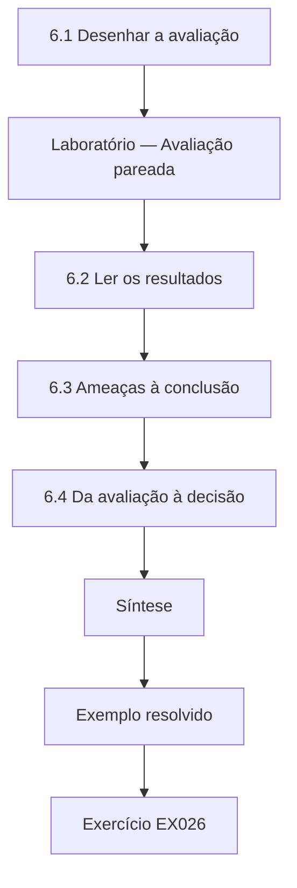

### Desenho lógico

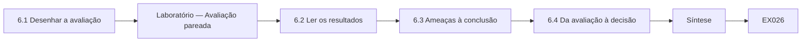

```text
[6.1 Desenhar a avaliação]
    |
    v
[Laboratório — Avaliação pareada]
    |
    v
[6.2 Ler os resultados]
    |
    v
[6.3 Ameaças à conclusão]
    |
    v
[6.4 Da avaliação à decisão]
    |
    v
[Síntese]
    |
    v
[Exemplo resolvido] --> [Exercício EX026]
```
<!-- cyberabc:lesson-figures:end ch-06 -->


### Objetivos de aprendizagem

Você vai (1) desenhar uma avaliação controlada da implantação de uma linha de base criptográfica; (2) analisar dados pareados de antes e depois; (3) relatar o efeito, a incerteza e as ameaças.

### 6.1 Desenhar a avaliação

Antes de implantar a linha de base de TLS em toda a empresa, Leila a avalia em oito locais. Cada local conta os endpoints mal configurados, os que aceitam protocolos legados, suítes de cifras fracas ou certificados expirados, usando o mesmo perfil de scanner antes e três meses depois de aplicar os modelos da linha de base e a renovação automatizada de certificados. A medição pareada controla as diferenças entre os locais, como tamanho e idade. Ela registra o plano, a definição do desfecho e a análise com a Prof.ª Rao antes de coletar os dados de depois, para que não possa ajustar a definição do desfecho a fim de favorecer o resultado.

### Laboratório — Avaliação pareada

```python
"""Before/after evaluation of a TLS baseline rollout across 8 synthetic sites, with a sign-flip test."""
import random
BEFORE = [14, 9, 11, 6, 17, 8, 12, 10]   # misconfigured endpoints per site
AFTER = [5, 4, 6, 3, 9, 5, 4, 6]

def main():
    d = [b - a for b, a in zip(BEFORE, AFTER)]
    obs = sum(d) / len(d)
    rng = random.Random(11); n = 20000
    hits = sum(sum(x if rng.random() < 0.5 else -x for x in d) / len(d) >= obs for _ in range(n))
    print(f"mean reduction {obs:.2f} endpoints per site; every site improved: {all(x > 0 for x in d)}")
    print(f"sign-flip p = {hits / n:.4f} (seed 11, {n} draws)")

if __name__ == "__main__":
    main()
```

Execute com `python3 lab_eval.py`. Saída verificada:

```text
mean reduction 5.62 endpoints per site; every site improved: True
sign-flip p = 0.0036 (seed 11, 20000 draws)
```

### 6.2 Ler os resultados

Todos os locais melhoram, e a redução média é de 5,62 endpoints mal configurados por local. Um teste de inversão de sinais pergunta com que frequência uma redução média desse tamanho ocorreria se a mudança de cada local tivesse a mesma probabilidade de ser positiva ou negativa; com a semente 11 e 20.000 sorteios, o valor p é 0,0036, próximo do mínimo possível para oito locais, 1/256. Leila relata as contagens absolutas de antes e depois por local, e não apenas a média, porque um gestor do maior porto quer ver os números do seu próprio local e porque, do contrário, locais com valores extremos poderiam dominar.

### 6.3 Ameaças à conclusão

Leila lista as ameaças. Sem um grupo de controle, outras mudanças durante os três meses, como uma campanha separada de aplicação de patches, poderiam explicar parte da melhoria. O scanner vê apenas os endpoints alcançáveis. A equipe sabia que estava sendo medida. Oito locais são poucos, e os locais do piloto se ofereceram como voluntários, de modo que podem ser mais capazes do que os outros. Ela recomenda uma implantação escalonada nos locais restantes, o que cria grupos de comparação naturais, e a continuidade da medição depois que a atenção inicial diminuir. Ela lista cada ameaça com a direção provável do seu viés.

### 6.4 Da avaliação à decisão

A avaliação sustenta a implantação da linha de base, com ressalvas. Leila atualiza o registro de decisão do Capítulo 1 com as evidências, anota as ameaças e acrescenta um requisito de monitoramento: a contagem de configurações incorretas por local se torna uma métrica trimestral. Ela também relata os custos: cerca de duas semanas de engenheiro por local, gastas principalmente com clientes legados. Incluir os custos permite ao conselho comparar este programa com outros que disputam o mesmo orçamento, que é o verdadeiro contexto de decisão em escala organizacional. O conselho aprova a implantação nos locais restantes.

### Exemplo resolvido

A avaliação pareada de Leila em oito locais mostra uma redução média de 5,62 endpoints mal configurados (inversão de sinais, p = 0,0036), com as ameaças e os custos relatados e uma implantação escalonada recomendada.

> **Caso sintético.** Os dados dos locais são inventados.

### Erros e limites

Desenhos de antes e depois sem controles são vulneráveis a mudanças simultâneas. Locais voluntários podem não representar os demais.

### Exercícios

- **EX026 — Desenho pareado.** Por que medir os mesmos locais antes e depois? *Rubrica:* 3 = o pareamento controla as diferenças entre locais, como tamanho e idade;; 2 = controle;; 1 = vago;; 0 = nenhuma.

- **EX027 — Números da avaliação.** Informe a redução média e o valor p. *Rubrica:* 3 = 5,62 por local, p = 0,0036;; 2 = um;; 1 = errado;; 0 = nenhuma.

- **EX028 — p mínimo.** Por que 0,0036 está perto do mínimo possível? *Rubrica:* 3 = oito locais permitem no mínimo 1/256 ≈ 0,0039 quando todos melhoram;; 2 = 1/256;; 1 = vago;; 0 = nenhuma.

- **EX029 — Mudança simultânea.** Que ameaça surge da falta de um grupo de controle? *Rubrica:* 3 = outras mudanças, como uma campanha de patches, poderiam explicar a melhoria;; 2 = simultânea;; 1 = vago;; 0 = nenhuma.

- **EX030 — Relato de custos.** Por que incluir o custo de duas semanas de engenheiro por local? *Rubrica:* 3 = permite ao conselho comparar com outros programas que disputam o orçamento;; 2 = orçamento;; 1 = irrelevante;; 0 = nenhuma.

### Síntese

Avaliações pareadas pré-registradas, com ameaças e custos, transformam uma linha de base promissora em evidência para decisões em toda a organização.

<!-- cyberabc:chapter-navigation:start ch-06 -->
### Continue estudando — aula 06 (capítulo 06 de 12)

[← Capítulo 05](#ch-05) · [Índice das aulas](../SUBJECTS.md) · [Capítulo 07 →](#ch-07)

Continue para a próxima aula já escrita.
<!-- cyberabc:chapter-navigation:end -->

<a id="ch-07"></a>

## Capítulo 7 — Criptografia e serviços de confiança: integração organizacional

<!-- cyberabc:lesson-figures:start ch-07 -->
### Mapa da aula

Aula 07 publicada. Mapa, exemplo, EX031.

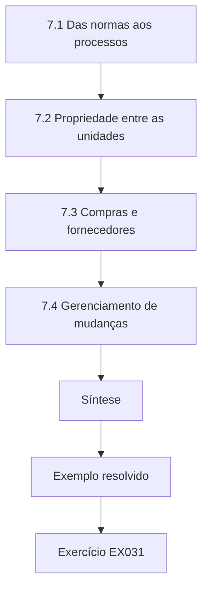

### Desenho lógico

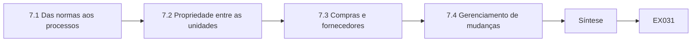

```text
[7.1 Das normas aos processos]
    |
    v
[7.2 Propriedade entre as unidades]
    |
    v
[7.3 Compras e fornecedores]
    |
    v
[7.4 Gerenciamento de mudanças]
    |
    v
[Síntese]
    |
    v
[Exemplo resolvido] --> [Exercício EX031]
```
<!-- cyberabc:lesson-figures:end ch-07 -->


### Objetivos de aprendizagem

Você vai (1) incorporar normas criptográficas aos processos organizacionais; (2) atribuir a propriedade entre as unidades; (3) integrar-se às compras, à revisão de arquitetura e ao gerenciamento de mudanças.

### 7.1 Das normas aos processos

Uma linha de base num documento não faz nada até que os processos a usem. Leila incorpora a norma criptográfica da Corvane a quatro processos: a revisão de arquitetura, em que os novos projetos precisam declarar os algoritmos e a propriedade das chaves; as compras, em que os fornecedores respondem a um questionário de criptografia; o gerenciamento de mudanças, em que as mudanças de TLS e de chaves precisam de um plano de reversão; e a integração de novos funcionários, em que os engenheiros aprendem a norma e suas razões. Ela publica a norma com uma lista de algoritmos aprovados e datas de desativação, seguindo a abordagem de transição da SP 800-131A, e designa a equipe de arquitetura de segurança para mantê-la.

### 7.2 Propriedade entre as unidades

Cada unidade de negócio indica um responsável por criptografia, encarregado do seu inventário, das renovações e das migrações. Leila conduz um fórum mensal em que os responsáveis compartilham problemas e avanços. A propriedade resolve um padrão observado no inventário: os certificados e as chaves sem dono claro eram justamente os que expiravam ou permaneciam em algoritmos descontinuados. Ela define uma matriz RACI: as unidades são responsáveis pelos seus sistemas, a arquitetura de segurança responde pela norma, as operações são consultadas sobre as mudanças e o comitê de riscos é informado trimestralmente.

### 7.3 Compras e fornecedores

As compras se tornam uma alavanca. Os novos contratos exigem suporte ao TLS 1.3, gerenciamento de chaves documentado, notificação de comprometimento de chaves dentro de um prazo definido e um roteiro de migração pós-quântica. Leila fornece um guia de pontuação para que a equipe de compras, que não é de criptógrafos, possa avaliar as respostas. A primeira licitação que usa o questionário rejeita um fornecedor cujas respostas revelaram chaves embutidas no código do seu produto. Ela observa que as compras não conseguem corrigir rapidamente os contratos existentes, de modo que as renovações se tornam a principal oportunidade com os fornecedores mais antigos. Ela também oferece à equipe de compras um treinamento curto sobre o guia.

### 7.4 Gerenciamento de mudanças

Mudanças criptográficas podem quebrar sistemas em silêncio, por exemplo a remoção de uma suíte de cifras que desconecta um parceiro. Leila acrescenta um modelo de mudança criptográfica: o que muda, quais clientes podem falhar, como detectar a falha, os passos de reversão e a notificação dos parceiros. As mudanças no EDI legado exigem aviso aos parceiros com semanas de antecedência. Depois que uma mudança desconecta inesperadamente um pequeno parceiro, ela acrescenta uma varredura de compatibilidade dos clientes antes de cada mudança. Integrar a criptografia ao gerenciamento de mudanças reduz tanto as indisponibilidades quanto a tentação de evitar mudanças de segurança por medo de quebrar alguma coisa.

### Exemplo resolvido

Leila incorpora a norma à revisão de arquitetura, às compras, ao gerenciamento de mudanças e à integração de novos funcionários, nomeia responsáveis nas unidades com uma matriz RACI e acrescenta uma varredura de compatibilidade depois da desconexão de um parceiro.

> **Caso sintético.** Os processos da Corvane são inventados; a SP 800-131A é real.

### Erros e limites

Normas sem donos se degradam. Questionários de compras precisam de orientação de pontuação, ou as respostas ficam sem conferência.

### Exercícios

- **EX031 — Quatro processos.** Em quais quatro processos a norma foi incorporada? *Rubrica:* 3 = revisão de arquitetura, compras, gerenciamento de mudanças, integração de novos funcionários;; 2 = três;; 1 = um;; 0 = nenhuma.

- **EX032 — Padrão de propriedade.** Que padrão do inventário a propriedade nas unidades resolveu? *Rubrica:* 3 = os certificados e as chaves sem dono eram os que expiravam ou ficavam em algoritmos descontinuados;; 2 = padrão;; 1 = vago;; 0 = nenhuma.

- **EX033 — Requisitos contratuais.** Liste três requisitos contratuais para os novos fornecedores. *Rubrica:* 3 = três entre TLS 1.3, gerenciamento de chaves documentado, notificação de comprometimento, roteiro pós-quântico;; 2 = dois;; 1 = um;; 0 = nenhuma.

- **EX034 — Rejeição na licitação.** Por que um fornecedor foi rejeitado na primeira licitação? *Rubrica:* 3 = as respostas revelaram chaves embutidas no código do seu produto;; 2 = chaves embutidas;; 1 = preço;; 0 = nenhuma.

- **EX035 — Varredura de compatibilidade.** O que motivou a varredura de compatibilidade antes das mudanças? *Rubrica:* 3 = uma mudança desconectou inesperadamente um pequeno parceiro;; 2 = indisponibilidade;; 1 = auditoria;; 0 = nenhuma.

### Síntese

A criptografia se torna prática organizacional quando as normas conduzem os processos, existem responsáveis em todas as unidades e as mudanças são gerenciadas quanto à compatibilidade.

<!-- cyberabc:chapter-navigation:start ch-07 -->
### Continue estudando — aula 07 (capítulo 07 de 12)

[← Capítulo 06](#ch-06) · [Índice das aulas](../SUBJECTS.md) · [Capítulo 08 →](#ch-08)

Continue para a próxima aula já escrita.
<!-- cyberabc:chapter-navigation:end -->

<a id="ch-08"></a>

## Capítulo 8 — Criptografia e serviços de confiança: casos difíceis

<!-- cyberabc:lesson-figures:start ch-08 -->
### Mapa da aula

Aula 08 publicada. Mapa, exemplo, EX036.

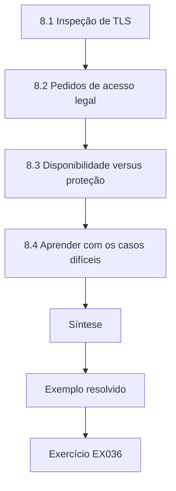

### Desenho lógico

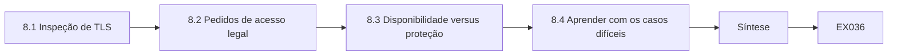

```text
[8.1 Inspeção de TLS]
    |
    v
[8.2 Pedidos de acesso legal]
    |
    v
[8.3 Disponibilidade versus proteção]
    |
    v
[8.4 Aprender com os casos difíceis]
    |
    v
[Síntese]
    |
    v
[Exemplo resolvido] --> [Exercício EX036]
```
<!-- cyberabc:lesson-figures:end ch-08 -->


### Objetivos de aprendizagem

Você vai (1) analisar casos em que uma boa criptografia entra em conflito com as operações ou com a lei; (2) tratar pedidos de acesso legal e de inspeção; (3) resolver conflitos entre a disponibilidade e a proteção das chaves.

### 8.1 Inspeção de TLS

A equipe de redes da Corvane quer decifrar o tráfego TLS de saída para detectar malware, usando proxies de inspeção que reassinam as conexões com uma autoridade corporativa. Leila analisa o compromisso: a inspeção pode capturar ameaças, mas quebra as garantias de ponta a ponta, concentra uma chave de assinatura poderosa no proxy e pode enfraquecer as conexões se o TLS do proxy estiver desatualizado. Ela recomenda uma inspeção limitada às categorias de alto risco, isenções para o tráfego bancário, de saúde e dos parceiros, proteção rigorosa da chave do proxy e verificações regulares de que o próprio proxy atende à linha de base de TLS.

### 8.2 Pedidos de acesso legal

Uma autoridade aduaneira pede à Corvane que forneça registros de embarques decifrados para uma investigação. Leila trabalha com o assessor jurídico: o pedido é válido segundo a lei aplicável, e a Corvane detém as chaves dos seus próprios dados, de modo que pode atender aos registros específicos solicitados. Ela garante que o processo siga um procedimento documentado, com aprovações, registro em log e divulgação mínima. Ela também observa o contraste com os sistemas com cifração de ponta a ponta, em que a Corvane não deteria as chaves, e explica que as escolhas de projeto determinam o que uma organização pode ser obrigada a fornecer.

### 8.3 Disponibilidade versus proteção

O HSM de um terminal portuário falha num período de pico, e as operações pedem para exportar as chaves de assinatura para um servidor de reserva sem HSM, a fim de restaurar o serviço rapidamente. Leila recusa a exportação em claro, que violaria os requisitos de proteção da chave, e ativa em vez disso o HSM de reserva documentado, o que leva duas horas a mais. Ela registra o incidente e propõe um segundo HSM no local. Os casos difíceis testam se os controles se sustentam sob pressão, e as decisões tomadas sob estresse devem seguir planos combinados com calma.

### 8.4 Aprender com os casos difíceis

Leila descreve cada caso com a mesma estrutura: contexto, objetivos em conflito, opções, decisão, justificativa e acompanhamento. Ela compartilha versões anonimizadas com sua turma da pós-graduação. Colegas de outros setores descrevem conflitos semelhantes, como hospitais que inspecionam o tráfego ou bancos que tratam pedidos de reguladores. A Prof.ª Rao enfatiza que os casos difíceis raramente têm respostas perfeitas; a tarefa profissional é tornar os compromissos visíveis, seguir a lei e as políticas e deixar um registro auditável. Vários membros da turma adotam a mesma estrutura nas suas próprias organizações, e os casos compartilhados se tornam material para um seminário posterior sobre julgamento profissional.

### Exemplo resolvido

Leila limita a inspeção de TLS com isenções, trata um pedido aduaneiro por meio de um processo legal documentado e recusa a exportação de chaves em claro durante uma falha de HSM, preferindo o HSM de reserva.

> **Caso sintético.** Os casos são inventados; os requisitos legais variam conforme a jurisdição.

### Erros e limites

Os proxies de inspeção se tornam alvos de alto valor. A pressão durante os incidentes é o momento em que os controles são contornados com mais frequência.

### Exercícios

- **EX036 — Riscos da inspeção.** Cite dois riscos da inspeção de TLS. *Rubrica:* 3 = dois entre quebrar as garantias de ponta a ponta, concentrar a chave de assinatura, TLS desatualizado do proxy enfraquecendo as conexões;; 2 = um;; 1 = vago;; 0 = nenhuma.

- **EX037 — Isenções da inspeção.** Que tráfego Leila isentou da inspeção? *Rubrica:* 3 = tráfego bancário, de saúde e dos parceiros;; 2 = dois;; 1 = vago;; 0 = nenhuma.

- **EX038 — Pedido legal.** Por que a Corvane pôde atender ao pedido aduaneiro? *Rubrica:* 3 = detém as chaves dos seus próprios dados e o pedido era válido; seguiu um procedimento documentado;; 2 = detém as chaves;; 1 = recusou;; 0 = nenhuma.

- **EX039 — Falha do HSM.** O que Leila fez quando as operações pediram para exportar as chaves de assinatura? *Rubrica:* 3 = recusou a exportação em claro; ativou o HSM de reserva apesar do atraso de duas horas;; 2 = recusou;; 1 = exportou;; 0 = nenhuma.

- **EX040 — Estrutura dos casos.** Que estrutura Leila usa para descrever os casos? *Rubrica:* 3 = contexto, objetivos em conflito, opções, decisão, justificativa, acompanhamento;; 2 = quatro;; 1 = vago;; 0 = nenhuma.

### Síntese

Os casos difíceis forçam compromissos entre segurança, operações e lei; procedimentos documentados e um raciocínio visível mantêm as decisões defensáveis.

<!-- cyberabc:chapter-navigation:start ch-08 -->
### Continue estudando — aula 08 (capítulo 08 de 12)

[← Capítulo 07](#ch-07) · [Índice das aulas](../SUBJECTS.md) · [Capítulo 09 →](#ch-09)

Continue para a próxima aula já escrita.
<!-- cyberabc:chapter-navigation:end -->

<a id="ch-09"></a>

## Capítulo 9 — Criptografia e serviços de confiança: liderança e garantia

<!-- cyberabc:lesson-figures:start ch-09 -->
### Mapa da aula

Aula 09 publicada. Mapa, exemplo, EX041.

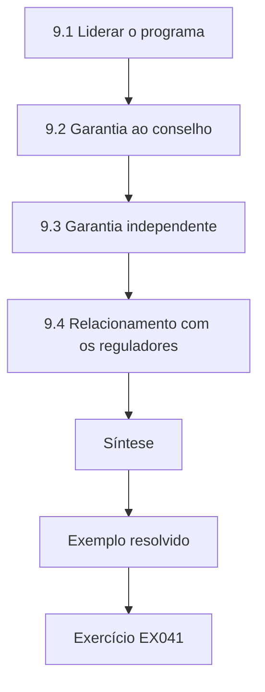

### Desenho lógico

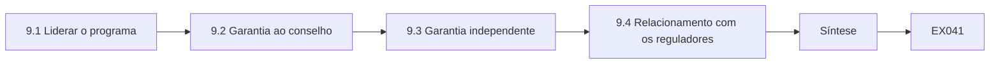

```text
[9.1 Liderar o programa]
    |
    v
[9.2 Garantia ao conselho]
    |
    v
[9.3 Garantia independente]
    |
    v
[9.4 Relacionamento com os reguladores]
    |
    v
[Síntese]
    |
    v
[Exemplo resolvido] --> [Exercício EX041]
```
<!-- cyberabc:lesson-figures:end ch-09 -->


### Objetivos de aprendizagem

Você vai (1) liderar um programa de modernização criptográfica; (2) dar garantia aos conselhos e aos reguladores; (3) definir as métricas e os relatórios do programa.

### 9.1 Liderar o programa

Leila se torna a líder do programa. Ela define um roteiro de dois anos em fases: inventário e linha de base nos primeiros seis meses, consolidação do gerenciamento de chaves nos nove seguintes e pilotos de prontidão pós-quântica nos nove finais, com a desativação do EDI legado correndo ao longo de todo o período. Cada fase tem entregas, donos e critérios de saída. Ela se reúne mensalmente com os responsáveis das unidades e trimestralmente com o comitê diretor. Liderar significa remover obstáculos, como negociar tempo com as unidades de negócio, mais do que projetar criptografia. Ela mantém um roteiro de uma única página visível para todas as unidades, de modo que os avanços e os atrasos fiquem evidentes para todos.

### 9.2 Garantia ao conselho

O conselho quer a garantia de que o programa reduz o risco. Leila relata um pequeno conjunto de métricas: endpoints que aceitam protocolos legados, parcela de certificados automatizados, chaves sem dono, sistemas com avaliações de prontidão pós-quântica e incidentes relacionados à criptografia. Cada métrica tem uma linha de base, uma meta e uma tendência. Ela combina as métricas com uma narrativa: o que mudou, o que atrasou e por quê. Ela evita métricas de vaidade, como o número de políticas publicadas, que dizem pouco sobre o risco. O relatório de cada trimestre cabe em duas páginas, para que conselheiros ocupados de fato o leiam.

### 9.3 Garantia independente

A equipe de auditoria interna da Corvane revisa o programa na metade do caminho. Os auditores amostram evidências: registros de mudança, entradas do inventário e atas de cerimônias de chaves. Eles concluem que o inventário é preciso para os sistemas voltados para a internet, mas incompleto para os serviços internos, e que os responsáveis de duas unidades raramente comparecem ao fórum. Leila aceita os achados, acrescenta varreduras internas e escala a questão da presença por meio dos chefes das unidades. Ela valoriza a garantia independente porque ela testa se o programa funciona como relatado, e não apenas como projetado. Ela compartilha o relatório de auditoria com todos os responsáveis das unidades.

### 9.4 Relacionamento com os reguladores

A divisão financeira da Corvane é regulada e precisa demonstrar um gerenciamento de chaves sólido. Leila prepara um pacote para o regulador: a norma criptográfica, o resumo do inventário, a arquitetura de gerenciamento de chaves, as evidências dos controles e o plano pós-quântico. Ela explica as premissas abertamente, incluindo o cenário de planejamento escolhido no Capítulo 4. O regulador pergunta como a Corvane responderia ao comprometimento de uma raiz de assinatura; Leila percorre o procedimento ensaiado. Um relacionamento transparente constrói uma credibilidade que ajuda quando surgem problemas mais tarde. Ela mantém um registro de todas as perguntas do regulador e das respostas.

### Exemplo resolvido

Leila lidera um roteiro de dois anos em fases, relata cinco métricas de risco com narrativa, aceita os achados da auditoria sobre o inventário interno e a presença no fórum e apresenta ao regulador as premissas e a resposta a comprometimentos.

> **Caso sintético.** O programa e a auditoria são inventados.

### Erros e limites

Métricas relatadas sem narrativa convidam a leituras erradas. Uma garantia limitada ao projeto não verifica se os controles operam.

### Exercícios

- **EX041 — Fases do roteiro.** Descreva as três fases do roteiro. *Rubrica:* 3 = inventário e linha de base (6 meses), consolidação de chaves (9), pilotos pós-quânticos (9), com a desativação do EDI ao longo de todo o período;; 2 = parcial;; 1 = vago;; 0 = nenhuma.

- **EX042 — Métricas do conselho.** Cite três métricas que Leila relata. *Rubrica:* 3 = três entre endpoints legados, parcela de certificados automatizados, chaves sem dono, avaliações pós-quânticas, incidentes criptográficos;; 2 = duas;; 1 = de vaidade;; 0 = nenhuma.

- **EX043 — Achados da auditoria.** O que a auditoria interna encontrou? *Rubrica:* 3 = inventário incompleto para os serviços internos; responsáveis de duas unidades raramente comparecem;; 2 = um;; 1 = vago;; 0 = nenhuma.

- **EX044 — Pacote do regulador.** Liste três itens do pacote para o regulador. *Rubrica:* 3 = três entre norma, resumo do inventário, arquitetura, evidências dos controles, plano pós-quântico;; 2 = dois;; 1 = um;; 0 = nenhuma.

- **EX045 — Pergunta do regulador.** O que o regulador perguntou, e como Leila respondeu? *Rubrica:* 3 = a resposta ao comprometimento de uma raiz de assinatura; percorreu o procedimento ensaiado;; 2 = ambos;; 1 = um;; 0 = nenhuma.

### Síntese

A liderança transforma os planos criptográficos em mudanças entregues, e métricas honestas com garantia independente dão aos conselhos e aos reguladores uma confiança justificada.

<!-- cyberabc:chapter-navigation:start ch-09 -->
### Continue estudando — aula 09 (capítulo 09 de 12)

[← Capítulo 08](#ch-08) · [Índice das aulas](../SUBJECTS.md) · [Capítulo 10 →](#ch-10)

Continue para a próxima aula já escrita.
<!-- cyberabc:chapter-navigation:end -->

<a id="ch-10"></a>

## Capítulo 10 — Leitura e crítica de pesquisas

<!-- cyberabc:lesson-figures:start ch-10 -->
### Mapa da aula

Aula 10 publicada. Mapa, exemplo, EX046.

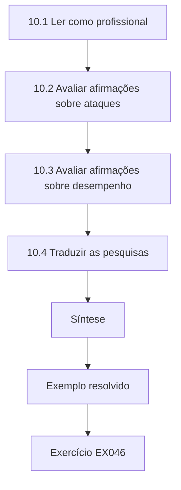

### Desenho lógico

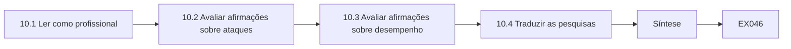

```text
[10.1 Ler como profissional]
    |
    v
[10.2 Avaliar afirmações sobre ataques]
    |
    v
[10.3 Avaliar afirmações sobre desempenho]
    |
    v
[10.4 Traduzir as pesquisas]
    |
    v
[Síntese]
    |
    v
[Exemplo resolvido] --> [Exercício EX046]
```
<!-- cyberabc:lesson-figures:end ch-10 -->


### Objetivos de aprendizagem

Você vai (1) ler pesquisas em criptografia de forma crítica, como profissional; (2) avaliar afirmações sobre ataques e desempenho; (3) traduzir as pesquisas em relevância para a organização.

### 10.1 Ler como profissional

A turma de Leila lê artigos de pesquisa e normas sobre temas que afetam a Corvane: ataques de canal lateral a implementações pós-quânticas, estudos sobre a implantação do TLS e análises dos ecossistemas de certificados. A Prof.ª Rao ensina um método de leitura: identificar a afirmação, o modelo de ameaça, as evidências e as condições sob as quais a afirmação vale. Leila o aplica aos capítulos de Boneh e Shoup sobre cifração autenticada e ao artigo de Shoup sobre sequências de jogos, publicado no arquivo ePrint da IACR, aprendendo como as provas de segurança estruturam seus argumentos passo a passo.

### 10.2 Avaliar afirmações sobre ataques

Muitas manchetes anunciam que um algoritmo foi "quebrado". Leila aprende a perguntar se o ataque é prático, de que recursos ele precisa, se ele visa o algoritmo ou uma implementação específica e se existem correções. Um ataque de canal lateral a uma implementação, que exige acesso físico, não significa que a norma esteja quebrada. Por outro lado, um ataque criptanalítico à estrutura de um algoritmo, mesmo que ainda não seja prático, sinaliza a necessidade de planejar a migração. Ela escreve resumos de um parágrafo que traduzem os artigos em "o que isto significa para a Corvane".

### 10.3 Avaliar afirmações sobre desempenho

Os estudos de desempenho dos algoritmos pós-quânticos relatam tempos de handshake e tamanhos. Leila confere o hardware, as versões de software e as condições de rede, comparando-os com o ambiente da Corvane. Um estudo em processadores de servidor diz pouco sobre as unidades de telemática. Ela replica um benchmark nos próprios dispositivos de teste da Corvane, usando bibliotecas dos fornecedores, e obtém resultados próximos dos números publicados para os servidores, mas mais lentos nas unidades de telemática, o que confirma que os testes locais são necessários para os sistemas com recursos limitados. Ela publica internamente seu método de medição, para que outras equipes possam repeti-lo nos seus próprios dispositivos antes de planejar as migrações.

### 10.4 Traduzir as pesquisas

Leila mantém uma lista de acompanhamento de pesquisas para o programa: temas, artigos principais, situação das normas e graus de relevância. A cada trimestre, ela informa o comitê diretor sobre as mudanças, como um novo documento do IETF sobre troca de chaves híbrida ou uma vulnerabilidade de implementação numa biblioteca que a Corvane usa. Ela evita inundar os executivos com artigos; relata apenas os itens que mudam os riscos ou os planos. A leitura de pesquisas se torna, assim, uma entrada do programa, e não um exercício acadêmico. Os executivos dizem que esse resumo é a página mais útil do seu pacote.

### Exemplo resolvido

Leila aplica um método de afirmação, ameaça, evidências e condições, separa os ataques a implementações das quebras de algoritmos, replica um benchmark nas unidades de telemática e mantém uma lista trimestral de acompanhamento de pesquisas.

> **Caso sintético.** A lista de acompanhamento e os benchmarks são inventados; Boneh–Shoup e Shoup (2004) são reais.

### Erros e limites

As manchetes exageram; leia o artigo. Os benchmarks raramente se transferem entre hardwares diferentes.

### Exercícios

- **EX046 — Método de leitura.** Quais quatro elementos o método da Prof.ª Rao identifica? *Rubrica:* 3 = afirmação, modelo de ameaça, evidências, condições;; 2 = três;; 1 = um;; 0 = nenhuma.

- **EX047 — Afirmações de quebra.** Que perguntas Leila faz diante de uma manchete de "quebrado"? *Rubrica:* 3 = praticidade, recursos, algoritmo versus implementação, correções;; 2 = três;; 1 = vago;; 0 = nenhuma.

- **EX048 — Significado do canal lateral.** Um ataque físico de canal lateral a uma implementação quebra a norma? *Rubrica:* 3 = não; ele visa uma implementação e exige acesso físico;; 2 = não;; 1 = sim;; 0 = nenhuma.

- **EX049 — Replicação do benchmark.** O que a replicação de Leila mostrou? *Rubrica:* 3 = próximo dos números publicados nos servidores, mais lento nas unidades de telemática;; 2 = ambos;; 1 = um;; 0 = nenhuma.

- **EX050 — Regra da lista.** O que Leila relata aos executivos a partir da lista de acompanhamento? *Rubrica:* 3 = apenas os itens que mudam os riscos ou os planos;; 2 = filtro;; 1 = tudo;; 0 = nenhuma.

### Síntese

Os profissionais leem pesquisas em busca de afirmações, modelos de ameaça e condições e depois traduzem apenas o que muda o risco da organização.

<!-- cyberabc:chapter-navigation:start ch-10 -->
### Continue estudando — aula 10 (capítulo 10 de 12)

[← Capítulo 09](#ch-09) · [Índice das aulas](../SUBJECTS.md) · [Capítulo 11 →](#ch-11)

Continue para a próxima aula já escrita.
<!-- cyberabc:chapter-navigation:end -->

<a id="ch-11"></a>

## Capítulo 11 — Projeto aplicado

<!-- cyberabc:lesson-figures:start ch-11 -->
### Mapa da aula

Aula 11 publicada. Mapa, exemplo, EX051.

```mermaid
flowchart TD
  N0["11.1 Definição do projeto"]
  N1["11.2 Transição dos parceiros"]
  N2["11.3 Mudanças técnicas"]
  N3["11.4 Resultados e risco residual"]
  N4["Síntese"]
  N0 --> N1 --> N2 --> N3 --> N4
  N4 --> EX["Exemplo resolvido"]
  EX --> Q["Exercício EX051"]
```

### Desenho lógico

```mermaid
flowchart LR
  N0["11.1 Definição do projeto"]
  N1["11.2 Transição dos parceiros"]
  N2["11.3 Mudanças técnicas"]
  N3["11.4 Resultados e risco residual"]
  N4["Síntese"]
  N0 --> N1 --> N2 --> N3 --> N4 --> Q["EX051"]
```

```text
[11.1 Definição do projeto]
    |
    v
[11.2 Transição dos parceiros]
    |
    v
[11.3 Mudanças técnicas]
    |
    v
[11.4 Resultados e risco residual]
    |
    v
[Síntese]
    |
    v
[Exemplo resolvido] --> [Exercício EX051]
```
<!-- cyberabc:lesson-figures:end ch-11 -->


### Objetivos de aprendizagem

Você vai (1) entregar um projeto aplicado que desativa a criptografia legada do EDI; (2) coordenar os parceiros ao longo de uma transição; (3) medir os resultados e o risco residual.

### 11.1 Definição do projeto

O projeto aplicado de Leila desativa a criptografia legada da plataforma EDI: doze endpoints que aceitam TLS 1.1 ou anterior, certificados manuais de dois anos e chaves RSA 2048. O objetivo é que todo endpoint EDI atenda à linha de base, que os certificados sejam renovados automaticamente e que todos os parceiros ativos migrem sem perda de embarques. O escopo inclui 140 parceiros, de transportadoras globais a pequenos despachantes aduaneiros. Ela define as medidas de sucesso, os riscos e um plano de comunicação antes de qualquer mudança técnica. Ela também garante uma rubrica orçamentária para o apoio aos parceiros, reconhecendo que a maior parte do esforço será humana, e não técnica, e a combina com o diretor financeiro.

### 11.2 Transição dos parceiros

Leila segmenta os parceiros por prontidão. Os parceiros grandes já suportam TLS 1.3 e migram no primeiro mês. Os parceiros médios precisam de ajuda com a configuração, oferecida por uma central de suporte. Os pequenos despachantes que usam software cliente antigo recebem clientes atualizados gratuitos e guias passo a passo, com um endpoint de teste em que podem conferir as conexões antes do prazo. Lembretes mensais mostram a situação de cada parceiro. Ela negocia uma prorrogação curta para três despachantes afetados por uma queda local de internet, documentando a exceção e seus controles compensatórios. Painéis semanais de situação a ajudam a concentrar o esforço.

### 11.3 Mudanças técnicas

A equipe implanta novos gateways EDI configurados conforme a linha de base, com certificados do serviço ACME interno renovados a cada noventa dias e chaves geradas nos próprios gateways. Os endpoints antigos funcionam em paralelo durante a migração, monitorados quanto às conexões restantes. Quando o tráfego num endpoint antigo cai a zero por duas semanas, ele é desligado. Leila insiste em configurações suportadas pelos fornecedores e em nenhum código criptográfico próprio e executa a varredura de compatibilidade do Capítulo 7 antes de cada virada. Cada virada tem um engenheiro nomeado de plantão.

### 11.4 Resultados e risco residual

Depois de seis meses, os doze endpoints legados estão desativados; 138 dos 140 parceiros migraram, e os dois restantes, inativos havia um ano, são formalmente desligados. Nenhum embarque foi perdido, embora quatro parceiros tenham tido atrasos de menos de um dia. Os certificados agora se renovam automaticamente. Os riscos residuais incluem chaves RSA 2048 do lado de alguns parceiros, fora do controle da Corvane, e o limite de tamanho de mensagem do protocolo EDI, que pode complicar as assinaturas pós-quânticas. Leila registra os dois no registro de riscos, com donos. Ela apresenta os resultados ao comitê diretor.

### Exemplo resolvido

O projeto de Leila desativa os doze endpoints EDI legados, migra 138 dos 140 parceiros sem perda de embarques, automatiza os certificados e registra os riscos residuais.

> **Caso sintético.** As contagens de parceiros e os resultados são inventados.

### Erros e limites

Prazos rígidos sem apoio prejudicam os pequenos parceiros; as exceções precisam de controles compensatórios. O funcionamento em paralelo precisa terminar, ou os endpoints antigos permanecem.

### Exercícios

- **EX051 — Objetivo do projeto.** Enuncie o objetivo do projeto. *Rubrica:* 3 = todo endpoint EDI atende à linha de base, renovação automática, todos os parceiros ativos migram sem perda de embarques;; 2 = parcial;; 1 = vago;; 0 = nenhuma.

- **EX052 — Apoio aos pequenos despachantes.** Que apoio os pequenos despachantes receberam? *Rubrica:* 3 = clientes atualizados gratuitos, guias, um endpoint de teste, lembretes;; 2 = dois;; 1 = vago;; 0 = nenhuma.

- **EX053 — Regra de desligamento.** Quando um endpoint antigo é desligado? *Rubrica:* 3 = depois que o tráfego fica em zero por duas semanas;; 2 = regra;; 1 = imediatamente;; 0 = nenhuma.

- **EX054 — Resultado da migração.** Quantos parceiros migraram, e o que aconteceu com os demais? *Rubrica:* 3 = 138 de 140; dois parceiros inativos desligados;; 2 = contagem;; 1 = errado;; 0 = nenhuma.

- **EX055 — Risco residual do EDI.** Cite um risco residual registrado. *Rubrica:* 3 = chaves RSA 2048 do lado dos parceiros ou limite de tamanho de mensagem do EDI para as assinaturas pós-quânticas;; 2 = um;; 1 = vago;; 0 = nenhuma.

### Síntese

Os projetos aplicados dão certo quando a mudança técnica vem acompanhada de apoio aos parceiros, funcionamento em paralelo monitorado e registros honestos de risco residual.

<!-- cyberabc:chapter-navigation:start ch-11 -->
### Continue estudando — aula 11 (capítulo 11 de 12)

[← Capítulo 10](#ch-10) · [Índice das aulas](../SUBJECTS.md) · [Capítulo 12 →](#ch-12)

Continue para a próxima aula já escrita.
<!-- cyberabc:chapter-navigation:end -->

<a id="ch-12"></a>

## Capítulo 12 — Revisão final e transferência

<!-- cyberabc:lesson-figures:start ch-12 -->
### Mapa da aula

Aula 12 publicada. Mapa, exemplo, EX056.

```mermaid
flowchart TD
  N0["12.1 Resultados em relação às metas"]
  N1["12.2 Transferência para as operações"]
  N2["12.3 Melhoria contínua"]
  N3["12.4 Desenvolvimento pessoal"]
  N4["Síntese"]
  N0 --> N1 --> N2 --> N3 --> N4
  N4 --> EX["Exemplo resolvido"]
  EX --> Q["Exercício EX056"]
```

### Desenho lógico

```mermaid
flowchart LR
  N0["12.1 Resultados em relação às metas"]
  N1["12.2 Transferência para as operações"]
  N2["12.3 Melhoria contínua"]
  N3["12.4 Desenvolvimento pessoal"]
  N4["Síntese"]
  N0 --> N1 --> N2 --> N3 --> N4 --> Q["EX056"]
```

```text
[12.1 Resultados em relação às metas]
    |
    v
[12.2 Transferência para as operações]
    |
    v
[12.3 Melhoria contínua]
    |
    v
[12.4 Desenvolvimento pessoal]
    |
    v
[Síntese]
    |
    v
[Exemplo resolvido] --> [Exercício EX056]
```
<!-- cyberabc:lesson-figures:end ch-12 -->


### Objetivos de aprendizagem

Você vai (1) revisar os resultados do programa em relação às suas metas; (2) transferir a propriedade para as equipes da operação rotineira; (3) planejar a melhoria contínua e o desenvolvimento pessoal.

### 12.1 Resultados em relação às metas

Ao fim dos dois anos, Leila revisa os resultados. Os endpoints que aceitam protocolos legados caíram de vinte e cinco para zero nos sistemas voltados para a internet; os certificados estão automatizados em todas as unidades; as chaves têm donos e vivem na arquitetura híbrida; e as avaliações de prontidão pós-quântica cobrem todos os sistemas críticos, com pilotos de troca de chaves híbrida em serviços internos. Duas metas atrasaram: dois controladores portuários aguardam o firmware do fornecedor, e o inventário dos serviços internos continua noventa por cento completo. Ela relata os sucessos e os atrasos com a mesma clareza. Ela anexa as tendências das métricas como apêndice.

### 12.2 Transferência para as operações

Os programas terminam; as operações continuam. Leila transfere cada capacidade a um dono: a norma para a arquitetura de segurança, o inventário e as renovações para as operações, os requisitos dos fornecedores para as compras e o planejamento pós-quântico para um pequeno grupo de trabalho. Cada um recebe documentação, runbooks, métricas e uma sessão de passagem. Ela define o que significa "concluído" numa transferência: a equipe que recebe executa o processo por um trimestre sem a ajuda do programa. Duas transferências precisam de apoio extra, que ela oferece antes de encerrar. Ela mantém uma lista de verificação da transferência assinada por cada dono que recebe.

### 12.3 Melhoria contínua

Leila escreve um plano de melhoria contínua: revisão anual da norma diante das novas publicações do NIST e do IETF; revisão bienal do cenário de planejamento quântico escolhido no Capítulo 4; métricas trimestrais para o comitê de riscos; e uma sessão de lições aprendidas depois de qualquer incidente relacionado à criptografia. Ela recomenda que o próximo programa se concentre na migração pós-quântica das assinaturas dos dispositivos de vida longa, em que as dependências de fornecedores tornam essencial agir cedo. Cada elemento tem um dono nomeado e uma data no calendário, para que o plano não dependa de Leila continuar no cargo. O comitê de riscos o adota formalmente na sua reunião seguinte.

### 12.4 Desenvolvimento pessoal

Na sua reflexão final da pós-graduação, Leila observa que seu conhecimento técnico importou mais ao fazer a tradução entre engenheiros, executivos, advogados e parceiros. Ela lista as competências desenvolvidas: enquadramento de decisões, desenho de avaliações, negociação e comunicação regulatória. Ela também anota os erros: subestimar as necessidades de apoio dos parceiros e, no início, apresentar premissas como fatos. A Prof.ª Rao a aconselha a orientar arquitetos juniores, já que ensinar consolida a aprendizagem. Leila planeja apresentar o projeto do EDI num fórum do setor, compartilhando as lições sem revelar detalhes sensíveis. Ela também agenda uma conversa de acompanhamento com a Prof.ª Rao dali a um ano.

### Exemplo resolvido

Leila relata zero endpoints legados voltados para a internet e automação completa dos certificados, duas metas atrasadas, transfere as capacidades com um teste de "concluído" de um trimestre e escreve um plano de melhoria e uma reflexão pessoal.

> **Caso sintético.** Os resultados são inventados.

### Erros e limites

Declarar vitória esconde os atrasos; relate-os. Transferências sem período de teste costumam falhar em silêncio.

### Exercícios

- **EX056 — Metas atrasadas.** Quais duas metas atrasaram? *Rubrica:* 3 = dois controladores portuários aguardando o firmware do fornecedor; inventário interno 90 por cento completo;; 2 = uma;; 1 = vago;; 0 = nenhuma.

- **EX057 — Transferência concluída.** Como se define uma transferência concluída? *Rubrica:* 3 = a equipe que recebe executa o processo por um trimestre sem a ajuda do programa;; 2 = definição;; 1 = reunião de passagem;; 0 = nenhuma.

- **EX058 — Plano de melhoria.** Cite três elementos do plano de melhoria contínua. *Rubrica:* 3 = três entre revisão anual da norma, revisão bienal do cenário, métricas trimestrais, lições após incidentes;; 2 = dois;; 1 = um;; 0 = nenhuma.

- **EX059 — Próximo foco.** Em que o próximo programa deve se concentrar, e por quê? *Rubrica:* 3 = migração pós-quântica das assinaturas dos dispositivos de vida longa, por causa das dependências de fornecedores;; 2 = foco;; 1 = vago;; 0 = nenhuma.

- **EX060 — Erros de Leila.** Que erros Leila reconheceu? *Rubrica:* 3 = subestimar as necessidades de apoio dos parceiros e apresentar premissas como fatos;; 2 = um;; 1 = vago;; 0 = nenhuma.

### Síntese

Encerrar um programa significa resultados honestos, transferências testadas, um plano de melhoria contínua e uma reflexão que forma o próximo líder.

<!-- cyberabc:chapter-navigation:start ch-12 -->
### Continue estudando — aula 12 (capítulo 12 de 12)

[← Capítulo 11](#ch-11) · [Índice das aulas](../SUBJECTS.md) · [Próximo curso pelo índice →](../SUBJECTS.md)

O índice aponta para o próximo curso do percurso de estudos.
<!-- cyberabc:chapter-navigation:end -->

<a id="worked-results"></a>

## Resoluções

Respostas-modelo para EX001–EX060. Leila Moradi, a Prof.ª Anika Rao, a Westbrook School of Security, a Corvane Logistics e todos os números são sintéticos; as respostas dos laboratórios citam saídas verificadas. Qualquer resposta que atenda à rubrica recebe a mesma pontuação.

**EX001.** Desativar o TLS legado, consolidar o gerenciamento de chaves e preparar a migração pós-quântica em dois anos.

**EX002.** Um fato é a contagem de endpoints com TLS 1.0, uma premissa é o prazo para os computadores quânticos e um valor é quanto risco de indisponibilidade a Corvane aceita.

**EX003.** Minimização do pior caso para a perda catastrófica da chave raiz; valor esperado para as expirações frequentes e mensuráveis.

**EX004.** Ela tinha apresentado uma premissa sobre os prazos quânticos como um fato estabelecido.

**EX005.** Porque alguém novo conseguiria reconstruir o raciocínio a partir dele em cerca de cinco minutos, sem perguntar a Leila.

**EX006.** RFC 8446 para o TLS 1.3, RFC 7748 para o X25519 e SP 800-38D para o AES-GCM.

**EX007.** 114 de 160 endpoints, ou 71,2 por cento.

**EX008.** Nove nos portos, quatro nas finanças e doze no EDI legado.

**EX009.** Validades curtas e automatizadas indicam um gerenciamento maduro, enquanto os certificados manuais de dois anos do EDI revelam baixa maturidade.

**EX010.** A aceitação de protocolos legados no EDI, porque esses endpoints atendem parceiros pela internet.

**EX011.** FIPS 203 para o ML-KEM, FIPS 204 para o ML-DSA e FIPS 205 para o SLH-DSA.

**EX012.** Tem 3.309 bytes contra 64, cerca de cinquenta e duas vezes maior.

**EX013.** 1.216 bytes.

**EX014.** A telemática dos caminhões, com enlaces caros e pouca memória, os controladores portuários, com ciclos longos dos fornecedores, e o EDI, com limites de tamanho de mensagem.

**EX015.** Pelo grau mais fraco de evidência da sua cadeia.

**EX016.** Se os anos em que os dados precisam continuar secretos mais os anos para migrar excedem os anos até um computador quântico capaz, o tráfego gravado já está em risco.

**EX017.** O cenário moderado, com uma revisão a cada dois anos.

**EX018.** Uma migração apoiada, oferecendo software cliente atualizado gratuito e um prazo firme e publicado.

**EX019.** O controlador aceitava firmware assinado com um algoritmo descontinuado.

**EX020.** Ela relatou em particular, combinou um prazo, isolou os controladores e deixou o fornecedor avisar os outros clientes depois da correção.

**EX021.** As chaves raiz e de assinatura de alto valor ficam nos HSMs da Corvane, enquanto as chaves de dados das aplicações ficam no serviço de nuvem, envolvidas sob chaves que a Corvane controla.

**EX022.** KMS em nuvem 3,90, híbrida 3,65 e HSM local 3,25.

**EX023.** Elevar a custódia para 0,45 e eliminar o custo tornou a híbrida a melhor, mostrando que a escolha depende de quanto a custódia importa.

**EX024.** A dependência da custódia em nuvem em relação aos contratos e à lei, e o risco de pessoa-chave com os HSMs locais.

**EX025.** Uma oferta em nuvem de chaves controladas pelo cliente e apoiadas em HSM que satisfaça os reguladores a um custo menor.

**EX026.** O pareamento retira da comparação as diferenças entre os locais, como tamanho e idade.

**EX027.** Uma redução média de 5,62 endpoints mal configurados por local, com p = 0,0036.

**EX028.** Com oito locais, todos melhorando, o menor valor atingível é cerca de 1/256, aproximadamente 0,0039.

**EX029.** Uma mudança simultânea, como uma campanha separada de patches, poderia responder por parte da melhoria.

**EX030.** Para que o conselho possa pesar este programa contra outros que disputam o mesmo orçamento.

**EX031.** Revisão de arquitetura, compras, gerenciamento de mudanças e integração de novos funcionários.

**EX032.** Os certificados e as chaves sem dono eram os que expiravam ou permaneciam em algoritmos descontinuados.

**EX033.** Suporte ao TLS 1.3, gerenciamento de chaves documentado e notificação tempestiva de comprometimento de chaves.

**EX034.** Suas respostas mostraram que seu produto continha chaves embutidas no código.

**EX035.** Uma desconexão inesperada de um pequeno parceiro depois de uma mudança criptográfica.

**EX036.** Ela quebra a proteção de ponta a ponta e concentra uma chave de assinatura poderosa no proxy.

**EX037.** Tráfego bancário, de saúde e dos parceiros.

**EX038.** A Corvane detinha as chaves dos seus próprios registros e o pedido era legal, então ela o atendeu por meio de um procedimento documentado.

**EX039.** Ela recusou a exportação em claro e ativou o HSM de reserva documentado, aceitando um atraso de duas horas.

**EX040.** Contexto, objetivos em conflito, opções, decisão, justificativa e acompanhamento.

**EX041.** Primeiro o inventário e a linha de base, depois a consolidação do gerenciamento de chaves, depois os pilotos pós-quânticos, com a desativação do EDI atravessando as três fases.

**EX042.** Os endpoints que aceitam protocolos legados, a parcela de certificados automatizados e as chaves sem dono.

**EX043.** O inventário deixava de fora os serviços internos, e os responsáveis de duas unidades raramente compareciam ao fórum.

**EX044.** A norma criptográfica, um resumo do inventário e o plano pós-quântico.

**EX045.** Como a Corvane trataria uma raiz de assinatura comprometida, respondido percorrendo o procedimento ensaiado.

**EX046.** A afirmação, o modelo de ameaça, as evidências e as condições sob as quais ela vale.

**EX047.** Se o ataque é prático, de que ele precisa, se atinge o algoritmo ou uma implementação e se existem correções.

**EX048.** Não, ele afeta aquela implementação mediante acesso físico, e não a norma em si.

**EX049.** Os resultados coincidiram com os números publicados para servidores, mas foram mais lentos nas unidades de telemática.

**EX050.** Apenas as mudanças em pesquisas ou normas que alteram os riscos ou os planos da Corvane.

**EX051.** Todos os endpoints EDI atendem à linha de base com renovação automatizada, e todo parceiro ativo migra sem perder embarques.

**EX052.** Software cliente atualizado gratuito, guias passo a passo, um endpoint de teste e lembretes mensais.

**EX053.** Assim que fica duas semanas sem tráfego.

**EX054.** 138 de 140 migraram, e os dois inativos havia um ano foram desligados.

**EX055.** O limite de tamanho de mensagem do protocolo EDI, que pode atrapalhar as assinaturas pós-quânticas.

**EX056.** Dois controladores portuários ainda precisam do firmware do fornecedor, e o inventário dos serviços internos está apenas noventa por cento completo.

**EX057.** A equipe que recebe opera o processo por um trimestre sem ajuda do programa.

**EX058.** Uma revisão anual da norma, uma revisão bienal do cenário quântico e métricas trimestrais para o comitê de riscos.

**EX059.** A migração pós-quântica das assinaturas nos dispositivos de vida longa, porque as dependências de fornecedores exigem ação antecipada.

**EX060.** Subestimar quanto apoio os parceiros precisavam e, no início, enunciar premissas como fatos.

<a id="references"></a>
## Referências

Todos os DOIs foram resolvidos em doi.org em 12 de outubro de 2026, e as normas foram conferidas nas páginas de seus editores. A lista é idêntica à da edição em inglês e cobre o livro inteiro; nenhuma das normas técnicas citadas foi verificada aqui como adotada pela ABNT, por isso são citadas em sua edição internacional. Organizações, pessoas, sistemas e números dos casos são sintéticos; somente as obras abaixo são reais.

- Barker, E. (2020). *Recommendation for key management: Part 1 — General* (NIST SP 800-57 Part 1 Rev. 5). NIST. <https://doi.org/10.6028/NIST.SP.800-57pt1r5>
- Barker, E., & Kelsey, J. (2015). *Recommendation for random number generation using deterministic random bit generators* (NIST SP 800-90A Rev. 1). NIST. <https://doi.org/10.6028/NIST.SP.800-90Ar1>
- Barker, E., & Roginsky, A. (2019). *Transitioning the use of cryptographic algorithms and key lengths* (NIST SP 800-131A Rev. 2). NIST. <https://doi.org/10.6028/NIST.SP.800-131Ar2>
- Barnes, R., Bhargavan, K., Lipp, B., & Wood, C. (2022). *Hybrid public key encryption* (RFC 9180). IETF. <https://www.rfc-editor.org/rfc/rfc9180>
- Barnes, R., Hoffman-Andrews, J., McCarney, D., & Kasten, J. (2019). *Automatic certificate management environment (ACME)* (RFC 8555). IETF. <https://www.rfc-editor.org/rfc/rfc8555>
- Biryukov, A., Dinu, D., Khovratovich, D., & Josefsson, S. (2021). *Argon2 memory-hard function for password hashing and proof-of-work applications* (RFC 9106). IETF. <https://www.rfc-editor.org/rfc/rfc9106>
- Boneh, D., & Shoup, V. (2023). *A graduate course in applied cryptography* (version 0.6, draft). <https://toc.cryptobook.us/>
- Cooper, D., Santesson, S., Farrell, S., Boeyen, S., Housley, R., & Polk, W. (2008). *Internet X.509 public key infrastructure certificate and CRL profile* (RFC 5280). IETF. <https://www.rfc-editor.org/rfc/rfc5280>
- Dworkin, M. (2007). *Recommendation for block cipher modes of operation: Galois/Counter Mode (GCM) and GMAC* (NIST SP 800-38D). NIST. <https://doi.org/10.6028/NIST.SP.800-38D>
- Josefsson, S., & Liusvaara, I. (2017). *Edwards-curve digital signature algorithm (EdDSA)* (RFC 8032). IETF. <https://www.rfc-editor.org/rfc/rfc8032>
- Katz, J., & Lindell, Y. (2020). *Introduction to modern cryptography* (3rd ed.). CRC Press.
- Krawczyk, H., & Eronen, P. (2010). *HMAC-based extract-and-expand key derivation function (HKDF)* (RFC 5869). IETF. <https://www.rfc-editor.org/rfc/rfc5869>
- Krawczyk, H., Bellare, M., & Canetti, R. (1997). *HMAC: Keyed-hashing for message authentication* (RFC 2104). IETF. <https://www.rfc-editor.org/rfc/rfc2104>
- Landis, J. R., & Koch, G. G. (1977). The measurement of observer agreement for categorical data. *Biometrics*, 33(1), 159–174. <https://doi.org/10.2307/2529310>
- Langley, A., Hamburg, M., & Turner, S. (2016). *Elliptic curves for security* (RFC 7748). IETF. <https://www.rfc-editor.org/rfc/rfc7748>
- Laurie, B., Langley, A., & Kasper, E. (2013). *Certificate transparency* (RFC 6962). IETF. <https://www.rfc-editor.org/rfc/rfc6962>
- McKay, K., & Cooper, D. (2019). *Guidelines for the selection, configuration, and use of Transport Layer Security (TLS) implementations* (NIST SP 800-52 Rev. 2). NIST. <https://doi.org/10.6028/NIST.SP.800-52r2>
- Menezes, A. J., van Oorschot, P. C., & Vanstone, S. A. (1996). *Handbook of applied cryptography*. CRC Press. Chapters free online: <https://cacr.uwaterloo.ca/hac/>
- Moriarty, K., Kaliski, B., Jonsson, J., & Rusch, A. (2016). *PKCS #1: RSA cryptography specifications version 2.2* (RFC 8017). IETF. <https://www.rfc-editor.org/rfc/rfc8017>
- National Institute of Standards and Technology. (2001, updated 2023). *Advanced Encryption Standard (AES)* (FIPS 197). <https://doi.org/10.6028/NIST.FIPS.197-upd1>
- National Institute of Standards and Technology. (2008). *The keyed-hash message authentication code (HMAC)* (FIPS 198-1). <https://doi.org/10.6028/NIST.FIPS.198-1>
- National Institute of Standards and Technology. (2015). *Secure hash standard (SHS)* (FIPS 180-4). <https://doi.org/10.6028/NIST.FIPS.180-4>
- National Institute of Standards and Technology. (2023). *Digital signature standard (DSS)* (FIPS 186-5). <https://doi.org/10.6028/NIST.FIPS.186-5>
- National Institute of Standards and Technology. (2024). *Module-lattice-based digital signature standard* (FIPS 204). <https://doi.org/10.6028/NIST.FIPS.204>
- National Institute of Standards and Technology. (2024). *Module-lattice-based key-encapsulation mechanism standard* (FIPS 203). <https://doi.org/10.6028/NIST.FIPS.203>
- National Institute of Standards and Technology. (2024). *Stateless hash-based digital signature standard* (FIPS 205). <https://doi.org/10.6028/NIST.FIPS.205>
- Nystrom, M. (2005). *Identifiers and test vectors for HMAC-SHA-224, HMAC-SHA-256, HMAC-SHA-384, and HMAC-SHA-512* (RFC 4231). IETF. <https://www.rfc-editor.org/rfc/rfc4231>
- Percival, C., & Josefsson, S. (2016). *The scrypt password-based key derivation function* (RFC 7914). IETF. <https://www.rfc-editor.org/rfc/rfc7914>
- Rescorla, E. (2018). *The Transport Layer Security (TLS) protocol version 1.3* (RFC 8446). IETF. <https://www.rfc-editor.org/rfc/rfc8446>
- Shoup, V. (2004). *Sequences of games: A tool for taming complexity in security proofs* (Cryptology ePrint Archive, Paper 2004/332). <https://eprint.iacr.org/2004/332>
