# Perícia Digital e Análise de Malware: Curso de Pós-graduação

- Idioma: português do Brasil (`pt`); curso 155, curso de pós-graduação (2 anos). Edição de referência: [inglês](../../en/book/MANUSCRIPT.md).
- Estado editorial: **publicado**. Os capítulos 1–12 de 12 têm texto didático escrito à mão; os exercícios EX001–EX060 têm resoluções correspondentes com rubricas de 0 a 3; quatro laboratórios offline usam apenas a biblioteca padrão do Python 3 sobre evidências sintéticas, e suas saídas foram incorporadas a partir de execuções reais. A revisão independente e a verificação de 300 páginas A4 continuam em aberto.
- Público: especialistas experientes que lideram o trabalho pericial dentro de organizações e precisam equilibrar as necessidades da evidência, do negócio e da regulação.
- Autor: [hiagokinlevi](https://github.com/hiagokinlevi). Texto original sob [CC0 1.0](../../../../../LICENSE); as obras citadas mantêm seus direitos.
- Limite ético e legal: examine apenas mídias e sistemas que você está autorizado a examinar; nada de malware ativo, código de exploração, *payloads* ou instruções para burlar proteções. O malware é discutido por meio de comportamento, artefatos e descrições estáticas seguras de amostras sintéticas. Todas as evidências, pessoas e organizações são **sintéticas**, salvo quando uma frase cita uma fonte pública.

[Página do curso](../../README.md) · [Índice de capítulos](../SUBJECTS.md) · [Plano do livro](PLAN.md) · [Skill do curso](../../skill/SKILL.md) · [Resoluções](#worked-results)

## Como usar este rascunho

Leia em ordem: os capítulos acompanham uma investigação de ransomware numa empresa e um caso paralelo de ameaça interna, das primeiras decisões ao relatório final ao regulador. Execute cada laboratório onde ele aparece, tente os cinco exercícios antes das resoluções e pontue-se com as rubricas.

### Caso contínuo sintético

| Elemento | Papel | Limite |
|---|---|---|
| **Marta Kowalczyk** | Chefe de perícia digital | Inventada |
| **Aiyana Brooks** | Perita sênior | Inventada |
| **Corvane Financial Group** | Organização financeira fictícia | Inventada |
| **CF-21** | Incidente sintético de ransomware | Inventado |

### Fontes principais

NIST [SP 800-86](https://doi.org/10.6028/NIST.SP.800-86) e [SP 800-101r1](https://doi.org/10.6028/NIST.SP.800-101r1); [RFC 3227](https://www.rfc-editor.org/rfc/rfc3227); ISO/IEC [27037](https://www.iso.org/standard/44381.html), [27041](https://www.iso.org/standard/44405.html), [27042](https://www.iso.org/standard/44406.html) e [27043](https://www.iso.org/standard/44407.html); [SWGDE](https://www.swgde.org/documents/published-complete-listing); Carrier, *File System Forensic Analysis* (2005). Lista completa em [Referências](#references).

## Sumário

| Capítulos |
|---|
| [1](#ch-01) · [2](#ch-02) · [3](#ch-03) · [4](#ch-04) · [5](#ch-05) · [6](#ch-06) · [7](#ch-07) · [8](#ch-08) · [9](#ch-09) · [10](#ch-10) |
| [11](#ch-11) · [12](#ch-12) |

[Resoluções](#worked-results) · [Referências](#references)

<a id="ch-01"></a>

## Capítulo 1 — Tomada de decisão avançada em segurança

<!-- cyberabc:lesson-figures:start ch-01 -->
### Mapa da aula

Aula 01 publicada. Mapa, exemplo, EX001.

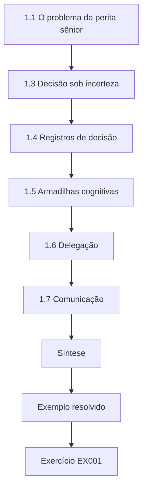

### Desenho lógico

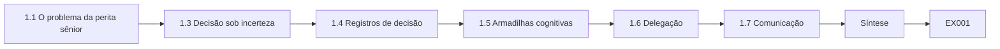

```text
[1.1 O problema da perita sênior]
    |
    v
[1.3 Decisão sob incerteza]
    |
    v
[1.4 Registros de decisão]
    |
    v
[1.5 Armadilhas cognitivas]
    |
    v
[1.6 Delegação]
    |
    v
[1.7 Comunicação]
    |
    v
[Síntese]
    |
    v
[Exemplo resolvido] --> [Exercício EX001]
```
<!-- cyberabc:lesson-figures:end ch-01 -->


### Objetivos de aprendizagem

Você vai (1) tomar decisões periciais sob pressão de tempo e incerteza; (2) ponderar a preservação da evidência contra a recuperação do negócio; (3) documentar decisões de modo que possam ser defendidas; (4) reconhecer armadilhas cognitivas em funções de liderança.

### 1.1 O problema da perita sênior

Marta Kowalczyk chefia a perícia digital do fictício Corvane Financial Group. Às 06:10 de uma segunda-feira, a equipe descobre que um ransomware cifrou 40 hosts, entre eles servidores de arquivos e estações de trabalho. O diretor de operações quer os sistemas restaurados até o meio-dia. Marta precisa decidir o que preservar antes que qualquer coisa seja apagada. A tensão é concreta: cada host reconstruído antes da preservação perde a memória, os logs locais e os vestígios no sistema de arquivos que poderiam mostrar como o atacante entrou. Manter os hosts parados custa à Corvane horas de negociação e de atendimento ao cliente. Marta tem menos de uma hora para escolher, e o que ela escolher será examinado depois pelo regulador.

### 1.2 Objetivos concorrentes

A recuperação quer reconstruções limpas e rápidas. A investigação quer memória, discos e logs preservados. Os reguladores podem exigir um relato de quais dados foram afetados. A NIST SP 800-61r3 situa essas atividades dentro da gestão de riscos da organização: as decisões de resposta são decisões de negócio informadas pelas necessidades da evidência. Na Corvane, os três objetivos estão vivos ao mesmo tempo naquela manhã de segunda-feira. O diretor de operações responde pela recuperação, Marta pela evidência, e o jurídico prestará contas ao regulador financeiro sobre os dados de clientes. Nenhum deles pode simplesmente se sobrepor aos outros, por isso a escolha é formulada como uma decisão de negócio, com os custos periciais expressos em horas e em respostas perdidas.

### 1.3 Decisão sob incerteza

Marta não sabe qual foi o ponto de entrada nem se dados foram levados. Ela escolhe ações que mantêm as opções abertas: capturar a memória de uma amostra dos hosts afetados ainda em execução, tirar snapshots dos servidores virtuais antes da reconstrução, preservar imediatamente os logs centrais e então liberar os sistemas para recuperação em ondas. Cada uma dessas ações é barata comparada com o que protege. A memória de oito hosts leva minutos por host, os snapshots de VM levam pouco mais, e os logs centrais só precisam ser copiados antes que a rotação ou a retenção os elimine. Reconstruir em ondas significa que os primeiros sistemas voltam às 09:00, enquanto os demais aguardam a coleta.

### 1.4 Registros de decisão

Cada decisão é registrada: horário, opções, escolha, justificativa, quem aprovou. Se um regulador ou um tribunal perguntar depois por que um host foi reconstruído sem imagem, o registro responde. O registro das 06:45 de Marta é o modelo: três opções, a escolhida, a justificativa ligada às perguntas sobre o ponto de entrada e a exfiltração, e o COO como aprovador. Escrever as opções rejeitadas importa tanto quanto a escolha, porque um revisor posterior vai perguntar por que os 40 hosts não foram todos copiados em imagem. O registro fica com os autos do caso e só é encerrado quando o caso se encerra.

### 1.5 Armadilhas cognitivas

Ancoragem na primeira teoria, excesso de confiança na experiência e pressão para agradar aos executivos. Marta designa um colega para defender alternativas em cada reunião de situação. No CF-21, a primeira teoria da reunião da manhã poderia facilmente ter sido "um usuário abriu um anexo infectado na WS-07". Ancorar-se nela teria escondido a conta de VPN comprometida por phishing e a preparação dos dados no servidor de backup, descobertas mais tarde. O contestador designado pergunta, em cada reunião, que evidência tornaria errada a teoria atual, e a resposta é registrada.

### 1.6 Delegação

Peritos experientes conduzem a coleta; Marta fica com o registro de decisões e a interface com os executivos. Aiyana Brooks e os demais peritos executam as capturas de memória, os snapshots e a coleta de triagem, cada um registrando os próprios passos. Marta fica fora do trabalho prático para poder acompanhar as decisões, responder ao COO e ao diretor e perceber quando uma nova constatação obriga a rever uma decisão. Dividir os papéis desse modo mantém o registro de decisões completo enquanto a coleta continua. Os peritos levam a ela as decisões que precisam de aprovação, como liberar um host para reconstrução.

### 1.7 Comunicação

Ela apresenta ao diretor um custo-benefício claro: duas horas de preservação poupam semanas de incerteza depois. A mensagem ao diretor é dita nos termos dele: a recuperação começa às 09:00 em vez de imediatamente e, em troca, a Corvane poderá dizer ao regulador como o atacante entrou e se dados saíram. Sem essa evidência, as perguntas do regulador poderiam ficar em aberto por semanas. Marta dá ao diretor um número para o atraso e outro para o risco evitado. O diretor concorda, e a aprovação é escrita no registro das 06:45.

### Exemplo resolvido

Registro de decisão das 06:45: "Opções: (a) reconstruir tudo agora; (b) gerar imagem dos 40 primeiro; (c) memória de 8 hosts representativos, snapshots de 6 servidores, logs centrais e depois reconstrução escalonada. Escolhida: (c). Justificativa: preserva a evidência para as perguntas sobre ponto de entrada e exfiltração e permite a recuperação a partir das 09:00. Aprovado por: COO."

> **Caso sintético.** A Corvane e o incidente são inventados.

### Erros e limites

Amostrar hosts traz o risco de perder justamente aquele que guarda a evidência decisiva; escolha as amostras por papel (primeiro infectado, servidores, estações de administração), não por conveniência.

### Exercícios

- **EX001 — Objetivos concorrentes.** Cite os três objetivos concorrentes no incidente da Corvane. *Rubrica:* 3 = recuperação, investigação, relato regulatório; 2 = dois; 1 = um; 0 = nada.
- **EX002 — Opção (c).** Descreva a opção (c) e por que ela foi escolhida. *Rubrica:* 3 = memória por amostragem, snapshots de servidores, logs, reconstrução escalonada; preserva a evidência e permite a recuperação; 2 = parcial; 1 = vago; 0 = nada.
- **EX003 — Registro de decisão.** Liste cinco campos de um registro de decisão. *Rubrica:* 3 = horário, opções, escolha, justificativa, aprovador; 2 = três; 1 = um; 0 = nada.
- **EX004 — Controle da armadilha.** Como Marta combate a ancoragem? *Rubrica:* 3 = um colega defende alternativas nas reuniões de situação; 2 = parcial; 1 = experiência; 0 = nada.
- **EX005 — Regra de amostragem.** Como os hosts devem ser amostrados para a captura de memória? *Rubrica:* 3 = por papel (primeiro infectado, servidores, administração), não por conveniência; 2 = parcial; 1 = só aleatória; 0 = nada.

### Síntese

Decisões periciais de liderança mantêm as opções abertas, equilibram as necessidades do negócio e são registradas para escrutínio posterior.

### Continue estudando — capítulo 01 de 12

[← Página do curso](../../README.md) · [Índice de capítulos do curso](../SUBJECTS.md) · [Capítulo 02 (rascunho) →](#ch-02)

<a id="ch-02"></a>

## Capítulo 2 — Perícia digital e análise de malware: prática atual

<!-- cyberabc:lesson-figures:start ch-02 -->
### Mapa da aula

Aula 02 publicada. Mapa, exemplo, EX006.

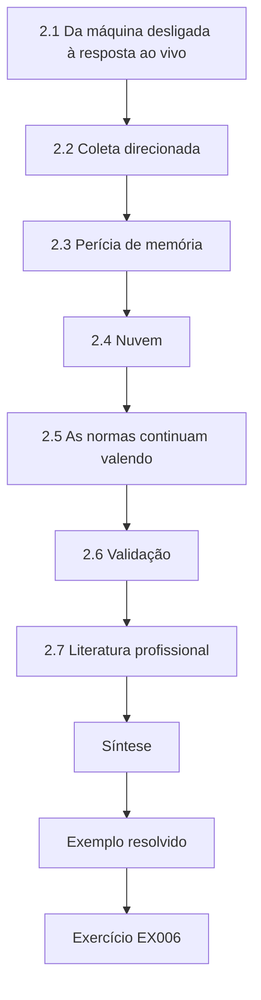

### Desenho lógico

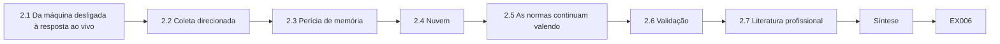

```text
[2.1 Da máquina desligada à resposta ao vivo]
    |
    v
[2.2 Coleta direcionada]
    |
    v
[2.3 Perícia de memória]
    |
    v
[2.4 Nuvem]
    |
    v
[2.5 As normas continuam valendo]
    |
    v
[2.6 Validação]
    |
    v
[2.7 Literatura profissional]
    |
    v
[Síntese]
    |
    v
[Exemplo resolvido] --> [Exercício EX006]
```
<!-- cyberabc:lesson-figures:end ch-02 -->


### Objetivos de aprendizagem

Você vai (1) examinar a prática pericial atual em incidentes corporativos; (2) comparar a geração tradicional de imagens com a coleta direcionada; (3) descrever a perícia de memória e de nuvem na prática; (4) julgar novas práticas à luz das normas.

### 2.1 Da máquina desligada à resposta ao vivo

A prática tradicional gerava imagens de discos desligados. Os incidentes corporativos modernos envolvem centenas de hosts, discos cifrados, serviços de nuvem e malware residente em memória. A prática atual combina coleta direcionada ao vivo, captura de memória e análise de logs, sem deixar de gerar imagens dos hosts críticos. O CF-21 mostra essa combinação: gerar imagens, um a um, de 40 hosts com cifragem de disco do tipo BitLocker levaria a maior parte de um dia, enquanto a atividade do ransomware e as conexões ativas só existem na memória. A unidade de Marta, portanto, captura memória e artefatos direcionados em larga escala e reserva as imagens completas para os hosts com mais chance de responder às perguntas sobre a entrada e a exfiltração.

### 2.2 Coleta direcionada

Coletar artefatos específicos (logs de eventos, *hives* do registro, dados do navegador, metadados do sistema de arquivos) de muitos hosts responde rapidamente às perguntas de escopo. A NIST SP 800-86 reconhece a necessidade de equilibrar a volatilidade, o valor e o esforço dos dados ao escolher o que coletar. No CF-21, o agente de endpoint extrai esses artefatos dos 40 hosts em duas horas, e é assim que a equipe descobre que a WS-07 executou primeiro o binário do ransomware, às 03:12. Uma imagem completa de cada host teria levado muito mais tempo e atrasado a recuperação. A contrapartida é que só os artefatos listados sobrevivem à reconstrução.

### 2.3 Perícia de memória

As capturas de memória revelam processos em execução, código injetado, conexões de rede e, às vezes, chaves de cifragem. Elas precisam ser feitas antes do desligamento, e a pegada da ferramenta de captura deve ser registrada. No CF-21, a memória foi capturada de oito hosts representativos, escolhidos por papel, antes que qualquer um fosse desligado. Cada captura registra a ferramenta e sua versão, o horário e o perito, com uma nota sobre os processos que a própria ferramenta de captura acrescentou. Sem essa nota, a atividade da ferramenta poderia depois ser confundida com a do atacante.

### 2.4 Nuvem

Logs de auditoria da nuvem, logs de identidade e registros de acesso ao armazenamento são coletados pelas interfaces do provedor, sob a autoridade da organização. A retenção é definida por configuração e contrato, por isso a prontidão importa. Os logs de VPN e de identidade da Corvane são os que mais importam aqui, porque o ponto de entrada acabou sendo uma conta de VPN comprometida por phishing. Esses logs são extraídos pela interface administrativa do provedor por um perito nomeado, recebem hash e são registrados como qualquer outra evidência. Se a retenção tivesse sido configurada para menos tempo do que a permanência do atacante, a entrada não poderia ter sido provada.

### 2.5 As normas continuam valendo

Os princípios da ISO/IEC 27037 — auditabilidade, repetibilidade, justificabilidade — valem igualmente para a coleta direcionada e para a coleta ao vivo. O registro precisa mostrar o que foi coletado, como e por quê. No CF-21, cada coleta pelo agente registra o host, a lista de artefatos, o horário, o perito e o hash do pacote devolvido. A coleta num host ligado o altera ligeiramente, por isso o registro também anota o que o agente fez. Um revisor que leia o registro deve conseguir ver por que cada artefato foi escolhido e repetir a coleta num host semelhante.

### 2.6 Validação

Novas ferramentas de coleta precisam ser validadas para os artefatos que afirmam coletar; o NIST CFTT e os testes internos apoiam isso. Antes do CF-21, o agente de endpoint tinha sido testado em hosts sintéticos para confirmar que devolve logs de eventos, *hives* do registro e arquivos de prefetch completos, sem alterar os carimbos de tempo que relata. Se uma ferramenta pulasse em silêncio os arquivos bloqueados, os resultados da triagem pareceriam mais limpos do que a realidade. O registro de validação é citado sempre que a saída do agente sustenta uma constatação no laudo. A validação é repetida sempre que o agente é atualizado para uma nova versão.

### 2.7 Literatura profissional

O SWGDE publica documentos de boas práticas sobre temas que incluem a coleta ao vivo e a direcionada; a equipe de Marta mantém uma lista de leitura. Ler a orientação publicada mantém os métodos da equipe próximos do que os pares e os tribunais esperam. Quando a unidade adotou a triagem por agente de endpoint, comparou seu procedimento com o material do SWGDE sobre coleta ao vivo antes de usá-lo em casos. A lista de leitura é revisada quando a prática muda, para que orientações desatualizadas não continuem nela sem que ninguém perceba. Os novos membros da equipe leem os documentos centrais no primeiro mês.

### Exemplo resolvido

Aiyana Brooks, a perita sênior de Marta, coleta logs de eventos, prefetch, *hives* do registro e metadados do sistema de arquivos dos 40 hosts em duas horas, pelo agente de endpoint, enquanto são geradas imagens completas da estação de trabalho infectada primeiro e do controlador de domínio. Os dados direcionados mostram que o binário do ransomware foi executado primeiro na WS-07, às 03:12.

> **Caso sintético.** O incidente é inventado.

### Erros e limites

A coleta direcionada captura apenas o que foi pedido; os artefatos fora da lista se perdem se os hosts forem reconstruídos.

### Exercícios

- **EX006 — Por que direcionada.** Por que usar coleta direcionada nos 40 hosts? *Rubrica:* 3 = definição rápida do escopo, equilíbrio entre valor e esforço segundo a SP 800-86; 2 = parcial; 1 = só mais barata; 0 = nada.
- **EX007 — Valor da memória.** O que a captura de memória pode revelar que os discos talvez não revelem? *Rubrica:* 3 = processos, código injetado, conexões, chaves; 2 = dois; 1 = um; 0 = nada.
- **EX008 — Normas.** Quais princípios da ISO/IEC 27037 se aplicam à coleta ao vivo? *Rubrica:* 3 = auditabilidade, repetibilidade, justificabilidade; 2 = dois; 1 = um; 0 = nada.
- **EX009 — Limite da coleta direcionada.** O que se perde quando os hosts são reconstruídos após uma coleta direcionada? *Rubrica:* 3 = os artefatos fora da lista de coleta; 2 = parcial; 1 = vago; 0 = nada.
- **EX010 — WS-07.** O que os dados direcionados mostraram? *Rubrica:* 3 = o binário foi executado primeiro na WS-07 às 03:12; 2 = parcial; 1 = errado; 0 = nada.

### Síntese

A prática atual combina coleta direcionada, ao vivo, de memória e de nuvem com a geração seletiva de imagens — tudo sob os mesmos princípios de documentação.

### Continue estudando — capítulo 02 de 12

[← Capítulo 01 (rascunho)](#ch-01) · [Índice de capítulos do curso](../SUBJECTS.md) · [Capítulo 03 (rascunho) →](#ch-03)

<a id="ch-03"></a>

## Capítulo 3 — Perícia digital e análise de malware: evidências especializadas

<!-- cyberabc:lesson-figures:start ch-03 -->
### Mapa da aula

Aula 03 publicada. Mapa, exemplo, EX011.

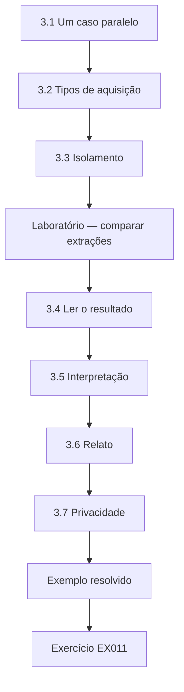

### Desenho lógico

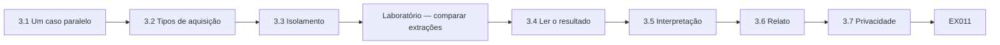

```text
[3.1 Um caso paralelo]
    |
    v
[3.2 Tipos de aquisição]
    |
    v
[3.3 Isolamento]
    |
    v
[Laboratório — comparar extrações]
    |
    v
[3.4 Ler o resultado]
    |
    v
[3.5 Interpretação]
    |
    v
[3.6 Relato]
    |
    v
[3.7 Privacidade]
    |
    v
[Exemplo resolvido] --> [Exercício EX011]
```
<!-- cyberabc:lesson-figures:end ch-03 -->


### Objetivos de aprendizagem

Você vai (1) explicar os tipos de aquisição em dispositivos móveis e suas contrapartidas; (2) interpretar as diferenças entre extrações; (3) cuidar do isolamento do dispositivo; (4) relatar evidências especializadas com seus limites.

### 3.1 Um caso paralelo

Enquanto a resposta ao ransomware continua, o jurídico da Corvane pede à unidade de Marta que examine um celular corporativo entregue a um funcionário suspeito de vazar dados de clientes. A política de dispositivos autoriza o exame de dispositivos da empresa. O caso do celular traz perguntas diferentes das do CF-21: não como um atacante entrou, mas se um funcionário identificado enviou dados de clientes para fora. Como o funcionário pode sofrer medidas disciplinares ou ações judiciais, o exame precisa ser justo e proporcional desde o início. Marta confirma com o jurídico qual pergunta está autorizada antes que Aiyana toque no aparelho.

### 3.2 Tipos de aquisição

A NIST SP 800-101r1 descreve níveis de aquisição em dispositivos móveis, da extração manual e lógica até métodos físicos como *hex dumping*/JTAG e *chip-off*; as ferramentas periciais também oferecem uma extração do sistema de arquivos, situada entre a lógica e a física. A extração lógica usa as interfaces do próprio dispositivo e entrega os dados de usuário que o sistema operacional expõe; a extração do sistema de arquivos entrega mais, inclusive os bancos de dados dos aplicativos. Para o celular da Corvane, a equipe faz uma extração lógica e uma do sistema de arquivos, para que a diferença entre elas possa ser medida, e não suposta. A extração física não é tentada porque o estado de segurança do aparelho não a permite. O laboratório abaixo compara as duas extrações, categoria por categoria, com contagens sintéticas.

### 3.3 Isolamento

O dispositivo é mantido longe das redes (modo avião ou blindagem) para impedir uma limpeza remota ou a chegada de novos dados, como recomenda a SP 800-101r1, e os passos são registrados. Para o celular da Corvane, Aiyana registra quando o modo avião foi ativado, quem o ativou e se o aparelho foi depois colocado numa bolsa blindada. O isolamento importa aqui porque uma limpeza remota pela conta do funcionário poderia destruir o banco de dados do chat antes da extração. Qualquer notificação ou mensagem que chegue antes do isolamento é anotada como recebida durante o manuseio.

### Laboratório — comparar extrações

```python
"""Compare artefact counts from two synthetic mobile extraction types."""
logical = {"sms": 412, "call_log": 230, "contacts": 180, "photos": 1900, "app_chat": 0}
fullfs  = {"sms": 412, "call_log": 230, "contacts": 180, "photos": 1925, "app_chat": 3120}
for k in logical:
    d = fullfs[k] - logical[k]
    print(f"{k:9} logical={logical[k]:5} full_fs={fullfs[k]:5} extra={d}")
print("categories gained only by full_fs:", [k for k in logical if logical[k] == 0 and fullfs[k] > 0])
```

Execute com `python3 lab_mobile.py`. Saída verificada:

```text
sms       logical=  412 full_fs=  412 extra=0
call_log  logical=  230 full_fs=  230 extra=0
contacts  logical=  180 full_fs=  180 extra=0
photos    logical= 1900 full_fs= 1925 extra=25
app_chat  logical=    0 full_fs= 3120 extra=3120
categories gained only by full_fs: ['app_chat']
```

### 3.4 Ler o resultado

As contagens de SMS, registro de chamadas e contatos são idênticas. As fotos diferem em 25 (provavelmente arquivos em cache ou miniaturas). A diferença decisiva é `app_chat`: zero na extração lógica, 3.120 mensagens na extração do sistema de arquivos. Uma conclusão de que "não existe atividade de chat", tirada apenas da extração lógica, estaria errada. A diferença nas fotos pouco importa para a pergunta do vazamento, mas mostra que as duas extrações não enxergam o mesmo sistema de arquivos. A categoria do chat importa muito, porque é nela que estaria o suposto vazamento. Aiyana registra que a extração lógica é incompleta para esse aparelho, de modo que nenhuma constatação depende só dela.

### 3.5 Interpretação

Os bancos de dados dos aplicativos exigem *parsers* validados; registros apagados podem ser recuperáveis a partir de páginas livres. Os carimbos de tempo e as codificações das mensagens variam conforme a versão do aplicativo. Para as 3.120 mensagens de chat, Aiyana registra a versão do aplicativo e a do *parser*, e confere o *parser* com um banco de dados de teste conhecido antes de confiar na sua saída. Os registros apagados recuperados de páginas livres são relatados separadamente dos ativos. Os carimbos de tempo são convertidos com cuidado, porque uma suposição errada sobre o formato de tempo do aplicativo deslocaria as mensagens em horas. Os avisos do *parser* e os registros não interpretados são listados, em vez de descartados em silêncio.

### 3.6 Relato

O laudo indica o tipo de extração de cada constatação e declara o que não estava disponível. Para o celular da Corvane, as 14 mensagens com números de contas de clientes são relatadas como encontradas na extração do sistema de arquivos, com a observação de que a extração lógica não mostrou nenhum dado de chat. Tudo o que a extração não conseguiu alcançar, como o armazenamento cifrado de aplicativos, é listado como indisponível. Assim, os leitores podem julgar o que significa a ausência de evidência. A versão do aplicativo e a do *parser* usadas em cada constatação são informadas ao lado dela.

### 3.7 Privacidade

As mensagens pessoais no celular corporativo são revisadas apenas para a pergunta autorizada. A pergunta autorizada é se dados de clientes saíram pelo celular, por isso Aiyana busca nos dados do chat números de contas de clientes e contatos externos. Mensagens com familiares ou amigos que não contêm dados de clientes não são lidas além do que essa busca exige. As fotos ficam sem revisão, como explica o juízo de proporcionalidade na discussão de ética. Os termos de busca e os motivos para usá-los são registrados antes de a busca rodar, para que o limite possa ser conferido depois.

### Exemplo resolvido

Aiyana relata: "A extração do sistema de arquivos rendeu 3.120 mensagens do aplicativo de chat, ausentes da extração lógica. Entre elas, 14 enviadas a um contato externo contêm números de contas de clientes (ver a lista de anexos)." Ela anota a versão do aplicativo e a do *parser* utilizadas.

> **Caso sintético.** O dispositivo e as contagens são inventados.

### Erros e limites

A capacidade de extração depende do modelo do dispositivo, da versão do sistema operacional e do estado de segurança; alguns dados podem ser inalcançáveis.

### Exercícios

- **EX011 — Diferença decisiva.** Qual foi a diferença decisiva entre as extrações? *Rubrica:* 3 = `app_chat` 0 contra 3.120; 2 = parcial; 1 = fotos; 0 = nada.
- **EX012 — Conclusão errada.** Que conclusão errada os dados apenas lógicos sustentariam? *Rubrica:* 3 = não existe atividade de chat; 2 = parcial; 1 = vago; 0 = nada.
- **EX013 — Isolamento.** Por que isolar o celular das redes? *Rubrica:* 3 = impedir limpeza remota e novos dados; 2 = um; 1 = bateria; 0 = nada.
- **EX014 — Indicar a extração.** Por que indicar o tipo de extração de cada constatação? *Rubrica:* 3 = mostra o que estava disponível; limita a interpretação; 2 = parcial; 1 = estilo; 0 = nada.
- **EX015 — Autoridade.** O que autoriza o exame do celular? *Rubrica:* 3 = a propriedade da empresa e a política de dispositivos; 2 = parcial; 1 = suspeita; 0 = nada.

### Síntese

A evidência especializada exige saber o que cada método de aquisição consegue e não consegue alcançar, e dizê-lo.

### Continue estudando — capítulo 03 de 12

[← Capítulo 02 (rascunho)](#ch-02) · [Índice de capítulos do curso](../SUBJECTS.md) · [Capítulo 04 (rascunho) →](#ch-04)

<a id="ch-04"></a>

## Capítulo 4 — Risco e ética avançados

<!-- cyberabc:lesson-figures:start ch-04 -->
### Mapa da aula

Aula 04 publicada. Mapa, exemplo, EX016.

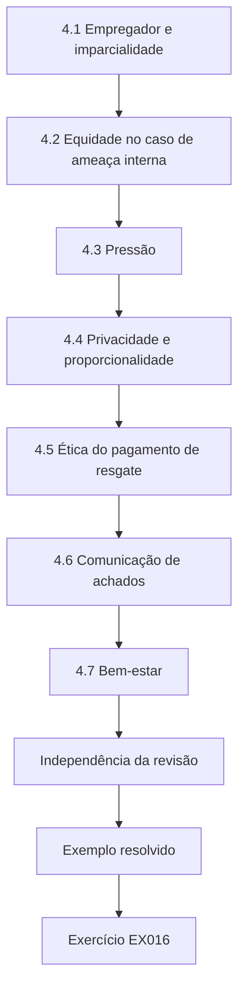

### Desenho lógico

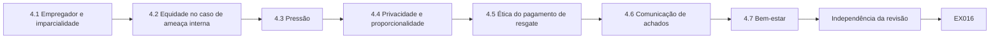

```text
[4.1 Empregador e imparcialidade]
    |
    v
[4.2 Equidade no caso de ameaça interna]
    |
    v
[4.3 Pressão]
    |
    v
[4.4 Privacidade e proporcionalidade]
    |
    v
[4.5 Ética do pagamento de resgate]
    |
    v
[4.6 Comunicação de achados]
    |
    v
[4.7 Bem-estar]
    |
    v
[Independência da revisão]
    |
    v
[Exemplo resolvido] --> [Exercício EX016]
```
<!-- cyberabc:lesson-figures:end ch-04 -->


### Objetivos de aprendizagem

Você vai (1) analisar os riscos éticos em investigações corporativas; (2) lidar com conflitos entre o interesse do empregador e a imparcialidade; (3) garantir a equidade em casos de ameaça interna; (4) decidir sobre obrigações de comunicação.

### 4.1 Empregador e imparcialidade

A unidade de Marta é paga pela Corvane, mas suas constatações podem chegar a tribunais, reguladores ou à Justiça do Trabalho. A imparcialidade é um dever profissional: relatar o que a evidência mostra, inclusive o que favorece o funcionário. No caso do celular, isso significa que as três mensagens enviadas durante o voo do funcionário são relatadas com o mesmo destaque que as 14 mensagens do vazamento. Um laudo que as omitisse atenderia ao desejo imediato da Corvane de uma resposta clara, mas fracassaria num tribunal. Marta assina os laudos ciente de que a credibilidade da sua unidade depende disso.

### 4.2 Equidade no caso de ameaça interna

No caso do celular, o funcionário é suspeito, não culpado comprovado. Os peritos também procuram evidências que o inocentem: o celular era compartilhado? Houve mensagens enviadas enquanto o funcionário estava comprovadamente em outro lugar? Casey (2011) enfatiza testar explicações alternativas. Aiyana procura no aparelho sinais de uso compartilhado, como outras contas ou padrões de desbloqueio conhecidos por colegas, e compara os horários das mensagens com os registros de viagem e de acesso. As três mensagens enviadas durante o voo são o resultado: não inocentam o funcionário, mas mostram que a versão simples dos fatos não está completa.

### 4.3 Pressão

Um gerente sênior pede a Aiyana que "se concentre nas mensagens que provam". Marta intervém: o exame responde por completo à pergunta autorizada, e o laudo inclui as constatações, num sentido ou no outro. O pedido não é incomum; gestores costumam esperar que a perícia confirme uma suspeita. Marta responde por escrito, reafirmando a pergunta autorizada e observando que um exame seletivo enfraqueceria qualquer processo posterior. Aiyana registra o pedido nas notas do caso, de modo que a pressão e a resposta ficam visíveis aos revisores. O pedido do gerente não muda o plano nem o conteúdo do laudo.

### 4.4 Privacidade e proporcionalidade

Revisar as fotos pessoais do funcionário não é necessário para responder à pergunta do vazamento. A proporcionalidade limita o exame ao necessário. O celular guarda 1.925 fotos na extração do sistema de arquivos, e nenhuma é necessária para estabelecer se números de contas de clientes foram enviados para fora. Revisá-las invadiria a vida privada do funcionário sem servir à pergunta autorizada. Se uma mensagem de chat tivesse anexado a foto de dados de clientes, só esse anexo seria examinado. A decisão de não revisar as fotos é registrada, com seu motivo, nas notas do caso.

### 4.5 Ética do pagamento de resgate

Os executivos perguntam se devem pagar. Essa decisão cabe à liderança, ao jurídico e, possivelmente, às autoridades policiais; a contribuição pericial é factual. No CF-21, isso significou três perguntas: se os backups estavam íntegros, se a transferência de 18 GB incluía dados de clientes e se existia um decifrador público para esse ransomware. A unidade de Marta apresenta esses fatos com níveis de confiança e deixa a decisão para a liderança e o jurídico. A verificação do decifrador, por exemplo, indica a família do ransomware e as fontes públicas consultadas. Misturar os dois papéis faria a evidência parecer advocacia.

### 4.6 Comunicação de achados

Se os peritos encontram evidência de um crime grave não relacionado, eles param e buscam orientação jurídica sobre nova autorização e obrigações de comunicação. Na prática, o perito registra o que viu, onde e quando, para de examinar aquele material e informa Marta, que contata o jurídico. A autorização original cobre a pergunta do vazamento, não outros delitos. Continuar sem orientação poderia tornar a nova evidência inadmissível e expor a Corvane a acusações de excesso. O jurídico decide então se é preciso nova autorização e se alguma comunicação às autoridades deve ser feita.

### 4.7 Bem-estar

Longas horas de incidente degradam o julgamento; Marta impõe rodízios de descanso. Durante o CF-21, a resposta se estendeu das 06:10 por todo o dia e pela semana seguinte. Os peritos trabalham em turnos, com passagens de turno registradas no log do caso, e ninguém assina uma conclusão-chave no fim de um turno longo sem revisão. Peritos cansados leem mal os carimbos de tempo, que é exatamente o tipo de erro que este caso não pode se permitir. Marta também conversa com os peritos depois do incidente, porque a pressão do CF-21 não acabou quando os sistemas voltaram.

### Independência da revisão

Para o caso de ameaça interna, Marta pede a um perito que não participou da resposta ao ransomware que revise as constatações do celular, reduzindo o risco de que o cansaço ou as expectativas da equipe moldem a interpretação.

### Exemplo resolvido

Os dados do chat mostram 14 mensagens do vazamento, mas os horários de três delas caem num período em que os registros de viagem mostram o funcionário num voo. Aiyana relata essa inconsistência com destaque, apontando a possibilidade de que outra pessoa tivesse acesso ao celular ou de que o aplicativo tivesse enfileirado as mensagens para envio posterior — cada uma exigindo investigação.

> **Caso sintético.** Os dados são inventados.

### Erros e limites

A orientação ética não resolve todos os dilemas; leve a questão ao jurídico e às entidades profissionais quando o que está em jogo for alto.

### Exercícios

- **EX016 — Imparcialidade.** Por que a unidade de Marta precisa relatar constatações que favorecem o funcionário? *Rubrica:* 3 = dever de imparcialidade; as constatações podem chegar a tribunais; 2 = parcial; 1 = opcional; 0 = nada.
- **EX017 — Pressão do gerente.** Como Marta lidou com "se concentre nas mensagens que provam"? *Rubrica:* 3 = exame autorizado completo, laudo num sentido ou no outro; 2 = parcial; 1 = obedeceu; 0 = nada.
- **EX018 — Inconsistência do voo.** Que alternativas explicam mensagens enviadas durante o voo? *Rubrica:* 3 = outra pessoa com acesso; envio enfileirado pelo aplicativo; 2 = uma; 1 = ignorar; 0 = nada.
- **EX019 — Papel no pagamento.** Qual é o papel da perícia na decisão sobre o resgate? *Rubrica:* 3 = contribuição factual: backups, exfiltração, decifradores; a decisão é de outros; 2 = parcial; 1 = decide; 0 = nada.
- **EX020 — Proporcionalidade.** Aplique a proporcionalidade às fotos pessoais do funcionário. *Rubrica:* 3 = não revisadas; desnecessárias para a pergunta; 2 = parcial; 1 = revisar todas; 0 = nada.

### Síntese

A perícia corporativa permanece imparcial, proporcional e factual sob a pressão do empregador.

### Continue estudando — capítulo 04 de 12

[← Capítulo 03 (rascunho)](#ch-03) · [Índice de capítulos do curso](../SUBJECTS.md) · [Capítulo 05 (rascunho) →](#ch-05)

<a id="ch-05"></a>

## Capítulo 5 — Perícia digital e análise de malware: alternativas de projeto

<!-- cyberabc:lesson-figures:start ch-05 -->
### Mapa da aula

Aula 05 publicada. Mapa, exemplo, EX021.

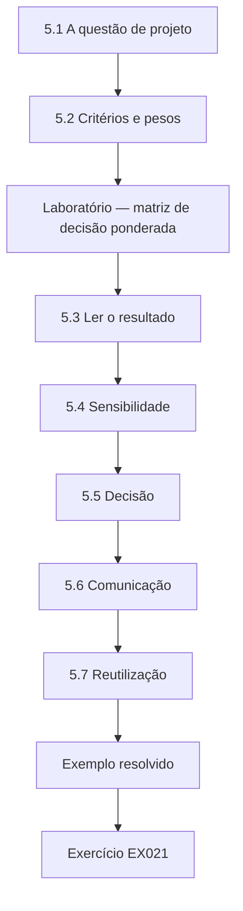

### Desenho lógico

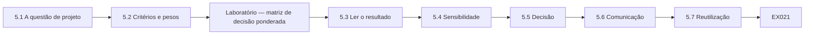

```text
[5.1 A questão de projeto]
    |
    v
[5.2 Critérios e pesos]
    |
    v
[Laboratório — matriz de decisão ponderada]
    |
    v
[5.3 Ler o resultado]
    |
    v
[5.4 Sensibilidade]
    |
    v
[5.5 Decisão]
    |
    v
[5.6 Comunicação]
    |
    v
[5.7 Reutilização]
    |
    v
[Exemplo resolvido] --> [Exercício EX021]
```
<!-- cyberabc:lesson-figures:end ch-05 -->


### Objetivos de aprendizagem

Você vai (1) comparar estratégias de coleta com uma matriz de decisão ponderada; (2) testar a sensibilidade da escolha aos pesos; (3) combinar opções; (4) justificar o projeto às partes interessadas.

### 5.1 A questão de projeto

Para os 40 hosts afetados pelo ransomware, Marta compara três estratégias: gerar imagem completa de cada host; coleta de triagem direcionada em todos; ou triagem em todos e depois imagens completas dos hosts que a triagem marcar como significativos. Cada estratégia responde às perguntas sobre o ponto de entrada e a exfiltração de um jeito diferente e a um custo diferente. A geração completa de imagens dá o máximo de evidência, mas manteria os 40 hosts fora do ar durante a maior parte de um dia. A triagem direcionada é a mais rápida, mas perde qualquer artefato que não esteja na lista. A estratégia híbrida mantém a definição rápida do escopo e acrescenta imagens completas onde a triagem mostra que valem o custo.

### 5.2 Critérios e pesos

Cobertura da evidência (0,35), tempo até a resposta (0,25), interrupção do negócio (0,20) e custo (0,20). Os pesos são acordados com o COO antes da pontuação, para que não sejam ajustados a uma resposta preferida. Os pesos refletem a posição da Corvane: a cobertura pesa mais porque o regulador vai perguntar sobre os dados de clientes, o tempo importa porque a recuperação está à espera, e a interrupção e o custo dividem o restante. Escrever os pesos primeiro, com o COO, significa que ninguém poderá alegar depois que a matriz foi montada para justificar uma escolha feita de antemão. A concordância do COO com os pesos fica registrada no registro de decisões.

### Laboratório — matriz de decisão ponderada

```python
"""Weighted decision matrix: collection strategy for 40 ransomware-affected hosts."""
w = {"evidence_coverage": 0.35, "time_to_answer": 0.25, "business_disruption": 0.20, "cost": 0.20}
opts = {"full_image_all":    {"evidence_coverage": 5, "time_to_answer": 1, "business_disruption": 2, "cost": 1},
        "targeted_triage":   {"evidence_coverage": 3, "time_to_answer": 5, "business_disruption": 4, "cost": 4},
        "triage_then_image": {"evidence_coverage": 4, "time_to_answer": 4, "business_disruption": 4, "cost": 3}}
for name, s in sorted(opts.items(), key=lambda kv: -sum(w[c]*kv[1][c] for c in w)):
    print(f"{name:18} {sum(w[c]*s[c] for c in w):.2f}")
```

Execute com `python3 lab_matrix.py`. Saída verificada:

```text
targeted_triage    3.90
triage_then_image  3.80
full_image_all     2.60
```

### 5.3 Ler o resultado

A triagem direcionada (`targeted_triage`) obtém 3,90, a triagem seguida de imagem (`triage_then_image`) 3,80, e a imagem completa de todos os hosts (`full_image_all`) 2,60. A imagem completa é claramente a pior em tempo e custo. As duas primeiras estão a 0,10 uma da outra — perto demais para que a matriz decida sozinha. A diferença de 0,10 é menor do que o erro provável de qualquer nota isolada, já que a mudança de um ponto no tempo até a resposta move uma opção em 0,25. Marta, por isso, lê a matriz como mostrando que duas opções estão próximas e uma é claramente pior. A escolha entre as duas primeiras exige um argumento que a matriz não pode fornecer.

### 5.4 Sensibilidade

Elevar o peso da cobertura da evidência para 0,45 (tirando 0,10 do tempo) põe a triagem seguida de imagem à frente. Como o regulador pode fazer perguntas detalhadas sobre a exfiltração de dados, Marta julga a cobertura a prioridade mais defensável. Com esses pesos, a triagem seguida de imagem obtém 3,80, a triagem direcionada cai para 3,70 e a imagem completa sobe para 3,00. A ordem das duas primeiras se inverte com uma mudança modesta, o que confirma o quase empate. Marta registra a execução de sensibilidade e o argumento do regulador no registro de decisões. A nova execução leva minutos, porque basta mudar os pesos no script do laboratório.

### 5.5 Decisão

Triagem seguida de imagem: triagem dos 40 hosts e depois imagem completa do host infectado primeiro, do controlador de domínio, dos servidores de arquivos e de qualquer host que mostre ferramentas de exfiltração. A escolha segue o argumento da cobertura: a triagem em todos responde rapidamente ao escopo, e as imagens completas dos hosts com mais chance de guardar evidências da entrada e da exfiltração protegem as perguntas do regulador. Os hosts não marcados como significativos voltam à TI para reconstrução assim que a triagem termina. Os critérios de "significativo" são escritos antes de chegarem os resultados da triagem. A geração de imagens dos hosts significativos corre em paralelo com a recuperação dos demais.

### 5.6 Comunicação

O COO vê a matriz, o quase empate e o motivo para escolher a cobertura. O COO também vê o resultado da sensibilidade: com a cobertura pesando 0,45, a opção híbrida lidera e, com os pesos originais, a triagem direcionada lidera por 0,10. Apresentar o quase empate com honestidade permite ao COO concordar com o argumento da cobertura sabendo o que faz, em vez de ver apenas uma nota vencedora. O COO aprova a opção híbrida com a contrapartida à vista, e a aprovação é registrada. O registro mostra que a decisão se apoiou em prioridades declaradas, e não num ajuste oculto das notas.

### 5.7 Reutilização

A matriz vira um modelo no manual de resposta a incidentes. O modelo mantém os quatro critérios, a regra de que os pesos são acordados antes da pontuação e o painel de pontuação de três pessoas. Cada novo incidente preenche as próprias notas, porque um incidente pequeno, com dois hosts, pode favorecer a imagem completa. Guardar as matrizes antigas com seus resultados permite à unidade conferir depois se a pontuação foi realista. O manual também indica quando não vale a pena usar a matriz, como num incidente com um único host e uma resposta óbvia.

### Painel de pontuação

Três pessoas pontuam cada opção de forma independente — Marta, Aiyana e o líder de infraestrutura — e usa-se a média. Quando as notas diferem em dois pontos ou mais, eles discutem e registram os motivos. Isso reduz a influência da preferência de qualquer pessoa e expõe suposições, como quanto tempo realmente leva gerar a imagem de um servidor de arquivos.

### Exemplo resolvido

A triagem marca seis hosts como significativos; com o controlador de domínio e os dois servidores de arquivos, nove recebem imagem. A geração de imagens corre em paralelo com a recuperação dos outros 31 e termina às 14:00.

> **Caso sintético.** As notas são geradas pelo script do laboratório.

### Erros e limites

As notas são juízos; registre quem pontuou e convide ao questionamento, sobretudo quando as opções estão próximas.

### Exercícios

- **EX021 — Notas do laboratório.** Informe as três notas. *Rubrica:* 3 = 3,90, 3,80, 2,60 com os nomes; 2 = duas; 1 = uma; 0 = nada.
- **EX022 — Quase empate.** Por que a matriz não pode decidir sozinha? *Rubrica:* 3 = as duas primeiras a 0,10; os erros de julgamento superam a diferença; 2 = parcial; 1 = ela pode; 0 = nada.
- **EX023 — Sensibilidade.** Que mudança de pesos inverte as duas primeiras? *Rubrica:* 3 = cobertura 0,45, tempo 0,15; 2 = parcial; 1 = errado; 0 = nada.
- **EX024 — Pesos primeiro.** Por que acordar os pesos antes da pontuação? *Rubrica:* 3 = impede o ajuste a uma resposta preferida; 2 = parcial; 1 = rapidez; 0 = nada.
- **EX025 — Hosts com imagem.** Quais hosts receberam imagem completa? *Rubrica:* 3 = infectado primeiro, controlador de domínio, servidores de arquivos, hosts com exfiltração (nove ao todo); 2 = parcial; 1 = todos; 0 = nada.

### Síntese

Matrizes de decisão esclarecem as contrapartidas; verificações de sensibilidade e prioridades declaradas resolvem os casos apertados.

### Continue estudando — capítulo 05 de 12

[← Capítulo 04 (rascunho)](#ch-04) · [Índice de capítulos do curso](../SUBJECTS.md) · [Capítulo 06 (rascunho) →](#ch-06)

<a id="ch-06"></a>

## Capítulo 6 — Perícia digital e análise de malware: avaliação controlada

<!-- cyberabc:lesson-figures:start ch-06 -->
### Mapa da aula

Aula 06 publicada. Mapa, exemplo, EX026.

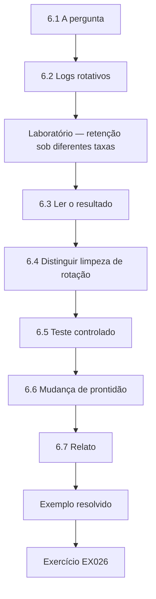

### Desenho lógico

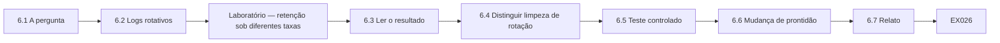

```text
[6.1 A pergunta]
    |
    v
[6.2 Logs rotativos]
    |
    v
[Laboratório — retenção sob diferentes taxas]
    |
    v
[6.3 Ler o resultado]
    |
    v
[6.4 Distinguir limpeza de rotação]
    |
    v
[6.5 Teste controlado]
    |
    v
[6.6 Mudança de prontidão]
    |
    v
[6.7 Relato]
    |
    v
[Exemplo resolvido] --> [Exercício EX026]
```
<!-- cyberabc:lesson-figures:end ch-06 -->


### Objetivos de aprendizagem

Você vai (1) avaliar por quanto tempo a evidência em logs sobrevive; (2) modelar a retenção sob diferentes taxas de eventos; (3) projetar um teste controlado da configuração de logs; (4) aplicar os resultados à prontidão.

### 6.1 A pergunta

Durante o incidente, Aiyana descobriu que os logs de segurança de várias estações de trabalho começavam só algumas horas antes do ataque. O atacante os apagou ou eles simplesmente rotacionaram? Marta ordena uma avaliação controlada. A resposta importa para o laudo: um log apagado é uma ação do atacante e uma constatação, enquanto um log rotacionado é um limite de configuração e uma lacuna de prontidão. Chamar todo log curto de "apagado" exageraria o que o atacante fez, e chamar todos de "rotacionados" poderia esconder atividade antiforense. Marta quer um método testado que separe os dois padrões em cada host afetado.

### 6.2 Logs rotativos

Muitos logs têm tamanho fixo; quando enchem, as entradas mais antigas são sobrescritas. Quanto tempo um evento sobrevive depende da capacidade do log e da taxa de eventos. A aritmética é simples: o tempo guardado é igual à capacidade dividida pela taxa de eventos. Um log de estação de trabalho que guarda semanas de atividade tranquila pode guardar apenas horas quando um ransomware ou um atacante gera milhares de eventos por hora. O laboratório abaixo mostra o quanto a taxa de eventos muda o histórico que um log guarda. Os logs de segurança das estações de trabalho da Corvane usam um tamanho fixo desse tipo.

### Laboratório — retenção sob diferentes taxas

```python
"""How long do events survive in a fixed-size rotating log? (synthetic)"""
capacity = 20_000  # events the log holds
for label, rate in [("quiet", 150), ("normal", 600), ("attack burst", 4000)]:
    print(f"{label:12} {rate:5} events/h -> oldest event kept ~{capacity/rate:6.1f} h")
```

Execute com `python3 lab_retention.py`. Saída verificada:

```text
quiet          150 events/h -> oldest event kept ~ 133.3 h
normal         600 events/h -> oldest event kept ~  33.3 h
attack burst  4000 events/h -> oldest event kept ~   5.0 h
```

### 6.3 Ler o resultado

Um log com capacidade para 20.000 eventos guarda cerca de 133 horas de histórico a 150 eventos por hora, 33 horas a 600 e apenas 5 horas durante uma rajada de 4.000 eventos por hora. A atividade ruidosa de um atacante — ou as próprias operações de arquivo do ransomware, se registradas — pode empurrar para fora evidências anteriores em poucas horas, sem nenhuma limpeza deliberada. O modelo oferece, portanto, uma explicação inocente para os logs das estações que começavam poucas horas antes do ataque, mas não mostra quais hosts foram apagados; isso exige o evento de log apagado ou um início abrupto, conferidos host a host.

### 6.4 Distinguir limpeza de rotação

A limpeza deliberada costuma deixar o próprio registro (um evento de log apagado) e um início abrupto; a rotação mostra um log contínuo cuja entrada mais antiga simplesmente avança. Aiyana confere os dois padrões nos hosts afetados: dois mostram eventos de limpeza, os demais mostram rotação. A conferência é feita host a host: para cada log curto, Aiyana procura um registro de log apagado no início e a continuidade das entradas seguintes. A WS-07 se encaixa no padrão de limpeza, o que é coerente com seu papel de host infectado primeiro. Relatar os dois padrões separadamente mantém as ações do atacante distintas da configuração da Corvane.

### 6.5 Teste controlado

Em máquinas de teste com a configuração de produção, a equipe gera atividade sintética realista e mede quanto tempo os eventos sobrevivem, confirmando o modelo com margem de 10%. O teste usa o mesmo tamanho de log e as mesmas configurações de auditoria das estações de produção da Corvane, com atividade sintética em taxas tranquila, normal e de rajada. Os tempos de sobrevivência medidos ficam a menos de 10% das 133, 33 e 5 horas do modelo. O modelo pode então ser citado no laudo como testado, e não apenas calculado. As configurações do teste, os scripts de atividade e as medições são guardados para que o teste possa ser repetido quando o tamanho dos logs mudar.

### 6.6 Mudança de prontidão

Encaminhar os logs de segurança ao coletor central quase em tempo real e ampliar os logs locais, para que a rotação deixe de destruir evidências. Com o encaminhamento central, um evento sobrevive assim que o coletor o recebe, aconteça o que acontecer depois com o log local. Logs locais maiores acrescentam uma margem caso o encaminhamento seja interrompido. A mudança trata diretamente do padrão da WS-12; não impede que um atacante apague os logs locais, mas a cópia encaminhada permanece. As duas mudanças entram na política de prontidão e são testadas nos exercícios técnicos semestrais.

### 6.7 Relato

O laudo distingue os hosts com logs apagados (ação do atacante) dos que rotacionaram (limite de configuração). No CF-21, o laudo aponta a WS-07 e o outro host apagado como ação do atacante, com os eventos de log apagado como evidência. Os hosts rotacionados, como a WS-12, são listados entre os limites, com o modelo e o teste controlado explicando por que seu histórico era curto. Os leitores podem então ver quais lacunas foram causadas pelo atacante e quais pela configuração. As suposições do modelo, como taxas de eventos constantes, são declaradas junto com ele, para que os leitores conheçam seus limites.

### Exemplo resolvido

O log da WS-07 começa às 01:05 com um evento de log apagado registrado sob uma conta de administrador; o da WS-12 começa às 22:40, sem esse evento e com entradas contínuas. Aiyana relata a WS-07 como apagada deliberadamente e a WS-12 como rotacionada durante atividade intensa.

> **Caso sintético.** As taxas são geradas pelo script do laboratório.

### Erros e limites

O modelo supõe taxas constantes; as rajadas reais variam, por isso teste com atividade realista.

### Exercícios

- **EX026 — Retenção no laboratório.** Informe as horas de retenção nas três taxas. *Rubrica:* 3 = ~133, ~33, ~5 horas; 2 = duas; 1 = uma; 0 = nada.
- **EX027 — Limpeza ou rotação.** Como os dois padrões diferem? *Rubrica:* 3 = evento de limpeza e início abrupto contra log contínuo com a entrada mais antiga avançando; 2 = parcial; 1 = iguais; 0 = nada.
- **EX028 — WS-07 e WS-12.** Como cada host foi classificado? *Rubrica:* 3 = WS-07 apagada; WS-12 rotacionada; 2 = um; 1 = invertido; 0 = nada.
- **EX029 — Mudança de prontidão.** Que mudança de configuração foi recomendada? *Rubrica:* 3 = encaminhamento central quase em tempo real; logs maiores; 2 = uma; 1 = vago; 0 = nada.
- **EX030 — Verificação do modelo.** Como o modelo foi validado? *Rubrica:* 3 = teste controlado com a configuração de produção, dentro de 10%; 2 = parcial; 1 = suposto; 0 = nada.

### Síntese

A avaliação controlada separa a ação do atacante dos limites de configuração e orienta mudanças de prontidão.

### Continue estudando — capítulo 06 de 12

[← Capítulo 05 (rascunho)](#ch-05) · [Índice de capítulos do curso](../SUBJECTS.md) · [Capítulo 07 (rascunho) →](#ch-07)

<a id="ch-07"></a>

## Capítulo 7 — Perícia digital e análise de malware: integração organizacional

<!-- cyberabc:lesson-figures:start ch-07 -->
### Mapa da aula

Aula 07 publicada. Mapa, exemplo, EX031.

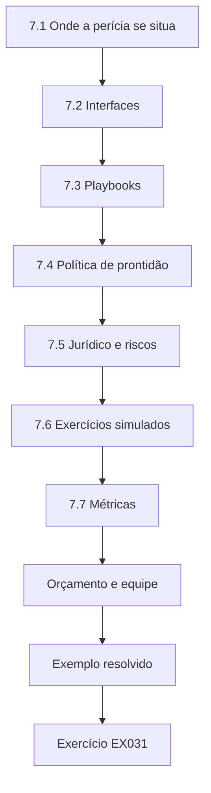

### Desenho lógico

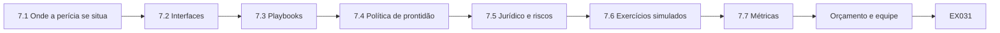

```text
[7.1 Onde a perícia se situa]
    |
    v
[7.2 Interfaces]
    |
    v
[7.3 Playbooks]
    |
    v
[7.4 Política de prontidão]
    |
    v
[7.5 Jurídico e riscos]
    |
    v
[7.6 Exercícios simulados]
    |
    v
[7.7 Métricas]
    |
    v
[Orçamento e equipe]
    |
    v
[Exemplo resolvido] --> [Exercício EX031]
```
<!-- cyberabc:lesson-figures:end ch-07 -->


### Objetivos de aprendizagem

Você vai (1) integrar a capacidade pericial à resposta a incidentes da empresa; (2) definir as interfaces com o SOC, a TI, o jurídico e a área de riscos; (3) incorporar a prontidão pericial à política; (4) medir a integração.

### 7.1 Onde a perícia se situa

Na Corvane, o SOC detecta, a resposta a incidentes coordena, a TI recupera e a unidade de Marta preserva e examina a evidência. Antes do CF-21, esses papéis se sobrepunham informalmente, o que causava atrasos: a TI reconstruiu dois servidores antes dos snapshots periciais. A reconstrução de dois servidores antes dos snapshots não foi má-fé nem descuido; a TI seguiu o próprio *runbook* de recuperação, que não dizia nada sobre perícia. O custo foi permanente: as perguntas que esses servidores poderiam ter respondido ficaram parcialmente em aberto no laudo final. Marta trata o episódio como uma falha de processo a corrigir, não como uma equipe a culpar.

### 7.2 Interfaces

Uma matriz RACI esclarece quem é responsável, quem presta contas, quem é consultado e quem é informado em cada etapa: isolamento, captura de memória, snapshot, aprovação da reconstrução, notificação ao regulador. No CF-21, a matriz teria mostrado, por exemplo, que a TI é responsável pela aprovação da reconstrução, mas precisa consultar a unidade de Marta no caso de hosts significativos. A notificação ao regulador fica com o jurídico, que presta contas, com a perícia consultada sobre os fatos. Escrever isso elimina as suposições que levaram às reconstruções das 08:30. A matriz é revista após cada exercício e cada incidente, para acompanhar como a Corvane realmente trabalha.

### 7.3 *Playbooks*

Os *playbooks* de incidentes agora incluem uma barreira pericial: nenhum host significativo é reconstruído sem a liberação da perícia, com um tempo máximo de espera acordado com a TI para que a recuperação não fique bloqueada indefinidamente. O tempo máximo de espera importa tanto quanto a própria barreira. Sem um limite, a TI veria a perícia como um bloqueio sem prazo e procuraria formas de contorná-lo. Com um limite, a TI consegue planejar a recuperação, e a perícia sabe que precisa agir dentro da janela ou registrar por que não conseguiu. Para o CF-21, esse limite passou a ser de 90 minutos, com um contato pericial de plantão indicado no *playbook*.

### 7.4 Política de prontidão

A ISO/IEC 27043 inclui processos de prontidão. A política da Corvane agora especifica as fontes de log, a retenção, o encaminhamento central, a sincronização de horário e ferramentas de coleta pré-aprovadas nos endpoints. Cada item da política remonta a uma lacuna do CF-21. O encaminhamento central responde aos logs rotacionados das estações, a sincronização de horário sustenta a fusão de logs de muitas fontes, e as ferramentas pré-aprovadas fazem com que a captura de memória não espere por um pedido de software. As configurações de retenção dos logs de VPN e de identidade protegem a evidência que mostrou o ponto de entrada. O cumprimento da política é conferido pela métrica de cobertura de logs.

### 7.5 Jurídico e riscos

O jurídico é envolvido cedo para gerir o sigilo profissional e o contato com o regulador; as equipes de risco recebem avaliações de impacto baseadas em evidências. No CF-21, o envolvimento precoce do jurídico moldou a forma como as constatações da investigação foram registradas e o momento em que o regulador foi contatado. A equipe de riscos precisava saber quantas contas de clientes poderiam estar afetadas, e a resposta pericial — 4.200 contas no compartilhamento, sem confirmação da transferência de arquivos específicos — lhe deu um número delimitado. O jurídico e a equipe de riscos também são convidados para os exercícios semestrais, para que as interfaces sejam praticadas antes do próximo incidente.

### 7.6 Exercícios simulados

Exercícios conjuntos de mesa e técnicos, duas vezes por ano, testam as interfaces. Os exercícios usam incidentes sintéticos que tocam as mesmas interfaces do CF-21: um alerta que deveria disparar snapshots, um pedido de reconstrução que precisa passar pela barreira pericial e um informe para o jurídico. Os problemas encontrados nos exercícios vão para responsáveis nomeados, com datas para a correção e para um novo teste. Uma barreira que nunca é exercitada tende a ser pulada no próximo incidente real. Os resultados de cada exercício são relatados em relação às métricas de integração.

### 7.7 Métricas

Tempo da detecção até a preservação pericial; porcentagem de hosts significativos preservados antes da reconstrução; cobertura de logs em relação à política. Essas três métricas vêm diretamente das lacunas encontradas na revisão do CF-21. O tempo da detecção até a preservação foi a linha de base do projeto aplicado, com mediana de 3,5 horas. A porcentagem de hosts significativos preservados antes da reconstrução capta os dois servidores perdidos, e a cobertura de logs mede se a política de prontidão está de fato implantada nos endpoints. Cada métrica é relatada trimestralmente, para que o desvio apareça antes que um incidente o ponha à prova.

### Orçamento e equipe

A integração precisa de recursos: uma escala de plantão, armazenamento para snapshots e imagens e licenças de coleta nos endpoints. Marta apresenta os custos em relação aos atrasos do CF-21 que eles teriam evitado, dando ao conselho uma comparação concreta.

### Exemplo resolvido

Na revisão pós-incidente, a linha do tempo mostra dois servidores reconstruídos às 08:30, antes dos snapshots, porque a TI não sabia que a barreira pericial existia. A ação de Marta: incluir a barreira no processo de mudanças da TI, com espera máxima de 90 minutos e um contato pericial de plantão.

> **Caso sintético.** A revisão é inventada.

### Erros e limites

Mudanças de processo exigem prática; uma barreira escrita num *playbook*, mas nunca exercitada, ainda pode ser pulada sob pressão.

### Exercícios

- **EX031 — Falha anterior ao CF-21.** O que deu errado antes da integração? *Rubrica:* 3 = a TI reconstruiu servidores antes dos snapshots; sobreposição de papéis; 2 = parcial; 1 = vago; 0 = nada.
- **EX032 — RACI.** O que uma matriz RACI define? *Rubrica:* 3 = responsável, quem presta contas, consultado, informado em cada etapa; 2 = parcial; 1 = organograma; 0 = nada.
- **EX033 — Barreira pericial.** Descreva a barreira pericial e sua salvaguarda para a TI. *Rubrica:* 3 = liberação antes da reconstrução; tempo máximo de espera; 2 = uma; 1 = vago; 0 = nada.
- **EX034 — Política de prontidão.** Liste quatro elementos da política de prontidão. *Rubrica:* 3 = fontes de log, retenção, encaminhamento, sincronização de horário, ferramentas (quaisquer quatro); 2 = três; 1 = um; 0 = nada.
- **EX035 — Métrica de integração.** Dê duas métricas de integração. *Rubrica:* 3 = tempo da detecção à preservação; % de hosts significativos preservados (ou cobertura de logs); 2 = uma; 1 = vago; 0 = nada.

### Síntese

A perícia funciona melhor incorporada aos processos de incidente, com interfaces claras, barreiras, política de prontidão e métricas.

### Continue estudando — capítulo 07 de 12

[← Capítulo 06 (rascunho)](#ch-06) · [Índice de capítulos do curso](../SUBJECTS.md) · [Capítulo 08 (rascunho) →](#ch-08)

<a id="ch-08"></a>

## Capítulo 8 — Perícia digital e análise de malware: casos difíceis

<!-- cyberabc:lesson-figures:start ch-08 -->
### Mapa da aula

Aula 08 publicada. Mapa, exemplo, EX036.

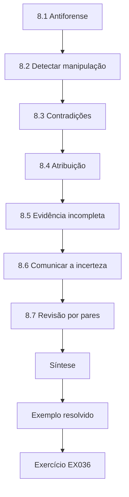

### Desenho lógico

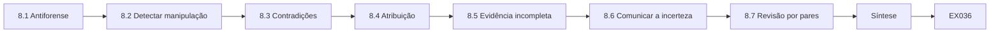

```text
[8.1 Antiforense]
    |
    v
[8.2 Detectar manipulação]
    |
    v
[8.3 Contradições]
    |
    v
[8.4 Atribuição]
    |
    v
[8.5 Evidência incompleta]
    |
    v
[8.6 Comunicar a incerteza]
    |
    v
[8.7 Revisão por pares]
    |
    v
[Síntese]
    |
    v
[Exemplo resolvido] --> [Exercício EX036]
```
<!-- cyberabc:lesson-figures:end ch-08 -->


### Objetivos de aprendizagem

Você vai (1) lidar com atividade antiforense e evidências contraditórias; (2) raciocinar sobre os limites da atribuição; (3) gerir evidências incompletas; (4) comunicar a incerteza a executivos e reguladores.

### 8.1 Antiforense

Na WS-07, o log de segurança foi apagado, e o ransomware excluiu as cópias de sombra de volume. Alguns carimbos de tempo de arquivo numa ferramenta deixada no sistema mostram o ano de criação 2009 — muito anterior à instalação do sistema operacional. A alteração de carimbos de tempo é uma técnica antiforense conhecida. Cada um desses atos mira uma fonte de evidência diferente: a limpeza remove o log de segurança, a exclusão das cópias de sombra remove versões anteriores dos arquivos, e os carimbos alterados escondem quando uma ferramenta chegou. Nenhum deles, por mais minucioso que seja, detém sozinho uma investigação. Juntos, empurram os peritos a confiar em fontes que o atacante não alterou ou não conseguiu alterar.

### 8.2 Detectar manipulação

Comparar os carimbos de tempo do sistema de arquivos com outras fontes — o aparecimento do arquivo numa listagem de diretório capturada pela triagem, as entradas do diário de alterações do NTFS, o horário da primeira execução no prefetch — expõe a inconsistência. Carrier (2005) explica as estruturas de metadados separadas que tornam possíveis esses cruzamentos. Na WS-07, o horário de criação de 2009 da ferramenta deixada conflita com a listagem da triagem e com o diário de alterações, que mostra o arquivo chegando durante a intrusão. O prefetch registra a primeira execução da ferramenta na mesma noite da intrusão. Quando três fontes independentes concordam contra um carimbo de tempo, o laudo trata esse carimbo como alterado e diz por quê.

### 8.3 Contradições

O firewall mostra 18 GB saindo do servidor de arquivos para um host externo às 02:40; os logs do próprio servidor de arquivos não mostram leituras incomuns. Possibilidades: lacunas de registro, outro host de origem por trás de NAT ou dados preparados em outro lugar. Cada uma é testada. A contradição não se resolve escolhendo a fonte mais conveniente. As lacunas de registro são conferidas procurando intervalos ausentes nos logs do servidor de arquivos; o NAT, recuperando a tabela de tradução do firewall; e a preparação, examinando outros hosts que poderiam alcançar o compartilhamento de clientes. Cada teste é descrito com seu método e resultado, inclusive os testes que não encontraram nada.

### 8.4 Atribuição

A nota de resgate cita um grupo criminoso conhecido. Atribuir o ataque a um grupo específico a partir de uma nota é fraco — notas são copiadas — e não é necessário para as perguntas periciais. O laudo de Marta registra a alegação sem endossá-la. Copiar a nota de outro grupo não custa nada a um criminoso, por isso um nome numa nota prova pouco. As perguntas periciais do CF-21, sobre entrada, propagação e perda de dados, podem ser respondidas sem saber quem foram os atacantes. Se as autoridades policiais atribuírem o ataque mais tarde, as constatações do laudo continuam válidas de qualquer modo.

### 8.5 Evidência incompleta

Dois hosts foram reconstruídos antes da preservação. O laudo declara quais perguntas isso deixa parcialmente sem resposta. No CF-21, os dois servidores reconstruídos significam que algumas perguntas sobre movimentação lateral não podem ser respondidas por completo. O laudo nomeia essas perguntas, diz quais outras fontes, como os logs centrais e os registros do controlador de domínio, as estreitam quando possível, e declara que a lacuna decorre da reconstrução antes da preservação. Essa franqueza é também o argumento mais forte a favor da barreira pericial acrescentada depois. O laudo não apresenta as respostas estreitadas como se os servidores reconstruídos tivessem sido examinados.

### 8.6 Comunicar a incerteza

Os executivos querem sim ou não. Marta usa afirmações calibradas: "A evidência sustenta a exfiltração de aproximadamente 18 GB a partir do segmento do servidor de arquivos; quais arquivos ainda não pode ser determinado." A afirmação dá aos executivos um número com que podem agir e um limite claro sobre o que ainda não se sabe. Ela evita tanto "nenhum dado foi levado" quanto "todos os dados de clientes foram roubados", nenhuma das quais a evidência sustenta. Marta usa a mesma estrutura para cada constatação importante: o que a evidência sustenta e o que permanece em aberto.

### 8.7 Revisão por pares

As constatações difíceis recebem um segundo revisor sênior. No CF-21, a constatação da preparação dos dados no servidor de backup e a manipulação de carimbos de tempo na WS-07 recebem, ambas, um segundo revisor sênior. O revisor trabalha a partir da evidência e das notas do perito, não da conclusão. O segundo revisor não pode ter trabalhado na constatação, para que sua visão seja independente. Quando o revisor discorda, a divergência é resolvida antes de o laudo ir para o jurídico ou para o regulador; o laudo declara a posição final e o motivo, e a divergência permanece nos autos do caso. No CF-21, isso acrescentou um dia antes da saída do laudo, o que Marta julgou valer a pena, dado o interesse do regulador.

### Exemplo resolvido

A tabela de NAT, recuperada da exportação de memória do firewall, associa a transferência das 02:40 ao servidor de backup, e não ao servidor de arquivos. Os logs do servidor de backup mostram uma leitura em massa do compartilhamento de clientes às 02:35. A contradição se resolve: os dados foram preparados por meio do servidor de backup.

> **Caso sintético.** A evidência é inventada.

### Erros e limites

Resolver uma contradição pode criar uma confiança que não se justifica em outros pontos; continue testando as demais constatações.

### Exercícios

- **EX036 — Anomalia de carimbo de tempo.** Como expor o horário de criação de 2009 como manipulado? *Rubrica:* 3 = cruzar com o diário de alterações, a listagem da triagem e a primeira execução no prefetch; 2 = parcial; 1 = aceitar; 0 = nada.
- **EX037 — Opções para a contradição.** Liste três explicações para a contradição dos 18 GB. *Rubrica:* 3 = lacuna de registro, origem por NAT, preparação em outro lugar; 2 = duas; 1 = uma; 0 = nada.
- **EX038 — Resolução.** Como a contradição foi resolvida? *Rubrica:* 3 = a tabela de NAT apontou o servidor de backup; leitura em massa às 02:35; 2 = parcial; 1 = vago; 0 = nada.
- **EX039 — Atribuição pela nota de resgate.** Por que não endossar o grupo citado na nota? *Rubrica:* 3 = notas são copiadas; evidência fraca; desnecessária para as perguntas; 2 = parcial; 1 = endossar; 0 = nada.
- **EX040 — Afirmação calibrada.** Escreva uma afirmação calibrada sobre a exfiltração. *Rubrica:* 3 = sustenta ~18 GB a partir do segmento; arquivos não determinados; 2 = parcial; 1 = sim/não; 0 = nada.

### Síntese

Casos difíceis exigem cruzamentos, alternativas testadas, contenção na atribuição e comunicação calibrada.

### Continue estudando — capítulo 08 de 12

[← Capítulo 07 (rascunho)](#ch-07) · [Índice de capítulos do curso](../SUBJECTS.md) · [Capítulo 09 (rascunho) →](#ch-09)

<a id="ch-09"></a>

## Capítulo 9 — Perícia digital e análise de malware: liderança e garantia

<!-- cyberabc:lesson-figures:start ch-09 -->
### Mapa da aula

Aula 09 publicada. Mapa, exemplo, EX041.

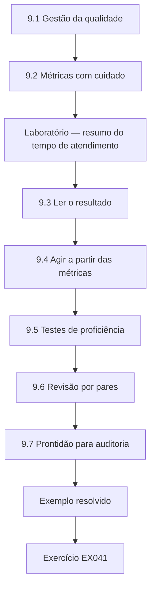

### Desenho lógico

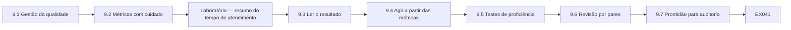

```text
[9.1 Gestão da qualidade]
    |
    v
[9.2 Métricas com cuidado]
    |
    v
[Laboratório — resumo do tempo de atendimento]
    |
    v
[9.3 Ler o resultado]
    |
    v
[9.4 Agir a partir das métricas]
    |
    v
[9.5 Testes de proficiência]
    |
    v
[9.6 Revisão por pares]
    |
    v
[9.7 Prontidão para auditoria]
    |
    v
[Exemplo resolvido] --> [Exercício EX041]
```
<!-- cyberabc:lesson-figures:end ch-09 -->


### Objetivos de aprendizagem

Você vai (1) liderar uma unidade pericial com garantia da qualidade; (2) usar métricas como os percentis do tempo de atendimento; (3) conduzir programas de proficiência e de revisão por pares; (4) preparar-se para uma auditoria externa.

### 9.1 Gestão da qualidade

A unidade de Marta mantém um sistema da qualidade: procedimentos documentados, métodos validados, registros de competência, testes de proficiência, revisão por pares e ações corretivas. A ISO/IEC 27041 apoia a garantia de que os métodos são adequados ao propósito; os esquemas de acreditação de laboratórios avaliam o sistema mais amplo. Na prática, cada elemento aparece no CF-21: o agente de endpoint validado, os registros de competência para a captura de memória, o teste de proficiência sobre carimbos de tempo de auditoria na nuvem e as ações corretivas após a falha da barreira pericial. Os avaliadores procuram evidências de que o sistema funciona em casos reais, e não apenas de que os documentos existem.

### 9.2 Métricas com cuidado

As médias escondem atrasos longos. Os percentis mostram a cauda que frustra as equipes jurídicas. Para uma unidade pericial, a cauda é onde se perdem prazos legais e os casos emperram. Uma média puxada para baixo por muitos casos rápidos pode parecer aceitável enquanto dois casos esperam mais de um mês. Marta relata juntos a mediana, o percentil 90 e a contagem acima de 21 dias, para que a cauda continue à vista. As equipes jurídicas se importam com o caso que espera seis semanas, não com o típico. Relatar a cauda permite a Marta discutir esses casos, um a um, com as pessoas que esperam por eles.

### Laboratório — resumo do tempo de atendimento

```python
"""Turnaround-time summary for synthetic forensic cases (days)."""
import statistics as st
tat = [4, 6, 5, 7, 30, 8, 5, 6, 9, 41, 7, 6, 5, 8, 12, 6, 7, 5, 9, 6]
q = st.quantiles(tat, n=10)
print(f"cases={len(tat)} median={st.median(tat)} p90={q[8]:.1f} max={max(tat)}")
print("over 21 days:", sum(t > 21 for t in tat))
```

Execute com `python3 lab_tat.py`. Saída verificada:

```text
cases=20 median=6.5 p90=28.2 max=41
over 21 days: 2
```

### 9.3 Ler o resultado

Vinte casos: mediana de 6,5 dias, percentil 90 de 28,2 dias, máximo de 41. Dois casos passaram de 21 dias. A mediana parece saudável; a cauda mostra dois casos esperando um mês ou mais, ambos envolvendo dispositivos cifrados à espera da recuperação de chaves. Os números vêm dos 20 casos sintéticos do laboratório, dos quais 18 terminam em até 12 dias. Os dois casos lentos não são lentos por causa da velocidade dos peritos, então pedir que os peritos trabalhem mais depressa não os encurtaria. O diagnóstico aponta, em vez disso, para dependências fora da unidade, como a recuperação de chaves de dispositivos cifrados.

### 9.4 Agir a partir das métricas

Em vez de pressionar os peritos a acelerar, Marta separa os casos bloqueados por dependências externas e os acompanha como uma fila distinta, com datas de escalonamento. Acompanhar separadamente os casos bloqueados mantém honestas as métricas da fila principal e dá a cada caso bloqueado um responsável e uma data para escalonar. Para dispositivos cifrados à espera de chaves, escalonar pode significar pedir ao jurídico que pressione o proprietário do dispositivo ou o provedor. A métrica passa então a medir o que a unidade realmente consegue influenciar. Cada caso bloqueado é revisto semanalmente até que sua dependência seja resolvida.

### 9.5 Testes de proficiência

Duas vezes por ano, cada perito analisa um caso sintético preparado, com respostas conhecidas; os resultados alimentam os planos de treinamento. Os casos preparados incluem armadilhas baseadas em erros reais, como o log de auditoria da nuvem que armazena em UTC, mas exibe a hora local. As respostas são pontuadas em relação aos resultados conhecidos, e o perito que erra uma recebe treinamento direcionado e um novo teste. Os resultados alimentam os registros de competência e os planos de treinamento, não as avaliações de desempenho individuais. As respostas do teste são preparadas por um perito sênior que não faz aquela rodada do teste.

### 9.6 Revisão por pares

Todo laudo passa por revisão técnica (constatações fundamentadas) e revisão administrativa (completude, formato). No CF-21, o revisor técnico confere, por exemplo, se a constatação da preparação dos dados no servidor de backup cita a tabela de NAT e a leitura em massa das 02:35. O revisor administrativo confere se o laudo tem escopo, limites e lista de evidências no formato acordado. As duas revisões são registradas com os nomes dos revisores e as datas antes da liberação do laudo. Os comentários da revisão e as respostas do perito ficam nos autos do caso para auditoria posterior. Um laudo não pode ser liberado enquanto um comentário técnico estiver sem resolução.

### 9.7 Prontidão para auditoria

Os registros são organizados para que um auditor consiga rastrear qualquer caso, da entrada ao laudo. No CF-21, um auditor deve conseguir acompanhar a WS-07 desde a coleta de triagem, passando pela imagem completa, pela análise dos carimbos de tempo e pela constatação revisada, até a frase no laudo final. Cada etapa tem um registro com uma pessoa e uma data. Lacunas nessa trilha seriam, em si, uma constatação de auditoria. Marta amostra casos ela mesma a cada trimestre para testar se a trilha se sustenta antes que um auditor o faça.

### Desenvolver pessoas

Marta forma duplas de peritos juniores com seniores em casos reais, faz rodízio da equipe entre as funções de incidente e de casos e financia treinamentos ligados aos resultados de proficiência. Os registros de competência listam os métodos autorizados de cada perito, atualizados após treinamento e avaliação.

### Exemplo resolvido

Um teste de proficiência mostra que dois de seis peritos interpretaram mal um carimbo de tempo de um log de auditoria da nuvem que registra os horários em UTC enquanto o console exibe a hora local. Marta acrescenta um módulo de treinamento e um item à lista de verificação e depois aplica um novo teste: os seis passam.

> **Caso sintético.** Os dados são gerados pelo script do laboratório.

### Erros e limites

As métricas orientam o comportamento; combine a velocidade com medidas de qualidade para não incentivar atalhos.

### Exercícios

- **EX041 — Percentis do laboratório.** Informe a mediana, o p90 e os casos acima de 21 dias. *Rubrica:* 3 = 6,5, 28,2, 2; 2 = dois; 1 = um; 0 = nada.
- **EX042 — Mediana ou cauda.** Por que relatar o p90 além da mediana? *Rubrica:* 3 = a mediana esconde atrasos longos; a cauda importa aos usuários; 2 = parcial; 1 = sem motivo; 0 = nada.
- **EX043 — Fila de bloqueados.** O que Marta fez a respeito da cauda? *Rubrica:* 3 = fila separada de bloqueados por dependências externas, com escalonamento; 2 = parcial; 1 = cobrar velocidade; 0 = nada.
- **EX044 — Lacuna de proficiência.** O que o teste de proficiência revelou e como foi corrigido? *Rubrica:* 3 = leitura errada de UTC contra exibição local; treinamento, lista de verificação, novo teste; 2 = parcial; 1 = vago; 0 = nada.
- **EX045 — Duas revisões.** Distinga a revisão técnica da administrativa. *Rubrica:* 3 = constatações fundamentadas contra completude/formato; 2 = parcial; 1 = iguais; 0 = nada.

### Síntese

Liderar significa medir as coisas certas, testar a competência e manter os registros prontos para auditoria.

### Continue estudando — capítulo 09 de 12

[← Capítulo 08 (rascunho)](#ch-08) · [Índice de capítulos do curso](../SUBJECTS.md) · [Capítulo 10 (rascunho) →](#ch-10)

<a id="ch-10"></a>

## Capítulo 10 — Leitura e crítica de pesquisa

<!-- cyberabc:lesson-figures:start ch-10 -->
### Mapa da aula

Aula 10 publicada. Mapa, exemplo, EX046.

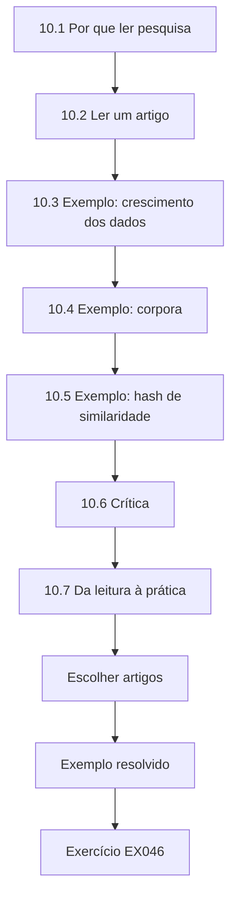

### Desenho lógico

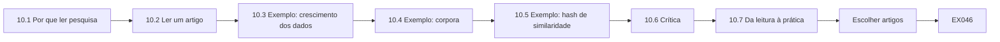

```text
[10.1 Por que ler pesquisa]
    |
    v
[10.2 Ler um artigo]
    |
    v
[10.3 Exemplo: crescimento dos dados]
    |
    v
[10.4 Exemplo: corpora]
    |
    v
[10.5 Exemplo: hash de similaridade]
    |
    v
[10.6 Crítica]
    |
    v
[10.7 Da leitura à prática]
    |
    v
[Escolher artigos]
    |
    v
[Exemplo resolvido] --> [Exercício EX046]
```
<!-- cyberabc:lesson-figures:end ch-10 -->


### Objetivos de aprendizagem

Você vai (1) ler pesquisa pericial de forma crítica; (2) avaliar métodos, dados e afirmações; (3) traduzir a pesquisa em decisões de prática; (4) identificar lacunas que valem um estudo.

### 10.1 Por que ler pesquisa

A prática muda quando a evidência muda. A equipe de Marta mantém um grupo de leitura mensal e escolhe artigos ligados aos casos em andamento. Para a unidade de Marta, a pesquisa tem consequências práticas: um novo método de análise de memória ou de triagem pode mudar o que a equipe coleta no próximo incidente. Escolher artigos ligados aos casos em andamento mantém a discussão centrada nas decisões que a equipe realmente precisa tomar. Cada sessão termina com uma nota sobre o que, se for o caso, deve mudar. A presença é registrada, e cada perito apresenta um artigo pelo menos uma vez por ano.

### 10.2 Ler um artigo

Perguntas: qual é a afirmação? Que dados foram usados — sintéticos, reais, quantos? O método está descrito o bastante para ser repetido? Taxas de erro ou limites são relatados? Quem financiou? Essas perguntas valem igualmente para artigos clássicos e recentes, seja qual for sua reputação. Uma afirmação testada apenas com dados sintéticos pode não se sustentar nos sistemas da Corvane, e um método descrito com brevidade demais para ser repetido não pode ser validado localmente. As taxas de erro importam mais, porque um método usado em tribunal precisa ter limites conhecidos.

### 10.3 Exemplo: crescimento dos dados

Garfinkel (2010) argumentou que a "era de ouro" da perícia digital estava terminando à medida que cresciam os volumes de dados, a cifragem e a diversidade de dispositivos, e defendeu novas direções de pesquisa, incluindo dados padronizados e ferramentas modulares. A equipe se pergunta se sua abordagem de triagem seguida de imagem responde a esse desafio. A resposta da equipe é um sim parcial: a triagem seguida de imagem lida com o volume ao coletar seletivamente e gerar imagem só dos hosts significativos, como o CF-21 mostrou com nove imagens para 40 hosts. A cifragem e a diversidade de dispositivos continuam difíceis, como mostraram os dados inalcançáveis do caso do celular. A discussão e qualquer mudança proposta são registradas junto ao artigo no registro de leituras.

### 10.4 Exemplo: corpora

Garfinkel et al. (2009) descreveram a construção de corpora periciais padronizados para que os resultados pudessem ser comparados e as ferramentas testadas. A equipe usa isso para justificar a construção das próprias imagens sintéticas de teste para validação. Construir imagens sintéticas permite à unidade validar ferramentas como o agente de endpoint e o *parser* do celular sem expor dados pessoais reais. Conteúdos conhecidos significam que a equipe pode conferir o que uma ferramenta encontra em relação ao que de fato está lá. As mesmas imagens também sustentam os testes de proficiência semestrais, que precisam de casos com respostas conhecidas.

### 10.5 Exemplo: hash de similaridade

Kornblum (2006) introduziu o hash por partes disparado por contexto; Roussev (2010) propôs os resumos de similaridade (*similarity digests*). A equipe discute se a correspondência por similaridade poderia encontrar variantes do ransomware entre os hosts, e o que as taxas de falsas correspondências significariam na prática. A pergunta para a Corvane é concreta: os binários do ransomware em hosts diferentes podem ser pequenas variantes que os hashes exatos tratam como não relacionadas. Um método de similaridade poderia agrupá-las, mas uma falsa correspondência poderia ligar um arquivo inocente ao incidente. A equipe decide testar com variantes sintéticas antes de adotar qualquer coisa nos casos.

### 10.6 Crítica

Artigos fortes declaram seus limites; os mais fracos generalizam a partir de um único conjunto de dados. O grupo escreve uma crítica de um parágrafo por artigo. Para Kornblum (2006), por exemplo, a crítica observa que o método foi demonstrado com dados específicos e que seu comportamento nos tipos de arquivo da Corvane precisaria ser testado. Cada crítica termina dizendo se o artigo deve afetar a prática e que teste local o mostraria. O parágrafo nomeia a afirmação, os dados, o limite principal e a relevância para a Corvane, para que leitores posteriores o encontrem depressa. As críticas são arquivadas com o artigo no registro de leituras.

### 10.7 Da leitura à prática

O método de um artigo só entra na prática depois de validação local. Para o hash de similaridade, isso significa primeiro o teste de Aiyana com variantes sintéticas e depois a validação no corpus da própria equipe, com taxas de falsas correspondências medidas. Só então ele poderia se tornar um auxílio de triagem e, mesmo assim, os hashes exatos continuam sendo a base da identificação. O item em aberto na revisão do programa reflete que isso ainda não está concluído. O resultado da validação, com seus dados e taxas de erro, é registrado antes de qualquer mudança de procedimento. Um método reprovado na validação é anotado como tentado e rejeitado, para que a equipe não repita o trabalho.

### Escolher artigos

O grupo escolhe artigos que tratam de uma decisão atual, alternando trabalhos clássicos e recentes, e registra por que cada um foi escolhido.

### Exemplo resolvido

Depois de ler Kornblum (2006), Aiyana testa o hash de similaridade em binários sintéticos semelhantes a ransomware, modificados de formas pequenas. Os hashes exatos não correspondem a nenhuma das variantes; as notas de similaridade as agrupam com clareza. Ela propõe a correspondência por similaridade como auxílio de triagem, validada no corpus da equipe, com os hashes exatos ainda usados para a identificação.

> **Caso sintético.** O teste é inventado.

### Erros e limites

Artigos mais antigos podem descrever ferramentas ou sistemas que mudaram; confira se as constatações ainda se sustentam.

### Exercícios

- **EX046 — Perguntas de leitura.** Liste quatro perguntas a fazer a um artigo. *Rubrica:* 3 = afirmação, dados, repetibilidade, limites/taxas de erro, financiamento (quaisquer quatro); 2 = três; 1 = uma; 0 = nada.
- **EX047 — Garfinkel 2010.** Resuma o argumento de Garfinkel (2010). *Rubrica:* 3 = crescimento dos dados, cifragem e diversidade encerram a era de ouro; nova pesquisa necessária; 2 = parcial; 1 = vago; 0 = nada.
- **EX048 — Uso dos corpora.** Como Garfinkel et al. (2009) sustentam a prática da equipe? *Rubrica:* 3 = justificam imagens de teste sintéticas e padronizadas; 2 = parcial; 1 = vago; 0 = nada.
- **EX049 — Teste de similaridade.** O que o teste de similaridade de Aiyana mostrou? *Rubrica:* 3 = os hashes exatos não pegaram as variantes; a similaridade as agrupou; 2 = parcial; 1 = vago; 0 = nada.
- **EX050 — Regra para a prática.** O que precisa acontecer antes de um método de pesquisa entrar na prática? *Rubrica:* 3 = validação local; 2 = parcial; 1 = vago; 0 = nada.

### Síntese

A leitura crítica liga a pesquisa à prática, mas só a validação local dá a um método o seu lugar.

### Continue estudando — capítulo 10 de 12

[← Capítulo 09 (rascunho)](#ch-09) · [Índice de capítulos do curso](../SUBJECTS.md) · [Capítulo 11 (rascunho) →](#ch-11)

<a id="ch-11"></a>

## Capítulo 11 — Projeto aplicado

<!-- cyberabc:lesson-figures:start ch-11 -->
### Mapa da aula

Aula 11 publicada. Mapa, exemplo, EX051.

```mermaid
flowchart TD
  N0["11.1 Escolha do projeto"]
  N1["11.2 Linha de base"]
  N2["11.3 Projeto"]
  N3["11.4 Implantação"]
  N4["11.5 Avaliação"]
  N5["11.6 Efeitos colaterais"]
  N6["11.7 Relato"]
  N7["Envolvimento das partes interessadas"]
  N0 --> N1 --> N2 --> N3 --> N4 --> N5 --> N6 --> N7
  N7 --> EX["Exemplo resolvido"]
  EX --> Q["Exercício EX051"]
```

### Desenho lógico

```mermaid
flowchart LR
  N0["11.1 Escolha do projeto"]
  N1["11.2 Linha de base"]
  N2["11.3 Projeto"]
  N3["11.4 Implantação"]
  N4["11.5 Avaliação"]
  N5["11.6 Efeitos colaterais"]
  N6["11.7 Relato"]
  N7["Envolvimento das partes interessadas"]
  N0 --> N1 --> N2 --> N3 --> N4 --> N5 --> N6 --> N7 --> Q["EX051"]
```

```text
[11.1 Escolha do projeto]
    |
    v
[11.2 Linha de base]
    |
    v
[11.3 Projeto]
    |
    v
[11.4 Implantação]
    |
    v
[11.5 Avaliação]
    |
    v
[11.6 Efeitos colaterais]
    |
    v
[11.7 Relato]
    |
    v
[Envolvimento das partes interessadas]
    |
    v
[Exemplo resolvido] --> [Exercício EX051]
```
<!-- cyberabc:lesson-figures:end ch-11 -->


### Objetivos de aprendizagem

Você vai (1) conduzir um projeto aplicado de pós-graduação numa unidade pericial; (2) projetar, implantar e avaliar uma melhoria; (3) envolver as partes interessadas; (4) relatar os resultados à liderança.

### 11.1 Escolha do projeto

A partir da revisão do CF-21, Marta escolhe: "Reduzir o tempo da detecção até a preservação pericial dos hosts significativos de uma mediana de 3,5 horas para menos de 1 hora." A meta é específica e mensurável e vem diretamente das falhas do CF-21: dois servidores reconstruídos antes da preservação e horas perdidas antes da captura de memória. A mediana de 3,5 horas significava que a evidência mais necessária muitas vezes já tinha desaparecido. Reduzi-la para menos de uma hora tornaria realista o limite de 90 minutos da barreira pericial. Marta redige o objetivo com o COO e com os líderes de TI e do SOC antes de o projeto começar.

### 11.2 Linha de base

Os registros do CF-21 e de três incidentes menores dão a linha de base: mediana de 3,5 horas, máximo de 7 horas, dois hosts perdidos para a reconstrução. A linha de base se apoia em quatro incidentes, e não só no CF-21, o que dá mais de um ponto de dados. Ela registra a mediana, o tempo mais longo e os dois hosts perdidos, para que a melhoria possa ser mostrada em relação aos três. O mesmo método de medição é usado depois da implantação, para que a comparação seja justa. Os registros da linha de base e o método usado para cronometrar cada preservação ficam no arquivo do projeto para revisão.

### 11.3 Projeto

Coleta de memória e de triagem pré-implantada nos servidores e nas estações de administração; snapshot automático de VM em alertas de alta severidade; escala pericial de plantão; barreira pericial no processo de mudanças da TI. Cada elemento remove um atraso que a linha do tempo do CF-21 mostrou. As ferramentas pré-implantadas evitam esperar pela instalação de software, os snapshots automáticos eliminam a corrida contra a TI, a escala de plantão garante que alguém possa agir à noite, e a barreira no processo de mudanças da TI impede reconstruções de hosts significativos. Juntos, eles atacam tanto a mediana quanto os hosts perdidos.

### 11.4 Implantação

As mudanças são implantadas ao longo de oito semanas com a TI e o SOC. Cada mudança tem um teste: um alerta simulado deve disparar o snapshot em até cinco minutos. As oito semanas permitem que cada mudança passe pelo controle de mudanças normal e seja testada antes da seguinte. O teste do snapshot em cinco minutos é executado em cada cluster, e as falhas voltam para a equipe responsável. Implantar aos poucos também significa que um problema pode ser rastreado até uma única mudança. Cada resultado de teste fica com o chamado da mudança, para que a avaliação possa citá-lo.

### 11.5 Avaliação

Dois exercícios técnicos e um incidente real de pequeno porte após a implantação: mediana de 40 minutos até a preservação; nenhum host significativo reconstruído antes da preservação. Uma mediana de 40 minutos supera a meta de menos de uma hora, e a contagem de hosts perdidos caiu de dois para zero. A base de evidências é pequena, três eventos, por isso Marta relata o resultado como promissor, e não como comprovado. A medição continua ao longo dos incidentes reais, e o número será atualizado no próximo relatório ao conselho. Os três eventos são listados individualmente no arquivo do projeto, para que a mediana possa ser conferida.

### 11.6 Efeitos colaterais

O armazenamento de snapshots cresceu 30%; uma regra de retenção apaga após 14 dias os snapshots não ligados a casos. O crescimento do armazenamento foi um custo real que o conselho precisava ver ao lado do benefício. Sem a regra dos 14 dias, os snapshots automáticos se acumulariam a cada alerta de alta severidade, inclusive os falsos positivos. Os snapshots ligados a um caso ficam, em vez disso, sob a retenção desse caso. A regra dos 14 dias é testada como as outras mudanças, conferindo que um snapshot sem caso com mais de 14 dias é removido e que um snapshot de caso é mantido. Marta trata o crescimento do armazenamento como um número a continuar acompanhando.

### 11.7 Relato

Um relatório de duas páginas ao conselho: problema, mudança, resultados, custos, limites. As duas páginas trazem a linha de base de 3,5 horas, as mudanças, a mediana de 40 minutos em três eventos, o crescimento de 30% no armazenamento e a falha de permissões no cluster. Os limites incluem o pequeno número de eventos e a ausência de um incidente grande desde a implantação. Os conselheiros recebem o suficiente para julgar o investimento sem ler o arquivo completo do projeto. O teste de snapshot que falhou é descrito com sua causa e sua correção. O conselho pode ver que a equipe encontrou o problema por meio dos próprios testes.

### Envolvimento das partes interessadas

As operações de TI e o SOC são coproprietários do projeto. Seus líderes participam do planejamento e da avaliação, e cada mudança é aprovada pelo controle de mudanças normal. Marta dá crédito às equipes deles no relatório; o projeto funcionou porque as pessoas que reconstroem os sistemas ajudaram a projetar a barreira que às vezes as atrasa. Uma breve pesquisa após a implantação registra a visão delas sobre o novo processo, ao lado dos dados de tempo.

### Exemplo resolvido

Durante o segundo exercício, o snapshot automático falha num cluster por causa de uma mudança de permissões feita por outra equipe. O teste detecta a falha; a permissão é restaurada e uma verificação de monitoramento é acrescentada. Marta relata a falha e a correção no documento ao conselho, e não apenas o resultado principal.

> **Caso sintético.** O projeto é inventado.

### Erros e limites

Três eventos após a implantação são poucos; continue medindo ao longo dos incidentes reais.

### Exercícios

- **EX051 — Objetivo.** Enuncie o objetivo do projeto com a linha de base. *Rubrica:* 3 = mediana de 3,5 h para menos de 1 h; 2 = parcial; 1 = vago; 0 = nada.
- **EX052 — Elementos do projeto.** Liste três elementos do projeto. *Rubrica:* 3 = coleta pré-implantada, snapshot automático, escala de plantão, barreira pericial (quaisquer três); 2 = dois; 1 = um; 0 = nada.
- **EX053 — Resultado.** O que a avaliação mostrou? *Rubrica:* 3 = mediana de 40 min; nenhuma reconstrução prematura; 2 = um; 1 = vago; 0 = nada.
- **EX054 — Efeito colateral.** Que efeito colateral ocorreu e como foi gerido? *Rubrica:* 3 = crescimento de 30% no armazenamento; regra de exclusão em 14 dias; 2 = um; 1 = vago; 0 = nada.
- **EX055 — Relatar a falha.** Por que incluir a falha do snapshot no relatório ao conselho? *Rubrica:* 3 = honestidade; mostra que os testes funcionam; visibilidade do risco; 2 = parcial; 1 = omitir; 0 = nada.

### Síntese

Projetos aplicados precisam de linhas de base, mudanças testadas, avaliação honesta e atenção aos efeitos colaterais.

### Continue estudando — capítulo 11 de 12

[← Capítulo 10 (rascunho)](#ch-10) · [Índice de capítulos do curso](../SUBJECTS.md) · [Capítulo 12 (rascunho) →](#ch-12)

<a id="ch-12"></a>

## Capítulo 12 — Revisão final e transferência

<!-- cyberabc:lesson-figures:start ch-12 -->
### Mapa da aula

Aula 12 publicada. Mapa, exemplo, EX056.

```mermaid
flowchart TD
  N0["12.1 Laudo final da investigação"]
  N1["12.2 Relatório ao regulador"]
  N2["12.3 Transferência de conhecimento"]
  N3["12.4 Revisão do programa"]
  N4["12.5 Sucessão"]
  N5["12.6 Desenvolvimento contínuo"]
  N6["12.7 Encerrar os registros"]
  N7["Lições para a profissão"]
  N0 --> N1 --> N2 --> N3 --> N4 --> N5 --> N6 --> N7
  N7 --> EX["Exemplo resolvido"]
  EX --> Q["Exercício EX056"]
```

### Desenho lógico

```mermaid
flowchart LR
  N0["12.1 Laudo final da investigação"]
  N1["12.2 Relatório ao regulador"]
  N2["12.3 Transferência de conhecimento"]
  N3["12.4 Revisão do programa"]
  N4["12.5 Sucessão"]
  N5["12.6 Desenvolvimento contínuo"]
  N6["12.7 Encerrar os registros"]
  N7["Lições para a profissão"]
  N0 --> N1 --> N2 --> N3 --> N4 --> N5 --> N6 --> N7 --> Q["EX056"]
```

```text
[12.1 Laudo final da investigação]
    |
    v
[12.2 Relatório ao regulador]
    |
    v
[12.3 Transferência de conhecimento]
    |
    v
[12.4 Revisão do programa]
    |
    v
[12.5 Sucessão]
    |
    v
[12.6 Desenvolvimento contínuo]
    |
    v
[12.7 Encerrar os registros]
    |
    v
[Lições para a profissão]
    |
    v
[Exemplo resolvido] --> [Exercício EX056]
```
<!-- cyberabc:lesson-figures:end ch-12 -->


### Objetivos de aprendizagem

Você vai (1) revisar como um todo a investigação do CF-21 e o programa; (2) transferir conhecimento a outras pessoas; (3) escrever um relatório final para os reguladores; (4) planejar o desenvolvimento contínuo.

### 12.1 Laudo final da investigação

O laudo do CF-21 responde: entrada por uma conta de VPN comprometida por phishing; movimentação lateral até o controlador de domínio; dados preparados por meio do servidor de backup e cerca de 18 GB exfiltrados; ransomware implantado às 03:12 a partir da WS-07. Cada resposta cita sua evidência e declara os limites, inclusive os dois servidores reconstruídos: os logs de VPN para a entrada, as evidências do controlador de domínio para a movimentação lateral, a tabela de NAT e os logs do servidor de backup para a preparação, e os dados de triagem da WS-07 para a implantação. Onde os servidores reconstruídos deixam a movimentação lateral parcialmente obscura, o laudo o diz. A redação calibrada segue o mesmo padrão da afirmação sobre a exfiltração.

### 12.2 Relatório ao regulador

O regulador recebe fatos sobre os dados afetados, a linha do tempo, a contenção e a remediação. O jurídico revisa a redação; Marta garante a exatidão técnica. No CF-21, a pergunta central do regulador é se dados de clientes foram levados, respondida com a transferência de 18 GB, a leitura do compartilhamento de clientes às 02:35 e as 4.200 contas cujos arquivos estavam nele. As afirmações técnicas não são suavizadas pela revisão jurídica, e não se permite que a redação jurídica mude o que a evidência mostra. Marta confere a redação final com a evidência antes do envio e guarda a versão que foi ao regulador.

### 12.3 Transferência de conhecimento

Aiyana conduz uma sessão para o SOC sobre os artefatos que teriam mostrado a intrusão mais cedo. Os *playbooks*, a matriz de decisão e o modelo de retenção são acrescentados à base de conhecimento. A sessão de Aiyana mostra ao SOC a entrada na VPN, as leituras de preparação no servidor de backup e o evento de log apagado na WS-07, todos visíveis antes das 03:12. Os analistas podem então escrever e testar detecções para padrões semelhantes nas próprias ferramentas. As entradas da base de conhecimento ligam cada artefato à evidência do CF-21 que o mostrou.

### 12.4 Revisão do programa

Melhorias entregues: barreira pericial, preservação mais rápida, registro central de logs, mudanças no programa de proficiência. Itens em aberto: capacidade de extração móvel, validação do hash de similaridade. Cada item entregue corresponde a uma lacuna do CF-21: a barreira, aos servidores reconstruídos; a preservação mais rápida, à mediana de 3,5 horas; o registro central, aos logs rotacionados das estações; e as mudanças de proficiência, ao erro de carimbo de tempo na nuvem. Os itens em aberto continuam na lista do programa, cada um com um responsável, uma data-alvo e um critério de conclusão. A capacidade de extração móvel importa porque o caso do celular mostrou o que uma extração apenas lógica teria deixado escapar.

### 12.5 Sucessão

Marta documenta os princípios de decisão para que seus substitutos possam liderar o próximo incidente. Os princípios incluem manter as opções abertas sob incerteza, registrar cada decisão com justificativa e aprovador, acordar os pesos da matriz antes da pontuação e declarar a incerteza em termos calibrados. Os substitutos os praticam em exercícios, para que o próximo incidente não dependa da presença de Marta às 06:10. Os princípios são escritos como enunciados curtos, cada um com um exemplo do CF-21, para que os substitutos vejam como foram aplicados. Eles são revistos e, quando necessário, alterados após cada incidente grave. Um substituto conduz o próximo exercício de mesa usando-os, e Marta observa em vez de dirigir.

### 12.6 Desenvolvimento contínuo

Cada perito define metas de aprendizagem ligadas às lacunas encontradas no CF-21. Por exemplo, um perito que não percebeu o problema da exibição em UTC no teste de proficiência pode definir uma meta sobre logs de auditoria da nuvem, enquanto outro pode se concentrar na extração do sistema de arquivos em dispositivos móveis. As metas são revistas no ciclo de proficiência seguinte, à luz de evidências de progresso. Marta financia o treinamento ligado a cada meta, como faz com os resultados de proficiência. As metas ficam no registro de competência de cada perito, ao lado dos métodos que ele está autorizado a usar. Uma meta só é encerrada quando um teste ou um caso mostra a habilidade na prática.

### 12.7 Encerrar os registros

A retenção da evidência é definida conforme a orientação jurídica; os registros de custódia são encerrados e arquivados. No CF-21, isso inclui as nove imagens completas, as capturas de memória, os pacotes de triagem, as extrações do celular e o registro de decisões. Os registros de custódia são encerrados com uma entrada final para cada item, mostrando onde ele está guardado e sob que retenção. O arquivo permanece pronto para o caso de reguladores ou tribunais reabrirem perguntas. Os prazos de retenção variam por item, já que o caso do celular pode ir à Justiça do Trabalho, enquanto a evidência do CF-21 segue as necessidades regulatórias. As entradas de encerramento indicam quem aprovou cada decisão de retenção e com base em que orientação jurídica.

### Lições para a profissão

Com aprovação jurídica, Marta apresenta um relato anonimizado do CF-21 numa reunião regional de profissionais de perícia: a barreira pericial, o modelo de retenção e o padrão de preparação de dados no servidor de backup. Compartilhar as lições ajuda outras organizações a se preparar, e as perguntas dos pares aguçam a compreensão da própria equipe.

### Exemplo resolvido

O regulador pergunta se dados de clientes foram levados. A declaração de Marta: "Aproximadamente 18 GB foram transferidos a partir do servidor de backup às 02:40; o servidor de backup leu o compartilhamento de clientes às 02:35. Os registros do compartilhamento sugerem que arquivos de clientes de 4.200 contas estavam entre os dados lidos; não podemos confirmar quais deles foram incluídos na transferência."

> **Caso sintético.** O relatório é inventado.

### Erros e limites

Os laudos finais encerram uma investigação, mas podem precisar de revisão se surgir nova evidência; mantenha o arquivo pronto.

### Exercícios

- **EX056 — Entrada e propagação.** Resuma a entrada e a propagação no CF-21. *Rubrica:* 3 = conta de VPN obtida por phishing; movimentação lateral até o controlador de domínio; preparação pelo servidor de backup; 2 = dois; 1 = um; 0 = nada.
- **EX057 — Papéis no relatório ao regulador.** Divida os papéis no relatório ao regulador. *Rubrica:* 3 = o jurídico revisa a redação; Marta, a exatidão técnica; 2 = parcial; 1 = uma só pessoa; 0 = nada.
- **EX058 — Itens em aberto.** Cite dois itens em aberto do programa. *Rubrica:* 3 = capacidade móvel; validação do hash de similaridade; 2 = um; 1 = vago; 0 = nada.
- **EX059 — Declaração sobre dados de clientes.** O que a declaração afirma e o que não afirma? *Rubrica:* 3 = transferência e leitura demonstradas; arquivos específicos incertos; 2 = parcial; 1 = tudo foi levado; 0 = nada.
- **EX060 — Sucessão.** Por que documentar os princípios de decisão? *Rubrica:* 3 = os substitutos podem liderar o próximo incidente; continuidade; 2 = parcial; 1 = hábito; 0 = nada.

### Síntese

Encerre as investigações com laudos delimitados e com fontes, transfira o que foi aprendido e prepare outras pessoas para liderar.

### Continue estudando — capítulo 12 de 12

[← Capítulo 11 (rascunho)](#ch-11) · [Índice de capítulos do curso](../SUBJECTS.md) · [Resoluções ↓](#worked-results) · [Próximo curso pelo índice de capítulos →](../SUBJECTS.md)

<a id="worked-results"></a>

## Resoluções

Respostas-modelo para EX001–EX060. Marta Kowalczyk, Aiyana Brooks, o Corvane Financial Group, o CF-21 e todos os valores são sintéticos. Qualquer resposta que atenda à rubrica recebe a mesma pontuação.

**EX001.** Restaurar rapidamente os sistemas do negócio, preservar a evidência para a investigação e conseguir dar aos reguladores um relato dos dados afetados.

**EX002.** Capturar a memória de oito hosts representativos, tirar snapshots de seis servidores e preservar os logs centrais, depois reconstruir em etapas; isso guarda a evidência-chave e deixa a recuperação começar às 09:00.

**EX003.** O horário, as opções consideradas, a opção escolhida, a justificativa e quem a aprovou.

**EX004.** Ela designa, em cada reunião de situação, um colega para defender explicações alternativas.

**EX005.** Por papel — o host infectado primeiro, os servidores e as estações de administração —, e não pelas máquinas mais fáceis de alcançar.

**EX006.** Define rapidamente o escopo de muitos hosts ao coletar os artefatos de maior valor, o equilíbrio entre valor, volatilidade e esforço que a SP 800-86 descreve.

**EX007.** Processos em execução, código injetado em outros processos, conexões de rede ativas e, às vezes, chaves de cifragem.

**EX008.** Auditabilidade, repetibilidade e justificabilidade.

**EX009.** Todo artefato que não estava na lista de coleta.

**EX010.** Que o binário do ransomware foi executado primeiro na WS-07, às 03:12.

**EX011.** A categoria do aplicativo de chat: nenhuma mensagem na extração lógica, 3.120 na extração do sistema de arquivos.

**EX012.** Que o funcionário não tinha nenhuma atividade no aplicativo de chat.

**EX013.** Para impedir uma limpeza remota e evitar que novas mensagens ou dados alterem o dispositivo.

**EX014.** Cada extração alcança dados diferentes, por isso os leitores precisam saber qual delas sustenta uma constatação e o que ela não conseguiu ver.

**EX015.** O celular pertence à empresa, e a política de dispositivos autoriza o exame.

**EX016.** A imparcialidade profissional exige relatar todas as constatações relevantes, e os resultados podem ser testados em tribunais, onde as omissões induziriam a erro.

**EX017.** Ela confirmou que o exame responderia por completo à pergunta autorizada e que o laudo incluiria as constatações, fosse qual fosse o sentido delas.

**EX018.** Outra pessoa pode ter tido acesso ao celular, ou o aplicativo pode ter enfileirado as mensagens e as enviado depois, quando a conexão voltou.

**EX019.** Fornecer fatos — se os backups estão íntegros, se dados saíram, se existe um decifrador público —, enquanto a liderança, o jurídico e as autoridades policiais tomam a decisão.

**EX020.** As fotos não são revisadas, porque não são necessárias para responder se dados de clientes vazaram.

**EX021.** Triagem direcionada 3,90, triagem seguida de imagem 3,80, imagem completa de todos os hosts 2,60.

**EX022.** As duas primeiras opções diferem em apenas 0,10, menos do que a incerteza das próprias notas de julgamento.

**EX023.** Elevar a cobertura da evidência para 0,45 e baixar o tempo até a resposta para 0,15 põe a triagem seguida de imagem em primeiro lugar.

**EX024.** Para que os pesos não possam ser ajustados depois da pontuação a fim de favorecer uma opção que alguém já prefere.

**EX025.** O host infectado primeiro, o controlador de domínio, os dois servidores de arquivos e os hosts em que a triagem mostrou ferramentas de exfiltração — nove ao todo.

**EX026.** Cerca de 133 horas a 150 eventos/h, 33 horas a 600 eventos/h e 5 horas a 4.000 eventos/h.

**EX027.** A limpeza deixa um registro de log apagado e um início abrupto; a rotação deixa um log contínuo cuja entrada mais antiga simplesmente avança.

**EX028.** A WS-07 foi apagada deliberadamente (evento de log apagado sob uma conta de administrador); a WS-12 rotacionou durante atividade intensa.

**EX029.** Encaminhar os logs de segurança a um coletor central quase em tempo real e ampliar o tamanho do log local.

**EX030.** Máquinas de teste com a configuração de produção foram submetidas a atividade sintética realista, e a sobrevivência medida coincidiu com o modelo dentro de 10%.

**EX031.** Os papéis se sobrepunham informalmente, e a TI reconstruiu dois servidores antes que os snapshots periciais fossem feitos.

**EX032.** Para cada etapa, quem é responsável por executá-la, quem presta contas, quem é consultado e quem é informado.

**EX033.** Um host significativo não pode ser reconstruído sem a liberação da perícia, mas a espera tem um teto (90 minutos), para que a recuperação não fique bloqueada indefinidamente.

**EX034.** Fontes de log obrigatórias, prazos de retenção, encaminhamento central e sincronização de horário (também as ferramentas de coleta pré-aprovadas nos endpoints).

**EX035.** O tempo da detecção até a preservação pericial e a porcentagem de hosts significativos preservados antes da reconstrução.

**EX036.** Comparando-o com o diário de alterações do NTFS, com a listagem de diretório capturada na triagem e com os horários da primeira execução no prefetch, que mostram que o arquivo apareceu recentemente.

**EX037.** Uma lacuna no registro do servidor de arquivos, outro host de origem escondido por trás de NAT ou dados preparados primeiro em outro sistema.

**EX038.** A tabela de NAT do firewall associou a transferência ao servidor de backup, cujos logs mostram uma leitura em massa do compartilhamento de clientes às 02:35.

**EX039.** Notas de resgate são muitas vezes copiadas ou falsificadas, então um nome numa delas é evidência fraca, e a atribuição não é necessária para responder às perguntas periciais.

**EX040.** "A evidência sustenta a exfiltração de cerca de 18 GB a partir do segmento do servidor de arquivos, por meio do servidor de backup; os arquivos específicos ainda não podem ser determinados."

**EX041.** Mediana de 6,5 dias, percentil 90 de 28,2 dias e dois casos acima de 21 dias.

**EX042.** A mediana pode parecer saudável enquanto alguns casos esperam semanas; o percentil 90 expõe essa cauda.

**EX043.** Ela transferiu os casos bloqueados por dependências externas para uma fila própria, com datas de escalonamento, em vez de pressionar os peritos a trabalhar mais depressa.

**EX044.** Dois peritos leram errado horários de auditoria da nuvem exibidos em hora local, mas armazenados em UTC; foram acrescentados um módulo de treinamento e um item à lista de verificação, e todos passaram no novo teste.

**EX045.** A revisão técnica confere se as constatações são sustentadas pela evidência; a revisão administrativa confere a completude e o formato.

**EX046.** O que se afirma, que dados o sustentam, se o método poderia ser repetido e se limites ou taxas de erro são relatados (também quem o financiou).

**EX047.** O crescimento dos volumes de dados, a cifragem e a diversidade de dispositivos estavam encerrando uma era de perícia fácil, por isso a área precisava de novas abordagens, como conjuntos de dados padronizados e ferramentas modulares.

**EX048.** Sustenta a construção de imagens de teste sintéticas e padronizadas, para que ferramentas e métodos possam ser validados e comparados.

**EX049.** Os hashes exatos não corresponderam a nenhuma das variantes modificadas, enquanto as notas de similaridade as agruparam com clareza.

**EX050.** Precisa ser validado localmente, com os dados e as condições da própria equipe.

**EX051.** Reduzir a mediana do tempo da detecção até a preservação dos hosts significativos de 3,5 horas para menos de uma hora.

**EX052.** Coleta de memória e de triagem pré-implantada nos hosts-chave, snapshots automáticos de VM em alertas de alta severidade e uma escala pericial de plantão (além da barreira pericial).

**EX053.** A mediana do tempo até a preservação caiu para 40 minutos, e nenhum host significativo foi reconstruído antes da preservação.

**EX054.** O armazenamento de snapshots aumentou 30%; uma regra agora apaga após 14 dias os snapshots não ligados a um caso.

**EX055.** Dá ao conselho um retrato honesto, mostra que os testes detectaram uma falha real e mantém visível o risco remanescente.

**EX056.** Uma conta de VPN comprometida por phishing deu a entrada; o atacante passou ao controlador de domínio, preparou os dados por meio do servidor de backup e então implantou o ransomware.

**EX057.** O jurídico revisa a redação e cuida da relação com o regulador; Marta garante a exatidão técnica.

**EX058.** Ampliar a capacidade de extração móvel e validar o hash de similaridade no corpus da equipe.

**EX059.** Afirma que 18 GB foram transferidos e que o compartilhamento de clientes foi lido, mas não afirma saber quais arquivos específicos de clientes saíram.

**EX060.** Para que os substitutos possam liderar o próximo incidente de forma coerente se Marta não estiver disponível.

<a id="references"></a>
## Referências

Todos os DOIs foram resolvidos em doi.org em 12 de outubro de 2026, e as normas foram conferidas nas páginas de seus editores. A lista é idêntica à da edição em inglês e cobre o livro inteiro; nenhuma das normas técnicas citadas foi verificada aqui como adotada pela ABNT, por isso são citadas em sua edição internacional. Organizações, pessoas, sistemas e números dos casos são sintéticos; somente as obras abaixo são reais.

- Carrier, B. (2005). *File System Forensic Analysis*. Addison-Wesley. ISBN 978-0-321-26817-4.
- Casey, E. (2011). *Digital Evidence and Computer Crime* (3rd ed.). Academic Press. ISBN 978-0-12-374268-1.
- Garfinkel, S. L. (2010). Digital forensics research: The next 10 years. *Digital Investigation*, 7, S64–S73. <https://doi.org/10.1016/j.diin.2010.05.009>
- Garfinkel, S., Farrell, P., Roussev, V., & Dinolt, G. (2009). Bringing science to digital forensics with standardized forensic corpora. *Digital Investigation*, 6, S2–S11. <https://doi.org/10.1016/j.diin.2009.06.016>
- IETF RFC 3227 (2002). Brezinski, D., & Killalea, T. Guidelines for Evidence Collection and Archiving. <https://www.rfc-editor.org/rfc/rfc3227>
- ISO/IEC 27037:2012. Guidelines for identification, collection, acquisition and preservation of digital evidence. <https://www.iso.org/standard/44381.html>
- ISO/IEC 27041:2015. Guidance on assuring suitability and adequacy of incident investigative method. <https://www.iso.org/standard/44405.html>
- ISO/IEC 27042:2015. Guidelines for the analysis and interpretation of digital evidence. <https://www.iso.org/standard/44406.html>
- ISO/IEC 27043:2015. Incident investigation principles and processes. <https://www.iso.org/standard/44407.html>
- Kornblum, J. (2006). Identifying almost identical files using context triggered piecewise hashing. *Digital Investigation*, 3(S), 91–97. <https://doi.org/10.1016/j.diin.2006.06.015>
- Landis, J. R., & Koch, G. G. (1977). The measurement of observer agreement for categorical data. *Biometrics*, 33(1), 159–174. <https://doi.org/10.2307/2529310>
- MITRE ATT&CK. <https://attack.mitre.org/>
- NIST Computer Forensics Tool Testing (CFTT) Program. <https://www.nist.gov/itl/ssd/software-quality-group/computer-forensics-tool-testing-program-cftt>
- NIST National Software Reference Library (NSRL). <https://www.nist.gov/itl/ssd/software-quality-group/national-software-reference-library-nsrl>
- NIST SP 800-101 Rev. 1 (2014). Ayers, R., Brothers, S., & Jansen, W. Guidelines on Mobile Device Forensics. <https://doi.org/10.6028/NIST.SP.800-101r1>
- NIST SP 800-61 Rev. 3 (2025). Incident Response Recommendations and Considerations for Cybersecurity Risk Management. <https://doi.org/10.6028/NIST.SP.800-61r3>
- NIST SP 800-86 (2006). Kent, K., Chevalier, S., Grance, T., & Dang, H. Guide to Integrating Forensic Techniques into Incident Response. <https://doi.org/10.6028/NIST.SP.800-86>
- Roussev, V. (2010). Data fingerprinting with similarity digests. In *Advances in Digital Forensics VI*, IFIP AICT 337, 207–226. Springer. <https://doi.org/10.1007/978-3-642-15506-2_15>
- Sikorski, M., & Honig, A. (2012). *Practical Malware Analysis*. No Starch Press. <https://nostarch.com/malware>
- SWGDE (Scientific Working Group on Digital Evidence). Published documents. <https://www.swgde.org/documents/published-complete-listing>
