# Network and Communications Security: Postgraduate Course

- Language: English (`en`); course 149, Postgraduate course (2 years).
- Editorial state: **published**. Chapters 1–12 of 12 have hand-written teaching text; exercises EX001–EX060 have matching worked results with 0–3 rubrics; Three offline labs use only the Python 3 standard library on synthetic evidence, and their outputs are embedded from real runs. Independent review and the 300-page A4 verification remain open.
- Audience: experienced practitioners in a postgraduate specialist programme who must make, evidence and lead network security decisions that affect customers, partners and the wider internet.
- Author: [hiagokinlevi](https://github.com/hiagokinlevi). Original text [CC0 1.0](../../../../../LICENSE); cited works keep their rights.
- Ethical and legal boundary: review and test only networks and devices you are authorised to assess; no exploit code, no payloads, no attack procedures and no instructions for bypassing controls. Weaknesses are taught from the defender's side using synthetic configurations, flow records, logs and data. All evidence, people and organisations are **synthetic** unless a sentence cites a public source.

[Course home](../../README.md) · [Chapter index](../SUBJECTS.md) · [Book plan](PLAN.md) · [Course skill](../../skill/SKILL.md) · [Worked results](#worked-results)

## How to use this draft

Read in order: the chapters follow one postgraduate specialist at a community internet provider deciding how to modernise site-to-site VPNs, stage route origin validation and introduce ingress filtering, from decision framing and current practice through evidence, ethics, design alternatives, controlled evaluation, organisational integration, difficult cases, assurance, research critique, the applied project and final transfer. Run each lab where it appears, attempt the exercises before the worked results, and score yourself with the rubrics.

### Synthetic running case

| Element | Role | Boundary |
|---|---|---|
| **Marta Lindqvist** | Postgraduate specialist | Invented |
| **Prof. Aiyana Brooks** | Supervisor | Invented |
| **Kestrel Graduate School** | Fictional school | Invented |
| **Fenwick Valley Broadband** | Fictional partner (community internet provider) | Invented |

### Core sources

NIST [SP 800-41r1](https://doi.org/10.6028/NIST.SP.800-41r1), [SP 800-77r1](https://doi.org/10.6028/NIST.SP.800-77r1), [SP 800-94](https://doi.org/10.6028/NIST.SP.800-94), [SP 800-207](https://doi.org/10.6028/NIST.SP.800-207), [SP 800-153](https://doi.org/10.6028/NIST.SP.800-153) and [SP 800-53r5](https://doi.org/10.6028/NIST.SP.800-53r5); [CIS Controls v8](https://www.cisecurity.org/controls/v8); IETF [RFC 8446](https://www.rfc-editor.org/rfc/rfc8446), [RFC 4301](https://www.rfc-editor.org/rfc/rfc4301) and [RFC 2827](https://www.rfc-editor.org/rfc/rfc2827). Full list in [References](#references).

## Contents

| Chapters |
|---|
| [1](#ch-01) · [2](#ch-02) · [3](#ch-03) · [4](#ch-04) · [5](#ch-05) · [6](#ch-06) · [7](#ch-07) · [8](#ch-08) · [9](#ch-09) · [10](#ch-10) |
| [11](#ch-11) · [12](#ch-12) |

[Worked results](#worked-results) · [References](#references)

<a id="ch-01"></a>

## Chapter 1 — Advanced security decision-making

<!-- cyberabc:lesson-figures:start ch-01 -->
### Lesson map

Lesson 01 published. Map, example, EX001.

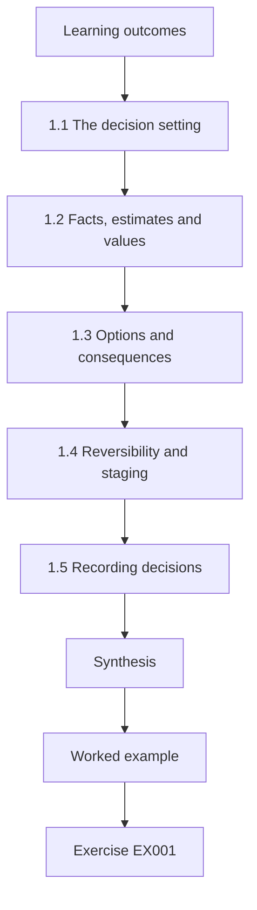

### Logical drawing

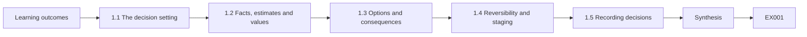

```text
[Learning outcomes]
    |
    v
[1.1 The decision setting]
    |
    v
[1.2 Facts, estimates and values]
    |
    v
[1.3 Options and consequences]
    |
    v
[1.4 Reversibility and staging]
    |
    v
[1.5 Recording decisions]
    |
    v
[Synthesis]
    |
    v
[Worked example] --> [Exercise EX001]
```
<!-- cyberabc:lesson-figures:end ch-01 -->


### Learning outcomes

You will (1) frame security decisions under uncertainty; (2) separate facts, estimates and values; (3) record decisions for review.

### 1.1 The decision setting

Marta Lindqvist joins the two-year postgraduate specialist programme at the fictional Kestrel Graduate School after six years as a network engineer. Her placement partner is the fictional Fenwick Valley Broadband, a community internet provider with five points of presence, about nine thousand customers and a small network operations team. The provider faces three pressing questions: whether to replace ageing site-to-site VPNs, whether to adopt route origin validation, and how strictly to filter spoofed traffic from customers. Each choice affects customers, partners and staff, and none has a single obviously right answer.

### 1.2 Facts, estimates and values

Prof. Aiyana Brooks, her supervisor, asks Marta to separate three kinds of input in every decision. Facts can be checked, such as the number of VPN peers still using IKEv1. Estimates carry uncertainty, such as the chance that a misconfigured customer router leaks spoofed traffic in a given year. Values are judgements about what matters, such as how much disruption to customers is acceptable to gain protection. Mixing them causes poor arguments: people argue about values while appearing to argue about facts, and estimates are presented with false precision that hides genuine uncertainty.

### 1.3 Options and consequences

For each decision Marta lists realistic options, including doing nothing, and describes consequences under different conditions. For route origin validation, the options are to ignore validation results, to mark invalid routes with lower preference, or to reject invalid routes outright. Rejecting gives the strongest protection against mis-originated routes but could drop legitimate routes if a partner's records are wrong. Describing consequences per option, rather than arguing for a favourite, keeps the analysis honest and makes trade-offs visible to the provider's directors, who will make the final decision.

### 1.4 Reversibility and staging

A decision that can be reversed cheaply can be taken with less certainty than one that cannot. Marta notes that most network policy changes are reversible within minutes, while contractual commitments with partners are not. This suggests staging: begin with monitoring or soft enforcement, measure effects, then tighten. Staging turns a single risky choice into several smaller ones, each informed by evidence from the last. It also gives customers and partners time to fix their own configurations before enforcement affects them, which preserves goodwill in a small regional market.

### 1.5 Recording decisions

Marta keeps a decision record for each choice: the question, options, evidence, estimates with ranges, the values applied, the decision, who made it and when it should be revisited. Records protect against hindsight bias, where people later judge a reasonable decision as foolish because of an outcome nobody could have foreseen. They also help new staff understand why the network is configured as it is. At Fenwick Valley, previous decisions were rarely written down, so Marta's first records reconstruct the reasons for existing settings from interviews with the operations team.

### Worked example

Marta's first decision record, on route origin validation, lists three options, separates two facts, two estimates and one value judgement, and recommends staged enforcement.

> **Synthetic case.** The provider and data are synthetic.

### Errors and limits

Presenting estimates as facts gives decision makers false confidence.

### Exercises

- **EX001 — Input classification.** Classify "three peers use IKEv1" and "a leak is unlikely this year". *Rubric:* 3 = first is fact, second estimate, explained;; 2 = both classified;; 1 = one correct;; 0 = none.
- **EX002 — Do-nothing option.** Why include doing nothing as an option? *Rubric:* 3 = baseline for comparing consequences;; 2 = comparison;; 1 = unnecessary;; 0 = none.
- **EX003 — Staging benefit.** Give two benefits of staging enforcement. *Rubric:* 3 = evidence between steps, time for others to fix configurations;; 2 = two;; 1 = one;; 0 = none.
- **EX004 — Hindsight protection.** How does a decision record protect against hindsight bias? *Rubric:* 3 = shows what was known and reasoned at the time;; 2 = context;; 1 = vague;; 0 = none.
- **EX005 — Reversibility judgement.** Which is less reversible: a filter change or a partner contract term? *Rubric:* 3 = contract term; filters revert in minutes;; 2 = contract;; 1 = filter;; 0 = none.

### Synthesis

Good security decisions separate facts, estimates and values, prefer staged reversible steps and are recorded for review.

### Continue studying — chapter 01 of 12

[← Course home](../../README.md) · [Course chapter index](../SUBJECTS.md) · [Chapter 02 (draft) →](#ch-02)

<a id="ch-02"></a>

## Chapter 2 — Network and communications security: current practice

<!-- cyberabc:lesson-figures:start ch-02 -->
### Lesson map

Lesson 02 published. Map, example, EX006.

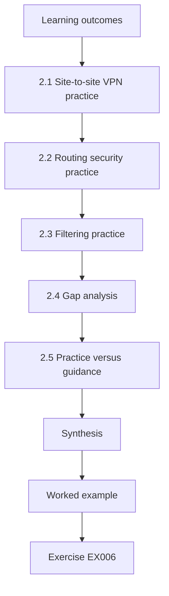

### Logical drawing

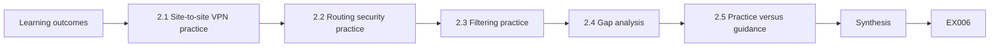

```text
[Learning outcomes]
    |
    v
[2.1 Site-to-site VPN practice]
    |
    v
[2.2 Routing security practice]
    |
    v
[2.3 Filtering practice]
    |
    v
[2.4 Gap analysis]
    |
    v
[2.5 Practice versus guidance]
    |
    v
[Synthesis]
    |
    v
[Worked example] --> [Exercise EX006]
```
<!-- cyberabc:lesson-figures:end ch-02 -->


### Learning outcomes

You will (1) survey current practice in VPNs, routing security and filtering; (2) compare guidance with the partner's state.

### 2.1 Site-to-site VPN practice

Current practice for site-to-site VPNs uses IKEv2, specified in RFC 7296, with certificate-based authentication and modern algorithms, as described in NIST SP 800-77r1. IKEv1 remains in many networks but is more complex, has more configuration pitfalls and is deprecated in much guidance. Pre-shared keys are simple but are often long-lived, shared by email and reused across peers, so a single leak can expose several links. At Fenwick Valley, VPNs connect the points of presence to the operations centre and to one partner provider, and their configurations have grown piecemeal over a decade.

### 2.2 Routing security practice

Internet routing relies on BGP, in which networks announce the address blocks they can reach. Mistaken or malicious announcements can redirect traffic. The Resource Public Key Infrastructure, described in RFC 6480, lets address holders publish signed Route Origin Authorisations stating which network may originate their prefixes. Routers can then classify announcements as valid, invalid or not found. NIST SP 800-189 recommends route origin validation and related practices for networks exchanging traffic. Many small providers have published authorisations for their own prefixes but have not yet enforced validation on routes they receive.

### 2.3 Filtering practice

RFC 2827, known as BCP 38, recommends that networks drop packets from customers whose source addresses do not belong to those customers. This ingress filtering limits spoofed traffic, which is used to hide attackers and amplify denial-of-service attacks. It costs the filtering network little but mostly benefits others, which is why adoption has been uneven. SP 800-189 repeats the recommendation. Fenwick Valley filters business customers with static addresses but not residential customers, because staff worried about breaking unusual customer setups years ago.

Extending filtering to residential customers would therefore need tests of those unusual setups, not just a change of policy.

### 2.4 Gap analysis

Marta compares the provider's state with current guidance. Gaps include IKEv1 on three peers, pre-shared keys on five, published authorisations but no validation of received routes, and incomplete ingress filtering. She notes strengths too: good inventory of network devices, central logging and a capable operations team. A gap analysis is more useful when it lists strengths as well as weaknesses, because strengths show what the organisation can build on and help prioritise changes that fit existing skills and tools rather than requiring new ones.

### 2.5 Practice versus guidance

Guidance describes good practice in general terms; practice must fit a specific network. Marta interviews engineers at two neighbouring providers about their experience. One enforced route validation and dropped a partner's routes for an afternoon because of a stale authorisation; the other moved slowly and found the soft-enforcement stage valuable. These experiences add practical detail missing from guidance, such as how to handle exceptions and how to communicate with partners. Combining published guidance with peer experience gives a more realistic picture of what implementation involves.

### Worked example

The gap table lists four gaps against SP 800-77r1, SP 800-189, RFC 6480 and RFC 2827, plus three strengths.

> **Synthetic case.** Interviews and data are synthetic.

### Errors and limits

Treating guidance as a checklist ignores local constraints that determine how changes should be made.

### Exercises

- **EX006 — Pre-shared key risk.** Why are long-lived pre-shared keys risky across many peers? *Rubric:* 3 = leaked once exposes several links; poor handling;; 2 = leak;; 1 = weak cipher;; 0 = none.
- **EX007 — ROA purpose.** What does a Route Origin Authorisation state? *Rubric:* 3 = which AS may originate a prefix;; 2 = origin;; 1 = path;; 0 = none.
- **EX008 — BCP 38 incentive.** Why has ingress filtering adoption been uneven? *Rubric:* 3 = costs filterer, benefits others;; 2 = incentives;; 1 = technical;; 0 = none.
- **EX009 — Strengths in gap analysis.** Why list strengths in a gap analysis? *Rubric:* 3 = build on them, prioritise realistic changes;; 2 = build;; 1 = politeness;; 0 = none.
- **EX010 — Peer experience value.** What did the neighbouring providers' experience add? *Rubric:* 3 = practical detail on exceptions and partner communication;; 2 = detail;; 1 = vague;; 0 = none.

### Synthesis

Comparing current practice with the partner's state, including strengths, focuses effort where it matters.

### Continue studying — chapter 02 of 12

[← Chapter 01 (draft)](#ch-01) · [Course chapter index](../SUBJECTS.md) · [Chapter 03 (draft) →](#ch-03)

<a id="ch-03"></a>

## Chapter 3 — Network and communications security: specialist evidence

<!-- cyberabc:lesson-figures:start ch-03 -->
### Lesson map

Lesson 03 published. Map, example, EX011.

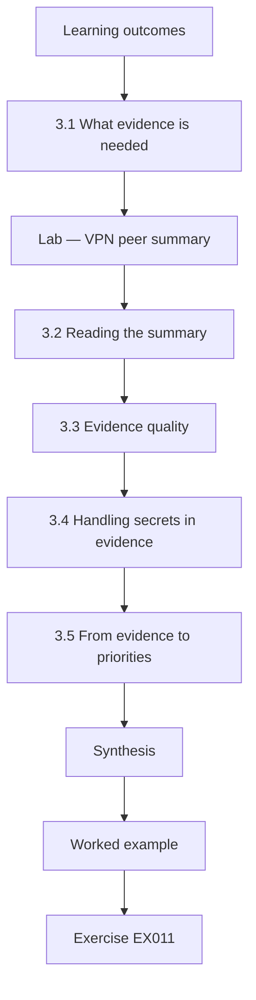

### Logical drawing

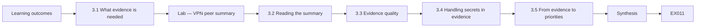

```text
[Learning outcomes]
    |
    v
[3.1 What evidence is needed]
    |
    v
[Lab — VPN peer summary]
    |
    v
[3.2 Reading the summary]
    |
    v
[3.3 Evidence quality]
    |
    v
[3.4 Handling secrets in evidence]
    |
    v
[3.5 From evidence to priorities]
    |
    v
[Synthesis]
    |
    v
[Worked example] --> [Exercise EX011]
```
<!-- cyberabc:lesson-figures:end ch-03 -->


### Learning outcomes

You will (1) collect specialist evidence on VPN configuration; (2) interpret results; (3) judge evidence quality.

### 3.1 What evidence is needed

Before recommending VPN changes, Marta needs evidence about the current state: IKE version, authentication method and key age for every peer. Configuration exports from the routers provide this, and the operations team supplies sanitised copies with addresses and secrets removed. She also records which peers carry customer traffic and which carry only management traffic, since that affects priority. Evidence must be complete for the decision, so she checks the peer list against the provider's network diagram and asks about any peer configured on one side only.

### Lab — VPN peer summary

```python
"""Summarise synthetic VPN peer settings: auth method, IKE version and key age (stdlib only)."""
peers = [("depot-north", "IKEv2", "cert", 0), ("depot-south", "IKEv1", "psk", 1460), ("pop-hill", "IKEv2", "psk", 900),
         ("pop-river", "IKEv2", "cert", 0), ("partner-isp", "IKEv1", "psk", 2190), ("pop-mill", "IKEv2", "cert", 0),
         ("noc-backup", "IKEv2", "psk", 400), ("pop-ridge", "IKEv1", "psk", 1825)]
flag = []
for name, ike, auth, age in peers:
    issues = [x for x, c in (("IKEv1", ike == "IKEv1"), ("psk", auth == "psk"), ("psk>365d", auth == "psk" and age > 365)) if c]
    if issues: flag.append(name)
    print(f"{name:12}{ike:6}{auth:5}{age:>5}d  {','.join(issues) or 'ok'}")
print(f"needs action: {len(flag)} of {len(peers)}; IKEv1: {sum(p[1]=='IKEv1' for p in peers)}; psk: {sum(p[2]=='psk' for p in peers)}")
```

Run with `python3 lab_peers.py`. Verified output:

```text
depot-north IKEv2 cert     0d  ok
depot-south IKEv1 psk   1460d  IKEv1,psk,psk>365d
pop-hill    IKEv2 psk    900d  psk,psk>365d
pop-river   IKEv2 cert     0d  ok
partner-isp IKEv1 psk   2190d  IKEv1,psk,psk>365d
pop-mill    IKEv2 cert     0d  ok
noc-backup  IKEv2 psk    400d  psk,psk>365d
pop-ridge   IKEv1 psk   1825d  IKEv1,psk,psk>365d
needs action: 5 of 8; IKEv1: 3; psk: 5
```

### 3.2 Reading the summary

The synthetic summary shows eight peers. Three use IKEv1 and five use pre-shared keys, all of which are more than a year old; the oldest, with the partner provider, is six years old. Three peers already use IKEv2 with certificates. Five of eight need action. The partner link stands out: it uses IKEv1, a six-year-old key and carries traffic for another organisation, so changing it requires coordination. Marta separates the peers into those the provider controls alone, which can move quickly, and the partner link, which needs a joint plan.

### 3.3 Evidence quality

Configuration exports show what is configured, not what is negotiated. A peer might be configured for IKEv2 but fall back to IKEv1 if the other end requires it. Marta asks the team to confirm, from router status output, the version actually negotiated for each tunnel. She also checks key ages against change records rather than relying on memory. Evidence quality improves when two independent sources agree; where they disagree, the disagreement itself is a finding, since it means the network may not behave as documented.

### 3.4 Handling secrets in evidence

Configuration exports can contain keys and passwords. Marta's agreement with the provider forbids receiving any secret, so exports are sanitised by the operations team before she sees them, using a script that replaces key values with placeholders. She checks each file for anything missed before analysis. If she ever received a secret, the agreement requires her to report it and the provider to change it. Evidence handling is part of specialist competence: careless handling could create the very exposure the project aims to reduce.

### 3.5 From evidence to priorities

With confirmed evidence, Marta ranks the peers. Peers carrying customer traffic with old pre-shared keys come first, then management-only peers, then the partner link, which is important but slower to change. She estimates effort for each, using the three already-migrated peers as a guide to time per migration. Linking evidence directly to an ordered plan makes the analysis useful; a list of weaknesses without priorities leaves the operations team unsure where to begin and tempted to start with the easiest rather than the most important.

### Worked example

Five of eight peers need action; three IKEv1 peers and five pre-shared keys are confirmed by negotiated status as well as configuration.

> **Synthetic case.** Peer data are synthetic.

### Errors and limits

Trusting configuration alone misses fallback behaviour visible only in negotiated status.

### Exercises

- **EX011 — Peers needing action.** How many peers need action and why? *Rubric:* 3 = five, all with old pre-shared keys, three also IKEv1;; 2 = five;; 1 = three;; 0 = none.
- **EX012 — Configured versus negotiated.** Why check negotiated status as well as configuration? *Rubric:* 3 = fallback may differ from configuration;; 2 = differences;; 1 = duplicate;; 0 = none.
- **EX013 — Partner link complexity.** Why does the partner link take longer to change? *Rubric:* 3 = needs joint coordination with another organisation;; 2 = coordination;; 1 = technical;; 0 = none.
- **EX014 — Secret received.** What must happen if a secret appears in evidence? *Rubric:* 3 = report it and provider changes it;; 2 = report;; 1 = delete quietly;; 0 = none.
- **EX015 — Two-source agreement.** What does disagreement between two evidence sources indicate? *Rubric:* 3 = network may not behave as documented; a finding;; 2 = problem;; 1 = error in one;; 0 = none.

### Synthesis

Specialist evidence must be complete, cross-checked, safely handled and turned into priorities.

### Continue studying — chapter 03 of 12

[← Chapter 02 (draft)](#ch-02) · [Course chapter index](../SUBJECTS.md) · [Chapter 04 (draft) →](#ch-04)

<a id="ch-04"></a>

## Chapter 4 — Advanced risk and ethics

<!-- cyberabc:lesson-figures:start ch-04 -->
### Lesson map

Lesson 04 published. Map, example, EX016.

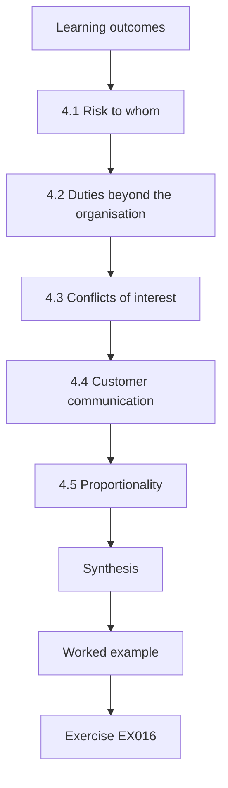

### Logical drawing

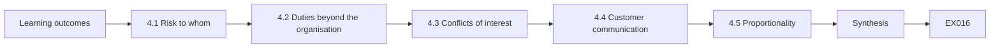

```text
[Learning outcomes]
    |
    v
[4.1 Risk to whom]
    |
    v
[4.2 Duties beyond the organisation]
    |
    v
[4.3 Conflicts of interest]
    |
    v
[4.4 Customer communication]
    |
    v
[4.5 Proportionality]
    |
    v
[Synthesis]
    |
    v
[Worked example] --> [Exercise EX016]
```
<!-- cyberabc:lesson-figures:end ch-04 -->


### Learning outcomes

You will (1) weigh risks to customers and third parties; (2) handle conflicts of interest; (3) apply ethics to enforcement choices.

### 4.1 Risk to whom

Most of the provider's decisions shift risk between groups. Ingress filtering mainly protects other networks from spoofed traffic originating from Fenwick Valley customers, while carrying a small risk of disrupting customers with unusual setups. Route validation protects Fenwick Valley's customers from mis-originated routes but could cut them off from legitimate destinations if records are wrong. Marta lists, for each decision, who bears the risk and who receives the benefit. Making this explicit helps directors see when they are asking customers to accept a small risk for a wider public benefit.

### 4.2 Duties beyond the organisation

Internet providers sit in a shared system where each network's behaviour affects others. A provider that allows spoofed traffic contributes to attacks on third parties, even if its own customers are not harmed. Marta argues that a responsible provider has duties to the wider internet, reflected in long-standing recommendations such as RFC 2827. Professional ethics, which emphasise avoiding harm to the public, support this view. The directors agree in principle but ask for evidence that filtering will not disrupt customers before committing to it.

### 4.3 Conflicts of interest

Marta notices a potential conflict: one director also advises a vendor selling a filtering appliance. She raises it with Prof. Brooks and the provider's chair, who ask the director to step back from that decision. Conflicts are not wrongdoing in themselves, but undisclosed conflicts damage trust in decisions. Marta also discloses her own position: her placement assessment depends partly on producing a recommendation, which could tempt her to recommend change for its own sake. Stating this openly invites others to challenge her if her analysis seems biased.

### 4.4 Customer communication

Enforcement that affects customers should be explained before it happens. Marta drafts a customer notice explaining that the provider will begin dropping traffic with forged source addresses, why this protects the internet, how few customers are likely to be affected and how to contact support if something stops working. She avoids technical jargon and alarming language. Customers who understand a change are less likely to be angry if it affects them, and support staff can answer questions consistently from a prepared script.

### 4.5 Proportionality

Ethical enforcement is proportionate: the response matches the risk. Rejecting all invalid routes immediately would be disproportionate while the provider has no experience of how often records are wrong. Marking invalid routes with lower preference first is proportionate, protecting against most mis-origination while learning about errors. Similarly, filtering spoofed traffic is proportionate because legitimate customer traffic almost never uses addresses outside the customer's range. Proportionality gives a principled way to choose between strict and gentle options rather than relying on instinct.

### Worked example

Marta's risk table lists who bears risk and who benefits for three decisions; the customer notice is approved by the support manager.

> **Synthetic case.** The provider and people are synthetic.

### Errors and limits

Ignoring third-party harm because it does not affect one's own customers neglects shared responsibility.

### Exercises

- **EX016 — Benefit of ingress filtering.** Who mainly benefits from Fenwick Valley's ingress filtering? *Rubric:* 3 = other networks targeted by spoofed traffic;; 2 = others;; 1 = own customers;; 0 = none.
- **EX017 — Conflict handling.** How was the director's conflict handled? *Rubric:* 3 = disclosed, director stepped back from decision;; 2 = stepped back;; 1 = ignored;; 0 = none.
- **EX018 — Own bias.** What bias did Marta disclose about herself? *Rubric:* 3 = placement assessment tempts recommending change;; 2 = assessment;; 1 = vague;; 0 = none.
- **EX019 — Proportionate validation.** Why mark invalid routes before rejecting them? *Rubric:* 3 = learn error rate first; proportionate;; 2 = gradual;; 1 = faster;; 0 = none.
- **EX020 — Customer notice content.** Name three elements of the customer notice. *Rubric:* 3 = what changes, why, how to get help or how few affected;; 2 = two;; 1 = one;; 0 = none.

### Synthesis

Advanced risk and ethics weigh who bears risk, recognise duties beyond the organisation and choose proportionate enforcement.

### Continue studying — chapter 04 of 12

[← Chapter 03 (draft)](#ch-03) · [Course chapter index](../SUBJECTS.md) · [Chapter 05 (draft) →](#ch-05)

<a id="ch-05"></a>

## Chapter 5 — Network and communications security: design alternatives

<!-- cyberabc:lesson-figures:start ch-05 -->
### Lesson map

Lesson 05 published. Map, example, EX021.

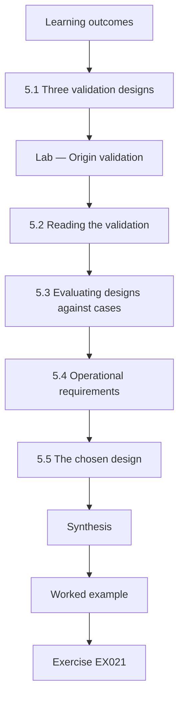

### Logical drawing

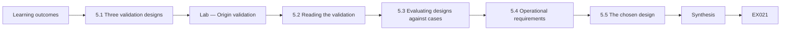

```text
[Learning outcomes]
    |
    v
[5.1 Three validation designs]
    |
    v
[Lab — Origin validation]
    |
    v
[5.2 Reading the validation]
    |
    v
[5.3 Evaluating designs against cases]
    |
    v
[5.4 Operational requirements]
    |
    v
[5.5 The chosen design]
    |
    v
[Synthesis]
    |
    v
[Worked example] --> [Exercise EX021]
```
<!-- cyberabc:lesson-figures:end ch-05 -->


### Learning outcomes

You will (1) compare enforcement designs for route validation; (2) evaluate with synthetic data; (3) select a staged design.

### 5.1 Three validation designs

Marta compares three designs for handling route origin validation. In the first, the provider records validation results but takes no action, which offers visibility only. In the second, invalid routes receive lower preference, so a valid alternative is used when one exists but invalid routes still work if they are the only path. In the third, invalid routes are rejected entirely. Each design trades protection against the risk of losing legitimate reachability. The choice depends on how often invalid results are caused by stale records rather than real mis-origination.

### Lab — Origin validation

```python
"""Route origin validation of synthetic announcements against synthetic ROAs (RFC 6480 model; stdlib only)."""
import ipaddress
roas = [("192.0.2.0/24", 64500, 24), ("198.51.100.0/22", 64501, 24), ("203.0.113.0/24", 64502, 24)]
ann = [("192.0.2.0/24", 64500), ("192.0.2.0/24", 64666), ("198.51.100.0/23", 64501), ("198.51.100.0/25", 64501),
       ("203.0.113.0/24", 64502), ("100.64.10.0/24", 64510), ("198.51.102.0/24", 64501), ("203.0.113.0/24", 64503)]
def validate(p, asn):
    p = ipaddress.ip_network(p); cover = [r for r in roas if p.subnet_of(ipaddress.ip_network(r[0]))]
    if not cover: return "notfound"
    return "valid" if any(asn == a and p.prefixlen <= m for _, a, m in cover) else "invalid"
res = [validate(p, a) for p, a in ann]
for (p, a), r in zip(ann, res): print(f"{p:18}AS{a:<6}{r}")
print({k: res.count(k) for k in ("valid", "invalid", "notfound")})
```

Run with `python3 lab_rov.py`. Verified output:

```text
192.0.2.0/24      AS64500 valid
192.0.2.0/24      AS64666 invalid
198.51.100.0/23   AS64501 valid
198.51.100.0/25   AS64501 invalid
203.0.113.0/24    AS64502 valid
100.64.10.0/24    AS64510 notfound
198.51.102.0/24   AS64501 valid
203.0.113.0/24    AS64503 invalid
{'valid': 4, 'invalid': 3, 'notfound': 1}
```

### 5.2 Reading the validation

The synthetic run classifies eight announcements against three authorisations. Four are valid, including a /24 inside an authorised /22 because the authorisation allows prefixes up to /24. Three are invalid: one from an unauthorised network, one /25 more specific than the maximum length allowed, and one /24 announced by a different network from the one authorised. One is not found because no authorisation covers it. Marta notes that the /25 case is typical of real mistakes, where an operator announces a more specific route without updating the authorisation.

### 5.3 Evaluating designs against cases

For each invalid result, Marta asks what each design would do. Recording only would accept all three and protect nobody. Lower preference would avoid the two invalid routes that have valid alternatives, while still using the /25 if no other path existed. Rejection would drop all three, including the possibly legitimate /25. With synthetic data suggesting that one in three invalid results might be operator error, she recommends lower preference first, with monitoring of invalid routes and contact with their owners, followed by rejection once error rates are understood.

### 5.4 Operational requirements

Each design needs supporting operations. Validation requires validator software that fetches and checks signed data, with redundancy so a validator failure does not leave routers without results. Monitoring must alert when invalid routes appear for important destinations. Staff need a procedure for contacting other networks about incorrect authorisations. Marta notes that the provider's own authorisations must also be correct, since errors there would cause others to reject Fenwick Valley's routes. She adds a quarterly review of the provider's own published records to the plan.

### 5.5 The chosen design

The directors approve a staged design: three months of lower preference for invalid routes, with weekly reports on invalid routes received and contacts made, then a review deciding whether to move to rejection. The design follows SP 800-189's recommendations while respecting the provider's limited experience. Marta records success criteria for moving to rejection, such as fewer than a set number of invalid routes caused by errors in a month, and the reversal procedure if rejection causes reachability problems. Criteria decided in advance keep the later review objective.

### Worked example

Four valid, three invalid and one not found; the staged design chooses lower preference first with criteria for rejection.

> **Synthetic case.** Announcements and authorisations are synthetic.

### Errors and limits

Moving straight to rejection without knowing error rates risks dropping legitimate routes.

### Exercises

- **EX021 — Validation counts.** What counts does the validation lab report? *Rubric:* 3 = 4 valid, 3 invalid, 1 not found;; 2 = counts;; 1 = partial;; 0 = none.
- **EX022 — Maximum length case.** Why is the /25 announcement invalid? *Rubric:* 3 = more specific than ROA maximum length /24;; 2 = too specific;; 1 = wrong AS;; 0 = none.
- **EX023 — Not found meaning.** What does "not found" mean for an announcement? *Rubric:* 3 = no ROA covers the prefix;; 2 = no record;; 1 = invalid;; 0 = none.
- **EX024 — Own records review.** Why review the provider's own published authorisations? *Rubric:* 3 = errors would make others reject its routes;; 2 = own reachability;; 1 = vague;; 0 = none.
- **EX025 — Rejection criteria.** What should be decided before moving to rejection? *Rubric:* 3 = success criteria and reversal procedure;; 2 = criteria;; 1 = vague;; 0 = none.

### Synthesis

Comparing designs against concrete validation results supports a staged, criteria-driven choice.

### Continue studying — chapter 05 of 12

[← Chapter 04 (draft)](#ch-04) · [Course chapter index](../SUBJECTS.md) · [Chapter 06 (draft) →](#ch-06)

<a id="ch-06"></a>

## Chapter 6 — Network and communications security: controlled evaluation

<!-- cyberabc:lesson-figures:start ch-06 -->
### Lesson map

Lesson 06 published. Map, example, EX026.

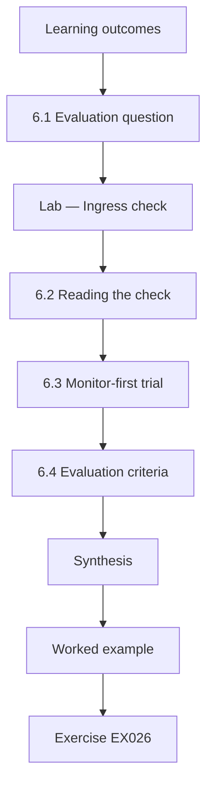

### Logical drawing


```text
[Learning outcomes]
    |
    v
[6.1 Evaluation question]
    |
    v
[Lab — Ingress check]
    |
    v
[6.2 Reading the check]
    |
    v
[6.3 Monitor-first trial]
    |
    v
[6.4 Evaluation criteria]
    |
    v
[Synthesis]
    |
    v
[Worked example] --> [Exercise EX026]
```
<!-- cyberabc:lesson-figures:end ch-06 -->


### Learning outcomes

You will (1) evaluate ingress filtering on synthetic traffic; (2) estimate customer impact; (3) design a monitor-first trial.

### 6.1 Evaluation question

Before enforcing ingress filtering for residential customers, Marta asks a precise question: what share of customer traffic would be dropped, and how much of that is legitimate? If almost all dropped traffic is spoofed or misconfigured, enforcement is safe. If legitimate customers use addresses outside their assigned ranges, for example because of unusual business arrangements, enforcement could cut them off. The evaluation must answer this using synthetic or sampled data, without disrupting anyone, before any filter is switched on. The answer decides whether enforcement goes ahead.

### Lab — Ingress check

```python
"""Ingress filtering check (RFC 2827 idea): flag synthetic customer packets whose source is outside the customer's prefix (stdlib only)."""
import ipaddress
cust = {"c1": "100.64.1.0/24", "c2": "100.64.2.0/25", "c3": "100.64.3.0/24"}
pk = [("c1", "100.64.1.9"), ("c1", "100.64.1.200"), ("c2", "100.64.2.140"), ("c2", "100.64.2.10"), ("c3", "10.0.0.5"),
      ("c3", "100.64.3.77"), ("c1", "198.51.100.4"), ("c2", "100.64.2.99"), ("c3", "100.64.3.1"), ("c1", "100.64.1.1")]
bad = [(c, s) for c, s in pk if ipaddress.ip_address(s) not in ipaddress.ip_network(cust[c])]
for c, s in bad: print(f"{c} source {s} outside {cust[c]}")
print(f"{len(bad)} of {len(pk)} would be dropped ({100*len(bad)/len(pk):.0f}%)")
```

Run with `python3 lab_ingress.py`. Verified output:

```text
c2 source 100.64.2.140 outside 100.64.2.0/25
c3 source 10.0.0.5 outside 100.64.3.0/24
c1 source 198.51.100.4 outside 100.64.1.0/24
3 of 10 would be dropped (30%)
```

### 6.2 Reading the check

The synthetic sample contains ten packets from three customers. Three, thirty percent, would be dropped. One comes from an address just outside customer c2's /25, which may be a misconfigured device or a customer using more addresses than assigned. One from customer c3 uses a private address, which should never appear on the public internet and suggests a misconfigured router. One from customer c1 uses an address belonging to another network entirely, which is consistent with spoofing. Real proportions would be far lower; the sample is designed to show each case.

### 6.3 Monitor-first trial

Marta proposes a controlled trial: apply the filters in counting mode, which records matching packets without dropping them, for four weeks across all residential access routers. Each week, the operations team reviews customers with matches. Where matches suggest a misconfiguration, support contacts the customer. Where they suggest a customer legitimately needs more addresses, assignments are corrected. Only after the review period, and with customer notice sent, does enforcement begin. This design measures impact under real conditions while protecting customers from surprise disruption.

### 6.4 Evaluation criteria

Marta defines success criteria before the trial: matched traffic from fewer than one in a thousand customers after corrections, no matches explained by legitimate needs that cannot be fixed, and support tickets within normal range after enforcement. She also defines stopping conditions: if enforcement generates a support ticket spike above a set threshold in its first week, filters return to counting mode while causes are investigated. Pre-set criteria and stopping rules make the trial a genuine test rather than a formality before an already-decided change.

### 6.5 Limits of the evaluation

Counting-mode results show what would be dropped, but not why every match occurred. Some customers may be hosting services they have not mentioned, and some matches may come from rare events not seen during four weeks. Marta reports these limits and recommends keeping the customer contact process permanent, so any later legitimate need can be handled. She also notes that the trial measures impact on Fenwick Valley's customers but cannot measure the benefit to others directly, which must be argued from the guidance and the nature of spoofed traffic.

### Worked example

The synthetic sample drops three of ten packets; the trial plan uses four weeks of counting mode before enforcement.

> **Synthetic case.** Traffic is synthetic.

### Errors and limits

Enforcing filters without a counting period risks disrupting customers with unusual but legitimate setups.

### Exercises

- **EX026 — Drop share.** What share of the synthetic sample would be dropped? *Rubric:* 3 = 3 of 10, 30 percent, with sources;; 2 = 30%;; 1 = some;; 0 = none.
- **EX027 — Private source.** What does a private source address from c3 suggest? *Rubric:* 3 = misconfigured customer router;; 2 = misconfiguration;; 1 = attack;; 0 = none.
- **EX028 — Counting mode.** What does counting mode do? *Rubric:* 3 = records matches without dropping;; 2 = counts;; 1 = blocks;; 0 = none.
- **EX029 — Stopping condition.** Give the trial's stopping condition. *Rubric:* 3 = ticket spike above threshold returns to counting;; 2 = spike;; 1 = vague;; 0 = none.
- **EX030 — Unmeasured benefit.** What can the trial not measure directly? *Rubric:* 3 = benefit to other networks;; 2 = others' benefit;; 1 = cost;; 0 = none.

### Synthesis

A controlled, monitor-first evaluation with pre-set criteria makes enforcement safe and evidence-based.

### Continue studying — chapter 06 of 12

[← Chapter 05 (draft)](#ch-05) · [Course chapter index](../SUBJECTS.md) · [Chapter 07 (draft) →](#ch-07)

<a id="ch-07"></a>

## Chapter 7 — Network and communications security: organizational integration

<!-- cyberabc:lesson-figures:start ch-07 -->
### Lesson map

Lesson 07 published. Map, example, EX031.

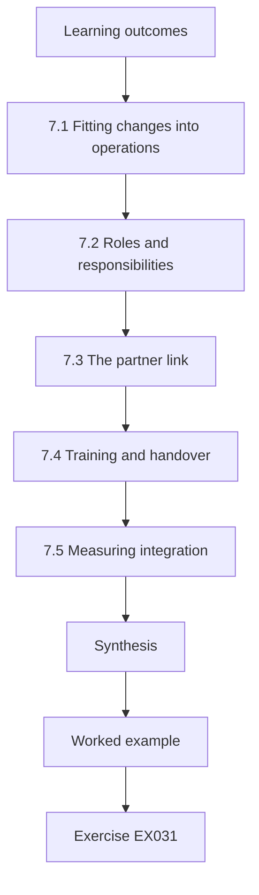

### Logical drawing

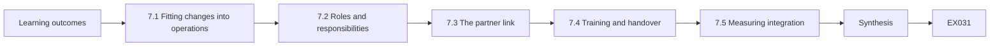

```text
[Learning outcomes]
    |
    v
[7.1 Fitting changes into operations]
    |
    v
[7.2 Roles and responsibilities]
    |
    v
[7.3 The partner link]
    |
    v
[7.4 Training and handover]
    |
    v
[7.5 Measuring integration]
    |
    v
[Synthesis]
    |
    v
[Worked example] --> [Exercise EX031]
```
<!-- cyberabc:lesson-figures:end ch-07 -->


### Learning outcomes

You will (1) integrate changes into operations; (2) align processes and roles; (3) manage partner relationships.

### 7.1 Fitting changes into operations

New controls only last if they become part of daily work. Marta maps each change onto the operations team's existing processes. VPN migrations join the monthly maintenance schedule. Validation reports join the weekly network review. Ingress filter matches join the support queue as a ticket category. She avoids creating separate processes that only she understands, since her placement will end. Each addition is small, uses existing tools where possible and has a named owner within the team, which makes the changes durable after the project.

### 7.2 Roles and responsibilities

Marta drafts a simple responsibility table. Network engineers configure filters and VPNs; the operations lead approves changes; support staff contact customers; a director signs off enforcement stages. For route validation, one engineer is named as the contact for other networks about incorrect records. Clear roles prevent the common failure where everyone assumes someone else is watching. The table is reviewed with the team, who suggest that a second engineer shares the external contact role to cover holidays. The final table is posted in the operations wiki.

### 7.3 The partner link

The VPN with the partner provider needs joint work. Marta prepares a short proposal for the partner's engineers: migrate to IKEv2 with certificates, agree the certificate authority arrangement, schedule a joint maintenance window and define a test plan. The partner is cautious because a previous change caused an outage. She suggests building a parallel tunnel first and moving traffic only after both sides confirm it works, so the old tunnel remains as a fallback. The partner agrees to this lower-risk approach.

### 7.4 Training and handover

The operations team is skilled but has not used route validation tools before. Marta runs two short sessions: one on how validation works and what results mean, using the lab examples, and one on reading the weekly invalid-route report and deciding when to contact another network. She writes a runbook for each task with screenshots from the test environment. Training tied to actual tasks is more effective than general courses, and the runbooks let new staff learn the same tasks later without depending on her.

### 7.5 Measuring integration

Marta checks integration with simple indicators: are weekly reports being reviewed on time, are filter-match tickets being closed, are migrations proceeding to schedule? After two months, reports are reviewed every week, all tickets are closed within five days and four of five planned VPN migrations are complete. These indicators show the changes have become routine. Where an indicator slips, such as one late report during a holiday, the team adjusts the responsibility table rather than adding new process. The indicators are reviewed monthly by the operations lead.

### Worked example

Marta's responsibility table names owners for five tasks; after two months, integration indicators show reviews on time and four of five migrations done.

> **Synthetic case.** Organisation and indicators are synthetic.

### Errors and limits

Controls owned only by a project member fade when the project ends.

### Exercises

- **EX031 — Process reuse.** Why add tasks to existing processes rather than create new ones? *Rubric:* 3 = durability after placement, familiar to team;; 2 = durability;; 1 = speed;; 0 = none.
- **EX032 — Shared contact role.** Why name a second external contact for route validation? *Rubric:* 3 = cover holidays and absences;; 2 = cover;; 1 = vague;; 0 = none.
- **EX033 — Parallel tunnel.** How does a parallel tunnel reduce partner risk? *Rubric:* 3 = old tunnel remains as fallback until new confirmed;; 2 = fallback;; 1 = faster;; 0 = none.
- **EX034 — Task-based training.** Why base training on actual tasks? *Rubric:* 3 = more effective and supports runbooks for later;; 2 = practical;; 1 = cheaper;; 0 = none.
- **EX035 — Integration indicator.** Give one indicator that changes have become routine. *Rubric:* 3 = reports reviewed on time, tickets closed, migrations on schedule;; 2 = one;; 1 = vague;; 0 = none.

### Synthesis

Changes endure when they fit existing processes, have clear owners and are measured as routine.

### Continue studying — chapter 07 of 12

[← Chapter 06 (draft)](#ch-06) · [Course chapter index](../SUBJECTS.md) · [Chapter 08 (draft) →](#ch-08)

<a id="ch-08"></a>

## Chapter 8 — Network and communications security: difficult cases

<!-- cyberabc:lesson-figures:start ch-08 -->
### Lesson map

Lesson 08 published. Map, example, EX036.

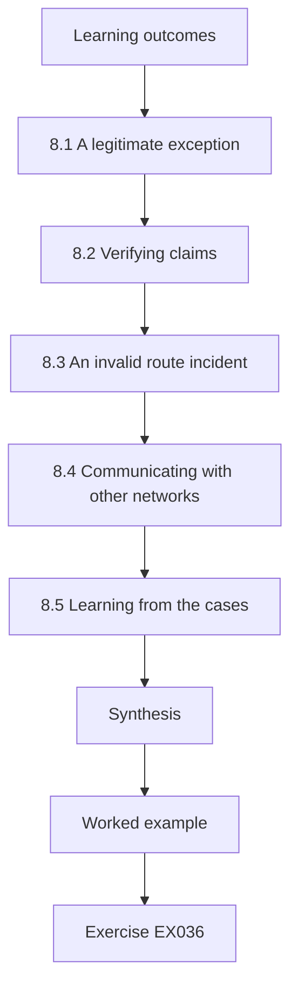

### Logical drawing

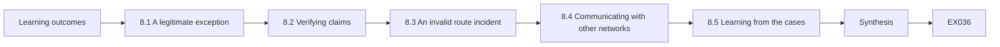

```text
[Learning outcomes]
    |
    v
[8.1 A legitimate exception]
    |
    v
[8.2 Verifying claims]
    |
    v
[8.3 An invalid route incident]
    |
    v
[8.4 Communicating with other networks]
    |
    v
[8.5 Learning from the cases]
    |
    v
[Synthesis]
    |
    v
[Worked example] --> [Exercise EX036]
```
<!-- cyberabc:lesson-figures:end ch-08 -->


### Learning outcomes

You will (1) handle cases where controls conflict with legitimate needs; (2) resolve incidents with partners; (3) learn from mistakes.

### 8.1 A legitimate exception

During the counting trial, one business customer shows steady matches. Investigation finds the customer has addresses from a second provider and sends some traffic through Fenwick Valley with those source addresses as part of a backup arrangement. This is legitimate but would be dropped by strict filtering. Marta's options are to deny the arrangement, to add the customer's other prefix to their allowed sources after verifying ownership, or to exempt the customer entirely. She recommends adding the verified prefix, which keeps filtering for everything else while supporting the real need.

### 8.2 Verifying claims

Adding an allowed prefix on a customer's word would let anyone claim any address. Marta asks support to verify ownership: the customer provides a letter of authorisation from the other provider, and the operations team checks the prefix in registry records. Verification takes two days, during which filtering for that customer stays in counting mode. The procedure is written down so future requests are handled consistently. Difficult cases often reveal the need for procedures that nobody thought of when the control was designed.

### 8.3 An invalid route incident

In the second month of the validation stage, a large content network's routes suddenly appear invalid because its authorisation has been updated incorrectly. With lower preference, traffic still flows through the invalid routes because no valid alternative exists, so customers notice nothing. Had the provider been rejecting invalid routes, thousands of customers would have lost access to popular services. The incident confirms the value of staging and shows that even large networks make record errors, which affects the criteria for moving to rejection.

### 8.4 Communicating with other networks

Marta's named engineer contacts the content network through its published contact, with evidence of the invalid result. The record is corrected within hours. Marta reviews the exchange and drafts a template for such contacts, including the prefix, the validation result, the time observed and a polite request to check. Clear, factual, courteous messages get faster responses. Routing security depends on cooperation between networks with no authority over one another, so how messages are written matters as much as what they say.

### 8.5 Learning from the cases

Both cases lead to changes. The exception procedure becomes part of the support runbook. The criteria for moving to rejection are revised to consider how other providers handle the same situation, and an exception list for important destinations is considered and rejected because it would weaken protection exactly where attackers might aim. Marta writes a short review of each case for the decision record. Difficult cases are where a design meets reality, and documenting them is how an organisation's judgement improves over time.

### Worked example

One verified customer prefix is added after two days; one invalid-route incident is resolved within hours without customer impact.

> **Synthetic case.** Cases are synthetic.

### Errors and limits

Granting exceptions without verification turns a filter into a formality.

### Exercises

- **EX036 — Backup arrangement fix.** How is the customer's backup arrangement accommodated? *Rubric:* 3 = add verified second prefix to allowed sources;; 2 = add prefix;; 1 = exempt;; 0 = none.
- **EX037 — Ownership verification.** How is the customer's prefix ownership verified? *Rubric:* 3 = letter of authorisation and registry check;; 2 = letter;; 1 = trust;; 0 = none.
- **EX038 — Staging benefit shown.** What did the content network incident show about staging? *Rubric:* 3 = rejection would have cut access; lower preference avoided impact;; 2 = avoided outage;; 1 = vague;; 0 = none.
- **EX039 — Contact template.** List three items in the contact template. *Rubric:* 3 = prefix, result, time or request;; 2 = two;; 1 = one;; 0 = none.
- **EX040 — Rejected exception list.** Why was an exception list for important destinations rejected? *Rubric:* 3 = weakens protection where attackers might aim;; 2 = weakens;; 1 = cost;; 0 = none.

### Synthesis

Difficult cases test designs; verified exceptions, courteous coordination and documented learning improve them.

### Continue studying — chapter 08 of 12

[← Chapter 07 (draft)](#ch-07) · [Course chapter index](../SUBJECTS.md) · [Chapter 09 (draft) →](#ch-09)

<a id="ch-09"></a>

## Chapter 9 — Network and communications security: leadership and assurance

<!-- cyberabc:lesson-figures:start ch-09 -->
### Lesson map

Lesson 09 published. Map, example, EX041.

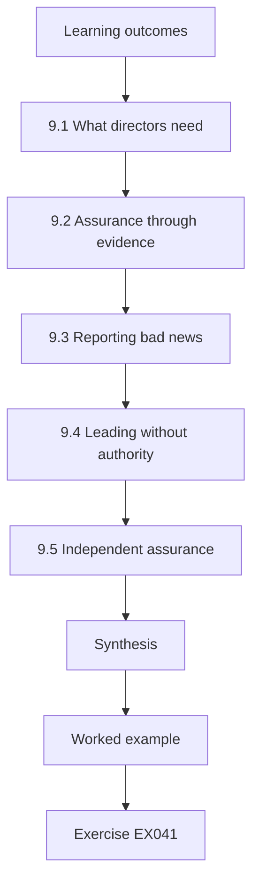

### Logical drawing

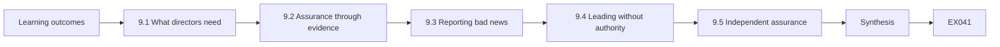

```text
[Learning outcomes]
    |
    v
[9.1 What directors need]
    |
    v
[9.2 Assurance through evidence]
    |
    v
[9.3 Reporting bad news]
    |
    v
[9.4 Leading without authority]
    |
    v
[9.5 Independent assurance]
    |
    v
[Synthesis]
    |
    v
[Worked example] --> [Exercise EX041]
```
<!-- cyberabc:lesson-figures:end ch-09 -->


### Learning outcomes

You will (1) provide assurance to directors; (2) report risk and progress; (3) lead change without formal authority.

### 9.1 What directors need

Directors are accountable for the provider's risks but do not configure routers. They need to know whether risks are understood, whether controls work and whether plans are on track. Marta prepares a quarterly assurance report: a one-page summary, three indicators with trends, open risks with owners, and decisions needed. She avoids dense technical detail and keeps supporting evidence in an appendix. Good assurance lets directors ask informed questions and take decisions, rather than simply trusting or doubting the technical team.

### 9.2 Assurance through evidence

Assurance means confidence based on evidence. For VPNs, Marta reports the share of peers using IKEv2 with certificates, confirmed by negotiated status. For route validation, she reports invalid routes seen, contacts made and incidents avoided. For filtering, she reports customers with matches and how each was resolved. Each figure links to its source data. When a director asks how she knows a figure is correct, she can show the source and method, which is what distinguishes assurance from reassurance. Methods are described in the appendix.

### 9.3 Reporting bad news

Not all news is good. The partner VPN migration slips by a month because the partner's engineer leaves. Marta reports the delay plainly, with its cause, its effect on risk and the revised plan. She resists the temptation to bury it in an appendix. Directors who hear bad news early can help, perhaps by contacting the partner's management. Reports that only contain good news lose credibility, and directors stop trusting them, which undermines the assurance role entirely. Early warning also gives directors time to adjust related plans.

### 9.4 Leading without authority

As a placement student, Marta has no authority over the operations team. She leads by preparing clear analysis, listening to the team's concerns, giving credit for their work and making it easy for them to adopt changes. When an engineer disagrees with the validation staging, arguing for faster rejection, she invites him to present his view to the directors alongside hers. Including dissent strengthens decisions and builds trust. Leadership in specialist roles often relies on influence rather than formal power.

### 9.5 Independent assurance

Internal reports can be biased by those who write them. Marta recommends that, once a year, an engineer from a neighbouring provider reviews the provider's VPN, validation and filtering configurations under a reciprocal arrangement. Independent review finds blind spots and gives directors a second opinion. The arrangement costs little because each provider reviews the other. She drafts terms covering scope, confidentiality and how findings are reported, ensuring the reviewer sees configurations but not customer data. Findings go to the directors as well as the operations team, so they cannot be quietly set aside.

### Worked example

The quarterly report has one summary page, three indicators, four open risks and two decisions needed.

> **Synthetic case.** The report is synthetic.

### Errors and limits

Assurance reports without traceable evidence become reassurance that directors cannot test.

### Exercises

- **EX041 — Assurance versus reassurance.** What distinguishes assurance from reassurance? *Rubric:* 3 = evidence and method traceable to sources;; 2 = evidence;; 1 = tone;; 0 = none.
- **EX042 — Delay reporting.** How should the partner migration delay be reported? *Rubric:* 3 = plainly with cause, risk effect and revised plan;; 2 = openly;; 1 = hide;; 0 = none.
- **EX043 — Dissent handling.** How did Marta handle the engineer who disagreed? *Rubric:* 3 = invited him to present to directors;; 2 = included;; 1 = overruled;; 0 = none.
- **EX044 — Reciprocal review.** Why use a reciprocal review arrangement? *Rubric:* 3 = independent view at low cost;; 2 = independence;; 1 = compliance;; 0 = none.
- **EX045 — Report contents.** List four elements of the quarterly report. *Rubric:* 3 = summary, indicators, risks with owners, decisions needed;; 2 = three;; 1 = fewer;; 0 = none.

### Synthesis

Evidence-based, honest reporting and influence-based leadership give directors real assurance.

### Continue studying — chapter 09 of 12

[← Chapter 08 (draft)](#ch-08) · [Course chapter index](../SUBJECTS.md) · [Chapter 10 (draft) →](#ch-10)

<a id="ch-10"></a>

## Chapter 10 — Research reading and critique

<!-- cyberabc:lesson-figures:start ch-10 -->
### Lesson map

Lesson 10 published. Map, example, EX046.

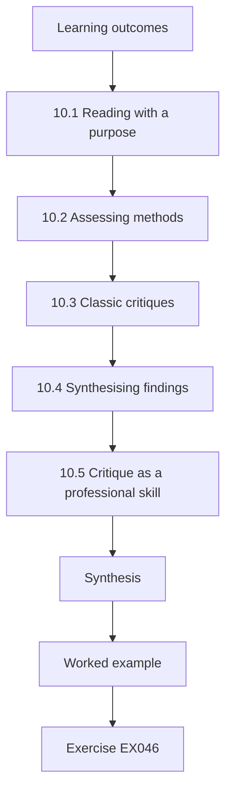

### Logical drawing

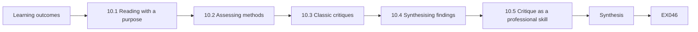

```text
[Learning outcomes]
    |
    v
[10.1 Reading with a purpose]
    |
    v
[10.2 Assessing methods]
    |
    v
[10.3 Classic critiques]
    |
    v
[10.4 Synthesising findings]
    |
    v
[10.5 Critique as a professional skill]
    |
    v
[Synthesis]
    |
    v
[Worked example] --> [Exercise EX046]
```
<!-- cyberabc:lesson-figures:end ch-10 -->


### Learning outcomes

You will (1) read research critically; (2) assess claims and methods; (3) relate findings to practice.

### 10.1 Reading with a purpose

Marta reads research to inform decisions, not to collect references. For route validation, she asks what is known about how often invalid results come from errors rather than attacks, and how enforcement affects reachability. For ingress filtering, she asks what is known about adoption and spoofed traffic. She reads abstracts first, then methods and results of the most relevant papers, and keeps notes on each paper's question, data, method, findings and limits. Purposeful reading is faster and produces notes she can use directly.

### 10.2 Assessing methods

A paper's conclusions are only as good as its methods. Marta checks where the data came from, whether the sample represents the networks she cares about, whether the measures match the claims, and whether alternative explanations were considered. Measurement studies of the internet often observe from a limited set of vantage points, which may miss behaviour elsewhere. She notes such limits in her summaries rather than discarding useful papers, since every study has limits and the question is whether they matter for her decision.

### 10.3 Classic critiques

Some older papers remain useful because they explain persistent problems. Sommer and Paxson's 2010 paper on machine learning for network intrusion detection explains why detection research often fails to transfer into operations: real traffic is diverse, errors are costly and evaluation datasets are unrealistic. Axelsson's 2000 paper on the base-rate fallacy shows why false alarms dominate when attacks are rare. Marta uses these to temper claims from vendors about automated detection of routing anomalies, asking how such tools perform on realistic, rare-event data.

### 10.4 Synthesising findings

Marta writes a short synthesis for each question, combining findings across papers and noting agreement, disagreement and gaps. Where research is thin, she says so and relies more on practitioner experience, clearly labelled. She avoids citing a paper for a claim it does not make, checking each citation against the paper itself. A good synthesis tells a reader what is reasonably known, what is uncertain and what that means for the decision at hand, which is more useful than a long list of summaries.

### 10.5 Critique as a professional skill

Critiquing research is not about finding fault; it is about judging how much weight evidence can bear. Marta practises in a seminar, where students critique each other's summaries. She learns to state criticisms specifically, such as "the sample includes only large networks, so results may not apply to small providers", and to suggest how a limit could be addressed. These habits apply equally to vendor reports and internal analyses, which deserve the same scrutiny as academic papers. She also learns to accept critique of her own work calmly.

### Worked example

Marta's synthesis on route validation errors combines four sources, notes one gap and labels practitioner experience separately.

> **Synthetic case.** Seminar and notes are synthetic; cited papers are real.

### Errors and limits

Citing a paper for a claim it does not make misleads readers and damages credibility.

### Exercises

- **EX046 — Reading notes.** List four items Marta records for each paper. *Rubric:* 3 = question, data, method, findings or limits;; 2 = three;; 1 = fewer;; 0 = none.
- **EX047 — Vantage point limit.** Why do internet measurement studies have vantage point limits? *Rubric:* 3 = observe from few locations, may miss behaviour elsewhere;; 2 = limited view;; 1 = vague;; 0 = none.
- **EX048 — Base-rate relevance.** How does Axelsson's paper apply to routing anomaly tools? *Rubric:* 3 = rare events make false alarms dominate;; 2 = false alarms;; 1 = not relevant;; 0 = none.
- **EX049 — Specific criticism.** Rewrite "the study is weak" as a specific criticism. *Rubric:* 3 = names the limit and its effect on applicability;; 2 = specific;; 1 = still vague;; 0 = none.
- **EX050 — Thin research response.** What should a synthesis do where research is thin? *Rubric:* 3 = say so, rely on labelled practitioner experience;; 2 = state it;; 1 = invent;; 0 = none.

### Synthesis

Purposeful, method-aware reading and honest synthesis turn research into usable evidence.

### Continue studying — chapter 10 of 12

[← Chapter 09 (draft)](#ch-09) · [Course chapter index](../SUBJECTS.md) · [Chapter 11 (draft) →](#ch-11)

<a id="ch-11"></a>

## Chapter 11 — Applied project

<!-- cyberabc:lesson-figures:start ch-11 -->
### Lesson map

Lesson 11 published. Map, example, EX051.

```mermaid
flowchart TD
  N0["Learning outcomes"]
  N1["11.1 Project scope"]
  N2["11.2 Outcomes"]
  N3["11.3 Comparing with criteria"]
  N4["11.4 Documentation for the partner"]
  N5["11.5 Reflection on the project"]
  N6["Synthesis"]
  N0 --> N1 --> N2 --> N3 --> N4 --> N5 --> N6
  N6 --> EX["Worked example"]
  EX --> Q["Exercise EX051"]
```

### Logical drawing

```mermaid
flowchart LR
  N0["Learning outcomes"]
  N1["11.1 Project scope"]
  N2["11.2 Outcomes"]
  N3["11.3 Comparing with criteria"]
  N4["11.4 Documentation for the partner"]
  N5["11.5 Reflection on the project"]
  N6["Synthesis"]
  N0 --> N1 --> N2 --> N3 --> N4 --> N5 --> N6 --> Q["EX051"]
```

```text
[Learning outcomes]
    |
    v
[11.1 Project scope]
    |
    v
[11.2 Outcomes]
    |
    v
[11.3 Comparing with criteria]
    |
    v
[11.4 Documentation for the partner]
    |
    v
[11.5 Reflection on the project]
    |
    v
[Synthesis]
    |
    v
[Worked example] --> [Exercise EX051]
```
<!-- cyberabc:lesson-figures:end ch-11 -->


### Learning outcomes

You will (1) complete the applied project; (2) measure outcomes; (3) document for the partner.

### 11.1 Project scope

Marta's applied project delivers three changes at Fenwick Valley: migration of all provider-controlled VPN peers to IKEv2 with certificates and a joint plan for the partner link; staged route origin validation with lower preference for invalid routes; and ingress filtering for all residential customers after a counting trial. The project runs over six months of the programme's second year. Each change has requirements, a plan, evidence of completion and an owner in the operations team who will continue the work after her placement ends.

### 11.2 Outcomes

By the end, seven of eight VPN peers use IKEv2 with certificates; the partner link runs in parallel with its old tunnel and is scheduled to switch the following month. Route validation has run for four months, with twenty-three invalid routes observed, nine contacts made and one incident handled without customer impact. Ingress filtering is enforced for residential customers after the counting trial; matches fell from forty customers to three after corrections, and support tickets stayed within normal range in the first month.

### 11.3 Comparing with criteria

Marta compares outcomes with criteria set at the start. VPN migration met its target for provider-controlled peers but not for the partner link, which she explains. Route validation met its criteria for the staged period, and the directors scheduled a review of moving to rejection. Ingress filtering met all criteria. She presents results in a table with criterion, target, result and evidence reference. Presenting unmet criteria as clearly as met ones maintains the credibility built through earlier reporting. Each evidence reference points to the dossier.

### 11.4 Documentation for the partner

The provider receives a documentation pack: decision records for each change, runbooks, the responsibility table, the customer notice and support scripts, the validation contact template, and the trial results. Marta writes a one-page index explaining where each item lives and who owns it. She checks each runbook by watching an engineer follow it without her help, fixing two unclear steps. Documentation tested by its users is far more likely to work when needed. The pack is stored in the provider's version-controlled documentation repository, so later changes to runbooks are tracked.

### 11.5 Reflection on the project

Marta reflects that the hardest parts were not technical: winning the partner's trust, handling the director's conflict of interest and reporting delays honestly. She also notes what she would change: starting the counting trial earlier and involving support staff in the customer notice from the beginning. The reflection becomes part of her final submission and of the provider's lessons log, so future projects at Fenwick Valley can benefit from her experience. She also notes that early, honest reporting earned the directors' trust, which made later decisions faster and easier to agree.

### Worked example

Seven of eight peers migrated; twenty-three invalid routes seen; filter matches fell from forty to three customers.

> **Synthetic case.** Outcomes are synthetic.

### Errors and limits

Reporting only met criteria hides information directors need to manage remaining risk.

### Exercises

- **EX051 — VPN outcome.** How many peers use IKEv2 with certificates at the end? *Rubric:* 3 = seven of eight, partner link pending;; 2 = seven;; 1 = all;; 0 = none.
- **EX052 — Filter matches.** How did filter matches change after corrections? *Rubric:* 3 = forty to three customers;; 2 = fell;; 1 = vague;; 0 = none.
- **EX053 — Runbook test.** How were runbooks tested? *Rubric:* 3 = engineer followed them unaided, two steps fixed;; 2 = tried;; 1 = reviewed;; 0 = none.
- **EX054 — Unmet criterion.** Which criterion was not fully met, and why? *Rubric:* 3 = partner link, coordination delay;; 2 = partner link;; 1 = vague;; 0 = none.
- **EX055 — Reflection change.** Name one thing Marta would do differently. *Rubric:* 3 = start counting trial earlier or involve support sooner;; 2 = one;; 1 = vague;; 0 = none.

### Synthesis

The applied project delivers measured outcomes, honest comparison with criteria and tested documentation.

### Continue studying — chapter 11 of 12

[← Chapter 10 (draft)](#ch-10) · [Course chapter index](../SUBJECTS.md) · [Chapter 12 (draft) →](#ch-12)

<a id="ch-12"></a>

## Chapter 12 — Final review and transfer

<!-- cyberabc:lesson-figures:start ch-12 -->
### Lesson map

Lesson 12 published. Map, example, EX056.

```mermaid
flowchart TD
  N0["Learning outcomes"]
  N1["12.1 Final review"]
  N2["12.2 Transfer of ownership"]
  N3["12.3 Continuing improvement"]
  N4["12.4 Transferable lessons"]
  N5["12.5 Closing reflection"]
  N6["Synthesis"]
  N0 --> N1 --> N2 --> N3 --> N4 --> N5 --> N6
  N6 --> EX["Worked example"]
  EX --> Q["Exercise EX056"]
```

### Logical drawing

```mermaid
flowchart LR
  N0["Learning outcomes"]
  N1["12.1 Final review"]
  N2["12.2 Transfer of ownership"]
  N3["12.3 Continuing improvement"]
  N4["12.4 Transferable lessons"]
  N5["12.5 Closing reflection"]
  N6["Synthesis"]
  N0 --> N1 --> N2 --> N3 --> N4 --> N5 --> N6 --> Q["EX056"]
```

```text
[Learning outcomes]
    |
    v
[12.1 Final review]
    |
    v
[12.2 Transfer of ownership]
    |
    v
[12.3 Continuing improvement]
    |
    v
[12.4 Transferable lessons]
    |
    v
[12.5 Closing reflection]
    |
    v
[Synthesis]
    |
    v
[Worked example] --> [Exercise EX056]
```
<!-- cyberabc:lesson-figures:end ch-12 -->


### Learning outcomes

You will (1) present the project for final review; (2) transfer ownership; (3) plan continuing improvement.

### 12.1 Final review

Marta presents her project to a panel including Prof. Brooks, an external examiner and the provider's operations lead. She covers the decisions, evidence, outcomes, limits and reflections in twenty-five minutes. The examiner asks how she knew lower preference was enough protection during staging. She explains that it prevents use of invalid routes when valid ones exist, which covers most mis-origination, and acknowledges it does not protect when the invalid route is the only path, which is why the review of rejection is scheduled.

### 12.2 Transfer of ownership

Ownership transfers formally. Each change has an owner who signs an acceptance listing the documentation received, the open items and the review dates. The operations lead takes the partner VPN switch; the named engineers take validation contacts; the support manager takes filter exceptions. Formal transfer avoids the gap where a project ends and nobody feels responsible. It also gives the owners a clear moment to ask questions while Marta is still available to answer them. Signed acceptances are stored with the decision records.

### 12.3 Continuing improvement

Marta leaves a short improvement plan: decide on route rejection after the review, extend certificate-based VPNs to any new sites, revisit filtering for business customers with complex arrangements annually, and arrange the reciprocal independent review. Each item has a proposed date and owner. Security is never finished; a plan for next steps prevents the provider from treating the project's end as the end of the work. The plan is reviewed by the directors each quarter alongside the assurance report, so progress on each item stays visible and slipping items are discussed rather than forgotten.

### 12.4 Transferable lessons

The panel asks what other small providers could learn. Marta identifies three lessons: stage enforcement and measure before tightening; invest in clear communication with customers and other networks; and integrate changes into existing operations with named owners. She offers to share a sanitised version of her decision records with a regional operators' group, with the provider's permission. Sharing lessons helps the wider internet, which depends on many small networks making similar improvements. She also suggests that operators' groups collect anonymised data on staged enforcement, so small providers can learn from one another's experience.

### 12.5 Closing reflection

Marta reflects on how her practice changed. As an engineer, she judged changes mainly by technical correctness. As a postgraduate specialist, she learned to judge them also by who bears risk, how decisions are evidenced and how changes survive in an organisation. These skills, she notes, matter more as responsibility grows. The panel passes her project, commending the honest reporting of delays and the careful staging of enforcement. She plans to keep a decision journal in her next role, applying the same habits of recording evidence, values and reasons for every significant choice.

### Worked example

The panel passes the project; three owners sign acceptance; the improvement plan lists four items with dates.

> **Synthetic case.** The review is synthetic.

### Errors and limits

Projects that end without formal transfer leave controls unowned.

### Exercises

- **EX056 — Staging limit.** When does lower preference not protect customers? *Rubric:* 3 = invalid route is the only path;; 2 = only path;; 1 = never;; 0 = none.
- **EX057 — Formal acceptance.** What does each owner's acceptance list? *Rubric:* 3 = documentation, open items, review dates;; 2 = documentation;; 1 = vague;; 0 = none.
- **EX058 — Improvement items.** Name two items in the improvement plan. *Rubric:* 3 = rejection decision, new sites, business filtering review, reciprocal review;; 2 = two;; 1 = one;; 0 = none.
- **EX059 — Transferable lesson.** State one lesson for other small providers. *Rubric:* 3 = stage and measure, communicate, integrate with owners;; 2 = one;; 1 = vague;; 0 = none.
- **EX060 — Practice change.** How did Marta's judgement of changes evolve? *Rubric:* 3 = beyond technical correctness to risk, evidence and durability;; 2 = broader;; 1 = unchanged;; 0 = none.

### Synthesis

Final review, formal transfer and an improvement plan carry the project's value into continuing practice.

### Continue studying — chapter 12 of 12

[← Chapter 11 (draft)](#ch-11) · [Course chapter index](../SUBJECTS.md) · [Worked results ↓](#worked-results) · [Next course via chapter index →](../SUBJECTS.md)

<a id="worked-results"></a>

## Worked results

Model answers for EX001–EX060. Marta Lindqvist, Prof. Aiyana Brooks, Kestrel Graduate School, Fenwick Valley Broadband and every figure are synthetic. Lab answers quote verified outputs. Any answer meeting the rubric scores equally.

**EX001.** The first is a checkable fact; the second is an uncertain estimate.

**EX002.** It provides the baseline against which other options' consequences are judged.

**EX003.** Each step is informed by evidence, and partners have time to fix their configurations.

**EX004.** It shows the evidence and reasoning available when the decision was made.

**EX005.** The contract term; a filter change can be reverted in minutes.

**EX006.** A single leak can expose several links, and keys are often handled carelessly.

**EX007.** Which network may originate the address holder's prefixes.

**EX008.** The filtering network bears the cost while others receive most of the benefit.

**EX009.** Strengths show what can be built on and help choose realistic changes.

**EX010.** Practical detail on handling exceptions and communicating with partners.

**EX011.** Five, because all use old pre-shared keys and three also use IKEv1.

**EX012.** A tunnel may negotiate an older version than configured.

**EX013.** It carries another organisation's traffic, so changes must be coordinated.

**EX014.** Marta reports it and the provider changes the secret.

**EX015.** The network may not behave as documented, which is itself a finding.

**EX016.** Other networks that would otherwise receive spoofed traffic.

**EX017.** It was disclosed and the director stepped back from that decision.

**EX018.** Her assessment could tempt her to recommend change for its own sake.

**EX019.** It protects against most problems while learning how often records are wrong.

**EX020.** What will change, why it protects the internet and how to contact support.

**EX021.** Four valid, three invalid and one not found.

**EX022.** It is more specific than the /24 maximum length authorised.

**EX023.** No authorisation covers the prefix, so validation gives no answer.

**EX024.** Errors there would cause other networks to reject Fenwick Valley's routes.

**EX025.** Criteria for moving on and the procedure for reversing if problems appear.

**EX026.** Three of ten packets, thirty percent.

**EX027.** A misconfigured customer router leaking private addresses.

**EX028.** It records packets that would match without dropping them.

**EX029.** A support ticket spike above threshold returns filters to counting mode.

**EX030.** The benefit to other networks from reduced spoofed traffic.

**EX031.** So they continue after the placement using processes the team already runs.

**EX032.** To cover holidays and absences.

**EX033.** The old tunnel stays as a fallback until the new one is confirmed.

**EX034.** It is more effective and produces runbooks new staff can reuse.

**EX035.** Weekly validation reports reviewed on time.

**EX036.** By adding their verified second prefix to allowed sources.

**EX037.** With a letter of authorisation and a registry records check.

**EX038.** Rejection would have cut customers off; lower preference avoided impact.

**EX039.** The prefix, the validation result and the time observed.

**EX040.** It would weaken protection exactly for destinations attackers might target.

**EX041.** Assurance rests on evidence directors can trace to its source.

**EX042.** Plainly, with its cause, effect on risk and the revised plan.

**EX043.** She invited him to present his view to the directors alongside hers.

**EX044.** It provides independent review cheaply, since each provider reviews the other.

**EX045.** A summary page, indicators with trends, open risks with owners and decisions needed.

**EX046.** The question, data, method and findings.

**EX047.** They observe from limited locations and may miss behaviour elsewhere.

**EX048.** Because true anomalies are rare, false alarms will dominate unless tools are very precise.

**EX049.** "The sample includes only large networks, so results may not apply to small providers."

**EX050.** State the gap and rely on clearly labelled practitioner experience.

**EX051.** Seven of eight, with the partner link scheduled to switch.

**EX052.** From forty customers to three.

**EX053.** An engineer followed each without help, and two unclear steps were fixed.

**EX054.** The partner VPN link, delayed by coordination with the partner.

**EX055.** Start the counting trial earlier.

**EX056.** When the invalid route is the only available path.

**EX057.** Documentation received, open items and review dates.

**EX058.** Deciding on route rejection and arranging the reciprocal review.

**EX059.** Stage enforcement and measure before tightening.

**EX060.** From technical correctness alone to also weighing risk bearers, evidence and organisational durability.

<a id="references"></a>

## References

Links checked 12 October 2026; re-verify editions before citing. Organisations, people, systems, code and data in this book are synthetic unless a sentence cites a public source.

- Axelsson, S. (2000). The base-rate fallacy and the difficulty of intrusion detection. *ACM Transactions on Information and System Security*, 3(3), 186–205. <https://doi.org/10.1145/357830.357849>
- Barker, E., Dang, Q., Frankel, S., Scarfone, K., & Wouters, P. (2020). *Guide to IPsec VPNs* (NIST SP 800-77 Rev. 1). NIST. <https://doi.org/10.6028/NIST.SP.800-77r1>
- Center for Internet Security. (2021). *CIS Critical Security Controls v8*. <https://www.cisecurity.org/controls/v8>
- Chandramouli, R., & Rose, S. (2013). *Secure Domain Name System (DNS) deployment guide* (NIST SP 800-81-2). NIST. <https://doi.org/10.6028/NIST.SP.800-81-2>
- Claise, B., Trammell, B., & Aitken, P. (2013). *Specification of the IP Flow Information Export (IPFIX) protocol* (RFC 7011). IETF. <https://www.rfc-editor.org/rfc/rfc7011>
- Ferguson, P., & Senie, D. (2000). *Network ingress filtering* (RFC 2827, BCP 38). IETF. <https://www.rfc-editor.org/rfc/rfc2827>
- Gerhards, R. (2009). *The Syslog protocol* (RFC 5424). IETF. <https://www.rfc-editor.org/rfc/rfc5424>
- Joint Task Force. (2020). *Security and privacy controls for information systems and organizations* (NIST SP 800-53 Rev. 5). NIST. <https://doi.org/10.6028/NIST.SP.800-53r5>
- Kaufman, C., Hoffman, P., Nir, Y., Eronen, P., & Kivinen, T. (2014). *Internet Key Exchange Protocol Version 2 (IKEv2)* (RFC 7296). IETF. <https://www.rfc-editor.org/rfc/rfc7296>
- Kent, S., & Seo, K. (2005). *Security architecture for the Internet Protocol* (RFC 4301). IETF. <https://www.rfc-editor.org/rfc/rfc4301>
- Landis, J. R., & Koch, G. G. (1977). The measurement of observer agreement for categorical data. *Biometrics*, 33(1), 159–174. <https://doi.org/10.2307/2529310>
- Lepinski, M., & Kent, S. (2012). *An infrastructure to support secure Internet routing* (RFC 6480). IETF. <https://www.rfc-editor.org/rfc/rfc6480>
- McKay, K., & Cooper, D. (2019). *Guidelines for the selection, configuration, and use of Transport Layer Security (TLS) implementations* (NIST SP 800-52 Rev. 2). NIST. <https://doi.org/10.6028/NIST.SP.800-52r2>
- Paxson, V. (1999). Bro: A system for detecting network intruders in real-time. *Computer Networks*, 31(23–24), 2435–2463. <https://doi.org/10.1016/S1389-1286(99)00112-7>
- Rescorla, E. (2018). *The Transport Layer Security (TLS) protocol version 1.3* (RFC 8446). IETF. <https://www.rfc-editor.org/rfc/rfc8446>
- Rose, S., Borchert, O., Mitchell, S., & Connelly, S. (2020). *Zero trust architecture* (NIST SP 800-207). NIST. <https://doi.org/10.6028/NIST.SP.800-207>
- Saltzer, J. H., & Schroeder, M. D. (1975). The protection of information in computer systems. *Proceedings of the IEEE*, 63(9), 1278–1308. <https://doi.org/10.1109/PROC.1975.9939>
- Scarfone, K., & Hoffman, P. (2009). *Guidelines on firewalls and firewall policy* (NIST SP 800-41 Rev. 1). NIST. <https://doi.org/10.6028/NIST.SP.800-41r1>
- Scarfone, K., & Mell, P. (2007). *Guide to intrusion detection and prevention systems (IDPS)* (NIST SP 800-94). NIST. <https://doi.org/10.6028/NIST.SP.800-94>
- Sommer, R., & Paxson, V. (2010). Outside the closed world: On using machine learning for network intrusion detection. *2010 IEEE Symposium on Security and Privacy*, 305–316. <https://doi.org/10.1109/SP.2010.25>
- Souppaya, M., & Scarfone, K. (2012). *Guidelines for securing wireless local area networks (WLANs)* (NIST SP 800-153). NIST. <https://doi.org/10.6028/NIST.SP.800-153>
- Sriram, K., & Montgomery, D. (2019). *Resilient interdomain traffic exchange: BGP security and DDoS mitigation* (NIST SP 800-189). NIST. <https://doi.org/10.6028/NIST.SP.800-189>
- Wool, A. (2004). A quantitative study of firewall configuration errors. *Computer*, 37(6), 62–67. <https://doi.org/10.1109/MC.2004.2>
