# Authorized Offensive Security and Red Team: A Postgraduate Specialist's Book

- Language: English (`en`); postgraduate course, two years; approximately 600 hours of planned study.
- Editorial state: **published**. Chapters 1–12 of 12 have hand-written teaching text; exercises EX001–EX060 have matching worked results; offline labs use the Python 3 standard library and their outputs are embedded from real runs. Independent review and the 300-page A4 verification remain open.
- Audience: experienced specialists leading organization-scale authorized testing choices.
- Relation to neighbouring books: the [bachelor's book](../../../../bachelors-4-years/offensive-security-red-team/en/book/MANUSCRIPT.md) builds foundations and a capstone; the [master's book](../../../../masters-2-years/offensive-security-red-team/en/book/MANUSCRIPT.md) emphasises research design. **This book emphasises specialist judgement, threat-led literacy and assurance leadership.**
- Author: [hiagokinlevi](https://github.com/hiagokinlevi). Original text [CC0 1.0](../../../../../LICENSE); cited works keep their rights.
- Educational boundary: not an accredited qualification. **No authority to test real market infrastructures.** All organisations, people and numbers are **synthetic** unless a sentence cites a public source.

[Course home](../../README.md) · [Chapter index](../SUBJECTS.md) · [Book plan](PLAN.md) · [Course skill](../../skill/SKILL.md) · [Worked results](#worked-results)

## How to use this draft

Chapters 1–6 cover decisions, practice, evidence, ethics, programme design and evaluation; 7–12 cover integration, difficult cases, leadership, critique, applied project and transfer. Every chapter has outcomes, teaching, a worked example, a labelled synthetic case, errors and limits, five exercises scored 0–3, a synthesis and a **Continue studying** block. Labs in Chapters 6, 9 and 10 read local data only.

### Synthetic running case

| Element | Role | Boundary |
|---|---|---|
| **Meridian Clearing House (MCH)** — clearing services, ordinary web tests, biennial threat-led style exercises, SWIFT-adjacent exclusions | Organisation studied throughout | Invented |
| **Amira Hassan** | Specialist leading authorized testing judgement at MCH | Invented |

### Core sources

NIST [SP 800-115](https://doi.org/10.6028/NIST.SP.800-115); [PTES](https://pentest-standard.readthedocs.io/en/latest/); MITRE [ATT&CK](https://attack.mitre.org/); OWASP [WSTG](https://owasp.org/www-project-web-security-testing-guide/); [TIBER-EU](https://www.ecb.europa.eu/paym/cyber-resilience/tiber-eu/html/index.en.html); Bank of England [CBEST](https://www.bankofengland.co.uk/financial-stability/operational-resilience-of-the-financial-sector/cbest-threat-intelligence-led-assessments-implementation-guide).

## Contents

| Chapters |
|---|
| [1](#ch-01) · [2](#ch-02) · [3](#ch-03) · [4](#ch-04) · [5](#ch-05) · [6](#ch-06) · [7](#ch-07) · [8](#ch-08) · [9](#ch-09) · [10](#ch-10) · [11](#ch-11) · [12](#ch-12) |

[Worked results](#worked-results) · [References](#references)

<a id="ch-01"></a>

## Chapter 1 — Advanced security decision-making

<!-- open-cyber-academy:lesson-figures:start ch-01 -->
### Lesson map

Lesson 01 published. Map, example, EX001.

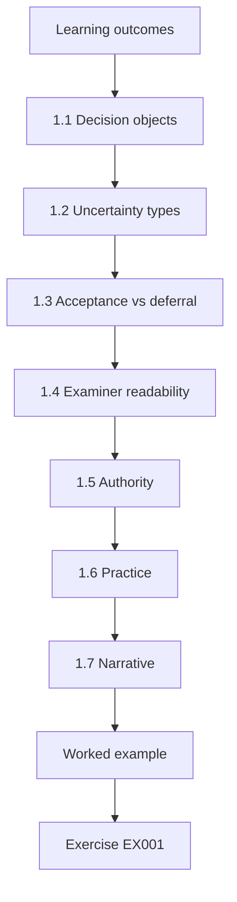

### Logical drawing

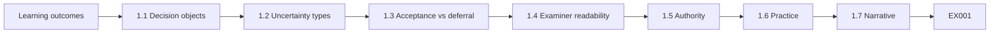

```text
[Learning outcomes]
    |
    v
[1.1 Decision objects]
    |
    v
[1.2 Uncertainty types]
    |
    v
[1.3 Acceptance vs deferral]
    |
    v
[1.4 Examiner readability]
    |
    v
[1.5 Authority]
    |
    v
[1.6 Practice]
    |
    v
[1.7 Narrative]
    |
    v
[Worked example] --> [Exercise EX001]
```
<!-- open-cyber-academy:lesson-figures:end ch-01 -->


### Learning outcomes

You will (1) structure decisions under uncertainty for authorized testing programmes; (2) separate risk acceptance from wishful thinking; (3) use decision records that examiners can follow; (4) refuse decisions that lack an owner.

### 1.1 Decision objects

At Meridian Clearing House, Amira Hassan treats each major testing choice as an object with options, evidence, uncertainties, recommendation and owner. "We should red team more" is not a decision object until options and trade-offs are written.

DEC-14 rejects annual threat-led work because white-team capacity cannot cover two full cycles without borrowing SOC analysts from BAU. The CISO accepts that capacity limit in writing, and Amira files the acceptance beside the options table so a later examiner sees the trade-off was owned, not implied.

Until those five fields are written, a slogan such as we should red team more is not a decision object, and examiners cannot see what was traded away. Amira opens a blank object on the projector whenever a VP asks for a quick yes, so ownership is forced into the open before scope expands.

### 1.2 Uncertainty types

She distinguishes aleatory uncertainty (noisy detection rates) from epistemic uncertainty (unknown whether a conduit exists). Wilson-style intervals help the first; architecture workshops help the second. Mixing them produces false precision.

For DEC-14 she marks detection-rate noise as aleatory and the unknown SWIFT-adjacent conduit as epistemic. The architecture workshop that follows has a date and a named lead; inventing a percentage for the conduit would have produced false precision the board would have treated as fact.

Her decision records label which uncertainties are which, so a later reader knows what more data could fix and what only design work can fix. Mixing noisy detection rates with unknown conduits is how board packs gain a single percentage that pretends certainty.

### 1.3 Acceptance vs deferral

Accepting residual risk requires a named acceptor, expiry and compensating control. Deferring a test because "next year is better" without a date is neither acceptance nor management — it is drift.

The SWIFT-adjacent exclusion names the CISO as acceptor, expires at the next catalogue review, and lists network isolation plus jump-host MFA as compensating controls. Amira will not file acceptance if any of those three fields is blank, and she will not treat an open-ended deferral as a substitute for them.

Saying next year without a date would leave the SWIFT-adjacent exclusion as drift. Examiners reading the record should see a deliberate choice with acceptor, expiry and compensating controls, not a postponed conversation dressed as management.

### 1.4 Examiner readability

Decision records answer: what was chosen, what was rejected, what evidence counted, what remains unknown. Amira rejects records that read like slogans.

A readable DEC-14 record states that quarterly WSTG-style web tests plus a biennial threat-led exercise were chosen, that annual threat-led was rejected for capacity, and that SWIFT-adjacent systems remain excluded. A director who missed the meeting can reconstruct the trade-off without calling Amira.

Slogans such as we take security seriously are deleted from drafts before they leave her desk. She writes so a successor can continue without asking her for folklore, and so a director who was not in the room can reconstruct capacity limits on annual threat-led work.

### 1.5 Authority

Only roles listed in the governance charter may accept payment-adjacent residual risk. Amira escalates rather than inventing authority.

Payment-adjacent residual risk sits with roles named in the governance charter: the CISO for ordinary exclusions, the board risk committee for programme-wide choices. When a product owner asks Amira to accept what she cannot, she escalates with the charter excerpt attached rather than inventing authority.

Invented authority collapses under examiner challenge, so she keeps the charter excerpt beside every acceptance record. Product owners who want her signature on what only the CISO may accept receive an escalation, not a quiet nod.

### 1.6 Practice

Weekly decision clinic: one real (synthetic) choice, twenty minutes, written record before leaving the room.

The weekly clinic takes one synthetic choice — for example, slipping the threat-led exercise by a quarter — and ends with options, evidence and owner written before anyone leaves. Amira logs the record the same day so the clinic cannot become an undocumented hallway chat.

Juniors present first in the clinic; she edits for clarity, not for softer conclusions. Twenty minutes is enough when the choice is real and synthetic, such as whether to slip a threat-led exercise, and the written record lands in the decision log the same day.

### 1.7 Narrative

Amira keeps DEC records in a folder that internal audit sampled last year without finding undated deferrals. The sample letter is pinned above her monitor. When a VP asks for a quick yes on expanding scope into participant networks, she opens a blank decision object on the projector and fills options aloud until the VP either commits ownership or withdraws. The ritual feels slow and prevents silent scope inflation across clearing participants. Three deputies have now authored DEC records audit accepted unchanged.

Internal audit sampled the DEC folder last year and found no undated deferrals; the sample letter stays pinned above her monitor. When a VP wants a quick yes on participant-network scope, she fills a blank decision object on the projector until ownership is accepted or the request is withdrawn.

### Worked example (synthetic MCH)

Amira's record DEC-14 chooses quarterly WSTG-style web tests plus a biennial threat-led exercise; rejects annual threat-led for capacity reasons; lists SWIFT-adjacent systems as out of ordinary scope with CISO as acceptor of that exclusion.

> **Synthetic case — Meridian Clearing House (MCH).** The clearing organisation, Amira Hassan and all figures are invented for teaching.

### Errors and limits

Threat-led and clearing-system tests require specialised legal authorization. This book uses synthetic scenarios only and never supplies exploit code or live targeting advice for market infrastructures.

### Exercises

- **EX001 — Decision object fields.** List five fields of a decision object. *Rubric:* 3 = five of options, evidence, uncertainties, recommendation, owner, rejects; 2 = three; 1 = one; 0 = none.
- **EX002 — Aleatory vs epistemic.** Give one example of each at MCH. *Rubric:* 3 = both correct types; 2 = one; 1 = swapped; 0 = none.
- **EX003 — Bad deferral.** Why is "test next year" without a date a problem? *Rubric:* 3 = drift / neither accept nor manage; 2 = partial; 1 = fine; 0 = none.
- **EX004 — Authority.** Who may accept payment-adjacent residual risk? *Rubric:* 3 = roles in governance charter / CISO-level; 2 = partial; 1 = any engineer; 0 = none.
- **EX005 — DEC-14 rejects.** What does DEC-14 reject and why? *Rubric:* 3 = annual threat-led for capacity; 2 = partial; 1 = all testing; 0 = none.

### Synthesis

Decisions are owned objects with uncertainties named; slogans and undated deferrals do not count.

### Continue studying — chapter 01 of 12

[← Course home](../../README.md) · [Course chapter index](../SUBJECTS.md) · [Chapter 02 (draft) →](#ch-02)

<a id="ch-02"></a>

## Chapter 2 — Current practice in authorized offensive security

<!-- open-cyber-academy:lesson-figures:start ch-02 -->
### Lesson map

Lesson 02 published. Map, example, EX006.

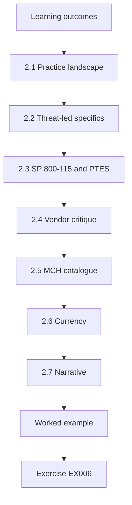

### Logical drawing

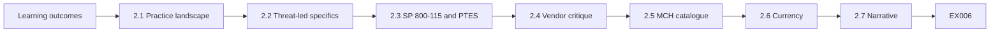

```text
[Learning outcomes]
    |
    v
[2.1 Practice landscape]
    |
    v
[2.2 Threat-led specifics]
    |
    v
[2.3 SP 800-115 and PTES]
    |
    v
[2.4 Vendor critique]
    |
    v
[2.5 MCH catalogue]
    |
    v
[2.6 Currency]
    |
    v
[2.7 Narrative]
    |
    v
[Worked example] --> [Exercise EX006]
```
<!-- open-cyber-academy:lesson-figures:end ch-02 -->


### Learning outcomes

You will (1) map current practice frameworks; (2) position TIBER-EU and CBEST among lighter tests; (3) critique vendor claims; (4) keep MCH's catalogue honest.

### 2.1 Practice landscape

Organisations mix vulnerability management, periodic web application tests following OWASP WSTG themes, purple-team drills and occasional threat-led exercises under TIBER-EU or CBEST-like rules. Names are not interchangeable, and wrong names produce wrong expectations about detection learning and SWIFT-adjacent coverage. Amira's catalogue lists those four activities as separate rows with separate claims. Calling all of them a red team is how boards hear SWIFT assurance that was never bought, so she corrects vocabulary in every planning meeting until the names stay separate in every planning note.

### 2.2 Threat-led specifics

TIBER-EU and CBEST emphasise intelligence-led scenarios, white-team control and learning for detection and response — not finding count maximisation. When executives say "just pentest everything", Amira opens the public guides and shows those three expectations; a week of scanning is not a threat-led programme under them. Her RFP language asks for intelligence, white-team design and detection learning, not for a finding-count target, which is scored as theatre. Vendors who cannot describe white-team design leave the shortlist, so Meridian Clearing House does not buy a scan dressed as threat-led work.

### 2.3 SP 800-115 and PTES

NIST SP 800-115 and PTES are still the backbone for planning assessment types and engagement stages. Threat-led programmes sit on top of, not instead of, that scoping discipline: written authorization, inclusions, exclusions and stop conditions remain mandatory even when the scenario is intelligence-led and biennial. Skipping scoping because the exercise is special is how out-of-scope probes happen. Sitting on that backbone is how Amira keeps SWIFT-adjacent systems out of ordinary tests while still running a biennial scenario under white-team control. The biennial scenario's own ROE therefore names the SWIFT-adjacent exclusion explicitly.

### 2.4 Vendor critique

Vendors who promise "full red team in a week" without intelligence, a white team or detection goals are selling a scan with theatre. Amira's RFP scoring asks who acts as white team, what detection goals will be measured, and how intelligence shapes scenarios; those three answers separate a real offer from a slogan. She has rejected a one-week full red team bid with no intelligence phase and recorded the reason in the catalogue. Each rejection reason stays there, so the next buyer at Meridian Clearing House can see the pattern of scan-with-theatre bids.

### 2.5 MCH catalogue

A living catalogue maps each activity to what it can and cannot claim. Ordinary quarterly web tests cannot claim SWIFT safety; a biennial threat-led exercise cannot claim continuous coverage of every web change. Honesty here stops insurance questionnaires and board slides from overstating Meridian Clearing House's assurance. A catalogue row without a cannot-claim line is incomplete, and Amira will not let such a row enter a pack. She also blocks board-pack language that invents claims a complete row forbids, even when the wording comes from a senior sponsor.

### 2.6 Currency

Amira reviews the catalogue twice a year against new framework editions. The reviews catch new ATT&CK, WSTG, TIBER-EU and CBEST editions and redline retired vendor slogans still sitting in old board packs. A catalogue that is never refreshed becomes a museum of last year's swagger. She dates each review and files the redline index, so retired slogans cannot be pasted forward from old packs into new ones. Currency is a scheduled control with a date in the calendar, not a hope that someone will notice a stale claim before a committee does.

### 2.7 Narrative

Catalogue reviews include a red-team vendor as guest critic once a year. Amira asks them to attack the cannot-claim lines: if they can honestly say a quarterly web test proves SWIFT safety, the line is too weak. Last year's guest failed to break the lines; she still tightened one adjective. She invites a different vendor each year so the critique does not become captured. Currency reviews also hunt retired vendor slogans lingering in old board packs and redline them in the archive index.

### 2.8 Archive redlines

Archive redlines of old packs are linked from the catalogue changelog, so reviewers see which claim was softened and why; forgetting history is how swagger returns to board language. The rewrite from "we are CBEST compliant" to a time-bounded CBEST-inspired exercise with SWIFT-adjacent exclusions is the worked example, and both versions stay in the archive. When a director asked why "compliant" vanished from the 2025 slide, the changelog link answered the question without a meeting. Each changelog entry records the date, the old wording and the reviewer who approved the new wording.

### Worked example (synthetic MCH)

Amira rewrites a board slide from "we are CBEST compliant" to "we completed a CBEST-inspired exercise in 2025; ordinary quarterly tests exclude SWIFT-adjacent systems per catalogue".

> **Synthetic case — Meridian Clearing House (MCH).** The clearing organisation, Amira Hassan and all figures are invented for teaching.

### Errors and limits

Threat-led and clearing-system tests require specialised legal authorization. This book uses synthetic scenarios only and never supplies exploit code or live targeting advice for market infrastructures.

### Exercises

- **EX006 — Not interchangeable.** Why not call every test a red team? *Rubric:* 3 = different depth/intel/detection goals; 2 = partial; 1 = same; 0 = none.
- **EX007 — Threat-led emphasis.** Name two emphases of TIBER-EU/CBEST-style tests. *Rubric:* 3 = intel-led scenarios and detection/response learning (white team); 2 = one; 1 = finding volume; 0 = none.
- **EX008 — RFP question.** Give one RFP question that weeds out theatre. *Rubric:* 3 = asks white-team/learning objectives/intel; 2 = partial; 1 = cheapest price only; 0 = none.
- **EX009 — Cannot-claim.** What must a catalogue state besides what tests do? *Rubric:* 3 = what they cannot claim; 2 = partial; 1 = logos; 0 = none.
- **EX010 — Slide rewrite.** What was wrong with "we are CBEST compliant"? *Rubric:* 3 = overclaim / imprecise; 2 = partial; 1 = says nothing was wrong; 0 = no answer.

### Synthesis

Current practice is a catalogue of honestly named activities, not a single buzzword.

### Continue studying — chapter 02 of 12

[← Chapter 01 (draft)](#ch-01) · [Course chapter index](../SUBJECTS.md) · [Chapter 03 (draft) →](#ch-03)

<a id="ch-03"></a>

## Chapter 3 — Specialist evidence

<!-- open-cyber-academy:lesson-figures:start ch-03 -->
### Lesson map

Lesson 03 published. Map, example, EX011.

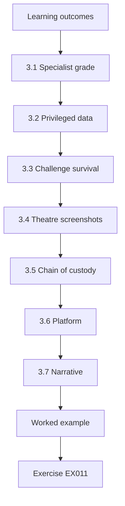

### Logical drawing

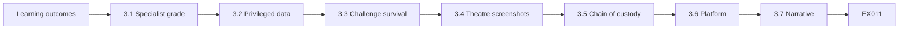

```text
[Learning outcomes]
    |
    v
[3.1 Specialist grade]
    |
    v
[3.2 Privileged data]
    |
    v
[3.3 Challenge survival]
    |
    v
[3.4 Theatre screenshots]
    |
    v
[3.5 Chain of custody]
    |
    v
[3.6 Platform]
    |
    v
[3.7 Narrative]
    |
    v
[Worked example] --> [Exercise EX011]
```
<!-- open-cyber-academy:lesson-figures:end ch-03 -->


### Learning outcomes

You will (1) define specialist-grade evidence; (2) handle privileged clearing data; (3) design evidence that survives challenge; (4) refuse theatre screenshots.

### 3.1 Specialist grade

Evidence must be reproducible under the ROE, minimised, hashed, time-zoned and tied to a decision. "Looks bad in a tool" is not specialist grade: reproducibility is the grade, drama is not. Specialist-grade evidence can be reproduced under the ROE by another tester using hashes, timestamps and scope context from the vault. FindingsDesk blocks board-pack entry until hash and owner are present, so drama without those fields never reaches a committee slide. An observation that fails the test is rewritten until another specialist could repeat it.

### 3.2 Privileged data

Clearing messages and participant identifiers are highly sensitive. Sensitivity is not a reason to skip evidence; it is a reason to design safer evidence. Amira keeps real messages and identifiers out of ordinary evidence whenever synthetic message templates can show the same class of issue, and she prefers those templates even in staging. Anything that still looks too real is redacted before it enters the vault. The result is a vault in which ordinary entries prove the issue without carrying participant data that a leak or a careless export could expose.

### 3.3 Challenge survival

Legal or white-team challenge asks: could another specialist reproduce this observation without your laptop folklore? If not, rewrite. In challenge drills a second specialist has ten minutes to find a missing hash, timezone or ROE clause, and is scored for catching real gaps. If the observation cannot survive, Amira rewrites it before vault entry; calm repair after a catch scores well, defensiveness does not. The drill exists so that legal or white-team challenge never meets an unreproducible claim for the first time in a real dispute.

### 3.4 Theatre screenshots

Dark-themed dashboards without hashes, timestamps or scope context look impressive and prove nothing, and the evidence vault rejects them on sight. They waste examiner time and train juniors to confuse polish with evidence. Amira asks first for the boring artefacts — command output, config excerpts and hashes — and will not argue about colour themes until hashes and timestamps exist. A rejected theatre screenshot becomes a teaching example in the next challenge drill, so the same polish mistake does not return in the following quarter's evidence.

### 3.5 Chain of custody

For threat-led exercises, custody logs are as important as technical artefacts. They show who held which artefact, when it moved and who authorised the move, and a missing custody line is treated as seriously as a missing hash. White-team and legal challenges often start with chain-of-custody questions, so the log is built during the exercise, while memory is fresh, rather than reconstructed afterwards. A log written from memory a week later invites exactly the doubt that custody records exist to remove.

### 3.6 Platform

FindingsDesk fields enforce hash and owner before a finding may enter board packs. The platform gate is how Meridian Clearing House keeps specialist standards when calendar pressure rises before a committee meeting. Amira refuses manual overrides for late slides, even when the meeting is tomorrow and colour and severity look ready. Colour and severity fields come after hash and owner, never instead of them. A finding that misses the pack because its hash is absent goes to the next pack complete, which costs one cycle rather than credibility.

### 3.7 Narrative

Challenge drills pair two specialists: one presents evidence, the other has ten minutes to find a missing hash, timezone or ROE clause. Amira scores the challenger for catching real gaps and the presenter for calm repair. Vault rejection rates dropped afterward, because presenters arrived with hashes filled. Custody drills include a simulated laptop seizure asking whether hashes still prove out; partial hash recovery counts as a fail, and a past fail funded HSM work for vault keys. The seizure scenario is rerun after every change to how vault keys are stored.

### 3.8 Drill-funded controls

The HSM budget memo used the seizure-drill fail as exhibit A: boring drills buy real controls. The memo set the recovered fragment beside the vault-key inventory, showing which key the seized laptop would have exposed. Finance accepted the HSM line because the drill record had a dated plan, a written rule and a failed result nobody had softened. Treating the partial result as a fail is what made the drill credible evidence in that memo; a softened score would have read as a near-pass and funded nothing.

### 3.9 Drill scoring rule

Seizure-drill scores are pass/fail, and partial hash recovery is a fail: a recovered fragment still proves key material left the device, so the rule has no middle grade. Amira writes that pass-fail sentence into the drill brief before the exercise starts and keeps it beside the drill plan for later cohorts. The brief also names the scorer in advance, so nobody who ran the seizure scenario grades it afterwards. Operators who want a middle grade after a fragment recovers learn that the rule does not bend for comfort; softening it would train them to negotiate scores.

### Worked example (synthetic MCH)

Amira rejects a vendor slide of a red dashboard; accepts a packet with request ids, hashes, UTC offsets and the ROE clause that allowed the check.

> **Synthetic case — Meridian Clearing House (MCH).** The clearing organisation, Amira Hassan and all figures are invented for teaching.

### Errors and limits

Threat-led and clearing-system tests require specialised legal authorization. This book uses synthetic scenarios only and never supplies exploit code or live targeting advice for market infrastructures.

### Exercises

- **EX011 — Four traits.** List four specialist-grade evidence traits. *Rubric:* 3 = four of reproducible, minimised, hashed, time-zoned, tied to decision; 2 = three; 1 = one; 0 = none.
- **EX012 — Synthetic preference.** Why prefer synthetic clearing templates? *Rubric:* 3 = sensitivity of real clearing data; 2 = partial; 1 = laziness; 0 = none.
- **EX013 — Challenge question.** What question tests challenge survival? *Rubric:* 3 = could another specialist reproduce without folklore; 2 = partial; 1 = is it red; 0 = none.
- **EX014 — Theatre reject.** Why reject a dark dashboard screenshot alone? *Rubric:* 3 = no hash/time/scope context; 2 = partial; 1 = aesthetics; 0 = none.
- **EX015 — Vault gate.** What does FindingsDesk require before board packs? *Rubric:* 3 = hash and owner (and related fields); 2 = one; 1 = colour; 0 = none.

### Synthesis

Specialist evidence survives challenge; theatre does not enter the vault.

### Continue studying — chapter 03 of 12

[← Chapter 02 (draft)](#ch-02) · [Course chapter index](../SUBJECTS.md) · [Chapter 04 (draft) →](#ch-04)

<a id="ch-04"></a>

## Chapter 4 — Advanced risk and ethics

<!-- open-cyber-academy:lesson-figures:start ch-04 -->
### Lesson map

Lesson 04 published. Map, example, EX016.

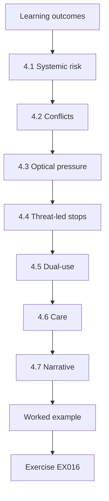

### Logical drawing

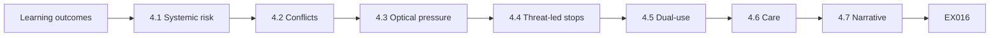

```text
[Learning outcomes]
    |
    v
[4.1 Systemic risk]
    |
    v
[4.2 Conflicts]
    |
    v
[4.3 Optical pressure]
    |
    v
[4.4 Threat-led stops]
    |
    v
[4.5 Dual-use]
    |
    v
[4.6 Care]
    |
    v
[4.7 Narrative]
    |
    v
[Worked example] --> [Exercise EX016]
```
<!-- open-cyber-academy:lesson-figures:end ch-04 -->


### Learning outcomes

You will (1) weigh systemic risk to clearing; (2) handle conflicts of interest; (3) resist optical pressure; (4) design ethical stop conditions for threat-led work.

### 4.1 Systemic risk

Amira's risk lens is systemic, not only MCH-local. A careless test that delays settlement can harm many participants beyond Meridian Clearing House, so a test window is agreed with operations before any scenario touches the settlement path. Before design sign-off she asks who else clears through the path and what a fifteen-minute pause would do. Scenarios that need live participant impact are rejected at design time and never leave design review. Systemic harm is also why stop authority and calendar locks exist in the programme at all.

### 4.2 Conflicts

Personal investments, prior employers and vendor friendships go in the conflict register before scoring meetings begin. Recusal is normal at Meridian Clearing House, not career-limiting, and Amira recuses whenever a decision touches one of her own entries. Juniors have seen her leave a vendor scoring meeting when a former employer bid, which teaches the habit better than a policy page alone. The register is read aloud at the start of each scoring meeting, so a conflict is declared before scores exist rather than discovered after a contract is awarded.

### 4.3 Optical pressure

Earnings dates and conference demos never justify burying findings. Management responses may sit beside findings; deletion may not. When a product lead asked to hold a finding until after a conference demo, Amira added the lead's response beside it instead and recorded the refusal under the ethics charter. Each refusal entry names the requester's role, the finding identifier and the date, so the board risk committee can see pressure patterns. Optical pressure is predictable, so the ethics charter answers it before the email arrives.

### 4.4 Threat-led stops

Amira refuses exercises where nobody can stop the red team in minutes. White-team stop authority is written before scenarios start, with names and phone numbers that work under stress, and no scenario begins until those named contacts have confirmed they are reachable. Before each threat-led year the white-team lead rings the stop line during rehearsal and logs how long the answer took. A simulated settlement delay of fifteen minutes is enough reason to stop mid-play; students who continue for one more objective fail the ethics tabletop.

### 4.5 Dual-use

Publishing clearing-specific exploit paths is out of scope for this curriculum and for MCH public talks. Amira's talks describe the decision method, the catalogue and the cannot-claim lines, never a path through a participant connection, and her final slide lists that refusal beside "no live demos against participants". When a conference organiser asked for a clearing walkthrough, she offered a talk on the DEC-14 decision object instead and explained why in plain terms. Dual-use discipline is part of specialist identity, not an optional appendix for a conference slot.

### 4.6 Care

Ethics includes sleep, hours caps and no heroics near settlement windows. Hours caps cover white-team staff as well as operators, because a tired stop owner is a stop that fails. Amira enforces them so tired people do not become the risk the programme was meant to reduce. Calendar locks block scenario bookings over settlement peaks and show the ethics charter as the rejection reason, which makes the policy visible at booking time rather than in a later reprimand. Even Amira cannot schedule a scenario slot through a lock.

### 4.7 Narrative

The systemic-risk tabletop uses a simulated settlement delay of fifteen minutes. White-team students must stop a scenario mid-play when the delay appears, and Amira fails any student who continues for just one more objective. She runs the tabletop before each threat-led year so stop muscles are rehearsed, not invented under stress. Hours caps near settlement are enforced by calendar locks on scenario slots, so heroics cannot be scheduled, even by her. The debrief records how long each student took to call the stop, and the slowest times are discussed without names.

### 4.8 Calendar locks

When someone tries to book a scenario over settlement peak, the calendar lock rejects it and quotes the relevant ethics-charter clause as the reason. Showing the charter tells the requester that the block is a policy decision, not a scheduling accident, and lets them read the exact rule before arguing with anyone. Over time it also trains requesters to read the charter before asking. A rejection that only said "slot unavailable" would invite a rebooking one hour later; a rejection that names the clause ends the attempt at the source.

### 4.9 Rejection copies

Calendar-lock rejection emails copy the charter maintainers' shared mailbox automatically, so repeated attempts to book over settlement peak become visible to the people who own the charter and no single reviewer can quietly absorb them. Amira reviews those copies quarterly as a signal of cultural pressure, not as a hunt for individuals. A team that keeps hitting the lock is usually short of capacity, which is a programme design problem rather than a discipline problem, so she opens a decision clinic on capacity and timing instead of granting exceptions.

### Worked example (synthetic MCH)

Amira cancels a proposed scenario that lacked a white-team kill switch two days before a settlement peak, citing systemic risk and the ethics charter.

> **Synthetic case — Meridian Clearing House (MCH).** The clearing organisation, Amira Hassan and all figures are invented for teaching.

### Errors and limits

Threat-led and clearing-system tests require specialised legal authorization. This book uses synthetic scenarios only and never supplies exploit code or live targeting advice for market infrastructures.

### Exercises

- **EX016 — Systemic lens.** Why is clearing risk different from a single bank website? *Rubric:* 3 = many participants / settlement impact; 2 = partial; 1 = same; 0 = none.
- **EX017 — Recusal.** Give one valid recusal trigger. *Rubric:* 3 = investment/prior employer/vendor friendship; 2 = partial; 1 = dislike; 0 = none.
- **EX018 — Bury vs response.** What may sit beside a finding under pressure? *Rubric:* 3 = management response; not deletion; 2 = partial; 1 = deletion; 0 = none.
- **EX019 — Kill switch.** What must exist before threat-led scenarios start? *Rubric:* 3 = white-team stop authority; 2 = partial; 1 = says nothing is needed; 0 = no answer.
- **EX020 — Settlement peak.** Why cancel near settlement peak without kill switch? *Rubric:* 3 = systemic risk + ethics; 2 = partial; 1 = fear; 0 = none.

### Synthesis

Ethics at clearing scale includes systemic harm, recusal, refusal to bury and real stop authority.

### Continue studying — chapter 04 of 12

[← Chapter 03 (draft)](#ch-03) · [Course chapter index](../SUBJECTS.md) · [Chapter 05 (draft) →](#ch-05)

<a id="ch-05"></a>

## Chapter 5 — Design alternatives for assessment programmes

<!-- open-cyber-academy:lesson-figures:start ch-05 -->
### Lesson map

Lesson 05 published. Map, example, EX021.

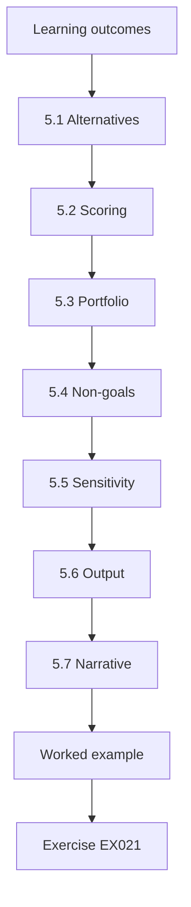

### Logical drawing

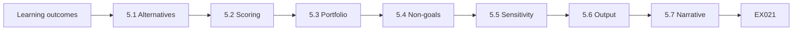

```text
[Learning outcomes]
    |
    v
[5.1 Alternatives]
    |
    v
[5.2 Scoring]
    |
    v
[5.3 Portfolio]
    |
    v
[5.4 Non-goals]
    |
    v
[5.5 Sensitivity]
    |
    v
[5.6 Output]
    |
    v
[5.7 Narrative]
    |
    v
[Worked example] --> [Exercise EX021]
```
<!-- open-cyber-academy:lesson-figures:end ch-05 -->


### Learning outcomes

You will (1) generate programme alternatives; (2) score them on learning, risk, cost and capacity; (3) recommend a portfolio; (4) document non-goals.

### 5.1 Alternatives

Amira writes four alternatives so executives see real choices: A, quarterly web only; B, annual threat-led only; C, quarterly web plus biennial threat-led; and D, continuous automated scan theatre. She will not discuss a vague "more testing" request until it maps to one of these four, and a request that does not map is sent back until it does. DEC-14 is the record of choosing C after A, B and D were scored. Writing the alternatives side by side makes the rejected options as visible as the chosen one, which is what a later examiner needs.

### 5.2 Scoring

Amira scores each alternative on detection learning, operational risk, cost, staff capacity and examiner fit, each criterion from one to three. The raw numbers stay visible so a director can recompute the ranking by hand. D scores high on noise and low on learning. B rates well on learning but badly on staff capacity, because annual threat-led work needs two full white-team cycles. C wins for Meridian Clearing House when capacity is honest, and the score sheet attached to the alternatives memo keeps the recommendation from becoming a matter of taste.

### 5.3 Portfolio

C usually wins for MCH-like organisations because A alone under-trains detection and B alone misses ordinary regressions between threat-led years. Portfolio language means the mix of activities, not a single purchased logo or a single silver engagement. Amira still shows the scores for A, B and D, so directors understand why C won rather than taking the recommendation on trust. When a director later proposes dropping the quarterly web tests to fund a bigger threat-led year, the same scores show what detection learning and regression coverage that trade would cost.

### 5.4 Non-goals

The memo lists three non-goals: no claim of SWIFT coverage from ordinary web tests; no public exploit demos; no unpaid overtime as a capacity plan. Each non-goal maps to a catalogue cannot-claim line or to the ethics charter, so none of them is a new promise invented for the memo. Amira reads them aloud at the end of the alternatives memo so unpaid overtime cannot quietly become the capacity plan. Before filing, she checks every recommendation against the staffing rota the owners actually run; a recommendation that only works if people work nights is not executable.

### 5.5 Sensitivity

Amira re-scores the alternatives under shocks, because the recommendation should still be executable when conditions worsen. Her sensitivity analysis halves capacity and also doubles vendor cost. Doubling vendor cost hits option B hardest, since it buys a threat-led provider every year instead of every second year. Current C survives halved capacity by slipping threat-led to every third year with a named white-team lead and a written date. If C collapsed under both shocks, it was never robust; Amira refuses a plan that only works in the best case.

### 5.6 Output

The output is a two-page alternatives memo carrying the score table, the non-goals, the sensitivity result and a calendar graphic. The graphic shades the preparation months — intelligence gathering, white-team briefing and scenario sign-off, each in a different tone — and not only the execution week. Finance once funded only the execution week and was surprised by intelligence lead time; the shaded cells stopped that surprise. The memo's last line names the CISO as owner of the recommendation and the next catalogue review as its expiry. Amira will not send a memo that lacks the calendar graphic, because executives would then approve a programme they have not staffed.

### 5.7 Narrative

Amira reads the non-goals at the start of every alternatives workshop, so brainstorming cannot quietly reintroduce theatre option D, and again at the end, so nobody leaves thinking overtime will save the plan. A memo without sensitivity analysis is incomplete. When capacity halves, slipping threat-led to every third year keeps a named white-team lead and a written date rather than a wish. The slip itself is filed as a DEC amendment, so the cadence change is owned in the same way as the original choice of C.

### 5.8 Pencilled leads

Every-third-year threat-led still has a named white-team lead pencilled two years out; pencils beat wishes. Naming the lead that early gives the white team time to arrange cover before the exercise is due, and cover arranged late becomes the heroics the ethics charter forbids. Amira puts the name in the calendar graphic, not only in an email. The pencilled name is checked at each catalogue review, and any change of person is recorded as a DEC amendment. This is how Meridian Clearing House keeps every-third-year threat-led executable.

### 5.9 Shaded calendar

Each shaded preparation month in Amira's calendar graphic carries the initials of the white-team member pencilled for it, so executives see the true staff load and gaps in cover show up as blank cells. When a cell stays blank, Amira raises the gap with the white-team lead before the month begins rather than discovering it in the execution week. She reprints the calendar after every DEC that changes cadence and stores the PDF hash beside DEC-14, so the version a director approved can be told apart from later redrafts.

### Worked example (synthetic MCH)

Amira's memo selects C, shows a two-year calendar, and lists D as rejected for false assurance.

> **Synthetic case — Meridian Clearing House (MCH).** The clearing organisation, Amira Hassan and all figures are invented for teaching.

### Errors and limits

Threat-led and clearing-system tests require specialised legal authorization. This book uses synthetic scenarios only and never supplies exploit code or live targeting advice for market infrastructures.

### Exercises

- **EX021 — Why not D.** Why reject continuous scan theatre? *Rubric:* 3 = noise without learning / false assurance; 2 = partial; 1 = it is best; 0 = none.
- **EX022 — Why C.** Why does C usually win? *Rubric:* 3 = regressions + periodic threat-led learning; 2 = partial; 1 = cheapest; 0 = none.
- **EX023 — Non-goal example.** Give one non-goal for MCH's programme. *Rubric:* 3 = no SWIFT claim from web tests / no public exploits / no overtime capacity; 2 = partial; 1 = vague; 0 = none.
- **EX024 — Sensitivity.** What capacity shock should the memo test? *Rubric:* 3 = capacity halves / similar shock; 2 = partial; 1 = vague; 0 = none.
- **EX025 — Calendar.** What artefact helps executives approve C? *Rubric:* 3 = two-year calendar graphic; 2 = partial; 1 = jargon; 0 = none.

### Synthesis

Programme design is a scored portfolio with non-goals, not a single purchased logo.

### Continue studying — chapter 05 of 12

[← Chapter 04 (draft)](#ch-04) · [Course chapter index](../SUBJECTS.md) · [Chapter 06 (draft) →](#ch-06)

<a id="ch-06"></a>

## Chapter 6 — Controlled evaluation

<!-- open-cyber-academy:lesson-figures:start ch-06 -->
### Lesson map

Lesson 06 published. Map, example, EX026.

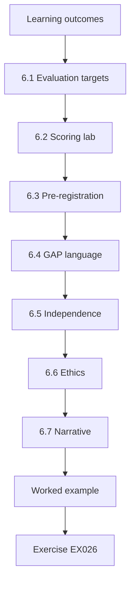

### Logical drawing

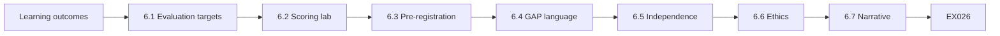

```text
[Learning outcomes]
    |
    v
[6.1 Evaluation targets]
    |
    v
[6.2 Scoring lab]
    |
    v
[6.3 Pre-registration]
    |
    v
[6.4 GAP language]
    |
    v
[6.5 Independence]
    |
    v
[6.6 Ethics]
    |
    v
[6.7 Narrative]
    |
    v
[Worked example] --> [Exercise EX026]
```
<!-- open-cyber-academy:lesson-figures:end ch-06 -->


### Learning outcomes

You will (1) design evaluations of scenarios and controls; (2) use scoring that balances learning and risk; (3) pre-register; (4) report gaps without doom.

### 6.1 Evaluation targets

Scenario choice, control coverage, detection rules and programme outcomes each need different evaluation designs. Amira refuses a single score that pretends to measure them together. The lab scenario ranking is for scenario choice; detection rules need purple-team measures; programme outcomes need decision records such as DEC-14. Mixing scenario ranks, purple-team measures and DEC-14 outcomes into one metric would give the board a number that measures none of them, which is how board packs lose meaning. Each evaluation target therefore keeps its own design and its own measure in her pack.

### 6.2 Scoring lab

lab_scenario ranks synthetic scenarios with score = 2×learning − risk so high-learning, manageable-risk options surface.

```python
"""Lab 6: score synthetic TIBER-style scenario options by detection learning vs ops risk (1-3)."""
opts = [("A","Stolen VPN + SWIFT-adjacent pivot",3,3),("B","Public web defacement only",1,1),
        ("C","Supply-chain library in batch app",3,2),("D","Branch Wi-Fi rogue AP",2,2)]
for i,t,learn,risk in sorted(opts, key=lambda x:(-(x[2]*2-x[3]), x[0])):
    print(f"{i} score={learn*2-risk:+d} learn={learn} risk={risk} {t}")
```

Run with `python3 lab_scenario.py`. Verified output:

```text
C score=+4 learn=3 risk=2 Supply-chain library in batch app
A score=+3 learn=3 risk=3 Stolen VPN + SWIFT-adjacent pivot
D score=+2 learn=2 risk=2 Branch Wi-Fi rogue AP
B score=+1 learn=1 risk=1 Public web defacement only
```

The supply-chain library in the batch app (C) scores highest at +4; the stolen VPN with SWIFT-adjacent pivot (A) scores +3 but carries risk 3; the branch Wi-Fi rogue AP (D) scores +2; and public web defacement (B) scores only +1. The rank is an input, not a funding decision. Amira demotes a high lab score when white-team feasibility is missing, and feasibility still decides funding after the lab rank.

### 6.3 Pre-registration

Metrics and thresholds are tagged in git before results, so Amira cannot move the goalposts after seeing scores. The pre-registration states the primary measure, the threshold and the exclusions, and it is short on purpose: a peer should be able to find the tag and read it without asking her. Changing a threshold after seeing scores requires an amended tag and a decision-log note that names why. Pre-registration is how Meridian Clearing House keeps evaluation honest when favourite scenarios underperform and the temptation to redefine success is strongest.

### 6.4 GAP language

"T1190 0/2 GAP" schedules engineering; it does not claim permanent blindness. T1190 0/2 means neither of the two exploit-public-facing-application attempts was detected, a sample far too small to estimate a rate. A dated engineering ticket is the honest companion to a GAP label. Saying "we are blind forever" is neither true nor useful when a dated ticket can close the gap, and doom language trains directors to ignore gaps that engineering could close. Amira's language in findings and board packs therefore stays in the lane where a GAP schedules engineering work.

### 6.5 Independence

The white team or a peer runs the scoring on the same inputs. In the scenario workshop the peer receives the four options with their learning and risk ratings, but not Amira's ranking. Independence is not optional politeness: it is how optimistic grading of favourite scenarios is caught before funding decisions lock in. Disagreements are not averaged away; each keeps both ratings and a one-line reason from each scorer, and becomes a design note tagged FEASIBILITY for the next workshop. Amira would rather lose a preferred scenario than keep a score only she can defend.

### 6.6 Ethics

Scenarios that need live participant impact are rejected at design time. Live harm to participants is not an acceptable price for a more realistic exercise at Meridian Clearing House, and synthetic clearing templates and isolated ranges are enough for learning. Scenario A's SWIFT-adjacent pivot is therefore played only against an isolated range, never against systems carrying live clearing traffic. The ethics cover sheet says synthetic-only on page one of every project, which makes live participant impact a design-time rejection rather than a negotiation in the middle of an exercise.

### 6.7 Narrative

Feasibility is part of the score, not an afterthought. White-team feasibility for scenario C includes a library inventory owner who can halt deploys of the batch application inside the exercise window, not merely approve a ticket later. Without that owner, Amira demotes C despite its +4 lab score. Independent scoring means she leaves the room while a peer applies lab_scenario to the same inputs. When a white-team view overrides a lab score, as with scenario C, she records the reason as a design note filed beside the lab output rather than changing the score silently.

### 6.8 Feasibility notes

Design notes from scoring disagreements are tagged FEASIBILITY so they appear in the next scenario workshop automatically, turning a scoring dispute into an input for designing the next scenario. Each note records the scenario letter, both scores, the missing feasibility element and who must supply it before the workshop. Scenario C's missing library owner was filed this way and became the opening item of the following workshop. Amira reads the tagged notes aloud, so the peer who disagreed sees their point land and juniors learn that losing a favourite option is normal when stop owners are missing.

### 6.9 Board slide

Amira communicated the feasibility demotion of scenario C to the board as strength, not indecision. Her slide title was "We refused a high-scoring scenario we could not stop", and it paired C's +4 lab score with the missing deploy-freeze owner, so the reason fitted on one line. The board applauded. The refusal was recorded in the decision log beside the lab score, so the reason survives the meeting. Lab scores without stop owners are now labelled provisional in every packet that leaves her desk.

### 6.10 Provisional labels

Provisional labels on scores are bright orange in the PDF export, so a provisional rank cannot be quoted as final once the PDF leaves the team. Only scores with white-team feasibility confirmed may lose the orange mark, and confirmation means the white-team lead has signed the feasibility line, including a named stop owner for that scenario. Directors have thanked Amira for the orange colour when a vendor tried to cite a provisional rank as a commitment. The label costs nothing to apply and prevents a ranking from being treated as an approval.

### Worked example (synthetic MCH)

lab_scenario ranks supply-chain library scenario highest among the four; Amira still subjects it to white-team feasibility before funding.

> **Synthetic case — Meridian Clearing House (MCH).** The clearing organisation, Amira Hassan and all figures are invented for teaching.

### Errors and limits

Threat-led and clearing-system tests require specialised legal authorization. This book uses synthetic scenarios only and never supplies exploit code or live targeting advice for market infrastructures.

### Exercises

- **EX026 — Top scenario.** Which option ranks first in the lab? *Rubric:* 3 = C supply-chain; 2 = A; 1 = B; 0 = none.
- **EX027 — Score formula.** What is the lab's score formula? *Rubric:* 3 = 2×learn − risk; 2 = learn×risk; 1 = risk only; 0 = none.
- **EX028 — Why not auto-fund.** Why not fund C only from the lab ranking? *Rubric:* 3 = need white-team feasibility / broader criteria; 2 = partial; 1 = always auto-fund; 0 = none.
- **EX029 — GAP tone.** How should a small-n GAP be reported? *Rubric:* 3 = schedules engineering; not permanent doom; 2 = partial; 1 = we are blind forever; 0 = none.
- **EX030 — Pre-register.** Where do metrics live before results? *Rubric:* 3 = dated git tag / registration; 2 = partial; 1 = after results; 0 = none.

### Synthesis

Controlled evaluation ranks learning against risk and refuses doom language for small samples.

### Continue studying — chapter 06 of 12

[← Chapter 05 (draft)](#ch-05) · [Course chapter index](../SUBJECTS.md) · [Chapter 07 (draft) →](#ch-07)

<a id="ch-07"></a>

## Chapter 7 — Organizational integration

<!-- open-cyber-academy:lesson-figures:start ch-07 -->
### Lesson map

Lesson 07 published. Map, example, EX031.

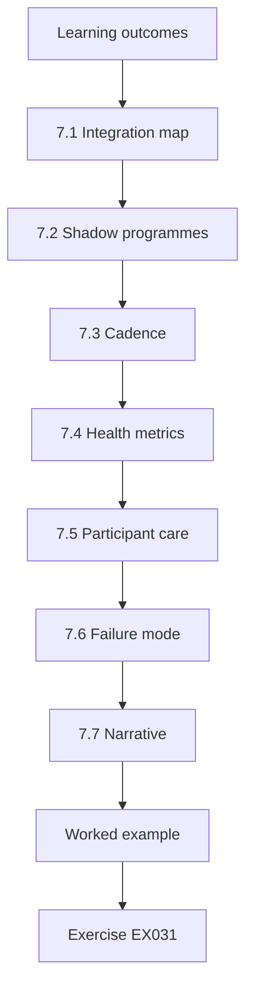

### Logical drawing

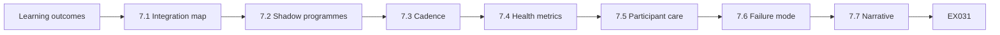

```text
[Learning outcomes]
    |
    v
[7.1 Integration map]
    |
    v
[7.2 Shadow programmes]
    |
    v
[7.3 Cadence]
    |
    v
[7.4 Health metrics]
    |
    v
[7.5 Participant care]
    |
    v
[7.6 Failure mode]
    |
    v
[7.7 Narrative]
    |
    v
[Worked example] --> [Exercise EX031]
```
<!-- open-cyber-academy:lesson-figures:end ch-07 -->


### Learning outcomes

You will (1) integrate testing with SOC, risk, legal and participants; (2) design information flows; (3) avoid shadow programmes; (4) measure integration health.

### 7.1 Integration map

Amira draws who receives what: the SOC gets ATT&CK tags and timelines; risk gets ranked residuals; legal gets disclosure-relevant facts; participants get only what contracts allow. A finding tagged with ATT&CK techniques for the SOC is restated for risk as a ranked residual before it moves. Participant notices draw only on contract-allowed facts, so a SOC timeline never reaches a clearing member by forwarding; oversharing into the wrong channel is how trust with clearing participants breaks. The diagram sits in the integration playbook and is reviewed whenever a new stakeholder appears.

### 7.2 Shadow programmes

Business units hiring boutique scanners without ROE create shadow risk; integration means one catalogue and one authorization path. A boutique scan without ROE has no stop authority and no exclusion list, so it could touch SWIFT-adjacent hosts unnoticed. Amnesty week invites declarations so shadow scans enter the catalogue or stop. Declared scans that continue go through the same authorization path as Amira's own quarterly WSTG-style web tests, and after amnesty week every external scan enters through the same request form that internal tests use. Undeclared scans found later become audit findings against the unit, not quiet exceptions.

### 7.3 Cadence

Amira runs a quarterly sync with the SOC on noise budgets, a monthly review with risk on acceptance expiries, and ad hoc meetings with legal on disclosure. The SOC sync agrees how many alerts each planned test may generate, so analysts can separate test noise from real attacks. She keeps the calendar invites recurring so integration does not depend on memory. A missed sync is logged as programme debt, not as personal failure, and the debt list is reviewed at the next catalogue review so repeated misses lead to a cadence change rather than to blame.

### 7.4 Health metrics

Integration health is measured by the percent of findings with owners, the percent of tests in the catalogue and the median time from finding to detection ticket. Median time to detection ticket is the slow figure on the worked scorecard, which is why the PulseMap-to-backlog bridge was funded. Amira refuses vanity counts of raw findings without validation; they stay off management slides. The three health metrics appear beside the amnesty counts on the same slide family, so the board sees programme hygiene rather than volume.

### 7.5 Participant care

Clearing participants are customers of trust, and a wrong phrase in a participant notice can cause market noise that no finding severity can justify. Communications templates are therefore pre-approved by legal and participant management, and they are the only words that leave the building. Amira does not invent wording under pressure when a notice is needed. Templates are versioned, and the version number is logged with each notice, so legal can reconstruct exactly what a participant received and when. During test-related incidents involving participants, she rejects ad-lib emails even from senior staff.

### 7.6 Failure mode

Integration fails when testing is a heroic annual event with no backlog into BAU engineering; heroics without backlog produce the same issues next year, and examiners notice when they return. The PulseMap-to-backlog bridge exists so each detection gap found in testing lands as an ordinary engineering ticket, not a slide. Every finding that needs a fix must have a ticket in the ordinary engineering queue before Amira calls integration healthy. A finding that only ever appears in a board pack is counted as unintegrated, however well it was presented.

### 7.7 Narrative

Shadow-programme amnesty week invites business units to declare boutique scans. Each declaration names the vendor, the targets scanned and the unit lead who commissioned the work. Declared scans enter the catalogue or stop, and undeclared scans found later become audit findings against the unit lead. The rules are published before the week starts, because amnesty without consequences for later concealment is theatre. At the close of the week the declaration list goes to internal audit, so later discoveries can be checked against it without argument about what was declared.

### 7.8 Amnesty slide

Amnesty week metrics — declared, catalogued, stopped — go to the board risk committee in one slide. Keeping the three counts together lets the committee see whether declarations led to tools actually being stopped. The stopped count is printed as large as the declared count and sits in the main slide, never in a footnote, so nobody can read the slide as a list of approvals and a stalled shutdown cannot be hidden. Transparency about the stopped count is what shows the amnesty had teeth.

### 7.9 Amnesty results

Amnesty week produced twelve declarations: eight catalogued, four stopped. The four stopped scans could not be brought under an ROE with stop authority, so they ended rather than entering the catalogue. The slide to the risk committee used those three numbers only; unit names stayed in the catalogue, keeping the committee focused on whether the amnesty worked. Amira refuses amnesty narratives without counts. Units that stayed silent and were later found scanning received findings with owners named in the minutes, and those findings carry the amnesty dates so a unit cannot claim it never heard about the window.

### 7.10 Archived counts

Amnesty counts are archived with the hash of the signed committee minutes, so a later reader can check that the reported figures were the ones the committee saw. The archive entry stores the twelve, eight and four counts, the slide file and the minute hash together. Amira also records the hash in the catalogue changelog, so the record survives a change of committee secretary. She has used that check when a unit disputed whether it had declared; producing the hash settled the dispute.

### Worked example (synthetic MCH)

Amira's integration scorecard shows 100% catalogue coverage but slow detection-ticket time; she funds a PulseMap-to-backlog bridge.

> **Synthetic case — Meridian Clearing House (MCH).** The clearing organisation, Amira Hassan and all figures are invented for teaching.

### Errors and limits

Threat-led and clearing-system tests require specialised legal authorization. This book uses synthetic scenarios only and never supplies exploit code or live targeting advice for market infrastructures.

### Exercises

- **EX031 — Recipients.** Name three recipient groups and what they get. *Rubric:* 3 = three correct pairs; 2 = two; 1 = one; 0 = none.
- **EX032 — Shadow risk.** What makes a boutique scan a shadow programme? *Rubric:* 3 = outside ROE/catalogue/authorization path; 2 = partial; 1 = using vendors; 0 = none.
- **EX033 — Health metric.** Give two integration health metrics. *Rubric:* 3 = two from chapter; 2 = one; 1 = vanity finding count; 0 = none.
- **EX034 — Heroic annual.** Why does a heroic annual-only event fail integration? *Rubric:* 3 = no BAU backlog / no continuous improvement; 2 = partial; 1 = it is ideal; 0 = none.
- **EX035 — Bridge.** What bridge does Amira fund in the worked example? *Rubric:* 3 = PulseMap-to-backlog; 2 = partial; 1 = more scans; 0 = none.

### Synthesis

Integration is one catalogue, named recipients and BAU backlog — not annual heroics.

### Continue studying — chapter 07 of 12

[← Chapter 06 (draft)](#ch-06) · [Course chapter index](../SUBJECTS.md) · [Chapter 08 (draft) →](#ch-08)

<a id="ch-08"></a>

## Chapter 8 — Difficult cases

<!-- open-cyber-academy:lesson-figures:start ch-08 -->
### Lesson map

Lesson 08 published. Map, example, EX036.

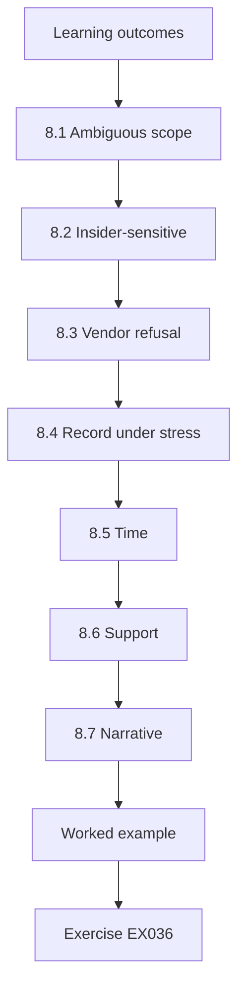

### Logical drawing

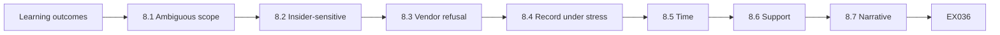

```text
[Learning outcomes]
    |
    v
[8.1 Ambiguous scope]
    |
    v
[8.2 Insider-sensitive]
    |
    v
[8.3 Vendor refusal]
    |
    v
[8.4 Record under stress]
    |
    v
[8.5 Time]
    |
    v
[8.6 Support]
    |
    v
[8.7 Narrative]
    |
    v
[Worked example] --> [Exercise EX036]
```
<!-- open-cyber-academy:lesson-figures:end ch-08 -->


### Learning outcomes

You will (1) handle ambiguous scope; (2) handle insider-sensitive findings; (3) handle vendor refusal; (4) keep records under stress.

### 8.1 Ambiguous scope

When a hostname might be participant-owned, Amira pauses and seeks written clarification; guessing is not a specialist skill. Participant-owned hostnames are the usual cause of these pauses, because they can look identical to Meridian Clearing House systems. In the worked case, related methods stopped within four minutes and the white team received the question by email. The pause is logged with the time and the question asked, and written clarification from the white team or the participant contact is filed before any further probe; until someone with authority answers in writing, the probe waits.

### 8.2 Insider-sensitive

Findings that imply staff misconduct go through HR paths with the minimum necessary detail; testing is not a witch hunt. The finding names the control that failed, such as a shared admin account, and leaves out who used it. Staff names appear only in the HR case file, which examiners can request through legal rather than read in FindingsDesk. Amira's one-page HR liaison script is rehearsed, so staff do not overshare in tickets that examiners might later read. Minimal detail protects the people involved and keeps the finding about controls.

### 8.3 Vendor refusal

Vendors who refuse reasonable authorized testing of their components trigger risk acceptance or replacement decisions — not silent hope. Amira brings the refusal to the CISO as a decision object with three options written: accept the residual risk with an expiry, demand contractual testing rights, or replace the component. Hoping the vendor will cooperate next year without a date is drift under another name. The chosen option, its owner and its expiry are filed in the decision log, so the refused component does not drop out of view until the next contract renewal.

### 8.4 Record under stress

Difficult cases generate more pressure emails, and all of them go to the CISO alias with factual headers. Amira does not debate findings in side threads that examiners will never see. Any disagreement about a finding is answered on the alias, with the evidence attached. The alias creates a record that survives staff changes and mood, and the factual headers keep that record useful: a successor can follow each thread without the original authors. When an examiner later asks why a finding was not softened, the answer is already on the alias.

### 8.5 Time

Difficult cases get explicit time boxes so they cannot starve ordinary catalogue work forever. A typical box is two weeks, set when the case opens and written beside the case owner's name. Time boxes appear on the same board as product findings, so infinite investigations are visible debt. Amira renews a box only with a written reason and a new end date; silent starvation of catalogue work is refused. When a box expires without renewal, the case closes with its findings so far instead of drifting on.

### 8.6 Support

Amira pairs juniors with a senior on any case that involves HR or participants, because solo juniors under that stress invent process that later fails challenge. Pairing is scheduled with the senior's name on the case file, not left to whoever happens to be free. The senior attends every HR or participant call, the junior speaks from the rehearsed liaison script, and the senior signs off each ticket entry the junior writes, so oversharing is caught before an examiner could read it. Juniors leave each case having practised the script under supervision.

### 8.7 Narrative

The maybe-participant host case shows the difficult-case pattern in one morning: four minutes to stop related methods, an email to the white team, and resumption only on a written scope update. Insider-sensitive playbooks include the one-page HR liaison script that Amira rehearses with her team. Time boxes for difficult cases sit on the same board as product findings, and juniors always pair with a senior when HR or participants are involved. Each step leaves a record that an examiner can follow later without asking anyone what happened.

### 8.8 HR script control

HR script versioning follows the same change control as ROE templates; freelanced empathy is not a control. Every version of the script carries a number, an effective date and two signatures, exactly as each ROE template does, so a well-meant wording change cannot reach an employee unreviewed. Retired versions stay in the archive, so legal can show which wording an employee actually heard on a given date. Amira has rejected a same-morning edit that lacked HR's countersignature; the afternoon interview waited rather than bending the process.

### 8.9 Same-day countersignature

HR script changes require HR and Amira countersignatures on the same day, so a script edited in the morning cannot reach an afternoon interview without both owners' approval. A missing signature is a stop, not a delay to negotiate; employees deserve reviewed words. The countersignature is recorded on the script's version line, next to the effective date and HR's initials. An edit that is still waiting for a signature stays a draft, and the interview uses the last signed version until both owners have approved the new one.

### Worked example (synthetic MCH)

A maybe-participant host appears mid-window; Amira stops related methods in 4 minutes, emails the white team, and resumes only on written scope update.

> **Synthetic case — Meridian Clearing House (MCH).** The clearing organisation, Amira Hassan and all figures are invented for teaching.

### Errors and limits

Threat-led and clearing-system tests require specialised legal authorization. This book uses synthetic scenarios only and never supplies exploit code or live targeting advice for market infrastructures.

### Exercises

- **EX036 — Pause rule.** What does Amira do on ambiguous ownership? *Rubric:* 3 = pause; written clarification; 2 = pause; 1 = guess; 0 = none.
- **EX037 — HR path.** How are staff-misconduct-implying findings handled? *Rubric:* 3 = HR path; minimal detail; 2 = partial; 1 = public channel; 0 = none.
- **EX038 — Vendor refuse.** What decisions follow vendor refusal to allow testing? *Rubric:* 3 = risk acceptance or replacement; 2 = one; 1 = ignore; 0 = none.
- **EX039 — Pressure email.** Where do pressure emails go? *Rubric:* 3 = CISO alias with factual header; 2 = partial; 1 = delete; 0 = none.
- **EX040 — Stop time.** How fast did Amira stop in the worked example? *Rubric:* 3 = about 4 minutes / minutes; 2 = same day; 1 = next week; 0 = none.

### Synthesis

Difficult cases pause for writing, protect people and leave records.

### Continue studying — chapter 08 of 12

[← Chapter 07 (draft)](#ch-07) · [Course chapter index](../SUBJECTS.md) · [Chapter 09 (draft) →](#ch-09)

<a id="ch-09"></a>

## Chapter 9 — Leadership and assurance

<!-- open-cyber-academy:lesson-figures:start ch-09 -->
### Lesson map

Lesson 09 published. Map, example, EX041.

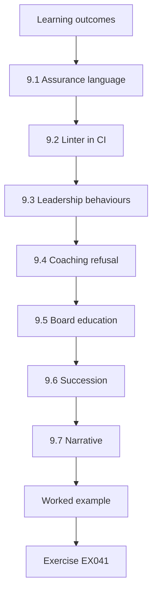

### Logical drawing

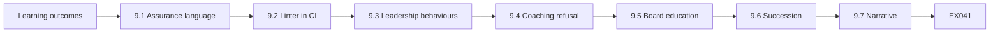

```text
[Learning outcomes]
    |
    v
[9.1 Assurance language]
    |
    v
[9.2 Linter in CI]
    |
    v
[9.3 Leadership behaviours]
    |
    v
[9.4 Coaching refusal]
    |
    v
[9.5 Board education]
    |
    v
[9.6 Succession]
    |
    v
[9.7 Narrative]
    |
    v
[Worked example] --> [Exercise EX041]
```
<!-- open-cyber-academy:lesson-figures:end ch-09 -->


### Learning outcomes

You will (1) write assurance statements that survive audit; (2) lead without theatre; (3) coach refusal skills; (4) validate statements with a linter lab.

### 9.1 Assurance language

Assurance language at Meridian Clearing House is time-bounded, scope-bounded and method-bounded. Forbidden: fully secure, guaranteed, hack-proof, 100% coverage.

```python
"""Lab 9: validate a synthetic assurance statement against a forbidden-phrase list."""
forbidden = ["fully secure", "guaranteed", "hack-proof", "100% coverage"]
text = "Quarterly web tests and a 2025 threat-led exercise provide time-bounded assurance; SWIFT remains excluded from ordinary tests."
hits = [f for f in forbidden if f in text.lower()]
print("CLEAN" if not hits else "FORBIDDEN: " + ", ".join(hits))
print("chars", len(text))
```

Run with `python3 lab_assurance.py`. Verified output:

```text
CLEAN
chars 126
```

lab_assurance checks a synthetic statement against those four forbidden phrases and prints CLEAN with chars 126 for the wording about quarterly web tests and a 2025 threat-led exercise. Amira runs the same check on every board pack export, so forbidden phrases never leave in a pack. A statement that fails is rewritten with its time, scope and method bounds stated, then checked again before the export continues.

### 9.2 Linter in CI

The linter is small on purpose, so deputies can run lab_assurance without Amira and the check does not depend on one person before a pack leaves. It sits in CI before the board-portal upload, and the pack cannot be uploaded until the export job reports CLEAN. A vendor paste once introduced "hack-proof" into a draft pack and CI blocked it. Amira keeps that block as the teaching case for why the check runs before a pack leaves rather than after a director has already read it.

### 9.3 Leadership behaviours

Leadership behaviours shape what juniors chase. Amira praises early stops, funded negative results and clean catalogues more than dramatic finds; at quarterly review she names one early stop and one funded negative result before mentioning any finding. Students who stopped the tabletop at the simulated settlement delay are praised in the same meeting as the quarter's best finding. A culture that only celebrates fireworks will bury pauses and refuse negative results, which is how unsafe exercises continue for applause at an organisation like Meridian Clearing House.

### 9.4 Coaching refusal

Monthly role-play puts pressure on a specialist to soften wording. Amira wants both calm tone and firm refusal, so the score sheet rates tone and refusal separately, from zero to three each, with sample phrases for every level. They are scored separately on purpose, because a learner can be calm without holding the boundary. Soft panic and angry collapse both fail. The sheet is shared in advance, so people know what good looks like before the next real pressure email arrives.

### 9.5 Board education

Directors must learn what ordinary tests cannot claim, above all that they do not cover SWIFT-adjacent systems. Amira's board education pack uses the catalogue cannot-claim lines and the rewritten CBEST-inspired slide. Teaching happens before exam season, not during a finding argument, and the rewritten slide is part of the education pack rather than an emergency handout in the middle of a dispute. Directors who learn the cannot-claim lines in advance do not argue findings from SWIFT myths when a real finding reaches them.

### 9.6 Succession

Amira documents decisions so a successor can continue without folklore. Documented decisions such as DEC-14 and the two-year calendar beat hallway advice. Succession folders hold three CLEAN statements and three FORBIDDEN counterexamples with explanations, so deputies learn by contrast and wording rules travel with the decisions. The CLEAN examples include the lab statement that printed CLEAN at 126 characters, with its time and scope bounds marked. Amira answers questions during transfer but keeps no secret side rules. Each explanation names the bound that the FORBIDDEN version broke.

### 9.7 Narrative

The forbidden-phrase linter runs on every board pack export. When CI blocked "hack-proof" from a vendor paste, Amira forwarded the raw CI log to the vendor without scolding. Succession folders keep the CLEAN and FORBIDDEN pairs; each FORBIDDEN example uses one banned phrase, such as "fully secure" or "100% coverage", with corrected wording beside it. Deputies who study the pairs can explain why a sentence fails before they run the linter on it. Amira treats that skill, not the linter's output, as the real goal of the folder.

### 9.8 Vendor warning letters

Vendor warning letters enclose the forbidden list as Appendix A, with the four phrases exactly as the linter matches them: fully secure, guaranteed, hack-proof and 100% coverage. Attaching the list makes the warning specific: the vendor sees exactly which claims the team will not accept, whereas a vague "please be careful" letter changes nothing. Some vendors have updated their marketing decks after receiving it. Amira's seminar on quiet influence uses one such before-and-after deck pair as its main example. Each letter is filed in the vendor's catalogue entry.

### 9.9 Quiet influence

The CI log Amira forwarded showed the matched phrase and the line of pasted vendor text, which was all the explanation the vendor needed. The vendor's next deck used time-bounded assurance, and the change arrived without a meeting. She keeps that before-and-after pair for leadership seminars on quiet influence and refuses to tell the story as a victory over the vendor. In seminars she shows the CI log first and the new deck second, leaving deputies to draw the conclusion themselves.

### 9.10 Influence records

Before-and-after vendor decks are stored as evidence of influence, not of mockery. Both decks are filed, dated, with the CI log and the warning letter in that vendor's catalogue entry. Keeping both versions shows auditors that the warning changed vendor claims, which is the point of sending it. Amira can produce the pair when asked how Meridian Clearing House handles assurance language from suppliers. Influence with a record is assurance work; influence without a record is only a story. The file also notes the date the new deck was first seen.

### Worked example (synthetic MCH)

lab_assurance prints CLEAN for Amira's statement; a draft with "fully secure" would fail.

> **Synthetic case — Meridian Clearing House (MCH).** The clearing organisation, Amira Hassan and all figures are invented for teaching.

### Errors and limits

Threat-led and clearing-system tests require specialised legal authorization. This book uses synthetic scenarios only and never supplies exploit code or live targeting advice for market infrastructures.

### Exercises

- **EX041 — Forbidden list.** Name three forbidden assurance phrases. *Rubric:* 3 = three of fully secure, guaranteed, hack-proof, 100% coverage; 2 = two; 1 = one; 0 = none.
- **EX042 — Lab result.** What does the lab print for the sample statement? *Rubric:* 3 = CLEAN; 2 = forbidden; 1 = error; 0 = none.
- **EX043 — Praise targets.** Name two behaviours Amira praises. *Rubric:* 3 = two of early stops, negative results, clean catalogues; 2 = one; 1 = drama only; 0 = none.
- **EX044 — Board lesson.** What must directors learn about SWIFT-adjacent systems? *Rubric:* 3 = ordinary tests do not cover them; 2 = partial; 1 = fully covered; 0 = none.
- **EX045 — If forbidden present.** What would lab print if "fully secure" appeared? *Rubric:* 3 = FORBIDDEN: fully secure; 2 = CLEAN; 1 = vague; 0 = none.

### Synthesis

Leadership is honest assurance language, coached refusal and praise for restraint.

### Continue studying — chapter 09 of 12

[← Chapter 08 (draft)](#ch-08) · [Course chapter index](../SUBJECTS.md) · [Chapter 10 (draft) →](#ch-10)

<a id="ch-10"></a>

## Chapter 10 — Research reading and critique

<!-- open-cyber-academy:lesson-figures:start ch-10 -->
### Lesson map

Lesson 10 published. Map, example, EX046.

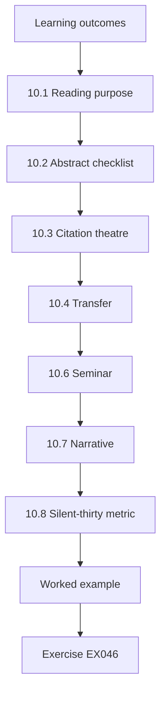

### Logical drawing

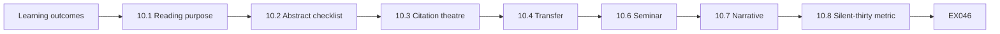

```text
[Learning outcomes]
    |
    v
[10.1 Reading purpose]
    |
    v
[10.2 Abstract checklist]
    |
    v
[10.3 Citation theatre]
    |
    v
[10.4 Transfer]
    |
    v
[10.6 Seminar]
    |
    v
[10.7 Narrative]
    |
    v
[10.8 Silent-thirty metric]
    |
    v
[Worked example] --> [Exercise EX046]
```
<!-- open-cyber-academy:lesson-figures:end ch-10 -->


### Learning outcomes

You will (1) critique abstracts on purple-team and threat-led methods; (2) demand n and limits; (3) connect papers to MCH decisions; (4) reject citation theatre.

### 10.1 Reading purpose

Amira reads to improve MCH decisions, not to decorate reports with names, and she opens the sources she cites.

```python
"""Lab 10: checklist score for a synthetic paper abstract on purple-team methods."""
abs_ = {"question":True,"method":True,"n":False,"limits":True,"ethics":True}
for k,v in abs_.items():
    print(f"{k:8} {'ok' if v else 'MISSING'}")
print("pass" if all(abs_.values()) else "revise")
```

Run with `python3 lab_critique.py`. Verified output:

```text
question ok
method   ok
n        MISSING
limits   ok
ethics   ok
revise
```

lab_critique scores a synthetic abstract on question, method, n, limits and ethics; the missing n prints MISSING and the verdict revise. Without n, nobody can tell whether the abstract's purple-team claim rests on three exercises or thirty, so the paper cannot yet inform a decision at Meridian Clearing House. The abstract goes back to its authors with that single question.

### 10.2 Abstract checklist

The abstract checklist asks whether question, method, n, limits and ethics are present, and lab_critique marks each field ok or MISSING. Each field marked MISSING becomes a question the presenter must answer before the paper can inform a DEC record. Presenters are scored against that same checklist, so the lab and the seminar reward identical habits. Limits that a presenter omits are added to the feedback sheet in writing, and kindness about nerves does not extend to missing limits.

### 10.3 Citation theatre

Footnotes to unread papers are unethical in assurance contexts, because unread footnotes become unread confidence in board language. Every citation in a board pack links to a source someone on the team has actually opened and summarised, and anyone who quotes the TIBER-EU or CBEST guides to executives is expected to have read the relevant guide in full. A paper club culture that bluffs citations will eventually bluff assurance language to the board, so Amira opens sources and expects juniors to do the same.

### 10.4 Transfer

A paper without operationalisable actions gets a "watch" tag, not a programme change. Transfer into Meridian Clearing House work needs a clear action, an owner and a fit to the catalogue. Amira will not rewrite DEC-14 because a paper sounded exciting. A watch-tagged paper is revisited at the next twice-yearly catalogue review to see whether an action has emerged; if one has, it enters the catalogue through a decision object like any other change, with options, evidence and an owner.

### 10.5 Limits empathy

Generous reading still requires a limits section, and missing limits fail the checklist even when the abstract is otherwise strong. In the synthetic abstract the limits field is present, which is why only the missing n keeps it from passing. Amira is kind about nerves and unkind about missing limits, because empathy without standards produces soft assurance that examiners will not accept. A presenter who reads a paper sympathetically is still expected to say what it cannot show. A paper whose authors state their limits plainly earns more trust in the club, not less.

### 10.6 Seminar

The monthly paper club runs with the critique checklist on the wall: a printed lab_critique output, taped beside the club schedule, showing question, method, limits and ethics marked ok and ending with revise. The single MISSING line for n stands out across the room. When someone skips n, Amira points at MISSING without speaking, which keeps the correction about the checklist rather than the presenter's competence. Operators now verify n before they offer to present, which raised pre-check rates without naming individuals.

### 10.7 Narrative

Paper club fails any presenter who cannot state n from memory after reading. The rule applies to Amira too when she presents, which stops it reading as a test that only juniors face. Transfer of critique skill includes letting a junior chair the club while she stays silent for the first thirty minutes. During those thirty minutes the junior chair, not Amira, decides whether a presenter who missed n may continue. She notes the minute she first speaks, which is the number the silent-thirty metric tracks.

### 10.8 Silent-thirty metric

The silent-thirty metric tracks how long Amira stays quiet at paper club; the goal is a longer figure each quarter as juniors lead. Each quarter's figure goes into the club log beside the name of the junior who chaired. A rising number is evidence that juniors run debriefs without waiting for her, and she celebrates it in the same tone she uses for clean catalogues. Succession of critique skill matters as much as succession of DEC-14, and this number is the evidence that it is happening.

### 10.9 Pre-check rates

Since the checklist poster went up, presenters arrive with n written on their first slide. Amira measures pre-check rates each term — the share of presenters who verified n before volunteering — and publishes them without naming people, so the habit spreads without a blame list. A falling rate prompts a reminder at the next club, not a conversation with any individual. The rates also show newcomers that checking n is the club's ordinary standard rather than a rule invented for them.

### 10.10 Cohort posters

Pre-check rate posters use cohort letters, never names, so teams can compare rates without singling out any individual operator and a low rate leads to coaching rather than blame. Cohort A and cohort B appear side by side, each rate printed with the number of presentations behind it. Amira has rejected a draft poster that used initials. The rule matches amnesty slide discipline: counts and patterns, never initials on a public poster. Raw per-person figures stay with the club chair for coaching only.

### Worked example (synthetic MCH)

lab_critique returns revise because n is MISSING; Amira sends the abstract back to the authoring team.

> **Synthetic case — Meridian Clearing House (MCH).** The clearing organisation, Amira Hassan and all figures are invented for teaching.

### Errors and limits

Threat-led and clearing-system tests require specialised legal authorization. This book uses synthetic scenarios only and never supplies exploit code or live targeting advice for market infrastructures.

### Exercises

- **EX046 — Missing field.** Which checklist field is MISSING in the lab? *Rubric:* 3 = n; 2 = ethics; 1 = question; 0 = none.
- **EX047 — Lab verdict.** What final word does the lab print? *Rubric:* 3 = revise; 2 = pass; 1 = CLEAN; 0 = none.
- **EX048 — Citation theatre.** Why is unread footnoting unethical in assurance? *Rubric:* 3 = misleads readers about evidence basis; 2 = partial; 1 = fine; 0 = none.
- **EX049 — Watch tag.** When does a paper get only a watch tag? *Rubric:* 3 = no operationalisable action; 2 = partial; 1 = always change programme; 0 = none.
- **EX050 — Checklist five.** List the five abstract checklist fields. *Rubric:* 3 = question, method, n, limits, ethics; 2 = four; 1 = two; 0 = none.

### Synthesis

Critique demands n, limits and ethics; unread citations are theatre.

### Continue studying — chapter 10 of 12

[← Chapter 09 (draft)](#ch-09) · [Course chapter index](../SUBJECTS.md) · [Chapter 11 (draft) →](#ch-11)

<a id="ch-11"></a>

## Chapter 11 — Applied project

<!-- open-cyber-academy:lesson-figures:start ch-11 -->
### Lesson map

Lesson 11 published. Map, example, EX051.

```mermaid
flowchart TD
  N0["Learning outcomes"]
  N1["11.1 Project brief"]
  N2["11.2 Non-goals"]
  N3["11.3 Pre-registration"]
  N4["11.4 Handover"]
  N5["11.5 Ethics cover"]
  N6["11.6 Time box"]
  N7["11.7 Narrative"]
  N0 --> N1 --> N2 --> N3 --> N4 --> N5 --> N6 --> N7
  N7 --> EX["Worked example"]
  EX --> Q["Exercise EX051"]
```

### Logical drawing

```mermaid
flowchart LR
  N0["Learning outcomes"]
  N1["11.1 Project brief"]
  N2["11.2 Non-goals"]
  N3["11.3 Pre-registration"]
  N4["11.4 Handover"]
  N5["11.5 Ethics cover"]
  N6["11.6 Time box"]
  N7["11.7 Narrative"]
  N0 --> N1 --> N2 --> N3 --> N4 --> N5 --> N6 --> N7 --> Q["EX051"]
```

```text
[Learning outcomes]
    |
    v
[11.1 Project brief]
    |
    v
[11.2 Non-goals]
    |
    v
[11.3 Pre-registration]
    |
    v
[11.4 Handover]
    |
    v
[11.5 Ethics cover]
    |
    v
[11.6 Time box]
    |
    v
[11.7 Narrative]
    |
    v
[Worked example] --> [Exercise EX051]
```
<!-- open-cyber-academy:lesson-figures:end ch-11 -->


### Learning outcomes

You will (1) deliver a specialist project for MCH; (2) keep non-goals; (3) evaluate with pre-registration; (4) hand over to operations.

### 11.1 Project brief

The applied project builds a scenario-scoring sheet and an assurance linter integrated with FindingsDesk fields, evaluated on synthetic past exercises. The scoring sheet reuses the lab_scenario formula, two times learning minus risk, and the linter reuses the four forbidden phrases. FindingsDesk field integration is part of the brief, not optional polish. The brief forbids live participant scanning, exploit modules and LLM auto-bury of findings, and the deliverable must run when Amira may not type during solo-run week, which is how the project proves it can be handed over.

### 11.2 Non-goals

The project has three non-goals: no live participant scanning, no exploit modules and no LLM auto-bury of findings. They are checked again at every biweekly checkpoint, where a quiz asks which non-goal you nearly violated this sprint. Amira answers first with her own near-miss about an LLM summary feature, so juniors see that candour is expected; hearing a senior admit a near miss makes it easier for juniors to raise their own. A repeated near miss on the same non-goal becomes a topic for the next checkpoint.

### 11.3 Pre-registration

Two measures are pre-registered: the precision of forbidden-phrase catches, and the ranking correlation with the white team's expert order on a frozen set. The frozen set is a fixed batch of synthetic past exercises that nobody may edit once the tag is pushed, and tags go in git before evaluation runs. Amira will not tune thresholds after seeing how her favourite scenarios score. Any amended tag would need a decision-log note, the same rule that governs scenario thresholds in controlled evaluation.

### 11.4 Handover

At handover, operators run the linter alone and Amira may not type. The setup is a freshly created operator account with empty shell history, the README and a sealed envelope of ROE excerpts; the operator must produce a linted board pack from those alone. Amira is reachable only by phone that week, and if the operator phones her, the call is logged as a documentation defect against the README, not treated as a quiet rescue that hides gaps. The defect log is the main output of handover week.

### 11.5 Ethics cover

Every project packet opens with a synthetic-only declaration on page one, and reviewers check that declaration before reading any code in the repository. The check is mechanical: merges reject cover sheets that lack the word "synthetic", and a rejected merge is bounced to the author with the cover sheet template attached. The same candour applies to near-misses: answers from others stay anonymous, while Amira's own near-miss stays named so candour is modelled from the top. The cover is the first thing a reviewer reads.

### 11.6 Time box

The project runs for eight weeks with biweekly checkpoints, which keep it inside a specialist time box. Amira refuses open-ended build time that starves catalogue work, even when the tooling looks promising. The checkpoints quiz the non-goals and show whether solo-run readiness is real before the clock ends. The week-seven solo runs in the worked example fell inside that clock, leaving one checkpoint for fixes. A project that needs a ninth week has to ask for it through a decision object, not take it by drift.

### 11.7 Narrative

The checkpoint quiz takes five minutes at the start of each biweekly checkpoint, before any demo of new features, so non-goals are discussed before anyone is excited about what was built. Amira answers first with her LLM summary near-miss. Ethics covers are checked for "synthetic" before project repositories accept merges. Solo-run week forbids her typing, so operators must succeed from the docs alone. Each of these habits is small, and together they keep the non-goals visible in every sprint of the project.

### 11.8 Near-miss log

Near-miss answers are stored anonymously when others share them, logged by sprint number only so patterns across the eight weeks stay visible. Amira's own near-miss stays named, which signals to juniors that admitting one carries no penalty; candour that only juniors show is not candour, and leaders go first. She repeats the habit in decision clinics, opening with the LLM summary feature she nearly built and then asking the room for one of their own. The log is reviewed at the final checkpoint for repeated patterns.

### 11.9 Solo-run week

In cohort one, the operator phoned Amira twice during solo-run week. Both calls were logged as documentation defects and became README patches the same afternoon, followed by a thank-you to the operator. Each patch quotes the README step the operator could not complete, exactly as they read it, so the fix addresses the real gap rather than Amira's memory of it. The operator account is deleted after the week, so the next cohort cannot inherit any shell history. Cohort two made only one call, about the same README section.

### 11.10 Sealed envelopes

The sealed ROE envelopes carry wax stamps, a deliberate piece of theatre that reminds people the ROE is special: opening one should feel different from opening routine paperwork. Juniors remember that feeling when they later handle production ROEs, so here theatre serves care, not swagger. The stamp is broken only by the operator on the morning of solo-run week, in front of a witness who logs the time, which also gives the handover a clear starting record. The broken seal and the logged time are filed with the handover notes.

### Worked example (synthetic MCH)

Amira's project catches 100% of planted forbidden phrases on the frozen set; operators complete solo runs on week seven; non-goals hold.

> **Synthetic case — Meridian Clearing House (MCH).** The clearing organisation, Amira Hassan and all figures are invented for teaching.

### Errors and limits

Threat-led and clearing-system tests require specialised legal authorization. This book uses synthetic scenarios only and never supplies exploit code or live targeting advice for market infrastructures.

### Exercises

- **EX051 — Non-goals.** Name two project non-goals. *Rubric:* 3 = two of no live scan, no exploits, no LLM auto-bury; 2 = one; 1 = vague; 0 = none.
- **EX052 — Metric.** Give one pre-registered metric. *Rubric:* 3 = forbidden-phrase catch precision or ranking correlation; 2 = vague; 1 = vibes; 0 = none.
- **EX053 — Solo run.** Why must Amira not type during handover? *Rubric:* 3 = docs must suffice for operators; 2 = partial; 1 = she should type; 0 = none.
- **EX054 — Cover.** What declaration opens the project packet? *Rubric:* 3 = synthetic-only; 2 = partial; 1 = live OK; 0 = none.
- **EX055 — Week seven.** What happens in week seven in the worked example? *Rubric:* 3 = operator solo runs; 2 = partial; 1 = go live on participants; 0 = none.

### Synthesis

The applied project ships guarded tooling with solo-run proof and intact non-goals.

### Continue studying — chapter 11 of 12

[← Chapter 10 (draft)](#ch-10) · [Course chapter index](../SUBJECTS.md) · [Chapter 12 (draft) →](#ch-12)

<a id="ch-12"></a>

## Chapter 12 — Final review and transfer

<!-- open-cyber-academy:lesson-figures:start ch-12 -->
### Lesson map

Lesson 12 published. Map, example, EX056.

```mermaid
flowchart TD
  N0["Learning outcomes"]
  N1["12.1 Portfolio"]
  N2["12.2 Transfer"]
  N3["12.3 Research questions"]
  N4["12.4 Dual-use"]
  N5["12.5 Next course"]
  N6["12.6 Care"]
  N7["12.7 Narrative"]
  N0 --> N1 --> N2 --> N3 --> N4 --> N5 --> N6 --> N7
  N7 --> EX["Worked example"]
  EX --> Q["Exercise EX056"]
```

### Logical drawing

```mermaid
flowchart LR
  N0["Learning outcomes"]
  N1["12.1 Portfolio"]
  N2["12.2 Transfer"]
  N3["12.3 Research questions"]
  N4["12.4 Dual-use"]
  N5["12.5 Next course"]
  N6["12.6 Care"]
  N7["12.7 Narrative"]
  N0 --> N1 --> N2 --> N3 --> N4 --> N5 --> N6 --> N7 --> Q["EX056"]
```

```text
[Learning outcomes]
    |
    v
[12.1 Portfolio]
    |
    v
[12.2 Transfer]
    |
    v
[12.3 Research questions]
    |
    v
[12.4 Dual-use]
    |
    v
[12.5 Next course]
    |
    v
[12.6 Care]
    |
    v
[12.7 Narrative]
    |
    v
[Worked example] --> [Exercise EX056]
```
<!-- open-cyber-academy:lesson-figures:end ch-12 -->


### Learning outcomes

You will (1) assemble a specialist portfolio; (2) transfer programme ownership; (3) state remaining research questions; (4) restate dual-use limits.

### 12.1 Portfolio

The specialist portfolio holds decision records, the catalogue page, evidence standards, an ethics charter excerpt, evaluation results, assurance examples, critique notes and the project handover. The contents list follows the course order, from DEC-14 and the catalogue page through to the handover note and the solo-run defect log. Amira reviews the portfolio once for residual sensitive data, and synthetic examples replace anything that could identify participants before it leaves her review. Each item carries its hash, so the successor can confirm nothing was altered afterwards.

### 12.2 Transfer

At transfer, the successor reads DEC-14 and the two-year calendar aloud; Amira answers questions but does not retain secret folklore. Questions the successor asks during the reading are added to the DEC-14 record as clarifications, not kept as verbal answers. Transfer day includes walking introductions to SOC and legal, because email alone is not transfer. The successor's first catalogue update is the next twice-yearly review, dated, redlined and posted under their own name, with Amira only copied. A successor who has only been emailed the files has not yet been handed the programme.

### 12.3 Research questions

How to measure detection learning across biennial threat-led exercises without exhausting white-team capacity remains open. Purple-team measures between exercises are one candidate, but they test detection rules rather than learning across a two-year gap. Leaving the question without an owner would make it folklore that dies when Amira leaves. Before she exits she therefore names a watcher and sets a quarterly invite, so the question stays alive at Meridian Clearing House and has someone accountable for reporting what has changed.

### 12.4 Dual-use

Amira's final slide lists her refusals: no public clearing exploit detail, no live demos against participants, no assurance without denominators. The no-denominator refusal is why every count in her packs, from amnesty results to pre-check rates, carries the number behind it. She will not trade those refusals for a conference invitation. Dual-use discipline closes the course in the same way that integrity opened it, and the slide is part of the portfolio the successor inherits. The successor is expected to keep the slide unchanged until a decision object says otherwise.

### 12.5 Next course

AI security (158) is next in the curriculum path. Amira tells successors which skills from this course transfer — decision objects, catalogue honesty, assurance language — and which do not. Successors starting AI security bring the decision clinic and the catalogue habit, but they begin a fresh authorization path: authority to touch new systems does not transfer, and the next course does not grant authority to test real AI systems without a new ROE. Nothing in this book is inherited as permission. Every new system starts with its own written scope.

### 12.6 Care

Transfer includes introducing the successor to SOC and legal personally; these introductions are part of care, not optional courtesy when calendars resist. Amira books them herself, so the successor meets the SOC lead and the legal contact in the first week. Legal uses its introduction to walk the successor through the pre-approved participant notice templates. The SOC introduction includes a five-minute shadow of the SOC stand-up, so the successor has watched real SOC work before taking over the role. Both introductions are logged on the transfer form with their dates.

### 12.7 Narrative

Folklore ends when names and dates replace hallway advice. Transfer day includes walking introductions to SOC and legal, because email alone is not transfer. Open research questions get named watchers before Amira exits. The successor's first catalogue update posts under their own name with Amira only CC'd — the visible handoff. Together these steps mean the transfer leaves writing rather than a personality cult, and a later examiner can see when ownership changed and who holds each open question. Amira's own name moves to the CC line on every record she used to own.

### 12.8 Watcher invite

The watcher for the open research question receives a quarterly calendar invite with Amira optional — succession of curiosity. The agenda has one item: what changed since last quarter in measuring detection learning across biennial exercises. Leaving Amira optional tests whether the question survives without her steering it. If attendance collapses, the watcher escalates to the CISO for a new owner rather than quietly dropping the topic; curiosity needs governance too. The first invite goes out before her last day, so the series starts while she can still answer questions.

### 12.9 SOC shadow

Amira will not call transfer complete until the successor has shadowed five minutes of the SOC stand-up and heard noise-budget talk live, not only in a slide. Hearing an analyst argue about a noise budget teaches the successor what the quarterly SOC sync is actually for. She schedules the shadow even when calendars resist; it takes five minutes, so a full calendar is never a real reason to skip it. Transfer without SOC reality is incomplete. The shadow date is written on the transfer form beside the successor's initials.

### 12.10 Transfer form

The transfer form has a checkbox, "SOC shadow completed", that blocks signature while it is empty, which makes the shadow a precondition rather than a recommendation. The successor and Amira both initial the box; initials without the box checked never close transfer at Meridian Clearing House. The form is filed with the portfolio, and an unchecked box returns it to Amira with the shadow still owed. Precondition language is how transfer avoids becoming a paperwork fiction. No exception path exists on the form, even for a successor who has worked in the SOC before.

### Worked example (synthetic MCH)

Amira's transfer day ends with the successor posting the first catalogue update under their own name; Amira is CC only.

> **Synthetic case — Meridian Clearing House (MCH).** The clearing organisation, Amira Hassan and all figures are invented for teaching.

### Errors and limits

Threat-led and clearing-system tests require specialised legal authorization. This book uses synthetic scenarios only and never supplies exploit code or live targeting advice for market infrastructures.

### Exercises

- **EX056 — Portfolio count.** List five portfolio artefacts. *Rubric:* 3 = five from list; 2 = three; 1 = one; 0 = none.
- **EX057 — Folklore.** What must not remain only in Amira's head? *Rubric:* 3 = decision rationale / programme rules; 2 = partial; 1 = everything secret; 0 = none.
- **EX058 — Open question.** State one remaining research question. *Rubric:* 3 = measuring detection learning vs white-team capacity; 2 = vague; 1 = minimal attempt; 0 = none.
- **EX059 — Refusal list.** Name two final refusals. *Rubric:* 3 = two of no public exploits, no live participant demos, no assurance without denominators; 2 = one; 1 = vague; 0 = none.
- **EX060 — Next course.** What is course 158? *Rubric:* 3 = AI security; 2 = AI; 1 = wrong; 0 = none.

### Synthesis

Transfer leaves writing, refusals and an open research question — not a personality cult.

### Continue studying — chapter 12 of 12

[← Chapter 11 (draft)](#ch-11) · [Course chapter index](../SUBJECTS.md) · [Worked results ↓](#worked-results) · [Next course via chapter index →](../SUBJECTS.md)

<a id="worked-results"></a>

## Worked results

Model answers for EX001–EX060. Meridian Clearing House, Amira Hassan and all figures are synthetic. Any answer meeting the rubric scores equally.

**EX001.** Options, evidence, uncertainties, recommendation and owner (rejected options also).

**EX002.** Aleatory: varying detection rates across trials; epistemic: unknown whether a conduit to the clearing core exists.

**EX003.** It neither accepts residual risk nor schedules management; it is unmanaged drift.

**EX004.** Only roles listed in the governance charter (typically CISO-level), not inventing authority.

**EX005.** Annual threat-led exercises, for capacity reasons.

**EX006.** Because assessment types differ in depth, intelligence use and detection-learning goals.

**EX007.** Intelligence-led scenarios and learning for detection and response (with white-team control).

**EX008.** Describe your white-team design and detection-learning objectives for the engagement.

**EX009.** What each activity cannot claim.

**EX010.** It overclaims and blurs a one-time inspired exercise with ongoing ordinary-test exclusions.

**EX011.** Reproducible, minimised, hashed and time-zoned (tied to a decision also).

**EX012.** Real clearing messages and participant identifiers are highly sensitive.

**EX013.** Could another specialist reproduce this observation without laptop folklore?

**EX014.** It lacks hash, timestamp and scope context — theatre, not evidence.

**EX015.** Evidence hash and owner at minimum.

**EX016.** Disruption can affect many participants and settlement, not only one institution's website.

**EX017.** A personal investment, prior employer relationship or close vendor friendship affecting impartiality.

**EX018.** A management response may sit beside it; the finding may not be deleted.

**EX019.** Written white-team authority to stop the exercise in minutes.

**EX020.** Systemic settlement risk plus the ethics charter requiring a kill switch.

**EX021.** It creates noise and false assurance without detection learning.

**EX022.** It catches web regressions quarterly and still funds periodic threat-led learning.

**EX023.** No claim of SWIFT coverage from ordinary web tests.

**EX024.** A scenario where staff capacity halves (or similar).

**EX025.** A two-year calendar showing when each activity runs.

**EX026.** C — Supply-chain library in batch app.

**EX027.** score = 2×learning − risk.

**EX028.** Ranking informs; white-team feasibility and broader criteria still decide funding.

**EX029.** As a gap that schedules engineering work, not as permanent blindness.

**EX030.** In a dated git tag or equivalent registration before results.

**EX031.** SOC: ATT&CK tags/timelines; risk: ranked residuals; legal: disclosure-relevant facts (participants: contract-limited comms).

**EX032.** It runs outside the authorized catalogue and ROE path.

**EX033.** Percent of findings with owners and median time from finding to detection ticket (catalogue coverage also).

**EX034.** It leaves no backlog into business-as-usual engineering.

**EX035.** A PulseMap-to-detection-backlog bridge.

**EX036.** Pause and seek written clarification before continuing.

**EX037.** Through HR with only the minimum necessary detail.

**EX038.** Formal risk acceptance or replacement of the component.

**EX039.** To the CISO alias with a factual header.

**EX040.** Within minutes (about four) of noticing the ambiguity.

**EX041.** Fully secure, guaranteed and hack-proof (100% coverage also).

**EX042.** `CLEAN`

**EX043.** Early stops and funded negative results (clean catalogues also).

**EX044.** That ordinary tests do not cover SWIFT-adjacent systems.

**EX045.** `FORBIDDEN: fully secure`

**EX046.** `n`

**EX047.** `revise`

**EX048.** It misleads readers about the evidence basis of claims.

**EX049.** When it offers no operationalisable action for MCH.

**EX050.** Question, method, n, limits and ethics.

**EX051.** No live participant scanning and no exploit modules (no LLM auto-bury also).

**EX052.** Precision of forbidden-phrase detection (or ranking correlation with white-team order).

**EX053.** If operators need her hands, documentation failed.

**EX054.** A synthetic-only declaration.

**EX055.** Operators complete solo runs.

**EX056.** Decision records, catalogue page, evidence standards, ethics excerpt and evaluation results (others also).

**EX057.** Decision rationales and programme rules — they must be written.

**EX058.** How to measure detection learning across biennial threat-led exercises without exhausting white-team capacity.

**EX059.** No public clearing exploit detail and no live demos against participants.

**EX060.** AI security.

<a id="references"></a>

## References

Links checked 12 October 2026; re-verify editions before citing.

- Bank of England / PRA. CBEST Threat Intelligence-Led Assessments — Implementation Guide. <https://www.bankofengland.co.uk/financial-stability/operational-resilience-of-the-financial-sector/cbest-threat-intelligence-led-assessments-implementation-guide>
- European Central Bank. TIBER-EU Framework. <https://www.ecb.europa.eu/paym/cyber-resilience/tiber-eu/html/index.en.html>
- FIRST. CVSS v3.1 Specification Document. <https://www.first.org/cvss/v3.1/specification-document>
- MITRE ATT&CK, including T1078 Valid Accounts. <https://attack.mitre.org/>
- NIST SP 800-115 (2008). Technical Guide to Information Security Testing and Assessment. <https://doi.org/10.6028/NIST.SP.800-115>
- OWASP Web Security Testing Guide (WSTG). <https://owasp.org/www-project-web-security-testing-guide/>
- Penetration Testing Execution Standard (PTES). <https://pentest-standard.readthedocs.io/en/latest/>
