# Segurança Ofensiva Autorizada e Red Team: Um Livro para o Especialista de Pós-Graduação

- Idioma: português do Brasil (`pt`); curso de pós-graduação, dois anos; aproximadamente 600 horas de estudo planejado. Edição de referência: [inglês](../../en/book/MANUSCRIPT.md).
- Estado editorial: **publicado**. Os capítulos 1–12 de 12 têm texto didático escrito à mão; os exercícios EX001–EX060 têm resoluções correspondentes; os laboratórios offline usam a biblioteca padrão do Python 3, e suas saídas foram incorporadas a partir de execuções reais. A revisão independente e a verificação de 300 páginas A4 continuam em aberto.
- Público: especialistas experientes que conduzem escolhas de testes autorizados em escala organizacional.
- Relação com os livros vizinhos: o [livro do bacharelado](../../../../bachelors-4-years/offensive-security-red-team/pt/book/MANUSCRIPT.md) constrói os fundamentos e um projeto final; o [livro do mestrado](../../../../masters-2-years/offensive-security-red-team/pt/book/MANUSCRIPT.md) enfatiza o desenho de pesquisa. **Este livro enfatiza o julgamento do especialista, a leitura de testes guiados por ameaças e a liderança em garantia.**
- Autor: [hiagokinlevi](https://github.com/hiagokinlevi). Texto original sob [CC0 1.0](../../../../../LICENSE); as obras citadas mantêm seus direitos.
- Limite educacional: não é uma qualificação acreditada. **Não concede autorização para testar infraestruturas de mercado reais.** Todas as organizações, pessoas e números são **sintéticos**, salvo quando uma frase cita uma fonte pública.

[Página do curso](../../README.md) · [Índice de capítulos](../SUBJECTS.md) · [Plano do livro](PLAN.md) · [Skill do curso](../../skill/SKILL.md) · [Resoluções](#worked-results)

## Como usar este rascunho

Os capítulos 1–6 cobrem decisões, prática, evidências, ética, desenho de programas e avaliação; os capítulos 7–12 cobrem integração, casos difíceis, liderança, crítica, projeto aplicado e transferência. Cada capítulo traz objetivos, ensino, um exemplo resolvido, um caso sintético rotulado, erros e limites, cinco exercícios pontuados de 0 a 3, uma síntese e um bloco **Continue estudando**. Os laboratórios dos capítulos 6, 9 e 10 leem apenas dados locais.

### Caso contínuo sintético

| Elemento | Papel | Limite |
|---|---|---|
| **Meridian Clearing House (MCH)** — serviços de compensação, testes web comuns, exercícios bienais no estilo guiado por ameaças, exclusões adjacentes ao SWIFT | Organização estudada ao longo do livro | Inventada |
| **Amira Hassan** | Especialista que conduz o julgamento sobre testes autorizados na MCH | Inventada |

### Fontes principais

NIST [SP 800-115](https://doi.org/10.6028/NIST.SP.800-115); [PTES](https://pentest-standard.readthedocs.io/en/latest/); MITRE [ATT&CK](https://attack.mitre.org/); OWASP [WSTG](https://owasp.org/www-project-web-security-testing-guide/); [TIBER-EU](https://www.ecb.europa.eu/paym/cyber-resilience/tiber-eu/html/index.en.html); Bank of England [CBEST](https://www.bankofengland.co.uk/financial-stability/operational-resilience-of-the-financial-sector/cbest-threat-intelligence-led-assessments-implementation-guide). Lista completa em [Referências](#references).

## Sumário

| Capítulos |
|---|
| [1](#ch-01) · [2](#ch-02) · [3](#ch-03) · [4](#ch-04) · [5](#ch-05) · [6](#ch-06) · [7](#ch-07) · [8](#ch-08) · [9](#ch-09) · [10](#ch-10) · [11](#ch-11) · [12](#ch-12) |

[Resoluções](#worked-results) · [Referências](#references)

<a id="ch-01"></a>

## Capítulo 1 — Tomada de decisão avançada em segurança

<!-- cykin:lesson-figures:start ch-01 -->
### Mapa da aula

Aula 01 publicada. Mapa, exemplo, EX001.

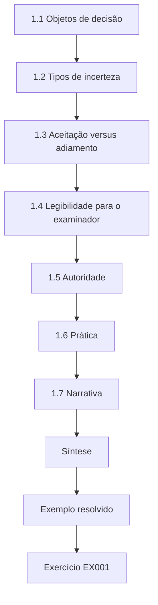

### Desenho lógico

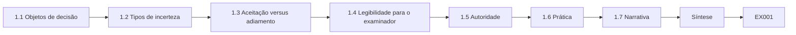

```text
[1.1 Objetos de decisão]
    |
    v
[1.2 Tipos de incerteza]
    |
    v
[1.3 Aceitação versus adiamento]
    |
    v
[1.4 Legibilidade para o examinador]
    |
    v
[1.5 Autoridade]
    |
    v
[1.6 Prática]
    |
    v
[1.7 Narrativa]
    |
    v
[Síntese]
    |
    v
[Exemplo resolvido] --> [Exercício EX001]
```
<!-- cykin:lesson-figures:end ch-01 -->


### Objetivos de aprendizagem

Você vai (1) estruturar decisões sob incerteza para programas de testes autorizados; (2) separar a aceitação de risco do pensamento desejoso; (3) usar registros de decisão que examinadores consigam acompanhar; (4) recusar decisões que não têm responsável.

### 1.1 Objetos de decisão

Na Meridian Clearing House, Amira Hassan trata cada escolha importante de testes como um objeto com cinco campos: opções, evidências, incertezas, recomendação e responsável. "Deveríamos fazer mais red team" não é um objeto de decisão enquanto esses campos não forem escritos, porque os examinadores não conseguem ver o que foi sacrificado. A DEC-14 rejeita trabalho anual guiado por ameaças porque a capacidade do white team não cobre dois ciclos completos sem tomar emprestados analistas do SOC da operação do dia a dia. O CISO aceita esse limite de capacidade por escrito, e Amira arquiva a aceitação ao lado da tabela de opções, para que um examinador futuro veja que a troca foi assumida, e não subentendida.

### 1.2 Tipos de incerteza

Ela distingue a incerteza aleatória (taxas de detecção ruidosas) da incerteza epistêmica (não se sabe se existe um canal de conexão). Intervalos no estilo de Wilson ajudam na primeira; oficinas de arquitetura ajudam na segunda. Misturá-las produz falsa precisão, e é assim que os materiais do conselho ganham uma única porcentagem que finge certeza. Na DEC-14, ela marca o ruído da taxa de detecção como aleatório e o canal desconhecido adjacente ao SWIFT como epistêmico; a oficina de arquitetura seguinte tem data e um líder nomeado. Seus registros de decisão indicam qual incerteza é qual, para que um leitor futuro saiba o que mais dados poderiam resolver e o que só o trabalho de desenho pode resolver.

### 1.3 Aceitação versus adiamento

Aceitar risco residual exige um aceitante nomeado, uma data de expiração e um controle compensatório. Adiar um teste porque "o ano que vem é melhor", sem data, não é aceitação nem gestão — é deriva. A exclusão adjacente ao SWIFT nomeia o CISO como aceitante, expira na próxima revisão do catálogo e lista o isolamento de rede e o MFA no jump host como controles compensatórios. Amira não arquiva uma aceitação se qualquer um desses três campos estiver em branco, e não trata um adiamento sem prazo como substituto deles. Um examinador que lê o registro deve ver uma escolha deliberada, e não uma conversa adiada disfarçada de gestão.

### 1.4 Legibilidade para o examinador

Os registros de decisão respondem: o que foi escolhido, o que foi rejeitado, quais evidências contaram e o que continua desconhecido. Amira rejeita registros que soam como slogans; frases como "levamos a segurança a sério" são apagadas dos rascunhos antes de saírem da mesa dela. Um registro legível da DEC-14 declara que foram escolhidos testes web trimestrais no estilo do WSTG mais um exercício bienal guiado por ameaças, que o exercício anual guiado por ameaças foi rejeitado por capacidade e que os sistemas adjacentes ao SWIFT continuam excluídos. Um diretor que perdeu a reunião consegue reconstruir a troca sem ligar para Amira, e um sucessor consegue continuar o programa sem pedir a ela o folclore.

### 1.5 Autoridade

Somente os papéis listados no estatuto de governança podem aceitar risco residual adjacente a pagamentos: o CISO, para exclusões comuns, e o comitê de riscos do conselho, para escolhas que afetam todo o programa. Amira escala em vez de inventar autoridade, porque a autoridade inventada desmorona diante do questionamento do examinador. Quando um responsável de produto pede que ela aceite o que só o CISO pode aceitar, ele recebe um escalonamento com o trecho do estatuto anexado, e não um aceno discreto. Ela mantém o mesmo trecho ao lado de cada registro de aceitação, para que qualquer pessoa que leia o arquivo depois possa verificar que quem assinou tinha direito de assinar.

### 1.6 Prática

A clínica semanal de decisões pega uma escolha real (sintética), como adiar o exercício guiado por ameaças em um trimestre, e dedica vinte minutos a ela. A sessão termina com opções, evidências e responsável escritos antes de alguém sair da sala. Os juniores apresentam primeiro; Amira edita para dar clareza, e não para suavizar conclusões. Ela lança o registro no log de decisões no mesmo dia, para que a clínica não vire uma conversa de corredor sem documentação. Vinte minutos bastam quando a escolha é concreta, e o hábito de terminar com um registro escrito é o que a clínica realmente treina.

### 1.7 Narrativa

Amira guarda os registros DEC em uma pasta que a auditoria interna amostrou no ano passado sem encontrar adiamentos sem data; a carta da amostragem está fixada acima do monitor dela. Quando um VP pede um sim rápido para ampliar o escopo às redes dos participantes, ela abre um objeto de decisão em branco no projetor e preenche as opções em voz alta até que o VP assuma a responsabilidade ou retire o pedido. O ritual parece lento e evita a inflação silenciosa de escopo entre os participantes da compensação. Três adjuntos já escreveram registros DEC que a auditoria aceitou sem alterações.

### Exemplo resolvido (MCH sintética)

O registro DEC-14 de Amira escolhe testes web trimestrais no estilo do WSTG mais um exercício bienal guiado por ameaças; rejeita o exercício anual guiado por ameaças por razões de capacidade; e lista os sistemas adjacentes ao SWIFT como fora do escopo comum, com o CISO como aceitante dessa exclusão.

> **Caso sintético — Meridian Clearing House (MCH).** A organização de compensação, Amira Hassan e todos os números foram inventados para fins didáticos.

### Erros e limites

Testes guiados por ameaças e de sistemas de compensação exigem autorização jurídica especializada. Este livro só usa casos sintéticos e não traz código de exploração nem roteiro de ataque ao mercado.

### Exercícios

- **EX001 — Campos do objeto de decisão.** Liste cinco campos de um objeto de decisão. *Rubrica:* 3 = cinco entre opções, evidências, incertezas, recomendação, responsável e opções rejeitadas; 2 = três; 1 = um; 0 = nada.
- **EX002 — Aleatória versus epistêmica.** Dê um exemplo de cada uma na MCH. *Rubrica:* 3 = os dois tipos corretos; 2 = um; 1 = trocados; 0 = nada.
- **EX003 — Adiamento ruim.** Por que "testar no ano que vem", sem data, é um problema? *Rubrica:* 3 = deriva / nem aceita nem gerencia; 2 = parcial; 1 = está tudo bem; 0 = nada.
- **EX004 — Autoridade.** Quem pode aceitar risco residual adjacente a pagamentos? *Rubrica:* 3 = papéis do estatuto de governança / nível de CISO; 2 = parcial; 1 = qualquer engenheiro; 0 = nada.
- **EX005 — O que a DEC-14 rejeita.** O que a DEC-14 rejeita e por quê? *Rubrica:* 3 = o exercício anual guiado por ameaças, por capacidade; 2 = parcial; 1 = todos os testes; 0 = nada.

### Síntese

Decisões são objetos com responsável e com as incertezas nomeadas; slogans e adiamentos sem data não contam.

### Continue estudando — capítulo 01 de 12

[← Página do curso](../../README.md) · [Índice de capítulos do curso](../SUBJECTS.md) · [Capítulo 02 (rascunho) →](#ch-02)

<a id="ch-02"></a>

## Capítulo 2 — Prática atual em segurança ofensiva autorizada

<!-- cykin:lesson-figures:start ch-02 -->
### Mapa da aula

Aula 02 publicada. Mapa, exemplo, EX006.

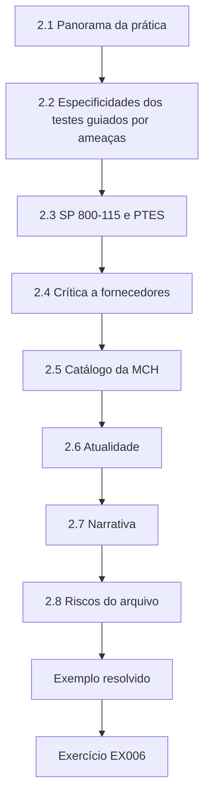

### Desenho lógico

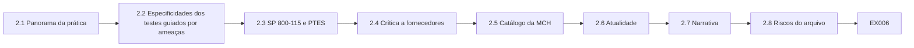

```text
[2.1 Panorama da prática]
    |
    v
[2.2 Especificidades dos testes guiados por ameaças]
    |
    v
[2.3 SP 800-115 e PTES]
    |
    v
[2.4 Crítica a fornecedores]
    |
    v
[2.5 Catálogo da MCH]
    |
    v
[2.6 Atualidade]
    |
    v
[2.7 Narrativa]
    |
    v
[2.8 Riscos do arquivo]
    |
    v
[Exemplo resolvido] --> [Exercício EX006]
```
<!-- cykin:lesson-figures:end ch-02 -->


### Objetivos de aprendizagem

Você vai (1) mapear os referenciais da prática atual; (2) situar o TIBER-EU e o CBEST entre testes mais leves; (3) criticar as promessas de fornecedores; (4) manter honesto o catálogo da MCH.

### 2.1 Panorama da prática

As organizações combinam gestão de vulnerabilidades, testes periódicos de aplicações web que seguem os temas do OWASP WSTG, exercícios de purple team e exercícios ocasionais guiados por ameaças sob regras do TIBER-EU ou semelhantes às do CBEST. Os nomes não são intercambiáveis, e nomes errados geram expectativas erradas sobre o aprendizado de detecção e a cobertura dos sistemas adjacentes ao SWIFT. O catálogo de Amira lista essas quatro atividades como linhas separadas, com alegações separadas. Chamar todas de red team é a forma pela qual os conselhos ouvem uma garantia sobre o SWIFT que nunca foi comprada, por isso ela corrige o vocabulário em cada reunião de planejamento até que os nomes fiquem separados em todas as notas de planejamento.

### 2.2 Especificidades dos testes guiados por ameaças

O TIBER-EU e o CBEST enfatizam cenários guiados por inteligência, controle pelo white team e aprendizado para detecção e resposta — e não a maximização do número de achados. Quando os executivos dizem "é só fazer pentest em tudo", Amira abre os guias públicos e mostra essas três expectativas; segundo eles, uma semana de varredura não é um programa guiado por ameaças. A linguagem das RFPs dela pede inteligência, desenho do white team e aprendizado de detecção, e não uma meta de número de achados, que é pontuada como teatro. Fornecedores que não conseguem descrever o desenho do white team saem da lista curta, e assim a Meridian Clearing House não compra uma varredura fantasiada de trabalho guiado por ameaças.

### 2.3 SP 800-115 e PTES

O NIST SP 800-115 e o PTES continuam sendo a espinha dorsal para planejar os tipos de avaliação e as etapas do engajamento. Os programas guiados por ameaças ficam por cima dessa disciplina de escopo, e não no lugar dela: autorização escrita, inclusões, exclusões e condições de parada continuam obrigatórias mesmo quando o cenário é guiado por inteligência e bienal. Pular o escopo porque o exercício é especial é como acontecem sondagens fora do escopo. Apoiar-se nessa espinha dorsal é o que permite a Amira manter os sistemas adjacentes ao SWIFT fora dos testes comuns e, ainda assim, conduzir um cenário bienal sob controle do white team. Por isso, as próprias ROE do cenário bienal nomeiam explicitamente a exclusão adjacente ao SWIFT.

### 2.4 Crítica a fornecedores

Fornecedores que prometem "red team completo em uma semana" sem inteligência, sem white team e sem metas de detecção estão vendendo uma varredura com teatro. A pontuação das RFPs de Amira pergunta quem atua como white team, quais metas de detecção serão medidas e como a inteligência molda os cenários; essas três respostas separam uma oferta real de um slogan. Ela já rejeitou uma proposta de red team completo em uma semana sem fase de inteligência e registrou o motivo no catálogo. Cada motivo de rejeição fica ali, para que o próximo comprador da Meridian Clearing House consiga ver o padrão das propostas de varredura com teatro.

### 2.5 Catálogo da MCH

Um catálogo vivo associa cada atividade ao que ela pode e não pode alegar. Os testes web trimestrais comuns não podem alegar a segurança do SWIFT; um exercício bienal guiado por ameaças não pode alegar cobertura contínua de cada mudança na web. A honestidade aqui impede que questionários de seguro e slides do conselho exagerem a garantia da Meridian Clearing House. Uma linha do catálogo sem a frase do que não pode alegar está incompleta, e Amira não deixa uma linha assim entrar em um material do conselho. Ela também bloqueia, nos materiais do conselho, linguagem que invente alegações proibidas por uma linha completa, mesmo quando o texto vem de um patrocinador sênior.

### 2.6 Atualidade

Amira revisa o catálogo duas vezes por ano diante das novas edições dos referenciais. As revisões detectam novas edições do ATT&CK, do WSTG, do TIBER-EU e do CBEST e riscam slogans aposentados de fornecedores que ainda estão em materiais antigos do conselho. Um catálogo que nunca é atualizado vira um museu da bravata do ano anterior. Ela data cada revisão e arquiva o índice de riscos, para que slogans aposentados não sejam colados de materiais antigos em materiais novos. A atualidade é um controle agendado, com data no calendário, e não a esperança de que alguém perceba uma alegação vencida antes que um comitê a perceba.

### 2.7 Narrativa

As revisões do catálogo recebem uma vez por ano um fornecedor de red team como crítico convidado. Amira pede que ele ataque as frases do que não pode ser alegado: se ele puder dizer honestamente que um teste web trimestral prova a segurança do SWIFT, a frase é fraca demais. O convidado do ano passado não conseguiu quebrar as frases; ainda assim, ela tornou um adjetivo mais preciso. Ela convida um fornecedor diferente a cada ano, para que a crítica não fique capturada. As revisões de atualidade também caçam slogans aposentados de fornecedores que persistem em materiais antigos do conselho e os riscam no índice do arquivo.

### 2.8 Riscos do arquivo

Os riscos feitos em materiais antigos ficam ligados ao registro de alterações do catálogo, para que os revisores vejam qual alegação foi suavizada e por quê; esquecer a história é como a bravata volta à linguagem do conselho. A reescrita de "estamos em conformidade com o CBEST" para um exercício inspirado no CBEST, com prazo definido e exclusões adjacentes ao SWIFT, é o exemplo resolvido, e as duas versões ficam no arquivo. Quando um diretor perguntou por que "em conformidade" sumiu do slide de 2025, o link do registro de alterações respondeu à pergunta sem reunião. Cada entrada do registro de alterações anota a data, a redação antiga e o revisor que aprovou a nova redação.

### Exemplo resolvido (MCH sintética)

Amira reescreve um slide do conselho de "estamos em conformidade com o CBEST" para "concluímos um exercício inspirado no CBEST em 2025; os testes trimestrais comuns excluem os sistemas adjacentes ao SWIFT, conforme o catálogo".

> **Caso sintético — Meridian Clearing House (MCH).** A organização de compensação, Amira Hassan e todos os números foram inventados para fins didáticos.

### Erros e limites

Testes guiados por ameaças e de sistemas de compensação exigem autorização jurídica especializada. Este livro só usa casos sintéticos e não traz código de exploração nem roteiro de ataque ao mercado.

### Exercícios

- **EX006 — Não intercambiáveis.** Por que não chamar todo teste de red team? *Rubrica:* 3 = profundidade, inteligência e metas de detecção diferentes; 2 = parcial; 1 = são iguais; 0 = nada.
- **EX007 — Ênfase dos testes guiados por ameaças.** Cite duas ênfases dos testes no estilo do TIBER-EU/CBEST. *Rubrica:* 3 = cenários guiados por inteligência e aprendizado de detecção e resposta (white team); 2 = uma; 1 = volume de achados; 0 = nada.
- **EX008 — Pergunta da RFP.** Dê uma pergunta de RFP que elimine o teatro. *Rubrica:* 3 = pergunta pelo white team, pelos objetivos de aprendizado ou pela inteligência; 2 = parcial; 1 = apenas o menor preço; 0 = nada.
- **EX009 — O que não pode alegar.** O que um catálogo precisa declarar além do que os testes fazem? *Rubrica:* 3 = o que eles não podem alegar; 2 = parcial; 1 = logotipos; 0 = nada.
- **EX010 — Reescrita do slide.** O que estava errado em "estamos em conformidade com o CBEST"? *Rubrica:* 3 = alegação exagerada / imprecisa; 2 = parcial; 1 = diz que nada estava errado; 0 = sem resposta.

### Síntese

A prática atual é um catálogo de atividades nomeadas com honestidade, e não um único jargão da moda.

### Continue estudando — capítulo 02 de 12

[← Capítulo 01 (rascunho)](#ch-01) · [Índice de capítulos do curso](../SUBJECTS.md) · [Capítulo 03 (rascunho) →](#ch-03)

<a id="ch-03"></a>

## Capítulo 3 — Evidências de especialista

<!-- cykin:lesson-figures:start ch-03 -->
### Mapa da aula

Aula 03 publicada. Mapa, exemplo, EX011.

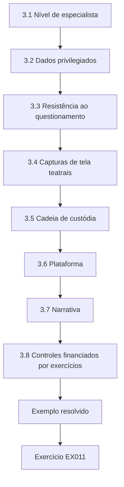

### Desenho lógico

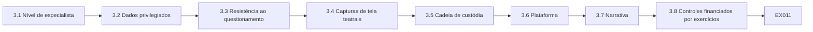

```text
[3.1 Nível de especialista]
    |
    v
[3.2 Dados privilegiados]
    |
    v
[3.3 Resistência ao questionamento]
    |
    v
[3.4 Capturas de tela teatrais]
    |
    v
[3.5 Cadeia de custódia]
    |
    v
[3.6 Plataforma]
    |
    v
[3.7 Narrativa]
    |
    v
[3.8 Controles financiados por exercícios]
    |
    v
[Exemplo resolvido] --> [Exercício EX011]
```
<!-- cykin:lesson-figures:end ch-03 -->


### Objetivos de aprendizagem

Você vai (1) definir evidências de nível de especialista; (2) tratar dados privilegiados de compensação; (3) desenhar evidências que resistam a questionamentos; (4) recusar capturas de tela teatrais.

### 3.1 Nível de especialista

A evidência precisa ser reproduzível sob as ROE, minimizada, com hash, com fuso horário e vinculada a uma decisão. "Parece ruim na ferramenta" não é nível de especialista: a reprodutibilidade é o critério, o drama não. Uma evidência de nível de especialista pode ser reproduzida sob as ROE por outro testador, usando os hashes, os carimbos de tempo e o contexto de escopo guardados no cofre. O FindingsDesk bloqueia a entrada nos materiais do conselho até que hash e responsável estejam presentes, então o drama sem esses campos nunca chega a um slide de comitê. Uma observação que falha nesse teste é reescrita até que outro especialista consiga repeti-la.

### 3.2 Dados privilegiados

As mensagens de compensação e os identificadores dos participantes são altamente sensíveis. A sensibilidade não é motivo para dispensar a evidência; é motivo para desenhar uma evidência mais segura. Amira mantém mensagens e identificadores reais fora das evidências comuns sempre que modelos sintéticos de mensagem conseguem mostrar a mesma classe de problema, e prefere esses modelos até na homologação. Tudo o que ainda parecer real demais é ocultado antes de entrar no cofre. O resultado é um cofre em que as entradas comuns provam o problema sem carregar dados de participantes que um vazamento ou uma exportação descuidada poderiam expor.

### 3.3 Resistência ao questionamento

O questionamento jurídico ou do white team pergunta: outro especialista conseguiria reproduzir esta observação sem o folclore do seu notebook? Se não, reescreva. Nos exercícios de questionamento, um segundo especialista tem dez minutos para encontrar um hash, um fuso horário ou uma cláusula das ROE que estejam faltando, e é pontuado por encontrar lacunas reais. Se a observação não resiste, Amira a reescreve antes da entrada no cofre; o reparo calmo depois de uma falha apontada pontua bem, a postura defensiva não. O exercício existe para que o questionamento jurídico ou do white team nunca encontre pela primeira vez, numa disputa real, uma alegação impossível de reproduzir.

### 3.4 Capturas de tela teatrais

Painéis de tema escuro sem hashes, carimbos de tempo ou contexto de escopo impressionam e não provam nada, e o cofre de evidências os rejeita de imediato. Eles desperdiçam o tempo do examinador e ensinam os juniores a confundir acabamento com evidência. Amira pede primeiro os artefatos sem graça — saída de comandos, trechos de configuração e hashes — e não discute temas de cores enquanto não existirem hashes e carimbos de tempo. Uma captura teatral rejeitada vira exemplo didático no exercício de questionamento seguinte, para que o mesmo erro de acabamento não volte nas evidências do trimestre seguinte.

### 3.5 Cadeia de custódia

Nos exercícios guiados por ameaças, os registros de custódia são tão importantes quanto os artefatos técnicos. Eles mostram quem guardou cada artefato, quando ele foi movido e quem autorizou a movimentação, e uma linha de custódia ausente é tratada com a mesma seriedade que um hash ausente. Os questionamentos do white team e da área jurídica costumam começar por perguntas sobre a cadeia de custódia, por isso o registro é construído durante o exercício, enquanto a memória está fresca, e não reconstruído depois. Um registro escrito de memória uma semana depois convida justamente à dúvida que os registros de custódia existem para eliminar.

### 3.6 Plataforma

Os campos do FindingsDesk exigem hash e responsável antes que um achado possa entrar nos materiais do conselho. Essa trava da plataforma é como a Meridian Clearing House mantém os padrões de especialista quando a pressão do calendário aumenta antes de uma reunião de comitê. Amira recusa exceções manuais para slides atrasados, mesmo quando a reunião é amanhã e a cor e a severidade parecem prontas. Os campos de cor e de severidade vêm depois do hash e do responsável, nunca no lugar deles. Um achado que fica fora do material porque falta o hash entra completo no material seguinte, o que custa um ciclo em vez de custar credibilidade.

### 3.7 Narrativa

Os exercícios de questionamento formam duplas de especialistas: um apresenta a evidência, o outro tem dez minutos para encontrar um hash, um fuso horário ou uma cláusula das ROE ausente. Amira pontua quem questiona por encontrar lacunas reais e quem apresenta pelo reparo calmo. As taxas de rejeição no cofre caíram depois disso, porque os apresentadores passaram a chegar com os hashes preenchidos. Os exercícios de custódia incluem uma apreensão simulada de notebook que pergunta se os hashes ainda se comprovam; a recuperação parcial de um hash conta como reprovação, e uma reprovação anterior financiou o trabalho com HSM para as chaves do cofre. O cenário de apreensão é refeito depois de cada mudança na forma de guardar as chaves do cofre.

### 3.8 Controles financiados por exercícios

O memorando de orçamento do HSM usou a reprovação no exercício de apreensão como prova principal: exercícios sem graça compram controles reais. O memorando pôs o fragmento recuperado ao lado do inventário de chaves do cofre, mostrando qual chave o notebook apreendido teria exposto. A área financeira aceitou a linha do HSM porque o registro do exercício tinha um plano datado, uma regra escrita e um resultado de reprovação que ninguém havia suavizado. Tratar o resultado parcial como reprovação foi o que tornou o exercício uma evidência crível naquele memorando; uma nota suavizada teria parecido uma quase aprovação e não teria financiado nada.

### 3.9 Regra de pontuação do exercício

As notas do exercício de apreensão são aprovado/reprovado, e a recuperação parcial de um hash é reprovação: um fragmento recuperado ainda prova que material de chave saiu do dispositivo, por isso a regra não tem nota intermediária. Amira escreve essa frase de aprovação ou reprovação no roteiro do exercício antes de ele começar e a mantém ao lado do plano do exercício para as turmas seguintes. O roteiro também nomeia antecipadamente quem vai pontuar, para que ninguém que conduziu o cenário de apreensão o avalie depois. Os operadores que querem uma nota intermediária depois que um fragmento é recuperado aprendem que a regra não se dobra por conforto; suavizá-la os ensinaria a negociar notas.

### Exemplo resolvido (MCH sintética)

Amira rejeita o slide de um fornecedor com um painel vermelho; aceita um pacote com identificadores de requisição, hashes, deslocamentos em relação ao UTC e a cláusula das ROE que permitiu a verificação.

> **Caso sintético — Meridian Clearing House (MCH).** A organização de compensação, Amira Hassan e todos os números foram inventados para fins didáticos.

### Erros e limites

Testes guiados por ameaças e de sistemas de compensação exigem autorização jurídica especializada. Este livro só usa casos sintéticos e não traz código de exploração nem roteiro de ataque ao mercado.

### Exercícios

- **EX011 — Quatro características.** Liste quatro características de uma evidência de nível de especialista. *Rubrica:* 3 = quatro entre reproduzível, minimizada, com hash, com fuso horário e vinculada a uma decisão; 2 = três; 1 = uma; 0 = nada.
- **EX012 — Preferência pelo sintético.** Por que preferir modelos sintéticos de compensação? *Rubrica:* 3 = a sensibilidade dos dados reais de compensação; 2 = parcial; 1 = preguiça; 0 = nada.
- **EX013 — Pergunta do questionamento.** Qual pergunta testa a resistência ao questionamento? *Rubrica:* 3 = outro especialista conseguiria reproduzir sem folclore?; 2 = parcial; 1 = está vermelho?; 0 = nada.
- **EX014 — Rejeição do teatro.** Por que rejeitar uma captura de tela de painel escuro sozinha? *Rubrica:* 3 = sem hash, horário ou contexto de escopo; 2 = parcial; 1 = estética; 0 = nada.
- **EX015 — Trava do cofre.** O que o FindingsDesk exige antes dos materiais do conselho? *Rubrica:* 3 = hash e responsável (e campos relacionados); 2 = um; 1 = cor; 0 = nada.

### Síntese

A evidência de especialista resiste ao questionamento; o teatro não entra no cofre.

### Continue estudando — capítulo 03 de 12

[← Capítulo 02 (rascunho)](#ch-02) · [Índice de capítulos do curso](../SUBJECTS.md) · [Capítulo 04 (rascunho) →](#ch-04)

<a id="ch-04"></a>

## Capítulo 4 — Risco avançado e ética

<!-- cykin:lesson-figures:start ch-04 -->
### Mapa da aula

Aula 04 publicada. Mapa, exemplo, EX016.

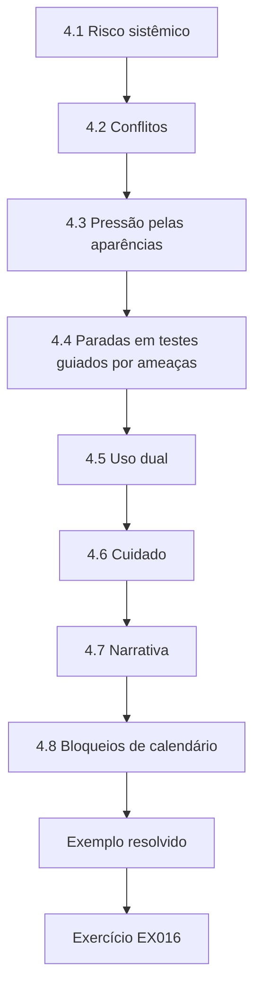

### Desenho lógico

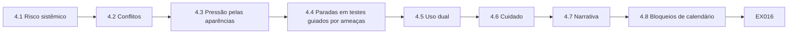

```text
[4.1 Risco sistêmico]
    |
    v
[4.2 Conflitos]
    |
    v
[4.3 Pressão pelas aparências]
    |
    v
[4.4 Paradas em testes guiados por ameaças]
    |
    v
[4.5 Uso dual]
    |
    v
[4.6 Cuidado]
    |
    v
[4.7 Narrativa]
    |
    v
[4.8 Bloqueios de calendário]
    |
    v
[Exemplo resolvido] --> [Exercício EX016]
```
<!-- cykin:lesson-figures:end ch-04 -->


### Objetivos de aprendizagem

Você vai (1) pesar o risco sistêmico para a compensação; (2) lidar com conflitos de interesse; (3) resistir à pressão pelas aparências; (4) desenhar condições éticas de parada para o trabalho guiado por ameaças.

### 4.1 Risco sistêmico

A lente de risco de Amira é sistêmica, e não apenas local da MCH. Um teste descuidado que atrase a liquidação pode prejudicar muitos participantes além da Meridian Clearing House, por isso uma janela de teste é combinada com as operações antes que qualquer cenário toque o caminho da liquidação. Antes de aprovar o desenho, ela pergunta quem mais faz compensação por esse caminho e o que uma pausa de quinze minutos causaria. Cenários que precisam de impacto real sobre participantes são rejeitados na fase de desenho e nunca saem da revisão de desenho. O dano sistêmico também é a razão de existirem, no programa, a autoridade de parada e os bloqueios de calendário.

### 4.2 Conflitos

Investimentos pessoais, empregadores anteriores e amizades com fornecedores entram no registro de conflitos antes de começarem as reuniões de pontuação. Declarar-se impedido é normal na Meridian Clearing House, e não prejudica a carreira, e Amira se declara impedida sempre que uma decisão toca uma das entradas dela. Os juniores já a viram sair de uma reunião de pontuação de fornecedores quando um antigo empregador apresentou proposta, o que ensina o hábito melhor do que uma página de política sozinha. O registro é lido em voz alta no início de cada reunião de pontuação, para que um conflito seja declarado antes de existirem notas, e não descoberto depois que um contrato foi assinado.

### 4.3 Pressão pelas aparências

Datas de divulgação de resultados e demonstrações em conferências nunca justificam enterrar achados. Respostas da gestão podem ficar ao lado dos achados; a exclusão, não. Quando um líder de produto pediu para segurar um achado até depois de uma demonstração em conferência, Amira acrescentou a resposta dele ao lado do achado e registrou a recusa sob o estatuto de ética. Cada entrada de recusa nomeia o papel de quem pediu, o identificador do achado e a data, para que o comitê de riscos do conselho veja os padrões de pressão. A pressão pelas aparências é previsível, por isso o estatuto de ética a responde antes de o e-mail chegar.

### 4.4 Paradas em testes guiados por ameaças

Amira recusa exercícios em que ninguém consegue parar o red team em minutos. A autoridade de parada do white team é escrita antes de os cenários começarem, com nomes e números de telefone que funcionam sob estresse, e nenhum cenário começa antes que esses contatos nomeados confirmem que podem ser acionados. Antes de cada ano de exercícios guiados por ameaças, o líder do white team liga para a linha de parada durante o ensaio e registra quanto tempo a resposta levou. Um atraso simulado de quinze minutos na liquidação é motivo suficiente para parar no meio do jogo; os estudantes que continuam por mais um objetivo são reprovados no exercício de mesa de ética.

### 4.5 Uso dual

Publicar caminhos de exploração específicos da compensação está fora do escopo deste currículo e das palestras públicas da MCH. As palestras de Amira descrevem o método de decisão, o catálogo e as frases do que não pode ser alegado, nunca um caminho através da conexão de um participante, e o último slide dela lista essa recusa ao lado de "nenhuma demonstração ao vivo contra participantes". Quando um organizador de conferência pediu um passo a passo sobre a compensação, ela ofereceu em vez disso uma palestra sobre o objeto de decisão DEC-14 e explicou o motivo em termos simples. A disciplina do uso dual faz parte da identidade do especialista, e não é um apêndice opcional para uma vaga em conferência.

### 4.6 Cuidado

A ética inclui sono, limites de horas e nenhum heroísmo perto das janelas de liquidação. Os limites de horas valem para a equipe do white team e também para os operadores, porque um responsável pela parada cansado é uma parada que falha. Amira os aplica para que pessoas cansadas não se tornem o risco que o programa deveria reduzir. Os bloqueios de calendário impedem reservas de cenários nos picos de liquidação e mostram o estatuto de ética como motivo da rejeição, o que torna a política visível no momento da reserva, e não numa repreensão posterior. Nem a própria Amira consegue agendar um horário de cenário passando por cima de um bloqueio.

### 4.7 Narrativa

O exercício de mesa sobre risco sistêmico usa um atraso simulado de quinze minutos na liquidação. Os estudantes do white team precisam parar um cenário no meio do jogo quando o atraso aparece, e Amira reprova qualquer estudante que continue por apenas mais um objetivo. Ela conduz o exercício de mesa antes de cada ano de exercícios guiados por ameaças, para que o reflexo de parar seja ensaiado, e não inventado sob estresse. Os limites de horas perto da liquidação são garantidos por bloqueios de calendário nos horários de cenário, de modo que o heroísmo não possa ser agendado, nem mesmo por ela. O debriefing registra quanto tempo cada estudante levou para acionar a parada, e os tempos mais lentos são discutidos sem nomes.

### 4.8 Bloqueios de calendário

Quando alguém tenta reservar um cenário no pico de liquidação, o bloqueio de calendário rejeita o pedido e cita como motivo a cláusula pertinente do estatuto de ética. Mostrar o estatuto diz a quem pediu que o bloqueio é uma decisão de política, e não um acidente de agenda, e permite ler a regra exata antes de discutir com alguém. Com o tempo, isso também ensina os solicitantes a ler o estatuto antes de pedir. Uma rejeição que dissesse apenas "horário indisponível" convidaria a uma nova reserva uma hora depois; uma rejeição que nomeia a cláusula encerra a tentativa na origem.

### 4.9 Cópias das rejeições

Os e-mails de rejeição dos bloqueios de calendário vão automaticamente com cópia para a caixa compartilhada dos mantenedores do estatuto, de modo que tentativas repetidas de reservar no pico de liquidação ficam visíveis para quem é dono do estatuto e nenhum revisor isolado pode absorvê-las em silêncio. Amira revisa essas cópias a cada trimestre como sinal de pressão cultural, e não como caça a indivíduos. Uma equipe que vive esbarrando no bloqueio costuma estar com falta de capacidade, o que é um problema de desenho do programa, e não de disciplina, por isso ela abre uma clínica de decisões sobre capacidade e calendário em vez de conceder exceções.

### Exemplo resolvido (MCH sintética)

Amira cancela, dois dias antes de um pico de liquidação, um cenário proposto que não tinha um botão de parada do white team, citando o risco sistêmico e o estatuto de ética.

> **Caso sintético — Meridian Clearing House (MCH).** A organização de compensação, Amira Hassan e todos os números foram inventados para fins didáticos.

### Erros e limites

Testes guiados por ameaças e de sistemas de compensação exigem autorização jurídica especializada. Este livro só usa casos sintéticos e não traz código de exploração nem roteiro de ataque ao mercado.

### Exercícios

- **EX016 — Lente sistêmica.** Por que o risco da compensação é diferente do risco do site de um único banco? *Rubrica:* 3 = muitos participantes / impacto na liquidação; 2 = parcial; 1 = é igual; 0 = nada.
- **EX017 — Impedimento.** Dê um motivo válido para se declarar impedido. *Rubrica:* 3 = investimento, antigo empregador ou amizade com fornecedor; 2 = parcial; 1 = antipatia; 0 = nada.
- **EX018 — Enterrar versus responder.** O que pode ficar ao lado de um achado sob pressão? *Rubrica:* 3 = a resposta da gestão, e não a exclusão; 2 = parcial; 1 = a exclusão; 0 = nada.
- **EX019 — Botão de parada.** O que precisa existir antes de os cenários guiados por ameaças começarem? *Rubrica:* 3 = autoridade de parada do white team; 2 = parcial; 1 = diz que nada é necessário; 0 = sem resposta.
- **EX020 — Pico de liquidação.** Por que cancelar perto do pico de liquidação quando não há botão de parada? *Rubrica:* 3 = risco sistêmico + ética; 2 = parcial; 1 = medo; 0 = nada.

### Síntese

A ética na escala da compensação inclui o dano sistêmico, o impedimento, a recusa a enterrar achados e uma autoridade de parada real.

### Continue estudando — capítulo 04 de 12

[← Capítulo 03 (rascunho)](#ch-03) · [Índice de capítulos do curso](../SUBJECTS.md) · [Capítulo 05 (rascunho) →](#ch-05)

<a id="ch-05"></a>

## Capítulo 5 — Alternativas de desenho para programas de avaliação

<!-- cykin:lesson-figures:start ch-05 -->
### Mapa da aula

Aula 05 publicada. Mapa, exemplo, EX021.

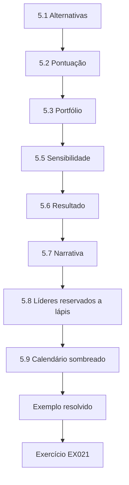

### Desenho lógico

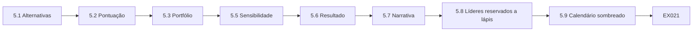

```text
[5.1 Alternativas]
    |
    v
[5.2 Pontuação]
    |
    v
[5.3 Portfólio]
    |
    v
[5.5 Sensibilidade]
    |
    v
[5.6 Resultado]
    |
    v
[5.7 Narrativa]
    |
    v
[5.8 Líderes reservados a lápis]
    |
    v
[5.9 Calendário sombreado]
    |
    v
[Exemplo resolvido] --> [Exercício EX021]
```
<!-- cykin:lesson-figures:end ch-05 -->


### Objetivos de aprendizagem

Você vai (1) gerar alternativas de programa; (2) pontuá-las em aprendizado, risco, custo e capacidade; (3) recomendar um portfólio; (4) documentar os não objetivos.

### 5.1 Alternativas

Amira escreve quatro alternativas para que os executivos vejam escolhas reais: A, apenas testes web trimestrais; B, apenas exercícios anuais guiados por ameaças; C, testes web trimestrais mais um exercício bienal guiado por ameaças; e D, teatro de varredura automatizada contínua. Ela não discute um pedido vago de "mais testes" enquanto ele não corresponder a uma dessas quatro, e um pedido que não corresponde é devolvido até que corresponda. A DEC-14 é o registro da escolha de C depois que A, B e D foram pontuadas. Escrever as alternativas lado a lado torna as opções rejeitadas tão visíveis quanto a escolhida, e é disso que um examinador futuro precisa.

### 5.2 Pontuação

Amira pontua cada alternativa em aprendizado de detecção, risco operacional, custo, capacidade da equipe e adequação ao examinador, cada critério de um a três. Os números brutos ficam visíveis, para que um diretor consiga recalcular a classificação à mão. D pontua alto em ruído e baixo em aprendizado. B vai bem em aprendizado, mas mal em capacidade da equipe, porque o trabalho anual guiado por ameaças exige dois ciclos completos do white team. C vence na Meridian Clearing House quando a capacidade é declarada com honestidade, e a planilha de pontuação anexada ao memorando de alternativas impede que a recomendação vire questão de gosto.

### 5.3 Portfólio

C costuma vencer em organizações como a MCH porque A sozinha treina pouco a detecção e B sozinha deixa passar as regressões comuns entre os anos de exercícios guiados por ameaças. A linguagem de portfólio significa a combinação de atividades, e não um único logotipo comprado nem um único engajamento milagroso. Amira continua mostrando as notas de A, B e D, para que os diretores entendam por que C venceu, em vez de aceitar a recomendação por confiança. Quando um diretor propõe mais tarde abandonar os testes web trimestrais para financiar um ano maior de exercícios guiados por ameaças, as mesmas notas mostram quanto aprendizado de detecção e quanta cobertura de regressões essa troca custaria.

### 5.4 Não objetivos

O memorando lista três não objetivos: nenhuma alegação de cobertura do SWIFT a partir dos testes web comuns; nenhuma demonstração pública de exploração; nenhuma hora extra não paga como plano de capacidade. Cada não objetivo corresponde a uma frase do catálogo sobre o que não pode ser alegado ou ao estatuto de ética, então nenhum deles é uma promessa nova inventada para o memorando. Amira os lê em voz alta no fim do memorando de alternativas, para que a hora extra não paga não vire discretamente o plano de capacidade. Antes de arquivar, ela confere cada recomendação com a escala de trabalho que os responsáveis de fato praticam; uma recomendação que só funciona se as pessoas trabalharem de madrugada não é executável.

### 5.5 Sensibilidade

Amira pontua de novo as alternativas sob choques, porque a recomendação deve continuar executável quando as condições pioram. Sua análise de sensibilidade reduz a capacidade pela metade e também dobra o custo dos fornecedores. Dobrar o custo dos fornecedores atinge mais a opção B, que contrata um provedor de exercícios guiados por ameaças todo ano, em vez de a cada dois anos. A opção C atual sobrevive à capacidade reduzida pela metade ao passar o exercício guiado por ameaças para cada três anos, com um líder do white team nomeado e uma data escrita. Se C desmoronasse sob os dois choques, ela nunca teria sido robusta; Amira recusa um plano que só funciona no melhor cenário.

### 5.6 Resultado

O resultado é um memorando de alternativas de duas páginas com a tabela de pontuação, os não objetivos, o resultado da sensibilidade e um gráfico de calendário. O gráfico sombreia os meses de preparação — coleta de inteligência, briefing do white team e aprovação do cenário, cada um em um tom diferente —, e não apenas a semana de execução. Certa vez, a área financeira financiou só a semana de execução e foi surpreendida pelo tempo de preparação da inteligência; as células sombreadas acabaram com essa surpresa. A última linha do memorando nomeia o CISO como responsável pela recomendação e a próxima revisão do catálogo como sua data de expiração. Amira não envia um memorando sem o gráfico de calendário, porque os executivos aprovariam um programa para o qual não reservaram pessoas.

### 5.7 Narrativa

Amira lê os não objetivos no início de cada oficina de alternativas, para que o brainstorming não reintroduza discretamente a opção teatral D, e de novo no fim, para que ninguém saia achando que a hora extra vai salvar o plano. Um memorando sem análise de sensibilidade está incompleto. Quando a capacidade cai pela metade, passar o exercício guiado por ameaças para cada três anos mantém um líder do white team nomeado e uma data escrita, em vez de um desejo. A própria mudança é arquivada como emenda a uma DEC, para que a alteração da cadência seja assumida da mesma forma que a escolha original de C.

### 5.8 Líderes reservados a lápis

O exercício guiado por ameaças a cada três anos continua tendo um líder do white team reservado a lápis com dois anos de antecedência; o lápis vence o desejo. Nomear o líder tão cedo dá ao white team tempo para organizar substitutos antes da data do exercício, e substitutos organizados em cima da hora viram o heroísmo que o estatuto de ética proíbe. Amira põe o nome no gráfico de calendário, e não apenas em um e-mail. O nome reservado é conferido em cada revisão do catálogo, e qualquer troca de pessoa é registrada como emenda a uma DEC. É assim que a Meridian Clearing House mantém executável o exercício guiado por ameaças a cada três anos.

### 5.9 Calendário sombreado

Cada mês de preparação sombreado no gráfico de calendário de Amira traz as iniciais do membro do white team reservado para ele, de modo que os executivos veem a carga real da equipe e as lacunas de cobertura aparecem como células em branco. Quando uma célula continua em branco, Amira leva a lacuna ao líder do white team antes de o mês começar, em vez de descobri-la na semana de execução. Ela reimprime o calendário depois de cada DEC que muda a cadência e guarda o hash do PDF ao lado da DEC-14, para que a versão aprovada por um diretor possa ser distinguida das revisões posteriores.

### Exemplo resolvido (MCH sintética)

O memorando de Amira escolhe C, mostra um calendário de dois anos e lista D como rejeitada por gerar falsa garantia.

> **Caso sintético — Meridian Clearing House (MCH).** A organização de compensação, Amira Hassan e todos os números foram inventados para fins didáticos.

### Erros e limites

Testes guiados por ameaças e de sistemas de compensação exigem autorização jurídica especializada. Este livro só usa casos sintéticos e não traz código de exploração nem roteiro de ataque ao mercado.

### Exercícios

- **EX021 — Por que não D.** Por que rejeitar o teatro de varredura contínua? *Rubrica:* 3 = ruído sem aprendizado / falsa garantia; 2 = parcial; 1 = é a melhor; 0 = nada.
- **EX022 — Por que C.** Por que C costuma vencer? *Rubrica:* 3 = regressões + aprendizado periódico guiado por ameaças; 2 = parcial; 1 = é a mais barata; 0 = nada.
- **EX023 — Exemplo de não objetivo.** Dê um não objetivo do programa da MCH. *Rubrica:* 3 = nenhuma alegação sobre o SWIFT a partir de testes web / nenhuma exploração pública / nenhuma hora extra como capacidade; 2 = parcial; 1 = vago; 0 = nada.
- **EX024 — Sensibilidade.** Qual choque de capacidade o memorando deve testar? *Rubrica:* 3 = capacidade reduzida pela metade / choque semelhante; 2 = parcial; 1 = vago; 0 = nada.
- **EX025 — Calendário.** Que artefato ajuda os executivos a aprovar C? *Rubrica:* 3 = gráfico de calendário de dois anos; 2 = parcial; 1 = jargão; 0 = nada.

### Síntese

O desenho de programas é um portfólio pontuado com não objetivos, e não um único logotipo comprado.

### Continue estudando — capítulo 05 de 12

[← Capítulo 04 (rascunho)](#ch-04) · [Índice de capítulos do curso](../SUBJECTS.md) · [Capítulo 06 (rascunho) →](#ch-06)

<a id="ch-06"></a>

## Capítulo 6 — Avaliação controlada

<!-- cykin:lesson-figures:start ch-06 -->
### Mapa da aula

Aula 06 publicada. Mapa, exemplo, EX026.

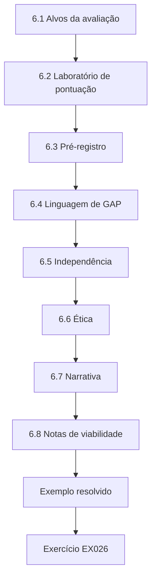

### Desenho lógico

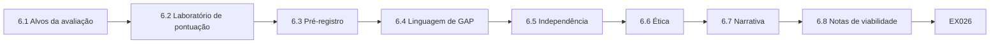

```text
[6.1 Alvos da avaliação]
    |
    v
[6.2 Laboratório de pontuação]
    |
    v
[6.3 Pré-registro]
    |
    v
[6.4 Linguagem de GAP]
    |
    v
[6.5 Independência]
    |
    v
[6.6 Ética]
    |
    v
[6.7 Narrativa]
    |
    v
[6.8 Notas de viabilidade]
    |
    v
[Exemplo resolvido] --> [Exercício EX026]
```
<!-- cykin:lesson-figures:end ch-06 -->


### Objetivos de aprendizagem

Você vai (1) desenhar avaliações de cenários e controles; (2) usar uma pontuação que equilibre aprendizado e risco; (3) fazer pré-registro; (4) relatar lacunas sem catastrofismo.

### 6.1 Alvos da avaliação

A escolha de cenários, a cobertura de controles, as regras de detecção e os resultados do programa precisam, cada um, de um desenho de avaliação diferente. Amira recusa uma nota única que finja medir tudo isso junto. A classificação de cenários do laboratório serve para escolher cenários; as regras de detecção precisam de medidas de purple team; os resultados do programa precisam de registros de decisão como a DEC-14. Misturar classificações de cenários, medidas de purple team e resultados da DEC-14 em uma só métrica daria ao conselho um número que não mede nenhum deles, e é assim que os materiais do conselho perdem o sentido. Por isso, cada alvo de avaliação mantém, no material dela, seu próprio desenho e sua própria medida.

### 6.2 Laboratório de pontuação

O lab_scenario classifica cenários sintéticos com score = 2×aprendizado − risco, para que surjam as opções de alto aprendizado e risco administrável.

```python
"""Lab 6: score synthetic TIBER-style scenario options by detection learning vs ops risk (1-3)."""
opts = [("A","Stolen VPN + SWIFT-adjacent pivot",3,3),("B","Public web defacement only",1,1),
        ("C","Supply-chain library in batch app",3,2),("D","Branch Wi-Fi rogue AP",2,2)]
for i,t,learn,risk in sorted(opts, key=lambda x:(-(x[2]*2-x[3]), x[0])):
    print(f"{i} score={learn*2-risk:+d} learn={learn} risk={risk} {t}")
```

Execute com `python3 lab_scenario.py`. Saída verificada:

```text
C score=+4 learn=3 risk=2 Supply-chain library in batch app
A score=+3 learn=3 risk=3 Stolen VPN + SWIFT-adjacent pivot
D score=+2 learn=2 risk=2 Branch Wi-Fi rogue AP
B score=+1 learn=1 risk=1 Public web defacement only
```

A biblioteca da cadeia de suprimentos no aplicativo de lote (C) tem a maior nota, +4; a VPN roubada com pivô adjacente ao SWIFT (A) tem +3, mas carrega risco 3; o ponto de acesso falso no Wi-Fi da agência (D) tem +2; e a desfiguração do site público (B) tem só +1. A classificação é uma entrada, e não uma decisão de financiamento. Amira rebaixa uma nota alta do laboratório quando falta viabilidade do white team, e a viabilidade continua decidindo o financiamento depois da classificação do laboratório.

### 6.3 Pré-registro

Métricas e limiares recebem uma tag no git antes dos resultados, para que Amira não possa mudar as regras do jogo depois de ver as notas. O pré-registro declara a medida principal, o limiar e as exclusões, e é curto de propósito: um colega deve conseguir encontrar a tag e lê-la sem perguntar a ela. Mudar um limiar depois de ver as notas exige uma tag emendada e uma nota no log de decisões que diga o porquê. O pré-registro é como a Meridian Clearing House mantém a avaliação honesta quando os cenários favoritos têm desempenho fraco e a tentação de redefinir o sucesso é maior.

### 6.4 Linguagem de GAP

"T1190 0/2 GAP" agenda trabalho de engenharia; não alega cegueira permanente. T1190 0/2 significa que nenhuma das duas tentativas de exploração de aplicação exposta ao público foi detectada, uma amostra pequena demais para estimar uma taxa. Um chamado de engenharia com data é o companheiro honesto de um rótulo GAP. Dizer "estamos cegos para sempre" não é verdadeiro nem útil quando um chamado com data pode fechar a lacuna, e a linguagem catastrofista ensina os diretores a ignorar lacunas que a engenharia poderia fechar. Por isso, a linguagem de Amira nos achados e nos materiais do conselho fica na faixa em que um GAP agenda trabalho de engenharia.

### 6.5 Independência

O white team ou um colega aplica a pontuação às mesmas entradas. Na oficina de cenários, o colega recebe as quatro opções com suas notas de aprendizado e de risco, mas não a classificação de Amira. A independência não é cortesia opcional: é como a pontuação otimista dos cenários favoritos é apanhada antes que as decisões de financiamento se fixem. As divergências não são resolvidas por média; cada uma mantém as duas notas e uma justificativa de uma linha de cada avaliador, e vira uma nota de desenho com a tag FEASIBILITY para a oficina seguinte. Amira prefere perder um cenário preferido a manter uma nota que só ela consegue defender.

### 6.6 Ética

Cenários que precisam de impacto real sobre participantes são rejeitados na fase de desenho. Dano real aos participantes não é um preço aceitável por um exercício mais realista na Meridian Clearing House, e modelos sintéticos de compensação e ambientes isolados bastam para o aprendizado. Por isso, o pivô adjacente ao SWIFT do cenário A só é jogado contra um ambiente isolado, nunca contra sistemas que carregam tráfego real de compensação. A folha de rosto de ética diz "somente sintético" na primeira página de cada projeto, o que transforma o impacto real sobre participantes em rejeição na fase de desenho, e não em negociação no meio de um exercício.

### 6.7 Narrativa

A viabilidade faz parte da nota, e não é um detalhe posterior. A viabilidade do cenário C para o white team inclui um responsável pelo inventário de bibliotecas que possa interromper as implantações do aplicativo de lote dentro da janela do exercício, e não apenas aprovar um chamado depois. Sem esse responsável, Amira rebaixa C apesar da nota +4 no laboratório. A pontuação independente significa que ela sai da sala enquanto um colega aplica o lab_scenario às mesmas entradas. Quando a visão do white team se sobrepõe a uma nota do laboratório, como no cenário C, ela registra o motivo como nota de desenho arquivada ao lado da saída do laboratório, em vez de mudar a nota em silêncio.

### 6.8 Notas de viabilidade

As notas de desenho que surgem de divergências de pontuação recebem a tag FEASIBILITY, para aparecerem automaticamente na oficina de cenários seguinte, transformando uma disputa de pontuação em insumo para desenhar o próximo cenário. Cada nota registra a letra do cenário, as duas notas, o elemento de viabilidade que falta e quem precisa fornecê-lo antes da oficina. A falta do responsável pela biblioteca no cenário C foi arquivada assim e virou o primeiro item da oficina seguinte. Amira lê as notas com tag em voz alta, para que o colega que discordou veja seu argumento ser acolhido e os juniores aprendam que perder uma opção favorita é normal quando faltam responsáveis pela parada.

### 6.9 Slide para o conselho

Amira comunicou ao conselho o rebaixamento do cenário C por viabilidade como força, e não como indecisão. O título do slide dela foi "Recusamos um cenário de nota alta que não conseguiríamos parar", e ele punha a nota +4 de C no laboratório ao lado do responsável ausente pelo congelamento de implantações, de modo que o motivo cabia em uma linha. O conselho aplaudiu. A recusa foi registrada no log de decisões ao lado da nota do laboratório, para que o motivo sobreviva à reunião. Notas de laboratório sem responsáveis pela parada agora são rotuladas como provisórias em todo pacote que sai da mesa dela.

### 6.10 Rótulos provisórios

Os rótulos de "provisório" nas notas são laranja vivo na exportação em PDF, para que uma classificação provisória não possa ser citada como definitiva depois que o PDF sai da equipe. Só as notas com viabilidade confirmada pelo white team podem perder a marca laranja, e confirmação significa que o líder do white team assinou a linha de viabilidade, incluindo um responsável nomeado pela parada daquele cenário. Diretores já agradeceram a Amira pela cor laranja quando um fornecedor tentou citar uma classificação provisória como compromisso. O rótulo não custa nada para ser aplicado e impede que uma classificação seja tratada como aprovação.

### Exemplo resolvido (MCH sintética)

O lab_scenario classifica o cenário da biblioteca da cadeia de suprimentos como o mais alto dos quatro; ainda assim, Amira o submete à verificação de viabilidade pelo white team antes de financiá-lo.

> **Caso sintético — Meridian Clearing House (MCH).** A organização de compensação, Amira Hassan e todos os números foram inventados para fins didáticos.

### Erros e limites

Testes guiados por ameaças e de sistemas de compensação exigem autorização jurídica especializada. Este livro só usa casos sintéticos e não traz código de exploração nem roteiro de ataque ao mercado.

### Exercícios

- **EX026 — Cenário do topo.** Qual opção fica em primeiro lugar no laboratório? *Rubrica:* 3 = C, cadeia de suprimentos; 2 = A; 1 = B; 0 = nada.
- **EX027 — Fórmula da nota.** Qual é a fórmula de pontuação do laboratório? *Rubrica:* 3 = 2×aprendizado − risco; 2 = aprendizado×risco; 1 = só o risco; 0 = nada.
- **EX028 — Por que não financiar automaticamente.** Por que não financiar C apenas pela classificação do laboratório? *Rubrica:* 3 = é preciso a viabilidade do white team / critérios mais amplos; 2 = parcial; 1 = sempre financiar automaticamente; 0 = nada.
- **EX029 — Tom do GAP.** Como deve ser relatado um GAP com n pequeno? *Rubrica:* 3 = agenda engenharia, sem catastrofismo permanente; 2 = parcial; 1 = estamos cegos para sempre; 0 = nada.
- **EX030 — Pré-registro.** Onde ficam as métricas antes dos resultados? *Rubrica:* 3 = tag datada no git / registro; 2 = parcial; 1 = depois dos resultados; 0 = nada.

### Síntese

A avaliação controlada pesa o aprendizado contra o risco e recusa a linguagem catastrofista para amostras pequenas.

### Continue estudando — capítulo 06 de 12

[← Capítulo 05 (rascunho)](#ch-05) · [Índice de capítulos do curso](../SUBJECTS.md) · [Capítulo 07 (rascunho) →](#ch-07)

<a id="ch-07"></a>

## Capítulo 7 — Integração organizacional

<!-- cykin:lesson-figures:start ch-07 -->
### Mapa da aula

Aula 07 publicada. Mapa, exemplo, EX031.

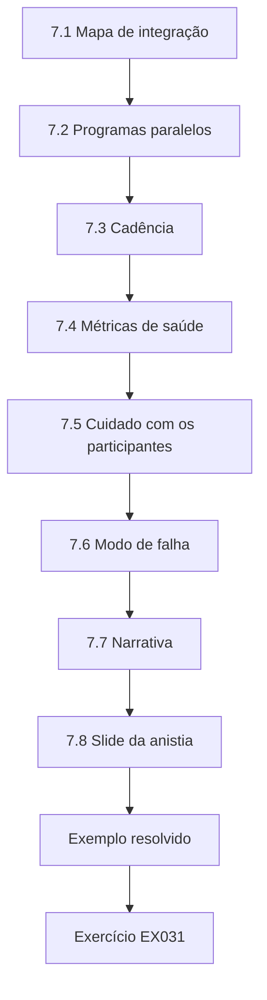

### Desenho lógico

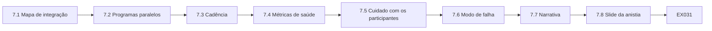

```text
[7.1 Mapa de integração]
    |
    v
[7.2 Programas paralelos]
    |
    v
[7.3 Cadência]
    |
    v
[7.4 Métricas de saúde]
    |
    v
[7.5 Cuidado com os participantes]
    |
    v
[7.6 Modo de falha]
    |
    v
[7.7 Narrativa]
    |
    v
[7.8 Slide da anistia]
    |
    v
[Exemplo resolvido] --> [Exercício EX031]
```
<!-- cykin:lesson-figures:end ch-07 -->


### Objetivos de aprendizagem

Você vai (1) integrar os testes ao SOC, à gestão de riscos, à área jurídica e aos participantes; (2) desenhar fluxos de informação; (3) evitar programas paralelos; (4) medir a saúde da integração.

### 7.1 Mapa de integração

Amira desenha quem recebe o quê: o SOC recebe tags do ATT&CK e linhas do tempo; a gestão de riscos recebe riscos residuais classificados; a área jurídica recebe os fatos relevantes para divulgação; os participantes recebem apenas o que os contratos permitem. Um achado marcado com técnicas do ATT&CK para o SOC é reescrito para a gestão de riscos como risco residual classificado antes de circular. Os avisos aos participantes usam apenas fatos permitidos pelo contrato, de modo que uma linha do tempo do SOC nunca chega a um membro da compensação por encaminhamento; compartilhar demais no canal errado é como se quebra a confiança dos participantes da compensação. O diagrama fica no manual de integração e é revisado sempre que surge uma nova parte interessada.

### 7.2 Programas paralelos

Unidades de negócio que contratam pequenas empresas de varredura sem ROE criam risco paralelo; integração significa um só catálogo e um só caminho de autorização. Uma varredura avulsa sem ROE não tem autoridade de parada nem lista de exclusões, então pode tocar hosts adjacentes ao SWIFT sem que ninguém perceba. A semana de anistia convida as unidades a declarar essas varreduras, para que as varreduras paralelas entrem no catálogo ou parem. As varreduras declaradas que continuam passam pelo mesmo caminho de autorização dos testes web trimestrais no estilo do WSTG conduzidos pela própria Amira, e, depois da semana de anistia, toda varredura externa entra pelo mesmo formulário de pedido usado pelos testes internos. Varreduras não declaradas descobertas depois viram achados de auditoria contra a unidade, e não exceções silenciosas.

### 7.3 Cadência

Amira faz uma sincronização trimestral com o SOC sobre os orçamentos de ruído, uma revisão mensal com a gestão de riscos sobre as expirações de aceitações e reuniões pontuais com a área jurídica sobre divulgação. A sincronização com o SOC combina quantos alertas cada teste planejado pode gerar, para que os analistas consigam separar o ruído dos testes de ataques reais. Ela mantém os convites de calendário recorrentes, para que a integração não dependa da memória. Uma sincronização perdida é registrada como dívida do programa, e não como falha pessoal, e a lista de dívidas é revista na revisão seguinte do catálogo, para que faltas repetidas levem a uma mudança de cadência, e não a culpados.

### 7.4 Métricas de saúde

A saúde da integração é medida pela porcentagem de achados com responsável, pela porcentagem de testes que estão no catálogo e pela mediana do tempo entre o achado e o chamado de detecção. A mediana do tempo até o chamado de detecção é o número lento no quadro de indicadores do exemplo resolvido, e por isso a ponte entre o PulseMap e o backlog foi financiada. Amira recusa contagens de vaidade de achados brutos sem validação; elas ficam fora dos slides da gestão. As três métricas de saúde aparecem ao lado das contagens da anistia na mesma família de slides, para que o conselho veja a higiene do programa, e não o volume.

### 7.5 Cuidado com os participantes

Os participantes da compensação são clientes da confiança, e uma frase errada em um aviso a um participante pode causar um ruído no mercado que nenhuma severidade de achado justifica. Por isso, os modelos de comunicação são pré-aprovados pela área jurídica e pela gestão de participantes, e são as únicas palavras que saem do prédio. Amira não inventa redação sob pressão quando um aviso é necessário. Os modelos têm versão, e o número da versão é registrado com cada aviso, para que a área jurídica consiga reconstruir exatamente o que um participante recebeu e quando. Durante incidentes ligados a testes que envolvem participantes, ela rejeita e-mails improvisados, mesmo quando vêm de pessoas seniores.

### 7.6 Modo de falha

A integração falha quando os testes são um evento anual heroico sem backlog para a engenharia do dia a dia; o heroísmo sem backlog produz os mesmos problemas no ano seguinte, e os examinadores percebem quando eles voltam. A ponte entre o PulseMap e o backlog existe para que cada lacuna de detecção encontrada nos testes vire um chamado comum de engenharia, e não um slide. Todo achado que precisa de correção deve ter um chamado na fila comum de engenharia antes que Amira declare a integração saudável. Um achado que só aparece em materiais do conselho é contado como não integrado, por melhor que tenha sido apresentado.

### 7.7 Narrativa

A semana de anistia dos programas paralelos convida as unidades de negócio a declarar varreduras avulsas. Cada declaração nomeia o fornecedor, os alvos varridos e o líder da unidade que encomendou o trabalho. As varreduras declaradas entram no catálogo ou param, e as não declaradas descobertas depois viram achados de auditoria contra o líder da unidade. As regras são publicadas antes de a semana começar, porque uma anistia sem consequências para a ocultação posterior é teatro. No encerramento da semana, a lista de declarações vai para a auditoria interna, para que descobertas posteriores possam ser conferidas com ela sem discussão sobre o que foi declarado.

### 7.8 Slide da anistia

As métricas da semana de anistia — declaradas, catalogadas, paradas — vão para o comitê de riscos do conselho em um só slide. Manter as três contagens juntas permite ao comitê ver se as declarações levaram de fato à parada das ferramentas. A contagem de paradas é impressa no mesmo tamanho da contagem de declarações e fica no corpo do slide, nunca em nota de rodapé, para que ninguém leia o slide como uma lista de aprovações e para que um desligamento travado não possa ser escondido. A transparência sobre a contagem de paradas é o que mostra que a anistia teve dentes.

### 7.9 Resultados da anistia

A semana de anistia produziu doze declarações: oito catalogadas e quatro paradas. As quatro varreduras paradas não puderam ser colocadas sob ROE com autoridade de parada, por isso foram encerradas em vez de entrar no catálogo. O slide para o comitê de riscos usou apenas esses três números; os nomes das unidades ficaram no catálogo, mantendo o comitê concentrado em saber se a anistia funcionou. Amira recusa narrativas de anistia sem contagens. As unidades que ficaram em silêncio e foram descobertas varrendo depois receberam achados com os responsáveis nomeados na ata, e esses achados trazem as datas da anistia, para que nenhuma unidade possa alegar que nunca ouviu falar da janela.

### 7.10 Contagens arquivadas

As contagens da anistia são arquivadas com o hash da ata assinada do comitê, para que um leitor futuro possa verificar que os números relatados foram os que o comitê viu. A entrada do arquivo guarda juntas as contagens doze, oito e quatro, o arquivo do slide e o hash da ata. Amira também registra o hash no registro de alterações do catálogo, para que o registro sobreviva a uma troca de secretário do comitê. Ela já usou essa verificação quando uma unidade contestou se havia declarado; apresentar o hash encerrou a disputa.

### Exemplo resolvido (MCH sintética)

O quadro de indicadores de integração de Amira mostra 100% de cobertura do catálogo, mas um tempo lento até o chamado de detecção; ela financia uma ponte entre o PulseMap e o backlog.

> **Caso sintético — Meridian Clearing House (MCH).** A organização de compensação, Amira Hassan e todos os números foram inventados para fins didáticos.

### Erros e limites

Testes guiados por ameaças e de sistemas de compensação exigem autorização jurídica especializada. Este livro só usa casos sintéticos e não traz código de exploração nem roteiro de ataque ao mercado.

### Exercícios

- **EX031 — Destinatários.** Cite três grupos de destinatários e o que cada um recebe. *Rubrica:* 3 = três pares corretos; 2 = dois; 1 = um; 0 = nada.
- **EX032 — Risco paralelo.** O que transforma uma varredura avulsa em um programa paralelo? *Rubrica:* 3 = estar fora das ROE, do catálogo ou do caminho de autorização; 2 = parcial; 1 = usar fornecedores; 0 = nada.
- **EX033 — Métrica de saúde.** Dê duas métricas de saúde da integração. *Rubrica:* 3 = duas do capítulo; 2 = uma; 1 = contagem de vaidade de achados; 0 = nada.
- **EX034 — Evento anual heroico.** Por que um evento heroico apenas anual fracassa na integração? *Rubrica:* 3 = sem backlog no dia a dia / sem melhoria contínua; 2 = parcial; 1 = é o ideal; 0 = nada.
- **EX035 — Ponte.** Que ponte Amira financia no exemplo resolvido? *Rubrica:* 3 = do PulseMap para o backlog; 2 = parcial; 1 = mais varreduras; 0 = nada.

### Síntese

Integração é um só catálogo, destinatários nomeados e backlog no dia a dia — e não heroísmo anual.

### Continue estudando — capítulo 07 de 12

[← Capítulo 06 (rascunho)](#ch-06) · [Índice de capítulos do curso](../SUBJECTS.md) · [Capítulo 08 (rascunho) →](#ch-08)

<a id="ch-08"></a>

## Capítulo 8 — Casos difíceis

<!-- cykin:lesson-figures:start ch-08 -->
### Mapa da aula

Aula 08 publicada. Mapa, exemplo, EX036.

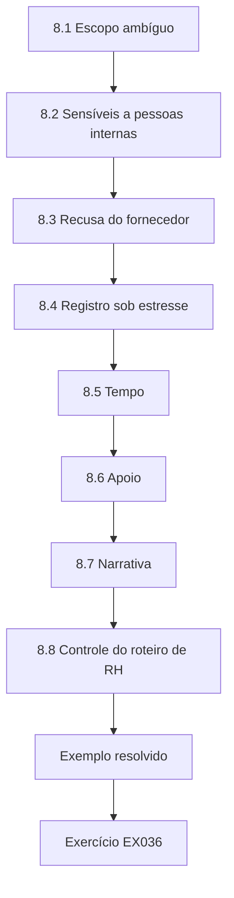

### Desenho lógico

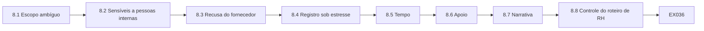

```text
[8.1 Escopo ambíguo]
    |
    v
[8.2 Sensíveis a pessoas internas]
    |
    v
[8.3 Recusa do fornecedor]
    |
    v
[8.4 Registro sob estresse]
    |
    v
[8.5 Tempo]
    |
    v
[8.6 Apoio]
    |
    v
[8.7 Narrativa]
    |
    v
[8.8 Controle do roteiro de RH]
    |
    v
[Exemplo resolvido] --> [Exercício EX036]
```
<!-- cykin:lesson-figures:end ch-08 -->


### Objetivos de aprendizagem

Você vai (1) lidar com escopo ambíguo; (2) lidar com achados sensíveis envolvendo pessoas internas; (3) lidar com a recusa de fornecedores; (4) manter registros sob estresse.

### 8.1 Escopo ambíguo

Quando um nome de host pode pertencer a um participante, Amira pausa e pede esclarecimento por escrito; adivinhar não é uma habilidade de especialista. Nomes de host de participantes são a causa habitual dessas pausas, porque podem parecer idênticos aos sistemas da Meridian Clearing House. No caso resolvido, os métodos relacionados pararam em quatro minutos e o white team recebeu a pergunta por e-mail. A pausa é registrada com o horário e a pergunta feita, e o esclarecimento escrito do white team ou do contato do participante é arquivado antes de qualquer nova sondagem; enquanto alguém com autoridade não responder por escrito, a sondagem espera.

### 8.2 Sensíveis a pessoas internas

Achados que sugerem má conduta de funcionários seguem pelos caminhos de RH com o mínimo de detalhe necessário; testar não é caça às bruxas. O achado nomeia o controle que falhou, como uma conta de administrador compartilhada, e deixa de fora quem a usou. Os nomes dos funcionários aparecem apenas no processo de RH, que os examinadores podem solicitar pela área jurídica, em vez de lê-los no FindingsDesk. O roteiro de uma página de Amira para o contato com o RH é ensaiado, para que a equipe não compartilhe demais em chamados que os examinadores possam ler depois. O mínimo de detalhe protege as pessoas envolvidas e mantém o achado centrado nos controles.

### 8.3 Recusa do fornecedor

Fornecedores que recusam testes autorizados razoáveis de seus componentes desencadeiam decisões de aceitação de risco ou de substituição — e não uma esperança silenciosa. Amira leva a recusa ao CISO como um objeto de decisão com três opções escritas: aceitar o risco residual com data de expiração, exigir em contrato o direito de testar ou substituir o componente. Esperar que o fornecedor coopere no ano que vem, sem data, é deriva com outro nome. A opção escolhida, seu responsável e sua expiração são arquivados no log de decisões, para que o componente recusado não saia de vista até a próxima renovação do contrato.

### 8.4 Registro sob estresse

Os casos difíceis geram mais e-mails de pressão, e todos vão para o endereço do CISO com cabeçalhos factuais. Amira não discute achados em conversas paralelas que os examinadores nunca verão. Qualquer divergência sobre um achado é respondida nesse endereço, com a evidência anexada. O endereço cria um registro que sobrevive a trocas de pessoal e a mudanças de humor, e os cabeçalhos factuais mantêm esse registro útil: um sucessor consegue acompanhar cada conversa sem os autores originais. Quando um examinador pergunta depois por que um achado não foi suavizado, a resposta já está no endereço do CISO.

### 8.5 Tempo

Os casos difíceis recebem limites de tempo explícitos, para que não possam consumir para sempre o trabalho comum do catálogo. Um limite típico é de duas semanas, definido quando o caso é aberto e escrito ao lado do nome do responsável pelo caso. Os limites de tempo aparecem no mesmo quadro dos achados de produto, de modo que investigações infinitas ficam visíveis como dívida. Amira só renova um limite com uma justificativa escrita e uma nova data final; o estrangulamento silencioso do trabalho do catálogo é recusado. Quando um limite expira sem renovação, o caso é encerrado com os achados obtidos até ali, em vez de seguir à deriva.

### 8.6 Apoio

Amira forma dupla entre juniores e uma pessoa sênior em qualquer caso que envolva RH ou participantes, porque juniores sozinhos sob esse estresse inventam processos que depois não resistem ao questionamento. A dupla é agendada com o nome da pessoa sênior no processo do caso, e não deixada para quem estiver livre por acaso. A pessoa sênior participa de toda ligação com o RH ou com participantes, o júnior fala a partir do roteiro de contato ensaiado, e a pessoa sênior aprova cada entrada de chamado que o júnior escreve, para que o excesso de detalhe seja apanhado antes que um examinador possa lê-lo. Os juniores saem de cada caso tendo praticado o roteiro sob supervisão.

### 8.7 Narrativa

O caso do host que talvez pertença a um participante mostra em uma manhã o padrão dos casos difíceis: quatro minutos para parar os métodos relacionados, um e-mail ao white team e retomada apenas com uma atualização de escopo por escrito. Os manuais para casos sensíveis a pessoas internas incluem o roteiro de uma página para o contato com o RH que Amira ensaia com a equipe. Os limites de tempo dos casos difíceis ficam no mesmo quadro dos achados de produto, e os juniores sempre trabalham em dupla com uma pessoa sênior quando há RH ou participantes envolvidos. Cada etapa deixa um registro que um examinador pode acompanhar depois sem perguntar a ninguém o que aconteceu.

### 8.8 Controle do roteiro de RH

O versionamento do roteiro de RH segue o mesmo controle de mudanças dos modelos de ROE; empatia improvisada não é um controle. Cada versão do roteiro tem um número, uma data de vigência e duas assinaturas, exatamente como cada modelo de ROE, para que uma mudança de redação bem-intencionada não chegue a um funcionário sem revisão. As versões aposentadas ficam no arquivo, para que a área jurídica possa mostrar qual redação um funcionário de fato ouviu em determinada data. Amira já rejeitou uma edição feita na mesma manhã sem a assinatura conjunta do RH; a entrevista da tarde esperou, em vez de se dobrar o processo.

### 8.9 Assinatura conjunta no mesmo dia

As mudanças no roteiro de RH exigem as assinaturas conjuntas do RH e de Amira no mesmo dia, para que um roteiro editado de manhã não chegue a uma entrevista à tarde sem a aprovação dos dois responsáveis. Uma assinatura ausente é uma parada, e não um atraso a negociar; os funcionários merecem palavras revisadas. A assinatura conjunta é registrada na linha de versão do roteiro, ao lado da data de vigência e das iniciais do RH. Uma edição que ainda espera assinatura continua sendo rascunho, e a entrevista usa a última versão assinada até que os dois responsáveis aprovem a nova.

### Exemplo resolvido (MCH sintética)

Um host que talvez pertença a um participante aparece no meio da janela; Amira para os métodos relacionados em 4 minutos, envia um e-mail ao white team e só retoma com uma atualização de escopo por escrito.

> **Caso sintético — Meridian Clearing House (MCH).** A organização de compensação, Amira Hassan e todos os números foram inventados para fins didáticos.

### Erros e limites

Testes guiados por ameaças e de sistemas de compensação exigem autorização jurídica especializada. Este livro só usa casos sintéticos e não traz código de exploração nem roteiro de ataque ao mercado.

### Exercícios

- **EX036 — Regra da pausa.** O que Amira faz diante de uma propriedade ambígua? *Rubrica:* 3 = pausa; esclarecimento por escrito; 2 = pausa; 1 = adivinha; 0 = nada.
- **EX037 — Caminho do RH.** Como são tratados os achados que sugerem má conduta de funcionários? *Rubrica:* 3 = caminho do RH; mínimo de detalhe; 2 = parcial; 1 = canal público; 0 = nada.
- **EX038 — Recusa do fornecedor.** Que decisões seguem a recusa de um fornecedor em permitir testes? *Rubrica:* 3 = aceitação de risco ou substituição; 2 = uma; 1 = ignorar; 0 = nada.
- **EX039 — E-mail de pressão.** Para onde vão os e-mails de pressão? *Rubrica:* 3 = endereço do CISO com cabeçalho factual; 2 = parcial; 1 = apagar; 0 = nada.
- **EX040 — Tempo de parada.** Com que rapidez Amira parou no exemplo resolvido? *Rubrica:* 3 = cerca de 4 minutos / em minutos; 2 = no mesmo dia; 1 = na semana seguinte; 0 = nada.

### Síntese

Os casos difíceis param à espera de algo escrito, protegem as pessoas e deixam registros.

### Continue estudando — capítulo 08 de 12

[← Capítulo 07 (rascunho)](#ch-07) · [Índice de capítulos do curso](../SUBJECTS.md) · [Capítulo 09 (rascunho) →](#ch-09)

<a id="ch-09"></a>

## Capítulo 9 — Liderança e garantia

<!-- cykin:lesson-figures:start ch-09 -->
### Mapa da aula

Aula 09 publicada. Mapa, exemplo, EX041.

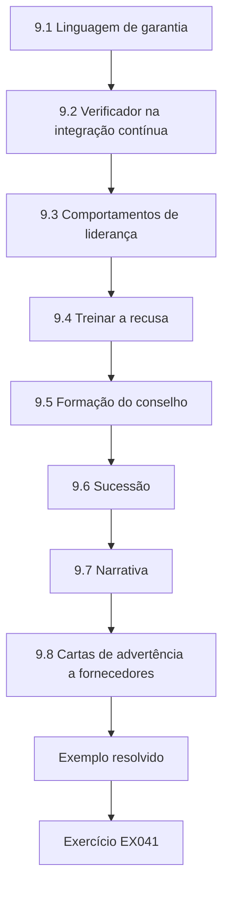

### Desenho lógico

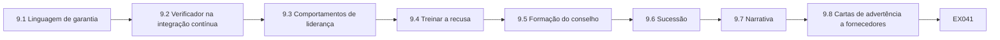

```text
[9.1 Linguagem de garantia]
    |
    v
[9.2 Verificador na integração contínua]
    |
    v
[9.3 Comportamentos de liderança]
    |
    v
[9.4 Treinar a recusa]
    |
    v
[9.5 Formação do conselho]
    |
    v
[9.6 Sucessão]
    |
    v
[9.7 Narrativa]
    |
    v
[9.8 Cartas de advertência a fornecedores]
    |
    v
[Exemplo resolvido] --> [Exercício EX041]
```
<!-- cykin:lesson-figures:end ch-09 -->


### Objetivos de aprendizagem

Você vai (1) escrever declarações de garantia que resistam à auditoria; (2) liderar sem teatro; (3) treinar a habilidade de recusar; (4) validar declarações com um laboratório de verificação automática.

### 9.1 Linguagem de garantia

A linguagem de garantia na Meridian Clearing House é limitada no tempo, no escopo e no método. Proibido: `fully secure` (totalmente seguro), `guaranteed` (garantido), `hack-proof` (à prova de invasão) e `100% coverage` (cobertura de 100%); o verificador procura exatamente essas expressões em inglês.

```python
"""Lab 9: validate a synthetic assurance statement against a forbidden-phrase list."""
forbidden = ["fully secure", "guaranteed", "hack-proof", "100% coverage"]
text = "Quarterly web tests and a 2025 threat-led exercise provide time-bounded assurance; SWIFT remains excluded from ordinary tests."
hits = [f for f in forbidden if f in text.lower()]
print("CLEAN" if not hits else "FORBIDDEN: " + ", ".join(hits))
print("chars", len(text))
```

Execute com `python3 lab_assurance.py`. Saída verificada:

```text
CLEAN
chars 126
```

O lab_assurance confere uma declaração sintética contra essas quatro expressões proibidas e imprime `CLEAN` com `chars 126` para a redação sobre testes web trimestrais e um exercício guiado por ameaças em 2025. Amira roda a mesma verificação em cada exportação de material do conselho, para que expressões proibidas nunca saiam em um material. Uma declaração reprovada é reescrita com seus limites de tempo, escopo e método explícitos e verificada de novo antes de a exportação continuar.

### 9.2 Verificador na integração contínua

O verificador é pequeno de propósito, para que os adjuntos consigam rodar o lab_assurance sem Amira e a verificação não dependa de uma só pessoa antes de um material sair. Ele fica na integração contínua, antes do envio ao portal do conselho, e o material não pode ser enviado enquanto a tarefa de exportação não informar `CLEAN`. Certa vez, um trecho colado de um fornecedor introduziu "hack-proof" em um rascunho de material, e a integração contínua o bloqueou. Amira mantém esse bloqueio como caso didático para mostrar por que a verificação roda antes de o material sair, e não depois que um diretor já o leu.

### 9.3 Comportamentos de liderança

Os comportamentos de liderança definem o que os juniores perseguem. Amira elogia paradas precoces, resultados negativos financiados e catálogos limpos mais do que descobertas dramáticas; na revisão trimestral, ela cita uma parada precoce e um resultado negativo financiado antes de mencionar qualquer achado. Os estudantes que pararam o exercício de mesa no atraso simulado da liquidação são elogiados na mesma reunião que o melhor achado do trimestre. Uma cultura que só celebra fogos de artifício vai enterrar pausas e recusar resultados negativos, e é assim que exercícios inseguros continuam em busca de aplausos numa organização como a Meridian Clearing House.

### 9.4 Treinar a recusa

Uma dramatização mensal põe pressão sobre um especialista para suavizar a redação. Amira quer tom calmo e recusa firme, por isso a folha de pontuação avalia o tom e a recusa separadamente, de zero a três cada, com frases de exemplo para cada nível. Eles são pontuados separadamente de propósito, porque uma pessoa pode estar calma sem sustentar o limite. O pânico brando e o colapso irritado reprovam igualmente. A folha é compartilhada com antecedência, para que as pessoas saibam como é um bom desempenho antes de chegar o próximo e-mail de pressão real.

### 9.5 Formação do conselho

Os diretores precisam aprender o que os testes comuns não podem alegar, sobretudo que eles não cobrem os sistemas adjacentes ao SWIFT. O material de formação do conselho preparado por Amira usa as frases do catálogo sobre o que não pode ser alegado e o slide reescrito do exercício inspirado no CBEST. A formação acontece antes da temporada de exames, e não durante uma discussão sobre um achado, e o slide reescrito faz parte do material de formação, em vez de ser um folheto de emergência no meio de uma disputa. Os diretores que aprendem antes as frases do que não pode ser alegado não discutem achados a partir de mitos sobre o SWIFT quando um achado real chega até eles.

### 9.6 Sucessão

Amira documenta as decisões para que um sucessor possa continuar sem folclore. Decisões documentadas, como a DEC-14 e o calendário de dois anos, valem mais do que conselhos de corredor. As pastas de sucessão guardam três declarações `CLEAN` e três contraexemplos `FORBIDDEN` com explicações, para que os adjuntos aprendam por contraste e as regras de redação acompanhem as decisões. Os exemplos `CLEAN` incluem a declaração do laboratório que imprimiu `CLEAN` com 126 caracteres, com seus limites de tempo e de escopo destacados. Amira responde a perguntas durante a transferência, mas não guarda regras paralelas secretas. Cada explicação nomeia o limite que a versão `FORBIDDEN` violou.

### 9.7 Narrativa

O verificador de expressões proibidas roda em cada exportação de material do conselho. Quando a integração contínua bloqueou "hack-proof" vindo de um trecho colado de fornecedor, Amira encaminhou o log bruto ao fornecedor sem repreendê-lo. As pastas de sucessão mantêm os pares `CLEAN` e `FORBIDDEN`; cada exemplo `FORBIDDEN` usa uma expressão proibida, como "fully secure" ou "100% coverage", com a redação corrigida ao lado. Os adjuntos que estudam os pares conseguem explicar por que uma frase é reprovada antes de rodar o verificador nela. Amira trata essa habilidade, e não a saída do verificador, como o verdadeiro objetivo da pasta.

### 9.8 Cartas de advertência a fornecedores

As cartas de advertência a fornecedores trazem a lista de expressões proibidas como Apêndice A, com as quatro expressões exatamente como o verificador as reconhece: `fully secure`, `guaranteed`, `hack-proof` e `100% coverage`. Anexar a lista torna a advertência específica: o fornecedor vê exatamente quais alegações a equipe não vai aceitar, enquanto uma carta vaga do tipo "por favor, tenham cuidado" não muda nada. Alguns fornecedores atualizaram suas apresentações comerciais depois de recebê-la. O seminário de Amira sobre influência discreta usa um desses pares de apresentações, antes e depois, como exemplo principal. Cada carta é arquivada na entrada do fornecedor no catálogo.

### 9.9 Influência discreta

O log da integração contínua que Amira encaminhou mostrava a expressão reconhecida e a linha do texto colado do fornecedor, e foi toda a explicação de que o fornecedor precisou. A apresentação seguinte do fornecedor usou garantia limitada no tempo, e a mudança chegou sem reunião. Ela guarda esse par de antes e depois para seminários de liderança sobre influência discreta e se recusa a contar a história como uma vitória sobre o fornecedor. Nos seminários, ela mostra primeiro o log e depois a nova apresentação, deixando que os adjuntos tirem a conclusão sozinhos.

### 9.10 Registros de influência

As apresentações de fornecedores de antes e depois são guardadas como evidência de influência, e não de zombaria. As duas apresentações são arquivadas, com data, junto com o log da integração contínua e a carta de advertência, na entrada daquele fornecedor no catálogo. Manter as duas versões mostra aos auditores que a advertência mudou as alegações do fornecedor, que é o objetivo de enviá-la. Amira consegue apresentar o par quando perguntam como a Meridian Clearing House lida com a linguagem de garantia dos fornecedores. Influência com registro é trabalho de garantia; influência sem registro é apenas uma história. O arquivo também anota a data em que a nova apresentação foi vista pela primeira vez.

### Exemplo resolvido (MCH sintética)

O lab_assurance imprime `CLEAN` para a declaração de Amira; um rascunho com "fully secure" seria reprovado.

> **Caso sintético — Meridian Clearing House (MCH).** A organização de compensação, Amira Hassan e todos os números foram inventados para fins didáticos.

### Erros e limites

Testes guiados por ameaças e de sistemas de compensação exigem autorização jurídica especializada. Este livro só usa casos sintéticos e não traz código de exploração nem roteiro de ataque ao mercado.

### Exercícios

- **EX041 — Lista proibida.** Cite três expressões de garantia proibidas. *Rubrica:* 3 = três entre `fully secure`, `guaranteed`, `hack-proof` e `100% coverage`; 2 = duas; 1 = uma; 0 = nada.
- **EX042 — Resultado do laboratório.** O que o laboratório imprime para a declaração de exemplo? *Rubrica:* 3 = `CLEAN`; 2 = proibida; 1 = erro; 0 = nada.
- **EX043 — Alvos de elogio.** Cite dois comportamentos que Amira elogia. *Rubrica:* 3 = dois entre paradas precoces, resultados negativos e catálogos limpos; 2 = um; 1 = só drama; 0 = nada.
- **EX044 — Lição para o conselho.** O que os diretores precisam aprender sobre os sistemas adjacentes ao SWIFT? *Rubrica:* 3 = os testes comuns não os cobrem; 2 = parcial; 1 = estão totalmente cobertos; 0 = nada.
- **EX045 — Se houver expressão proibida.** O que o laboratório imprimiria se "fully secure" aparecesse? *Rubrica:* 3 = `FORBIDDEN: fully secure`; 2 = `CLEAN`; 1 = vago; 0 = nada.

### Síntese

Liderança é linguagem de garantia honesta, recusa treinada e elogio à contenção.

### Continue estudando — capítulo 09 de 12

[← Capítulo 08 (rascunho)](#ch-08) · [Índice de capítulos do curso](../SUBJECTS.md) · [Capítulo 10 (rascunho) →](#ch-10)

<a id="ch-10"></a>

## Capítulo 10 — Leitura e crítica de pesquisa

<!-- cykin:lesson-figures:start ch-10 -->
### Mapa da aula

Aula 10 publicada. Mapa, exemplo, EX046.

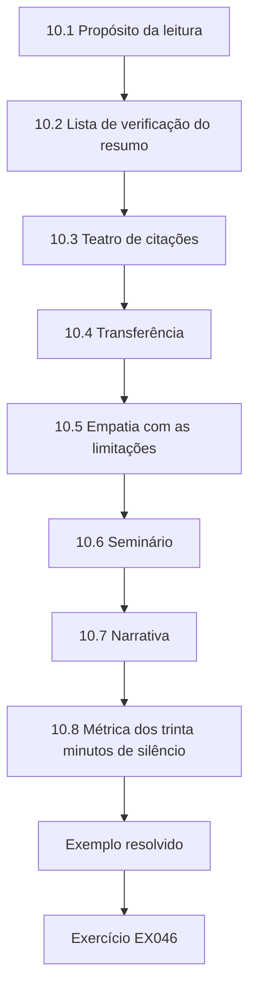

### Desenho lógico

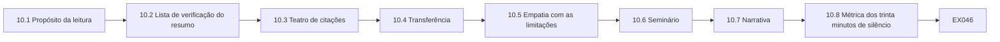

```text
[10.1 Propósito da leitura]
    |
    v
[10.2 Lista de verificação do resumo]
    |
    v
[10.3 Teatro de citações]
    |
    v
[10.4 Transferência]
    |
    v
[10.5 Empatia com as limitações]
    |
    v
[10.6 Seminário]
    |
    v
[10.7 Narrativa]
    |
    v
[10.8 Métrica dos trinta minutos de silêncio]
    |
    v
[Exemplo resolvido] --> [Exercício EX046]
```
<!-- cykin:lesson-figures:end ch-10 -->


### Objetivos de aprendizagem

Você vai (1) criticar resumos sobre métodos de purple team e de testes guiados por ameaças; (2) exigir n e limitações; (3) ligar artigos às decisões da MCH; (4) rejeitar o teatro de citações.

### 10.1 Propósito da leitura

Amira lê para melhorar as decisões da MCH, e não para decorar relatórios com nomes, e abre as fontes que cita.

```python
"""Lab 10: checklist score for a synthetic paper abstract on purple-team methods."""
abs_ = {"question":True,"method":True,"n":False,"limits":True,"ethics":True}
for k,v in abs_.items():
    print(f"{k:8} {'ok' if v else 'MISSING'}")
print("pass" if all(abs_.values()) else "revise")
```

Execute com `python3 lab_critique.py`. Saída verificada:

```text
question ok
method   ok
n        MISSING
limits   ok
ethics   ok
revise
```

O lab_critique avalia um resumo sintético quanto a pergunta, método, n, limitações e ética; o n ausente imprime `MISSING` e o veredito `revise`. Sem n, ninguém consegue saber se a alegação do resumo sobre purple team se apoia em três exercícios ou em trinta, então o artigo ainda não pode informar uma decisão na Meridian Clearing House. O resumo volta aos autores com essa única pergunta.

### 10.2 Lista de verificação do resumo

A lista de verificação do resumo pergunta se pergunta, método, n, limitações e ética estão presentes, e o lab_critique marca cada campo como `ok` ou `MISSING`. Cada campo marcado como `MISSING` vira uma pergunta que o apresentador precisa responder antes que o artigo possa informar um registro DEC. Os apresentadores são pontuados com essa mesma lista, de modo que o laboratório e o seminário recompensam hábitos idênticos. As limitações que um apresentador omite são acrescentadas por escrito à folha de feedback, e a gentileza com o nervosismo não se estende às limitações ausentes.

### 10.3 Teatro de citações

Notas de rodapé para artigos não lidos são antiéticas em contextos de garantia, porque notas não lidas viram confiança não lida na linguagem do conselho. Cada citação em um material do conselho leva a uma fonte que alguém da equipe de fato abriu e resumiu, e quem cita os guias do TIBER-EU ou do CBEST para executivos deve ter lido o guia pertinente por inteiro. Uma cultura de clube de leitura que blefa nas citações acabará blefando na linguagem de garantia para o conselho, por isso Amira abre as fontes e espera que os juniores façam o mesmo.

### 10.4 Transferência

Um artigo sem ações operacionalizáveis recebe uma tag de "observação", e não uma mudança no programa. A transferência para o trabalho da Meridian Clearing House exige uma ação clara, um responsável e encaixe no catálogo. Amira não reescreve a DEC-14 porque um artigo pareceu empolgante. Um artigo com tag de observação é revisto na próxima revisão semestral do catálogo, para ver se surgiu uma ação; se surgiu, ela entra no catálogo por meio de um objeto de decisão, como qualquer outra mudança, com opções, evidências e um responsável.

### 10.5 Empatia com as limitações

Uma leitura generosa ainda exige uma seção de limitações, e limitações ausentes reprovam na lista de verificação mesmo quando o resumo é bom em todo o resto. No resumo sintético, o campo de limitações está presente, e por isso só o n ausente o impede de passar. Amira é gentil com o nervosismo e dura com limitações ausentes, porque empatia sem padrões produz uma garantia frouxa que os examinadores não aceitam. Espera-se que um apresentador que lê um artigo com simpatia ainda diga o que ele não consegue mostrar. Um artigo cujos autores declaram suas limitações com clareza ganha mais confiança no clube, e não menos.

### 10.6 Seminário

O clube de leitura mensal funciona com a lista de verificação da crítica na parede: uma saída impressa do lab_critique, colada ao lado da agenda do clube, que mostra pergunta, método, limitações e ética marcados como `ok` e termina com `revise`. A única linha `MISSING`, a do n, salta aos olhos de qualquer ponto da sala. Quando alguém pula o n, Amira aponta para `MISSING` sem falar, o que mantém a correção centrada na lista, e não na competência do apresentador. Os operadores agora conferem o n antes de se oferecerem para apresentar, o que elevou as taxas de verificação prévia sem expor ninguém.

### 10.7 Narrativa

O clube de leitura reprova qualquer apresentador que, depois de ler, não consiga dizer o n de memória. A regra vale também para Amira quando ela apresenta, o que impede que pareça uma prova só para juniores. Transferir a habilidade de crítica inclui deixar um júnior conduzir o clube enquanto ela fica em silêncio nos primeiros trinta minutos. Durante esses trinta minutos, é o júnior que conduz, e não Amira, quem decide se um apresentador que esqueceu o n pode continuar. Ela anota o minuto em que fala pela primeira vez, que é o número acompanhado pela métrica dos trinta minutos de silêncio.

### 10.8 Métrica dos trinta minutos de silêncio

A métrica dos trinta minutos de silêncio acompanha quanto tempo Amira fica calada no clube de leitura; a meta é um número maior a cada trimestre, à medida que os juniores conduzem. O número de cada trimestre vai para o log do clube ao lado do nome do júnior que conduziu. Um número crescente é evidência de que os juniores conduzem os debriefings sem esperar por ela, e ela o celebra no mesmo tom que usa para catálogos limpos. A sucessão da habilidade de crítica importa tanto quanto a sucessão da DEC-14, e esse número é a evidência de que ela está acontecendo.

### 10.9 Taxas de verificação prévia

Desde que o cartaz com a lista de verificação foi colado, os apresentadores chegam com o n escrito no primeiro slide. Amira mede as taxas de verificação prévia a cada período — a parcela de apresentadores que conferiram o n antes de se oferecer — e as publica sem nomear pessoas, para que o hábito se espalhe sem uma lista de culpados. Uma taxa em queda gera um lembrete no clube seguinte, e não uma conversa com alguém em particular. As taxas também mostram aos recém-chegados que conferir o n é o padrão normal do clube, e não uma regra inventada para eles.

### 10.10 Cartazes por turma

Os cartazes com as taxas de verificação prévia usam letras de turma, nunca nomes, para que as equipes comparem as taxas sem destacar nenhum operador e para que uma taxa baixa leve a orientação, e não a culpa. A turma A e a turma B aparecem lado a lado, cada taxa impressa com o número de apresentações por trás dela. Amira já rejeitou um rascunho de cartaz que usava iniciais. A regra segue a disciplina do slide da anistia: contagens e padrões, nunca iniciais em um cartaz público. Os números brutos por pessoa ficam com quem conduz o clube, apenas para orientação.

### Exemplo resolvido (MCH sintética)

O lab_critique retorna `revise` porque o n está `MISSING`; Amira devolve o resumo à equipe autora.

> **Caso sintético — Meridian Clearing House (MCH).** A organização de compensação, Amira Hassan e todos os números foram inventados para fins didáticos.

### Erros e limites

Testes guiados por ameaças e de sistemas de compensação exigem autorização jurídica especializada. Este livro só usa casos sintéticos e não traz código de exploração nem roteiro de ataque ao mercado.

### Exercícios

- **EX046 — Campo ausente.** Qual campo da lista de verificação está `MISSING` no laboratório? *Rubrica:* 3 = n; 2 = ética; 1 = pergunta; 0 = nada.
- **EX047 — Veredito do laboratório.** Que palavra final o laboratório imprime? *Rubrica:* 3 = `revise`; 2 = `pass`; 1 = `CLEAN`; 0 = nada.
- **EX048 — Teatro de citações.** Por que citar sem ler é antiético em garantia? *Rubrica:* 3 = engana os leitores sobre a base de evidências; 2 = parcial; 1 = não há problema; 0 = nada.
- **EX049 — Tag de observação.** Quando um artigo recebe apenas uma tag de observação? *Rubrica:* 3 = quando não há ação operacionalizável; 2 = parcial; 1 = sempre mudar o programa; 0 = nada.
- **EX050 — Os cinco da lista.** Liste os cinco campos da lista de verificação do resumo. *Rubrica:* 3 = pergunta, método, n, limitações, ética; 2 = quatro; 1 = dois; 0 = nada.

### Síntese

A crítica exige n, limitações e ética; citações não lidas são teatro.

### Continue estudando — capítulo 10 de 12

[← Capítulo 09 (rascunho)](#ch-09) · [Índice de capítulos do curso](../SUBJECTS.md) · [Capítulo 11 (rascunho) →](#ch-11)

<a id="ch-11"></a>

## Capítulo 11 — Projeto aplicado

<!-- cykin:lesson-figures:start ch-11 -->
### Mapa da aula

Aula 11 publicada. Mapa, exemplo, EX051.

```mermaid
flowchart TD
  N0["11.1 Escopo do projeto"]
  N1["11.3 Pré-registro"]
  N2["11.4 Transferência para as operações"]
  N3["11.5 Folha de rosto de ética"]
  N4["11.6 Limite de tempo"]
  N5["11.7 Narrativa"]
  N6["11.9 Semana de execução solo"]
  N7["11.10 Envelopes lacrados"]
  N0 --> N1 --> N2 --> N3 --> N4 --> N5 --> N6 --> N7
  N7 --> EX["Exemplo resolvido"]
  EX --> Q["Exercício EX051"]
```

### Desenho lógico

```mermaid
flowchart LR
  N0["11.1 Escopo do projeto"]
  N1["11.3 Pré-registro"]
  N2["11.4 Transferência para as operações"]
  N3["11.5 Folha de rosto de ética"]
  N4["11.6 Limite de tempo"]
  N5["11.7 Narrativa"]
  N6["11.9 Semana de execução solo"]
  N7["11.10 Envelopes lacrados"]
  N0 --> N1 --> N2 --> N3 --> N4 --> N5 --> N6 --> N7 --> Q["EX051"]
```

```text
[11.1 Escopo do projeto]
    |
    v
[11.3 Pré-registro]
    |
    v
[11.4 Transferência para as operações]
    |
    v
[11.5 Folha de rosto de ética]
    |
    v
[11.6 Limite de tempo]
    |
    v
[11.7 Narrativa]
    |
    v
[11.9 Semana de execução solo]
    |
    v
[11.10 Envelopes lacrados]
    |
    v
[Exemplo resolvido] --> [Exercício EX051]
```
<!-- cykin:lesson-figures:end ch-11 -->


### Objetivos de aprendizagem

Você vai (1) entregar um projeto de especialista para a MCH; (2) manter os não objetivos; (3) avaliar com pré-registro; (4) transferir o resultado para as operações.

### 11.1 Escopo do projeto

O projeto aplicado constrói uma planilha de pontuação de cenários e um verificador de garantia integrados aos campos do FindingsDesk, avaliados sobre exercícios passados sintéticos. A planilha de pontuação reaproveita a fórmula do lab_scenario, duas vezes o aprendizado menos o risco, e o verificador reaproveita as quatro expressões proibidas. A integração com os campos do FindingsDesk faz parte do escopo, e não é um acabamento opcional. O escopo proíbe varredura real de participantes, módulos de exploração e enterro automático de achados por LLM, e a entrega precisa funcionar quando Amira não puder digitar durante a semana de execução solo, que é como o projeto prova que pode ser transferido.

### 11.2 Não objetivos

O projeto tem três não objetivos: nenhuma varredura real de participantes, nenhum módulo de exploração e nenhum enterro automático de achados por LLM. Eles são conferidos de novo em cada ponto de controle quinzenal, onde um questionário pergunta qual não objetivo você quase violou neste sprint. Amira responde primeiro, com o próprio quase erro com um recurso de resumo por LLM, para que os juniores vejam que a franqueza é esperada; ouvir uma pessoa sênior admitir um quase erro torna mais fácil para os juniores contarem os seus. Um quase erro repetido no mesmo não objetivo vira tema do ponto de controle seguinte.

### 11.3 Pré-registro

Duas medidas são pré-registradas: a precisão na detecção de expressões proibidas e a correlação da classificação com a ordem definida pelos especialistas do white team em um conjunto congelado. O conjunto congelado é um lote fixo de exercícios passados sintéticos que ninguém pode editar depois que a tag é enviada, e as tags vão para o git antes de a avaliação rodar. Amira não ajusta limiares depois de ver como seus cenários favoritos pontuam. Qualquer tag emendada exigiria uma nota no log de decisões, a mesma regra que governa os limiares de cenários na avaliação controlada.

### 11.4 Transferência para as operações

Na transferência, os operadores rodam o verificador sozinhos e Amira não pode digitar. A preparação é uma conta de operador recém-criada, com histórico do shell vazio, o README e um envelope lacrado com trechos das ROE; o operador precisa produzir, só com isso, um material do conselho verificado. Amira só pode ser contatada por telefone nessa semana, e, se o operador ligar para ela, a ligação é registrada como defeito de documentação contra o README, e não tratada como um resgate discreto que esconde lacunas. O log de defeitos é o principal resultado da semana de transferência.

### 11.5 Folha de rosto de ética

Todo pacote de projeto começa com uma declaração de "somente sintético" na primeira página, e os revisores conferem essa declaração antes de ler qualquer código do repositório. A verificação é mecânica: os merges rejeitam folhas de rosto sem a palavra "sintético", e um merge rejeitado volta ao autor com o modelo da folha de rosto anexado. A mesma franqueza vale para os quase erros: as respostas dos outros ficam anônimas, enquanto o quase erro da própria Amira fica identificado, para que a franqueza venha de cima. A folha de rosto é a primeira coisa que um revisor lê.

### 11.6 Limite de tempo

O projeto dura oito semanas, com pontos de controle quinzenais, que o mantêm dentro de um limite de tempo de especialista. Amira recusa tempo de construção sem prazo que consuma o trabalho do catálogo, mesmo quando as ferramentas parecem promissoras. Os pontos de controle questionam os não objetivos e mostram se a prontidão para a execução solo é real antes de o prazo acabar. As execuções solo da sétima semana, no exemplo resolvido, ficaram dentro desse prazo e deixaram um ponto de controle para correções. Um projeto que precisa de uma nona semana tem de pedi-la por meio de um objeto de decisão, e não tomá-la por deriva.

### 11.7 Narrativa

O questionário dos pontos de controle leva cinco minutos no início de cada ponto quinzenal, antes de qualquer demonstração de novos recursos, para que os não objetivos sejam discutidos antes de alguém se entusiasmar com o que foi construído. Amira responde primeiro com o quase erro do resumo por LLM. As folhas de rosto de ética são conferidas quanto à palavra "sintético" antes que os repositórios do projeto aceitem merges. A semana de execução solo proíbe que ela digite, então os operadores precisam ter sucesso apenas com a documentação. Cada um desses hábitos é pequeno, e juntos eles mantêm os não objetivos visíveis em cada sprint do projeto.

### 11.8 Log de quase erros

As respostas sobre quase erros são guardadas anonimamente quando outras pessoas as compartilham, registradas apenas pelo número do sprint, para que os padrões ao longo das oito semanas fiquem visíveis. O quase erro da própria Amira continua identificado, o que sinaliza aos juniores que admitir um não traz punição; franqueza que só os juniores demonstram não é franqueza, e os líderes vão primeiro. Ela repete o hábito nas clínicas de decisão, abrindo com o recurso de resumo por LLM que quase construiu e, em seguida, pedindo à sala que cada um conte um seu. O log é revisto no último ponto de controle em busca de padrões repetidos.

### 11.9 Semana de execução solo

Na primeira turma, o operador ligou duas vezes para Amira durante a semana de execução solo. As duas ligações foram registradas como defeitos de documentação e viraram correções no README na mesma tarde, seguidas de um agradecimento ao operador. Cada correção cita o passo do README que o operador não conseguiu concluir, exatamente como ele o leu, para que a correção trate da lacuna real, e não da lembrança que Amira tem dela. A conta do operador é apagada depois da semana, para que a turma seguinte não herde nenhum histórico do shell. A segunda turma fez só uma ligação, sobre a mesma seção do README.

### 11.10 Envelopes lacrados

Os envelopes lacrados das ROE levam selos de cera, uma peça deliberada de teatro que lembra às pessoas que as ROE são especiais: abrir um deles deve parecer diferente de abrir a papelada de rotina. Os juniores se lembram dessa sensação quando mais tarde lidam com ROE de produção, então aqui o teatro serve ao cuidado, e não à bravata. O selo só é rompido pelo operador na manhã da semana de execução solo, diante de uma testemunha que registra o horário, o que também dá à transferência um registro claro de início. O selo rompido e o horário registrado são arquivados com as notas da transferência.

### Exemplo resolvido (MCH sintética)

O projeto de Amira detecta 100% das expressões proibidas plantadas no conjunto congelado; os operadores concluem as execuções solo na sétima semana; os não objetivos se mantêm.

> **Caso sintético — Meridian Clearing House (MCH).** A organização de compensação, Amira Hassan e todos os números foram inventados para fins didáticos.

### Erros e limites

Testes guiados por ameaças e de sistemas de compensação exigem autorização jurídica especializada. Este livro só usa casos sintéticos e não traz código de exploração nem roteiro de ataque ao mercado.

### Exercícios

- **EX051 — Não objetivos.** Cite dois não objetivos do projeto. *Rubrica:* 3 = dois entre nenhuma varredura real, nenhuma exploração e nenhum enterro automático por LLM; 2 = um; 1 = vago; 0 = nada.
- **EX052 — Métrica.** Dê uma métrica pré-registrada. *Rubrica:* 3 = precisão na detecção de expressões proibidas ou correlação da classificação; 2 = vago; 1 = impressões; 0 = nada.
- **EX053 — Execução solo.** Por que Amira não pode digitar durante a transferência? *Rubrica:* 3 = a documentação precisa bastar para os operadores; 2 = parcial; 1 = ela deveria digitar; 0 = nada.
- **EX054 — Folha de rosto.** Que declaração abre o pacote do projeto? *Rubrica:* 3 = somente sintético; 2 = parcial; 1 = uso real liberado; 0 = nada.
- **EX055 — Sétima semana.** O que acontece na sétima semana no exemplo resolvido? *Rubrica:* 3 = execuções solo pelo operador; 2 = parcial; 1 = entrar em produção com participantes; 0 = nada.

### Síntese

O projeto aplicado entrega ferramentas com salvaguardas, prova de execução solo e não objetivos intactos.

### Continue estudando — capítulo 11 de 12

[← Capítulo 10 (rascunho)](#ch-10) · [Índice de capítulos do curso](../SUBJECTS.md) · [Capítulo 12 (rascunho) →](#ch-12)

<a id="ch-12"></a>

## Capítulo 12 — Revisão final e transferência

<!-- cykin:lesson-figures:start ch-12 -->
### Mapa da aula

Aula 12 publicada. Mapa, exemplo, EX056.

```mermaid
flowchart TD
  N0["12.1 Portfólio"]
  N1["12.2 Transferência"]
  N2["12.3 Questões de pesquisa"]
  N3["12.4 Uso dual"]
  N4["12.5 Próximo curso"]
  N5["12.6 Cuidado"]
  N6["12.7 Narrativa"]
  N7["12.8 Convite do observador"]
  N0 --> N1 --> N2 --> N3 --> N4 --> N5 --> N6 --> N7
  N7 --> EX["Exemplo resolvido"]
  EX --> Q["Exercício EX056"]
```

### Desenho lógico

```mermaid
flowchart LR
  N0["12.1 Portfólio"]
  N1["12.2 Transferência"]
  N2["12.3 Questões de pesquisa"]
  N3["12.4 Uso dual"]
  N4["12.5 Próximo curso"]
  N5["12.6 Cuidado"]
  N6["12.7 Narrativa"]
  N7["12.8 Convite do observador"]
  N0 --> N1 --> N2 --> N3 --> N4 --> N5 --> N6 --> N7 --> Q["EX056"]
```

```text
[12.1 Portfólio]
    |
    v
[12.2 Transferência]
    |
    v
[12.3 Questões de pesquisa]
    |
    v
[12.4 Uso dual]
    |
    v
[12.5 Próximo curso]
    |
    v
[12.6 Cuidado]
    |
    v
[12.7 Narrativa]
    |
    v
[12.8 Convite do observador]
    |
    v
[Exemplo resolvido] --> [Exercício EX056]
```
<!-- cykin:lesson-figures:end ch-12 -->


### Objetivos de aprendizagem

Você vai (1) montar um portfólio de especialista; (2) transferir a responsabilidade pelo programa; (3) declarar as questões de pesquisa que continuam abertas; (4) reafirmar os limites do uso dual.

### 12.1 Portfólio

O portfólio de especialista reúne registros de decisão, a página do catálogo, os padrões de evidência, um trecho do estatuto de ética, resultados de avaliação, exemplos de garantia, notas de crítica e a transferência do projeto. O sumário segue a ordem do curso, da DEC-14 e da página do catálogo até a nota de transferência e o log de defeitos da execução solo. Amira revisa o portfólio uma vez em busca de dados sensíveis residuais, e exemplos sintéticos substituem tudo o que poderia identificar participantes antes que ele saia da revisão dela. Cada item traz seu hash, para que o sucessor possa confirmar que nada foi alterado depois.

### 12.2 Transferência

Na transferência, o sucessor lê em voz alta a DEC-14 e o calendário de dois anos; Amira responde a perguntas, mas não guarda folclore secreto. As perguntas que o sucessor faz durante a leitura são acrescentadas ao registro da DEC-14 como esclarecimentos, e não mantidas como respostas verbais. O dia da transferência inclui apresentações pessoais ao SOC e à área jurídica, porque e-mail sozinho não é transferência. A primeira atualização do catálogo feita pelo sucessor é a revisão semestral seguinte, datada, com riscos e publicada em seu próprio nome, com Amira apenas em cópia. Um sucessor que só recebeu os arquivos por e-mail ainda não recebeu o programa.

### 12.3 Questões de pesquisa

Continua em aberto como medir o aprendizado de detecção ao longo de exercícios bienais guiados por ameaças sem esgotar a capacidade do white team. As medidas de purple team entre exercícios são uma candidata, mas testam regras de detecção, e não o aprendizado ao longo de um intervalo de dois anos. Deixar a questão sem responsável a transformaria em folclore que morre quando Amira sair. Por isso, antes de sair, ela nomeia um observador e agenda um convite trimestral, para que a questão continue viva na Meridian Clearing House e tenha alguém responsável por relatar o que mudou.

### 12.4 Uso dual

O último slide de Amira lista suas recusas: nenhum detalhe público de exploração da compensação, nenhuma demonstração ao vivo contra participantes, nenhuma garantia sem denominadores. A recusa a números sem denominador é a razão de cada contagem dos materiais dela, dos resultados da anistia às taxas de verificação prévia, trazer o número por trás dela. Ela não troca essas recusas por um convite para uma conferência. A disciplina do uso dual encerra o curso da mesma forma que a integridade o abriu, e o slide faz parte do portfólio que o sucessor herda. Espera-se que o sucessor mantenha o slide inalterado até que um objeto de decisão diga o contrário.

### 12.5 Próximo curso

Segurança de IA (158) é o próximo curso da trilha curricular. Amira diz aos sucessores quais habilidades deste curso se transferem — objetos de decisão, honestidade do catálogo, linguagem de garantia — e quais não se transferem. Os sucessores que começam Segurança de IA levam a clínica de decisões e o hábito do catálogo, mas começam um novo caminho de autorização: a autoridade para tocar sistemas novos não se transfere, e o próximo curso não concede autorização para testar sistemas reais de IA sem novas ROE. Nada neste livro é herdado como permissão. Cada sistema novo começa com seu próprio escopo escrito.

### 12.6 Cuidado

A transferência inclui apresentar pessoalmente o sucessor ao SOC e à área jurídica; essas apresentações fazem parte do cuidado, e não são uma cortesia opcional quando as agendas resistem. Amira as marca ela mesma, para que o sucessor conheça o líder do SOC e o contato jurídico na primeira semana. A área jurídica usa sua apresentação para mostrar ao sucessor os modelos pré-aprovados de aviso aos participantes. A apresentação ao SOC inclui acompanhar por cinco minutos a reunião diária do SOC, para que o sucessor tenha visto trabalho real do SOC antes de assumir o papel. As duas apresentações são registradas no formulário de transferência com suas datas.

### 12.7 Narrativa

O folclore acaba quando nomes e datas substituem os conselhos de corredor. O dia da transferência inclui apresentações pessoais ao SOC e à área jurídica, porque e-mail sozinho não é transferência. As questões de pesquisa em aberto recebem observadores nomeados antes de Amira sair. A primeira atualização do catálogo feita pelo sucessor é publicada em seu próprio nome, com Amira apenas em cópia — a passagem visível. Juntos, esses passos fazem com que a transferência deixe documentos escritos, e não um culto à personalidade, e um examinador futuro consegue ver quando a responsabilidade mudou e quem cuida de cada questão em aberto. O nome de Amira passa para a linha de cópia em cada registro que antes era dela.

### 12.8 Convite do observador

O observador da questão de pesquisa em aberto recebe um convite trimestral no calendário, com a presença de Amira opcional — a sucessão da curiosidade. A pauta tem um único item: o que mudou desde o último trimestre na medição do aprendizado de detecção ao longo dos exercícios bienais. Deixar Amira como opcional testa se a questão sobrevive sem que ela a conduza. Se a participação desabar, o observador escala ao CISO para que seja nomeado um novo responsável, em vez de abandonar o tema em silêncio; a curiosidade também precisa de governança. O primeiro convite sai antes do último dia dela, para que a série comece enquanto ela ainda pode responder a perguntas.

### 12.9 Acompanhamento do SOC

Amira não considera a transferência concluída enquanto o sucessor não tiver acompanhado cinco minutos da reunião diária do SOC e ouvido ao vivo a conversa sobre orçamento de ruído, e não apenas num slide. Ouvir um analista discutir um orçamento de ruído ensina ao sucessor para que serve de fato a sincronização trimestral com o SOC. Ela agenda o acompanhamento mesmo quando as agendas resistem; ele leva cinco minutos, então uma agenda cheia nunca é motivo real para pulá-lo. Uma transferência sem a realidade do SOC está incompleta. A data do acompanhamento é escrita no formulário de transferência ao lado das iniciais do sucessor.

### 12.10 Formulário de transferência

O formulário de transferência tem uma caixa de seleção, "acompanhamento do SOC concluído", que bloqueia a assinatura enquanto estiver vazia, o que faz do acompanhamento uma pré-condição, e não uma recomendação. O sucessor e Amira rubricam a caixa; rubricas sem a caixa marcada nunca encerram uma transferência na Meridian Clearing House. O formulário é arquivado com o portfólio, e uma caixa desmarcada o devolve a Amira com o acompanhamento ainda pendente. A linguagem de pré-condição é como a transferência evita virar uma ficção de papelada. Não existe caminho de exceção no formulário, nem para um sucessor que já trabalhou no SOC.

### Exemplo resolvido (MCH sintética)

O dia da transferência de Amira termina com o sucessor publicando a primeira atualização do catálogo em seu próprio nome; Amira fica apenas em cópia.

> **Caso sintético — Meridian Clearing House (MCH).** A organização de compensação, Amira Hassan e todos os números foram inventados para fins didáticos.

### Erros e limites

Testes guiados por ameaças e de sistemas de compensação exigem autorização jurídica especializada. Este livro só usa casos sintéticos e não traz código de exploração nem roteiro de ataque ao mercado.

### Exercícios

- **EX056 — Contagem do portfólio.** Liste cinco artefatos do portfólio. *Rubrica:* 3 = cinco da lista; 2 = três; 1 = um; 0 = nada.
- **EX057 — Folclore.** O que não pode ficar apenas na cabeça de Amira? *Rubrica:* 3 = as justificativas das decisões / as regras do programa; 2 = parcial; 1 = tudo em segredo; 0 = nada.
- **EX058 — Questão em aberto.** Declare uma questão de pesquisa que continua aberta. *Rubrica:* 3 = medir o aprendizado de detecção versus a capacidade do white team; 2 = vago; 1 = tentativa mínima; 0 = nada.
- **EX059 — Lista de recusas.** Cite duas recusas finais. *Rubrica:* 3 = duas entre nenhuma exploração pública, nenhuma demonstração ao vivo com participantes e nenhuma garantia sem denominadores; 2 = uma; 1 = vago; 0 = nada.
- **EX060 — Próximo curso.** Qual é o curso 158? *Rubrica:* 3 = Segurança de IA; 2 = IA; 1 = errado; 0 = nada.

### Síntese

A transferência deixa documentos escritos, recusas e uma questão de pesquisa em aberto — e não um culto à personalidade.

### Continue estudando — capítulo 12 de 12

[← Capítulo 11 (rascunho)](#ch-11) · [Índice de capítulos do curso](../SUBJECTS.md) · [Resoluções ↓](#worked-results) · [Próximo curso pelo índice de capítulos →](../SUBJECTS.md)

<a id="worked-results"></a>

## Resoluções

Respostas-modelo para EX001–EX060. A Meridian Clearing House, Amira Hassan e todos os números são sintéticos. Qualquer resposta que atenda à rubrica recebe a mesma pontuação.

**EX001.** Opções, evidências, incertezas, recomendação e responsável (as opções rejeitadas também contam).

**EX002.** Aleatória: taxas de detecção que variam entre tentativas; epistêmica: não se sabe se existe um canal de conexão até o núcleo da compensação.

**EX003.** Ele nem aceita o risco residual nem agenda sua gestão; é deriva sem gestão.

**EX004.** Somente os papéis listados no estatuto de governança (tipicamente no nível de CISO), sem inventar autoridade.

**EX005.** Os exercícios anuais guiados por ameaças, por razões de capacidade.

**EX006.** Porque os tipos de avaliação diferem em profundidade, uso de inteligência e metas de aprendizado de detecção.

**EX007.** Cenários guiados por inteligência e aprendizado para detecção e resposta (com controle pelo white team).

**EX008.** Descreva o desenho do seu white team e os objetivos de aprendizado de detecção do engajamento.

**EX009.** O que cada atividade não pode alegar.

**EX010.** Exagera a alegação e confunde um exercício inspirado, feito uma vez, com as exclusões permanentes dos testes comuns.

**EX011.** Reproduzível, minimizada, com hash e com fuso horário (vinculada a uma decisão também conta).

**EX012.** As mensagens reais de compensação e os identificadores dos participantes são altamente sensíveis.

**EX013.** Outro especialista conseguiria reproduzir esta observação sem o folclore do notebook?

**EX014.** Falta hash, carimbo de tempo e contexto de escopo — é teatro, não evidência.

**EX015.** No mínimo, o hash da evidência e o responsável.

**EX016.** A interrupção pode afetar muitos participantes e a liquidação, e não apenas o site de uma instituição.

**EX017.** Um investimento pessoal, uma relação com um antigo empregador ou uma amizade próxima com um fornecedor que afete a imparcialidade.

**EX018.** Uma resposta da gestão pode ficar ao lado dele; o achado não pode ser excluído.

**EX019.** Autoridade escrita do white team para parar o exercício em minutos.

**EX020.** O risco sistêmico para a liquidação mais o estatuto de ética, que exige um botão de parada.

**EX021.** Ela gera ruído e falsa garantia sem aprendizado de detecção.

**EX022.** Ela apanha as regressões web a cada trimestre e ainda financia o aprendizado periódico guiado por ameaças.

**EX023.** Nenhuma alegação de cobertura do SWIFT a partir dos testes web comuns.

**EX024.** Um cenário em que a capacidade da equipe cai pela metade (ou semelhante).

**EX025.** Um calendário de dois anos que mostra quando cada atividade acontece.

**EX026.** C — Biblioteca da cadeia de suprimentos no aplicativo de lote.

**EX027.** score = 2×aprendizado − risco.

**EX028.** A classificação informa; a viabilidade do white team e critérios mais amplos continuam decidindo o financiamento.

**EX029.** Como uma lacuna que agenda trabalho de engenharia, e não como cegueira permanente.

**EX030.** Em uma tag datada no git ou em um registro equivalente feito antes dos resultados.

**EX031.** SOC: tags do ATT&CK e linhas do tempo; gestão de riscos: riscos residuais classificados; área jurídica: fatos relevantes para divulgação (participantes: comunicação limitada pelo contrato).

**EX032.** Ela acontece fora do catálogo autorizado e do caminho das ROE.

**EX033.** A porcentagem de achados com responsável e a mediana do tempo entre o achado e o chamado de detecção (a cobertura do catálogo também conta).

**EX034.** Ele não deixa backlog para a engenharia do dia a dia.

**EX035.** Uma ponte entre o PulseMap e o backlog de detecção.

**EX036.** Pausar e pedir esclarecimento por escrito antes de continuar.

**EX037.** Pelo RH, com apenas o mínimo de detalhe necessário.

**EX038.** Aceitação formal do risco ou substituição do componente.

**EX039.** Para o endereço do CISO, com um cabeçalho factual.

**EX040.** Em minutos (cerca de quatro) depois de perceber a ambiguidade.

**EX041.** `fully secure`, `guaranteed` e `hack-proof` (`100% coverage` também conta).

**EX042.** `CLEAN`

**EX043.** Paradas precoces e resultados negativos financiados (catálogos limpos também contam).

**EX044.** Que os testes comuns não cobrem os sistemas adjacentes ao SWIFT.

**EX045.** `FORBIDDEN: fully secure`

**EX046.** `n`

**EX047.** `revise`

**EX048.** Engana os leitores sobre a base de evidências das alegações.

**EX049.** Quando ele não oferece nenhuma ação operacionalizável para a MCH.

**EX050.** Pergunta, método, n, limitações e ética.

**EX051.** Nenhuma varredura real de participantes e nenhum módulo de exploração (nenhum enterro automático por LLM também conta).

**EX052.** A precisão na detecção de expressões proibidas (ou a correlação da classificação com a ordem do white team).

**EX053.** Se os operadores precisam das mãos dela, a documentação falhou.

**EX054.** Uma declaração de somente sintético.

**EX055.** Os operadores concluem as execuções solo.

**EX056.** Registros de decisão, página do catálogo, padrões de evidência, trecho do estatuto de ética e resultados de avaliação (outros também contam).

**EX057.** As justificativas das decisões e as regras do programa — elas precisam estar escritas.

**EX058.** Como medir o aprendizado de detecção ao longo dos exercícios bienais guiados por ameaças sem esgotar a capacidade do white team.

**EX059.** Nenhum detalhe público de exploração da compensação e nenhuma demonstração ao vivo contra participantes.

**EX060.** Segurança de IA.

<a id="references"></a>
## Referências

Todos os DOIs foram resolvidos em doi.org em 12 de outubro de 2026, e as normas foram conferidas nas páginas de seus editores. A lista é idêntica à da edição em inglês e cobre o livro inteiro; nenhuma das normas técnicas citadas foi verificada aqui como adotada pela ABNT, por isso são citadas em sua edição internacional. Organizações, pessoas, sistemas e números dos casos são sintéticos; somente as obras abaixo são reais.

- Bank of England / PRA. CBEST Threat Intelligence-Led Assessments — Implementation Guide. <https://www.bankofengland.co.uk/financial-stability/operational-resilience-of-the-financial-sector/cbest-threat-intelligence-led-assessments-implementation-guide>
- European Central Bank. TIBER-EU Framework. <https://www.ecb.europa.eu/paym/cyber-resilience/tiber-eu/html/index.en.html>
- FIRST. CVSS v3.1 Specification Document. <https://www.first.org/cvss/v3.1/specification-document>
- MITRE ATT&CK, including T1078 Valid Accounts. <https://attack.mitre.org/>
- NIST SP 800-115 (2008). Technical Guide to Information Security Testing and Assessment. <https://doi.org/10.6028/NIST.SP.800-115>
- OWASP Web Security Testing Guide (WSTG). <https://owasp.org/www-project-web-security-testing-guide/>
- Penetration Testing Execution Standard (PTES). <https://pentest-standard.readthedocs.io/en/latest/>
