# OT, IoT and Cyber-Physical Security: Postgraduate Practice and Leadership

- Language: English (`en`); postgraduate course, two years part-time; approximately 600 hours of planned study.
- Editorial state: **published**. Chapters 1–12 of 12 have hand-written teaching text; exercises EX001–EX060 have matching worked results; offline labs use the Python 3 standard library and their outputs are embedded from real runs. Independent review and the 300-page A4 verification remain open. Draft-chapter coverage is not a completed book.
- Audience: experienced practitioners who lead OT, IoT and cyber-physical security decisions at organisation scale.
- Relation to neighbouring books: the [bachelor's book](../../../../bachelors-4-years/ot-iot-security/en/book/MANUSCRIPT.md) builds foundations; the [master's book](../../../../masters-2-years/ot-iot-security/en/book/MANUSCRIPT.md) teaches the research cycle. **This book is practice-led**: deciding, evaluating, integrating and assuring.
- Author: [hiagokinlevi](https://github.com/hiagokinlevi). Original text [CC0 1.0](../../../../../LICENSE); cited works keep their rights.
- Educational boundary: not an accredited qualification. No authority to access real plants. All organisations, people and numbers in examples are **synthetic** unless a sentence cites a public source.

[Course home](../../README.md) · [Chapter index](../SUBJECTS.md) · [Book plan](PLAN.md) · [Course skill](../../skill/SKILL.md) · [Worked results](#worked-results)

## How to use this draft

Each chapter has learning outcomes, teaching sections, a worked example, a labelled synthetic case, errors and limits, five exercises scored 0–3, a synthesis and a **Continue studying** block. Labs (Chapters 1, 4, 6 and 9) run offline with `python3 file.py` on seeded synthetic data.

### Synthetic running case

| Element | Role | Boundary |
|---|---|---|
| **Bayside Water Reclamation Plant (BWRP)** — dosing controller PLC-D, SCADA, historian, 23 lift stations with cellular RTUs, vendor remote access | Organisation studied throughout | Invented |
| **Daniel Osei** | OT security lead reporting to the plant director | Invented |

### Core sources

NIST [SP 800-82 Rev. 3](https://csrc.nist.gov/pubs/sp/800/82/r3/final); [ISA/IEC 62443 series](https://www.isa.org/standards-and-publications/isa-standards/isa-iec-62443-series-of-standards); MITRE [ATT&CK for ICS](https://attack.mitre.org/matrices/ics/); CISA [cybersecurity advisories](https://www.cisa.gov/news-events/cybersecurity-advisories); Giraldo et al. 2018; Urbina et al. 2016. Full list in [References](#references).

## Contents

| Chapters |
|---|
| [1](#ch-01) · [2](#ch-02) · [3](#ch-03) · [4](#ch-04) · [5](#ch-05) · [6](#ch-06) · [7](#ch-07) · [8](#ch-08) · [9](#ch-09) · [10](#ch-10) · [11](#ch-11) · [12](#ch-12) |

[Worked results](#worked-results) · [References](#references)

<a id="ch-01"></a>

## Chapter 1 — Advanced security decision-making

<!-- cykin:lesson-figures:start ch-01 -->
### Lesson map

Lesson 01 published. Map, example, EX001.

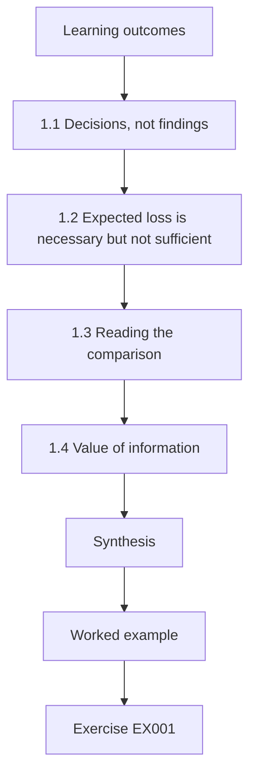

### Logical drawing

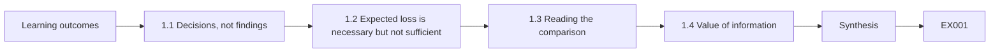

```text
[Learning outcomes]
    |
    v
[1.1 Decisions, not findings]
    |
    v
[1.2 Expected loss is necessary but not sufficient]
    |
    v
[1.3 Reading the comparison]
    |
    v
[1.4 Value of information]
    |
    v
[Synthesis]
    |
    v
[Worked example] --> [Exercise EX001]
```
<!-- cykin:lesson-figures:end ch-01 -->


### Learning outcomes

You will (1) frame an OT security decision with options, criteria, uncertainty and a decision owner; (2) compare options by expected loss and worst credible case together; (3) record a decision so it can be audited later; and (4) recognise when a decision should be deferred to gather information.

### 1.1 Decisions, not findings

At postgraduate level the deliverable is rarely a vulnerability list; it is a decision someone with budget and accountability must take. At the synthetic Bayside Water Reclamation Plant (BWRP), OT security lead Daniel Osei must decide how vendors reach the chemical-dosing controller PLC-D. A decision frame names the owner (the plant director), the options, the criteria, what is uncertain and the date by which the decision must be taken.

For the vendor-access decision the frame also needs the deadline that forces it, such as the expiry of the current VPN contract, and the people who must be consulted: operations, the vendor manager and engineering. Writing the frame before the analysis keeps Daniel from choosing criteria after he knows which option they favour.

### 1.2 Expected loss is necessary but not sufficient

Expected annual loss — probability times loss, summed over scenarios — lets options with different costs be compared on one scale. But public utilities are not risk-neutral: a rare event that contaminates discharge to a bay, triggers regulatory action and erodes public trust may be unacceptable at any probability above a threshold. Leaders therefore report expected loss alongside the worst credible case and any regulatory or safety constraint that is binding regardless of arithmetic.

```python
"""Lab 01: compare three synthetic BWRP options by expected annual loss and worst credible case."""
options = {  # name: (annual cost, [(probability per year, loss if it happens)])
    "A keep vendor VPN":        (10_000, [(0.10, 400_000), (0.02, 2_500_000)]),
    "B brokered sessions":      (35_000, [(0.03, 400_000), (0.005, 2_500_000)]),
    "C no remote access":       (90_000, [(0.01, 400_000), (0.004, 2_500_000)]),
}
for name, (cost, events) in options.items():
    eal = sum(p * l for p, l in events)
    worst = max(l for _, l in events)
    print(f"{name:20} cost={cost:>7,} expected_loss={eal:>9,.0f} total={cost+eal:>9,.0f} worst_case={worst:,}")
```

Run with `python3 lab_decide.py`. Verified output:

```text
A keep vendor VPN    cost= 10,000 expected_loss=   90,000 total=  100,000 worst_case=2,500,000
B brokered sessions  cost= 35,000 expected_loss=   24,500 total=   59,500 worst_case=2,500,000
C no remote access   cost= 90,000 expected_loss=   14,000 total=  104,000 worst_case=2,500,000
```

### 1.3 Reading the comparison

Option B has the lowest total (59,500) because its control cost buys a large reduction in incident probability. Option C eliminates more risk but costs more than it saves under these estimates. All three share the same worst case because the catastrophic scenario remains possible through other paths; no remote-access choice removes it. That observation sends the leader to look at independent safeguards, not more remote-access spending.

The numbers also show how sensitive the ranking is. Option A loses because of its incident probabilities; if both of its estimates were halved, A's total would fall to 55,000 and overtake B's 59,500. That is why Daniel's record names a revisit trigger tied to the incident estimate, and why the next question is how firm those probabilities really are.

### 1.4 Value of information

If the probability estimates are contested — and for targeted attacks they always are — ask whether the decision would change if they moved within their plausible range. If B wins across that range, decide now. If the ranking flips, a short study (vendor log review, a tabletop) may be worth more than an immediate purchase.

For BWRP, the question is whether B still wins if Option A's vendor-incident probability is lower than estimated. Daniel can test that in the lab by changing one number at a time and noting where the ranking flips. If a flip needs an estimate outside what sector peers report, the decision stands; if not, two weeks reviewing vendor logs may be the better first spend.

### Worked example (synthetic BWRP)

Daniel's decision record: "D-2026-14. Owner: plant director. Decision: adopt brokered vendor sessions (B). Basis: lowest total expected cost under estimates in annex 1; same worst case across options, so a separate action (D-2026-15) reviews the dosing high-limit interlock. Revisit if vendor incident frequency estimate exceeds 0.06 per year or after any remote-access incident."

> **Synthetic case — Bayside Water Reclamation Plant.** BWRP, Daniel Osei, all costs and probabilities are invented.

### Errors and limits

Point estimates for adversarial probabilities convey false precision; present ranges. Expected-loss arithmetic does not capture harm to people downstream, which must be argued separately.

### Exercises

- **EX001 — Total cost for option A at a lower probability.** If A's 400,000 scenario falls to 0.05 per year, recompute A's total. *Rubric:* 3 = 10,000 + 20,000 + 50,000 = 80,000, still above B; 2 = number only; 1 = arithmetic slip; 0 = none.
- **EX002 — Why the worst case is identical.** Explain what the shared 2.5 million worst case implies for the leader. *Rubric:* 3 = remote-access choice does not remove catastrophic path; invest in independent safeguard; 2 = partial; 1 = "all equal"; 0 = none.
- **EX003 — Writing a revisit trigger.** Add one more revisit trigger to D-2026-14. *Rubric:* 3 = observable, specific trigger; 2 = vague but relevant; 1 = "if things change"; 0 = none.
- **EX004 — Does the ranking flip?** Find the probability for B's 400,000 scenario at which B's total equals A's 100,000. *Rubric:* 3 = (100,000 − 35,000 − 12,500)/400,000 ≈ 0.131; 2 = method; 1 = ignores other term; 0 = none.
- **EX005 — When not to decide yet.** Describe a situation in which Daniel should defer D-2026-14 to gather information. *Rubric:* 3 = ranking flips within plausible range and a cheap study can narrow it before a deadline; 2 = partial; 1 = "when unsure"; 0 = none.

### Synthesis

Leaders decide with expected loss, worst credible case, explicit owners and revisit triggers, and they buy information when it could change the choice.

### Continue studying — chapter 01 of 12

[← Course home](../../README.md) · [Course chapter index](../SUBJECTS.md) · [Chapter 02 (draft) →](#ch-02)

<a id="ch-02"></a>

## Chapter 2 — OT, IoT and cyber-physical security: current practice

<!-- cykin:lesson-figures:start ch-02 -->
### Lesson map

Lesson 02 published. Map, example, EX006.

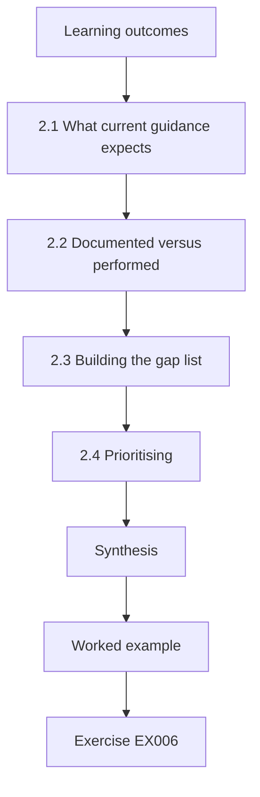

### Logical drawing

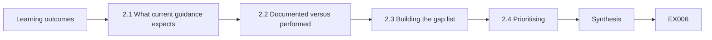

```text
[Learning outcomes]
    |
    v
[2.1 What current guidance expects]
    |
    v
[2.2 Documented versus performed]
    |
    v
[2.3 Building the gap list]
    |
    v
[2.4 Prioritising]
    |
    v
[Synthesis]
    |
    v
[Worked example] --> [Exercise EX006]
```
<!-- cykin:lesson-figures:end ch-02 -->


### Learning outcomes

You will (1) benchmark an organisation's OT security programme against NIST SP 800-82r3 and IEC 62443-2-1 themes; (2) distinguish documented practice from performed practice; (3) produce a gap list with evidence; and (4) prioritise gaps for leadership.

### 2.1 What current guidance expects

NIST SP 800-82r3 organises an OT security programme around governance, risk management, architecture, and the security capabilities applied to OT systems, and it maps OT considerations onto the NIST Cybersecurity Framework functions. IEC 62443-2-1 specifies requirements for an asset owner's security programme. Neither is a checklist to be ticked; both describe capabilities a mature programme demonstrates.

In a review, use each document to generate questions rather than a score. For BWRP that means asking, for example, how remote access is governed, how assets are inventoried and how incidents in the dosing system would be handled. The answers then go into the gap list with evidence, so the review reports what the plant can show rather than how many clauses it claims.

### 2.2 Documented versus performed

A policy saying "remote access is reviewed monthly" is documented practice. A log showing the last three monthly reviews, with findings closed, is performed practice. Postgraduate assessors look for the second. At BWRP Daniel samples evidence for each claimed practice rather than accepting interview answers.

Sampling has to be chosen before looking, or it drifts toward the cases that look good. Daniel picks five practices that sit on paths to consequence and asks, for each, for the most recent artefact that proves it was done. An interview answer can point to evidence, but it never replaces it in the gap list.

### 2.3 Building the gap list

For each capability: what the guidance expects, what BWRP documents, what evidence shows is performed, the gap, the consequence of the gap and a proposed owner. Remote lift stations connected over cellular RTUs are a common blind spot: they appear in the asset register as "pumping stations" but not as network endpoints.

Each row should be specific enough that its owner can act on it. For BWRP's inventory gap that means naming the nine lift-station RTUs not yet listed, the consequence that they cannot be monitored or patched, and the person who will add them. A row that only says inventory incomplete gives nobody a task.

### 2.4 Prioritising

Prioritise gaps that sit on paths to consequence (dosing, discharge quality) and those that are cheap to close. A missing inventory of cellular RTUs blocks several other capabilities — monitoring, patching, incident scoping — so it ranks high even though it is "only documentation".

Write the ranking with its reason, so the plant director can see why an inventory task outranks a new tool. At BWRP the remote-access review comes next, because it has not been performed since March and vendors can reach PLC-D. Restore testing for PLC logic follows, since backups whose restore has never been tried may fail when needed.

### Worked example (synthetic BWRP)

Daniel's sample of five practices: asset inventory (documented, partly performed — 14 of 23 lift-station RTUs listed); remote-access review (documented, not performed since March); backup of PLC logic (performed, restore never tested); incident response plan (documented, no OT-specific playbook); patching (performed for Windows HMIs, not for RTU firmware).

> **Synthetic case — Bayside Water Reclamation Plant.** Counts and dates are invented.

### Errors and limits

A benchmark against one document can miss sector regulation. Sampling five practices gives a view, not an audit opinion.

### Exercises

- **EX006 — Classifying a claimed practice.** "We test restores annually" is stated, but no record exists. Documented or performed? *Rubric:* 3 = documented only; request evidence; 2 = label only; 1 = performed; 0 = none.
- **EX007 — Ranking the RTU inventory gap.** Justify why the RTU inventory gap ranks above the missing playbook. *Rubric:* 3 = blocks monitoring, patching and scoping; enabler; 2 = partial; 1 = "more important"; 0 = none.
- **EX008 — A gap-list row.** Write the full gap-list row for "restore never tested". *Rubric:* 3 = expectation, documented, performed, gap, consequence, owner; 2 = four fields; 1 = gap only; 0 = none.
- **EX009 — Choosing the reference document.** When would IEC 62443-2-1 be a better benchmark than SP 800-82r3 for BWRP? *Rubric:* 3 = when certification or contractual requirements on the asset owner's programme apply; 2 = partial; 1 = "it is better"; 0 = none.
- **EX010 — Coverage of the sample.** What can and cannot be concluded from sampling five practices? *Rubric:* 3 = indicative gaps; not a full assurance opinion; sampling bias; 2 = one side; 1 = overclaims; 0 = none.

### Synthesis

Current-practice reviews compare evidence of what is done, not what is written, and rank gaps by their effect on consequence and on other capabilities.

### Continue studying — chapter 02 of 12

[← Chapter 01 (draft)](#ch-01) · [Course chapter index](../SUBJECTS.md) · [Chapter 03 (draft) →](#ch-03)

<a id="ch-03"></a>

## Chapter 3 — OT, IoT and cyber-physical security: specialist evidence

<!-- cykin:lesson-figures:start ch-03 -->
### Lesson map

Lesson 03 published. Map, example, EX011.

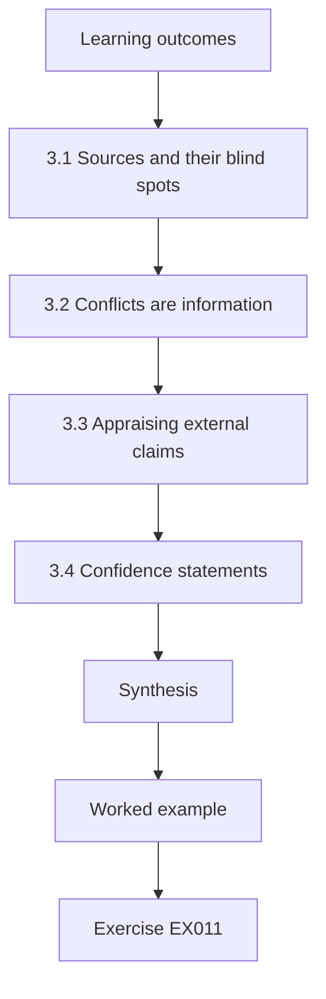

### Logical drawing

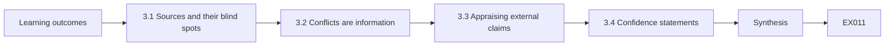

```text
[Learning outcomes]
    |
    v
[3.1 Sources and their blind spots]
    |
    v
[3.2 Conflicts are information]
    |
    v
[3.3 Appraising external claims]
    |
    v
[3.4 Confidence statements]
    |
    v
[Synthesis]
    |
    v
[Worked example] --> [Exercise EX011]
```
<!-- cykin:lesson-figures:end ch-03 -->


### Learning outcomes

You will (1) appraise the quality of OT security evidence sources; (2) reconcile conflicting evidence from network, host and process data; (3) assess vendor and advisory claims critically; and (4) write an evidence appraisal that states confidence levels.

### 3.1 Sources and their blind spots

Passive network captures show who talked to whom but miss serial links and encrypted payload meaning. Controller event logs, where they exist, show program changes but often roll over after a few hundred entries. Process data in the historian shows physical effect but not cause. HMI audit trails show operator actions but not engineering-tool sessions. Specialist evidence work combines them because each misses something.

Before relying on any source, write down what it can and cannot see at BWRP. The capture covers the plant network but not a technician at the dosing panel. PLC-D's event log may have rolled over since the event. The historian records the setpoint but not who changed it. That list tells Daniel which second source to consult for each question.

### 3.2 Conflicts are information

If the historian shows a dosing setpoint change at 14:02 but neither the HMI audit trail nor the network capture shows a write, the possibilities are a missing capture, a clock offset, a local change at the panel, or logic that changes the setpoint internally. Each hypothesis predicts something checkable: panel key-switch logs, a PLC program comparison, the capture's packet-loss counters.

Write each hypothesis with the check that would rule it out, and run the cheapest checks first. A clock offset can be tested in minutes by comparing timestamps of a known event across systems. Record the result of every check, including the ones that only eliminate a possibility, because they are what make the final conclusion credible.

### 3.3 Appraising external claims

CISA ICS advisories describe affected products, versions, CVSS scores and mitigations coordinated with vendors; they are strong evidence about a vulnerability's existence, weaker about whether it is exploitable in your configuration. Vendor statements about "not affected" deserve a request for the reasoning. Peer-reviewed measurement studies, such as the Mirai analysis by Antonakakis et al. (USENIX Security 2017), carry method sections you can evaluate.

For BWRP, an advisory affecting a product used on PLC-D should lead to two questions: is the affected version installed, and is the vulnerable function reachable from where an attacker could be. Record the answers next to the advisory in the inventory. When a vendor says not affected, file its reasoning with the date, so the claim can be checked later.

### 3.4 Confidence statements

State confidence explicitly: high (multiple independent sources agree), moderate (one strong source, no contradiction), low (inference from indirect data). Leaders act differently on each.

Attach the level to each conclusion, not to the report as a whole, and say which sources support it. Daniel's 14:02 finding is high confidence because the capture, the program comparison and the key-switch log agree. A conclusion resting on the key-switch log alone would be moderate, and a guess about who was on site, before checking rosters, would be low.

### Worked example (synthetic BWRP)

At 14:02 the historian shows the hypochlorite dosing setpoint on PLC-D moving from 4.0 to 6.5 mg/L. No HMI audit entry, no Modbus write in the capture. Daniel checks: capture loss counters show 0 dropped packets; PLC program comparison shows an unchanged program; the local panel key-switch log shows "local mode 14:01–14:05". Appraisal: high confidence the change was made locally at the panel; next step, identify who was on site.

> **Synthetic case — Bayside Water Reclamation Plant.** Times, tags and values are invented.

### Errors and limits

Absence of evidence in a capture is meaningful only if the capture's coverage and loss are known. Logs can be altered by a capable intruder.

### Exercises

- **EX011 — Predictions from hypotheses.** For the hypothesis "clock offset", state what evidence would confirm it. *Rubric:* 3 = matching write found at offset time in capture or HMI log with measured offset; 2 = partial; 1 = vague; 0 = none.
- **EX012 — Confidence for one-source evidence.** The only evidence of a remote login is one VPN log line. What confidence and why? *Rubric:* 3 = moderate at best, single source, could be altered or misattributed; 2 = level only; 1 = high; 0 = none.
- **EX013 — Interpreting a "not affected" claim.** A vendor says its RTU is not affected by an advisory's library flaw. What do you ask? *Rubric:* 3 = which version/component, why unreachable, evidence (SBOM, analysis); 2 = one; 1 = accept; 0 = none.
- **EX014 — What capture loss counters prove.** Why did Daniel check packet-loss counters before trusting "no write seen"? *Rubric:* 3 = absence only meaningful if capture complete; 2 = partial; 1 = vague; 0 = none.
- **EX015 — Blind spot of process data.** Name one thing the historian can never tell you about the 14:02 change. *Rubric:* 3 = who or what initiated it (cause/identity); 2 = vague; 1 = wrong; 0 = none.

### Synthesis

Specialist evidence work triangulates sources with known blind spots, treats conflicts as hypotheses to test, and attaches confidence to every conclusion.

### Continue studying — chapter 03 of 12

[← Chapter 02 (draft)](#ch-02) · [Course chapter index](../SUBJECTS.md) · [Chapter 04 (draft) →](#ch-04)

<a id="ch-04"></a>

## Chapter 4 — Advanced risk and ethics

<!-- cykin:lesson-figures:start ch-04 -->
### Lesson map

Lesson 04 published. Map, example, EX016.

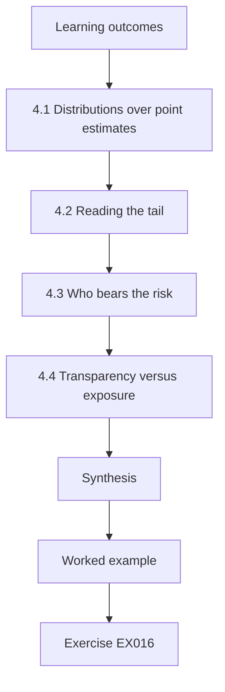

### Logical drawing


```text
[Learning outcomes]
    |
    v
[4.1 Distributions over point estimates]
    |
    v
[4.2 Reading the tail]
    |
    v
[4.3 Who bears the risk]
    |
    v
[4.4 Transparency versus exposure]
    |
    v
[Synthesis]
    |
    v
[Worked example] --> [Exercise EX016]
```
<!-- cykin:lesson-figures:end ch-04 -->


### Learning outcomes

You will (1) model loss distributions rather than single numbers; (2) read mean, 95th and 99th percentile losses from a seeded simulation; (3) decide who bears residual risk and whether they consented; and (4) handle ethical tension between transparency and security in a public utility.

### 4.1 Distributions over point estimates

Annual OT outage loss is mostly zero and occasionally large. A Monte Carlo simulation draws whether an incident happens and how long it lasts, many thousands of times, producing a distribution whose tail is what boards and insurers care about.

```python
"""Lab 04: Monte Carlo of annual outage loss for BWRP with and without a control (seeded, synthetic)."""
import random, statistics
def year(rnd, p_incident, hours_lo, hours_hi, cost_per_hour=12_000):
    if rnd.random() >= p_incident: return 0.0
    return rnd.uniform(hours_lo, hours_hi) * cost_per_hour
for label, p, lo, hi in [("baseline", 0.15, 4, 72), ("with segmentation", 0.06, 4, 48)]:
    rnd = random.Random(2026)
    losses = sorted(year(rnd, p, lo, hi) for _ in range(20_000))
    print(f"{label:18} mean={statistics.mean(losses):>8,.0f} p95={losses[int(0.95*len(losses))]:>9,.0f} p99={losses[int(0.99*len(losses))]:>9,.0f} P(loss>0)={sum(l>0 for l in losses)/len(losses):.3f}")
```

Run with `python3 lab_mc.py`. Verified output:

```text
baseline           mean=  68,613 p95=  592,662 p99=  814,425 P(loss>0)=0.151
with segmentation  mean=  18,590 p95=  129,339 p99=  493,624 P(loss>0)=0.059
```

The simulation needs only a few inputs: how likely an incident is in a year, how long it lasts, and what each hour costs. Each should come with its source and a plausible range. Lab 4 uses a fixed seed so that the board can see the same numbers when the run is repeated, and so that a change in result can be traced to a change in assumptions.

### 4.2 Reading the tail

Segmentation cuts the mean loss from about 68,600 to 18,600 and the probability of any loss from 15.1 % to 5.9 %. The 99th percentile drops less sharply (814,000 to 494,000) because when an incident does happen it can still last two days. If the board's tolerance is "no more than a 1 % chance of losing over 600,000 a year", only the segmented design meets it under these assumptions.

These figures depend on assumptions that deserve their own line on the slide: the incident probabilities, the duration ranges and a single cost per hour. Changing the segmented design's maximum duration from 48 to 72 hours would raise its tail. The board should see which assumption drives the tolerance result before treating the 600,000 threshold as met.

### 4.3 Who bears the risk

Residual risk at a reclamation plant is not borne only by the utility. Residents near outfalls and the bay ecosystem bear discharge-quality risk; ratepayers bear cost risk. Ethically, a leader should identify these parties, ask whether the regulator or elected body has accepted the risk on their behalf, and avoid accepting on others' behalf what the organisation has no mandate to accept.

At BWRP the board minutes made this explicit by noting that discharge-quality risk to residents falls under the regulator's permit conditions. Daniel's role is to make the affected parties visible in the risk record and to state who has accepted risk on their behalf. Where nobody has that mandate, the risk is escalated rather than quietly accepted.

### 4.4 Transparency versus exposure

Publishing a detailed security assessment builds public trust but may give attackers a map. A defensible practice is layered disclosure: publish the governance, the risk-acceptance decisions and progress metrics; share technical detail with regulators and sector information-sharing bodies under confidentiality; disclose incidents according to legal duty and promptly to affected people.

For BWRP that could mean publishing the decision to adopt brokered vendor sessions and segmentation progress figures, while sharing the lift-station network design only with the regulator and the sector sharing group. The choice of what goes where should be recorded and reviewed, so that later requests from journalists or residents meet a consistent answer.

### Worked example (synthetic BWRP)

Daniel presents the simulation with its assumptions on one slide: 15 % baseline annual incident probability (from sector peers, range 8–25 %), duration uniform 4–72 hours, cost 12,000 per hour, seed 2026. The board accepts segmentation and minutes that discharge-quality risk to residents is covered by the regulator's permit conditions, not by the board's risk appetite alone.

> **Synthetic case — Bayside Water Reclamation Plant.** Every parameter in the simulation is invented.

### Errors and limits

Uniform durations are a simplification; heavy-tailed distributions would raise the 99th percentile. A seeded simulation is reproducible, not correct.

### Exercises

- **EX016 — Interpreting the p99 change.** Explain why p99 falls proportionally less than the mean with segmentation. *Rubric:* 3 = segmentation mainly lowers incident probability; conditional duration tail still long; 2 = partial; 1 = vague; 0 = none.
- **EX017 — Checking a tolerance.** Does the baseline meet "P(loss > 600,000) ≤ 1 %"? Use the output. *Rubric:* 3 = no, p99 = 814,425 > 600,000 so more than 1 % exceed; 2 = conclusion only; 1 = yes; 0 = none.
- **EX018 — Naming affected parties.** List three parties who bear BWRP's residual OT risk besides the utility. *Rubric:* 3 = three relevant parties; 2 = two; 1 = one; 0 = none.
- **EX019 — A layered disclosure plan.** Assign each item to public, regulator-only or internal: (a) risk appetite statement, (b) firewall rule base, (c) annual count of OT incidents. *Rubric:* 3 = public, internal (or regulator), public; 2 = two; 1 = one; 0 = none.
- **EX020 — Sensitivity to the duration model.** Predict how replacing the uniform 4–72 h duration with a heavier-tailed distribution changes mean and p99. *Rubric:* 3 = p99 rises more than mean; tail driven; 2 = direction only; 1 = no change; 0 = none.

### Synthesis

Advanced risk work reports distributions and tails, names who bears the residual risk, and balances transparency with exposure deliberately.

### Continue studying — chapter 04 of 12

[← Chapter 03 (draft)](#ch-03) · [Course chapter index](../SUBJECTS.md) · [Chapter 05 (draft) →](#ch-05)

<a id="ch-05"></a>

## Chapter 5 — OT, IoT and cyber-physical security: design alternatives

<!-- cykin:lesson-figures:start ch-05 -->
### Lesson map

Lesson 05 published. Map, example, EX021.

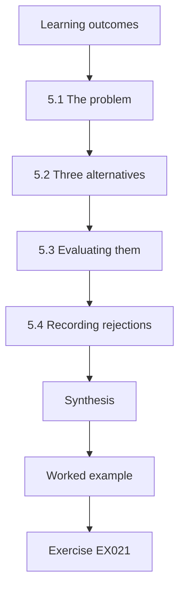

### Logical drawing

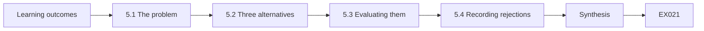

```text
[Learning outcomes]
    |
    v
[5.1 The problem]
    |
    v
[5.2 Three alternatives]
    |
    v
[5.3 Evaluating them]
    |
    v
[5.4 Recording rejections]
    |
    v
[Synthesis]
    |
    v
[Worked example] --> [Exercise EX021]
```
<!-- cykin:lesson-figures:end ch-05 -->


### Learning outcomes

You will (1) generate genuinely different design alternatives for securing remote lift stations; (2) evaluate them against operational, security and lifecycle criteria; (3) use IEC 62443 zone and conduit concepts to describe each; and (4) document why rejected alternatives were rejected.

### 5.1 The problem

BWRP's 23 lift stations pump wastewater to the plant. Each has an RTU with a cellular modem reporting levels and pump status to SCADA and accepting start/stop commands. Some modems have public IP addresses, which places them in the exposure category ATT&CK for ICS names T0883 *Internet Accessible Device*.

The commands matter most. A false level reading could hide an overflow, but a remote stop sent to a pump during a storm could cause one. Any design therefore has to answer two questions: who can reach the RTUs, and whether remote commands are needed at all. The answers differ by station, which is why the alternatives are compared station by station.

### 5.2 Three alternatives

Alternative 1 — private APN: the carrier provides a private access point name so modems have no public addresses; traffic reaches BWRP through a carrier-managed tunnel. Alternative 2 — RTU-side VPN: each RTU (or a small router beside it) builds an IPsec tunnel to a BWRP concentrator in the DMZ. Alternative 3 — monitoring-only uplink with local control: remote commands are removed; RTUs run local level control and report only, and operators dispatch crews for exceptions.

Each alternative changes a different thing. The first removes public addresses but leaves trust in the carrier. The second adds BWRP's own encryption and authentication at the cost of more equipment. The third removes the riskiest capability, remote commands, and accepts slower response. They are genuinely different, which is what makes comparing them useful.

### 5.3 Evaluating them

Alternative 1 is quick and cheap but trusts the carrier's isolation. Alternative 2 gives BWRP its own cryptographic boundary but adds 23 devices to patch and certificates to manage. Alternative 3 shrinks the attack surface most — no remote commands means no remote manipulation of pumps — but lengthens response to some faults, which operations must accept. In 62443 terms, each alternative defines a different conduit between the lift-station zones and the SCADA zone, with different security capabilities.

Put the evaluation in a table with the same criteria for each alternative, such as time to deploy, cost over five years, effect on response to overflows and remaining exposure. Score each station class separately, because a beach-side station with high overflow consequence justifies more than an inland station whose overflow is contained.

### 5.4 Recording rejections

A design record lists rejected alternatives and the reason. Future reviewers otherwise re-propose them without knowing the history.

For BWRP the record notes that Alternative 3 was rejected because remote pump starts prevented three overflows last year. If operations later change, for example by adding local storage or automatic control at the high-consequence stations, the reason may no longer hold, and the record tells the next reviewer exactly which condition to check. Date the record and name who agreed to the rejection.

### Worked example (synthetic BWRP)

Daniel recommends Alternative 1 immediately (removes public exposure within a month) and Alternative 2 for the six stations whose overflow consequence is highest (near beaches), with Alternative 3 rejected because operations showed that remote pump starts prevented three overflows last year.

> **Synthetic case — Bayside Water Reclamation Plant.** Station counts and overflow history are invented.

### Errors and limits

A private APN is not encryption; carriers' internal networks are outside BWRP's control. Alternatives must be tested for latency effects on telemetry.

### Exercises

- **EX021 — The rejected option's record.** Write the rejection entry for Alternative 3. *Rubric:* 3 = reason with evidence and conditions for reconsideration; 2 = reason only; 1 = "not chosen"; 0 = none.
- **EX022 — Trust assumption in a private APN.** State the trust assumption Alternative 1 depends on. *Rubric:* 3 = carrier isolates APN traffic and manages access correctly; 2 = vague; 1 = minimal attempt; 0 = none.
- **EX023 — Lifecycle cost of RTU VPNs.** List two recurring tasks Alternative 2 adds. *Rubric:* 3 = certificate renewal/rotation, router firmware patching (or concentrator maintenance); 2 = one; 1 = one-off tasks; 0 = none.
- **EX024 — A hybrid justification.** Justify applying Alternative 2 only to six stations. *Rubric:* 3 = consequence-based tiering, cost proportional to risk; 2 = partial; 1 = cost only; 0 = none.
- **EX025 — Conduit description.** Describe Alternative 2's conduit in zone-and-conduit language. *Rubric:* 3 = conduit from each lift-station zone through IPsec tunnel to DMZ concentrator then to SCADA zone, with stated controls; 2 = partial; 1 = "VPN"; 0 = none.

### Synthesis

Good design work produces real alternatives, evaluates them across their lifecycle, tiers protection by consequence and remembers why options were rejected.

### Continue studying — chapter 05 of 12

[← Chapter 04 (draft)](#ch-04) · [Course chapter index](../SUBJECTS.md) · [Chapter 06 (draft) →](#ch-06)

<a id="ch-06"></a>

## Chapter 6 — OT, IoT and cyber-physical security: controlled evaluation

<!-- cykin:lesson-figures:start ch-06 -->
### Lesson map

Lesson 06 published. Map, example, EX026.

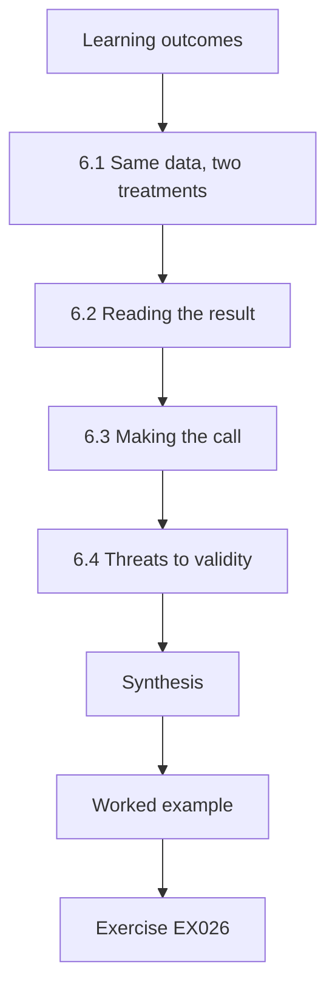

### Logical drawing

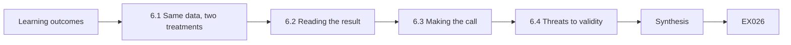

```text
[Learning outcomes]
    |
    v
[6.1 Same data, two treatments]
    |
    v
[6.2 Reading the result]
    |
    v
[6.3 Making the call]
    |
    v
[6.4 Threats to validity]
    |
    v
[Synthesis]
    |
    v
[Worked example] --> [Exercise EX026]
```
<!-- cykin:lesson-figures:end ch-06 -->


### Learning outcomes

You will (1) design a controlled comparison of two alerting rule sets on the same labelled replay; (2) estimate recall and false-alert rate for each; (3) compute a bootstrap confidence interval for the difference; and (4) decide whether the evidence justifies a change in production.

### 6.1 Same data, two treatments

Comparing rule set A (current) with rule set B (proposed) on different weeks of data confounds the rules with the weeks. A controlled evaluation replays the same labelled windows through both. Labels come from a test plan: 40 windows contain injected attack behaviour in the replay, 160 are normal operation.

```python
"""Lab 06: controlled evaluation of two alerting rule sets on the same synthetic replay, with bootstrap CI."""
import random
rnd = random.Random(6)
# 200 labelled replay windows: (is_attack, alert_by_A, alert_by_B)
data = []
for i in range(200):
    att = i < 40
    a = rnd.random() < (0.70 if att else 0.08)
    b = rnd.random() < (0.85 if att else 0.05)
    data.append((att, a, b))
def recall(rows, k): at = [r for r in rows if r[0]]; return sum(r[k] for r in at) / len(at)
def far(rows, k): be = [r for r in rows if not r[0]]; return sum(r[k] for r in be) / len(be)
print(f"A recall={recall(data,1):.3f} false-alert rate={far(data,1):.3f}")
print(f"B recall={recall(data,2):.3f} false-alert rate={far(data,2):.3f}")
diffs = []
for _ in range(2000):
    s = [rnd.choice(data) for _ in data]
    if any(r[0] for r in s): diffs.append(recall(s, 2) - recall(s, 1))
diffs.sort()
print(f"recall difference B-A 95% bootstrap CI: [{diffs[50]:.3f}, {diffs[1949]:.3f}]")
```

Run with `python3 lab_ab.py`. Verified output:

```text
A recall=0.650 false-alert rate=0.069
B recall=0.850 false-alert rate=0.037
recall difference B-A 95% bootstrap CI: [0.000, 0.388]
```

The test plan should be written before the replay is built, naming the attack behaviours, how many windows each gets and who labels them. Ideally the person who injects attacks did not design either rule set. Lab 6 stands in for this with seeded random outcomes, so its numbers show the method rather than the real performance of BWRP's rules.

### 6.2 Reading the result

B's recall is 0.85 against A's 0.65, and its false-alert rate is lower (3.7 % vs 6.9 %). The bootstrap interval for the recall difference runs from 0.000 to 0.388: the lower end touches zero. With only 40 attack windows, we cannot rule out that B is no better at recall than A, even though the point estimate favours it strongly. Each resampled window carries both rule sets' outcomes, so the bootstrap above already preserves the pairing; an exact test on the windows where A and B disagree would be the natural cross-check.

Report the counts beside the rates so a reader can judge the evidence: 34 of 40 against 26 of 40 attack windows, and 6 against 11 of 160 normal windows. With so few attack windows a handful of different outcomes would change the picture. That is the main reason Daniel asks for a larger and independently built replay before the next review.

### 6.3 Making the call

Leaders rarely need statistical certainty to act; they need to know the risk of each choice. B is cheaper in false alerts and probably better at recall. The downside of switching — if B were truly no better — is small. Daniel recommends switching, while expanding the attack-window set to 120 before the next review.

The decision is easier because B also produces fewer false alerts, which operators notice every shift. Daniel records the recommendation with its uncertainty, sets the next review date and names the colleague who will build the 120 attack windows. If the larger replay shows no recall advantage, the decision is revisited rather than defended.

### 6.4 Threats to validity

Injected attacks reflect the test author's imagination; real adversaries may differ. Replay omits operator reaction. Rule set B was designed after seeing some of these attack types, which favours it.

Each threat has a partial remedy. Ask a colleague who did not design B to write new attack windows. Note that replay measures alerts, not whether operators act on them. Record which attack types informed B's design and report B's results on those separately from the rest, so a reader can see whether its advantage holds on unseen behaviour.

### Worked example (synthetic BWRP)

Daniel's evaluation note: "Replay R-6 (200 windows, 40 attack, seed 6). B: recall 34/40, false alerts 6/160. A: recall 26/40, false alerts 11/160. Recall difference 95 % bootstrap CI [0.000, 0.388]. Recommendation: adopt B; extend to 120 attack windows built by a colleague who did not design B."

> **Synthetic case — Bayside Water Reclamation Plant.** The replay labels and alert outcomes are generated by the seeded script.

### Errors and limits

Bootstrap intervals with few positives are unstable. The lab's alert outcomes are random draws, standing in for real rule behaviour.

### Exercises

- **EX026 — Counts behind the rates.** Convert A's false-alert rate of 0.069 into a count of the 160 normal windows. *Rubric:* 3 = 11 of 160; 2 = ≈11; 1 = 0.069 × 200; 0 = none.
- **EX027 — Interpreting a CI touching zero.** What does a lower bound of 0.000 tell the decision-maker? *Rubric:* 3 = data consistent with no recall improvement; uncertainty from 40 positives; 2 = partial; 1 = "B is better"; 0 = none.
- **EX028 — Why replay the same windows?** Explain the benefit of a paired design here. *Rubric:* 3 = removes week-to-week variation; differences due to rules; 2 = partial; 1 = vague; 0 = none.
- **EX029 — Independent attack authoring.** Why should a colleague build the new attack windows? *Rubric:* 3 = avoids design bias in favour of B; 2 = partial; 1 = workload; 0 = none.
- **EX030 — Asymmetric downside.** Argue why switching to B is reasonable despite the interval. *Rubric:* 3 = lower false alerts and likely better recall; small cost if equal; reversible; 2 = partial; 1 = "statistically proven"; 0 = none.

### Synthesis

A controlled evaluation pairs treatments on identical labelled data, reports counts and intervals, and lets leaders act proportionately on uncertain but useful evidence.

### Continue studying — chapter 06 of 12

[← Chapter 05 (draft)](#ch-05) · [Course chapter index](../SUBJECTS.md) · [Chapter 07 (draft) →](#ch-07)

<a id="ch-07"></a>

## Chapter 7 — OT, IoT and cyber-physical security: organizational integration

<!-- cykin:lesson-figures:start ch-07 -->
### Lesson map

Lesson 07 published. Map, example, EX031.

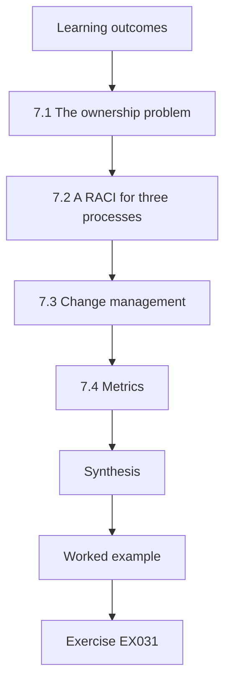

### Logical drawing

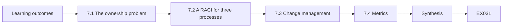

```text
[Learning outcomes]
    |
    v
[7.1 The ownership problem]
    |
    v
[7.2 A RACI for three processes]
    |
    v
[7.3 Change management]
    |
    v
[7.4 Metrics]
    |
    v
[Synthesis]
    |
    v
[Worked example] --> [Exercise EX031]
```
<!-- cykin:lesson-figures:end ch-07 -->


### Learning outcomes

You will (1) design OT security roles and responsibilities across IT, operations and engineering; (2) build a RACI for key OT security processes; (3) integrate OT security into change management; and (4) set metrics that drive the right behaviour.

### 7.1 The ownership problem

In many utilities IT owns the network up to a firewall, operations owns the process, engineering owns the controllers and nobody owns the space where they meet. NIST SP 800-82r3 recommends a cross-functional team for OT security, with clearly assigned authority. Integration means writing down who decides, not only who advises.

At BWRP that space includes the DMZ firewall, the vendor broker and the cellular links to lift stations. Each needs a named owner with authority to approve changes and to act in an incident. Writing it down often reveals that two teams believed the other owned it, which is exactly the gap an attacker or a fault exploits.

### 7.2 A RACI for three processes

For remote-access approval: the shift supervisor is Responsible for enabling sessions; the OT security lead is Accountable for the policy; the vendor manager is Consulted; IT security is Informed of each session. For PLC logic change: control engineer Responsible, engineering manager Accountable, operations Consulted, OT security Informed and alerted. For OT incident declaration: shift supervisor Responsible for raising, plant director Accountable, OT security and IT Consulted, regulator Informed when thresholds are met.

Check each row for exactly one Accountable party and at least one person who does the work. Share the table with every role it names and ask whether they agree; a role that learns from the table that it is Accountable for something has not yet accepted it. Review the RACI after organisational changes and after any incident that tested it.

### 7.3 Change management

Every change to an OT system passes a change board that already exists for safety and reliability. Adding three security questions to its form — does this change add a conduit, change an account, or alter firmware? — integrates security without a parallel bureaucracy.

Each yes answer then triggers a defined action: a new conduit needs a firewall rule and an owner; a changed account needs a review of who can use it; altered firmware needs a check against vendor advisories and a backup taken first. The board already understands safety and reliability questions, so the security questions should be phrased the same way.

### 7.4 Metrics

Measure what you want more of. "Number of vulnerabilities" rewards not looking. Better: percentage of OT assets in the inventory with known firmware versions; median days to apply high-risk OT patches within available windows; percentage of vendor sessions with recordings reviewed. Each metric names a denominator.

Each metric also needs a baseline and a target date. BWRP's dashboard starts from 14 of 23 RTUs in the inventory and 0 of 37 vendor sessions reviewed since March, so progress is visible from the first report. Review each definition with the people it measures, so that the metric changes behaviour rather than reporting.

### Worked example (synthetic BWRP)

Daniel's integration plan: OT security lead reports to the plant director with a dotted line to the CISO; change-board form gains three questions; quarterly dashboard shows inventory completeness (today 14/23 RTUs plus 41/41 plant assets), vendor-session review rate (today 0/37 sessions reviewed since March) and restore-test currency.

> **Synthetic case — Bayside Water Reclamation Plant.** Structure and figures are invented.

### Errors and limits

RACI tables fail if two parties are both Accountable. Metrics can be gamed; review definitions annually.

### Exercises

- **EX031 — Spotting a RACI error.** A draft lists both IT security and the plant director as Accountable for incident declaration. What is wrong and how to fix it? *Rubric:* 3 = one Accountable only; director A, IT C; 2 = problem only; 1 = accepts; 0 = none.
- **EX032 — Three change-board questions.** Rewrite the three security questions so a non-specialist can answer them yes/no. *Rubric:* 3 = three clear yes/no questions; 2 = two; 1 = jargon; 0 = none.
- **EX033 — A metric that backfires.** Explain how "zero open OT findings" could backfire. *Rubric:* 3 = discourages reporting/finding; incentivises closing without fixing; 2 = partial; 1 = vague; 0 = none.
- **EX034 — Inventory completeness figure.** Compute BWRP's combined inventory completeness. *Rubric:* 3 = 55/64 ≈ 85.9 %; 2 = right fraction; 1 = 14/23 only; 0 = none.
- **EX035 — Reporting line choice.** Give one advantage of the OT security lead reporting to the plant director rather than the CISO. *Rubric:* 3 = authority over operations decisions, process context; 2 = vague; 1 = minimal attempt; 0 = none.

### Synthesis

Integration is explicit authority, embedded change questions and metrics with denominators that reward finding and fixing.

### Continue studying — chapter 07 of 12

[← Chapter 06 (draft)](#ch-06) · [Course chapter index](../SUBJECTS.md) · [Chapter 08 (draft) →](#ch-08)

<a id="ch-08"></a>

## Chapter 8 — OT, IoT and cyber-physical security: difficult cases

<!-- cykin:lesson-figures:start ch-08 -->
### Lesson map

Lesson 08 published. Map, example, EX036.

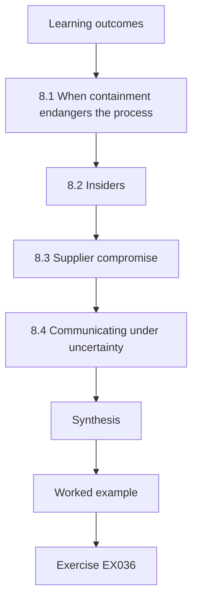

### Logical drawing

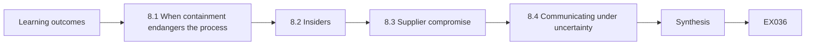

```text
[Learning outcomes]
    |
    v
[8.1 When containment endangers the process]
    |
    v
[8.2 Insiders]
    |
    v
[8.3 Supplier compromise]
    |
    v
[8.4 Communicating under uncertainty]
    |
    v
[Synthesis]
    |
    v
[Worked example] --> [Exercise EX036]
```
<!-- cykin:lesson-figures:end ch-08 -->


### Learning outcomes

You will (1) lead a response when containment and process safety conflict; (2) handle an insider scenario with fairness and evidence; (3) manage a supplier compromise affecting multiple sites; and (4) communicate under uncertainty with regulators and the public.

### 8.1 When containment endangers the process

Suppose evidence suggests an intruder on BWRP's SCADA server during a storm, when lift stations need remote pump starts to avoid overflows. Disconnecting SCADA stops the intruder and the operators' remote control together. The leader's job is to choose the least-bad option: keep SCADA connected under heightened watch with manual verification of each command; dispatch crews to high-consequence stations to take local control; then isolate. NIST SP 800-82r3 emphasises that OT incident response must weigh the safety and operational impact of response actions.

### 8.2 Insiders

An unexplained local change at a dosing panel (Chapter 3's example) might be a technician's well-meant adjustment or sabotage. Treat it as a process deviation first, collect evidence without accusation, involve human resources and legal counsel before interviews, and remember that blame cultures make staff hide mistakes, which is worse for security.

At BWRP the evidence already pointed to a local change during a period when the panel was in local mode. The next step is to check rosters and work orders for that window, and to ask the technician what they were doing, with the conversation handled as a process review. Only if the explanation does not fit does it become a disciplinary or legal matter.

### 8.3 Supplier compromise

If a SCADA vendor announces that its update server distributed tampered software, every utility using it must determine exposure. Leaders need an inventory of installed versions and a record of where updates came from. Sector information sharing helps; so does an existing relationship with the vendor's security team.

For BWRP the first question would be which SCADA servers and engineering workstations received updates from the affected source, and when. That needs records kept before the announcement, which is why the inventory work in the gap list matters. Contacts with the vendor's security team and the sector sharing group should be established before a crisis, not during one.

### 8.4 Communicating under uncertainty

Tell regulators what you know, what you do not, what you are doing and when you will update. Avoid both reassurance you cannot support and speculation about attribution.

At BWRP the holding statement at 01:00 on the storm night followed this pattern: an unfamiliar session from the SCADA server, crews at the beach-side stations, the external path cut, and the time of the next update. It made no claim about who was responsible. Prepare templates for such statements in advance so they can be issued quickly without careless wording.

### Worked example (synthetic BWRP)

Storm night, 23:40: monitoring alerts on an unfamiliar outbound session from the SCADA server. Daniel and the shift supervisor agree: crews to the six beach-side stations by 00:30 for local control; SCADA stays connected with two-person verification of every remote command; at 00:35, with local control confirmed, SCADA's external path is cut at the DMZ firewall. The regulator receives a holding statement at 01:00 per the permit's notification terms.

> **Synthetic case — Bayside Water Reclamation Plant.** The event and timings are invented.

### Errors and limits

Two-person verification slows operations; it is a temporary measure. Holding statements must not be delayed to perfect them.

### Exercises

- **EX036 — Sequencing a storm-night response.** Explain why crews were dispatched before cutting the external path. *Rubric:* 3 = maintain overflow prevention via local control before losing remote control; 2 = partial; 1 = speed; 0 = none.
- **EX037 — First steps on a possible insider.** List the first three actions after the unexplained panel change. *Rubric:* 3 = make process safe/verify setpoint, preserve evidence, involve HR/legal before interviews; 2 = two; 1 = accuse; 0 = none.
- **EX038 — Supplier exposure question.** Which two records let BWRP answer "were we affected by the tampered update?" *Rubric:* 3 = installed version per host and update source/date history; 2 = one; 1 = vendor list; 0 = none.
- **EX039 — A holding statement.** Draft a three-sentence holding statement to the regulator. *Rubric:* 3 = known, unknown, actions and next update time; 2 = three of four; 1 = speculative; 0 = none.
- **EX040 — Ending two-person verification.** State a criterion for ending the temporary measure. *Rubric:* 3 = intruder path closed and SCADA integrity verified (e.g. clean rebuild or verified hashes), owner sign-off; 2 = partial; 1 = time-based only; 0 = none.

### Synthesis

Difficult cases demand sequencing that keeps the process safe, fairness toward people, inventories that answer supplier questions, and honest communication.

### Continue studying — chapter 08 of 12

[← Chapter 07 (draft)](#ch-07) · [Course chapter index](../SUBJECTS.md) · [Chapter 09 (draft) →](#ch-09)

<a id="ch-09"></a>

## Chapter 9 — OT, IoT and cyber-physical security: leadership and assurance

<!-- cykin:lesson-figures:start ch-09 -->
### Lesson map

Lesson 09 published. Map, example, EX041.

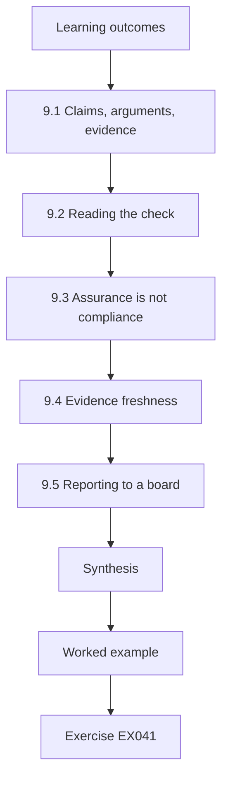

### Logical drawing

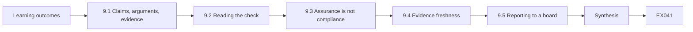

```text
[Learning outcomes]
    |
    v
[9.1 Claims, arguments, evidence]
    |
    v
[9.2 Reading the check]
    |
    v
[9.3 Assurance is not compliance]
    |
    v
[9.4 Evidence freshness]
    |
    v
[9.5 Reporting to a board]
    |
    v
[Synthesis]
    |
    v
[Worked example] --> [Exercise EX041]
```
<!-- cykin:lesson-figures:end ch-09 -->


### Learning outcomes

You will (1) structure an assurance argument from a top claim down to evidence; (2) find unsupported claims mechanically; (3) distinguish assurance from compliance; and (4) present assurance status to a board without overstating it.

### 9.1 Claims, arguments, evidence

An assurance case states a top claim ("BWRP's OT risk is acceptable"), decomposes it into sub-claims, and supports each leaf with evidence: test reports, configuration reviews, drill records. Goal Structuring Notation is a common graphical form. The value is that every gap becomes visible as a claim with nothing beneath it.

```python
"""Lab 09: check a synthetic assurance argument: every claim needs evidence or fully supported sub-claims."""
arg = {
    "G1 BWRP OT risk is acceptable": ["G2 remote access controlled", "G3 dosing integrity protected", "G4 recovery tested"],
    "G2 remote access controlled": ["E1 broker config review 2026-09", "E2 session log sample"],
    "G3 dosing integrity protected": ["G5 setpoint limits enforced", "G6 writes monitored"],
    "G5 setpoint limits enforced": ["E3 bench test report"],
    "G6 writes monitored": [],
    "G4 recovery tested": ["E4 restore drill 2025-11"],
}
def supported(node, path=()):
    if node.startswith("E"): return True
    kids = arg.get(node, [])
    return bool(kids) and all(supported(k, path + (node,)) for k in kids)
for g in arg:
    print(f"{g:34} {'supported' if supported(g) else 'UNSUPPORTED'}")
```

Run with `python3 lab_assure.py`. Verified output:

```text
G1 BWRP OT risk is acceptable      UNSUPPORTED
G2 remote access controlled        supported
G3 dosing integrity protected      UNSUPPORTED
G5 setpoint limits enforced        supported
G6 writes monitored                UNSUPPORTED
G4 recovery tested                 supported
```

Writing the argument this way makes the board's question precise. Instead of asking whether OT security is good, it asks which claims are supported and which are not. Each piece of evidence also needs an owner and a date, so the case can be refreshed. BWRP's argument in Lab 9 is deliberately small, to show the structure before it grows.

### 9.2 Reading the check

G6 "writes monitored" has no evidence and no sub-claims, so it is unsupported. G3 depends on G6 and therefore fails, and the top claim G1 fails with it. G2 and G4 are supported. The check is strict on purpose: a top claim cannot be partly true for a board.

The check only tests structure. It cannot tell whether E3's bench test was the right test, or whether E2's sample of session logs was large enough. Those are judgements for a reviewer. Use the mechanical check to find gaps quickly, then read each piece of evidence to see whether it really supports its claim.

### 9.3 Assurance is not compliance

Compliance shows that required controls exist. Assurance argues that risk is acceptable given the system's actual threats and consequences. A plant can be compliant with a checklist and still have an unsupported claim on its most important loop — dosing integrity here.

BWRP could pass a checklist that asks whether remote access is controlled and recovery is tested, because G2 and G4 are supported, while the claim that matters most to residents, dosing integrity, remains unsupported. Assurance puts that gap at the top of the board paper, where a compliance report would have hidden it among passed items.

### 9.4 Evidence freshness

Evidence ages. A restore drill from 2025-11 supports G4 today; in two years it will not. Mature assurance cases attach a validity period to each item and fail claims whose evidence has expired.

Set the validity period by how quickly the evidence could become wrong. A broker configuration review may need repeating after every major change, while a restore drill might be valid for a year. Add the expiry dates to the argument itself, so that the check in Lab 9 can mark a claim unsupported when its evidence lapses.

### 9.5 Reporting to a board

Report: top claim status (not yet supported), which sub-claim blocks it, what evidence is planned and when. Avoid red-amber-green colours without the underlying claims; colour hides reasoning.

Daniel's board paper follows this structure. It says plainly that G1 is not yet supported, names G6 as the blocking claim, gives the date by which evidence will exist and identifies the compensating evidence until then. A board member can ask a sharper question of that paper than of a single amber light.

### Worked example (synthetic BWRP)

Daniel's board paper: "G1 is not yet supported because write monitoring on PLC-D (G6) has no evidence. Planned: deploy passive monitoring on the dosing network by January and attach the first month's alert review as evidence E5. Until then, compensating evidence is E3 (setpoint limits bench test)."

> **Synthetic case — Bayside Water Reclamation Plant.** The argument structure and evidence identifiers are invented.

### Errors and limits

A supported tree is only as good as the evidence's relevance; a test report can attach to the wrong claim. Mechanical checks do not judge evidence quality.

### Exercises

- **EX041 — Fixing the tree.** Add evidence "E5 monitoring review 2027-01" under G6. What does the lab print for G1? *Rubric:* 3 = supported (all branches now reach evidence); 2 = correct but no reason; 1 = still unsupported; 0 = none.
- **EX042 — An expiry rule.** Write a rule that fails evidence older than 18 months and say which item would fail first. *Rubric:* 3 = rule plus E4 (2025-11) as oldest; 2 = one; 1 = vague; 0 = none.
- **EX043 — Compliance without assurance.** Give an example where BWRP passes a checklist but G3 is unsupported. *Rubric:* 3 = checklist asks for firewall/policy, not dosing write monitoring; 2 = partial; 1 = vague; 0 = none.
- **EX044 — Mis-attached evidence.** Explain why attaching a corporate IT penetration test to G3 would be wrong. *Rubric:* 3 = not relevant to dosing-network integrity; different system; 2 = partial; 1 = acceptable; 0 = none.
- **EX045 — A board sentence.** Write one sentence reporting G1 status without colour codes. *Rubric:* 3 = status, blocking claim, plan and date; 2 = three; 1 = "amber"; 0 = none.

### Synthesis

Assurance makes leadership claims auditable: every top claim decomposes to fresh, relevant evidence, and gaps are reported as gaps.

### Continue studying — chapter 09 of 12

[← Chapter 08 (draft)](#ch-08) · [Course chapter index](../SUBJECTS.md) · [Chapter 10 (draft) →](#ch-10)

<a id="ch-10"></a>

## Chapter 10 — Research reading and critique

<!-- cykin:lesson-figures:start ch-10 -->
### Lesson map

Lesson 10 published. Map, example, EX046.

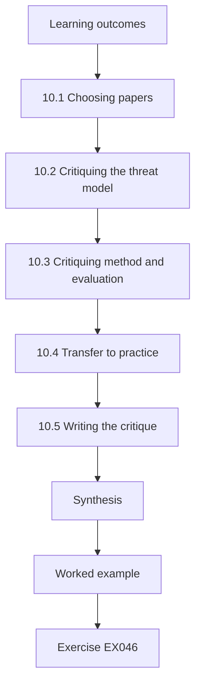

### Logical drawing

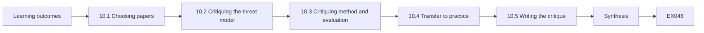

```text
[Learning outcomes]
    |
    v
[10.1 Choosing papers]
    |
    v
[10.2 Critiquing the threat model]
    |
    v
[10.3 Critiquing method and evaluation]
    |
    v
[10.4 Transfer to practice]
    |
    v
[10.5 Writing the critique]
    |
    v
[Synthesis]
    |
    v
[Worked example] --> [Exercise EX046]
```
<!-- cykin:lesson-figures:end ch-10 -->


### Learning outcomes

You will (1) critique a peer-reviewed OT security paper's threat model, method and evaluation; (2) judge whether results transfer to your organisation; (3) synthesise across papers; and (4) write a structured critique a practitioner audience can use.

### 10.1 Choosing papers

Read primary research that addresses a live decision. For BWRP's detection programme two papers frame the field: Giraldo et al. (2018, *ACM Computing Surveys*, doi:10.1145/3203245), a survey of physics-based attack detection in cyber-physical systems, and Urbina et al. (2016, ACM CCS, doi:10.1145/2976749.2978388), which argues for evaluating detectors by the impact an undetected attacker can achieve.

Start from a decision on the table, such as how to evaluate BWRP's planned dosing monitor, and choose papers that bear on it. A survey gives the map, and a focused paper gives a method to test. Note why each paper was chosen, so the reading list can be revisited when the decision changes.

### 10.2 Critiquing the threat model

Ask what the attacker can observe, change and know. Urbina et al. consider an attacker who knows the detector and stays below its threshold — a strong but realistic assumption for well-resourced actors. A paper that tests only naïve attacks overstates detector value.

For BWRP, the relevant attacker is one who can change dosing values or the readings that report them. Write that attacker's capabilities in the critique and compare them with the paper's. If a paper assumes the attacker cannot see the detector, say whether that is plausible for a vendor-access path that reaches PLC-D.

### 10.3 Critiquing method and evaluation

Check the testbed or dataset (simulated, laboratory or operational), the metrics, the baselines compared, and whether thresholds were tuned on evaluation data. Surveys like Giraldo et al. are especially useful for spotting field-wide habits — for example inconsistent metrics that make papers hard to compare.

Write down what each paper's evaluation actually measures, and compare it with what BWRP needs to know. A detector evaluated by accuracy on balanced data says little about false alerts in a plant where attacks are rare. Note also whether the authors report the impact an attacker could achieve while staying undetected, the measure Urbina et al. argue for.

### 10.4 Transfer to practice

Even a sound paper may not transfer. Physics-based detection needs a model of the process; BWRP's biological treatment is slow and nonlinear, unlike the faster loops in many testbeds. Transfer requires asking: does our process have the dynamics, sensors and data quality the method assumes?

Answer each question with evidence from BWRP: which sensors exist on the dosing loop, how often they report and how noisy the readings are. If the answers fall short of what the method needs, the transfer may require new instruments or a different model. The critique should say which, rather than recommending the method on the strength of its published results.

### 10.5 Writing the critique

Structure: question and claim; threat model; method; evidence; transfer to BWRP; what we would test first. Keep it to two pages for practitioners.

Each part should be short and concrete. The transfer paragraph is the most important for practitioners, because it says what would need to be true at BWRP for the paper's results to apply. End with one test the organisation can run, such as measuring the maximum undetected dosing deviation on its own replay. Ask an operator to read it before it is circulated.

### Worked example (synthetic BWRP)

Daniel's critique concludes: Urbina et al.'s impact metric is the right way to evaluate BWRP's dosing monitor, because the dosing loop is where an undetected bias has public-health consequences; its testbed results do not transfer directly, so BWRP will measure the maximum undetected dosing deviation on its own replay before choosing thresholds.

> **Synthetic case — Bayside Water Reclamation Plant.** The critique is an illustration; the two papers are real and their DOIs verified.

### Errors and limits

Summaries of papers are not critiques. Do not attribute to a paper results it does not report; quote and cite.

### Exercises

- **EX046 — The stealthy-attacker assumption.** Why is assuming the attacker knows the detector reasonable for BWRP? *Rubric:* 3 = capable actors study targets; documentation and vendors leak; conservative design; 2 = partial; 1 = unreasonable; 0 = none.
- **EX047 — Tuning-on-test check.** What sentence in a method section would show thresholds were tuned on evaluation data? *Rubric:* 3 = thresholds chosen to maximise performance on the same dataset reported; 2 = partial; 1 = vague; 0 = none.
- **EX048 — Transfer question for slow processes.** Name one process property that limits transfer of fast-loop detection results to biological treatment. *Rubric:* 3 = slow, nonlinear dynamics/long time constants or sparse sensing; 2 = vague; 1 = wrong; 0 = none.
- **EX049 — Using a survey well.** State one appropriate and one inappropriate use of Giraldo et al. *Rubric:* 3 = appropriate: map field and find primary papers; inappropriate: cite as evidence a specific detector works; 2 = one; 1 = vague; 0 = none.
- **EX050 — The first test.** What should BWRP test first after reading Urbina et al.? *Rubric:* 3 = maximum undetected dosing deviation under current thresholds on its replay; 2 = partial; 1 = detection rate; 0 = none.

### Synthesis

Critique evaluates threat model, method and transfer, then turns a paper into the first test your organisation should run.

### Continue studying — chapter 10 of 12

[← Chapter 09 (draft)](#ch-09) · [Course chapter index](../SUBJECTS.md) · [Chapter 11 (draft) →](#ch-11)

<a id="ch-11"></a>

## Chapter 11 — Applied project

<!-- cykin:lesson-figures:start ch-11 -->
### Lesson map

Lesson 11 published. Map, example, EX051.

```mermaid
flowchart TD
  N0["Learning outcomes"]
  N1["11.1 Choosing the project"]
  N2["11.2 Stakeholders and constraints"]
  N3["11.3 Milestones and risks"]
  N4["11.4 Success measures"]
  N5["11.5 The dossier"]
  N6["Synthesis"]
  N0 --> N1 --> N2 --> N3 --> N4 --> N5 --> N6
  N6 --> EX["Worked example"]
  EX --> Q["Exercise EX051"]
```

### Logical drawing

```mermaid
flowchart LR
  N0["Learning outcomes"]
  N1["11.1 Choosing the project"]
  N2["11.2 Stakeholders and constraints"]
  N3["11.3 Milestones and risks"]
  N4["11.4 Success measures"]
  N5["11.5 The dossier"]
  N6["Synthesis"]
  N0 --> N1 --> N2 --> N3 --> N4 --> N5 --> N6 --> Q["EX051"]
```

```text
[Learning outcomes]
    |
    v
[11.1 Choosing the project]
    |
    v
[11.2 Stakeholders and constraints]
    |
    v
[11.3 Milestones and risks]
    |
    v
[11.4 Success measures]
    |
    v
[11.5 The dossier]
    |
    v
[Synthesis]
    |
    v
[Worked example] --> [Exercise EX051]
```
<!-- cykin:lesson-figures:end ch-11 -->


### Learning outcomes

You will (1) scope an applied OT security project inside a real organisational constraint; (2) plan stakeholders, milestones and risks; (3) deliver an artefact plus an evidence dossier; and (4) define success measures before starting.

### 11.1 Choosing the project

A postgraduate applied project should change something in an organisation, with the owner's written agreement, and be finishable in one term. At BWRP, Daniel's project is "passive write monitoring for the dosing network": it closes the unsupported claim G6 from Chapter 9, uses the evaluation method from Chapter 6 and the impact measure from Chapter 10.

The monitoring project fits these tests. Operations and engineering own the systems it touches and can agree to it in writing. It can be finished in twelve weeks. It closes a named gap in the assurance case, and its result will be measurable. A project that only produces a report, with nothing changed, would not meet the standard.

### 11.2 Stakeholders and constraints

Operations must approve the monitoring tap (passive, on a mirror port, installed in a maintenance window). Engineering provides the register map. IT provides log storage. The regulator need not approve but will see the results in the next assurance report. The constraint list includes: no active traffic on the dosing network, no change to PLC-D, and data retention of 90 days.

Write each constraint as a test that can fail, and check them at each milestone. If the mirror port cannot be installed without touching PLC-D's configuration, the constraint wins and the plan changes. Keep a short stakeholder log of who agreed what and when, because the dossier will need it.

### 11.3 Milestones and risks

Weeks 1–2: agreement, tap installed and capture validated. Weeks 3–6: baseline and rules. Weeks 7–9: controlled evaluation with an independently authored attack replay. Weeks 10–12: dossier and handover. Risks: mirror-port packet loss (mitigation: monitor loss counters), operator alert fatigue (mitigation: alerts to OT security first for 4 weeks), staff turnover (mitigation: written runbook).

Review the risks at each milestone and record whether each mitigation is working. If capture loss cannot be brought under control by week 2, later results would be unreliable, so the plan pauses rather than carrying a weak baseline forward. Protect weeks 7 to 9 in particular, because evaluation is the first phase to be squeezed when earlier work slips.

### 11.4 Success measures

Defined in advance: capture loss below 0.1 % over a week; recall at least 0.8 on the independent replay with false-alert rate below 2 % of normal windows; maximum undetected dosing deviation reported; runbook accepted by operations.

Record these measures in the project agreement, with the date and the stakeholders who accepted them. The maximum undetected dosing deviation has no target because it is a finding, not a pass mark, but it must be reported whatever it shows. Failing a measure is reported as a failure, as Daniel does at week 9.

### 11.5 The dossier

The evidence dossier contains the agreement, configuration, test reports, evaluation results with intervals, open issues and handover. It becomes evidence E5 in the assurance case.

Organise the dossier so that a reviewer can follow the project from agreement to handover without asking questions. Include the capture-loss figures, the evaluation counts, the week-9 miss on false alerts and the re-run. When it becomes evidence in the assurance case, it carries a date, so its validity period starts then. Keep it in the plant's controlled records.

### Worked example (synthetic BWRP)

At week 9 the independent replay gives recall 33/40 (0.825) and 4/160 false alerts (2.5 %): the recall target is met, the false-alert target is not. Daniel reports the miss, tightens one rule that produced three of the four false alerts, and schedules a re-run rather than redefining the target.

> **Synthetic case — Bayside Water Reclamation Plant.** Project results are invented.

### Errors and limits

Projects in live organisations slip; protect the evaluation phase. Do not let success measures drift after results arrive.

### Exercises

- **EX051 — Checking the targets.** Do 33/40 and 4/160 meet the success measures? *Rubric:* 3 = recall yes (0.825 ≥ 0.8), false-alert no (2.5 % > 2 %); 2 = one right; 1 = both yes; 0 = none.
- **EX052 — A constraint and its reason.** Explain "no active traffic on the dosing network" to an IT colleague. *Rubric:* 3 = legacy devices may misbehave; safety of chemical dosing; passive suffices; 2 = partial; 1 = policy; 0 = none.
- **EX053 — Mitigating alert fatigue.** Why route alerts to OT security first for four weeks? *Rubric:* 3 = tune false alerts before operators see them; protect trust; 2 = partial; 1 = vague; 0 = none.
- **EX054 — Dossier contents.** List five items for the dossier. *Rubric:* 3 = five relevant; 2 = four; 1 = artefact only; 0 = none.
- **EX055 — Resisting target drift.** A sponsor suggests changing the false-alert target to 3 % "since we are close". Respond. *Rubric:* 3 = keep target, report miss, fix and re-run; explain integrity; 2 = partial; 1 = agree; 0 = none.

### Synthesis

An applied project closes a real gap under real constraints, with success defined in advance and reported honestly in a dossier that becomes assurance evidence.

### Continue studying — chapter 11 of 12

[← Chapter 10 (draft)](#ch-10) · [Course chapter index](../SUBJECTS.md) · [Chapter 12 (draft) →](#ch-12)

<a id="ch-12"></a>

## Chapter 12 — Final review and transfer

<!-- cykin:lesson-figures:start ch-12 -->
### Lesson map

Lesson 12 published. Map, example, EX056.

```mermaid
flowchart TD
  N0["Learning outcomes"]
  N1["12.1 The portfolio view"]
  N2["12.2 Transfer to another sector"]
  N3["12.3 Transfer brief"]
  N4["12.4 Continuing development"]
  N5["Synthesis"]
  N0 --> N1 --> N2 --> N3 --> N4 --> N5
  N5 --> EX["Worked example"]
  EX --> Q["Exercise EX056"]
```

### Logical drawing

```mermaid
flowchart LR
  N0["Learning outcomes"]
  N1["12.1 The portfolio view"]
  N2["12.2 Transfer to another sector"]
  N3["12.3 Transfer brief"]
  N4["12.4 Continuing development"]
  N5["Synthesis"]
  N0 --> N1 --> N2 --> N3 --> N4 --> N5 --> Q["EX056"]
```

```text
[Learning outcomes]
    |
    v
[12.1 The portfolio view]
    |
    v
[12.2 Transfer to another sector]
    |
    v
[12.3 Transfer brief]
    |
    v
[12.4 Continuing development]
    |
    v
[Synthesis]
    |
    v
[Worked example] --> [Exercise EX056]
```
<!-- cykin:lesson-figures:end ch-12 -->


### Learning outcomes

You will (1) review the course's decisions as a portfolio; (2) transfer methods from BWRP to another sector; (3) write a transfer brief for a successor; and (4) plan your own continuing professional development in OT security.

### 12.1 The portfolio view

Across the course, BWRP took a set of decisions: brokered vendor access (Ch. 1), gap priorities (Ch. 2), segmentation justified by tail risk (Ch. 4), tiered lift-station protection (Ch. 5), rule set B (Ch. 6), RACI and metrics (Ch. 7), storm-night response (Ch. 8), the assurance case (Ch. 9) and the monitoring project (Ch. 11). Reviewing them together shows whether they are consistent: for example, dosing integrity appears in Chapters 3, 9, 10 and 11 — a sign it is the plant's central concern.

Look for tension as well as consistency. For example, the segmentation decision and the lift-station design both depend on firewall and conduit changes, so their schedules should be aligned. The vendor-access choice and the assurance case both rely on broker evidence. Listing such links shows where a slip in one decision would undermine another.

### 12.2 Transfer to another sector

Methods transfer; parameters do not. Moving to a district heating operator or a food factory, the decision frame, loss distributions, controlled evaluation and assurance structure all apply. What changes: the consequence model (heat loss or product contamination instead of discharge quality), the regulators, the dominant protocols and the safety standards in force.

Before transferring, write down the assumptions each method made at BWRP: incident probabilities from water-sector peers, a cost per hour of outage, and attack behaviours in the replay. Each needs replacing with figures from the new sector. The structure of a decision record or assurance case moves unchanged; the numbers inside them must not.

### 12.3 Transfer brief

A successor needs: the open decisions and their revisit triggers, the assurance case with expired or missing evidence highlighted, the metrics and their baselines, relationships (vendors, regulator contacts, sector information-sharing groups) and known weak spots. Two pages, with links to the full records.

Write the brief for a reader who has never met Daniel. Each open item should name its trigger and date, each metric its denominator and baseline, each relationship a contact and its last use. Link to the full records rather than repeating them, and date the brief on its first line.

### 12.4 Continuing development

The field moves: NIST SP 800-82 was revised in 2023; IEC 62443 parts are periodically updated; MITRE ATT&CK for ICS adds techniques; CISA publishes advisories weekly. Plan: follow advisories for your vendors, re-read a standard's change summary when a new edition appears, and present one case study a year to peers.

Keep a short log of what you read and what you changed because of it, such as a revised assumption or a new question for a vendor. Review the log once a year with a peer. Development that changes nothing in practice is reading; development that leaves a trace in your decisions is what keeps a lead credible.

### Worked example (synthetic BWRP)

Daniel's transfer brief begins: "Open: D-2026-14 revisit if the vendor incident frequency estimate exceeds 0.06 per year or after any remote-access incident. Assurance: G1 supported since February via E5; E4 restore drill expires May 2027 — schedule now. Metrics: RTU inventory 23/23 since March; vendor-session review 37/37. Weak spot: lift-station router firmware patching has no window agreed with operations."

> **Synthetic case — Bayside Water Reclamation Plant.** All brief contents are invented.

### Errors and limits

Transfer briefs go stale; date them. Portfolio reviews can rationalise past choices; look for contradictions deliberately.

### Exercises

- **EX056 — Spotting an inconsistency.** Identify a tension between Chapter 5's decision and Chapter 7's metrics. *Rubric:* 3 = new RTU routers (Alt 2) add assets/patching not yet reflected in metrics; 2 = plausible other tension; 1 = vague; 0 = none.
- **EX057 — Transferring the consequence model.** Rewrite BWRP's central concern for a food factory. *Rubric:* 3 = product contamination/recall via recipe or temperature manipulation; 2 = vague; 1 = same as water; 0 = none.
- **EX058 — The expiring evidence.** When must the restore drill be repeated to keep G4 supported under the 18-month rule? *Rubric:* 3 = before May 2027; 2 = approximately; 1 = wrong; 0 = none.
- **EX059 — What a successor needs first.** Choose the single most important item in the brief and justify it. *Rubric:* 3 = reasoned choice (e.g. open decision with near trigger or weak spot); 2 = choice only; 1 = vague; 0 = none.
- **EX060 — A development plan.** Write a three-item annual development plan. *Rubric:* 3 = advisory follow, standard update review, peer presentation or equivalent; 2 = two; 1 = one; 0 = none.

### Synthesis

The course ends where practice begins: a consistent portfolio of decisions, methods that transfer across sectors, a dated brief for whoever comes next and a plan to keep learning.

### Continue studying — chapter 12 of 12

[← Chapter 11 (draft)](#ch-11) · [Course chapter index](../SUBJECTS.md) · [Worked results ↓](#worked-results) · [Next course via chapter index →](../SUBJECTS.md)

<a id="worked-results"></a>

## Worked results

Model answers for EX001–EX060. Bayside Water Reclamation Plant, Daniel Osei and all figures are synthetic. Any answer meeting the rubric scores equally.

**EX001.** 10,000 + 0.05 × 400,000 + 0.02 × 2,500,000 = 10,000 + 20,000 + 50,000 = 80,000 — still higher than B's 59,500.

**EX002.** The catastrophic scenario can occur through paths that no remote-access option closes, so further spending on remote access cannot lower the worst case; the leader should fund an independent safeguard (for example a hardwired dosing high-limit) to change the tail.

**EX003.** "Revisit if the broker vendor reports a security incident affecting its session service, or if the broker's attestation report is more than 12 months old."

**EX004.** B total = 35,000 + 400,000p + 0.005 × 2,500,000 = 47,500 + 400,000p. Setting it to 100,000 gives p = 52,500 / 400,000 ≈ 0.131 per year.

**EX005.** If credible estimates of A's incident probability range from 0.01 to 0.10 and the ranking between A and B flips inside that range, while a two-week review of vendor access logs could narrow the estimate before the contract deadline, deferring for the study is better than deciding now.

**EX006.** Documented only. Without a restore record it cannot be counted as performed; request the last restore log or schedule a test.

**EX007.** Nine unlisted RTUs cannot be monitored, patched or included in incident scoping, so the inventory gap undermines several other capabilities at once, whereas a playbook gap affects one; fixing the enabler first raises the value of every later control.

**EX008.** Expectation: OT backups are restorable and tested. Documented: backup procedure exists. Performed: weekly logic backups, no restore test. Gap: restore never demonstrated. Consequence: after a ransomware or logic-corruption event, recovery time is unknown and may be days. Owner: control systems engineer, test by end of quarter.

**EX009.** When BWRP must show conformance to a contractual or regulatory requirement framed on IEC 62443 (for example a certification scheme for the asset owner's security programme), or when integrators and suppliers already use 62443 terms, 2-1 aligns the benchmark with those obligations.

**EX010.** It indicates where gaps are likely and gives concrete examples for leadership, but it is not an assurance opinion on the whole programme: the five were chosen by Daniel, may not be representative, and unsampled practices could be weaker or stronger.

**EX011.** A setpoint write to PLC-D appears in the capture or HMI audit trail at 14:02 minus (or plus) a measured clock offset, and the same offset explains other paired events across the morning.

**EX012.** Moderate at most: a single log source supports a login, but it could be misattributed (shared account), altered by an intruder or wrong in time; corroboration from the jump host or session recording would raise confidence.

**EX013.** Ask which exact firmware versions were analysed, whether they contain the affected library (and which version, per the SBOM), and why the vulnerable function is unreachable — requesting the analysis or test evidence rather than the conclusion alone.

**EX014.** "No write in the capture" only supports "no network write" if the capture saw every packet; zero dropped packets on the monitoring port shows the absence is meaningful rather than a gap in collection.

**EX015.** Who or what caused the change: the historian records the value and time, not the initiating user, host or panel action.

**EX016.** Segmentation mainly reduces how often an incident happens (15 % → 6 %), but once one happens its duration can still be long (up to 48 h), so the conditional tail shrinks less than the average, which is dominated by incident frequency.

**EX017.** No. The baseline 99th percentile is 814,425, so more than 1 % of simulated years exceed 600,000 — the tolerance is breached.

**EX018.** Residents near the outfall, ratepayers who fund recovery costs, and the bay ecosystem (and the businesses depending on it, such as shellfish harvesters) — the regulator and downstream water users are also acceptable.

**EX019.** (a) Public — it shows governance. (b) Internal only (shared with the regulator on request under confidentiality) — it is an attacker's map. (c) Public — an aggregate count supports accountability without revealing technique.

**EX020.** A heavier tail adds rare very long outages: the mean rises somewhat, but the 99th percentile rises much more, because the extreme years that define p99 become more extreme.

**EX021.** "Rejected: Alternative 3 (monitoring only). Reason: operations records show remote pump starts prevented three overflows in the past year; removing remote commands would raise overflow risk at high-consequence stations. Reconsider if crew response time falls below 20 minutes or if local level control is upgraded with redundant sensors."

**EX022.** That the carrier keeps BWRP's private APN traffic isolated from other customers and the internet, controls which SIMs may join it, and that its staff and systems are not themselves compromised.

**EX023.** Renewing and revoking device certificates for 23 tunnel endpoints, and patching the firmware of the RTU-side routers and the DMZ concentrator.

**EX024.** The six beach-side stations have the worst overflow consequence (public health, closures), so they justify the higher cost and management burden of BWRP-controlled encryption, while the private APN gives adequate risk reduction for lower-consequence stations.

**EX025.** Each lift station is its own zone; its conduit is an IPsec tunnel from the station router to a concentrator in BWRP's DMZ zone, with mutual certificate authentication and a firewall that allows only the SCADA polling protocol onward to the SCADA zone.

**EX026.** 0.069 × 160 ≈ 11, so A raised 11 false alerts on the 160 normal windows (11/160 = 0.06875).

**EX027.** The data are compatible with B being no better than A at recall: 40 attack windows are too few to exclude zero improvement, even though the best estimate is 0.20 higher.

**EX028.** Both rule sets see exactly the same traffic, so differences in alerts come from the rules rather than from different weeks, weather or operating modes; the paired comparison also lets the bootstrap resample windows with both outcomes attached.

**EX029.** Daniel designed B partly with these attack types in mind; windows authored by someone else reduce the chance that the test set is unconsciously tailored to B's strengths.

**EX030.** B produces fewer false alerts on the same data and very likely catches more attacks; if it is actually equal on recall, the organisation loses little and can revert, so the expected value of switching is positive while more data are gathered.

**EX031.** A RACI must have exactly one Accountable party per process. Keep the plant director as Accountable for declaring an OT incident and make IT security Consulted.

**EX032.** (1) Will this change let any device talk to a device it could not talk to before? (2) Will this change add, remove or change any user account or password? (3) Will this change install or update software or firmware on any control device?

**EX033.** Teams may stop looking for problems, record findings as "accepted" without remediation or split them into vague items, so the dashboard shows zero while real exposure grows.

**EX034.** (14 + 41) / (23 + 41) = 55 / 64 ≈ 85.9 % — reported alongside the RTU-specific 14/23 (60.9 %) so the gap is not hidden by the plant assets.

**EX035.** The plant director controls operational priorities and maintenance windows, so the OT security lead's recommendations reach the person who can schedule them, and decisions are made with process consequences in view.

**EX036.** Cutting the path also removes operators' remote pump control; with storm inflows, losing it could cause overflows at beach-side stations, so local control had to be in place first to keep the process safe.

**EX037.** (1) Confirm the dosing setpoint is at its correct value and the process is within limits; (2) preserve evidence — PLC program comparison, panel key-switch log, historian export with hashes; (3) involve HR and legal counsel before speaking to individuals, treating it as a deviation until facts are established.

**EX038.** A per-host record of installed SCADA software versions, and a history of where and when each update was obtained (update source, date, hash) — together they show whether a tampered build was installed.

**EX039.** "At 23:40 BWRP detected an unexpected outbound connection from its SCADA server; treatment and pumping are operating normally under local control at six stations. We do not yet know whether any data or settings were altered. The external connection was closed at 00:35, an investigation is under way, and we will update you by 09:00."

**EX040.** End it when the intruder's access path is confirmed closed and the SCADA server has been rebuilt from known-good media or its software verified against vendor hashes, with sign-off from the plant director and OT security lead.

**EX041.** With E5 under G6, G6 is supported, so G3 (G5 and G6 both supported) is supported, and G1 prints "supported" because G2, G3 and G4 all reach evidence.

**EX042.** Rule: parse the date in each evidence label and treat an item as invalid if it is more than 18 months before the assessment date. E4 (restore drill, 2025-11) is the oldest and would expire first, in May 2027, failing G4 and therefore G1.

**EX043.** A checklist may require a documented firewall policy and an OT security policy, both present at BWRP, without asking whether writes to the dosing controller are monitored; BWRP is compliant while G3, the claim about dosing integrity, still lacks evidence.

**EX044.** A corporate IT penetration test says nothing about whether PLC-D's setpoints are protected; it covers different systems and threats, so attaching it would make G3 look supported by evidence that does not bear on the claim.

**EX045.** "BWRP cannot yet claim its OT risk is acceptable because writes to the dosing controller are not monitored; monitoring will be in place in January and we will bring the first month's review to the February meeting."

**EX046.** Well-resourced actors perform reconnaissance and may obtain vendor documentation or configuration exports; designing for an attacker who knows the detector avoids security that depends on secrecy of thresholds and gives conservative estimates for a public-health process.

**EX047.** For example: "We selected the threshold that maximised F1 on the test traces" — tuning and evaluation on the same traces means reported performance is optimistic.

**EX048.** Biological treatment has long time constants and nonlinear responses (hours, not seconds), so residual-based detectors tuned on fast testbed loops may see attacks only after harm accumulates, and models are harder to fit.

**EX049.** Appropriate: use it to map detection approaches and locate primary papers and common evaluation weaknesses. Inappropriate: cite it as proof that a particular detector works on BWRP, because a survey reports others' claims without re-testing them.

**EX050.** Replay BWRP's dosing data with a simulated slow bias and measure the largest dosing deviation that stays below the current alarm thresholds over a defined period — the impact budget an undetected attacker has today.

**EX051.** Recall 33/40 = 0.825 meets the ≥ 0.8 target; 4/160 = 2.5 % false alerts exceeds the 2 % limit, so one of the two measures is not yet met.

**EX052.** Some controllers and RTUs on the dosing network are old and can fault on unexpected traffic, and a fault there affects chemical dosing to treated water; a passive mirror-port capture gives the same visibility with no chance of disturbing the devices.

**EX053.** The first weeks reveal noisy rules; if operators receive those false alerts they learn to ignore the monitor. Routing to OT security first allows tuning so that operators only see alerts that have earned their trust.

**EX054.** Owner agreement and scope; tap and capture configuration with loss measurements; rule set and version; controlled evaluation report with counts and intervals; open issues, runbook and handover sign-off.

**EX055.** "We set 2 % before seeing results, and moving it now would make the success measure meaningless to the assurance case. The miss comes mainly from one rule; I will fix it and re-run the independent replay, and we will report the result either way."

**EX056.** Chapter 5 adds VPN routers at six beach-side stations, but Chapter 7's inventory and patch metrics count RTUs and plant assets only, so the new routers could fall outside both the inventory denominator and the patch-latency metric.

**EX057.** "Integrity of cooking temperature and recipe parameters on the line controllers, because manipulation could release contaminated product and trigger a recall" — replacing discharge quality with food safety.

**EX058.** E4 dates from November 2025, so under an 18-month validity it expires in May 2027; the drill must be repeated and documented before then.

**EX059.** The weak spot on lift-station router patching, because it is the only item with no agreed process at all; open decisions already have triggers and owners, while an unowned patching gap silently grows.

**EX060.** (1) Review every CISA ICS advisory naming BWRP's vendors within a week of publication. (2) Read the change summary of each new IEC 62443 part or NIST SP 800-82 revision when released and update the gap list. (3) Present one anonymised BWRP case study per year at a sector information-sharing meeting.

<a id="references"></a>

## References

Links checked 12 October 2026; standards and advisories are revised, so re-verify editions before citing. DOIs were checked against Crossref.

- Antonakakis, M., et al. (2017). Understanding the Mirai Botnet. 26th USENIX Security Symposium. <https://www.usenix.org/conference/usenixsecurity17/technical-sessions/presentation/antonakakis>
- CISA. Cybersecurity advisories (ICS advisories are filterable). <https://www.cisa.gov/news-events/cybersecurity-advisories>
- Giraldo, J., et al. (2018). A Survey of Physics-Based Attack Detection in Cyber-Physical Systems. ACM Computing Surveys. <https://doi.org/10.1145/3203245>
- ISA/IEC 62443 series of standards (overview; part 2-1 and the zone and conduit concepts of part 3-2 are cited in the text). <https://www.isa.org/standards-and-publications/isa-standards/isa-iec-62443-series-of-standards>
- MITRE ATT&CK for ICS, including T0883 Internet Accessible Device. <https://attack.mitre.org/matrices/ics/>
- NIST SP 800-82 Rev. 3 (2023). Guide to Operational Technology (OT) Security. <https://csrc.nist.gov/pubs/sp/800/82/r3/final>
- Urbina, D. I., et al. (2016). Limiting the Impact of Stealthy Attacks on Industrial Control Systems. ACM CCS. <https://doi.org/10.1145/2976749.2978388>
