# Seguridad de TO, IoT y sistemas ciberfísicos: práctica y liderazgo de posgrado

- Idioma: español neutro (`es`); curso de posgrado, dos años a tiempo parcial; aproximadamente 600 horas de estudio planificado. Edición de referencia: [inglés](../../en/book/MANUSCRIPT.md).
- Estado editorial: **publicado**. Los capítulos 1–12 de 12 tienen texto didáctico escrito a mano; los ejercicios EX001–EX060 tienen sus resultados resueltos correspondientes; los laboratorios sin conexión usan la biblioteca estándar de Python 3 y sus salidas se incluyen a partir de ejecuciones reales. Siguen pendientes la revisión independiente y la verificación de 300 páginas A4. La cobertura de capítulos en borrador no equivale a un libro terminado.
- Público: profesionales con experiencia que lideran decisiones de seguridad de TO, IoT y sistemas ciberfísicos a escala de toda la organización.
- Relación con los libros vecinos: el [libro de grado](../../../../bachelors-4-years/ot-iot-security/es/book/MANUSCRIPT.md) construye los fundamentos; el [libro de maestría](../../../../masters-2-years/ot-iot-security/es/book/MANUSCRIPT.md) enseña el ciclo de investigación. **Este libro está guiado por la práctica**: decidir, evaluar, integrar y asegurar.
- Autoría: [hiagokinlevi](https://github.com/hiagokinlevi). Texto original bajo [CC0 1.0](../../../../../LICENSE); las obras citadas conservan sus derechos.
- Límite educativo: no es un título acreditado. No concede autorización para acceder a plantas reales. Todas las organizaciones, personas y números de los ejemplos son **sintéticos**, salvo que una frase cite una fuente pública.

[Página del curso](../../README.md) · [Índice de capítulos](../SUBJECTS.md) · [Plan del libro](PLAN.md) · [Skill del curso](../../skill/SKILL.md) · [Resultados resueltos](#worked-results)

## Cómo usar este borrador

Cada capítulo tiene resultados de aprendizaje, secciones didácticas, un ejemplo resuelto, un caso sintético etiquetado, errores y límites, cinco ejercicios puntuados de 0 a 3, una síntesis y un bloque **Siga estudiando**. Los laboratorios (capítulos 1, 4, 6 y 9) se ejecutan sin conexión con `python3 file.py` sobre datos sintéticos con semilla fija.

### Caso de estudio sintético

| Elemento | Función | Límite |
|---|---|---|
| **Bayside Water Reclamation Plant (BWRP)** — controlador de dosificación PLC-D, SCADA, historiador, 23 estaciones de bombeo con RTU celulares, acceso remoto de proveedores | Organización estudiada a lo largo del libro | Inventada |
| **Daniel Osei** | Responsable de seguridad de TO, que reporta al director de la planta | Inventado |

### Fuentes principales

NIST [SP 800-82 Rev. 3](https://csrc.nist.gov/pubs/sp/800/82/r3/final); [serie ISA/IEC 62443](https://www.isa.org/standards-and-publications/isa-standards/isa-iec-62443-series-of-standards); MITRE [ATT&CK for ICS](https://attack.mitre.org/matrices/ics/); [avisos de ciberseguridad](https://www.cisa.gov/news-events/cybersecurity-advisories) de CISA; Giraldo et al. 2018; Urbina et al. 2016. Lista completa en [Referencias](#references).

## Contenido

| Capítulos |
|---|
| [1](#ch-01) · [2](#ch-02) · [3](#ch-03) · [4](#ch-04) · [5](#ch-05) · [6](#ch-06) · [7](#ch-07) · [8](#ch-08) · [9](#ch-09) · [10](#ch-10) · [11](#ch-11) · [12](#ch-12) |

[Resultados resueltos](#worked-results) · [Referencias](#references)

<a id="ch-01"></a>

## Capítulo 1 — Toma de decisiones avanzada en seguridad

<!-- open-cyber-academy:lesson-figures:start ch-01 -->
### Mapa de la lección

Lección 01 publicada. Mapa, ejemplo, EX001.

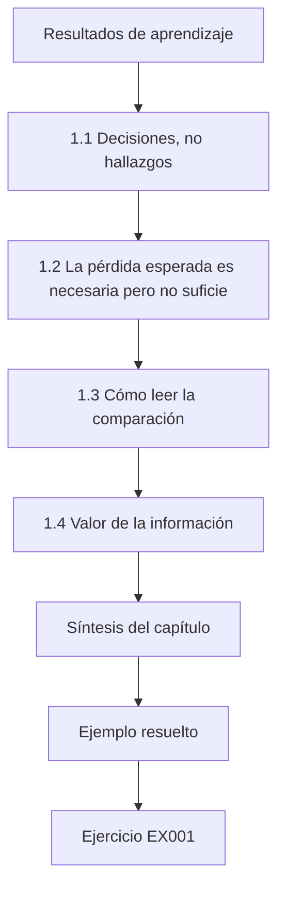

### Dibujo lógico

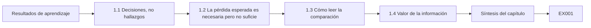

```text
[Resultados de aprendizaje]
    |
    v
[1.1 Decisiones, no hallazgos]
    |
    v
[1.2 La pérdida esperada es necesaria pero no suficie]
    |
    v
[1.3 Cómo leer la comparación]
    |
    v
[1.4 Valor de la información]
    |
    v
[Síntesis del capítulo]
    |
    v
[Ejemplo resuelto] --> [Ejercicio EX001]
```
<!-- open-cyber-academy:lesson-figures:end ch-01 -->


### Resultados de aprendizaje

Usted será capaz de (1) plantear una decisión de seguridad de TO con opciones, criterios, incertidumbre y un responsable de la decisión; (2) comparar opciones por pérdida esperada y por peor caso creíble a la vez; (3) registrar una decisión de modo que pueda auditarse más adelante; y (4) reconocer cuándo conviene aplazar una decisión para reunir información.

### 1.1 Decisiones, no hallazgos

En el nivel de posgrado, el entregable rara vez es una lista de vulnerabilidades; es una decisión que alguien con presupuesto y responsabilidad debe tomar. En la planta sintética Bayside Water Reclamation Plant (BWRP), el responsable de seguridad de TO, Daniel Osei, debe decidir cómo acceden los proveedores al controlador de dosificación química PLC-D. Un marco de decisión nombra al responsable (el director de la planta), las opciones, los criterios, lo que es incierto y la fecha en la que debe tomarse la decisión.

Para la decisión sobre el acceso de proveedores, el marco también necesita el plazo que la fuerza, como el vencimiento del contrato de VPN actual, y las personas a las que hay que consultar: operación, el gestor de proveedores e ingeniería. Escribir el marco antes del análisis evita que Daniel elija los criterios después de saber qué opción favorecen.

### 1.2 La pérdida esperada es necesaria pero no suficiente

La pérdida anual esperada (probabilidad por pérdida, sumada sobre los escenarios) permite comparar en una sola escala opciones con costes distintos. Pero los servicios públicos no son neutrales al riesgo: un evento raro que contamine el vertido a una bahía, desencadene una actuación regulatoria y erosione la confianza pública puede ser inaceptable con cualquier probabilidad por encima de un umbral. Por eso los líderes informan de la pérdida esperada junto con el peor caso creíble y cualquier restricción regulatoria o de seguridad funcional que sea vinculante con independencia de la aritmética.

```python
"""Lab 01: compare three synthetic BWRP options by expected annual loss and worst credible case."""
options = {  # name: (annual cost, [(probability per year, loss if it happens)])
    "A keep vendor VPN":        (10_000, [(0.10, 400_000), (0.02, 2_500_000)]),
    "B brokered sessions":      (35_000, [(0.03, 400_000), (0.005, 2_500_000)]),
    "C no remote access":       (90_000, [(0.01, 400_000), (0.004, 2_500_000)]),
}
for name, (cost, events) in options.items():
    eal = sum(p * l for p, l in events)
    worst = max(l for _, l in events)
    print(f"{name:20} cost={cost:>7,} expected_loss={eal:>9,.0f} total={cost+eal:>9,.0f} worst_case={worst:,}")
```

Ejecútelo con `python3 lab_decide.py`. Salida verificada:

```text
A keep vendor VPN    cost= 10,000 expected_loss=   90,000 total=  100,000 worst_case=2,500,000
B brokered sessions  cost= 35,000 expected_loss=   24,500 total=   59,500 worst_case=2,500,000
C no remote access   cost= 90,000 expected_loss=   14,000 total=  104,000 worst_case=2,500,000
```

### 1.3 Cómo leer la comparación

La opción B tiene el total más bajo (59.500) porque su coste de control compra una gran reducción de la probabilidad de incidente. La opción C elimina más riesgo, pero con estas estimaciones cuesta más de lo que ahorra. Las tres comparten el mismo peor caso porque el escenario catastrófico sigue siendo posible por otras rutas; ninguna elección de acceso remoto lo elimina. Esa observación lleva al líder a buscar salvaguardas independientes, no más gasto en acceso remoto. Los números también muestran lo sensible que es la clasificación. La opción A pierde por sus probabilidades de incidente; si ambas estimaciones se redujeran a la mitad, el total de A bajaría a 55.000 y superaría a los 59.500 de B. Por eso el registro de Daniel nombra un disparador de revisión ligado a la estimación de incidentes, y por eso la siguiente pregunta es qué solidez tienen realmente esas probabilidades.

### 1.4 Valor de la información

Si las estimaciones de probabilidad se discuten (y para los ataques dirigidos siempre se discuten), pregúntese si la decisión cambiaría al moverlas dentro de su rango plausible. Si B gana en todo ese rango, decida ahora. Si la clasificación se invierte, un estudio breve (revisión de registros de proveedores, un ejercicio de mesa) puede valer más que una compra inmediata. Para BWRP, la pregunta es si B sigue ganando cuando la probabilidad de incidente de proveedor de la opción A es menor que la estimada. Daniel puede comprobarlo en el laboratorio cambiando un número cada vez y anotando dónde se invierte la clasificación. Si la inversión exige una estimación fuera de lo que informan otras organizaciones del sector, la decisión se mantiene; si no, dos semanas de revisión de los registros de proveedores pueden ser el mejor primer gasto.

### Ejemplo resuelto (BWRP sintética)

Registro de decisión de Daniel: «D-2026-14. Responsable: director de la planta. Decisión: adoptar sesiones de proveedor intermediadas (B). Fundamento: menor coste esperado total con las estimaciones del anexo 1; el peor caso es igual en todas las opciones, así que una acción separada (D-2026-15) revisa el enclavamiento de límite alto de dosificación. Revisar si la estimación de frecuencia de incidentes de proveedor supera 0,06 al año o tras cualquier incidente de acceso remoto».

> **Caso sintético — Bayside Water Reclamation Plant.** BWRP, Daniel Osei y todos los costes y probabilidades son inventados.

### Errores y límites

Las estimaciones puntuales de probabilidades adversarias transmiten una precisión falsa; presente rangos. La aritmética de la pérdida esperada no recoge el daño a las personas aguas abajo, que debe argumentarse por separado.

### Ejercicios — capítulo 1

- **EX001 — Coste total de la opción A con una probabilidad menor.** Si el escenario de 400.000 de A baja a 0,05 al año, recalcule el total de A. *Rúbrica:* 3 = 10.000 + 20.000 + 50.000 = 80.000, todavía por encima de B; 2 = solo el número; 1 = error aritmético; 0 = nada.
- **EX002 — Por qué el peor caso es idéntico.** Explique qué implica para el líder el peor caso compartido de 2,5 millones. *Rúbrica:* 3 = la elección de acceso remoto no elimina la ruta catastrófica; invertir en una salvaguarda independiente; 2 = parcial; 1 = «todas iguales»; 0 = nada.
- **EX003 — Redactar un disparador de revisión.** Añada un disparador de revisión más a D-2026-14. *Rúbrica:* 3 = disparador observable y específico; 2 = vago pero pertinente; 1 = «si las cosas cambian»; 0 = nada.
- **EX004 — ¿Se invierte la clasificación?** Halle la probabilidad del escenario de 400.000 de B con la que el total de B iguala los 100.000 de A. *Rúbrica:* 3 = (100.000 − 35.000 − 12.500)/400.000 ≈ 0,131; 2 = método; 1 = ignora el otro término; 0 = nada.
- **EX005 — Cuándo no decidir todavía.** Describa una situación en la que Daniel debería aplazar D-2026-14 para reunir información. *Rúbrica:* 3 = la clasificación se invierte dentro del rango plausible y un estudio barato puede acotarlo antes del plazo; 2 = parcial; 1 = «cuando haya dudas»; 0 = nada.

### Síntesis del capítulo

Los líderes deciden con la pérdida esperada, el peor caso creíble, responsables explícitos y disparadores de revisión, y compran información cuando esta podría cambiar la elección.

### Siga estudiando — capítulo 01 de 12

[← Página del curso](../../README.md) · [Índice de capítulos del curso](../SUBJECTS.md) · [Capítulo 02 (borrador) →](#ch-02)

<a id="ch-02"></a>

## Capítulo 2 — Seguridad de TO, IoT y sistemas ciberfísicos: práctica actual

<!-- open-cyber-academy:lesson-figures:start ch-02 -->
### Mapa de la lección

Lección 02 publicada. Mapa, ejemplo, EX006.

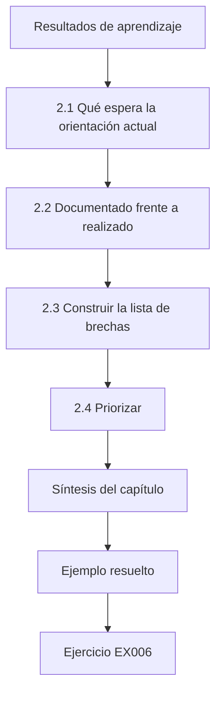

### Dibujo lógico

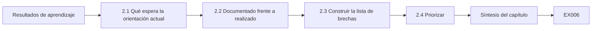

```text
[Resultados de aprendizaje]
    |
    v
[2.1 Qué espera la orientación actual]
    |
    v
[2.2 Documentado frente a realizado]
    |
    v
[2.3 Construir la lista de brechas]
    |
    v
[2.4 Priorizar]
    |
    v
[Síntesis del capítulo]
    |
    v
[Ejemplo resuelto] --> [Ejercicio EX006]
```
<!-- open-cyber-academy:lesson-figures:end ch-02 -->


### Resultados de aprendizaje

Usted será capaz de (1) comparar el programa de seguridad de TO de una organización con los temas de NIST SP 800-82r3 e IEC 62443-2-1; (2) distinguir la práctica documentada de la práctica realizada; (3) elaborar una lista de brechas con evidencia; y (4) priorizar las brechas para la dirección.

### 2.1 Qué espera la orientación actual

NIST SP 800-82r3 organiza un programa de seguridad de TO en torno a la gobernanza, la gestión de riesgos, la arquitectura y las capacidades de seguridad aplicadas a los sistemas de TO, y relaciona las consideraciones de TO con las funciones del NIST Cybersecurity Framework. IEC 62443-2-1 especifica requisitos para el programa de seguridad de un propietario de activos. Ninguno de los dos es una lista de casillas por marcar; ambos describen capacidades que un programa maduro demuestra. En una revisión, use cada documento para generar preguntas y no una puntuación. En BWRP eso significa preguntar, por ejemplo, cómo se gobierna el acceso remoto, cómo se inventarían los activos y cómo se gestionarían los incidentes en el sistema de dosificación. Las respuestas pasan después a la lista de brechas con su evidencia, de modo que la revisión informa de lo que la planta puede demostrar y no de cuántas cláusulas afirma cumplir.

### 2.2 Documentado frente a realizado

Una política que dice «el acceso remoto se revisa mensualmente» es práctica documentada. Un registro que muestra las tres últimas revisiones mensuales, con los hallazgos cerrados, es práctica realizada. Los evaluadores de posgrado buscan lo segundo. En BWRP, Daniel muestrea evidencia de cada práctica declarada en lugar de aceptar las respuestas de las entrevistas. La muestra tiene que elegirse antes de mirar, o deriva hacia los casos que quedan bien. Daniel elige cinco prácticas situadas en rutas hacia consecuencias y pide, para cada una, el artefacto más reciente que demuestre que se hizo. Una respuesta de entrevista puede señalar la evidencia, pero nunca la sustituye en la lista de brechas.

### 2.3 Construir la lista de brechas

Para cada capacidad: lo que espera la orientación, lo que BWRP documenta, lo que la evidencia muestra que se realiza, la brecha, la consecuencia de la brecha y un responsable propuesto. Las estaciones de bombeo remotas conectadas mediante RTU celulares son un punto ciego habitual: aparecen en el registro de activos como «estaciones de bombeo», pero no como puntos finales de red. Cada fila debe ser lo bastante específica como para que su responsable pueda actuar. Para la brecha de inventario de BWRP, eso significa nombrar las nueve RTU de estaciones de bombeo que aún no figuran, la consecuencia de que no pueden supervisarse ni parchearse, y la persona que las añadirá. Una fila que solo dice «inventario incompleto» no da una tarea a nadie.

### 2.4 Priorizar

Priorice las brechas situadas en rutas hacia consecuencias (dosificación, calidad del vertido) y las que son baratas de cerrar. La falta de inventario de las RTU celulares bloquea varias otras capacidades (supervisión, aplicación de parches, delimitación del alcance de incidentes), así que ocupa un puesto alto aunque sea «solo documentación». Escriba la clasificación con su motivo, para que el director de la planta vea por qué una tarea de inventario supera a una herramienta nueva. En BWRP, la revisión del acceso remoto va a continuación, porque no se realiza desde marzo y los proveedores pueden llegar a PLC-D. Después viene la prueba de restauración de la lógica del PLC, ya que unas copias de seguridad cuya restauración nunca se ha probado pueden fallar cuando se necesiten.

### Ejemplo resuelto (BWRP sintética)

Muestra de cinco prácticas de Daniel: inventario de activos (documentado, realizado en parte: 14 de 23 RTU de estaciones de bombeo registradas); revisión del acceso remoto (documentada, no realizada desde marzo); copia de seguridad de la lógica del PLC (realizada, restauración nunca probada); plan de respuesta a incidentes (documentado, sin guía de actuación específica de TO); aplicación de parches (realizada en las HMI Windows, no en el firmware de las RTU).

> **Caso sintético — Bayside Water Reclamation Plant.** Los recuentos y las fechas son inventados.

### Errores y límites

Una comparación con un solo documento puede pasar por alto la regulación sectorial. Muestrear cinco prácticas da una visión, no una opinión de auditoría.

### Ejercicios — capítulo 2

- **EX006 — Clasificar una práctica declarada.** Se afirma «probamos las restauraciones anualmente», pero no existe ningún registro. ¿Documentada o realizada? *Rúbrica:* 3 = solo documentada; pedir evidencia; 2 = solo la etiqueta; 1 = realizada; 0 = nada.
- **EX007 — Clasificar la brecha de inventario de RTU.** Justifique por qué la brecha de inventario de RTU está por encima de la guía de actuación que falta. *Rúbrica:* 3 = bloquea la supervisión, los parches y la delimitación del alcance; habilitadora; 2 = parcial; 1 = «más importante»; 0 = nada.
- **EX008 — Una fila de la lista de brechas.** Escriba la fila completa de la lista de brechas para «restauración nunca probada». *Rúbrica:* 3 = expectativa, documentado, realizado, brecha, consecuencia, responsable; 2 = cuatro campos; 1 = solo la brecha; 0 = nada.
- **EX009 — Elegir el documento de referencia.** ¿Cuándo sería IEC 62443-2-1 una mejor referencia que SP 800-82r3 para BWRP? *Rúbrica:* 3 = cuando se aplican requisitos de certificación o contractuales sobre el programa del propietario de activos; 2 = parcial; 1 = «es mejor»; 0 = nada.
- **EX010 — Cobertura de la muestra.** ¿Qué se puede y qué no se puede concluir de muestrear cinco prácticas? *Rúbrica:* 3 = brechas indicativas; no es una opinión de aseguramiento completa; sesgo de muestreo; 2 = un solo lado; 1 = afirma de más; 0 = nada.

### Síntesis del capítulo

Las revisiones de la práctica actual comparan la evidencia de lo que se hace, no de lo que está escrito, y clasifican las brechas por su efecto en las consecuencias y en otras capacidades.

### Siga estudiando — capítulo 02 de 12

[← Capítulo 01 (borrador)](#ch-01) · [Índice de capítulos del curso](../SUBJECTS.md) · [Capítulo 03 (borrador) →](#ch-03)

<a id="ch-03"></a>

## Capítulo 3 — Seguridad de TO, IoT y sistemas ciberfísicos: evidencia especializada

<!-- open-cyber-academy:lesson-figures:start ch-03 -->
### Mapa de la lección

Lección 03 publicada. Mapa, ejemplo, EX011.

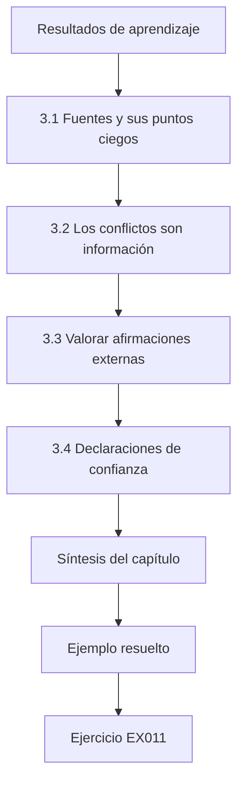

### Dibujo lógico

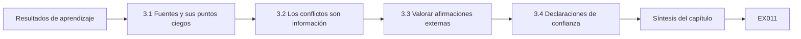

```text
[Resultados de aprendizaje]
    |
    v
[3.1 Fuentes y sus puntos ciegos]
    |
    v
[3.2 Los conflictos son información]
    |
    v
[3.3 Valorar afirmaciones externas]
    |
    v
[3.4 Declaraciones de confianza]
    |
    v
[Síntesis del capítulo]
    |
    v
[Ejemplo resuelto] --> [Ejercicio EX011]
```
<!-- open-cyber-academy:lesson-figures:end ch-03 -->


### Resultados de aprendizaje

Usted será capaz de (1) valorar la calidad de las fuentes de evidencia de seguridad de TO; (2) conciliar evidencia contradictoria procedente de datos de red, de equipos y de proceso; (3) evaluar con sentido crítico las afirmaciones de proveedores y avisos; y (4) redactar una valoración de la evidencia que indique niveles de confianza.

### 3.1 Fuentes y sus puntos ciegos

Las capturas pasivas de red muestran quién habló con quién, pero no ven los enlaces serie ni el significado de las cargas útiles cifradas. Los registros de eventos del controlador, cuando existen, muestran los cambios de programa, pero a menudo se sobrescriben tras unos cientos de entradas. Los datos de proceso del historiador muestran el efecto físico, pero no la causa. Los registros de auditoría de la HMI muestran las acciones del operador, pero no las sesiones de la herramienta de ingeniería. El trabajo con evidencia especializada las combina porque a cada una se le escapa algo.

Antes de confiar en cualquier fuente, escriba qué puede y qué no puede ver en BWRP. La captura cubre la red de la planta, pero no a un técnico ante el panel de dosificación. El registro de eventos de PLC-D puede haberse sobrescrito desde el evento. El historiador registra el punto de consigna, pero no quién lo cambió. Esa lista le dice a Daniel qué segunda fuente consultar para cada pregunta.

### 3.2 Los conflictos son información

Si el historiador muestra un cambio del punto de consigna de dosificación a las 14:02, pero ni el registro de auditoría de la HMI ni la captura de red muestran una escritura, las posibilidades son una captura incompleta, un desfase de reloj, un cambio local en el panel o una lógica que cambia el punto de consigna internamente. Cada hipótesis predice algo comprobable: los registros del interruptor de llave del panel, una comparación del programa del PLC, los contadores de pérdida de paquetes de la captura.

Escriba cada hipótesis con la comprobación que la descartaría y haga primero las comprobaciones más baratas. Un desfase de reloj puede probarse en minutos comparando las marcas de tiempo de un evento conocido en varios sistemas. Registre el resultado de cada comprobación, incluidas las que solo eliminan una posibilidad, porque son las que hacen creíble la conclusión final.

### 3.3 Valorar afirmaciones externas

Los avisos ICS de CISA describen los productos y versiones afectados, las puntuaciones CVSS y las mitigaciones coordinadas con los proveedores; son una evidencia sólida de la existencia de una vulnerabilidad y más débil de si es explotable en su configuración. Las declaraciones de un proveedor de que un producto «no está afectado» merecen que se le pida el razonamiento. Los estudios de medición revisados por pares, como el análisis de Mirai de Antonakakis et al. (USENIX Security 2017), incluyen secciones de método que usted puede evaluar.

Para BWRP, un aviso que afecte a un producto usado en PLC-D debería llevar a dos preguntas: si la versión afectada está instalada y si la función vulnerable es alcanzable desde donde podría estar un atacante. Registre las respuestas junto al aviso en el inventario. Cuando un proveedor diga que no está afectado, archive su razonamiento con la fecha, para poder comprobar la afirmación más adelante.

### 3.4 Declaraciones de confianza

Declare la confianza de forma explícita: alta (varias fuentes independientes coinciden), moderada (una fuente sólida, sin contradicción), baja (inferencia a partir de datos indirectos). Los líderes actúan de manera distinta en cada caso. Asigne el nivel a cada conclusión, no al informe en su conjunto, y diga qué fuentes la respaldan. El hallazgo de las 14:02 de Daniel tiene confianza alta porque la captura, la comparación del programa y el registro del interruptor de llave coinciden. Una conclusión basada solo en el registro del interruptor de llave sería moderada, y una conjetura sobre quién estaba en la planta, antes de comprobar los cuadrantes de turnos, sería baja.

### Ejemplo resuelto (BWRP sintética)

A las 14:02, el historiador muestra que el punto de consigna de dosificación de hipoclorito en PLC-D pasa de 4,0 a 6,5 mg/L. No hay entrada de auditoría en la HMI ni escritura Modbus en la captura. Daniel comprueba: los contadores de pérdida de la captura muestran 0 paquetes descartados; la comparación del programa del PLC muestra un programa sin cambios; el registro del interruptor de llave del panel local muestra «modo local 14:01–14:05». Valoración: confianza alta en que el cambio se hizo localmente en el panel; siguiente paso, identificar quién estaba en la planta.

> **Caso sintético — Bayside Water Reclamation Plant.** Las horas, etiquetas y valores son inventados.

### Errores y límites

La ausencia de evidencia en una captura solo tiene significado si se conocen la cobertura y la pérdida de la captura. Un intruso capaz puede alterar los registros.

### Ejercicios — capítulo 3

- **EX011 — Predicciones a partir de hipótesis.** Para la hipótesis «desfase de reloj», indique qué evidencia la confirmaría. *Rúbrica:* 3 = escritura correspondiente encontrada en la captura o en el registro de la HMI en la hora desplazada, con el desfase medido; 2 = parcial; 1 = vago; 0 = nada.
- **EX012 — Confianza con evidencia de una sola fuente.** La única evidencia de un inicio de sesión remoto es una línea del registro de la VPN. ¿Qué confianza y por qué? *Rúbrica:* 3 = moderada como mucho, una sola fuente, podría estar alterada o mal atribuida; 2 = solo el nivel; 1 = alta; 0 = nada.
- **EX013 — Interpretar una afirmación de «no afectado».** Un proveedor dice que su RTU no está afectada por el fallo de biblioteca de un aviso. ¿Qué pregunta usted? *Rúbrica:* 3 = qué versión/componente, por qué no es alcanzable, evidencia (SBOM, análisis); 2 = una; 1 = aceptarlo; 0 = nada.
- **EX014 — Qué demuestran los contadores de pérdida de la captura.** ¿Por qué comprobó Daniel los contadores de pérdida de paquetes antes de confiar en «no se ve ninguna escritura»? *Rúbrica:* 3 = la ausencia solo tiene significado si la captura está completa; 2 = parcial; 1 = vago; 0 = nada.
- **EX015 — Punto ciego de los datos de proceso.** Nombre una cosa que el historiador nunca puede decirle sobre el cambio de las 14:02. *Rúbrica:* 3 = quién o qué lo inició (causa/identidad); 2 = vago; 1 = incorrecto; 0 = nada.

### Síntesis del capítulo

El trabajo con evidencia especializada triangula fuentes con puntos ciegos conocidos, trata los conflictos como hipótesis que hay que probar y asigna una confianza a cada conclusión.

### Siga estudiando — capítulo 03 de 12

[← Capítulo 02 (borrador)](#ch-02) · [Índice de capítulos del curso](../SUBJECTS.md) · [Capítulo 04 (borrador) →](#ch-04)

<a id="ch-04"></a>

## Capítulo 4 — Riesgo y ética avanzados

<!-- open-cyber-academy:lesson-figures:start ch-04 -->
### Mapa de la lección

Lección 04 publicada. Mapa, ejemplo, EX016.

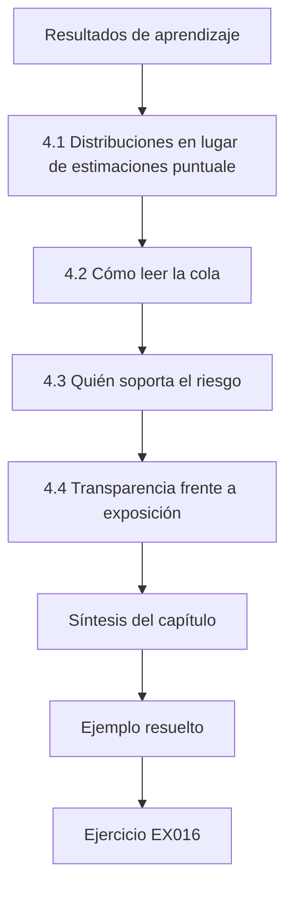

### Dibujo lógico

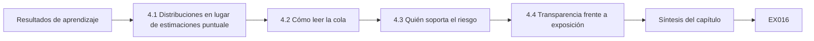

```text
[Resultados de aprendizaje]
    |
    v
[4.1 Distribuciones en lugar de estimaciones puntuale]
    |
    v
[4.2 Cómo leer la cola]
    |
    v
[4.3 Quién soporta el riesgo]
    |
    v
[4.4 Transparencia frente a exposición]
    |
    v
[Síntesis del capítulo]
    |
    v
[Ejemplo resuelto] --> [Ejercicio EX016]
```
<!-- open-cyber-academy:lesson-figures:end ch-04 -->


### Resultados de aprendizaje

Usted será capaz de (1) modelar distribuciones de pérdidas en lugar de cifras únicas; (2) leer las pérdidas media, del percentil 95 y del percentil 99 de una simulación con semilla fija; (3) decidir quién soporta el riesgo residual y si ha dado su consentimiento; y (4) gestionar la tensión ética entre transparencia y seguridad en un servicio público.

### 4.1 Distribuciones en lugar de estimaciones puntuales

La pérdida anual por interrupciones de TO es casi siempre cero y, de vez en cuando, grande. Una simulación de Monte Carlo sortea, muchos miles de veces, si ocurre un incidente y cuánto dura, y produce una distribución cuya cola es lo que interesa a los consejos de administración y a las aseguradoras.

```python
"""Lab 04: Monte Carlo of annual outage loss for BWRP with and without a control (seeded, synthetic)."""
import random, statistics
def year(rnd, p_incident, hours_lo, hours_hi, cost_per_hour=12_000):
    if rnd.random() >= p_incident: return 0.0
    return rnd.uniform(hours_lo, hours_hi) * cost_per_hour
for label, p, lo, hi in [("baseline", 0.15, 4, 72), ("with segmentation", 0.06, 4, 48)]:
    rnd = random.Random(2026)
    losses = sorted(year(rnd, p, lo, hi) for _ in range(20_000))
    print(f"{label:18} mean={statistics.mean(losses):>8,.0f} p95={losses[int(0.95*len(losses))]:>9,.0f} p99={losses[int(0.99*len(losses))]:>9,.0f} P(loss>0)={sum(l>0 for l in losses)/len(losses):.3f}")
```

Ejecútelo con `python3 lab_mc.py`. Salida verificada:

```text
baseline           mean=  68,613 p95=  592,662 p99=  814,425 P(loss>0)=0.151
with segmentation  mean=  18,590 p95=  129,339 p99=  493,624 P(loss>0)=0.059
```

La simulación solo necesita unas pocas entradas: la probabilidad de que ocurra un incidente en un año, cuánto dura y cuánto cuesta cada hora. Cada una debe acompañarse de su fuente y de un rango plausible. El laboratorio 4 usa una semilla fija para que el consejo vea los mismos números cuando se repite la ejecución, y para que un cambio en el resultado pueda atribuirse a un cambio en las hipótesis.

### 4.2 Cómo leer la cola

La segmentación reduce la pérdida media de unos 68.600 a 18.600, y la probabilidad de cualquier pérdida del 15,1 % al 5,9 %. El percentil 99 baja de forma menos marcada (de 814.000 a 494.000) porque, cuando un incidente sí ocurre, todavía puede durar dos días. Si la tolerancia del consejo es «no más de un 1 % de probabilidad de perder más de 600.000 en un año», con estas hipótesis solo el diseño segmentado la cumple. Estas cifras dependen de hipótesis que merecen su propia línea en la diapositiva: las probabilidades de incidente, los rangos de duración y un único coste por hora. Cambiar la duración máxima del diseño segmentado de 48 a 72 horas elevaría su cola. El consejo debería ver qué hipótesis determina el resultado de la tolerancia antes de dar por cumplido el umbral de 600.000.

### 4.3 Quién soporta el riesgo

En una planta de regeneración de aguas, el riesgo residual no lo soporta solo la empresa de servicios. Los residentes cercanos a los puntos de vertido y el ecosistema de la bahía soportan el riesgo de calidad del vertido; los abonados soportan el riesgo de costes. Desde el punto de vista ético, un líder debería identificar a estas partes, preguntar si el regulador o el órgano electo ha aceptado el riesgo en su nombre y evitar aceptar en nombre de otros lo que la organización no tiene mandato para aceptar.

En BWRP, el acta del consejo lo hizo explícito al dejar constancia de que el riesgo de calidad del vertido para los residentes se rige por las condiciones de la autorización del regulador. El papel de Daniel es hacer visibles a las partes afectadas en el registro de riesgos e indicar quién ha aceptado el riesgo en su nombre. Cuando nadie tiene ese mandato, el riesgo se escala en lugar de aceptarse en silencio.

### 4.4 Transparencia frente a exposición

Publicar una evaluación de seguridad detallada genera confianza pública, pero puede dar un mapa a los atacantes. Una práctica defendible es la divulgación por capas: publicar la gobernanza, las decisiones de aceptación de riesgos y las métricas de avance; compartir el detalle técnico con los reguladores y los organismos sectoriales de intercambio de información bajo confidencialidad; y divulgar los incidentes según el deber legal y con prontitud a las personas afectadas. Para BWRP, eso podría significar publicar la decisión de adoptar sesiones de proveedor intermediadas y las cifras de avance de la segmentación, mientras que el diseño de la red de las estaciones de bombeo se comparte solo con el regulador y con el grupo sectorial de intercambio. La decisión sobre qué va a cada sitio debe registrarse y revisarse, para que las solicitudes posteriores de periodistas o residentes reciban una respuesta coherente.

### Ejemplo resuelto (BWRP sintética)

Daniel presenta la simulación con sus hipótesis en una sola diapositiva: probabilidad anual de incidente de referencia del 15 % (de organizaciones del sector, rango 8–25 %), duración uniforme de 4–72 horas, coste de 12.000 por hora, semilla 2026. El consejo acepta la segmentación y hace constar en el acta que el riesgo de calidad del vertido para los residentes está cubierto por las condiciones de la autorización del regulador, y no solo por el apetito de riesgo del consejo.

> **Caso sintético — Bayside Water Reclamation Plant.** Todos los parámetros de la simulación son inventados.

### Errores y límites

Las duraciones uniformes son una simplificación; las distribuciones de cola pesada elevarían el percentil 99. Una simulación con semilla fija es reproducible, no correcta.

### Ejercicios — capítulo 4

- **EX016 — Interpretar el cambio de p99.** Explique por qué, con la segmentación, p99 baja proporcionalmente menos que la media. *Rúbrica:* 3 = la segmentación reduce sobre todo la probabilidad de incidente; la cola condicional de la duración sigue siendo larga; 2 = parcial; 1 = vago; 0 = nada.
- **EX017 — Comprobar una tolerancia.** ¿Cumple la situación de referencia «P(pérdida > 600.000) ≤ 1 %»? Use la salida. *Rúbrica:* 3 = no, p99 = 814.425 > 600.000, así que más del 1 % la supera; 2 = solo la conclusión; 1 = sí; 0 = nada.
- **EX018 — Nombrar a las partes afectadas.** Enumere tres partes, además de la empresa de servicios, que soportan el riesgo residual de TO de BWRP. *Rúbrica:* 3 = tres partes pertinentes; 2 = dos; 1 = una; 0 = nada.
- **EX019 — Un plan de divulgación por capas.** Asigne cada elemento a público, solo regulador o interno: (a) declaración de apetito de riesgo, (b) conjunto de reglas del cortafuegos, (c) recuento anual de incidentes de TO. *Rúbrica:* 3 = público, interno (o regulador), público; 2 = dos; 1 = uno; 0 = nada.
- **EX020 — Sensibilidad al modelo de duración.** Prediga cómo cambian la media y p99 al sustituir la duración uniforme de 4–72 h por una distribución de cola más pesada. *Rúbrica:* 3 = p99 sube más que la media; determinado por la cola; 2 = solo la dirección; 1 = sin cambio; 0 = nada.

### Síntesis del capítulo

El trabajo avanzado de riesgos informa de distribuciones y colas, nombra a quién soporta el riesgo residual y equilibra de forma deliberada la transparencia y la exposición.

### Siga estudiando — capítulo 04 de 12

[← Capítulo 03 (borrador)](#ch-03) · [Índice de capítulos del curso](../SUBJECTS.md) · [Capítulo 05 (borrador) →](#ch-05)

<a id="ch-05"></a>

## Capítulo 5 — Seguridad de TO, IoT y sistemas ciberfísicos: alternativas de diseño

<!-- open-cyber-academy:lesson-figures:start ch-05 -->
### Mapa de la lección

Lección 05 publicada. Mapa, ejemplo, EX021.

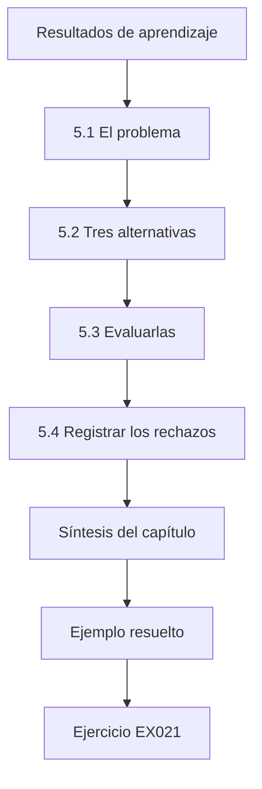

### Dibujo lógico

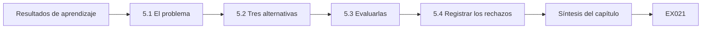

```text
[Resultados de aprendizaje]
    |
    v
[5.1 El problema]
    |
    v
[5.2 Tres alternativas]
    |
    v
[5.3 Evaluarlas]
    |
    v
[5.4 Registrar los rechazos]
    |
    v
[Síntesis del capítulo]
    |
    v
[Ejemplo resuelto] --> [Ejercicio EX021]
```
<!-- open-cyber-academy:lesson-figures:end ch-05 -->


### Resultados de aprendizaje

Usted será capaz de (1) generar alternativas de diseño realmente distintas para proteger estaciones de bombeo remotas; (2) evaluarlas con criterios operativos, de seguridad y de ciclo de vida; (3) usar los conceptos de zona y conducto de IEC 62443 para describir cada una; y (4) documentar por qué se rechazaron las alternativas rechazadas.

### 5.1 El problema

Las 23 estaciones de bombeo de BWRP impulsan las aguas residuales hasta la planta. Cada una tiene una RTU con un módem celular que informa de los niveles y del estado de las bombas al SCADA y acepta órdenes de arranque y parada. Algunos módems tienen direcciones IP públicas, lo que los sitúa en la categoría de exposición que ATT&CK for ICS denomina T0883 *Internet Accessible Device*. Lo que más importa son las órdenes. Una lectura de nivel falsa podría ocultar un desbordamiento, pero una parada remota enviada a una bomba durante una tormenta podría provocarlo. Por eso cualquier diseño tiene que responder a dos preguntas: quién puede llegar a las RTU y si las órdenes remotas son necesarias en absoluto. Las respuestas difieren según la estación, y por eso las alternativas se comparan estación por estación.

### 5.2 Tres alternativas

Alternativa 1, APN privado: el operador de telecomunicaciones proporciona un nombre de punto de acceso privado para que los módems no tengan direcciones públicas; el tráfico llega a BWRP a través de un túnel gestionado por el operador. Alternativa 2, VPN en el lado de la RTU: cada RTU (o un pequeño router junto a ella) establece un túnel IPsec con un concentrador de BWRP en la DMZ. Alternativa 3, enlace de solo supervisión con control local: se eliminan las órdenes remotas; las RTU ejecutan el control local de nivel y solo informan, y los operadores envían cuadrillas ante las excepciones.

Cada alternativa cambia una cosa distinta. La primera elimina las direcciones públicas, pero mantiene la confianza en el operador. La segunda añade el cifrado y la autenticación propios de BWRP a costa de más equipos. La tercera elimina la capacidad más arriesgada, las órdenes remotas, y acepta una respuesta más lenta. Son realmente distintas, y eso es lo que hace útil compararlas.

### 5.3 Evaluarlas

La alternativa 1 es rápida y barata, pero confía en el aislamiento del operador. La alternativa 2 da a BWRP su propia frontera criptográfica, pero añade 23 dispositivos que parchear y certificados que gestionar. La alternativa 3 es la que más reduce la superficie de ataque (sin órdenes remotas no hay manipulación remota de las bombas), pero alarga la respuesta a algunas averías, algo que operación debe aceptar. En términos de 62443, cada alternativa define un conducto distinto entre las zonas de las estaciones de bombeo y la zona SCADA, con capacidades de seguridad distintas.

Ponga la evaluación en una tabla con los mismos criterios para cada alternativa, como el plazo de despliegue, el coste a cinco años, el efecto en la respuesta a los desbordamientos y la exposición que queda. Puntúe cada clase de estación por separado, porque una estación junto a la playa con una consecuencia de desbordamiento alta justifica más que una estación de interior cuyo desbordamiento queda contenido.

### 5.4 Registrar los rechazos

Un registro de diseño enumera las alternativas rechazadas y el motivo. De lo contrario, los revisores futuros las vuelven a proponer sin conocer la historia. Para BWRP, el registro anota que la alternativa 3 se rechazó porque los arranques remotos de bombas evitaron tres desbordamientos el año pasado. Si la operación cambia más adelante, por ejemplo al añadir almacenamiento local o control automático en las estaciones de consecuencia alta, el motivo puede dejar de ser válido, y el registro le dice al siguiente revisor exactamente qué condición comprobar. Feche el registro y nombre a quién aceptó el rechazo.

### Ejemplo resuelto (BWRP sintética)

Daniel recomienda la alternativa 1 de inmediato (elimina la exposición pública en un mes) y la alternativa 2 para las seis estaciones con mayor consecuencia de desbordamiento (cerca de las playas), y rechaza la alternativa 3 porque operación demostró que los arranques remotos de bombas evitaron tres desbordamientos el año pasado.

> **Caso sintético — Bayside Water Reclamation Plant.** Los recuentos de estaciones y el historial de desbordamientos son inventados.

### Errores y límites

Un APN privado no es cifrado; las redes internas del operador quedan fuera del control de BWRP. Hay que probar el efecto de latencia de las alternativas sobre la telemetría.

### Ejercicios — capítulo 5

- **EX021 — El registro de la opción rechazada.** Escriba la entrada de rechazo de la alternativa 3. *Rúbrica:* 3 = motivo con evidencia y condiciones para reconsiderarla; 2 = solo el motivo; 1 = «no elegida»; 0 = nada.
- **EX022 — Hipótesis de confianza de un APN privado.** Indique la hipótesis de confianza de la que depende la alternativa 1. *Rúbrica:* 3 = el operador aísla el tráfico del APN y gestiona el acceso correctamente; 2 = vago; 1 = intento mínimo; 0 = nada.
- **EX023 — Coste de ciclo de vida de las VPN en las RTU.** Enumere dos tareas recurrentes que añade la alternativa 2. *Rúbrica:* 3 = renovación/rotación de certificados, parches del firmware de los routers (o mantenimiento del concentrador); 2 = una; 1 = tareas puntuales; 0 = nada.
- **EX024 — Justificar un híbrido.** Justifique aplicar la alternativa 2 solo a seis estaciones. *Rúbrica:* 3 = niveles según la consecuencia, coste proporcional al riesgo; 2 = parcial; 1 = solo el coste; 0 = nada.
- **EX025 — Descripción del conducto.** Describa el conducto de la alternativa 2 con el lenguaje de zonas y conductos. *Rúbrica:* 3 = conducto desde cada zona de estación de bombeo por un túnel IPsec hasta el concentrador de la DMZ y de ahí a la zona SCADA, con los controles indicados; 2 = parcial; 1 = «VPN»; 0 = nada.

### Síntesis del capítulo

Un buen trabajo de diseño produce alternativas reales, las evalúa a lo largo de su ciclo de vida, escalona la protección según la consecuencia y recuerda por qué se rechazaron las opciones.

### Siga estudiando — capítulo 05 de 12

[← Capítulo 04 (borrador)](#ch-04) · [Índice de capítulos del curso](../SUBJECTS.md) · [Capítulo 06 (borrador) →](#ch-06)

<a id="ch-06"></a>

## Capítulo 6 — Seguridad de TO, IoT y sistemas ciberfísicos: evaluación controlada

<!-- open-cyber-academy:lesson-figures:start ch-06 -->
### Mapa de la lección

Lección 06 publicada. Mapa, ejemplo, EX026.

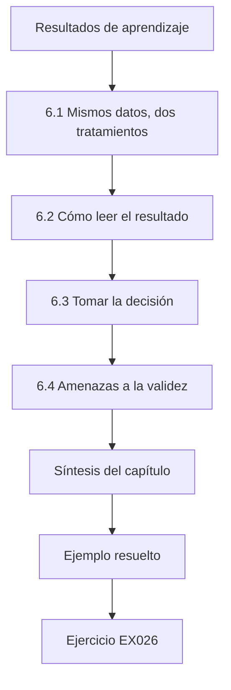

### Dibujo lógico

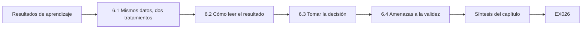

```text
[Resultados de aprendizaje]
    |
    v
[6.1 Mismos datos, dos tratamientos]
    |
    v
[6.2 Cómo leer el resultado]
    |
    v
[6.3 Tomar la decisión]
    |
    v
[6.4 Amenazas a la validez]
    |
    v
[Síntesis del capítulo]
    |
    v
[Ejemplo resuelto] --> [Ejercicio EX026]
```
<!-- open-cyber-academy:lesson-figures:end ch-06 -->


### Resultados de aprendizaje

Usted será capaz de (1) diseñar una comparación controlada de dos conjuntos de reglas de alerta sobre la misma reproducción etiquetada; (2) estimar la exhaustividad y la tasa de falsas alertas de cada uno; (3) calcular un intervalo de confianza bootstrap para la diferencia; y (4) decidir si la evidencia justifica un cambio en producción.

### 6.1 Mismos datos, dos tratamientos

Comparar el conjunto de reglas A (actual) con el conjunto de reglas B (propuesto) sobre semanas de datos distintas confunde las reglas con las semanas. Una evaluación controlada pasa las mismas ventanas etiquetadas por ambos. Las etiquetas proceden de un plan de pruebas: 40 ventanas contienen comportamiento de ataque inyectado en la reproducción y 160 son de operación normal.

```python
"""Lab 06: controlled evaluation of two alerting rule sets on the same synthetic replay, with bootstrap CI."""
import random
rnd = random.Random(6)
# 200 labelled replay windows: (is_attack, alert_by_A, alert_by_B)
data = []
for i in range(200):
    att = i < 40
    a = rnd.random() < (0.70 if att else 0.08)
    b = rnd.random() < (0.85 if att else 0.05)
    data.append((att, a, b))
def recall(rows, k): at = [r for r in rows if r[0]]; return sum(r[k] for r in at) / len(at)
def far(rows, k): be = [r for r in rows if not r[0]]; return sum(r[k] for r in be) / len(be)
print(f"A recall={recall(data,1):.3f} false-alert rate={far(data,1):.3f}")
print(f"B recall={recall(data,2):.3f} false-alert rate={far(data,2):.3f}")
diffs = []
for _ in range(2000):
    s = [rnd.choice(data) for _ in data]
    if any(r[0] for r in s): diffs.append(recall(s, 2) - recall(s, 1))
diffs.sort()
print(f"recall difference B-A 95% bootstrap CI: [{diffs[50]:.3f}, {diffs[1949]:.3f}]")
```

Ejecútelo con `python3 lab_ab.py`. Salida verificada:

```text
A recall=0.650 false-alert rate=0.069
B recall=0.850 false-alert rate=0.037
recall difference B-A 95% bootstrap CI: [0.000, 0.388]
```

El plan de pruebas debe escribirse antes de construir la reproducción, nombrando los comportamientos de ataque, cuántas ventanas recibe cada uno y quién las etiqueta. Lo ideal es que la persona que inyecta los ataques no haya diseñado ninguno de los dos conjuntos de reglas. El laboratorio 6 sustituye esto por resultados aleatorios con semilla fija, así que sus números muestran el método y no el rendimiento real de las reglas de BWRP.

### 6.2 Cómo leer el resultado

La exhaustividad de B es 0,85 frente a 0,65 de A, y su tasa de falsas alertas es menor (3,7 % frente a 6,9 %). El intervalo bootstrap para la diferencia de exhaustividad va de 0,000 a 0,388: el extremo inferior toca el cero. Con solo 40 ventanas de ataque, no podemos descartar que B no sea mejor que A en exhaustividad, aunque la estimación puntual lo favorece claramente. Cada ventana remuestreada lleva los resultados de ambos conjuntos de reglas, así que el bootstrap anterior ya conserva el emparejamiento; una prueba exacta sobre las ventanas en las que A y B discrepan sería la comprobación cruzada natural.

Informe de los recuentos junto a las tasas para que el lector pueda juzgar la evidencia: 34 de 40 frente a 26 de 40 ventanas de ataque, y 6 frente a 11 de 160 ventanas normales. Con tan pocas ventanas de ataque, un puñado de resultados distintos cambiaría el panorama. Esa es la razón principal por la que Daniel pide una reproducción más grande y construida de forma independiente antes de la siguiente revisión.

### 6.3 Tomar la decisión

Los líderes rara vez necesitan certeza estadística para actuar; necesitan conocer el riesgo de cada opción. B es más barato en falsas alertas y probablemente mejor en exhaustividad. El inconveniente de cambiar (si B en realidad no fuera mejor) es pequeño. Daniel recomienda cambiar, ampliando a la vez el conjunto de ventanas de ataque a 120 antes de la siguiente revisión. La decisión es más fácil porque B también produce menos falsas alertas, algo que los operadores notan en cada turno. Daniel registra la recomendación con su incertidumbre, fija la fecha de la siguiente revisión y nombra al colega que construirá las 120 ventanas de ataque. Si la reproducción más grande no muestra ninguna ventaja en exhaustividad, la decisión se revisa en lugar de defenderse.

### 6.4 Amenazas a la validez

Los ataques inyectados reflejan la imaginación del autor de las pruebas; los adversarios reales pueden ser distintos. La reproducción omite la reacción de los operadores. El conjunto de reglas B se diseñó después de ver algunos de estos tipos de ataque, lo que lo favorece. Cada amenaza tiene un remedio parcial. Pida a un colega que no diseñó B que escriba ventanas de ataque nuevas. Deje constancia de que la reproducción mide alertas, no si los operadores actúan sobre ellas. Registre qué tipos de ataque influyeron en el diseño de B e informe de los resultados de B sobre ellos por separado del resto, para que el lector pueda ver si su ventaja se mantiene con comportamientos no vistos.

### Ejemplo resuelto (BWRP sintética)

Nota de evaluación de Daniel: «Reproducción R-6 (200 ventanas, 40 de ataque, semilla 6). B: exhaustividad 34/40, falsas alertas 6/160. A: exhaustividad 26/40, falsas alertas 11/160. Diferencia de exhaustividad, IC bootstrap del 95 % [0,000; 0,388]. Recomendación: adoptar B; ampliar a 120 ventanas de ataque construidas por un colega que no diseñó B».

> **Caso sintético — Bayside Water Reclamation Plant.** Las etiquetas de la reproducción y los resultados de las alertas los genera el script con semilla fija.

### Errores y límites

Los intervalos bootstrap con pocos positivos son inestables. Los resultados de alerta del laboratorio son sorteos aleatorios que sustituyen al comportamiento real de las reglas.

### Ejercicios — capítulo 6

- **EX026 — Los recuentos detrás de las tasas.** Convierta la tasa de falsas alertas de A, 0,069, en un recuento sobre las 160 ventanas normales. *Rúbrica:* 3 = 11 de 160; 2 = ≈11; 1 = 0,069 × 200; 0 = nada.
- **EX027 — Interpretar un IC que toca el cero.** ¿Qué le dice a quien decide un límite inferior de 0,000? *Rúbrica:* 3 = datos compatibles con ninguna mejora de la exhaustividad; incertidumbre por tener 40 positivos; 2 = parcial; 1 = «B es mejor»; 0 = nada.
- **EX028 — ¿Por qué reproducir las mismas ventanas?** Explique la ventaja de un diseño emparejado en este caso. *Rúbrica:* 3 = elimina la variación de una semana a otra; las diferencias se deben a las reglas; 2 = parcial; 1 = vago; 0 = nada.
- **EX029 — Autoría independiente de los ataques.** ¿Por qué debería un colega construir las nuevas ventanas de ataque? *Rúbrica:* 3 = evita un sesgo de diseño a favor de B; 2 = parcial; 1 = carga de trabajo; 0 = nada.
- **EX030 — Inconveniente asimétrico.** Argumente por qué cambiar a B es razonable a pesar del intervalo. *Rúbrica:* 3 = menos falsas alertas y probablemente mejor exhaustividad; coste pequeño si son iguales; reversible; 2 = parcial; 1 = «estadísticamente demostrado»; 0 = nada.

### Síntesis del capítulo

Una evaluación controlada empareja los tratamientos sobre datos etiquetados idénticos, informa de recuentos e intervalos, y permite a los líderes actuar de forma proporcionada a partir de evidencia incierta pero útil.

### Siga estudiando — capítulo 06 de 12

[← Capítulo 05 (borrador)](#ch-05) · [Índice de capítulos del curso](../SUBJECTS.md) · [Capítulo 07 (borrador) →](#ch-07)

<a id="ch-07"></a>

## Capítulo 7 — Seguridad de TO, IoT y sistemas ciberfísicos: integración organizativa

<!-- open-cyber-academy:lesson-figures:start ch-07 -->
### Mapa de la lección

Lección 07 publicada. Mapa, ejemplo, EX031.

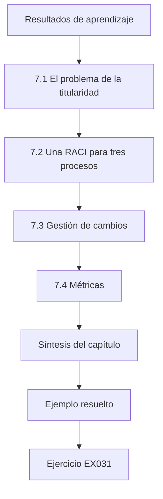

### Dibujo lógico

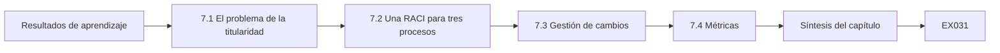

```text
[Resultados de aprendizaje]
    |
    v
[7.1 El problema de la titularidad]
    |
    v
[7.2 Una RACI para tres procesos]
    |
    v
[7.3 Gestión de cambios]
    |
    v
[7.4 Métricas]
    |
    v
[Síntesis del capítulo]
    |
    v
[Ejemplo resuelto] --> [Ejercicio EX031]
```
<!-- open-cyber-academy:lesson-figures:end ch-07 -->


### Resultados de aprendizaje

Usted será capaz de (1) diseñar funciones y responsabilidades de seguridad de TO entre TI, operación e ingeniería; (2) construir una matriz RACI para los procesos clave de seguridad de TO; (3) integrar la seguridad de TO en la gestión de cambios; y (4) fijar métricas que impulsen el comportamiento correcto.

### 7.1 El problema de la titularidad

En muchas empresas de servicios, TI es titular de la red hasta un cortafuegos, operación es titular del proceso, ingeniería es titular de los controladores y nadie es titular del espacio donde se encuentran. NIST SP 800-82r3 recomienda un equipo multifuncional para la seguridad de TO, con una autoridad claramente asignada. Integrar significa dejar por escrito quién decide, no solo quién asesora. En BWRP ese espacio incluye el cortafuegos de la DMZ, el intermediario de proveedores y los enlaces celulares con las estaciones de bombeo. Cada uno necesita un titular con nombre y autoridad para aprobar cambios y actuar en un incidente. Dejarlo por escrito suele revelar que dos equipos creían que el titular era el otro, que es exactamente la brecha que aprovecha un atacante o una avería.

### 7.2 Una RACI para tres procesos

Para la aprobación del acceso remoto: el supervisor de turno es Responsable de habilitar las sesiones; el responsable de seguridad de TO rinde cuentas (Accountable) de la política; el gestor de proveedores es Consultado; seguridad de TI es Informada de cada sesión. Para un cambio de la lógica del PLC: el ingeniero de control es Responsable, el jefe de ingeniería rinde cuentas, operación es Consultada y seguridad de TO es Informada y recibe una alerta. Para la declaración de un incidente de TO: el supervisor de turno es Responsable de comunicarlo, el director de la planta rinde cuentas, seguridad de TO y TI son Consultadas y el regulador es Informado cuando se alcanzan los umbrales.

Compruebe en cada fila que haya exactamente una parte que rinde cuentas y al menos una persona que hace el trabajo. Comparta la tabla con cada función que nombra y pregunte si están de acuerdo; una función que se entera por la tabla de que rinde cuentas de algo todavía no lo ha aceptado. Revise la RACI tras los cambios organizativos y tras cualquier incidente que la haya puesto a prueba.

### 7.3 Gestión de cambios

Todo cambio en un sistema de TO pasa por un comité de cambios que ya existe para la seguridad funcional y la fiabilidad. Añadir tres preguntas de seguridad a su formulario (¿añade este cambio un conducto, modifica una cuenta o altera el firmware?) integra la seguridad sin una burocracia paralela. Cada respuesta afirmativa desencadena entonces una acción definida: un conducto nuevo necesita una regla de cortafuegos y un titular; una cuenta modificada necesita una revisión de quién puede usarla; un firmware alterado necesita una comprobación frente a los avisos del proveedor y una copia de seguridad previa. El comité ya entiende las preguntas de seguridad funcional y fiabilidad, así que las preguntas de seguridad deben formularse de la misma manera.

### 7.4 Métricas

Mida aquello de lo que quiere más. «Número de vulnerabilidades» premia no buscar. Mejor: porcentaje de activos de TO del inventario con versiones de firmware conocidas; mediana de días para aplicar los parches de TO de alto riesgo dentro de las ventanas disponibles; porcentaje de sesiones de proveedores con grabaciones revisadas. Cada métrica nombra un denominador. Cada métrica necesita también un valor de partida y una fecha objetivo. El cuadro de mando de BWRP parte de 14 de 23 RTU en el inventario y 0 de 37 sesiones de proveedores revisadas desde marzo, así que el avance es visible desde el primer informe. Revise cada definición con las personas a las que mide, para que la métrica cambie el comportamiento y no solo el informe.

### Ejemplo resuelto (BWRP sintética)

Plan de integración de Daniel: el responsable de seguridad de TO reporta al director de la planta, con una línea punteada hacia el CISO; el formulario del comité de cambios incorpora tres preguntas; un cuadro de mando trimestral muestra la completitud del inventario (hoy 14/23 RTU más 41/41 activos de la planta), la tasa de revisión de sesiones de proveedores (hoy 0/37 sesiones revisadas desde marzo) y la vigencia de las pruebas de restauración.

> **Caso sintético — Bayside Water Reclamation Plant.** La estructura y las cifras son inventadas.

### Errores y límites

Las tablas RACI fallan si dos partes rinden cuentas a la vez. Las métricas pueden manipularse; revise las definiciones cada año.

### Ejercicios — capítulo 7

- **EX031 — Detectar un error en una RACI.** Un borrador indica que tanto seguridad de TI como el director de la planta rinden cuentas de la declaración de incidentes. ¿Qué está mal y cómo se corrige? *Rúbrica:* 3 = solo una parte rinde cuentas; director A, TI C; 2 = solo el problema; 1 = lo acepta; 0 = nada.
- **EX032 — Tres preguntas para el comité de cambios.** Reescriba las tres preguntas de seguridad para que alguien no especialista pueda responderlas con sí o no. *Rúbrica:* 3 = tres preguntas claras de sí/no; 2 = dos; 1 = jerga; 0 = nada.
- **EX033 — Una métrica contraproducente.** Explique cómo «cero hallazgos de TO abiertos» podría ser contraproducente. *Rúbrica:* 3 = desincentiva informar/buscar; incentiva cerrar sin corregir; 2 = parcial; 1 = vago; 0 = nada.
- **EX034 — Cifra de completitud del inventario.** Calcule la completitud combinada del inventario de BWRP. *Rúbrica:* 3 = 55/64 ≈ 85,9 %; 2 = fracción correcta; 1 = solo 14/23; 0 = nada.
- **EX035 — Elegir la línea de reporte.** Dé una ventaja de que el responsable de seguridad de TO reporte al director de la planta en lugar de al CISO. *Rúbrica:* 3 = autoridad sobre las decisiones de operación, contexto del proceso; 2 = vago; 1 = intento mínimo; 0 = nada.

### Síntesis del capítulo

La integración es autoridad explícita, preguntas incorporadas al proceso de cambios y métricas con denominadores que premian encontrar y corregir.

### Siga estudiando — capítulo 07 de 12

[← Capítulo 06 (borrador)](#ch-06) · [Índice de capítulos del curso](../SUBJECTS.md) · [Capítulo 08 (borrador) →](#ch-08)

<a id="ch-08"></a>

## Capítulo 8 — Seguridad de TO, IoT y sistemas ciberfísicos: casos difíciles

<!-- open-cyber-academy:lesson-figures:start ch-08 -->
### Mapa de la lección

Lección 08 publicada. Mapa, ejemplo, EX036.

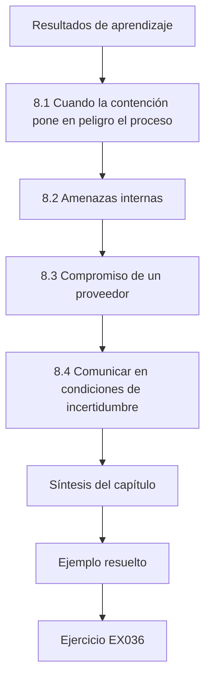

### Dibujo lógico

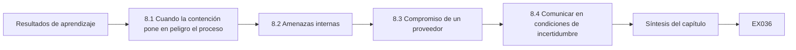

```text
[Resultados de aprendizaje]
    |
    v
[8.1 Cuando la contención pone en peligro el proceso]
    |
    v
[8.2 Amenazas internas]
    |
    v
[8.3 Compromiso de un proveedor]
    |
    v
[8.4 Comunicar en condiciones de incertidumbre]
    |
    v
[Síntesis del capítulo]
    |
    v
[Ejemplo resuelto] --> [Ejercicio EX036]
```
<!-- open-cyber-academy:lesson-figures:end ch-08 -->


### Resultados de aprendizaje

Usted será capaz de (1) liderar una respuesta cuando la contención y la seguridad funcional del proceso entran en conflicto; (2) gestionar un escenario interno con equidad y evidencia; (3) gestionar el compromiso de un proveedor que afecta a varios emplazamientos; y (4) comunicarse en condiciones de incertidumbre con los reguladores y el público.

### 8.1 Cuando la contención pone en peligro el proceso

Suponga que la evidencia apunta a un intruso en el servidor SCADA de BWRP durante una tormenta, cuando las estaciones de bombeo necesitan arranques remotos de bombas para evitar desbordamientos. Desconectar el SCADA detiene a la vez al intruso y el control remoto de los operadores. La tarea del líder es elegir la opción menos mala: mantener el SCADA conectado con una vigilancia reforzada y verificación manual de cada orden; enviar cuadrillas a las estaciones de consecuencia alta para que tomen el control local; y después aislar. NIST SP 800-82r3 subraya que la respuesta a incidentes de TO debe sopesar el impacto en la seguridad funcional y en la operación de las acciones de respuesta.

### 8.2 Amenazas internas

Un cambio local sin explicación en un panel de dosificación (el ejemplo del capítulo 3) podría ser un ajuste bienintencionado de un técnico o un sabotaje. Trátelo primero como una desviación del proceso, reúna evidencia sin acusar, implique a recursos humanos y a la asesoría jurídica antes de las entrevistas, y recuerde que las culturas de culpa hacen que el personal oculte los errores, lo que es peor para la seguridad. En BWRP, la evidencia ya apuntaba a un cambio local durante un período en el que el panel estaba en modo local. El siguiente paso es comprobar los cuadrantes de turnos y las órdenes de trabajo de esa franja, y preguntar al técnico qué estaba haciendo, llevando la conversación como una revisión del proceso. Solo si la explicación no encaja se convierte en un asunto disciplinario o legal.

### 8.3 Compromiso de un proveedor

Si un proveedor de SCADA anuncia que su servidor de actualizaciones distribuyó software manipulado, toda empresa de servicios que lo use debe determinar su exposición. Los líderes necesitan un inventario de las versiones instaladas y un registro de la procedencia de las actualizaciones. El intercambio de información sectorial ayuda; también una relación previa con el equipo de seguridad del proveedor. Para BWRP, la primera pregunta sería qué servidores SCADA y estaciones de ingeniería recibieron actualizaciones de la fuente afectada, y cuándo. Eso requiere registros guardados antes del anuncio, y por eso importa el trabajo de inventario de la lista de brechas. Los contactos con el equipo de seguridad del proveedor y con el grupo sectorial de intercambio deben establecerse antes de una crisis, no durante ella.

### 8.4 Comunicar en condiciones de incertidumbre

Diga a los reguladores lo que sabe, lo que no sabe, lo que está haciendo y cuándo dará la próxima actualización. Evite tanto las garantías que no puede respaldar como las especulaciones sobre la atribución. En BWRP, la declaración provisional de la 01:00 de la noche de tormenta siguió este patrón: una sesión desconocida desde el servidor SCADA, cuadrillas en las estaciones junto a la playa, la ruta externa cortada y la hora de la siguiente actualización. No afirmaba nada sobre quién era el responsable. Prepare con antelación plantillas para estas declaraciones, de modo que puedan emitirse con rapidez sin una redacción descuidada.

### Ejemplo resuelto (BWRP sintética)

Noche de tormenta, 23:40: la supervisión alerta de una sesión saliente desconocida desde el servidor SCADA. Daniel y el supervisor de turno acuerdan: cuadrillas en las seis estaciones junto a la playa antes de las 00:30 para tomar el control local; el SCADA sigue conectado con verificación por dos personas de cada orden remota; a las 00:35, con el control local confirmado, se corta la ruta externa del SCADA en el cortafuegos de la DMZ. El regulador recibe una declaración provisional a la 01:00 según los términos de notificación de la autorización.

> **Caso sintético — Bayside Water Reclamation Plant.** El evento y los horarios son inventados.

### Errores y límites

La verificación por dos personas ralentiza la operación; es una medida temporal. Las declaraciones provisionales no deben retrasarse para perfeccionarlas.

### Ejercicios — capítulo 8

- **EX036 — Secuenciar la respuesta de una noche de tormenta.** Explique por qué se enviaron las cuadrillas antes de cortar la ruta externa. *Rúbrica:* 3 = mantener la prevención de desbordamientos mediante el control local antes de perder el control remoto; 2 = parcial; 1 = rapidez; 0 = nada.
- **EX037 — Primeros pasos ante una posible amenaza interna.** Enumere las tres primeras acciones tras el cambio sin explicación en el panel. *Rúbrica:* 3 = poner el proceso en condiciones seguras/verificar el punto de consigna, preservar la evidencia, implicar a RR. HH./asesoría jurídica antes de las entrevistas; 2 = dos; 1 = acusar; 0 = nada.
- **EX038 — Pregunta de exposición al proveedor.** ¿Qué dos registros permiten a BWRP responder «¿nos afectó la actualización manipulada?»? *Rúbrica:* 3 = versión instalada por equipo e historial de origen/fecha de las actualizaciones; 2 = uno; 1 = lista de proveedores; 0 = nada.
- **EX039 — Una declaración provisional.** Redacte una declaración provisional de tres frases para el regulador. *Rúbrica:* 3 = lo conocido, lo desconocido, las acciones y la hora de la próxima actualización; 2 = tres de cuatro; 1 = especulativa; 0 = nada.
- **EX040 — Terminar la verificación por dos personas.** Indique un criterio para terminar la medida temporal. *Rúbrica:* 3 = ruta del intruso cerrada e integridad del SCADA verificada (p. ej., reconstrucción limpia o hashes verificados), aprobación del titular; 2 = parcial; 1 = solo basado en el tiempo; 0 = nada.

### Síntesis del capítulo

Los casos difíciles exigen una secuencia que mantenga el proceso seguro, equidad con las personas, inventarios que respondan a las preguntas sobre proveedores y una comunicación honesta.

### Siga estudiando — capítulo 08 de 12

[← Capítulo 07 (borrador)](#ch-07) · [Índice de capítulos del curso](../SUBJECTS.md) · [Capítulo 09 (borrador) →](#ch-09)

<a id="ch-09"></a>

## Capítulo 9 — Seguridad de TO, IoT y sistemas ciberfísicos: liderazgo y aseguramiento

<!-- open-cyber-academy:lesson-figures:start ch-09 -->
### Mapa de la lección

Lección 09 publicada. Mapa, ejemplo, EX041.

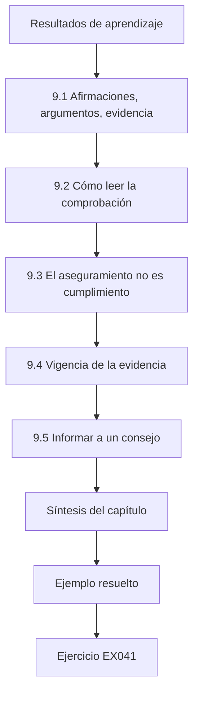

### Dibujo lógico

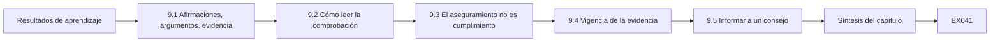

```text
[Resultados de aprendizaje]
    |
    v
[9.1 Afirmaciones, argumentos, evidencia]
    |
    v
[9.2 Cómo leer la comprobación]
    |
    v
[9.3 El aseguramiento no es cumplimiento]
    |
    v
[9.4 Vigencia de la evidencia]
    |
    v
[9.5 Informar a un consejo]
    |
    v
[Síntesis del capítulo]
    |
    v
[Ejemplo resuelto] --> [Ejercicio EX041]
```
<!-- open-cyber-academy:lesson-figures:end ch-09 -->


### Resultados de aprendizaje

Usted será capaz de (1) estructurar un argumento de aseguramiento desde una afirmación principal hasta la evidencia; (2) encontrar de forma mecánica las afirmaciones sin respaldo; (3) distinguir el aseguramiento del cumplimiento; y (4) presentar el estado del aseguramiento a un consejo sin exagerarlo.

### 9.1 Afirmaciones, argumentos, evidencia

Un caso de aseguramiento enuncia una afirmación principal («el riesgo de TO de BWRP es aceptable»), la descompone en subafirmaciones y respalda cada hoja con evidencia: informes de pruebas, revisiones de configuración, registros de simulacros. Goal Structuring Notation es una forma gráfica habitual. Su valor está en que cada brecha se hace visible como una afirmación sin nada debajo.

```python
"""Lab 09: check a synthetic assurance argument: every claim needs evidence or fully supported sub-claims."""
arg = {
    "G1 BWRP OT risk is acceptable": ["G2 remote access controlled", "G3 dosing integrity protected", "G4 recovery tested"],
    "G2 remote access controlled": ["E1 broker config review 2026-09", "E2 session log sample"],
    "G3 dosing integrity protected": ["G5 setpoint limits enforced", "G6 writes monitored"],
    "G5 setpoint limits enforced": ["E3 bench test report"],
    "G6 writes monitored": [],
    "G4 recovery tested": ["E4 restore drill 2025-11"],
}
def supported(node, path=()):
    if node.startswith("E"): return True
    kids = arg.get(node, [])
    return bool(kids) and all(supported(k, path + (node,)) for k in kids)
for g in arg:
    print(f"{g:34} {'supported' if supported(g) else 'UNSUPPORTED'}")
```

Ejecútelo con `python3 lab_assure.py`. Salida verificada:

```text
G1 BWRP OT risk is acceptable      UNSUPPORTED
G2 remote access controlled        supported
G3 dosing integrity protected      UNSUPPORTED
G5 setpoint limits enforced        supported
G6 writes monitored                UNSUPPORTED
G4 recovery tested                 supported
```

Escribir el argumento de este modo hace precisa la pregunta del consejo. En lugar de preguntar si la seguridad de TO es buena, pregunta qué afirmaciones tienen respaldo y cuáles no. Cada elemento de evidencia necesita además un titular y una fecha, para que el caso pueda actualizarse. El argumento de BWRP del laboratorio 9 es deliberadamente pequeño, para mostrar la estructura antes de que crezca.

### 9.2 Cómo leer la comprobación

G6 «writes monitored» no tiene evidencia ni subafirmaciones, así que no tiene respaldo. G3 depende de G6 y por tanto falla, y la afirmación principal G1 falla con ella. G2 y G4 tienen respaldo. La comprobación es estricta a propósito: para un consejo, una afirmación principal no puede ser verdadera en parte. La comprobación solo evalúa la estructura. No puede decir si la prueba de banco de E3 era la prueba adecuada, ni si la muestra de registros de sesiones de E2 era lo bastante grande. Esos son juicios que corresponden a un revisor. Use la comprobación mecánica para encontrar brechas con rapidez y después lea cada elemento de evidencia para ver si de verdad respalda su afirmación.

### 9.3 El aseguramiento no es cumplimiento

El cumplimiento muestra que existen los controles exigidos. El aseguramiento argumenta que el riesgo es aceptable dadas las amenazas y las consecuencias reales del sistema. Una planta puede cumplir una lista de verificación y aun así tener una afirmación sin respaldo en su lazo más importante, aquí la integridad de la dosificación. BWRP podría superar una lista de verificación que pregunte si el acceso remoto está controlado y si la recuperación está probada, porque G2 y G4 tienen respaldo, mientras que la afirmación que más importa a los residentes, la integridad de la dosificación, sigue sin respaldo. El aseguramiento pone esa brecha al principio del documento para el consejo, donde un informe de cumplimiento la habría escondido entre los puntos superados.

### 9.4 Vigencia de la evidencia

La evidencia envejece. Un simulacro de restauración de 2025-11 respalda hoy G4; dentro de dos años no lo hará. Los casos de aseguramiento maduros asignan un período de validez a cada elemento y hacen fallar las afirmaciones cuya evidencia ha caducado. Fije el período de validez según la rapidez con la que la evidencia podría dejar de ser cierta. Una revisión de la configuración del intermediario puede tener que repetirse tras cada cambio importante, mientras que un simulacro de restauración podría ser válido durante un año. Añada las fechas de caducidad al propio argumento, para que la comprobación del laboratorio 9 pueda marcar una afirmación sin respaldo cuando su evidencia caduque.

### 9.5 Informar a un consejo

Informe: el estado de la afirmación principal (todavía sin respaldo), qué subafirmación la bloquea, qué evidencia está prevista y cuándo. Evite los colores rojo, ámbar y verde sin las afirmaciones subyacentes; el color oculta el razonamiento. El documento de Daniel para el consejo sigue esta estructura. Dice claramente que G1 todavía no tiene respaldo, nombra a G6 como la afirmación que la bloquea, da la fecha en la que existirá la evidencia e identifica la evidencia compensatoria hasta entonces. Un miembro del consejo puede hacer a ese documento una pregunta más afinada que a una sola luz ámbar.

### Ejemplo resuelto (BWRP sintética)

Documento de Daniel para el consejo: «G1 todavía no tiene respaldo porque la supervisión de escrituras en PLC-D (G6) no tiene evidencia. Previsto: desplegar supervisión pasiva en la red de dosificación antes de enero y adjuntar la revisión de alertas del primer mes como evidencia E5. Hasta entonces, la evidencia compensatoria es E3 (prueba de banco de los límites del punto de consigna)».

> **Caso sintético — Bayside Water Reclamation Plant.** La estructura del argumento y los identificadores de evidencia son inventados.

### Errores y límites

Un árbol con respaldo solo vale lo que valga la pertinencia de la evidencia; un informe de pruebas puede quedar asociado a la afirmación equivocada. Las comprobaciones mecánicas no juzgan la calidad de la evidencia.

### Ejercicios — capítulo 9

- **EX041 — Corregir el árbol.** Añada la evidencia «E5 monitoring review 2027-01» bajo G6. ¿Qué imprime el laboratorio para G1? *Rúbrica:* 3 = supported (todas las ramas llegan ahora a evidencia); 2 = correcto pero sin motivo; 1 = sigue sin respaldo; 0 = nada.
- **EX042 — Una regla de caducidad.** Escriba una regla que haga fallar la evidencia de más de 18 meses y diga qué elemento fallaría primero. *Rúbrica:* 3 = regla más E4 (2025-11) como el más antiguo; 2 = uno de los dos; 1 = vago; 0 = nada.
- **EX043 — Cumplimiento sin aseguramiento.** Dé un ejemplo en el que BWRP supera una lista de verificación pero G3 no tiene respaldo. *Rúbrica:* 3 = la lista pide cortafuegos/política, no supervisión de escrituras de dosificación; 2 = parcial; 1 = vago; 0 = nada.
- **EX044 — Evidencia mal asociada.** Explique por qué asociar a G3 una prueba de penetración de la TI corporativa sería un error. *Rúbrica:* 3 = no es pertinente para la integridad de la red de dosificación; otro sistema; 2 = parcial; 1 = aceptable; 0 = nada.
- **EX045 — Una frase para el consejo.** Escriba una frase que informe del estado de G1 sin códigos de color. *Rúbrica:* 3 = estado, afirmación que bloquea, plan y fecha; 2 = tres; 1 = «ámbar»; 0 = nada.

### Síntesis del capítulo

El aseguramiento hace auditables las afirmaciones de la dirección: cada afirmación principal se descompone hasta llegar a evidencia vigente y pertinente, y las brechas se informan como brechas.

### Siga estudiando — capítulo 09 de 12

[← Capítulo 08 (borrador)](#ch-08) · [Índice de capítulos del curso](../SUBJECTS.md) · [Capítulo 10 (borrador) →](#ch-10)

<a id="ch-10"></a>

## Capítulo 10 — Lectura y crítica de investigación

<!-- open-cyber-academy:lesson-figures:start ch-10 -->
### Mapa de la lección

Lección 10 publicada. Mapa, ejemplo, EX046.

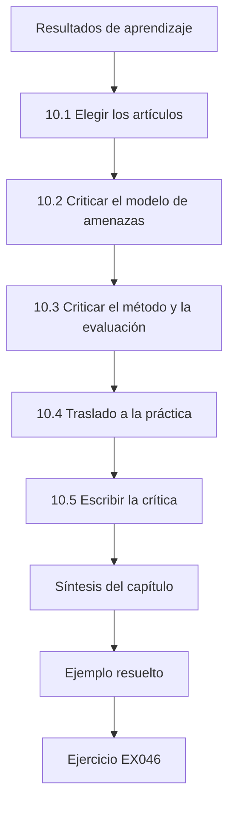

### Dibujo lógico

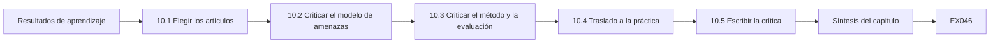

```text
[Resultados de aprendizaje]
    |
    v
[10.1 Elegir los artículos]
    |
    v
[10.2 Criticar el modelo de amenazas]
    |
    v
[10.3 Criticar el método y la evaluación]
    |
    v
[10.4 Traslado a la práctica]
    |
    v
[10.5 Escribir la crítica]
    |
    v
[Síntesis del capítulo]
    |
    v
[Ejemplo resuelto] --> [Ejercicio EX046]
```
<!-- open-cyber-academy:lesson-figures:end ch-10 -->


### Resultados de aprendizaje

Usted será capaz de (1) criticar el modelo de amenazas, el método y la evaluación de un artículo revisado por pares sobre seguridad de TO; (2) juzgar si los resultados se trasladan a su organización; (3) sintetizar varios artículos; y (4) escribir una crítica estructurada que pueda usar un público de profesionales.

### 10.1 Elegir los artículos

Lea investigación primaria que aborde una decisión pendiente. Para el programa de detección de BWRP, dos artículos enmarcan el campo: Giraldo et al. (2018, *ACM Computing Surveys*, doi:10.1145/3203245), una revisión de la detección de ataques basada en la física en sistemas ciberfísicos, y Urbina et al. (2016, ACM CCS, doi:10.1145/2976749.2978388), que defiende evaluar los detectores por el impacto que puede lograr un atacante no detectado. Parta de una decisión que esté sobre la mesa, como la forma de evaluar el monitor de dosificación previsto en BWRP, y elija los artículos que guarden relación con ella. Una revisión da el mapa, y un artículo centrado en un problema da un método que probar. Anote por qué se eligió cada artículo, para poder revisar la lista de lecturas cuando cambie la decisión.

### 10.2 Criticar el modelo de amenazas

Pregunte qué puede observar, cambiar y saber el atacante. Urbina et al. consideran un atacante que conoce el detector y se mantiene por debajo de su umbral, una hipótesis fuerte pero realista para actores con muchos recursos. Un artículo que solo prueba ataques ingenuos exagera el valor del detector. Para BWRP, el atacante pertinente es uno que puede cambiar los valores de dosificación o las lecturas que informan de ellos. Escriba las capacidades de ese atacante en la crítica y compárelas con las del artículo. Si un artículo supone que el atacante no puede ver el detector, diga si eso es plausible para una ruta de acceso de proveedores que llega a PLC-D.

### 10.3 Criticar el método y la evaluación

Compruebe el banco de pruebas o el conjunto de datos (simulado, de laboratorio u operativo), las métricas, las referencias de comparación y si los umbrales se ajustaron con los datos de evaluación. Las revisiones como la de Giraldo et al. son especialmente útiles para detectar hábitos de todo el campo, por ejemplo métricas incoherentes que dificultan comparar artículos. Escriba qué mide realmente la evaluación de cada artículo y compárelo con lo que BWRP necesita saber. Un detector evaluado por su exactitud sobre datos equilibrados dice poco de las falsas alertas en una planta donde los ataques son raros. Anote también si los autores informan del impacto que podría lograr un atacante sin ser detectado, la medida que defienden Urbina et al.

### 10.4 Traslado a la práctica

Incluso un artículo sólido puede no trasladarse. La detección basada en la física necesita un modelo del proceso; el tratamiento biológico de BWRP es lento y no lineal, a diferencia de los lazos más rápidos de muchos bancos de pruebas. Para trasladarlo hay que preguntar: ¿tiene nuestro proceso la dinámica, los sensores y la calidad de datos que el método supone? Responda a cada pregunta con evidencia de BWRP: qué sensores hay en el lazo de dosificación, con qué frecuencia informan y cuánto ruido tienen las lecturas. Si las respuestas no alcanzan lo que el método necesita, el traslado puede requerir instrumentos nuevos o un modelo distinto. La crítica debe decir cuál de las dos cosas, en lugar de recomendar el método por la fuerza de sus resultados publicados.

### 10.5 Escribir la crítica

Estructura: pregunta y afirmación; modelo de amenazas; método; evidencia; traslado a BWRP; qué probaríamos primero. Manténgala en dos páginas para un público de profesionales. Cada parte debe ser breve y concreta. El párrafo sobre el traslado es el más importante para los profesionales, porque dice qué tendría que ser cierto en BWRP para que los resultados del artículo se apliquen. Termine con una prueba que la organización pueda ejecutar, como medir la desviación máxima de dosificación no detectada en su propia reproducción. Pida a un operador que la lea antes de difundirla.

### Ejemplo resuelto (BWRP sintética)

La crítica de Daniel concluye: la métrica de impacto de Urbina et al. es la forma correcta de evaluar el monitor de dosificación de BWRP, porque el lazo de dosificación es donde un sesgo no detectado tiene consecuencias para la salud pública; los resultados de su banco de pruebas no se trasladan directamente, así que BWRP medirá la desviación máxima de dosificación no detectada en su propia reproducción antes de elegir los umbrales.

> **Caso sintético — Bayside Water Reclamation Plant.** La crítica es una ilustración; los dos artículos son reales y sus DOI están verificados.

### Errores y límites

Los resúmenes de artículos no son críticas. No atribuya a un artículo resultados que no presenta; cite textualmente y dé la referencia.

### Ejercicios — capítulo 10

- **EX046 — La hipótesis del atacante sigiloso.** ¿Por qué es razonable para BWRP suponer que el atacante conoce el detector? *Rúbrica:* 3 = los actores capaces estudian sus objetivos; la documentación y los proveedores filtran información; diseño conservador; 2 = parcial; 1 = no es razonable; 0 = nada.
- **EX047 — Detectar el ajuste con los datos de prueba.** ¿Qué frase de una sección de método mostraría que los umbrales se ajustaron con los datos de evaluación? *Rúbrica:* 3 = umbrales elegidos para maximizar el rendimiento en el mismo conjunto de datos del que se informa; 2 = parcial; 1 = vago; 0 = nada.
- **EX048 — Pregunta de traslado para procesos lentos.** Nombre una propiedad del proceso que limite el traslado de resultados de detección en lazos rápidos al tratamiento biológico. *Rúbrica:* 3 = dinámica lenta y no lineal/constantes de tiempo largas o sensores escasos; 2 = vago; 1 = incorrecto; 0 = nada.
- **EX049 — Usar bien una revisión.** Indique un uso adecuado y uno inadecuado de Giraldo et al. *Rúbrica:* 3 = adecuado: cartografiar el campo y encontrar artículos primarios; inadecuado: citarlo como evidencia de que un detector concreto funciona; 2 = uno; 1 = vago; 0 = nada.
- **EX050 — La primera prueba.** ¿Qué debería probar BWRP en primer lugar tras leer a Urbina et al.? *Rúbrica:* 3 = desviación máxima de dosificación no detectada con los umbrales actuales en su reproducción; 2 = parcial; 1 = tasa de detección; 0 = nada.

### Síntesis del capítulo

La crítica evalúa el modelo de amenazas, el método y el traslado, y después convierte un artículo en la primera prueba que su organización debería ejecutar.

### Siga estudiando — capítulo 10 de 12

[← Capítulo 09 (borrador)](#ch-09) · [Índice de capítulos del curso](../SUBJECTS.md) · [Capítulo 11 (borrador) →](#ch-11)

<a id="ch-11"></a>

## Capítulo 11 — Proyecto aplicado

<!-- open-cyber-academy:lesson-figures:start ch-11 -->
### Mapa de la lección

Lección 11 publicada. Mapa, ejemplo, EX051.

```mermaid
flowchart TD
  N0["Resultados de aprendizaje"]
  N1["11.1 Elegir el proyecto"]
  N2["11.2 Partes interesadas y restricciones"]
  N3["11.3 Hitos y riesgos"]
  N4["11.4 Medidas de éxito"]
  N5["11.5 El expediente"]
  N6["Síntesis del capítulo"]
  N0 --> N1 --> N2 --> N3 --> N4 --> N5 --> N6
  N6 --> EX["Ejemplo resuelto"]
  EX --> Q["Ejercicio EX051"]
```

### Dibujo lógico

```mermaid
flowchart LR
  N0["Resultados de aprendizaje"]
  N1["11.1 Elegir el proyecto"]
  N2["11.2 Partes interesadas y restricciones"]
  N3["11.3 Hitos y riesgos"]
  N4["11.4 Medidas de éxito"]
  N5["11.5 El expediente"]
  N6["Síntesis del capítulo"]
  N0 --> N1 --> N2 --> N3 --> N4 --> N5 --> N6 --> Q["EX051"]
```

```text
[Resultados de aprendizaje]
    |
    v
[11.1 Elegir el proyecto]
    |
    v
[11.2 Partes interesadas y restricciones]
    |
    v
[11.3 Hitos y riesgos]
    |
    v
[11.4 Medidas de éxito]
    |
    v
[11.5 El expediente]
    |
    v
[Síntesis del capítulo]
    |
    v
[Ejemplo resuelto] --> [Ejercicio EX051]
```
<!-- open-cyber-academy:lesson-figures:end ch-11 -->


### Resultados de aprendizaje

Usted será capaz de (1) delimitar el alcance de un proyecto aplicado de seguridad de TO dentro de una restricción organizativa real; (2) planificar las partes interesadas, los hitos y los riesgos; (3) entregar un artefacto junto con un expediente de evidencia; y (4) definir las medidas de éxito antes de empezar.

### 11.1 Elegir el proyecto

Un proyecto aplicado de posgrado debería cambiar algo en una organización, con el acuerdo por escrito del titular, y poder terminarse en un trimestre académico. En BWRP, el proyecto de Daniel es la «supervisión pasiva de escrituras para la red de dosificación»: cierra la afirmación sin respaldo G6 del capítulo 9 y usa el método de evaluación del capítulo 6 y la medida de impacto del capítulo 10. El proyecto de supervisión supera estas pruebas. Operación e ingeniería son titulares de los sistemas que toca y pueden dar su acuerdo por escrito. Puede terminarse en doce semanas. Cierra una brecha con nombre en el caso de aseguramiento, y su resultado será medible. Un proyecto que solo produce un informe, sin cambiar nada, no alcanzaría el nivel exigido.

### 11.2 Partes interesadas y restricciones

Operación debe aprobar la toma de supervisión (pasiva, en un puerto espejo, instalada en una ventana de mantenimiento). Ingeniería proporciona el mapa de registros. TI proporciona el almacenamiento de registros. El regulador no tiene que aprobarlo, pero verá los resultados en el siguiente informe de aseguramiento. La lista de restricciones incluye: ningún tráfico activo en la red de dosificación, ningún cambio en PLC-D y una conservación de datos de 90 días. Escriba cada restricción como una prueba que puede fallar y compruébelas en cada hito. Si el puerto espejo no puede instalarse sin tocar la configuración de PLC-D, gana la restricción y el plan cambia. Lleve un breve registro de partes interesadas con quién acordó qué y cuándo, porque el expediente lo necesitará.

### 11.3 Hitos y riesgos

Semanas 1–2: acuerdo, toma instalada y captura validada. Semanas 3–6: línea de base y reglas. Semanas 7–9: evaluación controlada con una reproducción de ataques escrita de forma independiente. Semanas 10–12: expediente y traspaso. Riesgos: pérdida de paquetes en el puerto espejo (mitigación: supervisar los contadores de pérdida), fatiga de alertas de los operadores (mitigación: las alertas van primero a seguridad de TO durante 4 semanas), rotación del personal (mitigación: manual de operación escrito). Revise los riesgos en cada hito y registre si cada mitigación funciona. Si la pérdida de captura no puede controlarse antes de la semana 2, los resultados posteriores no serían fiables, así que el plan se detiene en lugar de arrastrar una línea de base débil. Proteja en especial las semanas 7 a 9, porque la evaluación es la primera fase que se recorta cuando el trabajo anterior se retrasa.

### 11.4 Medidas de éxito

Definidas de antemano: pérdida de captura inferior al 0,1 % durante una semana; exhaustividad de al menos 0,8 en la reproducción independiente con una tasa de falsas alertas inferior al 2 % de las ventanas normales; desviación máxima de dosificación no detectada informada; manual de operación aceptado por operación. Registre estas medidas en el acuerdo del proyecto, con la fecha y las partes interesadas que las aceptaron. La desviación máxima de dosificación no detectada no tiene objetivo porque es un hallazgo, no una nota de aprobado, pero debe informarse muestre lo que muestre. No alcanzar una medida se informa como un fallo, como hace Daniel en la semana 9.

### 11.5 El expediente

El expediente de evidencia contiene el acuerdo, la configuración, los informes de pruebas, los resultados de la evaluación con intervalos, las cuestiones abiertas y el traspaso. Se convierte en la evidencia E5 del caso de aseguramiento. Organice el expediente de modo que un revisor pueda seguir el proyecto desde el acuerdo hasta el traspaso sin hacer preguntas. Incluya las cifras de pérdida de captura, los recuentos de la evaluación, el incumplimiento de la semana 9 en falsas alertas y la nueva ejecución. Cuando se convierte en evidencia del caso de aseguramiento, lleva una fecha, así que su período de validez empieza entonces. Consérvelo en los registros controlados de la planta.

### Ejemplo resuelto (BWRP sintética)

En la semana 9, la reproducción independiente da una exhaustividad de 33/40 (0,825) y 4/160 falsas alertas (2,5 %): el objetivo de exhaustividad se cumple y el de falsas alertas no. Daniel informa del incumplimiento, endurece una regla que produjo tres de las cuatro falsas alertas y programa una nueva ejecución en lugar de redefinir el objetivo.

> **Caso sintético — Bayside Water Reclamation Plant.** Los resultados del proyecto son inventados.

### Errores y límites

Los proyectos en organizaciones en funcionamiento se retrasan; proteja la fase de evaluación. No deje que las medidas de éxito se desplacen una vez llegados los resultados.

### Ejercicios — capítulo 11

- **EX051 — Comprobar los objetivos.** ¿Cumplen 33/40 y 4/160 las medidas de éxito? *Rúbrica:* 3 = exhaustividad sí (0,825 ≥ 0,8), falsas alertas no (2,5 % > 2 %); 2 = uno correcto; 1 = ambos sí; 0 = nada.
- **EX052 — Una restricción y su motivo.** Explique a un colega de TI «ningún tráfico activo en la red de dosificación». *Rúbrica:* 3 = los dispositivos heredados pueden comportarse mal; seguridad funcional de la dosificación química; basta con lo pasivo; 2 = parcial; 1 = es la política; 0 = nada.
- **EX053 — Mitigar la fatiga de alertas.** ¿Por qué enviar las alertas primero a seguridad de TO durante cuatro semanas? *Rúbrica:* 3 = ajustar las falsas alertas antes de que las vean los operadores; proteger la confianza; 2 = parcial; 1 = vago; 0 = nada.
- **EX054 — Contenido del expediente.** Enumere cinco elementos del expediente. *Rúbrica:* 3 = cinco pertinentes; 2 = cuatro; 1 = solo el artefacto; 0 = nada.
- **EX055 — Resistir el desplazamiento del objetivo.** Un patrocinador propone cambiar el objetivo de falsas alertas al 3 % «ya que estamos cerca». Responda. *Rúbrica:* 3 = mantener el objetivo, informar del incumplimiento, corregir y repetir; explicar la integridad; 2 = parcial; 1 = aceptar; 0 = nada.

### Síntesis del capítulo

Un proyecto aplicado cierra una brecha real con restricciones reales, con el éxito definido de antemano e informado con honestidad en un expediente que se convierte en evidencia de aseguramiento.

### Siga estudiando — capítulo 11 de 12

[← Capítulo 10 (borrador)](#ch-10) · [Índice de capítulos del curso](../SUBJECTS.md) · [Capítulo 12 (borrador) →](#ch-12)

<a id="ch-12"></a>

## Capítulo 12 — Revisión final y transferencia

<!-- open-cyber-academy:lesson-figures:start ch-12 -->
### Mapa de la lección

Lección 12 publicada. Mapa, ejemplo, EX056.

```mermaid
flowchart TD
  N0["Resultados de aprendizaje"]
  N1["12.1 La visión de cartera"]
  N2["12.2 Transferencia a otro sector"]
  N3["12.3 Informe de traspaso"]
  N4["12.4 Desarrollo continuo"]
  N5["Síntesis del capítulo"]
  N0 --> N1 --> N2 --> N3 --> N4 --> N5
  N5 --> EX["Ejemplo resuelto"]
  EX --> Q["Ejercicio EX056"]
```

### Dibujo lógico

```mermaid
flowchart LR
  N0["Resultados de aprendizaje"]
  N1["12.1 La visión de cartera"]
  N2["12.2 Transferencia a otro sector"]
  N3["12.3 Informe de traspaso"]
  N4["12.4 Desarrollo continuo"]
  N5["Síntesis del capítulo"]
  N0 --> N1 --> N2 --> N3 --> N4 --> N5 --> Q["EX056"]
```

```text
[Resultados de aprendizaje]
    |
    v
[12.1 La visión de cartera]
    |
    v
[12.2 Transferencia a otro sector]
    |
    v
[12.3 Informe de traspaso]
    |
    v
[12.4 Desarrollo continuo]
    |
    v
[Síntesis del capítulo]
    |
    v
[Ejemplo resuelto] --> [Ejercicio EX056]
```
<!-- open-cyber-academy:lesson-figures:end ch-12 -->


### Resultados de aprendizaje

Usted será capaz de (1) revisar las decisiones del curso como una cartera; (2) trasladar métodos de BWRP a otro sector; (3) escribir un informe de traspaso para un sucesor; y (4) planificar su propio desarrollo profesional continuo en seguridad de TO.

### 12.1 La visión de cartera

A lo largo del curso, BWRP tomó un conjunto de decisiones: acceso de proveedores intermediado (cap. 1), prioridades de brechas (cap. 2), segmentación justificada por el riesgo de cola (cap. 4), protección escalonada de las estaciones de bombeo (cap. 5), conjunto de reglas B (cap. 6), RACI y métricas (cap. 7), respuesta en la noche de tormenta (cap. 8), el caso de aseguramiento (cap. 9) y el proyecto de supervisión (cap. 11). Revisarlas juntas muestra si son coherentes: por ejemplo, la integridad de la dosificación aparece en los capítulos 3, 9, 10 y 11, señal de que es la preocupación central de la planta.

Busque tensiones además de coherencia. Por ejemplo, la decisión de segmentación y el diseño de las estaciones de bombeo dependen ambos de cambios en cortafuegos y conductos, así que sus calendarios deberían alinearse. La elección del acceso de proveedores y el caso de aseguramiento se apoyan ambos en evidencia del intermediario. Enumerar estos vínculos muestra dónde un retraso en una decisión socavaría otra.

### 12.2 Transferencia a otro sector

Los métodos se trasladan; los parámetros no. Al pasar a un operador de calefacción urbana o a una fábrica de alimentos, siguen aplicándose el marco de decisión, las distribuciones de pérdidas, la evaluación controlada y la estructura de aseguramiento. Lo que cambia: el modelo de consecuencias (pérdida de calor o contaminación del producto en lugar de calidad del vertido), los reguladores, los protocolos predominantes y las normas de seguridad funcional vigentes. Antes de trasladarlos, escriba las hipótesis que cada método asumió en BWRP: probabilidades de incidente de organizaciones del sector del agua, un coste por hora de interrupción y los comportamientos de ataque de la reproducción. Cada una debe sustituirse por cifras del nuevo sector. La estructura de un registro de decisión o de un caso de aseguramiento se traslada sin cambios; los números que contienen, no.

### 12.3 Informe de traspaso

Un sucesor necesita: las decisiones abiertas y sus disparadores de revisión, el caso de aseguramiento con la evidencia caducada o ausente resaltada, las métricas y sus valores de partida, las relaciones (proveedores, contactos del regulador, grupos sectoriales de intercambio de información) y los puntos débiles conocidos. Dos páginas, con enlaces a los registros completos. Escriba el informe para un lector que nunca ha conocido a Daniel. Cada punto abierto debe nombrar su disparador y su fecha; cada métrica, su denominador y su valor de partida; cada relación, un contacto y la última vez que se usó. Enlace a los registros completos en lugar de repetirlos, y ponga la fecha del informe en su primera línea.

### 12.4 Desarrollo continuo

El campo avanza: NIST SP 800-82 se revisó en 2023; las partes de IEC 62443 se actualizan periódicamente; MITRE ATT&CK for ICS añade técnicas; CISA publica avisos cada semana. Plan: seguir los avisos de sus proveedores, releer el resumen de cambios de una norma cuando aparezca una nueva edición y presentar un estudio de caso al año ante colegas. Lleve un breve registro de lo que lee y de lo que cambió por ello, como una hipótesis revisada o una nueva pregunta para un proveedor. Revise el registro una vez al año con un colega. Un desarrollo que no cambia nada en la práctica es lectura; el desarrollo que deja huella en sus decisiones es lo que mantiene la credibilidad de un responsable.

### Ejemplo resuelto (BWRP sintética)

El informe de traspaso de Daniel empieza así: «Abierto: D-2026-14, revisar si la estimación de frecuencia de incidentes de proveedor supera 0,06 al año o tras cualquier incidente de acceso remoto. Aseguramiento: G1 respaldada desde febrero mediante E5; el simulacro de restauración E4 caduca en mayo de 2027: programarlo ya. Métricas: inventario de RTU 23/23 desde marzo; revisión de sesiones de proveedores 37/37. Punto débil: la aplicación de parches al firmware de los routers de las estaciones de bombeo no tiene ninguna ventana acordada con operación».

> **Caso sintético — Bayside Water Reclamation Plant.** Todo el contenido del informe es inventado.

### Errores y límites

Los informes de traspaso se quedan anticuados; féchelos. Las revisiones de cartera pueden racionalizar elecciones pasadas; busque las contradicciones de forma deliberada.

### Ejercicios — capítulo 12

- **EX056 — Detectar una incoherencia.** Identifique una tensión entre la decisión del capítulo 5 y las métricas del capítulo 7. *Rúbrica:* 3 = los nuevos routers de las RTU (alt. 2) añaden activos/parches que aún no reflejan las métricas; 2 = otra tensión plausible; 1 = vago; 0 = nada.
- **EX057 — Trasladar el modelo de consecuencias.** Reescriba la preocupación central de BWRP para una fábrica de alimentos. *Rúbrica:* 3 = contaminación/retirada del producto por manipulación de la receta o de la temperatura; 2 = vago; 1 = igual que en el agua; 0 = nada.
- **EX058 — La evidencia que caduca.** ¿Cuándo debe repetirse el simulacro de restauración para que G4 siga respaldada con la regla de 18 meses? *Rúbrica:* 3 = antes de mayo de 2027; 2 = aproximadamente; 1 = incorrecto; 0 = nada.
- **EX059 — Lo que un sucesor necesita primero.** Elija el elemento más importante del informe y justifíquelo. *Rúbrica:* 3 = elección razonada (p. ej., decisión abierta con un disparador próximo o punto débil); 2 = solo la elección; 1 = vago; 0 = nada.
- **EX060 — Un plan de desarrollo.** Escriba un plan anual de desarrollo con tres elementos. *Rúbrica:* 3 = seguimiento de avisos, revisión de actualizaciones de normas, presentación ante colegas o equivalente; 2 = dos; 1 = uno; 0 = nada.

### Síntesis del capítulo

El curso termina donde empieza la práctica: una cartera de decisiones coherente, métodos que se trasladan entre sectores, un informe fechado para quien venga después y un plan para seguir aprendiendo.

### Siga estudiando — capítulo 12 de 12

[← Capítulo 11 (borrador)](#ch-11) · [Índice de capítulos del curso](../SUBJECTS.md) · [Resultados resueltos ↓](#worked-results) · [Siguiente curso a través del índice de capítulos →](../SUBJECTS.md)

<a id="worked-results"></a>

## Resultados resueltos

Respuestas modelo para EX001–EX060. Bayside Water Reclamation Plant, Daniel Osei y todas las cifras son sintéticos. Cualquier respuesta que cumpla la rúbrica obtiene la misma puntuación.

**EX001.** 10.000 + 0,05 × 400.000 + 0,02 × 2.500.000 = 10.000 + 20.000 + 50.000 = 80.000, todavía más que los 59.500 de B.

**EX002.** El escenario catastrófico puede producirse por rutas que ninguna opción de acceso remoto cierra, así que más gasto en acceso remoto no puede reducir el peor caso; el líder debería financiar una salvaguarda independiente (por ejemplo, un límite alto de dosificación cableado) para cambiar la cola.

**EX003.** «Revisar si el proveedor del intermediario notifica un incidente de seguridad que afecte a su servicio de sesiones, o si el informe de atestación del intermediario tiene más de 12 meses».

**EX004.** Total de B = 35.000 + 400.000p + 0,005 × 2.500.000 = 47.500 + 400.000p. Igualarlo a 100.000 da p = 52.500 / 400.000 ≈ 0,131 al año.

**EX005.** Si las estimaciones creíbles de la probabilidad de incidente de A van de 0,01 a 0,10 y la clasificación entre A y B se invierte dentro de ese rango, mientras que una revisión de dos semanas de los registros de acceso de proveedores podría acotar la estimación antes del plazo del contrato, aplazar para hacer el estudio es mejor que decidir ahora.

**EX006.** Solo documentada. Sin un registro de restauración no puede contarse como realizada; pida el último registro de restauración o programe una prueba.

**EX007.** Nueve RTU no registradas no pueden supervisarse, parchearse ni incluirse en la delimitación del alcance de un incidente, así que la brecha de inventario debilita varias capacidades a la vez, mientras que la falta de una guía de actuación afecta a una; corregir primero la capacidad habilitadora aumenta el valor de todos los controles posteriores.

**EX008.** Expectativa: las copias de seguridad de TO son restaurables y se prueban. Documentado: existe un procedimiento de copias de seguridad. Realizado: copias semanales de la lógica, sin prueba de restauración. Brecha: la restauración nunca se ha demostrado. Consecuencia: tras un ransomware o una corrupción de la lógica, el tiempo de recuperación es desconocido y puede ser de días. Responsable: ingeniero de sistemas de control, prueba antes del fin del trimestre.

**EX009.** Cuando BWRP deba demostrar conformidad con un requisito contractual o regulatorio formulado sobre IEC 62443 (por ejemplo, un esquema de certificación del programa de seguridad del propietario de activos), o cuando los integradores y proveedores ya usen la terminología de 62443, la parte 2-1 alinea la comparación con esas obligaciones.

**EX010.** Indica dónde es probable que haya brechas y da ejemplos concretos a la dirección, pero no es una opinión de aseguramiento sobre todo el programa: las cinco prácticas las eligió Daniel, pueden no ser representativas, y las prácticas no muestreadas podrían ser más débiles o más sólidas.

**EX011.** En la captura o en el registro de auditoría de la HMI aparece una escritura del punto de consigna en PLC-D a las 14:02 menos (o más) un desfase de reloj medido, y ese mismo desfase explica otros pares de eventos a lo largo de la mañana.

**EX012.** Moderada como mucho: una sola fuente de registro respalda un inicio de sesión, pero podría estar mal atribuido (cuenta compartida), alterado por un intruso o equivocado en la hora; la corroboración del servidor de salto o de la grabación de la sesión aumentaría la confianza.

**EX013.** Pregunte qué versiones exactas de firmware se analizaron, si contienen la biblioteca afectada (y en qué versión, según la SBOM) y por qué la función vulnerable no es alcanzable, pidiendo el análisis o la evidencia de las pruebas y no solo la conclusión.

**EX014.** «Ninguna escritura en la captura» solo respalda «ninguna escritura por la red» si la captura vio todos los paquetes; cero paquetes descartados en el puerto de supervisión muestran que la ausencia tiene significado y no es un hueco en la recogida.

**EX015.** Quién o qué causó el cambio: el historiador registra el valor y la hora, no el usuario, el equipo o la acción en el panel que lo inició.

**EX016.** La segmentación reduce sobre todo la frecuencia de los incidentes (15 % → 6 %), pero cuando uno ocurre su duración todavía puede ser larga (hasta 48 h), así que la cola condicional se reduce menos que la media, que está dominada por la frecuencia de incidentes.

**EX017.** No. El percentil 99 de referencia es 814.425, así que más del 1 % de los años simulados superan 600.000: la tolerancia se incumple.

**EX018.** Los residentes cercanos al punto de vertido, los abonados que financian los costes de recuperación y el ecosistema de la bahía (y los negocios que dependen de él, como los mariscadores); también son aceptables el regulador y los usuarios del agua aguas abajo.

**EX019.** (a) Público: muestra la gobernanza. (b) Solo interno (compartido con el regulador bajo confidencialidad si lo solicita): es un mapa para el atacante. (c) Público: un recuento agregado favorece la rendición de cuentas sin revelar técnicas.

**EX020.** Una cola más pesada añade interrupciones muy largas y raras: la media sube algo, pero el percentil 99 sube mucho más, porque los años extremos que definen p99 se vuelven más extremos.

**EX021.** «Rechazada: alternativa 3 (solo supervisión). Motivo: los registros de operación muestran que los arranques remotos de bombas evitaron tres desbordamientos el último año; eliminar las órdenes remotas aumentaría el riesgo de desbordamiento en las estaciones de consecuencia alta. Reconsiderar si el tiempo de respuesta de las cuadrillas baja de 20 minutos o si el control local de nivel se mejora con sensores redundantes».

**EX022.** Que el operador mantiene el tráfico del APN privado de BWRP aislado de otros clientes y de internet, controla qué SIM pueden unirse a él, y que su personal y sus sistemas no están ellos mismos comprometidos.

**EX023.** Renovar y revocar los certificados de dispositivo de 23 extremos de túnel, y aplicar parches al firmware de los routers del lado de las RTU y del concentrador de la DMZ.

**EX024.** Las seis estaciones junto a la playa tienen la peor consecuencia de desbordamiento (salud pública, cierres), así que justifican el mayor coste y la mayor carga de gestión del cifrado controlado por BWRP, mientras que el APN privado ofrece una reducción de riesgo suficiente para las estaciones de consecuencia menor.

**EX025.** Cada estación de bombeo es su propia zona; su conducto es un túnel IPsec desde el router de la estación hasta un concentrador en la zona DMZ de BWRP, con autenticación mutua por certificados y un cortafuegos que solo deja pasar el protocolo de sondeo del SCADA hacia la zona SCADA.

**EX026.** 0,069 × 160 ≈ 11, así que A dio 11 falsas alertas en las 160 ventanas normales (11/160 = 0,06875).

**EX027.** Los datos son compatibles con que B no sea mejor que A en exhaustividad: 40 ventanas de ataque son demasiado pocas para excluir una mejora nula, aunque la mejor estimación sea 0,20 superior.

**EX028.** Ambos conjuntos de reglas ven exactamente el mismo tráfico, así que las diferencias en las alertas proceden de las reglas y no de semanas, condiciones meteorológicas o modos de operación distintos; la comparación emparejada también permite que el bootstrap remuestree ventanas con ambos resultados asociados.

**EX029.** Daniel diseñó B en parte pensando en estos tipos de ataque; las ventanas escritas por otra persona reducen la probabilidad de que el conjunto de pruebas se adapte, sin querer, a los puntos fuertes de B.

**EX030.** B produce menos falsas alertas con los mismos datos y muy probablemente detecta más ataques; si en realidad es igual en exhaustividad, la organización pierde poco y puede revertir el cambio, así que el valor esperado de cambiar es positivo mientras se reúnen más datos.

**EX031.** Una RACI debe tener exactamente una parte que rinde cuentas por proceso. Mantenga al director de la planta como quien rinde cuentas de la declaración de un incidente de TO y haga que seguridad de TI sea Consultada.

**EX032.** (1) ¿Permitirá este cambio que algún dispositivo se comunique con un dispositivo con el que antes no podía comunicarse? (2) ¿Añadirá, eliminará o modificará este cambio alguna cuenta de usuario o contraseña? (3) ¿Instalará o actualizará este cambio software o firmware en algún dispositivo de control?

**EX033.** Los equipos pueden dejar de buscar problemas, registrar hallazgos como «aceptados» sin remediarlos o dividirlos en elementos vagos, de modo que el cuadro de mando muestre cero mientras crece la exposición real.

**EX034.** (14 + 41) / (23 + 41) = 55 / 64 ≈ 85,9 %, que se informa junto a la cifra específica de las RTU, 14/23 (60,9 %), para que los activos de la planta no oculten la brecha.

**EX035.** El director de la planta controla las prioridades de operación y las ventanas de mantenimiento, así que las recomendaciones del responsable de seguridad de TO llegan a la persona que puede programarlas, y las decisiones se toman teniendo a la vista las consecuencias en el proceso.

**EX036.** Cortar la ruta también elimina el control remoto de las bombas por parte de los operadores; con los caudales de entrada de la tormenta, perderlo podría causar desbordamientos en las estaciones junto a la playa, así que el control local tenía que estar en marcha primero para mantener el proceso seguro.

**EX037.** (1) Confirmar que el punto de consigna de dosificación tiene su valor correcto y que el proceso está dentro de sus límites; (2) preservar la evidencia: comparación del programa del PLC, registro del interruptor de llave del panel, exportación del historiador con hashes; (3) implicar a recursos humanos y a la asesoría jurídica antes de hablar con las personas, tratándolo como una desviación hasta que se establezcan los hechos.

**EX038.** Un registro por equipo de las versiones de software SCADA instaladas y un historial de dónde y cuándo se obtuvo cada actualización (origen, fecha, hash); juntos muestran si se instaló una compilación manipulada.

**EX039.** «A las 23:40, BWRP detectó una conexión saliente inesperada desde su servidor SCADA; el tratamiento y el bombeo funcionan con normalidad bajo control local en seis estaciones. Todavía no sabemos si se alteró algún dato o configuración. La conexión externa se cerró a las 00:35, hay una investigación en curso y les daremos una actualización antes de las 09:00».

**EX040.** Terminarla cuando se confirme que la ruta de acceso del intruso está cerrada y el servidor SCADA se haya reconstruido a partir de medios de confianza o su software se haya verificado frente a los hashes del proveedor, con la aprobación del director de la planta y del responsable de seguridad de TO.

**EX041.** Con E5 bajo G6, G6 tiene respaldo, así que G3 (con G5 y G6 respaldadas) tiene respaldo, y G1 imprime «supported» porque G2, G3 y G4 llegan todas a evidencia.

**EX042.** Regla: extraer la fecha de la etiqueta de cada evidencia y tratar un elemento como no válido si es más de 18 meses anterior a la fecha de la evaluación. E4 (simulacro de restauración, 2025-11) es el más antiguo y caducaría primero, en mayo de 2027, haciendo fallar G4 y, por tanto, G1.

**EX043.** Una lista de verificación puede exigir una política de cortafuegos documentada y una política de seguridad de TO, ambas presentes en BWRP, sin preguntar si se supervisan las escrituras en el controlador de dosificación; BWRP cumple mientras G3, la afirmación sobre la integridad de la dosificación, sigue sin evidencia.

**EX044.** Una prueba de penetración de la TI corporativa no dice nada sobre si los puntos de consigna de PLC-D están protegidos; abarca otros sistemas y otras amenazas, así que asociarla haría parecer que G3 está respaldada por evidencia que no guarda relación con la afirmación.

**EX045.** «BWRP todavía no puede afirmar que su riesgo de TO es aceptable porque no se supervisan las escrituras en el controlador de dosificación; la supervisión estará en marcha en enero y presentaremos la revisión del primer mes en la reunión de febrero».

**EX046.** Los actores con muchos recursos hacen reconocimiento y pueden obtener documentación de proveedores o exportaciones de configuración; diseñar para un atacante que conoce el detector evita una seguridad que dependa del secreto de los umbrales y da estimaciones conservadoras para un proceso con consecuencias para la salud pública.

**EX047.** Por ejemplo: «Seleccionamos el umbral que maximizaba el F1 en las trazas de prueba»; ajustar y evaluar con las mismas trazas significa que el rendimiento informado es optimista.

**EX048.** El tratamiento biológico tiene constantes de tiempo largas y respuestas no lineales (horas, no segundos), así que los detectores basados en residuos ajustados en lazos rápidos de bancos de pruebas pueden ver los ataques solo cuando el daño ya se ha acumulado, y los modelos son más difíciles de ajustar.

**EX049.** Adecuado: usarla para cartografiar los enfoques de detección y localizar artículos primarios y debilidades de evaluación habituales. Inadecuado: citarla como prueba de que un detector concreto funciona en BWRP, porque una revisión recoge las afirmaciones de otros sin volver a probarlas.

**EX050.** Reproducir los datos de dosificación de BWRP con un sesgo lento simulado y medir la mayor desviación de dosificación que se mantiene por debajo de los umbrales de alarma actuales durante un período definido: el margen de impacto del que dispone hoy un atacante no detectado.

**EX051.** La exhaustividad de 33/40 = 0,825 cumple el objetivo de ≥ 0,8; 4/160 = 2,5 % de falsas alertas supera el límite del 2 %, así que una de las dos medidas todavía no se cumple.

**EX052.** Algunos controladores y RTU de la red de dosificación son antiguos y pueden fallar ante tráfico inesperado, y un fallo ahí afecta a la dosificación química del agua tratada; una captura pasiva en un puerto espejo da la misma visibilidad sin ninguna posibilidad de perturbar los dispositivos.

**EX053.** Las primeras semanas revelan reglas ruidosas; si los operadores reciben esas falsas alertas, aprenden a ignorar el monitor. Enviarlas primero a seguridad de TO permite ajustarlas para que los operadores solo vean alertas que se hayan ganado su confianza.

**EX054.** Acuerdo del titular y alcance; configuración de la toma y de la captura con mediciones de pérdida; conjunto de reglas y su versión; informe de la evaluación controlada con recuentos e intervalos; cuestiones abiertas, manual de operación y aprobación del traspaso.

**EX055.** «Fijamos el 2 % antes de ver los resultados, y moverlo ahora haría que la medida de éxito no significara nada para el caso de aseguramiento. El incumplimiento se debe sobre todo a una regla; la corregiré y repetiré la reproducción independiente, e informaremos del resultado sea cual sea».

**EX056.** El capítulo 5 añade routers VPN en seis estaciones junto a la playa, pero las métricas de inventario y de parches del capítulo 7 solo cuentan las RTU y los activos de la planta, así que los nuevos routers podrían quedar fuera tanto del denominador del inventario como de la métrica de latencia de parches.

**EX057.** «Integridad de la temperatura de cocción y de los parámetros de la receta en los controladores de la línea, porque su manipulación podría dar salida a producto contaminado y provocar una retirada», sustituyendo la calidad del vertido por la seguridad alimentaria.

**EX058.** E4 data de noviembre de 2025, así que con una validez de 18 meses caduca en mayo de 2027; el simulacro debe repetirse y documentarse antes de esa fecha.

**EX059.** El punto débil de los parches de los routers de las estaciones de bombeo, porque es el único elemento sin ningún proceso acordado; las decisiones abiertas ya tienen disparadores y titulares, mientras que una brecha de parches sin titular crece en silencio.

**EX060.** (1) Revisar cada aviso ICS de CISA que nombre a los proveedores de BWRP en la semana siguiente a su publicación. (2) Leer el resumen de cambios de cada nueva parte de IEC 62443 o revisión de NIST SP 800-82 cuando se publique y actualizar la lista de brechas. (3) Presentar un estudio de caso anonimizado de BWRP al año en una reunión sectorial de intercambio de información.

<a id="references"></a>

## Referencias

Enlaces comprobados el 12 de octubre de 2026; las normas y los avisos se revisan, así que vuelva a verificar las ediciones antes de citarlas. Los DOI se comprobaron en Crossref. La lista es idéntica a la de la edición en inglés; los títulos de las obras se citan en su idioma original.

- Antonakakis, M., et al. (2017). Understanding the Mirai Botnet. 26th USENIX Security Symposium. <https://www.usenix.org/conference/usenixsecurity17/technical-sessions/presentation/antonakakis>
- CISA. Cybersecurity advisories (ICS advisories are filterable). <https://www.cisa.gov/news-events/cybersecurity-advisories>
- Giraldo, J., et al. (2018). A Survey of Physics-Based Attack Detection in Cyber-Physical Systems. ACM Computing Surveys. <https://doi.org/10.1145/3203245>
- ISA/IEC 62443 series of standards (overview; part 2-1 and the zone and conduit concepts of part 3-2 are cited in the text). <https://www.isa.org/standards-and-publications/isa-standards/isa-iec-62443-series-of-standards>
- MITRE ATT&CK for ICS, including T0883 Internet Accessible Device. <https://attack.mitre.org/matrices/ics/>
- NIST SP 800-82 Rev. 3 (2023). Guide to Operational Technology (OT) Security. <https://csrc.nist.gov/pubs/sp/800/82/r3/final>
- Urbina, D. I., et al. (2016). Limiting the Impact of Stealthy Attacks on Industrial Control Systems. ACM CCS. <https://doi.org/10.1145/2976749.2978388>
