# Security Architecture and Engineering: Postgraduate Course

- Language: English (`en`); course 145, Postgraduate course (2 years).
- Editorial state: **published**. Chapters 1–12 of 12 have hand-written teaching text; exercises EX001–EX060 have matching worked results with 0–3 rubrics; four offline labs use only the Python 3 standard library on synthetic data, and their outputs are embedded from real runs. Independent review and the 300-page A4 verification remain open.
- Audience: practising architects and engineers who lead organisation-scale security architecture decisions.
- Author: [hiagokinlevi](https://github.com/hiagokinlevi). Original text [CC0 1.0](../../../../../LICENSE); cited works keep their rights.
- Boundary: the labs compute zone reachability, weighted option scores with a sensitivity sweep, assurance-level counts and rubric comparisons on synthetic data; nothing touches a real network. Production designs use vetted products and standards; never roll your own cryptography. All people, organisations, systems and data are **synthetic** unless a sentence cites a public source.

[Course home](../../README.md) · [Chapter index](../SUBJECTS.md) · [Book plan](PLAN.md) · [Course skill](../../skill/SKILL.md) · [Worked results](#worked-results)

## How to use this draft

Read in order. The chapters follow one postgraduate architect at a regional clinic network: decision-making, current practice and specialist evidence; risk and ethics, design alternatives and a controlled pilot; organisational integration, difficult cases and assurance; research critique, an applied project and final transfer. Run each lab where it appears, attempt the exercises before the worked results, and score yourself with the rubrics.

### Synthetic running case

| Element | Role | Boundary |
|---|---|---|
| **Priya Ramanathan** | Postgraduate student and lead security architect | Invented |
| **Dr Elena Voss** | Supervisor | Invented |
| **Brookmere University** | Fictional university | Invented |
| **Corvane Health Network** | Fictional network of 22 community clinics | Invented |
| **Hollin Care** | Fictional acquired clinic group | Invented |

### Core sources

NIST [SP 800-207](https://doi.org/10.6028/NIST.SP.800-207), [SP 800-160 Vol. 1 Rev. 1](https://doi.org/10.6028/NIST.SP.800-160v1r1), [SP 800-30 Rev. 1](https://doi.org/10.6028/NIST.SP.800-30r1), [SP 800-37 Rev. 2](https://doi.org/10.6028/NIST.SP.800-37r2) and [SP 800-53 Rev. 5](https://doi.org/10.6028/NIST.SP.800-53r5); ISO/IEC 27001:2022; Sherwood, Clark and Lynas, *Enterprise Security Architecture* (SABSA, 2005); Shostack, *Threat Modeling* (2014). Full list in [References](#references).

## Contents

| Chapters |
|---|
| [1](#ch-01) · [2](#ch-02) · [3](#ch-03) · [4](#ch-04) · [5](#ch-05) · [6](#ch-06) · [7](#ch-07) · [8](#ch-08) · [9](#ch-09) · [10](#ch-10) · [11](#ch-11) · [12](#ch-12) |

[Worked results](#worked-results) · [References](#references)

<a id="ch-01"></a>

## Chapter 1 — Advanced security decision-making

<!-- cyberabc:lesson-figures:start ch-01 -->
### Lesson map

Lesson 01 published. Map, example, EX001.

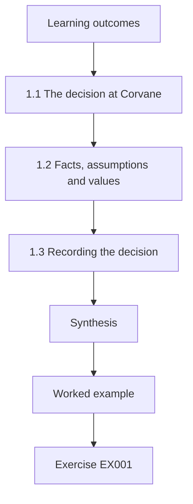

### Logical drawing

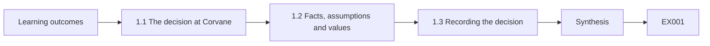

```text
[Learning outcomes]
    |
    v
[1.1 The decision at Corvane]
    |
    v
[1.2 Facts, assumptions and values]
    |
    v
[1.3 Recording the decision]
    |
    v
[Synthesis]
    |
    v
[Worked example] --> [Exercise EX001]
```
<!-- cyberabc:lesson-figures:end ch-01 -->


### Learning outcomes

You will (1) frame an organisation-scale architecture decision; (2) separate facts, assumptions and values; (3) record a decision so others can challenge it.

### 1.1 The decision at Corvane

Priya Ramanathan is a postgraduate student and the lead security architect at Corvane Health Network, a fictional group of twenty-two community clinics. Her supervisor, Dr Elena Voss at the fictional Brookmere University, asks her to bring a live decision to the course. Corvane must decide whether to consolidate its clinic networks behind one cloud-based access service or keep each clinic's local firewall and VPN. The choice affects patient data, clinic uptime, staff workflow and budget for five years, so it is an organisation-scale decision rather than a project detail.

### 1.2 Facts, assumptions and values

Priya splits her briefing into three columns. Facts are things she can check: twenty-two clinics, four firewall models, two outages last year caused by expired VPN certificates. Assumptions are beliefs she cannot yet verify, such as the cloud service meeting availability targets in rural areas with poor connectivity. Values are priorities the board must set, such as how much clinic downtime is acceptable to save money. Mixing these three is the most common cause of circular arguments in architecture meetings, because people argue about values while appearing to argue about facts.

### 1.3 Recording the decision

Priya writes an architecture decision record: context, options considered, criteria, the decision, consequences and the conditions that would cause the decision to be revisited. She cites the zero trust principles in NIST SP 800-207 as the design direction but notes they do not dictate any product. The record is short, dated and signed by the chief information officer. Two years later, a new architect can read why the choice was made and judge whether its conditions still hold, rather than guessing at the reasoning or repeating the whole debate.

### Worked example

Priya frames the clinic network decision, sorts her briefing into facts, assumptions and values, and records it in a decision record with revisit conditions.

> **Synthetic case.** Corvane, Brookmere and all people are synthetic; SP 800-207 is real.

### Errors and limits

Decision records can become paperwork if no one reads them. Assumptions must be tested, not just listed.

### Exercises

- **EX001 — Organisation-scale test.** Why is the clinic network choice an organisation-scale decision? *Rubric:* 3 = it affects patient data, uptime, workflow and budget for five years across all clinics;; 2 = several effects;; 1 = it is technical;; 0 = none.
- **EX002 — Assumption example.** Give the assumption Priya could not yet verify. *Rubric:* 3 = cloud service availability in rural clinics with poor connectivity;; 2 = availability;; 1 = certificate outages;; 0 = none.
- **EX003 — Value for the board.** Which value did Priya leave to the board? *Rubric:* 3 = how much clinic downtime is acceptable to save money;; 2 = downtime;; 1 = firewall models;; 0 = none.
- **EX004 — Circular arguments.** What causes circular architecture arguments, according to the chapter? *Rubric:* 3 = mixing facts, assumptions and values;; 2 = mixing;; 1 = budget;; 0 = none.
- **EX005 — Revisit conditions.** Why include revisit conditions in a decision record? *Rubric:* 3 = so a later architect can judge whether the decision still holds;; 2 = future review;; 1 = vague;; 0 = none.

### Synthesis

Advanced decisions improve when facts, assumptions and values are separated and the reasoning is recorded for later challenge.

### Continue studying — chapter 01 of 12

[← Course home](../../README.md) · [Course chapter index](../SUBJECTS.md) · [Chapter 02 (draft) →](#ch-02)

<a id="ch-02"></a>

## Chapter 2 — Security architecture and engineering: current practice

<!-- cyberabc:lesson-figures:start ch-02 -->
### Lesson map

Lesson 02 published. Map, example, EX006.

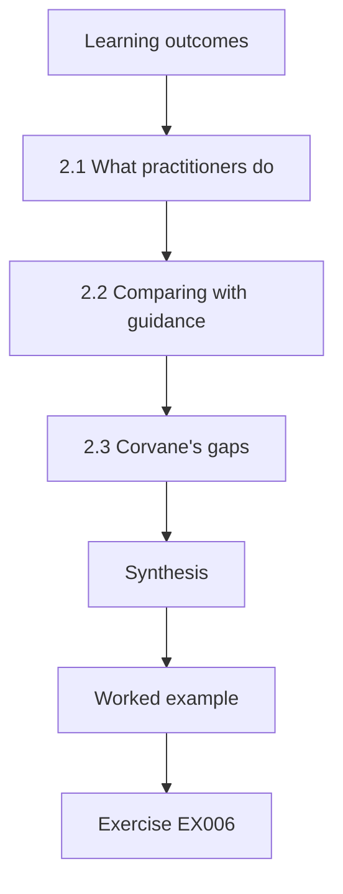

### Logical drawing

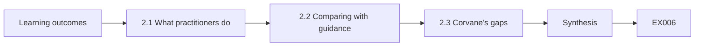

```text
[Learning outcomes]
    |
    v
[2.1 What practitioners do]
    |
    v
[2.2 Comparing with guidance]
    |
    v
[2.3 Corvane's gaps]
    |
    v
[Synthesis]
    |
    v
[Worked example] --> [Exercise EX006]
```
<!-- cyberabc:lesson-figures:end ch-02 -->


### Learning outcomes

You will (1) survey current architecture practice in health care; (2) compare it with published guidance; (3) identify gaps in Corvane's practice.

### 2.1 What practitioners do

Priya interviews architects at three peer health organisations, all anonymised for the course. They share patterns: identity-centred access for staff, network segmentation separating clinical devices, vendor remote access through brokered sessions, and architecture review boards for new systems. None uses formal methods such as SABSA in full; all borrow parts, such as business attribute profiles. She notes that practice is shaped by small teams, legacy medical devices that cannot be patched and regulators who expect documented risk decisions rather than particular designs.

### 2.2 Comparing with guidance

Priya maps the observed practice against NIST SP 800-160 Vol. 1 Rev. 1, which describes systems security engineering across the life cycle, and ISO/IEC 27001:2022, which requires an information security management system. Practice aligns well on access control and supplier management but is weak on verification: most organisations review designs before build but rarely test whether delivered systems match those designs. Guidance expects verification as a life-cycle activity. The gap matters because undetected drift between design and reality is where many incidents begin.

### 2.3 Corvane's gaps

Applying the comparison to Corvane, Priya finds the same verification weakness and two more. Clinical devices share a network with administrative laptops in nine clinics, and architecture reviews have no record of which risks were accepted. She ranks these by consequence: device segmentation first, because a laptop infection could reach infusion pump management stations; then verification; then accepted-risk records. She presents the ranking with sources so that the chief information officer can see the gaps are measured against recognised guidance rather than her opinion alone.

### Worked example

Priya compares anonymised peer practice with SP 800-160v1r1 and ISO/IEC 27001, finds a common verification gap and ranks three gaps at Corvane.

> **Synthetic case.** Interviews and Corvane details are synthetic; SP 800-160 Vol. 1 Rev. 1 and ISO/IEC 27001:2022 are real.

### Errors and limits

Three interviews do not represent a sector. Guidance alignment is not proof of security.

### Exercises

- **EX006 — Common pattern.** Name two patterns the three peer organisations share. *Rubric:* 3 = identity-centred access, device segmentation, brokered vendor access, review boards;; 2 = one;; 1 = vague;; 0 = none.
- **EX007 — SABSA use.** How do peers use SABSA? *Rubric:* 3 = they borrow parts such as attribute profiles, not the full method;; 2 = parts;; 1 = full method;; 0 = none.
- **EX008 — Verification gap.** What verification gap did Priya find in practice? *Rubric:* 3 = delivered systems are rarely tested against their designs;; 2 = testing;; 1 = design reviews;; 0 = none.
- **EX009 — First priority.** Why rank device segmentation first at Corvane? *Rubric:* 3 = a laptop infection could reach infusion pump management stations;; 2 = patient safety;; 1 = cost;; 0 = none.
- **EX010 — Why cite sources.** Why did Priya present gaps with sources? *Rubric:* 3 = so they are seen as measured against guidance, not opinion;; 2 = credibility;; 1 = vague;; 0 = none.

### Synthesis

Comparing real practice with guidance reveals specific, rankable gaps, especially in verification.

### Continue studying — chapter 02 of 12

[← Chapter 01 (draft)](#ch-01) · [Course chapter index](../SUBJECTS.md) · [Chapter 03 (draft) →](#ch-03)

<a id="ch-03"></a>

## Chapter 3 — Security architecture and engineering: specialist evidence

<!-- cyberabc:lesson-figures:start ch-03 -->
### Lesson map

Lesson 03 published. Map, example, EX011.

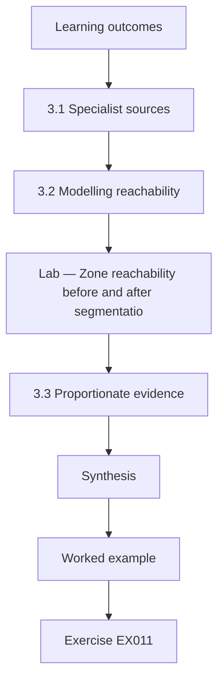

### Logical drawing

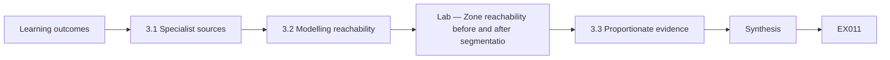

```text
[Learning outcomes]
    |
    v
[3.1 Specialist sources]
    |
    v
[3.2 Modelling reachability]
    |
    v
[Lab — Zone reachability before and after segmentatio]
    |
    v
[3.3 Proportionate evidence]
    |
    v
[Synthesis]
    |
    v
[Worked example] --> [Exercise EX011]
```
<!-- cyberabc:lesson-figures:end ch-03 -->


### Learning outcomes

You will (1) gather specialist evidence on clinical device risk; (2) model reachability between network zones; (3) present evidence proportionate to the decision.

### 3.1 Specialist sources

For the segmentation gap, Priya needs evidence beyond general guidance. She reads manufacturer security documentation for Corvane's infusion pump management stations, the clinical engineering team's inventory and the network team's firewall rules. Clinical engineers know which devices cannot be patched and which vendor connections they require. Their knowledge is specialist evidence that architects often lack. She records each source, its owner and its date, because device inventories in health care are notoriously incomplete and she must show how current her picture is.

### 3.2 Modelling reachability

Priya builds a small model of which zones can reach which others under the current rules, then repeats it under her proposed rules. The lab below computes reachability in both cases. Under current rules, the administrative laptop zone can reach the clinical device zone through a shared print server. Under the proposed rules, only the clinical engineering jump host can reach clinical devices. The model is simple, but it turns a long firewall export into a clear statement that a decision maker can follow and check.

### Lab — Zone reachability before and after segmentation

```python
# Zone reachability before and after segmentation (synthetic rules).
def reach(rules, start):
    seen, todo = {start}, [start]
    while todo:
        z = todo.pop()
        for a, b in rules:
            if a == z and b not in seen: seen.add(b); todo.append(b)
    return sorted(seen - {start})
current = [("admin", "print"), ("print", "clinical"), ("admin", "internet"), ("jump", "clinical"), ("clinical", "print")]
proposed = [("admin", "print"), ("admin", "internet"), ("jump", "clinical")]
for name, rules in [("current", current), ("proposed", proposed)]:
    print(f"{name}: admin reaches {reach(rules, 'admin')}; jump reaches {reach(rules, 'jump')}")
```

Run with `python3 lab_reach.py`. Verified output:

```text
current: admin reaches ['clinical', 'internet', 'print']; jump reaches ['clinical', 'print']
proposed: admin reaches ['internet', 'print']; jump reaches ['clinical']
```

### 3.3 Proportionate evidence

Priya resists the urge to bring every detail to the board. She presents the reachability result, the count of affected clinics and the clinical engineers' view of operational impact. Detailed firewall rules go into an appendix for technical reviewers. The evidence is proportionate: enough to justify the decision and show its limits, not so much that the decision is lost. Dr Voss notes that proportion is a professional skill, because overwhelming decision makers with detail is a way of avoiding accountability for a clear recommendation.

### Worked example

Priya gathers device and firewall evidence from specialists, models reachability before and after segmentation and presents a proportionate summary.

> **Synthetic case.** Devices, zones and rules are synthetic.

### Errors and limits

Inventories miss devices. Reachability models ignore application-layer paths not captured in rules.

### Exercises

- **EX011 — Specialist knowledge.** What did clinical engineers know that architects often lack? *Rubric:* 3 = which devices cannot be patched and which vendor connections they need;; 2 = devices;; 1 = vague;; 0 = none.
- **EX012 — Current path.** How could administrative laptops reach clinical devices under current rules? *Rubric:* 3 = through the shared print server;; 2 = print server;; 1 = directly;; 0 = none.
- **EX013 — Proposed path.** What can reach clinical devices under the proposed rules? *Rubric:* 3 = only the clinical engineering jump host;; 2 = jump host;; 1 = everything;; 0 = none.
- **EX014 — Recording dates.** Why record each source's date? *Rubric:* 3 = inventories are often incomplete, so currency must be shown;; 2 = currency;; 1 = vague;; 0 = none.
- **EX015 — Proportion.** What does proportionate evidence mean here? *Rubric:* 3 = enough to justify the decision and show limits, with detail in appendices;; 2 = enough;; 1 = everything;; 0 = none.

### Synthesis

Specialist evidence and simple models turn complex configurations into proportionate decision evidence.

### Continue studying — chapter 03 of 12

[← Chapter 02 (draft)](#ch-02) · [Course chapter index](../SUBJECTS.md) · [Chapter 04 (draft) →](#ch-04)

<a id="ch-04"></a>

## Chapter 4 — Advanced risk and ethics

<!-- cyberabc:lesson-figures:start ch-04 -->
### Lesson map

Lesson 04 published. Map, example, EX016.

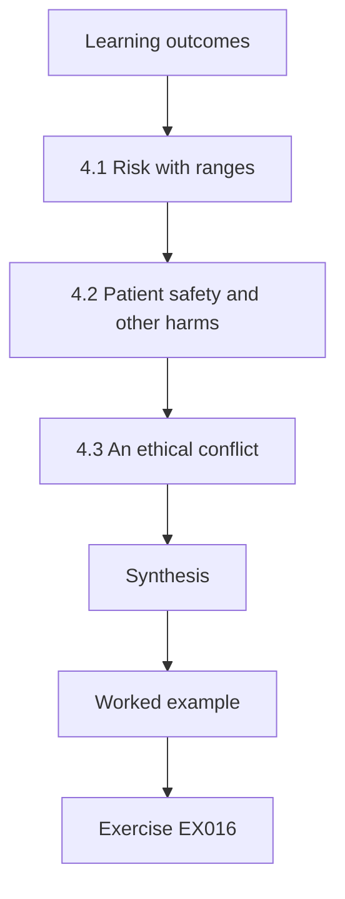

### Logical drawing

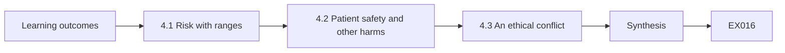

```text
[Learning outcomes]
    |
    v
[4.1 Risk with ranges]
    |
    v
[4.2 Patient safety and other harms]
    |
    v
[4.3 An ethical conflict]
    |
    v
[Synthesis]
    |
    v
[Worked example] --> [Exercise EX016]
```
<!-- cyberabc:lesson-figures:end ch-04 -->


### Learning outcomes

You will (1) estimate risk with explicit uncertainty; (2) weigh patient safety against other harms; (3) handle an ethical conflict in architecture work.

### 4.1 Risk with ranges

Priya estimates the risk of a ransomware event reaching clinical devices. Rather than a single number, she gives ranges: a yearly likelihood between two and eight percent under current design, and impact from one to five days of clinic disruption. She explains each range by its sources, following NIST SP 800-30 Rev. 1. A Monte Carlo lab is not needed for the board; a simple low, likely and high case is clearer. Ranges show leaders how much is unknown and stop a precise-looking number from implying confidence that does not exist.

### 4.2 Patient safety and other harms

Health care adds a dimension most risk methods treat lightly: harm to patients. Priya separates three kinds of harm: patient safety, privacy and financial. She refuses to convert patient safety into money, because doing so hides an ethical judgement inside arithmetic. Instead she presents safety harm alongside the others and asks the clinical governance committee to weigh it. That committee, not the architecture team, holds authority over clinical risk. Placing decisions with the right body is part of the architect's ethical duty.

### 4.3 An ethical conflict

A vendor offers Corvane a discount if it delays segmentation by a year to align with the vendor's product release. The finance director favours accepting. Priya believes the delay exposes patients to avoidable risk. She documents her view, the risk ranges and the safety concern, and escalates to the clinical governance committee rather than overriding or silently accepting the decision. The committee rejects the delay. Priya reflects that professional ethics require making risk visible to those accountable, not deciding alone and not staying quiet.

### Worked example

Priya gives risk ranges with sources, keeps patient safety separate from money and escalates a vendor-driven delay to the clinical governance committee.

> **Synthetic case.** Figures, vendor and committees are synthetic; SP 800-30 Rev. 1 is real.

### Errors and limits

Ranges can be too wide to guide action. Escalation without evidence can look like obstruction.

### Exercises

- **EX016 — Why ranges.** Why give risk as ranges rather than single numbers? *Rubric:* 3 = to show uncertainty and avoid false confidence;; 2 = uncertainty;; 1 = precision;; 0 = none.
- **EX017 — Three harms.** Which three kinds of harm did Priya separate? *Rubric:* 3 = patient safety, privacy and financial;; 2 = two;; 1 = vague;; 0 = none.
- **EX018 — Not monetising safety.** Why not convert patient safety into money? *Rubric:* 3 = it hides an ethical judgement inside arithmetic;; 2 = ethics;; 1 = easier;; 0 = none.
- **EX019 — Right authority.** Who holds authority over clinical risk at Corvane? *Rubric:* 3 = the clinical governance committee;; 2 = committee;; 1 = architecture team;; 0 = none.
- **EX020 — Handling the discount.** How did Priya handle the vendor's delay offer? *Rubric:* 3 = documented and escalated to the clinical governance committee;; 2 = escalated;; 1 = accepted;; 0 = none.

### Synthesis

Advanced risk work states uncertainty honestly, keeps safety visible and places decisions with the accountable body.

### Continue studying — chapter 04 of 12

[← Chapter 03 (draft)](#ch-03) · [Course chapter index](../SUBJECTS.md) · [Chapter 05 (draft) →](#ch-05)

<a id="ch-05"></a>

## Chapter 5 — Security architecture and engineering: design alternatives

<!-- cyberabc:lesson-figures:start ch-05 -->
### Lesson map

Lesson 05 published. Map, example, EX021.

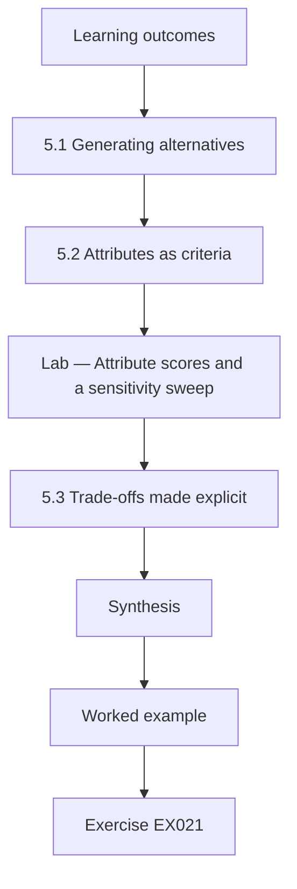

### Logical drawing

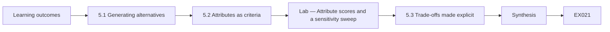

```text
[Learning outcomes]
    |
    v
[5.1 Generating alternatives]
    |
    v
[5.2 Attributes as criteria]
    |
    v
[Lab — Attribute scores and a sensitivity sweep]
    |
    v
[5.3 Trade-offs made explicit]
    |
    v
[Synthesis]
    |
    v
[Worked example] --> [Exercise EX021]
```
<!-- cyberabc:lesson-figures:end ch-05 -->


### Learning outcomes

You will (1) generate genuinely different design alternatives; (2) compare them on business attributes; (3) choose with explicit trade-offs.

### 5.1 Generating alternatives

For the clinic access decision, Priya insists on at least three real alternatives rather than one favoured design and two straw men. Option one keeps local firewalls and VPNs but automates certificate renewal. Option two moves all clinics to a cloud access broker with identity-aware policies. Option three is hybrid: a cloud broker for staff applications with local segmentation and a local fallback path for clinical systems. She asks a colleague who favours option one to write its case, so each option is argued by someone who believes in it.

### 5.2 Attributes as criteria

Priya uses business attributes in the style of SABSA (Sherwood, Clark and Lynas, 2005) as criteria: available, protected, auditable, operable by a small team and affordable. Clinical leaders weight availability highest because clinics cannot stop seeing patients. The lab below scores the three options and checks whether the ranking holds when the availability weight changes. The hybrid option ranks first in the base case and when availability matters more; the cloud option wins only if the availability weight falls to 0.20 or lower, which no clinical leader supports.

### Lab — Attribute scores and a sensitivity sweep

```python
# Score three access designs on weighted attributes and sweep the availability weight (synthetic).
attrs = ["available", "protected", "auditable", "operable", "affordable"]
score = {"local": [3, 2, 2, 3, 4], "cloud": [3, 5, 5, 4, 3], "hybrid": [5, 4, 4, 3, 3]}
def rank(wa):
    rest = (1 - wa) / 4; w = [wa] + [rest] * 4
    return {o: sum(a * b for a, b in zip(w, s)) for o, s in score.items()}
for wa in (0.40, 0.60, 0.20, 0.05):
    r = rank(wa); best = max(r, key=r.get)
    print(f"availability weight {wa:.2f}: " + ", ".join(f"{o} {v:.2f}" for o, v in r.items()) + f" -> {best}")
```

Run with `python3 lab_options.py`. Verified output:

```text
availability weight 0.40: local 2.85, cloud 3.75, hybrid 4.10 -> hybrid
availability weight 0.60: local 2.90, cloud 3.50, hybrid 4.40 -> hybrid
availability weight 0.20: local 2.80, cloud 4.00, hybrid 3.80 -> cloud
availability weight 0.05: local 2.76, cloud 4.19, hybrid 3.57 -> cloud
```

### 5.3 Trade-offs made explicit

The hybrid option is not free. It keeps two access paths, which doubles some operational work and creates a risk that the fallback path is neglected until it is needed. Priya writes these costs into the decision record, along with a mitigation: quarterly tests of the local fallback in two clinics. She notes that the hybrid choice reflects the board's value judgement about availability, and that a different board could reasonably choose otherwise. Making that dependence explicit keeps the recommendation honest about where judgement enters.

### Worked example

Priya develops three real alternatives with advocates, scores them on five attributes with a sensitivity sweep and records the hybrid option's costs and mitigations.

> **Synthetic case.** Options, scores and weights are synthetic; SABSA is real.

### Errors and limits

Attribute scores are judgements. Two access paths add operational load.

### Exercises

- **EX021 — Straw men.** Why insist on three real alternatives? *Rubric:* 3 = to avoid one favoured design with straw men;; 2 = fair comparison;; 1 = speed;; 0 = none.
- **EX022 — Highest weight.** Which attribute did clinical leaders weight highest and why? *Rubric:* 3 = availability, because clinics cannot stop seeing patients;; 2 = availability;; 1 = cost;; 0 = none.
- **EX023 — Base ranking.** Which option ranked first in the base case in the lab? *Rubric:* 3 = hybrid, 4.10;; 2 = hybrid;; 1 = cloud;; 0 = none.
- **EX024 — Cloud wins when.** When does the cloud option win in the sweep? *Rubric:* 3 = at an availability weight of 0.20 or lower;; 2 = low weight;; 1 = always;; 0 = none.
- **EX025 — Hybrid cost.** What hidden cost does the hybrid option carry? *Rubric:* 3 = two access paths, with a risk the fallback is neglected;; 2 = fallback;; 1 = vague;; 0 = none.

### Synthesis

Honest alternatives, attribute criteria and sensitivity checks make trade-offs explicit rather than hidden.

### Continue studying — chapter 05 of 12

[← Chapter 04 (draft)](#ch-04) · [Course chapter index](../SUBJECTS.md) · [Chapter 06 (draft) →](#ch-06)

<a id="ch-06"></a>

## Chapter 6 — Security architecture and engineering: controlled evaluation

<!-- cyberabc:lesson-figures:start ch-06 -->
### Lesson map

Lesson 06 published. Map, example, EX026.

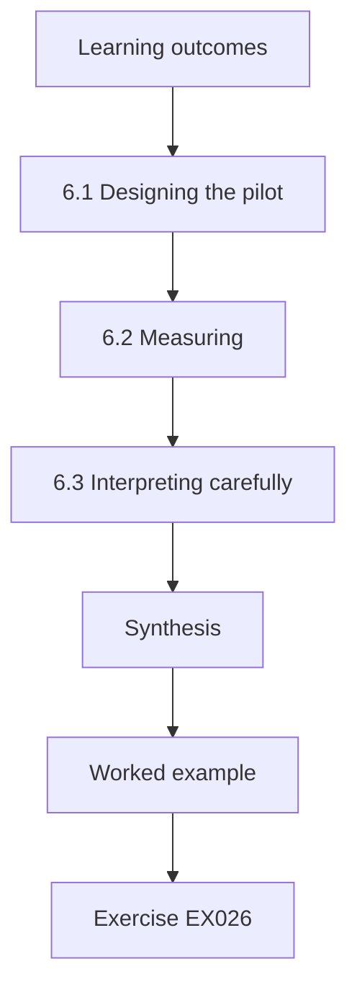

### Logical drawing

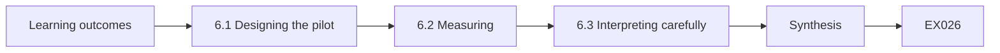

```text
[Learning outcomes]
    |
    v
[6.1 Designing the pilot]
    |
    v
[6.2 Measuring]
    |
    v
[6.3 Interpreting carefully]
    |
    v
[Synthesis]
    |
    v
[Worked example] --> [Exercise EX026]
```
<!-- cyberabc:lesson-figures:end ch-06 -->


### Learning outcomes

You will (1) design a controlled pilot of the hybrid design; (2) measure outcomes against a comparison group; (3) interpret limited results carefully.

### 6.1 Designing the pilot

Before rolling the hybrid design across twenty-two clinics, Priya runs a pilot in six clinics, chosen by lot from clinics with similar size and connectivity, while six others continue as before. She defines outcomes in advance: minutes of access outage per clinic per month, staff sign-in time and help desk tickets about access. Random choice of pilot clinics prevents her from picking the easiest sites. Wohlin and colleagues (2012) describe this kind of controlled comparison and the threats to validity it must address.

### 6.2 Measuring

Over three months, pilot clinics record an average of eleven outage minutes a month against thirty-four in comparison clinics, mainly because certificate expiry outages disappear. Sign-in time rises by four seconds because of an extra identity step. Help desk tickets rise in the first month and then fall below the comparison level. Priya reports each outcome with the number of clinics and months behind it, so that readers can see how small the sample is. She also logs one fallback test in each pilot clinic.

### 6.3 Interpreting carefully

Six clinics over three months is a small sample. Priya writes that the results are consistent with better availability and acceptable staff impact, but that a single bad month could change the picture. She recommends a staged rollout with continued measurement rather than a big-bang change. The board agrees. Dr Voss highlights that pre-defined outcomes, random choice and honest sample reporting are what make a pilot persuasive, more than the size of the improvement itself. The full monthly figures are published in an appendix for anyone who wants to check them.

### Worked example

Priya pilots the hybrid design in six randomly chosen clinics, measures three pre-defined outcomes against six comparison clinics and recommends a staged rollout.

> **Synthetic case.** Clinics and figures are synthetic; Wohlin et al. (2012) is real.

### Errors and limits

Small samples are fragile. Staff may behave differently when they know they are in a pilot.

### Exercises

- **EX026 — Choosing by lot.** Why choose pilot clinics by lot? *Rubric:* 3 = to prevent picking the easiest sites;; 2 = bias;; 1 = convenience;; 0 = none.
- **EX027 — Outage result.** What were monthly outage minutes in pilot and comparison clinics? *Rubric:* 3 = eleven versus thirty-four;; 2 = lower;; 1 = vague;; 0 = none.
- **EX028 — Staff cost.** What staff cost did the pilot show? *Rubric:* 3 = sign-in rose by four seconds;; 2 = four seconds;; 1 = vague;; 0 = none.
- **EX029 — Ticket pattern.** How did help desk tickets change? *Rubric:* 3 = rose in month one, then fell below comparison;; 2 = rise then fall;; 1 = flat;; 0 = none.
- **EX030 — Recommendation.** What did Priya recommend after the pilot? *Rubric:* 3 = a staged rollout with continued measurement;; 2 = staged;; 1 = big bang;; 0 = none.

### Synthesis

A controlled pilot with pre-defined outcomes gives modest but credible evidence for a staged decision.

### Continue studying — chapter 06 of 12

[← Chapter 05 (draft)](#ch-05) · [Course chapter index](../SUBJECTS.md) · [Chapter 07 (draft) →](#ch-07)

<a id="ch-07"></a>

## Chapter 7 — Security architecture and engineering: organizational integration

<!-- cyberabc:lesson-figures:start ch-07 -->
### Lesson map

Lesson 07 published. Map, example, EX031.

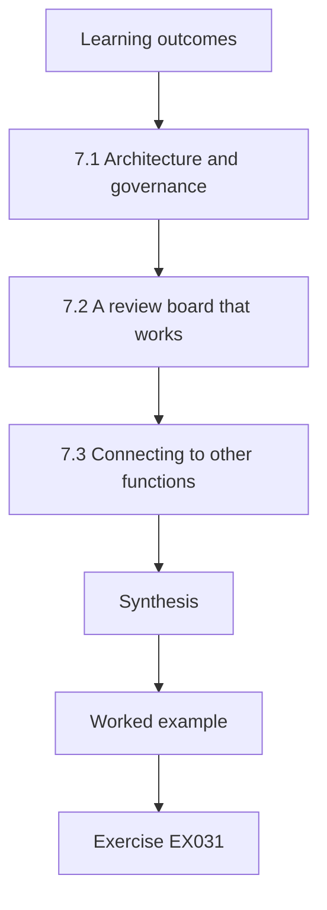

### Logical drawing

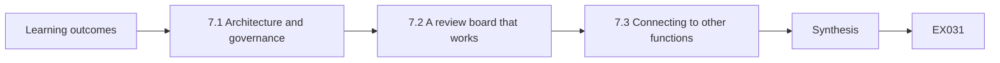

```text
[Learning outcomes]
    |
    v
[7.1 Architecture and governance]
    |
    v
[7.2 A review board that works]
    |
    v
[7.3 Connecting to other functions]
    |
    v
[Synthesis]
    |
    v
[Worked example] --> [Exercise EX031]
```
<!-- cyberabc:lesson-figures:end ch-07 -->


### Learning outcomes

You will (1) embed architecture into Corvane's governance; (2) connect architecture to the management system; (3) design an architecture review board that works.

### 7.1 Architecture and governance

Priya's designs only last if they become part of how Corvane runs. She links architecture to the information security management system required by ISO/IEC 27001:2022: risk assessment, statement of applicability, internal audit and management review. Each architecture decision record now references the risks it treats and the controls it implements. When the internal auditor tests a control, they can trace it back to a design decision and its reasons, closing the gap between architecture documents and audit evidence. This also shortens audit preparation.

### 7.2 A review board that works

Corvane's old architecture review board met monthly, reviewed every project and became a bottleneck that teams avoided. Priya redesigns it. Projects answer a short triage form; only those that add suppliers, patient data flows, clinical device connections or internet exposure come to the board. The board meets weekly for thirty minutes, publishes decisions within two days and uses a standard template. Within a quarter, more projects come forward voluntarily because the process is quick and predictable rather than a source of delay.

### 7.3 Connecting to other functions

Priya maps where architecture touches procurement, clinical engineering, privacy and finance. Procurement adds security questions to tenders; clinical engineering joins the board for device projects; the privacy officer reviews any new patient data flow; finance sees architecture costs early. She uses the control families of NIST SP 800-53 Rev. 5 to make sure no area is left without an owner. Integration works when each function sees architecture as helping its own goals, not as an extra approval imposed from outside. Each interface has a named contact.

### Worked example

Priya links decision records to ISO/IEC 27001 processes, redesigns the review board with triage and weekly short meetings, and maps four interfaces with owners.

> **Synthetic case.** Corvane's governance is synthetic; ISO/IEC 27001:2022 and SP 800-53 Rev. 5 are real.

### Errors and limits

Triage can miss risky projects that answer no. Fast boards can become rubber stamps.

### Exercises

- **EX031 — Audit traceability.** How did linking records to the ISMS help auditors? *Rubric:* 3 = they can trace a control back to its design decision;; 2 = traceability;; 1 = vague;; 0 = none.
- **EX032 — Old board problem.** What was wrong with the old review board? *Rubric:* 3 = it reviewed everything monthly and became a bottleneck;; 2 = bottleneck;; 1 = too fast;; 0 = none.
- **EX033 — Triage triggers.** Which project features trigger board review? *Rubric:* 3 = suppliers, patient data flows, clinical devices, internet exposure;; 2 = two;; 1 = all projects;; 0 = none.
- **EX034 — Board effect.** What changed within a quarter of the redesign? *Rubric:* 3 = more projects came forward voluntarily;; 2 = voluntary;; 1 = vague;; 0 = none.
- **EX035 — Integration principle.** When does integration with other functions work? *Rubric:* 3 = when each function sees architecture helping its own goals;; 2 = shared goals;; 1 = mandates;; 0 = none.

### Synthesis

Architecture lasts when it is embedded in the management system and a fast, predictable review process.

### Continue studying — chapter 07 of 12

[← Chapter 06 (draft)](#ch-06) · [Course chapter index](../SUBJECTS.md) · [Chapter 08 (draft) →](#ch-08)

<a id="ch-08"></a>

## Chapter 8 — Security architecture and engineering: difficult cases

<!-- cyberabc:lesson-figures:start ch-08 -->
### Lesson map

Lesson 08 published. Map, example, EX036.

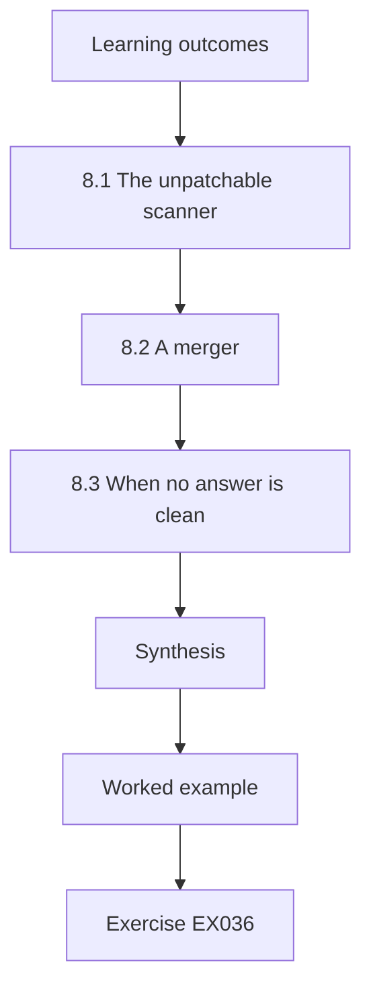

### Logical drawing

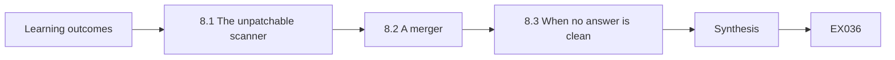

```text
[Learning outcomes]
    |
    v
[8.1 The unpatchable scanner]
    |
    v
[8.2 A merger]
    |
    v
[8.3 When no answer is clean]
    |
    v
[Synthesis]
    |
    v
[Worked example] --> [Exercise EX036]
```
<!-- cyberabc:lesson-figures:end ch-08 -->


### Learning outcomes

You will (1) handle a legacy device that cannot meet the architecture; (2) manage a merger of two networks; (3) reason through cases with no clean answer.

### 8.1 The unpatchable scanner

One clinic's imaging scanner runs an operating system that the manufacturer no longer supports, and replacing it would cost more than the clinic's annual equipment budget. It cannot join the identity-aware design. Priya treats it as a documented exception: isolate it on its own segment, allow only the imaging archive to talk to it, monitor that traffic and set a replacement date in the capital plan. The clinical governance committee accepts the residual risk in writing. Exceptions are managed risks, not hidden failures.

### 8.2 A merger

Corvane acquires a fictional private clinic group, Hollin Care, with a flat network and shared administrator accounts. Connecting the two networks quickly would import Hollin's weaknesses; keeping them apart blocks shared patient records. Priya proposes a staged integration: first, a brokered connection for specific applications only; second, Hollin staff move to Corvane identities; third, Hollin's network is rebuilt to Corvane's segmentation. Each stage has entry criteria. She uses Shostack's (2014) threat modelling to analyse the brokered connection before any traffic flows.

### 8.3 When no answer is clean

Both cases force trade-offs where every option leaves risk. Priya follows a pattern: state the options, the risk each leaves and who accepts it; choose the option that keeps the most important attribute, here availability of care; and set a date to revisit. She writes that the goal in difficult cases is not to remove risk but to make it visible, owned and temporary where possible. Dr Voss notes this is the core of senior architecture work, where textbook answers rarely fit.

### Worked example

Priya isolates an unsupported scanner as a documented exception, plans a three-stage merger integration and applies a consistent pattern to cases with no clean answer.

> **Synthetic case.** The scanner, Hollin Care and decisions are synthetic; Shostack (2014) is real.

### Errors and limits

Exceptions tend to become permanent without dates. Staged mergers stall under business pressure.

### Exercises

- **EX036 — Scanner treatment.** How was the unsupported scanner treated? *Rubric:* 3 = isolated, limited to the imaging archive, monitored, with a replacement date;; 2 = isolation;; 1 = replaced now;; 0 = none.
- **EX037 — Exception owner.** Who accepted the scanner's residual risk? *Rubric:* 3 = the clinical governance committee, in writing;; 2 = committee;; 1 = architect;; 0 = none.
- **EX038 — Merger dilemma.** Why was neither quick connection nor full separation acceptable? *Rubric:* 3 = quick imports weaknesses; separation blocks shared patient records;; 2 = both sides;; 1 = vague;; 0 = none.
- **EX039 — First merger stage.** What was the first merger stage? *Rubric:* 3 = a brokered connection for specific applications only;; 2 = brokered;; 1 = full join;; 0 = none.
- **EX040 — Goal in hard cases.** What is the goal in difficult cases? *Rubric:* 3 = make risk visible, owned and temporary where possible;; 2 = visible;; 1 = remove all risk;; 0 = none.

### Synthesis

Difficult cases are handled by documented exceptions, staged plans and risk that is visible, owned and dated.

### Continue studying — chapter 08 of 12

[← Chapter 07 (draft)](#ch-07) · [Course chapter index](../SUBJECTS.md) · [Chapter 09 (draft) →](#ch-09)

<a id="ch-09"></a>

## Chapter 9 — Security architecture and engineering: leadership and assurance

<!-- cyberabc:lesson-figures:start ch-09 -->
### Lesson map

Lesson 09 published. Map, example, EX041.

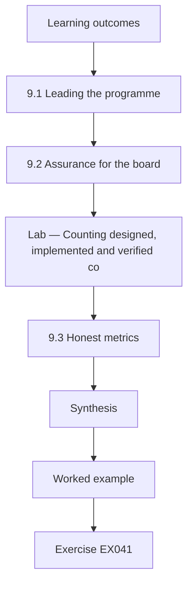

### Logical drawing

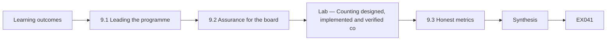

```text
[Learning outcomes]
    |
    v
[9.1 Leading the programme]
    |
    v
[9.2 Assurance for the board]
    |
    v
[Lab — Counting designed, implemented and verified co]
    |
    v
[9.3 Honest metrics]
    |
    v
[Synthesis]
    |
    v
[Worked example] --> [Exercise EX041]
```
<!-- cyberabc:lesson-figures:end ch-09 -->


### Learning outcomes

You will (1) lead an architecture team through a multi-year programme; (2) provide assurance to a board; (3) use metrics that show progress honestly.

### 9.1 Leading the programme

Priya now leads a team of three architects through a three-year segmentation and access programme. She sets principles everyone can apply without asking her: deny by default, identity before network, exceptions dated and owned. She delegates decisions within those principles and reviews only exceptions. Weekly, the team shares one design and one failure. She protects time for learning, because health technology changes faster than any single architect can follow. Leadership in architecture is mostly about making good decisions possible without the lead in every room.

### 9.2 Assurance for the board

The board asks a simple question: are we safer than last year? Priya answers with assurance rather than reassurance. She reports what has been verified, by whom and how, using the risk management framework vocabulary of NIST SP 800-37 Rev. 2 for authorisation and continuous monitoring. Independent internal audit tests a sample of controls each quarter. She distinguishes three levels: designed, implemented and verified. Only verified controls count as reducing risk in her report, which makes progress look slower but far more trustworthy.

### Lab — Counting designed, implemented and verified controls

```python
# Count programme controls by assurance level (synthetic register).
levels = ["verified"] * 19 + ["implemented"] * 10 + ["designed"] * 7 + ["planned"] * 4
designed = sum(l in ("designed", "implemented", "verified") for l in levels)
implemented = sum(l in ("implemented", "verified") for l in levels)
verified = levels.count("verified")
print(f"controls {len(levels)}: designed {designed}, implemented {implemented}, verified {verified}")
print(f"verified share {verified/len(levels):.0%}")
```

Run with `python3 lab_assure.py`. Verified output:

```text
controls 40: designed 36, implemented 29, verified 19
verified share 48%
```

### 9.3 Honest metrics

The lab shows the gap between levels. Of forty programme controls, thirty-six are designed, twenty-nine implemented and nineteen verified. Reporting thirty-six would flatter the programme; reporting nineteen shows where effort is needed. Priya also reports clinics fully segmented and the median age of open exceptions. The board initially prefers the larger figure but comes to trust the smaller one after audit confirms it. She notes that a metric earns trust when it occasionally delivers bad news. The verified share was 48 percent at the time.

### Worked example

Priya sets team principles, reports assurance at three levels with independent audit sampling and shows the board verified rather than designed counts.

> **Synthetic case.** Team, controls and figures are synthetic; SP 800-37 Rev. 2 is real.

### Errors and limits

Verification samples may miss failures. Metrics can be gamed once targets are set.

### Exercises

- **EX041 — Delegation principle.** What principles let the team decide without Priya? *Rubric:* 3 = deny by default, identity before network, dated owned exceptions;; 2 = two;; 1 = vague;; 0 = none.
- **EX042 — Three levels.** What three levels does Priya distinguish? *Rubric:* 3 = designed, implemented and verified;; 2 = two;; 1 = vague;; 0 = none.
- **EX043 — Lab counts.** What were the counts at each level in the lab? *Rubric:* 3 = 36 designed, 29 implemented, 19 verified;; 2 = partly;; 1 = vague;; 0 = none.
- **EX044 — Assurance versus reassurance.** What makes Priya's reporting assurance rather than reassurance? *Rubric:* 3 = it reports what has been verified, by whom and how;; 2 = verification;; 1 = tone;; 0 = none.
- **EX045 — Trusted metric.** When does a metric earn trust, according to Priya? *Rubric:* 3 = when it occasionally delivers bad news;; 2 = bad news;; 1 = always green;; 0 = none.

### Synthesis

Architecture leadership delegates through principles and offers assurance based on verified, not designed, controls.

### Continue studying — chapter 09 of 12

[← Chapter 08 (draft)](#ch-08) · [Course chapter index](../SUBJECTS.md) · [Chapter 10 (draft) →](#ch-10)

<a id="ch-10"></a>

## Chapter 10 — Research reading and critique

<!-- cyberabc:lesson-figures:start ch-10 -->
### Lesson map

Lesson 10 published. Map, example, EX046.

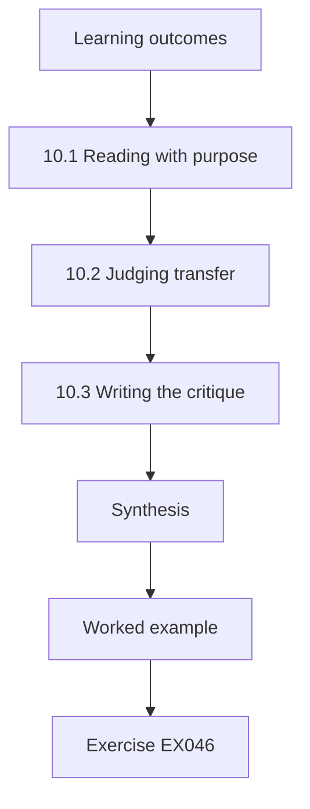

### Logical drawing

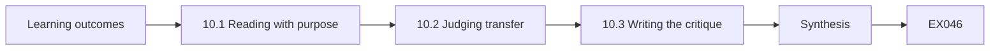

```text
[Learning outcomes]
    |
    v
[10.1 Reading with purpose]
    |
    v
[10.2 Judging transfer]
    |
    v
[10.3 Writing the critique]
    |
    v
[Synthesis]
    |
    v
[Worked example] --> [Exercise EX046]
```
<!-- cyberabc:lesson-figures:end ch-10 -->


### Learning outcomes

You will (1) read research papers on security architecture critically; (2) judge whether findings transfer to Corvane; (3) write a structured critique.

### 10.1 Reading with purpose

Dr Voss sets a reading task: find and critique published research on whether segmentation or zero trust designs reduce incident impact. Priya reads with three questions. What exactly was measured? How was the comparison made? Would the setting resemble a clinic network? She notes that many papers measure simulated networks or vendor customer bases, and few measure health care. Herley and van Oorschot (2017) argue that security research often lacks falsifiable claims, so she looks for studies that state what result would have contradicted them.

### 10.2 Judging transfer

A study of large enterprises finds that segmented networks contain lateral movement faster. Priya asks whether this transfers to Corvane: her clinics are smaller, have legacy devices and rely on a central electronic record. Some mechanisms transfer, such as limiting reachable hosts; others do not, such as dedicated security operations staff watching every alert. She concludes that the direction of the finding likely applies but the size of the effect is uncertain. Transfer judgements are reasoned arguments about mechanisms, not simple yes or no answers.

### 10.3 Writing the critique

Priya writes a two-page critique for each paper: claim, method, data, threats to validity, transfer to Corvane and what further evidence would help. She avoids dismissing work for imperfections every study has and instead judges whether flaws undermine the claim. One paper's conclusions rest on an uncontrolled before-and-after comparison during a period of other changes, which she marks as weak. Another uses a careful comparison group, which she marks as stronger despite a smaller sample. Critique is about weighing evidence, not scoring points.

### Worked example

Priya critiques research on segmentation with three reading questions, reasons about transfer by mechanism and writes structured critiques.

> **Synthetic case.** The papers described are synthetic composites; Herley and van Oorschot (2017) is real.

### Errors and limits

Critiques can be harsher on unwelcome findings. Transfer reasoning is itself uncertain.

### Exercises

- **EX046 — Three questions.** What three questions guide Priya's reading? *Rubric:* 3 = what was measured, how compared, would the setting resemble a clinic;; 2 = two;; 1 = vague;; 0 = none.
- **EX047 — Falsifiable claims.** Why look for studies stating what would contradict them? *Rubric:* 3 = security research often lacks falsifiable claims;; 2 = falsifiable;; 1 = vague;; 0 = none.
- **EX048 — Mechanism not transferring.** Which mechanism from the enterprise study did not transfer? *Rubric:* 3 = dedicated security operations staff watching alerts;; 2 = staffing;; 1 = segmentation;; 0 = none.
- **EX049 — Transfer conclusion.** What did Priya conclude about transfer? *Rubric:* 3 = direction likely applies, effect size uncertain;; 2 = direction;; 1 = full transfer;; 0 = none.
- **EX050 — Weak design.** Why was one paper marked weak? *Rubric:* 3 = uncontrolled before-and-after comparison during other changes;; 2 = uncontrolled;; 1 = small sample;; 0 = none.

### Synthesis

Critical reading asks what was measured, how and whether mechanisms transfer, and weighs flaws by their effect on claims.

### Continue studying — chapter 10 of 12

[← Chapter 09 (draft)](#ch-09) · [Course chapter index](../SUBJECTS.md) · [Chapter 11 (draft) →](#ch-11)

<a id="ch-11"></a>

## Chapter 11 — Applied project

<!-- cyberabc:lesson-figures:start ch-11 -->
### Lesson map

Lesson 11 published. Map, example, EX051.

```mermaid
flowchart TD
  N0["Learning outcomes"]
  N1["11.1 The project"]
  N2["11.2 Assessment with a rubric"]
  N3["Lab — Comparing self and assessor rubric scores"]
  N4["11.3 Handover"]
  N5["Synthesis"]
  N0 --> N1 --> N2 --> N3 --> N4 --> N5
  N5 --> EX["Worked example"]
  EX --> Q["Exercise EX051"]
```

### Logical drawing

```mermaid
flowchart LR
  N0["Learning outcomes"]
  N1["11.1 The project"]
  N2["11.2 Assessment with a rubric"]
  N3["Lab — Comparing self and assessor rubric scores"]
  N4["11.3 Handover"]
  N5["Synthesis"]
  N0 --> N1 --> N2 --> N3 --> N4 --> N5 --> Q["EX051"]
```

```text
[Learning outcomes]
    |
    v
[11.1 The project]
    |
    v
[11.2 Assessment with a rubric]
    |
    v
[Lab — Comparing self and assessor rubric scores]
    |
    v
[11.3 Handover]
    |
    v
[Synthesis]
    |
    v
[Worked example] --> [Exercise EX051]
```
<!-- cyberabc:lesson-figures:end ch-11 -->


### Learning outcomes

You will (1) deliver an architecture project end to end; (2) assess it with a rubric; (3) document outcomes for handover.

### 11.1 The project

Priya's applied project is the clinical device segmentation for nine clinics where devices shared networks with laptops. She delivers a design, a migration plan agreed with clinical engineering, test scripts and an operations handbook. Migration happens clinic by clinic outside clinic hours, with a rollback plan for each. The first clinic reveals an undocumented connection from a blood analyser to a laboratory service, which would have broken results reporting. She adds a discovery week to each later clinic's plan before any rule changes.

### 11.2 Assessment with a rubric

Dr Voss and Corvane's chief information officer assess the project against a rubric agreed at the start: design quality, evidence of verification, stakeholder engagement, handling of surprises and quality of handover. Each criterion is scored from zero to three with descriptions for each level. Priya scores herself first, then compares. She scores herself lower than the assessors on stakeholder engagement and higher on verification, where the assessors note that two clinics were verified by her alone without an independent tester.

### Lab — Comparing self and assessor rubric scores

```python
# Compare self and assessor rubric scores (0-3, synthetic).
crit = ["design", "verification", "stakeholders", "surprises", "handover"]
self_s = [3, 3, 1, 2, 2]; assess = [3, 2, 2, 2, 2]
for c, s, a in zip(crit, self_s, assess): print(f"{c:12} self {s} assessors {a} diff {s - a:+d}")
print(f"totals: self {sum(self_s)}/15, assessors {sum(assess)}/15")
```

Run with `python3 lab_rubric.py`. Verified output:

```text
design       self 3 assessors 3 diff +0
verification self 3 assessors 2 diff +1
stakeholders self 1 assessors 2 diff -1
surprises    self 2 assessors 2 diff +0
handover     self 2 assessors 2 diff +0
totals: self 11/15, assessors 11/15
```

### 11.3 Handover

Priya writes a handover pack: final architecture diagrams, the decision records, exceptions with owners and dates, verification results and a list of known gaps. She runs two sessions with the operations team, who will maintain the segmentation. Verification of the two clinics without independent testers is repeated by an operations engineer, closing the assessors' concern. The project is assessed as complete only after handover, because a design that only its author can operate has not really been delivered. Operations signs the handover as accepted.

### Worked example

Priya delivers segmentation in nine clinics, adds discovery weeks after a surprise, compares rubric scores and completes a handover with independent re-verification.

> **Synthetic case.** Project details and scores are synthetic.

### Errors and limits

Rubrics compress judgement into numbers. Discovery weeks add time.

### Exercises

- **EX051 — First-clinic surprise.** What did the first clinic reveal? *Rubric:* 3 = an undocumented blood analyser connection to a laboratory service;; 2 = undocumented;; 1 = vague;; 0 = none.
- **EX052 — Response to surprise.** How did Priya change later clinic plans? *Rubric:* 3 = added a discovery week before rule changes;; 2 = discovery;; 1 = vague;; 0 = none.
- **EX053 — Rubric gap.** On which criterion did Priya score herself above the assessors in the lab? *Rubric:* 3 = verification: self 3, assessors 2;; 2 = verification;; 1 = stakeholders;; 0 = none.
- **EX054 — Assessors' concern.** What was the assessors' concern about verification? *Rubric:* 3 = two clinics were verified by Priya alone;; 2 = independence;; 1 = vague;; 0 = none.
- **EX055 — Completion rule.** Why was the project complete only after handover? *Rubric:* 3 = a design only its author can operate is not delivered;; 2 = handover;; 1 = vague;; 0 = none.

### Synthesis

An applied project is complete when surprises are absorbed, a rubric is honestly compared and others can run the result.

### Continue studying — chapter 11 of 12

[← Chapter 10 (draft)](#ch-10) · [Course chapter index](../SUBJECTS.md) · [Chapter 12 (draft) →](#ch-12)

<a id="ch-12"></a>

## Chapter 12 — Final review and transfer

<!-- cyberabc:lesson-figures:start ch-12 -->
### Lesson map

Lesson 12 published. Map, example, EX056.

```mermaid
flowchart TD
  N0["Learning outcomes"]
  N1["12.1 What changed"]
  N2["12.2 Transfer to a new domain"]
  N3["12.3 Continued development"]
  N4["Synthesis"]
  N0 --> N1 --> N2 --> N3 --> N4
  N4 --> EX["Worked example"]
  EX --> Q["Exercise EX056"]
```

### Logical drawing

```mermaid
flowchart LR
  N0["Learning outcomes"]
  N1["12.1 What changed"]
  N2["12.2 Transfer to a new domain"]
  N3["12.3 Continued development"]
  N4["Synthesis"]
  N0 --> N1 --> N2 --> N3 --> N4 --> Q["EX056"]
```

```text
[Learning outcomes]
    |
    v
[12.1 What changed]
    |
    v
[12.2 Transfer to a new domain]
    |
    v
[12.3 Continued development]
    |
    v
[Synthesis]
    |
    v
[Worked example] --> [Exercise EX056]
```
<!-- cyberabc:lesson-figures:end ch-12 -->


### Learning outcomes

You will (1) review what the course changed in practice; (2) transfer methods to a new domain; (3) plan continued professional development.

### 12.1 What changed

Priya reviews the two years. Corvane now has decision records, a fast review board, segmented clinical devices in all clinics, a hybrid access design rolling out in stages, and assurance reports based on verified controls. She lists what did not change: the identity provider remains a concentration of risk, and two legacy devices remain as dated exceptions. She separates results she can attribute to the programme from those that might have happened anyway, such as reduced outages from a vendor's own improvements.

### 12.2 Transfer to a new domain

Dr Voss asks Priya to apply her methods to a different setting: a fictional water utility's control network. Priya finds that decision records, attribute criteria, reachability models and staged rollouts transfer directly. What changes is the weight of attributes: safety and availability dominate even more, and change windows are rarer. She would consult NIST SP 800-82 Rev. 3 for operational technology, which she notes she has not yet studied in depth. Transfer works for methods; domain knowledge must be acquired fresh each time.

### 12.3 Continued development

Priya plans her next two years: deepen operational technology knowledge, mentor a junior architect, publish an anonymised case study with Corvane's permission, and present the pilot method at a health informatics meeting. She keeps a learning log and schedules a yearly review of her decision records to see which ones aged well. Dr Voss's final comment is that the course aimed to build judgement, and judgement grows by reviewing past decisions honestly, not by collecting more frameworks. She shares the log with her mentor.

### Worked example

Priya reviews programme outcomes and limits, transfers methods to a water utility with domain caveats and plans two years of development.

> **Synthetic case.** Outcomes, the utility and plans are synthetic; SP 800-82 Rev. 3 is real.

### Errors and limits

Attribution of outcomes is uncertain. Transfer claims need testing in the new domain.

### Exercises

- **EX056 — Remaining risk.** What concentration of risk remained at Corvane? *Rubric:* 3 = the identity provider;; 2 = identity;; 1 = vague;; 0 = none.
- **EX057 — Attribution care.** Which outcome might have happened anyway? *Rubric:* 3 = reduced outages from a vendor's own improvements;; 2 = vendor;; 1 = vague;; 0 = none.
- **EX058 — Methods that transfer.** Name two methods that transfer to the water utility. *Rubric:* 3 = decision records, attribute criteria, reachability models, staged rollouts;; 2 = one;; 1 = vague;; 0 = none.
- **EX059 — What changes in transfer.** What changes when moving to the utility? *Rubric:* 3 = attribute weights and rarer change windows;; 2 = weights;; 1 = vague;; 0 = none.
- **EX060 — Growing judgement.** How does judgement grow, according to Dr Voss? *Rubric:* 3 = by honestly reviewing past decisions;; 2 = review;; 1 = frameworks;; 0 = none.

### Synthesis

The course ends by reviewing outcomes honestly, transferring methods with domain caution and planning to grow judgement.

### Continue studying — chapter 12 of 12

[← Chapter 11 (draft)](#ch-11) · [Course chapter index](../SUBJECTS.md) · [Worked results ↓](#worked-results) · [Next course via chapter index →](../SUBJECTS.md)

<a id="worked-results"></a>

## Worked results

Model answers for EX001–EX060. Priya Ramanathan, Dr Elena Voss, Brookmere University, Corvane Health Network, Hollin Care and every figure are synthetic. Lab answers quote verified outputs. Any answer meeting the rubric scores equally.

**EX001.** Because it shapes patient data protection, clinic uptime, staff workflow and budget across all clinics for five years.

**EX002.** That the cloud service would meet availability targets in rural clinics with weak connectivity.

**EX003.** How much clinic downtime the organisation accepts in exchange for cost savings.

**EX004.** Arguing about values while appearing to argue about facts, by mixing the three categories.

**EX005.** So a later architect can see whether the conditions behind the choice still hold.

**EX006.** Identity-centred staff access and segmentation of clinical devices, along with brokered vendor access and review boards.

**EX007.** They borrow parts, such as business attribute profiles, rather than applying the full method.

**EX008.** Organisations review designs but rarely test whether delivered systems match them.

**EX009.** Because an infected laptop could reach infusion pump management stations.

**EX010.** So leaders see the gaps are judged against recognised guidance rather than personal opinion.

**EX011.** Which devices cannot be patched and which vendor connections they require.

**EX012.** Through a shared print server that both zones could reach.

**EX013.** Only the clinical engineering jump host.

**EX014.** Because health device inventories are often incomplete and readers must know how current the evidence is.

**EX015.** Enough evidence to justify the decision and its limits, with detail moved to appendices.

**EX016.** Ranges show how much is unknown and avoid implying false confidence.

**EX017.** Patient safety, privacy and financial harm.

**EX018.** Because it hides an ethical judgement inside arithmetic.

**EX019.** The clinical governance committee.

**EX020.** She documented the risk and safety concern and escalated to the committee, which rejected the delay.

**EX021.** To avoid presenting a favoured design next to weak straw-man options.

**EX022.** Availability, because clinics must keep seeing patients.

**EX023.** The hybrid option, scoring 4.10 against 3.75 for cloud.

**EX024.** Only when the availability weight falls to 0.20 or lower, which no clinical leader supports.

**EX025.** Two access paths, with the risk that the local fallback is neglected until needed.

**EX026.** To prevent the architect from selecting the easiest clinics.

**EX027.** Eleven minutes in pilot clinics against thirty-four in comparison clinics.

**EX028.** Sign-in time rose by four seconds because of an extra identity step.

**EX029.** They rose in the first month and then fell below the comparison level.

**EX030.** A staged rollout with continued measurement rather than a single big change.

**EX031.** Auditors can trace each control back to the design decision and its reasons.

**EX032.** It reviewed every project monthly, became a bottleneck and teams avoided it.

**EX033.** New suppliers, patient data flows, clinical device connections or internet exposure.

**EX034.** More projects came forward voluntarily because the process was quick and predictable.

**EX035.** When each function sees architecture as helping its own goals.

**EX036.** Isolated on its own segment, limited to the imaging archive, monitored and given a replacement date.

**EX037.** The clinical governance committee, in writing.

**EX038.** Quick connection imports Hollin's weaknesses, while separation blocks shared patient records.

**EX039.** A brokered connection for specific applications only.

**EX040.** To make risk visible, owned and temporary where possible rather than remove it.

**EX041.** Deny by default, identity before network and dated, owned exceptions.

**EX042.** Designed, implemented and verified.

**EX043.** 36 designed, 29 implemented and 19 verified out of 40.

**EX044.** It states what was verified, by whom and how, rather than offering comfort.

**EX045.** When it occasionally delivers bad news.

**EX046.** What was measured, how the comparison was made and whether the setting resembles a clinic network.

**EX047.** Because security research often lacks falsifiable claims, as Herley and van Oorschot argue.

**EX048.** Dedicated security operations staff watching every alert.

**EX049.** The direction likely applies but the size of the effect is uncertain.

**EX050.** Its conclusions rest on an uncontrolled before-and-after comparison during other changes.

**EX051.** An undocumented connection from a blood analyser to a laboratory service.

**EX052.** She added a discovery week before any rule changes.

**EX053.** On verification, where she scored 3 and assessors scored 2; totals were equal at 11 of 15.

**EX054.** Two clinics were verified only by Priya, without an independent tester.

**EX055.** Because a design that only its author can operate has not truly been delivered.

**EX056.** The identity provider remained a concentration of risk.

**EX057.** Reduced outages partly caused by a vendor's own improvements.

**EX058.** Decision records and reachability models, along with attribute criteria and staged rollouts.

**EX059.** The weights of attributes, with safety and availability dominating, and rarer change windows.

**EX060.** By reviewing past decisions honestly rather than collecting frameworks.

<a id="references"></a>

## References

Links checked 12 October 2026; re-verify editions before citing. Organisations, people, systems and data in this book are synthetic unless a sentence cites a public source.

- Herley, C., & van Oorschot, P. C. (2017). SoK: Science, security and the elusive goal of security as a scientific pursuit. *2017 IEEE Symposium on Security and Privacy*, 99–120. <https://doi.org/10.1109/SP.2017.38>
- International Organization for Standardization. (2022). *ISO/IEC 27001:2022 Information security, cybersecurity and privacy protection — Information security management systems — Requirements*. <https://www.iso.org/standard/27001>
- Joint Task Force Transformation Initiative. (2012). *Guide for conducting risk assessments* (NIST SP 800-30 Rev. 1). NIST. <https://doi.org/10.6028/NIST.SP.800-30r1>
- Joint Task Force. (2018). *Risk management framework for information systems and organizations* (NIST SP 800-37 Rev. 2). NIST. <https://doi.org/10.6028/NIST.SP.800-37r2>
- Joint Task Force. (2020). *Security and privacy controls for information systems and organizations* (NIST SP 800-53 Rev. 5). NIST. <https://doi.org/10.6028/NIST.SP.800-53r5>
- Rose, S., Borchert, O., Mitchell, S., & Connelly, S. (2020). *Zero trust architecture* (NIST SP 800-207). NIST. <https://doi.org/10.6028/NIST.SP.800-207>
- Ross, R., Winstead, M., & McEvilley, M. (2022). *Engineering trustworthy secure systems* (NIST SP 800-160 Vol. 1 Rev. 1). NIST. <https://doi.org/10.6028/NIST.SP.800-160v1r1>
- Sherwood, J., Clark, A., & Lynas, D. (2005). *Enterprise security architecture: A business-driven approach* (SABSA). CMP Books.
- Shostack, A. (2014). *Threat modeling: Designing for security*. Wiley.
- Stouffer, K., Pease, M., Tang, C., Zimmerman, T., Pillitteri, V., Lightman, S., Hahn, A., Saravia, S., Sherule, A., & Thompson, M. (2023). *Guide to operational technology (OT) security* (NIST SP 800-82 Rev. 3). NIST. <https://doi.org/10.6028/NIST.SP.800-82r3>
- Wohlin, C., Runeson, P., Höst, M., Ohlsson, M. C., Regnell, B., & Wesslén, A. (2012). *Experimentation in software engineering*. Springer. <https://doi.org/10.1007/978-3-642-29044-2>
