# Arquitetura e Engenharia de Segurança: Curso de Pós-Graduação

- Idioma: português do Brasil (`pt`); curso 145, curso de pós-graduação (2 anos). Edição de referência: [inglês](../../en/book/MANUSCRIPT.md).
- Estado editorial: **publicado**. Os capítulos 1–12 de 12 têm texto didático escrito à mão; os exercícios EX001–EX060 têm resoluções correspondentes com rubricas de 0 a 3; os quatro laboratórios offline usam apenas a biblioteca padrão do Python 3 sobre dados sintéticos, e suas saídas foram incorporadas de execuções reais, idênticas às da edição em inglês. Revisão independente e a verificação de 300 páginas A4 continuam em aberto.
- Público: arquitetos e engenheiros em atividade que lideram decisões de arquitetura de segurança em escala organizacional.
- Autor: [hiagokinlevi](https://github.com/hiagokinlevi). Texto original sob [CC0 1.0](../../../../../LICENSE); as obras citadas mantêm seus direitos.
- Limites: os laboratórios calculam a alcançabilidade entre zonas, notas ponderadas de opções com uma varredura de sensibilidade, contagens por nível de garantia e comparações de rubricas sobre dados sintéticos; nada toca uma rede real. Projetos de produção usam produtos e normas avaliados; nunca crie sua própria criptografia. Pessoas, organizações, sistemas e dados são **sintéticos**, salvo quando uma frase cita uma fonte pública.

[Página do curso](../../README.md) · [Índice de capítulos](../SUBJECTS.md) · [Plano do livro](PLAN.md) · [Skill do curso](../../skill/SKILL.md) · [Resoluções](#worked-results)

## Como usar este rascunho

Leia na ordem. Os capítulos acompanham uma arquiteta pós-graduanda numa rede regional de clínicas: tomada de decisão, prática atual e evidências especializadas; risco e ética, alternativas de desenho e um piloto controlado; integração organizacional, casos difíceis e garantia; crítica de pesquisas, um projeto aplicado e a transferência final. Execute cada laboratório onde ele aparece, tente os exercícios antes de consultar as resoluções e avalie-se com as rubricas.

### Caso sintético

| Elemento | Papel | Natureza |
|---|---|---|
| **Priya Ramanathan** | Estudante de pós-graduação e arquiteta de segurança líder | Inventada |
| **Dra. Elena Voss** | Orientadora | Inventada |
| **Brookmere University** | Universidade fictícia | Inventada |
| **Corvane Health Network** | Rede fictícia de 22 clínicas comunitárias | Inventada |
| **Hollin Care** | Grupo fictício de clínicas adquirido | Inventado |

### Fontes principais

NIST [SP 800-207](https://doi.org/10.6028/NIST.SP.800-207), [SP 800-160 Vol. 1 Rev. 1](https://doi.org/10.6028/NIST.SP.800-160v1r1), [SP 800-30 Rev. 1](https://doi.org/10.6028/NIST.SP.800-30r1), [SP 800-37 Rev. 2](https://doi.org/10.6028/NIST.SP.800-37r2) e [SP 800-53 Rev. 5](https://doi.org/10.6028/NIST.SP.800-53r5); ISO/IEC 27001:2022 (no Brasil, ABNT NBR ISO/IEC 27001:2022); Sherwood, Clark e Lynas, *Enterprise Security Architecture* (SABSA, 2005); Shostack, *Threat Modeling* (2014). Lista completa em [Referências](#references).

## Sumário

| Capítulos em português |
|---|
| [1](#ch-01) · [2](#ch-02) · [3](#ch-03) · [4](#ch-04) · [5](#ch-05) · [6](#ch-06) · [7](#ch-07) · [8](#ch-08) · [9](#ch-09) · [10](#ch-10) · [11](#ch-11) · [12](#ch-12) |

[Resoluções](#worked-results) · [Referências](#references)

<a id="ch-01"></a>

## Capítulo 1 — Tomada de decisão avançada em segurança

<!-- open-cyber-academy:lesson-figures:start ch-01 -->
### Mapa da aula

Aula 01 publicada. Mapa, exemplo, EX001.

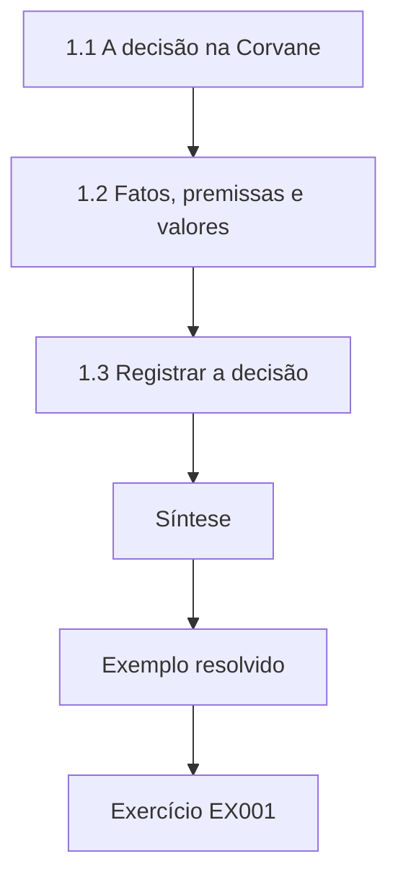

### Desenho lógico

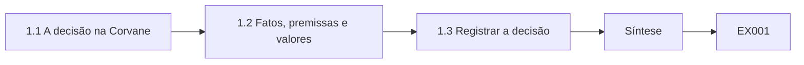

```text
[1.1 A decisão na Corvane]
    |
    v
[1.2 Fatos, premissas e valores]
    |
    v
[1.3 Registrar a decisão]
    |
    v
[Síntese]
    |
    v
[Exemplo resolvido] --> [Exercício EX001]
```
<!-- open-cyber-academy:lesson-figures:end ch-01 -->


### Objetivos de aprendizagem

Você vai (1) enquadrar uma decisão de arquitetura em escala organizacional; (2) separar fatos, premissas e valores; (3) registrar uma decisão de modo que outros possam contestá-la.

### 1.1 A decisão na Corvane

Priya Ramanathan é estudante de pós-graduação e arquiteta de segurança líder na Corvane Health Network, um grupo fictício de vinte e duas clínicas comunitárias. Sua orientadora, a Dra. Elena Voss, da fictícia Brookmere University, pede que ela traga ao curso uma decisão real em andamento. A Corvane precisa decidir se consolida as redes das clínicas atrás de um único serviço de acesso baseado em nuvem ou se mantém o firewall local e a VPN de cada clínica. A escolha afeta os dados dos pacientes, a disponibilidade das clínicas, o fluxo de trabalho da equipe e o orçamento por cinco anos, então é uma decisão em escala organizacional, e não um detalhe de projeto.

### 1.2 Fatos, premissas e valores

Priya divide seu briefing em três colunas. Fatos são coisas que ela pode verificar: vinte e duas clínicas, quatro modelos de firewall, duas indisponibilidades no ano passado causadas por certificados de VPN expirados. Premissas são crenças que ela ainda não consegue verificar, como a de que o serviço em nuvem atenderá às metas de disponibilidade em áreas rurais com conectividade ruim. Valores são prioridades que o conselho precisa definir, como quanto tempo de indisponibilidade das clínicas é aceitável para economizar dinheiro. Misturar essas três coisas é a causa mais comum de discussões circulares em reuniões de arquitetura, porque as pessoas discutem valores enquanto parecem discutir fatos.

### 1.3 Registrar a decisão

Priya escreve um registro de decisão de arquitetura (architecture decision record): contexto, opções consideradas, critérios, a decisão, as consequências e as condições que fariam a decisão ser revisitada. Ela cita os princípios de zero trust do NIST SP 800-207 como direção de projeto, mas observa que eles não ditam nenhum produto. O registro é curto, datado e assinado pelo diretor de tecnologia da informação. Dois anos depois, um novo arquiteto consegue ler por que a escolha foi feita e julgar se suas condições ainda valem, em vez de adivinhar o raciocínio ou repetir todo o debate.

### Exemplo resolvido

Priya enquadra a decisão sobre a rede das clínicas, organiza seu briefing em fatos, premissas e valores e a registra num registro de decisão com condições de revisão.

> **Caso sintético.** A Corvane, a Brookmere e todas as pessoas são sintéticas; o SP 800-207 é real.

### Erros e limites

Os registros de decisão podem virar burocracia se ninguém os lê. As premissas precisam ser testadas, e não apenas listadas.

### Exercícios

- **EX001 — Teste de escala organizacional.** Por que a escolha da rede das clínicas é uma decisão em escala organizacional? *Rubrica:* 3 = afeta dados dos pacientes, disponibilidade, fluxo de trabalho e orçamento por cinco anos em todas as clínicas;; 2 = vários efeitos;; 1 = é técnica;; 0 = nenhuma.

- **EX002 — Exemplo de premissa.** Dê a premissa que Priya ainda não conseguia verificar. *Rubrica:* 3 = disponibilidade do serviço em nuvem em clínicas rurais com conectividade ruim;; 2 = disponibilidade;; 1 = indisponibilidades por certificados;; 0 = nenhuma.

- **EX003 — Valor para o conselho.** Que valor Priya deixou para o conselho? *Rubrica:* 3 = quanto tempo de indisponibilidade das clínicas é aceitável para economizar dinheiro;; 2 = indisponibilidade;; 1 = modelos de firewall;; 0 = nenhuma.

- **EX004 — Discussões circulares.** Segundo o capítulo, o que causa discussões circulares de arquitetura? *Rubrica:* 3 = misturar fatos, premissas e valores;; 2 = misturar;; 1 = orçamento;; 0 = nenhuma.

- **EX005 — Condições de revisão.** Por que incluir condições de revisão num registro de decisão? *Rubrica:* 3 = para que um arquiteto posterior possa julgar se a decisão ainda vale;; 2 = revisão futura;; 1 = vago;; 0 = nenhuma.

### Síntese

Decisões avançadas melhoram quando fatos, premissas e valores são separados e o raciocínio é registrado para contestação posterior.

<!-- open-cyber-academy:chapter-navigation:start ch-01 -->
### Continue estudando — aula 01 (capítulo 01 de 12)

[← Início do curso](../../README.md) · [Índice das aulas](../SUBJECTS.md) · [Capítulo 02 →](#ch-02)

Continue para a próxima aula já escrita.
<!-- open-cyber-academy:chapter-navigation:end -->

<a id="ch-02"></a>

## Capítulo 2 — Arquitetura e engenharia de segurança: prática atual

<!-- open-cyber-academy:lesson-figures:start ch-02 -->
### Mapa da aula

Aula 02 publicada. Mapa, exemplo, EX006.

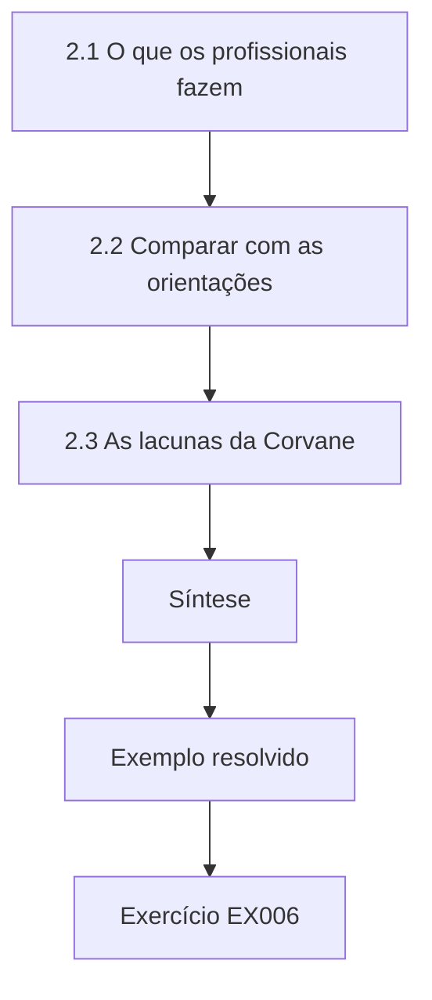

### Desenho lógico

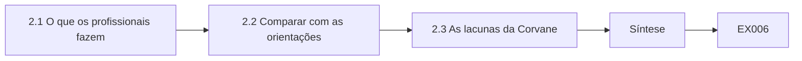

```text
[2.1 O que os profissionais fazem]
    |
    v
[2.2 Comparar com as orientações]
    |
    v
[2.3 As lacunas da Corvane]
    |
    v
[Síntese]
    |
    v
[Exemplo resolvido] --> [Exercício EX006]
```
<!-- open-cyber-academy:lesson-figures:end ch-02 -->


### Objetivos de aprendizagem

Você vai (1) levantar a prática atual de arquitetura na área da saúde; (2) compará-la com as orientações publicadas; (3) identificar lacunas na prática da Corvane.

### 2.1 O que os profissionais fazem

Priya entrevista arquitetos de três organizações de saúde pares, todas anonimizadas para o curso. Eles compartilham padrões: acesso da equipe centrado em identidade, segmentação de rede que separa os dispositivos clínicos, acesso remoto de fornecedores por sessões intermediadas (brokered) e comitês de revisão de arquitetura para novos sistemas. Nenhum usa por inteiro métodos formais como o SABSA; todos aproveitam partes, como os perfis de atributos de negócio. Ela observa que a prática é moldada por equipes pequenas, por dispositivos médicos legados que não podem receber patches e por reguladores que esperam decisões de risco documentadas, e não projetos específicos.

### 2.2 Comparar com as orientações

Priya mapeia a prática observada contra o NIST SP 800-160 Vol. 1 Rev. 1, que descreve a engenharia de segurança de sistemas ao longo do ciclo de vida, e contra a ISO/IEC 27001:2022 (no Brasil, ABNT NBR ISO/IEC 27001:2022), que exige um sistema de gestão da segurança da informação. A prática se alinha bem em controle de acesso e gestão de fornecedores, mas é fraca em verificação: a maioria das organizações revisa os projetos antes da construção, mas raramente testa se os sistemas entregues correspondem a esses projetos. As orientações esperam a verificação como uma atividade do ciclo de vida. A lacuna importa porque a deriva não detectada entre o projeto e a realidade é onde muitos incidentes começam.

### 2.3 As lacunas da Corvane

Aplicando a comparação à Corvane, Priya encontra a mesma fraqueza de verificação e mais duas. Em nove clínicas, os dispositivos clínicos compartilham a rede com notebooks administrativos, e as revisões de arquitetura não têm registro de quais riscos foram aceitos. Ela as ordena por consequência: primeiro a segmentação dos dispositivos, porque uma infecção num notebook poderia alcançar as estações de gerenciamento das bombas de infusão; depois a verificação; depois os registros de riscos aceitos. Ela apresenta a ordenação com as fontes, para que o diretor de tecnologia da informação veja que as lacunas são medidas contra orientações reconhecidas, e não apenas contra a opinião dela.

### Exemplo resolvido

Priya compara a prática anonimizada dos pares com o SP 800-160v1r1 e a ISO/IEC 27001 (no Brasil, ABNT NBR ISO/IEC 27001), encontra uma lacuna comum de verificação e ordena três lacunas na Corvane.

> **Caso sintético.** As entrevistas e os detalhes da Corvane são sintéticos; o SP 800-160 Vol. 1 Rev. 1 e a ISO/IEC 27001:2022 (no Brasil, ABNT NBR ISO/IEC 27001:2022) são reais.

### Erros e limites

Três entrevistas não representam um setor. O alinhamento às orientações não é prova de segurança.

### Exercícios

- **EX006 — Padrão comum.** Cite dois padrões que as três organizações pares compartilham. *Rubrica:* 3 = acesso centrado em identidade, segmentação de dispositivos, acesso intermediado de fornecedores, comitês de revisão;; 2 = um;; 1 = vago;; 0 = nenhuma.

- **EX007 — Uso do SABSA.** Como os pares usam o SABSA? *Rubrica:* 3 = aproveitam partes, como os perfis de atributos, e não o método completo;; 2 = partes;; 1 = método completo;; 0 = nenhuma.

- **EX008 — Lacuna de verificação.** Que lacuna de verificação Priya encontrou na prática? *Rubrica:* 3 = os sistemas entregues raramente são testados contra seus projetos;; 2 = testes;; 1 = revisões de projeto;; 0 = nenhuma.

- **EX009 — Primeira prioridade.** Por que ordenar a segmentação dos dispositivos em primeiro lugar na Corvane? *Rubrica:* 3 = uma infecção num notebook poderia alcançar as estações de gerenciamento das bombas de infusão;; 2 = segurança do paciente;; 1 = custo;; 0 = nenhuma.

- **EX010 — Por que citar fontes.** Por que Priya apresentou as lacunas com fontes? *Rubrica:* 3 = para que sejam vistas como medidas contra orientações, e não como opinião;; 2 = credibilidade;; 1 = vago;; 0 = nenhuma.

### Síntese

Comparar a prática real com as orientações revela lacunas específicas e ordenáveis, sobretudo na verificação.

<!-- open-cyber-academy:chapter-navigation:start ch-02 -->
### Continue estudando — aula 02 (capítulo 02 de 12)

[← Capítulo 01](#ch-01) · [Índice das aulas](../SUBJECTS.md) · [Capítulo 03 →](#ch-03)

Continue para a próxima aula já escrita.
<!-- open-cyber-academy:chapter-navigation:end -->

<a id="ch-03"></a>

## Capítulo 3 — Arquitetura e engenharia de segurança: evidências especializadas

<!-- open-cyber-academy:lesson-figures:start ch-03 -->
### Mapa da aula

Aula 03 publicada. Mapa, exemplo, EX011.

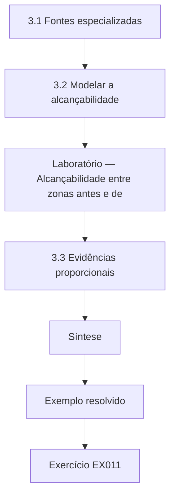

### Desenho lógico

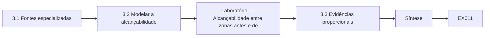

```text
[3.1 Fontes especializadas]
    |
    v
[3.2 Modelar a alcançabilidade]
    |
    v
[Laboratório — Alcançabilidade entre zonas antes e de]
    |
    v
[3.3 Evidências proporcionais]
    |
    v
[Síntese]
    |
    v
[Exemplo resolvido] --> [Exercício EX011]
```
<!-- open-cyber-academy:lesson-figures:end ch-03 -->


### Objetivos de aprendizagem

Você vai (1) reunir evidências especializadas sobre o risco dos dispositivos clínicos; (2) modelar a alcançabilidade entre zonas de rede; (3) apresentar evidências proporcionais à decisão.

### 3.1 Fontes especializadas

Para a lacuna de segmentação, Priya precisa de evidências além das orientações gerais. Ela lê a documentação de segurança do fabricante das estações de gerenciamento das bombas de infusão da Corvane, o inventário da equipe de engenharia clínica e as regras de firewall da equipe de redes. Os engenheiros clínicos sabem quais dispositivos não podem receber patches e de quais conexões de fornecedores eles precisam. Esse conhecimento é uma evidência especializada que os arquitetos muitas vezes não têm. Ela registra cada fonte, seu responsável e sua data, porque os inventários de dispositivos na saúde são notoriamente incompletos e ela precisa mostrar quão atual é o seu retrato.

### 3.2 Modelar a alcançabilidade

Priya constrói um pequeno modelo de quais zonas conseguem alcançar quais outras sob as regras atuais e depois o repete sob as regras propostas. O laboratório abaixo calcula a alcançabilidade nos dois casos. Sob as regras atuais, a zona dos notebooks administrativos consegue alcançar a zona dos dispositivos clínicos por meio de um servidor de impressão compartilhado. Sob as regras propostas, apenas o jump host da engenharia clínica consegue alcançar os dispositivos clínicos. O modelo é simples, mas transforma uma longa exportação de firewall numa afirmação clara que um tomador de decisão consegue acompanhar e conferir.

### Laboratório — Alcançabilidade entre zonas antes e depois da segmentação

```python
# Zone reachability before and after segmentation (synthetic rules).
def reach(rules, start):
    seen, todo = {start}, [start]
    while todo:
        z = todo.pop()
        for a, b in rules:
            if a == z and b not in seen: seen.add(b); todo.append(b)
    return sorted(seen - {start})
current = [("admin", "print"), ("print", "clinical"), ("admin", "internet"), ("jump", "clinical"), ("clinical", "print")]
proposed = [("admin", "print"), ("admin", "internet"), ("jump", "clinical")]
for name, rules in [("current", current), ("proposed", proposed)]:
    print(f"{name}: admin reaches {reach(rules, 'admin')}; jump reaches {reach(rules, 'jump')}")
```

Execute com `python3 lab_reach.py`. Saída verificada:

```text
current: admin reaches ['clinical', 'internet', 'print']; jump reaches ['clinical', 'print']
proposed: admin reaches ['internet', 'print']; jump reaches ['clinical']
```

### 3.3 Evidências proporcionais

Priya resiste à vontade de levar todos os detalhes ao conselho. Ela apresenta o resultado da alcançabilidade, a contagem de clínicas afetadas e a visão dos engenheiros clínicos sobre o impacto operacional. As regras detalhadas de firewall vão para um apêndice destinado aos revisores técnicos. As evidências são proporcionais: o bastante para justificar a decisão e mostrar seus limites, e não tanto que a decisão se perca. A Dra. Voss observa que a proporção é uma habilidade profissional, porque sobrecarregar os tomadores de decisão com detalhes é uma forma de evitar a responsabilidade por uma recomendação clara.

### Exemplo resolvido

Priya reúne evidências de dispositivos e de firewall com especialistas, modela a alcançabilidade antes e depois da segmentação e apresenta uma síntese proporcional.

> **Caso sintético.** Os dispositivos, as zonas e as regras são sintéticos.

### Erros e limites

Os inventários deixam dispositivos de fora. Os modelos de alcançabilidade ignoram caminhos na camada de aplicação não capturados nas regras.

### Exercícios

- **EX011 — Conhecimento especializado.** O que os engenheiros clínicos sabiam que os arquitetos muitas vezes não sabem? *Rubrica:* 3 = quais dispositivos não podem receber patches e de quais conexões de fornecedores precisam;; 2 = dispositivos;; 1 = vago;; 0 = nenhuma.

- **EX012 — Caminho atual.** Como os notebooks administrativos conseguiam alcançar os dispositivos clínicos sob as regras atuais? *Rubrica:* 3 = pelo servidor de impressão compartilhado;; 2 = servidor de impressão;; 1 = diretamente;; 0 = nenhuma.

- **EX013 — Caminho proposto.** O que consegue alcançar os dispositivos clínicos sob as regras propostas? *Rubrica:* 3 = apenas o jump host da engenharia clínica;; 2 = jump host;; 1 = tudo;; 0 = nenhuma.

- **EX014 — Registrar datas.** Por que registrar a data de cada fonte? *Rubrica:* 3 = os inventários costumam ser incompletos, então é preciso mostrar a atualidade;; 2 = atualidade;; 1 = vago;; 0 = nenhuma.

- **EX015 — Proporção.** O que significa evidência proporcional aqui? *Rubrica:* 3 = o bastante para justificar a decisão e mostrar os limites, com os detalhes em apêndices;; 2 = o bastante;; 1 = tudo;; 0 = nenhuma.

### Síntese

Evidências especializadas e modelos simples transformam configurações complexas em evidências proporcionais para a decisão.

<!-- open-cyber-academy:chapter-navigation:start ch-03 -->
### Continue estudando — aula 03 (capítulo 03 de 12)

[← Capítulo 02](#ch-02) · [Índice das aulas](../SUBJECTS.md) · [Capítulo 04 →](#ch-04)

Continue para a próxima aula já escrita.
<!-- open-cyber-academy:chapter-navigation:end -->

<a id="ch-04"></a>

## Capítulo 4 — Risco avançado e ética

<!-- open-cyber-academy:lesson-figures:start ch-04 -->
### Mapa da aula

Aula 04 publicada. Mapa, exemplo, EX016.

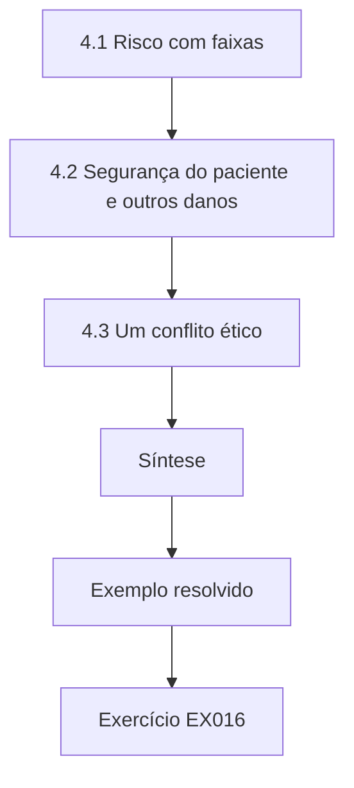

### Desenho lógico

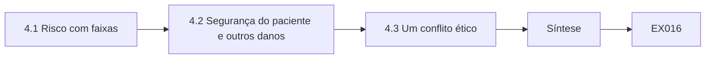

```text
[4.1 Risco com faixas]
    |
    v
[4.2 Segurança do paciente e outros danos]
    |
    v
[4.3 Um conflito ético]
    |
    v
[Síntese]
    |
    v
[Exemplo resolvido] --> [Exercício EX016]
```
<!-- open-cyber-academy:lesson-figures:end ch-04 -->


### Objetivos de aprendizagem

Você vai (1) estimar o risco com incerteza explícita; (2) ponderar a segurança do paciente contra outros danos; (3) lidar com um conflito ético no trabalho de arquitetura.

### 4.1 Risco com faixas

Priya estima o risco de um evento de ransomware alcançar os dispositivos clínicos. Em vez de um número único, ela dá faixas: uma probabilidade anual entre dois e oito por cento sob o projeto atual, e um impacto de um a cinco dias de interrupção das clínicas. Ela explica cada faixa por suas fontes, seguindo o NIST SP 800-30 Rev. 1. Um laboratório de Monte Carlo não é necessário para o conselho; um caso simples baixo, provável e alto é mais claro. As faixas mostram aos líderes quanto é desconhecido e impedem que um número de aparência precisa sugira uma confiança que não existe.

### 4.2 Segurança do paciente e outros danos

A saúde acrescenta uma dimensão que a maioria dos métodos de risco trata de forma superficial: o dano aos pacientes. Priya separa três tipos de dano: à segurança do paciente, à privacidade e financeiro. Ela se recusa a converter a segurança do paciente em dinheiro, porque fazer isso esconde um julgamento ético dentro da aritmética. Em vez disso, apresenta o dano à segurança ao lado dos outros e pede ao comitê de governança clínica que o pondere. É esse comitê, e não a equipe de arquitetura, que detém a autoridade sobre o risco clínico. Colocar as decisões no órgão certo faz parte do dever ético do arquiteto.

### 4.3 Um conflito ético

Um fornecedor oferece à Corvane um desconto se ela adiar a segmentação por um ano, para coincidir com o lançamento de um produto do fornecedor. A diretora financeira é favorável a aceitar. Priya acredita que o adiamento expõe os pacientes a um risco evitável. Ela documenta sua opinião, as faixas de risco e a preocupação com a segurança e escala o caso ao comitê de governança clínica, em vez de passar por cima da decisão ou aceitá-la em silêncio. O comitê rejeita o adiamento. Priya reflete que a ética profissional exige tornar o risco visível para quem é responsável, sem decidir sozinha e sem ficar calada.

### Exemplo resolvido

Priya dá faixas de risco com fontes, mantém a segurança do paciente separada do dinheiro e escala ao comitê de governança clínica um adiamento motivado pelo fornecedor.

> **Caso sintético.** Os números, o fornecedor e os comitês são sintéticos; o SP 800-30 Rev. 1 é real.

### Erros e limites

As faixas podem ser largas demais para orientar a ação. Escalar sem evidências pode parecer obstrução.

### Exercícios

- **EX016 — Por que faixas.** Por que expressar o risco em faixas, e não em números únicos? *Rubrica:* 3 = para mostrar a incerteza e evitar falsa confiança;; 2 = incerteza;; 1 = precisão;; 0 = nenhuma.

- **EX017 — Três danos.** Que três tipos de dano Priya separou? *Rubrica:* 3 = segurança do paciente, privacidade e financeiro;; 2 = dois;; 1 = vago;; 0 = nenhuma.

- **EX018 — Não monetizar a segurança.** Por que não converter a segurança do paciente em dinheiro? *Rubrica:* 3 = isso esconde um julgamento ético dentro da aritmética;; 2 = ética;; 1 = é mais fácil;; 0 = nenhuma.

- **EX019 — Autoridade certa.** Quem detém a autoridade sobre o risco clínico na Corvane? *Rubrica:* 3 = o comitê de governança clínica;; 2 = comitê;; 1 = equipe de arquitetura;; 0 = nenhuma.

- **EX020 — Lidar com o desconto.** Como Priya lidou com a oferta de adiamento do fornecedor? *Rubrica:* 3 = documentou e escalou ao comitê de governança clínica;; 2 = escalou;; 1 = aceitou;; 0 = nenhuma.

### Síntese

O trabalho avançado de risco declara a incerteza com honestidade, mantém a segurança física visível e situa as decisões no órgão responsável.

<!-- open-cyber-academy:chapter-navigation:start ch-04 -->
### Continue estudando — aula 04 (capítulo 04 de 12)

[← Capítulo 03](#ch-03) · [Índice das aulas](../SUBJECTS.md) · [Capítulo 05 →](#ch-05)

Continue para a próxima aula já escrita.
<!-- open-cyber-academy:chapter-navigation:end -->

<a id="ch-05"></a>

## Capítulo 5 — Arquitetura e engenharia de segurança: alternativas de desenho

<!-- open-cyber-academy:lesson-figures:start ch-05 -->
### Mapa da aula

Aula 05 publicada. Mapa, exemplo, EX021.

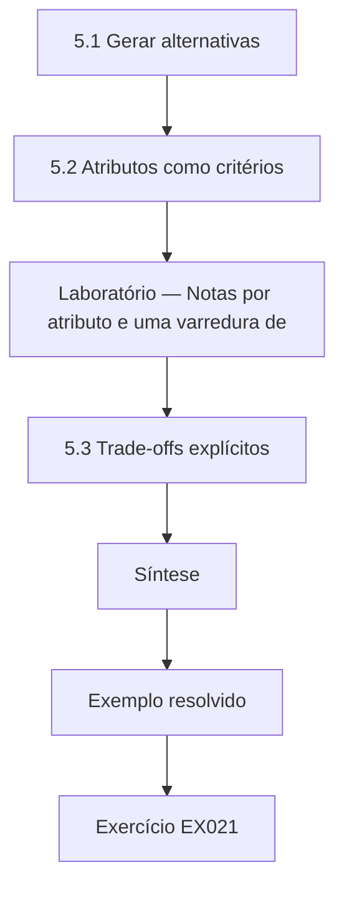

### Desenho lógico

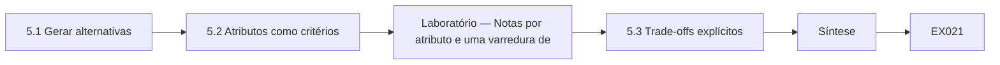

```text
[5.1 Gerar alternativas]
    |
    v
[5.2 Atributos como critérios]
    |
    v
[Laboratório — Notas por atributo e uma varredura de]
    |
    v
[5.3 Trade-offs explícitos]
    |
    v
[Síntese]
    |
    v
[Exemplo resolvido] --> [Exercício EX021]
```
<!-- open-cyber-academy:lesson-figures:end ch-05 -->


### Objetivos de aprendizagem

Você vai (1) gerar alternativas de projeto realmente diferentes; (2) compará-las por atributos de negócio; (3) escolher com trade-offs explícitos.

### 5.1 Gerar alternativas

Para a decisão de acesso das clínicas, Priya insiste em pelo menos três alternativas reais, e não em um projeto favorito e dois espantalhos. A opção um mantém os firewalls locais e as VPNs, mas automatiza a renovação de certificados. A opção dois leva todas as clínicas a um cloud access broker com políticas cientes de identidade. A opção três é híbrida: um broker em nuvem para as aplicações da equipe, com segmentação local e um caminho local de contingência para os sistemas clínicos. Ela pede a um colega que prefere a opção um que escreva a defesa dela, para que cada opção seja argumentada por alguém que acredita nela.

### 5.2 Atributos como critérios

Priya usa atributos de negócio no estilo do SABSA (Sherwood, Clark e Lynas, 2005) como critérios: disponível, protegido, auditável, operável por uma equipe pequena e acessível em custo. Os líderes clínicos dão o maior peso à disponibilidade, porque as clínicas não podem parar de atender pacientes. O laboratório abaixo pontua as três opções e verifica se a ordenação se mantém quando o peso da disponibilidade muda. A opção híbrida fica em primeiro no caso-base e quando a disponibilidade importa mais; a opção em nuvem só vence se o peso da disponibilidade cair para 0,20 ou menos, o que nenhum líder clínico apoia.

### Laboratório — Notas por atributo e uma varredura de sensibilidade

```python
# Score three access designs on weighted attributes and sweep the availability weight (synthetic).
attrs = ["available", "protected", "auditable", "operable", "affordable"]
score = {"local": [3, 2, 2, 3, 4], "cloud": [3, 5, 5, 4, 3], "hybrid": [5, 4, 4, 3, 3]}
def rank(wa):
    rest = (1 - wa) / 4; w = [wa] + [rest] * 4
    return {o: sum(a * b for a, b in zip(w, s)) for o, s in score.items()}
for wa in (0.40, 0.60, 0.20, 0.05):
    r = rank(wa); best = max(r, key=r.get)
    print(f"availability weight {wa:.2f}: " + ", ".join(f"{o} {v:.2f}" for o, v in r.items()) + f" -> {best}")
```

Execute com `python3 lab_options.py`. Saída verificada:

```text
availability weight 0.40: local 2.85, cloud 3.75, hybrid 4.10 -> hybrid
availability weight 0.60: local 2.90, cloud 3.50, hybrid 4.40 -> hybrid
availability weight 0.20: local 2.80, cloud 4.00, hybrid 3.80 -> cloud
availability weight 0.05: local 2.76, cloud 4.19, hybrid 3.57 -> cloud
```

### 5.3 Trade-offs explícitos

A opção híbrida não sai de graça. Ela mantém dois caminhos de acesso, o que dobra parte do trabalho operacional e cria o risco de o caminho de contingência ser negligenciado até o momento em que for necessário. Priya escreve esses custos no registro de decisão, junto com uma mitigação: testes trimestrais da contingência local em duas clínicas. Ela observa que a escolha híbrida reflete o julgamento de valor do conselho sobre a disponibilidade e que outro conselho poderia, razoavelmente, escolher de outro modo. Explicitar essa dependência mantém a recomendação honesta sobre onde o julgamento entra.

### Exemplo resolvido

Priya desenvolve três alternativas reais com defensores, pontua-as em cinco atributos com uma varredura de sensibilidade e registra os custos e as mitigações da opção híbrida.

> **Caso sintético.** As opções, as notas e os pesos são sintéticos; o SABSA é real.

### Erros e limites

As notas por atributo são julgamentos. Dois caminhos de acesso aumentam a carga operacional.

### Exercícios

- **EX021 — Espantalhos.** Por que insistir em três alternativas reais? *Rubrica:* 3 = para evitar um projeto favorito acompanhado de espantalhos;; 2 = comparação justa;; 1 = rapidez;; 0 = nenhuma.

- **EX022 — Maior peso.** Que atributo os líderes clínicos ponderaram mais, e por quê? *Rubrica:* 3 = disponibilidade, porque as clínicas não podem parar de atender pacientes;; 2 = disponibilidade;; 1 = custo;; 0 = nenhuma.

- **EX023 — Ordenação-base.** Que opção ficou em primeiro no caso-base do laboratório? *Rubrica:* 3 = híbrida, 4,10;; 2 = híbrida;; 1 = nuvem;; 0 = nenhuma.

- **EX024 — Quando a nuvem vence.** Quando a opção em nuvem vence na varredura? *Rubrica:* 3 = com peso de disponibilidade de 0,20 ou menos;; 2 = peso baixo;; 1 = sempre;; 0 = nenhuma.

- **EX025 — Custo da híbrida.** Que custo oculto a opção híbrida carrega? *Rubrica:* 3 = dois caminhos de acesso, com risco de a contingência ser negligenciada;; 2 = contingência;; 1 = vago;; 0 = nenhuma.

### Síntese

Alternativas honestas, critérios por atributo e verificações de sensibilidade tornam os trade-offs explícitos, em vez de ocultos.

<!-- open-cyber-academy:chapter-navigation:start ch-05 -->
### Continue estudando — aula 05 (capítulo 05 de 12)

[← Capítulo 04](#ch-04) · [Índice das aulas](../SUBJECTS.md) · [Capítulo 06 →](#ch-06)

Continue para a próxima aula já escrita.
<!-- open-cyber-academy:chapter-navigation:end -->

<a id="ch-06"></a>

## Capítulo 6 — Arquitetura e engenharia de segurança: avaliação controlada

<!-- open-cyber-academy:lesson-figures:start ch-06 -->
### Mapa da aula

Aula 06 publicada. Mapa, exemplo, EX026.

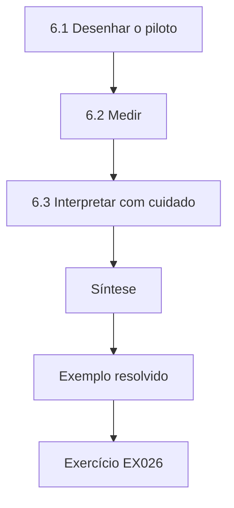

### Desenho lógico

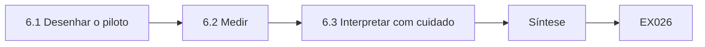

```text
[6.1 Desenhar o piloto]
    |
    v
[6.2 Medir]
    |
    v
[6.3 Interpretar com cuidado]
    |
    v
[Síntese]
    |
    v
[Exemplo resolvido] --> [Exercício EX026]
```
<!-- open-cyber-academy:lesson-figures:end ch-06 -->


### Objetivos de aprendizagem

Você vai (1) desenhar um piloto controlado do projeto híbrido; (2) medir os resultados contra um grupo de comparação; (3) interpretar com cuidado resultados limitados.

### 6.1 Desenhar o piloto

Antes de implantar o projeto híbrido nas vinte e duas clínicas, Priya conduz um piloto em seis clínicas, sorteadas entre clínicas de tamanho e conectividade semelhantes, enquanto outras seis continuam como antes. Ela define os resultados de antemão: minutos de indisponibilidade do acesso por clínica por mês, tempo de login da equipe e chamados ao help desk sobre acesso. A escolha aleatória das clínicas do piloto a impede de escolher os locais mais fáceis. Wohlin e colegas (2012) descrevem esse tipo de comparação controlada e as ameaças à validade que ela precisa tratar.

### 6.2 Medir

Ao longo de três meses, as clínicas do piloto registram uma média de onze minutos de indisponibilidade por mês, contra trinta e quatro nas clínicas de comparação, principalmente porque desaparecem as indisponibilidades por expiração de certificados. O tempo de login sobe quatro segundos por causa de uma etapa extra de identidade. Os chamados ao help desk sobem no primeiro mês e depois caem abaixo do nível de comparação. Priya relata cada resultado com o número de clínicas e de meses por trás dele, para que os leitores vejam quão pequena é a amostra. Ela também registra um teste de contingência em cada clínica do piloto.

### 6.3 Interpretar com cuidado

Seis clínicas ao longo de três meses é uma amostra pequena. Priya escreve que os resultados são consistentes com uma disponibilidade melhor e um impacto aceitável sobre a equipe, mas que um único mês ruim poderia mudar o quadro. Ela recomenda uma implantação escalonada com medição contínua, em vez de uma mudança big-bang. O conselho concorda. A Dra. Voss destaca que resultados definidos de antemão, escolha aleatória e relato honesto da amostra são o que tornam um piloto convincente, mais do que o tamanho da melhoria em si. Os números mensais completos são publicados num apêndice para quem quiser conferi-los.

### Exemplo resolvido

Priya pilota o projeto híbrido em seis clínicas sorteadas, mede três resultados definidos de antemão contra seis clínicas de comparação e recomenda uma implantação escalonada.

> **Caso sintético.** As clínicas e os números são sintéticos; Wohlin et al. (2012) é real.

### Erros e limites

Amostras pequenas são frágeis. A equipe pode se comportar de outro modo quando sabe que está num piloto.

### Exercícios

- **EX026 — Escolher por sorteio.** Por que sortear as clínicas do piloto? *Rubrica:* 3 = para impedir a escolha dos locais mais fáceis;; 2 = viés;; 1 = conveniência;; 0 = nenhuma.

- **EX027 — Resultado de indisponibilidade.** Quantos minutos mensais de indisponibilidade tiveram as clínicas do piloto e as de comparação? *Rubrica:* 3 = onze contra trinta e quatro;; 2 = menos;; 1 = vago;; 0 = nenhuma.

- **EX028 — Custo para a equipe.** Que custo para a equipe o piloto mostrou? *Rubrica:* 3 = o login subiu quatro segundos;; 2 = quatro segundos;; 1 = vago;; 0 = nenhuma.

- **EX029 — Padrão dos chamados.** Como mudaram os chamados ao help desk? *Rubrica:* 3 = subiram no primeiro mês e depois caíram abaixo da comparação;; 2 = subida e queda;; 1 = estáveis;; 0 = nenhuma.

- **EX030 — Recomendação.** O que Priya recomendou depois do piloto? *Rubrica:* 3 = uma implantação escalonada com medição contínua;; 2 = escalonada;; 1 = big-bang;; 0 = nenhuma.

### Síntese

Um piloto controlado com resultados definidos de antemão fornece evidências modestas, mas críveis, para uma decisão em etapas.

<!-- open-cyber-academy:chapter-navigation:start ch-06 -->
### Continue estudando — aula 06 (capítulo 06 de 12)

[← Capítulo 05](#ch-05) · [Índice das aulas](../SUBJECTS.md) · [Capítulo 07 →](#ch-07)

Continue para a próxima aula já escrita.
<!-- open-cyber-academy:chapter-navigation:end -->

<a id="ch-07"></a>

## Capítulo 7 — Arquitetura e engenharia de segurança: integração organizacional

<!-- open-cyber-academy:lesson-figures:start ch-07 -->
### Mapa da aula

Aula 07 publicada. Mapa, exemplo, EX031.

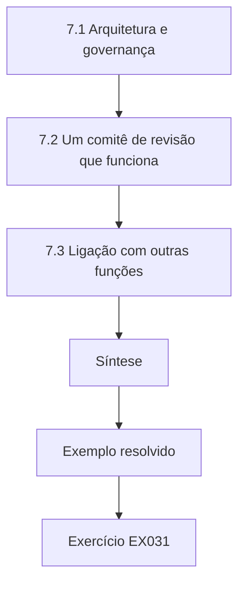

### Desenho lógico

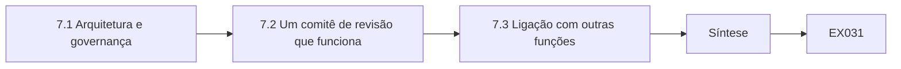

```text
[7.1 Arquitetura e governança]
    |
    v
[7.2 Um comitê de revisão que funciona]
    |
    v
[7.3 Ligação com outras funções]
    |
    v
[Síntese]
    |
    v
[Exemplo resolvido] --> [Exercício EX031]
```
<!-- open-cyber-academy:lesson-figures:end ch-07 -->


### Objetivos de aprendizagem

Você vai (1) incorporar a arquitetura à governança da Corvane; (2) ligar a arquitetura ao sistema de gestão; (3) desenhar um comitê de revisão de arquitetura que funcione.

### 7.1 Arquitetura e governança

Os projetos de Priya só duram se passarem a fazer parte do modo como a Corvane funciona. Ela liga a arquitetura ao sistema de gestão da segurança da informação exigido pela ISO/IEC 27001:2022 (no Brasil, ABNT NBR ISO/IEC 27001:2022): avaliação de riscos, declaração de aplicabilidade, auditoria interna e análise crítica pela direção. Cada registro de decisão de arquitetura agora referencia os riscos que trata e os controles que implementa. Quando o auditor interno testa um controle, consegue rastreá-lo de volta a uma decisão de projeto e a seus motivos, fechando a lacuna entre os documentos de arquitetura e as evidências de auditoria. Isso também encurta a preparação para as auditorias.

### 7.2 Um comitê de revisão que funciona

O antigo comitê de revisão de arquitetura da Corvane se reunia mensalmente, revisava todos os projetos e se tornou um gargalo que as equipes evitavam. Priya o redesenha. Os projetos respondem a um formulário curto de triagem; só chegam ao comitê os que acrescentam fornecedores, fluxos de dados de pacientes, conexões de dispositivos clínicos ou exposição à internet. O comitê se reúne semanalmente por trinta minutos, publica as decisões em até dois dias e usa um modelo padrão. Em um trimestre, mais projetos se apresentam voluntariamente, porque o processo é rápido e previsível, em vez de ser uma fonte de atraso.

### 7.3 Ligação com outras funções

Priya mapeia onde a arquitetura toca compras, engenharia clínica, privacidade e finanças. Compras acrescenta perguntas de segurança às licitações; a engenharia clínica passa a integrar o comitê nos projetos de dispositivos; o encarregado de privacidade revisa todo novo fluxo de dados de pacientes; finanças vê cedo os custos de arquitetura. Ela usa as famílias de controles do NIST SP 800-53 Rev. 5 para garantir que nenhuma área fique sem responsável. A integração funciona quando cada função vê a arquitetura como uma ajuda para seus próprios objetivos, e não como uma aprovação extra imposta de fora. Cada interface tem um contato nomeado.

### Exemplo resolvido

Priya liga os registros de decisão aos processos da ISO/IEC 27001 (no Brasil, ABNT NBR ISO/IEC 27001), redesenha o comitê de revisão com triagem e reuniões semanais curtas e mapeia quatro interfaces com responsáveis.

> **Caso sintético.** A governança da Corvane é sintética; a ISO/IEC 27001:2022 (no Brasil, ABNT NBR ISO/IEC 27001:2022) e o SP 800-53 Rev. 5 são reais.

### Erros e limites

A triagem pode deixar passar projetos arriscados que respondem não. Comitês rápidos podem virar carimbadores.

### Exercícios

- **EX031 — Rastreabilidade para a auditoria.** Como ligar os registros ao SGSI ajudou os auditores? *Rubrica:* 3 = eles conseguem rastrear um controle até sua decisão de projeto;; 2 = rastreabilidade;; 1 = vago;; 0 = nenhuma.

- **EX032 — Problema do comitê antigo.** O que havia de errado com o antigo comitê de revisão? *Rubrica:* 3 = revisava tudo mensalmente e virou um gargalo;; 2 = gargalo;; 1 = rápido demais;; 0 = nenhuma.

- **EX033 — Gatilhos da triagem.** Que características de um projeto disparam a revisão pelo comitê? *Rubrica:* 3 = fornecedores, fluxos de dados de pacientes, dispositivos clínicos, exposição à internet;; 2 = dois;; 1 = todos os projetos;; 0 = nenhuma.

- **EX034 — Efeito do comitê.** O que mudou em um trimestre após o redesenho? *Rubrica:* 3 = mais projetos se apresentaram voluntariamente;; 2 = voluntário;; 1 = vago;; 0 = nenhuma.

- **EX035 — Princípio de integração.** Quando a integração com outras funções funciona? *Rubrica:* 3 = quando cada função vê a arquitetura ajudando seus próprios objetivos;; 2 = objetivos comuns;; 1 = imposições;; 0 = nenhuma.

### Síntese

A arquitetura perdura quando está incorporada ao sistema de gestão e a um processo de revisão rápido e previsível.

<!-- open-cyber-academy:chapter-navigation:start ch-07 -->
### Continue estudando — aula 07 (capítulo 07 de 12)

[← Capítulo 06](#ch-06) · [Índice das aulas](../SUBJECTS.md) · [Capítulo 08 →](#ch-08)

Continue para a próxima aula já escrita.
<!-- open-cyber-academy:chapter-navigation:end -->

<a id="ch-08"></a>

## Capítulo 8 — Arquitetura e engenharia de segurança: casos difíceis

<!-- open-cyber-academy:lesson-figures:start ch-08 -->
### Mapa da aula

Aula 08 publicada. Mapa, exemplo, EX036.

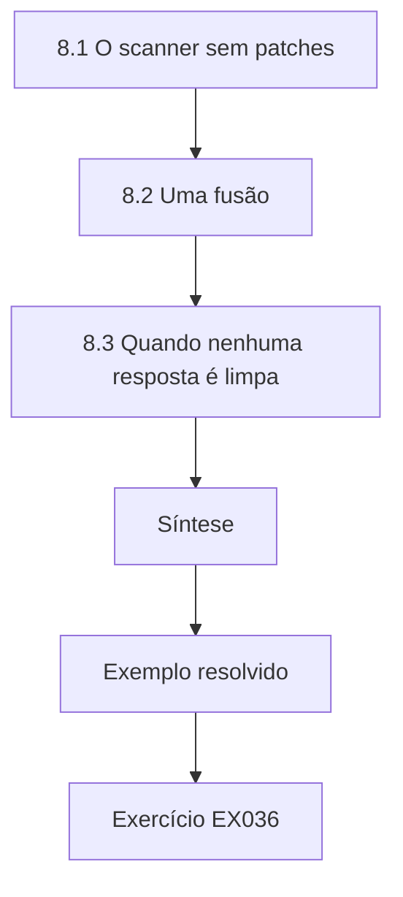

### Desenho lógico

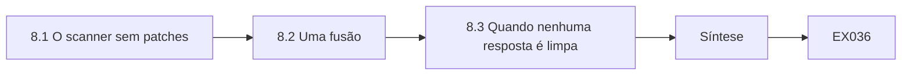

```text
[8.1 O scanner sem patches]
    |
    v
[8.2 Uma fusão]
    |
    v
[8.3 Quando nenhuma resposta é limpa]
    |
    v
[Síntese]
    |
    v
[Exemplo resolvido] --> [Exercício EX036]
```
<!-- open-cyber-academy:lesson-figures:end ch-08 -->


### Objetivos de aprendizagem

Você vai (1) lidar com um dispositivo legado que não consegue atender à arquitetura; (2) gerenciar a fusão de duas redes; (3) raciocinar sobre casos sem resposta limpa.

### 8.1 O scanner sem patches

O scanner de imagem de uma clínica roda um sistema operacional que o fabricante não suporta mais, e substituí-lo custaria mais do que o orçamento anual de equipamentos da clínica. Ele não consegue entrar no projeto ciente de identidade. Priya o trata como uma exceção documentada: isolá-lo em um segmento próprio, permitir que apenas o arquivo de imagens converse com ele, monitorar esse tráfego e fixar uma data de substituição no plano de investimentos. O comitê de governança clínica aceita o risco residual por escrito. Exceções são riscos gerenciados, e não falhas escondidas.

### 8.2 Uma fusão

A Corvane adquire um grupo fictício de clínicas privadas, a Hollin Care, com uma rede plana e contas de administrador compartilhadas. Conectar as duas redes rapidamente importaria as fraquezas da Hollin; mantê-las separadas bloqueia os prontuários compartilhados dos pacientes. Priya propõe uma integração escalonada: primeiro, uma conexão intermediada apenas para aplicações específicas; segundo, a equipe da Hollin migra para identidades da Corvane; terceiro, a rede da Hollin é reconstruída segundo a segmentação da Corvane. Cada etapa tem critérios de entrada. Ela usa a modelagem de ameaças de Shostack (2014) para analisar a conexão intermediada antes que qualquer tráfego passe por ela.

### 8.3 Quando nenhuma resposta é limpa

Os dois casos forçam trade-offs em que toda opção deixa risco. Priya segue um padrão: declarar as opções, o risco que cada uma deixa e quem o aceita; escolher a opção que preserva o atributo mais importante, aqui a disponibilidade do atendimento; e fixar uma data para revisitar. Ela escreve que o objetivo nos casos difíceis não é eliminar o risco, mas torná-lo visível, com responsável e temporário sempre que possível. A Dra. Voss observa que esse é o núcleo do trabalho de arquitetura sênior, em que as respostas de livro raramente se encaixam.

### Exemplo resolvido

Priya isola um scanner sem suporte como exceção documentada, planeja uma integração de fusão em três etapas e aplica um padrão consistente a casos sem resposta limpa.

> **Caso sintético.** O scanner, a Hollin Care e as decisões são sintéticos; Shostack (2014) é real.

### Erros e limites

As exceções tendem a se tornar permanentes sem datas. Fusões escalonadas emperram sob pressão do negócio.

### Exercícios

- **EX036 — Tratamento do scanner.** Como o scanner sem suporte foi tratado? *Rubrica:* 3 = isolado, limitado ao arquivo de imagens, monitorado, com data de substituição;; 2 = isolamento;; 1 = substituído já;; 0 = nenhuma.

- **EX037 — Responsável pela exceção.** Quem aceitou o risco residual do scanner? *Rubrica:* 3 = o comitê de governança clínica, por escrito;; 2 = comitê;; 1 = arquiteta;; 0 = nenhuma.

- **EX038 — Dilema da fusão.** Por que nem a conexão rápida nem a separação total eram aceitáveis? *Rubrica:* 3 = a rápida importa fraquezas; a separação bloqueia os prontuários compartilhados;; 2 = os dois lados;; 1 = vago;; 0 = nenhuma.

- **EX039 — Primeira etapa da fusão.** Qual foi a primeira etapa da fusão? *Rubrica:* 3 = uma conexão intermediada apenas para aplicações específicas;; 2 = intermediada;; 1 = junção total;; 0 = nenhuma.

- **EX040 — Objetivo nos casos difíceis.** Qual é o objetivo nos casos difíceis? *Rubrica:* 3 = tornar o risco visível, com responsável e temporário sempre que possível;; 2 = visível;; 1 = eliminar todo risco;; 0 = nenhuma.

### Síntese

Casos difíceis são tratados com exceções documentadas, planos em etapas e risco visível, com dono e com data.

<!-- open-cyber-academy:chapter-navigation:start ch-08 -->
### Continue estudando — aula 08 (capítulo 08 de 12)

[← Capítulo 07](#ch-07) · [Índice das aulas](../SUBJECTS.md) · [Capítulo 09 →](#ch-09)

Continue para a próxima aula já escrita.
<!-- open-cyber-academy:chapter-navigation:end -->

<a id="ch-09"></a>

## Capítulo 9 — Arquitetura e engenharia de segurança: liderança e garantia

<!-- open-cyber-academy:lesson-figures:start ch-09 -->
### Mapa da aula

Aula 09 publicada. Mapa, exemplo, EX041.

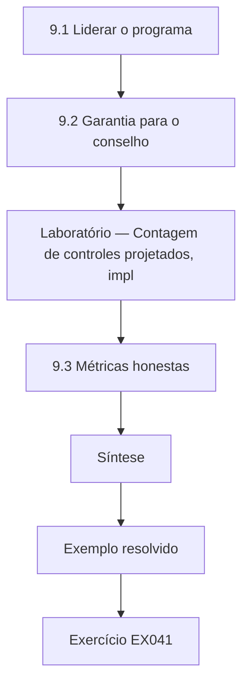

### Desenho lógico

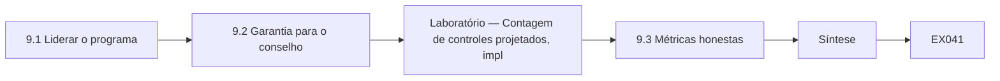

```text
[9.1 Liderar o programa]
    |
    v
[9.2 Garantia para o conselho]
    |
    v
[Laboratório — Contagem de controles projetados, impl]
    |
    v
[9.3 Métricas honestas]
    |
    v
[Síntese]
    |
    v
[Exemplo resolvido] --> [Exercício EX041]
```
<!-- open-cyber-academy:lesson-figures:end ch-09 -->


### Objetivos de aprendizagem

Você vai (1) liderar uma equipe de arquitetura num programa plurianual; (2) oferecer garantia a um conselho; (3) usar métricas que mostrem o progresso com honestidade.

### 9.1 Liderar o programa

Priya agora lidera uma equipe de três arquitetos num programa de três anos de segmentação e acesso. Ela define princípios que todos podem aplicar sem consultá-la: negar por padrão, identidade antes da rede, exceções datadas e com responsável. Ela delega as decisões dentro desses princípios e revisa apenas as exceções. Toda semana, a equipe compartilha um projeto e uma falha. Ela protege tempo para aprendizado, porque a tecnologia da saúde muda mais depressa do que qualquer arquiteto sozinho consegue acompanhar. Liderar em arquitetura é, sobretudo, tornar possíveis boas decisões sem que a líder esteja em todas as salas.

### 9.2 Garantia para o conselho

O conselho faz uma pergunta simples: estamos mais seguros do que no ano passado? Priya responde com garantia (assurance), e não com tranquilização. Ela relata o que foi verificado, por quem e como, usando o vocabulário do risk management framework do NIST SP 800-37 Rev. 2 para autorização e monitoramento contínuo. A auditoria interna independente testa uma amostra de controles a cada trimestre. Ela distingue três níveis: projetado, implementado e verificado. No relatório dela, só os controles verificados contam como redução de risco, o que faz o progresso parecer mais lento, mas muito mais confiável.

### Laboratório — Contagem de controles projetados, implementados e verificados

```python
# Count programme controls by assurance level (synthetic register).
levels = ["verified"] * 19 + ["implemented"] * 10 + ["designed"] * 7 + ["planned"] * 4
designed = sum(l in ("designed", "implemented", "verified") for l in levels)
implemented = sum(l in ("implemented", "verified") for l in levels)
verified = levels.count("verified")
print(f"controls {len(levels)}: designed {designed}, implemented {implemented}, verified {verified}")
print(f"verified share {verified/len(levels):.0%}")
```

Execute com `python3 lab_assure.py`. Saída verificada:

```text
controls 40: designed 36, implemented 29, verified 19
verified share 48%
```

### 9.3 Métricas honestas

O laboratório mostra a lacuna entre os níveis. Dos quarenta controles do programa, trinta e seis estão projetados, vinte e nove implementados e dezenove verificados. Relatar trinta e seis lisonjearia o programa; relatar dezenove mostra onde o esforço é necessário. Priya também relata as clínicas totalmente segmentadas e a idade mediana das exceções em aberto. O conselho de início prefere o número maior, mas passa a confiar no menor depois que a auditoria o confirma. Ela observa que uma métrica conquista confiança quando, de vez em quando, traz más notícias. A parcela verificada era de 48 por cento naquele momento.

### Exemplo resolvido

Priya define princípios para a equipe, relata a garantia em três níveis com amostragem da auditoria independente e mostra ao conselho as contagens de controles verificados, e não de projetados.

> **Caso sintético.** A equipe, os controles e os números são sintéticos; o SP 800-37 Rev. 2 é real.

### Erros e limites

As amostras de verificação podem deixar passar falhas. As métricas podem ser manipuladas depois que se fixam metas.

### Exercícios

- **EX041 — Princípio de delegação.** Que princípios permitem que a equipe decida sem Priya? *Rubrica:* 3 = negar por padrão, identidade antes da rede, exceções datadas e com responsável;; 2 = dois;; 1 = vago;; 0 = nenhuma.

- **EX042 — Três níveis.** Que três níveis Priya distingue? *Rubrica:* 3 = projetado, implementado e verificado;; 2 = dois;; 1 = vago;; 0 = nenhuma.

- **EX043 — Contagens do laboratório.** Quais foram as contagens em cada nível no laboratório? *Rubrica:* 3 = 36 projetados, 29 implementados, 19 verificados;; 2 = em parte;; 1 = vago;; 0 = nenhuma.

- **EX044 — Garantia versus tranquilização.** O que faz do relato de Priya garantia, e não tranquilização? *Rubrica:* 3 = ele relata o que foi verificado, por quem e como;; 2 = verificação;; 1 = tom;; 0 = nenhuma.

- **EX045 — Métrica confiável.** Segundo Priya, quando uma métrica conquista confiança? *Rubrica:* 3 = quando de vez em quando traz más notícias;; 2 = más notícias;; 1 = sempre verde;; 0 = nenhuma.

### Síntese

A liderança de arquitetura delega por meio de princípios e oferece garantia com base em controles verificados, e não apenas projetados.

<!-- open-cyber-academy:chapter-navigation:start ch-09 -->
### Continue estudando — aula 09 (capítulo 09 de 12)

[← Capítulo 08](#ch-08) · [Índice das aulas](../SUBJECTS.md) · [Capítulo 10 →](#ch-10)

Continue para a próxima aula já escrita.
<!-- open-cyber-academy:chapter-navigation:end -->

<a id="ch-10"></a>

## Capítulo 10 — Leitura e crítica de pesquisas

<!-- open-cyber-academy:lesson-figures:start ch-10 -->
### Mapa da aula

Aula 10 publicada. Mapa, exemplo, EX046.

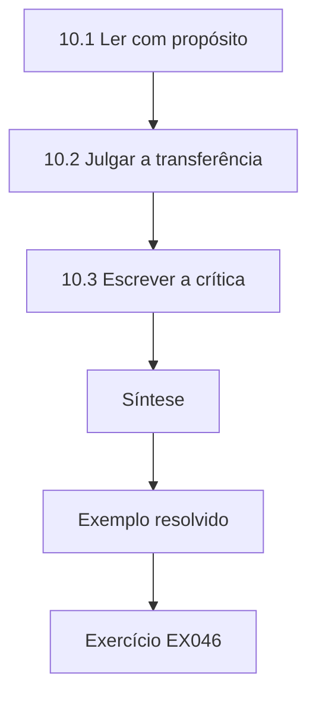

### Desenho lógico

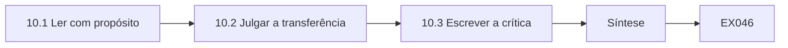

```text
[10.1 Ler com propósito]
    |
    v
[10.2 Julgar a transferência]
    |
    v
[10.3 Escrever a crítica]
    |
    v
[Síntese]
    |
    v
[Exemplo resolvido] --> [Exercício EX046]
```
<!-- open-cyber-academy:lesson-figures:end ch-10 -->


### Objetivos de aprendizagem

Você vai (1) ler criticamente artigos de pesquisa sobre arquitetura de segurança; (2) julgar se os achados se transferem para a Corvane; (3) escrever uma crítica estruturada.

### 10.1 Ler com propósito

A Dra. Voss passa uma tarefa de leitura: encontrar e criticar pesquisas publicadas sobre se os projetos de segmentação ou de zero trust reduzem o impacto dos incidentes. Priya lê com três perguntas. O que exatamente foi medido? Como a comparação foi feita? O cenário se pareceria com uma rede de clínicas? Ela observa que muitos artigos medem redes simuladas ou a base de clientes de fornecedores, e poucos medem a área da saúde. Herley e van Oorschot (2017) argumentam que a pesquisa em segurança muitas vezes carece de afirmações falseáveis, então ela procura estudos que declarem que resultado os teria contrariado.

### 10.2 Julgar a transferência

Um estudo de grandes empresas conclui que redes segmentadas contêm o movimento lateral mais depressa. Priya pergunta se isso se transfere para a Corvane: suas clínicas são menores, têm dispositivos legados e dependem de um prontuário eletrônico central. Alguns mecanismos se transferem, como limitar os hosts alcançáveis; outros não, como uma equipe dedicada de operações de segurança observando cada alerta. Ela conclui que a direção do achado provavelmente se aplica, mas que o tamanho do efeito é incerto. Os julgamentos de transferência são argumentos fundamentados sobre mecanismos, e não respostas simples de sim ou não.

### 10.3 Escrever a crítica

Priya escreve uma crítica de duas páginas para cada artigo: afirmação, método, dados, ameaças à validade, transferência para a Corvane e que evidências adicionais ajudariam. Ela evita descartar trabalhos por imperfeições que todo estudo tem e, em vez disso, julga se as falhas minam a afirmação. As conclusões de um artigo se apoiam numa comparação antes e depois sem controle, durante um período de outras mudanças, o que ela marca como fraco. Outro usa um grupo de comparação cuidadoso, que ela marca como mais forte apesar da amostra menor. Criticar é pesar evidências, e não marcar pontos.

### Exemplo resolvido

Priya critica pesquisas sobre segmentação com três perguntas de leitura, raciocina sobre a transferência por mecanismo e escreve críticas estruturadas.

> **Caso sintético.** Os artigos descritos são composições sintéticas; Herley e van Oorschot (2017) é real.

### Erros e limites

As críticas podem ser mais duras com achados indesejados. O raciocínio sobre transferência é, ele próprio, incerto.

### Exercícios

- **EX046 — Três perguntas.** Que três perguntas orientam a leitura de Priya? *Rubrica:* 3 = o que foi medido, como se comparou, se o cenário se pareceria com uma clínica;; 2 = duas;; 1 = vago;; 0 = nenhuma.

- **EX047 — Afirmações falseáveis.** Por que procurar estudos que declarem o que os contrariaria? *Rubrica:* 3 = a pesquisa em segurança muitas vezes carece de afirmações falseáveis;; 2 = falseável;; 1 = vago;; 0 = nenhuma.

- **EX048 — Mecanismo que não se transfere.** Que mecanismo do estudo empresarial não se transferiu? *Rubrica:* 3 = uma equipe dedicada de operações de segurança observando os alertas;; 2 = equipe;; 1 = segmentação;; 0 = nenhuma.

- **EX049 — Conclusão sobre a transferência.** O que Priya concluiu sobre a transferência? *Rubrica:* 3 = a direção provavelmente se aplica, o tamanho do efeito é incerto;; 2 = direção;; 1 = transferência total;; 0 = nenhuma.

- **EX050 — Desenho fraco.** Por que um artigo foi marcado como fraco? *Rubrica:* 3 = comparação antes e depois sem controle durante outras mudanças;; 2 = sem controle;; 1 = amostra pequena;; 0 = nenhuma.

### Síntese

A leitura crítica pergunta o que foi medido, como, e se os mecanismos se transferem, e pesa as falhas pelo seu efeito sobre as afirmações.

<!-- open-cyber-academy:chapter-navigation:start ch-10 -->
### Continue estudando — aula 10 (capítulo 10 de 12)

[← Capítulo 09](#ch-09) · [Índice das aulas](../SUBJECTS.md) · [Capítulo 11 →](#ch-11)

Continue para a próxima aula já escrita.
<!-- open-cyber-academy:chapter-navigation:end -->

<a id="ch-11"></a>

## Capítulo 11 — Projeto aplicado

<!-- open-cyber-academy:lesson-figures:start ch-11 -->
### Mapa da aula

Aula 11 publicada. Mapa, exemplo, EX051.

```mermaid
flowchart TD
  N0["11.1 O projeto"]
  N1["11.2 Avaliação com uma rubrica"]
  N2["Laboratório — Comparação entre autoavaliação e notas"]
  N3["11.3 Passagem"]
  N4["Síntese"]
  N0 --> N1 --> N2 --> N3 --> N4
  N4 --> EX["Exemplo resolvido"]
  EX --> Q["Exercício EX051"]
```

### Desenho lógico

```mermaid
flowchart LR
  N0["11.1 O projeto"]
  N1["11.2 Avaliação com uma rubrica"]
  N2["Laboratório — Comparação entre autoavaliação e notas"]
  N3["11.3 Passagem"]
  N4["Síntese"]
  N0 --> N1 --> N2 --> N3 --> N4 --> Q["EX051"]
```

```text
[11.1 O projeto]
    |
    v
[11.2 Avaliação com uma rubrica]
    |
    v
[Laboratório — Comparação entre autoavaliação e notas]
    |
    v
[11.3 Passagem]
    |
    v
[Síntese]
    |
    v
[Exemplo resolvido] --> [Exercício EX051]
```
<!-- open-cyber-academy:lesson-figures:end ch-11 -->


### Objetivos de aprendizagem

Você vai (1) entregar um projeto de arquitetura de ponta a ponta; (2) avaliá-lo com uma rubrica; (3) documentar os resultados para a passagem.

### 11.1 O projeto

O projeto aplicado de Priya é a segmentação dos dispositivos clínicos nas nove clínicas em que os dispositivos compartilhavam a rede com os notebooks. Ela entrega um projeto, um plano de migração acordado com a engenharia clínica, roteiros de teste e um manual de operações. A migração acontece clínica por clínica, fora do horário de atendimento, com um plano de rollback para cada uma. A primeira clínica revela uma conexão não documentada de um analisador de sangue para um serviço de laboratório, que teria interrompido o envio de resultados. Ela acrescenta uma semana de descoberta ao plano de cada clínica seguinte, antes de qualquer mudança de regra.

### 11.2 Avaliação com uma rubrica

A Dra. Voss e o diretor de tecnologia da informação da Corvane avaliam o projeto segundo uma rubrica acordada no início: qualidade do projeto, evidências de verificação, engajamento das partes interessadas, tratamento de surpresas e qualidade da passagem. Cada critério recebe nota de zero a três, com descrições para cada nível. Priya se avalia primeiro e depois compara. Ela se dá nota menor que a dos avaliadores em engajamento das partes interessadas e maior em verificação, critério em que os avaliadores observam que duas clínicas foram verificadas só por ela, sem um testador independente.

### Laboratório — Comparação entre autoavaliação e notas dos avaliadores na rubrica

```python
# Compare self and assessor rubric scores (0-3, synthetic).
crit = ["design", "verification", "stakeholders", "surprises", "handover"]
self_s = [3, 3, 1, 2, 2]; assess = [3, 2, 2, 2, 2]
for c, s, a in zip(crit, self_s, assess): print(f"{c:12} self {s} assessors {a} diff {s - a:+d}")
print(f"totals: self {sum(self_s)}/15, assessors {sum(assess)}/15")
```

Execute com `python3 lab_rubric.py`. Saída verificada:

```text
design       self 3 assessors 3 diff +0
verification self 3 assessors 2 diff +1
stakeholders self 1 assessors 2 diff -1
surprises    self 2 assessors 2 diff +0
handover     self 2 assessors 2 diff +0
totals: self 11/15, assessors 11/15
```

### 11.3 Passagem

Priya escreve um pacote de passagem: os diagramas finais da arquitetura, os registros de decisão, as exceções com responsáveis e datas, os resultados da verificação e uma lista de lacunas conhecidas. Ela conduz duas sessões com a equipe de operações, que vai manter a segmentação. A verificação das duas clínicas sem testadores independentes é repetida por um engenheiro de operações, encerrando a preocupação dos avaliadores. O projeto só é avaliado como concluído depois da passagem, porque um projeto que só seu autor consegue operar não foi de fato entregue. Operações assina a passagem como aceita.

### Exemplo resolvido

Priya entrega a segmentação em nove clínicas, acrescenta semanas de descoberta depois de uma surpresa, compara as notas da rubrica e conclui uma passagem com reverificação independente.

> **Caso sintético.** Os detalhes do projeto e as notas são sintéticos.

### Erros e limites

As rubricas comprimem o julgamento em números. As semanas de descoberta acrescentam tempo.

### Exercícios

- **EX051 — Surpresa da primeira clínica.** O que a primeira clínica revelou? *Rubrica:* 3 = uma conexão não documentada de um analisador de sangue para um serviço de laboratório;; 2 = não documentada;; 1 = vago;; 0 = nenhuma.

- **EX052 — Resposta à surpresa.** Como Priya mudou os planos das clínicas seguintes? *Rubrica:* 3 = acrescentou uma semana de descoberta antes das mudanças de regra;; 2 = descoberta;; 1 = vago;; 0 = nenhuma.

- **EX053 — Diferença na rubrica.** Em que critério Priya se deu nota acima da dos avaliadores no laboratório? *Rubrica:* 3 = verificação: ela 3, avaliadores 2;; 2 = verificação;; 1 = partes interessadas;; 0 = nenhuma.

- **EX054 — Preocupação dos avaliadores.** Qual era a preocupação dos avaliadores sobre a verificação? *Rubrica:* 3 = duas clínicas foram verificadas só por Priya;; 2 = independência;; 1 = vago;; 0 = nenhuma.

- **EX055 — Regra de conclusão.** Por que o projeto só estava concluído depois da passagem? *Rubrica:* 3 = um projeto que só seu autor consegue operar não foi entregue;; 2 = passagem;; 1 = vago;; 0 = nenhuma.

### Síntese

Um projeto aplicado está completo quando as surpresas são absorvidas, uma rubrica é comparada com honestidade e outras pessoas conseguem operar o resultado.

<!-- open-cyber-academy:chapter-navigation:start ch-11 -->
### Continue estudando — aula 11 (capítulo 11 de 12)

[← Capítulo 10](#ch-10) · [Índice das aulas](../SUBJECTS.md) · [Capítulo 12 →](#ch-12)

Continue para a próxima aula já escrita.
<!-- open-cyber-academy:chapter-navigation:end -->

<a id="ch-12"></a>

## Capítulo 12 — Revisão final e transferência

<!-- open-cyber-academy:lesson-figures:start ch-12 -->
### Mapa da aula

Aula 12 publicada. Mapa, exemplo, EX056.

```mermaid
flowchart TD
  N0["12.1 O que mudou"]
  N1["12.2 Transferência para um novo domínio"]
  N2["12.3 Desenvolvimento contínuo"]
  N3["Síntese"]
  N0 --> N1 --> N2 --> N3
  N3 --> EX["Exemplo resolvido"]
  EX --> Q["Exercício EX056"]
```

### Desenho lógico

```mermaid
flowchart LR
  N0["12.1 O que mudou"]
  N1["12.2 Transferência para um novo domínio"]
  N2["12.3 Desenvolvimento contínuo"]
  N3["Síntese"]
  N0 --> N1 --> N2 --> N3 --> Q["EX056"]
```

```text
[12.1 O que mudou]
    |
    v
[12.2 Transferência para um novo domínio]
    |
    v
[12.3 Desenvolvimento contínuo]
    |
    v
[Síntese]
    |
    v
[Exemplo resolvido] --> [Exercício EX056]
```
<!-- open-cyber-academy:lesson-figures:end ch-12 -->


### Objetivos de aprendizagem

Você vai (1) revisar o que o curso mudou na prática; (2) transferir métodos para um novo domínio; (3) planejar o desenvolvimento profissional contínuo.

### 12.1 O que mudou

Priya revisa os dois anos. A Corvane agora tem registros de decisão, um comitê de revisão rápido, dispositivos clínicos segmentados em todas as clínicas, um projeto de acesso híbrido sendo implantado em etapas e relatórios de garantia baseados em controles verificados. Ela lista o que não mudou: o provedor de identidade continua sendo uma concentração de risco, e dois dispositivos legados permanecem como exceções datadas. Ela separa os resultados que pode atribuir ao programa daqueles que poderiam ter acontecido de qualquer modo, como a redução de indisponibilidades graças a melhorias do próprio fornecedor.

### 12.2 Transferência para um novo domínio

A Dra. Voss pede a Priya que aplique seus métodos a outro cenário: a rede de controle de uma empresa fictícia de saneamento de água. Priya descobre que os registros de decisão, os critérios por atributo, os modelos de alcançabilidade e as implantações escalonadas se transferem diretamente. O que muda é o peso dos atributos: a segurança física e a disponibilidade dominam ainda mais, e as janelas de mudança são mais raras. Ela consultaria o NIST SP 800-82 Rev. 3 para tecnologia operacional, que ela admite ainda não ter estudado a fundo. A transferência funciona para os métodos; o conhecimento do domínio precisa ser adquirido do zero a cada vez.

### 12.3 Desenvolvimento contínuo

Priya planeja seus próximos dois anos: aprofundar o conhecimento em tecnologia operacional, ser mentora de uma arquiteta júnior, publicar um estudo de caso anonimizado com a permissão da Corvane e apresentar o método do piloto num encontro de informática em saúde. Ela mantém um diário de aprendizagem e agenda uma revisão anual dos seus registros de decisão para ver quais envelheceram bem. O comentário final da Dra. Voss é que o curso buscava construir julgamento, e que o julgamento cresce revendo com honestidade as decisões passadas, e não colecionando mais frameworks. Ela compartilha o diário com sua mentora.

### Exemplo resolvido

Priya revisa os resultados e os limites do programa, transfere os métodos para uma empresa de saneamento com ressalvas de domínio e planeja dois anos de desenvolvimento.

> **Caso sintético.** Os resultados, a empresa de saneamento e os planos são sintéticos; o SP 800-82 Rev. 3 é real.

### Erros e limites

A atribuição dos resultados é incerta. As afirmações de transferência precisam ser testadas no novo domínio.

### Exercícios

- **EX056 — Risco remanescente.** Que concentração de risco permaneceu na Corvane? *Rubrica:* 3 = o provedor de identidade;; 2 = identidade;; 1 = vago;; 0 = nenhuma.

- **EX057 — Cuidado na atribuição.** Que resultado poderia ter acontecido de qualquer modo? *Rubrica:* 3 = a redução de indisponibilidades por melhorias do próprio fornecedor;; 2 = fornecedor;; 1 = vago;; 0 = nenhuma.

- **EX058 — Métodos que se transferem.** Cite dois métodos que se transferem para a empresa de saneamento. *Rubrica:* 3 = registros de decisão, critérios por atributo, modelos de alcançabilidade, implantações escalonadas;; 2 = um;; 1 = vago;; 0 = nenhuma.

- **EX059 — O que muda na transferência.** O que muda ao passar para a empresa de saneamento? *Rubrica:* 3 = os pesos dos atributos e janelas de mudança mais raras;; 2 = pesos;; 1 = vago;; 0 = nenhuma.

- **EX060 — Fazer crescer o julgamento.** Segundo a Dra. Voss, como o julgamento cresce? *Rubrica:* 3 = revendo com honestidade as decisões passadas;; 2 = revisão;; 1 = frameworks;; 0 = nenhuma.

### Síntese

O curso termina revisando os resultados com honestidade, transferindo os métodos com cautela quanto ao domínio e planejando o desenvolvimento do julgamento.

<!-- open-cyber-academy:chapter-navigation:start ch-12 -->
### Continue estudando — aula 12 (capítulo 12 de 12)

[← Capítulo 11](#ch-11) · [Índice das aulas](../SUBJECTS.md) · [Próximo curso pelo índice →](../SUBJECTS.md)

O índice aponta para o próximo curso do percurso de estudos.
<!-- open-cyber-academy:chapter-navigation:end -->

<a id="worked-results"></a>

## Resoluções

Respostas-modelo para EX001–EX060. Priya Ramanathan, a Dra. Elena Voss, a Brookmere University, a Corvane Health Network, a Hollin Care e todos os números são sintéticos; as respostas dos laboratórios citam saídas verificadas. Qualquer resposta que atenda à rubrica recebe a mesma pontuação.

**EX001.** Porque molda a proteção dos dados dos pacientes, a disponibilidade das clínicas, o fluxo de trabalho da equipe e o orçamento de todas as clínicas por cinco anos.

**EX002.** Que o serviço em nuvem atenderia às metas de disponibilidade em clínicas rurais com conectividade fraca.

**EX003.** Quanto tempo de indisponibilidade das clínicas a organização aceita em troca de economia.

**EX004.** Discutir valores enquanto se parece discutir fatos, misturando as três categorias.

**EX005.** Para que um arquiteto posterior possa ver se as condições por trás da escolha ainda valem.

**EX006.** O acesso da equipe centrado em identidade e a segmentação dos dispositivos clínicos, além do acesso intermediado de fornecedores e dos comitês de revisão.

**EX007.** Eles aproveitam partes, como os perfis de atributos de negócio, em vez de aplicar o método completo.

**EX008.** As organizações revisam os projetos, mas raramente testam se os sistemas entregues correspondem a eles.

**EX009.** Porque um notebook infectado poderia alcançar as estações de gerenciamento das bombas de infusão.

**EX010.** Para que os líderes vejam que as lacunas são julgadas contra orientações reconhecidas, e não contra opinião pessoal.

**EX011.** Quais dispositivos não podem receber patches e de quais conexões de fornecedores eles precisam.

**EX012.** Por meio de um servidor de impressão compartilhado que as duas zonas conseguiam alcançar.

**EX013.** Apenas o jump host da engenharia clínica.

**EX014.** Porque os inventários de dispositivos de saúde costumam ser incompletos e os leitores precisam saber quão atuais são as evidências.

**EX015.** Evidências suficientes para justificar a decisão e seus limites, com os detalhes levados para apêndices.

**EX016.** As faixas mostram quanto é desconhecido e evitam sugerir falsa confiança.

**EX017.** Dano à segurança do paciente, à privacidade e financeiro.

**EX018.** Porque isso esconde um julgamento ético dentro da aritmética.

**EX019.** O comitê de governança clínica.

**EX020.** Ela documentou o risco e a preocupação com a segurança e escalou ao comitê, que rejeitou o adiamento.

**EX021.** Para evitar apresentar um projeto favorito ao lado de opções fracas que servem de espantalho.

**EX022.** A disponibilidade, porque as clínicas precisam continuar atendendo pacientes.

**EX023.** A opção híbrida, com 4,10 contra 3,75 da nuvem.

**EX024.** Apenas quando o peso da disponibilidade cai para 0,20 ou menos, o que nenhum líder clínico apoia.

**EX025.** Dois caminhos de acesso, com o risco de a contingência local ser negligenciada até ser necessária.

**EX026.** Para impedir que a arquiteta selecionasse as clínicas mais fáceis.

**EX027.** Onze minutos nas clínicas do piloto contra trinta e quatro nas clínicas de comparação.

**EX028.** O tempo de login subiu quatro segundos por causa de uma etapa extra de identidade.

**EX029.** Subiram no primeiro mês e depois caíram abaixo do nível de comparação.

**EX030.** Uma implantação escalonada com medição contínua, em vez de uma única grande mudança.

**EX031.** Os auditores conseguem rastrear cada controle de volta à decisão de projeto e a seus motivos.

**EX032.** Revisava todos os projetos mensalmente, virou um gargalo e as equipes o evitavam.

**EX033.** Novos fornecedores, fluxos de dados de pacientes, conexões de dispositivos clínicos ou exposição à internet.

**EX034.** Mais projetos se apresentaram voluntariamente, porque o processo era rápido e previsível.

**EX035.** Quando cada função vê a arquitetura como uma ajuda para seus próprios objetivos.

**EX036.** Isolado em um segmento próprio, limitado ao arquivo de imagens, monitorado e com uma data de substituição.

**EX037.** O comitê de governança clínica, por escrito.

**EX038.** A conexão rápida importa as fraquezas da Hollin, enquanto a separação bloqueia os prontuários compartilhados dos pacientes.

**EX039.** Uma conexão intermediada apenas para aplicações específicas.

**EX040.** Tornar o risco visível, com responsável e temporário sempre que possível, em vez de eliminá-lo.

**EX041.** Negar por padrão, identidade antes da rede e exceções datadas e com responsável.

**EX042.** Projetado, implementado e verificado.

**EX043.** 36 projetados, 29 implementados e 19 verificados, de 40.

**EX044.** Ele declara o que foi verificado, por quem e como, em vez de oferecer conforto.

**EX045.** Quando, de vez em quando, traz más notícias.

**EX046.** O que foi medido, como a comparação foi feita e se o cenário se parece com uma rede de clínicas.

**EX047.** Porque a pesquisa em segurança muitas vezes carece de afirmações falseáveis, como argumentam Herley e van Oorschot.

**EX048.** Uma equipe dedicada de operações de segurança observando cada alerta.

**EX049.** A direção provavelmente se aplica, mas o tamanho do efeito é incerto.

**EX050.** Suas conclusões se apoiam numa comparação antes e depois sem controle, durante outras mudanças.

**EX051.** Uma conexão não documentada de um analisador de sangue para um serviço de laboratório.

**EX052.** Ela acrescentou uma semana de descoberta antes de qualquer mudança de regra.

**EX053.** Em verificação, em que ela deu 3 e os avaliadores deram 2; os totais foram iguais, 11 de 15.

**EX054.** Duas clínicas foram verificadas apenas por Priya, sem um testador independente.

**EX055.** Porque um projeto que só seu autor consegue operar não foi verdadeiramente entregue.

**EX056.** O provedor de identidade continuou sendo uma concentração de risco.

**EX057.** A redução de indisponibilidades causada em parte por melhorias do próprio fornecedor.

**EX058.** Os registros de decisão e os modelos de alcançabilidade, além dos critérios por atributo e das implantações escalonadas.

**EX059.** Os pesos dos atributos, com a segurança física e a disponibilidade dominando, e janelas de mudança mais raras.

**EX060.** Revendo com honestidade as decisões passadas, em vez de colecionar frameworks.

<a id="references"></a>
## Referências

Todos os DOIs foram resolvidos em doi.org em 12 de outubro de 2026, e as normas foram conferidas nas páginas de seus editores. A lista é idêntica à da edição em inglês e cobre o livro inteiro, acrescida apenas da ABNT NBR ISO/IEC 27001:2022, citada nesta edição como referência brasileira e conferida em sua fonte oficial; as adoções brasileiras da ABNT listadas foram conferidas no catálogo oficial da ABNT, e as demais normas técnicas são citadas em sua edição internacional. Organizações, pessoas, sistemas e números dos casos são sintéticos; somente as obras abaixo são reais.

- Associação Brasileira de Normas Técnicas. (2022). *ABNT NBR ISO/IEC 27001:2022 — Segurança da informação, segurança cibernética e proteção à privacidade — Sistemas de gestão da segurança da informação — Requisitos* (versão corrigida 2023). ABNT. <https://www.abntcatalogo.com.br/>
- Herley, C., & van Oorschot, P. C. (2017). SoK: Science, security and the elusive goal of security as a scientific pursuit. *2017 IEEE Symposium on Security and Privacy*, 99–120. <https://doi.org/10.1109/SP.2017.38>
- International Organization for Standardization. (2022). *ISO/IEC 27001:2022 Information security, cybersecurity and privacy protection — Information security management systems — Requirements*. <https://www.iso.org/standard/27001>
- Joint Task Force Transformation Initiative. (2012). *Guide for conducting risk assessments* (NIST SP 800-30 Rev. 1). NIST. <https://doi.org/10.6028/NIST.SP.800-30r1>
- Joint Task Force. (2018). *Risk management framework for information systems and organizations* (NIST SP 800-37 Rev. 2). NIST. <https://doi.org/10.6028/NIST.SP.800-37r2>
- Joint Task Force. (2020). *Security and privacy controls for information systems and organizations* (NIST SP 800-53 Rev. 5). NIST. <https://doi.org/10.6028/NIST.SP.800-53r5>
- Rose, S., Borchert, O., Mitchell, S., & Connelly, S. (2020). *Zero trust architecture* (NIST SP 800-207). NIST. <https://doi.org/10.6028/NIST.SP.800-207>
- Ross, R., Winstead, M., & McEvilley, M. (2022). *Engineering trustworthy secure systems* (NIST SP 800-160 Vol. 1 Rev. 1). NIST. <https://doi.org/10.6028/NIST.SP.800-160v1r1>
- Sherwood, J., Clark, A., & Lynas, D. (2005). *Enterprise security architecture: A business-driven approach* (SABSA). CMP Books.
- Shostack, A. (2014). *Threat modeling: Designing for security*. Wiley.
- Stouffer, K., Pease, M., Tang, C., Zimmerman, T., Pillitteri, V., Lightman, S., Hahn, A., Saravia, S., Sherule, A., & Thompson, M. (2023). *Guide to operational technology (OT) security* (NIST SP 800-82 Rev. 3). NIST. <https://doi.org/10.6028/NIST.SP.800-82r3>
- Wohlin, C., Runeson, P., Höst, M., Ohlsson, M. C., Regnell, B., & Wesslén, A. (2012). *Experimentation in software engineering*. Springer. <https://doi.org/10.1007/978-3-642-29044-2>
