# Systems, Endpoint and Hardware Security: Postgraduate Course

- Language: English (`en`); course 150, Postgraduate course.
- Editorial state: **published**. Chapters 1–12 of 12 have hand-written teaching text; exercises EX001–EX060 have matching worked results with 0–3 rubrics; two offline labs use only the Python 3 standard library on synthetic evidence, and their outputs are embedded from real runs. Independent review and the 300-page A4 verification remain open.
- Audience: graduates and practitioners learning to govern endpoint risk in a regulated, multi-site organisation that depends on vendor-certified devices.
- Author: [hiagokinlevi](https://github.com/hiagokinlevi). Original text [CC0 1.0](../../../../../LICENSE); cited works keep their rights.
- Ethical and legal boundary: review and test only servers, endpoints and devices you are authorised to assess; no exploit code, no payloads, no attack procedures and no instructions for bypassing controls. Weaknesses are taught from the defender's side using synthetic configurations, inventories, logs and data. All evidence, people and organisations are **synthetic** unless a sentence cites a public source.

[Course home](../../README.md) · [Chapter index](../SUBJECTS.md) · [Book plan](PLAN.md) · [Course skill](../../skill/SKILL.md) · [Worked results](#worked-results)

## How to use this draft

Read in order: the chapters follow one applied project at a fictional dental group from discovering unsupported imaging workstations to a governed estate with an exception register, baseline, patch plan, encryption, logs, recovery and reporting. Run each lab where it appears, attempt the five exercises before the worked results, and score yourself with the rubrics.

### Synthetic running case

| Element | Role | Boundary |
|---|---|---|
| **Priya Natarajan** | Postgraduate student | Invented |
| **Dr Owen Hale** | Supervisor | Invented |
| **Westmere Polytechnic** | Fictional polytechnic | Invented |
| **Kestrel Dental Group** | Fictional dental group (6 clinics, 60 workstations) | Invented |

### Core sources

NIST [SP 800-123](https://doi.org/10.6028/NIST.SP.800-123), [SP 800-40r4](https://doi.org/10.6028/NIST.SP.800-40r4), [SP 800-128](https://doi.org/10.6028/NIST.SP.800-128), [SP 800-53r5](https://doi.org/10.6028/NIST.SP.800-53r5) and [SP 800-193](https://doi.org/10.6028/NIST.SP.800-193); [CIS Controls v8](https://www.cisecurity.org/controls/v8) and [CIS Benchmarks](https://www.cisecurity.org/cis-benchmarks); DISA [STIGs](https://public.cyber.mil/stigs/); Microsoft [Windows security baselines](https://learn.microsoft.com/en-us/windows/security/operating-system-security/device-management/windows-security-configuration-framework/windows-security-baselines); Linux [kernel self-protection](https://www.kernel.org/doc/html/latest/security/self-protection.html). Full list in [References](#references).

## Contents

| Chapters |
|---|
| [1](#ch-01) · [2](#ch-02) · [3](#ch-03) · [4](#ch-04) · [5](#ch-05) · [6](#ch-06) · [7](#ch-07) · [8](#ch-08) · [9](#ch-09) · [10](#ch-10) |
| [11](#ch-11) · [12](#ch-12) |

[Worked results](#worked-results) · [References](#references)

<a id="ch-01"></a>

## Chapter 1 — Endpoint risk in a regulated practice

<!-- cyberabc:lesson-figures:start ch-01 -->
### Lesson map

Lesson 01 published. Map, example, EX001.

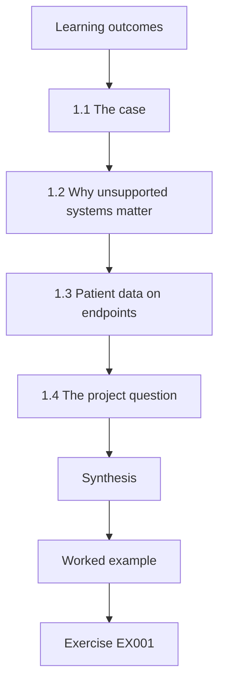

### Logical drawing

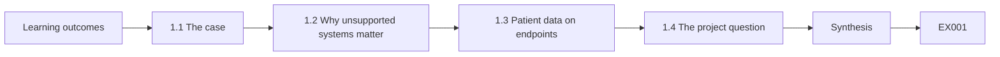

```text
[Learning outcomes]
    |
    v
[1.1 The case]
    |
    v
[1.2 Why unsupported systems matter]
    |
    v
[1.3 Patient data on endpoints]
    |
    v
[1.4 The project question]
    |
    v
[Synthesis]
    |
    v
[Worked example] --> [Exercise EX001]
```
<!-- cyberabc:lesson-figures:end ch-01 -->


### Learning outcomes

You will (1) describe the endpoint estate of a multi-site clinic group; (2) explain why unsupported systems concentrate risk; (3) frame a one-year improvement question.

### 1.1 The case

Priya Natarajan, a postgraduate student at the fictional Westmere Polytechnic supervised by Dr Owen Hale, joins the fictional Kestrel Dental Group for her applied project. Kestrel runs six clinics with sixty workstations, a small central office and an external IT supplier. A routine audit found that several imaging workstations ran an operating system no longer receiving security updates, and that nobody could say exactly how many. Dr Hale asks her to treat that uncertainty as the first finding: a clinic group that cannot count its unsupported machines cannot plan, budget or explain its risk to anyone. The project therefore begins with a count and ends with a governed estate.

### 1.2 Why unsupported systems matter

When a vendor ends support, newly found flaws stay unfixed. NIST SP 800-40 Rev. 4 treats end-of-life software as a standing risk that must be replaced, isolated or formally accepted, because patching is no longer available as a control. In a clinic, the problem is sharper: imaging devices are tied to vendor software certified for a particular operating system, so upgrading is not simply a matter of pressing a button. For Kestrel this means each unsupported imaging PC needs one of those three answers, recorded and owned, rather than the hope that nothing happens before the next budget year.

### 1.3 Patient data on endpoints

Workstations at reception and in surgeries display and cache patient records and radiographs. A compromise affects confidentiality, but also availability: a clinic that cannot open its schedule or images cancels appointments. Priya therefore frames risk in terms staff recognise, such as cancelled sessions and notification duties, alongside technical terms. At Kestrel, a reception PC that fails on a Monday morning means a clinic phoning patients to rebook, and an imaging PC that fails means surgeries without radiographs. A stolen laptop holding patient records may also bring a duty to report the breach. Priya's risk table uses these consequences, so the operations manager can compare endpoint risks with the clinical and business risks she already manages.

### 1.4 The project question

Her question is practical: within twelve months, how can Kestrel know every workstation's support status, reduce unsupported systems, and control the ones that must remain? Each part maps to a later chapter: inventory, a replacement plan, and an exception process with compensating controls. Writing the question this way gives the project a deadline and three things that can be checked at the end. Dr Hale approves it only after Priya agrees with the operations manager how each part will be measured, so the final report can show change against the starting point rather than impressions of progress.

### Worked example

Priya writes the question on one line, lists the three measures (known status, unsupported count, controlled exceptions) and agrees each with the operations manager before collecting any data.

> **Synthetic case.** Kestrel Dental Group, its clinics and staff are fictional; all figures in this book are synthetic.

### Errors and limits

A vague goal such as "improve security" cannot be evaluated. Fixing measures early avoids choosing them after results are known.

### Exercises

- **EX001 — Framing the problem.** Write a one-sentence project question for a similar estate. *Rubric:* 3 = specific, time-bound and measurable;; 2 = measurable but vague on time;; 1 = general aim only;; 0 = none.
- **EX002 — Naming the impact.** List two clinic impacts of a compromised imaging workstation. *Rubric:* 3 = one confidentiality and one availability impact, explained;; 2 = two impacts with little explanation;; 1 = one impact;; 0 = none.
- **EX003 — Why patching is not enough.** Explain why end-of-life systems need a different response from ordinary missing updates. *Rubric:* 3 = explains no fixes exist and names the three responses;; 2 = explains no fixes exist;; 1 = restates the term;; 0 = none.
- **EX004 — Agreeing measures.** Why agree measures with the operations manager before collecting data? *Rubric:* 3 = links to avoiding post-hoc choice and to ownership;; 2 = one of those reasons;; 1 = says it is polite;; 0 = none.
- **EX005 — Supplier role.** Name one question to ask the external IT supplier in week one. *Rubric:* 3 = question tied to support status evidence;; 2 = relevant but general;; 1 = unrelated;; 0 = none.

### Synthesis

The course follows one realistic problem, unsupported clinical workstations, from discovery to a governed and measured outcome.

### Continue studying — chapter 01 of 12

[← Course home](../../README.md) · [Course chapter index](../SUBJECTS.md) · [Chapter 02 (draft) →](#ch-02)

<a id="ch-02"></a>

## Chapter 2 — Building a trustworthy inventory

<!-- cyberabc:lesson-figures:start ch-02 -->
### Lesson map

Lesson 02 published. Map, example, EX006.

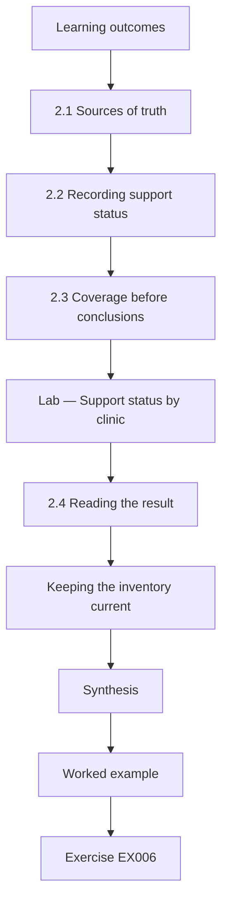

### Logical drawing


```text
[Learning outcomes]
    |
    v
[2.1 Sources of truth]
    |
    v
[2.2 Recording support status]
    |
    v
[2.3 Coverage before conclusions]
    |
    v
[Lab — Support status by clinic]
    |
    v
[2.4 Reading the result]
    |
    v
[Keeping the inventory current]
    |
    v
[Synthesis]
    |
    v
[Worked example] --> [Exercise EX006]
```
<!-- cyberabc:lesson-figures:end ch-02 -->


### Learning outcomes

You will (1) combine sources into one inventory; (2) record support status; (3) measure coverage honestly.

### 2.1 Sources of truth

Kestrel has three partial lists: the supplier's management console, a purchasing spreadsheet and the imaging vendor's install records. CIS Controls v8 Safeguard 1.1 asks for a detailed enterprise asset inventory, and 2.2 asks that software be supported or documented as an exception. Priya merges the lists by serial number, since names change when machines are reimaged. Each list misses something: the console lacks machines never enrolled, purchasing records include machines already retired, and the vendor records cover only imaging PCs. Merging by serial number lets Priya see which source is wrong for each mismatch, and she records the reason beside each corrected row.

### 2.2 Recording support status

For each workstation she records operating system, version, the vendor's support end date and the business role. The support date comes from the vendor's published lifecycle page, recorded with the date she checked it. Workstations whose role is imaging are tagged, because their upgrade path depends on another vendor. Recording the date of each lifecycle check matters because vendors sometimes extend or shorten support, and an auditor will ask when the status was last confirmed. Priya also notes who uses each machine and how often, since a little-used spare is easier to replace than the main imaging PC in a busy surgery.

### 2.3 Coverage before conclusions

Before counting unsupported systems, Priya checks that every clinic is represented. One clinic's machines were missing from the console because they had never been enrolled; she visits and records them by hand. Only then does she trust totals. Unenrolled machines are exactly the ones least likely to be patched or monitored, so missing them would understate the problem. Priya's visit adds them to the merged list and to the supplier's enrolment queue. She also asks clinic managers to confirm the counts for their own sites, which catches a spare PC kept in a store cupboard. Her method notes record both checks, so later counts can be compared on the same basis.

### Lab — Support status by clinic

```python
"""Count workstations by support status across clinics from a synthetic inventory (stdlib only)."""
inv = {"North": (10, 3), "Harbour": (12, 4), "Mill": (9, 1), "Quay": (11, 2), "Ridge": (8, 2), "Vale": (10, 0)}
tot = sum(a for a, _ in inv.values()); eol = sum(b for _, b in inv.values())
for c, (a, b) in inv.items(): print(f"{c:8} workstations {a:2d}  unsupported OS {b}")
print(f"total {tot}; unsupported {eol} ({eol/tot*100:.0f}%)")
print("clinics with none:", [c for c, (a, b) in inv.items() if b == 0])
```

Run with `python3 lab_eol.py`. Verified output:

```text
North    workstations 10  unsupported OS 3
Harbour  workstations 12  unsupported OS 4
Mill     workstations  9  unsupported OS 1
Quay     workstations 11  unsupported OS 2
Ridge    workstations  8  unsupported OS 2
Vale     workstations 10  unsupported OS 0
total 60; unsupported 12 (20%)
clinics with none: ['Vale']
```

### 2.4 Reading the result

The lab shows 12 of 60 workstations, 20 percent, on an unsupported operating system, concentrated in Harbour and North, with Vale having none. Most of the twelve are imaging or cephalometric machines. This tells Priya that the problem is mostly a vendor-dependency problem, not neglect of ordinary desktops. That reading changes the plan: ordinary desktops can follow a normal upgrade cycle, while the imaging machines need vendor negotiations, licence decisions and probably exceptions. Priya reports the count by clinic so that the operations manager can see where the work will concentrate.

### Keeping the inventory current

An inventory decays the moment it is finished. New workstations arrive, machines are reimaged under new names, and vendors move support end dates. Priya therefore asks the supplier to run a monthly comparison of the management console against the purchasing list and to flag any serial that appears in only one of them. She also subscribes the operations mailbox to the lifecycle announcements of each operating system and imaging vendor, so a changed support date is updated in the inventory within a week. Each monthly comparison is saved with its date, which gives auditors evidence that the inventory is maintained rather than produced once for the project.

### Worked example

Merging three lists of 58, 61 and 14 rows by serial number produces 60 unique workstations, with one retired machine still in purchasing records and removed.

> **Synthetic case.** The inventory and counts are synthetic.

### Errors and limits

Matching on hostname double-counts reimaged machines; matching on serial is more reliable but fails for virtual machines, which Kestrel does not use at clinics.

### Exercises

- **EX006 — Choosing a join key.** Why join on serial number rather than hostname? *Rubric:* 3 = explains renaming and reimaging;; 2 = says serials are unique;; 1 = no reason;; 0 = none.
- **EX007 — Dating the evidence.** Why record when you checked a vendor's support date? *Rubric:* 3 = explains dates change and audit traceability;; 2 = one reason;; 1 = vague;; 0 = none.
- **EX008 — Interpreting concentration.** What does the concentration of unsupported systems in imaging suggest about the fix? *Rubric:* 3 = links to vendor dependency and planning with the vendor;; 2 = mentions imaging only;; 1 = no inference;; 0 = none.
- **EX009 — Coverage check.** Describe one test that the inventory covers every clinic. *Rubric:* 3 = compares counts per clinic to an independent source;; 2 = visits one clinic;; 1 = vague;; 0 = none.
- **EX010 — Safeguard mapping.** Map the inventory work to two CIS Controls v8 safeguards. *Rubric:* 3 = 1.1 and 2.2 explained;; 2 = correct numbers only;; 1 = one;; 0 = none.

### Synthesis

A merged, checked inventory turns a vague worry into a count of twelve, located by clinic and role.

### Continue studying — chapter 02 of 12

[← Chapter 01 (draft)](#ch-01) · [Course chapter index](../SUBJECTS.md) · [Chapter 03 (draft) →](#ch-03)

<a id="ch-03"></a>

## Chapter 3 — Working with clinical device vendors

<!-- cyberabc:lesson-figures:start ch-03 -->
### Lesson map

Lesson 03 published. Map, example, EX011.

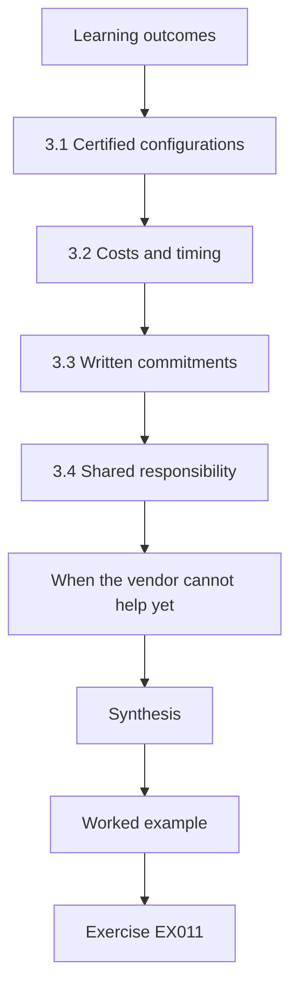

### Logical drawing


```text
[Learning outcomes]
    |
    v
[3.1 Certified configurations]
    |
    v
[3.2 Costs and timing]
    |
    v
[3.3 Written commitments]
    |
    v
[3.4 Shared responsibility]
    |
    v
[When the vendor cannot help yet]
    |
    v
[Synthesis]
    |
    v
[Worked example] --> [Exercise EX011]
```
<!-- cyberabc:lesson-figures:end ch-03 -->


### Learning outcomes

You will (1) find a vendor's certified configurations; (2) plan upgrades jointly; (3) record vendor commitments.

### 3.1 Certified configurations

Imaging software is certified on specific operating system versions. Running it on an uncertified version may void support. Priya asks the vendor for its current compatibility list and finds that a supported version is certified for newer software releases, but the clinic's licence covers only the old release. The licence gap turns a technical question into a commercial one. Priya records the certified versions, the licensed release and the upgrade path for each imaging model, with the date of the vendor's list, so that later decisions can be traced to that evidence.

### 3.2 Costs and timing

Upgrading means a software licence upgrade, possibly new hardware for capture cards, and a visit by the vendor's engineer. Priya builds a simple cost and schedule table per machine, which shows that most can move within the year if work is batched by clinic. Batching by clinic means one engineer visit can cover several machines and one disruption window for each site. The table lists each machine's licence, hardware and labour needs with a target month, and Kestrel's finance lead reviews it before the budget is set. Priya marks costs as estimates until the vendor's quote arrives, so the table does not promise more than the evidence supports.

### 3.3 Written commitments

Promises made on the phone are easily forgotten. Priya asks the vendor to confirm in writing the target versions, prerequisites and engineer availability. These letters become evidence for the exception register and for auditors. Written confirmation also protects Kestrel if staff change at the vendor. For Harbour's machines, the letter states the target version, the capture card replacement and the planned month. Priya files each letter with the inventory row it supports, so anyone reviewing an exception can see what the vendor promised and when it was due.

### 3.4 Shared responsibility

NIST SP 800-53 Rev. 5 control SA-22 addresses unsupported system components, expecting replacement or documented justification. Kestrel cannot shift this duty to the vendor, but it can make the vendor's role explicit in the contract renewal, including notice periods before support ends. Priya drafts contract language for the operations manager: the vendor should give notice before support for a certified version ends, publish its compatibility list, and state how long each release will be supported. The supplier's role is also written down, since it operates the machines but does not own the risk. The proposal goes to Kestrel's next contract review, and Priya records it as a recommendation rather than an agreed term.

### When the vendor cannot help yet

For two cephalometric machines the vendor has no certified newer release. Upgrading anyway would leave the clinic with unsupported clinical software, which is a different risk rather than a fix. Priya records the vendor's expected release quarter in writing, asks to be notified when it ships and moves both machines into the exception process described in chapter 4. The record states what is waiting on whom, and until when. This matters for governance: an unsupported machine that is known, isolated and scheduled is a managed risk, whereas one that is simply forgotten is an unmanaged one, even though the machine itself is identical in both cases.

### Worked example

For Harbour's four machines, the table shows one licence upgrade, two capture card replacements and one engineer day, with a target month agreed in writing.

> **Synthetic case.** The vendor, versions and costs are fictional.

### Errors and limits

Upgrading the operating system without the vendor's confirmation can break imaging; the plan always waits for written compatibility.

### Exercises

- **EX011 — Certification risk.** What risk arises from upgrading an imaging PC's OS without vendor certification? *Rubric:* 3 = loss of support and possible clinical disruption;; 2 = one of those;; 1 = vague;; 0 = none.
- **EX012 — Batching.** Why batch upgrades by clinic? *Rubric:* 3 = reduces engineer visits and disruption;; 2 = reduces cost;; 1 = vague;; 0 = none.
- **EX013 — Evidence.** Why ask for written vendor commitments? *Rubric:* 3 = audit evidence and reliability;; 2 = one;; 1 = vague;; 0 = none.
- **EX014 — Contract terms.** Suggest one clause for contract renewal. *Rubric:* 3 = specific notice period before end of support;; 2 = general clause;; 1 = vague;; 0 = none.
- **EX015 — Control reference.** Which SP 800-53 control addresses unsupported components? *Rubric:* 3 = SA-22 with its expectation;; 2 = SA-22 only;; 1 = wrong control;; 0 = none.

### Synthesis

Vendor engagement turns an impossible-looking upgrade into a costed, scheduled plan.

### Continue studying — chapter 03 of 12

[← Chapter 02 (draft)](#ch-02) · [Course chapter index](../SUBJECTS.md) · [Chapter 04 (draft) →](#ch-04)

<a id="ch-04"></a>

## Chapter 4 — Exceptions with compensating controls

<!-- cyberabc:lesson-figures:start ch-04 -->
### Lesson map

Lesson 04 published. Map, example, EX016.

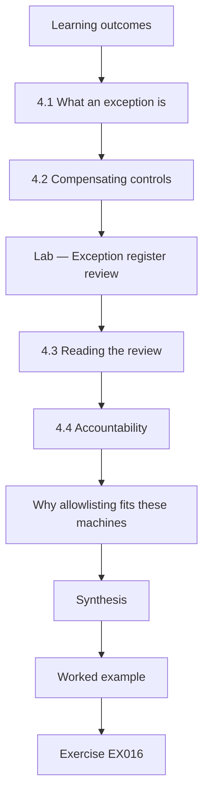

### Logical drawing


```text
[Learning outcomes]
    |
    v
[4.1 What an exception is]
    |
    v
[4.2 Compensating controls]
    |
    v
[Lab — Exception register review]
    |
    v
[4.3 Reading the review]
    |
    v
[4.4 Accountability]
    |
    v
[Why allowlisting fits these machines]
    |
    v
[Synthesis]
    |
    v
[Worked example] --> [Exercise EX016]
```
<!-- cyberabc:lesson-figures:end ch-04 -->


### Learning outcomes

You will (1) design an exception register; (2) choose compensating controls; (3) review expiry.

### 4.1 What an exception is

Some machines cannot be upgraded this year. An exception records that the risk is knowingly accepted for a period, by whom, and with which compensating controls. It is not permission forever; each entry has an expiry date. At Kestrel, each entry names the machine, the reason it cannot be upgraded, the controls in place, the manager who accepted the risk and the date the decision expires. An exception without these details is only a note that a problem exists. Expiry forces a fresh decision, so a temporary arrangement cannot quietly become permanent. Priya builds the register as a simple table, so clinic managers can read it without technical help.

### 4.2 Compensating controls

For an imaging PC that cannot be patched, Kestrel reduces exposure: place it on an isolated network segment that reaches only the image server, block internet access, remove email and web browsing, apply application allowlisting and restrict who can sign in. The CIS Benchmarks and Microsoft's App Control guidance give the configuration detail. Each control reduces a different path: the segment limits which machines can reach the PC, blocking the internet and email removes common ways malware arrives, allowlisting stops unapproved programs running, and sign-in restrictions limit who can make changes. Priya records which controls are in place on each excepted machine, with evidence such as a firewall rule.

### Lab — Exception register review

```python
"""Review a synthetic exception register: expired entries and missing compensating controls (stdlib only)."""
import datetime as dt
today = dt.date(2026, 3, 1)
reg = [("IMG-N1", "2026-06-30", "isolated VLAN"), ("IMG-N2", "2026-02-15", "isolated VLAN"),
       ("IMG-H1", "2026-05-31", ""), ("IMG-H2", "2026-01-31", "isolated VLAN"),
       ("CEPH-M1", "2026-09-30", "isolated VLAN"), ("IMG-Q1", "2026-04-30", "no internet")]
exp = [d for d, e, _ in reg if dt.date.fromisoformat(e) < today]
nocc = [d for d, _, c in reg if not c]
print(f"entries {len(reg)}; expired {len(exp)} {exp}; no compensating control {len(nocc)} {nocc}")
```

Run with `python3 lab_exceptions.py`. Verified output:

```text
entries 6; expired 2 ['IMG-N2', 'IMG-H2']; no compensating control 1 ['IMG-H1']
```

### 4.3 Reading the review

Of six entries, two have expired without renewal and one has no compensating control recorded. Priya raises all three with the operations manager the same week. The expired ones are either renewed with a fresh decision or scheduled for replacement; the missing control is fixed by moving the machine onto the isolated segment. The review shows why a register needs checking, not just filling in: entries had expired without anyone noticing, and one control existed only on paper. Priya adds the review to the quarterly schedule so that expiry dates and controls are checked regularly.

### 4.4 Accountability

Each exception is approved by a named manager, not the IT supplier, because accepting risk is a business decision. Approvals are reviewed quarterly. The supplier can advise on controls and costs, but it does not carry the consequences of a failed clinic or a data breach; Kestrel does. Naming the manager makes the decision visible and gives auditors a person to ask. At the quarterly review, each approver confirms that the reason still holds and the controls are still in place, or the machine moves to the replacement plan. Priya records each confirmation with the date and the approver's name.

### Why allowlisting fits these machines

Imaging PCs run a small, stable set of programs: the capture software, its database client and a viewer. That makes application allowlisting practical, because the list of permitted software is short and rarely changes. Anything not on the list simply does not start, which protects a machine that can no longer receive operating system patches. On a general office desktop, where staff install many tools, allowlisting is much harder to maintain. Priya uses audit mode for two weeks first, collecting what actually runs, so the enforced list does not block a forgotten helper program such as the vendor's licence checker. Publisher-based rules are preferred to file-path rules, since vendor updates then keep working.

### Worked example

IMG-H1 lacks a recorded control; the fix moves it to the isolated segment, then the entry is updated with the date and evidence.

> **Synthetic case.** The register entries are synthetic.

### Errors and limits

Exceptions without expiry silently become permanent; the quarterly review exists to catch that.

### Exercises

- **EX016 — Register fields.** List five fields an exception entry needs. *Rubric:* 3 = device, reason, owner, controls, expiry;; 2 = four;; 1 = fewer;; 0 = none.
- **EX017 — Isolation design.** Describe the network access an isolated imaging PC should have. *Rubric:* 3 = only to the image server, no internet;; 2 = restricted but vague;; 1 = vague;; 0 = none.
- **EX018 — Who approves.** Why should a manager rather than the supplier approve exceptions? *Rubric:* 3 = business owns risk acceptance;; 2 = vague;; 1 = minimal attempt;; 0 = none.
- **EX019 — Expired entries.** What should happen to an expired exception? *Rubric:* 3 = renewed by a new decision or the device replaced;; 2 = one option;; 1 = ignore;; 0 = none.
- **EX020 — Lab reading.** What did the review find? *Rubric:* 3 = two expired and one missing control, named;; 2 = counts only;; 1 = wrong;; 0 = none.

### Synthesis

A small, reviewed register keeps unavoidable risks visible and limited.

### Continue studying — chapter 04 of 12

[← Chapter 03 (draft)](#ch-03) · [Course chapter index](../SUBJECTS.md) · [Chapter 05 (draft) →](#ch-05)

<a id="ch-05"></a>

## Chapter 5 — Hardening the ordinary desktops

<!-- cyberabc:lesson-figures:start ch-05 -->
### Lesson map

Lesson 05 published. Map, example, EX021.

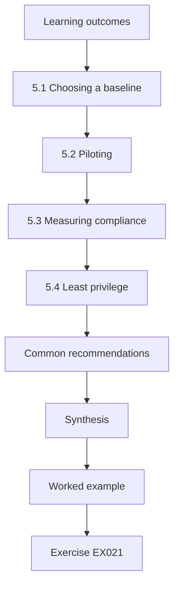

### Logical drawing


```text
[Learning outcomes]
    |
    v
[5.1 Choosing a baseline]
    |
    v
[5.2 Piloting]
    |
    v
[5.3 Measuring compliance]
    |
    v
[5.4 Least privilege]
    |
    v
[Common recommendations]
    |
    v
[Synthesis]
    |
    v
[Worked example] --> [Exercise EX021]
```
<!-- cyberabc:lesson-figures:end ch-05 -->


### Learning outcomes

You will (1) apply a recognised baseline; (2) pilot changes; (3) measure compliance.

### 5.1 Choosing a baseline

The 48 supported desktops follow the CIS Benchmark for their Windows version at level one, adjusted with Microsoft's security baseline. Priya and the supplier review each recommendation against clinic needs, such as card readers and the practice management client. Starting from a published benchmark gives Kestrel a tested, documented set of settings instead of a list written from scratch. Each recommendation that conflicts with clinic needs is either adjusted or left out, and the reason is written down, so that the baseline reflects Kestrel's work rather than a generic office. The supplier applies the agreed settings through its management console, which also reports compliance against them.

### 5.2 Piloting

Changes go first to one desktop per clinic for two weeks. The pilot finds that a screen-lock timeout of five minutes frustrates surgery staff wearing gloves; it is set to ten minutes with a lock shortcut, and the reason recorded. Piloting one desktop per clinic catches local needs that a single office test would miss, such as different card readers or the surgery workflow. Staff at pilot desks are told what changed and how to report problems, and Priya keeps a short log of each complaint with the decision taken. The baseline is rolled out to the remaining desktops only after the two-week pilot ends.

### 5.3 Measuring compliance

The supplier's console reports compliance per setting. Priya tracks the share of desktops fully compliant each week. Drift is investigated rather than overwritten blindly, since a drift often signals a real working need. When a desktop drifts, Priya asks the clinic first: a setting changed to let a new scanner work is a reason to adjust the baseline or add a documented exception, while an unexplained change is investigated as a possible problem. Weekly tracking also shows whether compliance holds after the rollout, not just on the day settings are applied. Clinic-specific gaps are listed separately so that they can be followed up.

### 5.4 Least privilege

Staff lose local administrator rights; the supplier uses separate admin accounts. This single change prevents much drift and accidental software installation. Before the change, staff could install software, change settings and disable protection on their own machines, often with good intentions. Removing those rights means changes go through the supplier, who records them. Priya arranges how staff request software, so the clinics are not left waiting when they need a legitimate tool, and the supplier's separate admin accounts are used only for administration, never for email or web browsing.

### Common recommendations

The baseline includes items most organisations share: a host firewall on, automatic screen lock, no guest accounts, removal of unused features, PowerShell logging, and blocking macros from internet files in office documents. Priya explains each to clinic managers in one plain sentence, because staff accept a change more readily when they know what it protects against.

She also records which recommendations were skipped. Two level one items conflict with the practice management client's printing; they are noted with the reason and reviewed when the client is upgraded. A short skip list is a sign of a careful baseline, not a weak one.

### Worked example

Compliance rises from 61 to 92 percent of desktops over six weeks, with the remaining gaps tied to two clinic-specific scanners being re-tested.

> **Synthetic case.** Figures are synthetic.

### Errors and limits

A baseline applied without a pilot can stop clinical work; a pilot without measurement cannot show improvement.

### Exercises

- **EX021 — Baseline source.** Name two sources for a Windows desktop baseline. *Rubric:* 3 = CIS Benchmark and Microsoft security baseline;; 2 = one;; 1 = vague;; 0 = none.
- **EX022 — Adjusting a setting.** How should a baseline deviation be recorded? *Rubric:* 3 = setting, value, reason, approver;; 2 = partial;; 1 = not recorded;; 0 = none.
- **EX023 — Drift handling.** Why investigate drift before reverting? *Rubric:* 3 = it may reflect a real need;; 2 = generic;; 1 = vague;; 0 = none.
- **EX024 — Admin rights.** Explain one benefit of removing local admin rights. *Rubric:* 3 = limits installation and setting changes;; 2 = vague;; 1 = minimal attempt;; 0 = none.
- **EX025 — Compliance metric.** Propose a weekly compliance metric. *Rubric:* 3 = share fully compliant with denominator;; 2 = count only;; 1 = vague;; 0 = none.

### Synthesis

Ordinary desktops are best handled with a recognised baseline, a pilot and steady measurement.

### Continue studying — chapter 05 of 12

[← Chapter 04 (draft)](#ch-04) · [Course chapter index](../SUBJECTS.md) · [Chapter 06 (draft) →](#ch-06)

<a id="ch-06"></a>

## Chapter 6 — Patching with clinical hours in mind

<!-- cyberabc:lesson-figures:start ch-06 -->
### Lesson map

Lesson 06 published. Map, example, EX026.

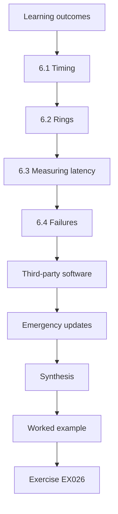

### Logical drawing


```text
[Learning outcomes]
    |
    v
[6.1 Timing]
    |
    v
[6.2 Rings]
    |
    v
[6.3 Measuring latency]
    |
    v
[6.4 Failures]
    |
    v
[Third-party software]
    |
    v
[Emergency updates]
    |
    v
[Synthesis]
    |
    v
[Worked example] --> [Exercise EX026]
```
<!-- cyberabc:lesson-figures:end ch-06 -->


### Learning outcomes

You will (1) schedule updates around surgeries; (2) track latency; (3) handle failures.

### 6.1 Timing

Clinics run long days and some Saturdays. Updates install overnight with restarts at 21:00, and a deadline forces a restart after five days. SP 800-40 Rev. 4 recommends planning maintenance so that patching is routine rather than an emergency. Restarting at 21:00 avoids late appointments and evening cleaning, and the five-day deadline ensures that a PC left signed in does not delay updates indefinitely. Saturday clinics are asked about their hours so that restarts do not interrupt work. The schedule is agreed with clinic managers and written into the patch plan, so changes to it are deliberate, recorded decisions.

### 6.2 Rings

A small first ring of office machines takes updates on release day, clinics follow after three days. If the first ring shows problems, the supplier pauses the second ring. Office machines go first because problems there are less disruptive than in a clinic: an office user can wait for a fix, while a surgery cannot. Three days gives the supplier time to spot problems reported by the first ring or published by the vendor. Pausing the second ring is the supplier's decision, but it must tell the operations manager and record why, and the pause has an end date. Updates for actively exploited flaws can skip the three-day wait, but the supplier records the shortcut and tells the operations manager.

### 6.3 Measuring latency

Priya measures days from release to install for each desktop, and reports the share within 14 days and the slowest tail. Machines often switched off at night show up in the tail. The share within 14 days shows typical performance, while the slowest tail shows which machines are left exposed for longest. Looking at the tail by clinic and role tells Priya where to act: a reception PC that is switched off every evening needs a different fix from a machine that fails to install. Her monthly figure uses the same definition each time, so changes can be compared fairly.

### 6.4 Failures

Failed updates are grouped by cause: pending restart, low disk space, offline. Each cause gets a fix, such as Wake-on-LAN for overnight installs. Grouping by cause turns a list of failures into a set of fixes the supplier can act on. Pending restarts are handled by the deadline, low disk space by clearing old files and checking disk sizes, and offline machines by waking them for installs. Each month Priya checks whether a cause has shrunk after its fix was applied, rather than assuming the fix worked. Repeated failures on one machine are passed to the supplier for investigation.

### Third-party software

Operating system updates are only part of the picture. Browsers, PDF readers and the practice management client also need updates. Priya asks the supplier for a monthly report of these applications' versions across the estate. The first report shows an outdated PDF reader on eleven desktops, because it had been installed separately from the managed package. The supplier replaces it with the managed version, after which it updates automatically.

The practice management client updates are scheduled with its vendor, because database changes sometimes need all clinics updated together. Priya adds these dates to the shared calendar so staff know in advance.

### Emergency updates

Most updates can follow the normal rings, but a flaw that is already being exploited changes the balance between caution and speed. NIST SP 800-40 Rev. 4 describes this as risk-based prioritisation, and the CISA Known Exploited Vulnerabilities catalogue is a practical signal that a flaw is in active use. For such updates, Kestrel's patch plan skips the normal three-day wait for clinics: the supplier checks the update on the office machines for one day and then deploys to every ring within two days. Writing this exception into the plan in advance matters, because nobody then has to argue for it during a busy clinical week when the pressure to delay is greatest.

### Worked example

Within 14 days, 39 of 48 desktops were updated in month one and 46 in month three after enabling wake-up and deadlines.

> **Synthetic case.** Figures are synthetic.

### Errors and limits

Averages hide the tail; always report the slowest machines separately.

### Exercises

- **EX026 — Restart policy.** Propose a restart policy for clinics. *Rubric:* 3 = evening time with deadline;; 2 = time only;; 1 = vague;; 0 = none.
- **EX027 — Rings.** Why use a first ring? *Rubric:* 3 = detect problems before clinics;; 2 = vague;; 1 = minimal attempt;; 0 = none.
- **EX028 — Tail.** Why report the slowest machines? *Rubric:* 3 = averages hide them;; 2 = generic;; 1 = vague;; 0 = none.
- **EX029 — Wake-on-LAN.** How does waking machines help? *Rubric:* 3 = allows overnight installs on switched-off PCs;; 2 = vague;; 1 = minimal attempt;; 0 = none.
- **EX030 — Pause rule.** Write a rule for pausing the second ring. *Rubric:* 3 = specific trigger and owner;; 2 = trigger only;; 1 = vague;; 0 = none.

### Synthesis

Predictable schedules and a small first ring make patching dull, which is the goal.

### Continue studying — chapter 06 of 12

[← Chapter 05 (draft)](#ch-05) · [Course chapter index](../SUBJECTS.md) · [Chapter 07 (draft) →](#ch-07)

<a id="ch-07"></a>

## Chapter 7 — Encryption and device loss

<!-- cyberabc:lesson-figures:start ch-07 -->
### Lesson map

Lesson 07 published. Map, example, EX031.

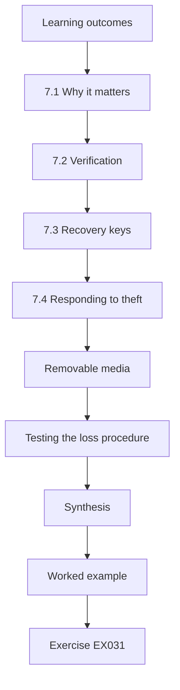

### Logical drawing


```text
[Learning outcomes]
    |
    v
[7.1 Why it matters]
    |
    v
[7.2 Verification]
    |
    v
[7.3 Recovery keys]
    |
    v
[7.4 Responding to theft]
    |
    v
[Removable media]
    |
    v
[Testing the loss procedure]
    |
    v
[Synthesis]
    |
    v
[Worked example] --> [Exercise EX031]
```
<!-- cyberabc:lesson-figures:end ch-07 -->


### Learning outcomes

You will (1) verify disk encryption; (2) manage recovery keys; (3) plan for theft.

### 7.1 Why it matters

Laptops used by the dental nurse manager and clinicians at home carry patient data. Full-disk encryption with BitLocker protects data if a device is stolen, provided recovery keys are protected and encryption is verified. Encryption is only useful if it is actually on, if keys are available when a legitimate user is locked out, and if keys cannot be used by a thief. Priya's plan covers all three: verifying encryption on each laptop, escrowing recovery keys, and limiting who can retrieve them. Kestrel's nine laptops are listed in the inventory with their users, so each one can be checked.

### 7.2 Verification

Priya compares console reports with a sample of devices checked by hand. Three laptops show encryption suspended after a firmware update; the supplier resumes protection and adds a weekly check. A console report shows what the management tool believes, not necessarily the state of the device. The hand checks found what the console missed, because suspended protection still looked like encryption to it. The weekly check now flags suspended protection directly, and Priya repeats a small hand sample each quarter to confirm that the console and the devices still agree.

### 7.3 Recovery keys

Keys are escrowed to the directory, and access to them is limited and logged. A key retrieval test is run for one laptop. Escrow means a locked-out clinician can be helped without losing data, while limited and logged access means a recovery key cannot be retrieved quietly. Only named supplier staff can retrieve keys, and each retrieval is recorded with the reason and the person who asked. The test confirms that the escrow actually works for a real laptop, rather than trusting the configuration. Priya records the test date and result in the encryption register, and repeats it each year.

### 7.4 Responding to theft

The loss procedure confirms encryption status, disables the account's sessions and records the event for data protection review. Confirming encryption status matters most for a data protection decision: a stolen laptop that is verified encrypted with a protected key is a much smaller risk to patients than one that is not. The procedure also asks when and where the device was lost, which data the user worked with, and whether any recovery key was retrieved afterwards. The record goes to Kestrel's data protection lead, who decides on any notification. The supplier also removes the laptop from management.

### Removable media

Clinics sometimes export images on USB sticks for referrals to specialists. Unencrypted sticks undo laptop encryption. Priya recommends issuing encrypted sticks for referrals and, longer term, moving referrals to a secure transfer service offered by the regional health network. Until that is in place, staff are asked to record each export in a simple log so that a lost stick can be traced to its patients.

She also checks that desktops in surgeries, which never leave the building, are encrypted too. A stolen surgery desktop during a break-in would expose the same data as a stolen laptop, so the same policy applies.

### Testing the loss procedure

A written procedure is only a hypothesis until someone follows it. Priya runs a tabletop exercise with the operations manager: a clinician reports at 19:00 that a laptop was stolen from a car. They walk through each step with a timer, from confirming encryption in the console to revoking sessions and recording the event. Most steps work, but the exercise shows that nobody knew who should notify the data protection officer out of hours, or how quickly. A named contact and phone number are added, and the procedure is updated with the date. A second exercise six months later confirms the gap is closed and finds no new ones.

### Worked example

All 9 laptops are verified encrypted after the three suspended cases are fixed.

> **Synthetic case.** Figures are synthetic.

### Errors and limits

Suspended encryption looks fine in some reports; always check protection status, not only whether encryption was ever enabled.

### Exercises

- **EX031 — Suspended protection.** Why check for suspended BitLocker protection? *Rubric:* 3 = updates suspend it; data exposed;; 2 = vague;; 1 = minimal attempt;; 0 = none.
- **EX032 — Key access.** Who should access recovery keys? *Rubric:* 3 = limited IT staff with logging;; 2 = IT only;; 1 = anyone;; 0 = none.
- **EX033 — Theft steps.** List three theft response steps. *Rubric:* 3 = confirm encryption, revoke sessions, record;; 2 = two;; 1 = one;; 0 = none.
- **EX034 — Sampling.** Why check a sample by hand? *Rubric:* 3 = validate console accuracy;; 2 = generic;; 1 = vague;; 0 = none.
- **EX035 — Imaging PCs.** Should imaging desktops be encrypted? *Rubric:* 3 = reasons and vendor compatibility check;; 2 = yes or no only;; 1 = vague;; 0 = none.

### Synthesis

Encryption only helps when it is on, verified and recoverable.

### Continue studying — chapter 07 of 12

[← Chapter 06 (draft)](#ch-06) · [Course chapter index](../SUBJECTS.md) · [Chapter 08 (draft) →](#ch-08)

<a id="ch-08"></a>

## Chapter 8 — Logs that a small team can use

<!-- cyberabc:lesson-figures:start ch-08 -->
### Lesson map

Lesson 08 published. Map, example, EX036.

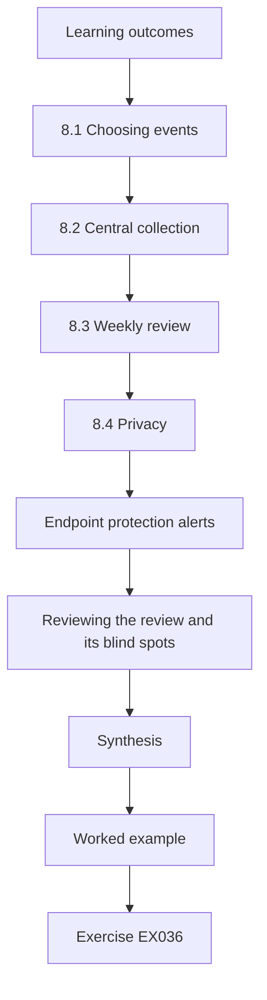

### Logical drawing


```text
[Learning outcomes]
    |
    v
[8.1 Choosing events]
    |
    v
[8.2 Central collection]
    |
    v
[8.3 Weekly review]
    |
    v
[8.4 Privacy]
    |
    v
[Endpoint protection alerts]
    |
    v
[Reviewing the review and its blind spots]
    |
    v
[Synthesis]
    |
    v
[Worked example] --> [Exercise EX036]
```
<!-- cyberabc:lesson-figures:end ch-08 -->


### Learning outcomes

You will (1) choose endpoint events; (2) centralise them; (3) review weekly.

### 8.1 Choosing events

NIST SP 800-92 advises deciding what to log before collecting. Priya chooses sign-in failures, new local accounts, security software disabled and changes to the exception devices. Each event answers a question Kestrel cares about. Repeated sign-in failures may show guessing, a new local account may be a way to keep access, disabled security software may be the first sign of a compromise, and changes on excepted machines matter because those machines cannot be patched. Choosing a short list keeps review possible for a small organisation with no dedicated security team, and every event chosen has a named person to review it.

### 8.2 Central collection

Events forward to the supplier's log service, retained for 90 days. Clock synchronisation is checked, since times must line up across clinics. Ninety days covers a quarter, which matches Kestrel's review cycle and gives time to investigate a problem found late. Clock synchronisation matters because an investigation may need to compare a sign-in at one clinic with a change on an imaging PC at another. Priya checks that every device, including the excepted imaging PCs on their isolated segment, actually sends events, since a missing source looks the same as a quiet one. The supplier confirms the forwarding settings in writing, including for the imaging PCs on the isolated segment, so a silent source is noticed.

### 8.3 Weekly review

A short weekly review covers a few defined questions. Each finding is resolved or explained. Priya and the supplier agree the questions: were there repeated sign-in failures, new local accounts, disabled security software or changes to excepted machines? The supplier answers each one in a short note. A finding that needs action is passed to the operations manager, and an explained event, such as a planned software install, is recorded with its reason. Keeping the review short makes it likely to happen every week, and the notes show auditors that it did. Priya checks the notes monthly during the project, looking for questions that were skipped or findings left without an outcome.

### 8.4 Privacy

Logs contain staff names; access is restricted and use limited to security. Because security logs record when staff sign in and what they do on shared machines, they could be misused to monitor performance or attendance. Kestrel's log policy states that logs are used only to protect systems and patient data, names the supplier staff who can read them, and keeps access records. Staff are told what is collected and why. The policy also sets the 90-day retention, so data is not kept longer than the purpose needs. Priya asks the data protection lead to approve the policy before collection begins.

### Endpoint protection alerts

The endpoint protection product raises its own alerts, such as blocked files or suspicious behaviour. These go to the supplier's help desk, which must acknowledge them within one working day. Priya reviews a month of alerts with the supplier and finds most are low-value detections of unwanted browser toolbars. Tuning the product to block these silently reduces noise so that serious alerts stand out.

She writes a short escalation rule: any alert on an imaging exception device, or any alert about disabled protection, is phoned to the operations manager the same day rather than waiting in a queue.

### Reviewing the review and its blind spots

A weekly review that quietly stops is worse than none, because everyone assumes it is happening. Each quarter Priya checks the saved review notes and counts missed weeks; missed weeks are discussed without blame and the routine is moved if needed, for example to a quieter day. She also records what the logs cannot show. An imaging PC without the protection agent produces no alerts at all, so its silence is not reassurance. These blind spots are listed against each device in the exception register, which makes clear that isolation and allowlisting, not monitoring, are the main controls for those machines.

### Worked example

The first month's review finds one disabled antivirus on a reception PC after a vendor tool install; it is re-enabled and the tool's installer adjusted.

> **Synthetic case.** Events are synthetic.

### Errors and limits

Collecting everything overwhelms a small team; collecting nothing leaves incidents invisible.

### Exercises

- **EX036 — Event choice.** Name three useful endpoint events. *Rubric:* 3 = three relevant with reasons;; 2 = three;; 1 = fewer;; 0 = none.
- **EX037 — Clocks.** Why synchronise clocks? *Rubric:* 3 = correlation across sites;; 2 = vague;; 1 = minimal attempt;; 0 = none.
- **EX038 — Retention.** Justify a 90-day retention period. *Rubric:* 3 = balances investigation and privacy;; 2 = one side;; 1 = vague;; 0 = none.
- **EX039 — Review questions.** Write two weekly review questions. *Rubric:* 3 = specific and answerable;; 2 = vague;; 1 = minimal attempt;; 0 = none.
- **EX040 — Exception devices.** Why watch exception devices closely? *Rubric:* 3 = higher residual risk;; 2 = vague;; 1 = minimal attempt;; 0 = none.

### Synthesis

A few chosen events, reviewed regularly, beat a large unused log store.

### Continue studying — chapter 08 of 12

[← Chapter 07 (draft)](#ch-07) · [Course chapter index](../SUBJECTS.md) · [Chapter 09 (draft) →](#ch-09)

<a id="ch-09"></a>

## Chapter 9 — Recovery and continuity

<!-- cyberabc:lesson-figures:start ch-09 -->
### Lesson map

Lesson 09 published. Map, example, EX041.

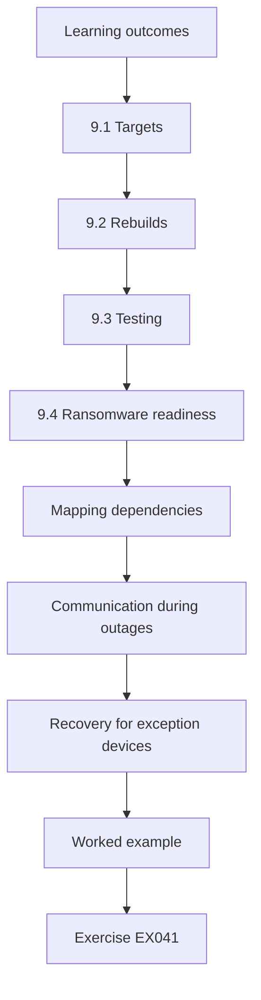

### Logical drawing


```text
[Learning outcomes]
    |
    v
[9.1 Targets]
    |
    v
[9.2 Rebuilds]
    |
    v
[9.3 Testing]
    |
    v
[9.4 Ransomware readiness]
    |
    v
[Mapping dependencies]
    |
    v
[Communication during outages]
    |
    v
[Recovery for exception devices]
    |
    v
[Worked example] --> [Exercise EX041]
```
<!-- cyberabc:lesson-figures:end ch-09 -->


### Learning outcomes

You will (1) define recovery targets; (2) test restores; (3) plan for a failed workstation.

### 9.1 Targets

The operations manager sets targets: a failed reception PC replaced within two hours from a pre-built spare; imaging server restored within one day. Targets come from the business, not the supplier, because the operations manager knows how long a clinic can work without a PC or images. A reception PC can be replaced quickly because desktops are standard. The imaging server takes longer because it holds images and vendor software. Priya records each target with the reason given, and the targets become the measure for recovery tests. Each clinic keeps one pre-built spare desktop for this purpose.

### 9.2 Rebuilds

Supported desktops are rebuilt from a standard image and management enrolment. Imaging PCs need vendor steps, so Priya documents them with the vendor. A standard image means a failed desktop can be replaced with a working one that already has the baseline settings and management. Imaging PCs are different: their software, licences and capture cards must be installed by the vendor or following its steps. Priya writes those steps down with the vendor's help, including what must be backed up beforehand, so the clinic is not dependent on one engineer's memory. The rebuild document is stored with the exception register, since the same imaging PCs appear in both.

### 9.3 Testing

A restore test of the image server on spare hardware takes seven hours, within the target, and reveals a missing licence file, now added to backups. Testing on spare hardware shows whether the restore works when it is needed, not just whether backups exist. The missing licence file would have stopped the server working after a real failure. Priya records the test date, duration, problems found and fixes made, and the operations manager agrees to repeat the test each year, as well as after any major change to the imaging server or its vendor software.

### 9.4 Ransomware readiness

One backup copy is offline. Isolated imaging segments limit spread. An offline copy cannot be encrypted by malware that reaches the network, so it remains available for recovery. Priya checks with the supplier how often the offline copy is updated and where it is kept. The isolated imaging segment helps in a different way: unsupported imaging PCs cannot reach most other machines, so ransomware that starts at reception has fewer paths to them. Restoring from the offline copy is part of the yearly recovery test. Priya records both measures in the recovery plan, so they are reviewed each year.

### Mapping dependencies

Recovery needs to know what depends on what. The practice management client needs the central database; imaging PCs need the image server and the licence server; reception needs printers and card readers. Priya draws a simple dependency list for each clinic, so that during an outage staff restore things in the right order rather than rebooting everything at once.

She also identifies manual fallbacks: printed day lists so clinics can still see patients if the schedule is unavailable, and a paper form for treatment notes to be entered later. These fallbacks are tested once a year in a quiet session.

### Communication during outages

Outages create a second problem besides the technical one: uncertainty. Clinic managers phone the supplier repeatedly, staff improvise workarounds and patients are told different things at each site. Priya prepares a short message template that the supplier sends to all clinic managers when a shared system fails. It states what is affected, what staff should do meanwhile, such as using the printed day lists, and when the next update will arrive even if nothing has changed. Updates go out at fixed intervals, every hour during an outage. Having the template ready saves time, reduces calls to the supplier and keeps every clinic acting on the same information.

### Recovery for exception devices

Machines on old operating systems are the hardest to rebuild, because installation media, drivers and licence keys are old and may no longer be downloadable. If an exception imaging PC fails, Kestrel could find that it cannot be restored at all. Priya asks the vendor to confirm in writing that a rebuild remains possible and what it requires. The installation media, capture card drivers and licence keys are copied and stored offline with the backups, and the rebuild steps are documented. A rebuild is tested on a spare machine once. This turns a fragile dependency into a known procedure until the machines are finally replaced.

### Worked example

The spare-PC test at Mill clinic swaps a reception PC in 75 minutes.

> **Synthetic case.** Figures are synthetic.

### Errors and limits

Untested backups often lack something; the licence file shows why.

### Exercises

- **EX041 — Targets.** Who should set recovery targets? *Rubric:* 3 = business owner with IT input;; 2 = IT;; 1 = vague;; 0 = none.
- **EX042 — Spare PCs.** Explain the value of pre-built spares. *Rubric:* 3 = fast replacement;; 2 = vague;; 1 = minimal attempt;; 0 = none.
- **EX043 — Missing file.** What lesson does the missing licence file teach? *Rubric:* 3 = test restores fully;; 2 = vague;; 1 = minimal attempt;; 0 = none.
- **EX044 — Offline copy.** Why keep an offline backup? *Rubric:* 3 = ransomware resistance;; 2 = vague;; 1 = minimal attempt;; 0 = none.
- **EX045 — Imaging rebuild.** Why document imaging rebuild steps? *Rubric:* 3 = vendor dependence;; 2 = vague;; 1 = minimal attempt;; 0 = none.

### Synthesis

Recovery plans earn trust only through tests.

### Continue studying — chapter 09 of 12

[← Chapter 08 (draft)](#ch-08) · [Course chapter index](../SUBJECTS.md) · [Chapter 10 (draft) →](#ch-10)

<a id="ch-10"></a>

## Chapter 10 — Governance and reporting

<!-- cyberabc:lesson-figures:start ch-10 -->
### Lesson map

Lesson 10 published. Map, example, EX046.

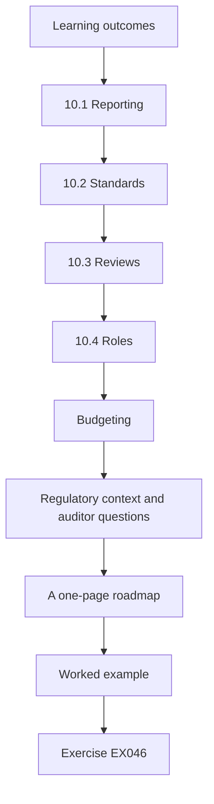

### Logical drawing


```text
[Learning outcomes]
    |
    v
[10.1 Reporting]
    |
    v
[10.2 Standards]
    |
    v
[10.3 Reviews]
    |
    v
[10.4 Roles]
    |
    v
[Budgeting]
    |
    v
[Regulatory context and auditor questions]
    |
    v
[A one-page roadmap]
    |
    v
[Worked example] --> [Exercise EX046]
```
<!-- cyberabc:lesson-figures:end ch-10 -->


### Learning outcomes

You will (1) report to leadership; (2) align with standards; (3) plan reviews.

### 10.1 Reporting

A quarterly one-page report shows unsupported count, exceptions in date, compliance and patch latency. Keeping the report to one page makes it readable for clinic managers and Kestrel's directors, who need to know whether risk is falling, not how each setting is configured. Each measure uses the same definition every quarter, so changes are comparable. Priya adds a short note on the actions behind any change and the decisions needed, such as renewing an exception or funding a replacement. The supplier provides the figures, and the operations manager checks and signs the report before it goes to the directors.

### 10.2 Standards

Priya maps the work to CIS Controls v8 implementation group 1 and NIST SP 800-53 families CM, SI and SA, so auditors see recognised structure. The mapping shows auditors and future staff where Kestrel's practices come from: the inventory relates to CIS asset safeguards, the baseline to configuration management, patching to system integrity and the exception register to SA-22. It does not claim full compliance with either framework. Priya lists the gaps, such as monitoring that covers only a few events. Mapping also makes it easier to check later whether a practice has lapsed.

### 10.3 Reviews

The exception register and baseline are reviewed quarterly, the plan yearly. Quarterly review of the register and baseline matches the reporting cycle and the expiry dates of exceptions. The operations manager chairs the review, with the supplier attending. Each meeting checks expiries, compensating controls and any drift that led to a baseline change. The yearly review of the plan looks further ahead: vendor support dates, budget for replacements and whether the targets still fit Kestrel's clinics. Each review's decisions are recorded with dates. Priya leaves a template agenda so that reviews continue after her project ends.

### 10.4 Roles

The supplier operates, the operations manager owns risk, and Priya's handover names successors. Separating operation from ownership keeps the decision to accept risk with Kestrel, while the supplier keeps systems running. Priya's handover names who maintains the inventory, who chairs reviews, who approves exceptions and who prepares the quarterly report, with a deputy for each. Without named successors, the governance she built would depend on her and would be likely to lapse after her project ends. The operations manager signs the handover document, and the supplier receives a copy.

### Budgeting

Leaders approve what they understand and can afford. Priya presents costs in three groups: one-off replacement of imaging PCs, recurring licences, and staff time. She shows that the replacement cost is spread over two financial years, matching the vendor's release schedule. This makes the request realistic rather than an alarming single figure.

She also shows what is not being funded, such as a full security operations service, and the risk that remains as a result. Leaders can then make an informed decision rather than assuming everything is covered.

### Regulatory context and auditor questions

Dental practices hold health data and must meet data protection duties, including reporting certain breaches within set time limits. Priya does not give legal advice. Instead she lists the questions for the practice's data protection officer, such as which endpoint events need notification and who decides, and records the answers in the incident procedure. She also prepares short answers to the questions auditors usually ask: how is the inventory kept, how are exceptions approved, how is patching measured. Each answer points to a specific document and a recent example, so that an audit becomes a matter of showing evidence rather than writing explanations from memory.

### A one-page roadmap

Leaders need to see where the programme is going without reading technical detail. The final governance item is a one-page roadmap set out quarter by quarter: which imaging PCs are replaced, when the exception register and baseline are reviewed, and when measures are reported. Each line names an owner. The roadmap is updated after each quarterly report, and items that slip are shown as slipped rather than silently moved. This gives the operations manager a simple way to track commitments, and it gives the supplier a clear schedule to plan engineer visits and budget against, which matters when vendor dependencies drive the timeline.

### Worked example

The first quarterly report shows unsupported systems falling from 12 to 7.

> **Synthetic case.** Figures are synthetic.

### Errors and limits

Reports full of jargon go unread; keep them short and plain.

### Exercises

- **EX046 — Report measures.** Choose four report measures. *Rubric:* 3 = four relevant;; 2 = three;; 1 = fewer;; 0 = none.
- **EX047 — Mapping value.** Why map to CIS and NIST? *Rubric:* 3 = recognised structure for auditors;; 2 = vague;; 1 = minimal attempt;; 0 = none.
- **EX048 — Ownership.** Why separate operator and owner? *Rubric:* 3 = accountability;; 2 = vague;; 1 = minimal attempt;; 0 = none.
- **EX049 — Review frequency.** Justify quarterly exception reviews. *Rubric:* 3 = matches expiry periods;; 2 = vague;; 1 = minimal attempt;; 0 = none.
- **EX050 — Plain language.** Rewrite "SA-22 residual risk" for leaders. *Rubric:* 3 = plain sentence;; 2 = partial;; 1 = vague;; 0 = none.

### Synthesis

Governance keeps improvements alive after the project.

### Continue studying — chapter 10 of 12

[← Chapter 09 (draft)](#ch-09) · [Course chapter index](../SUBJECTS.md) · [Chapter 11 (draft) →](#ch-11)

<a id="ch-11"></a>

## Chapter 11 — Evaluating the year

<!-- cyberabc:lesson-figures:start ch-11 -->
### Lesson map

Lesson 11 published. Map, example, EX051.

```mermaid
flowchart TD
  N0["Learning outcomes"]
  N1["11.1 Results"]
  N2["11.2 Attribution"]
  N3["11.4 Next steps"]
  N4["Measuring the same way"]
  N5["Staff experience and expectations"]
  N6["Was the effort worth it"]
  N7["Synthesis"]
  N0 --> N1 --> N2 --> N3 --> N4 --> N5 --> N6 --> N7
  N7 --> EX["Worked example"]
  EX --> Q["Exercise EX051"]
```

### Logical drawing

```mermaid
flowchart LR
  N0["Learning outcomes"]
  N1["11.1 Results"]
  N2["11.2 Attribution"]
  N3["11.4 Next steps"]
  N4["Measuring the same way"]
  N5["Staff experience and expectations"]
  N6["Was the effort worth it"]
  N7["Synthesis"]
  N0 --> N1 --> N2 --> N3 --> N4 --> N5 --> N6 --> N7 --> Q["EX051"]
```

```text
[Learning outcomes]
    |
    v
[11.1 Results]
    |
    v
[11.2 Attribution]
    |
    v
[11.4 Next steps]
    |
    v
[Measuring the same way]
    |
    v
[Staff experience and expectations]
    |
    v
[Was the effort worth it]
    |
    v
[Synthesis]
    |
    v
[Worked example] --> [Exercise EX051]
```
<!-- cyberabc:lesson-figures:end ch-11 -->


### Learning outcomes

You will (1) compare baseline and outcome; (2) discuss limits; (3) recommend next steps.

### 11.1 Results

Unsupported systems fell from 12 to 3, all with in-date exceptions; desktop compliance rose to 92 percent; patching within 14 days rose to 46 of 48. Priya reports each result against its starting point and its source. The unsupported count comes from the merged inventory; compliance and patch latency come from the supplier's console, checked against hand samples where possible. The three remaining unsupported machines are the cephalometric PCs awaiting a vendor release, and they are reported as controlled exceptions, not as fixed. She keeps the monthly figures so that readers can see how each measure changed during the year, not just its final value.

### 11.2 Attribution

Several changes overlapped, so Priya links outcomes to actions cautiously. The baseline, removal of administrator rights, new patch timing and wake-up for overnight installs all began within a few months, so Priya cannot say how much each contributed to better compliance or patch latency. She describes the sequence of changes beside the monthly figures and states which outcomes followed which actions, without claiming that one change caused one result. Where a link is direct, such as replacing an unsupported machine, she says so plainly. Her discussion labels each link as direct or uncertain, so readers can judge it.

### 11.3 Limits

One organisation, one year, supplier-reported data. These limits shape how far the results can be used. A different organisation, with other vendors, more staff or in-house IT, might find different problems and different costs. A year is too short to show whether the governance holds once Priya leaves. Much of the evidence comes from the supplier's console, which Priya checked with hand samples but could not verify fully. She states each limit in the report, so a reader in another organisation can judge which parts of the approach are likely to apply to them.

### 11.4 Next steps

Replace the last three imaging PCs, extend checks to clinic tablets. The three cephalometric PCs stay under their exceptions until the vendor's new release is available, then follow the same upgrade process as the other imaging machines. Clinic tablets were outside the project but carry patient data, so Priya recommends adding them to the inventory, baseline and encryption checks. Each step has a named owner and a target quarter in the handover document, so that the work is tracked rather than left as a hope. Priya also recommends repeating the merged inventory check yearly, as staff and suppliers change.

### Measuring the same way

A fair comparison needs the same method at both ends. Priya repeats the chapter 2 process exactly: the same merge by serial number, the same vendor lifecycle sources and the same per-clinic coverage check before counting. Only then does she compare figures. If the method had changed, a lower unsupported count might simply reflect a different definition or a missing clinic. She also reports costs against budget. The imaging replacements came in slightly under budget because two capture cards could be reused, while staff time ran over, mostly in vendor coordination. Both facts go in the report, because a fair evaluation covers effort as well as outcomes.

### Staff experience and expectations

A short survey of clinic managers asks whether the changes disrupted work. Most report little disruption; two mention the screen lock, which Priya records, since security that staff resent tends to be bypassed. She also compares the outcome with her own expectation. At the start she hoped to reach zero unsupported systems; three remain because the vendor's release has not shipped. She explains this gap rather than presenting it as failure, because the remaining machines are isolated, recorded and scheduled. If the release slips by six months, the exception dates are extended through the normal approval route, not informally.

### Was the effort worth it

Leaders will ask whether the year's work was good value. Priya sets the cost, roughly forty supplier days and the replacement hardware, against what was reduced: nine unsupported machines removed, three more isolated and controlled, every desktop baselined and every laptop verified encrypted. She avoids inventing a precise monetary risk figure, which would give false precision. Instead she describes the likely cost of one serious incident at a clinic, such as days of cancelled appointments and notification work, in plain terms. The comparison is qualitative but honest, and it lets the board judge value on evidence rather than on the absence of incidents alone.

### Worked example

The remaining three are cephalometric machines awaiting a new vendor release.

> **Synthetic case.** Figures are synthetic.

### Errors and limits

Claiming causation from overlapping changes overstates the evidence.

### Exercises

- **EX051 — Comparison.** Why compare with the baseline? *Rubric:* 3 = shows change fairly;; 2 = vague;; 1 = minimal attempt;; 0 = none.
- **EX052 — Attribution.** Explain why attribution is cautious. *Rubric:* 3 = overlapping changes;; 2 = vague;; 1 = minimal attempt;; 0 = none.
- **EX053 — Limits.** Name two limits. *Rubric:* 3 = two specific;; 2 = one;; 1 = vague;; 0 = none.
- **EX054 — Remaining risk.** How should the last three exceptions be reported? *Rubric:* 3 = with dates and controls;; 2 = vague;; 1 = minimal attempt;; 0 = none.
- **EX055 — Next step.** Propose one next step. *Rubric:* 3 = justified;; 2 = unjustified;; 1 = vague;; 0 = none.

### Synthesis

Honest evaluation shows progress and remaining risk together.

### Continue studying — chapter 11 of 12

[← Chapter 10 (draft)](#ch-10) · [Course chapter index](../SUBJECTS.md) · [Chapter 12 (draft) →](#ch-12)

<a id="ch-12"></a>

## Chapter 12 — Presenting the applied project

<!-- cyberabc:lesson-figures:start ch-12 -->
### Lesson map

Lesson 12 published. Map, example, EX056.

```mermaid
flowchart TD
  N0["Learning outcomes"]
  N1["12.1 Structure"]
  N2["12.2 Defending choices"]
  N3["12.3 Handover"]
  N4["12.4 Reflection"]
  N5["Writing for two audiences"]
  N6["Citing sources well"]
  N7["What she would change, and who owns it next"]
  N0 --> N1 --> N2 --> N3 --> N4 --> N5 --> N6 --> N7
  N7 --> EX["Worked example"]
  EX --> Q["Exercise EX056"]
```

### Logical drawing

```mermaid
flowchart LR
  N0["Learning outcomes"]
  N1["12.1 Structure"]
  N2["12.2 Defending choices"]
  N3["12.3 Handover"]
  N4["12.4 Reflection"]
  N5["Writing for two audiences"]
  N6["Citing sources well"]
  N7["What she would change, and who owns it next"]
  N0 --> N1 --> N2 --> N3 --> N4 --> N5 --> N6 --> N7 --> Q["EX056"]
```

```text
[Learning outcomes]
    |
    v
[12.1 Structure]
    |
    v
[12.2 Defending choices]
    |
    v
[12.3 Handover]
    |
    v
[12.4 Reflection]
    |
    v
[Writing for two audiences]
    |
    v
[Citing sources well]
    |
    v
[What she would change, and who owns it next]
    |
    v
[Worked example] --> [Exercise EX056]
```
<!-- cyberabc:lesson-figures:end ch-12 -->


### Learning outcomes

You will (1) structure the report; (2) defend choices; (3) hand over.

### 12.1 Structure

The report follows question, method, results, discussion, recommendations. This structure lets examiners and Kestrel read the report in the order they need. The question shows what Priya set out to do; the method explains how she merged lists, checked status and measured compliance; the results report each measure against the starting point; the discussion covers attribution and limits; and the recommendations name owners and dates. Appendices hold the inventory, register template and lab code. Dr Hale reads a full draft and returns comments before submission, and Priya records each change she made in response.

### 12.2 Defending choices

Priya explains why isolation, not immediate upgrade, was chosen for some machines, citing vendor evidence. Upgrading every imaging PC at once would have needed licence upgrades, new capture cards and engineer visits across all clinics in one period, with more clinical disruption. The vendor's letters show what was possible and when. Isolation with compensating controls kept the remaining machines in service while reducing exposure, under named owners and expiry dates. In the viva, Priya explains these trade-offs and admits that isolation reduces risk but does not remove it, which is why each exception expires.

### 12.3 Handover

The supplier and operations manager receive the register, baseline notes and reporting template. Each document comes with a short explanation of how to use it and when it is next due. The register lists every exception with its owner and expiry; the baseline notes record each adjusted setting and the reason; the reporting template defines each measure so the next report is comparable. Priya walks through them with both parties before she leaves and answers their questions. Kestrel stores the documents where the supplier and operations manager can both find them.

### 12.4 Reflection

Working with vendors took longer than technical changes. Technical work, such as applying a baseline or encrypting laptops, followed known steps and took weeks. Getting vendor compatibility lists, written commitments and quotes took months, and the project depended on them. Priya writes that a similar project should contact vendors early and ask for commitments in writing from the start. She also notes that agreeing measures with the operations manager before collecting data made the final report much easier to defend, because nobody could say the targets had changed. Dr Hale asks her to include this in her final reflection.

### Writing for two audiences

The report has two readers with different needs. The polytechnic's examiners look for method, evidence and reasoning; Kestrel's managers want decisions, costs and dates. Priya writes one main report for the examiners and a four-page summary for Kestrel, both drawn from the same data so they never disagree. The examiner version includes the labs, the inventory merge method and the reasoning behind each exception. The Kestrel version leads with the decisions needed next year and their costs, and puts technical detail in an appendix. Writing both forces her to check that every number in the summary can be traced back to the full report.

### Citing sources well

Every recommendation is linked to a source that actually supports it: CIS Controls v8 safeguards 1.1 and 2.2 for inventory and supported software, NIST SP 800-40 Rev. 4 for patch planning, SP 800-92 for log management and SP 800-53 Rev. 5 control SA-22 for unsupported components. Dr Hale checks each citation against the claim it is attached to, rather than accepting a list of references as decoration. Two citations are moved because they supported a general point rather than the specific one. Good citation practice also helps Kestrel later, since an auditor can follow each recommendation back to recognised guidance without asking Priya.

### What she would change, and who owns it next

Looking back, Priya would contact the imaging vendor in the first week rather than the third, since vendor scheduling drove the whole timeline. She would also agree the reporting template with managers before collecting data, so the first quarterly report would need fewer revisions. For continuity, ownership is made explicit before she leaves: the supplier's account manager owns the monthly inventory and patch checks, and the operations manager owns the exception register and its quarterly review. Both names, with deputies, appear on the roadmap, so the programme does not depend on a student who has finished her project.

### Worked example

The viva asks why not replace all imaging PCs at once; Priya cites cost, vendor availability and clinical disruption.

> **Synthetic case.** The case is fictional.

### Errors and limits

Hiding unfinished work weakens credibility; she reports it openly.

### Exercises

- **EX056 — Report order.** List the report sections. *Rubric:* 3 = five in order;; 2 = unordered;; 1 = partial;; 0 = none.
- **EX057 — Defence.** Defend isolation as a temporary measure. *Rubric:* 3 = evidence-based;; 2 = vague;; 1 = minimal attempt;; 0 = none.
- **EX058 — Handover.** Name three handover items. *Rubric:* 3 = three;; 2 = two;; 1 = one;; 0 = none.
- **EX059 — Reflection.** Why did vendor work take longest? *Rubric:* 3 = dependencies and scheduling;; 2 = vague;; 1 = minimal attempt;; 0 = none.
- **EX060 — Honesty.** Why report unfinished items openly? *Rubric:* 3 = credibility;; 2 = vague;; 1 = minimal attempt;; 0 = none.

### Synthesis

The project ends with a governed, measured estate and a clear plan for what remains.

### Continue studying — chapter 12 of 12

[← Chapter 11 (draft)](#ch-11) · [Course chapter index](../SUBJECTS.md) · [Worked results ↓](#worked-results) · [Next course via chapter index →](../SUBJECTS.md)

<a id="worked-results"></a>

## Worked results

Model answers for EX001–EX060. Priya Natarajan, Dr Owen Hale, Westmere Polytechnic, Kestrel Dental Group and every figure are synthetic. Lab answers quote verified outputs. Any answer meeting the rubric scores equally.

**EX001.** A good answer names a scope, a period and at least one measure, for example the unsupported count within twelve months.

**EX002.** Disclosure of patient images and cancelled appointments when images cannot be opened.

**EX003.** No vendor fixes are released, so the system must be replaced, isolated or formally accepted with controls.

**EX004.** It prevents choosing flattering measures afterwards and gives the business ownership of the result.

**EX005.** Which report shows each workstation's operating system version and support end date?

**EX006.** Hostnames change when machines are rebuilt, while the serial stays with the hardware.

**EX007.** Lifecycle pages are updated, so the check date shows what was known at the time.

**EX008.** The remedy depends on the imaging vendor's certified versions, so replacement must be planned with them.

**EX009.** Compare per-clinic counts with the purchasing list and floor walk, and investigate any clinic that differs.

**EX010.** Safeguard 1.1 for the asset inventory and 2.2 for supported software or documented exceptions.

**EX011.** The software may fail or lose vendor support, disrupting imaging.

**EX012.** One engineer visit covers several machines and the clinic is disrupted once.

**EX013.** Written confirmation supports the exception register and prevents misunderstandings.

**EX014.** The vendor gives twelve months' notice before a certified OS loses support.

**EX015.** SA-22, which expects replacement or documented justification for continued use.

**EX016.** Device, reason, approving owner, compensating controls and expiry date.

**EX017.** Only the connections needed to the image server, with internet and email blocked.

**EX018.** Accepting risk affects the business, so a business owner must decide.

**EX019.** It is either re-approved with current evidence or the device is replaced or removed.

**EX020.** Two expired (IMG-N2, IMG-H2) and one with no compensating control (IMG-H1).

**EX021.** The CIS Benchmark and the Microsoft security baseline for that version.

**EX022.** Record the setting, chosen value, reason and who approved it.

**EX023.** Drift may show a workflow need that the baseline missed.

**EX024.** Users cannot install software or change protected settings, reducing drift and malware impact.

**EX025.** Percentage of reporting desktops compliant with every baseline setting, with non-reporting listed.

**EX026.** Restart automatically at 21:00, with a five-day deadline.

**EX027.** Problems appear on a few office machines before affecting surgeries.

**EX028.** A good average can hide a few machines that stay exposed for weeks.

**EX029.** Machines switched off at night can be woken to install updates.

**EX030.** The supplier pauses if two first-ring machines fail the same update.

**EX031.** Firmware updates can suspend protection, leaving data unprotected until resumed.

**EX032.** A small group of IT staff, with each retrieval logged.

**EX033.** Confirm encryption, revoke sessions, record for data protection review.

**EX034.** It confirms the console's reports match reality.

**EX035.** Yes where the vendor supports it, after confirming compatibility, since images are sensitive.

**EX036.** Sign-in failures, new local accounts and disabled security software.

**EX037.** Events from different clinics must be in a consistent time order.

**EX038.** Long enough for most investigations, short enough to limit personal data held.

**EX039.** Were any security tools disabled? Were new local accounts created?

**EX040.** They cannot be patched, so changes on them matter more.

**EX041.** The operations manager, informed by IT's estimates.

**EX042.** A spare can replace a failed PC quickly, keeping clinics running.

**EX043.** Only a full restore reveals missing pieces.

**EX044.** Malware that reaches online backups cannot reach an offline copy.

**EX045.** Rebuilds need vendor-specific steps that are hard to remember under pressure.

**EX046.** Unsupported count, exceptions in date, baseline compliance, patch latency.

**EX047.** It shows the work follows recognised practice.

**EX048.** The supplier runs systems, but the business decides risk.

**EX049.** Exceptions run months, so quarterly reviews catch expiries.

**EX050.** Some old imaging PCs cannot get updates yet, so we have isolated them until replacement.

**EX051.** It shows change measured the same way.

**EX052.** Several interventions happened together.

**EX053.** One organisation, supplier-reported data.

**EX054.** Listed with controls and expected replacement dates.

**EX055.** Extend inventory to clinic tablets, which are not yet covered.

**EX056.** Question, method, results, discussion, recommendations.

**EX057.** Vendor timelines prevent immediate upgrade; isolation limits exposure meanwhile.

**EX058.** Exception register, baseline notes, reporting template.

**EX059.** It depended on another company's releases and engineers.

**EX060.** It keeps trust and shows the remaining risk.

<a id="references"></a>

## References

Links checked 12 October 2026; re-verify editions before citing. Organisations, people, systems, code and data in this book are synthetic unless a sentence cites a public source.

- Center for Internet Security. (n.d.). *CIS Benchmarks*. <https://www.cisecurity.org/cis-benchmarks>
- Center for Internet Security. (2021). *CIS Critical Security Controls v8*. <https://www.cisecurity.org/controls/v8>
- Cooper, D., Polk, W., Regenscheid, A., & Souppaya, M. (2011). *BIOS protection guidelines* (NIST SP 800-147). NIST. <https://doi.org/10.6028/NIST.SP.800-147>
- Defense Information Systems Agency. (n.d.). *Security Technical Implementation Guides (STIGs)*. <https://public.cyber.mil/stigs/>
- Dietrich, C., Krombholz, K., Borgolte, K., & Fiebig, T. (2018). Investigating system operators' perspective on security misconfigurations. *2018 ACM SIGSAC Conference on Computer and Communications Security (CCS '18)*, 1272–1289. <https://doi.org/10.1145/3243734.3243794>
- Forrest, S., Hofmeyr, S. A., Somayaji, A., & Longstaff, T. A. (1996). A sense of self for Unix processes. *1996 IEEE Symposium on Security and Privacy*, 120–128. <https://doi.org/10.1109/SECPRI.1996.502675>
- Jacobs, J., Romanosky, S., Edwards, B., Adjerid, I., & Roytman, M. (2021). Exploit Prediction Scoring System (EPSS). *Digital Threats: Research and Practice*, 2(3), 1–17. <https://doi.org/10.1145/3436242>
- Johnson, A., Dempsey, K., Ross, R., Gupta, S., & Bailey, D. (2011, updated 2019). *Guide for security-focused configuration management of information systems* (NIST SP 800-128). NIST. <https://doi.org/10.6028/NIST.SP.800-128>
- Joint Task Force. (2020). *Security and privacy controls for information systems and organizations* (NIST SP 800-53 Rev. 5). NIST. <https://doi.org/10.6028/NIST.SP.800-53r5>
- Kent, K., & Souppaya, M. (2006). *Guide to computer security log management* (NIST SP 800-92). NIST. <https://doi.org/10.6028/NIST.SP.800-92>
- Kernel development community. (n.d.). *Kernel self-protection*. <https://www.kernel.org/doc/html/latest/security/self-protection.html>
- Kim, Y., Daly, R., Kim, J., Fallin, C., Lee, J. H., Lee, D., Wilkerson, C., Lai, K., & Mutlu, O. (2014). Flipping bits in memory without accessing them: An experimental study of DRAM disturbance errors. *41st International Symposium on Computer Architecture (ISCA)*, 361–372. <https://doi.org/10.1109/ISCA.2014.6853210>
- Kocher, P., Horn, J., Fogh, A., Genkin, D., Gruss, D., Haas, W., Hamburg, M., Lipp, M., Mangard, S., Prescher, T., Schwarz, M., & Yarom, Y. (2019). Spectre attacks: Exploiting speculative execution. *2019 IEEE Symposium on Security and Privacy*, 1–19. <https://doi.org/10.1109/SP.2019.00002>
- Landis, J. R., & Koch, G. G. (1977). The measurement of observer agreement for categorical data. *Biometrics*, 33(1), 159–174. <https://doi.org/10.2307/2529310>
- Li, F., & Paxson, V. (2017). A large-scale empirical study of security patches. *2017 ACM SIGSAC Conference on Computer and Communications Security (CCS '17)*, 2201–2215. <https://doi.org/10.1145/3133956.3134072>
- Microsoft. (n.d.). *Windows security baselines*. <https://learn.microsoft.com/en-us/windows/security/operating-system-security/device-management/windows-security-configuration-framework/windows-security-baselines>
- Microsoft. (n.d.). *BitLocker overview*. <https://learn.microsoft.com/en-us/windows/security/operating-system-security/data-protection/bitlocker/>
- Microsoft. (n.d.). *Application Control for Windows*. <https://learn.microsoft.com/en-us/windows/security/application-security/application-control/app-control-for-business/appcontrol>
- Nappa, A., Johnson, R., Bilge, L., Caballero, J., & Dumitraș, T. (2015). The attack of the clones: A study of the impact of shared code on vulnerability patching. *2015 IEEE Symposium on Security and Privacy*, 692–708. <https://doi.org/10.1109/SP.2015.48>
- Regenscheid, A. (2018). *Platform firmware resiliency guidelines* (NIST SP 800-193). NIST. <https://doi.org/10.6028/NIST.SP.800-193>
- Saltzer, J. H., & Schroeder, M. D. (1975). The protection of information in computer systems. *Proceedings of the IEEE*, 63(9), 1278–1308. <https://doi.org/10.1109/PROC.1975.9939>
- Scarfone, K., Jansen, W., & Tracy, M. (2008). *Guide to general server security* (NIST SP 800-123). NIST. <https://doi.org/10.6028/NIST.SP.800-123>
- Souppaya, M., & Scarfone, K. (2013). *Guide to malware incident prevention and handling for desktops and laptops* (NIST SP 800-83 Rev. 1). NIST. <https://doi.org/10.6028/NIST.SP.800-83r1>
- Souppaya, M., & Scarfone, K. (2022). *Guide to enterprise patch management planning: Preventive maintenance for technology* (NIST SP 800-40 Rev. 4). NIST. <https://doi.org/10.6028/NIST.SP.800-40r4>
