# Cryptography and Trust Services: Professional Course

- Language: English (`en`); course 031, Professional course (6 months).
- Editorial state: **published**. Chapters 1–12 of 12 have hand-written teaching text; exercises EX001–EX060 have matching worked results with 0–3 rubrics; four offline labs use only the Python 3 standard library on synthetic data, and their outputs are embedded from real runs. Independent review and the 300-page A4 verification remain open.
- Audience: entry-level practitioners.
- Author: [hiagokinlevi](https://github.com/hiagokinlevi). Original text [CC0 1.0](../../../../../LICENSE); cited works keep their rights.
- Boundary: labs flag inventory rows, verify HMAC notifications, compare salted PBKDF2 with a fast hash and summarise findings; they implement no cipher. Production systems use vetted libraries, ACME clients and managed key stores; never roll your own cryptography. All people, organisations and data are **synthetic** unless a sentence cites a public source.

[Course home](../../README.md) · [Chapter index](../SUBJECTS.md) · [Book plan](PLAN.md) · [Course skill](../../skill/SKILL.md) · [Worked results](#worked-results)

## How to use this draft

Read in order. The chapters follow one junior analyst at a managed-service provider through foundations, stakeholders, authorised practice, core methods, tool interpretation, a monthly workflow, verification, an exposed-key case, reporting, quality, a rehearsal lab and a portfolio. Run each lab where it appears, attempt the exercises before the worked results, and score yourself with the rubrics.

### Synthetic running case

| Element | Role | Boundary |
|---|---|---|
| **Dana Whitlock** | Junior security analyst | Invented |
| **Marcus Oyelaran** | Lead analyst and mentor | Invented |
| **Copperleaf Managed Services** | Fictional managed-service provider | Invented |
| **Bayside Dental Group** | Fictional four-clinic client | Invented |

### Core sources

[RFC 5280](https://www.rfc-editor.org/rfc/rfc5280); [RFC 6962](https://www.rfc-editor.org/rfc/rfc6962); [RFC 4231](https://www.rfc-editor.org/rfc/rfc4231); [FIPS 180-4](https://doi.org/10.6028/NIST.FIPS.180-4); NIST [SP 800-52 Rev. 2](https://doi.org/10.6028/NIST.SP.800-52r2) and [SP 800-131A Rev. 2](https://doi.org/10.6028/NIST.SP.800-131Ar2). Full list in [References](#references).

## Contents

| Chapters |
|---|
| [1](#ch-01) · [2](#ch-02) · [3](#ch-03) · [4](#ch-04) · [5](#ch-05) · [6](#ch-06) · [7](#ch-07) · [8](#ch-08) · [9](#ch-09) · [10](#ch-10) · [11](#ch-11) · [12](#ch-12) |

[Worked results](#worked-results) · [References](#references)

<a id="ch-01"></a>

## Chapter 1 — Security foundations for practitioners

<!-- cykin:lesson-figures:start ch-01 -->
### Lesson map

Lesson 01 published. Map, example, EX001.

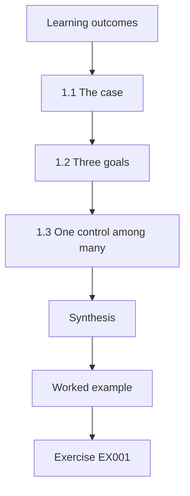

### Logical drawing

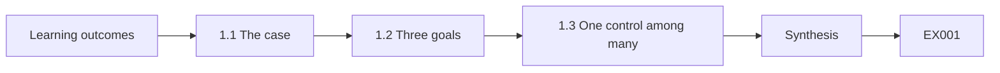

```text
[Learning outcomes]
    |
    v
[1.1 The case]
    |
    v
[1.2 Three goals]
    |
    v
[1.3 One control among many]
    |
    v
[Synthesis]
    |
    v
[Worked example] --> [Exercise EX001]
```
<!-- cykin:lesson-figures:end ch-01 -->


### Learning outcomes

You will (1) describe the confidentiality, integrity and authenticity goals that cryptography serves; (2) place cryptography among other controls; (3) introduce the managed-service case used throughout the book.

### 1.1 The case

Dana Whitlock has just joined the fictional managed-service provider Copperleaf Managed Services as a junior security analyst on a six-month professional programme. Her mentor is Marcus Oyelaran, a lead analyst. Copperleaf's main client in this book is the fictional Bayside Dental Group, which runs four clinics with a patient booking website, a practice-management database, staff laptops, an email service and card payments through an outside processor. Every person, company, system and number here is synthetic. Dana's job is to run repeatable checks, record evidence and explain findings clearly to the clinic manager, not to design new cryptography.

### 1.2 Three goals

Marcus explains cryptography through three goals. Confidentiality keeps patient records and booking details readable only by authorised people. Integrity makes unauthorised changes detectable, for example to an invoice or an X-ray report. Authenticity confirms who sent or signed something, such as a payment notification from the processor. Availability matters too, but cryptography can harm it, for instance when a certificate expires or a disk-encryption key is lost. Dana learns to ask which goal a control serves before judging it, because encryption alone does not prove who sent a message and a signature alone does not hide its content.

### 1.3 One control among many

Cryptography protects data in transit and at rest, but it cannot fix a stolen password, an unpatched server or a receptionist tricked into sending files. At Bayside, the booking website uses TLS, laptops use full-disk encryption and backups are encrypted, yet the biggest recent incident was a phishing email. Dana learns to place cryptographic findings in context: an expired certificate may be urgent because patients see warnings, while a strong cipher setting adds little if every staff member shares one administrator password. Good practitioners report cryptographic issues with their real weight, neither inflated nor dismissed.

### Worked example

Dana maps Bayside's five main services to the three goals and notes which existing controls are cryptographic and which are not.

> **Synthetic case.** Copperleaf, Bayside Dental Group, Dana and Marcus are invented.

### Errors and limits

The three goals simplify; some mechanisms serve several at once. Context changes priority, so a checklist cannot rank findings alone.

### Exercises

- **EX001 — Analyst duties.** What does Dana's role at Copperleaf involve? *Rubric:* 3 = running repeatable checks, recording evidence and explaining findings, not designing cryptography;; 2 = partial;; 1 = designs ciphers;; 0 = none.
- **EX002 — Signature and secrecy.** Does a digital signature on an invoice keep it confidential? *Rubric:* 3 = no; it gives integrity and authenticity, not confidentiality;; 2 = says no;; 1 = says yes;; 0 = none.
- **EX003 — Harm to availability.** Give one way cryptography can reduce availability. *Rubric:* 3 = expired certificate or lost encryption key;; 2 = one example;; 1 = vague;; 0 = none.
- **EX004 — Biggest incident.** What was Bayside's biggest recent incident, and what does it teach? *Rubric:* 3 = phishing; cryptography is one control among many;; 2 = names phishing;; 1 = names cipher;; 0 = none.
- **EX005 — Weighting findings.** Why might an expired certificate outrank a cipher setting? *Rubric:* 3 = patients see warnings and service fails; impact matters more than theoretical strength;; 2 = impact;; 1 = always equal;; 0 = none.

### Synthesis

Practitioners judge each cryptographic control by the goal it serves and its real weight among all of a client's controls.

### Continue studying — chapter 01 of 12

[← Course home](../../README.md) · [Course chapter index](../SUBJECTS.md) · [Chapter 02 (draft) →](#ch-02)

<a id="ch-02"></a>

## Chapter 2 — Cryptography and trust services: service and stakeholder context

<!-- cykin:lesson-figures:start ch-02 -->
### Lesson map

Lesson 02 published. Map, example, EX006.

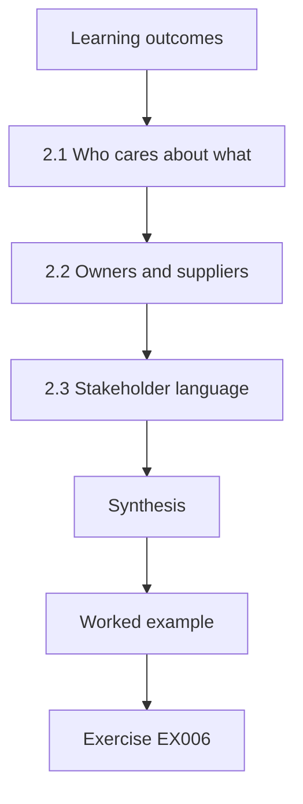

### Logical drawing

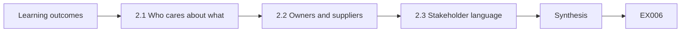

```text
[Learning outcomes]
    |
    v
[2.1 Who cares about what]
    |
    v
[2.2 Owners and suppliers]
    |
    v
[2.3 Stakeholder language]
    |
    v
[Synthesis]
    |
    v
[Worked example] --> [Exercise EX006]
```
<!-- cykin:lesson-figures:end ch-02 -->


### Learning outcomes

You will (1) identify the stakeholders affected by a client's cryptographic services; (2) record service owners and suppliers; (3) explain findings in stakeholder language.

### 2.1 Who cares about what

Marcus asks Dana to list the people affected by Bayside's cryptography. Patients care that the booking site is private and does not show warnings. The clinic manager cares about cost, downtime and regulatory duties for health data. Reception staff care that laptops start and email works. The payment processor cares that Bayside verifies its notifications and protects card data. The website developer, a small outside agency, cares about certificate renewals they set up years ago. Each stakeholder hears the same finding differently, so Dana learns to write it in terms of what each one needs to know or do.

### 2.2 Owners and suppliers

For each service Dana records the business owner, the technical owner and the supplier. The booking site is owned by the clinic manager, run technically by the agency and hosted by a cloud provider. The email service is a managed platform where the supplier controls the keys. The practice-management database runs on a server in the main clinic, maintained by Copperleaf. This table answers two practical questions: who must approve a change, and who can actually make it. Without it, Dana once spent a day trying to fix a certificate that only the agency could renew.

### 2.3 Stakeholder language

Dana's first draft finding said that the booking site served an incomplete certificate chain. The clinic manager did not understand it. Marcus helps her rewrite it: some patients on older phones see a security warning when booking, because the website is missing a file that proves its certificate is genuine; the agency can fix it in under an hour at no extra cost. The technical detail stays in an appendix for the agency. Translating findings this way is not simplifying the truth; it is choosing which part of the truth each reader needs in order to act.

### Worked example

Dana builds a stakeholder table for Bayside and rewrites the chain finding twice, once for the clinic manager and once for the agency.

> **Synthetic case.** Stakeholders, suppliers and the chain finding are synthetic.

### Errors and limits

Owner tables go stale when suppliers change. Plain language must not drop facts that change the decision.

### Exercises

- **EX006 — Patient concern.** What do patients care about most in the booking site's cryptography? *Rubric:* 3 = privacy and no browser warnings;; 2 = one;; 1 = cost;; 0 = none.
- **EX007 — Two practical questions.** Which two questions does the owner table answer? *Rubric:* 3 = who must approve a change and who can make it;; 2 = one;; 1 = vague;; 0 = none.
- **EX008 — Wasted day.** Why did Dana once waste a day on a certificate? *Rubric:* 3 = only the agency could renew it and she had not recorded the supplier;; 2 = supplier;; 1 = bad luck;; 0 = none.
- **EX009 — Manager wording.** Rewrite incomplete certificate chain for the clinic manager. *Rubric:* 3 = some patients see warnings because a proving file is missing; agency can fix quickly;; 2 = warning effect;; 1 = technical only;; 0 = none.
- **EX010 — Where details go.** Where does the technical detail of the finding go? *Rubric:* 3 = an appendix for the agency or technical reader;; 2 = appendix;; 1 = deleted;; 0 = none.

### Synthesis

Cryptographic findings matter only when the right owner understands them, so practitioners map stakeholders and write for each.

### Continue studying — chapter 02 of 12

[← Chapter 01 (draft)](#ch-01) · [Course chapter index](../SUBJECTS.md) · [Chapter 03 (draft) →](#ch-03)

<a id="ch-03"></a>

## Chapter 3 — Authorized practice and evidence handling

<!-- cykin:lesson-figures:start ch-03 -->
### Lesson map

Lesson 03 published. Map, example, EX011.

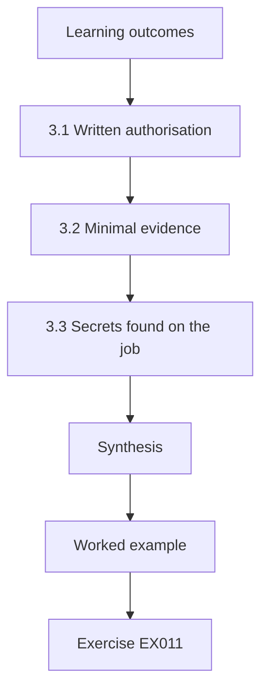

### Logical drawing

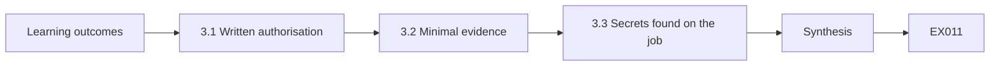

```text
[Learning outcomes]
    |
    v
[3.1 Written authorisation]
    |
    v
[3.2 Minimal evidence]
    |
    v
[3.3 Secrets found on the job]
    |
    v
[Synthesis]
    |
    v
[Worked example] --> [Exercise EX011]
```
<!-- cykin:lesson-figures:end ch-03 -->


### Learning outcomes

You will (1) work under a written authorisation; (2) handle evidence and client data minimally; (3) protect secrets discovered during an engagement.

### 3.1 Written authorisation

Copperleaf never tests a client system without a signed authorisation. For Bayside it lists the systems in scope, such as the booking site, the clinic server and staff laptops; permitted checks, such as certificate reads, TLS configuration scans and file permission reviews; the dates; and an emergency contact. The payment processor and the cloud host are excluded, because Bayside cannot authorise testing of someone else's systems. Dana keeps a copy of the authorisation with her notes and stops immediately if a check would touch anything not listed, even when the extra target is only one hostname away.

### 3.2 Minimal evidence

Health data raises the stakes. When Dana checks backup encryption, she records the backup job settings and a test restore of a synthetic file, never a patient record. Evidence includes the command or screen used, the time with zone, the system and the result, stored in Copperleaf's evidence folder with access limited to the engagement team. She keeps only what supports a finding. Marcus explains that evidence is itself sensitive: a folder of configuration exports from a clinic is a target, so it is encrypted at rest and deleted on the schedule agreed in the contract.

### 3.3 Secrets found on the job

On the clinic server Dana finds a text file holding the database administrator password and the agency's FTP credentials. She does not open them further, copy them or test whether they work. She records the file path, the type of secret and the time, informs Marcus and the client's technical owner the same day, and recommends rotation. Testing a found credential, even to prove the risk, would go beyond her authorisation and could break systems. Her report later shows the finding with the secrets redacted, which is enough to justify the fix.

### Worked example

Dana works through a day of Bayside checks under the signed authorisation, keeps evidence minimal and reports a password file by path only.

> **Synthetic case.** The authorisation, server and password file are synthetic.

### Errors and limits

Authorisation does not remove the need for care in production. Retention rules differ by contract and jurisdiction.

### Exercises

- **EX011 — Excluded systems.** Why are the processor and cloud host excluded from scope? *Rubric:* 3 = Bayside cannot authorise testing of another company's systems;; 2 = ownership;; 1 = technical reasons;; 0 = none.
- **EX012 — Backup check evidence.** How does Dana evidence backup encryption without patient data? *Rubric:* 3 = records job settings and restores a synthetic test file;; 2 = synthetic file;; 1 = uses patient record;; 0 = none.
- **EX013 — Evidence as target.** Why is the evidence folder itself protected? *Rubric:* 3 = it contains sensitive client configuration; encrypted and deleted on schedule;; 2 = sensitive;; 1 = not sensitive;; 0 = none.
- **EX014 — Found credentials.** Should Dana try the found FTP credentials to prove they work? *Rubric:* 3 = no; it exceeds authorisation and could break systems; report and recommend rotation;; 2 = no;; 1 = yes;; 0 = none.
- **EX015 — Redaction.** How does the report show the password file finding? *Rubric:* 3 = with secrets redacted, path and type only;; 2 = redacted;; 1 = full secrets;; 0 = none.

### Synthesis

Authorised, minimal and careful evidence handling keeps an engagement lawful and stops it from creating new exposure.

### Continue studying — chapter 03 of 12

[← Chapter 02 (draft)](#ch-02) · [Course chapter index](../SUBJECTS.md) · [Chapter 04 (draft) →](#ch-04)

<a id="ch-04"></a>

## Chapter 4 — Cryptography and trust services: core methods

<!-- cykin:lesson-figures:start ch-04 -->
### Lesson map

Lesson 04 published. Map, example, EX016.

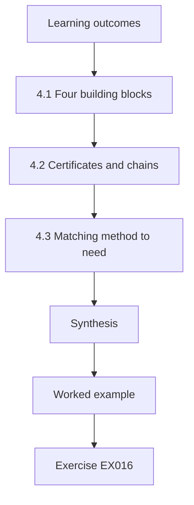

### Logical drawing

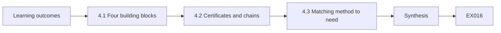

```text
[Learning outcomes]
    |
    v
[4.1 Four building blocks]
    |
    v
[4.2 Certificates and chains]
    |
    v
[4.3 Matching method to need]
    |
    v
[Synthesis]
    |
    v
[Worked example] --> [Exercise EX016]
```
<!-- cykin:lesson-figures:end ch-04 -->


### Learning outcomes

You will (1) explain symmetric encryption, hashing, MACs and signatures in practitioner terms; (2) explain certificates and chains; (3) choose the right method for a client need.

### 4.1 Four building blocks

Marcus summarises the building blocks. Symmetric encryption, such as AES in GCM mode from NIST SP 800-38D, uses one key to encrypt and decrypt and also detects tampering. A hash, such as SHA-256 from FIPS 180-4, gives a fixed fingerprint of data that anyone can compute. A message authentication code, such as HMAC, needs a shared key and proves a message came from someone holding it. A digital signature, such as Ed25519 from RFC 8032 or ECDSA from FIPS 186-5, uses a private key to sign and a public key to verify, so anyone can check it without being able to sign.

### 4.2 Certificates and chains

A certificate, defined in RFC 5280, binds a name such as book.bayside.example to a public key and is signed by a certificate authority. Browsers trust a small set of root authorities; roots sign intermediates, and intermediates sign server certificates. A browser verifies the chain from the server certificate up to a trusted root, checks the name and the validity dates, and only then proceeds. Dana learns that most certificate problems she will see are not broken mathematics but operational issues: expired dates, missing intermediates, wrong names or a private key stored where too many people can read it.

### 4.3 Matching method to need

Dana practises with Bayside needs. Protecting the booking form in transit calls for TLS. Detecting if a nightly export file was corrupted calls for a hash, with the expected value delivered separately. Proving that payment notifications came from the processor calls for an HMAC with a shared secret, or a signature if the processor publishes a public key. Letting patients verify a signed treatment plan PDF calls for a signature. Protecting a backup at rest calls for authenticated encryption with the key held apart from the backup. Getting the match right is the core skill of the practitioner.

### Worked example

Dana fills a table of six Bayside needs, choosing TLS, hash, HMAC, signature or authenticated encryption for each and naming who holds the key.

> **Synthetic case.** Needs and hostnames are synthetic; the cited standards are real.

### Errors and limits

Real systems combine methods; TLS itself uses all four blocks. A hash without a trusted reference value proves nothing about tampering.

### Exercises

- **EX016 — MAC versus signature.** Why can a MAC verifier forge tags while a signature verifier cannot? *Rubric:* 3 = signature verifiers cannot forge, because they hold only the public key; MAC verifiers hold the same key and could create tags;; 2 = key asymmetry;; 1 = no difference;; 0 = none.
- **EX017 — Chain order.** Describe the chain a browser verifies for the booking site. *Rubric:* 3 = server certificate signed by intermediate signed by trusted root, plus name and dates;; 2 = partial chain;; 1 = no chain;; 0 = none.
- **EX018 — Typical problems.** What kind of certificate problems will Dana mostly meet? *Rubric:* 3 = operational: expiry, missing intermediates, wrong names, exposed keys;; 2 = two;; 1 = broken maths;; 0 = none.
- **EX019 — Backup method.** Which method protects a backup at rest, and where should the key be? *Rubric:* 3 = authenticated encryption with the key held apart from the backup;; 2 = method;; 1 = hash;; 0 = none.
- **EX020 — Signed treatment plan.** Which method lets patients verify a treatment plan PDF came from Bayside? *Rubric:* 3 = digital signature verified with a public key;; 2 = signature;; 1 = encryption;; 0 = none.

### Synthesis

Choosing among encryption, hashes, MACs, signatures and certificates by need is the practitioner's central cryptographic skill.

### Continue studying — chapter 04 of 12

[← Chapter 03 (draft)](#ch-03) · [Course chapter index](../SUBJECTS.md) · [Chapter 05 (draft) →](#ch-05)

<a id="ch-05"></a>

## Chapter 5 — Cryptography and trust services: tools and interpretation

<!-- cykin:lesson-figures:start ch-05 -->
### Lesson map

Lesson 05 published. Map, example, EX021.

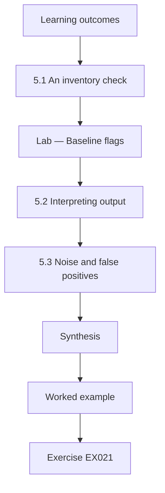

### Logical drawing

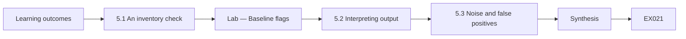

```text
[Learning outcomes]
    |
    v
[5.1 An inventory check]
    |
    v
[Lab — Baseline flags]
    |
    v
[5.2 Interpreting output]
    |
    v
[5.3 Noise and false positives]
    |
    v
[Synthesis]
    |
    v
[Worked example] --> [Exercise EX021]
```
<!-- cykin:lesson-figures:end ch-05 -->


### Learning outcomes

You will (1) run an inventory check over certificates and algorithms; (2) interpret tool output without over-claiming; (3) distinguish findings from tool noise.

### 5.1 An inventory check

Copperleaf keeps a simple inventory per client: each endpoint, its certificate expiry, its key type and size, its signature algorithm and the TLS versions it accepts. Dana writes a short script that reads Bayside's synthetic inventory and flags rows that break Copperleaf's baseline: certificates expiring within thirty days, RSA keys smaller than 2048 bits, SHA-1 signatures and acceptance of TLS 1.0 or 1.1. The baseline follows NIST guidance such as SP 800-131A Rev. 2 and SP 800-52 Rev. 2. The lab below shows the flags for five synthetic endpoints and the count of clean ones.

### Lab — Baseline flags

```python
# Flag synthetic endpoints against a simple baseline (NIST SP 800-131A/800-52 inspired).
import datetime
REVIEW = datetime.date(2026, 3, 1)
eps = [("book.bayside.example", "2026-03-18", "RSA", 2048, "sha256", ["1.2", "1.3"]),
       ("clinic-srv.bayside.lan", "2027-01-10", "RSA", 1024, "sha256", ["1.2"]),
       ("printer.bayside.lan", "2028-05-02", "RSA", 2048, "sha1", ["1.0", "1.2"]),
       ("mail-gw.bayside.example", "2026-09-30", "ECDSA", 256, "sha256", ["1.1", "1.2", "1.3"]),
       ("api.bayside.example", "2026-11-20", "ECDSA", 256, "sha256", ["1.3"])]
clean = 0
for host, exp, kt, bits, sig, vers in eps:
    f = []
    d = (datetime.date.fromisoformat(exp) - REVIEW).days
    if d <= 30: f.append(f"expires in {d} d")
    if kt == "RSA" and bits < 2048: f.append(f"RSA-{bits}")
    if sig == "sha1": f.append("SHA-1 signature")
    old = [v for v in vers if v in ("1.0", "1.1")]
    if old: f.append("TLS " + "/".join(old))
    if f: print(f"{host:26} " + "; ".join(f))
    else: clean += 1
print("clean endpoints:", clean)
```

Run with `python3 lab_inventory.py`. Verified output:

```text
book.bayside.example       expires in 17 d
clinic-srv.bayside.lan     RSA-1024
printer.bayside.lan        SHA-1 signature; TLS 1.0
mail-gw.bayside.example    TLS 1.1
clean endpoints: 1
```

### 5.2 Interpreting output

A flag is a question, not a verdict. The script flags the old clinic printer for TLS 1.0, but the printer sits on an isolated network and only the server talks to it. The flag remains true, yet the risk is lower than for a public site. Dana records the flag, adds the context and lets the risk rating reflect both. She also notes where the data came from and when, because an inventory exported last month can miss a certificate renewed yesterday. Interpreting output means stating what the tool measured, what it could not see and what that implies for the client.

### 5.3 Noise and false positives

Scanners often report items that are technically accurate but irrelevant, such as a self-signed certificate on an internal management page reachable only from one admin laptop, or they misread a configuration. Dana checks each flag manually on a sample before reporting: she connects with openssl s_client or reads the certificate with openssl x509 and confirms the value. Confirmed issues become findings; misreadings are recorded as tool noise with a short explanation. This practice keeps reports credible, because one obviously wrong finding makes a client doubt every other line in the report.

### Worked example

Dana runs the inventory lab, confirms the expiring booking certificate manually, downgrades the isolated printer's TLS 1.0 flag with context and records one scanner misreading as noise.

> **Synthetic case.** Endpoints, sizes and dates are synthetic; NIST SP 800-131A Rev. 2 and SP 800-52 Rev. 2 are real.

### Errors and limits

Baselines lag new guidance; review them yearly. Manual sampling may miss rare misreadings.

### Exercises

- **EX021 — Baseline rules.** List the four baseline rules in Dana's script. *Rubric:* 3 = expiry within 30 days, RSA under 2048, SHA-1 signature, TLS 1.0 or 1.1 accepted;; 2 = three;; 1 = one;; 0 = none.
- **EX022 — Lab flag count.** How many endpoints did the lab flag and how many were clean? *Rubric:* 3 = four flagged, one clean;; 2 = count of one side;; 1 = wrong;; 0 = none.
- **EX023 — Printer context.** Why is the printer's TLS 1.0 flag rated lower? *Rubric:* 3 = it is isolated and only the server reaches it;; 2 = isolation;; 1 = flag false;; 0 = none.
- **EX024 — Manual confirmation.** How does Dana confirm a flag before reporting it? *Rubric:* 3 = connects with openssl s_client or reads the certificate with openssl x509;; 2 = tool named;; 1 = trusts scanner;; 0 = none.
- **EX025 — Credibility.** What does one obviously wrong finding do to a report? *Rubric:* 3 = makes the client doubt every other finding;; 2 = doubt;; 1 = vague;; 0 = none.

### Synthesis

Tools produce flags; practitioners turn them into findings by confirming them, adding context and stating limits.

### Continue studying — chapter 05 of 12

[← Chapter 04 (draft)](#ch-04) · [Course chapter index](../SUBJECTS.md) · [Chapter 06 (draft) →](#ch-06)

<a id="ch-06"></a>

## Chapter 6 — Cryptography and trust services: operational workflow

<!-- cykin:lesson-figures:start ch-06 -->
### Lesson map

Lesson 06 published. Map, example, EX026.

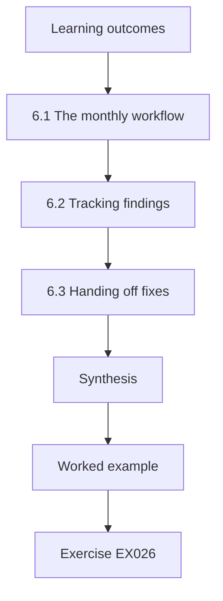

### Logical drawing

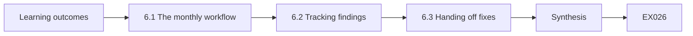

```text
[Learning outcomes]
    |
    v
[6.1 The monthly workflow]
    |
    v
[6.2 Tracking findings]
    |
    v
[6.3 Handing off fixes]
    |
    v
[Synthesis]
    |
    v
[Worked example] --> [Exercise EX026]
```
<!-- cykin:lesson-figures:end ch-06 -->


### Learning outcomes

You will (1) run Copperleaf's monthly cryptographic check workflow; (2) track findings from discovery to closure; (3) hand off fixes to the right owner.

### 6.1 The monthly workflow

Copperleaf runs a monthly cryptographic check for each client. Step one exports the inventory and runs the baseline script. Step two confirms flags by hand. Step three checks certificate transparency logs, defined in RFC 6962, for any certificate issued for the client's domains that the inventory does not list. Step four rates and records findings in the tracker. Step five sends the client summary. Dana follows a checklist for each step and signs it off with the date. A checklist sounds dull, but it is what makes the workflow repeatable when Dana is ill and a colleague runs it instead.

### 6.2 Tracking findings

Each finding gets an identifier, a description, the evidence link, a risk rating, an owner, a due date and a status: open, in progress, fixed awaiting verification or closed. A finding is closed only after Dana verifies the fix, not when the owner says it is done. Last month the agency reported the booking chain fixed, but Dana's retest still showed the intermediate missing on one of two load-balanced servers. Tracking with verification catches such half-fixes, and the history shows the client how long issues stay open, which is useful when discussing service levels.

### 6.3 Handing off fixes

Dana rarely fixes things herself. Certificate renewals on the booking site go to the agency, laptop encryption issues go to Copperleaf's desktop team, and payment integration settings go to the clinic manager, who contacts the processor. Each handoff includes the finding, the evidence, a suggested fix with a reference such as the relevant RFC or NIST page, and the deadline. Marcus teaches her to propose rather than order: a supplier who understands why a change matters will usually act faster than one handed an unexplained demand.

### Worked example

Dana completes a monthly run for Bayside, finds a half-fixed chain on one load-balanced server, keeps the finding open and hands it back to the agency with evidence.

> **Synthetic case.** Tracker entries and the agency exchange are synthetic; RFC 6962 is real.

### Errors and limits

Monthly cycles miss short-lived problems between runs. Transparency logs cover public CAs only.

### Exercises

- **EX026 — Step three purpose.** Why check transparency logs in the monthly workflow? *Rubric:* 3 = to find certificates issued for client domains not in the inventory;; 2 = unlisted certs;; 1 = vague;; 0 = none.
- **EX027 — Closing rule.** When may a finding move to closed? *Rubric:* 3 = only after Dana verifies the fix herself;; 2 = verification;; 1 = when owner says;; 0 = none.
- **EX028 — Half-fix.** What half-fix did Dana's retest catch? *Rubric:* 3 = intermediate still missing on one of two load-balanced servers;; 2 = one server;; 1 = vague;; 0 = none.
- **EX029 — Laptop handoff.** Who receives a laptop disk-encryption finding? *Rubric:* 3 = Copperleaf's desktop team;; 2 = desktop team;; 1 = agency;; 0 = none.
- **EX030 — Propose not order.** Why does Marcus advise proposing fixes rather than ordering them? *Rubric:* 3 = suppliers who understand the reason act faster;; 2 = understanding;; 1 = no reason;; 0 = none.

### Synthesis

A repeatable workflow with verified closure and clear handoffs turns monthly checks into lasting improvements.

### Continue studying — chapter 06 of 12

[← Chapter 05 (draft)](#ch-05) · [Course chapter index](../SUBJECTS.md) · [Chapter 07 (draft) →](#ch-07)

<a id="ch-07"></a>

## Chapter 7 — Cryptography and trust services: controls and verification

<!-- cykin:lesson-figures:start ch-07 -->
### Lesson map

Lesson 07 published. Map, example, EX031.

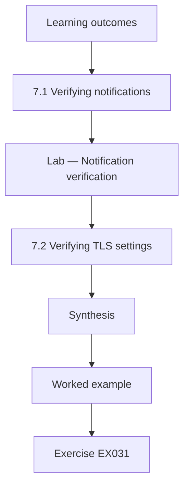

### Logical drawing

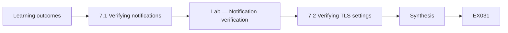

```text
[Learning outcomes]
    |
    v
[7.1 Verifying notifications]
    |
    v
[Lab — Notification verification]
    |
    v
[7.2 Verifying TLS settings]
    |
    v
[Synthesis]
    |
    v
[Worked example] --> [Exercise EX031]
```
<!-- cykin:lesson-figures:end ch-07 -->


### Learning outcomes

You will (1) verify payment notification controls with HMAC and replay checks; (2) verify TLS settings against a baseline; (3) write verification statements with their limits.

### 7.1 Verifying notifications

Bayside's booking site receives payment notifications from the processor. Each carries an HMAC-SHA-256 tag computed with a shared secret over a timestamp and the message body. The agency's code should recompute the tag, compare it with hmac.compare_digest and reject any message older than five minutes. Dana is not allowed to test the live processor, so she verifies the logic in a lab with synthetic messages: one authentic, one with a changed amount and one replayed after an hour. The lab below shows the verifier accepting only the authentic message, which matches the behaviour the agency described.

### Lab — Notification verification

```python
# Verify synthetic payment notifications: HMAC-SHA-256 + 300 s replay window.
import hmac, hashlib
SECRET = b"synthetic-processor-secret"; NOW = 1_772_000_000; WINDOW = 300
def tag(ts, body): return hmac.new(SECRET, str(ts).encode() + b"." + body, hashlib.sha256).hexdigest()
def accept(ts, body, t): return NOW - ts <= WINDOW and hmac.compare_digest(tag(ts, body), t)
body = b'{"booking":"BDG-2207","amount":"85.00"}'
t = tag(NOW - 30, body)
print("authentic:", accept(NOW - 30, body, t))
print("changed amount:", accept(NOW - 30, body.replace(b"85.00", b"8.50"), t))
print("replayed after 1 h:", accept(NOW - 3600, body, tag(NOW - 3600, body)))
```

Run with `python3 lab_notify.py`. Verified output:

```text
authentic: True
changed amount: False
replayed after 1 h: False
```

### 7.2 Verifying TLS settings

For TLS, Dana checks each in-scope endpoint against the baseline: TLS 1.3 offered, TLS 1.2 allowed only if needed, older versions refused, a complete chain served and the certificate name correct. She uses openssl s_client with explicit version options, for example trying -tls1_1 and expecting a refusal. Each test records the command, the result and the time. Where a client cannot be tested directly, such as an old dental imaging workstation, she records the gap honestly instead of assuming it behaves like the rest. Verification is only as strong as the cases actually tried.

### 7.3 Statements with limits

Dana writes verification statements in a fixed form: what was checked, how, when, the result and what was not checked. For example: notification verification logic accepted authentic and rejected altered and replayed synthetic messages in a lab on 3 March; the production code path and secret storage were not reviewed. This form protects both Copperleaf and the client. Clients make decisions on these statements, so a statement that hides its limits can lead them to skip a needed review. Marcus checks every statement for words like secure or compliant that claim more than the test showed.

### Worked example

Dana runs the notification lab, tests TLS versions on three endpoints and writes four verification statements, each ending with what was not checked.

> **Synthetic case.** Messages, secrets and endpoints are synthetic.

### Errors and limits

Lab logic checks do not prove production code matches. Refusal of one old version does not prove all weak options are disabled.

### Exercises

- **EX031 — Replay window.** What age limit does the verifier enforce on notifications? *Rubric:* 3 = five minutes (300 seconds);; 2 = five minutes;; 1 = vague;; 0 = none.
- **EX032 — Changed amount.** What did the lab report for the notification with a changed amount? *Rubric:* 3 = rejected (False) because the tag no longer matched;; 2 = rejected;; 1 = accepted;; 0 = none.
- **EX033 — TLS 1.1 probe.** How does Dana check that TLS 1.1 is refused? *Rubric:* 3 = openssl s_client with -tls1_1 and expect handshake failure;; 2 = command;; 1 = assumes;; 0 = none.
- **EX034 — Imaging workstation.** What does Dana do about the untestable imaging workstation? *Rubric:* 3 = records the gap honestly instead of assuming;; 2 = records gap;; 1 = assumes fine;; 0 = none.
- **EX035 — Banned words.** Which words does Marcus check for in statements, and why? *Rubric:* 3 = secure or compliant, because they claim more than tests show;; 2 = words named;; 1 = vague;; 0 = none.

### Synthesis

Verification proves specific behaviour under specific tests, and honest statements say exactly which cases were tried.

### Continue studying — chapter 07 of 12

[← Chapter 06 (draft)](#ch-06) · [Course chapter index](../SUBJECTS.md) · [Chapter 08 (draft) →](#ch-08)

<a id="ch-08"></a>

## Chapter 8 — Cryptography and trust services: supervised case analysis

<!-- cykin:lesson-figures:start ch-08 -->
### Lesson map

Lesson 08 published. Map, example, EX036.

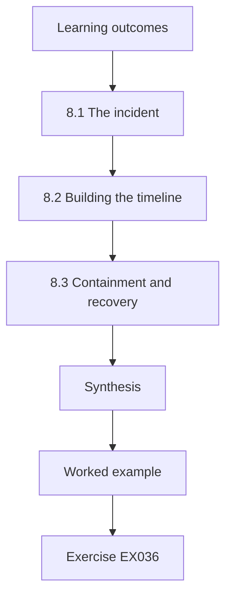

### Logical drawing

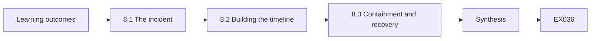

```text
[Learning outcomes]
    |
    v
[8.1 The incident]
    |
    v
[8.2 Building the timeline]
    |
    v
[8.3 Containment and recovery]
    |
    v
[Synthesis]
    |
    v
[Worked example] --> [Exercise EX036]
```
<!-- cykin:lesson-figures:end ch-08 -->


### Learning outcomes

You will (1) analyse a synthetic incident involving an exposed key; (2) reconstruct a timeline from evidence; (3) recommend containment and recovery steps.

### 8.1 The incident

One Monday the agency tells Copperleaf that a developer accidentally pushed the booking site's TLS private key to a public code repository on Friday evening; it was removed on Sunday. Marcus leads the response and Dana supports. The key was public for about forty hours. Nobody knows whether anyone copied it, and public repositories are scanned constantly by automated tools looking for secrets. Marcus states the working assumption plainly: the key must be treated as compromised, because there is no way to prove it was not taken, and the cost of acting is small compared with the risk.

### 8.2 Building the timeline

Dana gathers evidence: the repository's commit history with times, the agency's removal record, the certificate details, and transparency log entries for Bayside's domains. She converts all times to one zone and writes a timeline: key committed Friday 18:42, repository public, key removed Sunday 10:15, incident reported Monday 08:30. She checks transparency logs and finds no unexpected certificates for Bayside, which is reassuring but not proof, because an attacker with the key could impersonate the existing certificate without obtaining a new one. Each entry links to its evidence source.

### 8.3 Containment and recovery

Marcus recommends three steps. First, generate a new key pair on the server, obtain a new certificate and deploy it. Second, ask the certificate authority to revoke the old certificate, so clients that check revocation reject it. Third, rotate any other secrets in the same repository and add secret scanning to the agency's workflow. Removing the file from the repository is not enough, because copies may exist and the history may still contain it. Dana drafts the client summary: what happened, what was done, the remaining uncertainty and the prevention steps, written for the clinic manager.

### Worked example

Dana builds a four-entry timeline with evidence links, checks transparency logs and drafts the client summary recommending reissue, revocation and secret scanning.

> **Synthetic case.** The incident, times and repository are synthetic.

### Errors and limits

Revocation checking is inconsistent across clients, so revocation reduces but does not remove risk. Logs may not show who cloned a public repository.

### Exercises

- **EX036 — Working assumption.** What assumption did Marcus make about the key, and why? *Rubric:* 3 = compromised, because exposure cannot be disproved and acting is cheap;; 2 = compromised;; 1 = safe;; 0 = none.
- **EX037 — Exposure duration.** For roughly how long was the key public? *Rubric:* 3 = about forty hours, Friday 18:42 to Sunday 10:15;; 2 = approximate;; 1 = wrong;; 0 = none.
- **EX038 — CT reassurance limit.** Why is a clean transparency log check not proof of safety? *Rubric:* 3 = attacker could impersonate with the existing certificate and key;; 2 = impersonation;; 1 = it is proof;; 0 = none.
- **EX039 — Removal not enough.** Why is deleting the file from the repository insufficient? *Rubric:* 3 = copies may exist and history may retain it;; 2 = copies;; 1 = sufficient;; 0 = none.
- **EX040 — Three steps.** List Marcus's three recovery steps. *Rubric:* 3 = new key and certificate, revoke old certificate, rotate other secrets and add scanning;; 2 = two;; 1 = one;; 0 = none.

### Synthesis

Exposed keys are treated as compromised, recovered by reissue and revocation, and explained with a clear timeline and honest uncertainty.

### Continue studying — chapter 08 of 12

[← Chapter 07 (draft)](#ch-07) · [Course chapter index](../SUBJECTS.md) · [Chapter 09 (draft) →](#ch-09)

<a id="ch-09"></a>

## Chapter 9 — Communication, ethics and reporting

<!-- cykin:lesson-figures:start ch-09 -->
### Lesson map

Lesson 09 published. Map, example, EX041.

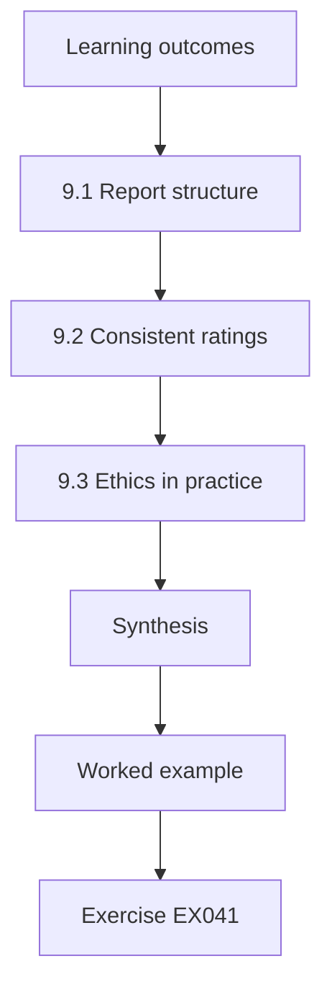

### Logical drawing

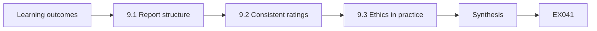

```text
[Learning outcomes]
    |
    v
[9.1 Report structure]
    |
    v
[9.2 Consistent ratings]
    |
    v
[9.3 Ethics in practice]
    |
    v
[Synthesis]
    |
    v
[Worked example] --> [Exercise EX041]
```
<!-- cykin:lesson-figures:end ch-09 -->


### Learning outcomes

You will (1) structure a cryptographic findings report; (2) rate risk consistently; (3) apply professional ethics to disclosure and honesty.

### 9.1 Report structure

Copperleaf's monthly report for Bayside has four parts. An executive summary of half a page says what matters most and what the client should decide. A findings table lists each item with identifier, plain description, risk rating, owner and due date. Technical appendices hold commands, outputs and references for the agency and the desktop team. A closing section lists what was not checked. Dana learns to write the summary last, after the findings are confirmed, and to lead with the action needed rather than the history of the investigation, because the clinic manager reads only the first page.

### 9.2 Consistent ratings

Risk ratings must mean the same thing every month. Copperleaf rates by likelihood and impact on a three-point scale each, combined into low, medium or high. An expired public certificate is likely to be noticed and harms bookings, so it is high. An RSA-1024 key on an internal server reachable only by staff is medium: the weakness is real and should be fixed, but exploitation needs network access first. Dana writes a sentence of justification for every rating. When Marcus reviews her work, he checks that similar findings across clients received similar ratings, which keeps the service fair and defensible.

### 9.3 Ethics in practice

Ethics shows up in small choices. Dana discovers that the agency's own website, outside her scope, shows the same chain error; she does not test it further but mentions it informally to the agency contact. When a finding is embarrassing because Copperleaf itself configured the setting, she reports it like any other. She never overstates risk to sell more services, and never understates it to avoid an awkward meeting. If she ever found a flaw in a supplier's product affecting many customers, she would follow coordinated disclosure through Copperleaf, not post it publicly. Honest reporting is what clients pay for.

### Worked example

Dana writes a Bayside monthly report with a half-page summary, a rated findings table with justifications and an appendix, including one finding caused by Copperleaf.

> **Synthetic case.** The report, ratings and agency website are synthetic.

### Errors and limits

Three-point scales hide nuance; justifications carry the detail. Informal notes about out-of-scope issues must not become unauthorised testing.

### Exercises

- **EX041 — Summary placement.** Why write the executive summary last? *Rubric:* 3 = findings must be confirmed first and the summary leads with action;; 2 = confirmed;; 1 = first;; 0 = none.
- **EX042 — Internal RSA-1024 rating.** Why is the internal RSA-1024 key rated medium rather than high? *Rubric:* 3 = real weakness but exploitation needs internal network access;; 2 = access needed;; 1 = rated low;; 0 = none.
- **EX043 — Cross-client check.** What does Marcus check across clients' ratings? *Rubric:* 3 = similar findings received similar ratings;; 2 = consistency;; 1 = vague;; 0 = none.
- **EX044 — Own mistake.** How should Dana report a weakness Copperleaf itself introduced? *Rubric:* 3 = exactly like any other finding, without hiding it;; 2 = report;; 1 = hide it;; 0 = none.
- **EX045 — Supplier product flaw.** What should happen if Dana finds a flaw in a widely used supplier product? *Rubric:* 3 = coordinated disclosure through Copperleaf, not public posting;; 2 = disclosure;; 1 = post publicly;; 0 = none.

### Synthesis

Clear structure, consistent ratings and honest ethics make cryptographic reports trustworthy and actionable.

### Continue studying — chapter 09 of 12

[← Chapter 08 (draft)](#ch-08) · [Course chapter index](../SUBJECTS.md) · [Chapter 10 (draft) →](#ch-10)

<a id="ch-10"></a>

## Chapter 10 — Cryptography and trust services: quality and troubleshooting

<!-- cykin:lesson-figures:start ch-10 -->
### Lesson map

Lesson 10 published. Map, example, EX046.

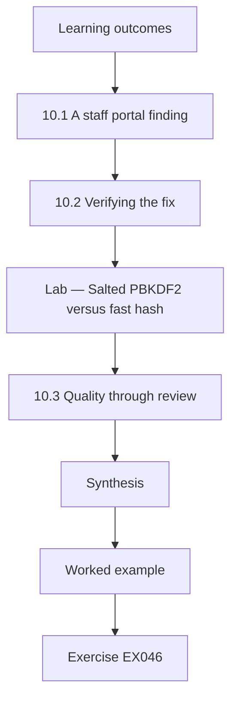

### Logical drawing

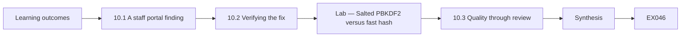

```text
[Learning outcomes]
    |
    v
[10.1 A staff portal finding]
    |
    v
[10.2 Verifying the fix]
    |
    v
[Lab — Salted PBKDF2 versus fast hash]
    |
    v
[10.3 Quality through review]
    |
    v
[Synthesis]
    |
    v
[Worked example] --> [Exercise EX046]
```
<!-- cykin:lesson-figures:end ch-10 -->


### Learning outcomes

You will (1) troubleshoot a password storage weakness in a staff portal; (2) verify a fix using a key-derivation function; (3) improve workflow quality with review and retrospectives.

### 10.1 A staff portal finding

Bayside's small staff rota portal, built by the agency, stores staff passwords. During a review Dana sees in the configuration export that passwords are stored as unsalted SHA-256 hashes. Fast hashes let an attacker who steals the database test enormous numbers of guesses quickly, and without salt, identical passwords produce identical hashes. Password storage needs a slow, salted function. Python's hashlib.pbkdf2_hmac implements PBKDF2, and stronger memory-hard choices include scrypt from RFC 7914 and Argon2id from RFC 9106. Dana's recommendation is to use a maintained library implementing one of these, not to design a custom scheme.

### 10.2 Verifying the fix

The agency proposes PBKDF2-HMAC-SHA-256 with a random 16-byte salt per user and a high iteration count set by policy, migrating each user at next login. Dana verifies the approach in a lab with synthetic users: two staff with the same password get different stored values; the correct password verifies and a wrong one fails; and the time per guess is far higher than for a single SHA-256. The lab below shows these results. She records that the lab confirms behaviour of the method, while the agency's production code still needs its own review.

### Lab — Salted PBKDF2 versus fast hash

```python
# Salted PBKDF2-HMAC-SHA-256 vs one SHA-256, synthetic staff. Teaching only; use a maintained library in production.
import hashlib, hmac, secrets, time
ITER = 600_000   # lab value; production iteration count comes from policy
def store(pw):
    s = secrets.token_bytes(16); return s, hashlib.pbkdf2_hmac("sha256", pw, s, ITER)
def check(pw, rec): return hmac.compare_digest(hashlib.pbkdf2_hmac("sha256", pw, rec[0], ITER), rec[1])
a, b = store(b"Rota-Clinic-3"), store(b"Rota-Clinic-3")
print("same password, different stored values:", a[1] != b[1])
print("correct password:", check(b"Rota-Clinic-3", a), "| wrong password:", check(b"Rota-Clinic-4", a))
t0 = time.perf_counter(); [hashlib.sha256(b"Rota-Clinic-3").digest() for _ in range(10000)]; fast = (time.perf_counter() - t0) / 10000
t0 = time.perf_counter(); check(b"x", a); slow = time.perf_counter() - t0
print(f"per-guess cost ratio PBKDF2/SHA-256: {'over 10,000x' if slow / fast > 10000 else 'under 10,000x'}")
```

Run with `python3 lab_pbkdf2.py`. Verified output:

```text
same password, different stored values: True
correct password: True | wrong password: False
per-guess cost ratio PBKDF2/SHA-256: over 10,000x
```

### 10.3 Quality through review

Mistakes slip into every workflow, so Copperleaf builds quality checks in. Every report is reviewed by a second analyst before it goes to the client. After each monthly cycle, the team spends fifteen minutes on a retrospective: what went well, what went wrong and one change for next month. When Dana's retest of the chain fix nearly missed the second server, the retrospective led to a rule that load-balanced endpoints are tested once per backend. Small, steady improvements like this raise the quality of the whole service more than occasional heroic efforts.

### Worked example

Dana documents the unsalted SHA-256 finding, runs the PBKDF2 lab to confirm the agency's approach and adds a per-backend testing rule after a retrospective.

> **Synthetic case.** The rota portal, users and iteration count are synthetic; RFC 7914 and RFC 9106 are real.

### Errors and limits

Lab timing varies by machine; it shows relative cost, not attacker speed. Upgrade at login leaves inactive accounts on old hashes.

### Exercises

- **EX046 — Unsalted weakness.** Name two problems with unsalted SHA-256 password storage. *Rubric:* 3 = fast to guess and identical passwords share hashes;; 2 = one;; 1 = vague;; 0 = none.
- **EX047 — Lab equal passwords.** What did the PBKDF2 lab show for two staff with the same password? *Rubric:* 3 = stored values differed because salts differed;; 2 = differed;; 1 = same;; 0 = none.
- **EX048 — Lab cost ratio.** According to the lab, how did PBKDF2 cost compare with one SHA-256? *Rubric:* 3 = over 10,000 times slower per guess, as printed;; 2 = slower;; 1 = faster;; 0 = none.
- **EX049 — Production caveat.** What does the lab not prove about the agency's fix? *Rubric:* 3 = that production code implements it correctly; needs review;; 2 = code review;; 1 = proves all;; 0 = none.
- **EX050 — Retrospective rule.** Which rule came from the retrospective? *Rubric:* 3 = test load-balanced endpoints once per backend;; 2 = rule;; 1 = vague;; 0 = none.

### Synthesis

Quality comes from verifying fixes with sound methods and from steady review and retrospectives.

### Continue studying — chapter 10 of 12

[← Chapter 09 (draft)](#ch-09) · [Course chapter index](../SUBJECTS.md) · [Chapter 11 (draft) →](#ch-11)

<a id="ch-11"></a>

## Chapter 11 — Supervised laboratory

<!-- cykin:lesson-figures:start ch-11 -->
### Lesson map

Lesson 11 published. Map, example, EX051.

```mermaid
flowchart TD
  N0["Learning outcomes"]
  N1["11.1 Mirroring the service"]
  N2["11.2 Rehearsal and rollback"]
  N3["11.3 Closing the lab"]
  N4["Synthesis"]
  N0 --> N1 --> N2 --> N3 --> N4
  N4 --> EX["Worked example"]
  EX --> Q["Exercise EX051"]
```

### Logical drawing

```mermaid
flowchart LR
  N0["Learning outcomes"]
  N1["11.1 Mirroring the service"]
  N2["11.2 Rehearsal and rollback"]
  N3["11.3 Closing the lab"]
  N4["Synthesis"]
  N0 --> N1 --> N2 --> N3 --> N4 --> Q["EX051"]
```

```text
[Learning outcomes]
    |
    v
[11.1 Mirroring the service]
    |
    v
[11.2 Rehearsal and rollback]
    |
    v
[11.3 Closing the lab]
    |
    v
[Synthesis]
    |
    v
[Worked example] --> [Exercise EX051]
```
<!-- cykin:lesson-figures:end ch-11 -->


### Learning outcomes

You will (1) set up a contained lab mirroring a client service; (2) rehearse a certificate renewal and rollback; (3) close the lab without leaving trust behind.

### 11.1 Mirroring the service

Before the agency renews the booking site's certificate on a new hosting platform, Marcus asks Dana to rehearse it in a contained lab. She builds an isolated virtual network with a web server copying the booking site's configuration, a throwaway lab certificate authority and a client machine that trusts only that lab root. No real keys, patient data or production names are used; hostnames end in .lab.copperleaf.example. Mirroring the configuration matters more than mirroring the content, because the renewal risks lie in file paths, chain order and server reload behaviour rather than in the web pages.

### 11.2 Rehearsal and rollback

Dana writes the steps: generate a new key, request a certificate from the lab authority, install the certificate with its intermediate, reload the server and test. She deliberately installs the chain in the wrong order once and sees the client fail, then fixes it. She also practises rollback: restoring the previous key and certificate from the backup copy and reloading. Timing each step shows the whole renewal takes twelve minutes, with two minutes of reload risk. The agency uses her tested steps and timings to plan a short maintenance window for the real renewal.

### 11.3 Closing the lab

When the rehearsal ends, Dana deletes the lab authority's private key, removes the lab root from the client, destroys the virtual machines and writes a closure note listing what was removed. Marcus explains why this matters: a lab root left on any machine lets whoever holds its key create certificates that machine trusts. The closure note also records lessons for the real change, such as checking chain order explicitly. A supervised lab is judged not only by what it taught but by whether it left anything risky behind.

### Worked example

Dana rehearses the booking renewal in a mirrored lab, reproduces a chain-order failure, practises rollback and closes the lab with a removal note.

> **Synthetic case.** Lab hosts, keys and timings are synthetic.

### Errors and limits

Labs cannot reproduce every production difference, such as provider caching. A rehearsed rollback still depends on a current backup.

### Exercises

- **EX051 — What to mirror.** What matters most to mirror in the lab, and why? *Rubric:* 3 = configuration such as paths, chain order and reload behaviour, where renewal risk lies;; 2 = configuration;; 1 = content;; 0 = none.
- **EX052 — Deliberate fault.** Which fault did Dana reproduce on purpose? *Rubric:* 3 = the chain installed in the wrong order;; 2 = chain order;; 1 = vague;; 0 = none.
- **EX053 — Renewal timing.** How long did the rehearsed renewal take, and how much was reload risk? *Rubric:* 3 = twelve minutes, two minutes of reload risk;; 2 = one figure;; 1 = vague;; 0 = none.
- **EX054 — Lab key deletion.** Why delete the lab authority's private key at closure? *Rubric:* 3 = so nobody can issue certificates that a machine still trusting the root would accept;; 2 = trust risk;; 1 = tidiness;; 0 = none.
- **EX055 — Lesson carried over.** Name one lesson recorded for the real change. *Rubric:* 3 = check chain order explicitly;; 2 = lesson;; 1 = vague;; 0 = none.

### Synthesis

Rehearsing changes in a contained lab reduces production risk, provided the lab is closed cleanly afterwards.

### Continue studying — chapter 11 of 12

[← Chapter 10 (draft)](#ch-10) · [Course chapter index](../SUBJECTS.md) · [Chapter 12 (draft) →](#ch-12)

<a id="ch-12"></a>

## Chapter 12 — Practice portfolio and final review

<!-- cykin:lesson-figures:start ch-12 -->
### Lesson map

Lesson 12 published. Map, example, EX056.

```mermaid
flowchart TD
  N0["Learning outcomes"]
  N1["12.1 Building the portfolio"]
  N2["12.2 Trends from the tracker"]
  N3["Lab — Finding trends"]
  N4["12.3 Reflection and next steps"]
  N5["Synthesis"]
  N0 --> N1 --> N2 --> N3 --> N4 --> N5
  N5 --> EX["Worked example"]
  EX --> Q["Exercise EX056"]
```

### Logical drawing

```mermaid
flowchart LR
  N0["Learning outcomes"]
  N1["12.1 Building the portfolio"]
  N2["12.2 Trends from the tracker"]
  N3["Lab — Finding trends"]
  N4["12.3 Reflection and next steps"]
  N5["Synthesis"]
  N0 --> N1 --> N2 --> N3 --> N4 --> N5 --> Q["EX056"]
```

```text
[Learning outcomes]
    |
    v
[12.1 Building the portfolio]
    |
    v
[12.2 Trends from the tracker]
    |
    v
[Lab — Finding trends]
    |
    v
[12.3 Reflection and next steps]
    |
    v
[Synthesis]
    |
    v
[Worked example] --> [Exercise EX056]
```
<!-- cykin:lesson-figures:end ch-12 -->


### Learning outcomes

You will (1) assemble a practice portfolio from six months of work; (2) summarise finding trends with a simple script; (3) reflect on gaps and plan continued learning.

### 12.1 Building the portfolio

Dana's portfolio collects evidence of what she can do: a stakeholder table, an authorisation-based test plan, the inventory script and its output, a verification statement set, the exposed-key timeline, a monthly report with ratings and the lab closure note. Each item is anonymised, keeping the synthetic Bayside names and removing anything real, and each has a short note explaining what she did, what she learnt and what she would do differently. Marcus explains that a portfolio shows judgement better than a certificate list, because it reveals how she handled uncertain, messy situations.

### 12.2 Trends from the tracker

To close the programme, Dana summarises six months of Bayside findings. She writes a short script over a synthetic export of the tracker that counts findings by category and status and computes the median days to close. The lab below shows the result: expiry and chain issues were most common, and most closed within a few weeks, while one weak-key finding stayed open longest because it needed a server replacement. Trends tell the clinic manager where to invest, such as automated renewal, and tell Copperleaf where its workflow could improve.

### Lab — Finding trends

```python
# Summarise a synthetic six-month findings export.
import collections, statistics
rows = [("expiry/chain", "closed", 6), ("expiry/chain", "closed", 11), ("expiry/chain", "closed", 4),
        ("expiry/chain", "closed", 19), ("weak key", "open", 142), ("legacy TLS", "closed", 33),
        ("legacy TLS", "in progress", 58), ("secret exposure", "closed", 2), ("password storage", "closed", 27)]
print("by category:", dict(collections.Counter(c for c, _, _ in rows).most_common()))
print("by status:", dict(collections.Counter(s for _, s, _ in rows)))
print("median days to close (closed only):", statistics.median(d for _, s, d in rows if s == "closed"))
print("oldest open:", max((d, c) for c, s, d in rows if s != "closed"))
```

Run with `python3 lab_trends.py`. Verified output:

```text
by category: {'expiry/chain': 4, 'legacy TLS': 2, 'weak key': 1, 'secret exposure': 1, 'password storage': 1}
by status: {'closed': 7, 'open': 1, 'in progress': 1}
median days to close (closed only): 11
oldest open: (142, 'weak key')
```

### 12.3 Reflection and next steps

In her final review with Marcus, Dana lists what she does confidently: confirm flags, verify HMAC and TLS behaviour, write plain findings and handle evidence. She also lists gaps: she has not yet led an incident, she relies on Marcus for risk ratings in unusual cases and she knows little about post-quantum migration beyond the fact that NIST published FIPS 203, 204 and 205 in 2024. They agree a plan to study those standards, shadow an incident lead and take ownership of one client's monthly cycle. Honest reflection is the last professional skill the programme teaches.

### Worked example

Dana assembles a seven-item portfolio, runs the trends lab and agrees a learning plan covering incident leadership and post-quantum standards.

> **Synthetic case.** The portfolio, tracker export and review are synthetic; FIPS 203, 204 and 205 are real.

### Errors and limits

Six months of one client is a small sample for trends. Portfolios must stay anonymised and synthetic when shared.

### Exercises

- **EX056 — Why a portfolio.** Why does Marcus value a portfolio over a list of certificates? *Rubric:* 3 = it shows judgement in messy, uncertain situations;; 2 = judgement;; 1 = same;; 0 = none.
- **EX057 — Commonest category.** According to the trends lab, which category had the most findings? *Rubric:* 3 = expiry/chain issues, as printed in the run;; 2 = category;; 1 = wrong;; 0 = none.
- **EX058 — Longest open.** Which finding stayed open longest, and why? *Rubric:* 3 = the weak-key finding, needing a server replacement;; 2 = finding;; 1 = vague;; 0 = none.
- **EX059 — Admitted gaps.** Name two gaps Dana admits in her review. *Rubric:* 3 = two of no incident leadership, relies on mentor for unusual ratings, little PQC knowledge;; 2 = one;; 1 = vague;; 0 = none.
- **EX060 — PQC standards.** Which NIST post-quantum standards does her plan include? *Rubric:* 3 = FIPS 203, 204 and 205;; 2 = two;; 1 = vague;; 0 = none.

### Synthesis

A portfolio, trend summary and honest reflection turn six months of practice into a credible professional foundation.

### Continue studying — chapter 12 of 12

[← Chapter 11 (draft)](#ch-11) · [Course chapter index](../SUBJECTS.md) · [Worked results ↓](#worked-results) · [Next course via chapter index →](../SUBJECTS.md)

<a id="worked-results"></a>

## Worked results

Model answers for EX001–EX060. Dana Whitlock, Marcus Oyelaran, Copperleaf Managed Services, Bayside Dental Group and every figure are synthetic. Lab answers quote verified outputs. Any answer meeting the rubric scores equally.

**EX001.** Running repeatable checks, keeping evidence and explaining findings to the client, without inventing cryptography.

**EX002.** No. A signature shows who signed it and that it is unchanged, but anyone can still read the content.

**EX003.** An expired certificate blocks patients from the booking site, and a lost disk-encryption key makes a laptop's data unreadable.

**EX004.** A phishing email; it shows that strong cryptography cannot stop people being tricked, so findings need context.

**EX005.** Because an expired certificate breaks the service and alarms patients now, while a slightly weaker cipher has little practical impact.

**EX006.** That their booking is private and that the site opens without security warnings.

**EX007.** Who has authority to approve a change, and who is technically able to carry it out.

**EX008.** Because the agency controlled that certificate and she had not identified the supplier first.

**EX009.** Some patients on older phones see a security warning when booking because a file proving the certificate is missing; the agency can fix it quickly.

**EX010.** Into a technical appendix addressed to the agency, so the summary stays readable without losing facts.

**EX011.** Because only their owners can authorise testing; Bayside's signature does not cover third-party systems.

**EX012.** By recording the backup job's encryption settings and restoring a synthetic test file rather than any patient record.

**EX013.** Because exports from a clinic are valuable to attackers, so the folder is encrypted, access-limited and deleted on schedule.

**EX014.** No. Trying them goes beyond her authorisation; she reports the path and type and recommends rotation.

**EX015.** It lists the file path and secret types with all values redacted, which is enough to justify rotation.

**EX016.** A signature can be checked with a public key that cannot sign, whereas anyone able to verify an HMAC holds the shared key and could forge tags.

**EX017.** From the server certificate to its intermediate and up to a trusted root, checking the name and validity dates.

**EX018.** Operational ones: expired certificates, missing intermediates, wrong names and private keys stored too openly.

**EX019.** Authenticated encryption such as AES-GCM, with the key stored separately from the backup media.

**EX020.** A digital signature, which patients can verify with Bayside's public key or certificate.

**EX021.** Expiry within 30 days, RSA keys under 2048 bits, SHA-1 signatures, and acceptance of TLS 1.0 or 1.1.

**EX022.** Four endpoints were flagged and one, the portal API, was clean.

**EX023.** Because the printer sits on an isolated segment reachable only by the server, so exposure is limited though the flag is true.

**EX024.** By reproducing it with openssl s_client or openssl x509 and checking the value herself.

**EX025.** It undermines trust in all the other findings, so noise must be filtered out first.

**EX026.** To spot any publicly trusted certificate issued for Bayside's domains that the inventory does not know about.

**EX027.** Only after Dana has retested and confirmed the fix, not on the owner's word alone.

**EX028.** The agency had fixed the chain on one load-balanced server, but the other still omitted the intermediate.

**EX029.** Copperleaf's desktop team, which manages the clinic laptops.

**EX030.** Because a supplier who understands why the change matters usually acts sooner and more carefully.

**EX031.** Messages older than five minutes, 300 seconds, are rejected as possible replays.

**EX032.** It was rejected, because the recomputed HMAC no longer matched the tag.

**EX033.** By running openssl s_client with the -tls1_1 option and confirming the handshake is refused.

**EX034.** She records it as not tested and explains why, rather than assuming it matches the other endpoints.

**EX035.** Words like secure and compliant, because they claim more assurance than a specific test provides.

**EX036.** That it was compromised, since nobody could prove it was not copied and replacing it costs little.

**EX037.** About forty hours, from Friday 18:42 until removal on Sunday 10:15.

**EX038.** Because an attacker holding the key can impersonate the site using the existing certificate, without any new certificate appearing.

**EX039.** Others may already have copies, and the repository history may still contain the key.

**EX040.** Deploy a new key and certificate, revoke the old certificate, and rotate other secrets while adding secret scanning.

**EX041.** Because only after findings are confirmed can the summary state accurately what matters and what to decide.

**EX042.** The weakness is real, but an attacker would first need staff network access, which lowers likelihood.

**EX043.** That similar findings at different clients were given similar ratings, keeping the service consistent.

**EX044.** Exactly like any other finding, with the same evidence and rating, because honesty is the service.

**EX045.** It should go through coordinated disclosure to the supplier via Copperleaf rather than being posted publicly.

**EX046.** It is fast, so guesses are cheap, and without salt identical passwords give identical hashes.

**EX047.** Their stored values differed because each had a separate random salt.

**EX048.** At the lab iteration count PBKDF2 cost over 10,000 times more per guess than a single SHA-256, as the run printed.

**EX049.** It does not prove the agency's production code is correct; that code needs its own review.

**EX050.** Load-balanced endpoints must be tested once for each backend server.

**EX051.** The server configuration, because renewal risks lie in paths, chain order and reload, not in page content.

**EX052.** She installed the certificate chain in the wrong order and observed the client failing.

**EX053.** Twelve minutes in total, including two minutes of reload risk.

**EX054.** So no one can later issue certificates that a machine still holding the lab root would trust.

**EX055.** To check the certificate chain order explicitly before reloading the server.

**EX056.** Because it shows how Dana actually reasoned and acted in uncertain, real-world situations.

**EX057.** Expiry and chain issues had the most findings, as the run showed.

**EX058.** The weak RSA key on the clinic server, because fixing it required replacing the server.

**EX059.** She has not led an incident, and she knows little about post-quantum migration beyond the 2024 FIPS releases.

**EX060.** FIPS 203 (ML-KEM), FIPS 204 (ML-DSA) and FIPS 205 (SLH-DSA), published in 2024.

<a id="references"></a>

## References

Links checked 12 October 2026; re-verify editions before citing. Organisations, people, systems, keys and data in this book are synthetic unless a sentence cites a public source.

- Barker, E., & Roginsky, A. (2019). *Transitioning the use of cryptographic algorithms and key lengths* (NIST SP 800-131A Rev. 2). NIST. <https://doi.org/10.6028/NIST.SP.800-131Ar2>
- Biryukov, A., Dinu, D., Khovratovich, D., & Josefsson, S. (2021). *Argon2 memory-hard function for password hashing and proof-of-work applications* (RFC 9106). IETF. <https://www.rfc-editor.org/rfc/rfc9106>
- Cooper, D., Santesson, S., Farrell, S., Boeyen, S., Housley, R., & Polk, W. (2008). *Internet X.509 public key infrastructure certificate and CRL profile* (RFC 5280). IETF. <https://www.rfc-editor.org/rfc/rfc5280>
- Dworkin, M. (2007). *Recommendation for block cipher modes of operation: Galois/Counter Mode (GCM) and GMAC* (NIST SP 800-38D). NIST. <https://doi.org/10.6028/NIST.SP.800-38D>
- Josefsson, S., & Liusvaara, I. (2017). *Edwards-curve digital signature algorithm (EdDSA)* (RFC 8032). IETF. <https://www.rfc-editor.org/rfc/rfc8032>
- Katz, J., & Lindell, Y. (2020). *Introduction to modern cryptography* (3rd ed.). CRC Press.
- Laurie, B., Langley, A., & Kasper, E. (2013). *Certificate transparency* (RFC 6962). IETF. <https://www.rfc-editor.org/rfc/rfc6962>
- McKay, K., & Cooper, D. (2019). *Guidelines for the selection, configuration, and use of Transport Layer Security (TLS) implementations* (NIST SP 800-52 Rev. 2). NIST. <https://doi.org/10.6028/NIST.SP.800-52r2>
- Menezes, A. J., van Oorschot, P. C., & Vanstone, S. A. (1996). *Handbook of applied cryptography*. CRC Press. Chapters free online: <https://cacr.uwaterloo.ca/hac/>
- National Institute of Standards and Technology. (2015). *Secure hash standard (SHS)* (FIPS 180-4). <https://doi.org/10.6028/NIST.FIPS.180-4>
- National Institute of Standards and Technology. (2023). *Digital signature standard (DSS)* (FIPS 186-5). <https://doi.org/10.6028/NIST.FIPS.186-5>
- National Institute of Standards and Technology. (2024). *Module-lattice-based digital signature standard* (FIPS 204). <https://doi.org/10.6028/NIST.FIPS.204>
- National Institute of Standards and Technology. (2024). *Module-lattice-based key-encapsulation mechanism standard* (FIPS 203). <https://doi.org/10.6028/NIST.FIPS.203>
- National Institute of Standards and Technology. (2024). *Stateless hash-based digital signature standard* (FIPS 205). <https://doi.org/10.6028/NIST.FIPS.205>
- Nystrom, M. (2005). *Identifiers and test vectors for HMAC-SHA-224, HMAC-SHA-256, HMAC-SHA-384, and HMAC-SHA-512* (RFC 4231). IETF. <https://www.rfc-editor.org/rfc/rfc4231>
- Percival, C., & Josefsson, S. (2016). *The scrypt password-based key derivation function* (RFC 7914). IETF. <https://www.rfc-editor.org/rfc/rfc7914>
