# Criptografia e Serviços de Confiança: Curso Profissional

- Idioma: português do Brasil (`pt`); curso 031, curso profissional (6 meses). Edição de referência: [inglês](../../en/book/MANUSCRIPT.md).
- Estado editorial: **publicado**. Os capítulos 1–12 de 12 têm texto didático escrito à mão; os exercícios EX001–EX060 têm resoluções correspondentes com rubricas de 0 a 3; os quatro laboratórios offline usam apenas a biblioteca padrão do Python 3 sobre dados sintéticos, e suas saídas foram incorporadas de execuções reais, idênticas às da edição em inglês. Revisão independente, revisão linguística e a verificação de 300 páginas A4 continuam em aberto.
- Público: profissionais em início de carreira.
- Autor: [hiagokinlevi](https://github.com/hiagokinlevi). Texto original sob [CC0 1.0](../../../../../LICENSE); as obras citadas mantêm seus direitos.
- Limites: os laboratórios sinalizam linhas de inventário, verificam notificações HMAC, comparam o PBKDF2 com salt com um hash rápido e resumem achados; não implementam nenhuma cifra. Sistemas de produção usam bibliotecas avaliadas, clientes ACME e repositórios de chaves gerenciados; nunca crie sua própria criptografia. Pessoas, organizações e dados são **sintéticos**, salvo quando uma frase cita uma fonte pública.

[Página do curso](../../README.md) · [Índice de capítulos](../SUBJECTS.md) · [Plano do livro](PLAN.md) · [Skill do curso](../../skill/SKILL.md) · [Resoluções](#worked-results)

## Como usar este rascunho

Leia na ordem. Os capítulos acompanham uma analista júnior num provedor de serviços gerenciados pelos fundamentos, pelas partes interessadas, pela prática autorizada, pelos métodos centrais, pela interpretação de ferramentas, por um fluxo mensal, pela verificação, por um caso de chave exposta, pelos relatórios, pela qualidade, por um laboratório de ensaio e por um portfólio. Execute cada laboratório onde ele aparece, tente os exercícios antes de consultar as resoluções e avalie-se com as rubricas.

### Caso sintético

| Elemento | Papel | Natureza |
|---|---|---|
| **Dana Whitlock** | Analista de segurança júnior | Inventada |
| **Marcus Oyelaran** | Analista líder e mentor | Inventado |
| **Copperleaf Managed Services** | Provedor fictício de serviços gerenciados | Inventado |
| **Bayside Dental Group** | Cliente fictício com quatro clínicas | Inventado |

### Fontes principais

[RFC 5280](https://www.rfc-editor.org/rfc/rfc5280); [RFC 6962](https://www.rfc-editor.org/rfc/rfc6962); [RFC 4231](https://www.rfc-editor.org/rfc/rfc4231); [FIPS 180-4](https://doi.org/10.6028/NIST.FIPS.180-4); NIST [SP 800-52 Rev. 2](https://doi.org/10.6028/NIST.SP.800-52r2) e [SP 800-131A Rev. 2](https://doi.org/10.6028/NIST.SP.800-131Ar2). Lista completa em [Referências](#references).

## Sumário

| Capítulos em português |
|---|
| [1](#ch-01) · [2](#ch-02) · [3](#ch-03) · [4](#ch-04) · [5](#ch-05) · [6](#ch-06) · [7](#ch-07) · [8](#ch-08) · [9](#ch-09) · [10](#ch-10) · [11](#ch-11) · [12](#ch-12) |

[Resoluções](#worked-results) · [Referências](#references)

<a id="ch-01"></a>

## Capítulo 1 — Fundamentos de segurança para profissionais

<!-- cykin:lesson-figures:start ch-01 -->
### Mapa da aula

Aula 01 publicada. Mapa, exemplo, EX001.

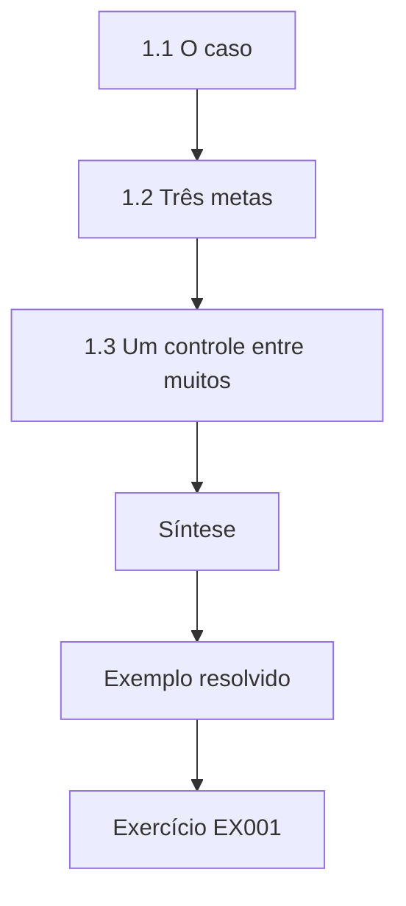

### Desenho lógico

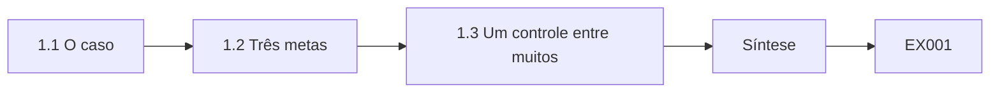

```text
[1.1 O caso]
    |
    v
[1.2 Três metas]
    |
    v
[1.3 Um controle entre muitos]
    |
    v
[Síntese]
    |
    v
[Exemplo resolvido] --> [Exercício EX001]
```
<!-- cykin:lesson-figures:end ch-01 -->


### Objetivos de aprendizagem

Você vai (1) descrever as metas de confidencialidade, integridade e autenticidade a que a criptografia serve; (2) situar a criptografia entre os demais controles; (3) conhecer o caso do provedor de serviços gerenciados usado ao longo do livro.

### 1.1 O caso

Dana Whitlock acabou de entrar no fictício provedor de serviços gerenciados Copperleaf Managed Services como analista de segurança júnior, num programa profissional de seis meses. Seu mentor é Marcus Oyelaran, analista líder. O principal cliente da Copperleaf neste livro é o fictício Bayside Dental Group, que mantém quatro clínicas com um site de agendamento para pacientes, um banco de dados de gestão clínica, notebooks da equipe, um serviço de e-mail e pagamentos com cartão por meio de um processador externo. Todas as pessoas, empresas, sistemas e números aqui são sintéticos. O trabalho de Dana é executar verificações repetíveis, registrar evidências e explicar os achados com clareza ao gerente da clínica, e não projetar nova criptografia.

### 1.2 Três metas

Marcus explica a criptografia por meio de três metas. A confidencialidade mantém os prontuários e os dados de agendamento legíveis apenas por pessoas autorizadas. A integridade torna detectáveis as alterações não autorizadas, por exemplo numa fatura ou num laudo de raio X. A autenticidade confirma quem enviou ou assinou algo, como uma notificação de pagamento do processador. A disponibilidade também importa, mas a criptografia pode prejudicá-la, por exemplo quando um certificado expira ou quando se perde uma chave de cifração de disco. Dana aprende a perguntar a que meta um controle serve antes de julgá-lo, porque a cifração sozinha não prova quem enviou uma mensagem e uma assinatura sozinha não esconde seu conteúdo.

### 1.3 Um controle entre muitos

A criptografia protege os dados em trânsito e em repouso, mas não resolve uma senha roubada, um servidor sem correções ou uma recepcionista enganada para enviar arquivos. Na Bayside, o site de agendamento usa TLS, os notebooks usam cifração de disco completo e os backups são cifrados, mas o maior incidente recente foi um e-mail de phishing. Dana aprende a situar os achados criptográficos no contexto: um certificado expirado pode ser urgente porque os pacientes veem avisos, enquanto uma configuração de cifra forte acrescenta pouco se toda a equipe compartilha uma única senha de administrador. Bons profissionais relatam as questões criptográficas com seu peso real, sem inflá-las nem descartá-las.

### Exemplo resolvido

Dana relaciona os cinco principais serviços da Bayside às três metas e anota quais controles existentes são criptográficos e quais não são.

> **Caso sintético.** A Copperleaf, o Bayside Dental Group, Dana e Marcus são inventados.

### Erros e limites

As três metas simplificam; alguns mecanismos servem a várias ao mesmo tempo. O contexto muda a prioridade, então uma lista de verificação sozinha não consegue ordenar os achados.

### Exercícios

- **EX001 — Atribuições da analista.** O que envolve o papel de Dana na Copperleaf? *Rubrica:* 3 = executar verificações repetíveis, registrar evidências e explicar achados, sem projetar criptografia;; 2 = parcial;; 1 = projeta cifras;; 0 = nenhuma.

- **EX002 — Assinatura e sigilo.** Uma assinatura digital numa fatura a mantém confidencial? *Rubrica:* 3 = não; dá integridade e autenticidade, não confidencialidade;; 2 = diz que não;; 1 = diz que sim;; 0 = nenhuma.

- **EX003 — Dano à disponibilidade.** Dê uma forma pela qual a criptografia pode reduzir a disponibilidade. *Rubrica:* 3 = certificado expirado ou chave de cifração perdida;; 2 = um exemplo;; 1 = vago;; 0 = nenhuma.

- **EX004 — Maior incidente.** Qual foi o maior incidente recente da Bayside, e o que ele ensina? *Rubrica:* 3 = phishing; a criptografia é um controle entre muitos;; 2 = cita o phishing;; 1 = cita uma cifra;; 0 = nenhuma.

- **EX005 — Pesando os achados.** Por que um certificado expirado pode ter prioridade sobre uma configuração de cifra? *Rubrica:* 3 = os pacientes veem avisos e o serviço falha; o impacto importa mais que a força teórica;; 2 = impacto;; 1 = sempre iguais;; 0 = nenhuma.

### Síntese

Os profissionais julgam cada controle criptográfico pela meta a que ele serve e pelo seu peso real entre todos os controles de um cliente.

<!-- cykin:chapter-navigation:start ch-01 -->
### Continue estudando — aula 01 (capítulo 01 de 12)

[← Início do curso](../../README.md) · [Índice das aulas](../SUBJECTS.md) · [Capítulo 02 →](#ch-02)

Continue para a próxima aula já escrita.
<!-- cykin:chapter-navigation:end -->

<a id="ch-02"></a>

## Capítulo 2 — Criptografia e serviços de confiança: contexto de serviços e partes interessadas

<!-- cykin:lesson-figures:start ch-02 -->
### Mapa da aula

Aula 02 publicada. Mapa, exemplo, EX006.

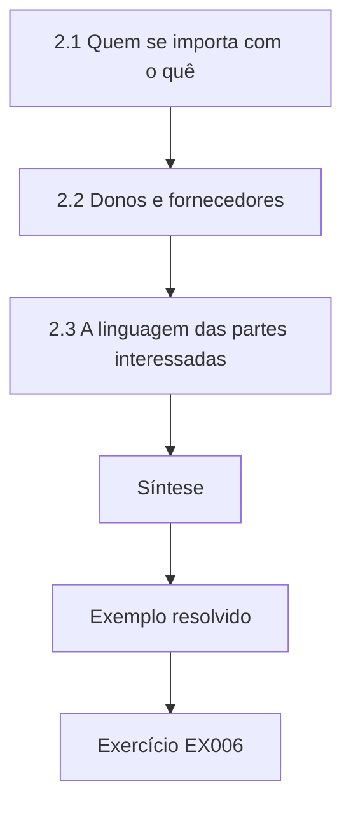

### Desenho lógico

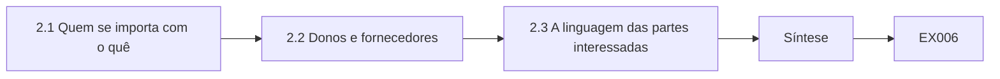

```text
[2.1 Quem se importa com o quê]
    |
    v
[2.2 Donos e fornecedores]
    |
    v
[2.3 A linguagem das partes interessadas]
    |
    v
[Síntese]
    |
    v
[Exemplo resolvido] --> [Exercício EX006]
```
<!-- cykin:lesson-figures:end ch-02 -->


### Objetivos de aprendizagem

Você vai (1) identificar as partes interessadas afetadas pelos serviços criptográficos de um cliente; (2) registrar os donos e os fornecedores dos serviços; (3) explicar os achados na linguagem das partes interessadas.

### 2.1 Quem se importa com o quê

Marcus pede a Dana que liste as pessoas afetadas pela criptografia da Bayside. Os pacientes se importam com que o site de agendamento seja privado e não mostre avisos. O gerente da clínica se importa com custos, indisponibilidade e deveres regulatórios relativos a dados de saúde. A equipe da recepção se importa com que os notebooks liguem e o e-mail funcione. O processador de pagamentos se importa com que a Bayside verifique suas notificações e proteja os dados de cartão. O desenvolvedor do site, uma pequena agência externa, se importa com as renovações de certificados que configurou anos atrás. Cada parte interessada ouve o mesmo achado de forma diferente, então Dana aprende a escrevê-lo em termos do que cada uma precisa saber ou fazer.

### 2.2 Donos e fornecedores

Para cada serviço, Dana registra o dono de negócio, o dono técnico e o fornecedor. O site de agendamento pertence ao gerente da clínica, é operado tecnicamente pela agência e hospedado por um provedor de nuvem. O serviço de e-mail é uma plataforma gerenciada em que o fornecedor controla as chaves. O banco de dados de gestão clínica roda num servidor da clínica principal, mantido pela Copperleaf. Essa tabela responde a duas perguntas práticas: quem precisa aprovar uma mudança, e quem de fato pode fazê-la. Sem ela, Dana certa vez passou um dia tentando corrigir um certificado que só a agência podia renovar.

### 2.3 A linguagem das partes interessadas

O primeiro rascunho de achado de Dana dizia que o site de agendamento servia uma cadeia de certificados incompleta. O gerente da clínica não entendeu. Marcus a ajuda a reescrevê-lo: alguns pacientes com celulares mais antigos veem um aviso de segurança ao agendar, porque falta no site um arquivo que prova que o certificado é genuíno; a agência pode corrigir isso em menos de uma hora, sem custo extra. O detalhe técnico fica num apêndice para a agência. Traduzir os achados dessa forma não é simplificar a verdade; é escolher que parte da verdade cada leitor precisa para agir.

### Exemplo resolvido

Dana monta uma tabela de partes interessadas para a Bayside e reescreve duas vezes o achado da cadeia, uma para o gerente da clínica e outra para a agência.

> **Caso sintético.** As partes interessadas, os fornecedores e o achado da cadeia são sintéticos.

### Erros e limites

As tabelas de donos ficam desatualizadas quando os fornecedores mudam. A linguagem simples não pode omitir fatos que mudam a decisão.

### Exercícios

- **EX006 — Preocupação dos pacientes.** Com o que os pacientes mais se importam na criptografia do site de agendamento? *Rubrica:* 3 = privacidade e nenhum aviso do navegador;; 2 = um;; 1 = custo;; 0 = nenhuma.

- **EX007 — Duas perguntas práticas.** A que duas perguntas a tabela de donos responde? *Rubrica:* 3 = quem precisa aprovar uma mudança e quem pode fazê-la;; 2 = uma;; 1 = vago;; 0 = nenhuma.

- **EX008 — Dia desperdiçado.** Por que Dana certa vez desperdiçou um dia com um certificado? *Rubrica:* 3 = só a agência podia renová-lo e ela não tinha registrado o fornecedor;; 2 = fornecedor;; 1 = azar;; 0 = nenhuma.

- **EX009 — Redação para o gerente.** Reescreva cadeia de certificados incompleta para o gerente da clínica. *Rubrica:* 3 = alguns pacientes veem avisos porque falta um arquivo de prova; a agência pode corrigir rapidamente;; 2 = efeito do aviso;; 1 = só técnico;; 0 = nenhuma.

- **EX010 — Para onde vão os detalhes.** Para onde vai o detalhe técnico do achado? *Rubrica:* 3 = um apêndice para a agência ou o leitor técnico;; 2 = apêndice;; 1 = apagado;; 0 = nenhuma.

### Síntese

Os achados criptográficos só importam quando o dono certo os entende, então os profissionais mapeiam as partes interessadas e escrevem para cada uma.

<!-- cykin:chapter-navigation:start ch-02 -->
### Continue estudando — aula 02 (capítulo 02 de 12)

[← Capítulo 01](#ch-01) · [Índice das aulas](../SUBJECTS.md) · [Capítulo 03 →](#ch-03)

Continue para a próxima aula já escrita.
<!-- cykin:chapter-navigation:end -->

<a id="ch-03"></a>

## Capítulo 3 — Prática autorizada e manuseio de evidências

<!-- cykin:lesson-figures:start ch-03 -->
### Mapa da aula

Aula 03 publicada. Mapa, exemplo, EX011.

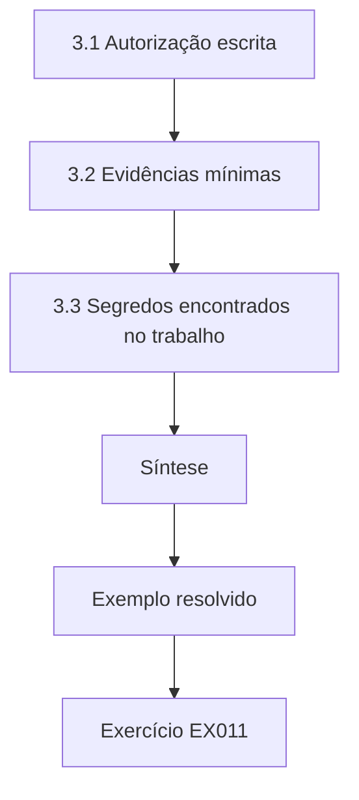

### Desenho lógico

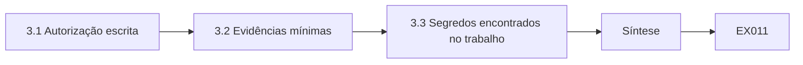

```text
[3.1 Autorização escrita]
    |
    v
[3.2 Evidências mínimas]
    |
    v
[3.3 Segredos encontrados no trabalho]
    |
    v
[Síntese]
    |
    v
[Exemplo resolvido] --> [Exercício EX011]
```
<!-- cykin:lesson-figures:end ch-03 -->


### Objetivos de aprendizagem

Você vai (1) trabalhar sob uma autorização escrita; (2) manusear evidências e dados do cliente de forma mínima; (3) proteger segredos descobertos durante um trabalho.

### 3.1 Autorização escrita

A Copperleaf nunca testa um sistema de cliente sem uma autorização assinada. Para a Bayside, ela lista os sistemas no escopo, como o site de agendamento, o servidor da clínica e os notebooks da equipe; as verificações permitidas, como leituras de certificados, varreduras de configuração TLS e revisões de permissões de arquivos; as datas; e um contato de emergência. O processador de pagamentos e o provedor de nuvem estão excluídos, porque a Bayside não pode autorizar testes nos sistemas de outra empresa. Dana guarda uma cópia da autorização com suas anotações e para imediatamente se uma verificação for tocar em algo não listado, mesmo quando o alvo extra estiver a apenas um nome de host de distância.

### 3.2 Evidências mínimas

Os dados de saúde aumentam o que está em jogo. Quando Dana verifica a cifração dos backups, ela registra as configurações da rotina de backup e uma restauração de teste de um arquivo sintético, nunca um prontuário de paciente. As evidências incluem o comando ou a tela usada, o horário com fuso, o sistema e o resultado, armazenados na pasta de evidências da Copperleaf com acesso restrito à equipe do trabalho. Ela guarda apenas o que sustenta um achado. Marcus explica que as próprias evidências são sensíveis: uma pasta de exportações de configuração de uma clínica é um alvo, então ela é cifrada em repouso e apagada no prazo acordado em contrato.

### 3.3 Segredos encontrados no trabalho

No servidor da clínica, Dana encontra um arquivo de texto com a senha do administrador do banco de dados e as credenciais de FTP da agência. Ela não os explora, não os copia e não testa se funcionam. Registra o caminho do arquivo, o tipo de segredo e o horário, informa Marcus e o dono técnico do cliente no mesmo dia e recomenda a rotação. Testar uma credencial encontrada, mesmo para provar o risco, iria além da sua autorização e poderia quebrar sistemas. Seu relatório depois mostra o achado com os segredos ocultados, o que basta para justificar a correção.

### Exemplo resolvido

Dana passa um dia de verificações na Bayside sob a autorização assinada, mantém as evidências mínimas e relata um arquivo de senhas apenas pelo caminho.

> **Caso sintético.** A autorização, o servidor e o arquivo de senhas são sintéticos.

### Erros e limites

A autorização não elimina a necessidade de cuidado em produção. As regras de retenção variam conforme o contrato e a jurisdição.

### Exercícios

- **EX011 — Sistemas excluídos.** Por que o processador e o provedor de nuvem estão fora do escopo? *Rubrica:* 3 = a Bayside não pode autorizar testes nos sistemas de outra empresa;; 2 = propriedade;; 1 = razões técnicas;; 0 = nenhuma.

- **EX012 — Evidência da verificação de backup.** Como Dana evidencia a cifração dos backups sem dados de pacientes? *Rubrica:* 3 = registra as configurações da rotina e restaura um arquivo de teste sintético;; 2 = arquivo sintético;; 1 = usa um prontuário;; 0 = nenhuma.

- **EX013 — Evidência como alvo.** Por que a própria pasta de evidências é protegida? *Rubrica:* 3 = contém configurações sensíveis do cliente; é cifrada e apagada no prazo;; 2 = sensível;; 1 = não é sensível;; 0 = nenhuma.

- **EX014 — Credenciais encontradas.** Dana deve testar as credenciais de FTP encontradas para provar que funcionam? *Rubrica:* 3 = não; isso excede a autorização e pode quebrar sistemas; relatar e recomendar rotação;; 2 = não;; 1 = sim;; 0 = nenhuma.

- **EX015 — Ocultação.** Como o relatório mostra o achado do arquivo de senhas? *Rubrica:* 3 = com os segredos ocultados, apenas caminho e tipo;; 2 = ocultados;; 1 = segredos completos;; 0 = nenhuma.

### Síntese

O manuseio de evidências autorizado, mínimo e cuidadoso mantém um trabalho dentro da lei e impede que ele crie nova exposição.

<!-- cykin:chapter-navigation:start ch-03 -->
### Continue estudando — aula 03 (capítulo 03 de 12)

[← Capítulo 02](#ch-02) · [Índice das aulas](../SUBJECTS.md) · [Capítulo 04 →](#ch-04)

Continue para a próxima aula já escrita.
<!-- cykin:chapter-navigation:end -->

<a id="ch-04"></a>

## Capítulo 4 — Criptografia e serviços de confiança: métodos centrais

<!-- cykin:lesson-figures:start ch-04 -->
### Mapa da aula

Aula 04 publicada. Mapa, exemplo, EX016.

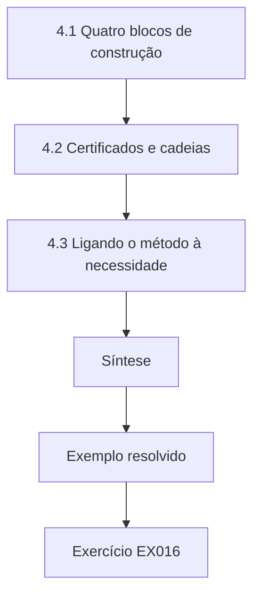

### Desenho lógico

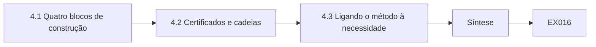

```text
[4.1 Quatro blocos de construção]
    |
    v
[4.2 Certificados e cadeias]
    |
    v
[4.3 Ligando o método à necessidade]
    |
    v
[Síntese]
    |
    v
[Exemplo resolvido] --> [Exercício EX016]
```
<!-- cykin:lesson-figures:end ch-04 -->


### Objetivos de aprendizagem

Você vai (1) explicar cifração simétrica, hashing, MACs e assinaturas em termos práticos; (2) explicar certificados e cadeias; (3) escolher o método certo para uma necessidade do cliente.

### 4.1 Quatro blocos de construção

Marcus resume os blocos de construção. A cifração simétrica, como o AES no modo GCM da NIST SP 800-38D, usa uma chave para cifrar e decifrar e também detecta adulterações. Um hash, como o SHA-256 da FIPS 180-4, dá uma impressão digital de tamanho fixo dos dados que qualquer pessoa pode calcular. Um código de autenticação de mensagem, como o HMAC, exige uma chave compartilhada e prova que uma mensagem veio de alguém que a possui. Uma assinatura digital, como o Ed25519 da RFC 8032 ou o ECDSA da FIPS 186-5, usa uma chave privada para assinar e uma chave pública para verificar, então qualquer pessoa pode conferi-la sem ser capaz de assinar.

### 4.2 Certificados e cadeias

Um certificado, definido na RFC 5280, vincula um nome como book.bayside.example a uma chave pública e é assinado por uma autoridade certificadora. Os navegadores confiam num pequeno conjunto de autoridades raiz; as raízes assinam intermediárias, e as intermediárias assinam certificados de servidor. O navegador verifica a cadeia do certificado do servidor até uma raiz confiável, confere o nome e as datas de validade e só então prossegue. Dana aprende que a maioria dos problemas de certificados que ela verá não é matemática quebrada, mas questões operacionais: datas expiradas, intermediárias ausentes, nomes errados ou uma chave privada guardada onde gente demais pode lê-la.

### 4.3 Ligando o método à necessidade

Dana pratica com necessidades da Bayside. Proteger o formulário de agendamento em trânsito pede TLS. Detectar se um arquivo de exportação noturna foi corrompido pede um hash, com o valor esperado entregue separadamente. Provar que as notificações de pagamento vieram do processador pede um HMAC com um segredo compartilhado, ou uma assinatura se o processador publica uma chave pública. Permitir que os pacientes verifiquem um PDF de plano de tratamento assinado pede uma assinatura. Proteger um backup em repouso pede cifração autenticada, com a chave guardada separada do backup. Acertar essa correspondência é a habilidade central do profissional.

### Exemplo resolvido

Dana preenche uma tabela com seis necessidades da Bayside, escolhendo TLS, hash, HMAC, assinatura ou cifração autenticada para cada uma e indicando quem guarda a chave.

> **Caso sintético.** As necessidades e os nomes de host são sintéticos; as normas citadas são reais.

### Erros e limites

Sistemas reais combinam métodos; o próprio TLS usa os quatro blocos. Um hash sem um valor de referência confiável não prova nada sobre adulteração.

### Exercícios

- **EX016 — MAC versus assinatura.** Por que quem verifica um MAC pode forjar tags e quem verifica uma assinatura não pode? *Rubrica:* 3 = quem verifica assinaturas não pode forjar, porque tem apenas a chave pública; quem verifica MACs tem a mesma chave e poderia criar tags;; 2 = assimetria de chaves;; 1 = nenhuma diferença;; 0 = nenhuma.

- **EX017 — Ordem da cadeia.** Descreva a cadeia que um navegador verifica para o site de agendamento. *Rubrica:* 3 = certificado do servidor assinado pela intermediária, assinada por uma raiz confiável, mais nome e datas;; 2 = cadeia parcial;; 1 = nenhuma cadeia;; 0 = nenhuma.

- **EX018 — Problemas típicos.** Que tipo de problema de certificado Dana vai encontrar com mais frequência? *Rubrica:* 3 = operacionais: expiração, intermediárias ausentes, nomes errados, chaves expostas;; 2 = dois;; 1 = matemática quebrada;; 0 = nenhuma.

- **EX019 — Método para backup.** Que método protege um backup em repouso, e onde deve ficar a chave? *Rubrica:* 3 = cifração autenticada com a chave guardada separada do backup;; 2 = método;; 1 = hash;; 0 = nenhuma.

- **EX020 — Plano de tratamento assinado.** Que método permite aos pacientes verificar que um PDF de plano de tratamento veio da Bayside? *Rubrica:* 3 = assinatura digital verificada com uma chave pública;; 2 = assinatura;; 1 = cifração;; 0 = nenhuma.

### Síntese

Escolher entre cifração, hashes, MACs, assinaturas e certificados conforme a necessidade é a habilidade criptográfica central do profissional.

<!-- cykin:chapter-navigation:start ch-04 -->
### Continue estudando — aula 04 (capítulo 04 de 12)

[← Capítulo 03](#ch-03) · [Índice das aulas](../SUBJECTS.md) · [Capítulo 05 →](#ch-05)

Continue para a próxima aula já escrita.
<!-- cykin:chapter-navigation:end -->

<a id="ch-05"></a>

## Capítulo 5 — Criptografia e serviços de confiança: ferramentas e interpretação

<!-- cykin:lesson-figures:start ch-05 -->
### Mapa da aula

Aula 05 publicada. Mapa, exemplo, EX021.

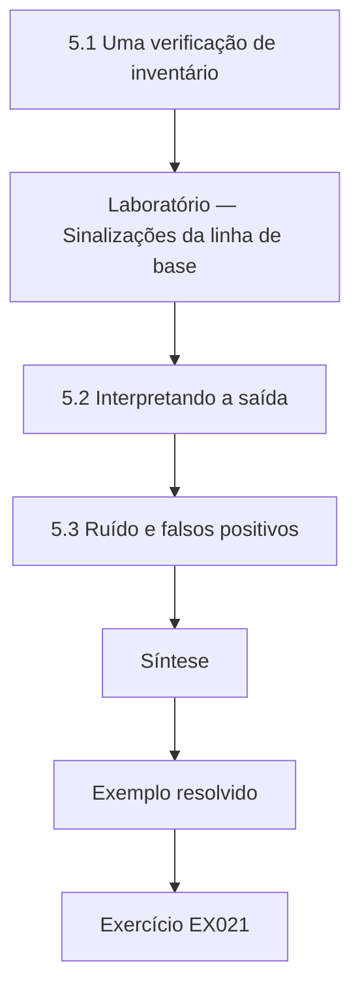

### Desenho lógico

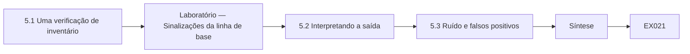

```text
[5.1 Uma verificação de inventário]
    |
    v
[Laboratório — Sinalizações da linha de base]
    |
    v
[5.2 Interpretando a saída]
    |
    v
[5.3 Ruído e falsos positivos]
    |
    v
[Síntese]
    |
    v
[Exemplo resolvido] --> [Exercício EX021]
```
<!-- cykin:lesson-figures:end ch-05 -->


### Objetivos de aprendizagem

Você vai (1) executar uma verificação de inventário sobre certificados e algoritmos; (2) interpretar a saída das ferramentas sem afirmar além do que ela mostra; (3) distinguir achados de ruído das ferramentas.

### 5.1 Uma verificação de inventário

A Copperleaf mantém um inventário simples por cliente: cada endpoint, a expiração do seu certificado, o tipo e o tamanho da sua chave, seu algoritmo de assinatura e as versões de TLS que aceita. Dana escreve um script curto que lê o inventário sintético da Bayside e sinaliza as linhas que violam a linha de base da Copperleaf: certificados que expiram em até trinta dias, chaves RSA menores que 2048 bits, assinaturas SHA-1 e aceitação de TLS 1.0 ou 1.1. A linha de base segue orientações do NIST como a SP 800-131A Rev. 2 e a SP 800-52 Rev. 2. O laboratório abaixo mostra as sinalizações de cinco endpoints sintéticos e a contagem dos limpos.

### Laboratório — Sinalizações da linha de base

```python
# Flag synthetic endpoints against a simple baseline (NIST SP 800-131A/800-52 inspired).
import datetime
REVIEW = datetime.date(2026, 3, 1)
eps = [("book.bayside.example", "2026-03-18", "RSA", 2048, "sha256", ["1.2", "1.3"]),
       ("clinic-srv.bayside.lan", "2027-01-10", "RSA", 1024, "sha256", ["1.2"]),
       ("printer.bayside.lan", "2028-05-02", "RSA", 2048, "sha1", ["1.0", "1.2"]),
       ("mail-gw.bayside.example", "2026-09-30", "ECDSA", 256, "sha256", ["1.1", "1.2", "1.3"]),
       ("api.bayside.example", "2026-11-20", "ECDSA", 256, "sha256", ["1.3"])]
clean = 0
for host, exp, kt, bits, sig, vers in eps:
    f = []
    d = (datetime.date.fromisoformat(exp) - REVIEW).days
    if d <= 30: f.append(f"expires in {d} d")
    if kt == "RSA" and bits < 2048: f.append(f"RSA-{bits}")
    if sig == "sha1": f.append("SHA-1 signature")
    old = [v for v in vers if v in ("1.0", "1.1")]
    if old: f.append("TLS " + "/".join(old))
    if f: print(f"{host:26} " + "; ".join(f))
    else: clean += 1
print("clean endpoints:", clean)
```

Execute com `python3 lab_inventory.py`. Saída verificada:

```text
book.bayside.example       expires in 17 d
clinic-srv.bayside.lan     RSA-1024
printer.bayside.lan        SHA-1 signature; TLS 1.0
mail-gw.bayside.example    TLS 1.1
clean endpoints: 1
```

### 5.2 Interpretando a saída

Uma sinalização é uma pergunta, não um veredito. O script sinaliza a impressora antiga da clínica por TLS 1.0, mas a impressora fica numa rede isolada e só o servidor fala com ela. A sinalização continua verdadeira, mas o risco é menor que o de um site público. Dana registra a sinalização, acrescenta o contexto e deixa a classificação de risco refletir as duas coisas. Ela também anota de onde vieram os dados e quando, porque um inventário exportado no mês passado pode não conter um certificado renovado ontem. Interpretar a saída significa declarar o que a ferramenta mediu, o que ela não conseguiu ver e o que isso implica para o cliente.

### 5.3 Ruído e falsos positivos

Os scanners muitas vezes relatam itens tecnicamente corretos, mas irrelevantes, como um certificado autoassinado numa página interna de gerenciamento acessível apenas a partir de um notebook de administrador, ou interpretam mal uma configuração. Dana confere manualmente cada sinalização numa amostra antes de relatar: ela se conecta com openssl s_client ou lê o certificado com openssl x509 e confirma o valor. As questões confirmadas viram achados; as leituras erradas são registradas como ruído da ferramenta, com uma breve explicação. Essa prática mantém os relatórios críveis, porque um achado obviamente errado faz o cliente duvidar de todas as outras linhas do relatório.

### Exemplo resolvido

Dana executa o laboratório de inventário, confirma manualmente o certificado de agendamento prestes a expirar, rebaixa com contexto a sinalização de TLS 1.0 da impressora isolada e registra uma leitura errada do scanner como ruído.

> **Caso sintético.** Os endpoints, os tamanhos e as datas são sintéticos; a NIST SP 800-131A Rev. 2 e a SP 800-52 Rev. 2 são reais.

### Erros e limites

As linhas de base ficam atrás das novas orientações; revise-as anualmente. A amostragem manual pode deixar passar leituras erradas raras.

### Exercícios

- **EX021 — Regras da linha de base.** Liste as quatro regras da linha de base no script de Dana. *Rubrica:* 3 = expiração em até 30 dias, RSA abaixo de 2048, assinatura SHA-1, TLS 1.0 ou 1.1 aceito;; 2 = três;; 1 = uma;; 0 = nenhuma.

- **EX022 — Contagem de sinalizações do laboratório.** Quantos endpoints o laboratório sinalizou e quantos estavam limpos? *Rubrica:* 3 = quatro sinalizados, um limpo;; 2 = contagem de um dos lados;; 1 = errado;; 0 = nenhuma.

- **EX023 — Contexto da impressora.** Por que a sinalização de TLS 1.0 da impressora recebe classificação menor? *Rubrica:* 3 = ela está isolada e só o servidor a alcança;; 2 = isolamento;; 1 = sinalização falsa;; 0 = nenhuma.

- **EX024 — Confirmação manual.** Como Dana confirma uma sinalização antes de relatá-la? *Rubrica:* 3 = conecta com openssl s_client ou lê o certificado com openssl x509;; 2 = ferramenta citada;; 1 = confia no scanner;; 0 = nenhuma.

- **EX025 — Credibilidade.** O que um achado obviamente errado faz com um relatório? *Rubrica:* 3 = faz o cliente duvidar de todos os outros achados;; 2 = dúvida;; 1 = vago;; 0 = nenhuma.

### Síntese

As ferramentas produzem sinalizações; os profissionais as transformam em achados confirmando-as, acrescentando contexto e declarando os limites.

<!-- cykin:chapter-navigation:start ch-05 -->
### Continue estudando — aula 05 (capítulo 05 de 12)

[← Capítulo 04](#ch-04) · [Índice das aulas](../SUBJECTS.md) · [Capítulo 06 →](#ch-06)

Continue para a próxima aula já escrita.
<!-- cykin:chapter-navigation:end -->

<a id="ch-06"></a>

## Capítulo 6 — Criptografia e serviços de confiança: fluxo operacional

<!-- cykin:lesson-figures:start ch-06 -->
### Mapa da aula

Aula 06 publicada. Mapa, exemplo, EX026.

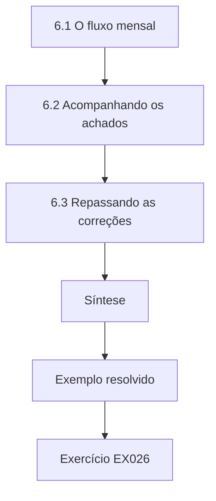

### Desenho lógico

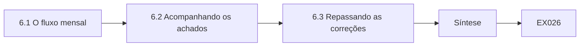

```text
[6.1 O fluxo mensal]
    |
    v
[6.2 Acompanhando os achados]
    |
    v
[6.3 Repassando as correções]
    |
    v
[Síntese]
    |
    v
[Exemplo resolvido] --> [Exercício EX026]
```
<!-- cykin:lesson-figures:end ch-06 -->


### Objetivos de aprendizagem

Você vai (1) executar o fluxo mensal de verificação criptográfica da Copperleaf; (2) acompanhar os achados da descoberta ao encerramento; (3) repassar as correções ao dono certo.

### 6.1 O fluxo mensal

A Copperleaf executa uma verificação criptográfica mensal para cada cliente. A etapa um exporta o inventário e executa o script da linha de base. A etapa dois confirma as sinalizações à mão. A etapa três consulta os logs de transparência de certificados, definidos na RFC 6962, em busca de qualquer certificado emitido para os domínios do cliente que o inventário não liste. A etapa quatro classifica e registra os achados no rastreador. A etapa cinco envia o resumo ao cliente. Dana segue uma lista de verificação para cada etapa e a assina com a data. Uma lista de verificação parece monótona, mas é o que torna o fluxo repetível quando Dana está doente e um colega o executa no lugar dela.

### 6.2 Acompanhando os achados

Cada achado recebe um identificador, uma descrição, o link para a evidência, uma classificação de risco, um dono, um prazo e um status: aberto, em andamento, corrigido aguardando verificação ou encerrado. Um achado só é encerrado depois que Dana verifica a correção, e não quando o dono diz que terminou. No mês passado, a agência relatou que a cadeia do agendamento estava corrigida, mas o novo teste de Dana ainda mostrou a intermediária ausente num dos dois servidores com balanceamento de carga. O acompanhamento com verificação pega essas meias correções, e o histórico mostra ao cliente quanto tempo as questões ficam abertas, o que é útil ao discutir níveis de serviço.

### 6.3 Repassando as correções

Dana raramente corrige as coisas ela mesma. As renovações de certificados do site de agendamento vão para a agência, as questões de cifração dos notebooks vão para a equipe de desktops da Copperleaf, e as configurações da integração de pagamentos vão para o gerente da clínica, que contata o processador. Cada repasse inclui o achado, a evidência, uma sugestão de correção com uma referência, como a RFC ou a página do NIST pertinente, e o prazo. Marcus a ensina a propor em vez de ordenar: um fornecedor que entende por que uma mudança importa costuma agir mais rápido do que um que recebe uma exigência sem explicação.

### Exemplo resolvido

Dana conclui uma execução mensal para a Bayside, encontra uma cadeia corrigida pela metade num dos servidores com balanceamento de carga, mantém o achado aberto e o devolve à agência com evidências.

> **Caso sintético.** As entradas do rastreador e a troca com a agência são sintéticas; a RFC 6962 é real.

### Erros e limites

Ciclos mensais deixam passar problemas de curta duração entre as execuções. Os logs de transparência cobrem apenas ACs públicas.

### Exercícios

- **EX026 — Propósito da etapa três.** Por que consultar os logs de transparência no fluxo mensal? *Rubrica:* 3 = para encontrar certificados emitidos para domínios do cliente que não estão no inventário;; 2 = certificados não listados;; 1 = vago;; 0 = nenhuma.

- **EX027 — Regra de encerramento.** Quando um achado pode passar a encerrado? *Rubrica:* 3 = só depois que Dana verifica a correção ela mesma;; 2 = verificação;; 1 = quando o dono diz;; 0 = nenhuma.

- **EX028 — Meia correção.** Que meia correção o novo teste de Dana pegou? *Rubrica:* 3 = intermediária ainda ausente num dos dois servidores com balanceamento de carga;; 2 = um servidor;; 1 = vago;; 0 = nenhuma.

- **EX029 — Repasse dos notebooks.** Quem recebe um achado de cifração de disco dos notebooks? *Rubrica:* 3 = a equipe de desktops da Copperleaf;; 2 = equipe de desktops;; 1 = agência;; 0 = nenhuma.

- **EX030 — Propor, não ordenar.** Por que Marcus aconselha propor correções em vez de ordená-las? *Rubrica:* 3 = fornecedores que entendem o motivo agem mais rápido;; 2 = entendimento;; 1 = nenhum motivo;; 0 = nenhuma.

### Síntese

Um fluxo repetível, com encerramento verificado e repasses claros, transforma as verificações mensais em melhorias duradouras.

<!-- cykin:chapter-navigation:start ch-06 -->
### Continue estudando — aula 06 (capítulo 06 de 12)

[← Capítulo 05](#ch-05) · [Índice das aulas](../SUBJECTS.md) · [Capítulo 07 →](#ch-07)

Continue para a próxima aula já escrita.
<!-- cykin:chapter-navigation:end -->

<a id="ch-07"></a>

## Capítulo 7 — Criptografia e serviços de confiança: controles e verificação

<!-- cykin:lesson-figures:start ch-07 -->
### Mapa da aula

Aula 07 publicada. Mapa, exemplo, EX031.

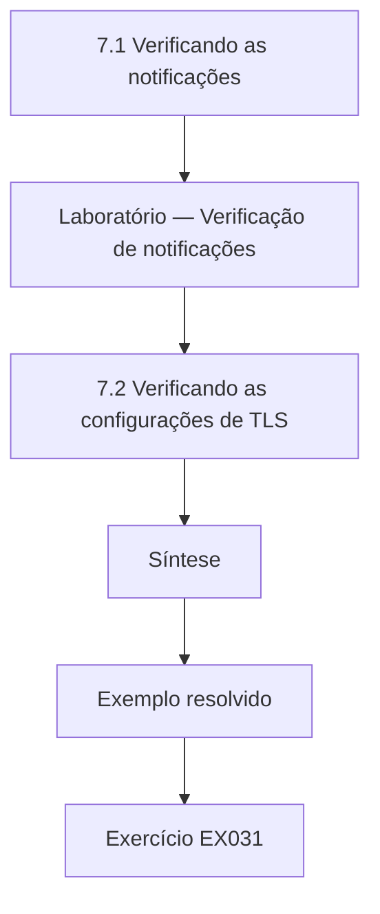

### Desenho lógico

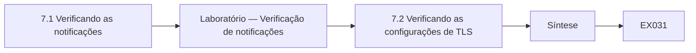

```text
[7.1 Verificando as notificações]
    |
    v
[Laboratório — Verificação de notificações]
    |
    v
[7.2 Verificando as configurações de TLS]
    |
    v
[Síntese]
    |
    v
[Exemplo resolvido] --> [Exercício EX031]
```
<!-- cykin:lesson-figures:end ch-07 -->


### Objetivos de aprendizagem

Você vai (1) verificar os controles das notificações de pagamento com HMAC e verificações de replay; (2) verificar as configurações de TLS contra uma linha de base; (3) escrever declarações de verificação com seus limites.

### 7.1 Verificando as notificações

O site de agendamento da Bayside recebe notificações de pagamento do processador. Cada uma traz uma tag HMAC-SHA-256 calculada com um segredo compartilhado sobre um carimbo de tempo e o corpo da mensagem. O código da agência deve recalcular a tag, compará-la com hmac.compare_digest e rejeitar qualquer mensagem com mais de cinco minutos. Dana não tem permissão para testar o processador em produção, então verifica a lógica num laboratório com mensagens sintéticas: uma autêntica, uma com o valor alterado e uma repetida depois de uma hora. O laboratório abaixo mostra o verificador aceitando apenas a mensagem autêntica, o que corresponde ao comportamento descrito pela agência.

### Laboratório — Verificação de notificações

```python
# Verify synthetic payment notifications: HMAC-SHA-256 + 300 s replay window.
import hmac, hashlib
SECRET = b"synthetic-processor-secret"; NOW = 1_772_000_000; WINDOW = 300
def tag(ts, body): return hmac.new(SECRET, str(ts).encode() + b"." + body, hashlib.sha256).hexdigest()
def accept(ts, body, t): return NOW - ts <= WINDOW and hmac.compare_digest(tag(ts, body), t)
body = b'{"booking":"BDG-2207","amount":"85.00"}'
t = tag(NOW - 30, body)
print("authentic:", accept(NOW - 30, body, t))
print("changed amount:", accept(NOW - 30, body.replace(b"85.00", b"8.50"), t))
print("replayed after 1 h:", accept(NOW - 3600, body, tag(NOW - 3600, body)))
```

Execute com `python3 lab_notify.py`. Saída verificada:

```text
authentic: True
changed amount: False
replayed after 1 h: False
```

### 7.2 Verificando as configurações de TLS

Para o TLS, Dana confere cada endpoint do escopo contra a linha de base: TLS 1.3 oferecido, TLS 1.2 permitido apenas se necessário, versões mais antigas recusadas, cadeia completa servida e nome do certificado correto. Ela usa openssl s_client com opções explícitas de versão, por exemplo tentando -tls1_1 e esperando uma recusa. Cada teste registra o comando, o resultado e o horário. Onde um cliente não pode ser testado diretamente, como uma antiga estação de trabalho de imagens odontológicas, ela registra a lacuna com honestidade em vez de presumir que ela se comporta como as demais. Uma verificação é tão forte quanto os casos de fato testados.

### 7.3 Declarações com limites

Dana escreve as declarações de verificação numa forma fixa: o que foi verificado, como, quando, o resultado e o que não foi verificado. Por exemplo: a lógica de verificação das notificações aceitou mensagens sintéticas autênticas e rejeitou as alteradas e as repetidas num laboratório em 3 de março; o caminho do código de produção e o armazenamento do segredo não foram revisados. Essa forma protege tanto a Copperleaf quanto o cliente. Os clientes tomam decisões com base nessas declarações, então uma declaração que esconde seus limites pode levá-los a dispensar uma revisão necessária. Marcus confere cada declaração em busca de palavras como seguro ou conforme, que afirmam mais do que o teste mostrou.

### Exemplo resolvido

Dana executa o laboratório de notificações, testa as versões de TLS em três endpoints e escreve quatro declarações de verificação, cada uma terminando com o que não foi verificado.

> **Caso sintético.** As mensagens, os segredos e os endpoints são sintéticos.

### Erros e limites

Verificações da lógica em laboratório não provam que o código de produção corresponde a ela. A recusa de uma versão antiga não prova que todas as opções fracas estão desativadas.

### Exercícios

- **EX031 — Janela de replay.** Que limite de idade o verificador impõe às notificações? *Rubrica:* 3 = cinco minutos (300 segundos);; 2 = cinco minutos;; 1 = vago;; 0 = nenhuma.

- **EX032 — Valor alterado.** O que o laboratório relatou para a notificação com valor alterado? *Rubrica:* 3 = rejeitada (False) porque a tag deixou de corresponder;; 2 = rejeitada;; 1 = aceita;; 0 = nenhuma.

- **EX033 — Sondagem do TLS 1.1.** Como Dana verifica que o TLS 1.1 é recusado? *Rubrica:* 3 = openssl s_client com -tls1_1, esperando falha no handshake;; 2 = comando;; 1 = presume;; 0 = nenhuma.

- **EX034 — Estação de imagens.** O que Dana faz quanto à estação de imagens que não pode ser testada? *Rubrica:* 3 = registra a lacuna com honestidade em vez de presumir;; 2 = registra a lacuna;; 1 = presume que está bem;; 0 = nenhuma.

- **EX035 — Palavras proibidas.** Que palavras Marcus procura nas declarações, e por quê? *Rubrica:* 3 = seguro ou conforme, porque afirmam mais do que os testes mostram;; 2 = palavras citadas;; 1 = vago;; 0 = nenhuma.

### Síntese

A verificação prova um comportamento específico sob testes específicos, e declarações honestas dizem exatamente que casos foram testados.

<!-- cykin:chapter-navigation:start ch-07 -->
### Continue estudando — aula 07 (capítulo 07 de 12)

[← Capítulo 06](#ch-06) · [Índice das aulas](../SUBJECTS.md) · [Capítulo 08 →](#ch-08)

Continue para a próxima aula já escrita.
<!-- cykin:chapter-navigation:end -->

<a id="ch-08"></a>

## Capítulo 8 — Criptografia e serviços de confiança: análise de caso supervisionada

<!-- cykin:lesson-figures:start ch-08 -->
### Mapa da aula

Aula 08 publicada. Mapa, exemplo, EX036.

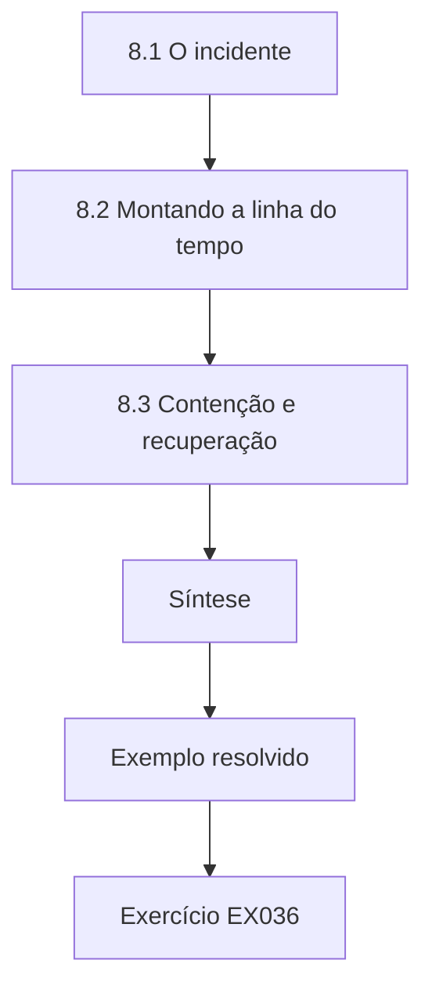

### Desenho lógico

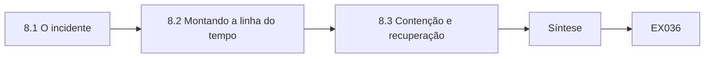

```text
[8.1 O incidente]
    |
    v
[8.2 Montando a linha do tempo]
    |
    v
[8.3 Contenção e recuperação]
    |
    v
[Síntese]
    |
    v
[Exemplo resolvido] --> [Exercício EX036]
```
<!-- cykin:lesson-figures:end ch-08 -->


### Objetivos de aprendizagem

Você vai (1) analisar um incidente sintético envolvendo uma chave exposta; (2) reconstruir uma linha do tempo a partir de evidências; (3) recomendar etapas de contenção e recuperação.

### 8.1 O incidente

Numa segunda-feira, a agência informa à Copperleaf que um desenvolvedor enviou por engano a chave privada TLS do site de agendamento para um repositório público de código na sexta-feira à noite; ela foi removida no domingo. Marcus conduz a resposta e Dana dá apoio. A chave ficou pública por cerca de quarenta horas. Ninguém sabe se alguém a copiou, e repositórios públicos são varridos constantemente por ferramentas automatizadas em busca de segredos. Marcus declara com clareza a premissa de trabalho: a chave deve ser tratada como comprometida, porque não há como provar que não foi levada, e o custo de agir é pequeno comparado com o risco.

### 8.2 Montando a linha do tempo

Dana reúne as evidências: o histórico de commits do repositório com os horários, o registro de remoção da agência, os detalhes do certificado e as entradas dos logs de transparência para os domínios da Bayside. Ela converte todos os horários para um único fuso e escreve uma linha do tempo: chave incluída num commit na sexta-feira às 18:42, repositório público, chave removida no domingo às 10:15, incidente relatado na segunda-feira às 08:30. Ela consulta os logs de transparência e não encontra certificados inesperados para a Bayside, o que tranquiliza, mas não prova nada, porque um atacante com a chave poderia se passar pelo certificado existente sem obter um novo. Cada entrada aponta para a fonte da sua evidência.

### 8.3 Contenção e recuperação

Marcus recomenda três etapas. Primeiro, gerar um novo par de chaves no servidor, obter um novo certificado e implantá-lo. Segundo, pedir à autoridade certificadora que revogue o certificado antigo, para que os clientes que verificam a revogação o rejeitem. Terceiro, rotacionar quaisquer outros segredos do mesmo repositório e acrescentar varredura de segredos ao fluxo de trabalho da agência. Remover o arquivo do repositório não basta, porque podem existir cópias e o histórico ainda pode contê-lo. Dana redige o resumo para o cliente: o que aconteceu, o que foi feito, a incerteza restante e as etapas de prevenção, escrito para o gerente da clínica.

### Exemplo resolvido

Dana monta uma linha do tempo de quatro entradas com links para as evidências, consulta os logs de transparência e redige o resumo para o cliente recomendando reemissão, revogação e varredura de segredos.

> **Caso sintético.** O incidente, os horários e o repositório são sintéticos.

### Erros e limites

A verificação de revogação é inconsistente entre os clientes, então a revogação reduz o risco, mas não o elimina. Os logs podem não mostrar quem clonou um repositório público.

### Exercícios

- **EX036 — Premissa de trabalho.** Que premissa Marcus adotou sobre a chave, e por quê? *Rubrica:* 3 = comprometida, porque a exposição não pode ser descartada e agir é barato;; 2 = comprometida;; 1 = segura;; 0 = nenhuma.

- **EX037 — Duração da exposição.** Por aproximadamente quanto tempo a chave ficou pública? *Rubrica:* 3 = cerca de quarenta horas, de sexta-feira 18:42 a domingo 10:15;; 2 = aproximado;; 1 = errado;; 0 = nenhuma.

- **EX038 — Limite da tranquilidade do CT.** Por que uma consulta limpa aos logs de transparência não prova segurança? *Rubrica:* 3 = o atacante poderia se passar pelo site com o certificado e a chave existentes;; 2 = personificação;; 1 = é prova;; 0 = nenhuma.

- **EX039 — Remoção não basta.** Por que apagar o arquivo do repositório é insuficiente? *Rubrica:* 3 = podem existir cópias e o histórico pode retê-lo;; 2 = cópias;; 1 = é suficiente;; 0 = nenhuma.

- **EX040 — Três etapas.** Liste as três etapas de recuperação de Marcus. *Rubrica:* 3 = nova chave e novo certificado, revogar o certificado antigo, rotacionar outros segredos e acrescentar varredura;; 2 = duas;; 1 = uma;; 0 = nenhuma.

### Síntese

Chaves expostas são tratadas como comprometidas, recuperadas por reemissão e revogação e explicadas com uma linha do tempo clara e uma incerteza honesta.

<!-- cykin:chapter-navigation:start ch-08 -->
### Continue estudando — aula 08 (capítulo 08 de 12)

[← Capítulo 07](#ch-07) · [Índice das aulas](../SUBJECTS.md) · [Capítulo 09 →](#ch-09)

Continue para a próxima aula já escrita.
<!-- cykin:chapter-navigation:end -->

<a id="ch-09"></a>

## Capítulo 9 — Comunicação, ética e relatórios

<!-- cykin:lesson-figures:start ch-09 -->
### Mapa da aula

Aula 09 publicada. Mapa, exemplo, EX041.

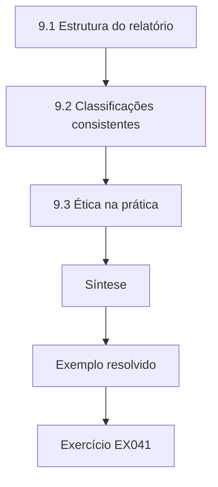

### Desenho lógico

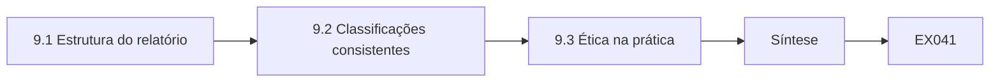

```text
[9.1 Estrutura do relatório]
    |
    v
[9.2 Classificações consistentes]
    |
    v
[9.3 Ética na prática]
    |
    v
[Síntese]
    |
    v
[Exemplo resolvido] --> [Exercício EX041]
```
<!-- cykin:lesson-figures:end ch-09 -->


### Objetivos de aprendizagem

Você vai (1) estruturar um relatório de achados criptográficos; (2) classificar riscos de forma consistente; (3) aplicar a ética profissional à divulgação e à honestidade.

### 9.1 Estrutura do relatório

O relatório mensal da Copperleaf para a Bayside tem quatro partes. Um sumário executivo de meia página diz o que mais importa e o que o cliente deve decidir. Uma tabela de achados lista cada item com identificador, descrição simples, classificação de risco, dono e prazo. Os apêndices técnicos guardam comandos, saídas e referências para a agência e a equipe de desktops. Uma seção final lista o que não foi verificado. Dana aprende a escrever o sumário por último, depois que os achados estão confirmados, e a começar pela ação necessária em vez do histórico da investigação, porque o gerente da clínica lê apenas a primeira página.

### 9.2 Classificações consistentes

As classificações de risco precisam significar a mesma coisa todo mês. A Copperleaf classifica pela probabilidade e pelo impacto, cada um numa escala de três pontos, combinados em baixo, médio ou alto. Um certificado público expirado tende a ser notado e prejudica os agendamentos, então é alto. Uma chave RSA-1024 num servidor interno acessível apenas pela equipe é médio: a fraqueza é real e deve ser corrigida, mas a exploração exige antes acesso à rede. Dana escreve uma frase de justificativa para cada classificação. Quando Marcus revisa seu trabalho, ele confere se achados semelhantes em clientes diferentes receberam classificações semelhantes, o que mantém o serviço justo e defensável.

### 9.3 Ética na prática

A ética aparece em pequenas escolhas. Dana descobre que o próprio site da agência, fora do seu escopo, mostra o mesmo erro de cadeia; ela não o testa mais, mas menciona isso informalmente ao contato da agência. Quando um achado é constrangedor porque a própria Copperleaf fez a configuração, ela o relata como qualquer outro. Ela nunca exagera o risco para vender mais serviços, nem o minimiza para evitar uma reunião desconfortável. Se algum dia encontrasse uma falha no produto de um fornecedor que afetasse muitos clientes, seguiria a divulgação coordenada por meio da Copperleaf, sem publicá-la abertamente. Relatórios honestos são aquilo pelo que os clientes pagam.

### Exemplo resolvido

Dana escreve um relatório mensal da Bayside com um sumário de meia página, uma tabela de achados classificados com justificativas e um apêndice, incluindo um achado causado pela Copperleaf.

> **Caso sintético.** O relatório, as classificações e o site da agência são sintéticos.

### Erros e limites

Escalas de três pontos escondem nuances; as justificativas carregam o detalhe. Anotações informais sobre questões fora do escopo não podem virar testes não autorizados.

### Exercícios

- **EX041 — Posição do sumário.** Por que escrever o sumário executivo por último? *Rubrica:* 3 = os achados precisam estar confirmados antes e o sumário começa pela ação;; 2 = confirmados;; 1 = primeiro;; 0 = nenhuma.

- **EX042 — Classificação do RSA-1024 interno.** Por que a chave RSA-1024 interna é classificada como médio, e não alto? *Rubrica:* 3 = fraqueza real, mas a exploração exige acesso à rede interna;; 2 = acesso necessário;; 1 = classificada como baixo;; 0 = nenhuma.

- **EX043 — Verificação entre clientes.** O que Marcus confere nas classificações entre clientes? *Rubrica:* 3 = achados semelhantes receberam classificações semelhantes;; 2 = consistência;; 1 = vago;; 0 = nenhuma.

- **EX044 — Erro próprio.** Como Dana deve relatar uma fraqueza introduzida pela própria Copperleaf? *Rubrica:* 3 = exatamente como qualquer outro achado, sem escondê-la;; 2 = relatar;; 1 = escondê-la;; 0 = nenhuma.

- **EX045 — Falha no produto do fornecedor.** O que deve acontecer se Dana encontrar uma falha num produto de fornecedor amplamente usado? *Rubrica:* 3 = divulgação coordenada por meio da Copperleaf, sem publicação aberta;; 2 = divulgação;; 1 = publicar abertamente;; 0 = nenhuma.

### Síntese

Estrutura clara, classificações consistentes e ética honesta tornam os relatórios criptográficos confiáveis e acionáveis.

<!-- cykin:chapter-navigation:start ch-09 -->
### Continue estudando — aula 09 (capítulo 09 de 12)

[← Capítulo 08](#ch-08) · [Índice das aulas](../SUBJECTS.md) · [Capítulo 10 →](#ch-10)

Continue para a próxima aula já escrita.
<!-- cykin:chapter-navigation:end -->

<a id="ch-10"></a>

## Capítulo 10 — Criptografia e serviços de confiança: qualidade e solução de problemas

<!-- cykin:lesson-figures:start ch-10 -->
### Mapa da aula

Aula 10 publicada. Mapa, exemplo, EX046.

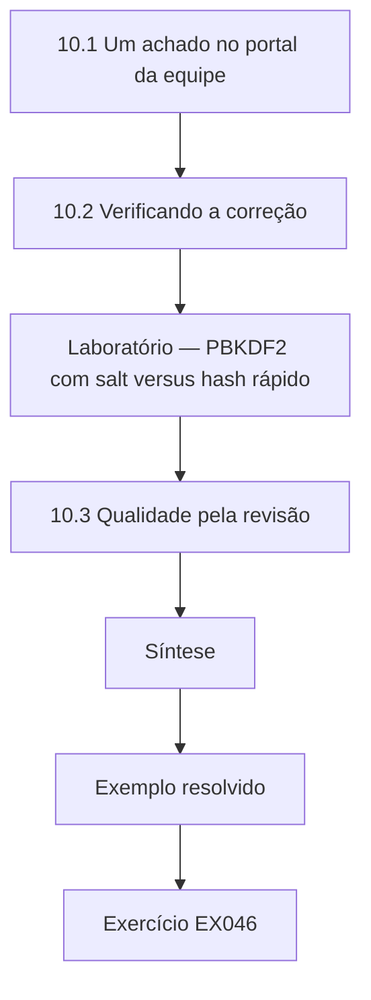

### Desenho lógico

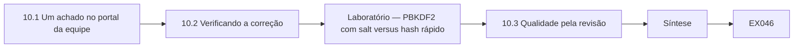

```text
[10.1 Um achado no portal da equipe]
    |
    v
[10.2 Verificando a correção]
    |
    v
[Laboratório — PBKDF2 com salt versus hash rápido]
    |
    v
[10.3 Qualidade pela revisão]
    |
    v
[Síntese]
    |
    v
[Exemplo resolvido] --> [Exercício EX046]
```
<!-- cykin:lesson-figures:end ch-10 -->


### Objetivos de aprendizagem

Você vai (1) diagnosticar uma fraqueza de armazenamento de senhas num portal da equipe; (2) verificar uma correção que usa uma função de derivação de chaves; (3) melhorar a qualidade do fluxo com revisão e retrospectivas.

### 10.1 Um achado no portal da equipe

O pequeno portal de escalas da equipe da Bayside, construído pela agência, armazena as senhas dos funcionários. Durante uma revisão, Dana vê na exportação de configuração que as senhas são armazenadas como hashes SHA-256 sem salt. Hashes rápidos permitem que um atacante que roube o banco de dados teste um número enorme de palpites rapidamente e, sem salt, senhas idênticas produzem hashes idênticos. O armazenamento de senhas precisa de uma função lenta e com salt. O hashlib.pbkdf2_hmac do Python implementa o PBKDF2, e escolhas mais fortes, que exigem muita memória, incluem o scrypt da RFC 7914 e o Argon2id da RFC 9106. A recomendação de Dana é usar uma biblioteca mantida que implemente uma delas, e não projetar um esquema próprio.

### 10.2 Verificando a correção

A agência propõe PBKDF2-HMAC-SHA-256 com um salt aleatório de 16 bytes por usuário e uma contagem alta de iterações definida pela política, migrando cada usuário no próximo login. Dana verifica a abordagem num laboratório com usuários sintéticos: dois funcionários com a mesma senha recebem valores armazenados diferentes; a senha correta é verificada e uma errada falha; e o tempo por palpite é muito maior que o de um único SHA-256. O laboratório abaixo mostra esses resultados. Ela registra que o laboratório confirma o comportamento do método, enquanto o código de produção da agência ainda precisa de sua própria revisão.

### Laboratório — PBKDF2 com salt versus hash rápido

```python
# Salted PBKDF2-HMAC-SHA-256 vs one SHA-256, synthetic staff. Teaching only; use a maintained library in production.
import hashlib, hmac, secrets, time
ITER = 600_000   # lab value; production iteration count comes from policy
def store(pw):
    s = secrets.token_bytes(16); return s, hashlib.pbkdf2_hmac("sha256", pw, s, ITER)
def check(pw, rec): return hmac.compare_digest(hashlib.pbkdf2_hmac("sha256", pw, rec[0], ITER), rec[1])
a, b = store(b"Rota-Clinic-3"), store(b"Rota-Clinic-3")
print("same password, different stored values:", a[1] != b[1])
print("correct password:", check(b"Rota-Clinic-3", a), "| wrong password:", check(b"Rota-Clinic-4", a))
t0 = time.perf_counter(); [hashlib.sha256(b"Rota-Clinic-3").digest() for _ in range(10000)]; fast = (time.perf_counter() - t0) / 10000
t0 = time.perf_counter(); check(b"x", a); slow = time.perf_counter() - t0
print(f"per-guess cost ratio PBKDF2/SHA-256: {'over 10,000x' if slow / fast > 10000 else 'under 10,000x'}")
```

Execute com `python3 lab_pbkdf2.py`. Saída verificada:

```text
same password, different stored values: True
correct password: True | wrong password: False
per-guess cost ratio PBKDF2/SHA-256: over 10,000x
```

### 10.3 Qualidade pela revisão

Erros escapam em todo fluxo de trabalho, então a Copperleaf incorpora verificações de qualidade. Cada relatório é revisado por um segundo analista antes de ir ao cliente. Depois de cada ciclo mensal, a equipe passa quinze minutos numa retrospectiva: o que deu certo, o que deu errado e uma mudança para o mês seguinte. Quando o novo teste de Dana da correção da cadeia quase deixou passar o segundo servidor, a retrospectiva levou a uma regra: endpoints com balanceamento de carga são testados uma vez por backend. Pequenas melhorias constantes como essa elevam a qualidade de todo o serviço mais do que esforços heroicos ocasionais.

### Exemplo resolvido

Dana documenta o achado do SHA-256 sem salt, executa o laboratório de PBKDF2 para confirmar a abordagem da agência e acrescenta uma regra de teste por backend depois de uma retrospectiva.

> **Caso sintético.** O portal de escalas, os usuários e a contagem de iterações são sintéticos; a RFC 7914 e a RFC 9106 são reais.

### Erros e limites

Os tempos do laboratório variam conforme a máquina; mostram o custo relativo, não a velocidade de um atacante. A atualização no login deixa as contas inativas com os hashes antigos.

### Exercícios

- **EX046 — Fraqueza sem salt.** Cite dois problemas do armazenamento de senhas com SHA-256 sem salt. *Rubrica:* 3 = rápido de adivinhar e senhas idênticas compartilham hashes;; 2 = um;; 1 = vago;; 0 = nenhuma.

- **EX047 — Senhas iguais no laboratório.** O que o laboratório de PBKDF2 mostrou para dois funcionários com a mesma senha? *Rubrica:* 3 = os valores armazenados diferiram porque os salts diferiram;; 2 = diferiram;; 1 = iguais;; 0 = nenhuma.

- **EX048 — Razão de custo no laboratório.** Segundo o laboratório, como o custo do PBKDF2 se comparou ao de um SHA-256? *Rubrica:* 3 = mais de 10.000 vezes mais lento por palpite, como impresso;; 2 = mais lento;; 1 = mais rápido;; 0 = nenhuma.

- **EX049 — Ressalva de produção.** O que o laboratório não prova sobre a correção da agência? *Rubrica:* 3 = que o código de produção a implementa corretamente; precisa de revisão;; 2 = revisão de código;; 1 = prova tudo;; 0 = nenhuma.

- **EX050 — Regra da retrospectiva.** Que regra saiu da retrospectiva? *Rubrica:* 3 = testar endpoints com balanceamento de carga uma vez por backend;; 2 = regra;; 1 = vago;; 0 = nenhuma.

### Síntese

A qualidade vem de verificar as correções com métodos sólidos e de revisões e retrospectivas constantes.

<!-- cykin:chapter-navigation:start ch-10 -->
### Continue estudando — aula 10 (capítulo 10 de 12)

[← Capítulo 09](#ch-09) · [Índice das aulas](../SUBJECTS.md) · [Capítulo 11 →](#ch-11)

Continue para a próxima aula já escrita.
<!-- cykin:chapter-navigation:end -->

<a id="ch-11"></a>

## Capítulo 11 — Laboratório supervisionado

<!-- cykin:lesson-figures:start ch-11 -->
### Mapa da aula

Aula 11 publicada. Mapa, exemplo, EX051.

```mermaid
flowchart TD
  N0["11.1 Espelhando o serviço"]
  N1["11.2 Ensaio e reversão"]
  N2["11.3 Encerrando o laboratório"]
  N3["Síntese"]
  N0 --> N1 --> N2 --> N3
  N3 --> EX["Exemplo resolvido"]
  EX --> Q["Exercício EX051"]
```

### Desenho lógico

```mermaid
flowchart LR
  N0["11.1 Espelhando o serviço"]
  N1["11.2 Ensaio e reversão"]
  N2["11.3 Encerrando o laboratório"]
  N3["Síntese"]
  N0 --> N1 --> N2 --> N3 --> Q["EX051"]
```

```text
[11.1 Espelhando o serviço]
    |
    v
[11.2 Ensaio e reversão]
    |
    v
[11.3 Encerrando o laboratório]
    |
    v
[Síntese]
    |
    v
[Exemplo resolvido] --> [Exercício EX051]
```
<!-- cykin:lesson-figures:end ch-11 -->


### Objetivos de aprendizagem

Você vai (1) montar um laboratório contido que espelha um serviço do cliente; (2) ensaiar uma renovação de certificado e sua reversão; (3) encerrar o laboratório sem deixar confiança para trás.

### 11.1 Espelhando o serviço

Antes que a agência renove o certificado do site de agendamento numa nova plataforma de hospedagem, Marcus pede a Dana que ensaie a renovação num laboratório contido. Ela monta uma rede virtual isolada com um servidor web que copia a configuração do site de agendamento, uma autoridade certificadora de laboratório descartável e uma máquina cliente que confia apenas nessa raiz de laboratório. Não são usadas chaves reais, dados de pacientes nem nomes de produção; os nomes de host terminam em .lab.copperleaf.example. Espelhar a configuração importa mais que espelhar o conteúdo, porque os riscos da renovação estão nos caminhos de arquivos, na ordem da cadeia e no comportamento do servidor ao recarregar, e não nas páginas web.

### 11.2 Ensaio e reversão

Dana escreve as etapas: gerar uma nova chave, solicitar um certificado à autoridade de laboratório, instalar o certificado com sua intermediária, recarregar o servidor e testar. De propósito, ela instala uma vez a cadeia na ordem errada e vê o cliente falhar, e depois corrige. Ela também pratica a reversão: restaurar a chave e o certificado anteriores a partir da cópia de backup e recarregar. Cronometrar cada etapa mostra que a renovação inteira leva doze minutos, com dois minutos de risco durante o recarregamento. A agência usa as etapas testadas e os tempos dela para planejar uma janela de manutenção curta para a renovação real.

### 11.3 Encerrando o laboratório

Quando o ensaio termina, Dana apaga a chave privada da autoridade de laboratório, remove a raiz de laboratório do cliente, destrói as máquinas virtuais e escreve uma nota de encerramento listando o que foi removido. Marcus explica por que isso importa: uma raiz de laboratório deixada em qualquer máquina permite a quem tiver sua chave criar certificados em que essa máquina confia. A nota de encerramento também registra lições para a mudança real, como conferir explicitamente a ordem da cadeia. Um laboratório supervisionado é julgado não só pelo que ensinou, mas também por ter ou não deixado algo arriscado para trás.

### Exemplo resolvido

Dana ensaia a renovação do agendamento num laboratório espelhado, reproduz uma falha de ordem da cadeia, pratica a reversão e encerra o laboratório com uma nota de remoção.

> **Caso sintético.** Os hosts, as chaves e os tempos do laboratório são sintéticos.

### Erros e limites

Os laboratórios não conseguem reproduzir todas as diferenças da produção, como o cache do provedor. Uma reversão ensaiada ainda depende de um backup atual.

### Exercícios

- **EX051 — O que espelhar.** O que mais importa espelhar no laboratório, e por quê? *Rubrica:* 3 = a configuração, como caminhos, ordem da cadeia e comportamento ao recarregar, onde está o risco da renovação;; 2 = configuração;; 1 = conteúdo;; 0 = nenhuma.

- **EX052 — Falha deliberada.** Que falha Dana reproduziu de propósito? *Rubrica:* 3 = a cadeia instalada na ordem errada;; 2 = ordem da cadeia;; 1 = vago;; 0 = nenhuma.

- **EX053 — Tempo da renovação.** Quanto tempo levou a renovação ensaiada, e quanto foi risco durante o recarregamento? *Rubrica:* 3 = doze minutos, dois minutos de risco durante o recarregamento;; 2 = um número;; 1 = vago;; 0 = nenhuma.

- **EX054 — Apagar a chave do laboratório.** Por que apagar a chave privada da autoridade de laboratório no encerramento? *Rubrica:* 3 = para que ninguém possa emitir certificados que uma máquina que ainda confia na raiz aceitaria;; 2 = risco de confiança;; 1 = arrumação;; 0 = nenhuma.

- **EX055 — Lição levada adiante.** Cite uma lição registrada para a mudança real. *Rubrica:* 3 = conferir explicitamente a ordem da cadeia;; 2 = lição;; 1 = vago;; 0 = nenhuma.

### Síntese

Ensaiar mudanças num laboratório contido reduz o risco em produção, desde que o laboratório seja encerrado de forma limpa depois.

<!-- cykin:chapter-navigation:start ch-11 -->
### Continue estudando — aula 11 (capítulo 11 de 12)

[← Capítulo 10](#ch-10) · [Índice das aulas](../SUBJECTS.md) · [Capítulo 12 →](#ch-12)

Continue para a próxima aula já escrita.
<!-- cykin:chapter-navigation:end -->

<a id="ch-12"></a>

## Capítulo 12 — Portfólio de prática e revisão final

<!-- cykin:lesson-figures:start ch-12 -->
### Mapa da aula

Aula 12 publicada. Mapa, exemplo, EX056.

```mermaid
flowchart TD
  N0["12.1 Montando o portfólio"]
  N1["12.2 Tendências do rastreador"]
  N2["Laboratório — Tendências dos achados"]
  N3["12.3 Reflexão e próximos passos"]
  N4["Síntese"]
  N0 --> N1 --> N2 --> N3 --> N4
  N4 --> EX["Exemplo resolvido"]
  EX --> Q["Exercício EX056"]
```

### Desenho lógico

```mermaid
flowchart LR
  N0["12.1 Montando o portfólio"]
  N1["12.2 Tendências do rastreador"]
  N2["Laboratório — Tendências dos achados"]
  N3["12.3 Reflexão e próximos passos"]
  N4["Síntese"]
  N0 --> N1 --> N2 --> N3 --> N4 --> Q["EX056"]
```

```text
[12.1 Montando o portfólio]
    |
    v
[12.2 Tendências do rastreador]
    |
    v
[Laboratório — Tendências dos achados]
    |
    v
[12.3 Reflexão e próximos passos]
    |
    v
[Síntese]
    |
    v
[Exemplo resolvido] --> [Exercício EX056]
```
<!-- cykin:lesson-figures:end ch-12 -->


### Objetivos de aprendizagem

Você vai (1) montar um portfólio de prática a partir de seis meses de trabalho; (2) resumir tendências dos achados com um script simples; (3) refletir sobre lacunas e planejar a continuidade do aprendizado.

### 12.1 Montando o portfólio

O portfólio de Dana reúne evidências do que ela sabe fazer: uma tabela de partes interessadas, um plano de testes baseado na autorização, o script de inventário e sua saída, um conjunto de declarações de verificação, a linha do tempo da chave exposta, um relatório mensal com classificações e a nota de encerramento do laboratório. Cada item é anonimizado, mantendo os nomes sintéticos da Bayside e removendo qualquer coisa real, e cada um tem uma breve nota explicando o que ela fez, o que aprendeu e o que faria de outra forma. Marcus explica que um portfólio mostra o discernimento melhor que uma lista de certificações, porque revela como ela lidou com situações incertas e confusas.

### 12.2 Tendências do rastreador

Para encerrar o programa, Dana resume seis meses de achados da Bayside. Ela escreve um script curto sobre uma exportação sintética do rastreador que conta os achados por categoria e por status e calcula a mediana de dias até o encerramento. O laboratório abaixo mostra o resultado: as questões de expiração e de cadeia foram as mais comuns, e a maioria foi encerrada em poucas semanas, enquanto um achado de chave fraca ficou aberto por mais tempo porque exigia a substituição de um servidor. As tendências dizem ao gerente da clínica onde investir, como na renovação automatizada, e dizem à Copperleaf onde seu fluxo de trabalho poderia melhorar.

### Laboratório — Tendências dos achados

```python
# Summarise a synthetic six-month findings export.
import collections, statistics
rows = [("expiry/chain", "closed", 6), ("expiry/chain", "closed", 11), ("expiry/chain", "closed", 4),
        ("expiry/chain", "closed", 19), ("weak key", "open", 142), ("legacy TLS", "closed", 33),
        ("legacy TLS", "in progress", 58), ("secret exposure", "closed", 2), ("password storage", "closed", 27)]
print("by category:", dict(collections.Counter(c for c, _, _ in rows).most_common()))
print("by status:", dict(collections.Counter(s for _, s, _ in rows)))
print("median days to close (closed only):", statistics.median(d for _, s, d in rows if s == "closed"))
print("oldest open:", max((d, c) for c, s, d in rows if s != "closed"))
```

Execute com `python3 lab_trends.py`. Saída verificada:

```text
by category: {'expiry/chain': 4, 'legacy TLS': 2, 'weak key': 1, 'secret exposure': 1, 'password storage': 1}
by status: {'closed': 7, 'open': 1, 'in progress': 1}
median days to close (closed only): 11
oldest open: (142, 'weak key')
```

### 12.3 Reflexão e próximos passos

Na revisão final com Marcus, Dana lista o que faz com confiança: confirmar sinalizações, verificar o comportamento do HMAC e do TLS, escrever achados em linguagem simples e manusear evidências. Também lista lacunas: ainda não conduziu um incidente, depende de Marcus para as classificações de risco em casos incomuns e sabe pouco sobre a migração pós-quântica além do fato de que o NIST publicou as FIPS 203, 204 e 205 em 2024. Eles combinam um plano para estudar essas normas, acompanhar um líder de incidentes e assumir o ciclo mensal de um cliente. A reflexão honesta é a última habilidade profissional que o programa ensina.

### Exemplo resolvido

Dana monta um portfólio de sete itens, executa o laboratório de tendências e combina um plano de aprendizado que cobre a liderança de incidentes e as normas pós-quânticas.

> **Caso sintético.** O portfólio, a exportação do rastreador e a revisão são sintéticos; as FIPS 203, 204 e 205 são reais.

### Erros e limites

Seis meses de um único cliente são uma amostra pequena para tendências. Os portfólios precisam permanecer anonimizados e sintéticos quando compartilhados.

### Exercícios

- **EX056 — Por que um portfólio.** Por que Marcus valoriza um portfólio mais que uma lista de certificações? *Rubrica:* 3 = mostra o discernimento em situações confusas e incertas;; 2 = discernimento;; 1 = igual;; 0 = nenhuma.

- **EX057 — Categoria mais comum.** Segundo o laboratório de tendências, que categoria teve mais achados? *Rubrica:* 3 = expiry/chain, como impresso na execução;; 2 = categoria;; 1 = errada;; 0 = nenhuma.

- **EX058 — Aberto há mais tempo.** Que achado ficou aberto por mais tempo, e por quê? *Rubrica:* 3 = o achado de chave fraca, que exigia a substituição de um servidor;; 2 = achado;; 1 = vago;; 0 = nenhuma.

- **EX059 — Lacunas admitidas.** Cite duas lacunas que Dana admite na revisão. *Rubrica:* 3 = duas entre: não conduziu incidentes, depende do mentor para classificações incomuns, pouco conhecimento de PQC;; 2 = uma;; 1 = vago;; 0 = nenhuma.

- **EX060 — Normas PQC.** Que normas pós-quânticas do NIST seu plano inclui? *Rubrica:* 3 = FIPS 203, 204 e 205;; 2 = duas;; 1 = vago;; 0 = nenhuma.

### Síntese

Um portfólio, um resumo de tendências e uma reflexão honesta transformam seis meses de prática numa base profissional crível.

<!-- cykin:chapter-navigation:start ch-12 -->
### Continue estudando — aula 12 (capítulo 12 de 12)

[← Capítulo 11](#ch-11) · [Índice das aulas](../SUBJECTS.md) · [Próximo curso pelo índice →](../SUBJECTS.md)

O índice aponta para o próximo curso do percurso de estudos.
<!-- cykin:chapter-navigation:end -->

<a id="worked-results"></a>

## Resoluções

Respostas-modelo para EX001–EX060. Dana Whitlock, Marcus Oyelaran, a Copperleaf Managed Services, o Bayside Dental Group e todos os números são sintéticos; as respostas dos laboratórios citam saídas verificadas. Qualquer resposta que atenda à rubrica recebe a mesma pontuação.

**EX001.** Executar verificações repetíveis, guardar evidências e explicar os achados ao cliente, sem inventar criptografia.

**EX002.** Não. Uma assinatura mostra quem assinou e que o conteúdo não mudou, mas qualquer pessoa ainda pode ler o conteúdo.

**EX003.** Um certificado expirado impede os pacientes de acessar o site de agendamento, e uma chave de cifração de disco perdida torna ilegíveis os dados de um notebook.

**EX004.** Um e-mail de phishing; ele mostra que uma criptografia forte não impede que pessoas sejam enganadas, então os achados precisam de contexto.

**EX005.** Porque um certificado expirado quebra o serviço e alarma os pacientes agora, enquanto uma cifra um pouco mais fraca tem pouco impacto prático.

**EX006.** Que o agendamento seja privado e que o site abra sem avisos de segurança.

**EX007.** Quem tem autoridade para aprovar uma mudança, e quem é tecnicamente capaz de executá-la.

**EX008.** Porque a agência controlava aquele certificado e ela não tinha identificado o fornecedor antes.

**EX009.** Alguns pacientes com celulares mais antigos veem um aviso de segurança ao agendar porque falta um arquivo que prova o certificado; a agência pode corrigir isso rapidamente.

**EX010.** Para um apêndice técnico dirigido à agência, para que o resumo continue legível sem perder fatos.

**EX011.** Porque só os donos deles podem autorizar testes; a assinatura da Bayside não cobre sistemas de terceiros.

**EX012.** Registrando as configurações de cifração da rotina de backup e restaurando um arquivo de teste sintético, em vez de qualquer prontuário.

**EX013.** Porque exportações de uma clínica são valiosas para atacantes, então a pasta é cifrada, tem acesso restrito e é apagada no prazo.

**EX014.** Não. Testá-las vai além da sua autorização; ela relata o caminho e o tipo e recomenda a rotação.

**EX015.** Lista o caminho do arquivo e os tipos de segredo com todos os valores ocultados, o que basta para justificar a rotação.

**EX016.** Uma assinatura pode ser conferida com uma chave pública que não consegue assinar, enquanto qualquer pessoa capaz de verificar um HMAC tem a chave compartilhada e poderia forjar tags.

**EX017.** Do certificado do servidor para sua intermediária e até uma raiz confiável, conferindo o nome e as datas de validade.

**EX018.** Os operacionais: certificados expirados, intermediárias ausentes, nomes errados e chaves privadas guardadas de forma aberta demais.

**EX019.** Cifração autenticada como o AES-GCM, com a chave armazenada separadamente da mídia de backup.

**EX020.** Uma assinatura digital, que os pacientes podem verificar com a chave pública ou o certificado da Bayside.

**EX021.** Expiração em até 30 dias, chaves RSA abaixo de 2048 bits, assinaturas SHA-1 e aceitação de TLS 1.0 ou 1.1.

**EX022.** Quatro endpoints foram sinalizados e um, a API do portal, estava limpo.

**EX023.** Porque a impressora fica num segmento isolado acessível apenas pelo servidor, então a exposição é limitada, embora a sinalização seja verdadeira.

**EX024.** Reproduzindo-a com openssl s_client ou openssl x509 e conferindo ela mesma o valor.

**EX025.** Mina a confiança em todos os outros achados, então o ruído precisa ser filtrado primeiro.

**EX026.** Para identificar qualquer certificado publicamente confiável emitido para os domínios da Bayside que o inventário não conhece.

**EX027.** Só depois que Dana testou de novo e confirmou a correção, e não apenas pela palavra do dono.

**EX028.** A agência tinha corrigido a cadeia num dos servidores com balanceamento de carga, mas o outro ainda omitia a intermediária.

**EX029.** A equipe de desktops da Copperleaf, que gerencia os notebooks da clínica.

**EX030.** Porque um fornecedor que entende por que a mudança importa costuma agir mais cedo e com mais cuidado.

**EX031.** Mensagens com mais de cinco minutos, 300 segundos, são rejeitadas como possíveis replays.

**EX032.** Foi rejeitada, porque o HMAC recalculado deixou de corresponder à tag.

**EX033.** Executando openssl s_client com a opção -tls1_1 e confirmando que o handshake é recusado.

**EX034.** Ela a registra como não testada e explica por quê, em vez de presumir que corresponde aos outros endpoints.

**EX035.** Palavras como seguro e conforme, porque afirmam mais garantia do que um teste específico oferece.

**EX036.** Que estava comprometida, já que ninguém podia provar que não tinha sido copiada e substituí-la custa pouco.

**EX037.** Cerca de quarenta horas, de sexta-feira às 18:42 até a remoção no domingo às 10:15.

**EX038.** Porque um atacante que tem a chave pode se passar pelo site usando o certificado existente, sem que apareça nenhum certificado novo.

**EX039.** Outras pessoas podem já ter cópias, e o histórico do repositório ainda pode conter a chave.

**EX040.** Implantar uma nova chave e um novo certificado, revogar o certificado antigo e rotacionar os outros segredos, acrescentando varredura de segredos.

**EX041.** Porque só depois que os achados estão confirmados o sumário pode declarar com precisão o que importa e o que decidir.

**EX042.** A fraqueza é real, mas um atacante precisaria antes de acesso à rede da equipe, o que reduz a probabilidade.

**EX043.** Que achados semelhantes em clientes diferentes receberam classificações semelhantes, mantendo o serviço consistente.

**EX044.** Exatamente como qualquer outro achado, com as mesmas evidências e classificação, porque a honestidade é o serviço.

**EX045.** Deve passar pela divulgação coordenada ao fornecedor por meio da Copperleaf, em vez de ser publicada abertamente.

**EX046.** É rápido, então os palpites são baratos, e sem salt senhas idênticas dão hashes idênticos.

**EX047.** Seus valores armazenados diferiram porque cada um tinha um salt aleatório próprio.

**EX048.** Na contagem de iterações do laboratório, o PBKDF2 custou mais de 10.000 vezes mais por palpite do que um único SHA-256, como a execução imprimiu.

**EX049.** Não prova que o código de produção da agência está correto; esse código precisa de sua própria revisão.

**EX050.** Endpoints com balanceamento de carga devem ser testados uma vez para cada servidor de backend.

**EX051.** A configuração do servidor, porque os riscos da renovação estão nos caminhos, na ordem da cadeia e no recarregamento, não no conteúdo das páginas.

**EX052.** Ela instalou a cadeia de certificados na ordem errada e observou o cliente falhar.

**EX053.** Doze minutos no total, incluindo dois minutos de risco durante o recarregamento.

**EX054.** Para que ninguém possa mais tarde emitir certificados em que uma máquina que ainda tenha a raiz de laboratório confiaria.

**EX055.** Conferir explicitamente a ordem da cadeia de certificados antes de recarregar o servidor.

**EX056.** Porque mostra como Dana de fato raciocinou e agiu em situações reais e incertas.

**EX057.** As questões de expiração e de cadeia (expiry/chain) tiveram mais achados, como a execução mostrou.

**EX058.** A chave RSA fraca no servidor da clínica, porque corrigi-la exigia substituir o servidor.

**EX059.** Ela não conduziu um incidente e sabe pouco sobre a migração pós-quântica além das publicações FIPS de 2024.

**EX060.** FIPS 203 (ML-KEM), FIPS 204 (ML-DSA) e FIPS 205 (SLH-DSA), publicadas em 2024.

<a id="references"></a>
## Referências

Todos os DOIs foram resolvidos em doi.org em 12 de outubro de 2026, e as normas foram conferidas nas páginas de seus editores. A lista é idêntica à da edição em inglês e cobre o livro inteiro; nenhuma das normas técnicas citadas foi verificada aqui como adotada pela ABNT, por isso são citadas em sua edição internacional. Organizações, pessoas, sistemas e números dos casos são sintéticos; somente as obras abaixo são reais.

- Barker, E., & Roginsky, A. (2019). *Transitioning the use of cryptographic algorithms and key lengths* (NIST SP 800-131A Rev. 2). NIST. <https://doi.org/10.6028/NIST.SP.800-131Ar2>
- Biryukov, A., Dinu, D., Khovratovich, D., & Josefsson, S. (2021). *Argon2 memory-hard function for password hashing and proof-of-work applications* (RFC 9106). IETF. <https://www.rfc-editor.org/rfc/rfc9106>
- Cooper, D., Santesson, S., Farrell, S., Boeyen, S., Housley, R., & Polk, W. (2008). *Internet X.509 public key infrastructure certificate and CRL profile* (RFC 5280). IETF. <https://www.rfc-editor.org/rfc/rfc5280>
- Dworkin, M. (2007). *Recommendation for block cipher modes of operation: Galois/Counter Mode (GCM) and GMAC* (NIST SP 800-38D). NIST. <https://doi.org/10.6028/NIST.SP.800-38D>
- Josefsson, S., & Liusvaara, I. (2017). *Edwards-curve digital signature algorithm (EdDSA)* (RFC 8032). IETF. <https://www.rfc-editor.org/rfc/rfc8032>
- Katz, J., & Lindell, Y. (2020). *Introduction to modern cryptography* (3rd ed.). CRC Press.
- Laurie, B., Langley, A., & Kasper, E. (2013). *Certificate transparency* (RFC 6962). IETF. <https://www.rfc-editor.org/rfc/rfc6962>
- McKay, K., & Cooper, D. (2019). *Guidelines for the selection, configuration, and use of Transport Layer Security (TLS) implementations* (NIST SP 800-52 Rev. 2). NIST. <https://doi.org/10.6028/NIST.SP.800-52r2>
- Menezes, A. J., van Oorschot, P. C., & Vanstone, S. A. (1996). *Handbook of applied cryptography*. CRC Press. Chapters free online: <https://cacr.uwaterloo.ca/hac/>
- National Institute of Standards and Technology. (2015). *Secure hash standard (SHS)* (FIPS 180-4). <https://doi.org/10.6028/NIST.FIPS.180-4>
- National Institute of Standards and Technology. (2023). *Digital signature standard (DSS)* (FIPS 186-5). <https://doi.org/10.6028/NIST.FIPS.186-5>
- National Institute of Standards and Technology. (2024). *Module-lattice-based digital signature standard* (FIPS 204). <https://doi.org/10.6028/NIST.FIPS.204>
- National Institute of Standards and Technology. (2024). *Module-lattice-based key-encapsulation mechanism standard* (FIPS 203). <https://doi.org/10.6028/NIST.FIPS.203>
- National Institute of Standards and Technology. (2024). *Stateless hash-based digital signature standard* (FIPS 205). <https://doi.org/10.6028/NIST.FIPS.205>
- Nystrom, M. (2005). *Identifiers and test vectors for HMAC-SHA-224, HMAC-SHA-256, HMAC-SHA-384, and HMAC-SHA-512* (RFC 4231). IETF. <https://www.rfc-editor.org/rfc/rfc4231>
- Percival, C., & Josefsson, S. (2016). *The scrypt password-based key derivation function* (RFC 7914). IETF. <https://www.rfc-editor.org/rfc/rfc7914>
