# Governança de Dados: Curso Profissional

- Idioma: português do Brasil (`pt`); curso 026, curso profissional (6 meses). Edição de referência: [inglês](../../en/book/MANUSCRIPT.md).
- Estado editorial: **publicado**. Os capítulos 1–12 de 12 têm texto didático escrito à mão; os exercícios EX001–EX060 têm resoluções correspondentes com rubricas de 0 a 3; os dois laboratórios offline usam apenas a biblioteca padrão do Python 3 sobre dados sintéticos, e suas saídas foram incorporadas de execuções reais, idênticas às da edição em inglês. Revisão independente, revisão linguística e a verificação de 300 páginas A4 continuam em aberto.
- Público: profissionais em atividade que receberam a responsabilidade pela governança de dados em uma organização pequena.
- Autor: [hiagokinlevi](https://github.com/hiagokinlevi). Texto original sob [CC0 1.0](../../../../../LICENSE); as obras citadas mantêm seus direitos.
- Limites: os laboratórios normalizam e-mails sintéticos de doadores para revelar duplicatas e classificam registros sintéticos de consentimento para marketing conforme mostrem ou não quando o consentimento foi dado. Normas e leis são citadas pela edição e parafraseadas; nada aqui é aconselhamento jurídico. Pessoas, organizações, sistemas e dados são **sintéticos**, salvo quando uma frase cita uma fonte pública.

[Página do curso](../../README.md) · [Índice de capítulos](../SUBJECTS.md) · [Plano do livro](PLAN.md) · [Skill do curso](../../skill/SKILL.md) · [Resoluções](#worked-results)

## Como usar este rascunho

Leia na ordem. Os capítulos acompanham uma profissional desde o mapeamento dos dados e dos riscos de uma pequena organização beneficente, passando por papéis, inventário, política, qualidade dos dados, consentimento, segurança, fornecedores, retenção e direitos, até o tratamento de incidentes, os relatórios ao conselho e um plano de um ano. Execute cada laboratório onde ele aparece, tente os exercícios antes de consultar as resoluções e avalie-se com as rubricas.

### Caso sintético

| Elemento | Papel | Natureza |
|---|---|---|
| **Grace Mwangi** | Gerente de operações e participante do curso | Inventada |
| **Sr. Tomasz Nowak** | Tutor do curso | Inventado |
| **Kingsford Professional Academy** | Academia fictícia | Inventada |
| **Northbank Food Bank Network** | Organização beneficente fictícia, com seis bancos de alimentos, cerca de 400 voluntários e 4.000 doadores | Inventada |

### Fontes principais

DAMA-DMBOK2 (2017); GDPR; LGPD. Lista completa em [Referências](#references).

## Sumário

| Capítulos em português |
|---|
| [1](#ch-01) · [2](#ch-02) · [3](#ch-03) · [4](#ch-04) · [5](#ch-05) · [6](#ch-06) · [7](#ch-07) · [8](#ch-08) · [9](#ch-09) · [10](#ch-10) · [11](#ch-11) · [12](#ch-12) |

[Resoluções](#worked-results) · [Referências](#references)

<a id="ch-01"></a>

## Capítulo 1 — O papel e a organização

<!-- open-cyber-academy:lesson-figures:start ch-01 -->
### Mapa da aula

Aula 01 publicada. Mapa, exemplo, EX001.

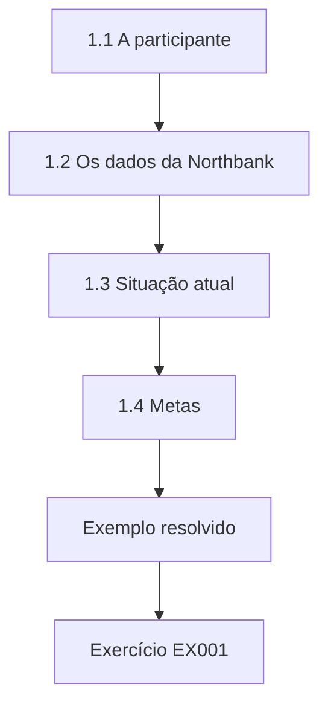

### Desenho lógico

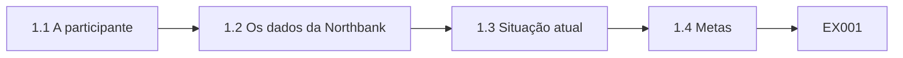

```text
[1.1 A participante]
    |
    v
[1.2 Os dados da Northbank]
    |
    v
[1.3 Situação atual]
    |
    v
[1.4 Metas]
    |
    v
[Exemplo resolvido] --> [Exercício EX001]
```
<!-- open-cyber-academy:lesson-figures:end ch-01 -->


### Objetivos de aprendizagem

Você vai (1) descrever o curso profissional e seu caso; (2) delinear os dados de uma pequena organização beneficente; (3) definir metas para quem lidera a governança.

### 1.1 A participante

Grace Mwangi é a nova gerente de operações da Northbank Food Bank Network, uma organização beneficente fictícia que mantém seis bancos de alimentos, com cerca de quatrocentos voluntários, quatro mil doadores e registros de encaminhamento das famílias que recebem cestas de alimentos. O conselho pediu a ela que assumisse a responsabilidade pela governança de dados. Ela se inscreve em um curso profissional de seis meses na fictícia Kingsford Professional Academy, conduzido pelo Sr. Tomasz Nowak, com encontros uma noite por semana e dados sintéticos em todos os exercícios. Grace está ansiosa para começar.

### 1.2 Os dados da Northbank

Grace lista os dados da organização: nomes, endereços, e-mails e históricos de doação dos doadores; contatos, disponibilidade e verificações de salvaguarda dos voluntários; encaminhamentos de clientes feitos por assistentes sociais e médicos, com tamanho da família, motivos da necessidade e, às vezes, informações de saúde; registros de estoque dos alimentos recebidos e distribuídos; e registros financeiros. Ela observa que os encaminhamentos são os dados mais sensíveis, porque revelam dificuldades e, às vezes, condições de saúde, que o GDPR trata como categoria especial e a LGPD como dado pessoal sensível (art. 5º, II), com proteção adicional.

### 1.3 Situação atual

Grace encontra os dados espalhados por um banco de dados de doadores, planilhas mantidas por cada banco de alimentos, formulários de encaminhamento em papel guardados em arquivos, uma caixa de e-mail compartilhada e os celulares pessoais dos voluntários. Ninguém escreveu regras sobre quem pode ver os encaminhamentos nem por quanto tempo eles são guardados. Um conselheiro perguntou recentemente quantas famílias foram atendidas no ano anterior, e três bancos de alimentos deram números com definições diferentes de família. O Sr. Nowak observa que esse é um ponto de partida típico de uma organização pequena. Grace registra essa situação no caderno do curso.

### 1.4 Metas

Grace define metas para o curso: saber que dados a Northbank tem e onde estão, acordar quem é responsável por cada tipo, proteger adequadamente os dados dos clientes, melhorar os dados dos doadores para a captação de recursos e apresentar números confiáveis ao conselho. O Sr. Nowak pede que cada meta seja mensurável, como todos os seis bancos de alimentos usando uma única definição de família até o fim do curso. Ela escreve as metas no caderno e as compartilha com a presidente do conselho, que as recebe bem e pede atualizações periódicas sobre o andamento de cada uma.

### Exemplo resolvido

Grace, nova gerente de operações da Northbank, lista os dados de doadores, voluntários, clientes, estoque e finanças, encontra registros espalhados e contagens de famílias inconsistentes e define metas mensuráveis de governança, compartilhadas com a presidente do conselho.

> **Caso sintético.** A Northbank, a Kingsford e todas as pessoas são sintéticas; o GDPR e a LGPD são reais.

### Erros e limites

Tratar os dados de uma organização pequena como simples demais para serem governados deixa registros sensíveis desprotegidos.

### Exercícios

- **EX001 — Duração do curso.** Quanto dura o curso de Grace? *Rubrica:* 3 = seis meses;; 2 = parcialmente correto;; 1 = errado;; 0 = nenhuma.
- **EX002 — Dados mais sensíveis.** Quais são os dados mais sensíveis da Northbank? *Rubrica:* 3 = os encaminhamentos de clientes;; 2 = parcialmente correto;; 1 = outro;; 0 = nenhuma.
- **EX003 — Categoria especial.** Por que os encaminhamentos podem ser dados de categoria especial? *Rubrica:* 3 = às vezes contêm informações de saúde;; 2 = parcialmente correto;; 1 = vago;; 0 = nenhuma.
- **EX004 — Números de famílias.** O que deu errado quando o conselho perguntou sobre as famílias atendidas? *Rubrica:* 3 = os bancos usavam definições diferentes;; 2 = parcialmente correto;; 1 = vago;; 0 = nenhuma.
- **EX005 — Meta mensurável.** Dê o exemplo de meta mensurável do curso. *Rubrica:* 3 = os seis bancos usando uma única definição de família;; 2 = parcialmente correto;; 1 = vago;; 0 = nenhuma.

<!-- open-cyber-academy:chapter-navigation:start ch-01 -->
### Continue estudando — aula 01 (capítulo 01 de 12)

[← Início do curso](../../README.md) · [Índice das aulas](../SUBJECTS.md) · [Capítulo 02 →](#ch-02)

Continue para a próxima aula já escrita.
<!-- open-cyber-academy:chapter-navigation:end -->

<a id="ch-02"></a>

## Capítulo 2 — Por que a governança importa para uma organização beneficente

<!-- open-cyber-academy:lesson-figures:start ch-02 -->
### Mapa da aula

Aula 02 publicada. Mapa, exemplo, EX006.

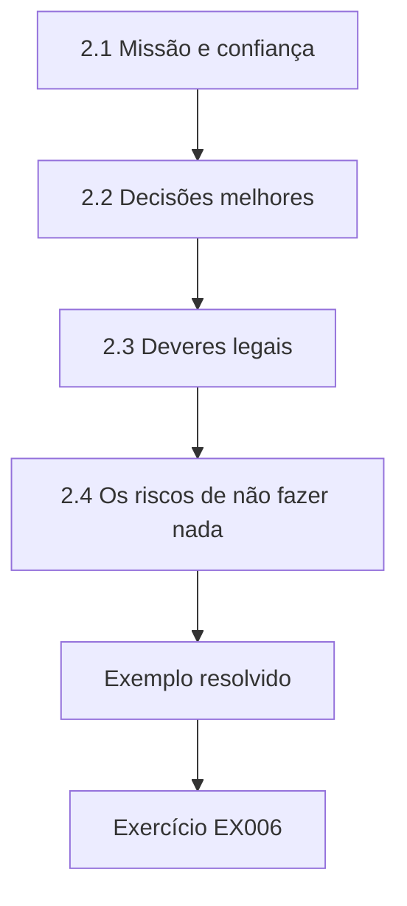

### Desenho lógico

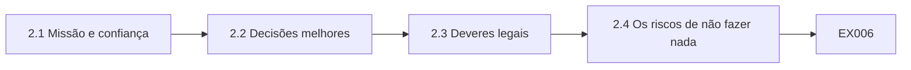

```text
[2.1 Missão e confiança]
    |
    v
[2.2 Decisões melhores]
    |
    v
[2.3 Deveres legais]
    |
    v
[2.4 Os riscos de não fazer nada]
    |
    v
[Exemplo resolvido] --> [Exercício EX006]
```
<!-- open-cyber-academy:lesson-figures:end ch-02 -->


### Objetivos de aprendizagem

Você vai (1) explicar ao conselho os benefícios da governança de dados; (2) ligar a governança à missão da organização; (3) descrever os riscos de não fazer nada.

### 2.1 Missão e confiança

O Sr. Nowak explica que as organizações beneficentes dependem da confiança de doadores, clientes, voluntários e financiadores. Os doadores contribuem porque confiam que seu dinheiro e seus dados serão bem tratados. Os clientes compartilham dificuldades pessoais porque confiam que elas ficarão em sigilo. Grace escreve que a governança protege essa confiança ao garantir que os dados sejam exatos, usados só como prometido e mantidos em segurança. Ela observa que um vazamento de encaminhamentos poderia levar famílias a deixar de pedir ajuda. Grace coloca esse ponto no topo de seu informe ao conselho, porque ele liga os dados às pessoas que a organização existe para ajudar.

### 2.2 Decisões melhores

Bons dados ajudam a Northbank a decidir onde abrir um novo ponto de distribuição, que alimentos pedir e quando os voluntários são mais necessários. Com definições inconsistentes, a organização não consegue comparar os bancos de alimentos nem mostrar seu impacto aos financiadores. Grace explica ao conselho que definições e verificações acordadas permitiriam ver tendências confiáveis. O DAMA-DMBOK2 descreve a governança como o exercício de autoridade e controle sobre os dados para que sirvam aos objetivos da organização. Grace dá um exemplo ao conselho: com uma única definição de família, seria possível comparar pela primeira vez a demanda dos seis bancos de alimentos.

### 2.3 Deveres legais

A Northbank precisa seguir a legislação de proteção de dados. O GDPR exige uma base legal para cada uso de dados pessoais, condições adicionais para os dados de categoria especial, segurança, limites ao tempo de guarda e respostas aos pedidos das pessoas; a LGPD traz exigências equivalentes, com as bases legais nos arts. 7º e 11. Os e-mails de captação de recursos exigem consentimento segundo as regras de marketing eletrônico. Grace lista os deveres aplicáveis e observa que descumpri-los pode gerar reclamações, ações da autoridade e danos à reputação, o que pesa muito nas doações. Ela compartilha a lista com o conselho e pede à presidente que defina quem vai conferir cada dever.

### 2.4 Os riscos de não fazer nada

Grace lista os riscos: formulários de encaminhamento perdidos de um arquivo destrancado, o celular de um voluntário com números de clientes roubado, doadores recebendo e-mails depois de pedirem para não receber, financiadores recebendo números inconsistentes e registros guardados por anos sem motivo. Para cada risco, ela estima a probabilidade e o impacto com a escala simples do Sr. Nowak. Os maiores riscos envolvem dados de clientes em papel e em celulares. Ela usa essa lista para explicar ao conselho por que a governança precisa de tempo e atenção. O conselho concorda em dar a Grace dois dias por mês para esse trabalho e revisar o andamento a cada trimestre.

### Exemplo resolvido

Grace liga a governança à confiança, a decisões melhores e aos deveres legais, lista os riscos de não fazer nada e aponta ao conselho os dados de clientes em papel e em celulares como os maiores riscos.

> **Caso sintético.** Os riscos são sintéticos; o DAMA-DMBOK2, o GDPR e a LGPD são reais.

### Erros e limites

Apresentar a governança apenas como conformidade ignora seu valor para as decisões e a confiança.

### Exercícios

- **EX006 — Efeito de um vazamento.** Como um vazamento de encaminhamentos poderia afetar os clientes? *Rubrica:* 3 = famílias poderiam deixar de pedir ajuda;; 2 = parcialmente correto;; 1 = vago;; 0 = nenhuma.
- **EX007 — Regra de marketing.** O que os e-mails de captação de recursos exigem? *Rubrica:* 3 = consentimento;; 2 = parcialmente correto;; 1 = outro;; 0 = nenhuma.
- **EX008 — Exemplo de decisão.** Cite uma decisão apoiada por bons dados. *Rubrica:* 3 = onde abrir um ponto de distribuição;; 2 = uma;; 1 = vago;; 0 = nenhuma.
- **EX009 — Maiores riscos.** Que riscos ficaram no topo? *Rubrica:* 3 = dados de clientes em papel e em celulares;; 2 = parcialmente correto;; 1 = parcial;; 0 = nenhuma.
- **EX010 — Argumento ao conselho.** O que Grace usou para explicar a necessidade de governança? *Rubrica:* 3 = sua lista ordenada de riscos;; 2 = parcialmente correto;; 1 = vago;; 0 = nenhuma.

<!-- open-cyber-academy:chapter-navigation:start ch-02 -->
### Continue estudando — aula 02 (capítulo 02 de 12)

[← Capítulo 01](#ch-01) · [Índice das aulas](../SUBJECTS.md) · [Capítulo 03 →](#ch-03)

Continue para a próxima aula já escrita.
<!-- open-cyber-academy:chapter-navigation:end -->

<a id="ch-03"></a>

## Capítulo 3 — Papéis e responsabilidades

<!-- open-cyber-academy:lesson-figures:start ch-03 -->
### Mapa da aula

Aula 03 publicada. Mapa, exemplo, EX011.

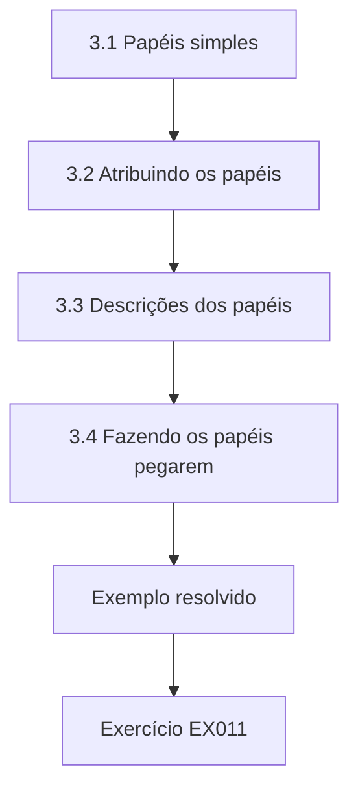

### Desenho lógico

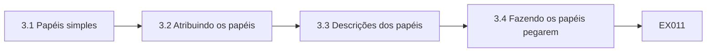

```text
[3.1 Papéis simples]
    |
    v
[3.2 Atribuindo os papéis]
    |
    v
[3.3 Descrições dos papéis]
    |
    v
[3.4 Fazendo os papéis pegarem]
    |
    v
[Exemplo resolvido] --> [Exercício EX011]
```
<!-- open-cyber-academy:lesson-figures:end ch-03 -->


### Objetivos de aprendizagem

Você vai (1) definir papéis de governança para uma pequena organização beneficente; (2) atribuí-los de forma realista; (3) escrever descrições simples de papéis.

### 3.1 Papéis simples

O Sr. Nowak explica que as organizações pequenas precisam de papéis simples. Um conselheiro assume a supervisão dos dados em nome do conselho. Uma líder de dados, Grace, coordena a governança no dia a dia. Os donos são os gestores responsáveis por cada tipo de dado: a gerente de captação de recursos pelos doadores, o coordenador de voluntários pelos voluntários e os líderes dos bancos de alimentos pelos encaminhamentos de clientes. Voluntários e funcionários seguem as regras. Grace observa que nomes claros importam mais que títulos imponentes. Ela escreve os papéis em uma tabela curta, com uma linha por pessoa e os dados de que ela cuida.

### 3.2 Atribuindo os papéis

Grace propõe os papéis ao conselho. Uma conselheira com experiência jurídica aceita supervisionar os dados. A gerente de captação aceita ser dona dos dados de doadores. Os líderes dos bancos de alimentos aceitam ser donos dos encaminhamentos, com Grace definindo regras comuns. Grace verifica se a Northbank precisa nomear um encarregado pelo tratamento de dados pessoais e conclui que o tratamento em larga escala de dados de categoria especial pode exigi-lo; no Brasil, o encarregado está previsto no art. 41 da LGPD. Ela leva a questão à conselheira, que providencia orientação externa, e o conselho decide contratar um encarregado externo em tempo parcial.

### 3.3 Descrições dos papéis

Grace escreve uma descrição curta para cada papel: que decisões toma, o que precisa conferir e a quem presta contas. A descrição do líder de banco de alimentos inclui decidir quais voluntários podem ver os encaminhamentos, conferir se os formulários em papel estão trancados e relatar problemas a Grace em até um dia. Ela limita cada descrição a meia página. O Sr. Nowak observa que descrições curtas têm mais chance de ser lidas e seguidas. Cada dono lê e assina sua descrição, e Grace guarda as cópias assinadas junto com a política de dados, para consulta sempre que surgir uma dúvida sobre quem decide.

### 3.4 Fazendo os papéis pegarem

Grace inclui as responsabilidades sobre dados na integração dos voluntários, para que os novatos saibam a quem perguntar. Acrescenta um item fixo sobre dados na reunião mensal dos líderes. Também pede à conselheira que informe sobre os dados em cada reunião do conselho. O Sr. Nowak explica que os papéis se tornam reais quando aparecem nas rotinas, como integrações e reuniões, e não apenas em um documento que ninguém relê. Depois de três meses, Grace percebe que os líderes levantam questões sobre dados na maioria das reuniões mensais, sinal de que a rotina funciona e de que eles já veem os dados como parte do trabalho.

### Exemplo resolvido

Grace define os papéis de conselheira, líder de dados, donos e voluntários, atribui a supervisão a uma conselheira com experiência jurídica, levanta a possível necessidade de um encarregado pelo tratamento de dados e incorpora os papéis às integrações e reuniões.

> **Caso sintético.** Os papéis são sintéticos; o GDPR e a LGPD são reais.

### Erros e limites

Copiar a estrutura de papéis de grandes empresas para uma pequena organização cria cargos vagos.

### Exercícios

- **EX011 — Dona dos doadores.** Quem é dono dos dados de doadores? *Rubrica:* 3 = a gerente de captação de recursos;; 2 = parcialmente correto;; 1 = outro;; 0 = nenhuma.
- **EX012 — Conselheira supervisora.** Qual conselheira supervisiona os dados? *Rubrica:* 3 = a que tem experiência jurídica;; 2 = parcialmente correto;; 1 = vago;; 0 = nenhuma.
- **EX013 — Questão do encarregado.** Por que a Northbank pode precisar de um encarregado pelo tratamento de dados? *Rubrica:* 3 = tratamento em larga escala de dados de categoria especial;; 2 = parcialmente correto;; 1 = vago;; 0 = nenhuma.
- **EX014 — Prazo dos líderes.** Em quanto tempo os líderes devem relatar problemas? *Rubrica:* 3 = em até um dia;; 2 = parcialmente correto;; 1 = errado;; 0 = nenhuma.
- **EX015 — Incorporando os papéis.** Cite uma rotina que incorpora os papéis. *Rubrica:* 3 = a integração dos voluntários ou as reuniões mensais;; 2 = uma;; 1 = vago;; 0 = nenhuma.

<!-- open-cyber-academy:chapter-navigation:start ch-03 -->
### Continue estudando — aula 03 (capítulo 03 de 12)

[← Capítulo 02](#ch-02) · [Índice das aulas](../SUBJECTS.md) · [Capítulo 04 →](#ch-04)

Continue para a próxima aula já escrita.
<!-- open-cyber-academy:chapter-navigation:end -->

<a id="ch-04"></a>

## Capítulo 4 — Um inventário de dados

<!-- open-cyber-academy:lesson-figures:start ch-04 -->
### Mapa da aula

Aula 04 publicada. Mapa, exemplo, EX016.

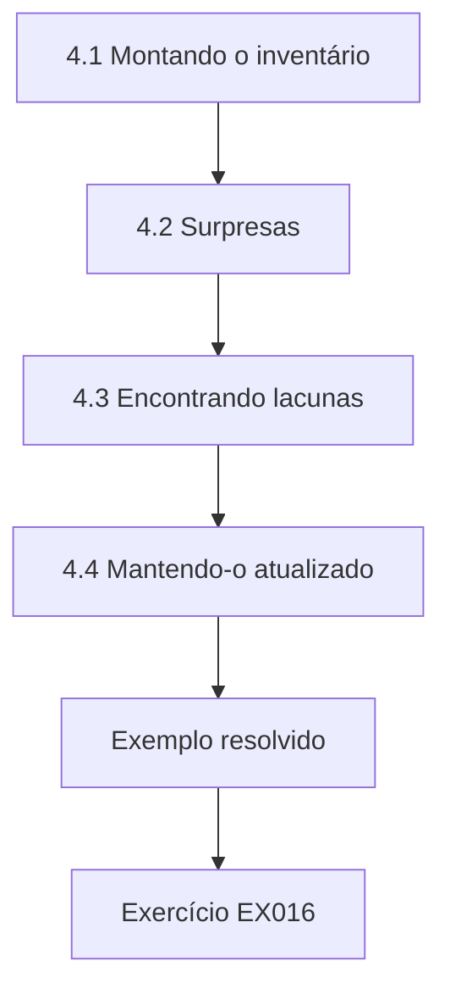

### Desenho lógico

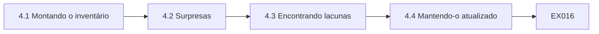

```text
[4.1 Montando o inventário]
    |
    v
[4.2 Surpresas]
    |
    v
[4.3 Encontrando lacunas]
    |
    v
[4.4 Mantendo-o atualizado]
    |
    v
[Exemplo resolvido] --> [Exercício EX016]
```
<!-- open-cyber-academy:lesson-figures:end ch-04 -->


### Objetivos de aprendizagem

Você vai (1) montar um inventário de dados; (2) registrar finalidade, local e acesso; (3) usar o inventário para encontrar lacunas.

### 4.1 Montando o inventário

Grace monta um inventário em uma planilha. Cada linha é um conjunto de dados, como o banco de dados de doadores ou os formulários de encaminhamento do banco de alimentos da beira do rio. As colunas registram que dados pessoais ele contém, a finalidade, a base legal, onde está armazenado, quem pode acessá-lo, por quanto tempo é guardado e o dono. Ela visita cada banco de alimentos e pede aos líderes que lhe mostrem onde os dados ficam, em vez de confiar em descrições, e encontra itens que ninguém tinha mencionado. Ela visita os seis bancos em duas semanas e completa o inventário logo depois.

### 4.2 Surpresas

Em dois bancos de alimentos, os voluntários guardam os telefones dos clientes nos celulares pessoais para combinar as retiradas. Um banco guarda em um armário formulários de encaminhamento de cinco anos atrás. A caixa de e-mail compartilhada contém encaminhamentos de assistentes sociais com todos os detalhes dos casos. Grace registra cada item no inventário. O Sr. Nowak observa que as visitas presenciais revelam práticas informais que as pessoas nem pensam em mencionar, porque lhes parecem normais. Grace agradece aos líderes por mostrarem essas práticas abertamente e explica que o objetivo é corrigir os problemas, e não culpar ninguém.

### 4.3 Encontrando lacunas

Com o inventário completo, Grace procura lacunas: dados sem finalidade clara, dados sem base legal registrada, dados guardados por tempo demais e dados acessíveis a gente demais. Ela descobre que os formulários de cinco anos já não têm finalidade, que os celulares pessoais dos voluntários estão fora de controle e que a caixa compartilhada está aberta a todos os funcionários. Ela lista ações com donos e datas para cada lacuna. A conselheira que supervisiona os dados revisa a lista e acorda as datas com cada dono, para que as lacunas mais graves, que envolvem dados de clientes, sejam tratadas primeiro.

### 4.4 Mantendo-o atualizado

Grace pede aos donos que a avisem quando começarem a coletar dados novos ou mudarem a forma de armazená-los. Ela agenda uma revisão do inventário a cada seis meses. Também usa o inventário para escrever o aviso de privacidade da Northbank, porque ele lista que dados são mantidos e por quê. O Sr. Nowak explica que o GDPR espera que as organizações mantenham registros das operações de tratamento, e que a LGPD tem exigência semelhante no art. 37; um bom inventário atende a essa finalidade e a muitas outras. Grace inclui a revisão do inventário no calendário de governança, para que não seja esquecida nos períodos movimentados.

### Exemplo resolvido

Grace monta um inventário visitando cada banco de alimentos, encontra números de clientes em celulares pessoais, formulários de cinco anos e uma caixa de e-mail aberta, lista ações para as lacunas e mantém o inventário atualizado para o aviso de privacidade.

> **Caso sintético.** As constatações são sintéticas; o GDPR e a LGPD são reais.

### Erros e limites

Montar inventários só a partir de descrições deixa escapar as práticas informais.

### Exercícios

- **EX016 — Motivo das visitas.** Por que Grace visitou pessoalmente os bancos de alimentos? *Rubrica:* 3 = para encontrar dados que as pessoas não mencionam;; 2 = parcialmente correto;; 1 = vago;; 0 = nenhuma.
- **EX017 — Formulários antigos.** Quantos anos tinham os formulários esquecidos? *Rubrica:* 3 = cinco anos;; 2 = parcialmente correto;; 1 = errado;; 0 = nenhuma.
- **EX018 — Lacuna da caixa de e-mail.** O que havia de errado com a caixa compartilhada? *Rubrica:* 3 = aberta a todos os funcionários, com detalhes dos casos;; 2 = parcialmente correto;; 1 = vago;; 0 = nenhuma.
- **EX019 — Ciclo de revisão.** Com que frequência o inventário é revisado? *Rubrica:* 3 = a cada seis meses;; 2 = parcialmente correto;; 1 = errado;; 0 = nenhuma.
- **EX020 — Uso no aviso.** Que documento o inventário ajuda a escrever? *Rubrica:* 3 = o aviso de privacidade;; 2 = parcialmente correto;; 1 = outro;; 0 = nenhuma.

<!-- open-cyber-academy:chapter-navigation:start ch-04 -->
### Continue estudando — aula 04 (capítulo 04 de 12)

[← Capítulo 03](#ch-03) · [Índice das aulas](../SUBJECTS.md) · [Capítulo 05 →](#ch-05)

Continue para a próxima aula já escrita.
<!-- open-cyber-academy:chapter-navigation:end -->

<a id="ch-05"></a>

## Capítulo 5 — O essencial da política

<!-- open-cyber-academy:lesson-figures:start ch-05 -->
### Mapa da aula

Aula 05 publicada. Mapa, exemplo, EX021.

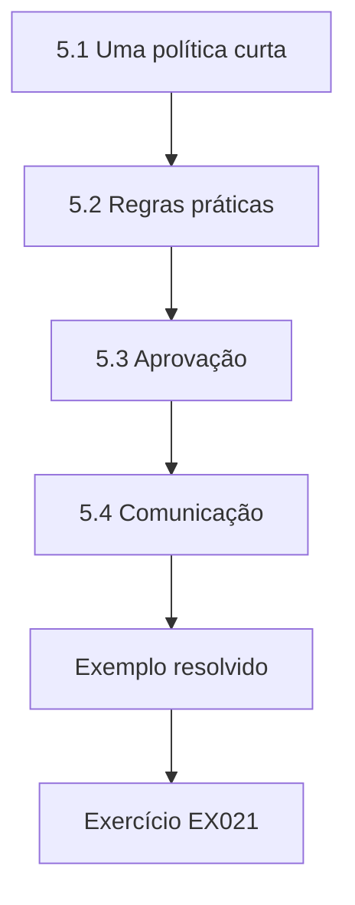

### Desenho lógico

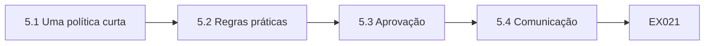

```text
[5.1 Uma política curta]
    |
    v
[5.2 Regras práticas]
    |
    v
[5.3 Aprovação]
    |
    v
[5.4 Comunicação]
    |
    v
[Exemplo resolvido] --> [Exercício EX021]
```
<!-- open-cyber-academy:lesson-figures:end ch-05 -->


### Objetivos de aprendizagem

Você vai (1) escrever uma política de dados curta; (2) transformá-la em regras práticas para os voluntários; (3) obter a aprovação e comunicá-la.

### 5.1 Uma política curta

Grace redige uma política de dados de duas páginas para a Northbank: por que os dados importam para a missão, os papéis, os princípios para o tratamento de dados pessoais, as regras para os dados dos clientes, o básico de segurança, a retenção e como relatar problemas. Ela evita a linguagem jurídica sempre que possível. A política estabelece que os encaminhamentos só podem ser vistos por voluntários nomeados do banco de alimentos correspondente e nunca podem ser guardados em dispositivos pessoais. Os donos comentam, e ela revisa o rascunho. A versão final fica mais clara e mais curta que a primeira, sem perder nenhuma regra importante.

### 5.2 Regras práticas

A maioria dos voluntários não vai ler uma política. Grace a transforma em um guia de uma página chamado Cuidando das informações das pessoas, com dez regras simples, como trancar os formulários de encaminhamento no fim de cada turno, nunca fotografar formulários e relatar papéis ou celulares perdidos ao líder no mesmo dia. Ela testa o guia com cinco voluntários, que sugerem palavras mais simples para duas regras. O guia final é impresso para todos os bancos de alimentos. Grace acrescenta ilustrações simples para ajudar os voluntários a lembrar das regras durante os turnos mais corridos.

### 5.3 Aprovação

A conselheira que supervisiona os dados apresenta a política ao conselho, explicando os riscos e os benefícios. O conselho a aprova e pede um relatório de andamento em três meses. Grace observa que a aprovação do conselho dá autoridade à política, o que ajuda quando líderes ou voluntários resistem a mudanças, como deixar de usar os celulares pessoais. O Sr. Nowak explica que políticas sem apoio da alta liderança são facilmente ignoradas. A conselheira também pede a Grace que traga exemplos de como a política mudou a prática em cada banco de alimentos, para que o conselho veja efeitos reais, e não apenas um documento.

### 5.4 Comunicação

Grace apresenta o guia em cada banco de alimentos com uma fala curta durante um turno, explicando por que cada regra protege os clientes. Ela responde a perguntas, como a de saber como os voluntários devem combinar as retiradas sem os celulares pessoais. Para isso, providencia um celular da organização em cada banco de alimentos. Ela observa que as regras são seguidas com mais boa vontade quando as pessoas entendem o motivo e têm uma alternativa prática aos velhos hábitos. Depois das falas, Grace confere com cada líder se o guia está afixado e se o celular da organização está em uso nas retiradas.

### Exemplo resolvido

Grace redige uma política de duas páginas, transforma-a em um guia de dez regras testado com voluntários, obtém a aprovação do conselho com um retorno em três meses e a apresenta com falas presenciais e celulares da organização.

> **Caso sintético.** Os documentos são sintéticos.

### Erros e limites

Proibir uma prática sem oferecer alternativa leva as pessoas a continuar com ela às escondidas.

### Exercícios

- **EX021 — Regra dos dados de clientes.** Quem pode ver os encaminhamentos de clientes? *Rubrica:* 3 = voluntários nomeados do banco de alimentos correspondente;; 2 = parcialmente correto;; 1 = vago;; 0 = nenhuma.
- **EX022 — Título do guia.** Como se chama o guia dos voluntários? *Rubrica:* 3 = Cuidando das informações das pessoas;; 2 = parcialmente correto;; 1 = vago;; 0 = nenhuma.
- **EX023 — Número de regras.** Quantas regras o guia tem? *Rubrica:* 3 = dez;; 2 = parcialmente correto;; 1 = errado;; 0 = nenhuma.
- **EX024 — Alternativa aos celulares.** O que substituiu os celulares pessoais nas retiradas? *Rubrica:* 3 = um celular da organização em cada banco de alimentos;; 2 = parcialmente correto;; 1 = vago;; 0 = nenhuma.
- **EX025 — Pedido do conselho.** O que o conselho pediu após a aprovação? *Rubrica:* 3 = um relatório de andamento em três meses;; 2 = parcialmente correto;; 1 = vago;; 0 = nenhuma.

<!-- open-cyber-academy:chapter-navigation:start ch-05 -->
### Continue estudando — aula 05 (capítulo 05 de 12)

[← Capítulo 04](#ch-04) · [Índice das aulas](../SUBJECTS.md) · [Capítulo 06 →](#ch-06)

Continue para a próxima aula já escrita.
<!-- open-cyber-academy:chapter-navigation:end -->

<a id="ch-06"></a>

## Capítulo 6 — Qualidade de dados na prática

<!-- open-cyber-academy:lesson-figures:start ch-06 -->
### Mapa da aula

Aula 06 publicada. Mapa, exemplo, EX026.

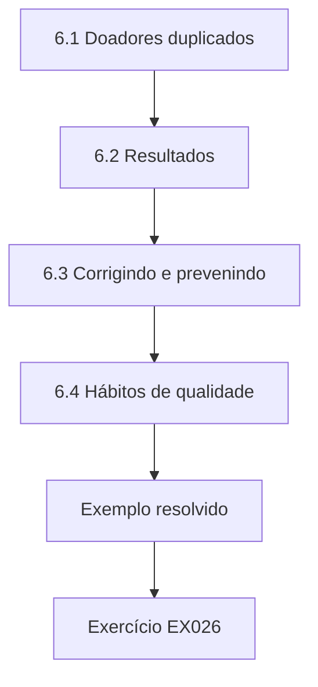

### Desenho lógico

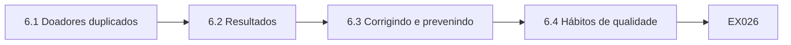

```text
[6.1 Doadores duplicados]
    |
    v
[6.2 Resultados]
    |
    v
[6.3 Corrigindo e prevenindo]
    |
    v
[6.4 Hábitos de qualidade]
    |
    v
[Exemplo resolvido] --> [Exercício EX026]
```
<!-- open-cyber-academy:lesson-figures:end ch-06 -->


### Objetivos de aprendizagem

Você vai (1) encontrar registros duplicados de doadores; (2) normalizar campos simples; (3) criar hábitos de qualidade para uma equipe pequena.

### 6.1 Doadores duplicados

A gerente de captação conta que alguns doadores recebem duas cópias de cada boletim e reclamam. Grace suspeita de endereços de e-mail duplicados, digitados de maneiras diferentes. Ela exporta e-mails sintéticos de doadores e verifica quantos são, na verdade, o mesmo endereço escrito de outro jeito, com letras maiúsculas ou espaços a mais. Explica que as duplicatas desperdiçam dinheiro, irritam os doadores e fazem parecer que a Northbank tem mais apoiadores do que realmente tem. A gerente de captação concorda em exportar a lista de e-mails dos doadores e conferi-la com a ajuda de Grace.

```python
"""Count duplicate synthetic donor emails before and after normalising case and spaces (stdlib only)."""
import random
random.seed(2)
base = [f"donor{i}@example.org" for i in range(1500)]
emails = []
for e in base:
    emails.append(e)
    if random.random() < 0.08: emails.append(e.upper())
    if random.random() < 0.05: emails.append(" " + e + " ")
print(f"records {len(emails)}; distinct as written {len(set(emails))}; distinct normalised {len({e.strip().lower() for e in emails})}")
print(f"duplicate records found by normalising {len(emails) - len({e.strip().lower() for e in emails})}")
```

Execute com `python3 lab_emails.py`. Saída verificada:

```text
records 1684; distinct as written 1684; distinct normalised 1500
duplicate records found by normalising 184
```

### 6.2 Resultados

O laboratório confere 1.684 registros sintéticos de e-mail. Como foram escritos, os 1.684 são todos distintos, de modo que uma verificação simples de duplicatas não encontra nada. Depois de converter para minúsculas e remover os espaços das pontas, restam apenas 1.500 endereços distintos. A normalização revela 184 registros duplicados. Grace observa que as duplicatas eram invisíveis até a normalização, e por isso os boletins saíam em dobro sem que ninguém entendesse o motivo. Ela explica a constatação à gerente de captação com três exemplos do mesmo endereço escrito de formas diferentes, o que torna o problema fácil de entender sem conhecimento técnico.

### 6.3 Corrigindo e prevenindo

A gerente de captação funde os doadores duplicados no banco de dados, mantendo o histórico completo de doações em um único registro. Grace pergunta ao fornecedor do banco de dados se os e-mails podem ser guardados automaticamente em minúsculas, e ele confirma que sim. Ela também pede à equipe que procure o doador antes de cadastrar um novo. O Sr. Nowak observa que é preciso corrigir as duplicatas existentes e também prevenir as novas, senão o problema volta. Depois das mudanças, as reclamações sobre boletins em dobro param, e a gerente de captação apresenta ao conselho uma contagem mais exata de apoiadores.

### 6.4 Hábitos de qualidade

Grace cria hábitos simples: uma verificação mensal de duplicatas, uma verificação trimestral de CEPs ausentes e uma verificação anual de que a definição de família é usada de forma consistente. Cada verificação tem um dono e leva menos de uma hora. Ela registra os resultados em um log curto. Observa que verificações pequenas e regulares combinam melhor com uma organização de equipe reduzida do que grandes mutirões de limpeza que competem com o trabalho diário. O log é revisado em cada reunião mensal dos líderes, para que os problemas sejam percebidos cedo e os donos vejam que suas verificações fazem diferença.

### Exemplo resolvido

Grace encontra 184 e-mails de doadores duplicados, invisíveis até que 1.684 registros fossem normalizados em 1.500 endereços, funde-os mantendo o histórico de doações, ativa o armazenamento em minúsculas e a busca antes do cadastro e cria verificações mensais.

> **Caso sintético.** Os e-mails são sintéticos; as saídas vêm de lab_emails.py.

### Erros e limites

Verificações de duplicatas por correspondência exata deixam passar diferenças de maiúsculas e espaços.

### Exercícios

- **EX026 — Distintos após normalizar.** Quantos endereços distintos restam após a normalização? *Rubrica:* 3 = 1.500;; 2 = parcialmente correto;; 1 = errado;; 0 = nenhuma.
- **EX027 — Duplicatas reveladas.** Quantos registros duplicados a normalização revelou? *Rubrica:* 3 = 184;; 2 = parcialmente correto;; 1 = errado;; 0 = nenhuma.
- **EX028 — Resultado da verificação exata.** O que uma verificação exata de duplicatas encontrou? *Rubrica:* 3 = nada; os 1.684 eram distintos como foram escritos;; 2 = nada, sem o motivo;; 1 = vago;; 0 = sem resposta.
- **EX029 — Mudança do fornecedor.** O que o fornecedor ativou? *Rubrica:* 3 = o armazenamento automático dos e-mails em minúsculas;; 2 = parcialmente correto;; 1 = vago;; 0 = nenhuma.
- **EX030 — Duração das verificações.** Quanto tempo cada verificação deve levar? *Rubrica:* 3 = menos de uma hora;; 2 = parcialmente correto;; 1 = errado;; 0 = nenhuma.

<!-- open-cyber-academy:chapter-navigation:start ch-06 -->
### Continue estudando — aula 06 (capítulo 06 de 12)

[← Capítulo 05](#ch-05) · [Índice das aulas](../SUBJECTS.md) · [Capítulo 07 →](#ch-07)

Continue para a próxima aula já escrita.
<!-- open-cyber-academy:chapter-navigation:end -->

<a id="ch-07"></a>

## Capítulo 7 — Consentimento e base legal

<!-- open-cyber-academy:lesson-figures:start ch-07 -->
### Mapa da aula

Aula 07 publicada. Mapa, exemplo, EX031.

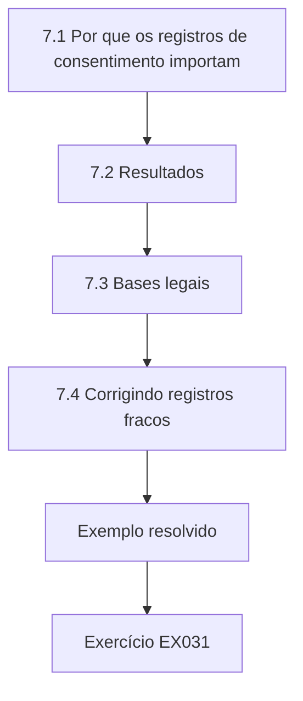

### Desenho lógico

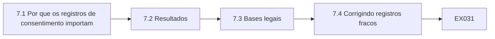

```text
[7.1 Por que os registros de consentimento importam]
    |
    v
[7.2 Resultados]
    |
    v
[7.3 Bases legais]
    |
    v
[7.4 Corrigindo registros fracos]
    |
    v
[Exemplo resolvido] --> [Exercício EX031]
```
<!-- open-cyber-academy:lesson-figures:end ch-07 -->


### Objetivos de aprendizagem

Você vai (1) verificar se os registros de consentimento sustentam o marketing; (2) escolher bases legais para usos diferentes; (3) corrigir registros de consentimento fracos.

### 7.1 Por que os registros de consentimento importam

A Northbank envia e-mails aos doadores sobre campanhas e eventos. As regras de marketing eletrônico exigem consentimento para esses e-mails, e o GDPR exige que a organização consiga demonstrar que o consentimento foi dado; na LGPD, o ônus dessa prova cabe ao controlador (art. 8º, § 2º). Grace examina o campo de consentimento do banco de doadores. Alguns registros dizem sim com data e origem, alguns dizem sim sem data, alguns dizem não e alguns estão em branco. Ela explica que um sim sem data não mostra quando nem como o consentimento foi dado, o que o torna uma evidência fraca se um doador reclamar. Grace conta cada tipo.

```python
"""Check marketing consent records for 4,000 synthetic donors (stdlib only)."""
import random
random.seed(8)
rows = []
for _ in range(4000):
    r = random.random()
    rows.append("yes_dated" if r < 0.62 else "yes_undated" if r < 0.77 else "no" if r < 0.93 else "blank")
for k in ["yes_dated", "yes_undated", "no", "blank"]:
    n = rows.count(k); print(f"{k:<12} {n:5d} ({100*n/len(rows):.1f}%)")
print(f"safe to email: {rows.count('yes_dated')} of {len(rows)}")
```

Execute com `python3 lab_consent.py`. Saída verificada:

```text
yes_dated     2507 (62.7%)
yes_undated    595 (14.9%)
no             615 (15.4%)
blank          283 (7.1%)
safe to email: 2507 of 4000
```

### 7.2 Resultados

O laboratório confere quatro mil registros sintéticos de doadores. Os registros com sim datado somam 2.507, ou 62,7 por cento. Os de sim sem data somam 595, 14,9 por cento. Os marcados com não somam 615, 15,4 por cento, e 283 estão em branco, 7,1 por cento. Grace conclui que só os 2.507 doadores com consentimento datado devem receber e-mails de marketing até que os demais sejam conferidos. A gerente de captação se surpreende, pois supunha que todo sim servia. Grace explica que os registros sem data e em branco podem muito bem ser de apoiadores felizes em receber notícias, mas a organização não consegue demonstrá-lo, por isso o mais seguro é perguntar de novo.

### 7.3 Bases legais

Grace revisa as bases legais com o Sr. Nowak. Os e-mails de marketing se apoiam no consentimento. O processamento das doações e o envio de recibos se apoiam no contrato da organização com o doador ou em obrigações legais ligadas a benefícios fiscais. Os encaminhamentos de clientes se apoiam em interesses legítimos ou em considerações de interesse público, mais uma condição para os dados de categoria especial, que o encarregado externo ajuda a confirmar; na LGPD, os dados sensíveis têm bases próprias no art. 11. Ela registra cada base no inventário para que a equipe saiba que regras valem. O encarregado confirma cada base e anota a condição usada para as informações de saúde.

### 7.4 Corrigindo registros fracos

Para os 595 registros de sim sem data, Grace e a gerente de captação planejam um pequeno formulário de preferências enviado junto com os recibos impressos das doações, para que os doadores confirmem suas escolhas sem que a Northbank envie e-mails de marketing que ainda não consegue justificar. Os doadores que confirmam são registrados com a data e o meio. Os registros em branco são tratados como não. Os novos formulários de inscrição registram automaticamente o consentimento com a data, o texto exibido e a origem. O Sr. Nowak observa que bons registros protegem a organização e respeitam as escolhas dos doadores. A gerente de captação concorda prontamente.

### Exemplo resolvido

Grace encontra 2.507 de 4.000 doadores (62,7 por cento) com consentimento datado, 595 sem data, 615 com não e 283 em branco, limita os e-mails ao consentimento datado, registra as bases legais de cada uso e planeja a reconfirmação por meio dos recibos.

> **Caso sintético.** Os doadores são sintéticos; as saídas vêm de lab_consent.py; o GDPR e a LGPD são reais. Isto não é aconselhamento jurídico.

### Erros e limites

Tratar qualquer sim como consentimento válido ignora a necessidade de mostrar quando e como ele foi dado.

### Exercícios

- **EX031 — Parcela com consentimento datado.** Que parcela dos doadores tinha consentimento datado? *Rubrica:* 3 = 62,7% (2.507);; 2 = parcialmente correto;; 1 = errado;; 0 = nenhuma.
- **EX032 — Tratamento dos brancos.** Como são tratados os registros de consentimento em branco? *Rubrica:* 3 = como não;; 2 = parcialmente correto;; 1 = como sim;; 0 = nenhuma.
- **EX033 — Fraqueza do sim sem data.** Por que os registros de sim sem data são fracos? *Rubrica:* 3 = não mostram quando nem como o consentimento foi dado;; 2 = parcialmente correto;; 1 = vago;; 0 = nenhuma.
- **EX034 — Base dos recibos.** Que base sustenta o envio de recibos? *Rubrica:* 3 = contrato ou obrigação legal;; 2 = parcialmente correto;; 1 = consentimento;; 0 = nenhuma.
- **EX035 — Campos dos novos formulários.** O que os novos formulários registram automaticamente? *Rubrica:* 3 = data, texto exibido e origem;; 2 = todos;; 1 = alguns;; 0 = nenhuma.

<!-- open-cyber-academy:chapter-navigation:start ch-07 -->
### Continue estudando — aula 07 (capítulo 07 de 12)

[← Capítulo 06](#ch-06) · [Índice das aulas](../SUBJECTS.md) · [Capítulo 08 →](#ch-08)

Continue para a próxima aula já escrita.
<!-- open-cyber-academy:chapter-navigation:end -->

<a id="ch-08"></a>

## Capítulo 8 — O essencial da segurança

<!-- open-cyber-academy:lesson-figures:start ch-08 -->
### Mapa da aula

Aula 08 publicada. Mapa, exemplo, EX036.

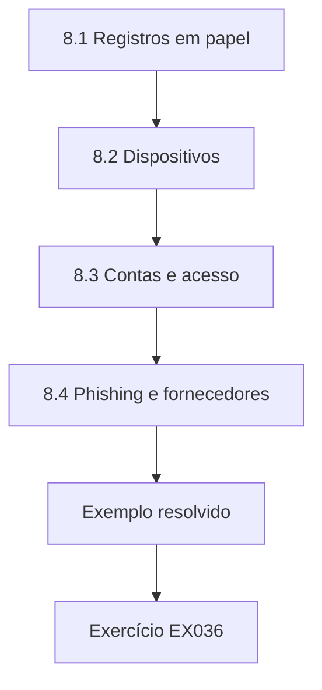

### Desenho lógico

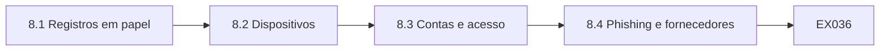

```text
[8.1 Registros em papel]
    |
    v
[8.2 Dispositivos]
    |
    v
[8.3 Contas e acesso]
    |
    v
[8.4 Phishing e fornecedores]
    |
    v
[Exemplo resolvido] --> [Exercício EX036]
```
<!-- open-cyber-academy:lesson-figures:end ch-08 -->


### Objetivos de aprendizagem

Você vai (1) aplicar controles básicos de segurança em uma pequena organização beneficente; (2) proteger papéis e dispositivos; (3) controlar o acesso aos sistemas compartilhados.

### 8.1 Registros em papel

Os formulários de encaminhamento chegam em papel aos bancos de alimentos. Grace introduz arquivos com chave em cada local, com as chaves em poder dos líderes. Os formulários são digitalizados em um sistema de casos seguro em até uma semana, e o papel é triturado. Ela confere cada banco um mês depois e encontra dois que ainda guardam os formulários em uma caixa aberta. Conversa com os líderes sobre os motivos, e eles explicam que o arquivo fica em outra sala; ela então providencia um arquivo para a sala de distribuição. O novo arquivo chega em quinze dias, e os formulários passam a ser trancados ao fim de cada turno.

### 8.2 Dispositivos

Os voluntários usavam celulares pessoais para os contatos dos clientes. Grace os substitui por celulares da organização com bloqueio de tela, criptografia e apagamento remoto ativados. Os notebooks usados nos encaminhamentos são criptografados e exigem senha. Ela escreve uma regra curta, explicada no guia dos voluntários: dados de clientes não podem ser guardados em dispositivos pessoais. O Sr. Nowak observa que organizações pequenas conseguem uma proteção forte com configurações básicas de baixo custo. Grace configura ela mesma os celulares com uma lista de verificação curta, para que todos tenham as mesmas proteções e as configurações possam ser conferidas depois.

### 8.3 Contas e acesso

A caixa compartilhada aberta a todos é substituída por uma caixa de encaminhamentos acessível apenas aos líderes e a Grace. Cada pessoa tem seu próprio login com autenticação multifator. Grace revisa os acessos a cada trimestre e remove os voluntários que saíram. Ela encontra três ex-voluntários que ainda conseguiam ler o banco de doadores e os remove. Explica que remover os acessos sem demora é um dos controles de segurança mais simples e eficazes. Ela registra cada revisão com a data e as mudanças feitas, e a conselheira que supervisiona os dados confere o registro na reunião seguinte do conselho.

### 8.4 Phishing e fornecedores

Grace organiza uma sessão curta de conscientização sobre phishing depois que uma voluntária quase digitou a senha em uma página de login falsa. Também verifica se o fornecedor do banco de doadores oferece criptografia, backups e logs de acesso, e se o contrato inclui cláusulas de proteção de dados. O Sr. Nowak observa que as organizações beneficentes são alvos frequentes de golpes, e que combinar a conscientização da equipe com verificações dos fornecedores cobre as ameaças mais comuns. Grace escreve uma nota curta sobre como reconhecer páginas de login falsas e a quem avisar, afixada ao lado do computador de cada banco e repetida na integração.

### Exemplo resolvido

Grace introduz arquivos trancados, digitalização e trituração, celulares e notebooks da organização criptografados, uma caixa de encaminhamentos restrita com MFA, revisões trimestrais de acesso que removem três ex-voluntários e conscientização sobre phishing.

> **Caso sintético.** Os controles são sintéticos.

### Erros e limites

Manter o acesso de ex-voluntários expõe os dados muito depois de eles saírem.

### Exercícios

- **EX036 — Prazo de digitalização.** Em quanto tempo os formulários de encaminhamento são digitalizados? *Rubrica:* 3 = em até uma semana;; 2 = parcialmente correto;; 1 = errado;; 0 = nenhuma.
- **EX037 — Motivo da caixa aberta.** Por que dois bancos ainda usavam caixas abertas? *Rubrica:* 3 = o arquivo ficava em outra sala;; 2 = parcialmente correto;; 1 = vago;; 0 = nenhuma.
- **EX038 — Configurações dos celulares.** Que configurações os celulares da organização têm? *Rubrica:* 3 = bloqueio de tela, criptografia e apagamento remoto;; 2 = todas;; 1 = algumas;; 0 = nenhuma.
- **EX039 — Acessos antigos.** Quantos ex-voluntários ainda conseguiam ler o banco de doadores? *Rubrica:* 3 = três;; 2 = parcialmente correto;; 1 = errado;; 0 = nenhuma.
- **EX040 — Verificações do fornecedor.** O que Grace conferiu com o fornecedor do banco de dados? *Rubrica:* 3 = criptografia, backups, logs e cláusulas contratuais;; 2 = a maioria;; 1 = poucas;; 0 = nenhuma.

<!-- open-cyber-academy:chapter-navigation:start ch-08 -->
### Continue estudando — aula 08 (capítulo 08 de 12)

[← Capítulo 07](#ch-07) · [Índice das aulas](../SUBJECTS.md) · [Capítulo 09 →](#ch-09)

Continue para a próxima aula já escrita.
<!-- open-cyber-academy:chapter-navigation:end -->

<a id="ch-09"></a>

## Capítulo 9 — Trabalhando com fornecedores e voluntários

<!-- open-cyber-academy:lesson-figures:start ch-09 -->
### Mapa da aula

Aula 09 publicada. Mapa, exemplo, EX041.

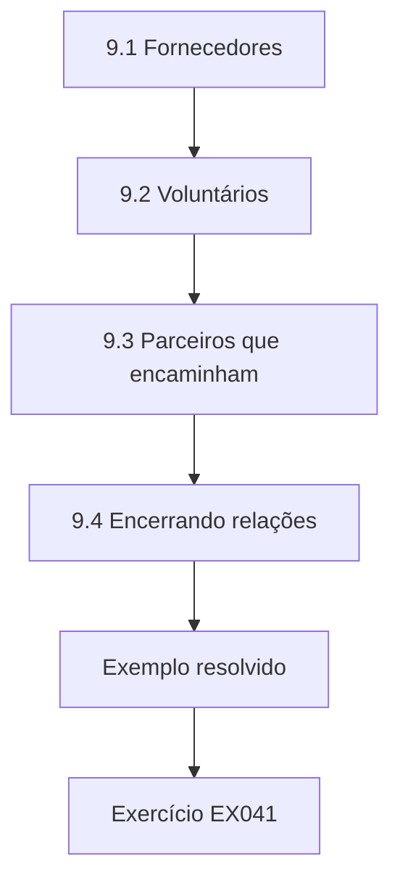

### Desenho lógico

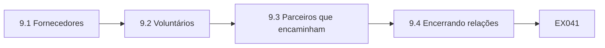

```text
[9.1 Fornecedores]
    |
    v
[9.2 Voluntários]
    |
    v
[9.3 Parceiros que encaminham]
    |
    v
[9.4 Encerrando relações]
    |
    v
[Exemplo resolvido] --> [Exercício EX041]
```
<!-- open-cyber-academy:lesson-figures:end ch-09 -->


### Objetivos de aprendizagem

Você vai (1) gerenciar dados com fornecedores; (2) definir expectativas para os voluntários; (3) tratar os dados compartilhados com os parceiros que encaminham clientes.

### 9.1 Fornecedores

A Northbank usa um fornecedor do banco de doadores, um serviço de boletins por e-mail e uma empresa de folha de pagamento para seus poucos funcionários. Grace lista os dados pessoais que cada um recebe e verifica se os contratos incluem as cláusulas de operador exigidas pelo GDPR: agir só segundo as instruções da Northbank, segurança, confidencialidade e eliminação dos dados ao fim do contrato; na LGPD, o operador também deve seguir as instruções do controlador (art. 39). Os termos padrão do serviço de boletins as incluem; o contrato da folha é antigo e não as tem, então ela pede um acordo atualizado, que chega em um mês.

### 9.2 Voluntários

Os voluntários lidam com dados de clientes durante os turnos. Grace acrescenta um termo de confidencialidade à inscrição dos voluntários, explicando que os dados dos clientes devem permanecer em sigilo, e inclui as regras de dados na integração. Ela organiza as coisas para que só vejam os dados dos clientes os voluntários que precisam deles, como os que preparam cestas para retiradas nominais. Os voluntários que separam os alimentos doados não precisam. Ela observa que limitar quem vê os dados reduz o risco sem atrasar o trabalho. Os líderes decidem quem precisa dos dados em cada turno, e a escala mostra isso para que ninguém precise adivinhar.

### 9.3 Parceiros que encaminham

Assistentes sociais e médicos enviam os encaminhamentos. Grace descobre que alguns mandam anotações completas dos casos por e-mail comum. Ela acorda com os principais parceiros um formulário de encaminhamento curto, que pede só o que a Northbank precisa: nome, contato, tamanho da família, necessidades alimentares e os dados de quem encaminha. Informações de saúde só entram quando têm relação com a alimentação, como alergias. Os parceiros enviam os formulários por um portal seguro. Ela registra o acordo com cada parceiro. Os parceiros gostam do formulário mais curto, que toma menos tempo, e caem muito os encaminhamentos com anotações desnecessárias.

### 9.4 Encerrando relações

Quando o antigo serviço de boletins é substituído, Grace pede que ele confirme a eliminação dos e-mails dos doadores e registra a confirmação. Quando os voluntários saem, seus acessos aos sistemas e eventuais chaves são retirados em até uma semana. O Sr. Nowak observa que encerrar as relações de forma limpa costuma ser esquecido, e que uma lista de verificação de saída curta para voluntários e fornecedores evita que os dados fiquem onde não deveriam. Grace escreve a lista em uma única página e pede aos líderes que a preencham sempre que um voluntário sair, devolvendo-a para que ela confirme a remoção de cada conta e chave.

### Exemplo resolvido

Grace confere as cláusulas de operador e atualiza o contrato da folha de pagamento, acrescenta a confidencialidade dos voluntários e limita os dados dos clientes a quem precisa deles, acorda com os parceiros um formulário de encaminhamento mínimo e seguro e confirma a eliminação ao trocar de fornecedor.

> **Caso sintético.** Os fornecedores e parceiros são sintéticos; o GDPR e a LGPD são reais.

### Erros e limites

Aceitar anotações completas dos casos quando um formulário curto bastaria coleta mais dados sensíveis do que o necessário.

### Exercícios

- **EX041 — Contrato da folha.** O que faltava no contrato da folha de pagamento? *Rubrica:* 3 = cláusulas de operador;; 2 = parcialmente correto;; 1 = vago;; 0 = nenhuma.
- **EX042 — Voluntários da separação.** Os voluntários que separam alimentos precisam dos dados dos clientes? *Rubrica:* 3 = não;; 2 = parcialmente correto;; 1 = sim;; 0 = nenhuma.
- **EX043 — Regra das informações de saúde.** Quando as informações de saúde entram nos encaminhamentos? *Rubrica:* 3 = só quando relacionadas à alimentação, como alergias;; 2 = parcialmente correto;; 1 = vago;; 0 = nenhuma.
- **EX044 — Canal dos encaminhamentos.** Como os parceiros enviam os formulários agora? *Rubrica:* 3 = por um portal seguro;; 2 = parcialmente correto;; 1 = por e-mail;; 0 = nenhuma.
- **EX045 — Prazo na saída.** Em quanto tempo o acesso de quem sai é retirado? *Rubrica:* 3 = em até uma semana;; 2 = parcialmente correto;; 1 = errado;; 0 = nenhuma.

<!-- open-cyber-academy:chapter-navigation:start ch-09 -->
### Continue estudando — aula 09 (capítulo 09 de 12)

[← Capítulo 08](#ch-08) · [Índice das aulas](../SUBJECTS.md) · [Capítulo 10 →](#ch-10)

Continue para a próxima aula já escrita.
<!-- open-cyber-academy:chapter-navigation:end -->

<a id="ch-10"></a>

## Capítulo 10 — Retenção e direitos dos titulares

<!-- open-cyber-academy:lesson-figures:start ch-10 -->
### Mapa da aula

Aula 10 publicada. Mapa, exemplo, EX046.

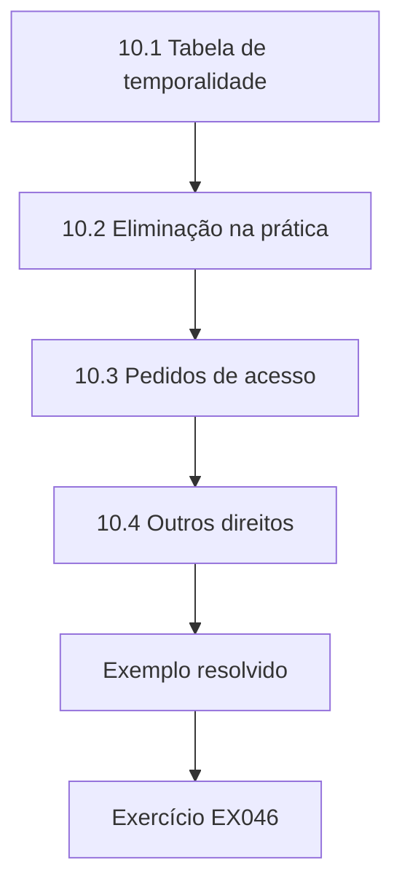

### Desenho lógico

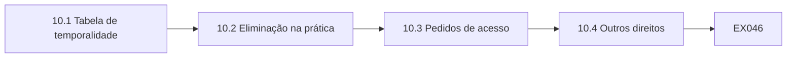

```text
[10.1 Tabela de temporalidade]
    |
    v
[10.2 Eliminação na prática]
    |
    v
[10.3 Pedidos de acesso]
    |
    v
[10.4 Outros direitos]
    |
    v
[Exemplo resolvido] --> [Exercício EX046]
```
<!-- open-cyber-academy:lesson-figures:end ch-10 -->


### Objetivos de aprendizagem

Você vai (1) definir uma tabela de temporalidade simples; (2) eliminar dados com segurança; (3) responder a pedidos de pessoas.

### 10.1 Tabela de temporalidade

Grace redige uma tabela de temporalidade com os donos. Os encaminhamentos são guardados por um ano após a última cesta, tempo suficiente para lidar com novos encaminhamentos e dúvidas. Os registros de doação são guardados pelo período exigido pelas regras fiscais para os benefícios das doações. Os registros de voluntários são guardados por um período curto após a saída, exceto os de salvaguarda, que seguem as orientações do setor. Cada entrada tem um motivo. A conselheira que supervisiona os dados aprova a tabela. Grace a compartilha com todos os donos e a acrescenta ao inventário, para que cada conjunto mostre por quanto tempo será guardado.

### 10.2 Eliminação na prática

Grace organiza uma rotina mensal: o sistema de casos lista os encaminhamentos com mais de um ano desde a última cesta, um líder os confere e os elimina, registrando a contagem. Os formulários em papel de cinco anos encontrados no inventário são triturados com segurança, e o registro é guardado. Ela pede ao fornecedor do banco de doadores que configure a eliminação automática dos registros inativos após o prazo fiscal. O Sr. Nowak observa que a eliminação rotineira é mais fácil que grandes limpezas ocasionais; na LGPD, o término do tratamento e a eliminação estão nos arts. 15 e 16. A primeira execução mensal elimina muitos encaminhamentos antigos.

### 10.3 Pedidos de acesso

Uma ex-cliente pergunta que informações a Northbank tem sobre ela. Grace consulta o inventário para encontrar todos os lugares: o sistema de casos, a caixa de encaminhamentos e o celular da organização no banco de alimentos dela. Ela reúne as informações, retira os dados de outras pessoas, como anotações internas de quem encaminhou sobre outros membros da família, e responde em até um mês, prazo do GDPR; pela LGPD, a declaração completa deve sair em até quinze dias (art. 19, II). Ela registra o pedido e a resposta em um log. A ex-cliente agradece a resposta clara, e Grace observa que o inventário fez a busca levar uma tarde em vez de dias.

### 10.4 Outros direitos

Um doador pede para deixar de receber campanhas. Grace marca o registro como sem marketing em vez de eliminá-lo, para que o doador não seja reincluído a partir de uma lista antiga. Outra pessoa pede a correção de um endereço errado, e Grace o corrige no banco de dados e no serviço de boletins. Ela observa que cada direito precisa de um processo claro, e que o inventário permite encontrar todas as cópias dos dados de uma pessoa; na LGPD, os direitos dos titulares estão reunidos no art. 18. Ela escreve um procedimento de uma página para cada tipo de pedido, com os sistemas a consultar e os prazos de resposta.

### Exemplo resolvido

Grace define a retenção, incluindo um ano após a última cesta para os encaminhamentos, executa a eliminação mensal e tritura os formulários antigos, responde ao pedido de acesso de uma ex-cliente em até um mês e trata objeções ao marketing e correções em todos os sistemas.

> **Caso sintético.** A tabela e os pedidos são sintéticos; o GDPR e a LGPD são reais.

### Erros e limites

Eliminar um doador que se opõe ao marketing arrisca reincluí-lo a partir de listas antigas; marque-o como suprimido.

### Exercícios

- **EX046 — Retenção dos encaminhamentos.** Por quanto tempo os encaminhamentos são guardados após a última cesta? *Rubrica:* 3 = um ano;; 2 = parcialmente correto;; 1 = errado;; 0 = nenhuma.
- **EX047 — Quem confere a eliminação.** Quem confere os encaminhamentos antes da eliminação? *Rubrica:* 3 = um líder de banco de alimentos;; 2 = parcialmente correto;; 1 = outro;; 0 = nenhuma.
- **EX048 — Busca do pedido de acesso.** Onde Grace procurou os dados da ex-cliente? *Rubrica:* 3 = sistema de casos, caixa de encaminhamentos e celular da organização;; 2 = todos;; 1 = alguns;; 0 = nenhuma.
- **EX049 — Tratamento da objeção.** Como foi tratada a objeção do doador? *Rubrica:* 3 = marcado como sem marketing, sem eliminação;; 2 = parcialmente correto;; 1 = eliminado;; 0 = nenhuma.
- **EX050 — Alcance da correção.** Onde o endereço errado foi corrigido? *Rubrica:* 3 = no banco de dados e no serviço de boletins;; 2 = ambos;; 1 = um;; 0 = nenhuma.

<!-- open-cyber-academy:chapter-navigation:start ch-10 -->
### Continue estudando — aula 10 (capítulo 10 de 12)

[← Capítulo 09](#ch-09) · [Índice das aulas](../SUBJECTS.md) · [Capítulo 11 →](#ch-11)

Continue para a próxima aula já escrita.
<!-- open-cyber-academy:chapter-navigation:end -->

<a id="ch-11"></a>

## Capítulo 11 — Incidentes e relatórios ao conselho

<!-- open-cyber-academy:lesson-figures:start ch-11 -->
### Mapa da aula

Aula 11 publicada. Mapa, exemplo, EX051.

```mermaid
flowchart TD
  N0["11.1 Um incidente"]
  N1["11.2 Avaliando e comunicando"]
  N2["11.3 Aprendendo"]
  N3["11.4 Relatando ao conselho"]
  N0 --> N1 --> N2 --> N3
  N3 --> EX["Exemplo resolvido"]
  EX --> Q["Exercício EX051"]
```

### Desenho lógico

```mermaid
flowchart LR
  N0["11.1 Um incidente"]
  N1["11.2 Avaliando e comunicando"]
  N2["11.3 Aprendendo"]
  N3["11.4 Relatando ao conselho"]
  N0 --> N1 --> N2 --> N3 --> Q["EX051"]
```

```text
[11.1 Um incidente]
    |
    v
[11.2 Avaliando e comunicando]
    |
    v
[11.3 Aprendendo]
    |
    v
[11.4 Relatando ao conselho]
    |
    v
[Exemplo resolvido] --> [Exercício EX051]
```
<!-- open-cyber-academy:lesson-figures:end ch-11 -->


### Objetivos de aprendizagem

Você vai (1) tratar um incidente com dados; (2) decidir quando comunicar; (3) relatar ao conselho o andamento da governança.

### 11.1 Um incidente

Uma voluntária esquece em um ônibus uma pasta com cinco formulários de encaminhamento. Ela avisa o líder em menos de uma hora, como manda o guia. Grace inicia o procedimento de incidentes: registrar o que aconteceu, tentar recuperar a pasta, avaliar o risco e decidir sobre a comunicação. A empresa de ônibus não tem registro da pasta. Os formulários contêm nomes, endereços, dados das famílias e, em um deles, uma condição de saúde. Grace anota o conteúdo dos formulários a partir da memória do líder e do sistema de casos, para que o risco possa ser avaliado com precisão e nenhuma família afetada fique de fora.

### 11.2 Avaliando e comunicando

Grace e o encarregado externo avaliam o risco. Os dados são sensíveis, envolvem pessoas vulneráveis e não podem ser recuperados. Eles concluem que o incidente provavelmente gera risco às pessoas e o comunicam à autoridade de supervisão em até setenta e duas horas, como exige o GDPR; no Brasil, a comunicação à ANPD e aos titulares segue o art. 48 da LGPD e a Resolução CD/ANPD nº 15/2024, que fixa o prazo de três dias úteis, contado em dobro para agentes de pequeno porte. Como o risco para as famílias é alto, eles também as informam diretamente, explicando o que aconteceu e oferecendo apoio. Cada passo é registrado, e Grace responde às perguntas da autoridade com base nesses registros.

### 11.3 Aprendendo

A revisão conclui que a voluntária levou os formulários para casa para telefonar às famílias porque o celular da organização estava ocupado. Grace providencia um segundo celular naquele banco de alimentos e lembra aos voluntários que os formulários nunca saem do local. A revisão é feita sem culpados; a voluntária recebe agradecimentos por ter avisado depressa. O Sr. Nowak observa que o relato rápido depende de as pessoas se sentirem seguras para admitir erros, de modo que a forma como o primeiro incidente é tratado molda os relatos futuros. A voluntária aceita ajudar a explicar as novas regras aos colegas de seu banco de alimentos.

### 11.4 Relatando ao conselho

Grace prepara um relatório trimestral para o conselho: andamento das metas, situação do inventário, melhora do consentimento, verificações de qualidade, revisões de acesso, pedidos atendidos e incidentes com suas lições. Ela usa uma tabela simples com classificações verde, âmbar e vermelha e explicações curtas. Os conselheiros perguntam sobre o incidente do ônibus e aprovam recursos para mais celulares da organização. Grace observa que relatar os incidentes com honestidade aumenta a confiança do conselho de que a governança funciona. Ela limita o relatório a duas páginas, com um parágrafo curto sobre cada item vermelho ou âmbar explicando o que está sendo feito e por quem.

### Exemplo resolvido

Grace trata a perda dos formulários de encaminhamento registrando o caso, avaliando o risco com o encarregado externo, comunicando a autoridade em até setenta e duas horas e informando as famílias, acrescenta um segundo celular após uma revisão sem culpados e relata o andamento ao conselho com classificações.

> **Caso sintético.** O incidente é sintético; o GDPR, a LGPD e a Resolução CD/ANPD nº 15/2024 são reais. Isto não é aconselhamento jurídico.

### Erros e limites

Culpar os voluntários pelos erros que eles relatam desestimula relatos futuros.

### Exercícios

- **EX051 — Item perdido.** O que a voluntária perdeu? *Rubrica:* 3 = uma pasta com cinco formulários de encaminhamento;; 2 = parcialmente correto;; 1 = vago;; 0 = nenhuma.
- **EX052 — Prazo da comunicação.** Em que prazo a autoridade foi comunicada? *Rubrica:* 3 = setenta e duas horas;; 2 = parcialmente correto;; 1 = errado;; 0 = nenhuma.
- **EX053 — Famílias informadas.** Por que as famílias foram informadas diretamente? *Rubrica:* 3 = o risco para elas era alto;; 2 = parcialmente correto;; 1 = vago;; 0 = nenhuma.
- **EX054 — Causa-raiz.** Por que os formulários foram levados para casa? *Rubrica:* 3 = o celular da organização estava ocupado;; 2 = parcialmente correto;; 1 = vago;; 0 = nenhuma.
- **EX055 — Decisão do conselho.** O que o conselho financiou? *Rubrica:* 3 = mais celulares da organização;; 2 = parcialmente correto;; 1 = outro;; 0 = nenhuma.

<!-- open-cyber-academy:chapter-navigation:start ch-11 -->
### Continue estudando — aula 11 (capítulo 11 de 12)

[← Capítulo 10](#ch-10) · [Índice das aulas](../SUBJECTS.md) · [Capítulo 12 →](#ch-12)

Continue para a próxima aula já escrita.
<!-- open-cyber-academy:chapter-navigation:end -->

<a id="ch-12"></a>

## Capítulo 12 — Plano de ação e próximos passos

<!-- open-cyber-academy:lesson-figures:start ch-12 -->
### Mapa da aula

Aula 12 publicada. Mapa, exemplo, EX056.

```mermaid
flowchart TD
  N0["12.1 Revisão do andamento"]
  N1["12.2 A definição de família"]
  N2["12.3 Plano de um ano"]
  N3["12.4 Sustentando a governança"]
  N0 --> N1 --> N2 --> N3
  N3 --> EX["Exemplo resolvido"]
  EX --> Q["Exercício EX056"]
```

### Desenho lógico

```mermaid
flowchart LR
  N0["12.1 Revisão do andamento"]
  N1["12.2 A definição de família"]
  N2["12.3 Plano de um ano"]
  N3["12.4 Sustentando a governança"]
  N0 --> N1 --> N2 --> N3 --> Q["EX056"]
```

```text
[12.1 Revisão do andamento]
    |
    v
[12.2 A definição de família]
    |
    v
[12.3 Plano de um ano]
    |
    v
[12.4 Sustentando a governança]
    |
    v
[Exemplo resolvido] --> [Exercício EX056]
```
<!-- open-cyber-academy:lesson-figures:end ch-12 -->


### Objetivos de aprendizagem

Você vai (1) revisar o andamento em relação às metas; (2) escrever um plano de ação de um ano; (3) sustentar a governança depois do curso.

### 12.1 Revisão do andamento

Grace revisa suas metas. A Northbank agora sabe que dados tem e onde estão, os papéis estão atribuídos, os dados dos clientes estão mais protegidos, as duplicatas de doadores e os registros de consentimento melhoraram e o conselho recebe relatórios regulares. Uma meta continua incompleta: os seis bancos de alimentos usando uma única definição de família. Quatro a adotaram; dois ainda usam a sua própria. Ela registra as evidências de cada meta e os motivos da lacuna. Compartilha a revisão com a conselheira que supervisiona os dados antes da reunião do conselho, para que a lacuna restante não surpreenda ninguém.

### 12.2 A definição de família

Grace visita os dois bancos de alimentos. Os líderes explicam que seus parceiros contam as famílias de outro jeito e que mudar os formulários é lento. Grace acorda uma transição: os dois bancos registram a definição acordada ao lado da antiga por três meses e depois fazem a troca. Ela observa que algumas mudanças demoram mais porque dependem de parceiros, e que uma transição planejada é melhor do que impor uma mudança repentina que estrague a relação com eles. Os dois líderes concordam com a transição, e Grace agenda uma visita ao fim dos três meses para confirmar a troca.

### 12.3 Plano de um ano

Grace escreve um plano de um ano: concluir a mudança da definição de família, terminar a reconfirmação dos consentimentos, automatizar a eliminação dos encaminhamentos, fazer duas revisões do inventário, oferecer treinamento de reciclagem aos voluntários e testar o procedimento de incidentes com um exercício simulado. Cada ação tem um dono, uma data e uma medida. O conselho o aprova. O Sr. Nowak observa que planos com donos e medidas têm muito mais chance de ser cumpridos do que intenções gerais. Grace inclui as ações do plano no calendário de governança e revisa o andamento com a conselheira a cada trimestre.

### 12.4 Sustentando a governança

Grace reflete que a governança na Northbank depende de rotinas: verificações mensais, revisões de acesso e relatórios trimestrais, integrações e reuniões de líderes. Ela as documenta em um calendário para que continuem se ela sair. Planeja continuar aprendendo, começando pela privacidade, já que os dados dos clientes são centrais para a Northbank. O próximo curso desta área trata de privacidade e proteção de dados, onde os dados governados encontram os direitos das pessoas que eles descrevem. Ela agradece ao Sr. Nowak e aos colegas de turma, cujas perguntas a ajudaram a enxergar com mais clareza os dados da Northbank.

### Exemplo resolvido

Grace revisa as metas, com uma ainda incompleta, acorda uma transição de três meses com registro duplo para dois bancos de alimentos, escreve um plano de um ano com donos, aprovado pelo conselho, e documenta as rotinas em um calendário de governança.

> **Caso sintético.** O plano é sintético.

### Erros e limites

A governança que depende da memória de uma única pessoa para quando ela sai.

### Exercícios

- **EX056 — Meta incompleta.** Que meta ficou incompleta? *Rubrica:* 3 = uma única definição de família nos seis bancos;; 2 = parcialmente correto;; 1 = vago;; 0 = nenhuma.
- **EX057 — Bancos que adotaram.** Quantos bancos de alimentos adotaram a definição? *Rubrica:* 3 = quatro;; 2 = parcialmente correto;; 1 = errado;; 0 = nenhuma.
- **EX058 — Duração da transição.** Quanto dura a transição com registro duplo? *Rubrica:* 3 = três meses;; 2 = parcialmente correto;; 1 = errado;; 0 = nenhuma.
- **EX059 — Teste do plano.** Que exercício o plano inclui? *Rubrica:* 3 = um exercício simulado de incidente;; 2 = parcialmente correto;; 1 = vago;; 0 = nenhuma.
- **EX060 — Ferramenta de continuidade.** Onde as rotinas são documentadas? *Rubrica:* 3 = em um calendário de governança;; 2 = parcialmente correto;; 1 = vago;; 0 = nenhuma.

<!-- open-cyber-academy:chapter-navigation:start ch-12 -->
### Continue estudando — aula 12 (capítulo 12 de 12)

[← Capítulo 11](#ch-11) · [Índice das aulas](../SUBJECTS.md) · [Próximo curso pelo índice →](../SUBJECTS.md)

O índice aponta para o próximo curso do percurso de estudos.
<!-- open-cyber-academy:chapter-navigation:end -->

<a id="worked-results"></a>

## Resoluções

Respostas-modelo para EX001–EX060. Grace Mwangi, o Sr. Tomasz Nowak, a Kingsford Professional Academy, a Northbank Food Bank Network e todos os números são sintéticos. Qualquer resposta que atenda à rubrica recebe a mesma pontuação.

**EX001.** Seis meses.

**EX002.** Os encaminhamentos de clientes.

**EX003.** Às vezes incluem informações de saúde.

**EX004.** Os bancos de alimentos usavam definições diferentes de família.

**EX005.** Os seis bancos de alimentos usando uma única definição de família.

**EX006.** As famílias poderiam deixar de pedir ajuda.

**EX007.** Consentimento, segundo as regras de marketing eletrônico.

**EX008.** Onde abrir um novo ponto de distribuição.

**EX009.** Dados de clientes guardados em papel e em celulares.

**EX010.** Sua lista ordenada de riscos.

**EX011.** A gerente de captação de recursos.

**EX012.** Uma conselheira com experiência jurídica.

**EX013.** O tratamento em larga escala de dados de categoria especial.

**EX014.** Em até um dia.

**EX015.** A integração dos voluntários.

**EX016.** Para encontrar práticas informais que as pessoas não mencionariam.

**EX017.** Cinco anos.

**EX018.** Continha detalhes dos casos e estava aberta a todos os funcionários.

**EX019.** A cada seis meses.

**EX020.** O aviso de privacidade.

**EX021.** Apenas voluntários nomeados do banco de alimentos correspondente.

**EX022.** Cuidando das informações das pessoas.

**EX023.** Dez.

**EX024.** Um celular compartilhado da organização em cada banco de alimentos.

**EX025.** Um relatório de andamento em três meses.

**EX026.** 1.500.

**EX027.** 184.

**EX028.** Nada, porque os 1.684 eram distintos como foram escritos.

**EX029.** O armazenamento automático dos e-mails em minúsculas.

**EX030.** Menos de uma hora.

**EX031.** 62,7 por cento, 2.507 doadores.

**EX032.** Como não.

**EX033.** Não mostram quando nem como o consentimento foi dado.

**EX034.** O contrato com o doador ou obrigações legais.

**EX035.** A data, o texto exibido e a origem.

**EX036.** Em até uma semana após a chegada, e depois são triturados.

**EX037.** O arquivo ficava em outra sala.

**EX038.** Bloqueio de tela, criptografia e apagamento remoto.

**EX039.** Três.

**EX040.** Criptografia, backups, logs de acesso e cláusulas contratuais.

**EX041.** As cláusulas de operador exigidas pelo GDPR.

**EX042.** Não.

**EX043.** Só quando têm relação com a alimentação, como alergias.

**EX044.** Por um portal seguro.

**EX045.** Em até uma semana após a saída do voluntário.

**EX046.** Um ano.

**EX047.** Um líder de banco de alimentos.

**EX048.** O sistema de casos, a caixa de encaminhamentos e o celular da organização.

**EX049.** O registro foi marcado como sem marketing, em vez de eliminado.

**EX050.** No banco de dados e no serviço de boletins.

**EX051.** Uma pasta com cinco formulários de encaminhamento.

**EX052.** Em até setenta e duas horas.

**EX053.** Porque o risco para elas era alto.

**EX054.** O celular da organização estava ocupado, então a voluntária telefonou de casa.

**EX055.** Mais celulares da organização.

**EX056.** A definição única de família nos seis bancos de alimentos, ainda não concluída.

**EX057.** Quatro.

**EX058.** Três meses.

**EX059.** Um exercício simulado que testa o procedimento de incidentes.

**EX060.** Em um calendário de governança.

<a id="references"></a>
## Referências

Todos os DOIs foram resolvidos em doi.org em 12 de outubro de 2026, e as normas foram conferidas nas páginas de seus editores. A lista é idêntica à da edição em inglês e cobre o livro inteiro, acrescida apenas da LGPD, citada nesta edição como referência brasileira; nenhuma das normas citadas foi verificada aqui como adotada pela ABNT, por isso são citadas em sua edição internacional. Organizações, pessoas, sistemas e números dos casos são sintéticos; somente as obras abaixo são reais.

- DAMA International. (2017). *DAMA-DMBOK: Data management body of knowledge* (2nd ed., D. Henderson & S. Earley, Eds.). Technics Publications. ISBN 978-1-63462-234-9.
- European Union. (2016). Regulation (EU) 2016/679 (General Data Protection Regulation). *Official Journal of the European Union, L 119*, 1–88. <http://data.europa.eu/eli/reg/2016/679/oj>
- Brasil. (2018). *Lei nº 13.709, de 14 de agosto de 2018 — Lei Geral de Proteção de Dados Pessoais (LGPD)*. Diário Oficial da União. <https://www.planalto.gov.br/ccivil_03/_ato2015-2018/2018/lei/l13709.htm>
