# Perícia Digital e Análise de Malware: Curso Profissional

- Idioma: português do Brasil (`pt`); curso 040, curso profissional (6 meses). Edição de referência: [inglês](../../en/book/MANUSCRIPT.md).
- Estado editorial: **publicado**. Os capítulos 1–12 de 12 têm texto didático escrito à mão; os exercícios EX001–EX060 têm resoluções correspondentes com rubricas de 0 a 3; quatro laboratórios offline usam apenas a biblioteca padrão do Python 3 sobre evidências sintéticas, e suas saídas foram incorporadas a partir de execuções reais. A revisão independente e a verificação de 300 páginas A4 continuam em aberto.
- Público: profissionais em início de carreira que vão conduzir um fluxo de trabalho pericial supervisionado e comunicar constatações dentro de uma organização.
- Autor: [hiagokinlevi](https://github.com/hiagokinlevi). Texto original sob [CC0 1.0](../../../../../LICENSE); as obras citadas mantêm seus direitos.
- Limite ético e legal: examine apenas mídias e sistemas que você está autorizado a examinar; nada de malware ativo, código de exploração, *payloads* ou instruções para burlar proteções. O malware é discutido por meio de comportamento, artefatos e descrições estáticas seguras de amostras sintéticas. Todas as evidências, pessoas e organizações são **sintéticas**, salvo quando uma frase cita uma fonte pública.

[Página do curso](../../README.md) · [Índice de capítulos](../SUBJECTS.md) · [Plano do livro](PLAN.md) · [Skill do curso](../../skill/SKILL.md) · [Resoluções](#worked-results)

## Como usar este rascunho

Leia em ordem: os capítulos acompanham uma única investigação de invasão de caixa de correio, do primeiro relato à revisão final. Execute cada laboratório onde ele aparece, tente os cinco exercícios antes das resoluções e pontue-se com as rubricas.

### Caso contínuo sintético

| Elemento | Papel | Limite |
|---|---|---|
| **Lena Hart** | Analista de segurança (profissional iniciante) | Inventada |
| **Dev Anand** | Gerente de segurança e supervisor | Inventado |
| **Joy Okafor** | Auxiliar de contas a pagar | Inventada |
| **Marlow Logistics** | Empresa fictícia | Inventada |
| **Kestrel Packaging** | Fornecedor fictício | Inventado |

### Fontes principais

NIST [SP 800-86](https://doi.org/10.6028/NIST.SP.800-86) e [SP 800-101r1](https://doi.org/10.6028/NIST.SP.800-101r1); [RFC 3227](https://www.rfc-editor.org/rfc/rfc3227); ISO/IEC [27037](https://www.iso.org/standard/44381.html), [27041](https://www.iso.org/standard/44405.html), [27042](https://www.iso.org/standard/44406.html) e [27043](https://www.iso.org/standard/44407.html); [SWGDE](https://www.swgde.org/documents/published-complete-listing); Carrier, *File System Forensic Analysis* (2005). Lista completa em [Referências](#references).

## Sumário

| Capítulos |
|---|
| [1](#ch-01) · [2](#ch-02) · [3](#ch-03) · [4](#ch-04) · [5](#ch-05) · [6](#ch-06) · [7](#ch-07) · [8](#ch-08) · [9](#ch-09) · [10](#ch-10) |
| [11](#ch-11) · [12](#ch-12) |

[Resoluções](#worked-results) · [Referências](#references)

<a id="ch-01"></a>

## Capítulo 1 — Fundamentos de segurança para profissionais

<!-- cykin:lesson-figures:start ch-01 -->
### Mapa da aula

Aula 01 publicada. Mapa, exemplo, EX001.

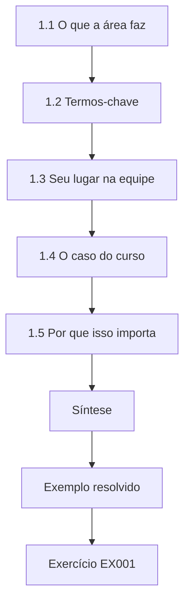

### Desenho lógico

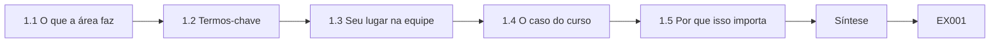

```text
[1.1 O que a área faz]
    |
    v
[1.2 Termos-chave]
    |
    v
[1.3 Seu lugar na equipe]
    |
    v
[1.4 O caso do curso]
    |
    v
[1.5 Por que isso importa]
    |
    v
[Síntese]
    |
    v
[Exemplo resolvido] --> [Exercício EX001]
```
<!-- cykin:lesson-figures:end ch-01 -->


### Objetivos de aprendizagem

Você vai (1) explicar o que a perícia digital e a análise de malware fazem dentro de uma organização; (2) definir evidência, artefato, incidente e escopo; (3) descrever o lugar do profissional numa equipe supervisionada; (4) reconhecer o caso do curso.

### 1.1 O que a área faz

A perícia digital responde a perguntas sobre o que aconteceu em computadores e serviços on-line, usando registros que outras pessoas podem conferir. A análise de malware pergunta o que um programa suspeito faz, para que os defensores possam encontrá-lo e removê-lo. As duas alimentam a resposta a incidentes: a NIST SP 800-61 situa a análise entre a detecção e a contenção, e as lições aprendidas depois da recuperação. No caso da Marlow, predominam as perguntas periciais: quem entrou na caixa de correio de Joy, o que mudou e quais mensagens saíram da empresa. Nenhum programa rodou no PC dela, então a análise de malware contribui pouco aqui, e é por isso que o plano de estudos posterior de Lena trata da triagem estática à parte.

### 1.2 Termos-chave

Um **incidente** é um evento que causa dano ou ameaça sistemas ou dados. Um **artefato** é qualquer rastro deixado por uma atividade: uma linha de log, um arquivo, uma regra de caixa de correio. **Evidência** é um artefato coletado e manuseado de modo que sua integridade possa ser demonstrada. **Escopo** é o conjunto combinado de sistemas, contas e intervalos de tempo que você pode examinar. Aplicado ao caso, o incidente é a invasão da caixa de correio de Joy, a regra de encaminhamento é um artefato, e a lista de regras exportada se torna evidência quando Lena gera seu hash e registra sua custódia. O escopo que Dev aprova às 10:02 abrange uma caixa de correio e seus logs de entrada de 1 a 3 de março.

### 1.3 Seu lugar na equipe

Os profissionais iniciantes coletam, preservam e organizam evidências e executam verificações, sob um supervisor que aprova o escopo e as conclusões. Espera-se que você pergunte quando tiver dúvida e anote tudo o que fizer. Na Marlow, esse supervisor é Dev Anand, que aprova o escopo no início, as ações de contenção e as conclusões antes que qualquer relatório saia. A parte de Lena é prática: exportar registros com sua conta de administração nominal, gerar os hashes, rodar os pequenos scripts e manter um log com horários. Quando o caso levanta uma pergunta fora do escopo escrito, como saber se outros destinatários clicaram, ela pede a Dev que o amplie em vez de olhar primeiro.

### 1.4 O caso do curso

O livro acompanha **Lena Hart**, uma nova analista de segurança na fictícia **Marlow Logistics**, supervisionada pelo gerente de segurança **Dev Anand**. Em 3 de março, a auxiliar de contas a pagar **Joy Okafor** clica num link de um falso e-mail de "fatura compartilhada" e digita sua senha numa página imitada. Em seguida, alguém entra na caixa de correio dela, cria uma regra que encaminha suas mensagens para fora da empresa e envia um e-mail a um fornecedor, a fictícia **Kestrel Packaging**, pedindo a troca dos dados bancários. A equipe financeira da Kestrel desconfia e telefona para a Marlow às 10:00, e é assim que o caso chega a Lena na mesma manhã.

### 1.5 Por que isso importa

Nenhum malware rodou no PC de Joy, e ainda assim o incidente é grave: dinheiro poderia ser desviado. A perícia aqui se apoia mais em logs de serviços em nuvem do que em imagens de disco. O risco é financeiro e pessoal, e não de dano aos sistemas: um pagamento a fornecedor poderia ser desviado, e onze mensagens encaminhadas levaram nomes de contatos de fornecedores para fora da empresa. Como nada rodou no PC de Joy, os registros principais ficam com o provedor de e-mail e de identidade, o proxy e o log de mudanças da TI. Vários desses registros de auditoria em nuvem são guardados por apenas 30 dias por padrão, então a evidência tem prazo desde a primeira hora.

### Exemplo resolvido

A primeira nota de Lena: "03/03 10:00. Relatado pela equipe financeira da Kestrel por telefone: e-mail suspeito de troca de dados bancários vindo da conta de J. Okafor. Escopo (aprovado por D. Anand às 10:02): caixa de correio e logs de entrada de Joy, 01–03 de março. Nenhuma ação em outras contas por enquanto."

> **Caso sintético.** A Marlow Logistics, a Kestrel Packaging e todas as pessoas são inventadas.

### Erros e limites

Começar sem escopo escrito traz o risco de examinar dados que você não tem direito de ver.

### Exercícios

- **EX001 — Duas disciplinas.** Compare a perícia digital com a análise de malware. *Rubrica:* 3 = o que aconteceu a partir de registros verificáveis vs. o que um programa faz; 2 = parcial; 1 = são a mesma coisa; 0 = nada.
- **EX002 — Artefato ou evidência.** Diferencie um artefato de uma evidência. *Rubrica:* 3 = rastro vs. coletado e manuseado com integridade; 2 = parcial; 1 = iguais; 0 = nada.
- **EX003 — Papel do profissional.** Descreva o que um profissional iniciante faz na equipe. *Rubrica:* 3 = coleta, preserva, organiza, executa verificações sob supervisão, registra as ações; 2 = parcial; 1 = decide sozinho; 0 = nada.
- **EX004 — Resumo do caso.** Em duas frases, diga o que aconteceu com a conta de Joy. *Rubrica:* 3 = página de phishing, entrada do atacante, regra de encaminhamento externo, e-mail de troca bancária; 2 = parcial; 1 = vírus; 0 = nada.
- **EX005 — Primeira nota.** Cite quatro fatos da primeira nota de Lena. *Rubrica:* 3 = horário, quem relatou, escopo com quem aprovou, nenhuma outra ação; 2 = três; 1 = um; 0 = nada.

### Síntese

A perícia e a análise de malware apoiam a resposta a incidentes com evidências verificáveis, dentro do escopo combinado e sob supervisão.

### Continue estudando — capítulo 01 de 12

[← Página do curso](../../README.md) · [Índice de capítulos do curso](../SUBJECTS.md) · [Capítulo 02 (rascunho) →](#ch-02)

<a id="ch-02"></a>

## Capítulo 2 — Perícia digital e análise de malware: contexto do serviço e das partes interessadas

<!-- cykin:lesson-figures:start ch-02 -->
### Mapa da aula

Aula 02 publicada. Mapa, exemplo, EX006.

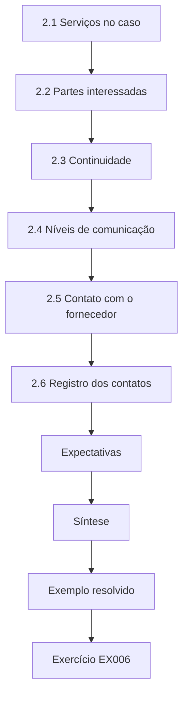

### Desenho lógico

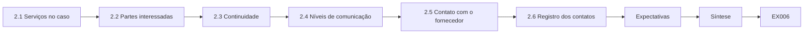

```text
[2.1 Serviços no caso]
    |
    v
[2.2 Partes interessadas]
    |
    v
[2.3 Continuidade]
    |
    v
[2.4 Níveis de comunicação]
    |
    v
[2.5 Contato com o fornecedor]
    |
    v
[2.6 Registro dos contatos]
    |
    v
[Expectativas]
    |
    v
[Síntese]
    |
    v
[Exemplo resolvido] --> [Exercício EX006]
```
<!-- cykin:lesson-figures:end ch-02 -->


### Objetivos de aprendizagem

Você vai (1) mapear os serviços envolvidos num incidente; (2) identificar as partes interessadas e do que elas precisam; (3) equilibrar a investigação com a continuidade do negócio; (4) comunicar no nível certo.

### 2.1 Serviços no caso

A Marlow usa um serviço de e-mail e identidade em nuvem, um proxy web para o tráfego do escritório, um sistema financeiro para pagamentos a fornecedores e um suporte técnico. Cada um guarda registros de que a investigação pode precisar, e cada um tem um dono. Neste caso, o serviço de e-mail e identidade guarda os logs de entrada, os registros de auditoria da caixa de correio, as regras da caixa de entrada e o rastreamento de mensagens. O proxy mostra a visita de Joy à página imitada às 09:10. O sistema financeiro mostra se os dados bancários da Kestrel foram alterados, e o chamado do suporte registra a redefinição feita pela TI às 10:05. Lena anota cada dono ao lado dos registros de que precisa, para que os pedidos cheguem à pessoa certa.

### 2.2 Partes interessadas

Joy precisa da conta de volta e de tranquilidade. O financeiro precisa saber se algum pagamento mudou. A Kestrel precisa da confirmação de que o e-mail era falso. As operações de TI precisam de ações claras. A gestão precisa de impacto e risco. O responsável pela proteção de dados precisa saber se dados pessoais foram expostos. Lena escreve essas necessidades em sua tabela de partes interessadas antes de contatar qualquer pessoa, porque cada resposta depende de registros diferentes. A pergunta do financeiro é respondida pelo sistema financeiro às 10:40, a da Kestrel por um telefonema às 10:50, e a do responsável pela proteção de dados só depois que os onze assuntos encaminhados são listados a partir do rastreamento de mensagens.

### 2.3 Continuidade

O setor de contas precisa continuar pagando os fornecedores. Dev combina que a conta de Joy é protegida imediatamente, mas uma colega cuida dos pagamentos dela naquele dia, para que o negócio continue enquanto a evidência é reunida. Proteger a conta veio primeiro porque a sessão do atacante ainda podia enviar mensagens, mas suspender de vez os pagamentos a fornecedores teria prejudicado a Marlow e seus fornecedores mais do que o próprio incidente. A colega que cobre os pagamentos de Joy trabalha na própria conta, então nada do trabalho de pagamentos toca a caixa de correio sob exame. Dev registra o arranjo no chamado, para que o financeiro saiba a quem ligar naquele dia.

### 2.4 Níveis de comunicação

Os detalhes técnicos vão para a TI; resumos simples, para os gestores; uma confirmação curta e factual, para a Kestrel. Lena redige; Dev aprova tudo o que sai da equipe de segurança. Na prática, a TI recebe as ações exatas com horários: redefinição às 10:05, a regra a remover só depois da exportação, e o endereço 203.0.113.50 e o domínio imitado a bloquear. Os gestores recebem o que aconteceu, se houve movimentação de dinheiro e quando virá a próxima atualização. A Kestrel recebe apenas a informação de que o e-mail de troca bancária era falso e deve ser ignorado. Lena guarda cada rascunho no chamado com o horário em que Dev o aprovou.

### 2.5 Contato com o fornecedor

A equipe financeira da Kestrel agiu certo: telefonou para um número conhecido para conferir. A resposta também confirma por telefone, nunca respondendo ao e-mail suspeito. Uma resposta ao e-mail das 09:40 teria ido para uma caixa de correio que o atacante tinha acabado de usar, e qualquer confirmação poderia ter sido lida antes da redefinição. Por isso, o gerente financeiro da Marlow telefona para a Kestrel às 10:50, num número que já constava do cadastro do fornecedor, e não num número tirado do e-mail. Lena registra a ligação com horário e autor, e a revisão de ponta a ponta depois aponta a verificação feita pela própria Kestrel como a defesa decisiva.

### 2.6 Registro dos contatos

Cada contato com uma parte interessada é registrado com horário, pessoa e conteúdo. O log de contatos de Lena de 3 de março traz entradas como a confirmação do financeiro às 10:40 de que nenhum cadastro de fornecedor tinha mudado, a ligação do gerente financeiro para a Kestrel às 10:50 e a reunião das 11:30 com o responsável pela proteção de dados. Cada linha diz quem falou, por qual canal e o que foi dito ou combinado. Registrar os contatos no momento em que acontecem, e não de memória no fim do dia, mantém a linha do tempo exata. O log também mostra quando as atualizações prometidas venciam, então uma atualização do meio-dia esquecida ficaria visível para Dev. Quando o relatório for escrito, essas entradas sustentam a parte das ações tomadas sem que ninguém precise reconstruir conversas.

### Expectativas

Lena diz a cada parte interessada quando virá a próxima atualização. Uma atualização prometida para o meio-dia, mesmo que diga apenas 'nada mudou', mantém a confiança melhor do que o silêncio.

### Exemplo resolvido

A tabela de partes interessadas de Lena lista Joy (conta restaurada, informada do que aconteceu), o financeiro (verificou que nenhum cadastro de fornecedor mudou — confirmado às 10:40), a Kestrel (telefonema do gerente financeiro às 10:50; o e-mail era falso), a TI (redefinição e revogação de sessões feitas às 10:05) e o responsável pela proteção de dados (informado às 11:30 porque as mensagens encaminhadas continham nomes de contatos de fornecedores).

> **Caso sintético.** Os serviços e as pessoas da Marlow são inventados.

### Erros e limites

As partes interessadas podem querer respostas antes que a evidência as sustente; diga o que se sabe e quando virá mais.

### Exercícios

- **EX006 — Serviços.** Liste quatro serviços relevantes para o caso. *Rubrica:* 3 = e-mail/identidade, proxy, sistema financeiro, suporte técnico; 2 = três; 1 = um; 0 = nada.
- **EX007 — Necessidades das partes.** Associe três partes interessadas ao que elas precisam. *Rubrica:* 3 = p. ex. financeiro – situação dos pagamentos; Kestrel – confirmação; proteção de dados – exposição de dados pessoais; 2 = duas; 1 = uma; 0 = nada.
- **EX008 — Escolha de continuidade.** Como a Marlow continuou pagando os fornecedores? *Rubrica:* 3 = uma colega cuidou dos pagamentos enquanto a conta de Joy era protegida; 2 = parcial; 1 = suspendeu os pagamentos; 0 = nada.
- **EX009 — Confirmação com a Kestrel.** Por que telefonar em vez de responder por e-mail? *Rubrica:* 3 = o canal suspeito pode estar sob controle do atacante; usar um número conhecido; 2 = parcial; 1 = mais rápido; 0 = nada.
- **EX010 — Proteção de dados.** Por que o responsável pela proteção de dados foi informado? *Rubrica:* 3 = as mensagens encaminhadas tinham nomes de contatos de fornecedores (dados pessoais); 2 = parcial; 1 = rotina; 0 = nada.

### Síntese

Conheça os serviços e as partes interessadas, mantenha o negócio funcionando e ajuste cada mensagem ao seu leitor.

### Continue estudando — capítulo 02 de 12

[← Capítulo 01 (rascunho)](#ch-01) · [Índice de capítulos do curso](../SUBJECTS.md) · [Capítulo 03 (rascunho) →](#ch-03)

<a id="ch-03"></a>

## Capítulo 3 — Prática autorizada e manuseio de evidências

<!-- cykin:lesson-figures:start ch-03 -->
### Mapa da aula

Aula 03 publicada. Mapa, exemplo, EX011.

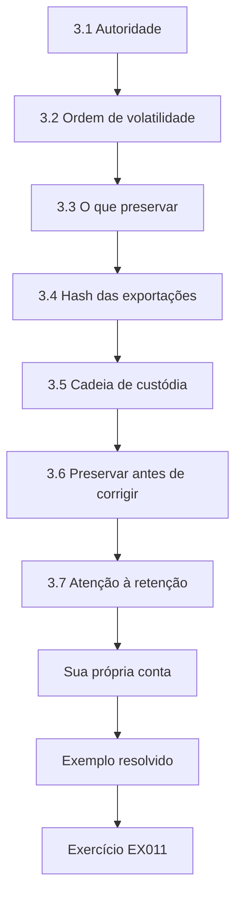

### Desenho lógico

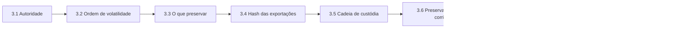

```text
[3.1 Autoridade]
    |
    v
[3.2 Ordem de volatilidade]
    |
    v
[3.3 O que preservar]
    |
    v
[3.4 Hash das exportações]
    |
    v
[3.5 Cadeia de custódia]
    |
    v
[3.6 Preservar antes de corrigir]
    |
    v
[3.7 Atenção à retenção]
    |
    v
[Sua própria conta]
    |
    v
[Exemplo resolvido] --> [Exercício EX011]
```
<!-- cykin:lesson-figures:end ch-03 -->


### Objetivos de aprendizagem

Você vai (1) confirmar a autoridade antes de coletar; (2) aplicar a ordem de volatilidade a dados da nuvem e do endpoint; (3) preservar exportações com hashes; (4) manter uma cadeia de custódia.

### 3.1 Autoridade

A política de uso aceitável da Marlow permite que a equipe de segurança examine contas da empresa durante incidentes, com aprovação de um gerente. A aprovação de Dev às 10:02 indica a caixa de correio e os logs de entrada de Joy. Lena não olha outras caixas de correio até que o escopo seja ampliado por escrito. A aprovação é específica: uma caixa de correio, seus logs de entrada e o período de 1 a 3 de março. Quando o rastreamento de mensagens mostra depois que o e-mail de phishing chegou a seis caixas de correio da Marlow, Lena pede a Dev que amplie o escopo, e ele o faz por escrito às 11:10. Até lá, ela sabe apenas que existem outras cópias; não abre essas caixas de correio nem seus logs.

### 3.2 Ordem de volatilidade

A RFC 3227 recomenda coletar primeiro os dados de vida mais curta. Nos serviços em nuvem, isso significa os registros de auditoria de retenção curta e as sessões ativas; no PC de Joy, o histórico do navegador, antes que seja apagado ou sobrescrito. Na Marlow, Lena exporta primeiro o log de entradas e os registros de auditoria da caixa de correio, porque alguns registros de auditoria são guardados por apenas 30 dias e são os detalhes da sessão que ligam a entrada das 09:14 à regra. A lista de regras da caixa de entrada vem em seguida, antes que a TI remova a 'fwd'. Os registros do proxy e o próprio e-mail de phishing mudam mais devagar, então vêm depois que os registros de vida curta estão seguros.

### 3.3 O que preservar

Logs de entrada, registros de auditoria da caixa de correio, regras da caixa de entrada, rastreamento de mensagens, o próprio e-mail de phishing e os registros do proxy do PC de Joy. Lena exporta cada um pelo console de administração com sua própria conta de administração nominal. Cada item responde a uma pergunta que Lena já escreveu: o log de entradas mostra quem entrou e de onde, os registros de auditoria mostram o que a sessão mudou, o rastreamento mostra o que saiu da caixa de correio e os registros do proxy mostram a visita de Joy à página imitada. Na atualização do chamado das 12:00, o manifesto lista seis itens, cada um com sua fonte e seu horário de exportação.

### 3.4 Hash das exportações

Cada exportação recebe hash SHA-256 no download e entra num manifesto. Cópias de trabalho são feitas para a análise; os originais são guardados em modo somente leitura. Gerar o hash no download fixa o que foi coletado, então qualquer mudança posterior num arquivo pode ser detectada recalculando o hash. A análise de Lena acontece só nas cópias de trabalho; os originais no compartilhamento de evidências somente leitura /IR-0303 só são abertos de novo para fazer uma cópia nova. A conferência do manifesto detecta depois um problema real neste caso, quando uma edição numa planilha altera a cópia de trabalho do message_trace.csv e seu hash deixa de coincidir. Como o original estava intacto, a correção leva minutos, e não uma nova exportação.

### 3.5 Cadeia de custódia

O log de custódia registra item, fonte, quem o exportou, quando, hash e local de armazenamento, além de cada transferência posterior. Para as regras da caixa de entrada de Joy, a entrada indica o item, a conta j.okafor, Lena como coletora, o horário de exportação 10:12, o hash no manifesto e o compartilhamento /IR-0303. Se Dev ou um colega pega uma cópia para reproduzir um passo, essa transferência é acrescentada com horário e destinatário. Uma lacuna no log, como uma cópia cuja origem ninguém registrou, tornaria difícil mostrar que o item não foi alterado. O log fica ao lado do manifesto, para que a integridade e o manuseio possam ser conferidos juntos.

### 3.6 Preservar antes de corrigir

A TI redefiniu a senha de Joy às 10:05, o que foi certo; mas a exclusão da regra de encaminhamento esperou até que Lena exportasse a lista de regras às 10:12, para que os detalhes da regra fossem mantidos. A ordem importa porque o instinto da TI é limpar na hora. Redefinir a senha e revogar as sessões impede novos acessos sem destruir nada, então pode vir primeiro. Excluir uma regra remove da caixa de correio ativa seu nome, sua ação, seu destino e seus dados de criação, e é a exportação de Lena às 10:12 que os guarda. Três minutos depois, às 10:15, a TI remove a regra, e o horário entra na entrada de custódia.

### 3.7 Atenção à retenção

Alguns logs de auditoria são guardados por apenas 30 dias por padrão. Exportar cedo evita perdê-los. Num caso relatado em 3 de março, os registros de 1º de março sairiam de uma janela de 30 dias no começo de abril, bem antes de qualquer revisão ou disputa posterior. Lena confere a retenção de cada fonte ao exportá-la e a anota no manifesto. Os registros do proxy seguem suas próprias configurações de retenção, então ela pergunta ao dono do proxy em vez de presumir. Depois de exportadas e com hash, as cópias no compartilhamento de evidências seguem a retenção de casos da Marlow, e não o padrão do provedor.

### Sua própria conta

As exportações são feitas com a conta de administração nominal de Lena, nunca com uma conta compartilhada, para que o log de auditoria do próprio provedor mostre exatamente quem coletou o quê. Essa entrada de auditoria também faz parte da trilha de custódia.

### Exemplo resolvido

Entrada de custódia: "Item 3: exportação das regras da caixa de entrada, j.okafor. Exportado por L. Hart às 10:12 pelo console de administração. SHA-256 registrado no manifesto. Armazenado: compartilhamento de evidências /IR-0303, somente leitura. Regra excluída pela TI às 10:15, depois da exportação."

> **Caso sintético.** Todas as entradas são inventadas.

### Erros e limites

As exportações refletem o que o provedor registra; campos ausentes não podem ser recuperados depois.

### Exercícios

- **EX011 — Verificação de autoridade.** O que autorizou a coleta de Lena, e o que a limitou? *Rubrica:* 3 = a política mais a aprovação de Dev; limitada à caixa de correio e às entradas de Joy; 2 = parcial; 1 = não precisava; 0 = nada.
- **EX012 — Volatilidade.** Quais dados da nuvem são coletados primeiro, e por quê? *Rubrica:* 3 = registros de auditoria de retenção curta e sessões; são os primeiros a se perder; 2 = parcial; 1 = qualquer ordem; 0 = nada.
- **EX013 — Lista de preservação.** Liste cinco itens preservados. *Rubrica:* 3 = cinco entre entradas, auditoria, regras, rastreamento, e-mail de phishing, proxy; 2 = três; 1 = um; 0 = nada.
- **EX014 — Momento da regra.** Por que a exclusão da regra esperou até depois da exportação? *Rubrica:* 3 = guardar os detalhes da regra como evidência antes da correção; 2 = parcial; 1 = sem motivo; 0 = nada.
- **EX015 — Entrada de custódia.** Cite cinco campos da entrada de custódia. *Rubrica:* 3 = item, fonte/conta, coletora, horário, hash, local; 2 = três; 1 = um; 0 = nada.

### Síntese

Colete dentro da autoridade, o mais volátil primeiro, gere hash e registre tudo, e preserve antes de corrigir.

### Continue estudando — capítulo 03 de 12

[← Capítulo 02 (rascunho)](#ch-02) · [Índice de capítulos do curso](../SUBJECTS.md) · [Capítulo 04 (rascunho) →](#ch-04)

<a id="ch-04"></a>

## Capítulo 4 — Perícia digital e análise de malware: métodos centrais

<!-- cykin:lesson-figures:start ch-04 -->
### Mapa da aula

Aula 04 publicada. Mapa, exemplo, EX016.

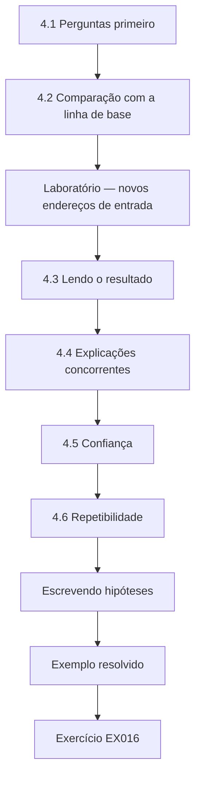

### Desenho lógico

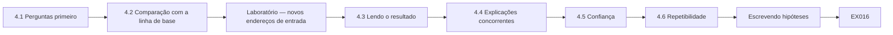

```text
[4.1 Perguntas primeiro]
    |
    v
[4.2 Comparação com a linha de base]
    |
    v
[Laboratório — novos endereços de entrada]
    |
    v
[4.3 Lendo o resultado]
    |
    v
[4.4 Explicações concorrentes]
    |
    v
[4.5 Confiança]
    |
    v
[4.6 Repetibilidade]
    |
    v
[Escrevendo hipóteses]
    |
    v
[Exemplo resolvido] --> [Exercício EX016]
```
<!-- cykin:lesson-figures:end ch-04 -->


### Objetivos de aprendizagem

Você vai (1) formular perguntas e hipóteses; (2) comparar a atividade com uma linha de base; (3) analisar registros de entrada; (4) enunciar constatações com níveis de confiança.

### 4.1 Perguntas primeiro

Lena escreve as perguntas: a conta de Joy foi usada por outra pessoa? Quando isso começou? O que essa pessoa fez? Mais alguém foi afetado? Cada pergunta indica os registros que poderiam respondê-la. Escrever as perguntas antes de abrir qualquer exportação mantém o trabalho dentro do escopo e impede que ele vire uma navegação sem rumo. Por exemplo, 'quando começou?' aponta para o log de entradas de 1 a 3 de março, enquanto 'o que essa pessoa fez?' aponta para a auditoria da caixa de correio e o rastreamento de mensagens. A última pergunta, sobre outros afetados, é a que depois exige que Dev amplie o escopo.

### 4.2 Comparação com a linha de base

Joy normalmente entra a partir do endereço do escritório 198.51.100.7. Uma entrada bem-sucedida a partir de um endereço nunca visto para a conta dela é um sinal forte, mas não uma prova: ela poderia ter trabalhado de casa. A linha de base no laboratório são dois dias de entradas: Joy a partir de 198.51.100.7 em 2 e 3 de março, e m.lee a partir de 198.51.100.9. Incluir m.lee confere que o script não sinaliza usuários comuns. A comparação apenas sinaliza; Lena ainda precisa perguntar a Joy onde ela estava e à TI se o novo endereço pertence à Marlow antes de chamá-lo de não autorizado.

### Laboratório — novos endereços de entrada

```python
"""Synthetic sign-in log: flag successful sign-ins from addresses new for each user."""
import csv, io
LOG = """time,user,ip,result
2026-03-02 08:01,j.okafor,198.51.100.7,success
2026-03-02 08:30,m.lee,198.51.100.9,success
2026-03-03 08:02,j.okafor,198.51.100.7,success
2026-03-03 09:12,j.okafor,203.0.113.50,failure
2026-03-03 09:14,j.okafor,203.0.113.50,success
2026-03-03 09:31,m.lee,198.51.100.9,success
"""
seen = {}
for r in csv.DictReader(io.StringIO(LOG)):
    known = seen.setdefault(r["user"], set())
    if r["result"] == "success":
        if known and r["ip"] not in known:
            print("NEW IP", r["time"], r["user"], r["ip"])
        known.add(r["ip"])
print("users checked:", len(seen))
```

Execute com `python3 lab_signin.py`. Saída verificada:

```text
NEW IP 2026-03-03 09:14 j.okafor 203.0.113.50
users checked: 2
```

### 4.3 Lendo o resultado

Uma entrada bem-sucedida a partir de um endereço novo: 203.0.113.50 às 09:14 de 3 de março, dois minutos depois de uma tentativa malsucedida do mesmo endereço. A colega m.lee não mostra nada novo. Joy confirma que esteve na sua mesa no escritório a manhã toda. A tentativa malsucedida importa: uma falha seguida, dois minutos depois, de um sucesso a partir do mesmo endereço é coerente com alguém testando uma senha capturada, embora também possa ser uma digitação errada. O script trata a entrada das 08:02 no escritório como já conhecida, porque 198.51.100.7 foi visto em 2 de março. A linha `users checked: 2` confirma que as duas contas da amostra foram lidas.

### 4.4 Explicações concorrentes

O 203.0.113.50 poderia ser uma VPN da empresa? A TI verifica: não é um endereço da Marlow. Joy poderia ter usado o celular nos dados móveis? O aplicativo de e-mail do celular dela mostra o Wi-Fi do escritório. A explicação "outra pessoa entrou" é a que melhor se encaixa. Cada explicação é testada com um registro, e não descartada por impressão: a lista de faixas de endereços da Marlow mantida pela TI responde à pergunta da VPN, e as configurações de rede do celular respondem à dos dados móveis. Se qualquer uma das verificações tivesse falhado, a constatação teria caído para uma confiança menor. Lena escreve os dois testes nas notas, porque Dev vai perguntar quais alternativas foram descartadas e como.

### 4.5 Confiança

Lena escreve "confiança alta" para o acesso não autorizado (endereço novo, declaração de Joy, clique no phishing) e "desconhecido" para quem estava por trás dele. Os três apoios são independentes: o registro de entrada vem do provedor de identidade, a visita ao phishing vem do proxy e a negação vem da própria Joy. A concordância entre três fontes separadas é o que justifica escrever 'alta' aqui. Sobre a pessoa por trás do acesso, Lena tem apenas um endereço, e 203.0.113.50 diz de onde veio uma conexão, e não quem a fez. Escrever 'desconhecido' impede que o relatório sugira uma identificação que nenhum registro sustenta.

### 4.6 Repetibilidade

O script do laboratório e sua entrada são guardados, para que Dev possa rodar a verificação de novo. Lena guarda o lab_signin.py com o CSV exato que ele leu e registra a saída esperada: uma linha `NEW IP` para j.okafor às 09:14 e `users checked: 2`. Quando Dev roda o script de novo num ponto de controle, uma saída diferente significaria que a entrada ou o código mudaram. A repetibilidade também ajuda depois: quando a exportação das entradas é refeita com o intervalo completo de 1 a 3 de março, o mesmo script pode rodar sobre o novo arquivo e os dois resultados podem ser comparados.

### Escrevendo hipóteses

Uma hipótese é uma afirmação testável, como 'a entrada das 09:14 não foi feita por Joy'. Lena lista qual evidência a sustentaria e qual a refutaria antes de olhar, para não cair na tentação de ler só os registros que confirmam.

### Exemplo resolvido

A constatação de Lena: "Entrada não autorizada em j.okafor às 09:14 a partir de 203.0.113.50 (não é endereço da Marlow; nunca visto para esta usuária). Sustentada pela declaração de Joy e pela visita às 09:10 à página imitada. Confiança: alta."

> **Caso sintético.** Os registros vêm do script do laboratório.

### Erros e limites

Uma verificação de primeira ocorrência deixa passar atacantes que usam um endereço já visto ou uma VPN compartilhada.

### Exercícios

- **EX016 — Perguntas da investigação.** Escreva três perguntas de investigação para o caso. *Rubrica:* 3 = uso indevido da conta, horário de início, ações, outros afetados (três); 2 = duas; 1 = uma; 0 = nada.
- **EX017 — Saída do laboratório.** O que o laboratório de entradas encontrou? *Rubrica:* 3 = sucesso de j.okafor às 09:14 a partir de 203.0.113.50 depois de uma falha; nada para m.lee; 2 = parcial; 1 = errado; 0 = nada.
- **EX018 — Alternativas testadas.** Quais duas explicações inocentes foram verificadas? *Rubrica:* 3 = VPN da empresa; celular nos dados móveis; 2 = uma; 1 = vago; 0 = nada.
- **EX019 — Formulação da confiança.** Por que "desconhecido" para quem estava por trás? *Rubrica:* 3 = um endereço não identifica uma pessoa; 2 = parcial; 1 = é conhecido; 0 = nada.
- **EX020 — Ponto cego.** Cite um ponto cego de uma verificação de endereço de primeira ocorrência. *Rubrica:* 3 = atacante usando endereço conhecido/compartilhado ou VPN; 2 = parcial; 1 = vago; 0 = nada.

### Síntese

Pergunte primeiro, compare com a linha de base, teste as alternativas e enuncie a confiança com clareza.

### Continue estudando — capítulo 04 de 12

[← Capítulo 03 (rascunho)](#ch-03) · [Índice de capítulos do curso](../SUBJECTS.md) · [Capítulo 05 (rascunho) →](#ch-05)

<a id="ch-05"></a>

## Capítulo 5 — Perícia digital e análise de malware: ferramentas e interpretação

<!-- cykin:lesson-figures:start ch-05 -->
### Mapa da aula

Aula 05 publicada. Mapa, exemplo, EX021.

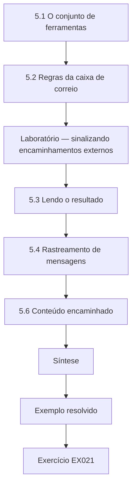

### Desenho lógico

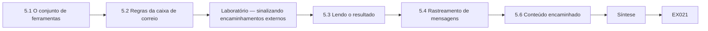

```text
[5.1 O conjunto de ferramentas]
    |
    v
[5.2 Regras da caixa de correio]
    |
    v
[Laboratório — sinalizando encaminhamentos externos]
    |
    v
[5.3 Lendo o resultado]
    |
    v
[5.4 Rastreamento de mensagens]
    |
    v
[5.6 Conteúdo encaminhado]
    |
    v
[Síntese]
    |
    v
[Exemplo resolvido] --> [Exercício EX021]
```
<!-- cykin:lesson-figures:end ch-05 -->


### Objetivos de aprendizagem

Você vai (1) usar exportações do console de administração e pequenos scripts como ferramentas; (2) interpretar regras de caixa de correio; (3) ler o rastreamento de mensagens e os registros de auditoria; (4) evitar ler demais na saída das ferramentas.

### 5.1 O conjunto de ferramentas

Os profissionais da Marlow usam o console de administração de e-mail (busca, auditoria e exportação), a página de relatórios do proxy, uma planilha para revisão e scripts curtos, só com a biblioteca padrão, para verificações repetíveis. As ferramentas são aprovadas por Dev, e suas versões são registradas. Cada ferramenta aqui é simples de propósito, para que seu comportamento possa ser conferido lendo-a. Lena registra o console que usou, as configurações de exportação, como o intervalo de datas, e o nome e a versão do script de cada verificação. Esse registro explica depois o problema das entradas ausentes, em que o intervalo padrão de 48 horas do console tinha cortado os registros mais antigos.

### 5.2 Regras da caixa de correio

As regras da caixa de entrada movem, excluem ou encaminham mensagens automaticamente. Atacantes que invadem uma caixa de correio costumam acrescentar uma regra para encaminhar cópias para fora, ou para esconder respostas, de modo que a verdadeira dona não perceba. Regras legítimas também são comuns, então cada uma precisa ser interpretada. A caixa de correio de Joy ilustra os dois casos: a 'Supplier folder' é o tipo de regra que uma auxiliar de contas cria para organizar as mensagens dos fornecedores, enquanto a 'fwd' envia cópias para billing.records@example.org. Por isso Lena lê a ação, o destino, o horário de criação e a sessão de origem de cada regra antes de chamá-la de suspeita.

### Laboratório — sinalizando encaminhamentos externos

```python
"""Synthetic inbox-rule export: flag rules that forward mail outside the company domain."""
RULES = [
    ("j.okafor", "Supplier folder", "move", "Suppliers"),
    ("j.okafor", "fwd", "forward", "billing.records@example.org"),
    ("m.lee", "Copy to team", "forward", "ap-team@marlow.example"),
]
for user, name, action, target in RULES:
    external = action == "forward" and not target.endswith("@marlow.example")
    print(f"{user:9} {name:16} {action:8} {target:30} {'EXTERNAL' if external else 'ok'}")
```

Execute com `python3 lab_rules.py`. Saída verificada:

```text
j.okafor  Supplier folder  move     Suppliers                      ok
j.okafor  fwd              forward  billing.records@example.org    EXTERNAL
m.lee     Copy to team     forward  ap-team@marlow.example         ok
```

### 5.3 Lendo o resultado

Joy tem duas regras: "Supplier folder" move mensagens para uma pasta (normal), e "fwd" encaminha para billing.records@example.org, fora da empresa — sinalizada `EXTERNAL`. A regra de m.lee copia para um endereço interno da equipe. O log de auditoria mostra que a "fwd" foi criada às 09:20 a partir da sessão de 203.0.113.50. O script apenas testa se o destino de um encaminhamento termina em @marlow.example; ele não sabe quem criou a regra. Essa ligação vem do registro de auditoria da caixa de correio, que associa a criação das 09:20 à mesma sessão da entrada das 09:14. O encaminhamento interno na caixa de correio de m.lee é deixado de lado porque nada o liga ao atacante.

### 5.4 Rastreamento de mensagens

O rastreamento de mensagens mostra as mensagens enviadas e recebidas. Às 09:40, a conta de Joy enviou "Updated bank details" (dados bancários atualizados) para o endereço do financeiro da Kestrel. Nenhuma outra mensagem externa foi enviada na sessão do atacante. O rastreamento responde à pergunta 'o que essa pessoa fez?' para as mensagens de saída. Lena o filtra para j.okafor entre a entrada das 09:14 e a redefinição das 10:05 e lista cada mensagem com horário, destinatário e assunto. O e-mail de troca bancária é a única mensagem que o atacante enviou diretamente a um endereço externo nessa janela; as cópias encaminhadas aparecem como tráfego gerado pela regra 'fwd'.

### 5.5 Limites da interpretação

Uma regra criada a partir da sessão do atacante é evidência forte. O nome da regra, "fwd", não prova nada sozinho; a ligação com a sessão, sim. A saída da ferramenta é um ponto de partida: Lena confere o registro de auditoria por trás de cada sinalização. Uma regra legítima que encaminhasse para um contador fora da Marlow também seria sinalizada, e uma regra maliciosa apontando para uma caixa de correio interna comprometida nem seria sinalizada. A sinalização é só um motivo para olhar; o registro de auditoria é a evidência que ela cita.

### 5.6 Conteúdo encaminhado

O rastreamento mostra 11 mensagens encaminhadas entre 09:20 e 10:05. A redefinição das 10:05 encerrou a entrada do atacante, mas não desativou a 'fwd', porque uma regra do lado do servidor continua funcionando depois de uma troca de senha até ser removida. A regra ficou ativa até que a TI a excluísse às 10:15, então as mensagens que chegaram entre 10:05 e 10:15 também podem ter sido encaminhadas para billing.records@example.org. Por isso Lena confere a auditoria da caixa de correio e o rastreamento de mensagens de 10:05 a 10:15 antes de tratar onze como a contagem final. Lena lista os assuntos para o responsável pela proteção de dados sem abrir anexos. Os assuntos bastam para o responsável pela proteção de dados avaliar o que saiu da empresa: eles mostram nomes de fornecedores e temas de faturas sem que Lena leia o corpo das mensagens ou abra anexos. A lista vai para um apêndice restrito, e não para o relatório principal. Se um assunto sugerisse conteúdo sensível, Lena perguntaria a Dev e ao responsável pela proteção de dados até onde olhar, em vez de abrir a mensagem por iniciativa própria.

### Exemplo resolvido

A tabela de Lena: "Regra 'fwd' — criada às 09:20 pela sessão de 203.0.113.50 — encaminha para billing.records@example.org — 11 mensagens encaminhadas 09:20–10:05 — regra exportada às 10:12, removida às 10:15; encaminhamentos de 10:05–10:15 a conferir na auditoria da caixa de correio e no rastreamento."

> **Caso sintético.** Os registros vêm do script do laboratório.

### Erros e limites

Os consoles mostram o que o provedor registra; algumas ações, como ler uma mensagem, podem não ser registradas em todos os níveis de licença.

### Exercícios

- **EX021 — Para que servem as regras.** Por que os atacantes acrescentam regras na caixa de entrada? *Rubrica:* 3 = encaminhar cópias para fora; esconder respostas da dona; 2 = um; 1 = vago; 0 = nada.
- **EX022 — Regra sinalizada.** Qual regra foi sinalizada, e o que a liga ao atacante? *Rubrica:* 3 = 'fwd' externa; criada às 09:20 pela sessão de 203.0.113.50; 2 = só a regra; 1 = errado; 0 = nada.
- **EX023 — Constatação do rastreamento.** O que o rastreamento de mensagens mostrou às 09:40? *Rubrica:* 3 = 'Updated bank details' enviado ao financeiro da Kestrel; único envio externo; 2 = parcial; 1 = errado; 0 = nada.
- **EX024 — Ler demais.** Por que o nome da regra sozinho é evidência fraca? *Rubrica:* 3 = nomes são arbitrários; a ligação com a sessão é a evidência; 2 = parcial; 1 = é forte; 0 = nada.
- **EX025 — Mensagens encaminhadas.** Como as mensagens encaminhadas foram listadas para a proteção de dados? *Rubrica:* 3 = assuntos listados a partir do rastreamento; anexos não abertos; 11 mensagens; 2 = parcial; 1 = leu todas; 0 = nada.

### Síntese

Use as ferramentas para obter pistas, depois confirme cada sinalização com o registro por trás dela e diga o que a ferramenta não consegue ver.

### Continue estudando — capítulo 05 de 12

[← Capítulo 04 (rascunho)](#ch-04) · [Índice de capítulos do curso](../SUBJECTS.md) · [Capítulo 06 (rascunho) →](#ch-06)

<a id="ch-06"></a>

## Capítulo 6 — Perícia digital e análise de malware: fluxo de trabalho operacional

<!-- cykin:lesson-figures:start ch-06 -->
### Mapa da aula

Aula 06 publicada. Mapa, exemplo, EX026.

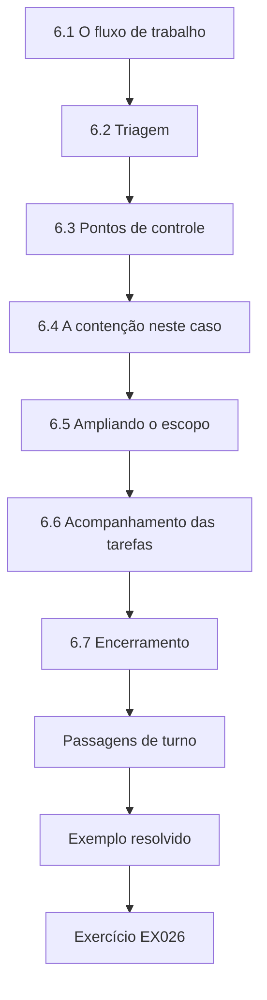

### Desenho lógico

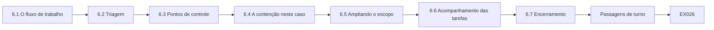

```text
[6.1 O fluxo de trabalho]
    |
    v
[6.2 Triagem]
    |
    v
[6.3 Pontos de controle]
    |
    v
[6.4 A contenção neste caso]
    |
    v
[6.5 Ampliando o escopo]
    |
    v
[6.6 Acompanhamento das tarefas]
    |
    v
[6.7 Encerramento]
    |
    v
[Passagens de turno]
    |
    v
[Exemplo resolvido] --> [Exercício EX026]
```
<!-- cykin:lesson-figures:end ch-06 -->


### Objetivos de aprendizagem

Você vai (1) seguir um fluxo de trabalho repetível do relato ao encerramento; (2) usar pontos de controle com um supervisor; (3) acompanhar as tarefas; (4) encerrar casos do jeito certo.

### 6.1 O fluxo de trabalho

Relato recebido → triagem e escopo → contenção → preservação → análise → verificação → relatório → encerramento com lições. A NIST SP 800-61 descreve fases semelhantes; o runbook da Marlow as adapta ao seu porte. No caso da Marlow, as fases se sobrepõem no tempo, mas mantêm a ordem: a contenção começou às 10:05 com a redefinição, e ainda assim a remoção da regra de encaminhamento esperou pela preservação às 10:12. A análise dos registros de entrada e de auditoria seguiu pela manhã, a contenção foi verificada a partir das 14:00 e o caso foi encerrado em 10 de março. Cada fase termina com uma entrada no chamado, para que qualquer pessoa veja em que ponto o caso está.

### 6.2 Triagem

A triagem decide a urgência. Um e-mail de troca bancária enviado a um fornecedor é urgente porque o dinheiro pode se mover em poucas horas. Depois que um pagamento é feito, recuperar o dinheiro pode depender dos bancos, e não da Marlow. Até a redefinição às 10:05, a sessão ativa também ainda podia enviar mais mensagens a fornecedores. Por isso Lena trata o caso como urgente desde a ligação das 10:00, e Dev aprova o escopo dois minutos depois. Sinais menos urgentes, como um e-mail de phishing em que ninguém clicou, esperariam a ordem normal da fila.

### 6.3 Pontos de controle

Dev aprova em três pontos de controle: o escopo no início, as ações de contenção e as conclusões antes do relatório. Lena leva evidências a cada um. Neste caso, o ponto de controle do escopo foi a aprovação de Dev às 10:02 da caixa de correio e dos logs de entrada de Joy, e o ponto de controle da contenção cobriu a redefinição, a remoção da regra depois da exportação e os bloqueios. O ponto de controle das conclusões, às 14:00, usou o slide da linha do tempo de Lena com a lacuna marcada. Levar registros, e não opiniões, a cada reunião permite que Dev questione um passo e veja a resposta na hora.

### 6.4 A contenção neste caso

Redefinição da senha, encerramento de todas as sessões, remoção da regra de encaminhamento depois da exportação, bloqueio de 203.0.113.50 e do domínio imitado no proxy, e verificação de que a autenticação multifator está ativada para Joy. Cada ação fecha um caminho diferente: a redefinição impede o uso da senha capturada, revogar as sessões encerra o acesso que já não precisa da senha, e remover a 'fwd' impede que cópias continuem saindo. Bloquear 203.0.113.50 e o domínio imitado protege os outros destinatários do e-mail de phishing. A verificação do MFA é a que mais importa, porque sem um segundo fator uma senha capturada poderia abrir a caixa de correio de novo.

### 6.5 Ampliando o escopo

O e-mail de phishing foi enviado a outras pessoas? O rastreamento de mensagens mostra que ele chegou a seis caixas de correio da Marlow. Dev amplia o escopo por escrito para essas seis. Os registros do proxy mostram que nenhum dos outros destinatários, entre eles m.lee, visitou a página. A verificação ampliada mostra por que o escopo é ampliado por escrito, e não por hábito: seis caixas de correio receberam a mesma isca, mas só a conta de Joy mostra um clique e uma entrada nova. A aprovação de Dev às 11:10 permite que Lena leia o rastreamento e os registros do proxy desses destinatários, e nada mais. As caixas de correio deles continuam fechadas, porque nenhum registro sugere que tenham sido acessadas.

### 6.6 Acompanhamento das tarefas

Cada ação é uma tarefa do chamado, com dono e situação, para que nada dependa da memória. Na Marlow, o chamado traz tarefas como 'exportar as regras da caixa de entrada' para Lena, 'remover a regra de encaminhamento depois da exportação' para a TI, 'confirmar que nenhum cadastro de fornecedor mudou' para o financeiro e 'informar o responsável pela proteção de dados' para Lena. Cada tarefa mostra seu dono, sua situação e o horário em que foi concluída. Quando a TI estava pronta para excluir a regra, o chamado já mostrava a exportação como feita, então a remoção às 10:15 não precisou de nenhuma ligação extra.

### 6.7 Encerramento

Um caso é encerrado quando as ações estão concluídas, as partes interessadas foram informadas, a evidência foi arquivada conforme a retenção e as lições foram registradas. O caso da Marlow é encerrado em 10 de março, uma semana depois do relato. Até lá, as três mudanças de controles têm chamados e testes; Joy, o financeiro, a Kestrel e o responsável pela proteção de dados foram informados do desfecho; e o compartilhamento de evidências /IR-0303 está arquivado sob retenção. As lições incluem o intervalo da exportação, a edição da cópia de trabalho e a conversão de fuso horário, cada uma transformada numa mudança do runbook. Encerrar sem a etapa das lições deixaria o próximo analista repetir os mesmos erros.

### Passagens de turno

Se o caso passar do turno de Lena, ela escreve uma nota de passagem: fase atual, tarefas abertas com donos, horário do próximo ponto de controle e tudo o que depende de outras pessoas. O analista seguinte lê o chamado e a nota juntos e confirma o recebimento, para que nenhuma ação seja esquecida ou feita duas vezes. As notas de passagem ficam no chamado como parte do registro.

### Exemplo resolvido

O chamado de Lena às 12:00: "Contenção — concluída (10:05–10:20). Preservação — concluída, manifesto de 6 itens. Escopo ampliado às 11:10 para 6 destinatários; nenhum outro clique encontrado. Análise — em andamento. Próximo ponto de controle com Dev às 14:00."

> **Caso sintético.** O chamado é inventado.

### Erros e limites

Os fluxos de trabalho orientam o julgamento, não o substituem; casos incomuns precisam da opinião do supervisor.

### Exercícios

- **EX026 — Ordem das fases.** Ponha as fases do fluxo de trabalho em ordem. *Rubrica:* 3 = relato, triagem/escopo, contenção, preservação, análise, verificação, relatório, encerramento; 2 = pequeno deslize; 1 = embaralhado; 0 = nada.
- **EX027 — Urgência.** Por que este caso era urgente? *Rubrica:* 3 = um pagamento a fornecedor poderia ser desviado em poucas horas; 2 = parcial; 1 = não era urgente; 0 = nada.
- **EX028 — Lista de contenção.** Liste quatro ações de contenção. *Rubrica:* 3 = redefinição, revogação de sessões, remoção da regra depois da exportação, bloqueio de IP/domínio, verificação do MFA; 2 = três; 1 = uma; 0 = nada.
- **EX029 — Outros destinatários.** Como a exposição mais ampla foi verificada? *Rubrica:* 3 = o rastreamento encontrou 6 destinatários; escopo ampliado por escrito; o proxy não mostrou outras visitas; 2 = parcial; 1 = presumida; 0 = nada.
- **EX030 — Encerrar um caso.** Enuncie as condições de encerramento. *Rubrica:* 3 = ações concluídas, partes informadas, evidência arquivada, lições registradas; 2 = três; 1 = uma; 0 = nada.

### Síntese

Um fluxo de trabalho repetível, com pontos de controle do supervisor, mantém os casos completos e defensáveis.

### Continue estudando — capítulo 06 de 12

[← Capítulo 05 (rascunho)](#ch-05) · [Índice de capítulos do curso](../SUBJECTS.md) · [Capítulo 07 (rascunho) →](#ch-07)

<a id="ch-07"></a>

## Capítulo 7 — Perícia digital e análise de malware: controles e verificação

<!-- cykin:lesson-figures:start ch-07 -->
### Mapa da aula

Aula 07 publicada. Mapa, exemplo, EX031.

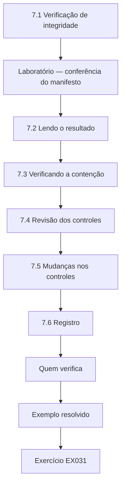

### Desenho lógico

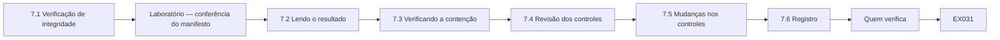

```text
[7.1 Verificação de integridade]
    |
    v
[Laboratório — conferência do manifesto]
    |
    v
[7.2 Lendo o resultado]
    |
    v
[7.3 Verificando a contenção]
    |
    v
[7.4 Revisão dos controles]
    |
    v
[7.5 Mudanças nos controles]
    |
    v
[7.6 Registro]
    |
    v
[Quem verifica]
    |
    v
[Exemplo resolvido] --> [Exercício EX031]
```
<!-- cykin:lesson-figures:end ch-07 -->


### Objetivos de aprendizagem

Você vai (1) verificar a integridade da evidência com um manifesto; (2) verificar se a contenção funcionou; (3) conferir os controles que deveriam ter barrado o ataque; (4) registrar os resultados da verificação.

### 7.1 Verificação de integridade

Antes da análise e da entrega, cada cópia de trabalho recebe hash de novo e é comparada com o manifesto feito na coleta. No caso da Marlow, o manifesto foi feito no download, quando cada exportação recebeu hash SHA-256. Refazer o hash antes da análise confirma que Lena está trabalhando com o que coletou, e refazê-lo antes da entrega dá a Dev ou a um colega a mesma garantia. O laboratório abaixo usa três pequenos arquivos sintéticos e simula uma edição acidental do message_trace.csv, exatamente o tipo de mudança que a verificação deve detectar.

### Laboratório — conferência do manifesto

```python
"""Build and check a SHA-256 manifest for synthetic exported evidence."""
import hashlib
files = {"signin.csv": b"time,user,ip,result\n", "rules.json": b"[]\n", "message_trace.csv": b"time,from,to,subject\n"}
manifest = {n: hashlib.sha256(d).hexdigest() for n, d in files.items()}
files["message_trace.csv"] += b"edited\n"   # simulate an accidental change to the working copy
for n, d in files.items():
    ok = hashlib.sha256(d).hexdigest() == manifest[n]
    print(f"{n:18} {manifest[n][:12]} {'OK' if ok else 'MISMATCH'}")
```

Execute com `python3 lab_manifest.py`. Saída verificada:

```text
signin.csv         73e095a99de8 OK
rules.json         37517e5f3dc6 OK
message_trace.csv  6d8fe704b35e MISMATCH
```

### 7.2 Lendo o resultado

O signin.csv e o rules.json dão OK. O message_trace.csv dá `MISMATCH`: a cópia de trabalho foi editada. Lena tinha acrescentado uma coluna de notas numa planilha e salvado por cima do arquivo. Ela descarta a cópia de trabalho, faz uma nova a partir do original somente leitura, verifica que dá OK e, daí em diante, guarda as notas num arquivo separado. A divergência não é evidência de adulteração por outra pessoa; o log do caso a registra como erro da própria Lena, com horário, causa e correção. O original somente leitura nunca mudou, e é por isso que foi fácil se recuperar do problema.

### 7.3 Verificando a contenção

A contenção é verificada, e não presumida: o log de entradas não mostra mais nenhum sucesso a partir de 203.0.113.50 depois das 10:05; a lista de regras de Joy já não contém a "fwd"; o log do proxy mostra uma tentativa bloqueada de acesso ao domínio imitado a partir de um PC de teste. Cada verificação usa o mesmo tipo de registro que mostrou o ataque: o log de entradas para o acesso, a lista de regras para o encaminhamento e o log do proxy para o domínio. A tentativa do PC de teste prova que o bloqueio funciona de dentro da rede da Marlow, e não apenas que uma configuração foi salva. Lena registra cada verificação com horário e nome na tabela de verificação.

### 7.4 Revisão dos controles

Quais controles deveriam ter ajudado? A autenticação multifator não era obrigatória para Joy (ela estava num grupo de exceção criado anos antes); o filtro de e-mail não sinalizou o domínio imitado, registrado dois dias antes; o encaminhamento externo era permitido por padrão. Nada disso foi uma surpresa técnica; cada item era uma configuração conhecida que ninguém tinha revisado. O grupo de exceção fez com que a senha capturada bastasse sozinha, a idade do domínio deu ao filtro uma pista que ele não usou, e o encaminhamento padrão deixou a 'fwd' enviar onze mensagens para fora antes que alguém percebesse.

### 7.5 Mudanças nos controles

Remover o grupo de exceção; bloquear por padrão o encaminhamento externo automático; acrescentar ao filtro de e-mail avisos para domínios novos. Cada mudança recebe um chamado e um teste. Os testes são concretos: uma regra de teste que encaminhe para fora da empresa deve ser rejeitada, uma entrada de um antigo membro do grupo de exceção deve pedir um segundo fator, e uma mensagem de um domínio recém-registrado deve trazer um aviso. O teste do encaminhamento foi rejeitado às 16:20 de 3 de março, como registra a linha de verificação. Remover o grupo de exceção também exige conferir se nenhum outro funcionário ainda depende dele.

### 7.6 Registro

Uma tabela de verificação registra o que foi conferido, como, quando e por quem. A tabela tem uma linha por verificação: o que foi conferido, o registro ou teste usado, o resultado, o horário e a pessoa. Por exemplo, a ausência da regra de encaminhamento foi confirmada às 14:02, e o bloqueio no proxy às 14:05. Cada linha também diz o que a verificação não consegue mostrar; um log de entradas vazio para 203.0.113.50 não descarta acessos a partir de outro endereço. Dev lê a tabela no ponto de controle das conclusões, e ela depois vai para o apêndice do relatório.

### Quem verifica

O ideal é que outra pessoa, e não quem coletou, verifique os hashes, o que impede que o erro de uma só pessoa passe despercebido.

### Exemplo resolvido

Linha de verificação: "Contenção — entradas a partir de 203.0.113.50 depois das 10:05: nenhuma (conferido às 14:00, L. Hart). Regra de encaminhamento ausente (14:02). Bloqueio no proxy confirmado (14:05). Encaminhamento externo agora bloqueado: regra de teste rejeitada (16:20)."

> **Caso sintético.** Os resultados vêm do script do laboratório e de registros inventados.

### Erros e limites

Uma verificação limpa hoje não prova que o atacante não tem outro acesso; revise de novo depois de alguns dias.

### Exercícios

- **EX031 — Causa da divergência.** Por que o message_trace.csv divergiu, e o que resolveu? *Rubrica:* 3 = notas salvas na cópia de trabalho; cópia nova a partir do original, verificada, notas guardadas à parte; 2 = parcial; 1 = ignorou; 0 = nada.
- **EX032 — Prova da contenção.** Dê três verificações de que a contenção funcionou. *Rubrica:* 3 = nenhuma entrada do IP depois das 10:05; regra ausente; bloqueio no proxy confirmado; 2 = duas; 1 = uma; 0 = nada.
- **EX033 — Controles que falharam.** Quais três controles falharam ou faltavam? *Rubrica:* 3 = exceção de MFA; filtro não pegou o domínio novo; encaminhamento externo permitido; 2 = dois; 1 = um; 0 = nada.
- **EX034 — Testando uma mudança.** Como o bloqueio do encaminhamento foi testado? *Rubrica:* 3 = regra de teste rejeitada; 2 = parcial; 1 = presumido; 0 = nada.
- **EX035 — Revisão posterior.** Por que revisar de novo depois de alguns dias? *Rubrica:* 3 = o atacante pode ter outro acesso ainda não visível; 2 = parcial; 1 = desnecessário; 0 = nada.

### Síntese

Verifique a evidência, a contenção e os controles com verificações registradas, e não com suposições.

### Continue estudando — capítulo 07 de 12

[← Capítulo 06 (rascunho)](#ch-06) · [Índice de capítulos do curso](../SUBJECTS.md) · [Capítulo 08 (rascunho) →](#ch-08)

<a id="ch-08"></a>

## Capítulo 8 — Perícia digital e análise de malware: análise supervisionada de casos

<!-- cykin:lesson-figures:start ch-08 -->
### Mapa da aula

Aula 08 publicada. Mapa, exemplo, EX036.

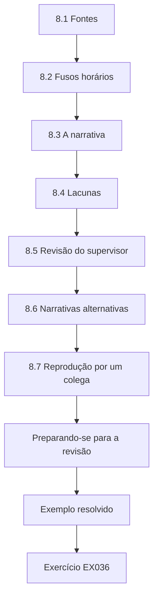

### Desenho lógico

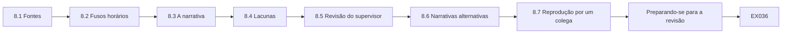

```text
[8.1 Fontes]
    |
    v
[8.2 Fusos horários]
    |
    v
[8.3 A narrativa]
    |
    v
[8.4 Lacunas]
    |
    v
[8.5 Revisão do supervisor]
    |
    v
[8.6 Narrativas alternativas]
    |
    v
[8.7 Reprodução por um colega]
    |
    v
[Preparando-se para a revisão]
    |
    v
[Exemplo resolvido] --> [Exercício EX036]
```
<!-- cykin:lesson-figures:end ch-08 -->


### Objetivos de aprendizagem

Você vai (1) montar uma linha do tempo a partir de várias fontes; (2) ligar os eventos numa narrativa; (3) apresentar a análise para a revisão do supervisor; (4) responder a questionamentos.

### 8.1 Fontes

Log do proxy (a visita de Joy à página imitada), log de entradas, auditoria da caixa de correio (criação da regra), rastreamento de mensagens (o e-mail de troca bancária) e o registro de mudanças da TI (redefinição). Cada fonte responde a uma parte diferente da história e usa seus próprios identificadores. O proxy indica o PC de Joy e o domínio, o log de entradas indica o endereço e a sessão, o registro de auditoria mostra a regra e a sessão, o rastreamento mostra remetente, destinatário e assunto, e o registro de mudanças da TI mostra a redefinição. Lena lista cada fonte com seu horário de exportação e seu fuso horário antes de juntar qualquer coisa.

### 8.2 Fusos horários

Todas as exportações são passadas para UTC antes da junção, para que os horários se alinhem. As notas do caso dizem qual fuso é usado. Sem um fuso único, a ordem dos eventos pode sair errada mesmo quando cada registro está correto. A exportação do proxy da Marlow usava o horário local, uma hora diferente dos registros de entrada e de auditoria em UTC, então a visita à página das 09:10 a princípio pareceu fora do lugar. Lena converte cada exportação e escreve o fuso original e a conversão nas notas do caso, para que um revisor possa refazê-la.

### 8.3 A narrativa

Joy abriu a página imitada às 09:10; o atacante entrou às 09:14; criou a regra de encaminhamento às 09:20; enviou o e-mail de troca bancária às 09:40; a TI redefiniu a senha às 10:05. O laboratório do capítulo 11 reconstrói essa linha do tempo a partir dos registros sintéticos. Cada passo tem seu próprio registro: o log do proxy para 09:10, o log de entradas para 09:14, a auditoria da caixa de correio para 09:20, o rastreamento de mensagens para 09:40 e o registro de mudanças da TI para 10:05. Os intervalos também merecem nota: quatro minutos da visita à página até a entrada e vinte e seis minutos da entrada até o e-mail fraudulento.

### 8.4 Lacunas

Nada mostra o que o atacante leu entre 09:14 e 09:40. Lena registra a lacuna em vez de adivinhar. A leitura de uma mensagem pode não ser registrada em todos os níveis de licença, então a ausência de registros não significa que o atacante não leu nada. Nesses 26 minutos, ele pode ter aberto correspondências com fornecedores para tornar convincente o e-mail de troca bancária, mas nenhum registro mostra isso, nem num sentido nem no outro. Lena escreve a lacuna na linha do tempo e nos limites do relatório, e avisa o responsável pela proteção de dados que não é possível mostrar que o conteúdo da caixa de correio ficou sem ser lido.

### 8.5 Revisão do supervisor

Dev questiona cada passo: "Como você sabe que a sessão das 09:14 criou a regra?" Lena aponta o identificador de sessão compartilhado pelos registros de entrada e de auditoria. As perguntas de Dev seguem a cadeia elo por elo: como a visita das 09:10 se liga ao PC de Joy, por que a entrada das 09:14 não foi de Joy e o que mostra que o e-mail de troca bancária saiu da mesma sessão. Onde Lena tem um registro, ela o mostra; onde não tem, como na lacuna de 09:14–09:40, ela diz isso. Dev só assina as conclusões quando cada elo tem uma resposta.

### 8.6 Narrativas alternativas

Joy poderia ter criado a regra por engano? A sessão veio do endereço do atacante, e Joy diz que não a criou. A alternativa é rejeitada com motivos. O teste é o mesmo usado para a entrada: nomear a explicação inocente e depois encontrar o registro que a sustentaria ou a refutaria. Se a regra tivesse sido criada a partir do endereço do escritório de Joy e da sessão dela, a alternativa teria continuado em aberto. Lena registra a narrativa rejeitada e seus motivos nas notas do caso, para que um leitor posterior veja que ela foi considerada, e não ignorada.

### 8.7 Reprodução por um colega

Um colega reconstrói dois elos usando apenas as notas de Lena e obtém o mesmo resultado. O colega trabalha só com as notas e com o compartilhamento de evidências, sem fazer perguntas a Lena. Os dois elos escolhidos são o identificador de sessão que junta a entrada das 09:14 à regra das 09:20 e o e-mail de troca bancária das 09:40 no rastreamento de mensagens. Resultados coincidentes mostram que as notas estão completas o bastante para outra pessoa segui-las. Se o colega não tivesse conseguido reconstruir um elo, Lena teria corrigido as notas antes que o relatório fosse para Dev.

### Preparando-se para a revisão

Antes do ponto de controle, Lena envia a Dev sua linha do tempo e os registros por trás dela com uma hora de antecedência. Revisar antes permite que ele prepare as perguntas, e a reunião é usada para o raciocínio, e não para a leitura. Ela também lista as partes de que tem menos certeza, para que o esforço de revisão vá para onde mais se precisa dele.

### Exemplo resolvido

O slide de Lena para o ponto de controle: cinco caixas em fila, com horário, fonte e evento, um marcador vermelho para a lacuna de 09:14–09:40 e uma nota de rodapé: "Todos os horários em UTC. O identificador de sessão liga a entrada à criação da regra."

> **Caso sintético.** A análise é inventada.

### Erros e limites

Narrativas são tentadoras; cada elo precisa apontar para um registro.

### Exercícios

- **EX036 — Fontes usadas.** Cite quatro fontes da linha do tempo. *Rubrica:* 3 = proxy, entradas, auditoria da caixa de correio, rastreamento de mensagens, registro de mudanças (quatro); 2 = três; 1 = uma; 0 = nada.
- **EX037 — Narrativa.** Dê os cinco eventos com seus horários. *Rubrica:* 3 = 09:10, 09:14, 09:20, 09:40, 10:05 corretos; 2 = quatro; 1 = dois; 0 = nada.
- **EX038 — Ligando a evidência.** Como Lena ligou a entrada à regra? *Rubrica:* 3 = identificador de sessão compartilhado; 2 = só o mesmo IP; 1 = palpite; 0 = nada.
- **EX039 — A lacuna.** Que lacuna foi registrada, e por que não preenchê-la? *Rubrica:* 3 = o que o atacante leu entre 09:14 e 09:40; não há registros; 2 = parcial; 1 = preencheu; 0 = nada.
- **EX040 — Alternativa rejeitada.** Por que "Joy criou a regra" foi rejeitada? *Rubrica:* 3 = sessão a partir do endereço do atacante; Joy nega; 2 = um; 1 = aceita; 0 = nada.

### Síntese

Junte as fontes num só fuso horário, ligue os eventos por registros, registre as lacunas e responda aos questionamentos com evidências.

### Continue estudando — capítulo 08 de 12

[← Capítulo 07 (rascunho)](#ch-07) · [Índice de capítulos do curso](../SUBJECTS.md) · [Capítulo 09 (rascunho) →](#ch-09)

<a id="ch-09"></a>

## Capítulo 9 — Comunicação, ética e relatórios

<!-- cykin:lesson-figures:start ch-09 -->
### Mapa da aula

Aula 09 publicada. Mapa, exemplo, EX041.

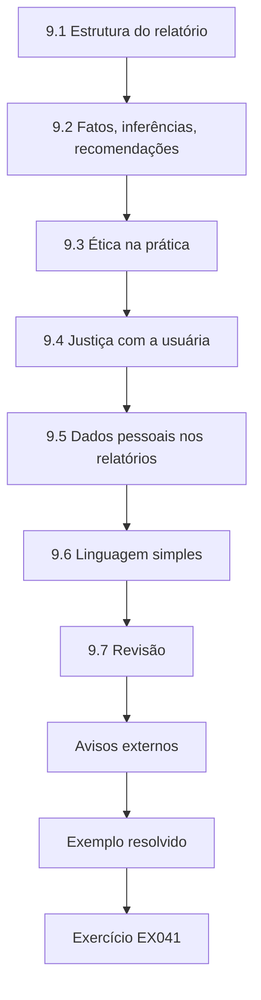

### Desenho lógico

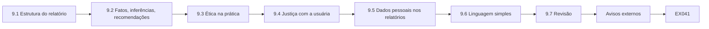

```text
[9.1 Estrutura do relatório]
    |
    v
[9.2 Fatos, inferências, recomendações]
    |
    v
[9.3 Ética na prática]
    |
    v
[9.4 Justiça com a usuária]
    |
    v
[9.5 Dados pessoais nos relatórios]
    |
    v
[9.6 Linguagem simples]
    |
    v
[9.7 Revisão]
    |
    v
[Avisos externos]
    |
    v
[Exemplo resolvido] --> [Exercício EX041]
```
<!-- cykin:lesson-figures:end ch-09 -->


### Objetivos de aprendizagem

Você vai (1) escrever um relatório de incidente claro; (2) separar fatos, inferências e recomendações; (3) aplicar limites éticos à investigação; (4) lidar com dados pessoais de forma responsável.

### 9.1 Estrutura do relatório

Resumo; escopo e autoridade; linha do tempo; constatações com nível de confiança; impacto; ações tomadas; recomendações; limites; apêndices com a lista de evidências e o manifesto. Casey (2011) ressalta que os relatórios devem permitir que outras pessoas confiram como se chegou às conclusões. Na Marlow, a linha do tempo traz os cinco eventos de 09:10 a 10:05, as constatações trazem níveis de confiança, como 'alta' para o acesso não autorizado e 'desconhecido' para quem estava por trás dele, e os limites indicam a lacuna de 09:14–09:40. Os apêndices guardam o manifesto, o log de custódia e a tabela de verificação, e o apêndice restrito guarda os assuntos encaminhados para o responsável pela proteção de dados.

### 9.2 Fatos, inferências, recomendações

Fato: "Uma entrada a partir de 203.0.113.50 teve sucesso às 09:14." Inferência: "Não foi Joy." Recomendação: "Remover o grupo de exceção de MFA." Cada uma é rotulada, para que os leitores saibam qual é a sua natureza. Misturá-las é a falha de relatório mais comum: uma recomendação vestida de fato soa como coisa decidida, e uma inferência escrita como fato esconde o raciocínio. A inferência 'não foi Joy' se apoia no endereço novo, na declaração dela e na visita das 09:10, e o relatório diz isso. Um leitor que discorde pode então questionar o raciocínio sem contestar os registros.

### 9.3 Ética na prática

Durante a análise, Lena vê mensagens pessoais na caixa de correio de Joy. Ela não lê além do que a pergunta exige, não as menciona e lista apenas os assuntos relevantes para o incidente. Os poderes de investigação servem ao incidente, não à curiosidade. O limite é dado pelas perguntas, e não pelo que o console permite. O acesso de administração de Lena poderia abrir qualquer mensagem da caixa de correio de Joy, mas as perguntas dela só precisam da lista de regras, do rastreamento e dos registros de auditoria. As onze mensagens encaminhadas são listadas pelo assunto; as mensagens pessoais de Joy não são listadas nem discutidas com colegas.

### 9.4 Justiça com a usuária

Joy cometeu um erro que muita gente comete. O relatório descreve a qualidade da página de phishing e os controles que faltavam, e não o caráter de Joy. A culpa desestimula os relatos. A página imitada usava um domínio registrado dois dias antes, novo o bastante para que o filtro de e-mail não o sinalizasse, e se apresentava como o login de uma fatura compartilhada. A conta de Joy também estava sem MFA por causa de um antigo grupo de exceção que ela não escolheu. O relatório diz que ela clicou e também que o relato dela sobre a manhã ajudou a confirmar a entrada não autorizada, para que os funcionários que o lerem vejam que relatar ajuda.

### 9.5 Dados pessoais nos relatórios

Os nomes só aparecem quando necessários; a lista de assuntos encaminhados vai para um apêndice restrito destinado ao responsável pela proteção de dados. O relatório principal fala em 'uma auxiliar de contas a pagar' e só usa o nome de Joy onde a linha do tempo precisa da conta j.okafor. Os nomes de contatos de fornecedores das mensagens encaminhadas não aparecem em nenhum ponto do texto principal. O apêndice restrito lista os onze assuntos para o responsável pela proteção de dados, que decide qual notificação, se houver, é necessária. Leitores mais amplos, como os gestores, recebem o relatório sem esse apêndice.

### 9.6 Linguagem simples

Frases curtas, termos definidos, horários com fuso, nenhum jargão sem explicação. O resumo de Lena mostra o estilo: 'um atacante usou uma senha capturada por uma página de login falsa', e não um jargão sobre coleta de credenciais. Termos como 'regra da caixa de entrada' e 'rastreamento de mensagens' são explicados na primeira vez em que aparecem. Todo horário traz o fuso, como em 'o acesso foi removido às 10:05 UTC'. Gestores e leitores do financeiro precisam agir com base no relatório, então uma frase que só a equipe de segurança entende falha no seu propósito, mesmo que esteja correta.

### 9.7 Revisão

Dev revisa e assina o relatório antes da distribuição. Dev confere se cada constatação cita um registro, se a formulação da confiança corresponde à evidência e se os limites indicam a lacuna de 09:14–09:40. Ele também confere se a linguagem atribui culpa e se há dados pessoais fora do apêndice restrito. A assinatura dele significa que a equipe de segurança, e não só Lena, responde pelo relatório. As mudanças que ele pede são feitas numa nova versão, e os rascunhos anteriores ficam guardados com o caso para que as edições possam ser rastreadas.

### Avisos externos

As mensagens para a Kestrel e para os funcionários são mais curtas que o relatório e não trazem nenhum detalhe técnico além do que cada leitor pode usar para agir.

### Exemplo resolvido

O resumo de Lena: "Em 3 de março de 2026, um atacante usou uma senha capturada por uma página de login falsa para acessar uma caixa de correio do setor de contas por 51 minutos. Ele encaminhou 11 mensagens para fora da empresa até as 10:05 (a janela de 10:05–10:15, enquanto a regra ainda estava ativa, está sendo conferida) e enviou um falso pedido de troca bancária a um fornecedor, que o conferiu por telefone; nenhum pagamento mudou. O acesso foi removido às 10:05 UTC. Três lacunas de controle estão sendo corrigidas."

> **Caso sintético.** O texto do relatório é inventado.

### Erros e limites

Um relatório reflete a evidência disponível no momento; registre que as conclusões podem mudar com novas informações.

### Exercícios

- **EX041 — Partes do relatório.** Liste seis partes do relatório. *Rubrica:* 3 = seis entre resumo, escopo, linha do tempo, constatações, impacto, ações, recomendações, limites, apêndices; 2 = quatro; 1 = duas; 0 = nada.
- **EX042 — Rotule a afirmação.** Classifique: "Não foi Joy." *Rubrica:* 3 = inferência, com o porquê; 2 = só inferência; 1 = fato; 0 = nada.
- **EX043 — Mensagens pessoais.** Como Lena lidou com as mensagens pessoais? *Rubrica:* 3 = não leu além do necessário, não mencionou, só os assuntos relevantes; 2 = parcial; 1 = relatou-as; 0 = nada.
- **EX044 — Culpa.** Por que evitar culpar Joy? *Rubrica:* 3 = erro comum; faltavam controles; a culpa desestimula os relatos; 2 = parcial; 1 = deve ser culpada; 0 = nada.
- **EX045 — Conferindo o resumo.** Que duração e que impacto o resumo informa? *Rubrica:* 3 = 51 minutos; 11 encaminhadas; um pedido falso; nenhuma mudança de pagamento; 2 = parcial; 1 = errado; 0 = nada.

### Síntese

Relate com clareza, com afirmações rotuladas, aja com ética diante dos dados pessoais e concentre-se nas causas, e não na culpa.

### Continue estudando — capítulo 09 de 12

[← Capítulo 08 (rascunho)](#ch-08) · [Índice de capítulos do curso](../SUBJECTS.md) · [Capítulo 10 (rascunho) →](#ch-10)

<a id="ch-10"></a>

## Capítulo 10 — Perícia digital e análise de malware: qualidade e solução de problemas

<!-- cykin:lesson-figures:start ch-10 -->
### Mapa da aula

Aula 10 publicada. Mapa, exemplo, EX046.

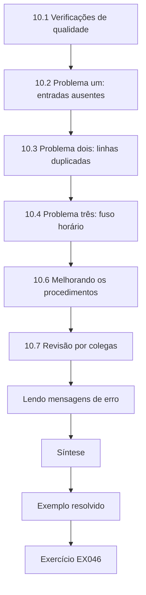

### Desenho lógico

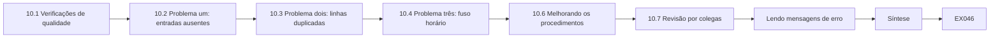

```text
[10.1 Verificações de qualidade]
    |
    v
[10.2 Problema um: entradas ausentes]
    |
    v
[10.3 Problema dois: linhas duplicadas]
    |
    v
[10.4 Problema três: fuso horário]
    |
    v
[10.6 Melhorando os procedimentos]
    |
    v
[10.7 Revisão por colegas]
    |
    v
[Lendo mensagens de erro]
    |
    v
[Síntese]
    |
    v
[Exemplo resolvido] --> [Exercício EX046]
```
<!-- cykin:lesson-figures:end ch-10 -->


### Objetivos de aprendizagem

Você vai (1) aplicar verificações de qualidade ao trabalho pericial; (2) resolver problemas de exportação e de análise; (3) tratar com honestidade os erros de ferramenta; (4) melhorar os procedimentos a partir dos problemas encontrados.

### 10.1 Verificações de qualidade

Antes que um relatório saia da equipe: cada constatação cita um registro; cada item de evidência tem hash e entrada de custódia; os horários usam um único fuso; um colega reproduziu os passos principais; o supervisor assinou. No caso da Marlow, cada verificação teve uma função real: a conferência dos hashes detectou o message_trace.csv editado, a regra do fuso único expôs o horário local da exportação do proxy e a reprodução pelo colega confirmou a ligação pela sessão. A lista é curta o bastante para ser aplicada a todo relatório, e Lena a marca no chamado antes de pedir a assinatura de Dev.

### 10.2 Problema um: entradas ausentes

A primeira exportação de entradas de Lena não mostrava nada antes de 2 de março. Causa: o intervalo padrão do console era de 48 horas. Ela exportou de novo com um intervalo explícito a partir de 1º de março e registrou a correção. Uma exportação de 48 horas feita em 3 de março deixou de fora o dia 1º de março, que estava dentro do escopo aprovado. A verificação de primeira ocorrência depende desse histórico, porque uma linha de base mais curta faz mais endereços parecerem novos. A exportação substituída fica no compartilhamento de evidências com seu próprio hash, marcada como substituída, para que a correção possa ser rastreada por Dev ou por um revisor posterior.

### 10.3 Problema dois: linhas duplicadas

Juntar duas exportações produziu eventos duplicados. Cada registro tem um identificador de evento único; remover as duplicatas por esse identificador corrigiu as contagens. Lena anota que as contagens do primeiro rascunho estavam erradas e foram corrigidas. As duplicatas surgiram porque as duas exportações cobriam períodos sobrepostos, então alguns eventos apareciam nas duas. Linhas duplicadas inflam contagens como o número de entradas ou de mensagens encaminhadas, que vão direto para o relatório e para a reunião sobre proteção de dados. Remover duplicatas a olho traz o risco de apagar dois eventos reais com o mesmo horário, então o identificador de evento único é a única chave segura.

### 10.4 Problema três: fuso horário

A exportação do proxy usava o horário local, enquanto as outras usavam UTC, o que deslocava a visita à página em uma hora. A conversão corrigiu a ordem. As notas do caso registram a conversão. Um deslocamento de uma hora importa quando os eventos estão a minutos de distância: a visita à página das 09:10 caiu depois da entrada das 09:14, o que faria a entrada parecer anterior à captura da senha. Essa ordem era impossível para o caso, e foi isso que tornou o erro visível. A conversão é anotada com o fuso original do proxy, para que um revisor possa refazê-la.

### 10.5 Honestidade sobre os erros

Cada problema é escrito no log do caso com causa e correção. Esconder um erro, mesmo um já corrigido, minaria a confiança se fosse descoberto depois. No log da Marlow, cada problema tem uma entrada: o intervalo de 48 horas, as linhas duplicadas e o fuso do proxy, junto com a edição da cópia de trabalho detectada pelo manifesto. Dev os vê antes do relatório, e os limites do relatório mencionam qualquer correção que tenha afetado um número. Um revisor que encontre depois uma exportação substituída encontra a explicação ao lado dela.

### 10.6 Melhorando os procedimentos

O runbook agora diz: defina intervalos de datas explícitos; remova duplicatas pelo identificador de evento; converta todas as exportações para UTC antes de juntá-las. Cada linha corresponde a um problema deste caso, então o runbook cresce a partir de evidências, e não de suposições. O intervalo explícito responde às entradas ausentes, a remoção de duplicatas pelo identificador responde às contagens infladas, e a conversão antes da junção responde à visita deslocada. Uma quarta mudança, guardar as notas num arquivo separado das cópias de trabalho, vem da divergência no manifesto. Dev aprova as mudanças, e o próximo caso vai testar se elas funcionam.

### 10.7 Revisão por colegas

Todo mês, um colega confere uma amostra de constatações com os registros brutos. O colega escolhe constatações ao acaso entre os casos recentes, abre os registros brutos por trás delas e confere se cada uma diz o que a constatação afirma. No caso da Marlow, uma amostra poderia incluir a entrada das 09:14, a criação da regra às 09:20 e a contagem de onze mensagens encaminhadas. As divergências são registradas e discutidas com o analista, e não resolvidas em silêncio. A amostragem mensal detecta desvios na prática que a revisão de um único caso deixaria passar.

### Lendo mensagens de erro

Quando um console mostra um erro, Lena copia o texto exato para o log em vez de parafraseá-lo. O texto exato permite que o fornecedor ou um colega procurem a causa e evita uma segunda tentativa frustrada.

### Exemplo resolvido

O log de Lena: "13:30 — exportação de entradas incompleta (intervalo padrão de 48 h). Exportado de novo para 1–3 de março; novo hash registrado; exportação antiga mantida e marcada como substituída. Atualização do runbook solicitada."

> **Caso sintético.** Os problemas são inventados.

### Erros e limites

As verificações de qualidade detectam erros comuns, não todos os erros; mantenha a humildade nas conclusões.

### Exercícios

- **EX046 — Lista de qualidade.** Liste quatro verificações de qualidade antes da liberação. *Rubrica:* 3 = constatações citam registros, hashes/custódia, um só fuso, reprodução por colega, assinatura (quatro); 2 = três; 1 = uma; 0 = nada.
- **EX047 — Intervalo padrão.** O que causou as entradas ausentes, e como foi corrigido? *Rubrica:* 3 = padrão de 48 horas; nova exportação explícita, novo hash, antiga marcada como substituída; 2 = parcial; 1 = errado; 0 = nada.
- **EX048 — Duplicatas.** Como as linhas duplicadas foram removidas? *Rubrica:* 3 = remoção pelo identificador de evento único; correção anotada; 2 = parcial; 1 = apagou a olho; 0 = nada.
- **EX049 — Erro de fuso.** O que o erro de fuso horário do proxy causou? *Rubrica:* 3 = deslocou a visita à página em uma hora; convertido para UTC; 2 = parcial; 1 = vago; 0 = nada.
- **EX050 — Registrar os erros.** Por que registrar no log do caso os erros já corrigidos? *Rubrica:* 3 = transparência; erros escondidos prejudicam a confiança se descobertos; 2 = parcial; 1 = não precisa; 0 = nada.

### Síntese

Confira a qualidade de forma sistemática, corrija os problemas abertamente e transforme-os em procedimentos melhores.

### Continue estudando — capítulo 10 de 12

[← Capítulo 09 (rascunho)](#ch-09) · [Índice de capítulos do curso](../SUBJECTS.md) · [Capítulo 11 (rascunho) →](#ch-11)

<a id="ch-11"></a>

## Capítulo 11 — Perícia digital e análise de malware: laboratório supervisionado

<!-- cykin:lesson-figures:start ch-11 -->
### Mapa da aula

Aula 11 publicada. Mapa, exemplo, EX051.

```mermaid
flowchart TD
  N0["11.1 O laboratório"]
  N1["11.2 A tarefa"]
  N2["Laboratório — juntando as fontes"]
  N3["11.3 Lendo o resultado"]
  N4["11.4 Saída esperada"]
  N5["11.5 Ampliando o laboratório"]
  N6["11.6 Notas de laboratório"]
  N7["11.7 Aprovação do supervisor"]
  N0 --> N1 --> N2 --> N3 --> N4 --> N5 --> N6 --> N7
  N7 --> EX["Exemplo resolvido"]
  EX --> Q["Exercício EX051"]
```

### Desenho lógico

```mermaid
flowchart LR
  N0["11.1 O laboratório"]
  N1["11.2 A tarefa"]
  N2["Laboratório — juntando as fontes"]
  N3["11.3 Lendo o resultado"]
  N4["11.4 Saída esperada"]
  N5["11.5 Ampliando o laboratório"]
  N6["11.6 Notas de laboratório"]
  N7["11.7 Aprovação do supervisor"]
  N0 --> N1 --> N2 --> N3 --> N4 --> N5 --> N6 --> N7 --> Q["EX051"]
```

```text
[11.1 O laboratório]
    |
    v
[11.2 A tarefa]
    |
    v
[Laboratório — juntando as fontes]
    |
    v
[11.3 Lendo o resultado]
    |
    v
[11.4 Saída esperada]
    |
    v
[11.5 Ampliando o laboratório]
    |
    v
[11.6 Notas de laboratório]
    |
    v
[11.7 Aprovação do supervisor]
    |
    v
[Exemplo resolvido] --> [Exercício EX051]
```
<!-- cykin:lesson-figures:end ch-11 -->


### Objetivos de aprendizagem

Você vai (1) reconstruir a linha do tempo de um incidente num laboratório isolado; (2) trabalhar apenas com registros sintéticos; (3) conferir os resultados com a saída esperada; (4) documentar o trabalho de laboratório no padrão de um caso.

### 11.1 O laboratório

O laboratório usa registros sintéticos derivados do padrão do caso, num PC de treinamento sem conexão com os sistemas da empresa. Não se usam dados reais de caixas de correio nem páginas de phishing ativas. O PC de treinamento não tem rota para o serviço de e-mail, o proxy ou os compartilhamentos de arquivos da Marlow, então nada no laboratório consegue alcançar um sistema real. Os registros reaproveitam os horários do caso, o nome de conta j.okafor e endereços de documentação como 203.0.113.50, mas nenhum conteúdo real de mensagens. Isso mantém o exercício próximo do caso e elimina os dados pessoais e qualquer chance de tocar em evidência real.

### 11.2 A tarefa

Juntar cinco eventos de quatro fontes numa única linha do tempo ordenada e confirmar a narrativa do capítulo 8. Os cinco eventos são a visita à página, a entrada, a criação da regra, o e-mail de troca bancária e a redefinição, e eles vêm do proxy, do log de entradas, da auditoria da caixa de correio e do rastreamento de mensagens. O script os lista fora de ordem de propósito, para que a ordenação tenha trabalho de verdade a fazer. A tarefa de Lena é rodá-lo, conferir a saída com a ordem esperada e explicar qualquer linha que não se encaixe.

### Laboratório — juntando as fontes

```python
"""Merge synthetic records from four sources into one ordered timeline."""
events = [
    ("09:20", "mail-audit", "inbox rule 'fwd' created for j.okafor"),
    ("09:10", "proxy", "j.okafor opens login-marlow.example.net"),
    ("09:40", "message-trace", "j.okafor sends 'Updated bank details' to supplier"),
    ("09:14", "sign-in", "j.okafor success from 203.0.113.50"),
    ("10:05", "mail-audit", "password reset and sessions revoked by IT"),
]
for t, src, what in sorted(events):
    print(t, f"{src:13}", what)
```

Execute com `python3 lab_timeline.py`. Saída verificada:

```text
09:10 proxy         j.okafor opens login-marlow.example.net
09:14 sign-in       j.okafor success from 203.0.113.50
09:20 mail-audit    inbox rule 'fwd' created for j.okafor
09:40 message-trace j.okafor sends 'Updated bank details' to supplier
10:05 mail-audit    password reset and sessions revoked by IT
```

### 11.3 Lendo o resultado

Ordenados por horário, os eventos ficam assim: 09:10 visita no proxy, 09:14 entrada, 09:20 criação da regra, 09:40 e-mail de troca bancária, 10:05 redefinição. A ordem coincide com a narrativa, e cada linha indica sua fonte. Duas linhas compartilham a fonte `mail-audit`, a criação da regra e a redefinição, e é por isso que cinco eventos vêm de quatro fontes; no próprio caso, a redefinição também é confirmada pelo registro de mudanças da TI. A saída não prova a narrativa sozinha; ela mostra que os registros podem ser postos numa ordem coerente. As ligações entre eles, como o identificador de sessão, continuam vindo da evidência, e não do script.

### 11.4 Saída esperada

Dev fornece a saída esperada numa nota lacrada. Lena compara depois de rodar; uma divergência indicaria um erro na entrada ou no código. Escrever a saída esperada antes da execução impede que alguém ajuste as expectativas ao que apareceu. A nota de Dev lista as cinco linhas em ordem, com suas fontes, então a comparação é feita linha a linha. Se uma linha não tivesse coincidido, Lena conferiria os horários de entrada e a chave de ordenação antes de culpar o script, e registraria a divergência nas notas de laboratório.

### 11.5 Ampliando o laboratório

Lena acrescenta um sexto evento sintético — o telefonema do fornecedor às 10:50 — e roda de novo; ele fica por último, como esperado. Ampliar um laboratório testa se ela o entende, e não apenas se sabe rodá-lo. O novo evento vem do log de contatos de Lena, uma quinta fonte, e é escrito no mesmo formato 'HH:MM' dos outros. Ele fica por último porque 10:50 vem depois da redefinição das 10:05 tanto como texto quanto como horário. Se ela tivesse digitado '9:40' sem o zero à esquerda, a ordenação de texto o teria posto depois de '10:05', o que mostra por que formatos consistentes importam.

### 11.6 Notas de laboratório

As notas registram a versão do script, a entrada, a saída e a comparação com os resultados esperados. Nesta execução, as notas registram lab_timeline.py v1, seu hash tirado da pasta revisada, os cinco eventos de entrada, as cinco linhas de saída e o resultado da comparação com a nota lacrada de Dev. A ampliação com a ligação das 10:50 é registrada à parte, com a entrada alterada. As notas são escritas durante a execução, e não depois, para que mostrem o que de fato aconteceu. Outro estudante deve conseguir repetir a sessão só com elas.

### 11.7 Aprovação do supervisor

Dev acompanha a execução e assina a folha do laboratório. Acompanhar a execução permite que Dev veja que Lena lê a saída e a compara, em vez de apenas digitar o comando. A assinatura dele vai na folha do laboratório, ao lado da versão do script e do resultado, como no exemplo resolvido. Uma folha sem assinatura não conta para o portfólio. Se Dev tivesse visto um erro, ele o registraria e pediria uma nova execução, anotada como segunda tentativa, sem substituir a primeira.

### Preparando o laboratório

Antes de cada sessão, o PC de treinamento é restaurado a um *snapshot* limpo, os scripts do laboratório são copiados da pasta revisada e seus hashes são conferidos com a lista. Começar de um estado conhecido significa que qualquer diferença na saída vem do próprio exercício, e não de restos deixados por um estudante anterior.

### Exemplo resolvido

Folha do laboratório: "lab_timeline.py v1 — 5 eventos, 4 fontes — ordem da saída coincide com a esperada — ampliação com a ligação das 10:50 ordenada corretamente — acompanhado e assinado por D. Anand."

> **Caso sintético.** Todos os registros do laboratório são inventados.

### Erros e limites

Ordenar pelo texto "HH:MM" só funciona dentro de um dia e de um fuso; linhas do tempo reais precisam de carimbos de tempo completos.

### Exercícios

- **EX051 — Segurança do laboratório.** O que mantém o laboratório seguro? *Rubrica:* 3 = registros sintéticos, PC isolado, nenhuma caixa de correio real nem página ativa; 2 = parcial; 1 = vago; 0 = nada.
- **EX052 — Ordem no laboratório.** Dê a ordem dos eventos depois da ordenação. *Rubrica:* 3 = 09:10 proxy, 09:14 entrada, 09:20 regra, 09:40 e-mail, 10:05 redefinição; 2 = pequeno deslize; 1 = errado; 0 = nada.
- **EX053 — Saída esperada.** Por que usar uma saída esperada lacrada? *Rubrica:* 3 = detectar erros de entrada/código sem viés; 2 = parcial; 1 = sem motivo; 0 = nada.
- **EX054 — Ampliação.** Que ampliação foi feita, e o que ela mostrou? *Rubrica:* 3 = acrescentou a ligação das 10:50; ficou por último; mostra entendimento; 2 = parcial; 1 = vago; 0 = nada.
- **EX055 — Limite da ordenação.** Qual é o limite de ordenar pelo texto HH:MM? *Rubrica:* 3 = só um dia e um fuso; são precisos carimbos de tempo completos; 2 = parcial; 1 = vago; 0 = nada.

### Síntese

Laboratórios isolados constroem habilidade com segurança; compare com a saída esperada e amplie o laboratório para provar o entendimento.

### Continue estudando — capítulo 11 de 12

[← Capítulo 10 (rascunho)](#ch-10) · [Índice de capítulos do curso](../SUBJECTS.md) · [Capítulo 12 (rascunho) →](#ch-12)

<a id="ch-12"></a>

## Capítulo 12 — Perícia digital e análise de malware: portfólio de prática e revisão final

<!-- cykin:lesson-figures:start ch-12 -->
### Mapa da aula

Aula 12 publicada. Mapa, exemplo, EX056.

```mermaid
flowchart TD
  N0["12.1 O portfólio"]
  N1["12.2 Revisão de ponta a ponta"]
  N2["12.3 O que deu certo"]
  N3["12.4 O que melhorar"]
  N4["12.5 Revisão final com Dev"]
  N5["12.6 Próximos passos"]
  N6["12.7 Mantendo as habilidades atualizadas"]
  N7["Retorno de outras pessoas"]
  N0 --> N1 --> N2 --> N3 --> N4 --> N5 --> N6 --> N7
  N7 --> EX["Exemplo resolvido"]
  EX --> Q["Exercício EX056"]
```

### Desenho lógico

```mermaid
flowchart LR
  N0["12.1 O portfólio"]
  N1["12.2 Revisão de ponta a ponta"]
  N2["12.3 O que deu certo"]
  N3["12.4 O que melhorar"]
  N4["12.5 Revisão final com Dev"]
  N5["12.6 Próximos passos"]
  N6["12.7 Mantendo as habilidades atualizadas"]
  N7["Retorno de outras pessoas"]
  N0 --> N1 --> N2 --> N3 --> N4 --> N5 --> N6 --> N7 --> Q["EX056"]
```

```text
[12.1 O portfólio]
    |
    v
[12.2 Revisão de ponta a ponta]
    |
    v
[12.3 O que deu certo]
    |
    v
[12.4 O que melhorar]
    |
    v
[12.5 Revisão final com Dev]
    |
    v
[12.6 Próximos passos]
    |
    v
[12.7 Mantendo as habilidades atualizadas]
    |
    v
[Retorno de outras pessoas]
    |
    v
[Exemplo resolvido] --> [Exercício EX056]
```
<!-- cykin:lesson-figures:end ch-12 -->


### Objetivos de aprendizagem

Você vai (1) montar um portfólio de prática; (2) refletir sobre pontos fortes e lacunas; (3) revisar o caso de ponta a ponta; (4) planejar os próximos passos de aprendizagem.

### 12.1 O portfólio

O portfólio de Lena reúne: aprovações de escopo, log de custódia, manifestos, tabelas de verificação, linha do tempo, relatório, folhas de laboratório e suas notas de solução de problemas. Os dados pessoais são removidos ou substituídos por valores sintéticos antes que o portfólio saia da equipe. Cada item mostra uma habilidade avaliada pelo curso: as aprovações mostram autoridade, o log de custódia e os manifestos mostram preservação, e a linha do tempo e o relatório mostram análise e comunicação. As notas de solução de problemas importam tanto quanto os acertos, porque mostram como Lena lidou com a exportação de 48 horas, as duplicatas e o fuso do proxy. O nome de Joy e os contatos de fornecedores são substituídos antes que o portfólio vá para avaliação.

### 12.2 Revisão de ponta a ponta

Do relato das 10:00 ao encerramento em 10 de março: contenção em 20 minutos, evidência preservada antes da correção, seis destinatários conferidos, três lacunas de controle corrigidas, nenhum pagamento perdido. A verificação por telefone feita pelo fornecedor foi a defesa decisiva. Lido de ponta a ponta, o caso mostra quais passos sustentaram o peso: a redefinição às 10:05 encerrou o acesso depois de 51 minutos, a exportação das 10:12 guardou a regra, e a ampliação do escopo às 11:10 respondeu se outras pessoas tinham sido afetadas. Os pontos mais fracos foram os próprios erros de manuseio de Lena, todos detectados pelas verificações. Revisar a semana inteira de uma vez torna esses padrões visíveis de um jeito que os pontos de controle isolados não tornavam.

### 12.3 O que deu certo

Contenção rápida; preservação da regra antes da exclusão; registro honesto dos erros. A contenção começou às 10:05, cinco minutos depois do relato, e estava concluída às 10:20, então a sessão do atacante foi encerrada minutos depois da ligação da Kestrel. Exportar a regra às 10:12, antes da exclusão, guardou a evidência que ligava a 'fwd' à sessão das 09:14. Registrar cada erro com causa e correção fez com que o relatório merecesse confiança mesmo onde um primeiro rascunho tinha errado. São hábitos que Lena pretende manter em todos os casos que conduzir daqui em diante.

### 12.4 O que melhorar

A edição de Lena numa cópia de trabalho pela planilha; o intervalo padrão da exportação; a conversão tardia de fuso horário. Cada um agora tem uma correção no runbook. Os três têm uma causa comum: Lena confiou num padrão ou numa conveniência em vez de conferi-los. A planilha salvou por cima de uma cópia de trabalho, o console escolheu um intervalo de 48 horas e a exportação do proxy manteve o fuso local. Nenhum deles mudou uma conclusão, porque todos foram detectados, mas cada um custou tempo e exigiu uma correção no log. O runbook agora trata de cada um antes que o próximo caso comece.

### 12.5 Revisão final com Dev

Dev avalia o portfólio segundo a rubrica do curso: autoridade, preservação, análise, verificação, relatórios e ética, cada uma com nota de 0 a 3. Cada nota se apoia em evidências do portfólio, e não na impressão que o caso deixou. Autoridade, preservação, relatórios e ética recebem 3 cada. Análise recebe 2 porque a confiança não foi informada para todas as constatações, e verificação recebe 2 porque as verificações começaram mais tarde do que deveriam. Dev e Lena combinam uma única meta a partir das áreas mais fracas, em vez de uma longa lista, para que ela possa ser conferida no próximo caso.

### 12.6 Próximos passos

Lena planeja aprender triagem de endpoints e triagem estática básica de malware sob supervisão, apoiando-se em Sikorski e Honig (2012) para os primeiros passos seguros. Este caso não envolveu malware, então a triagem de endpoints e a triagem estática são as partes do título do curso que Lena ainda não praticou. Sob supervisão, ela vai começar com amostras sintéticas num PC de treinamento isolado, descrevendo comportamento e artefatos, sem executar nada ativo. Os mesmos hábitos valem: escopo por escrito, hashes antes da análise, notas durante o trabalho e a aprovação de Dev.

### 12.7 Mantendo as habilidades atualizadas

As técnicas de phishing e os logs em nuvem mudam; ela reserva uma hora por mês para ler as notas de mudanças dos provedores e as lições da equipe. O caso mostra por quê: o domínio imitado tinha apenas dois dias, e o padrão de exportação do console a surpreendeu. Mudanças dos provedores podem alterar campos de log ou a retenção sem aviso, o que afetaria a próxima exportação. Lena acrescenta o que aprende a uma breve nota mensal da equipe, para que as mudanças cheguem aos colegas, e Dev avalia se o runbook precisa ser atualizado em consequência.

### Retorno de outras pessoas

Lena também pergunta a Joy e ao gerente financeiro como a resposta pareceu do lado deles. Joy conta que a primeira ligação a preocupou porque começou com perguntas; da próxima vez, Lena vai começar explicando que ela não está em apuros. Esse tipo de retorno raramente aparece nos logs, mas melhora os casos futuros.

### Exemplo resolvido

A avaliação de Dev: autoridade 3, preservação 3, análise 2 ("informe a confiança de cada constatação"), verificação 2 ("verifique mais cedo"), relatórios 3, ética 3. Meta combinada: manter a tabela de verificação do próximo caso desde o primeiro dia.

> **Caso sintético.** A avaliação é inventada.

### Erros e limites

Um portfólio mostra o trabalho passado; a habilidade precisa ser mantida com prática.

### Exercícios

- **EX056 — Conteúdo do portfólio.** Liste seis itens do portfólio. *Rubrica:* 3 = seis entre aprovações, custódia, manifestos, verificação, linha do tempo, relatório, folhas de laboratório, notas; 2 = quatro; 1 = dois; 0 = nada.
- **EX057 — Defesa decisiva.** Qual foi a defesa decisiva, e por quê? *Rubrica:* 3 = o fornecedor telefonou para um número conhecido; impediu a troca do pagamento; 2 = parcial; 1 = MFA; 0 = nada.
- **EX058 — Melhorias.** Cite três melhorias com suas correções. *Rubrica:* 3 = edição da cópia de trabalho, intervalo padrão, conversão tardia de fuso, com as correções do runbook; 2 = duas; 1 = uma; 0 = nada.
- **EX059 — Meta da avaliação.** Que meta saiu da avaliação? *Rubrica:* 3 = tabela de verificação desde o primeiro dia; 2 = parcial; 1 = vago; 0 = nada.
- **EX060 — Anonimização.** Por que anonimizar o portfólio? *Rubrica:* 3 = remover dados pessoais antes que saia da equipe; 2 = parcial; 1 = não precisa; 0 = nada.

### Síntese

Um portfólio revisado transforma um caso em prática duradoura e num plano para continuar aprendendo.

### Continue estudando — capítulo 12 de 12

[← Capítulo 11 (rascunho)](#ch-11) · [Índice de capítulos do curso](../SUBJECTS.md) · [Resoluções ↓](#worked-results) · [Próximo curso pelo índice de capítulos →](../SUBJECTS.md)

<a id="worked-results"></a>

## Resoluções

Respostas-modelo para EX001–EX060. Lena Hart, Dev Anand, Joy Okafor, a Marlow Logistics, a Kestrel Packaging e todos os valores são sintéticos. As respostas dos laboratórios citam saídas verificadas. Qualquer resposta que atenda à rubrica recebe a mesma pontuação.

**EX001.** A perícia reconstrói os eventos a partir de registros que outras pessoas podem conferir; a análise de malware descobre o que um programa suspeito faz, para que ele possa ser detectado e removido.

**EX002.** Um artefato é qualquer rastro de atividade; ele se torna evidência quando é coletado e manuseado de modo que sua integridade possa ser demonstrada.

**EX003.** Coleta, preserva e organiza evidências e executa verificações, com um supervisor aprovando o escopo e as conclusões, enquanto registra cada passo.

**EX004.** Joy digitou a senha numa página falsa, e depois disso alguém entrou na caixa de correio dela. Essa pessoa criou uma regra de encaminhamento externo e enviou à Kestrel um pedido de troca dos dados bancários.

**EX005.** O horário, quem relatou, o escopo e a aprovação de Dev, e que nada tinha sido feito ainda em outras contas.

**EX006.** O serviço de e-mail e identidade em nuvem, o proxy web, o sistema financeiro e o suporte técnico.

**EX007.** O financeiro precisa saber se algum pagamento mudou; a Kestrel precisa da confirmação de que o pedido era falso; o responsável pela proteção de dados precisa saber da exposição de dados pessoais.

**EX008.** A conta de Joy foi protegida na hora, enquanto uma colega assumia o trabalho de pagamentos dela naquele dia.

**EX009.** O canal de e-mail pode ainda estar nas mãos do atacante, então a confirmação passa por um número de telefone conhecido.

**EX010.** As mensagens encaminhadas para fora da empresa incluíam nomes de contatos de fornecedores, que são dados pessoais.

**EX011.** A política de uso aceitável junto com a aprovação de Dev às 10:02, que cobria apenas a caixa de correio e os logs de entrada de Joy.

**EX012.** Os registros de auditoria de retenção curta e os dados das sessões ativas, porque são os primeiros a desaparecer.

**EX013.** Logs de entrada, registros de auditoria da caixa de correio, regras da caixa de entrada, rastreamento de mensagens e o e-mail de phishing (os registros do proxy também contam).

**EX014.** Exportar primeiro guardou o nome, a ação e o destino da regra como evidência antes que a TI a removesse.

**EX015.** O item, a conta de onde veio, quem o exportou, o horário, seu hash e o local de armazenamento.

**EX016.** A conta foi usada por alguém além de Joy? Quando isso começou? O que essa pessoa fez, e mais alguém foi afetado?

**EX017.** Uma entrada bem-sucedida de j.okafor às 09:14 a partir de 203.0.113.50, dois minutos depois de uma falha do mesmo endereço; m.lee não mostrou nada novo.

**EX018.** Que o endereço fosse uma VPN da empresa, e que o celular de Joy tivesse entrado pelos dados móveis.

**EX019.** Um endereço IP mostra de onde veio uma conexão, e não qual pessoa a fez.

**EX020.** Um atacante que se conecte por um endereço já visto para a usuária, como uma VPN compartilhada, não seria sinalizado.

**EX021.** Para enviar cópias das mensagens da vítima para fora e para esconder respostas, de modo que a verdadeira dona não perceba.

**EX022.** A "fwd", que encaminha para um endereço externo; o log de auditoria mostra que ela foi criada às 09:20 pela sessão de 203.0.113.50.

**EX023.** Às 09:40, a conta de Joy enviou "Updated bank details" ao endereço do financeiro da Kestrel, o único envio externo daquela sessão.

**EX024.** Qualquer pessoa pode dar qualquer nome a uma regra; o que a liga ao atacante é a sessão que a criou.

**EX025.** Lena tirou os onze assuntos do rastreamento de mensagens sem abrir nenhum anexo.

**EX026.** Relato recebido, triagem e escopo, contenção, preservação, análise, verificação, relatório e, por fim, encerramento com lições.

**EX027.** Um pedido forjado de troca bancária poderia ter desviado um pagamento a fornecedor em poucas horas.

**EX028.** Redefinir a senha, encerrar todas as sessões, remover a regra depois de exportada e bloquear o endereço e o domínio imitado (além de verificar a ativação do MFA).

**EX029.** O rastreamento mostrou que o e-mail chegou a seis caixas de correio; Dev ampliou o escopo por escrito, e os registros do proxy mostraram que nenhum deles visitou a página.

**EX030.** Todas as ações concluídas, as partes interessadas informadas, a evidência arquivada conforme as regras de retenção e as lições registradas.

**EX031.** Lena tinha salvado uma coluna de notas na cópia de trabalho; ela a substituiu por uma cópia nova e verificada tirada do original e agora guarda as notas em outro lugar.

**EX032.** Nenhuma entrada bem-sucedida a partir de 203.0.113.50 depois das 10:05, a regra "fwd" removida e o proxy bloqueando o domínio imitado a partir de um PC de teste.

**EX033.** Joy estava num antigo grupo de exceção de MFA, o filtro de e-mail não pegou o domínio de dois dias e o encaminhamento para fora era permitido por padrão.

**EX034.** Uma regra de teste que encaminhava para fora da empresa foi criada e rejeitada.

**EX035.** O atacante pode ter outro acesso, como um consentimento de aplicativo ou outra conta, que uma única verificação não pegaria.

**EX036.** O log do proxy, o log de entradas, a auditoria da caixa de correio e o rastreamento de mensagens (e o registro de mudanças da TI).

**EX037.** 09:10 visita à página, 09:14 entrada do atacante, 09:20 regra de encaminhamento, 09:40 e-mail de troca bancária, 10:05 redefinição da senha.

**EX038.** O mesmo identificador de sessão aparece no registro de entrada e na entrada de auditoria da criação da regra.

**EX039.** Não há registros do que foi lido entre 09:14 e 09:40, então isso continua como lacuna em aberto.

**EX040.** A sessão que a criou veio do endereço do atacante, e Joy disse que não a tinha criado.

**EX041.** Resumo, escopo e autoridade, linha do tempo, constatações com nível de confiança, ações tomadas e recomendações (impacto, limites e apêndices também fazem parte).

**EX042.** Uma inferência: é deduzida do endereço novo, da declaração de Joy e da visita ao phishing, e não observada diretamente.

**EX043.** Ela não leu além do que a pergunta exigia, nunca as mencionou e listou apenas os assuntos ligados ao incidente.

**EX044.** A página de phishing era convincente e faltavam controles; culpar a pessoa faz os funcionários demorarem mais a relatar da próxima vez.

**EX045.** Cinquenta e um minutos de acesso, onze mensagens encaminhadas e um falso pedido de troca bancária, sem nenhum pagamento alterado.

**EX046.** Cada constatação cita um registro, cada item tem hash e entrada de custódia, todos os horários usam um só fuso e um colega reproduziu os passos principais (além da assinatura do supervisor).

**EX047.** O console usava por padrão as últimas 48 horas; Lena exportou de novo 1–3 de março, gerou o hash do novo arquivo e marcou o antigo como substituído.

**EX048.** As linhas foram deduplicadas pelo identificador de evento único, e as contagens erradas do rascunho foram anotadas como corrigidas.

**EX049.** Ele deslocou a visita à página em uma hora, quebrando a ordem até que a exportação fosse convertida para UTC.

**EX050.** A transparência mantém a confiança; um erro escondido que fosse descoberto depois lançaria dúvida sobre todo o trabalho.

**EX051.** Só registros sintéticos num PC de treinamento isolado, sem dados reais de caixas de correio nem páginas de phishing ativas.

**EX052.** 09:10 visita no proxy, 09:14 entrada, 09:20 criação da regra, 09:40 e-mail de troca bancária, 10:05 redefinição.

**EX053.** Comparar com uma resposta escrita de antemão revela erros na entrada ou no código sem que Lena ajuste suas expectativas.

**EX054.** Ela acrescentou o telefonema do fornecedor às 10:50; ele ficou por último, mostrando que ela entendeu como o script ordena os eventos.

**EX055.** Só funciona para eventos de um dia num só fuso horário; o trabalho real precisa de carimbos completos de data e hora.

**EX056.** Aprovações de escopo, o log de custódia, os manifestos, as tabelas de verificação, a linha do tempo e o relatório (as folhas de laboratório e as notas de solução de problemas também).

**EX057.** A equipe financeira da Kestrel telefonou para um número conhecido da Marlow para conferir, então a falsa troca bancária nunca foi executada.

**EX058.** A edição de uma cópia de trabalho (notas agora guardadas à parte), o intervalo padrão da exportação (intervalos explícitos) e a conversão tardia de fuso (converter para UTC antes de juntar).

**EX059.** Começar a tabela de verificação no primeiro dia do próximo caso.

**EX060.** Para que nenhum dado pessoal real saia da equipe quando o portfólio for compartilhado para avaliação.

<a id="references"></a>
## Referências

Todos os DOIs foram resolvidos em doi.org em 12 de outubro de 2026, e as normas foram conferidas nas páginas de seus editores. A lista é idêntica à da edição em inglês e cobre o livro inteiro; nenhuma das normas técnicas citadas foi verificada aqui como adotada pela ABNT, por isso são citadas em sua edição internacional. Organizações, pessoas, sistemas e números dos casos são sintéticos; somente as obras abaixo são reais.

- Carrier, B. (2005). *File System Forensic Analysis*. Addison-Wesley. ISBN 978-0-321-26817-4.
- Casey, E. (2011). *Digital Evidence and Computer Crime* (3rd ed.). Academic Press. ISBN 978-0-12-374268-1.
- Garfinkel, S. L. (2010). Digital forensics research: The next 10 years. *Digital Investigation*, 7, S64–S73. <https://doi.org/10.1016/j.diin.2010.05.009>
- Garfinkel, S., Farrell, P., Roussev, V., & Dinolt, G. (2009). Bringing science to digital forensics with standardized forensic corpora. *Digital Investigation*, 6, S2–S11. <https://doi.org/10.1016/j.diin.2009.06.016>
- IETF RFC 3227 (2002). Brezinski, D., & Killalea, T. Guidelines for Evidence Collection and Archiving. <https://www.rfc-editor.org/rfc/rfc3227>
- ISO/IEC 27037:2012. Guidelines for identification, collection, acquisition and preservation of digital evidence. <https://www.iso.org/standard/44381.html>
- ISO/IEC 27041:2015. Guidance on assuring suitability and adequacy of incident investigative method. <https://www.iso.org/standard/44405.html>
- ISO/IEC 27042:2015. Guidelines for the analysis and interpretation of digital evidence. <https://www.iso.org/standard/44406.html>
- ISO/IEC 27043:2015. Incident investigation principles and processes. <https://www.iso.org/standard/44407.html>
- Kornblum, J. (2006). Identifying almost identical files using context triggered piecewise hashing. *Digital Investigation*, 3(S), 91–97. <https://doi.org/10.1016/j.diin.2006.06.015>
- Landis, J. R., & Koch, G. G. (1977). The measurement of observer agreement for categorical data. *Biometrics*, 33(1), 159–174. <https://doi.org/10.2307/2529310>
- MITRE ATT&CK. <https://attack.mitre.org/>
- NIST Computer Forensics Tool Testing (CFTT) Program. <https://www.nist.gov/itl/ssd/software-quality-group/computer-forensics-tool-testing-program-cftt>
- NIST National Software Reference Library (NSRL). <https://www.nist.gov/itl/ssd/software-quality-group/national-software-reference-library-nsrl>
- NIST SP 800-101 Rev. 1 (2014). Ayers, R., Brothers, S., & Jansen, W. Guidelines on Mobile Device Forensics. <https://doi.org/10.6028/NIST.SP.800-101r1>
- NIST SP 800-61 Rev. 3 (2025). Incident Response Recommendations and Considerations for Cybersecurity Risk Management. <https://doi.org/10.6028/NIST.SP.800-61r3>
- NIST SP 800-86 (2006). Kent, K., Chevalier, S., Grance, T., & Dang, H. Guide to Integrating Forensic Techniques into Incident Response. <https://doi.org/10.6028/NIST.SP.800-86>
- Roussev, V. (2010). Data fingerprinting with similarity digests. In *Advances in Digital Forensics VI*, IFIP AICT 337, 207–226. Springer. <https://doi.org/10.1007/978-3-642-15506-2_15>
- Sikorski, M., & Honig, A. (2012). *Practical Malware Analysis*. No Starch Press. <https://nostarch.com/malware>
- SWGDE (Scientific Working Group on Digital Evidence). Published documents. <https://www.swgde.org/documents/published-complete-listing>
