# Identity and Access Management: Professional Course

- Language: English (`en`); course 033, Professional course (6 months).
- Editorial state: **published**. Chapters 1–12 of 12 have hand-written teaching text; exercises EX001–EX060 have matching worked results with 0–3 rubrics; Two offline labs use only the Python 3 standard library on synthetic evidence, and their outputs are embedded from real runs. Independent review and the 300-page A4 verification remain open.
- Audience: working IT professionals moving into identity security who need practical, supervised skills in review, triage, investigation and reporting.
- Author: [hiagokinlevi](https://github.com/hiagokinlevi). Original text [CC0 1.0](../../../../../LICENSE); cited works keep their rights.
- Ethical and legal boundary: review and test only identity systems and accounts you are authorised to assess; no exploit code, no payloads, no attack procedures and no instructions for bypassing controls. Weaknesses are taught from the defender's side using synthetic accounts, entitlements, logs and data. All evidence, people and organisations are **synthetic** unless a sentence cites a public source.

[Course home](../../README.md) · [Chapter index](../SUBJECTS.md) · [Book plan](PLAN.md) · [Course skill](../../skill/SKILL.md) · [Worked results](#worked-results)

## How to use this draft

Read in order: the chapters follow one IT support professional, mentored by a senior identity engineer, reviewing identity and access at a three-office accountancy firm, from foundations, standards and authorised evidence handling through authentication and role reviews, a role drift lab, alert triage, request and change workflow, guest access with an expiry lab, a supervised investigation, reporting and troubleshooting, and a final portfolio. Run each lab where it appears, attempt the exercises before the worked results, and score yourself with the rubrics.

### Synthetic running case

| Element | Role | Boundary |
|---|---|---|
| **Daniel Okafor** | Professional learner | Invented |
| **Helen Brooks** | Mentor | Invented |
| **Pinewood Professional Academy** | Fictional academy | Invented |
| **Ashby and Lane Accountants** | Fictional partner (three offices, about 60 staff) | Invented |

### Core sources

NIST [SP 800-63-4](https://doi.org/10.6028/NIST.SP.800-63-4), [SP 800-63B-4](https://doi.org/10.6028/NIST.SP.800-63B-4), [SP 800-162](https://doi.org/10.6028/NIST.SP.800-162), [SP 800-207](https://doi.org/10.6028/NIST.SP.800-207) and [SP 800-53r5](https://doi.org/10.6028/NIST.SP.800-53r5); IETF [RFC 6749](https://www.rfc-editor.org/rfc/rfc6749) and [RFC 9700](https://www.rfc-editor.org/rfc/rfc9700); [OpenID Connect Core 1.0](https://openid.net/specs/openid-connect-core-1_0.html); W3C [WebAuthn Level 2](https://www.w3.org/TR/webauthn-2/); OASIS [SAML 2.0](https://docs.oasis-open.org/security/saml/v2.0/saml-core-2.0-os.pdf). Full list in [References](#references).

## Contents

| Chapters |
|---|
| [1](#ch-01) · [2](#ch-02) · [3](#ch-03) · [4](#ch-04) · [5](#ch-05) · [6](#ch-06) · [7](#ch-07) · [8](#ch-08) · [9](#ch-09) · [10](#ch-10) |
| [11](#ch-11) · [12](#ch-12) |

[Worked results](#worked-results) · [References](#references)

<a id="ch-01"></a>

## Chapter 1 — Foundations of identity and access

<!-- open-cyber-academy:lesson-figures:start ch-01 -->
### Lesson map

Lesson 01 published. Map, example, EX001.

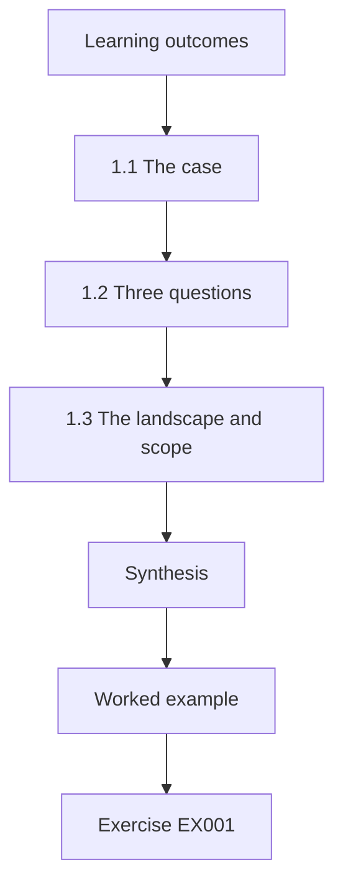

### Logical drawing

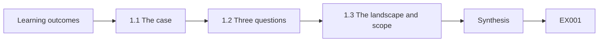

```text
[Learning outcomes]
    |
    v
[1.1 The case]
    |
    v
[1.2 Three questions]
    |
    v
[1.3 The landscape and scope]
    |
    v
[Synthesis]
    |
    v
[Worked example] --> [Exercise EX001]
```
<!-- open-cyber-academy:lesson-figures:end ch-01 -->


### Learning outcomes

You will (1) explain identity, authentication and authorisation; (2) describe the firm's identity landscape; (3) agree a supervised scope.

### 1.1 The case

Daniel Okafor has worked in IT support for six years and is moving into security through a six-month professional course at the fictional Pinewood Professional Academy. His mentor is Helen Brooks, a senior identity engineer. His partner organisation is the fictional Ashby and Lane Accountants, with three offices and about 60 staff who handle client tax records and financial statements. Every account, log and figure in this book is synthetic, and Daniel works only within a written scope agreed with the firm's managing partner.

### 1.2 Three questions

Identity and access management answers three questions: who is this (identification), can they prove it (authentication), and what may they do (authorisation). Daniel already resets passwords and creates accounts, but the course asks him to see these tasks as controls with risks and evidence. A forgotten leaver account is an authorisation failure; a reused password is an authentication weakness; a shared login breaks identification. Seeing which question a problem belongs to helps him choose the right fix rather than the most familiar one.

### 1.3 The landscape and scope

Ashby and Lane uses a cloud directory for email and documents, a practice management system for client work, tax filing software, a billing system and a file share with client folders. External auditors and some clients have guest access to shared folders. Daniel's scope, signed by the managing partner, allows him to review settings and exports, propose changes and apply approved ones, but not to open client files. A clear scope protects clients' confidentiality and gives his work a recorded authority.

### Worked example

Daniel maps five systems and guest access to shared folders; his signed scope covers settings and exports but not client file contents.

> **Synthetic case.** Daniel Okafor, Helen Brooks, Pinewood Professional Academy, Ashby and Lane Accountants and all data are synthetic.

### Errors and limits

Treating identity tasks as routine support jobs rather than controls hides their risk and evidence.

### Exercises

- **EX001 — Firm profile.** Describe Ashby and Lane. *Rubric:* 3 = three offices, about 60 staff, accountants;; 2 = accountants;; 1 = bakery;; 0 = none.
- **EX002 — Forgotten leaver.** Which question does a forgotten leaver account fail? *Rubric:* 3 = authorisation;; 2 = access;; 1 = authentication;; 0 = none.
- **EX003 — Shared login.** Which question does a shared login break? *Rubric:* 3 = identification;; 2 = who;; 1 = authorisation;; 0 = none.
- **EX004 — Scope exclusion.** What does Daniel's scope exclude? *Rubric:* 3 = opening client files;; 2 = client files;; 1 = settings;; 0 = none.
- **EX005 — Guest users.** Who has guest access? *Rubric:* 3 = external auditors and some clients;; 2 = externals;; 1 = nobody;; 0 = none.

### Synthesis

Framing work by identification, authentication and authorisation, within a signed scope, is the foundation for identity security.

### Continue studying — chapter 01 of 12

[← Course home](../../README.md) · [Course chapter index](../SUBJECTS.md) · [Chapter 02 (draft) →](#ch-02)

<a id="ch-02"></a>

## Chapter 2 — Standards and context

<!-- open-cyber-academy:lesson-figures:start ch-02 -->
### Lesson map

Lesson 02 published. Map, example, EX006.

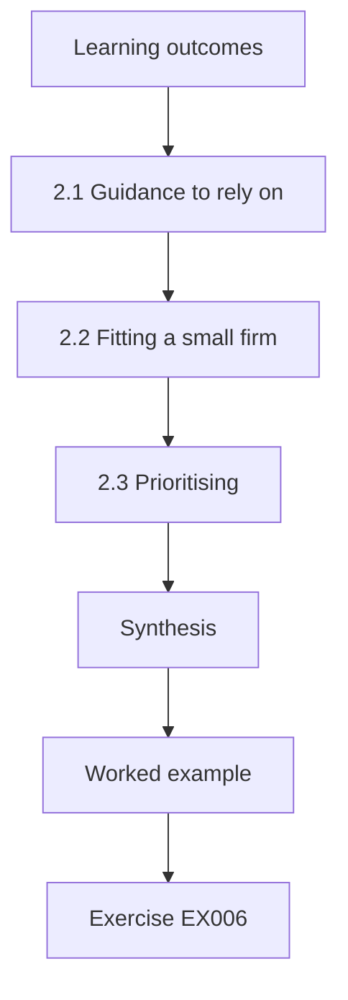

### Logical drawing

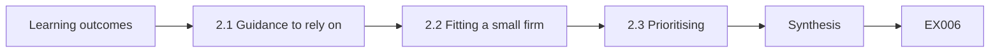

```text
[Learning outcomes]
    |
    v
[2.1 Guidance to rely on]
    |
    v
[2.2 Fitting a small firm]
    |
    v
[2.3 Prioritising]
    |
    v
[Synthesis]
    |
    v
[Worked example] --> [Exercise EX006]
```
<!-- open-cyber-academy:lesson-figures:end ch-02 -->


### Learning outcomes

You will (1) use recognised guidance; (2) relate it to a small professional firm; (3) prioritise by risk.

### 2.1 Guidance to rely on

Daniel learns which sources are trustworthy. NIST SP 800-63B sets out authenticator strength, password guidance and recovery. NIST SP 800-207 describes zero trust, where access decisions consider identity, device and context rather than network location. The W3C WebAuthn standard and FIDO2 underpin passkeys. RFC 6749 defines OAuth 2.0 and RFC 9700 gives current OAuth security advice. Helen asks him to cite these rather than vendor blogs, because standards are stable, reviewed and independent of any one product. He keeps a short list of these sources in his notes.

### 2.2 Fitting a small firm

An accountancy firm cannot adopt everything at once. Daniel reads guidance for its principles: strong authentication for everyone, stronger still for administrators and staff with access to many clients; least privilege; prompt removal of leavers; and evidence that controls work. He relates each principle to Ashby and Lane's systems. He notes that client confidentiality and regulatory duties make unauthorised access to tax records a serious harm, which raises the priority of access controls on those systems. Helen checks his mapping of principles to systems before he presents it.

### 2.3 Prioritising

Daniel ranks issues by likely harm and effort. High harm and low effort come first: removing leavers, enforcing multi-factor authentication and separating admin accounts. Medium items follow: role-based groups and guest expiry. Longer projects such as single sign-on for the tax software come later. He writes the ranking on one page with reasons and agrees it with Helen and the managing partner. A clear priority list keeps a six-month course focused on the changes that reduce risk most. The list is revisited monthly.

### Worked example

Daniel's one-page priority list puts leavers, MFA and admin separation first, then role groups and guest expiry, then SSO for tax software.

> **Synthetic case.** Priorities are synthetic; NIST SP 800-63B, NIST SP 800-207, W3C WebAuthn, RFC 6749 and RFC 9700 are real sources.

### Errors and limits

Citing vendor marketing as authority leads to product-driven rather than risk-driven decisions.

### Exercises

- **EX006 — Zero trust source.** Which NIST publication describes zero trust? *Rubric:* 3 = SP 800-207;; 2 = 800-207;; 1 = 800-63B;; 0 = none.
- **EX007 — Passkey standard.** Which standard underpins passkeys? *Rubric:* 3 = W3C WebAuthn with FIDO2;; 2 = WebAuthn;; 1 = SAML;; 0 = none.
- **EX008 — Harm driver.** Why are tax record controls high priority? *Rubric:* 3 = client confidentiality and regulatory duties;; 2 = confidentiality;; 1 = cost;; 0 = none.
- **EX009 — First items.** Which items come first? *Rubric:* 3 = leavers, MFA, admin separation;; 2 = quick wins;; 1 = SSO;; 0 = none.
- **EX010 — Later project.** Which project comes later? *Rubric:* 3 = SSO for tax software;; 2 = SSO;; 1 = MFA;; 0 = none.

### Synthesis

Recognised standards, applied by principle and ranked by harm and effort, focus identity work.

### Continue studying — chapter 02 of 12

[← Chapter 01 (draft)](#ch-01) · [Course chapter index](../SUBJECTS.md) · [Chapter 03 (draft) →](#ch-03)

<a id="ch-03"></a>

## Chapter 3 — Evidence handling and authorised data collection

<!-- open-cyber-academy:lesson-figures:start ch-03 -->
### Lesson map

Lesson 03 published. Map, example, EX011.

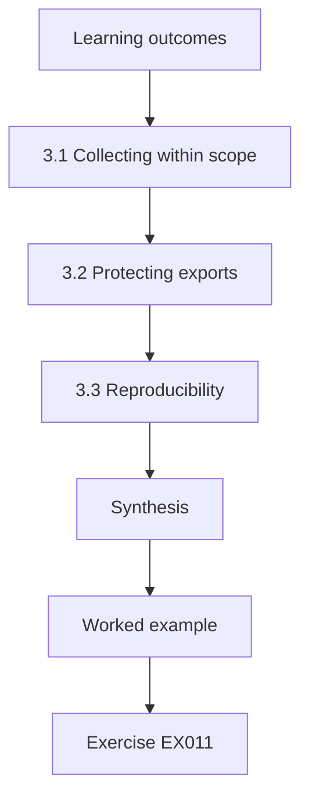

### Logical drawing

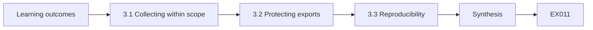

```text
[Learning outcomes]
    |
    v
[3.1 Collecting within scope]
    |
    v
[3.2 Protecting exports]
    |
    v
[3.3 Reproducibility]
    |
    v
[Synthesis]
    |
    v
[Worked example] --> [Exercise EX011]
```
<!-- open-cyber-academy:lesson-figures:end ch-03 -->


### Learning outcomes

You will (1) collect identity evidence within scope; (2) protect exports; (3) keep records reproducible.

### 3.1 Collecting within scope

Daniel needs evidence: user exports, group memberships, sign-in logs and admin role lists. He collects them through the admin consoles' export features, under his scope, and records what he exported, when and why. He does not open client folders or read mailboxes. Collecting only what the review needs keeps the work proportionate and respects staff and client privacy, and it means every finding can be traced to a specific, authorised export. Helen checks the evidence log weekly and asks him to justify any export whose purpose is unclear.

### 3.2 Protecting exports

Exports contain staff names, sign-in locations and sometimes client guest addresses. Daniel stores them in an encrypted folder accessible only to him and Helen, never on personal devices or in email. He deletes exports at the end of the course except those needed as evidence in the final report, which are kept with the firm under its retention rules. Treating exports as sensitive data prevents the security review itself from becoming a source of exposure. He records where each export is stored and when it will be deleted.

### 3.3 Reproducibility

For each finding, Daniel records the export file, date and the steps or script used, so Helen or the firm can repeat the analysis and get the same result. When a later export shows different numbers, he can tell whether the environment changed or his method did. Reproducible evidence makes findings credible to partners who must approve changes, and it allows progress to be measured fairly from the first review to the last. Helen tests this by repeating one analysis from his notes alone.

### Worked example

Daniel records 14 exports with date, purpose and method in an evidence log; files are kept encrypted and shared only with Helen.

> **Synthetic case.** Exports and logs are synthetic.

### Errors and limits

Emailing exports of sign-in logs exposes staff data unnecessarily.

### Exercises

- **EX011 — Collection method.** How are exports collected? *Rubric:* 3 = admin console export features within scope;; 2 = console;; 1 = copying files;; 0 = none.
- **EX012 — Not touched.** Name one thing Daniel does not access. *Rubric:* 3 = client folders or mailboxes;; 2 = client folders;; 1 = exports;; 0 = none.
- **EX013 — Export storage.** Where are exports stored? *Rubric:* 3 = encrypted folder for him and Helen only;; 2 = encrypted;; 1 = email;; 0 = none.
- **EX014 — Reproducible record.** What is recorded per finding? *Rubric:* 3 = export file, date and method;; 2 = source;; 1 = vague;; 0 = none.
- **EX015 — Retention end.** What happens to exports at the end? *Rubric:* 3 = deleted except evidence kept under firm rules;; 2 = deleted;; 1 = kept forever;; 0 = none.

### Synthesis

Scoped, protected and reproducible evidence makes identity findings trustworthy.

### Continue studying — chapter 03 of 12

[← Chapter 02 (draft)](#ch-02) · [Course chapter index](../SUBJECTS.md) · [Chapter 04 (draft) →](#ch-04)

<a id="ch-04"></a>

## Chapter 4 — Reviewing authentication

<!-- open-cyber-academy:lesson-figures:start ch-04 -->
### Lesson map

Lesson 04 published. Map, example, EX016.

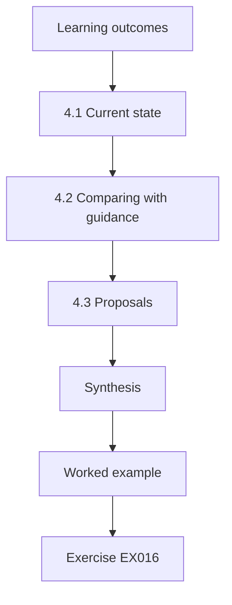

### Logical drawing

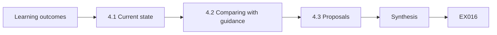

```text
[Learning outcomes]
    |
    v
[4.1 Current state]
    |
    v
[4.2 Comparing with guidance]
    |
    v
[4.3 Proposals]
    |
    v
[Synthesis]
    |
    v
[Worked example] --> [Exercise EX016]
```
<!-- open-cyber-academy:lesson-figures:end ch-04 -->


### Learning outcomes

You will (1) assess authentication settings; (2) identify weak methods; (3) propose improvements.

### 4.1 Current state

Daniel reviews authentication settings. Multi-factor authentication is enabled but optional, and 41 of 60 staff use it. Text message codes are the most common method. The password policy forces changes every 45 days and requires symbols. Two partners and the office manager have no second factor at all. He records each setting with the export that shows it. A clear picture of the current state lets him compare it with guidance and explain differences to partners without relying on opinion.

Forty-one of sixty is about 68 percent, and the gap includes two partners, whose accounts are among the most valuable to an attacker.

### 4.2 Comparing with guidance

NIST SP 800-63B favours longer passwords screened against known-compromised lists, without forced periodic changes unless compromise is suspected, and treats text codes as a restricted method. Phishing-resistant authenticators, such as passkeys built on WebAuthn, give the strongest protection. Daniel notes that forced 45-day changes tend to produce predictable passwords, and that partners without a second factor are the highest-value targets because they can see every client's records and approve payments. He summarises the comparison in a short table showing each setting, the guidance and the gap, with the export that proves the current value.

### 4.3 Proposals

Daniel proposes: require multi-factor authentication for all staff within a month; partners, the office manager and IT move to passkeys or hardware keys first; text codes allowed only as a temporary fallback; remove forced periodic changes and add screening of new passwords against compromised lists. Each proposal states the risk reduced, effort and staff impact. Helen reviews them before he presents to the managing partner, who approves all four with a request for drop-in help sessions. The approved proposals and dates are recorded.

### Worked example

MFA is optional and used by 41 of 60; two partners and the office manager have none; four proposals are approved.

> **Synthetic case.** Settings and counts are synthetic; NIST SP 800-63B and W3C WebAuthn are real sources.

### Errors and limits

Leaving MFA optional lets the highest-value accounts remain unprotected.

### Exercises

- **EX016 — Starting coverage.** How many staff used MFA at the start? *Rubric:* 3 = 41 of 60;; 2 = 41;; 1 = 60;; 0 = none.
- **EX017 — Unprotected seniors.** Who had no second factor? *Rubric:* 3 = two partners and the office manager;; 2 = seniors;; 1 = nobody;; 0 = none.
- **EX018 — Forced change issue.** Why remove forced 45-day changes? *Rubric:* 3 = produce predictable passwords;; 2 = predictable;; 1 = security;; 0 = none.
- **EX019 — SMS status.** How are text codes treated? *Rubric:* 3 = temporary fallback only;; 2 = fallback;; 1 = main method;; 0 = none.
- **EX020 — Partner request.** What did the managing partner request? *Rubric:* 3 = drop-in help sessions;; 2 = help sessions;; 1 = vague;; 0 = none.

### Synthesis

Comparing settings with guidance and proposing ranked changes strengthens authentication with partner support.

### Continue studying — chapter 04 of 12

[← Chapter 03 (draft)](#ch-03) · [Course chapter index](../SUBJECTS.md) · [Chapter 05 (draft) →](#ch-05)

<a id="ch-05"></a>

## Chapter 5 — Reviewing roles and authorisation

<!-- open-cyber-academy:lesson-figures:start ch-05 -->
### Lesson map

Lesson 05 published. Map, example, EX021.

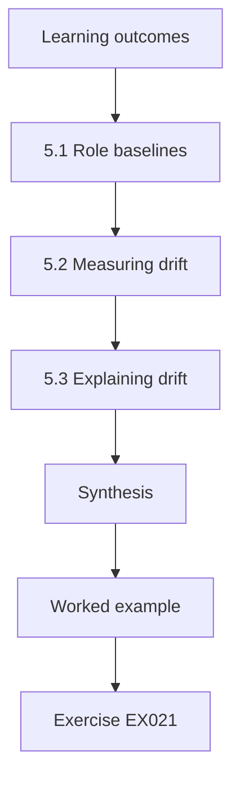

### Logical drawing

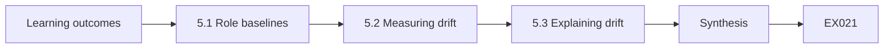

```text
[Learning outcomes]
    |
    v
[5.1 Role baselines]
    |
    v
[5.2 Measuring drift]
    |
    v
[5.3 Explaining drift]
    |
    v
[Synthesis]
    |
    v
[Worked example] --> [Exercise EX021]
```
<!-- open-cyber-academy:lesson-figures:end ch-05 -->


### Learning outcomes

You will (1) define role baselines; (2) compare actual access to baselines; (3) explain drift.

### 5.1 Role baselines

Daniel works with the managing partner to define what each role needs. Accountants need staff resources, client files and tax software; administrators need staff resources and client contacts; partners also need billing. He writes these as baselines, each a list of groups. Baselines turn least privilege from a principle into something measurable: any group a person holds beyond their role's baseline is either a recorded exception with a reason or drift that should be removed. Managers confirm each baseline in writing before it is used.

### 5.2 Measuring drift

Using exports, Daniel compares each person's groups with their role baseline. In a sample across the firm he finds people with extra groups: an accountant with billing, an administrator with client files, and an accountant with payroll administration. Each is a question, not an accusation. Drift usually comes from covering for absent colleagues, past projects or role changes, and nobody removing the extra access afterwards. Measuring makes the scale visible and lets owners decide case by case. He records each case for the owner's decision.

### 5.3 Explaining drift

When Daniel presents drift, he explains causes and fixes: covering arrangements should have end dates; mover processes should remove old groups; reviews should catch the rest. He avoids naming individuals in the summary to partners, sharing names only with each person's manager. Explaining drift as a process issue keeps the conversation constructive, and fixing the processes prevents the same drift from returning after a one-off clean-up. The managing partner agrees that covering arrangements will now carry an end date set at the time they begin. Daniel adds this to the request form and checks it at the next review.

### Worked example

Baselines are agreed for three roles; a drift comparison finds extra groups including billing, client files and payroll administration.

> **Synthetic case.** Roles and findings are synthetic.

### Errors and limits

Presenting drift as individual wrongdoing makes staff defensive and hides process causes.

### Exercises

- **EX021 — Admin baseline.** What is the administrator baseline? *Rubric:* 3 = staff and client contacts;; 2 = two groups;; 1 = everything;; 0 = none.
- **EX022 — Partner extra.** What extra group do partners have? *Rubric:* 3 = billing;; 2 = billing plus a group partners do not have;; 1 = payroll;; 0 = none.
- **EX023 — Drift meaning.** What is a group beyond baseline? *Rubric:* 3 = exception with reason or drift;; 2 = drift;; 1 = normal;; 0 = none.
- **EX024 — Drift cause.** Name one cause of drift. *Rubric:* 3 = covering for absent colleagues;; 2 = role change;; 1 = attack;; 0 = none.
- **EX025 — Naming approach.** How are individuals handled in the partner summary? *Rubric:* 3 = not named; names to managers only;; 2 = anonymous;; 1 = named;; 0 = none.

### Synthesis

Role baselines make least privilege measurable and drift fixable through process changes.

### Continue studying — chapter 05 of 12

[← Chapter 04 (draft)](#ch-04) · [Course chapter index](../SUBJECTS.md) · [Chapter 06 (draft) →](#ch-06)

<a id="ch-06"></a>

## Chapter 6 — Role drift lab

<!-- open-cyber-academy:lesson-figures:start ch-06 -->
### Lesson map

Lesson 06 published. Map, example, EX026.

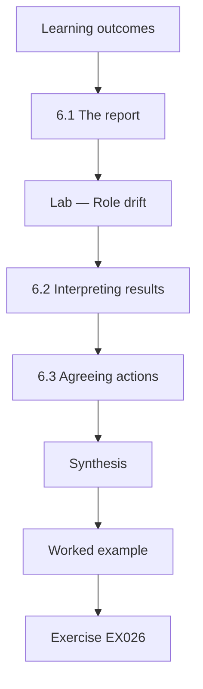

### Logical drawing

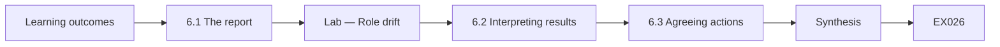

```text
[Learning outcomes]
    |
    v
[6.1 The report]
    |
    v
[Lab — Role drift]
    |
    v
[6.2 Interpreting results]
    |
    v
[6.3 Agreeing actions]
    |
    v
[Synthesis]
    |
    v
[Worked example] --> [Exercise EX026]
```
<!-- open-cyber-academy:lesson-figures:end ch-06 -->


### Learning outcomes

You will (1) run a role drift report on synthetic data; (2) interpret results; (3) agree removals and exceptions.

### 6.1 The report

Daniel writes a standard-library script that reads synthetic role baselines and each person's group memberships and lists any groups held beyond the baseline. It reads only synthetic data and prints a list for owners. Comparing sets, the groups a person has minus the groups their role needs, is simple and reliable, and the script can be rerun after every review to show whether drift is shrinking or returning. Daniel tests the script on a small file with known answers before using it, and he saves each output with its date so later runs can be compared.

### Lab — Role drift

```python
"""Role drift report on synthetic data (read-only): groups held beyond the role baseline."""
BASELINE = {
    "accountant": {"staff", "client-files", "tax-software"},
    "admin": {"staff", "client-contacts"},
    "partner": {"staff", "client-files", "tax-software", "billing"},
}
PEOPLE = [
    ("j.ross", "accountant", {"staff", "client-files", "tax-software"}),
    ("k.ng", "accountant", {"staff", "client-files", "tax-software", "billing"}),
    ("m.cole", "admin", {"staff", "client-contacts", "client-files"}),
    ("p.wade", "partner", {"staff", "client-files", "tax-software", "billing"}),
    ("s.ahmed", "admin", {"staff", "client-contacts"}),
    ("t.bell", "accountant", {"staff", "client-files", "tax-software", "payroll-admin"}),
]

def main():
    drift = 0
    for user, role, groups in PEOPLE:
        extra = sorted(groups - BASELINE[role])
        if extra:
            drift += 1
            print(f"{user} ({role}): extra {', '.join(extra)}")
    print(f"{drift} of {len(PEOPLE)} people hold access beyond their role baseline")

if __name__ == "__main__":
    main()
```

Run with `python3 lab_drift.py`. Verified output:

```text
k.ng (accountant): extra billing
m.cole (admin): extra client-files
t.bell (accountant): extra payroll-admin
3 of 6 people hold access beyond their role baseline
```

### 6.2 Interpreting results

The run checks six people and finds three with access beyond their baseline: k.ng, an accountant, has billing; m.cole, an administrator, has client-files; t.bell, an accountant, has payroll-admin. j.ross, p.wade and s.ahmed match their baselines. Daniel ranks t.bell first, because payroll administration can change staff pay and bank details, a high-harm permission unrelated to accounting work, then m.cole, because client files are confidential, then k.ng. He checks each finding against the synthetic export before sharing it, and he records his ranking reasons so managers can see why the order was chosen.

### 6.3 Agreeing actions

Daniel takes the list to each manager. t.bell covered payroll during a colleague's leave last year; the access is removed. m.cole helps scan documents into client folders weekly; the managing partner approves a recorded exception with a six-month review. k.ng prepares invoices for her own clients; billing is added to a new accountant-billing role used by three staff. Each decision is recorded. Rerunning the script afterwards shows only the recorded exception remaining. The rerun output is kept as evidence for his portfolio.

### Worked example

The lab finds 3 of 6 people beyond baseline; payroll-admin is removed, one exception is recorded and a new role absorbs the billing need.

> **Synthetic case.** People, groups and the script are synthetic.

### Errors and limits

Removing every extra group without asking can break legitimate work that should become a role or exception.

### Exercises

- **EX026 — Drift count.** How many people held access beyond baseline? *Rubric:* 3 = 3 of 6;; 2 = three;; 1 = six;; 0 = none.
- **EX027 — Top risk.** Which finding was ranked first? *Rubric:* 3 = t.bell with payroll-admin;; 2 = payroll;; 1 = billing;; 0 = none.
- **EX028 — Payroll reason.** Why rank payroll-admin highest? *Rubric:* 3 = can change pay and bank details;; 2 = harm;; 1 = name;; 0 = none.
- **EX029 — m.cole outcome.** What happened to m.cole's access? *Rubric:* 3 = recorded exception with six-month review;; 2 = exception;; 1 = removed;; 0 = none.
- **EX030 — k.ng outcome.** How was k.ng's billing need handled? *Rubric:* 3 = new accountant-billing role;; 2 = new role;; 1 = removed;; 0 = none.

### Synthesis

Set-based drift reports, reviewed with managers, lead to removals, exceptions or better roles.

### Continue studying — chapter 06 of 12

[← Chapter 05 (draft)](#ch-05) · [Course chapter index](../SUBJECTS.md) · [Chapter 07 (draft) →](#ch-07)

<a id="ch-07"></a>

## Chapter 7 — Alert triage for identity events

<!-- open-cyber-academy:lesson-figures:start ch-07 -->
### Lesson map

Lesson 07 published. Map, example, EX031.

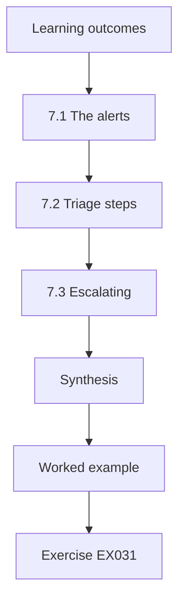

### Logical drawing

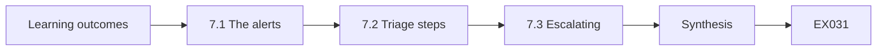

```text
[Learning outcomes]
    |
    v
[7.1 The alerts]
    |
    v
[7.2 Triage steps]
    |
    v
[7.3 Escalating]
    |
    v
[Synthesis]
    |
    v
[Worked example] --> [Exercise EX031]
```
<!-- open-cyber-academy:lesson-figures:end ch-07 -->


### Learning outcomes

You will (1) triage identity alerts; (2) separate benign from concerning events; (3) escalate with evidence.

### 7.1 The alerts

The firm's directory raises alerts for risky sign-ins, such as impossible travel, unfamiliar locations, repeated failures and sign-ins from anonymising networks. Daniel reviews a month of alerts: 46 in total. Many are benign, such as staff using a mobile network that appears in another city. Helen teaches him that triage is about deciding quickly which alerts need action, using evidence available in the logs and a short conversation, not about investigating every alert in depth. Daniel records the month's alert types in a short table.

### 7.2 Triage steps

For each alert Daniel checks: was the sign-in successful; was multi-factor authentication completed and by which method; is the device known; does the person confirm it was them? A failed attempt blocked by multi-factor authentication on a known person is low concern. A successful sign-in from an unknown device that the person denies is high concern and escalated at once. He records the outcome of each alert, building a picture of what is normal for the firm. Helen reviews his first twenty decisions.

### 7.3 Escalating

Of the 46 alerts, 41 are benign, four are failed attempts blocked by multi-factor authentication and one is a successful sign-in to an administrator's mailbox from an unfamiliar device that she does not recognise. Daniel escalates to Helen and the managing partner with the log entries, sessions are revoked, her authenticators are re-registered through the recovery process and mailbox rules are checked. Escalation with clear evidence lets decision-makers act within minutes. Afterwards he writes a short note of the timeline and what was done, which Helen reviews before it is filed with the evidence.

### Worked example

Of 46 alerts in a month, 41 are benign, 4 are blocked attempts and 1 successful unrecognised sign-in is escalated and contained.

> **Synthetic case.** Alerts and events are synthetic.

### Errors and limits

Investigating every alert in depth exhausts time needed for the few that matter.

### Exercises

- **EX031 — Alert total.** How many alerts were reviewed? *Rubric:* 3 = 46;; 2 = forty-six;; 1 = 41;; 0 = none.
- **EX032 — Triage question.** Name one triage check. *Rubric:* 3 = was MFA completed;; 2 = device known;; 1 = colour;; 0 = none.
- **EX033 — Low concern.** What is low concern? *Rubric:* 3 = failed attempt blocked by MFA on a known person;; 2 = blocked;; 1 = success;; 0 = none.
- **EX034 — Escalated event.** What was escalated? *Rubric:* 3 = successful unrecognised sign-in to an admin mailbox;; 2 = mailbox;; 1 = vague;; 0 = none.
- **EX035 — Containment.** Name one containment step. *Rubric:* 3 = revoke sessions;; 2 = re-register authenticators;; 1 = delete account;; 0 = none.

### Synthesis

Quick, evidence-based triage separates normal noise from events needing escalation.

### Continue studying — chapter 07 of 12

[← Chapter 06 (draft)](#ch-06) · [Course chapter index](../SUBJECTS.md) · [Chapter 08 (draft) →](#ch-08)

<a id="ch-08"></a>

## Chapter 8 — Operational workflow and change

<!-- open-cyber-academy:lesson-figures:start ch-08 -->
### Lesson map

Lesson 08 published. Map, example, EX036.

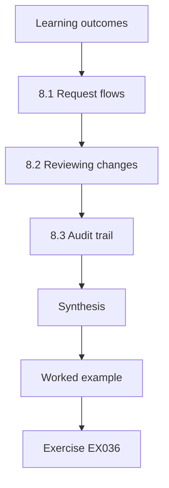

### Logical drawing

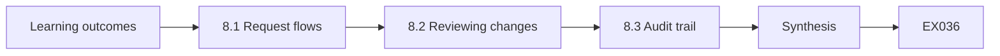

```text
[Learning outcomes]
    |
    v
[8.1 Request flows]
    |
    v
[8.2 Reviewing changes]
    |
    v
[8.3 Audit trail]
    |
    v
[Synthesis]
    |
    v
[Worked example] --> [Exercise EX036]
```
<!-- open-cyber-academy:lesson-figures:end ch-08 -->


### Learning outcomes

You will (1) design request and approval flows; (2) review identity changes; (3) keep an audit trail.

### 8.1 Request flows

Access requests at Ashby and Lane used to arrive by email or in conversation. Daniel sets up a simple request form: who, what access, why, for how long, and approval by the resource owner. Requests for partner-level or payroll access also need the managing partner. Approved requests are fulfilled through role groups wherever possible. A consistent flow means every grant has an approver and a reason, which reviews and auditors can check later without relying on anyone's memory. The form is short so staff use it.

### 8.2 Reviewing changes

Identity changes such as new admin roles, policy edits or new guest domains are reviewed before they happen. Daniel writes a short change template: what, why, risk, test, rollback and approver. Helen reviews his first few. One proposed change, allowing guests from any external domain, is narrowed to the domains of named auditors and clients after review. Reviewing changes catches broad settings before they quietly widen access across the whole firm. Approved changes are recorded with their template, and the record is linked from the monthly audit check so reviewers can follow each change.

### 8.3 Audit trail

Daniel matches the directory's audit log to approved requests and changes each month. He finds two group additions without a request, both by the office manager covering a busy week. Neither is harmful, but he agrees with the managing partner that urgent grants are allowed if a request is logged the same day. An audit trail that matches activity to approvals shows the firm's controls are real, and gaps reveal where the process needs to fit work better. The rule is added to the runbook.

### Worked example

A request form and change template are adopted; a guest-domain change is narrowed; two unrequested additions lead to a same-day logging rule.

> **Synthetic case.** Requests, changes and findings are synthetic.

### Errors and limits

Granting access from verbal requests leaves no approver or reason to review.

### Exercises

- **EX036 — Request fields.** Name two request form fields. *Rubric:* 3 = who and why;; 2 = duration, approval;; 1 = colour;; 0 = none.
- **EX037 — Extra approval.** Which requests need the managing partner? *Rubric:* 3 = partner-level or payroll access;; 2 = payroll;; 1 = all;; 0 = none.
- **EX038 — Narrowed change.** What change was narrowed? *Rubric:* 3 = guests from any domain to named domains;; 2 = guest domains;; 1 = vague;; 0 = none.
- **EX039 — Audit finding.** What did audit matching find? *Rubric:* 3 = two group additions without request;; 2 = two;; 1 = vague;; 0 = none.
- **EX040 — Urgent rule.** What rule covers urgent grants? *Rubric:* 3 = log a request the same day;; 2 = same day;; 1 = forbidden;; 0 = none.

### Synthesis

Request flows, change review and audit matching make every access change accountable.

### Continue studying — chapter 08 of 12

[← Chapter 07 (draft)](#ch-07) · [Course chapter index](../SUBJECTS.md) · [Chapter 09 (draft) →](#ch-09)

<a id="ch-09"></a>

## Chapter 9 — Guest and external access

<!-- open-cyber-academy:lesson-figures:start ch-09 -->
### Lesson map

Lesson 09 published. Map, example, EX041.

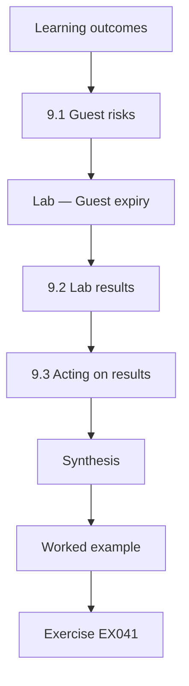

### Logical drawing

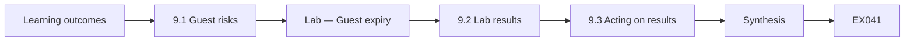

```text
[Learning outcomes]
    |
    v
[9.1 Guest risks]
    |
    v
[Lab — Guest expiry]
    |
    v
[9.2 Lab results]
    |
    v
[9.3 Acting on results]
    |
    v
[Synthesis]
    |
    v
[Worked example] --> [Exercise EX041]
```
<!-- open-cyber-academy:lesson-figures:end ch-09 -->


### Learning outcomes

You will (1) review guest accounts; (2) apply sponsorship and expiry; (3) run a guest expiry lab.

### 9.1 Guest risks

External auditors and clients access shared folders through guest accounts. Guests are easily forgotten: an engagement ends, but the guest keeps access to confidential folders. Daniel's policy requires each guest to have a sponsor, an employee responsible for them, and an expiry date no more than six months ahead, renewable by the sponsor. Guests must use multi-factor authentication. Sponsorship and expiry make external access temporary by default rather than permanent by accident. Daniel explains the policy to sponsors in a short note so they understand their duty and when renewals are due.

### Lab — Guest expiry

```python
"""Guest account expiry report on synthetic data (read-only)."""
from datetime import date

TODAY = date(2026, 6, 30)
# guest, sponsor, expiry (None = no expiry set), last sign-in
GUESTS = [
    ("auditor1@ext", "p.wade", date(2026, 7, 31), date(2026, 6, 28)),
    ("client-a@ext", "j.ross", None, date(2025, 10, 3)),
    ("client-b@ext", "k.ng", date(2026, 5, 31), date(2026, 5, 20)),
    ("consult@ext", None, None, date(2026, 6, 12)),
    ("client-c@ext", "j.ross", date(2026, 9, 30), date(2026, 6, 25)),
]

def main():
    for g, sponsor, exp, last in GUESTS:
        issues = []
        if sponsor is None:
            issues.append("no sponsor")
        if exp is None:
            issues.append("no expiry")
        elif exp < TODAY:
            issues.append(f"expired {exp} but still enabled")
        if (TODAY - last).days > 90:
            issues.append(f"inactive {(TODAY - last).days} days")
        if issues:
            print(f"{g}: {'; '.join(issues)}")
    print(f"{len(GUESTS)} guests checked")

if __name__ == "__main__":
    main()
```

Run with `python3 lab_guests.py`. Verified output:

```text
client-a@ext: no expiry; inactive 270 days
client-b@ext: expired 2026-05-31 but still enabled
consult@ext: no sponsor; no expiry
5 guests checked
```

### 9.2 Lab results

Daniel's standard-library script reads a synthetic list of five guests with sponsor, expiry and last sign-in, and reports problems. client-a has no expiry and has been inactive for 270 days; client-b expired on 31 May but is still enabled; consult has neither sponsor nor expiry. auditor1 and client-c are fine. The script only reads synthetic data and prints a list. Daniel notes that client-b shows the expiry date was recorded but not enforced. He checks the output by hand against the synthetic list, then records the run date.

### 9.3 Acting on results

With sponsors, Daniel disables client-a and client-b after confirming their engagements ended. For consult, nobody claims sponsorship at first; the managing partner identifies the engagement and becomes sponsor, setting a three-month expiry. Daniel then configures the directory's guest access reviews so expiry is enforced automatically, with sponsors reminded two weeks ahead. Fixing the process, not just the three accounts, prevents the same findings at the next review. Sponsors confirm each decision by email, which Daniel files with the evidence. The next guest report, a month later, shows no problems, and he notes the result for the partners.

### Worked example

The guest lab finds 3 of 5 guests with problems; two are disabled, one gains a sponsor, and automatic expiry enforcement is configured.

> **Synthetic case.** Guests and data are synthetic.

### Errors and limits

Recording guest expiry dates without enforcing them leaves expired guests active.

### Exercises

- **EX041 — Guest policy.** What must each guest have? *Rubric:* 3 = sponsor and expiry within six months;; 2 = sponsor;; 1 = vague;; 0 = none.
- **EX042 — client-b issue.** What was wrong with client-b? *Rubric:* 3 = expired but still enabled;; 2 = not enforced;; 1 = vague;; 0 = none.
- **EX043 — consult issue.** What was wrong with consult? *Rubric:* 3 = no sponsor and no expiry;; 2 = both;; 1 = inactive;; 0 = none.
- **EX044 — Sponsor found.** Who became consult's sponsor? *Rubric:* 3 = the managing partner;; 2 = partner;; 1 = Daniel;; 0 = none.
- **EX045 — Process fix.** What process fix was made? *Rubric:* 3 = automatic expiry with sponsor reminders;; 2 = enforcement;; 1 = vague;; 0 = none.

### Synthesis

Sponsored, expiring guest access with automatic enforcement keeps external access temporary.

### Continue studying — chapter 09 of 12

[← Chapter 08 (draft)](#ch-08) · [Course chapter index](../SUBJECTS.md) · [Chapter 10 (draft) →](#ch-10)

<a id="ch-10"></a>

## Chapter 10 — Supervised investigation

<!-- open-cyber-academy:lesson-figures:start ch-10 -->
### Lesson map

Lesson 10 published. Map, example, EX046.

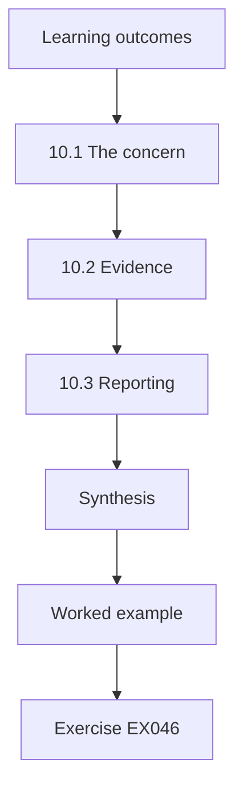

### Logical drawing

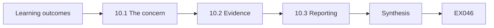

```text
[Learning outcomes]
    |
    v
[10.1 The concern]
    |
    v
[10.2 Evidence]
    |
    v
[10.3 Reporting]
    |
    v
[Synthesis]
    |
    v
[Worked example] --> [Exercise EX046]
```
<!-- open-cyber-academy:lesson-figures:end ch-10 -->


### Learning outcomes

You will (1) investigate an identity concern under supervision; (2) preserve evidence; (3) report facts.

### 10.1 The concern

A partner reports that a client file seems to have been opened by someone in another office. Helen supervises Daniel's investigation, with the managing partner's written approval. The question is narrow: who accessed the file, through which account and group, and was it authorised? Daniel agrees not to draw conclusions about anyone's intentions. A narrow, approved question keeps the investigation proportionate and fair to staff who may have done nothing wrong. Daniel records the question and approval at the top of his notes.

### 10.2 Evidence

Daniel exports the file share's access log for the file and the directory's sign-in log for the relevant account and day, recording export times. The log shows access by an administrator in the north office, through a group granting client-files access. He saves exports in the evidence folder with notes. He does not open the client file itself. Preserving exactly the evidence needed, with times and methods recorded, lets others check his findings later. Helen checks the exports against his notes before he analyses them.

### 10.3 Reporting

The administrator's access came through the recorded exception approved earlier for scanning documents. Her manager confirms she scanned the client's posted documents into the folder that day. Daniel reports the facts: who, how, when, and that access matched an approved exception. He recommends that exception holders note scanning tasks in the job log so future questions are answered quickly. Reporting facts without speculation protects staff and gives partners a clear basis for decisions. The managing partner accepts the report and closes the concern.

### Worked example

A file access concern is traced to an approved scanning exception; the report states facts and recommends job log notes.

> **Synthetic case.** Events, people and evidence are synthetic.

### Errors and limits

Speculating about intentions in an investigation report harms staff and undermines trust.

### Exercises

- **EX046 — Investigation question.** What was the investigation question? *Rubric:* 3 = who accessed, how, and was it authorised;; 2 = who and how;; 1 = why;; 0 = none.
- **EX047 — Approval.** Who approved the investigation? *Rubric:* 3 = managing partner, in writing;; 2 = partner;; 1 = Daniel;; 0 = none.
- **EX048 — Evidence sources.** What logs were exported? *Rubric:* 3 = file share access log and directory sign-in log;; 2 = two logs;; 1 = emails;; 0 = none.
- **EX049 — Finding.** Through what was access granted? *Rubric:* 3 = approved scanning exception;; 2 = exception;; 1 = attack;; 0 = none.
- **EX050 — Recommendation.** What was recommended? *Rubric:* 3 = note scanning tasks in the job log;; 2 = job log;; 1 = remove access;; 0 = none.

### Synthesis

Narrow, approved investigations with preserved evidence and factual reporting resolve concerns fairly.

### Continue studying — chapter 10 of 12

[← Chapter 09 (draft)](#ch-09) · [Course chapter index](../SUBJECTS.md) · [Chapter 11 (draft) →](#ch-11)

<a id="ch-11"></a>

## Chapter 11 — Reporting and troubleshooting

<!-- open-cyber-academy:lesson-figures:start ch-11 -->
### Lesson map

Lesson 11 published. Map, example, EX051.

```mermaid
flowchart TD
  N0["Learning outcomes"]
  N1["11.1 Partner reports"]
  N2["11.2 Troubleshooting"]
  N3["11.3 Linking to controls"]
  N4["Synthesis"]
  N0 --> N1 --> N2 --> N3 --> N4
  N4 --> EX["Worked example"]
  EX --> Q["Exercise EX051"]
```

### Logical drawing

```mermaid
flowchart LR
  N0["Learning outcomes"]
  N1["11.1 Partner reports"]
  N2["11.2 Troubleshooting"]
  N3["11.3 Linking to controls"]
  N4["Synthesis"]
  N0 --> N1 --> N2 --> N3 --> N4 --> Q["EX051"]
```

```text
[Learning outcomes]
    |
    v
[11.1 Partner reports]
    |
    v
[11.2 Troubleshooting]
    |
    v
[11.3 Linking to controls]
    |
    v
[Synthesis]
    |
    v
[Worked example] --> [Exercise EX051]
```
<!-- open-cyber-academy:lesson-figures:end ch-11 -->


### Learning outcomes

You will (1) write reports for partners; (2) troubleshoot identity issues; (3) link problems to controls.

### 11.1 Partner reports

Daniel writes a monthly two-page report for partners: what changed, key measures, open risks and decisions needed. Measures include MFA coverage, phishing-resistant coverage for high-value accounts, leavers removed on time, drift findings and guest problems. He avoids jargon and explains each risk in client terms, such as the chance of a client's tax records being seen by someone outside the engagement. Partners read short reports, so every line must earn its place. Each report ends with the decisions partners are asked to make that month.

### 11.2 Troubleshooting

After MFA enforcement, a partner cannot reach email on her tablet. Daniel follows his method: confirm the symptom, check the sign-in log reason, form a hypothesis and test. The log shows an old mail app that cannot handle modern authentication. He installs the supported app, she signs in and he records the cause. Two other staff have the same app; he updates them proactively. Logs give the reason for most identity failures directly. The case is recorded with its cause and fix.

### 11.3 Linking to controls

Daniel records troubleshooting cases by cause. Over two months, most relate to old apps, expired passwords on service accounts and staff changing phones without moving their authenticator. He links each to a control improvement: an approved app list, service account renewal reminders and a phone change guide. Turning support cases into control improvements reduces repeated problems and shows partners that security work also improves everyday reliability. He reports the linked improvements to partners in the monthly report, and tracks whether each cause falls in the following months. Two of the three causes fall noticeably.

### Worked example

Monthly partner reports track five measures; an old mail app causes a partner's failure and two proactive fixes; three control improvements follow.

> **Synthetic case.** Reports and cases are synthetic.

### Errors and limits

Fixing repeated support cases one by one without changing controls keeps them recurring.

### Exercises

- **EX051 — Report length.** How long is the partner report? *Rubric:* 3 = two pages;; 2 = short;; 1 = twenty pages;; 0 = none.
- **EX052 — Partner tablet cause.** Why could the partner not reach email? *Rubric:* 3 = old app without modern authentication;; 2 = old app;; 1 = password;; 0 = none.
- **EX053 — Proactive fix.** What proactive step was taken? *Rubric:* 3 = updated the app for two other staff;; 2 = updated;; 1 = vague;; 0 = none.
- **EX054 — Common cause.** Name one common troubleshooting cause. *Rubric:* 3 = old apps;; 2 = phone changes;; 1 = weather;; 0 = none.
- **EX055 — Control link.** Which improvement addresses phone changes? *Rubric:* 3 = a phone change guide;; 2 = guide;; 1 = vague;; 0 = none.

### Synthesis

Short partner reports and cause-linked troubleshooting turn identity work into visible improvement.

### Continue studying — chapter 11 of 12

[← Chapter 10 (draft)](#ch-10) · [Course chapter index](../SUBJECTS.md) · [Chapter 12 (draft) →](#ch-12)

<a id="ch-12"></a>

## Chapter 12 — Final portfolio

<!-- open-cyber-academy:lesson-figures:start ch-12 -->
### Lesson map

Lesson 12 published. Map, example, EX056.

```mermaid
flowchart TD
  N0["Learning outcomes"]
  N1["12.1 The portfolio"]
  N2["12.2 Evaluating results"]
  N3["12.3 Handover"]
  N4["Synthesis"]
  N0 --> N1 --> N2 --> N3 --> N4
  N4 --> EX["Worked example"]
  EX --> Q["Exercise EX056"]
```

### Logical drawing

```mermaid
flowchart LR
  N0["Learning outcomes"]
  N1["12.1 The portfolio"]
  N2["12.2 Evaluating results"]
  N3["12.3 Handover"]
  N4["Synthesis"]
  N0 --> N1 --> N2 --> N3 --> N4 --> Q["EX056"]
```

```text
[Learning outcomes]
    |
    v
[12.1 The portfolio]
    |
    v
[12.2 Evaluating results]
    |
    v
[12.3 Handover]
    |
    v
[Synthesis]
    |
    v
[Worked example] --> [Exercise EX056]
```
<!-- open-cyber-academy:lesson-figures:end ch-12 -->


### Learning outcomes

You will (1) assemble a portfolio of evidence; (2) evaluate improvements; (3) plan handover and next steps.

### 12.1 The portfolio

Daniel assembles his portfolio: the signed scope, evidence log, priority list, authentication review, role baselines and drift lab results, guest lab results, alert triage summary, investigation report, partner reports and runbooks. Each item shows what he did and how he verified it. Helen explains that a portfolio proves competence through evidence of real, supervised work, which is more convincing to employers than a list of completed modules. Daniel orders the items to follow the course chapters and adds a one-paragraph summary to each, stating the evidence and how it was verified.

### 12.2 Evaluating results

Daniel compares the start and end. MFA coverage rose from 41 of 60 to 60 of 60; all partners, the office manager and IT use phishing-resistant methods; drift findings fell from three to one recorded exception; guest expiry is enforced automatically; and leavers have been removed on time for four months. He also lists what remains: the tax software still uses separate accounts, and text codes remain as a fallback for four staff. Honest evaluation includes the gaps. Helen checks each figure against the evidence log.

### 12.3 Handover

Daniel hands the firm updated runbooks, scripts with instructions, the measure definitions and a list of next steps with suggested owners: single sign-on for the tax software at the next licence renewal, removing text fallbacks, and quarterly drift and guest reports. He walks the office manager through running both scripts. Helen signs off the portfolio, noting that the firm can now continue the work without him, which is the real test of a professional engagement. The managing partner approves the next steps and owners.

### Worked example

MFA rises from 41 to 60 of 60 staff; drift falls to one recorded exception; guest expiry is enforced; two gaps are handed over with owners.

> **Synthetic case.** Results and plans are synthetic.

### Errors and limits

A portfolio that lists activities without verification evidence does not show competence.

### Exercises

- **EX056 — MFA result.** How did MFA coverage change? *Rubric:* 3 = 41 to 60 of 60;; 2 = full;; 1 = fell;; 0 = none.
- **EX057 — Drift result.** What was the drift result? *Rubric:* 3 = three to one recorded exception;; 2 = reduced;; 1 = vague;; 0 = none.
- **EX058 — Remaining gap.** Name one remaining gap. *Rubric:* 3 = tax software separate accounts;; 2 = text fallback;; 1 = vague;; 0 = none.
- **EX059 — Handover training.** What did Daniel show the office manager? *Rubric:* 3 = how to run both scripts;; 2 = scripts;; 1 = vague;; 0 = none.
- **EX060 — Real test.** What did Helen call the real test? *Rubric:* 3 = firm can continue without him;; 2 = continuity;; 1 = grades;; 0 = none.

### Synthesis

An evidence-based portfolio, honest evaluation and a usable handover complete professional identity work.

### Continue studying — chapter 12 of 12

[← Chapter 11 (draft)](#ch-11) · [Course chapter index](../SUBJECTS.md) · [Worked results ↓](#worked-results) · [Next course via chapter index →](../SUBJECTS.md)

<a id="worked-results"></a>

## Worked results

Model answers for EX001–EX060. Daniel Okafor, Helen Brooks, Pinewood Professional Academy, Ashby and Lane Accountants and every figure are synthetic. Lab answers quote verified outputs. Any answer meeting the rubric scores equally.

**EX001.** Accountants with three offices and about 60 staff.

**EX002.** Authorisation.

**EX003.** Identification.

**EX004.** Opening client files.

**EX005.** External auditors and some clients.

**EX006.** NIST SP 800-207.

**EX007.** W3C WebAuthn with FIDO2.

**EX008.** Client confidentiality and regulatory duties make unauthorised access serious.

**EX009.** Removing leavers, enforcing MFA and separating admin accounts.

**EX010.** Single sign-on for the tax software.

**EX011.** Through admin console export features, within scope.

**EX012.** Client folders and mailboxes.

**EX013.** In an encrypted folder only he and Helen can access.

**EX014.** The export file, its date and the steps or script used.

**EX015.** They are deleted, except evidence kept by the firm under its retention rules.

**EX016.** 41 of 60.

**EX017.** Two partners and the office manager.

**EX018.** They tend to produce predictable passwords.

**EX019.** Only as a temporary fallback.

**EX020.** Drop-in help sessions.

**EX021.** Staff resources and client contacts.

**EX022.** Billing.

**EX023.** Either a recorded exception with a reason or drift to remove.

**EX024.** Covering for absent colleagues, past projects or role changes.

**EX025.** They are not named; names go only to each person's manager.

**EX026.** 3 of 6.

**EX027.** t.bell's payroll-admin access.

**EX028.** It can change staff pay and bank details.

**EX029.** A recorded exception with a six-month review.

**EX030.** A new accountant-billing role.

**EX031.** 46.

**EX032.** Whether sign-in succeeded, MFA was completed, the device is known or the person confirms it.

**EX033.** A failed attempt blocked by MFA for a known person.

**EX034.** A successful sign-in to an administrator's mailbox from an unrecognised device.

**EX035.** Revoking sessions, re-registering authenticators or checking mailbox rules.

**EX036.** Who, what access, why, how long and owner approval.

**EX037.** Requests for partner-level or payroll access.

**EX038.** Allowing guests from any domain, narrowed to named auditor and client domains.

**EX039.** Two group additions without a request.

**EX040.** They are allowed if a request is logged the same day.

**EX041.** A sponsor and an expiry date within six months.

**EX042.** It expired on 31 May but was still enabled.

**EX043.** It had no sponsor and no expiry.

**EX044.** The managing partner.

**EX045.** Automatic expiry enforcement with sponsor reminders two weeks ahead.

**EX046.** Who accessed the file, through which account and group, and whether it was authorised.

**EX047.** The managing partner, in writing.

**EX048.** The file share access log and the directory sign-in log.

**EX049.** The approved scanning exception.

**EX050.** Exception holders note scanning tasks in the job log.

**EX051.** Two pages.

**EX052.** An old mail app could not handle modern authentication.

**EX053.** The app was updated for two other staff with the same problem.

**EX054.** Old apps, expired service account passwords or phone changes.

**EX055.** A phone change guide.

**EX056.** From 41 of 60 to 60 of 60.

**EX057.** From three findings to one recorded exception.

**EX058.** Tax software separate accounts, or text fallback for four staff.

**EX059.** How to run both scripts.

**EX060.** That the firm can continue the work without him.

<a id="references"></a>

## References

Links checked 12 October 2026; re-verify editions before citing. Organisations, people, systems, code and data in this book are synthetic unless a sentence cites a public source.

- Bonneau, J., Herley, C., van Oorschot, P. C., & Stajano, F. (2012). The quest to replace passwords: A framework for comparative evaluation of web authentication schemes. *2012 IEEE Symposium on Security and Privacy*, 553–567. <https://doi.org/10.1109/SP.2012.44>
- Ferraiolo, D. F., Sandhu, R., Gavrila, S., Kuhn, D. R., & Chandramouli, R. (2001). Proposed NIST standard for role-based access control. *ACM Transactions on Information and System Security*, 4(3), 224–274. <https://doi.org/10.1145/501978.501980>
- Florêncio, D., & Herley, C. (2007). A large-scale study of web password habits. *Proceedings of the 16th International Conference on World Wide Web*, 657–666. <https://doi.org/10.1145/1242572.1242661>
- Hardt, D. (Ed.). (2012). *The OAuth 2.0 authorization framework* (RFC 6749). IETF. <https://www.rfc-editor.org/rfc/rfc6749>
- Herley, C. (2009). So long, and no thanks for the externalities: The rational rejection of security advice by users. *Proceedings of the 2009 New Security Paradigms Workshop*, 133–144. <https://doi.org/10.1145/1719030.1719050>
- Hu, V. C., Ferraiolo, D., Kuhn, R., Schnitzer, A., Sandlin, K., Miller, R., & Scarfone, K. (2014). *Guide to attribute based access control (ABAC) definition and considerations* (NIST SP 800-162). NIST. <https://doi.org/10.6028/NIST.SP.800-162>
- Hunt, P. (Ed.), Grizzle, K., Ansari, M., Wahlstroem, E., & Mortimore, C. (2015). *System for Cross-domain Identity Management: Protocol* (RFC 7644). IETF. <https://www.rfc-editor.org/rfc/rfc7644>
- Joint Task Force. (2020). *Security and privacy controls for information systems and organizations* (NIST SP 800-53 Rev. 5). NIST. <https://doi.org/10.6028/NIST.SP.800-53r5>
- Jones, M., Bradley, J., & Sakimura, N. (2015). *JSON Web Token (JWT)* (RFC 7519). IETF. <https://www.rfc-editor.org/rfc/rfc7519>
- Kuhn, D. R., Coyne, E. J., & Weil, T. R. (2010). Adding attributes to role-based access control. *Computer*, 43(6), 79–81. <https://doi.org/10.1109/MC.2010.155>
- Landis, J. R., & Koch, G. G. (1977). The measurement of observer agreement for categorical data. *Biometrics*, 33(1), 159–174. <https://doi.org/10.2307/2529310>
- Lodderstedt, T., Bradley, J., Labunets, A., & Fett, D. (2025). *Best current practice for OAuth 2.0 security* (RFC 9700, BCP 240). IETF. <https://www.rfc-editor.org/rfc/rfc9700>
- Molloy, I., Chen, H., Li, T., Wang, Q., Li, N., Bertino, E., Calo, S., & Lobo, J. (2008). Mining roles with semantic meanings. *Proceedings of the 13th ACM Symposium on Access Control Models and Technologies*, 21–30. <https://doi.org/10.1145/1377836.1377840>
- OASIS. (2005). *Assertions and protocols for the OASIS Security Assertion Markup Language (SAML) V2.0*. OASIS Standard. <https://docs.oasis-open.org/security/saml/v2.0/saml-core-2.0-os.pdf>
- Rose, S., Borchert, O., Mitchell, S., & Connelly, S. (2020). *Zero trust architecture* (NIST SP 800-207). NIST. <https://doi.org/10.6028/NIST.SP.800-207>
- Sakimura, N., Bradley, J., & Agarwal, N. (2015). *Proof Key for Code Exchange by OAuth public clients* (RFC 7636). IETF. <https://www.rfc-editor.org/rfc/rfc7636>
- Sakimura, N., Bradley, J., Jones, M., de Medeiros, B., & Mortimore, C. (2014). *OpenID Connect Core 1.0*. OpenID Foundation. <https://openid.net/specs/openid-connect-core-1_0.html>
- Saltzer, J. H., & Schroeder, M. D. (1975). The protection of information in computer systems. *Proceedings of the IEEE*, 63(9), 1278–1308. <https://doi.org/10.1109/PROC.1975.9939>
- Sandhu, R. S., Coyne, E. J., Feinstein, H. L., & Youman, C. E. (1996). Role-based access control models. *Computer*, 29(2), 38–47. <https://doi.org/10.1109/2.485845>
- Temoshok, D., Proud-Madruga, D., Choong, Y.-Y., Galluzzo, R., Gupta, S., LaSalle, C., Lefkovitz, N., & Regenscheid, A. (2025). *Digital identity guidelines* (NIST SP 800-63-4). NIST. <https://doi.org/10.6028/NIST.SP.800-63-4>
- Temoshok, D., Fenton, J. L., Choong, Y.-Y., Lefkovitz, N., Regenscheid, A., Galluzzo, R., & Richer, J. P. (2025). *Digital identity guidelines: Authentication and authenticator management* (NIST SP 800-63B-4). NIST. <https://doi.org/10.6028/NIST.SP.800-63B-4>
- W3C. (2021). *Web Authentication: An API for accessing public key credentials, Level 2*. W3C Recommendation. <https://www.w3.org/TR/webauthn-2/>
