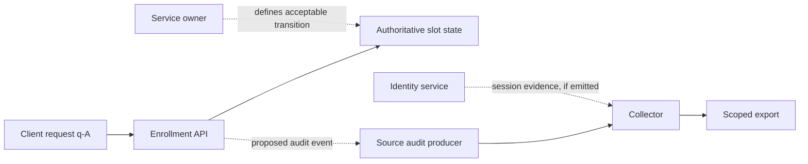
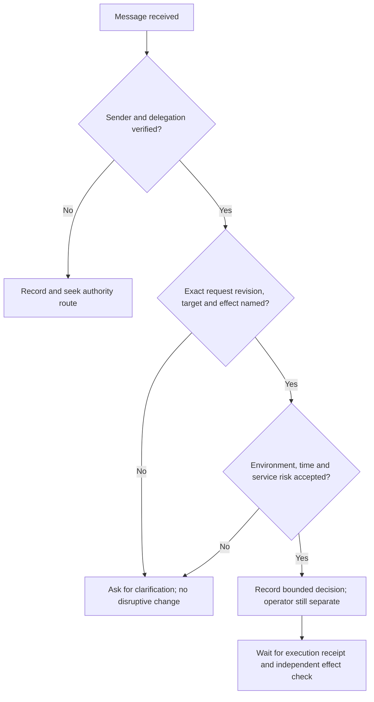

# Incident Response and Cyber Resilience: Professional Practice

- Language: English (`en`); professional course, six months; approximately 360 hours of planned study.
- Editorial state: **published**. All 12 subjects have authored teaching, 60 numbered exercises and 60 worked results. The remaining daily curriculum, independent technical review and editing remain open. A4 page count records a particular rendering; it is not a condition of book completion.
- Audience: new response practitioners working with a supervisor and an organization's approved procedures. Prerequisites: basic security concepts, identity, applications, logs and service ownership.
- Author and editorial responsibility: [hiagokinlevi](https://github.com/hiagokinlevi). Original maintainer-owned text is dedicated under [CC0 1.0](../../../../../LICENSE); external sources retain their rights.
- Educational status: this is a public learning draft, not a completed textbook, credential or authority to operate on real systems.

[Course home](../../README.md) · [All subjects](../SUBJECTS.md) · [Book plan](PLAN.md) · [Course skill](../../skill/SKILL.md) · [Book standard](../../../../../BOOK_STANDARD.md) · [Answers](#worked-answers)

## How to study this book

Read the twelve authored subject chapters in order. Chapters 1–6 now include separate [Week 1](#week-01-day-01), [Week 2](#week-02-day-01), [Week 3](#week-03-day-01), [Week 4](#week-04-day-01), [Week 5](#week-05-day-01) and [Week 6](#week-06-day-01) five-day applied sequences; later chapters retain their earlier subject structure while distinct weekday teaching is developed. Thirty authored daily units (30/130 planned) are not the complete six-month curriculum. Work each exercise before opening its answer; every exercise specifies an artifact that another responder could inspect. Keep four columns in your notes: **observation, inference, decision, verification**. A plausible inference is not a collected fact. A proposed action is not approval, execution or a measured result. These distinctions matter more than a dramatic incident narrative.

This course's fictional case is **Cedar Training Network (CTN)**, an invented organization with an enrollment portal. All names, accounts, ticket IDs, timestamps, systems, policies, records and retention windows below are synthetic classroom data. There are no real personal records or reachable services. Record IDs `C01`–`C33` are case cards, not externally sourced facts. A card's *event time*, *ingestion time* and *release time* can differ. Unless a chapter expressly releases a later card, use only the information available at that chapter's checkpoint. Exercise variants marked `V` and playbook specimens `P0`/`P1` are separate simulations or teaching artifacts and do not rewrite the main case.

The recommended starting point for organizational incident-response outcomes is [NIST SP 800-61 Rev. 3](https://csrc.nist.gov/pubs/sp/800/61/r3/final). It connects response to cybersecurity risk management; it does not give CTN's analyst the authority to change a production tenant. [NIST CSF 2.0](https://www.nist.gov/publications/nist-cybersecurity-framework-csf-20) provides outcome categories rather than this book's case procedure. The exercise worksheets, scoring rubrics, synthetic data and decision gates here are original teaching devices. Older [NIST SP 800-92](https://csrc.nist.gov/pubs/sp/800/92/final) and [NIST SP 800-86](https://csrc.nist.gov/pubs/sp/800/86/final) inform log-management and forensic vocabulary; their dated operational details must be checked against current tools and an organization's rules. In particular, this course does not offer legal chain-of-custody advice.

## Contents

1. [Incident lifecycle and organizational readiness](#ch-01) — define the service, owners, evidence readiness and first handoff; [Week 1: five applied daily lessons](#week-01-day-01).
2. [Authority, scope and response roles](#ch-02) — turn a charter into approval gates and reversible proposals; [Week 2: five applied daily lessons](#week-02-day-01).
3. [Alert intake and severity assessment](#ch-03) — reconcile signals and assign a reviewable priority; [Week 3: course Days 11–15](#week-03-day-01).
4. [Evidence preservation and case records](#ch-04) — collect bounded copies and document provenance and limits; [Week 4: course Days 16–20](#week-04-day-01).
5. [Investigation, hypotheses and timeline building](#ch-05) — test competing explanations without inventing an actor; [Week 5: course Days 21–25](#week-05-day-01).
6. [Containment planning and approvals](#ch-06) — compare targeted controls, authority and measured effect; [Week 6: course Days 26–30](#week-06-day-01).
7. [Eradication and verification](#ch-07) — link a task to an edit, preserve uncertainty and verify changed paths.
8. [Recovery, continuity and return to service](#ch-08) — compare data candidates and apply an acceptance gate.
9. [Communications, privacy and legal coordination](#ch-09) — issue bounded, audience-specific drafts and referrals.
10. [Playbook engineering and quality review](#ch-10) — repair and test a supervised decision aid.
11. [Supervised incident simulation](#ch-11) — run a time-gated tabletop with separate facilitator, responder and observer records.
12. [Case portfolio and after-action review](#ch-12) — defend decisions from three bounded cases and turn observations into retestable improvements.

The twelve authored subjects each end with five exercises. The [worked-answer appendix](#worked-answers) holds EX001–EX060 in the same book. Its model artifacts are examples of defensible reasoning, not a substitute for the local rubric or authority checks. Sixty authored exercises meet the planned exercise allocation, but do not by themselves complete the intended daily curriculum or satisfy the editorial publication gate.

<a id="ch-01"></a>

## Chapter 1 — Incident lifecycle and organizational readiness

### Learning outcomes

After this subject, the learner can map a service's dependencies and owners, distinguish preparation from live case actions, write a falsifiable evidence-readiness check, and hand off a bounded gap list. The task is operational: a colleague should be able to use the map during an alert without guessing who owns a log, an approval or a restore.

### 1.1 Start with a service, not an alert product

An alert says that a sensor noticed a condition. A response plan must begin earlier: which service could be harmed, which business outcome matters, where relevant records originate, who may obtain them, who can authorize disruption, and what would make recovery acceptable. The [NIST SP 800-61 Rev. 3](https://csrc.nist.gov/pubs/sp/800/61/r3/final) recommendations are organized within cybersecurity risk management, so preparation and improvement belong alongside case handling. For CTN, the service outcome is that a learner can find and enroll in an available class; an identity alert is relevant only through a plausible path to that outcome or to another protected asset.

CTN's invented service map has an enrollment front end, an API that writes slot records, an identity provider (IdP) for staff and automation, a notification queue, a support desk and an object-storage backup. A service map is an **inventory hypothesis** until an owner verifies it. The same warning applies to a diagram's arrows: an arrow labelled “logs to audit store” does not establish that all write paths produce a record, that timestamps use UTC or that a responder can obtain a copy before expiry. At professional depth, the learner is expected to name a proposed test for each such claim and record the result as *untested* until run.

| Dependency | Decision it might support | Custodian to identify | Failure or unknown at handoff |
|---|---|---|---|
| Enrollment API and audit | Which slot changed, by which request ID, at what recorded time? | Application owner | Audit coverage across scheduled and manual writes unverified. |
| IdP | Was an account authenticated, with which session and client fields? | Identity custodian | Account label is not a human identity; detailed-event retention unverified. |
| Support desk | When was a symptom reported and what did the reporter observe? | Support lead | A report does not establish authoritative slot state. |
| Backup and restore copy | Can a known-good slot state be reconstructed in isolation? | Recovery lead | Backup success and restore correctness are distinct claims. |
| Service change record | Was a slot change within approved scope? | Service owner | Approval scope and actual execution can differ. |

The owner map needs a **primary, alternate, contact channel and decision right** for each row. “IT” is not a decision right. An identity custodian may export a bounded log but may lack authority to disable an account; a service owner may approve a short pause but may not personally execute it. If the owner is unavailable, an escalation path must say when to use the alternate. No employee name or contact is required in this public fictional exercise; use role names.

### 1.2 Case card C01: an incomplete readiness inventory

At **08:40 UTC**, CTN's fictional preparation worksheet `C01` lists the six dependencies above. It names the application and recovery leads, but the after-hours identity alternate is blank. It asserts “API audit: 24 hours” without specifying whether that means event age, rolling availability, export queue age or a contract claim. The support desk can open an incident ticket, but the escalation contact for an unavailable service owner is missing. `C01` is a *worksheet discovered before the exercise*, not proof that the controls work. At this chapter checkpoint, no alert, compromise or patron harm has been established.

An evidence-readiness contract turns a source name into a testable question. For example: “If a synthetic change to slot S41 is made through the scheduled job, will an authorized analyst retrieve a record with slot ID, request ID, source event time and collection metadata within 20 minutes?” The test requires a permitted training tenant, a specific input, an expected event and a negative control: an unrelated slot S40 should not appear in the selection. Record the result only after a custodian runs it. If the selected export lacks a request ID, the next action is to revise the proposed correlation method; it is not to join by account name and nearby time as if the key existed.

A minimal contract has six fields: **decision question; expected producer and fields; time basis and retention; authorized custodian and access path; positive and negative rehearsal; failure signal and fallback**. Apply data minimization: if the question concerns slot S41, a full enrollment database export is usually unnecessary. Record whether a copy is proposed, approved, collected or verified. This is a teaching format, not a required NIST form.

### 1.3 A worked readiness handoff

Suppose the learner is the CTN analyst at 08:45 UTC. A defensible handoff says: “Enrollment is the service at risk. The application owner should confirm whether scheduled and manual changes are audited. The identity alternate and service-owner escalation are unknown. The claimed 24-hour audit retention has no verified anchor. No incident is inferred from C01. Before the next drill, the application custodian and identity custodian should run two bounded training events, record collection latency and compare an unrelated-slot control.” This identifies what to do, who can do it, and what remains unknown. “All logs are ready” would be unsupported.

Readiness priorities are based on **decision value and failure consequence**, not an arbitrary count of missing boxes. The missing after-hours identity route matters because a short retention window could close before the owner is reachable. The backup row matters because a completed backup job cannot answer whether slot state is correct or usable. The learner should preserve this distinction when later chapters introduce a live signal and an export deadline.

### 1.4 The service boundary precedes the telemetry boundary

At the C01 checkpoint, Cedar Training Network (CTN) has only a fictional readiness worksheet, not a live security event. The enrollment service's intended behavior is more useful than a list of security tools: a learner selects a class, the front end requests availability, the API checks and changes a slot, the identity layer authenticates privileged calls, a queue may send a notification, and the recovery path must reconstruct a consistent enrollment state. This is an **intended service model**, not an observed trace. It must not be narrated as if the system has been inspected.

A dependency is anything whose failure could change a meaningful service outcome. Distinguish four kinds. A **functional dependency** moves or validates enrollment data; an **administrative dependency** provides decision rights and access; an **observability dependency** produces evidence about those transactions; a **recovery dependency** permits a tested return to an acceptable state. One element may belong to several classes. For example, an identity provider can be necessary for staff sign-in and for the audit record that would later explain a privileged edit.

Service owners need a definition of normal behavior that is precise enough to test. "Enrollment works" is vague. An operational criterion might be: "For an authorized synthetic class with one available seat, a reservation request either commits one reservation and returns its new version, or fails without consuming the seat." This proposed invariant is a **new teaching test definition**, not a fact about CTN's implemented transaction model. A responder should ask the API owner whether partial writes, retries, and queue delays change the invariant.

Consider two incorrect inventories:

- "SIEM, firewall, IdP, backup" names technologies but cannot identify which one supplies the authoritative S42 state, who can access a relevant time range, or which business action it supports.
- "API → database → backup" adds direction but omits decision owners, authorization, evidence retention, scheduled-job write paths and the ability to verify a restore.

A stronger inventory contains a decision question on each edge. "API audit → request correlation" is useful only if the application actually emits a stable request identifier. "Backup → safe restoration" requires a known restore procedure, recovery owner, comparison baseline and isolated acceptance test. A completed backup job is evidence that a backup operation reported success, not proof that reconstructed S40, S41 and S42 values are correct.

### 1.5 Build a graph whose edges can fail

A service graph must distinguish **data flow** from **evidence flow**. A slot change may travel from scheduled job to API to data store. The corresponding evidence may instead travel from API audit to a logging collector to a retention tier, and from IdP to a different collector. The responder's correlation plan depends on whether those paths share fields such as request ID or session ID. C01 supplies no executed end-to-end correlation proof.

A practical five-column source card asks:

| Question | Operational answer required | Example of an unsafe shortcut |
|---|---|---|
| Which decision? | Determine whether a particular slot was edited by a named request ID. | "Find out what happened." |
| Which producer? | API audit, including whether job and manual routes both emit request IDs. | "The SIEM has everything." |
| Which time anchor? | Source event UTC, collector receipt, retention anchor and export latency. | "Logs last 24h." |
| Which custodian and gate? | Authorized application custodian, primary and approved alternate if documented. | "Anyone on call can pull it." |
| What would disprove coverage? | A permitted test edit not appearing in the selected export within a defined window. | "No alert means no gap." |

Treat each edge as **claimed**, **test planned**, **tested-pass**, **tested-fail**, or **not observable**. Those statuses cannot be collapsed into a reassuring check mark. A source can pass one test and still lack another route. A supported, well-scoped statement is: "The known-good scheduled-path event was retrieved with slot and request identifiers within 20 minutes during training rehearsal R1." The unsupported extension is: "All enrollment writes are always logged." Even R1 requires a date, dataset, permitted tenant, operator, baseline, selection query and evidence receipt before that statement can be used.

Dependency criticality is contextual. An after-hours identity contact gap may be urgent not because identity always dominates the case, but because the source might become irretrievable while the only known custodian is unreachable. A backup-restore test may be important for resilience but may not be the first response to a short retention gap. Explain the **decision affected**, not just a red/yellow/green category.

### 1.6 Separate readiness assurance from incident assertions

C01 is a worksheet discovered at 08:40 UTC. Its missing after-hours identity alternate and service-owner fallback are readiness defects; they do not indicate a compromise. Its "API audit: 24 hours" entry is an unverified statement. The first task is to preserve these unknowns.

There are at least four plausible anchors behind the 24-hour phrase: source event age before deletion, time available in a query interface, lifetime of a queued export, or a published service/contract objective. A rolling retention period could also differ by dataset or ingestion delay. C01 does **not** tell us which interpretation applies, and a professional responder must not calculate a hard evidence-loss time from it. Ask the custodian which exact dataset, clocks, query filters, delays and deletion mechanism support the claim. Then design a permitted test near the edge, if organizational policy allows it.

An operational readiness measure should pair an objective with a failure mode. For example:

- Objective: retrieve a synthetic S41 scheduled-job edit with source event timestamp, slot ID and request ID within twenty minutes.
- Input and condition: authorized nonproduction tenant, preapproved test identity, known synthetic S41 record and one scheduled write.
- Negative control: S40 has no matching S41 request and must be absent from the S41-specific result.
- Measurements: job trigger time, API acknowledgement, producer event time, collection start and completion, field presence and number of selected rows.
- Failure criterion: missing audit event, missing stable request ID, unrelated S40 included, collection outside the agreed window, or undocumented clock relation.
- Remediation proposal: ask the application custodian to repair field coverage, source routing, or query semantics; **do not** rewrite the data or claim that coverage was repaired.

A negative control guards against a dangerously broad query. It does not prove that every unrelated change is excluded. Use an explicit field equality predicate for a slot and request when possible, rather than a timestamp-only proximity filter that may accidentally mix concurrent operations.

### 1.7 A reproducible offline coverage rehearsal

The following **new synthetic fixture** tests whether a trainee can preserve missing states rather than interpret every inventory row as operationally verified. It is not the CTN production inventory, and no source collection is carried out. It uses Python 3 standard library features only, makes no network request, writes no files and needs no credentials.

~~~python
dependencies = [
    ("api_audit", "app_owner", "request_id", "yes"),
    ("idp_detail", "identity_custodian", "session_id", "unknown"),
    ("support_ticket", "support_lead", "received_at", "yes"),
    ("backup_copy", "recovery_lead", "restore_test", "no"),
    ("change_ledger", "service_owner", "scope_id", "unknown"),
]
for source, owner, key, status in dependencies:
    print(f"C1|{source}|{owner}|{key}|{status}")
gaps = [source for source, _, _, status in dependencies if status != "yes"]
verified = sum(status == "yes" for *_, status in dependencies)
print("C1|gaps=" + ",".join(gaps))
print(f"C1|verified_sources={verified}/{len(dependencies)}")
~~~

**Executed output (Python 3, against the exact fixture above):**

~~~text
C1|api_audit|app_owner|request_id|yes
C1|idp_detail|identity_custodian|session_id|unknown
C1|support_ticket|support_lead|received_at|yes
C1|backup_copy|recovery_lead|restore_test|no
C1|change_ledger|service_owner|scope_id|unknown
C1|gaps=idp_detail,backup_copy,change_ledger
C1|verified_sources=2/5
~~~

Here, "yes" is **fixture status**, not actual verification of a CTN source. The denominator is five listed records, not all service components or all telemetry paths. Never report "40% ready" as an institutional maturity finding. The measurement only says two of the five classroom rows are marked yes. Change "idp_detail" to yes and run again; the gap list should shrink by one, but that still would not demonstrate an approved identity export route or a named after-hours alternate.

Use a second, manual fault-injection exercise: pretend the support contact is unavailable, then attempt to follow the map to an alternate. If the alternate field is blank, the test **fails as a contact path**, even though the script still prints that the ticket source is marked yes. This contrast demonstrates why automated coverage arithmetic cannot replace operational ownership tests.

### 1.8 Runbooks need decision rights as well as contact addresses

A contact is a place to ask a question, not necessarily the person authorized to answer it. Draft an owner card with four independent slots: data custodian, service decision owner, execution operator and incident coordinator. The same real person might occupy multiple slots under a local policy; keep their **function at each decision** visible. For a read-only IdP export, record who grants access to protected log data and who produces the receipt. For disabling an account, record who accepts enrollment disruption and who can implement a reversible control. Do not assume the custodian is the change approver.

An alternate must be established **before** the primary becomes unavailable. An invented escalation contact would conceal a readiness defect. C01's blank entries therefore remain "not supplied." A supervisor should be given an explicit choice: confirm an authorized alternate under the organization's actual policy, or record that a requested action cannot proceed via this route. The practitioner may prepare an escalation draft but cannot grant themselves privileges because a source might expire.

Use the following owner unavailability test: ask an alternate to identify the approved export pathway and the exact decision they can make. Stop if the contact is unknown or cannot explain the required scope. Log the attempted rehearsal as **not performed** until it actually occurs. This is a legitimate negative finding in a readiness review; it is not evidence of breach, negligence, or authorization to use an emergency override.

### 1.9 Compare a quick inventory with a defensible readiness contract

A spreadsheet listing systems can be assembled rapidly and is useful for orientation, but its failure is **false completeness**. A decision-centered contract costs more effort: each source has a bounded question, selectors, clock semantics, route coverage, owner, approval condition and a verification receipt. The trade-off is worth making for high-impact decisions such as "who changed S42?" and "can a clean version be restored without erasing valid changes?"

There is a similar choice between a single rehearsal and stratified tests. One scheduled-path edit can verify a narrow happy path. Distinct scheduled, manual and emergency write routes may emit different audit fields, use different identities or bypass different collection components. Separate tests avoid extrapolation. Negative tests matter, too: deliberately query S40 under the S41 selector and inspect whether false matches appear. A test that cannot fail in a defined way is a demonstration, not an assurance check.

Do not stage these tests in the production environment on the strength of a learning exercise. A permitted training tenant, synthetic classes, nonpersonal identifiers, documented owner approval and a bounded cleanup plan are prerequisites. If a local laboratory cannot simulate one dependency, write "not evaluated" and design a tabletop substitute instead of fabricating an output.

### 1.10 Review the readiness pack before handing it to Chapter 02

A reviewer should ask whether every statement can be labeled as **model**, **proposed test**, **observed test result**, or **unverified assumption**. For C01, only the fact that a worksheet was supplied at 08:40 and its recorded omissions are scenario observations. The proposed S41/S40 tests have no observed outcome. The reviewer also checks accessibility: column headings should identify the decision being made; file paths and role abbreviations should be expanded on first use; the handoff should remain intelligible without a diagram.

A defensible shift handoff gives the next responder a useful action even when nothing dramatic happened: "Before any S42 live case, obtain the authorized identity alternative, confirm the service-owner decision route and test whether source/collector clocks and retention anchors are understood. Use a limited synthetic S41 edit with S40 as negative control to check request-ID fields and retrieval latency. No CTN incident has been observed at C01." This is readiness work. Chapter 02 uses these unresolved ownership gaps when C02 later reports an S42 symptom; the next chapter must not retroactively treat C01 as an incident alert.


### Readiness is a set of independently testable decisions

C01 is a synthetic inventory, not an alert or proof that its listed capabilities function. The service owner must state what an acceptable enrollment does *before* the analyst chooses which logs to inspect. For a proposed isolated enrollment test, the business invariant might be: one authorized reservation consumes no more than one available place, returns a stable operation reference, and leaves the slot unchanged after a rejected request. This is a **proposed test condition**; the current CTN cards do not prove the implementation honors it.

Separate four planes. The **business/data plane** contains the front end, enrollment API, scheduled and manual write routes, and authoritative slot state. The **observation plane** contains application audit, identity telemetry, collector, index and restricted export. The **authority plane** contains the service owner, identity custodian, incident lead, delegated alternates and their separate rights. The **recovery plane** contains an identified copy, isolated restore method, accepted slot targets and tested return conditions. A green signal in one plane does not certify the others. A healthy collector can omit a manual write route; a working backup job can produce an unusable restore; a reachable custodian may be unable to authorize an account restriction.

A responder's dependency graph should have *typed edges*, not just boxes. “Scheduled writer → API” is a proposed data path. “API → audit store” is a proposed observation path. “Audit store → case copy” requires separate selection, custody and permission. “Service owner → approval record” is a decision path, not a technical event. Each edge should have a producer, consumer, time basis, failure signal and an accountable source to ask. Unless tested with a known synthetic event and a reviewed source receipt, mark it **claimed**, **not verified** or **failed**, never “all logs available.”

The distinction is central to [NIST SP 800-61 Rev. 3](https://csrc.nist.gov/pubs/sp/800/61/r3/final), which places incident response within cybersecurity risk management, and [NIST CSF 2.0](https://www.nist.gov/publications/nist-cybersecurity-framework-csf-20), which describes outcomes without prescribing CTN's invented workflow. The graph and test rubric here are original teaching methods, not NIST requirements.

### A concrete failure investigation without inventing a breach

**Synthetic preparation variation, not a new C-series card.** Suppose the application owner proposes a harmless scheduled S41 write in an approved training tenant. The source audit returns a stable request ID, but the manual write route returns only an account label. The first observation can support a *scheduled-route test*, while the second prevents reliable manual-route request correlation. It is unsafe to declare that the entire enrollment API has complete audit coverage.

Meanwhile, C01's “API audit: 24 hours” has no retention anchor. It could refer to source-event age, collector visibility, query-horizon constraints or export-artifact lifetime. The last safe retrieval time differs across these interpretations. The proper next question is: which producer and dataset, which timestamp anchors the policy, what happens with ingestion lag, and what oldest expected marker can be retrieved by an authorized custodian? Adding twenty-four hours to a selected event time does not answer any of these source questions.

Finally, C01 names no after-hours identity alternate or service-owner fallback. That is a capability gap, **not evidence of malicious activity or negligence by a specific person**. Record the primary role, attempted contact, missing authority path, event that should trigger escalation and which non-disruptive work may continue. An analyst may draft a limited request; neither urgency nor access to a dashboard grants permission to use substitute credentials.

### Supervisor handoff: evidence, not assurances

Each proposed readiness test needs: decision question; exact synthetic input and producer; permitted route and approval; a positive expected row with original UTC time, slot and request ID; an unrelated S40 negative control; a collection clock and twenty-minute acceptance window; an independent reviewer; and a failure/rollback rule. The **test authorization**, **executed rehearsal receipt**, and **service readiness acceptance** are separate states. A supervisor can approve one while declining the others. The output should tell the next responder exactly which missing field, unreachable custodian or unverified route could invalidate a future incident claim.


### Offline laboratory C1X — distinguish source coverage from collector appearance

**Purpose:** Test the logic of a four-row *declaration*, not a live CTN environment. This exercise is separate from C01, from the original C1 coverage fixture, and from any production collection. Run Python 3.10+ in a local isolated interpreter; it creates no files, changes no service and makes no network calls.

The invented entries deliberately separate four failure modes. A scheduled-path declaration has the expected slot and key within the twenty-minute goal. A manual-path declaration lacks a join key even though it appears to have returned quickly. An identity-detail declaration has an identifier but no retrieval measurement. A negative-control event belongs to S40 while the requested scope is S41. Predict each state before running.

~~~python
from dataclasses import dataclass

@dataclass(frozen=True)
class Probe:
    route: str
    slot: str
    wanted_slot: str
    key: str | None
    latency_min: int | None

def assess(p):
    if p.slot != p.wanted_slot:
        return "FAIL_WRONG_SLOT"
    if p.key is None:
        return "FAIL_MISSING_JOIN_KEY"
    if not isinstance(p.key, str) or not p.key.strip():
        return "FAIL_INVALID_JOIN_KEY"
    if p.latency_min is None:
        return "UNKNOWN_NOT_RETRIEVED"
    if type(p.latency_min) is not int or p.latency_min < 0:
        return "FAIL_INVALID_LATENCY"
    if p.latency_min > 20:
        return "FAIL_WINDOW"
    return "PASS_DECLARED_FIXTURE"

probes = [
    Probe("scheduled_api", "S41", "S41", "req-demo-01", 9),
    Probe("manual_api", "S41", "S41", None, 4),
    Probe("identity_detail", "S41", "S41", "sid-demo-01", None),
    Probe("negative_S40", "S40", "S41", "req-demo-02", 7),
]
for p in probes:
    print(f"{p.route}: {assess(p)}")
assert assess(probes[0]) == "PASS_DECLARED_FIXTURE"

# Separate adversarial declarations, not new C01 observations.
controls = [
    ("empty_key", "", 4, "FAIL_INVALID_JOIN_KEY"),
    ("blank_key", "   ", 4, "FAIL_INVALID_JOIN_KEY"),
    ("negative_latency", "req-control", -1, "FAIL_INVALID_LATENCY"),
    ("boolean_latency", "req-control", True, "FAIL_INVALID_LATENCY"),
    ("fractional_latency", "req-control", 4.5, "FAIL_INVALID_LATENCY"),
    ("zero_latency", "req-control", 0, "PASS_DECLARED_FIXTURE"),
    ("boundary_20", "req-control", 20, "PASS_DECLARED_FIXTURE"),
    ("late_21", "req-control", 21, "FAIL_WINDOW"),
]
for name, key, latency, expected in controls:
    result = assess(Probe(name, "S41", "S41", key, latency))
    print(f"{name}: {result}")
    assert result == expected, (name, result, expected)
~~~

**Executed output:**

~~~text
scheduled_api: PASS_DECLARED_FIXTURE
manual_api: FAIL_MISSING_JOIN_KEY
identity_detail: UNKNOWN_NOT_RETRIEVED
negative_S40: FAIL_WRONG_SLOT
empty_key: FAIL_INVALID_JOIN_KEY
blank_key: FAIL_INVALID_JOIN_KEY
negative_latency: FAIL_INVALID_LATENCY
boolean_latency: FAIL_INVALID_LATENCY
fractional_latency: FAIL_INVALID_LATENCY
zero_latency: PASS_DECLARED_FIXTURE
boundary_20: PASS_DECLARED_FIXTURE
late_21: FAIL_WINDOW
~~~

**Input-domain checks and reproduced controls.** After checking slot scope, the classifier distinguishes an absent key (`None`) from an invalid empty, whitespace-only or non-string key. For a present key, an absent latency remains unknown; a measured latency must be a nonnegative integer number of minutes. Boolean and fractional values are rejected rather than silently treated as measurements. Zero and exactly 20 minutes are within the declared goal; 21 minutes fails it. The first four output lines retain the original classifications, while eight additional lines exercise these boundaries. Each failed declaration remains a classroom result, not a finding about CTN.

A useful interpretation states why no “overall ready” flag is produced. The scheduled test is only logically consistent *if its fields were authentic*. The manual test cannot establish a request-to-audit join. The identity test has no measured availability. The S40 control exposes a scope mismatch; silently expanding the selection to include S40 would defeat the control. Neither a plausible ID string nor a small latency number independently authenticates a log.

**Adversarial control:** Replace the first probe's slot with S40 and predict FAIL_WRONG_SLOT despite an unchanged key and latency. Then restore it and replace the manual probe's missing key with `"invented"`: the code would return PASS_DECLARED_FIXTURE, demonstrating why a passing Boolean classifier is **not a producer receipt**. Do not insert these variants into the C01 case facts.

**Submission and scoring:** Produce the original four-row comparison, the eight-line control transcript with explanations of invalid-input versus window failures, two explicit falsifiers, a proposed request to the application custodian and a short distinction between the executed *offline code* and an unexecuted *authorized route rehearsal*. Six local points: four correct classifications, one for identifying how the S40 negative control detects scope broadening, and one for preserving the authority/provenance limitations. An “all CTN logs verified” conclusion fails regardless of the numeric score.

### Prioritize by decision harm, not by a readiness percentage

An entry marked `yes` in the original C1 fixture is a declared teaching value. Even “2/5” is not an organizational readiness score: sources differ in criticality, time horizon and relation to safety. A source needed to preserve a short-lived identity trail may matter more to an immediate escalation than several low-value inventory cells. Conversely, a restore check may be foundational for continuity but not answer a narrow identity-attribution question. Assign each gap an **affected decision**, **failure consequence**, **last defensible decision point if known**, **safe evidence to request**, **authorizing role**, and **retest criterion**.

Compare two synthetic backlog items. Item A is missing an after-hours identity alternate; its failure mode is *permission unavailable during short retention*. Item B is missing the last isolated backup restore; its failure mode is *copy existence without verified service correctness*. Neither is “complete” just because a contact number or backup job is supplied. Item A closes when an approved delegated role has been reached during a timed rehearsal and the data-owner rule is checked. Item B closes only for the tested copy, environment and target when an authorized restore has been executed, measured, compared with approved state and accepted by the service owner. Neither criterion is a generic compliance certificate.

**Synthesis and next chapter boundary:** Chapter 1's C01 describes preparedness *before an incident*. The S41 training experiments here remain proposals and invented offline exercises. When C02 appears at 09:04 in Chapter 2, do not import the synthetic PASS state as evidence that CTN actually audited anything. Instead, carry the gaps forward as explicit owner/authority questions.

### Week 1 — five applied daily lessons

The sections above supply the chapter's reference explanation and two offline classifiers. The following five lessons turn that reference into a supervised practice sequence. **W1** below is a separate, wholly invented training-tenant design; its rows are neither new CTN case cards nor claims about a working CTN deployment. The sequence deliberately moves from service behavior to evidence, authority, time and handoff. Complete one day's artifact and compare it with the existing numbered exercise answer before continuing. The five exercises remain EX001–EX005; the lessons do not inflate the exercise count.

| Day | Question to settle | Submitted artifact | Exercise |
|---|---|---|---|
| [1](#week-01-day-01) | What would a correct enrollment transaction do? | A service invariant and typed dependency map | [EX001](#exercise-ex001) |
| [2](#week-01-day-02) | Which write routes are actually observable? | A falsifiable, route-specific evidence contract | [EX002](#exercise-ex002) |
| [3](#week-01-day-03) | Who may ask, approve and execute? | An authority and alternate-path matrix | [EX003](#exercise-ex003) |
| [4](#week-01-day-04) | What does a time window really bound? | A clock and retention-question sheet | [EX004](#exercise-ex004) |
| [5](#week-01-day-05) | What can the next shift safely conclude? | A reviewed handoff with owners and retests | [EX005](#exercise-ex005) |

<a id="week-01-day-01"></a>

#### Day 1 — Model a service transaction before a security signal

**Learning decision.** Given a reported change to a class slot, decide which state transition would be acceptable and which dependency could explain a deviation. An event feed cannot answer this until the expected business behavior is written down. [NIST CSF 2.0](https://www.nist.gov/publications/nist-cybersecurity-framework-csf-20) provides high-level risk-management outcomes, while [NIST SP 800-61 Rev. 3](https://csrc.nist.gov/pubs/sp/800/61/r3/final) places response within that wider process. The transaction model below is OpenCyber Academy's teaching construction, not a NIST-prescribed schema or a verified CTN implementation.

For the separate **W1** rehearsal, suppose a training class has one seat remaining. A client sends reservation request `q-A`; an unreliable network makes the client retry the *same* request; another client sends `q-B`. Specify the intended behavior *before* seeing logs: exactly one successful reservation may consume the remaining seat, a retry of `q-A` must not consume it twice if the service promises idempotency, and a rejected request must not decrement availability. Whether CTN has an idempotency key, a serial transaction or a version check is **unknown**. The model is a question for the application owner, not a reason to assert that CTN satisfies it.

The write path and the observation path have different failure points:



Edge labels identify the relationship: client → API → authoritative state is the proposed business/data path; API → audit producer → collector → scoped export is the proposed evidence path; identity → collector is another possible evidence path; owner → state supplies the acceptance criterion. Both solid and dotted edges are unverified teaching-model relationships. Solid edges are used on the main data path and the audit/collection chain; dotted edges distinguish the proposed audit branch, conditional identity evidence and owner criterion. Line style does not mean observed versus hypothetical or verified versus unverified. Even a complete export from `X` would not, by itself, establish that `D` committed a valid result. A reservation receipt might be returned before a delayed write, and a notification could be queued before a rollback. Ask the service owner which record is authoritative, which request or version key joins client and write records, and how an authorized isolated test would distinguish a duplicate retry from a second successful booking. If no stable key exists, do not substitute a shared minute or account label for identity of an operation.

**Worked example.** Under the *hypothetical* contract, start at one available seat. If `q-A` succeeds, availability becomes zero and its retry returns the same reservation reference without another decrement. `q-B` then fails with an unchanged zero. A displayed success for both requests would violate the contract or indicate that the assumed contract is wrong; a single application log line cannot choose between those explanations. The first supervisor question is therefore “Is idempotency promised on this route, and which authoritative state/version verifies it?” rather than “Which attacker booked twice?” This is an example of deriving a testable question from an invariant, not an observation about C01.

**Practice.** Complete [EX001](#exercise-ex001) using C01, but add to its five-row map one proposed W1 invariant and label every graph edge **data**, **evidence**, **authority** or **recovery**. Give one possible falsifier for the API-audit edge and one for the backup-to-restore edge. The existing [worked answer](#answer-ex001) supplies the decision/owner pattern; your extra W1 contract may differ if it states its assumptions and does not assert deployment facts. **Limit:** a diagram documents what to verify; it cannot verify it. [Previous: chapter start](#ch-01) · [Week index](#ch-01) · [Next: Day 2](#week-01-day-02).

<a id="week-01-day-02"></a>

#### Day 2 — Test coverage by write route and by evidence layer

**Learning decision.** Decide whether a planned evidence source can support a *particular* decision, not whether “logging is on.” An audit producer may record scheduled jobs but omit manual edits; a collector may receive both but lose a join field; an export may filter out the correct source. [NIST SP 800-92](https://csrc.nist.gov/pubs/sp/800/92/final) describes log management as an enterprise process rather than a guarantee that every individual route is captured. This book's route matrix is a local rehearsal method, not a control requirement quoted from that publication.

Design separate, permitted training inputs: a scheduled S41 change with request `train-17`, a manual S41 change with request `train-18`, and an unrelated S40 change with request `train-19`. For each input, define what the *producer* should emit, what the *collector* should retain, and what the *bounded export* should return. A successful S41 selector must include the intended route's event and exclude S40; it must also preserve enough source metadata to explain why that row was selected. A missing event, absent request key and overbroad selection are three different defects, each with a different custodian question.

| W1 rehearsal row, all hypothetical | Producer record | Collector record | Selected export | Defensible interpretation |
|---|---|---|---|---|
| Scheduled S41 / `train-17` | Slot and request key expected | Receipt time to measure | Matching S41 row expected | A pass would cover only this route and test window. |
| Manual S41 / `train-18` | Request key *not yet established* | Visibility unknown | Query result unknown | Cannot borrow the scheduled result. |
| Unrelated S40 / `train-19` | Distinct slot expected | Visibility to check | Must not match S41 selector | A false match falsifies selector specificity. |

**Worked example.** Suppose a *fictional rehearsal result* shows `train-17` at the producer and collector, but the export drops the `request_id` column. “Scheduled events are emitted” may be supported by the producer receipt; “the exported record can be joined to the reservation request” is not. If S40 also appears in the S41 export, narrowing the predicate is a query repair to test, not evidence that source logging was repaired. Conversely, an empty export cannot prove absence of a write until producer coverage, collector path, query semantics, clock conversion and permissions have been checked. Never fabricate these receipts for C01, whose training test remains only proposed.

**Practice.** Work [EX002](#exercise-ex002): write the six contract fields, state the authorized training tenant, exact start of a 20-minute clock, positive `S41` event and `S40` negative control, and name the evidence that would fail each layer. Compare with its [worked answer](#answer-ex002). A test plan is complete when another authorized person could run it and recognize failure; a “green logging dashboard” is insufficient. **Limit:** even a passed trial samples one route, time and configuration. [Previous: Day 1](#week-01-day-01) · [Week index](#ch-01) · [Next: Day 3](#week-01-day-03).

<a id="week-01-day-03"></a>

#### Day 3 — Separate availability of a person from authority to decide

**Learning decision.** A contact directory is useful only if the contacted role can make the required decision for this scope and time. Split four powers: request an action; approve access to evidence; approve disruption to service; perform the approved action. A single person may hold several powers under a real policy, but the case record must say *which power was exercised and under which rule*. C01 names neither an after-hours identity alternate nor a service-owner fallback. A learner cannot fill those blanks by guessing who is on call.

Use a minimal decision gate before any controlled rehearsal: `(action, target, environment, window, purpose, approver role, operator role, evidence to record, stop condition)`. The tuple is a teaching aid. A right to view an IdP dashboard does not imply permission to export detailed events, and an export permission does not imply permission to revoke a session. The same separation applies when urgency rises later in Chapter 2. The [NIST incident-response recommendations](https://csrc.nist.gov/pubs/sp/800/61/r3/final) support planned response capability; they do not issue tenant-specific delegations to a learner.

**Worked example.** In W1 at a synthetic 02:00 shift, suppose the analyst needs to confirm whether detailed IdP session fields can be obtained before a *hypothetical* source becomes unavailable. The primary identity custodian is unreachable; C01 has no alternate. The analyst may prepare a bounded request and record the contact failure. They may not ask a convenient administrator to use their credential, infer permission from read-only access, or perform a disruptive session reset. The incident lead can route the missing authority question to the organization's actual escalation mechanism if one exists; where no route is documented, status remains **awaiting authorized path**. This records a service-readiness defect without accusing anyone of causing an incident.

Make the negative path explicit. If an approved alternate exists but can only authorize data collection, that still leaves session revocation gated. If the service owner can approve a pause but no operator is available, the pause is approved but **not executed**. If an operator reports execution, the next record is verification of effect and service impact; do not convert the operator's statement into measured containment. Separating these states prevents a generic “handled” label from hiding missing evidence.

**Practice.** Complete [EX003](#exercise-ex003) as a role and alternate matrix. For identity export, session restriction and service-outage tolerance, name the distinct requested decision, approval source, operator and exact unknown if the primary is absent. Compare with its [worked answer](#answer-ex003). **Limit:** this public example supplies no real organization policy or emergency delegation. [Previous: Day 2](#week-01-day-02) · [Week index](#ch-01) · [Next: Day 4](#week-01-day-04).

<a id="week-01-day-04"></a>

#### Day 4 — Reason about clocks without inventing a deletion deadline

**Learning decision.** A retention claim is not a deadline until its dataset, anchor event, configuration and observed behavior are known. The phrase “24 hours” in C01 might describe source event age, collector query visibility or export artifact life. An analyst who adds 24 hours to the time C01 was *read* has chosen an anchor unsupported by the worksheet. [NIST SP 800-92](https://csrc.nist.gov/pubs/sp/800/92/final) motivates planned log-management processes; it does not determine CTN's storage policy or the safety of waiting until a calculated minute.

For a separate W1 arithmetic illustration, suppose a synthetic event has **event time 08:00**, **collector receipt 08:07** and **export creation 08:10 UTC** on day D. Under three *different hypothetical* 24-hour policies, nominal cutoffs would be D+1 at 08:00, 08:07 and 08:10 respectively. Those values are conditional calculations, not confirmed expiry times: clock error, ingestion delay, policy exceptions and query lag remain unmeasured. A fourth possibility is that “24 hours” is a contractual objective not implemented by any of those components. Ask the application and logging custodians which dataset and clock each rule covers, and test retrieval in an approved nonproduction environment before scheduling any edge-of-window exercise.

Now separate **retrieval latency** from **retention**. In the proposed S41 rehearsal, if an authorized training event occurs at 09:00 and the verified matching producer/export receipt is obtained at 09:19, the 20-minute goal passes for that test. A query *submitted* at 09:19 but a usable, checked record obtained at 09:23 fails that goal. An analyst's screen showing “found one result” is not yet a verified receipt if the slot, request key, source and time basis were not checked. Conversely, missing evidence from a broad query is not a measured expiration. State precisely where measurement starts and ends.

**Worked example.** A supervisor asks, “Can we defer the rehearsal until tomorrow at 08:40?” The correct answer is “C01 cannot support that decision.” If the source-event policy from the illustration applies, a day-D 08:00 event would reach its *nominal* D+1 08:00 boundary before the proposed meeting. If the export-artifact rule applies instead, the meeting may still be too late or irrelevant because no export was created. The conservative action is to obtain the custodian's policy and a permitted earlier test, not to declare that a 24-hour deadline has been proven.

**Practice.** Complete [EX004](#exercise-ex004) with three plausible interpretations of “24 hours,” a different required owner record for each, and a cautious next action. Use the [worked answer](#answer-ex004) to check the reasoning. **Limit:** simulated arithmetic does not measure clock skew or prove actual retention. [Previous: Day 3](#week-01-day-03) · [Week index](#ch-01) · [Next: Day 5](#week-01-day-05).

<a id="week-01-day-05"></a>

#### Day 5 — Hand over a readiness decision that another shift can falsify

**Learning decision.** A professional handoff is a decision instrument, not a narrative of everything the analyst read. Carry forward the service outcome, two highest-consequence unknowns, the authorized owner for each next check, the proposed negative control, and the exact point at which a claim can be revised. Organize each statement by status: **worksheet observation**, **inference**, **proposed test**, **authorized test**, **executed result**, or **owner acceptance**. In C01, only the worksheet and its omissions are case observations. The W1 transaction, matrix and clock examples are teaching variants; importing their apparent passes into the main CTN case would corrupt the later investigation.

Use an operational priority rule: ask which missing fact could close a decision window and what harmless action is possible now. The undocumented identity alternate may affect access to short-lived detail; the unverified restore may affect later recovery acceptance. Neither is a percentage. Rank by the decision harmed and the evidence needed, then assign a check to an actual role. An issue is not closed because a named person has been contacted; closure requires the specified proof, reviewer and retest when the relevant condition changes. [NIST SP 800-84](https://csrc.nist.gov/pubs/sp/800/84/final) discusses designing and evaluating training and exercises; the exact CTN scoring and handoff fields here are original teaching choices, not mandated NIST paperwork.

**Worked example.** The reviewer receives two candidate handoffs. “CTN is ready: logs show the scheduled job is fine, and IT will restore if needed” fails: C01 supplies no executed log test, “IT” is not an owner, and a backup job is not a verified restore. A defensible alternative is: “C01 lists enrollment dependencies but leaves the identity alternate and service-owner fallback blank. The API-audit 24-hour claim lacks an anchor. The application custodian should seek approval for a training S41 scheduled write and S40 exclusion control, then record request fields and verified retrieval time. The identity owner should confirm a delegated after-hours export route; the recovery lead should propose an isolated acceptance check. All tests are pending; no incident is inferred.” This record is short because its boundaries are explicit, not because the situation is resolved.

Review the draft as if you were the next shift. Can you identify who will do the S41 test, what would falsify it, which clock they will use and which decision remains blocked if the identity route is unavailable? If any answer is missing, send it back for revision. Keep the classification of **test proposed** distinct from **test run**; the event time and actual execution record must be added only after a permitted rehearsal occurs. This allows the next shift to check progress without pretending that a plan is a result.

**Practice.** Submit [EX005](#exercise-ex005) using your EX001–EX004 artifacts; write the required 90–140-word handoff and a two-row owner/retest table. Compare its [worked answer](#answer-ex005), which is one defensible example rather than a unique script. **Limit:** another organization may allocate roles differently under its own approved policy; never infer local authority from this fictional handoff. [Previous: Day 4](#week-01-day-04) · [Week index](#ch-01) · [Next: Chapter 2](#ch-02).

<a id="week-01-end"></a>

### Common mistakes and limits

- Treating a planned log source as a collected record. Corrective action: write a rehearsal result or mark coverage unknown.
- Treating a role name as an approval. Corrective action: identify the approving role, specific action, scope and timestamp.
- Assuming every application write path has the same audit fields. Corrective action: test scheduled, manual and alternate routes separately in an authorized lab.
- Claiming a backup can restore service from a job-status screen. Corrective action: require an isolated restore and owner-defined acceptance test.

### Practice: readiness workshop

In a synthetic worksheet, build the five-row map, mark unverified fields and write two tests that could fail. Do not run a production test. Exchange the worksheet with a partner who must tell you which owner to contact and what question to ask without asking for an unbounded data export. The deliverable is an owner-and-evidence handoff, not a speculative incident diagnosis. The next chapter will use this map to decide what the analyst may request when a signal arrives.

### Exercises — subject 1

<a id="exercise-ex001"></a>

**EX001 — Service dependency map.** Input: `C01` and the six CTN dependencies above. Produce a table with at least five dependencies, a decision each might support, custodian role and one unverified assumption. Assessment: 0 = missing decision/owner; 1 = map with vague assumptions; 2 = actionable, bounded map that does not claim the source is already verified.

<a id="exercise-ex002"></a>

**EX002 — Evidence-readiness contract.** Input: the proposed S41 scheduled-job change and unrelated S40 control. Produce all six contract fields, including expected fields, a 20-minute collection window and a falsifiable failure signal. State that the rehearsal requires a permitted training tenant. Use the EX001 rubric, with 2 requiring a negative control.

**C1 extension for EX002:** Identify the approved custodian, the request-ID coverage question, the precise start and end of the 20-minute test, and what a missing scheduled-path field would invalidate. Run the separate C1 offline fixture only to practice interpreting unknown statuses; its output is not a real collection receipt.

<a id="exercise-ex003"></a>

**EX003 — Owner escalation.** Input: `C01` has no after-hours identity alternate or service-owner fallback. Write a role-based primary/alternate matrix and the exact unanswered decision if each is unavailable. No personal contacts may be invented. A 2-point result distinguishes collection permission from disruptive-action approval.

<a id="exercise-ex004"></a>

**EX004 — Retention ambiguity.** Input: “API audit: 24 hours” in `C01`. Give three plausible meanings, one question to the custodian and a conservative readiness action. A 2-point result does not calculate a deletion deadline from an unanchored claim.

**C1 extension for EX004:** For each proposed retention anchor, name a different measurement or record that the application custodian would need to supply. An edge-of-window rehearsal is a *proposal* until authorized and executed.

<a id="exercise-ex005"></a>

**EX005 — Readiness handoff.** Input: your EX001–EX004 artifacts. Write a 90–140-word shift handoff with service outcome, top two gaps, owners, proposed tests and no incident conclusion. A 2-point result labels tests as proposed and assigns owners.

### Subject synthesis

Readiness is a set of checked service, authority and evidence assumptions. `C01` alone cannot prove either preparedness or an incident. Carry its owner gaps and retention question into Chapter 2; do not silently fill them when the scenario becomes urgent.

<!-- open-cyber-academy:chapter-navigation:start ch-01 -->
### Continue studying — chapter 01 of 12

[← Course home](../../README.md) · [Course chapter index](../SUBJECTS.md) · [Chapter 02 →](#ch-02)

Continue to the next authored lesson.
<!-- open-cyber-academy:chapter-navigation:end -->

<a id="ch-02"></a>

## Chapter 2 — Authority, scope and response roles

### Learning outcomes

The learner can translate an incident charter into action-specific permissions; separate an analyst's recommendation from an approver's decision and an operator's execution; and build a reversible, time-bounded escalation proposal. This chapter does not teach unsupervised tenant administration. Its practical product is a record that lets a supervisor say *yes, no or not yet* to a named action.

### 2.1 Why a role is not a blanket permission

The response lead coordinates priorities and records decisions. A service owner accepts service risk and defines a usable outcome. A custodian may retrieve a source record. An operator may execute a change after the required approval. A privacy or legal contact may advise on notice and handling where needed. One person may hold multiple roles in a small organization, but the case record still needs to say **which decision right** that person exercised. An incident severity label does not grant extra access or authority by itself.

In a cloud environment, actions vary enormously in blast radius. Exporting a bounded sign-in interval, revoking one session, disabling a shared automation account and changing tenant-wide access policy are different decisions. Some preserve service; others can interrupt enrollment for every learner. Before an action is approved, write its **target, purpose, expected effect, maximum duration, dependencies, rollback, verification and owner**. A proposed action becomes executed only when an operator records what actually happened and an independent observer checks the intended result. An approval record is not an execution receipt.

The classroom charter below is an original CTN teaching policy. It is *not* an authorization in any real tenant. In practice, the organization's approved emergency-change process, contractual constraints and jurisdictional duties control. [NIST SP 800-61 Rev. 3](https://csrc.nist.gov/pubs/sp/800/61/r3/final) emphasizes coordination in risk management, while the precise approval matrix must be established locally.

| Action class | Analyst may do in this fictional exercise | Approval / operator needed in a real organization | Why the boundary matters |
|---|---|---|---|
| Record intake and ask a bounded question | Draft ticket, document source and request authorized read-only review. | Custodian authorizes access to restricted records. | Even read-only data may contain personal or sensitive fields. |
| Preserve selected records | Specify time range, fields and retention reason. | Data/source custodian approves and performs collection under policy. | Bulk export creates unnecessary exposure and provenance risk. |
| Revoke one session | Compare effect and proposed rollback; do not issue a command. | Identity owner and service owner approve; authorized operator executes. | The session may belong to enrollment automation. |
| Disable `svc-enroll` or alter tenant policy | Escalate a risk statement and alternatives. | Emergency-change authority and service owner assess impact; operator acts only within approval. | Broad action can remove a critical write path and affect other services. |
| Notify external learners | Draft an audience-specific holding message. | Communications/privacy decision owner approves content and timing. | An unverified report is not a finding of exposure or outage. |

### 2.2 Case card C02: a report arrives before diagnosis

At **09:04 UTC** the fictional support desk receives `C02`: “Slot S42 appears unavailable in the enrollment portal; reporter first noticed it around 09:00.” The receipt time is known; the reporter's first-noticed time is approximate. There is no verified authoritative slot state, no record of a change and no evidence of who made one. A message from a cloud operations colleague asks, “Should we disable `svc-enroll` now?” The account name does not establish whether a person or scheduled job used it, and `C02` does not even connect the account to the symptom. The professional response is to open a case, preserve the report as a report, identify the service and decision owners, and ask for a bounded investigation. **Do not present disabling the account as an accomplished containment.**

The `C01` map makes the gap visible: the after-hours identity alternate and unavailable-service-owner route are blank. The analyst should not invent a substitute approval. Instead, record the owner gap and activate the organization's actual escalation route if one exists. In this synthetic exercise, the escalation status is “route not supplied; supervisor to determine.” That answer may feel unsatisfying, but it preserves the boundary. A real team should repair that readiness gap before depending on urgent account action.

### 2.3 Write a decision request that can be approved

Imagine a supervisor later considers a single-session revocation. A usable request has two parts. **Evidence basis:** which observed card supports the concern, what remains unknown, and what alternative explanation matters? At the current checkpoint, only `C02` exists, so there is insufficient evidence to name a session. **Proposed control:** which session, who owns the service, expected disruption, duration, monitoring, fallback and independent success check? A blanket “revoke suspicious sessions” lacks a target and a test. Chapter 3 will provide a candidate session field; it still will not identify a malicious human.

The request should be versioned when evidence changes. At 09:04 the recommendation may be “investigate and preserve.” At 09:14 new signals may justify a higher priority and an **approval request**, but the case record should retain the earlier rationale. This distinction protects decision quality: an analyst can explain why a reversible action was reasonable at a particular checkpoint, even if a later finding changes the plan.

A simple action record contains: case ID; proposed action ID; target; initiating observation; intended effect; prerequisite evidence or condition; authorizer and scope; operator; start and expiry; expected observable result; rollback owner; actual execution receipt; verification; and any unresolved effect. Fields for approval and execution start blank. Filling them with a suggested name or assumed outcome would falsify the record.

### 2.4 Compare actions by effect and reversibility

At the C02 checkpoint, consider three choices. **A: bounded read-only triage** checks the service report and seeks the relevant owner. It is proportionate and keeps service available, but it may be too slow if a short retention window is later confirmed. **B: targeted session restriction** might limit ongoing misuse if a specific session is established and approved; it may also interrupt automation and requires a success check. **C: disable the whole account or change tenant policy** can affect all enrollment writes, has a larger rollback burden and is not justified from C02 alone. The ranking is not a universal algorithm: if later evidence shows an imminent high-impact action, the authorized owners may choose a different option. The point is that **impact, evidence, scope and authority** must be named before the choice.

One way to compare options is a four-cell note: expected harm avoided, service harm introduced, remaining uncertainty and falsifiable verification. Do not reduce these to an unexplained numeric score. “Targeted” describes an intended scope; the operator still has to confirm the platform implements the target at that scope. If the platform only supports account-wide disablement, the team must reassess the plan rather than silently broadening it.

### 2.5 An incident plan does not confer powers

At 09:04 UTC, CTN support receives fictional card C02: S42 appears unavailable, noticed around 09:00. There is no authoritative state check, cause, confirmed scope or actor. A colleague asks whether to disable the shared-sounding account svc-enroll. This request is a **question**, not an approval. The readiness gaps from C01 remain open. No later identity, endpoint or API cards are available at this point. An ethical and operationally competent responder must resist importing facts from future chapters.

Response roles answer different questions. The **analyst** decides what to recommend and what questions to ask. The **incident lead** prioritizes coordination and keeps a record. The **source custodian** knows the permitted way to obtain a particular dataset. The **service owner** decides what business interruption is tolerable. The **identity owner** controls identity-specific risk. The **change authority** interprets the approved emergency-change procedure. The **operator** performs only the permitted act; an **independent verifier** checks the observable effect. These are functions, not job titles. In a small organization, one person may hold several roles, but the record must retain which decision they exercised, on what basis and within which scope.

A source custodian's ability to read the IdP console does not mean they can lawfully export all sign-ins. An identity operator's ability to disable an account does not mean they have the service owner's acceptance of enrollment disruption. An incident lead may ask for rapid response without independently owning every cloud or privacy decision. The **technical ability** to invoke a command, **organizational permission** to do so, and **evidence sufficiency** for choosing the action are three separate gates.

This distinction is aligned with the integrated, cross-organizational response approach described in [NIST SP 800-61 Rev. 3](https://csrc.nist.gov/pubs/sp/800/61/r3/final). NIST does not prescribe CTN's fictional approval roles or convert a severity label into tenant administration privileges. Local policy, law, contracts and approved emergency processes remain binding.

### 2.6 A bounded action is a tuple, not a verb

"Disable" is not an action specification. A useful action request contains: **case identifier; action identifier and revision; observed trigger with source; exact target and environment; method/class of operation; intended effect; accepted service side effect; limits on time and objects; approving roles; operator; prerequisites; stop condition; rollback method and owner; independent observable checks; preservation obligations; expiry and review trigger**.

For CTN, the target could hypothetically be one known session, one slot's write route, the svc-enroll account, or a tenant-wide policy. Those are radically different scopes. If a tool cannot perform the intended narrow restriction and instead defaults to account-wide disablement, the operator must **reject and resubmit** the request for renewed impact assessment. A software interface is not authorized to silently substitute broader behavior. The case manager should record the reason for mismatch and which approval would be necessary; no action has occurred.

Write the **precondition** as a testable statement. "Bad activity detected" is not reproducible. "An approved source contains a live session identifier tied to a documented continuing prohibited action" is closer, but at C02 the needed session and join do not exist. Therefore a recommendation to revoke a session must remain conditional. A retention-risk preservation request can still proceed through a different, read-only approval route once its data and timing have been defined.

An expiry is not automatically a restoration guarantee. After the maximum duration, the specified control may require an operator to restore settings, reconcile queued work, verify dependent services or await a second decision. A rollback plan should address the concrete configuration or session state and name how to detect incomplete recovery. Disabling a shared automation identity may cancel jobs or invalidate tokens that do not simply resume when re-enabled.

### 2.7 Model the action lifecycle as a state machine

The most consequential documentation error is to use "done" for approval, execution and verification. Keep the four states separate:

1. **Proposed:** analyst has a recommended object, evidence rationale and request for review; approval and operation fields remain empty.
2. **Approved, not executed:** named authority has granted the precise scope and limit, but the operator has not produced a receipt.
3. **Executed, unverified:** the operator reports a method, target, change version and time; intended effects have not been independently observed.
4. **Verified within scope:** a separate authorized check supports a particular result, with test method, observation window and residual gaps. It never licenses claims about untested routes.

These states are **not** an incident lifecycle. They describe the evidentiary status of one named action. Reject an "approved" transition if the authorizer is unidentified or the scope is ambiguous; a chat message "OK" can be logged but is not automatically a valid control decision. Reject "executed" if the only evidence is a recommendation or a scheduled change. Reject "verified" if a command returned success but no independent observation of its intended effect exists.

Consider a synthetic *nonproduction* action TRAIN-A01 that is **not a CTN main-case action**. This lab demonstrates the state labels without contacting identity systems.

~~~python
action = {
    "id": "TRAIN-A01",
    "target": "svc-enroll",
    "scope": None,
    "approved": False,
    "receipt": False,
    "checked": False,
}
def status(a):
    if not a["scope"] or not a["approved"]:
        return "PROPOSED_ONLY"
    if not a["receipt"]:
        return "APPROVED_NOT_EXECUTED"
    if not a["checked"]:
        return "EXECUTED_UNVERIFIED"
    return "VERIFIED_WITHIN_SCOPE"
print("C2|v0=" + status(action))
action.update(scope="S42 only", approved=True)
print("C2|v1=" + status(action))
action["receipt"] = True
print("C2|v2=" + status(action))
action["checked"] = True
print("C2|v3=" + status(action))
~~~

**Executed output for this exact local fixture:**

~~~text
C2|v0=PROPOSED_ONLY
C2|v1=APPROVED_NOT_EXECUTED
C2|v2=EXECUTED_UNVERIFIED
C2|v3=VERIFIED_WITHIN_SCOPE
~~~

The function validates **presence of flags**, not whether an actual approver is legitimate, an operator was authorized or a check tested every route. It is deliberately insufficient as a production authorization engine. In particular, the example sets approved=True without a signature; this represents a classroom state transition, not a real decision. A sound production workflow would validate decision references, signed identities, allowed targets, expiry, separation of duties and immutable audit records. Students must not treat a passing string from this script as permission to touch any tenant.

Fault injection: remove the scope after setting approved=True. The function returns PROPOSED_ONLY because a flag without a defined target is not an actionable authorization. Now set checked=True without a receipt: the state remains APPROVED_NOT_EXECUTED. These two counterexamples show why the requested sequence matters even during operational pressure.

### 2.8 Build an authorization matrix for the actual decision

Construct the matrix *per action* rather than per department:

| Action | Recommends | Required decision owner | Performs | Independent evidence |
|---|---|---|---|---|
| Log case and contact service owner | Analyst | Incident lead may coordinate according to local procedure | Analyst/recorder | Ticket receipt, no system change |
| Retrieve a restricted IdP interval | Analyst | Identity/data custodian under applicable access policy | Approved custodian | Selection, source metadata, collection receipt |
| Revoke a precisely identified session | Analyst/identity lead | Identity and affected service owner, plus change process as required | Identity operator | Scoped session-state result and service-impact check |
| Disable shared account | Analyst may raise risk, not execute | Service owner and emergency-change authority plus identity owner | Authorized operator | Exact account state, dependent services and rollback checks |
| Notify learners | Communications team drafts | Authorized communications/privacy decision owner | Designated publisher | Approved message and delivery receipt, if later sent |

C01 does not name an after-hours identity alternate or a fallback for an absent service owner. A matrix that assigns "supervisor" to every cell without a charter supporting that person's delegated authority is noncompliant with the exercise. The appropriate status is **unknown route, escalation pending**. A responder may use the organization's real escalation process if known; the course does not invent an emergency delegation.

If normal approvers are unavailable and there is an imminent safety or availability issue, the responder should check the locally documented emergency authority and its evidence-recording requirements. The word **emergency** does not waive privacy constraints, legal obligations or least privilege by itself. The professional exercise ends at the authorization boundary, not at an imaginary break-glass action. Record urgency separately from permission.

### 2.9 Compare interventions against a concrete loss model

At C02, compare A: read-only validation and owner contact; B: one-session restriction; C: broad svc-enroll or tenant-policy change. Evaluate four dimensions, not just "fast/slow."

**Expected harm avoided.** A prevents evidence-free disruption and can clarify service scope, but may leave a damaging action running if one exists. B could terminate an identified active session, but C02 has not identified one. C could block a much larger set of actions, including legitimate enrollment operations, yet the necessary causal link is absent.

**Harm introduced.** A consumes analyst time and could cause a time-sensitive source to expire if preservation is neglected. B may interrupt scheduled work or fail if a different session is used. C may stop writes across multiple dependencies, queue failures or legitimate operator recovery. The broader the control, the larger the planned verification and rollback surface.

**Uncertainty.** For A, authoritative slot state and incident scope remain unknown; its purpose is to reduce precisely those unknowns. For B, session identity and cause are not established. For C, whether the account caused the symptom and whether disabling it would protect S42 are not established.

**Verification.** A can be verified by an owner-approved state result and documented intake; B needs a check of the specific session and enrollment behavior after proper authorization; C needs full dependency acceptance, evidence of scope and a rollback decision. "Console returned success" alone is not verification of user-visible outcomes.

At 09:04, A is the defensible first step. It does not imply that later protective controls will never be warranted. New evidence may alter urgency and the acceptable risk of inaction; each decision should have a new timestamp and evidence basis rather than replacing the earlier record.

### 2.10 Two worked decision records: one correct, one defective

**Defective example:** "09:04 high severity breach, shared account hacked. Supervisor says disable; account contained successfully." This sentence invents compromise, severity, approval, execution and success. No C02 source supports those assertions. It also hides who accepted service consequences or how the account scope was verified.

**Defensible example:** "09:04 C02 support report received: S42 appears unavailable, first noticed approximately 09:00. Current authoritative S42 state and cause unknown. Analyst proposes bounded read-only verification by application owner, identifies missing service-owner alternate from C01, and requests incident-lead coordination. Broad account restriction was raised by a colleague but remains unapproved and unexecuted; no containment effectiveness claim. Reassess upon owner state evidence or newly validated source signals."

The second statement can be acted on by a supervisor even though it is less dramatic. It distinguishes an observation from an action proposal and does not hide the very gap the organization needs to repair.

When a new evidence card arrives, make a **new version**. V1 is the 09:04 decision. V2 would include the new source and its release time; it must not modify V1 as if future knowledge were always available. Keep the original source reference and earlier scope decision for review. The C02 chapter itself does not release C03–C08, so do not use their data to justify V1.

### 2.11 Handling the V2 ambiguous approval specimen

The exercise's variant V2 contains the phrase "OK to act." Treat that phrase as a communication artifact in a **separate simulated branch**, not as a fact about the main C02 incident. It lacks target, operation, environment, duration, affected service acceptance, operator and verification. A clarifying message should ask which object, method, conditions and maximum time the supervisor authorizes, how the identity and service owners have approved the effects, who will execute, and who will verify or roll back.

Correct case status: "V2 approval wording insufficient for a scoped disruptive change; approval unresolved, no action executed, no verified effect." If an analyst asks "Does this cover a bounded read-only preservation request?" that can narrow the exchange, but it does not turn the original sentence into blanket permission. If the scenario later produces a clear approval, retain both messages with timestamps and record the later decision as a distinct event.

An incorrectly designed training system might accept any affirmative message and silently populate the approved flag. This is why the simple Python fixture is instructional only. A real workflow must independently check identity, delegated authority, scope, expiry and conflict of duties. The essential human question remains: who owns the potential service harm, and what precisely have they approved?


### 2.E1 Three permissions, three different forms of evidence

When C02 reaches the CTN support desk at 09:04, the visible fact is a **reported S42 availability problem**, not a security compromise. The cloud colleague's proposed account disablement is a question. The practitioner should distinguish three kinds of permission.

*Permission to look* concerns read-only case collection. It may still expose staff identifiers, sensitive tenant events or unrelated enrollment data, so the source custodian and relevant data owner must authorize exact source, selectors, access method and retention. *Permission to interrupt* concerns an operation changing a session, account, API route or service. It requires the owner of the affected function to accept disruption and the identity/change owner to authorize the precise effect. *Permission to publish* concerns an audience and a message; it does not follow from either technical permission. A colleague who can read a console does not thereby gain all three.

Each action therefore has its own **authorization envelope**: the case and purpose, source of the trigger, named operation, smallest target and environment, start/end or lease semantics, approving role and valid delegation, executing role, service impact accepted, safeguards to preserve, success and failure observations, rollback owner, and next review. This is not a ceremonial form. If an operator discovers the cloud interface lacks session-level scope and offers account-wide disablement instead, the envelope has changed: the operator should stop and obtain a *new* authorized decision. The old decision cannot be stretched.

The [NIST SP 800-61 Rev. 3](https://csrc.nist.gov/pubs/sp/800/61/r3/final) integration of incident response with organizational risk management supports this separation of analysis and business decisions. It does **not** confer statutory authority or prescribe CTN's fictional signatories.

### 2.E2 A decision's lifecycle is not its control's lifecycle

A proposed restriction and an executed restriction are different artifacts. A useful professional case record keeps two ledgers:

| Decision ledger | Technical/change ledger |
|---|---|
| Proposal ID, version, author, evidence cutoff | Operator receipt ID, method, actual target |
| Required owners and their decision scope | Actual UTC execution time and result |
| Approved conditions, limits and expiration | Pre/post configuration and service observations |
| Denial or approval timestamp, if actually received | Route-specific positive and negative checks |
| Risk owner and review trigger | Residual risks, release/rollback receipt |

A signed request with no operator event must remain **approved, not executed**. An operator's success message without a reliable state or audit observation is **reported executed, effect unverified**. A narrow test showing a session rejected on one route is not proof that every token, account or integration was restricted. A refused approval also needs its own record; do not erase the proposal simply because the decision was “no.”

**Contrastive example:** At 09:04, “We recommend disabling svc-enroll because S42 might be unavailable; service owner not contacted; no action taken” is a weak technical remedy but an honest action-state record. “svc-enroll contained” would falsely assert both the actor/cause and operation. A stronger proposal asks for an authorized S42 state check, names the source and minimal fields, preserves the unresolved owner route in C01, and gives the incident lead a review trigger. The improvement is in controllability and evidentiary discipline, not in dramatic language.

In a supervised response, *time pressure changes escalation priority, not the logical meaning of a receipt*. An urgent decision might require the organization's documented emergency procedure; that procedure must still name what is authorized and how it is reviewed. “Emergency” alone cannot be treated as a wildcard on an account, scope or personal data.

### 2.E3 Design a rollback before deciding to risk service continuity

A rollback is not simply the inverse string of a command. Revoking a session can require a verified new login rather than un-revoking the original session; disabling a shared account may break an automation secret, integration queue or recovery job. Returning an earlier configuration can also reintroduce the same risk the intervention was meant to reduce.

At approval time, record a *measurable protective goal* (for instance, the named session cannot perform further prohibited work) separately from *permitted service goals* (staff can use approved alternative workflows; confirmed enrollment requests remain consistent). Define a trigger for intervention failure, a trigger for unacceptable business harm, a new owner decision required for reversal, and the records to preserve before changes. The controlling service owner accepts the potential business loss; the source/identity custodian defines permitted evidence handling and technology scope; the operator has no power to rewrite these decisions.

At C02 the action is still only under consideration: no target session has been supplied, so no test can yet prove a session-specific outcome. A practitioner can still prepare the *shape* of the verification: one request-linked negative test against the prohibited operation, a positive test of legitimate access, independent source/clock metadata, and a rollback checkpoint. This is preparation for Chapter 6, not a result available at 09:04.

### 2.E4 A miniature authority-validation lab

**Classification:** Entirely synthetic offline fixture C2X. Its positive flag is invented, not a signed decision, an account operation or a CTN source card. Python 3 standard library, read-only in memory, no environment access. The approval is bound to **one** named operation, environment and target.

~~~python
REQUEST = {"target": "S42", "action": "read_export", "environment": "training"}

def decide(card):
    if card.get("target") != REQUEST["target"] or card.get("action") != REQUEST["action"]:
        return "HOLD_SCOPE_MISMATCH"
    if card.get("environment") != REQUEST["environment"]:
        return "HOLD_ENVIRONMENT"
    if not card.get("approved_by_owner"):
        return "HOLD_APPROVAL"
    if not card.get("operator_receipt"):
        return "APPROVED_NOT_EXECUTED"
    if not card.get("independent_check"):
        return "REPORTED_NOT_VERIFIED"
    return "FIXTURE_GATES_DECLARED_NOT_AUTHENTICATED"

cases = [
    ("correct_scope_no_approval", {"target":"S42","action":"read_export","environment":"training","approved_by_owner":False}),
    ("wrong_action", {"target":"S42","action":"disable_account","environment":"training","approved_by_owner":True}),
    ("approval_only", {"target":"S42","action":"read_export","environment":"training","approved_by_owner":True}),
    ("operator_report_only", {"target":"S42","action":"read_export","environment":"training","approved_by_owner":True,"operator_receipt":"sim-1"}),
    ("all_flags", {"target":"S42","action":"read_export","environment":"training","approved_by_owner":True,"operator_receipt":"sim-1","independent_check":"declared"}),
]
for label, card in cases:
    print(label + ": " + decide(card))
~~~

**Executed output:**

~~~text
correct_scope_no_approval: HOLD_APPROVAL
wrong_action: HOLD_SCOPE_MISMATCH
approval_only: APPROVED_NOT_EXECUTED
operator_report_only: REPORTED_NOT_VERIFIED
all_flags: FIXTURE_GATES_DECLARED_NOT_AUTHENTICATED
~~~

The **wrong-action adversarial control** is especially important: an approval for a narrow read-only S42 export cannot be recycled to disable the account. The final “pass” does not authenticate the owner or source. A production process must validate the owner identity, delegation, approved request digest/target, applicable rules, independent receipt and actual effect. These invented strings are not sufficient security controls.

**Learner task:** For every line, name the first blocking evidence; then replace “training” with “production” in the last card and predict HOLD_ENVIRONMENT. Write a two-sentence supervisor request for the narrowly authorized read-only S42 question. Keep an alternative, broader account action separately proposed and unapproved. **Five points:** correct five classifications, with one point reserved for explaining why a copied favorable flag cannot authenticate approval (score each classification within the other four points). The output is reasoning on simulated fields only.

### 2.E5 Decision meeting and independent handoff

A useful exercise role-play has three rounds. First the analyst writes a C02-only decision note: symptom, alternative benign explanations, required service owner and proposed state check. Next a supervisor challenges the proposed account disablement: which exact new evidence would raise expected harm enough to reconsider it, which dependency could be interrupted, and what legitimate function must be preserved? Finally an independent recorder writes the current action state, making missing owner contact and absent execution receipts explicit. The second participant should be able to identify, **without asking the author**, which source request may be submitted and which disruptive option remains blocked.

A supervisor should reject “approve all controls necessary” even if the analyst is well intentioned. Such language cannot be audited for target, duration, business cost or rollback. An acceptable decision says “approved to prepare a request,” “authorized to retrieve this selected interval,” or “approved this identified control until this time with these safeguards,” followed by a separate operator/effect record as applicable.

**Chapter synthesis:** C02 justifies case intake, a bounded decision question and escalation. It does not justify an account-wide restriction. Later identity and endpoint cards can strengthen or weaken the action rationale, but they cannot retroactively fill a missing 09:04 approval. Chapter 3 adds those signals; Chapter 2 contributes the authority test through which any resulting proposal must pass.

### Week 2 — five applied daily lessons

The chapter above supplies the reference explanation and the C2/C2X offline classifiers. These five lessons apply that explanation to separate decisions: identify a decision right, bind an approval to an exact request, compare controls, resolve ambiguous wording, and hand over the resulting record. **W2 is an invented training-only rehearsal dated 1 May 2026 UTC.** Its `lab-42` service and `SIM-DEC-01` approval specimen are not CTN evidence, real delegations or proof that a change occurred. The main CTN case remains at the C02-only **09:04** checkpoint. Each day uses one existing EX006–EX010 prompt and its worked answer; the sequence does not create five extra exercise IDs.

| Day | Decision to make | Inspectable learner artifact | Exercise |
|---|---|---|---|
| [1](#week-02-day-01) | Which right is needed for each proposed act? | Five-action rights and evidence matrix | [EX006](#exercise-ex006) |
| [2](#week-02-day-02) | Does the approval still match the current request? | Versioned action envelope and offline gate transcript | [EX007](#exercise-ex007) |
| [3](#week-02-day-03) | Which control is proportionate at this checkpoint? | Three-option decision and falsification table | [EX008](#exercise-ex008) |
| [4](#week-02-day-04) | Can ambiguous words cross an approval gate? | Clarification and escalation record | [EX009](#exercise-ex009) |
| [5](#week-02-day-05) | What can the next shift safely conclude? | Four-line decision log and state handoff | [EX010](#exercise-ex010) |

<a id="week-02-day-01"></a>

#### Day 1 — Allocate a decision right, not just a job title

**Learning decision.** Before routing a proposed act, identify *what kind of permission* it needs. A role may recommend a control, approve limited access to a source, accept interruption of a service, perform the operation, or independently check its effect. These are distinct rights. The separation-of-duties and least-privilege controls in [NIST SP 800-53 Rev. 5](https://csrc.nist.gov/pubs/sp/800/53/r5/upd1/final) are useful design context; they do not supply a named approver for CTN. An incident lead's coordination role does not by itself grant permission to export identity data or disable an account.

Start with a five-column record: **proposed action**, **decision right**, **authority source and scope**, **operator**, and **receipt needed before the next claim**. Fill a cell with *unknown* when the charter omits an alternate. Do not write “approved” merely because someone is available by chat. If one person legitimately holds several roles, make separate entries for each decision they exercised. That allows an independent reviewer to see whether the person accepted the business loss, authorized source access, performed the change, or observed the effect. It also prevents a broad “IT handled it” entry from hiding a missing service-owner decision.

For the CTN C02-only checkpoint, a case can be opened and the S42 report preserved as a report. A selected IdP interval would need a permitted source/data decision before collection. A single-session restriction would need a **specific session**, identity and service-risk decisions, and an authorized operator; C02 names no such session. A shared-account disablement adds broad enrollment impact and change authority. A learner notification is a separate publication decision. Even if all five rows refer to the same incident, no row inherits another row's permission. The response recommendations in [NIST SP 800-61 Rev. 3](https://csrc.nist.gov/pubs/sp/800/61/r3/final) integrate response with organizational risk management; the matrix here is an original teaching instrument for making local authority visible.

**Worked example.** In W2, an identity steward is reachable and may approve a bounded training log export, but the service owner is absent and no alternate is documented. The analyst may draft the selected source request; a training custodian may collect only after its data-access approval. The steward's presence does **not** approve the separate proposed account interruption. If the only on-call administrator can press “disable,” record technical capability, not permission. The unresolved service-owner route remains an escalation item. This is not a failed incident response: it is an accurately exposed readiness defect. The correct operational next step is to consult the organization's actual documented alternate or emergency route, if one exists, and preserve who made that decision.

**Practice.** Complete [EX006](#exercise-ex006). For each of its five actions, attach one source of approval and one receipt that would justify moving from *proposed* to the next state. Mark the missing C01 identity and service alternates as unresolved. Compare with the [worked answer](#answer-ex006), including its Week 2 application. **Limit:** the W2 roles are fictional and cannot authorize a real tenant. [Previous: Chapter 1, Day 5](#week-01-day-05) · [Week index](#ch-02) · [Next: Day 2](#week-02-day-02).

<a id="week-02-day-02"></a>

#### Day 2 — Bind approval to one versioned action envelope

**Learning decision.** Decide whether a favorable approval record still applies to the operation the operator is about to perform. An action envelope is a tuple, not a verb: `case / revision / purpose / operation / target / environment / selected fields or affected objects / time range / operator / service consequence / expiry / verification / rollback owner`. A changed target, environment, operator or method is a changed request. The safe transition is **new review**, even when the button label has the same English verb. A reference number records the decision; it does not authenticate the sender or prove that the operator acted.

In W2 only, suppose `SIM-DEC-01` declares approval of revision 1 for a **read-only** export of selected S42 fields in a training environment, covering 13:50–14:10 UTC, with a training custodian as operator and a 14:20 UTC expiry. It says nothing about production, S40, all identity events, a session restriction, or `svc-training-enroll` disablement. An operator proposal that expands the object set to `ALL_SLOTS` must be returned for a new scope and business-impact decision. Editing the old request in place would make the approval receipt appear to cover a decision never made. Store the original proposal and the new revision separately.

The following **Python 3 standard-library, offline, read-only fixture** tests tuple matching and an expiry boundary. It is a classroom classifier; its invented approval reference, role name and timestamp are not a signature, identity proof, collection receipt or production authorization. Predict the five lines before running it in a local Python interpreter.

~~~python
from datetime import datetime

approved = {
    "revision": 1, "action": "read_export", "target": "S42",
    "environment": "training", "fields": ("slot", "event_time", "request_id"),
    "range": "13:50..14:10 UTC", "operator_role": "training_custodian",
    "valid_until": "2026-05-01T14:20:00+00:00", "reference": "SIM-DEC-01",
}
bound = ("revision", "action", "target", "environment", "fields", "range", "operator_role")
request = {key: approved[key] for key in bound}

def gate(proposal, decision, at):
    if decision is None or not decision.get("reference"):
        return "NO_DECISION_RECORD"
    if any(proposal.get(key) != decision[key] for key in bound):
        return "REAPPROVAL_REQUIRED"
    if datetime.fromisoformat(at) >= datetime.fromisoformat(decision["valid_until"]):
        return "EXPIRED"
    return "MATCHES_DECLARED_TUPLE_ONLY"

print("original:", gate(request, approved, "2026-05-01T14:10:00+00:00"))
print("wider_target:", gate({**request, "target": "ALL_SLOTS"}, approved, "2026-05-01T14:10:00+00:00"))
print("new_revision:", gate({**request, "revision": 2}, approved, "2026-05-01T14:10:00+00:00"))
print("at_boundary:", gate(request, approved, "2026-05-01T14:20:00+00:00"))
print("missing_record:", gate(request, None, "2026-05-01T14:10:00+00:00"))
~~~

**Expected exact output, reproduced for this fixture:**

~~~text
original: MATCHES_DECLARED_TUPLE_ONLY
wider_target: REAPPROVAL_REQUIRED
new_revision: REAPPROVAL_REQUIRED
at_boundary: EXPIRED
missing_record: NO_DECISION_RECORD
~~~

The output is deliberately **not** `AUTHORIZED_TO_EXECUTE`. This small function cannot validate delegation, approved service impact, the authenticity of `SIM-DEC-01`, the operator's identity, an execution receipt or effect. The `at_boundary` line makes the comparison inclusive: at 14:20, the declaration is expired. That expiry is an *approval* limit, unrelated to C01's ambiguous data-retention “24 hours.” A real procedure must also handle clock source, revocation and concurrent revisions. A passing fixture result is never a reason to perform a tenant action.

**Worked example.** The cloud tool offers a checkbox labeled “include all slots” while the W2 approval names only S42. Selecting it changes `target` to `ALL_SLOTS`; the classifier returns `REAPPROVAL_REQUIRED`. The operator should stop, record the mismatch, and ask whether a wider, separately assessed request is appropriate. They must not claim that the selected S42 export was collected. If the original narrow export later runs, an independent source receipt and selection check are still needed before calling its result verified.

**Practice.** Work [EX007](#exercise-ex007) with the main C02 checkpoint, keeping approval, operator, execution and verification **pending**. Add a new revision column for a hypothetical scope expansion and state exactly why the old revision does not cover it. Compare with the [worked answer](#answer-ex007) and its Week 2 application. **Limit:** the W2 code checks declared fields only, and C02 has no approval specimen at all. [Previous: Day 1](#week-02-day-01) · [Week index](#ch-02) · [Next: Day 3](#week-02-day-03).

<a id="week-02-day-03"></a>

#### Day 3 — Choose a proportionate control with a falsifier

**Learning decision.** Compare what a control might prevent with what it might break, *given the evidence available now*. A narrow control is not automatically harmless, and a broad control is not automatically more effective. At C02's 09:04 checkpoint, S42 is reported unavailable; cause, actor and authoritative state are unknown. It would be logically invalid to justify a session restriction using cards released in Chapter 3. Start with A, a bounded read-only state and owner question. Keep B and C as conditional alternatives. Escalate promptly if retention or ongoing harm is credibly time-sensitive, but do not convert urgency into authority.

For every option, write **harm potentially avoided**, **legitimate harm introduced**, **precondition missing**, and two falsifiable observations: one for the protective goal and one for legitimate service. The second observation matters because a control could block the suspected action while also blocking enrollment for all learners. State the *measurement route*. A tool's success response can confirm an API call returned; it cannot establish that the business effect occurred on every route. The later containment chapter will test route coverage, but Chapter 2's task is to demand an acceptable evidence and authorization plan before proposing that intervention.

| Option at C02 only | Potential benefit | Presently missing | Protective check if ever approved | Legitimate-service check |
|---|---|---|---|---|
| A. Owner-approved S42 state check | Avoids blind disruption; may clarify scope | Custodian permission and authoritative result | Named state/version returned with source metadata | No service change requested; check that normal enrollment continues |
| B. Restrict one session | Could stop activity from that session | Identified relevant session, causal link, exact approval | Named session can no longer perform the prohibited action on tested route | Approved ordinary user and scheduled path still work |
| C. Disable shared account | Could stop all uses of that account | Evidence it causes harm, broad risk acceptance, rollback plan | All intended account uses blocked on tested routes | Critical enrollment and recovery dependencies have owner-accepted alternatives |

**Worked contrast.** With only C02, a proposal to disable `svc-enroll` because its name *sounds* related to enrollment has no established causal path and threatens the shared write dependency. Select A and name the review trigger: a verified authoritative S42 state, relevant source receipts, or a confirmed imminent loss window. In a **different W2 training branch**, imagine a permitted audit actually joins `lab-session-7` to repeated prohibited writes and the service owner confirms a safe alternative for scheduled work. B may then become a candidate, but it is still only a **proposal** until the exact session, expiry, identity/service approvals, operator and independent checks are recorded. The W2 evidence cannot be transferred into CTN's 09:04 decision.

There is no reliable single-number score here. If harm probabilities or dependencies are unknown, an unexplained “risk 7/10” disguises assumptions. Record the unknowns and a test that could change the choice. If the platform cannot restrict only the selected session, that is a **new option**, with new potential harm and approval scope; do not silently execute C under the label B. This follows the risk-management framing of [NIST SP 800-61 Rev. 3](https://csrc.nist.gov/pubs/sp/800/61/r3/final), while the specific A/B/C analysis is OpenCyber Academy's fictional case work.

**Practice.** Complete [EX008](#exercise-ex008). Produce a four-cell comparison for each choice and add a **protective** and a **legitimate-service** check that could fail. Select an option for C02-only evidence, then name one *new observation* that would require a fresh comparison. Use the [worked answer](#answer-ex008) and its Week 2 result. **Limit:** a proposed test is not a pass, and one route does not establish whole-service protection. [Previous: Day 2](#week-02-day-02) · [Week index](#ch-02) · [Next: Day 4](#week-02-day-04).

<a id="week-02-day-04"></a>

#### Day 4 — Treat ambiguous approval as an unanswered question

**Learning decision.** Determine whether a message states a real decision or merely conveys willingness to discuss one. The fictional V2 variant says “OK to act.” That phrase has no object, operation, environment, time bound, accepted service effect or approving role. Save it as a communication artifact, not as approval for account disablement. A responder must ask which *request revision* is being approved and which rights the sender actually holds. The main CTN branch contains C02 but **does not contain V2**; never insert this message into the 09:04 main-case record.

Use the following gate as a review checklist, not as software authorization logic:



Notice the final two nodes. Even a complete approval does not prove execution; an operator's receipt does not prove the protective or service outcome. A “yes” to a **read-only source request** is not permission to interrupt an account. If the decision owner is unavailable, follow the organization's documented escalation path; do not manufacture an emergency exception. [NIST SP 800-53 Rev. 5](https://csrc.nist.gov/pubs/sp/800/53/r5/upd1/final) provides least-privilege and separation-of-duties design context, while actual delegation is organization-specific.

**Worked example.** Poor clarification: “Please confirm we can fix this quickly.” It repeats the ambiguity and gives no candidate for rejection. Better: “For simulated case V2, do you approve **request A-01 revision 1**, read-only retrieval of S42 audit fields in the *training* environment from 13:50 to 14:10 UTC by the training custodian, ending at 14:20, with no account or session change? If not, which field should be revised? Who holds this decision right under the approved charter?” This is a **question**, not a fabricated approval. A later precise response must be preserved beside the original, with its own timestamp and validity check. If the reply broadens the scope, submit a new request rather than editing the approved record behind the approver's back.

For an adversarial control, take Day 2's favorable `original` fixture row and substitute action `disable_account`; it must produce `REAPPROVAL_REQUIRED`, regardless of the invented reference string. If a team instead records “V2 approved; account contained,” it has made **two** unsupported jumps: message to approval and approval to verified execution. The correct case status is “clarification requested; no disruptive action approved, executed or verified.” This status can coexist with a separately approved read-only collection request only when that separate approval has actually been documented.

**Practice.** Work [EX009](#exercise-ex009): write the exact clarification, identify each missing tuple field, and give a one-sentence action state. Run the Day 2 fixture with a mismatched operation if desired; then explain why its strings authenticate nothing. Compare with the [worked answer](#answer-ex009). **Limit:** neither V2 nor the offline output is a real authority record. [Previous: Day 3](#week-02-day-03) · [Week index](#ch-02) · [Next: Day 5](#week-02-day-05).

<a id="week-02-day-05"></a>

#### Day 5 — Hand over a time-bounded decision, not a success story

**Learning decision.** Can a new shift reconstruct what was known, proposed, decided and done *at that time*? Keep **event time**, **receipt/release time**, **decision time**, **operator time** and **verification time** in different fields. A source event with an earlier timestamp cannot justify a decision made before the source was available to the responder. The Chapter 3 release sequence will test this explicitly. At Chapter 2's C02-only checkpoint, 09:04 is a support receipt, approximately 09:00 is a reporter's estimate, and no change, approval or source export has a documented execution timestamp.

Make the decision log append-only in meaning: preserve v1 when a new observation prompts v2, even if the medium stores them as revisions. A correction should identify what changed and when it became known. Otherwise a later analyst might read a polished final narrative as if earlier responders already had all the evidence. This is particularly dangerous when assessing why a protective action was delayed. A versioned log must let a reviewer reproduce the **decision basis at the cutoff**, not merely the final outcome.

| Field at the 09:04 CTN checkpoint | Defensible entry | Unsupported promotion to reject |
|---|---|---|
| Observation and source | C02 received 09:04; S42 reportedly unavailable, first noticed around 09:00 | “S42 database state confirmed at 09:00” |
| Inference and alternatives | Cause, actor and current authoritative state unknown | “Compromised service account caused it” |
| Action state | Case intake and bounded state/owner questions proposed | “Account disabled and containment effective” |
| Next review | Service-owner response, permitted source receipt or verified evidence-loss warning | A fictional fixed deadline derived from “24 hours” |

**Worked example.** An incoming shift sees a note: “09:04: approve S42 export; disable if needed.” It cannot tell whether “approve” is a request, decision or action, nor what “if needed” means. Rewrite as four lines: “Observation: 09:04 C02 received; reporter noticed a possible S42 issue around 09:00. Inference: current S42 state and cause unverified. Action state: case opened; request for owner-authorized, limited S42 check *proposed*; no source export, restriction or notice recorded. Trigger: review on owner result, valid source receipt or verified short retention warning.” This does not decide the incident in advance. It gives a second responder a precise next question without changing the historical C02 record.

In the **separate W2 rehearsal**, a later `SIM-DEC-01` can be recorded only after its fictional role, exact tuple and time have been checked. If the operator never acted, state “approved, not executed”; if an operator reports action but the bounded effect was not measured, state “reported executed, unverified.” The first state must not be rewritten as the second because a calendar slot for work was booked. A handoff needs both a decision ledger and an operation/effect ledger, even if one is empty. [NIST SP 800-61 Rev. 3](https://csrc.nist.gov/pubs/sp/800/61/r3/final) supports improving coordination and response; these specific log fields and scoring are this book's teaching design.

**Practice.** Submit [EX010](#exercise-ex010) as four source-linked lines, then add the record version, knowledge cutoff and one condition that would falsify your current inference. Compare with the [worked answer](#answer-ex010) and its Week 2 result. **Limit:** a well-formed decision record is not evidence that a proposed query or control was carried out. [Previous: Day 4](#week-02-day-04) · [Week index](#ch-02) · [Next: Chapter 3](#ch-03).

<a id="week-02-end"></a>

### Common mistakes and limits

- Confusing an urgent question with permission to execute. Record a recommendation and the approval gate separately.
- Writing “service owner approved containment” without the exact account, action, duration or acceptable service effect. Ask for bounded approval and retain the decision receipt.
- Treating an account label as an actor. Shared accounts and automation require additional records; even detailed logs can leave human attribution unresolved.
- Planning a rollback as “undo change.” Specify who can perform it and which observable condition triggers it. A rollback might not restore data that was changed while access was restricted.

### Practice: supervised decision meeting

In groups, assign analyst, service owner, identity custodian and recorder roles. Give everyone C01 and C02 only. The analyst presents the symptom and three candidate actions. The custodian describes which restricted source could be requested; the service owner states which enrollment disruption would be tolerable *if* supported; the recorder notes what was decided, what remains pending and the next review trigger. The exercise stops before any change or access to real data. Swap roles and compare the records: disagreement over evidence is useful if each claim names a source and time.

### Exercises — subject 2

**EX006 — Role-and-right matrix.** Input: C01 and C02. For case opening, bounded log retrieval, session revocation, account disablement and learner notification, name the recommending, approving and executing role; mark unknown escalation routes. A 2-point result keeps those responsibilities distinct.

**EX007 — Action request.** Input: the cloud colleague's “disable now” question at 09:04. Draft a proposed action record with target, trigger, service risk, approval, operator, expiry and verification. Fields unsupported by C02 must say *pending*, not contain invented receipts. A 2-point result recommends a bounded first step rather than asserting account misuse.

**C2 extension for EX007:** Give the action a revision and list which precise tuple fields are still blank. Compare its status with the four states in the offline TRAIN-A01 fixture; do not transfer that fixture's simulated approval to CTN.

**EX008 — Option comparison.** Input: choices A, B and C in §2.4. Produce the four-cell comparison for each and select the most defensible first step at 09:04. A 2-point result explains why a later checkpoint might change the selection.

**EX009 — Approval ambiguity.** Fictional variant `V2`: a supervisor writes “OK to act,” without target or duration. Compose the precise clarification request and a one-sentence case status. Do not import V2 into the main C02 decision. A 2-point result leaves action unexecuted and names missing scope.

**C2 extension for EX009:** State which missing action-tuple fields prevent the phrase from crossing the approval gate. In a copy of TRAIN-A01, remove `scope` after setting its Boolean approval flag; explain the resulting state and why even that script cannot authenticate an approver.

**EX010 — Decision record.** Input: C01, C02 and your EX006–EX009 work. Write a four-line decision log with observation, inference, action status and next review trigger. A 2-point result distinguishes a proposed preservation request from an approved export.

### Subject synthesis

The decision right belongs to a role and a bounded action, not to the incident label. C02 supports intake and owner escalation, not a tenant-wide change. Chapter 3 will add identity and application signals; revisit the options with the new cards while preserving the 09:04 record as it was.

<!-- open-cyber-academy:chapter-navigation:start ch-02 -->
### Continue studying — chapter 02 of 12

[← Chapter 01](#ch-01) · [Course chapter index](../SUBJECTS.md) · [Chapter 03 →](#ch-03)

Continue to the next authored lesson.
<!-- open-cyber-academy:chapter-navigation:end -->

<a id="ch-03"></a>

## Chapter 3 — Alert intake and severity assessment

**Week 3; course Days 11–15.** Read the reference sections and retained laboratories below with the [five daily lessons](#week-03-day-01). C02–C08 remain the case boundary; no later card is released by this expansion.

### Learning outcomes

The learner can form one case from multiple signals without merging their claims, normalize clock readings with a stated uncertainty, assign a provisional response priority from impact and evidence confidence, and set a review trigger. At this level, triage is an auditable decision, not a prediction that an account was compromised.

### 3.1 Four times and three kinds of claim

An **event time** is when a source says something happened. **Ingestion time** is when a collector accepted the record. **Discovery time** is when a person or detector recognized it as relevant. **Release time** in this training case is when the learner may use the card. A support reporter's recollection is another kind of timestamp: it may be approximate and may refer to when a symptom was *noticed*, not when the underlying cause occurred. Put each time in a separate field and record the source's timezone and clock offset. Do not sort all strings lexically and call the result a causal sequence.

An **observation** is bounded by its producer: an IdP reports a successful sign-in for an account, an application audit reports an edit, a support ticket reports what a person saw. An **inference** joins observations: perhaps the sign-in and edit are related. A **decision** is what the team does under uncertainty: preserve details, check present service state or ask an owner for an approval. The distinction makes an analyst's reasoning testable. If a joined identifier is missing, nearby times can motivate a question; they cannot supply the missing join key.

### 3.2 Case cards C03–C08: contradictory signals

The following cards are **fictional and released in sequence**. At 09:09 the learner receives C03–C05; C06 arrives at 09:10, C07 at 09:12 and C08 at 09:14. The columns avoid mixing event and receipt times. All times below are UTC unless an offset is explicitly stated.

| Card and release | Source and source event time | Ingestion / receipt | Exactly what it supports; notable gap |
|---|---|---|---|
| C03, 09:09 | IdP summary: `svc-enroll` successful sign-in at 08:58; a summary displays session `s-77`. | Collector accepted 09:02. | The IdP labelled a sign-in successful; client and human actor fields are absent from this summary. |
| C04, 09:09 | Endpoint detector: browser process on `runner-03` at raw device clock 08:54. The device clock is measured **four minutes slow** relative to UTC in this synthetic snapshot. | Collector accepted 09:06. | Normalized event estimate is 08:58 UTC. There is no shared session or request ID. A browser on a runner can be benign. |
| C05, 09:09 | Enrollment API audit: slot S42 edit at 09:01, account label `svc-enroll`, request `q-144`; session field blank. | Audit collector accepted 09:07. | An application record reports an edit. It does not prove present slot state, intent or which human, if any, caused it. |
| C06, 09:10 | Maintenance calendar: 08:50 approved change lists slots S40 and S41 only. | Retrieved for case 09:10. | S42 is outside the *visible* approval scope. A later or missing addendum remains possible. |
| C07, 09:12 | Application owner states that `svc-enroll` is used by a scheduled job and sometimes an emergency operator. | Statement recorded 09:12. | The account is shared in this exercise; the statement is not a log of this specific use. |
| C08, 09:14 | Identity custodian says detailed IdP source events for this synthetic window expire at **10:00 UTC**. No export is yet in the case. | Statement recorded 09:14. | Creates a time-sensitive preservation request; it does not mean C03's summary has already been independently verified. |

The C04 conversion is elementary but consequential: a clock that displays 08:54 when UTC is 08:58 is **behind**, so add four minutes to its displayed event time. The normalized estimate coincides with C03's 08:58 sign-in, but the match is not evidence that the browser caused the sign-in. A real analyst would record how the offset was measured and its uncertainty; this exercise supplies only a fixed four-minute measurement, so do not claim subsecond ordering. C05's 09:01 edit happens later by the reported clock, but the missing session field prevents a direct `s-77`–`q-144` join.

### 3.3 Intake before severity

Open a single CTN case with `C02` as a symptom report and C03–C05 as separate sensor records. Intake should capture source, reporter/custodian, event and ingestion times, affected service, exact identifiers, original text or bounded copy reference, classification at this checkpoint, what is unknown, and next owner. Preserve the original card wording; a normalized timeline can be an additional view. If two alerts are clearly the same emitted event, link them; here C03, C04 and C05 have distinct producers and no confirmed correlation key, so keep three provenance lines.

Severity needs **impact**, **confidence**, **time sensitivity** and **decision cost**. CTN uses a classroom priority scale: `P1` = immediate owner-led coordination for an observed major service or safety impact; `P2` = urgent bounded investigation where meaningful harm is plausible or evidence may disappear soon; `P3` = routine review of a limited signal without a time-sensitive gap. These labels are *local teaching choices*, not a NIST severity formula. A team may have a different approved taxonomy. Record the rationale and the checkpoint time so another responder can reproduce the decision.

At **09:14**, a defensible CTN assessment is **P2, provisional**. The reported S42 symptom and recorded edit could affect enrollment, but the authoritative state and scope of impact are unknown. The account is shared, the cross-source join is weak, and an approved change covers other slots but not visible S42. The 10:00 source-expiry statement makes a bounded IdP preservation request urgent even if the probability of malicious activity remains uncertain. The next review triggers are: a custodian-approved detail export, an authoritative S42 state check, further user reports, a verified approval addendum, or the looming expiry. A different label could be defended if the learner cites an actual CTN policy and the same evidence limits; an unreasoned “critical compromise” cannot.

The team should distinguish **urgency of preserving evidence** from **confidence in compromise**. High urgency can coexist with low causal confidence. A useful escalation sentence is: “At 09:14, request authorized export of a narrow IdP window before the stated 10:00 expiry; separately ask the application owner to verify current S42 state. Do not disable `svc-enroll` without scoped service-impact review and approval.” This is a proposal, not proof the records were collected or the owner approved a change.

### 3.4 Handle a possible false positive without closing the case too early

The runner browser in C04 might be normal scheduled automation; the S42 display in C02 might be a stale front-end view; the calendar might omit a later addendum. These are **alternative explanations**, not findings. Closing as false positive requires criteria. For example, if the application owner supplies a scoped approval for S42, the job owner shows a matching `q-144` run with a validated join key, and the authoritative slot state is correct, the team could downgrade or close according to its policy. The current cards do not provide those checks. Conversely, a confirmed unauthorized edit or additional affected slots could raise priority. State a specific observation that would change the assessment, rather than “monitor.”

### 3.5 Offline time-correction and join-boundary lab

This is a new synthetic Python 3 offline view of C03–C05, not an IdP query. All times and identifiers are authored classroom values, and no credentials or network calls occur. The fixed date is a **laboratory date chosen for ISO parsing**, not a claimed date of the CTN main-case events.

~~~python
from datetime import datetime, timedelta

events = [
    ("C04", "2026-10-12T08:54:00+00:00", 4),
    ("C03", "2026-10-12T08:58:00+00:00", 0),
    ("C05", "2026-10-12T09:01:00+00:00", 0),
]
for card, raw, correction_minutes in events:
    normalized = datetime.fromisoformat(raw) + timedelta(
        minutes=correction_minutes
    )
    print(
        f"C3|{card}|{normalized:%H:%M} UTC|"
        f"clock_correction={correction_minutes:+}m"
    )
print("C3|C04_C03_same_minute=True|direct_join=False")
~~~

**Output executed with these fixture values:**

~~~text
C3|C04|08:58 UTC|clock_correction=+4m
C3|C03|08:58 UTC|clock_correction=+0m
C3|C05|09:01 UTC|clock_correction=+0m
C3|C04_C03_same_minute=True|direct_join=False
~~~

The final line is an explicit **analyst conclusion from the fixture**, not a computed assertion from a hidden join algorithm. A matching minute does not create a shared transaction key. In a real parser, the source's offset convention and time-zone handling would need independent validation. The code is deliberately small so the learner can inspect the sign of the correction and reproduce each visible output.

Perform two safe mutations: change the C04 correction from +4 to -4 and observe the incorrect 08:50 value; then restore +4 and alter C05's application event time. Neither mutation should silently change the C03/C04 join status, because no join key appears. Write a paragraph distinguishing the **model input**, the **executed parser result**, and the **hypothesis** about relationship between the events.


### 3.E1 Intake is a provenance-preserving normalization, not a merger

At 09:04 the support desk has C02: a reporter says S42 looked unavailable, first noticed *around* 09:00. At 09:09 the case additionally receives C03's successful IdP sign-in for `svc-enroll` with `s-77` (event 08:58, ingested 09:02), C04's browser observation on `runner-03` (raw 08:54, four-minute slow clock, ingested 09:06), and C05's S42 edit record with request `q-144` (event 09:01, ingested 09:07, blank session field). Those four producers answer **different questions**. A support complaint is evidence a complaint was made; a successful authentication label is not human attribution; a browser process is not a validated session; an API edit is not proof of the current slot state.

The correct intake product uses one **case envelope** and distinct **source objects**. A case envelope contains ID, observed service, reporter channel, opened time, decision owner and review trigger. A source object contains immutable card ID, original event string, stated zone/offset, producer identity, ingestion/receipt time, release time, specific fields, known gaps, and authorization/copy status. Derived interpretations go into another column, not into a rewritten “normalized raw event.” This is analogous to logging and forensic provenance concepts discussed in the dated [NIST SP 800-92](https://csrc.nist.gov/pubs/sp/800/92/final) and [SP 800-86](https://csrc.nist.gov/pubs/sp/800/86/final); neither prescribes this artificial CTN schema.

**A misleading timeline:** `08:54 runner browser → 08:58 login → 09:01 edit → 09:04 report` implicitly treats 08:54 as correct UTC and invites a causal narrative. **A corrected source-aware comparison:** C04's *estimated* normalized time is 08:58, coinciding with C03 at minute precision; C05 is reported at 09:01; C02's symptom time is approximate and may precede or follow an unknown source-state transition. C04 has no session key, C05 has no session key, and no card directly links `s-77` to `q-144`. Time overlap is a request for a discriminator, not a proof of identity.

### 3.E2 Four clocks are necessary, but not sufficient

Record the producer event time, collector ingestion time, analyst discovery/review time and learner release time as different columns. The C04 raw clock was measured four minutes slow in the scenario, so `08:54 + 00:04 = 08:58 UTC`. Keep both representations. A real offset measurement has error bars; a single fixed teaching offset does not establish exact seconds or event ordering within the minute. If ingestion lag is present, a query over event time performed before all relevant records arrived can appear quiet and later return additional events. The trainee must ask for the **query run time, ingestion cutoff, filters, source and expected delay** before interpreting absence.

For this curriculum, release time is a separate **pedagogical control**: C06's calendar entry is timestamped 08:50 but not released until 09:10, so it cannot justify a 09:09 decision. C08's expiry at 10:00 is reported at 09:14; an analyst at 09:09 cannot cite that statement, even though it later makes evidence-preservation work urgent. This distinction also prevents backdating a severity label: the record should state *09:09 provisional assessment*, followed by *09:14 reassessment* once new evidence is actually released.

### 3.E3 Severity is a decision contract with triggers, not a compromise probability

The book's P1/P2/P3 rubric is a **local classroom ranking**, not the NIST score of CTN's compromise probability. Assign separate categories:

| Question | At 09:09 | At 09:14 |
|---|---|---|
| Service impact | S42 allegedly unavailable; no approved authoritative comparison | Same unresolved state; complaint plus recorded edit still do not count affected learners |
| Causal confidence | C03/C04 temporal lead and C05 account label, no common session-request key | C06's visible work list covers S40/S41, not S42; C07 says account is shared |
| Time sensitivity | Relevant records may need authorized review; retention deadline **not supplied at this release** | C08 custodian *reports* detailed IdP source expiry at 10:00 |
| Decision cost | Account-wide disablement could disrupt enrollment; no approved operational control | Preservation request urgent while business harm of broad restriction remains unresolved |
| Review trigger | Ask service/application custodian for S42 current state and named source bounds | Request approved IdP detail now; revisit by a selected checkpoint before 10:00 or on new verified state |

At 09:14, P2 provisional is defensible for the combination of plausible enrollment harm and a reported evidence-expiry condition. It is not a statement that a human compromised the account. P1 requires evidence fitting the actual defined high-impact classroom threshold; P3 might be defended only with a documented reason the urgency/impact has changed. If a proposed query has no valid authorization, record a blocked request and escalate to the proper owner rather than silently conducting it.

### 3.E4 Design an intake falsifier for each competing explanation

A triage analyst can proceed without knowing the cause if every hypothesis has a test that could weaken it. Three candidate explanations must be kept distinct.

**H1 — normal scheduled automation or an incomplete change calendar.** The browser on runner-03 is compatible with ordinary job work and C07 later confirms `svc-enroll` has a scheduled use, but neither validates this specific S42 edit. Request a signed, versioned S42 authorization and a job-run record with request-ID semantics. A complete authorized job manifest that excludes `q-144` would weaken the “normal approved run caused the edit” explanation; absence from an incomplete manifest would not.

**H2 — use of a shared account outside approval.** The C05 account label and C06 omitted S42 task support concern, while shared account usage and a blank session field leave human and mechanism unknown. Request scoped IdP/session records and application-side schema clarification through distinct custodians. A validated non-session application path would weaken an assertion that `s-77` was necessary; it would not independently establish the correct cause.

**H3 — display-state divergence.** C02 may reflect a cached or stale view rather than the current authoritative slot. Compare an approved source-of-truth S42 value/version with an uncached synthetic view, recording when each was read. If the authoritative state is wrong, a *purely display-only* explanation is insufficient; if authoritative state and displayed view differ, the discrepancy deserves its own technical diagnosis. No such comparison is supplied by C02–C08.

These explanations may overlap. An authorized job can produce incorrect state; a genuine edit can coexist with a stale browser cache. The triage record should not pretend that exactly one story must win.

### 3.E5 Offline lab C3X — enforce release before using a timestamp

**Environment:** Isolated Python 3 standard library, in memory, no logs or systems contacted. This is a *release-filter rehearsal* using copied chapter metadata; it is not a new C-series record or an actual investigation query. The function reads the first element of each tuple as **release time**, not source event time.

~~~python
CARDS = {
    "C03": ("09:09", "08:58", "09:02"),
    "C04": ("09:09", "08:54", "09:06"),
    "C05": ("09:09", "09:01", "09:07"),
    "C06": ("09:10", "08:50", None),
    "C07": ("09:12", "09:12", None),
    "C08": ("09:14", "09:14", None),
}
def minute(clock):
    h, m = map(int, clock.split(":"))
    return h * 60 + m
def available(card, decision):
    return minute(CARDS[card][0]) <= minute(decision)

for decision in ("09:09", "09:10", "09:14"):
    print(decision, ",".join(k for k in CARDS if available(k, decision)))
print("early_C08:", "REJECT_FUTURE" if not available("C08", "09:09") else "ALLOW")
print("early_C06:", "REJECT_FUTURE" if not available("C06", "09:09") else "ALLOW")
~~~

**Executed output (five lines):**

~~~text
09:09 C03,C04,C05
09:10 C03,C04,C05,C06
09:14 C03,C04,C05,C06,C07,C08
early_C08: REJECT_FUTURE
early_C06: REJECT_FUTURE
~~~

**Adversarial test:** Replace C06's release time `09:10` with its earlier source event time `08:50` in a separate variant. The filter would incorrectly admit C06 at 09:09. The error is **semantic**, not a parser failure: release time is a pedagogical evidence boundary. Retain the original dictionary for the graded transcript.

The classifier does not authenticate clock fields, validate source collection, reconcile a device's time skew or tell the analyst which hypothesis is true. To pass, the learner must write the real boundary statement: “At 09:09 only C03–C05 from this set are released; C02 already exists from the prior chapter; neither C06 nor C08 can justify this checkpoint.” **Five-point local rubric:** three release lines correct, both future-control lines correct, plus a separate mandatory note that a positive classification is not proof of compromise. Explain the meaning of the `None` ingestion fields; they are *not supplied*, not zero delay.

### 3.E6 A reproducible decision-ready intake artifact

The handoff should be usable even if no new evidence arrives. Recommended fields: case/time; source observations with IDs and collector times; impact expressed as reported or verified; provisional priority and distinct confidence; available/withheld cards; pending authorizations; bounded next requests and accepting custodians; review event; prohibited inference; record author and revision. The analyst may write “no additional matching event **in the supplied table under this exact rule**,” but cannot infer “no other edit occurred” while source coverage, filtering or ingestion is unknown.

At the C08 release, record the reported 10:00 expiry as a **custodian claim** requiring timely confirmation and action by the proper owner. It is more urgent than perfect attribution, but does not justify a full tenant export. Chapter 4 will turn that preservation request into a separate case receipt and test the difference between a received export and verified bytes.

**Chapter synthesis:** Triage establishes *what to investigate next and by when*, not who did it. The clock correction C04=08:58 is valid for the stated toy input, but joining that event to C03/C05 requires more than time. Retain P2 at 09:14 as provisional and source-bounded. The next chapter handles receipt, custody and integrity, not cause attribution.

### Week 3 — five applied daily lessons (course Days 11–15)

The chapter reference above and its C3/C3X laboratories remain part of this week's reading. Work through them with the daily sequence below; a daily page does not replace its prerequisites. The case has not advanced past C08. C02 is the earlier support report, C03–C05 become available at 09:09, C06 at 09:10, C07 at 09:12 and C08 at 09:14. A study day is not a day of incident time. The week teaches how a supervisor can act on an incomplete intake without pretending that correlation, permission or preservation has already been established.

| Course day | Daily decision | Required artifact | Existing exercise |
|---|---|---|---|
| 11 | Which claims belong in one case without becoming one event? | Four source lines and a separate hypothesis | [EX011](#exercise-ex011) |
| 12 | Which time comparisons survive correction and release checks? | Raw/derived time record and a bounded comparison | [EX012](#exercise-ex012) |
| 13 | What work is urgent while impact and cause remain uncertain? | Provisional priority with an owner and review trigger | [EX013](#exercise-ex013) |
| 14 | Which collected result could weaken each explanation? | Competing-hypothesis and closure-gate table | [EX014](#exercise-ex014) |
| 15 | What can the next shift request and verify? | Bounded escalation and request-state record | [EX015](#exercise-ex015) |

<a id="week-03-day-01"></a>

#### Day 11 — Preserve source claims before correlating signals

**Mechanism and decision.** Intake is the transformation of heterogeneous reports into a reviewable case record. It is not the transformation of four reports into one proven incident narrative. A case groups related questions about a service; an event record describes what one producer reported. Preserve that distinction by assigning each source its own row, retaining its raw fields and recording interpretations separately. This makes it possible to retract a weak inference without losing the observations that motivated it. [NIST SP 800-86](https://csrc.nist.gov/pubs/sp/800/86/final) provides forensic-process context; the four-row worksheet here is an original teaching method, not a form mandated by that publication.

At **09:09**, the intake boundary is C02–C05. C02 establishes that a symptom was reported, not that the authoritative S42 state was wrong. C03 establishes what the IdP summary labels a successful sign-in. C04 reports an endpoint browser process with a clock defect. C05 reports an API edit, not its present business effect. An account string can occur in multiple records without identifying one operation. Deduplicate only when producer identity, event identifier and source semantics support the claim that two records are copies of the same emitted event. Different producers are not duplicates merely because their times or account labels look similar.

**Assumptions and evidence.** Treat the cards as supplied classroom inputs; their presence does not mean an analyst has collected the underlying IdP export. Keep source event time, ingestion/receipt and learner release separate. Do not fill a missing C02 collector time with its 09:04 support receipt. For each line, record the service question, missing fields, proposed custodian question and collection status. Preserve exact labels such as `s-77`, `q-144` and `runner-03`; their namespace and meaning still need validation.

**Worked contrast.** An intake row saying “08:58: runner-03 logged in as svc-enroll and changed S42” quietly adds both an actor and a join. A defensible replacement is two observations and one hypothesis: “C03: summary reports svc-enroll/s-77 at 08:58. C04: endpoint reports a browser at estimated 08:58, without a session key. Hypothesis: these might concern related activity; no validated join supplied.” C05 must retain its own row because the blank session field cannot connect `q-144` to `s-77`. The useful next question is which source can supply a validated cross-reference, not which person to blame.

One case envelope can still be opened for the reported enrollment concern. Grouping enables coordinated work; it does not strengthen the causal confidence of each row. A supervisor should be able to reconstruct every claim from the card ID and identify where the analyst added interpretation.

**Practice.** Complete [EX011](#exercise-ex011) at 09:09, before using C06–C08. Add one explicitly labeled hypothesis outside the four source rows and one observation that would be needed to test it. Use the [worked answer](#answer-ex011) to check provenance, missing values and the prohibition on a fabricated join. **Limit:** source separation prevents a reasoning error; it cannot authenticate a record, prove completeness or establish current slot state.

**Continue studying — course Day 11:** [Previous: Week 2, Day 5](#week-02-day-05) · [Week 3 index](#ch-03) · [Course index](../SUBJECTS.md) · [Next: Day 12](#week-03-day-02).

<a id="week-03-day-02"></a>

#### Day 12 — Normalize a clock without creating an event relationship

**Mechanism.** A clock correction changes a representation of time; it does not add identity fields. Define the sign before calculating: `offset = device reading − reference UTC`. A clock four minutes slow has offset −4 minutes. Therefore `estimated UTC = raw device time − offset = 08:54 − (−00:04) = 08:58`. Retain the raw value, correction, source of the correction and resulting estimate. Overwriting 08:54 with 08:58 would hide the transformation a reviewer needs to inspect.

**Assumptions and evidence.** The exercise supplies one fixed offset for this synthetic snapshot. It does not establish that the device remained four minutes slow throughout the day or that its reference comparison was exact. The cards have minute precision; the equality of two displayed minutes cannot order the events within that minute. In a real case, ask how the offset was measured, when it was measured, which timezone applies and whether clock adjustment or drift occurred between the event and measurement. [NIST SP 800-92](https://csrc.nist.gov/pubs/sp/800/92/final) supplies log-management context; these arithmetic choices depend on the given clock convention.

**Worked contrast.** With the supplied offset, C04 and C03 both display 08:58 after normalization. That supports “coincident at the supplied precision,” not “same session.” With the wrong sign, `08:54 − 00:04` produces 08:50. The error would make a browser appear eight minutes earlier than the correctly derived estimate and could distort the investigation. Yet correcting the arithmetic still does not provide the missing session/request key.

For a separate uncertainty illustration, suppose an offset measurement is **−4 minutes ±1 minute**, and raw 08:54 is known to be rounded to the nearest minute. The true raw reading could be approximately 08:53:30–08:54:30, and the correction could be +3 to +5 minutes. The possible UTC interval is approximately 08:56:30–08:59:30. These are **invented uncertainty assumptions**, not additional C04 measurements. They show why point estimates can hide overlap: a nominal 08:58 does not imply exact simultaneous execution.

**Decision.** Use the corrected estimate to choose bounded questions and source windows. Request enough context to account for known uncertainty; justify the proposed 08:50–09:05 selection rather than calling it guaranteed complete. Ask the custodian about delayed ingestion and event-time selectors before interpreting an empty result. Separately enforce release: C06's source time 08:50 cannot make it available to a 09:09 analyst when its release is 09:10. C3 tests correction; C3X tests release. Neither program joins records.

**Practice.** Complete [EX012](#exercise-ex012), predict and execute C3, and compare the sign-error variant. Explain why C3's final literal line is not a computed join test. Use C3X to reject an early C06/C08 citation, then compare the [worked answer](#answer-ex012). **Limit:** interval overlap is temporal compatibility, not causation; an in-memory parser cannot validate source clocks or a real query's completeness.

**Continue studying — course Day 12:** [Previous: Day 11](#week-03-day-01) · [Week 3 index](#ch-03) · [Course index](../SUBJECTS.md) · [Next: Day 13](#week-03-day-03).

<a id="week-03-day-03"></a>

#### Day 13 — Assign response effort separately from causal confidence

**Mechanism and assumptions.** A priority label selects a workload and coordination path under a local policy. It is not a measured probability of compromise. Keep four judgments visible: reported/verified service impact, confidence in a particular causal explanation, time sensitivity of useful evidence, and the cost of a proposed action. Combining them into an unexplained score would conceal why a low-confidence case can still require urgent preservation. The chapter's P1/P2/P3 definitions are classroom choices. [NIST SP 800-61 Rev. 3](https://csrc.nist.gov/pubs/sp/800/61/r3/final) places response within cybersecurity risk management; it does not assign these CTN labels or authorize an account change.

**Evidence at 09:14.** The S42 symptom and C05 edit make meaningful service harm plausible, but no authoritative state or affected-user count has been supplied. C06 shows a retrieved approval for S40/S41, not a complete search of every approval. C07 weakens human attribution because the account has multiple uses. C08 reports a 10:00 evidence-expiry condition. From 09:14 to 10:00 there are 46 minutes of nominal remaining time under that statement. This is not a guaranteed retrieval budget: approval, export execution, delivery and checking all take time, and the claim may need clarification.

**Worked contrast.** Analyst A writes “low confidence; defer until tomorrow.” That ignores the reported evidence window. Analyst B writes “urgent; disable the account.” That ignores service impact and permission. A defensible decision is P2 provisional: request a narrow authorized IdP preservation and a separate current-state S42 comparison now, while keeping disruptive controls behind their own service-owner gate. The decision preserves options without declaring a cause. It remains a request until the proper custodian approves and performs it.

Make the reassessment operational. For this exercise, select **09:25** as an analyst-proposed supervisor checkpoint, not a new case event or a deadline dictated by policy. At that checkpoint ask whether the authorized request has an accepting custodian and an execution/receipt plan before 10:00. If blocked, escalate the authority gap and document what may be lost. Reassess sooner upon a verified state change, a usable source receipt or evidence of major service impact. Merely scheduling a review does not preserve data.

| Change in supplied evidence, hypothetical | Decision it could change | Conclusion it would not establish |
|---|---|---|
| Owner verifies major enrollment disruption meeting the classroom P1 threshold | Escalate coordination and priority | Which person caused it |
| Custodian confirms a bounded export is received and checkable | Advance preservation status and review its contents | Whole-case closure or complete source coverage |
| Owner verifies correct state and a scoped approved job | Reconsider impact and benign explanation | That all signals were false or no other path exists |

**Practice.** Complete [EX013](#exercise-ex013) with the four judgments, chosen priority, named roles and an event/time trigger. Compare the [worked answer](#answer-ex013). An alternative priority needs evidence and the stated rubric, not invented policy. **Limit:** the priority record allocates attention; it cannot measure business impact, authenticate an export or grant emergency powers.

**Continue studying — course Day 13:** [Previous: Day 12](#week-03-day-02) · [Week 3 index](#ch-03) · [Course index](../SUBJECTS.md) · [Next: Day 14](#week-03-day-04).

<a id="week-03-day-04"></a>

#### Day 14 — Test an explanation before using it to close a case

**Mechanism.** A discriminator is a result that changes the relative plausibility or decision relevance of an explanation. Evidence merely compatible with a hypothesis is weaker than evidence that distinguishes it from a competing account. A falsifier is a result that would weaken or contradict a specified claim under stated coverage assumptions. Write the claim narrowly enough to test. “The browser can be normal” is a possibility; “an approved scheduled run produced q-144 within scope” requires validated job provenance, request semantics and approval scope.

**Assumptions and evidence.** At 09:14, C04/C06/C07 motivate alternative explanations but supply none of the missing job-run receipts or S42 authorization addenda. The supplied calendar's omission of S42 does not prove that no addendum exists anywhere. Conversely, an addendum mentioning S42 would address authorization scope, not automatically establish correct execution, current state or the identity behind `s-77`. Keep permission, mechanism and outcome as separate questions. Hypotheses can overlap: approved automation could produce an incorrect state, and a stale display could coexist with an actual edit.

**Worked contrast.** Consider the benign hypothesis “an approved scheduled run accounts for q-144.” Finding an approved run at roughly 09:01 is **compatible**, but insufficient when that record has no request key. A custodian-validated run manifest that includes q-144 under the relevant namespace, plus a versioned S42 approval, would support the narrower hypothesis. A manifest that excludes q-144 weakens it **only if** the custodian establishes that the manifest covers the relevant run, route and interval. Absence from a partial export is not that falsifier. None of these hypothetical results has been collected in the case.

For the concerning hypothesis “q-144 was outside approval,” a valid S42 authorization covering that specific operation would weaken the authorization claim. It would not prove the resulting enrollment state was correct. For a display-only explanation, a verified wrong authoritative state would refute the word **only**; a stale browser view cannot by itself account for the backend discrepancy. Ask for the smallest authorized comparison rather than a tenant-wide data dump.

**Decision and closure gate.** Maintain the case while discriminators are pending. A defensible benign disposition needs the organization's actual rule, sufficient scope, a checked result, an accepting owner and the unresolved questions carried forward. The response may instead be “known service defect, security cause unconfirmed.” Distinguish an alert's detection logic firing incorrectly from an accurate signal explained by benign activity, and from a case whose evidence is insufficient. The label “false positive” should not erase a genuine edit or a service fault. [NIST SP 800-61 Rev. 3](https://csrc.nist.gov/pubs/sp/800/61/r3/final) supplies response context; this hypothesis table is original supervised practice.

**Practice.** Complete [EX014](#exercise-ex014) with two benign hypotheses and one concerning hypothesis. For each, give a requested source, a supporting result, a weakening result and its coverage condition. Compare the [worked answer](#answer-ex014). **Limit:** discriminators refine claims; without an actually obtained result, they remain a collection plan. No later C09–C12 fact may be borrowed to finish this exercise.

**Continue studying — course Day 14:** [Previous: Day 13](#week-03-day-03) · [Week 3 index](#ch-03) · [Course index](../SUBJECTS.md) · [Next: Day 15](#week-03-day-05).

<a id="week-03-day-05"></a>

#### Day 15 — Hand over a bounded request with an observable next state

**Mechanism.** An escalation transfers a decision and its evidence boundary to a role that can accept it. A useful message specifies checkpoint, present observations, priority rationale, pending authority, a bounded request and what receipt would change the record. A request-state row then separates **drafted → submitted → approved → executed/reported → received → checked**. Not every organization uses those labels, and an operator report may precede independent receipt. The important property is that one state never substitutes for evidence of another.

**Assumptions and evidence.** At the C08 checkpoint, no detailed export is in the case and no restriction is approved or executed. The incident lead coordinates; the identity/data custodian must approve and perform permitted source access under local rules. The application owner separately checks authoritative S42 state/version. C01's missing after-hours alternate is a documented fallback gap, not proof that the daytime custodian is currently unreachable. A 10:00 expiry statement creates urgency; it does not authorize a broad export or establish that the records have already vanished.

**Worked contrast.** “Please investigate the compromised account; data secured” asserts two unsupported outcomes and leaves scope open. A bounded alternative asks for `svc-enroll` IdP records over proposed 08:50–09:05 UTC, source and query metadata, an identified approver/operator and an execution/receipt plan before the reported expiry. The custodian must validate the window against source clock and ingestion semantics. If the relevant event lies outside that scope, revise the request explicitly; do not silently claim the initial scope was exhaustive.

Keep the operational states reviewable with a small sidecar in the case, not another manuscript:

| Request | Current status at 09:14 | Evidence needed for the next state |
|---|---|---|
| Narrow IdP preservation | Draft/proposed; C08 supplies an expiry statement | Actual authorized acceptance, followed by operator/copy receipt and later integrity/provenance checks |
| S42 authoritative-state comparison | Proposed to application owner | Permitted read with source, version, read time, comparison criterion and owner interpretation |
| Account-wide restriction | Not approved or executed | Separate impact, scope, permission, operator, rollback and verification gates |

The table is an authored plan, not a set of newly observed CTN events. Chapter 4 explains why receipt and byte verification remain distinct. Neither a hash alone nor a screenshot will prove that an export is complete or authentic.

**Decision.** Send the fictional handoff for review with a specific checkpoint and an immediate-change trigger. An analyst-proposed 09:25 review can expose a blocked preservation path early. Major verified service harm meeting the local P1 threshold warrants earlier reprioritization; receipt of one export primarily changes preservation status and knowledge, not necessarily severity. State what kind of new result would justify a downgrade instead of making “before expiry” the only instruction.

**Practice.** Complete [EX015](#exercise-ex015): a 90–150-word escalation plus the separate request-state row. Preserve the original task's C01 gap and all C02–C08 limits. Compare the [worked answer](#answer-ex015), checking that neither proposed approval nor a hypothetical example is narrated as an accomplished action. **Limit:** a clear message can make a blocked decision visible; only actual authorized action and checked evidence can resolve it.

**Continue studying — course Day 15:** [Previous: Day 14](#week-03-day-04) · [Week 3 index](#ch-03) · [Course index](../SUBJECTS.md) · [Next: Week 4, Day 16](#week-04-day-01).

<a id="week-03-end"></a>

### Common mistakes and limits

- Ordering C04 before C03 because 08:54 appears earlier than 08:58. Normalize the known four-minute offset and retain uncertainty.
- Joining `s-77` to `q-144` by the account label alone. The application session field is blank; keep the relationship as a hypothesis.
- Treating C06 as proof no S42 approval exists anywhere. It proves only that the retrieved calendar entry lists S40 and S41.
- Letting the expiry claim itself authorize a bulk export. Use the approved custodian path and a bounded window and fields.
- Equating `P2` with a confirmed compromise. Priority governs response effort; it is not a forensic conclusion.

### Practice: timed triage board

In a synthetic workbook, record the case at 09:09, then reveal C06, C07 and C08 in their stated order. After each release, update an observation ledger and write the smallest decision that changes. Keep earlier entries rather than overwriting them. A peer checks whether the 09:09 decision cites only C02–C05 and whether the 09:14 preservation request names the custodian, selected time range and expiry trigger. This simulates a handoff under limited information without connecting to any real tenant.

### Exercises — subject 3

<a id="exercise-ex011"></a>

**EX011 — Intake form.** Objective: preserve provenance while grouping a case. Input: C02–C05 at 09:09 and the Chapter 3 reference. Produce four separate source lines with original event time, any derived time, ingestion/receipt and release, source identifiers, service implication, missing fields and one custodian question per line. Mark an unavailable field as not supplied; keep one testable hypothesis outside the observation rows. Do not use C06–C08 or join `s-77` and `q-144` as fact. Rubric: 0 = merged/fabricated event, future-card use or missing source lines; 1 = four bounded lines but ambiguous time/status or an untestable hypothesis; 2 = four traceable lines, explicit missing values, distinct hypothesis and a safe discriminating request. [Worked answer](#answer-ex011).

<a id="exercise-ex012"></a>

**EX012 — Clock reconciliation.** Objective: correct a clock without inventing correlation. Input: C03/C04 and the complete C3 fixture in §3.5. Give the raw/normalized pair, define the sign convention and calculate C04's UTC estimate. In two sentences explain the supplied precision and why coincidence cannot establish order, actor or a session/request join. Keep both original and derived values; do not import an uncertainty measurement from the separate Day 12 illustration. Rubric: 0 = wrong correction or claimed causal join; 1 = 08:58 with incomplete provenance/precision explanation; 2 = inspectable +4-minute transformation, stated uncertainty limits and no unsupported join. [Worked answer](#answer-ex012).

**C3 extension for EX012:** Predict and run the four-line Python 3 fixture in §3.5. Change the correction sign in a separate copy and explain why a matching minute is still not a session-to-request join.

<a id="exercise-ex013"></a>

**EX013 — Priority decision.** Objective: allocate response effort under uncertainty. Input: C02–C08 at 09:14 and the classroom P1–P3 rubric. Choose a provisional priority; separately state impact, causal confidence, reported expiry urgency and decision cost. Name the roles for the bounded preservation request and S42 state check, their pending authorization, a concrete proposed review time and an earlier evidence trigger. State what would justify raising priority. Rubric: 0 = unsupported compromise/impact or expiry treated as permission; 1 = defensible provisional label but missing owner, action-state distinction or review trigger; 2 = all four judgments support the label, requests remain pending, and the next review can be acted on. A different label needs evidence fitting the supplied classroom rubric; do not invent CTN policy. [Worked answer](#answer-ex013).

<a id="exercise-ex014"></a>

**EX014 — False-positive gate.** Objective: distinguish a compatible story from a tested disposition. Input: C04/C06/C07 in the C02–C08 context at 09:14. Write two benign hypotheses and one concerning hypothesis. For each, name the minimum requested source, a supporting result, a result that would weaken it, and the coverage/identifier assumption that makes that result meaningful. State why closure is still pending; a scoped authorization alone cannot prove correct execution or current state. Rubric: 0 = invented collected evidence or definitive benign/malicious closure; 1 = three plausible hypotheses but a nondiscriminating test or reversed support/falsification; 2 = three conditional tests with correctly directed results, source limitations and an explicit pending disposition. No C09 or later card is available. [Worked answer](#answer-ex014).

<a id="exercise-ex015"></a>

**EX015 — Shift escalation.** Objective: hand over an actionable decision without overstating progress. Input: C01's owner-gap context and C02–C08 at 09:14; no later receipts. Compose a 90–150-word message to the incident lead with source-bounded observations, provisional priority, a narrow IdP preservation request, separate S42 state check, the C01 fallback gap and a concrete review checkpoint. Name a verified condition that would change priority. Outside the word-limited message add a request-state row naming current status, accepting role and evidence required for the next state. Rubric: 0 = invented join, permission or completed preservation/restriction; 1 = accurate message but missing scope, owner, priority-change condition or request-state evidence; 2 = actionable bounded message and row, correct checkpoint/release limits, explicit pending authority and justified reprioritization trigger. The message is a classroom artifact; do not contact real people. [Worked answer](#answer-ex015).

### Subject synthesis

The 09:14 triage record carries uncertainty forward. `P2` is a documented workload decision driven partly by the 10:00 expiry, while account misuse remains unproven. Chapter 4 will test whether a bounded export and a screenshot can be preserved with enough provenance to support later analysis.

<!-- open-cyber-academy:chapter-navigation:start ch-03 -->
### Continue studying — chapter 03 of 12

[← Chapter 02](#ch-02) · [Course chapter index](../SUBJECTS.md) · [Chapter 04 →](#ch-04)

Continue to the next authored lesson.
<!-- open-cyber-academy:chapter-navigation:end -->

<a id="ch-04"></a>

## Chapter 4 — Evidence preservation and case records

**Week 4; course Days 16–20.** Read the retained reference and V4/C4/C4X laboratories with the [five daily lessons](#week-04-day-01). The week stops at C10/09:22; later investigation cards remain withheld.

### Learning outcomes

The learner can specify a bounded collection request, keep an original separate from an analysis copy, verify byte integrity where bytes are available, reconcile timezones and state the limits of an incomplete custody record. The goal is a repeatable case trail for a second responder, not a declaration that a file or screenshot proves a legal conclusion.

### 4.1 Preservation answers a question

The 09:14 decision asked whether detailed IdP records could distinguish account sessions and clients before a stated 10:00 expiry. The analyst should request a **source, time interval, fields, account or session selectors, purpose, authority and destination**. A reasonable first request is IdP detailed events for `svc-enroll`, 08:50–09:05 UTC, including event ID, source timestamp and timezone, account, session, client, outcome and any export metadata. The custodian decides whether the requested fields and scope are permitted. If the source stores all identities in a shared object, the analyst does not independently broaden collection; the custodian should propose the least-privileged way to satisfy the question.

Preservation is not the same as analysis. A custodian may copy source bytes to an access-controlled evidence store; an analyst may parse a read-only working copy; a reviewer may compare notes. Each should leave a separate receipt: who, what, from where, when, under which approval, with which tool or method and which integrity result. A hash helps detect a later byte change to **the hashed object**, not prove that the source system emitted truthful events or that a screenshot depicts the authoritative state. [NIST SP 800-86](https://csrc.nist.gov/pubs/sp/800/86/final) discusses forensic techniques from an IT perspective, and [NIST SP 800-92](https://csrc.nist.gov/pubs/sp/800/92/final) discusses log-management planning. This book's record fields and synthetic workflow are instructional examples; the organization's current evidence policy governs a live case.

### 4.2 New cards: one export and one screenshot

Assume the fictional identity custodian obtained case approval at 09:16 for the bounded IdP request. This approval is **part of card C09**, introduced now; it was not available in Chapter 3. At 09:18 the custodian provides `C09`, a UTF-8 CSV export described as sourced from the 08:50–09:05 UTC IdP window. Its readable summary contains two rows: `08:58,svc-enroll,s-77,success,runner-03` and `08:59,svc-enroll,s-78,denied,unknown`. The case intake says “copy received 09:18,” but the supplied screenshot of the export console does not show the export command, object version, original byte count or computed digest. **C09 is useful yet incomplete**. It corroborates that the exported rows have session/client fields, and it offers a possible C03/C04 connection. It cannot by itself establish that the CSV is a complete, unchanged copy of the underlying IdP source or connect either session to application request `q-144`.

At **09:22 UTC**, support supplies `C10`, a screenshot whose display clock reads **11:21 UTC+02:00** and shows S42 as “unavailable.” If that fixed offset is correct, the depicted display time is 09:21 UTC. The support ticket records receipt at 09:22 UTC. The capture device, clock-setting evidence, exact URL, account context and whether the front end was cached are missing. Do not replace those gaps with assumptions. The screenshot supports “someone supplied a picture of an unavailable display,” not “the database slot was unavailable at 09:21.” Its visible time is a *claimed capture/display time*, not the moment the original slot changed.

| Card | Source / stated event or display time | Case receipt | What remains to verify |
|---|---|---|---|
| C09 | IdP rows 08:58 and 08:59 UTC; export procedure not shown. | 09:18 UTC; approval documented 09:16. | Original object identity, complete scope, byte count/digest, custodian's method. |
| C10 | Screenshot display 11:21 UTC+02:00 = 09:21 UTC if clock/offset correct. | 09:22 UTC. | Capture device/time basis, page context, cache status, authoritative S42 state. |

### 4.3 A two-stage collection receipt

The analyst first writes a **request record**: `CTN-IR-014 / IDP-01`, requested by response lead at 09:14, limited to 08:50–09:05 UTC and the fields above, with intended custodian and expiry reason. Once C09 arrives, the analyst writes a **receipt**, not a fictional completed custody form: approved 09:16 by the case's identity authority; copy received 09:18; source described by custodian as IdP detailed export; two visible rows; original object ID, source query and byte-level integrity **not supplied**; use restricted to this case. The action item is to ask the custodian for those missing fields or a newly collected, documented copy while the source remains available. Never change the original CSV to “fix” missing columns. A parsed spreadsheet and a narrative timeline are derivatives, with their own filenames and provenance.

For C10, ask support to preserve the original screenshot file and ticket metadata. Record the displayed timezone and the arithmetic conversion as an *analysis annotation*. If a file is later obtained, compute a digest over that file's bytes, record tool/version and storage location, and compare copies. A cropped or re-encoded image has different bytes; hash equality should not be expected across transformations. The screenshot's content still needs contextual corroboration even when its file integrity is verified.

### 4.4 A safe byte-integrity lab

The next fixture `V4` is **not C09**. It is a local, artificial 34-byte payload that demonstrates reproducible SHA-256 without claiming an IdP export was verified. Run the snippet only in a local Python 3 interpreter; it reads no network or user data.

```python
import hashlib

payload = b"case=CTN-IR-014\nsource=idp-export\n"
print(len(payload))
print(hashlib.sha256(payload).hexdigest())
```

Expected output:

```text
34
1407e98f466990ff5aa4eee42cd30291826490e2c910ee57887824e6946136cc
```

Now change one byte in a **copy** and rerun: the digest should differ. The conclusion is limited to byte integrity of the classroom payload and copied bytes. It does not validate the truth, completeness, collection method or authority of C09. In a live case, a file's digest belongs in a receipt alongside the source identifier and approved collection path; the digest alone is a poor case record.

### 4.5 Evidence packages need an explicit negative claim

A second responder must be able to answer: “Which source did we actually receive, and which conclusion must we *not* draw?” For C09, “two visible rows associate `s-77` with client `runner-03`” is narrower than “the runner made the S42 edit.” For C10, “a supplied screenshot shows unavailable” is narrower than “S42 was unavailable to all learners.” Name negative claims in the package: no verified `s-77` to `q-144` key, no authoritative state, no validated full-source export, and no attribution of a human. These are **limits**, not evidence that the opposite is true.

A preservation queue orders requests by decision value and loss risk. C09's detailed source was stated to expire at 10:00, so its bounded metadata gap is time-sensitive. The C10 file and ticket should also be secured, but the visible screenshot does not replace the authoritative state check. A “collect everything” instruction makes privacy, review and provenance harder without answering a specific question. A narrow first collection may need an approved extension if a discriminator requires it; record that new request rather than retroactively widening the first one.

### 4.6 Use a provenance model that can survive handoff
For each received object, track five layers:

1. **Source identity:** generating system, dataset, partition or source event ID where provided, plus stated event interval. An object named "export.csv" is not a globally unique source identity.
2. **Acquisition authorization:** approving role, policy or case reference, allowed scope and time. This is not the same as the copy's contents.
3. **Acquisition operation:** who performed it, selection query, tool/method, source version, export location and completion time. If unprovided, explicitly mark "not supplied."
4. **Received bytes:** received object reference, byte count and cryptographic digest **only if the actual bytes are available and measured**; handling/access records; and a preserved original separate from derivatives.
5. **Interpretive claim:** what the object supports, what it does not support, and what other source is needed to test a hypothesis.

At C09, layers one and two are partially described; the case does not give a complete layer three or four. A reviewer can say "the case received a CSV copy with these two readable rows," not "the complete IdP source was forensically preserved." That narrower sentence is both accurate and actionable: a custodian can be asked for a richer acquisition receipt or a fresh, authorized bounded copy before the stated expiry.

An **access history** is not an automatic proof of a lawful chain of custody. Recording who viewed an artifact and when improves reproducibility, but legal admissibility and retention obligations depend on jurisdiction and organizational requirements. This teaching exercise does not certify legal handling. Likewise, a SHA-256 digest identifies bytes under a computation; it does not authenticate the producer unless a trustworthy baseline and collection process link those bytes to the stated source.

Consider a sample manifest entry for C09:

| Field | Correct entry at 09:18 |
|---|---|
| Evidence reference | CTN-IR-014 / C09 copy |
| Described source | IdP detailed export, svc-enroll, 08:50–09:05 |
| Case approval | Recorded in C09 at 09:16 |
| Case copy receipt | 09:18 UTC |
| Visible contents | Two reported rows, sessions s-77 and s-78 |
| Original object/version | **Not supplied** |
| Original byte count and digest | **Not supplied** |
| Source query/method | **Not supplied** |
| Claim supported | Within supplied rows, s-77 is associated with client runner-03 |
| Claim not supported | Complete IdP history or a direct s-77 → q-144 link |

C10 requires a separate line: screenshot display time 11:21 +02:00, conditional 09:21 UTC; receipt 09:22; file identity and cache context unverified; supported claim restricted to the depicted UI. An analyst may propose obtaining the original image and support ticket metadata but may not silently record those as present.

### 4.7 Distinguish integrity, authenticity, completeness and relevance
These four qualities answer different questions.

**Byte integrity:** "Does this local byte sequence still match the reference digest?" A measured digest can answer this relative to the stated reference. It cannot answer whether the data were valid when produced.

**Source authenticity:** "Can we substantiate which producer emitted this event and the path through which this copy arrived?" This depends on collection records, producer validation, access control and sometimes signed outputs; a bare digest is insufficient.

**Completeness:** "Does the selected set cover the specified event interval and field scope?" Completeness may require producer counts, query semantics, paging checks, source-object versions or known-good control events. Two visible rows do not prove there were only two matching source events.

**Decision relevance:** "Will the record change a response decision?" A perfect byte copy of an irrelevant file may offer little value. C09 is relevant to the session/client question but still does not link s-77 to API request q-144. C10 is relevant to a reported user-facing symptom but does not establish authoritative slot state.

A defensible practitioner notes all four separately. Poor language collapses them: "Hash matched, therefore data genuine and case proven." Better language is "This payload's bytes match the published fixture digest; source provenance, full export scope and causal claims require other tests." When the baseline digest is missing, write "not tested," not "failed" and not "passed."

### 4.8 Offline byte-integrity exercise with executed output
The following local Python 3 fixture is **V4, not C09**. It uses the classroom payload from §4.4 and changes one ASCII byte in a working copy. No file, network, identity account or production log is touched.

~~~python
import hashlib

original = b"case=CTN-IR-014\nsource=idp-export\n"
modified = original.replace(b"idp-export", b"idp-Export")

print("C4|length", len(original), "SHA256", hashlib.sha256(original).hexdigest())
print("C4|mutated_length", len(modified), "SHA256", hashlib.sha256(modified).hexdigest())
print("C4|equal_digests", hashlib.sha256(original).digest() == hashlib.sha256(modified).digest())
~~~

**Output executed for this exact fixture:**

~~~text
C4|length 34 SHA256 1407e98f466990ff5aa4eee42cd30291826490e2c910ee57887824e6946136cc
C4|mutated_length 34 SHA256 c4ad3cfb2707356a80767e6555ce8c7ff92f7ef549d8f128468de23a1ce13e61
C4|equal_digests False
~~~

The change is lowercase "e" to uppercase "E" inside the source label: the byte count remains 34, yet the digest changes. This demonstrates why the number of bytes alone cannot detect alteration and why a digest comparison is specific to **exact bytes**. It does **not** prove that SHA-256 gives a truthful source provenance guarantee; cryptographic integrity and source authenticity remain separate properties.

A reproducing student should explicitly label: **input** is the 34-byte synthetic payload; **method** is SHA-256 over byte strings; **observed output** is the two digests and False comparison; **inference** is that these two byte strings differ; **non-inference** is that any CTN IdP source was verified. If a student writes the V4 digest into C09's missing object-digest field, the evidence record becomes false. This is a critical grading error despite the correct hash arithmetic.

For an additional negative control, compute the original digest twice without mutation: the values should match. Keep original and modified bytes separate, never "fix" an original artifact in place. If source bytes later become available, the correct workflow is to take an authorized read-only copy and record the actual digest and source identifiers of **that object**, not substitute the fixture.

### 4.9 Preserve image context and time semantics
A screenshot can corroborate what a user or tester saw on a display. It generally cannot prove which backend version produced the display unless the system also supplies validated request, response, cache and data records. A screenshot may show cached HTML, a delayed client state, a localization offset or a UI error without demonstrating a database mutation. These alternatives are **hypotheses**, not counterproof of the reported symptom.

For C10, calculate 11:21 − 02:00 = **09:21 UTC**, but retain the condition that the displayed offset is correct. The capture timestamp is not independently established. The 09:22 support receipt is a separate fact about the case workflow. Ask support to preserve the original image bytes rather than a cropped or re-encoded derivative, to retain the ticket text, and—if permitted—to document the device time settings and URL context. Do not request screenshots of real learner records for this classroom exercise.

A peer reviewer should be able to challenge a caption. "Screenshot proves S42 inaccessible at 09:21 UTC" overclaims both time and authoritative state. "Support provided a screenshot at 09:22 that displays S42 as unavailable, with clock reading 11:21 UTC+02:00 (conditional conversion 09:21 UTC), while cache and capture clock remain unverified" is traceable and honest.

### 4.10 Make a preservation queue based on reversible loss and decision value
At 09:22, **C08's stated 10:00 expiry** is the concrete time-sensitive issue. A high-value first follow-up is to have the already authorized identity custodian clarify C09's collection source, query/method, object version, byte count and digest if available, and preserve a documented narrow copy before the source window is lost. This addresses whether the detailed IdP data can support subsequent analysis. It does not prove that a complete copy exists now.

A second high-value request is an owner-approved **read-only authoritative S42 state and last-change check**, minimized to slot status, version/request ID and necessary timestamps. This can discriminate whether the reported display matches current backend state. An application or service custodian should select the safe permitted method; students should not query production directly. The two requests can proceed in parallel when separate custodians are available, but each needs its own approval and receipt.

Preservation priority should not be confused with action severity. Data may expire while the probability of a malicious actor remains low. Nor does an impending deadline authorize sharing protected raw records with any available analyst. The escalation may instead be "request supervisor and data-owner decision now; method unavailable until proper approval," which accurately documents a governance gap.


### 4.E1 Five objects in an evidence workflow

Incident records are often described as a “chain of custody,” but that phrase is too easily reduced to recording a checksum. The supervised practitioner should separate at least five identifiable objects.

1. **Producer record set.** The events still held by an application, identity service or storage system, under its actual retention and deletion semantics. A custodian may be able to query a subset without showing that all expected events were generated.
2. **Selection and authorization.** A case-specific decision naming the permitted producer, account/object selectors, event interval, sensitive fields, collecting role and purpose. An approved plan does not automatically stop source deletion or deliver any bytes.
3. **Collection event.** An operator actually retrieves defined data, records method, query, source, creation/retrieval time, object identity and destination, and reports omissions or errors.
4. **Preserved copy and check.** Identified bytes are kept under appropriate restricted access, with a digest computed and compared as defined. Equality supports consistency of the *checked bytes* under its trust assumptions; it cannot establish truth or completeness of the producer.
5. **Analytical derivative.** A projected CSV, redacted screenshot, normalized timeline or chart derived from preserved records. It needs source pointers, selection/transformation method and a separate copy identity; it is not the original source simply because it looks clean.

The workflow has different failure conditions. A preservation **request** may be correctly scoped but never acknowledged. A collector may report success while the export lacks source metadata. A hash may match despite omission of relevant rows in the query. A screenshot may show an accurate image of a cached page but not the authoritative slot state. An analyst who collapses these distinct states into “evidence collected and verified” makes later independent review impossible.

The [NIST SP 800-86](https://csrc.nist.gov/pubs/sp/800/86/final) guide discusses forensic techniques and source-sensitive acquisition in response, while [SP 800-92](https://csrc.nist.gov/pubs/sp/800/92/final) addresses log-management concerns. Both publications date from 2006. Their concepts support asking about provenance and records but do not determine CTN's specific legal duties, cloud retention implementation or real collection privileges. The method below is an original teaching contract, not legal evidence-handling advice.

### 4.E2 What the C09 and C10 cards really establish

At 09:14, C08 reports that detailed identity events in the relevant synthetic window expire at 10:00. The analyst can **request** a narrow `svc-enroll` 08:50–09:05 UTC collection from the identity custodian. At 09:16, C09 subsequently supplies a reported approval; at 09:18 it supplies a case-copy receipt describing two events at 08:58/08:59. The material is richer than the earlier summary, but object identity, byte count and digest are not supplied. A conscientious record says: **copy received according to case card; source completeness unknown; byte-integrity comparison not possible with the supplied fields**. It does not retroactively mark the 09:14 request “received.”

C10 is a different source: a support screenshot displaying “11:21 UTC+02:00,” received at 09:22. Subtracting two hours yields a **conditional displayed UTC value of 09:21**. The arithmetic does not authenticate the screenshot's capture-device clock, timezone-label correctness, page cache freshness or current authoritative S42 state. Keep the raw display string, claimed offset, conversion, receipt time and confidence in the time source in different columns. If the screenshot shows “unavailable,” that is evidence that an image displayed the symptom under its asserted capture conditions—not that the backend was unavailable at 09:21.

The original V4 byte string is a **separate laboratory artifact**, with its published 34-byte length and SHA-256. It cannot be repurposed as C09's missing digest. A training participant may compute the correct V4 checksum and still have absolutely no basis for saying the C09 export was complete or unmodified. The byte layer and source-provenance layer are different evidence classes.

### 4.E3 A source-hold request cannot be substituted for a retained case copy

Suppose the identity custodian can preserve records at their original source but cannot yet release a selected export. That may reduce immediate loss risk, but the investigator still lacks a case copy and cannot report an integrity check. Conversely, a one-time copy may be retained while the producer continues deleting source rows under its ordinary policy. The case therefore needs two separate ledgers: **source-preservation control** and **collected-item custody**. Do not infer the first from the second.

A hold ledger should name the exact source namespace and objects/interval, approved decision, reported mechanism, effective/expiry or review terms, application receipt, non-destructive effect observation, and current residual limitations. A copy ledger should name the item/source, collection authority, actual time, selector, transfer, byte count, digest/check, restricted destination and handling history. A positive digest is not a hold-effect receipt. If a source never supported a hold, state that limitation and seek an authorized alternative rather than inventing a feature.

The strongest next request concerning C09 is therefore **narrow**, not “send all IdP records”: obtain the particular source object identifier, query envelope including interval semantics, collector details, byte-count/digest record if they exist and any source-health limitation. If an item is unavailable, document the unanswered field. C08's 10:00 source-expiry claim changes scheduling urgency; it does not authorize the analyst to bypass restricted access.

### 4.E4 Construct a reviewable collection manifest

For a supervised, authorized collection, an independent reviewer should be able to reconstruct the following chain:

| Question | Evidence to seek | Failure if omitted |
|---|---|---|
| Why collect? | Case question, affected service, minimization rationale | Retain unrelated personal records without decision value |
| From where? | Source namespace, collection identity, version and storage tier | Mistake an aggregate dashboard for detailed producer logs |
| What exactly? | Query filter, account/slot, event time window, field semantics, inclusive/exclusive endpoints | Treat an empty partial query as complete event absence |
| With whose permission? | Actual decision owner, scope, permitted operator, valid time | Assume ability to use an interface grants approval |
| When was it collected? | Source event, ingestion, request, copy creation and receipt times, each identified | Order events by convenient file timestamps |
| What bytes? | Copy identifier, byte count, digest algorithm/value and actual verification action | Assert authenticity from an unexamined digest claim |
| Who could inspect it? | Restricted location, receiving role, access/transfer history | Spread raw identity/patron data to unnecessary recipients |
| How was it transformed? | Versioned field projection, redaction, normalization and source pointers | Present a derivative as original or erase omitted context |

A manifest with missing fields is not automatically dishonest; it is **incomplete for the claims those fields would support**. That is a useful result. The custodian may supplement it later, maintaining original timestamps and versions. The learner should never backfill today's digest into a historical receipt as if it were recorded at the time.

### 4.E5 Controlled contrast: byte integrity, source authenticity and data meaning

Take three hypothetical submissions. In **A**, a known local file has two matching SHA-256 checks but no originating source or approved selection: byte consistency is supported, source authenticity and completeness remain unknown. In **B**, a log export has a detailed query manifest and custodian signature, but its stored bytes no longer match the recorded digest: do not rely on the disputed copy until the discrepancy is investigated, even though the query metadata are plausible. In **C**, both copy identity and bytes are checked, but the application field labelled `actor` contains a shared automation account: producer provenance may be stronger, yet human attribution remains unproved.

These are different axes. There is no “overall evidence verified” state that follows from any one positive check. A reviewer should score each axis and name the next bounded question: source health/completeness, exact bytes and transfer, or identifier semantics. Neither a screenshot nor a copied text transcription can answer all three.

### 4.E6 Offline laboratory C4X — detect which preservation receipt is missing

**Environment:** Python 3 standard library, entirely in memory. The following tuples are invented *receipt-state illustrations* and **not C09/C10 replacements**. No source export or hashing occurs. The model deliberately refuses a claim of checked bytes when approval or a received item is absent.

~~~python
from datetime import datetime, timedelta

def status(card):
    if not card["approved"]:
        return "REQUEST_ONLY"
    if card["received_at"] is None:
        return "APPROVED_NOT_RECEIVED"
    if card["object_id"] is None or card["digest"] is None:
        return "COPY_RECEIVED_INTEGRITY_UNVERIFIED"
    if card["checked"] is not True:
        return "DIGEST_RECORDED_NOT_CHECKED"
    return "COPY_BYTES_CHECKED_SOURCE_COMPLETENESS_UNKNOWN"

cases = [
    ("REQUEST", False, None, None, None, None),
    ("APPROVAL", True, None, None, None, None),
    ("CTN_C09_LIMIT", True, "09:18", None, None, None),
    ("UNRECHECKED", True, "09:18", "toy-1", "sha256:toy", False),
    ("CHECKED_FIXTURE", True, "09:18", "toy-1", "sha256:toy", True),
]
for name, approved, received_at, object_id, digest, checked in cases:
    print(name, status(dict(approved=approved, received_at=received_at,
                            object_id=object_id, digest=digest, checked=checked)))
raw = datetime(2026, 10, 12, 11, 21)
print("C10_UTC_CONDITIONAL", (raw - timedelta(hours=2)).strftime("%H:%M"))
~~~

**Executed output:**

~~~text
REQUEST REQUEST_ONLY
APPROVAL APPROVED_NOT_RECEIVED
CTN_C09_LIMIT COPY_RECEIVED_INTEGRITY_UNVERIFIED
UNRECHECKED DIGEST_RECORDED_NOT_CHECKED
CHECKED_FIXTURE COPY_BYTES_CHECKED_SOURCE_COMPLETENESS_UNKNOWN
C10_UTC_CONDITIONAL 09:21
~~~

The fifth scenario uses **invented `sha256:toy` text**, not an actual digest or verified byte sequence. Its flag tests only how to label a declaration; it does not authenticate a sample. **Adversarial control:** set `checked=True` while removing the digest; the result remains COPY_RECEIVED_INTEGRITY_UNVERIFIED. Set `approved=False` on a purported received copy; the first gate says REQUEST_ONLY, demonstrating that the tuple is **inconsistent** rather than evidence of valid authority. An actual receipt system should flag contradictory states explicitly instead of treating this toy gate as comprehensive.

**Required learner artifacts:** Six output lines; one missing-evidence table for C09 and C10; a source-versus-copy ledger; a least-privilege two-request preservation queue; one sentence explaining why the C10 normalized time is conditional. **Rubric, six local points:** exact transcript (two), proper C09 status and V4 separation (one), C10 clock/cache limit (one), bounded custodian/approval/provenance requests (one), and safe negative-control explanation (one). No real contact or collection is part of the exercise.

### 4.E7 Build the Chapter 5 handoff from retained gaps

A professional handoff should identify *what is missing in a way that changes the next investigation*. For C09, unresolved source-object ID and digest affect confidence in the retained export's provenance and integrity. For C10, unknown capture clock/cache affect conclusions about the apparent time and service state. The C03/C09 session field might suggest an identity relationship; C05's blank application session still prevents a direct link from `s-77` to `q-144`. These are three different gaps with three different custodians/tests. A single sentence “more evidence needed” does not instruct the next analyst.

Do not discard the raw C10 display once it has been normalized; retain both times and the conversion method. Do not modify C09 to add a byte count not supplied. When the Chapter 5 investigation starts, source pointers should survive exactly as recorded, while competing hypotheses and derived timelines may change with each new card.

**Chapter synthesis:** The evidence workflow is not completed by approval, file existence or a hash alone. C09 supplies a reported received copy but lacks key provenance/integrity fields; C10 is a limited screenshot observation. Both are useful if their uncertainties remain visible. Chapter 5 will compare their clues against other source records without converting a missing session join into proof.

### Week 4 — five applied daily lessons (course Days 16–20)

Read the chapter reference and retained V4/C4/C4X laboratories with these five lessons. Study days are not new incident timestamps. Day 16 uses the **09:14** request checkpoint; later days may use C09 at 09:18 and C10 at 09:22 as specified. C11 and later cards remain withheld. The week's product is an evidence package another investigator can challenge, including its missing fields and unperformed actions, rather than a certificate of authenticity.

| Course day | Decision to justify | Artifact | Existing exercise |
|---|---|---|---|
| 16 | What may be requested, from whom, and within which boundary? | Collection contract and a scope-change rule | [EX016](#exercise-ex016) |
| 17 | Which object and handling event does each receipt describe? | Separate receipts and a source/copy/derivative ledger | [EX017](#exercise-ex017) |
| 18 | What does a digest comparison establish about exact bytes? | Reproduced V4/C4 outputs and a representation control | [EX018](#exercise-ex018) |
| 19 | Which time and context claims survive screenshot review? | Raw/derived time annotation and a capture-context request | [EX019](#exercise-ex019) |
| 20 | What bounded evidence work should investigation receive next? | Two-request queue and a claim-to-source handoff | [EX020](#exercise-ex020) |

<a id="week-04-day-01"></a>

#### Day 16 — Turn a collection question into an authorization boundary

**Theory and mechanism.** A collection contract connects an investigation question to a particular producer, selection rule, permitted operation and receiving role. Its purpose is to prevent a useful question from becoming an unbounded data transfer. Separate **what would answer the question** from **what the analyst is permitted to obtain**. An API might expose more fields than the approval allows; an approval might cover data the interface cannot export. Neither condition repairs the other. The [NIST forensic-techniques guide](https://csrc.nist.gov/pubs/sp/800/86/final) gives source-sensitive acquisition context; the contract below is an original supervised workflow, not a NIST form or authorization.

At **09:14**, C08 supplies a custodian statement about 10:00 expiry. It does not supply C09's later approval or collection. The bounded question is whether detailed identity records can clarify account/session/client relationships near the reported activity. Request `svc-enroll` IdP detail for proposed 08:50–09:05 UTC, necessary source event IDs and time basis, session/client/outcome fields, and query/export provenance. A minimal case destination is an access-controlled evidence location whose actual identifier remains **to be assigned**. Do not invent a storage path, approver's signature or operator receipt to complete the worksheet.

**Assumptions and evidence.** The time range must name the selected field and timezone, endpoint inclusion, ingestion lag and paging behavior. The existing case's notation does not specify whether 09:05 is included. Mark that as a custodian question rather than silently declaring an implementation. The same caution applies to a shared source object: possessing an export button does not permit transfer of unrelated users' records. Ask the custodian for a filtered export, permitted field projection or restricted in-place review. If the approved method cannot satisfy the question, record the gap and seek an explicit scope amendment.

**Worked contrast.** “Get every identity log before it disappears” leaves producer, selectors, rights and destination undefined. A defensible alternative states: “Please decide whether the identity custodian may retrieve the proposed bounded selection for CTN-IR-014/IDP-01, with source/query metadata and a restricted receiving role. Confirm interval semantics and access conditions; execution remains pending.” It asks for an actual decision. Writing “approved 09:16” at the 09:14 checkpoint would import C09 from the future.

Consider a separate **W4-SCOPE tabletop variant**, not the C09 query. Suppose an owner proposes a half-open event-time window `[08:50,09:05)` and the account selector `svc-enroll`. A synthetic 08:50 matching-account row is eligible; an 09:05 row is outside this proposed rule; an 08:58 different-account row is also outside. If the latter is needed to test a relationship, the correct next state is a new bounded approval request, not silent query expansion. This tests selection reasoning without performing collection. A filter's returned rows still would not prove producer completeness or authorized execution.

**Decision and limit.** Record request, approval, collection and receipt separately, including a stop condition if scope or access is unclear. A reported deadline prioritizes owner attention; it does not grant privilege or preserve source data by itself. Permission to export is distinct from permission to retain, disclose or transform an unrestricted copy under local rules.

**Practice.** Complete [EX016](#exercise-ex016) using only C03/C05/C08 at 09:14. Specify the contract, unresolved interval semantics and a conditional response if the interface offers only an oversized export. Compare the [worked answer](#answer-ex016). No source contact or real export is part of the exercise.

**Continue studying — course Day 16:** [Previous: Week 3, Day 15](#week-03-day-05) · [Week 4 index](#ch-04) · [Course index](../SUBJECTS.md) · [Next: Day 17](#week-04-day-02).

<a id="week-04-day-02"></a>

#### Day 17 — Identify the source, received copy and analytical derivative

**Theory and mechanism.** “Original” is ambiguous unless the record identifies the layer. The producer's retained record set, the custodian's exported object, the first case copy and an analyst's transformed file are distinct objects even when their visible rows agree. Name the layer and preserve a source pointer. An analyst cannot prove that the first received file is the producer's original merely by calling it `original.csv`. An export may already be a selected or transformed representation of a changing source.

At 09:18, C09 supplies a case-copy receipt and two readable rows with a reported 09:16 approval. It does not supply the source object/version, exact query or actual byte count/digest. At 09:22, C10 supplies a separate screenshot observation. The received case materials are useful, but the lesson's readable transcription is not the underlying CSV or image byte sequence. Keep missing byte-level fields as **not supplied**, not zero, failed or guessed.

**Custody mechanism.** For every real handling event, an evidence trail should identify item/version, source pointer, acting role, action, time basis, approved scope, destination or receiving role, check performed and result. Distinguish “sent,” “received” and “checked”: a sender report does not establish recipient receipt, and receipt does not establish a successful comparison. Later clarification is a dated supplement with its actual author/time and a pointer to the prior entry. Backdating today's digest would conceal a gap in the earlier record. This improves traceability but does not certify lawful handling or admissibility.

**Worked contrast.** A receipt reading “09:18: C09 and C10 verified” is wrong twice: C10 arrives later, and neither card supplies a completed byte check. Separate entries retain C09's 09:16 approval/09:18 receipt and C10's 09:22 receipt with its conditional display time. A proposed derivative ledger can then say: “Future normalized timeline → C09/C10 case references → transformation to retain raw and normalized times → analyst and version to be recorded when performed.” That is a plan, not a new received file.

If a hypothetical analyst later redacts a copy for restricted discussion, the derivative needs its own identity, transformation description and disclosure gate. Retain the preserved case copy under its actual policy; do not overwrite it with the redacted version. A changed digest after redaction can be expected and must be explained. Matching digests for two alleged copies address byte identity only under the comparison's trust assumptions; they do not authenticate a misleading filename or missing producer path.

**Laboratory and decision.** Predict and run the retained C4X receipt-state illustration. Its `CTN_C09_LIMIT` output models missing integrity fields; it is not a hash computation. Its `sha256:toy` value and Boolean `checked` flag are declarations, not measurements. The contradiction control with `approved=False` and an alleged received copy exposes a limitation of that toy's first-failure label: retain and flag the inconsistency rather than using `REQUEST_ONLY` to erase a reported handling event. No such inconsistent new receipt is added to canonical C09.

**Practice and limit.** Complete [EX017](#exercise-ex017) as two receipts plus a three-layer source/copy/derivative ledger and one proposed transfer record. Use the [worked answer](#answer-ex017) to check statuses. A complete-looking form can still describe an unperformed transfer; only actual evidence permits advancing its state. C09's receipt does not establish a source hold or stop the producer's reported deletion.

**Continue studying — course Day 17:** [Previous: Day 16](#week-04-day-01) · [Week 4 index](#ch-04) · [Course index](../SUBJECTS.md) · [Next: Day 18](#week-04-day-03).

<a id="week-04-day-03"></a>

#### Day 18 — Compare exact bytes without confusing integrity with truth

**Theory and mechanism.** A cryptographic digest is computed from an exact byte sequence. Verification requires identifying the checked object, algorithm, reference digest and origin of that reference, measurement method/time, comparison result and response to a mismatch. A digest supplied by a custodian and a digest independently recomputed over received bytes are different observations. Without the bytes or a trustworthy comparison baseline, an integrity check is **not performed**, not automatically failed. [NIST SP 800-86](https://csrc.nist.gov/pubs/sp/800/86/final) supplies forensic context; the demonstrations here concern artificial bytes only.

**Worked contrast.** The retained V4/C4 programs hash a 34-byte classroom payload. Changing `idp-export` to `idp-Export` changes one byte without changing length and produces a different digest. Identical length therefore does not establish identical bytes. Conversely, obtaining the expected V4 digest twice verifies reproducibility for that payload, not the source authenticity, complete event coverage or approved acquisition of C09. Never insert V4's digest into C09's missing field.

A representation change creates another useful boundary. The same visible two lines may use LF or CRLF terminators. A CSV parser might present equal field values from both, while the bytes differ. Preserve the received representation and document conversion as a derivative; do not “repair” an original's line endings to make a hash match. A mismatch calls for object/version, transfer and transformation checks. It does not by itself identify a malicious actor or show where the discrepancy arose.

**Offline W4-BYTES control — separate from CTN.** Run with Python 3 standard library in memory. Inputs are the exact V4 classroom bytes and a CRLF derivative; no source or user file is read or written. Compare the lines logically before running. The purpose is to distinguish an equal parsed representation from equal raw bytes, not to validate CSV completeness.

~~~python
import hashlib

preserved = b"case=CTN-IR-014\nsource=idp-export\n"
crlf_derivative = preserved.replace(b"\n", b"\r\n")
baseline = hashlib.sha256(preserved).digest()
print("W4|lengths", len(preserved), len(crlf_derivative))
print("W4|same_lines", preserved.splitlines() == crlf_derivative.splitlines())
print("W4|same_bytes", preserved == crlf_derivative)
print("W4|repeat_digest", baseline == hashlib.sha256(preserved).digest())
print("W4|derivative_matches", baseline == hashlib.sha256(crlf_derivative).digest())
assert preserved != crlf_derivative
assert baseline != hashlib.sha256(crlf_derivative).digest()
~~~

**Executed output for these exact inputs:**

~~~text
W4|lengths 34 36
W4|same_lines True
W4|same_bytes False
W4|repeat_digest True
W4|derivative_matches False
~~~

Equal parsed lines and unequal bytes coexist without contradiction. The repeat check is a positive control; the derivative is a negative comparison against the original baseline. A recipient who sees only the line display cannot infer which byte representation was received. A trustworthy source path is still required even when two hashes agree; an attacker-controlled file and attacker-supplied digest are not independent corroboration.

**Decision, practice and limit.** Complete [EX018](#exercise-ex018) with the exact V4 digest, C4 mutation and W4-BYTES transcript. State how a missing reference differs from a measured mismatch, and what evidence would let a later C09 check proceed. Compare the [worked answer](#answer-ex018). All three programs test local representations, not actual CTN collection. Keep them separate from source authenticity, completeness and business meaning.

**Continue studying — course Day 18:** [Previous: Day 17](#week-04-day-02) · [Week 4 index](#ch-04) · [Course index](../SUBJECTS.md) · [Next: Day 19](#week-04-day-04).

<a id="week-04-day-04"></a>

#### Day 19 — Keep capture context separate from clock arithmetic

**Theory and mechanism.** Time normalization changes an interpreted representation; it does not authenticate the time source. An image can contain several clocks: a rendered application time, device clock, filename or metadata timestamp. Receipt time records when the case obtained an item. None must be silently substituted for capture time or for the time a business state changed. A reliable annotation preserves the raw display, claimed zone/offset, conversion method, time-source confidence and separate receipt.

For C10, the given arithmetic is `11:21 − 02:00 = 09:21 UTC`, conditional on the displayed fixed offset and clock. The case receipt is 09:22. Subtraction alone cannot show that the picture was captured exactly one minute before receipt: its capture-device clock and the semantics of the displayed time are unverified. Nor does that interval measure the duration of the unavailable state. Keep the screenshot observation and the authoritative-state question separate.

**Worked contrast.** Caption A says “S42's database became unavailable at 09:21; evidence collected a minute later.” It invents the authoritative state, transition time and collection latency. Caption B says “Support supplied an image at 09:22 showing S42 unavailable and a display reading 11:21 UTC+02:00; the conditional conversion is 09:21 UTC, while capture time, cache and backend state remain unverified.” B permits the next investigator to question each assumption without discarding the report.

At the professional level, a context request should be specific: preserve the original image file and ticket under permitted access; ask which device/application clock is shown, what establishes its offset, which page and authorized role/view produced the display, whether a refresh/cache distinction is known, and whether a minimal request/version identifier can be linked to an application-side record. A full screenshot of unrelated learner records is not needed to ask those questions. If a redacted view is shared, record it as a derivative and preserve the actual source access boundary.

**Independent contrast exercise, W4-CLOCK.** Suppose another training picture displays the same digits, 11:21, but its stated fixed offset is +03:00. The conditional conversion is 08:21 UTC, one hour earlier than C10's +02:00 conversion. That difference comes from an explicitly changed assumption; it is not a correction to canonical C10. If the offset is absent, the correct result is **UTC estimate unavailable without another time basis**, not a guess based on the analyst's laptop timezone. If a screenshot is re-encoded, its new file metadata likewise cannot prove the original capture time. These variants require no source connection or real personal image.

**Decision and limit.** Retain C10 as bounded evidence of a displayed symptom. A requested authoritative S42 value/version and read time could clarify current state at the time of that permitted read. It would not automatically reconstruct the historical backend state at 09:21; historical claims need their own traceable records and clock semantics. Do not let a later current-state check rewrite an earlier screenshot caption.

**Practice.** Complete [EX019](#exercise-ex019) with the raw/derived/receipt fields, the two captions' evidential difference and one bounded context request. Explain W4-CLOCK without importing its offset into C10, then compare the [worked answer](#answer-ex019). An accurate conversion is necessary for the supplied arithmetic task but insufficient for a capture-time or state claim.

**Continue studying — course Day 19:** [Previous: Day 18](#week-04-day-03) · [Week 4 index](#ch-04) · [Course index](../SUBJECTS.md) · [Next: Day 20](#week-04-day-05).

<a id="week-04-day-05"></a>

#### Day 20 — Hand investigation a claim-to-source package and bounded queue

**Theory and mechanism.** A preservation handoff defines which claims an investigator can test next without improving the source by narration. Link each claim to its source/copy reference, receipt time, integrity/provenance status, inference limit and next accepting role. Keep the evidence ledger separate from a hypothesis table: observations remain traceable even when a preferred explanation changes. Preservation establishes usable inputs for investigation; it does not establish an actor or root cause.

At **09:22**, C09 offers supplied identity detail associating `s-77` with client `runner-03`, within the reported two rows. C03/C09 may motivate an identity correlation question, while C05 still has a blank session field and `q-144`. No direct session-to-application-request join has been supplied. C10 offers a pictured UI symptom with conditional time and unknown cache/context. C11/C12 have not arrived and must not appear as evidence in this handoff. A new analytical identifier can organize notes but cannot replace a missing producer identifier.

**Worked contrast.** “Evidence verified; runner-03 edited S42” promotes an incomplete receipt into a causal conclusion. A bounded alternative says: “C09 copy received according to the case at 09:18; original object/query/digest absent. Its supplied rows associate s-77 with runner-03, but C05 supplies no matching session field. C10 received at 09:22 depicts an unavailable UI; backend and capture context unverified. Preserve these limits while requesting source-specific discriminators.” The latter is actionable because it names the next missing evidence, not merely “investigate further.”

Build a two-request queue using **loss risk and decision value**, not the number of blank cells. First, ask the identity custodian under the actual approval to supply C09's source object/version, exact selectors and method, collection/transfer history and byte count/digest if measured. If a fresh collection or wider scope is needed, seek its own approval rather than presuming the old approval covers it. C08 reports 10:00 expiry; at 09:22 the nominal interval is 38 minutes, but no guaranteed execution budget or source hold follows from that arithmetic. A custody gap remains a gap after expiry unless supported later evidence resolves it.

Second, seek a permitted, minimized authoritative S42 state/version and relevant last-change reference from the application/service owner. State which source is authoritative and when the read is performed; a future current-state observation is not a measured historical value. These requests can be handled in parallel if custodians and permissions allow. Rank identity preservation first under the supplied loss warning, but permit a justified alternative scheduling if an owner identifies a more urgent service consequence. Do not drop the first request's deadline merely because the state check is easier.

**Review trigger and stopping rule.** Propose a supervisor review at 09:30, earlier if a usable receipt or verified major service harm arrives. This is a new **proposed checkpoint**, not a CTN card or observed action. If the accepting custodian, permission or method is missing, escalate the blocked request and document the residual loss risk. If a digest mismatch appears in a future check, retain the discrepant versions and seek an authorized comparison; do not overwrite a copy or declare intentional tampering. Keep the distinction between source hold, case copy, derivative and checked result visible.

**Practice and limit.** Complete [EX020](#exercise-ex020): two bounded requests, review/stop conditions and a short source-linked handoff at 09:22. Use the [worked answer](#answer-ex020) to test whether another analyst can identify the unknowns without inventing a completed operation. This package prepares Chapter 5's hypotheses and timeline; it does not close the case or release later cards.

**Continue studying — course Day 20:** [Previous: Day 19](#week-04-day-04) · [Week 4 index](#ch-04) · [Course index](../SUBJECTS.md) · [Next: Week 5, Day 21](#week-05-day-01).

<a id="week-04-end"></a>

### Common mistakes and limits

- Calling a checksum a signature or proof of authenticity. A digest detects changed bytes only when a trustworthy baseline and object identity exist.
- Writing “UTC 11:21” for a display labelled UTC+02:00. Subtract two hours, and keep the source clock's verification status.
- Treating a screenshot as an authoritative database state or a CSV summary as a complete export. Preserve both and request the source-specific discriminator.
- Backfilling missing C09 collection fields with guesses. A gap is itself a finding about evidence quality.
- Changing an original file to make analysis easier. Work from a documented copy and keep transformation steps reproducible.

### Practice: peer evidence review

One learner prepares a C09/C10 package with a request, receipt, limitation note and proposed follow-up. A second learner, given only that package, must reconstruct what was actually available at 09:22 and ask a question that would discriminate display-only failure from a changed slot. The first learner scores the answer against the source and time fields, then revises the package. No real logs, accounts or screenshots are necessary; the classroom cards are sufficient.

### Exercises — subject 4

<a id="exercise-ex016"></a>

**EX016 — Bounded collection request.** Objective: specify a reviewable request without expanding permission. Input: C03/C05/C08 at 09:14, the earlier role boundaries and Day 16. Produce a contract naming IdP source, proposed 08:50–09:05 UTC range, selected time field and unresolved endpoint semantics, account/field selectors, purpose, custodian, approval gate, restricted receiving role and expected receipt. State a stop/amendment rule if only an oversized export is offered. No C09 approval or real collection is available at this checkpoint. Rubric: 0 = invented permission/execution or unrestricted collection; 1 = bounded request with missing semantics, owner or stop condition; 2 = actionable contract preserving pending authority and explicit scope-change handling. [Worked answer](#answer-ex016).

<a id="exercise-ex017"></a>

**EX017 — Two receipts.** Objective: distinguish object identity, handling events and interpretation. Input: C09/C10 as available at 09:22, the C4X illustration and Day 17. Create separate receipt lines with source and object layer, event/display time, receipt time, approval where supplied, missing byte/provenance fields and one limit each. Add a source/case-copy/proposed-derivative ledger and a proposed transfer entry whose unperformed fields remain pending. Explain why a later digest needs a dated supplement and why C4X flags do not prove custody. Rubric: 0 = merged chronology, fabricated transfer/check or V4 digest assigned to C09; 1 = honest receipts with incomplete layer/handling distinction; 2 = two traceable receipts, separate layers, append-only supplement and explicit proposed transfer status. [Worked answer](#answer-ex017).

<a id="exercise-ex018"></a>

**EX018 — Hash verification.** Objective: reproduce a byte comparison and delimit its claim. Input: exact V4 bytes and expected digest in §4.4, C4 in §4.8 and W4-BYTES on Day 18; Python 3 standard library or an equivalent documented offline method. Report V4's exact count/digest, reproduce the one-byte mutation and five-line representation control, and explain equal length versus equal parsed lines versus equal bytes. State one supported claim, two unsupported source claims, and the difference between a missing baseline and a measured mismatch. Do not alter any source artifact or populate C09 from a fixture. Rubric: 0 = wrong bytes/digest or claimed C09 verification; 1 = correct V4 result but incomplete control/limit explanation; 2 = reproducible results, diagnosed differences and a source-specific boundary. [Worked answer](#answer-ex018).

<a id="exercise-ex019"></a>

**EX019 — Timezone annotation.** Objective: normalize a displayed time without authenticating capture or state. Input: C10, Day 19 and its explicitly separate W4-CLOCK variant. Record raw 11:21 UTC+02:00, conditional UTC conversion and 09:22 receipt separately. Explain why their difference is not a measured capture-to-receipt latency or backend transition time. Give a bounded context request, the +03:00 variant result and the outcome if no offset is supplied. Rubric: 0 = wrong sign, asserted capture clock or authoritative state; 1 = conditional 09:21 but incomplete context/variant reasoning; 2 = correct distinct time fields, source-limited caption, variant distinction and targeted request. [Worked answer](#answer-ex019).

<a id="exercise-ex020"></a>

**EX020 — Preservation queue.** Objective: hand investigation a source-linked, executable-under-approval plan. Input: C08–C10, relevant earlier cards and the S42 question at 09:22; no C11 or later card. Rank two bounded follow-up requests by reported loss risk and decision value. For each name the accepting custodian, supplied versus pending approval, scope, discriminator, next receipt and review/stop condition. Add a 90–150-word handoff identifying C09/C10 limits and the missing session-to-request join. A proposed review time is not a new case observation; a future current-state read does not establish historical state. Rubric: 0 = invented result/permission or causal attribution; 1 = plausible two-request queue with incomplete source, authority or reassessment fields; 2 = actionable bounded queue and honest handoff with distinct preservation and state questions. Justified scheduling alternatives may pass if they retain the loss warning and permission boundaries. [Worked answer](#answer-ex020).

### Subject synthesis

C09 and C10 add detail, but the case remains open: an export has an incomplete provenance record and a screenshot is not the service's source of truth. Chapter 5 will use these bounded observations to build a timeline and test multiple explanations. The analyst must carry the missing fields into the hypothesis table rather than fill them with a story.

<!-- open-cyber-academy:chapter-navigation:start ch-04 -->
### Continue studying — chapter 04 of 12

[← Chapter 03](#ch-03) · [Course chapter index](../SUBJECTS.md) · [Chapter 05 →](#ch-05)

Continue to the next authored lesson.
<!-- open-cyber-academy:chapter-navigation:end -->

<a id="ch-05"></a>

## Chapter 5 — Investigation, hypotheses and timeline building

**Week 5; course Days 21–25.** Read the retained reference and C5/C5X programs with the [five daily lessons](#week-05-day-01). C11/C12 are released at 09:24/09:26; the week does not release later containment evidence.

### Learning outcomes

The learner can build a source-traceable timeline, distinguish temporal coincidence from a causal join, maintain at least two competing explanations, identify a least-invasive discriminator and issue a handoff that a containment planner can use. The chapter teaches a **decision-quality investigation** rather than attribution to a person or a complete forensic reconstruction.

### 5.1 Normalize without losing the source

A timeline is a *derived view*. It should link each entry to the unchanged source card and show event time, confidence in the time basis, case receipt and significance. For C04, keep raw 08:54 and normalized estimate 08:58. For C10, keep the display's 11:21 UTC+02:00 and the conditional 09:21 conversion. For C02, record the reporter's “around 09:00” separately from the 09:04 ticket receipt. Do not turn that recollection into a timestamp precise to the minute or silently move a later-released card into the 09:04 decision.

At 09:22, the strongest joined facts are still limited. C09 gives `s-77` and client `runner-03` within its **supplied** export, while C03 gives a sign-in summary with `s-77`; C04 names `runner-03` but does not provide a session ID. C05's application record names `q-144` and the shared account but has a blank session field. A source-reliable join requires matching identifiers with verified semantics or a tested system relationship. Matching account labels and close times generate a useful hypothesis, not a causal link. The documented C09 provenance gap further limits how confidently one can rely on the CSV as a complete source.

### 5.2 Later cards C11 and C12

At **09:24 UTC**, support provides `C11`: an operator says S42 “might have been included in a late approved change.” No change ticket or addendum is attached. This is a lead to check, not a retroactive amendment to C06. At **09:26 UTC**, the application custodian provides `C12`: a read-only view of the C05 audit record shows request `q-144` with a self-reported job tag `batch-17`. The tag records what the application received; it is not proof the scheduled job actually originated the request. The custodian has not supplied a validated job-run record, session/request join or current S42 database state. These cards are now usable; they were unavailable at prior checkpoints.

| Timeline entry | Source and time basis | What can be said at 09:26 | What cannot yet be said |
|---|---|---|---|
| 08:50 | C06 calendar entry; retrieved 09:10 | Visible approved scope lists S40–S41. | No later S42 addendum exists anywhere. |
| 08:58 estimate | C04 raw 08:54, four-minute slow clock; received 09:09 | Runner browser event is approximately coincident with IdP activity. | Browser process caused the sign-in. |
| 08:58 | C03 summary; C09 supplied detail, received 09:18 | `svc-enroll` sign-in and `s-77` are reported; detail associates client `runner-03`. | A named human used that session or it made `q-144`. |
| 09:00 approximate / 09:04 receipt | C02 support ticket | A user noticed an S42 symptom around 09:00. | The underlying state changed at 09:00. |
| 09:01 | C05 app audit, supplemented by C12 at 09:26 | An S42 edit is reported as `q-144`; a self-reported tag says `batch-17`. | The job ran, the edit was authorized, or S42 is currently unavailable. |
| 09:21 conditional / 09:22 receipt | C10 screenshot | A supplied picture displayed S42 as unavailable. | All users saw that state or its database row matched it. |
| 09:24 | C11 operator statement | A possible addendum is asserted. | An addendum actually exists. |

The apparent ordering of C02's noticed symptom and C05's edit is a useful warning: **a symptom noticed “around 09:00” can be earlier than a recorded 09:01 edit**. This may reflect memory imprecision, earlier unrelated behavior, a time-base problem or more than one event. Do not repair the contradiction by moving C05 or by assigning an unprovided clock offset to the API. Instead, ask for a narrower support interview or a traceable front-end record. Such tension is often where an investigation finds its next good question.

### 5.3 Three competing explanations

Use a hypothesis table, not a single favored story. A hypothesis should specify a mechanism, supporting and contradictory observations, a discriminator that might fail, and what decision it would affect. Confidence is provisional and should not be collapsed into the case priority.

| Hypothesis | Current support | Tension or missing link | Least-invasive discriminator |
|---|---|---|---|
| H1 — scheduled job changed the wrong slot | Shared automation account, runner client in C09, `batch-17` tag in C12. | Tag is self-reported; no validated run record or `s-77`–`q-144` join; visible approval excludes S42. | Ask job owner for a bounded, preserved run record with request ID and approved slot list; verify tag semantics with application owner. |
| H2 — an unauthorized operator used the shared account | C07 says emergency humans can use it; S42 is outside C06's visible scope. | No human attribution, session-to-request link or evidence of intent; C11 suggests an unseen addendum could exist. | Ask identity custodian for approved access trail and service owner for signed change scope; compare only the relevant interval. |
| H3 — the display symptom does not reflect current authoritative slot state | C10 lacks cache and capture context; C02 is a report, not a database read. | C05 records an edit, so a pure display-only story must explain that edit and its effect. | Have service owner authorize a read-only, privacy-limited S42 state comparison and an uncached test view; preserve both results. |

Do not label H1 “confirmed” just because three fields sound consistent. They arise from distinct systems with different semantics, and the decisive join is missing. H2 does not become likely solely because C06 lacks S42; an unseen addendum remains possible. H3 cannot erase C05; it must account for the edit or accept that display and data effects are separate. This is why the **next evidence request** should be chosen for discrimination, not volume.

### 5.4 Choose requests by decision value

At 09:26, a bounded S42 authoritative-state check is likely to change the service-impact assessment and inform any containment plan. It should return the slot's current state, last change ID and time if available, without exporting other learners' records. The service owner or custodian must authorize it. A job-run record keyed by `q-144` could distinguish H1 from some H2 variants; first ask whether the job actually stores trustworthy request IDs. An approved change addendum could resolve the C06/C11 tension but would not, alone, show the application executed only approved slots. An identity access trail could strengthen or weaken H2, but account sharing may still prevent individual attribution.

Each request should have an **expected decision use**. “Please send all logs” has no bounded answer and often creates new privacy and provenance risk. “For `q-144`, provide the source run ID, producer, event time, approved slot list and original record identifier for 08:50–09:05, if available” can fail clearly if no such record exists. That failure is information about visibility, not proof of a particular mechanism.

When evidence conflicts, keep competing versions and a review point. A timeline should not erase C11's unverified claim when C06 shows a narrower visible approval. A second analyst should be able to see the source, release time and reason for each inference. The handoff to Chapter 6 should include a conditional action matrix: if S42 is presently wrong and a continuing write path is observed, ask the appropriate owners to compare containment options; if state is correct and the job record explains `q-144` under approved scope, consider downgrade with documented criteria; if records remain incomplete, preserve the uncertainty and avoid an irreversible broad change. None of those branches is an observed result in the current manuscript.

### 5.5 A worked 09:26 handoff

“CTN-IR-014 remains P2 provisional at 09:26. C05 reports an S42 edit through `q-144`; C12 adds a self-reported `batch-17` tag. C03/C09 report session `s-77` from `runner-03`; C04's corrected browser time coincides but lacks a join key. C06 lists approval only for S40–S41, while C11 claims a possible addendum without evidence. C10 depicts an unavailable page, not authoritative state. C09's object integrity and full collection method remain undocumented. Request owner-approved S42 state check and bounded job-run/addendum records. Do not assert a human actor or execute account-wide containment. Reassess on those results or before any further source expiry.” This is a compact artifact another shift can challenge.

### 5.6 Investigation is not narrative completion
By the start of this chapter, CTN has a preparation worksheet, a support symptom, identity and endpoint signals, an API edit, a narrow visible approval, a shared-account explanation, an expiry warning, an IdP export with acquisition gaps and a screenshot with uncertain display context. These items are evidence **about specific claims**. They do not combine automatically into a single story.

An analyst may notice that the event times cluster near 08:58–09:01. That pattern generates a question: "Could the reported sign-in, runner process and S42 write be part of one mechanism?" It does not answer it. A coherent story is especially seductive when an application audit and IdP record share an account label. Shared account names are weak identity keys; they may represent several sessions, multiple operators, jobs or credential uses. The missing relationship between session **s-77** and request **q-144** remains pivotal.

Keep an explicit **claim-to-source map**. Each assertion needs source ID, exact field or excerpt, time basis, acquisition quality and a confidence/limitation note. Separate three statement types:

- **Documented observation:** "C05 reports S42 edit at 09:01 with request q-144 and a blank session field."
- **Analyst inference:** "A shared identity could link a human or automated action to the edit, but no validated path is provided."
- **Conditional decision:** "If a scoped state check finds continuing harmful writes, escalate options to the service and change authorities."

A fourth statement type, **verified result**, requires the actual approved check and its recorded output. Nothing in C02–C12 is a containment execution or a verified restoration. The safest useful investigation is one that exposes what would make its current explanation wrong.

### 5.7 Graph joins require field semantics, not coincident labels
Represent events as nodes and asserted relationships as typed edges. A **same-source match** may be meaningful when the producing system guarantees identifier uniqueness in the relevant scope. A **cross-source match** requires evidence that both systems use the same namespace and emit the identifier for the same transaction. A **causal edge** needs more than equality; it needs a validated mechanism and appropriate temporal/semantic context.

At 09:26, C03 and C09 report **s-77**. In the supplied C09 rows, s-77 is associated with client **runner-03**. C04 separately reports a browser process on device **runner-03**. This device/client text similarity makes a useful investigative lead but is not a direct process-to-session join. C05 and C12 both bind **q-144** to the API edit; C12 adds a **self-reported batch-17 tag**. That label is not cryptographic proof that the scheduled job originated the request or had the S42 edit within approved scope.

A dangerous shortcut is to cross the graph from s-77 to q-144 merely because both records include svc-enroll around the same time. The API's session field is **blank**. Unless another permitted source supplies a verified shared identifier or tested relationship, the direct edge is missing. Neither a confident prose description nor a dashboard correlation score creates that evidence.

The distinction is especially important for accountability. Even a validated task-to-request join (which has **not** been released at the C12 checkpoint) would identify a technical mechanism, not necessarily the human who configured, triggered or controlled the task. Do not import later chapter findings such as C13–C20 into the 09:26 analysis.

### 5.8 Reproducible offline join-audit exercise
This Python 3 fixture demonstrates which explicit identifier equalities are visible **within supplied synthetic records**. It does not query CTN, validate the provenance of C09, compute a human identity or infer a causal relationship from account labels.

~~~python
records = [
    ("C03", "identity", {"session_id": "s-77", "account": "svc-enroll"}),
    ("C09", "identity", {"session_id": "s-77", "client": "runner-03"}),
    ("C04", "endpoint", {"device": "runner-03"}),
    ("C05", "application", {"request_id": "q-144", "account": "svc-enroll", "session_id": None}),
    ("C12", "application", {"request_id": "q-144", "claimed_tag": "batch-17"}),
]
allowed = {
    ("C03", "C09", "session_id"),
    ("C05", "C12", "request_id"),
}
for first, second, key in sorted(allowed):
    a = next(fields for card, _, fields in records if card == first)[key]
    b = next(fields for card, _, fields in records if card == second)[key]
    print(f"C5|{first}<->{second}|{key}|{a}|match={a == b}")
print("C5|s-77_to_q-144|DIRECT_JOIN=NO")
~~~

**Executed output for this exact fixture:**

~~~text
C5|C03<->C09|session_id|s-77|match=True
C5|C05<->C12|request_id|q-144|match=True
C5|s-77_to_q-144|DIRECT_JOIN=NO
~~~

The two "match=True" statements test **value equality for the specified fields**. They do not independently verify source provenance or full identifier semantics. The final "DIRECT_JOIN=NO" is an explicit analyst annotation based on the absent shared key. It is not the result of a hidden graph algorithm. The distinction between equality and validated causation is part of the learning outcome.

Safe negative test: insert a proposed edge ("C03", "C05", "session_id") and inspect the values. C05's session is None, so the match cannot be established. An invalid or missing field should lead to an **unknown** edge, not an automatic assertion that the two events are unrelated. Similarly, adding a shared account comparison would return equal labels but would not make the join trustworthy. A source validation request must ask the relevant owners whether identifiers are globally unique, reused, transformed or omitted along any route.

### 5.9 Rank evidence requests by decision value and acquisition risk
A good request is narrow enough to fail. Compare two candidate records.

**Request A: authoritative S42 state and last-change context.** Owner: application/service custodian after local approval. Scope: S42 only, selected status/version/last request ID and timestamp, minimal personal data. Decision value: whether an ongoing service state problem exists and how urgently a scoped intervention might be needed. Possible outcomes: currently wrong state; currently correct state; query unavailable/unauthorized; ambiguous version evidence. None has been observed at 09:26.

**Request B: preserved q-144 job-run and identifier semantics.** Owner: scheduler/job and application custodians under permitted case scope. Scope: interval surrounding 09:01, run ID, task, produced request ID, expected slot list and source-object reference. Decision value: whether H1 has a substantiated technical route. Possible outcomes: validated run/request match, mismatched run, missing fields or unavailable producer. No outcome has yet been received. A self-reported batch-17 string is insufficient.

C11's suggested change addendum is an important **separate targeted check** with the change authority. It does not eliminate the need to show actual behavior and state. These requests should be queued against acquisition urgency, privacy sensitivity, owner availability and potential change to response planning. "Export everything to investigate H2" increases risk while obscuring the exact decision at stake.

A decision table can ask: if S42 is wrong **and** a continuing harmful write is supported, prepare a scoped intervention proposal for Chapter 06; if state is correct and q-144 matches authorized work through a validated record, consider a documented downgrade review; if results remain missing, preserve unknowns, document the cost of additional collection and avoid broad changes without authorization. Those are **future branches**, not current observations or preapprovals.

### 5.10 Compare false causal certainty with actionable uncertainty
Bad conclusion: "At 08:58 attacker on runner-03 signed in as svc-enroll, used batch-17 to edit S42 at 09:01 and hid the approval." This asserts an attacker, device-to-session join, job origin, causal link and motive absent from C02–C12. C11's operator statement does not prove approval was hidden. Technical-sounding certainty is not the same as source-backed reasoning.

Good conclusion: "C03/C09 report s-77 and C09 associates a runner-03 client; C04 independently reports a runner browser at a corrected 08:58 estimate. C05/C12 report q-144 and a self-reported batch-17 tag. These items remain connected by leads rather than a validated session-to-request join. The visible approval omits S42, while a claimed addendum is unverified. Obtain approved S42 state and job/approval records before choosing a control."

The second conclusion is operationally stronger: the supervisor can identify the exact missing evidence and the proposed owners. It also protects later lessons from retroactively changing the Chapter 05 checkpoint. Mechanism, actor, intent and authorization are separate questions with distinct evidence requirements.


### 5.E1 A timeline is an argument with provenance, not an ordered story

A professional timeline should preserve **four dimensions per row**: original producer event time (and precision), a normalized comparison time with its transformation, the case's knowledge/receipt time, and the exact claim the record can support. If the source says *approximately* 09:00, its normalized comparison time is still approximate. If a device shows 08:54 on a clock declared four minutes slow, the classroom estimate is 08:58; a professional should retain the raw 08:54 and ask about the offset's uncertainty before treating the equality with the 08:58 IdP sign-in as an exact overlap.

The timeline's **scope** should be fixed before presenting it. At 09:22 C09 has been received and C10 shows a displayed unavailable slot, but neither C11 nor C12 exists in the learner's released state. A table assembled at 09:26 may use both later cards if marked as released at their actual times; a frozen 09:22 decision may not be silently rewritten with the new `batch-17` tag. An incident review should retain the earlier decision even when the hypothesis changes.

Consider the following useful time uncertainties. C02 says a symptom was noticed *around* 09:00, while C05 reports an S42 edit at 09:01. If both descriptions are reliable, the symptom could precede that edit. It may concern an earlier unrelated problem, a clock difference, caching, or imprecise recollection. The correct procedure is **not** to move the support time to 09:02 to make a fluent story. Record the tension; then ask for a new, authorized discriminator such as a front-end trace linked to the reported symptom. Investigation quality improves when contradictions remain visible.

At 09:26 a source-aware timeline can name C03 and C09's matching `s-77`, C09's claimed client `runner-03`, C04's independently observed runner browser, C05's application request `q-144`, and C12's self-reported `batch-17`. Its graph must not add `s-77 → q-144`: the application's session field is blank, and the job tag lacks proven producer semantics.

### 5.E2 An investigative graph needs different edge types

An investigation graph represents records as nodes and **typed, challengeable links** as edges. A source identifier shared within one producer can support a bounded equality statement if that producer's uniqueness/namespace contract is established. A label shared across two producers is weaker: the strings may use different namespaces, represent proxies or omit translation steps. A causal link is stronger still and needs a tested mechanism and matching operation context. Finally, a human-actor attribution needs independent evidence beyond an account, task or session label, especially when C07 explicitly says the account can be used by both automation and emergency operators.

A responsible graph therefore distinguishes:

| Edge type | Example in current case | What remains unproven |
|---|---|---|
| Source-value equality | C03 and C09 both supply `s-77` | C09 original-object completeness; person behind the account |
| Application-key equality | C05 and C12 both name `q-144` | The external origin of the request |
| Cross-source label similarity | C09 client `runner-03`, C04 device `runner-03` | Process-to-session identity and comparable field semantics |
| Missing direct relationship | C09 `s-77` to C05 `q-144` | Any validated session/request join |
| Claimed job provenance | C12 `batch-17` tag | That a real approved job emitted `q-144` |
| Authorized task scope | C06 lists S40 and S41; C11 suggests an addendum | Existence, effective time and scope of any S42 addendum |

This model is useful because *evidence can narrow a mechanism without identifying a person*. An approved scheduler run later found to emit `q-144` might support H1 for a technical path, but still would not establish who configured the task. The present checkpoint does **not** contain that validated run. Equally, C06's missing S42 in the visible calendar raises concern but does not prove that no separate approval was ever granted.

### 5.E3 Choose a discriminator that can fail, not a request for “everything”

A hypothesis becomes operational when the team names which result would strengthen it, which would weaken it, and what happens if the source is incomplete.

**H1: an automated job wrote the wrong slot.** Current leads: scheduled use of the shared account, runner-03 client field in C09 and C12's tag. Against it: no preserved, validated job run for `q-144`, and visible approval includes S40/S41 only. Request the minimal job-run record including source, run ID, request ID, actual slot selection, event time, code/task version and job approval. If a complete, authenticated run manifest for that interval excludes `q-144`, H1 as an explanation of *that request* weakens. If the manifest is partial, absence remains unknown.

**H2: the shared account was used outside the approved task scope.** Current leads: C05 S42 edit under `svc-enroll`, while C06 does not list S42. Alternative: C11 reports a possible addendum; emergency humans may share the account. Request the approved change ledger/version and bounded identity records, with documented field semantics. A valid S42 addendum plus coherent job/request path could weaken an unauthorized-use hypothesis but would not by itself establish that the current slot is correct. A denied collection does not automatically strengthen H2.

**H3: the displayed symptom differs from current backend state.** Current leads: C02 and C10 are observations of a report/image, neither an authoritative S42 read. Against a *pure display-only* theory: C05 records an actual application edit which H3 must explain or accommodate. Ask the service owner to approve an authoritative S42 value/version read and a separately observed uncached view, retaining timestamps. An incorrect authoritative value would prevent the analyst from closing the incident as solely a display issue; a matching correct backend and inconsistent displayed view could strengthen the display/caching branch for that time.

The strongest test is not necessarily the one most likely to confirm the analyst's favorite theory. It is the one that **changes a decision under the available authority and loss risk**. The service-owner S42 state check affects potential patron harm; the job-run/request-ID check affects the mechanism; the addendum affects authorization. Keep these questions separate even if a single custodian can coordinate them.

### 5.E4 How to handle negative evidence without overpromising

“No matching record” can mean different things. A scoped, healthy, known-complete query may support the absence of a particular recorded event **within its declared window**. A query with unspecified filters, delayed ingestion, unavailable historical records or a nonfunctional producer supports much less. If the cross-source identifier is missing entirely, no query on account label and time can manufacture it. A false claim that “no join means the sign-in and edit are unrelated” is as unwarranted as “the sign-in caused the edit.”

The collection quality of C09 matters even though its `s-77` row is informative: missing original-object ID, byte count and digest limit claims about the acquired copy's integrity; none of those gaps means its values must be false. Preserve uncertainty instead of substituting either trust or distrust as a certainty. Another responder may later obtain those missing receipts, validate the same bytes and change the confidence rating, while the original 09:26 record remains versioned.

At a supervised decision point, the analyst can record **confidence in the leading mechanism = unresolved**, **confidence that a producer reported S42 changed = supported within the supplied application record**, and **confidence that current backend state is incorrect = not measured**. Severity and intervention urgency can still be nonzero. Confidence must be attached to a *particular claim*, not to the entire case as if one percentage explained every dimension.

### 5.E5 Offline lab C5X — compare identifier equality with an absent join

**Environment:** Python 3 standard library, no files, requests, credentials or source modifications. The five edges are *invented representations* of the bounded source-card claims, and `C05-NEGATIVE` is an exercise-only adversarial control, **not another CTN case card**.

~~~python
edges = [
    ("C03-C09", "same_namespace", "s-77", "s-77"),
    ("C05-C12", "same_namespace", "q-144", "q-144"),
    ("C09-C05", "cross_namespace", "s-77", None),
    ("C09-C04", "cross_namespace", "runner-03", "runner-03"),
    ("C05-NEGATIVE", "same_namespace", "q-144", "q-999"),
]

def classify(edge):
    name, namespace, left, right = edge
    if left is None or right is None:
        return "UNKNOWN_MISSING_KEY"
    if left != right:
        return "UNMATCHED_VALUE_IN_TEST"
    return ("VALUE_EQUAL_SEMANTICS_UNVERIFIED"
            if namespace == "same_namespace"
            else "LABEL_EQUAL_NAMESPACE_UNVERIFIED")

for edge in edges:
    print(edge[0], classify(edge))
~~~

**Executed output (five lines):**

~~~text
C03-C09 VALUE_EQUAL_SEMANTICS_UNVERIFIED
C05-C12 VALUE_EQUAL_SEMANTICS_UNVERIFIED
C09-C05 UNKNOWN_MISSING_KEY
C09-C04 LABEL_EQUAL_NAMESPACE_UNVERIFIED
C05-NEGATIVE UNMATCHED_VALUE_IN_TEST
~~~

The result is **not causal proof**. Even when values match, the producer's key namespace and provenance require independent verification. The direct session-to-request edge remains unknown because no shared key is supplied. **Adversarial control:** replace the `None` in C09-C05 with `"s-77"`; the displayed status would change to LABEL_EQUAL_NAMESPACE_UNVERIFIED, **not** to confirmed causal join or actor attribution. Replacing the negative q-999 with q-144 changes only the equality status in that controlled fixture. Neither mutation changes C05 or C12 source facts.

**Required learner artifacts:** Five statuses, a three-hypothesis matrix, one graph distinguishing observed and unobserved edges, two least-privilege evidence requests, and a 09:26 handoff preserving current source gaps. **Five-point local scoring:** one for correct equalities, one for the missing link, one for cross-namespace ambiguity, one for the negative control and one for evidence requests that name owners and falsifiers. A learner who names a human attacker or reports `batch-17` as a validated run fails the evidence boundary.

### 5.E6 An operationally usable 09:26 supervisor handoff

At 09:26 the analyst's next decisions should be presented as *conditional*, rather than a recommendation to take immediate broad action. If a permitted authoritative S42 check later finds continuing wrong slot state or new harmful writes, the incident lead can ask the service/identity owners to compare Chapter 6 controls and their cost. If a verified `q-144` job-run and complete approved S42 scope later arrive, the team can review whether a downgrade is defensible. If the owner or source is unavailable, the record should say which claim is blocked and what preservation or escalation remains possible; it should not silently treat lack of evidence as safety.

A complete handoff has a **decision clock** in addition to an event clock. At 09:26 C11 and C12 are usable. A reviewer must not import Chapter 6's later C13–C19 scope, approvals, execution receipts or controls into the assessment. Nor should a person be named behind `svc-enroll`: this case has a shared identity and no validated actor-to-operation edge. The next chapter's function is to plan reversible, owner-approved protection options, not to reward certainty unsupported by this chapter.

**Chapter synthesis:** A source-traceable timeline and a typed evidence graph produce actionable uncertainty: identified service question, current supported observations, explicit contradictions, missing joins and prioritized requests. Keeping the missing links visible allows a supervisor to take proportionate steps if harm becomes verified, without treating a hypothesis as an observation.

### Week 5 — five applied daily lessons (course Days 21–25)

Use the retained Chapter 5 reference and C5/C5X programs with this sequence. C11 arrives at 09:24 and C12 at 09:26; neither may appear in a frozen 09:22 decision. The week's final evidence boundary is **09:26, through C12**. Instructional days are not additional incident days. Build a versioned timeline, a typed graph, competing hypotheses and a bounded request/handoff package without filling the missing session-to-request edge.

| Course day | Decision to justify | Required artifact | Existing exercise |
|---|---|---|---|
| 21 | Which claim was available at which checkpoint? | Source-linked timeline with C11/C12 release annotations | [EX021](#exercise-ex021) |
| 22 | Which kind of edge does an identifier comparison support? | Typed edge list and join audit | [EX022](#exercise-ex022) |
| 23 | Which explanations survive the supplied evidence? | Three hypotheses with conditional falsifiers | [EX023](#exercise-ex023) |
| 24 | Which permitted question most changes the next decision? | Two bounded discriminator requests and an addendum referral | [EX024](#exercise-ex024) |
| 25 | What can a containment planner use without inventing certainty? | Versioned 09:26 handoff and conditional decision gates | [EX025](#exercise-ex025) |

<a id="week-05-day-01"></a>

#### Day 21 — Version a timeline around event time and knowledge time

**Theory and mechanism.** A timeline is a derived argument: it selects records, transforms time representations and states why entries matter. Its event ordering and its knowledge ordering answer different questions. Event time asks when the producer says something occurred; knowledge/receipt time asks when the analyst could use the supplied record. Retain source event, ingestion where known, case receipt/release, transformation and claim limit. A new version may incorporate later evidence, but the earlier decision must remain reconstructible. The [NIST forensic-techniques guide](https://csrc.nist.gov/pubs/sp/800/86/final) supplies acquisition/analysis context; this versioned classroom table is an original teaching method.

**Worked contrast.** At 09:22, the investigator can record C05's reported 09:01 edit but cannot cite `batch-17`. C12 adds that tag at 09:26 as a read-only view of the **same reported application request**. Recording a second edit at 09:26 would confuse a new observation about an old event with a new source event. Conversely, backfilling the tag into the frozen 09:22 assessment would pretend the analyst knew it earlier. Use a supplement pointing to C05 and C12, not a rewritten raw C05 record.

C11 requires another distinction: 09:24 is when support provides the statement. The alleged addendum's existence, effective time and contents remain unspecified. A timeline row cannot use 09:24 as the approval time of an unprovided document. Preserve the quotation's uncertainty—“might have been included”—rather than changing it to “included.” C06's visible S40/S41 approval and C11's possible S42 addendum are separate records in tension, not an approval history the analyst is free to complete.

| New timeline information | Underlying event/claim time | Case knowledge time | Defensible annotation |
|---|---|---|---|
| C11 operator statement | Time of a purported addendum not supplied | 09:24 | Lead for change-authority verification; no addendum received |
| C12 application view | Supplements C05's 09:01 request `q-144` | 09:26 | Self-reported tag observed in supplied view; no validated scheduler origin |

**Assumptions and decision.** Keep earlier uncertainty intact. C02's symptom was noticed *around* 09:00; C05 records an edit at 09:01. Do not move either time to make the edit appear causal. The apparent order may motivate questions about reporter precision, clocks, caching or an earlier event, but none is an observed explanation. A sorted table is not a causal test. Likewise C04's corrected 08:58 estimate and C10's conditional 09:21 conversion retain their distinct time-basis limitations.

Record the analysis revision, checkpoint and reason for each supplement. If the acquisition quality is unresolved, retain that qualifier with every derived use: C09's supplied session/client row remains informative while its source-object and byte-integrity fields remain missing. Missing metadata neither proves the row false nor authorizes calling it verified.

**Practice and limit.** Complete [EX021](#exercise-ex021) with the seven core source entries and explicit C11/C12 supplements, then show what a frozen 09:22 version excludes. Compare the [worked answer](#answer-ex021). A traceable timeline exposes contradictions and release boundaries; it cannot establish actor, source authenticity or an unmeasured historical state.

**Continue studying — course Day 21:** [Previous: Week 4, Day 20](#week-04-day-05) · [Week 5 index](#ch-05) · [Course index](../SUBJECTS.md) · [Next: Day 22](#week-05-day-02).

<a id="week-05-day-02"></a>

#### Day 22 — Give every graph edge a type, scope and evidence status

**Theory and mechanism.** An investigative graph represents claims and records, not just entities that look connected. Name the node layer—source record, session label, device label, application request or claimed job tag—and type the relationship. An edge should identify its source fields, namespace assumptions, time/scope and status. Equality is a comparison result; a validated correlation additionally needs a producer contract and trustworthy provenance; a causal claim needs a supported mechanism. Even a demonstrated technical mechanism would not automatically identify a human.

The following edge list is a precise graph representation. Each row defines its endpoints and relationship; it does not turn a dashed or missing relationship into an observed causal arrow.

| Endpoints | Edge type | Supplied evidence | Status / limit |
|---|---|---|---|
| C03 identity field ↔ C09 identity field | Literal session-value equality | Both supply `s-77` | Equality within supplied records; namespace/provenance still need validation |
| C05 application field ↔ C12 application field | Literal request-value equality | Both supply `q-144` | C12 supplements the application record; not independent proof of external origin |
| C09 client label ↔ C04 device label | Cross-source label similarity | Both display `runner-03` | No authenticated process-to-session relationship |
| C09 session ↔ C05 request | Proposed cross-source correlation | Application session field is blank | Direct join unavailable; neither cause nor unrelatedness is established |
| C12 claimed tag ↔ scheduler run | Claimed provenance | `batch-17` is self-reported | Actual run/source relationship not supplied |

**Worked contrast.** A path from “same account” through “same minute” to “same operation” silently changes edge type twice. Multiple weak similarities do not compose into a strong join. A better graph retains `s-77` and `q-144` as separate identifiers and records the custodian question that might supply a trustworthy cross-reference. If no such key exists, a direct identifier join is unavailable; a different corroboration method would need its own assumptions and limits.

**Offline W5-EDGE contract control.** This isolated Python 3 program tests declared comparison rules. CTN-looking rows reproduce bounded labels only; `TRAINING-KEY` is a separate synthetic positive control whose namespace contract is **assumed for the fixture**, not authenticated by the program. No network, files or real records are touched.

~~~python
def edge_status(left, right, left_ns, right_ns, contract_checked):
    if left is None or right is None or left == "" or right == "":
        return "UNKNOWN_MISSING_KEY"
    if left != right:
        return "UNEQUAL_VALUES_IN_THIS_TEST"
    if left_ns != right_ns:
        return "LABEL_EQUAL_NAMESPACE_UNVERIFIED"
    if contract_checked is not True:
        return "VALUE_EQUAL_SEMANTICS_UNVERIFIED"
    return "SCOPED_KEY_MATCH_NOT_CAUSATION"

examples = [
    ("IDENTITY", "s-77", "s-77", "idp", "idp", False),
    ("CLIENT-DEVICE", "runner-03", "runner-03", "idp-client", "endpoint-device", False),
    ("DIRECT", "s-77", None, "idp", "application", False),
    ("TRAINING-KEY", "train-q1", "train-q1", "training:req-v1", "training:req-v1", True),
    ("TRAINING-MISMATCH", "train-q1", "train-q2", "training:req-v1", "training:req-v1", True),
    ("TRAINING-EMPTY", "", "", "training:req-v1", "training:req-v1", True),
]
for name, *fields in examples:
    print(name, edge_status(*fields))
assert edge_status("x", "x", "a", "b", True) == "LABEL_EQUAL_NAMESPACE_UNVERIFIED"
~~~

**Executed output for these exact declarations:**

~~~text
IDENTITY VALUE_EQUAL_SEMANTICS_UNVERIFIED
CLIENT-DEVICE LABEL_EQUAL_NAMESPACE_UNVERIFIED
DIRECT UNKNOWN_MISSING_KEY
TRAINING-KEY SCOPED_KEY_MATCH_NOT_CAUSATION
TRAINING-MISMATCH UNEQUAL_VALUES_IN_THIS_TEST
TRAINING-EMPTY UNKNOWN_MISSING_KEY
~~~

The positive control returns a scoped key match rather than causation. The cross-namespace assertion shows why a declared checked flag cannot repair incompatible namespace labels. If someone falsely sets the identity contract flag to True, the classifier will trust that declaration; it cannot authenticate a custodian's evidence. The program assumes otherwise well-formed string identifiers and explicit namespace labels, and is not a general graph-validation service.

**Practice and limit.** Complete [EX022](#exercise-ex022), retaining C5/C5X outputs and adding W5-EDGE. Explain one missing and one cross-namespace edge, then compare the [worked answer](#answer-ex022). None of these fixtures validates the producer contract or demonstrates the missing CTN session-to-request join.

**Continue studying — course Day 22:** [Previous: Day 21](#week-05-day-01) · [Week 5 index](#ch-05) · [Course index](../SUBJECTS.md) · [Next: Day 23](#week-05-day-03).

<a id="week-05-day-03"></a>

#### Day 23 — Keep mechanism, permission and display hypotheses distinct

**Theory and mechanism.** A hypothesis is a claim about how observations could arise, with assumptions and a possible contradictory result. It is neither a confirmed event nor an exhaustive list of causes. Separate mechanism, authorization, current business state and actor: these are different questions. Scheduled automation can perform unauthorized work; authorized work can produce an incorrect state; a stale display can coexist with a genuine edit. Do not force the three teaching hypotheses into mutually exclusive choices before testing their premises.

At 09:26, H1 proposes an automated wrong-slot write. Its leads include C07's scheduled use, C09's client and C12's tag; none supplies a validated scheduler run. H2 proposes shared-account use outside approved scope. C05 and C06 motivate that concern, but an omission from a visible calendar is not a complete authorization search. C11's statement gives a lead to examine, not a reason to mark H2 false. H3 asks whether the displayed symptom diverges from authoritative state. It does not erase C05's recorded edit or its unknown effect.

**Worked contrast.** “The manifest has no q-144, therefore a human did it” makes two unsupported jumps. First establish whether the manifest is authentic, complete for the relevant interval and route, and uses comparable request identifiers. Only then could exclusion weaken the specific scheduled-run explanation. Even that result would not choose a human actor over another unexamined technical path. A partial manifest with no matching row instead leaves the requested relationship unresolved.

An addendum illustrates a different axis. A valid versioned S42 authorization covering the exact operation and effective time would weaken the **outside-approval** claim. It would not prove that a scheduler emitted `q-144`, that the operation executed correctly or that current S42 state is correct. If the only source is C11's recollection, mark the document not supplied and request it from the change authority. Approval, mechanism and outcome cannot substitute for one another.

| Conditional result, not yet collected | Hypothesis component it would change | What would remain open |
|---|---|---|
| Complete, validated run manifest excludes `q-144` | Weakens the specified H1 route | Other automated paths, actor and actual authorization |
| Applicable S42 approval is substantiated | Weakens H2's outside-approval premise | Actual origin, execution correctness and present state |
| Permitted read finds incorrect authoritative S42 state | Refutes a solely display-only account of that state at that read time | Historical state, cause and whether caching also contributed |

**Decision.** Write strengthening and weakening results before requesting evidence. If the query is blocked, delayed, incomplete or lacks the necessary field, state which comparison remains unavailable. A denied collection is an authority/access limitation, not evidence that a hypothesis is true. Likewise no matching record is useful negative evidence only within a justified source, scope and visibility contract. The [NIST incident-response recommendations](https://csrc.nist.gov/pubs/sp/800/61/r3/final) provide response context; this hypothesis matrix and CTN priority remain local teaching constructions.

**Practice and limit.** Complete [EX023](#exercise-ex023) with H1/H2/H3, one supported lead, one tension and a source-bounded support/falsification pair per row. Explain one overlap between the hypotheses. Compare the [worked answer](#answer-ex023). All requested outcomes remain hypothetical; the current record does not identify a human, a malicious intent or a verified causal path.

**Continue studying — course Day 23:** [Previous: Day 22](#week-05-day-02) · [Week 5 index](#ch-05) · [Course index](../SUBJECTS.md) · [Next: Day 24](#week-05-day-04).

<a id="week-05-day-04"></a>

#### Day 24 — Request the smallest discriminator that changes a decision

**Theory and mechanism.** A discriminator request is designed backward from a decision: which permitted observation would change the next response step? Name the hypothesis component, source/fields, valid time/scope, acquiring role, authority, expected artifact and result interpretation. “More logs” has neither a clear stopping rule nor a defined failure. A precise request can return a useful answer, an explicit contradiction, missing coverage or an access block; those outcomes must remain distinct.

At 09:26, one request addresses current **service impact**: an owner-approved read-only S42 state/version and relevant last-change reference, with source and observation time. Another addresses **technical origin**: a preserved job/application record for `q-144` around the reported 09:01 event, with run/task version, produced request identifier and slot selection, if available. First ask whether the source actually emits a comparable request key. Do not silently join `batch-17` to a similarly named job or expand to every account when the field is absent. The C11 addendum belongs in a separate referral to the change authority, even if a coordinator can route all three.

**Worked contrast.** Request A asks the application owner to verify S42 and the last-change reference, under an approved minimal read. If the result is currently wrong, it can raise service-impact attention; if correct, it can narrow current harm. Neither result alone establishes the historical 09:01 state. Request B asks the scheduler/application custodians to establish a run/request relationship. A validated match may strengthen H1's origin component; a complete, semantically comparable exclusion can weaken that path; an incomplete export is inconclusive. One request cannot be used as the other's answer.

A common error is to request “the batch-17 run that changed S42.” That phrase presupposes the contested job origin and state effect. Ask instead whether a preserved run record **supports or excludes** the supplied `q-144` relationship, identify its namespace and let the custodian report unavailable fields. The expected artifact should include the actual selection/method, source/version, collection time, limitations and receiving record. At present these are proposed artifacts, not supplied receipts.

**Priority and authority.** Compare decision value, reported source-loss risk, acquisition sensitivity, time to obtain an answer and owner availability. C08's reported 10:00 loss condition remains relevant to identity preservation; it does not establish that every scheduler source expires then. Ask each source owner for its actual bounds. A state check and job-run request may proceed concurrently through separate approved paths while the earlier identity-provenance gap remains tracked. The analysis must not erase a time-sensitive preservation request merely because another request is easy to run.

For a classroom plan, propose a 09:35 supervisor checkpoint or earlier review on a usable source receipt or verified major harm. This is an analyst-selected proposal, not an observed CTN event. If the permitted method is unavailable, escalate the blocked question and the residual loss/decision risk; do not borrow credentials or grant yourself approval. If a broader query is necessary, specify the amendment and pause the overlapping collection until authorized.

**Practice and limit.** Complete [EX024](#exercise-ex024) with two bounded requests, separate addendum referral and an outcome table including unavailable/incomplete results. Compare the [worked answer](#answer-ex024). A well-designed request improves the next decision but does not guarantee the source can answer it or that any collection has occurred.

**Continue studying — course Day 24:** [Previous: Day 23](#week-05-day-03) · [Week 5 index](#ch-05) · [Course index](../SUBJECTS.md) · [Next: Day 25](#week-05-day-05).

<a id="week-05-day-05"></a>

#### Day 25 — Give containment planners conditional gates, not a completed story

**Theory and mechanism.** An investigation handoff should let the next decision owner distinguish observations, inference and proposed action without reopening every raw record. Include checkpoint/version, source-linked facts, quality gaps, competing mechanisms, pending requests, forbidden overclaim and the next authorized decision gate. Preserve the timeline/graph as evidence references; do not flatten their uncertainty into a single case-confidence score. P2 is a provisional allocation of response effort under this book's rubric, not a conclusion about compromise.

**Worked contrast.** “The attacker used batch-17, so disable svc-enroll” crosses four unproved boundaries: tag to actual job, job to validated session/request path, path to human actor, and hypothesis to authorized disruption. A defensible alternative reports the self-declared tag, missing joins, visible approval tension and unmeasured current state, then names the source-specific questions needed before a containment proposal. It may recommend preparation of bounded options; it cannot claim those options are approved or executed.

At 09:26, C11 and C12 are available but later containment cards are not. A useful handoff states that C12 supplements `q-144` with a tag, not that it shows a second edit or validates a scheduler. It retains C09's acquisition gaps and C10's time/cache limits. It also notes C02's approximate symptom versus C05's 09:01 event as an unresolved timing tension. Do not solve that tension by inventing a clock correction or a hidden earlier edit.

| Future condition, not a current result | Next permitted planning question | Gate still required |
|---|---|---|
| Authoritative state is wrong and a continuing harmful write path is supported | Which narrow reversible control could reduce that path's effect? | Service/identity/change owners decide scope, duration, operator, rollback and verification |
| Validated origin and applicable S42 approval explain the operation, with checked service outcome | Is a documented downgrade or non-security defect disposition justified? | Actual acceptance rule and owner review; remaining evidence gaps retained |
| Key source, owner or discriminator remains unavailable | What uncertainty and loss risk must be escalated now? | Authorized alternative or explicit blocked status; no automatic broad action |

These branches are conditional. The first does not authorize a hold, revocation or account disablement; the second does not prove that all signals were false; the third does not establish safety. If a new source changes a claim, issue a new version with its actual receipt/release time and preserve the earlier rationale. A later observation can improve the next decision without retroactively validating an earlier unsupported assertion.

**Decision and limits.** The most useful conclusion may be that technical mechanism is still unresolved while an application record supports a reported edit and current impact remains unmeasured. Naming those separate confidence targets gives the next owner a tractable question. A shared account may prevent individual attribution even after mechanism is clarified. This limits blame, not the team's ability to investigate impact and prepare proportionate protection.

**Practice.** Complete [EX025](#exercise-ex025) as a 140–200-word 09:26 handoff plus a separate three-branch gate table. Include at least two unresolved explanations and a proposed checkpoint. Compare the [worked answer](#answer-ex025), ensuring that no later card, completed follow-up, fictitious approval or human actor has entered the record. The end of Week 5 is an investigation handoff; the course and incident remain incomplete.

**Continue studying — course Day 25:** [Previous: Day 24](#week-05-day-04) · [Week 5 index](#ch-05) · [Course index](../SUBJECTS.md) · [Next: Week 6, Day 26](#week-06-day-01).

<a id="week-05-end"></a>

### Common mistakes and limits

- Writing a smooth story that hides contradictions. Preserve the approximate C02 symptom time and the exact C05 event time as separate sources.
- Using a self-reported tag as proof of origin. Verify the producer and join-key semantics.
- Allowing a later statement to rewrite an earlier checkpoint. Version the timeline and note C11's 09:24 release.
- Promising attribution a shared account cannot provide. The team may still establish scope, impact and safe control options without naming a person.
- Demanding a broad export as the next step. Ask the smallest question that changes a decision, under the appropriate approval.

### Practice: hypothesis review board

Three learners defend H1, H2 and H3, each citing source IDs, one tension and a falsifiable next request. A fourth learner acts as recorder and rejects statements that use C11 or C12 before their release, convert missing data into negative evidence, or confuse the source clock with receipt. The board then builds a revised 09:26 handoff. No production access or live investigation is involved.

### Exercises — subject 5

<a id="exercise-ex021"></a>

**EX021 — Source-traceable timeline.** Objective: reconstruct event and knowledge order without rewriting a checkpoint. Input: C02–C12 through 09:26 and Day 21. Produce at least seven core source entries with event time/range, raw/derived time, ingestion where supplied, case receipt/release, source ID and limitation; add explicit C11 and C12 supplements. C11's alleged addendum time remains unknown; C12 supplements C05's 09:01 event rather than adding a new edit. Identify what a frozen 09:22 version excludes. Rubric: 0 = future-card use, invented event/approval time or repaired chronology; 1 = source-linked timeline but missing uncertainty, supplements or version boundary; 2 = reproducible time annotations, both later supplements and intact earlier checkpoint. [Worked answer](#answer-ex021).

<a id="exercise-ex022"></a>

**EX022 — Join audit.** Objective: type graph edges and distinguish equal labels from demonstrated correlation. Input: C03–C05/C09/C12, C5/C5X and Day 22's W5-EDGE control. Give an edge list or graph among the supplied session, device, request and tag records; label source fields, namespace/scope assumptions and evidence status. Identify the missing session-to-request relationship and a permitted producer-contract/known-good trace check that could test it. Reproduce all three offline transcripts, separating declared inputs from authenticated evidence. Rubric: 0 = causal/human attribution or fabricated key; 1 = correct equalities but incomplete types, namespace limits or controls; 2 = traceable typed edges, unknown missing join, correct outputs and a source-specific validation request. [Worked answer](#answer-ex022).

<a id="exercise-ex023"></a>

**EX023 — Hypothesis matrix.** Objective: test mechanism, authorization and display explanations without forcing a single story. Input: C05–C12 at 09:26 and Day 23. Write H1/H2/H3 with a source-backed lead, tension, minimal requested source, a supporting result and a result that would weaken the claim. State the completeness/identifier assumption for negative evidence, one overlap between hypotheses, and the meaning of an unavailable result. Keep C11's addendum and C12's origin tag unverified. Rubric: 0 = invented discriminator result, human actor or definitive closure; 1 = plausible rows but reversed support/falsification or missing coverage assumptions; 2 = conditional source-specific tests, correctly directed results and explicit non-exclusivity. [Worked answer](#answer-ex023).

<a id="exercise-ex024"></a>

**EX024 — Minimal next request.** Objective: select bounded observations that change a decision. Input: the 09:26 record and Day 24. Specify two proposed requests addressing current S42 state and possible job/request origin, with accepting custodian, selectors/time semantics, minimum fields, actual versus pending authority, expected receipt and review/stop rule. Give match/contradiction and incomplete/unavailable outcomes without treating a future current-state read as historical reconstruction. Record C11's addendum referral separately. Rubric: 0 = presupposed origin, bulk export or claimed execution; 1 = useful requests with incomplete receipt, permission or outcome handling; 2 = two actionable discriminators and separate authorization referral with honest pending status. [Worked answer](#answer-ex024).

<a id="exercise-ex025"></a>

**EX025 — Professional handoff.** Objective: transfer a source-limited investigation into gated response planning. Input: EX021–EX024 and the 09:26 record through C12. Write a 140–200-word handoff with priority/rationale, source-linked timeline, at least two unresolved explanations, acquisition/identifier gap, proposed requests, forbidden overclaim and a proposed review checkpoint. Outside the message add three conditional planning gates for harmful state, supported authorized explanation and unavailable evidence. No later card, collection receipt, approval or control execution may be invented. Rubric: 0 = unsupported actor/cause or action; 1 = accurate summary but missing alternatives, source limits or actionable gate; 2 = usable bounded message plus conditional gates preserving permission and checkpoint boundaries. [Worked answer](#answer-ex025).

### Subject synthesis and next step

This first five-chapter sequence moves from prepared ownership to bounded authority, triage, preservation and competing explanations. It has **not yet** performed containment, eradication or recovery. [Chapter 6](#ch-06) uses the resulting handoff to compare bounded controls and approval gates. Before moving on, a learner should be able to tell another responder what was actually observed, what remains a hypothesis, which source might resolve it and who has the right to act.

<!-- open-cyber-academy:chapter-navigation:start ch-05 -->
### Continue studying — chapter 05 of 12

[← Chapter 04](#ch-04) · [Course chapter index](../SUBJECTS.md) · [Chapter 06 →](#ch-06)

Continue to the next authored lesson.
<!-- open-cyber-academy:chapter-navigation:end -->

<a id="ch-06"></a>

## Chapter 6 — Containment planning and approvals

**Week 6; course Days 26–30.** Study the retained C13–C19 reference and C6/V6/C6X with the [five daily lessons](#week-06-day-01). Keep the 09:35 proposal separate from the 09:37 approval, 09:39 execution report and 09:42 one-route observation; the fixed expiry remains 09:47.

### Learning outcomes and connection

The learner can compare containment options against service harm, evidence strength and rollback; draft an action-specific approval; and distinguish a reported control change from measured effect. Chapter 5 left an S42 edit, a disputed approval and an account-to-request join unresolved. A professional responder must use the new facts below to narrow the decision without treating containment as a diagnosis. The supervised artifact is an action record that could be reviewed by the service owner before any real change.

### 6.1 A containment objective is narrower than a cause claim

**Containment** seeks to limit further harm while investigation continues. It does not require final attribution, but it does require a named harm path and a proportionate control. At 09:26, disabling the shared `svc-enroll` account would affect a scheduled enrollment job and perhaps other services. Revoking `s-77` might be narrow, yet no record directly joins that session to `q-144`. A temporary hold on writes to one slot might preserve the rest of enrollment, but only if the application owner knows which write routes the hold covers. These are *options*, not permissions. [NIST SP 800-61 Rev. 3](https://csrc.nist.gov/pubs/sp/800/61/r3/final) frames response choices within organizational risk management; CTN's control menu and approval form are fictional teaching tools.

Separate four questions before selecting a control: **What harm do we want to prevent? What evidence makes that harm plausible now? What legitimate service will the control interrupt? What observation would tell us that the control worked or should be rolled back?** A vague “block the attacker” answers none of them. In this case, the immediate harm is another unauthorized or mistaken edit to S42, not an established human adversary. A control aimed at that harm can be justified even while the user of the shared account remains unknown.

### 6.2 New evidence C13–C16 changes the option ranking

The following are invented CTN records. They are released after the 09:26 Chapter 5 handoff; they cannot retroactively justify an earlier decision.

| Card / release | Bounded source and result | What it changes | What it leaves open |
|---|---|---|---|
| C13 / 09:29 | Under service-owner approval at 09:27, an application custodian makes a read-only S42 query. Current version 19 is `unavailable`, with last recorded request `q-144`. A separately preserved 08:30 snapshot shows version 18 `open`. | The authoritative source now supports that S42's stored state changed; a display-only explanation is insufficient by itself. | The 09:00 approximate symptom time, change authority, human actor and number of affected learners. |
| C14 / 09:31 | Job custodian supplies a bounded `batch-17` run manifest: requests `q-140`/S40 and `q-141`/S41. The custodian verifies that this manifest is complete **for this one run** and that its request IDs use the API's namespace. | `q-144` is absent from this approved run; C12's self-reported `batch-17` tag is not reliable proof of origin. | A different job or an incomplete system-wide inventory could still explain `q-144`. |
| C15 / 09:33 | Service owner checks the authoritative change ledger through 09:33; it contains no S42 addendum to C06. | C11's “might have been included” is not supported by the approved ledger at this checkpoint. | An unrecorded emergency decision, a process gap or another source remains possible. |
| C16 / 09:35 | Service owner says an **initial ten-minute S42 write hold would be tolerable** while preserving other slots; a longer hold would require a new impact review. | Provides an initial impact tolerance for planning. | It is not approval to enact or extend a hold, and it says nothing about guard coverage. |

C13 is stronger than C10 on **stored state**, because its custodian queried the owner-designated authoritative record. Yet it is still a point-in-time read; it does not count all affected learners or explain why C02's approximate 09:00 observation precedes C05's 09:01 edit. C14 weakens the specific “approved `batch-17` made `q-144`” interpretation. It does not prove intentional misuse. C15 resolves the *visible approval* question for the official ledger through 09:33, but a missing approval record is not a person or a motive. Write those refinements in a new hypothesis version rather than overwriting Chapter 5's 09:26 view.

### 6.3 Compare three candidate controls

The analyst and service owner compare options at 09:35, before C17 or later cards exist:

| Candidate | Potential benefit | Legitimate cost / failure mode | Required authorization and evidence of effect |
|---|---|---|---|
| Restrict `s-77` only | Could stop a still-active session if it is part of the write path. | `s-77` has no direct `q-144` join; the restriction may do nothing or interrupt routine integration. | Identity owner and service owner approve a named session; operator logs actual revocation and checks session state plus S42 write activity. |
| Hold writes to S42 for at most ten minutes | Limits further S42 changes while other slots remain usable. | Legitimate S42 enrollment or correction waits; an unguarded alternate path could bypass it. | Service owner and incident lead approve exact slot, routes, expiry and rollback; application operator executes; monitor guard state and each observed route. |
| Disable `svc-enroll` account | Could interrupt all uses of that credential. | May stop `batch-17`, staff emergency work and unrelated integration; restoration is more complex. | Identity/service owners and emergency-change authority compare broad impact; verify account state, business functions and rollback. C13–C16 alone do not favor this broad step. |

The **S42 hold** is a defensible *proposal* because C13 confirms a bad current state and the service owner has described tolerable interruption. It remains conditional on exact approval and coverage review. A different local architecture could change the choice: if S42 writes bypass the application guard, the proposed hold may not achieve its objective. The option record must name that uncertainty and a stop rule. “Most narrow” does not automatically mean “effective.”

### 6.4 Permission, execution and validation are distinct records

At **09:37**, card `C17` records an explicit *fictional case approval*: the incident lead coordinates and the service owner authorizes the application operator to enable a **S42-only write hold**, with an automatic expiry at 09:47, a named rollback owner, monitoring of accepted and denied S42 writes, preservation of relevant audit records, and escalation if an alternate route accepts S42 writes. The approved action does **not** include disabling `svc-enroll` or changing other slots. This is a classroom case fact, not authority in a real environment.

At **09:39**, `C18` is the operator's execution receipt: configuration change `g-22` is reported enabled for S42. It records operator role, target, approved change reference, start and rollback owner. The receipt does not prove that the guard covers every path. At **09:42**, `C19` is a read-only audit review: an attempted S42 write labelled `q-147` was denied through one observed application route; an S40 write `q-148` was accepted. No learner initiated these writes. This supports a narrower statement: **the guard appears active for the observed S42 route while S40 remains available**. It does not prove that direct database access or an alternate API route is blocked, nor that the source of `q-147` was malicious.

| State field | At 09:35 | At 09:37 | At 09:39 | At 09:42 |
|---|---|---|---|---|
| S42 hold | Proposed | Approved as C17 | Reported enabled as C18 | Observed route denied one S42 request in C19 |
| Account disablement | Alternative only | Not approved | Not executed | Still not executed |
| All-route effectiveness | Unknown | Test/monitor required | Unknown | One route observed; alternatives remain unverified |

The status field should never jump from **approved** to **effective** without an execution receipt and relevant observation. A written rollback should say what would trigger it: expiry at 09:47, a legitimate enrollment failure outside the approved tolerance, or evidence that the hold is ineffective and must be re-planned. The operator would document the actual rollback and a post-rollback service check. The book does not provide commands to modify a tenant or application; the learner's work is a decision record, using only these synthetic cards.

### 6.5 A separate failure rehearsal: V6

Variant `V6` is an *isolated training tenant*, not a CTN production observation. A simulated S42 guard denies a browser-form write but accepts a direct API write; an S40 control succeeds. A learner should report **partial route coverage** and fail the claimed all-route containment criterion. The correct next step is an application-owner design review of write paths and a bounded retest after an approved change. It would be incorrect to cite V6 as proof that CTN's C17 guard was bypassed; C19 supplies only the main case's one observed route. This variant teaches how a control can look successful in a dashboard yet fail at the boundary the decision actually depended on.

### 6.6 Define the containment property rather than the device setting
A device or application configuration is an implementation; a **containment property** is a falsifiable statement about behavior. “Enable guard g-22” is a prospective change request. “No unapproved S42 write is accepted through any in-scope route while the hold is active, and approved S40/S41 operations remain available” is a property that can be tested. The distinction matters when several paths reach the same state store. A front-end form may enforce a rule while a direct API, job worker or internal maintenance path uses a different authorization boundary. CTN does **not** provide evidence that any such alternate route was used during its real case; those routes are questions for the owner, not findings.

Write the control requirement as a five-part tuple: **asset and operation; initiating conditions; intended denial or permission; observation source; exception and expiry rule**. For CTN the asset is the S42 enrollment-state write, not the whole tenant or all actions by svc-enroll. The initiating condition is the owner-authorized temporary hold during investigation. The expected denial is an attempted in-scope S42 mutation that does not commit, while S40 remains available. An audit record must include a recognizable route and request identifier. The exception is not “security team may do anything”; it is a separately approved maintenance action with its own record, or an escalation if the hold harms legitimate enrollment. The expiry is an explicit boundary, not merely a reminder.

This property exposes an important ambiguity. A dashboard's “guard enabled” describes **configuration state**, whereas “request denied” describes one **observed transaction**. Neither alone establishes that the system enforces the guard uniformly. A verifier must ask whether the routing table, application handler, job path, background repair interface and state-store writes share the same enforcement boundary. If the owner cannot enumerate the routes, the verifier records “coverage unknown” and names who can resolve it. Do not fill the gap with confidence language.

The widely applicable principle is to make response actions proportionate to known risk and explicitly governed; [NIST SP 800-61 Revision 3](https://csrc.nist.gov/pubs/sp/800/61/r3/final) integrates incident response with organizational cyber-risk management. The tuple and CTN guard are original course methods, not NIST-mandated fields.

### 6.7 A decision comparison that treats availability as evidence
The initial decision is not “which intervention is strongest?” but “which supported intervention reduces a sufficiently likely harm path without causing an unaccepted business loss?” Compare the *proposed* session restriction, bounded S42 write hold and account-wide disablement using the same denominator: an additional unauthorized or mistaken S42 edit during the evaluation window.

Restricting s-77 is potentially cheap because it appears session-specific, yet C03's session and C05's q-144 have no verified join. If the session belongs to a healthy component, an otherwise sound session action could have zero incident benefit and nonzero availability cost. A successful IdP revocation would verify the session state, **not** that the S42 write path had been stopped. For account-wide disablement, the expected interruption of the legitimate approved batch-17 path is a first-class outcome, not an inconvenient side note. That action has more dependencies, a larger rollback plan and a higher approval threshold. It may become warranted if evidence later shows a broad active credential risk, but C13–C16 alone do not establish that condition.

A ten-minute S42 hold is narrower in *blast radius*, but narrowness and coverage are separate dimensions. It might still be wrong if most mutations come from an unguarded job route or the hold blocks a time-critical legitimate enrollment operation. Therefore the candidate must specify two independent acceptance axes: **security effect** (no accepted in-scope S42 writes on tested routes) and **business preservation** (S40/S41 function; owner-recorded S42 delay stays within tolerance). One axis cannot compensate numerically for a failure on the other when either is mandatory.

A useful decision sheet lists for each option: the suspected harm path; source cards and confidence; the least privilege target; affected services and named dependency owner; expected duration; rollback actuator and decision owner; minimally invasive test; test blind spots; collection/retention consequences; and the exact stop condition. Where a field is unknown, retain “unknown” and assign the question. Recording the unknown is more informative than a falsely complete risk score.

### 6.8 Authority is an event with a scope, not a job title
Organizational roles establish who can **request**, **approve**, **operate** and **independently check** a change; they do not merge those actions. In CTN the analyst prepares the case-bound recommendation. The service owner accepts a business availability tradeoff, the incident lead coordinates a time-limited response, the application operator performs the approved configuration change, and another authorized observer inspects the resulting records. This separation is a design choice of the case. A real organization must map it to its actual delegated-authority matrix and emergency procedure.

An approval event should be reconstructable as a small contract: **case ID, target, action, allowed routes, forbidden collateral actions, approver and capacity, effective window, operator, rollback owner, evidence-preservation duties and escalation**. The phrase “approve containment” is insufficient because it could be misread to authorize a session purge, a shared-account disablement or a database rewrite. For C17 the authorized object is **only the S42 write hold** through 09:47. There is no authority to disable svc-enroll, alter S40/S41 or make a final actor attribution. C16 only says the initial interruption might be tolerable; its evidentiary role is an impact assessment, not a signature.

An operator's receipt should bind the approval to the actual configuration version, reported start time, outcome and error condition. C18 reports g-22 enabled at 09:39. That receipt deserves preservation but is not independently sufficient to claim enforcement. C19 at 09:42 observes q-147 denied on one S42 application route while q-148 for S40 succeeds. This supports observed route behavior at that timestamp, not global coverage. A supervisor asking “Was containment successful?” should receive the calibrated answer: **the approved hold was reported enabled and one route showed the intended selective denial; other routes are unverified**.

Avoid collapsing these records into a single green checkbox. Each transition has a different evidence producer and a different possible failure: approver identity or scope could be missing; a change could be approved but not deployed; it could be deployed to the wrong environment; it could take effect on one path and fail elsewhere; or it could remain after expiry. A practical record carries status and source separately so the next shift can investigate each link.

### 6.9 Chronology as a permission-and-observation ledger
Use immutable checkpoints for a reproducible incident narrative:

| UTC checkpoint | Permitted statement at that time | Statement that is **not** yet justified |
|---|---|---|
| 09:35 (C13–C16) | S42 is unavailable in the read-only owner-approved view; propose a bounded hold because a further S42 write is a plausible harm. | “The S42 hold is approved or active.” |
| 09:37 (C17) | Service owner and incident lead have approved the S42-only hold until 09:47, with a named operator and rollback. | “The operator deployed it; all write paths are blocked.” |
| 09:39 (C18) | Operator reports configuration g-22 enabled under C17. | “Every potential write route was tested.” |
| 09:42 (C19) | One application route denies q-147 for S42 and accepts q-148 for S40 in observed audit records. | “Alternate API, database and job paths cannot write S42.” |
| 09:47 planned expiry | A future decision/checkpoint specified by C17; by 09:42 no renewal is shown. | “The restriction will automatically remain until incident closure.” |

A later chapter adds C20 and a **new** C21 extension approval at 09:46:30, followed by a 09:46:45 operator receipt. That development must not be added to the 09:42 knowledge column. A past decision is evaluated against evidence and authority available **then**, not against a tidy retrospective account. If a review finds a decision imperfect, preserve the original and append a correction with its timestamp.

The expiry needs active ownership. A time-based rollback may create a new exposure window, but quietly overriding the expiry is itself unauthorized scope expansion. Before expiry, the service owner should be asked whether the observed benefit and legitimate cost justify a new approval; if no decision arrives, follow the actual fail-safe/default procedure recorded in the authorization, not the analyst's assumption. C17 states an automatic expiry. Chapter 7's C21 later documents renewal; no reader may silently substitute that fact at the Chapter 6 decision point.

### 6.10 Two worked arguments: a defensible recommendation and a seductive mistake
**Defensible 09:35 note:** “The owner-approved C13 view shows S42 unavailable and associates the stored state with q-144, while C14's complete approved-run manifest lacks that request. The person or process behind q-144 remains unresolved. To reduce the chance of another S42 change while the source question is investigated, request a ten-minute S42-only hold, conditional on explicit service-owner and incident-lead approval. Ask the application owner which write routes it covers. Appoint an operator and rollback owner, preserve audit records, test one S42 denial and a legitimate S40 acceptance through approved observations, and label any untested route unverified. Do not disable svc-enroll based only on these cards.”

**Incorrect note:** “C14 proves an attacker used svc-enroll. C16 approved emergency containment, so disable the account until the forensic investigation finishes and record the issue resolved when the portal shows S42 unavailable.” It turns a missing request in one manifest into human attribution, misclassifies tolerability as authorization, expands the intervention to a shared dependency, and uses a user-facing symptom as proof of prevention. Worse, a portal that still displays unavailable might simply be showing the very business harm the team wants to repair. The correct revision states the narrow harm, proposes an action, names its decision owner and insists on a bounded verification claim.

When discussing alternatives, explain **why rejected** as well as **why chosen**. A session-only action is rejected for insufficient session/request linkage, not because sessions never matter. Account disablement is deferred because the expected business cost is broader than supported harm, not because it could never be legitimate. The S42 hold is provisional because its enforcement surface and operating cost must be tested.

### 6.11 Offline laboratory: state-machine and route-coverage separation
**Objective.** Demonstrate that authorization, reported execution and observed effect cannot be inferred from one another. **Inputs.** Four synthetic tuples reflecting C16–C19 and a separately labeled V6 route fixture. **Environment.** Python 3 standard library only, disconnected from networks; no login, file write or command against a tenant. **Success condition.** Reproduce the exact lines below; explain why all-route coverage remains unknown in CTN even though V6 fails a route test.

~~~python
checkpoints = [
    ("09:35", False, False, ()),
    ("09:37", True, False, ()),
    ("09:39", True, True, ()),
    ("09:42", True, True, ("application",)),
]
for clock, approved, reported, observed in checkpoints:
    state = (
        "proposal" if not approved else
        "authorized" if not reported else
        "reported-enabled" if not observed else
        "observed-one-route"
    )
    all_routes = "verified" if len(observed) == 3 else "unknown"
    print(f"C6 {clock} {state}; all-routes={all_routes}")

# V6 is an isolated training variant, never a CTN incident card.
v6 = {"browser": False, "api": True, "S40": True}
verdict = "PASS" if (
    not (v6["browser"] or v6["api"]) and v6["S40"]
) else "FAIL"
print("C6 V6 all-route=", verdict)
~~~

**Executed result** (Python 3, in-memory fixture):

~~~text
C6 09:35 proposal; all-routes=unknown
C6 09:37 authorized; all-routes=unknown
C6 09:39 reported-enabled; all-routes=unknown
C6 09:42 observed-one-route; all-routes=unknown
C6 V6 all-route= FAIL
~~~

The boolean **False** for a V6 write means denied, and **True** means accepted; the API's accepted S42 write fails V6's all-route denial criterion. The CTN state-machine deliberately has no all-route evidence. Its arbitrary three-route threshold is a teaching placeholder, **not** a known CTN route count or a real coverage estimator. A reviewer should reject the program if it is used to turn a fixture assumption into operational assurance. To extend safely, introduce a local fictional inventory with three named routes and require one independently sourced result per route; do not generate writes to a real service.

### 6.12 Supervised control selection as a constrained decision

A **containment objective** describes the prohibited change the team wants to prevent; an **implementation** is the particular guard, session action or account setting selected to pursue that objective. Those are not interchangeable. At 09:35, C13 supplies a service-owner-approved read of S42 as unavailable at version 19, and C14 excludes q-144 from one complete approved batch-17 manifest. Neither identifies the actor. C16 says an initial ten-minute S42 hold would be tolerable; it does not authorize a deployment. A defensible proposal therefore names *one S42 write boundary*, the initial impact tolerance, route-coverage unknowns, the approving roles and an independently observable stopping rule. It must not use C17's later approval to justify the proposal retrospectively.

A supervised responder should compare three **counterfactual outcomes** before requesting a disruptive control: no further S42 changes but normal S40/S41 work remains possible; an alternate S42 route bypasses the hold; and legitimate S40/S41 writes fail because the control was applied too broadly. The first is a bounded success only for **observed routes and window**. The second is a protection failure. The third is an unacceptable business failure even if the suspicious operation was blocked. A control can therefore fail along two independent axes. Treating a dashboard's "enabled" signal as sufficient evidence of all-route behavior conceals both.

There is also a fourth failure mode: the approved target and the actual target differ. If an operator is authorized to guard the S42 application route but the platform only permits account-wide disabling, the operator must hold the change and return it to the service owner and applicable change authority. The fact that the broader command is technically available is not permission to use it. This supports the organizational coordination emphasis in [NIST SP 800-61 Rev. 3](https://csrc.nist.gov/pubs/sp/800/61/r3/final); the CTN tuples and acceptance conditions are original teaching devices.

### 6.13 Effective time, expiry and renewal are three separate receipts

C17 at 09:37 authorizes a hold expiring at **09:47**. C18 at **09:39** reports g-22 enabled. Those timestamps do not describe the same event. If the hold genuinely became effective at 09:39 and expired as authorized at 09:47, the *potential effective duration* would be eight minutes, not ten. Even eight minutes is a calculated bound, not proof that every route was blocked throughout. C19's observations at 09:42 cover only one named application route and the S40 control. The correct operational record has fields for **approval window, actual activation, verified protective observations, review trigger, actual expiration/reversal and separately tested legitimate service**.

The later C21 renewal is released in Chapter 7. Its 09:46:30 decision and 09:46:45 operator receipt must not appear in the Chapter 6 approval record as knowledge available at 09:42. This distinction protects both instruction and operational audit: a future rescue of a decision cannot create a historical authorization that did not exist.

An expiry trigger can be implemented by a timer, an operator or a workflow; none is safe by naming the time alone. The observer should ask whether the control actually reverted, whether the original harmful route reopened, whether pending authorized S42 work needs reconciliation and whether the alternate routes were ever covered. If evidence is missing, say *effect unverified* and obtain a new owner-governed decision. Never convert an expiry rule into permission to prolong a block indefinitely or to resume unsafe writes automatically.

### 6.14 Two contrasted decision examples

**Defensible worked example, C13–C19:** At 09:35, the analyst documents C13's S42 state, C14's bounded exclusion of q-144 from batch-17 and C16's limited tolerance. The analyst proposes an S42-only temporary hold with a route inventory question, source-preservation request, S40/S41 service test and a fixed review. At 09:37 the distinct C17 decision authorizes that scope and expiry; at 09:39 C18 reports deployment; at 09:42 C19 supports *one observed S42 denial* and *one observed legitimate S40 acceptance*. The handoff says "reported enabled, selectively observed, other routes unverified." Its remaining tasks are an owner-led route/impact review and the impending expiry decision. It neither concludes that q-144 was malicious nor claims the cause was removed.

**Seductive but incorrect example:** "The owner tolerated the hold at 09:35; therefore we disabled svc-enroll immediately, confirmed all paths blocked by the 09:42 dashboard and can extend the shutdown until attribution is finished." This statement backdates approval, broadens S42 scope to a shared account, invents an operation, turns one route into all routes and makes the extension indefinite. It would also obscure the fact that S40 success is part of the service-side acceptance condition. The corrected version must treat each action as a separate request, approval, operator report and route-specific observation.

**When the test cannot safely be run:** A practitioner must not create unauthorized writes on a live enrollment platform merely to see whether the guard works. An application owner can design a known synthetic rehearsal in an isolated environment using explicitly permitted accounts and inert slot records. The case's C19 observations are already supplied; the learner can analyze them without issuing traffic.

### 6.15 Offline laboratory C6X — permission versus tested route coverage

**Scope:** This is a separate, entirely synthetic Python 3 standard-library exercise. No CTN source is queried or changed. The fixture labels reuse *times* of known C16–C19 decision checkpoints but the optional API-route rows are counterfactual, not canonical case facts. The purpose is to reject a falsely global protection verdict even when an operator reports success.

~~~python
from datetime import datetime

def time6(s):
    return datetime.strptime(s, "%H:%M")

def assess6(approved, applied, routes, legitimate):
    if approved is None:
        return "PROPOSED_ONLY"
    if applied is None:
        return "APPROVED_NOT_APPLIED"
    if time6(applied) < time6(approved):
        return "INVALID_TIME_ORDER"
    if not {"form", "api"}.issubset(routes):
        return "COVERAGE_UNKNOWN"
    if any(routes[k] != "deny" for k in ("form", "api")):
        return "PROTECTION_FAIL"
    if legitimate != "accept":
        return "BUSINESS_FAIL"
    return "BOUNDED_TEST_PASS"

cases6 = [
    ("C16", None, None, {}, None),
    ("C17", "09:37", None, {}, None),
    ("C18", "09:37", "09:39", {}, None),
    ("C19", "09:37", "09:39", {"form": "deny"}, "accept"),
    ("BYPASS", "09:37", "09:39", {"form": "deny", "api": "accept"}, "accept"),
    ("SERVICE_DOWN", "09:37", "09:39", {"form": "deny", "api": "deny"}, "reject"),
    ("LAB_PASS", "09:37", "09:39", {"form": "deny", "api": "deny"}, "accept"),
]
for name, *values in cases6:
    print(name + ": " + assess6(*values))
~~~

**Exact observed output in an isolated Python 3 run:**

~~~text
C16: PROPOSED_ONLY
C17: APPROVED_NOT_APPLIED
C18: COVERAGE_UNKNOWN
C19: COVERAGE_UNKNOWN
BYPASS: PROTECTION_FAIL
SERVICE_DOWN: BUSINESS_FAIL
LAB_PASS: BOUNDED_TEST_PASS
~~~

For the adversarial **BYPASS** control, a form route denies an S42 write but a distinct API route accepts one; the broad containment objective fails. **SERVICE_DOWN** denies both tested writes but rejects the legitimate S40 operation, so the business gate fails independently. **LAB_PASS** is only a consistency verdict on invented observations, not real application approval or all-path production coverage; two routes were selected by the exercise author, not discovered through CTN source evidence. The canonical C19 cannot inherit any of these API outcomes.

**Deliverable and scoring:** Submit seven exact states, a four-column approval/execution/protection/service ledger, the C17/C18 time comparison, a supervisor-controlled alternative if a route is unverified, and a specific expiry/rollback check. Award one point for each of three lifecycle distinctions, two for identifying the separate BYPASS and SERVICE_DOWN failures, one for the expiry bound, and one for refusing a CTN-wide claim from LAB_PASS (7 points). A fabricated operator event or an action outside the approved S42 scope is a critical error regardless of score.

### 6.16 Operational synthesis and handoff to eradication

A professionally useful handoff at 09:42 includes the current S42 effect scope; the C17 approval identifier/time/expiry; C18 operator report; C19's one-route observations and remaining route unknowns; which source evidence is preserved or only requested; service cost and rollback owner; and a time- or event-triggered next review. It does not name an attacker. Chapter 7 introduces a different type of evidence—the job/task mechanism—which can strengthen a cause-specific correction without rewriting this earlier containment record.

A second responder should be able to check each item without access to the original conversation.

<a id="week-06-index"></a>

### Week 6 — Containment as a bounded, observable intervention

These five lessons extend the retained Chapter 6 reference; they do not replace its C6, V6 or C6X laboratories. Read [Day 26](#week-06-day-01), [Day 27](#week-06-day-02), [Day 28](#week-06-day-03), [Day 29](#week-06-day-04) and [Day 30](#week-06-day-05) in order. At the first two checkpoints only C13–C16 have been released. Days 28–30 may inspect C17–C19 through 09:42. Later-chapter renewals and mechanism evidence are unavailable to these decisions. All worksheets and W6 fixtures below are original synthetic teaching, not additional CTN records, authority or live operations.

<a id="week-06-day-01"></a>

#### Day 26 — Convert an impact observation into a measurable containment objective

**Learning task.** Produce an impact ledger that supports a limited decision without turning state evidence into attribution. A containment objective must describe a change to prevent, the protected service to retain, a window and an observation that could contradict success. The verb “contain” alone supplies none of these. An intervention can prevent a further mutation while leaving an already wrong value unchanged. Conversely, restoring a display can hide a symptom while the harmful write path remains available. Prevention, correction and diagnosis require different evidence.

At 09:35, C13 is the strongest supplied source for S42's stored state: an owner-approved custodian read finds version 19 `unavailable`, with last recorded request `q-144`; the separately preserved 08:30 snapshot has version 18 `open`. This supports a state difference between observations, not the exact instant of every intervening transition. C05's reported 09:01 edit and C02's approximate 09:00 symptom remain separately sourced. Do not move either clock to make a smooth account. C10 depicts a page with incomplete capture/cache context; it can remain relevant to user experience while being weaker than C13 for backend state. Those sources answer different questions rather than competing for one universal reliability score.

Separate **impact**, **authorization** and **origin**. C15's official-ledger check through 09:33 finds no S42 addendum; it bounds the visible approval evidence, not all possible emergency conversations. C14 supplies a complete manifest for one approved `batch-17` run in the API request namespace: `q-140`/S40 and `q-141`/S41. Its exclusion of `q-144` defeats the claim that this specified run manifest contains that request. It does not inventory every job or identify a human. C16 contributes an initial ten-minute S42 delay tolerance. Neither a harmful state nor tolerable delay signs an action approval.

**Worked example.** A useful objective at 09:35 is: “Request a temporary S42 write hold to prevent further accepted in-scope S42 mutations during an explicitly approved window, while preserving permitted S40/S41 operations. Obtain the route inventory and approval before execution; check route-labelled request outcomes and authoritative state/audit evidence, record unknown coverage, and review service cost and expiry.” This is a proposed property, not a report of deployment. The planned acceptance record should list accepted S42 writes on tested routes (target zero), successful permitted S40/S41 checks (required), observation times, source pointers and missing tests. No actual denominator of CTN routes is supplied. A count of zero accepted writes in a silent log is not equivalent to a successful denial test: there may have been no attempts or no logging.

**Contrast.** “Return S42 to open, block the attacker and announce containment complete” mixes a data-repair objective with an unproven actor and an unmeasured global result. C13 does not authorize restoration or establish the correct current business value for every enrollment. The defensible note names the next change to prevent and leaves restoration and actor identification pending. A hold might freeze the wrong value; that cost belongs in the owner's decision.

**Offline practice.** Make four rows on paper: stored state, displayed symptom, approval evidence and actor/origin. For each, write the strongest supplied claim, source/release, one boundary and the question that could change the proposed control. Add a fifth planning annotation for C16 without turning it into an approval row. In a second column test this adverse claim: “Because q-144 is absent from batch-17, the shared account user is malicious.” Identify the unsupported transition from a bounded exclusion to intent. No lookup or tenant access is needed.

**Limits and decision.** Neither affected learner count nor all-route exposure is measured. Unknown impact is not zero impact; unknown origin is not safety. Submit [EX026](#exercise-ex026), then compare the four-row model and [Day 26 worked extension](#answer-ex026). Carry a conditional S42 proposal into the next lesson, with route and owner questions attached.

[Previous: Week 5, Day 25](#week-05-day-05) · [Week 6 index](#week-06-index) · [Course index](../SUBJECTS.md) · [Next: Day 27](#week-06-day-02).

<a id="week-06-day-02"></a>

#### Day 27 — Compare three controls against the same harm and service costs

**Learning task.** Recommend an option whose benefit, uncertainty, interruption and reversal can be inspected separately. At 09:35, compare session restriction, S42 write hold and shared-account disablement against one outcome: preventing another unapproved or mistaken S42 mutation while preserving legitimate enrollment. Changing the outcome between rows makes an apparently precise ranking meaningless. “Broadest action” and “least disruptive action” are both incomplete selection rules; effectiveness and accepted cost must each satisfy a gate.

The causal path assumed by a session restriction is that `s-77` is active, revocable and relevant to the unwanted write. C03/C09 establish session observations; C05 has no direct session key. Thus even a verified revocation could leave the S42 path unaffected. The S42 hold targets the state operation rather than an unresolved identity. Its failure assumptions are different: all relevant writers must encounter the intended guard, and the legitimate delay must be acceptable. Account disablement targets credential use broadly. Its expected cost includes approved scheduled work and emergency/manual uses of `svc-enroll`, not merely the suspected transaction. The responder must not hide these costs behind a security confidence percentage.

| Proposed control at 09:35 | Benefit premise to test | Cost to preserve in the decision | Observation and reversal dependency |
|---|---|---|---|
| Restrict `s-77` | Session remains usable and participates in the harmful path; the direct join is currently absent. | Legitimate integration/session interruption; another path can continue. | Identity-owned session-state receipt plus application/service evidence; identity operator and owners decide restoration. |
| S42-only hold | The guard covers the in-scope S42 mutation routes. | Legitimate S42 corrections/enrollment wait; current wrong state is not repaired. | Application operator receipt, route-specific denial and permitted S40/S41 checks; scoped expiry and rollback ownership. |
| Disable `svc-enroll` | Credential use is a sufficiently broad supported harm path. | Approved batch and other dependencies may stop; queued work can require reconciliation. | Broader identity/service/emergency-change approval, account-state and business checks, dependency-aware restoration. |

**Worked recommendation.** Propose the bounded S42 hold because C13 supports a harmful stored state and C16 supplies initial delay tolerance, while the session/request relationship is absent and the account-wide costs are broader. Record “conditional on C17-like actual authorization, route design and observable cost,” not “approved by the table.” If the application owner reports that the available mechanism only disables the entire account, the narrow proposal is not implementable as written. Return it for a new decision; do not substitute a broader command. If an authoritative route inventory shows that the hold misses the dominant writer, reopen the ranking. Evidence can change the preferred option without retrospectively changing what the analyst knew.

**Contrast.** A superficially rigorous matrix assigns security scores 9/10 to account disablement and 6/10 to S42 hold, subtracts a small downtime score and chooses disablement. The weights conceal mandatory service constraints and unsupported causal assumptions. A better comparison uses a gate for owner-accepted service cost and another for plausible, testable harm reduction; only then compare feasible candidates. Do not invent monetary loss, user counts, probabilities or approval thresholds that the case has not supplied.

**Offline practice.** Write one decision row for each control with benefit premise, source, missing observation, approving capacity, operator, service check and rollback owner. Then evaluate two separate hypothetical owner replies: (A) “the S42 hold has an unguarded job route”; (B) “the session key is demonstrably joined to the offending request in a permitted new source.” For A, mark coverage unresolved and seek redesign or a newly approved alternative. For B, a targeted session action becomes more relevant but still needs active-session, cost and authority checks. These are counterfactual replies, not newly released cards. State what would reverse your ranking and why.

**Limits and decision.** C16 gives tolerance, not a cost-free option or an indefinitely renewable ten-minute budget. No control is executed by this comparison. Complete [EX027](#exercise-ex027) and its [worked answer](#answer-ex027). Keep all three rows so a supervisor can see why alternatives were deferred and what evidence would make them appropriate.

[Previous: Day 26](#week-06-day-01) · [Week 6 index](#week-06-index) · [Course index](../SUBJECTS.md) · [Next: Day 28](#week-06-day-03).

<a id="week-06-day-03"></a>

#### Day 28 — Maintain separate authorization, execution and verification records

**Learning task.** Reconstruct four checkpoints without promoting a receipt into a stronger state. An approval answers who permitted which action and until when. An execution receipt answers what an operator reports changing. Verification asks what independent or otherwise authorized observations support the intended property, with their time, scope and blind spots. Even when one person holds multiple local roles, preserve the records and their meanings separately. The teaching method is an evidence chain, not a requirement to invent people or signatures.

At 09:35 the S42 hold is proposed under C13–C16. At 09:37 C17 supplies the case approval: S42-only, automatic expiry 09:47, named operator and rollback owner, monitoring/preservation and alternate-route escalation. Account disablement and S40/S41 modification are outside that scope. At 09:39 C18 reports `g-22` enabled. At 09:42 C19 observes `q-147` denied on one S42 application route and `q-148` accepted for S40. The case contains no learner-generated write and no S41 outcome at that checkpoint. A plan requiring S40/S41 continuity may remain only partially evidenced even though one legitimate control passed.

**Worked record.** Use distinct fields: requested action and rationale; approval reference/window; operator report/configuration; observation source/request/route/time; untested routes/service operations; next gate. At 09:42 write “C17 authorized S42 hold until 09:47; C18 reports g-22 enabled at 09:39; C19 selectively observes one denied S42 and one accepted S40 request; alternate paths and S41 outcome unverified.” This lets a reviewer ask a precise missing-evidence question. “Containment green” cannot reveal whether an approval, a deployment or a coverage check is missing.

**Clock and contrast.** The interval from 09:37 approval to 09:47 expiry is ten minutes; from 09:39 reported enablement to expiry is eight minutes. Neither calculation proves continuous enforcement for that duration. “Give the operator ten minutes from deployment” silently changes the expiry to 09:49 without a new approval. “Approval at 09:37 proves no writes after 09:37” confuses authority with effect. Preserve the fixed 09:47 boundary and record missing actual activation/expiration evidence rather than resetting it. The later C21 development is outside this checkpoint.

**Offline laboratory W6-TIME — a fixed boundary, not an approval engine.** Python 3 standard library only, in-memory, no file or network operations. Inputs are explicitly supplied teaching timestamps on the same date and UTC clock, not authenticated receipts. The half-open interval includes activation and excludes expiry. A local rule rejects an observation before reported activation or at/after the stated expiry; it cannot decide whether a real control was active. Predict all five lines before running:

~~~python
from datetime import datetime

def minute6(value):
    return datetime.strptime(value, "%H:%M")

approved6 = minute6("09:37")
reported6 = minute6("09:39")
expires6 = minute6("09:47")
print("W6 approval-to-expiry-minutes=", int((expires6-approved6).total_seconds()/60))
print("W6 reported-to-expiry-minutes=", int((expires6-reported6).total_seconds()/60))
for value in ("09:38", "09:42", "09:47"):
    state = "IN_REPORTED_WINDOW" if reported6 <= minute6(value) < expires6 else "OUTSIDE_REPORTED_WINDOW"
    print("W6 " + value + ": " + state)
~~~

Expected transcript, reproduced during publication validation:

~~~text
W6 approval-to-expiry-minutes= 10
W6 reported-to-expiry-minutes= 8
W6 09:38: OUTSIDE_REPORTED_WINDOW
W6 09:42: IN_REPORTED_WINDOW
W6 09:47: OUTSIDE_REPORTED_WINDOW
~~~

The pre-activation and exact-expiry rows are adverse controls against treating a plausible clock as permission. “IN_REPORTED_WINDOW” means only interval membership under supplied values. It does not authenticate C17, confirm deployment or authorize a test. It also assumes same-day minute-resolution UTC; dates, clock error and time zones need explicit handling in a real record.

**Practice and limits.** Reproduce C6 and W6-TIME, then annotate each line as planning, permission, report or observation. Submit [EX028](#exercise-ex028) and compare its [worked answer](#answer-ex028). Preserve blank actual rollback fields and unknown route coverage. A request for stronger verification must go to the owner; it is not permission for the learner to send test traffic.

[Previous: Day 27](#week-06-day-02) · [Week 6 index](#week-06-index) · [Course index](../SUBJECTS.md) · [Next: Day 29](#week-06-day-04).

<a id="week-06-day-04"></a>

#### Day 29 — Design coverage evidence that can reveal bypass and collateral harm

**Learning task.** Define a coverage verdict using named routes, opposite controls and authoritative observations. The denominator is an owner-reviewed inventory of in-scope mutation paths, not the number of tests that happened to pass. A test should bind target slot, operation, route, allowed window, request identifier, expected outcome and observation source. A response code alone may describe front-end rejection while an asynchronous writer later commits; authoritative state/version and audit observations are needed to test that possibility. State what each observation actually measures rather than assuming every layer agrees.

For a hold, a negative S42 write test asks whether the protected operation was rejected without a committed change. A positive permitted S40/S41 check asks whether legitimate service remains available. “Negative” refers to the operation expected to be rejected; a bypass is a negative test result for the security property. Both axes matter. Passing service checks cannot compensate for an accepted S42 mutation; rejecting every request is not a business-preserving success. Real test design requires explicit owner permission and safe synthetic inputs. Here all inputs are offline or already supplied observations.

**Worked V6 verdict.** The isolated variant supplies a browser-form S42 denial, a direct API S42 acceptance and a successful S40 control. Its claimed all-route S42 property fails because one supplied in-scope route accepts the prohibited operation. The successful browser and S40 outcomes do not cancel the bypass. Ask the application owner where the guard predicate is enforced and whether the form and API share that boundary. A proposed retest needs a reviewed inventory, authorization, one protected-operation denial and permitted-service check per applicable path, observation receipts and a stop rule for either bypass or collateral harm. V6 does not prove a CTN bypass: C19 supplies only one observed CTN application route.

**Contrast.** “One of one observed S42 routes passed, so coverage is 100%” silently changes the denominator from all routes to observed routes. “One of two V6 routes failed, therefore CTN is 50% contained” combines two different fixtures and invents a meaningful risk fraction. Report separate scope-qualified verdicts instead: CTN other-route coverage unknown; V6 all-route criterion failed. A route not tested is unknown, not denied and not accepted.

**Offline laboratory review.** Run the retained C6X program in §6.15 and reproduce its seven lines. C16 gives `PROPOSED_ONLY`; C17 `APPROVED_NOT_APPLIED`; C18/C19 `COVERAGE_UNKNOWN`. The separate invented BYPASS row gives `PROTECTION_FAIL`; SERVICE_DOWN gives `BUSINESS_FAIL`; LAB_PASS gives `BOUNDED_TEST_PASS`. Read the function: it expects `form` and `api`, and a single legitimate outcome. Those are declared fixture inputs, not an owner-discovered CTN inventory. The function checks the reported approval/application ordering but does not authenticate roles, check expiry, require independent receipts or test each legitimate slot. W6-TIME covers only a separate interval calculation; combining two toy passes still does not verify a real application.

**Paper adverse control W6-MISSING.** Start with LAB_PASS's two supplied route denials. Add a hypothetical owner-declared third route `worker` with no observation. A defensible coverage ledger now has two observed denials and one unknown row, so it refuses an all-route verdict. Do not merely change C6's arbitrary threshold to three and count dictionary entries: duplicate names, stale observations or wrong target slots would still mislead. Next replace the worker's missing result with an accepted S42 mutation in the isolated worksheet; now the protection criterion fails. Neither row becomes C19 or authorizes a live test. This exercise teaches why inventory completeness and evidence validity precede arithmetic.

**Practice and limits.** Add columns for source, request, time/window, target, route, commit/state observation and service result to your proposed verification sheet. Mark fields unavailable in C19 rather than inventing them. Begin [EX029](#exercise-ex029) and its [worked rollback card](#answer-ex029): translate bypass, service regression and expiry into three distinct owner-governed triggers, leaving actual reversal pending. Rehearse V6 for the next day's EX030. Unknown coverage requires a time-bounded owner decision, not indefinite silence or a false pass.

[Previous: Day 28](#week-06-day-03) · [Week 6 index](#week-06-index) · [Course index](../SUBJECTS.md) · [Next: Day 30](#week-06-day-05).

<a id="week-06-day-05"></a>

#### Day 30 — Prepare expiry, rollback and the investigation handoff without inventing action

**Learning task.** Make a rollback card usable by an authorized successor while distinguishing planned reversal, automatic expiry, renewal and observed restoration. Rollback aims to reverse a specified control change safely; it is not necessarily a restore of business data, an undo of every queued action or proof of recovery. Turning off g-22 could reopen the harmful write path while leaving S42 unavailable. Conversely, leaving a hold active can prolong a legitimate service cost. The service owner and incident lead must weigh these consequences under the applicable procedure; an analyst must not choose an unauthorized extension by omission.

At 09:42 the next fixed boundary is 09:47. C17 specifies automatic expiry; there is no actual expiration, rollback or renewal receipt in C13–C19. The proposed card should identify the application operator/rollback role from the approval, the exact S42 control/configuration reference, trigger and decision authority, preservation obligations, expected reversal receipt, protected-state and legitimate-service checks, and the next observer. Keep actual operator, completion time and result fields blank unless an authentic supplied receipt fills them. The card names a required role without inventing a person's name.

**Worked trigger comparison.** For expiry without a new approval, honor the recorded automatic-expiry rule and arrange an owner-led exposure/service review; verify what actually happened at the boundary. For an observed alternate-route S42 acceptance, preserve its receipt and urgently re-plan with the owner: removing the partial guard might worsen exposure, while broadening it requires new approval. For unexpected S40/S41 denial or cost beyond accepted tolerance, seek the designated emergency decision and bounded reversal or redesign, retaining audit evidence. A trigger is a reason to invoke the authorized procedure, not a universal “disable all security” instruction. These branches should record both urgency and the unresolved tradeoff.

**Contrast.** “Rollback completed at 09:47; service restored” invents two results from a scheduled timer. “Extend for another ten minutes because C16 permitted ten” invents renewal. “Restore the 08:30 snapshot to undo containment” confuses reverting a guard with overwriting business state and could reverse legitimate S40/S41 work. A defensible card instead says “C17 expires at 09:47; actual expiration/reversal and service results pending; seek a separately documented owner decision before any extension.” No later card may fill these fields retrospectively at the 09:42 checkpoint.

**Offline tabletop.** Using only paper or a local text editor, clone your 09:42 action record into three explicitly hypothetical branches: expiry/no new approval, verified bypass and legitimate-service regression. For each, write the smallest evidence package to preserve, decision owner, permitted next request, reversal precondition and observation needed afterward. Have a partner reject one branch with a missing owner, one with an expired approval and one claiming S41 availability from S40 alone. The corrected branch must leave execution pending rather than author a signature. No tenant operation or new CTN event is part of the activity.

**Worked 09:42 handoff.** “C13 supports S42 version 19 unavailable; C14 excludes q-144 from one complete approved run and C15 finds no official S42 addendum through 09:33. Human actor remains unknown. C17 approves S42-only hold to 09:47, C18 reports g-22 enabled at 09:39, and C19 observes q-147 denied on one application route with q-148/S40 accepted. Other mutation routes and S41 behavior remain unverified. Preserve approval, operator and audit sources; ask the application owner for coverage and accepted-cost review before expiry. Use the designated operator and owner procedure on bypass, service regression or expiry. No rollback, renewal, account disablement or verified cause removal is claimed.” This is a model message built from supplied cards, not a sent communication.

**Practice and limits.** Finalize the EX029 rollback card begun on Day 29, then submit [EX030](#exercise-ex030) and compare its [worked answer](#answer-ex030), including the V6 verdict, C6/C6X comparison, W6-MISSING and a 09:42 handoff with the failed/unknown coverage branches. A supervisor should be able to trace every affirmative claim to a card and every future action to a pending gate. Chapter 7 may introduce mechanism and new authority evidence, but its daily sequence is still pending. Do not mark it complete, translate an unreleased unit or treat the Week 6 technical checks as independent human approval.

[Previous: Day 29](#week-06-day-04) · [Week 6 index](#week-06-index) · [Course index](../SUBJECTS.md) · [Next: Chapter 7 reference; daily sequence pending](#ch-07).

<a id="week-06-end"></a>

**Week 6 checkpoint.** Five distinct lessons have produced an impact/objective ledger, a three-control comparison, a four-state action record, a route/service verification design and a conditional expiry/rollback handoff. They use the existing EX026–EX030, C6/V6/C6X and the separate W6-TIME/W6-MISSING teaching controls. Passing an offline consistency check is neither an executed response nor a complete-book review.

### Common errors and limits

- Converting C16's tolerance into C17's approval. They are separate cards, two minutes apart, with different meanings.
- Treating C18's configuration receipt as proof of effective containment. C19 tests one observed path; the rest are unverified.
- Saying C14 proves a hostile operator. It rules out `q-144` from one approved run, not all mechanisms or identities.
- Letting the 09:47 expiry become a forgotten permanent restriction. Put expiry, rollback owner and a reminder in the decision record.
- Reusing V6's isolated failure as a main-case finding. Label simulation variants prominently.

### Practice: supervised control review

Give one learner C13–C16 and ask for a two-option comparison. A second learner acts as service owner and must either reject, amend or explicitly approve a scoped action. Only then release C17–C19 and have a third learner score what was actually validated. The recorder versions the action record at 09:35, 09:37, 09:39 and 09:42. The exercise requires no access to a real system.

### Exercises — subject 6

<a id="exercise-ex026"></a>

**EX026 — Updated impact statement.** Objective: derive a measurable containment proposal without attribution. Inputs: C05/C10/C13–C16 and Day 26 at 09:35. Produce four rows for stored state, displayed symptom, approval evidence and actor/origin, each with source, release, bounded claim and unresolved question. Outside the ledger add the proposed prevention/service property, observation window/denominator questions and C16 tolerance annotation. No control approval or learner execution may be asserted. Rubric: 0 = invented actor/authority or repaired chronology; 1 = sourced ledger but incomplete measurable property or uncertainty; 2 = all four boundaries, a falsifiable proposal and tolerance kept distinct from permission. [Worked answer](#answer-ex026).

<a id="exercise-ex027"></a>

**EX027 — Containment comparison.** Objective: compare three controls using one harm target and independent service gates. Inputs: C13–C16, Day 27 and the session/S42/account options. For each give benefit premise, source gap, business cost, approving capacity, operator, verification and reversal dependency. Select a conditional proposal at 09:35 and name one owner observation that would reverse its ranking; do not invent costs, joins or approval. Rubric: 0 = C16 treated as authority or unsupported operation; 1 = three options but missing coverage, service or reversal gate; 2 = comparable options, justified conditional selection and an explicit counterfactual that changes the decision. [Worked answer](#answer-ex027).

<a id="exercise-ex028"></a>

**EX028 — Approval-to-effect record.** Objective: keep permission, reported execution and observations separate. Inputs: C13–C19 through 09:42, C6 and Day 28 W6-TIME. Make four timestamped status lines with source/scope, the fixed 09:47 expiry and unverified routes/service checks. Reproduce both transcripts and explain ten versus eight minutes, including the pre-activation and exact-expiry controls. No new operation, renewal or all-route result may be asserted. Rubric: 0 = backdated authority, changed expiry or invented effectiveness; 1 = correct states but missing interval/observation limits; 2 = all four transitions and exact outputs with fixed expiry and a bounded one-route verdict. [Worked answer](#answer-ex028).

<a id="exercise-ex029"></a>

**EX029 — Conditional rollback.** Objective: translate coverage and service failures into an owner-governed reversal plan. Inputs: C17–C19, Day 29 coverage design and Day 30 expiry synthesis. Write a card with scope/configuration, decision and operator roles, three distinct triggers (expiry, bypass, service regression), preserved sources and proposed pre/post-action checks. Explain why bypass may require re-planning rather than automatic removal of a partial guard. Leave actual reversal/renewal receipts and results pending; use no later card. Rubric: 0 = invented rollback/extension or unauthorized expansion; 1 = useful triggers but missing source, authority or exposure/service checks; 2 = actionable conditional card preserving the fixed boundary and all missing results. [Worked answer](#answer-ex029).

<a id="exercise-ex030"></a>

**EX030 — V6 coverage review.** Objective: defend a coverage verdict and bounded handoff. Inputs: isolated V6, C6/C6X, W6-MISSING and Days 29–30. Give a two-sentence V6 verdict, owner design question and retest contract; reproduce C6/C6X outputs, distinguish their declared inventories from CTN evidence, and explain the unobserved third-route control. Add a 09:42 CTN handoff naming scope, cost questions, 09:47 expiry and pending owner decision. No fixture API outcome, S41 result, renewal or cause removal may be imported into CTN. Rubric: 0 = invented CTN bypass/action or global pass; 1 = correct V6 failure but incomplete service/inventory or handoff limits; 2 = exact outputs, scope-qualified verdicts and an auditable pending-action handoff. [Worked answer](#answer-ex030).

### Subject synthesis

Containment is a controlled attempt to limit further harm. C17 authorizes only the S42 hold; C18 reports execution; C19 provides limited validation. Chapter 7 examines the likely change path and a second configuration concern, while retaining the still-unverified human attribution and the expiry of the temporary hold.

<!-- open-cyber-academy:chapter-navigation:start ch-06 -->
### Continue studying — chapter 06 of 12

[← Chapter 05](#ch-05) · [Course chapter index](../SUBJECTS.md) · [Chapter 07 →](#ch-07)

Continue to the next authored lesson.
<!-- open-cyber-academy:chapter-navigation:end -->

<a id="ch-07"></a>

## Chapter 7 — Eradication and verification

### Learning outcomes and connection

The learner can state a cause hypothesis with evidence limits, distinguish stopping one process from removing its possible persistence paths, design positive and negative verification, and keep the service-impact owner in the decision. Chapter 6 contained one slot temporarily. This subject asks what mechanism produced `q-144` and which configurations must be assessed before the hold expires. The result is a bounded eradication decision, not a claim that a named attacker was found.

### 7.1 Four different statements about cause

“The unexpected task exists,” “the task's recorded run produced `q-144`,” “the task was not in the approved inventory,” and “a person intentionally installed it” are **four different claims**. A source can support the first three while leaving the fourth unknown. A professional case record should name the producer and collection method for each, then identify what would disconfirm the proposed causal chain. For example, a task run record with a request ID in a different namespace would weaken the task-to-API join. If the application custodian verifies the namespace and exact request ID, confidence in the mechanism rises, but account sharing and absent actor fields can still prevent attribution.

Eradication has two parts: remove or correct a cause *if sufficiently identified*, and test whether the harmful path or configuration can recur. Deleting a suspicious object without preserving its state may destroy the very record needed to verify the mechanism. Conversely, preserving it does not require leaving it active forever. The owner must approve a sequence: preserve a bounded configuration and task-run record, plan the change and rollback, execute through an authorized operator, then verify both the expected improvement and the absence of unwanted side effects. The [NIST SP 800-61 Rev. 3](https://csrc.nist.gov/pubs/sp/800/61/r3/final) risk-management framing supports coordinated response and improvement; the exact CTN task and change procedure are invented for this course.

### 7.2 New cards C20–C23

At **09:46**, the application custodian releases `C20`: a preserved scheduler record for `runner-03` shows an unrecognized task named `sync-override`, registered at **08:47**, with a run at **09:00** that logged API request **`q-144`** for S42. The custodian and application owner compare a known-good request against the scheduler and API records, confirming that these request IDs share a namespace and that C05's `q-144` is the same request. This supports the *mechanism* “this task issued the S42 edit.” It does not prove who registered the task, that `s-77` initiated it, or that the task was malicious rather than mistaken work.

The approved C17 hold is due to expire at 09:47. `C21`, a **separate** case record at **09:46:30**, documents fresh service-owner and incident-lead approval to extend the S42-only hold to **10:07** after reviewing C20, the continued enrollment cost and the risk of another edit. The application operator records the extension at **09:46:45** under change `g-23`. It inherits the limited scope, monitoring and rollback owner, and adds an explicit 10:06 review before expiry. C16 covered the initial ten minutes only; C21 records a new decision for the longer interval. An extension must not be inferred from the analyst's wish to keep the control or from the mere existence of C20. The C19 one-route observation still does not certify all-route coverage.

At **09:50**, the identity custodian releases `C22`: a separately retained **configuration-audit** source reports a recovery-method addition to `svc-enroll` at **08:52**, with its actor field blank. This is *not* a reconstruction of the detailed sign-in source in C08, which was stated to expire at 10:00; the two sources have different retention and fields. The recovery-method record indicates a possible continuing access path, but the team has not yet tested whether it works. At **09:54**, `C23` records the job owner's comparison with the approved task inventory and the identity owner's comparison with the official change ledger. Neither `sync-override` nor the recovery-method addition appears as an approved change through that checkpoint. The owners classify the changes as **unapproved configuration changes**. That process classification still does not identify a person or motive.

| Proposition at 09:54 | Supporting cards | Limit / next check |
|---|---|---|
| `sync-override` caused the recorded S42 edit. | C20's run `q-144`, validated request-ID semantics, C05 and C13. | The task's origin and author are unknown; verify configuration and other scheduled routes. |
| Approved `batch-17` made `q-144`. | C12's self-reported tag only. | C14's complete manifest for that run lacks `q-144`; treat the tag as misleading for origin. |
| A new recovery method could enable renewed access. | C22 records its addition; C23 finds no approval. | Functional state and user/actor identity are not established; identity owner must assess safely. |
| The S42 guard solves all risk. | C17–C19 and C21 show approval, configuration and one denied route. | Temporary, partial validation; task and identity paths need separate review. |

### 7.3 Build a cause-to-fix verification contract

A useful eradication contract is an explicit chain: **observed mechanism → proposed control → owner approval → preserved baseline → execution receipt → positive test → negative test → monitoring window → reopen condition**. For the task, the positive test is that its status is disabled and it does not run at its next expected schedule. A negative control is that the legitimate `batch-17` S40/S41 job still has a working path. The latter matters because disabling the entire shared account would appear to suppress the suspect task while also breaking service. The checks should use approved observations or an isolated test copy; a learner must not create a live write attempt from this textbook.

For the recovery method, the identity owner should determine whether the unexpected method is active, obtain the required approval to remove it, and plan credential/session changes with service dependency checks. A check that the old `s-77` session is inactive would support a narrow containment property; it would not prove that every other access path has been removed. The team also needs to preserve enough pre-change record to understand the unapproved configuration. **Do not publish the recovery token or any secret in the case file.** The fictional cards contain no such values.

The single-task conclusion is stronger than Chapter 5's hypotheses, so revise H1/H2/H3 carefully. The official `batch-17` explanation H1 is weakened by C14, while a newly discovered *different task* explains `q-144` more directly. H2's “emergency human used the shared account” remains possible as a *registration mechanism* but is not proven. H3's pure display-only mechanism is contradicted by C13's stored-state change. The updated case hypothesis is: “An unapproved `sync-override` task issued `q-144`, and an unapproved recovery-method change may be a separate persistence concern; actor and relationship between them remain unknown.” It is a versioned inference, not an incident-close statement.

### 7.4 What was actually done by 10:07

`C24` records a scoped decision and outcome. At **09:59**, the response lead and service owner approve disabling only `sync-override`, after the application custodian preserves its configuration and bounded run record. They do not approve deleting evidence or disabling `svc-enroll`. At **10:03**, an authorized application operator records that the task was disabled. A read-only scheduler status check agrees, and no further run appears through **10:07**. The observation window is short, and the recovery method from C22 remains unresolved. No source in C24 proves that the task cannot be re-created, that another runner lacks a copy, or that all account sessions are invalid. The word **eradicated** would therefore overstate the case at this checkpoint.

At 10:06 the owner reviews the S42 hold. The task is disabled, there are no observed new S42 edits since C19, and continuing the hold would further block legitimate enrollment. The owner chooses **not** to renew it past the approved 10:07 expiry, with a read-only S42 write monitor and a stop/escalation condition if a new unexpected edit is observed. That is a risk decision under uncertainty, not proof that the service is safe. It leaves a short residual window before Chapter 8's identity and recovery actions; the handoff should name it. A team should not silently extend a time-bounded control to make a tidy story.

### 7.5 Reproducible, read-only manifest comparison

The following Python 3 snippet uses only invented identifiers and no files or network. It compares one approved job-run set with the observed CTN task-run set. It is a *coverage aid*, not malware detection or actor attribution.

```python
approved = {"batch-17": {"q-140", "q-141"}}
observed = {
    "batch-17": {"q-140", "q-141"},
    "sync-override": {"q-144"},
}
approved_requests = set().union(*approved.values())
observed_requests = set().union(*observed.values())
print("unexpected tasks:", sorted(set(observed) - set(approved)))
print("requests outside approved run:", sorted(observed_requests - approved_requests))
```

```text
unexpected tasks: ['sync-override']
requests outside approved run: ['q-144']
```

This result says that, *in this supplied two-run fixture*, one task and request are outside the approved set. It does not prove the inventory is complete for all runners or that the new task was installed intentionally. Changing the approved set in a separate `V7` variant would change the classification; a reviewer should preserve both inputs and the reason for any update.

### 7.6 Proof of a mechanism requires a chain, not a matching word
A response analyst should separate three levels of explanation. **Correlation** says two events occupy similar time or share a label. **Operational mechanism** says a demonstrated component or workflow produced an identified outcome. **Human attribution** says a particular principal intentionally or accidentally caused that mechanism. These claims demand different evidence. The first may follow from time overlap; the second generally needs validated identifier semantics and producer records; the third may need additional identity, access, operator and authorization material.

For CTN, C12's self-reported batch-17 tag initially appeared to explain q-144. It was a field supplied by one event producer, not verified execution provenance. C14 later provided a custodian-confirmed complete manifest for **that approved run** containing q-140 and q-141 but not q-144. C20 provides the stronger causal link: its preserved task-run record identifies q-144, and a custodian verifies it is in the same request namespace as the application evidence. Therefore “sync-override issued the observed S42 edit” is supported more tightly than “batch-17 issued that edit.”

An analyst should still explicitly consider collision, transformation and time semantics. A request label is useful only after checking which subsystem generated it, its uniqueness domain, how it is propagated, whether transformations or retries reuse it, and whether the relevant records cover the same transaction. A label copied into a free-text field is not equivalent to a trusted transaction identifier. CTN's narrative supplies the custodian's namespace validation, but does **not** provide enough material to conclude that the task's registrant was a particular person or that the 08:52 recovery-method addition was made by the same actor. Those would be new hypotheses, not consequences of the join.

The course uses a **claim–source–scope–discriminator** record:
- **Claim:** sync-override's observed run generated the q-144 edit.
- **Source:** C20 scheduler run, C05 application request, C13 owner-approved state, and custodian's explicit ID-semantics check.
- **Scope:** this request and these observed records; not every runner or possible copy.
- **Discriminator:** a trusted contradictory namespace mapping, a mismatched application transaction, or an alternative producer record would force revision.

When a claim becomes better supported, **version it**; do not replace the earlier uncertainty with invented foreknowledge. The investigative record at 09:26 could not have cited C20. This discipline is consistent with the evidence-process orientation described by [NIST SP 800-86](https://csrc.nist.gov/pubs/sp/800/86/final). That 2006 guide supplies general forensic context, not an up-to-date vendor procedure or a legal conclusion.

### 7.7 Inventory deviation, operational failure and malicious intent are different classifications
An **approved inventory** is a versioned statement about expected configuration. An **observed inventory** is what a particular source returned under a particular query at a particular time. Their difference can identify unapproved or unexpected objects; it cannot by itself classify motive. An inventory may be stale, exclude contractors or emergency work, cover only one environment, or fail to include dynamically generated tasks. Conversely, an observed list may be incomplete because the responder queried only runner-03. Treat a match as evidence within its declared scope and a mismatch as a question requiring owner review.

C23 records that the owners compared sync-override and the recovery-method change against their authoritative approval sources through 09:54. That supports the case's **unapproved change** designation. It does not imply a named intruder, privileged insider, intentional sabotage or a single campaign. The registration at 08:47 and method addition at 08:52 make a related sequence plausible, but adjacency alone cannot link their initiators. A person could have made both, two different people could have made them, or an automation or mistaken procedure could have introduced either. The supplied cards do not discriminate those alternatives.

Use a two-track matrix before discussing eradication:

| Track | Evidence-backed concern | Proposal that needs approval | Verification question | Residual gap |
|---|---|---|---|---|
| Scheduler task | C20 links a nonbaseline sync-override run to q-144; C23 finds no approval. | Preserve task configuration and run record; disable **this task**, not the runner fleet. | Is task disabled, has the next expected run been missed, and does batch-17 still work? | Re-registration, copied task, unknown author. |
| Identity recovery method | C22 reports an 08:52 addition; C23 has no approved change. | Identity owner assesses active state and authorizes scoped removal and associated credential/session handling. | Is the specific method gone, and do approved integrations still authenticate? | Blank actor, other methods, sessions and unobserved paths. |
| S42 temporary guard | C21 authorized an extension until 10:07; C19 had only one-route observation. | Continue only within that bounded authorization; re-evaluate cost before expiry. | Are unexpected writes observed and is legitimate service impact tolerable? | Alternate route coverage and post-expiry exposure. |

This approach avoids an attractive but unsafe shortcut: “disable svc-enroll so nothing can run.” Such an action might interrupt the approved batch-17 path, erase discrimination between suspect and healthy workflows, and exceed the specific authority supplied. Broader intervention may be appropriate with new evidence and explicit owner approval, but it cannot be smuggled into the narrower task decision.

### 7.8 Preservation before modification, without creating a second evidence incident
There is a practical tension: the system may continue harmful actions while the team spends time preserving proof. Solve it with a **bounded preservation plan** that names essential sources, protected metadata, access approvals, collection time and stop conditions. The task definition, schedule, owner metadata, run record, request-ID mapping and current inventory version each answer a different question. Preserve sufficient material to assess the unexpected task later; do not request unrelated credential secrets merely to make the package appear comprehensive.

A change receipt and a collection receipt are also different. A collection receipt records **what was acquired**, from which custodian/source, under what authorization, when, in what form, and how its integrity or provenance was checked. A change receipt records **what was altered**, target identifier, configuration revision, operator, permission and observed result. If the team writes one sentence “evidence saved and task removed,” the reviewer cannot determine whether the preservation happened before modification or whether the content matches the prior state.

A cryptographic digest can detect unintended byte differences in a preserved artifact. It cannot guarantee that the source was complete, honestly produced or semantically correct. Similarly, recording “task disabled” as a state at 10:03 is not proof that a schedule will never execute anywhere again. An adequate observation design must include the expected next trigger interval, other schedulers in scope and a method to detect re-creation. CTN only supplies a short window through 10:07; those additional checks remain future work.

Eradication has an asymmetry: **confirming activity** may require one trustworthy positive event, while **asserting durable absence** requires a defined observation window and credible coverage of the relevant sources. A four-minute non-occurrence can be entirely expected if a job runs hourly. Do not calculate “success” by dividing zero observed executions by an unspecified exposure period.

### 7.9 Verification contracts that can fail visibly
For each authorized change, state a falsifiable verification contract. A concise contract includes: starting hypothesis; preserved baseline; approval owner and exact target; operator and rollback; immediate positive condition; negative control proving legitimate behavior remains; observation period; independent source; and a **reopen trigger**. If the contract cannot be tested, revise the action plan instead of declaring success by inspection of a configuration flag.

At the **09:54 planning checkpoint**, the scheduler contract remains *proposed*: verify that sync-override is absent from active schedules after its approved disablement; check for no expected invocation in the relevant later window; confirm the approved batch-17 S40/S41 job retains its intended function; alert on task re-creation or renewed S42 requests; and preserve the pre-change task copy. A recovery-method contract remains a separate proposed identity-owner action. Positive method removal and negative integration testing must both succeed before an identity track can be described as addressed. Because the method may affect authentication dependencies, the identity owner also must coordinate with the service owner.

At 09:59, **C24 later supplies** authorization to disable sync-override only. At 10:03 the application operator reports that task disabled, a read-only status agrees, and no later run is observed **through 10:07**. This fills some previously pending contract fields. It does not fill the recurrence check or resolve C22. The approved account remains enabled, and the book does not present a real-system disablement command. In a professional case record, the remaining fields must retain the state *pending* rather than being colored successful merely because the immediate status looks correct.

At 10:06 the service owner weighs the remaining legitimate S42 cost and chooses not to extend the hold beyond C21's approved **10:07** expiry. Read-only S42 monitoring and escalation on a new unexpected edit replace the temporary guard. This is an explicitly documented risk choice. It is neither a hidden extension nor a claim that task recurrence and identity access are impossible.

### 7.10 Correct and incorrect handoff decisions
**Correct 10:07 handoff:** “The preserved C20 run record and verified request semantics join sync-override to q-144. The owners classify the task and the distinct C22 recovery-method addition as unapproved changes; no supplied record identifies their author. C21 authorized the S42-only hold through 10:07. Under C24 the owners approved task-only disablement at 09:59, an operator reported it disabled at 10:03, and a status query plus short observation period supported that result. The hold was not extended after the 10:06 impact review. The identity-owner work and a complete recurrence/route assessment remain pending. Reopen/escalate immediately on an unexpected S42 write or task reappearance.” The handoff does not need an emotional label like “attacker neutralized”; it needs precise remaining work.

**Incorrect 10:07 handoff:** “We found the attacker at 08:47, removed persistence, revoked all access and verified the incident eradicated.” The available evidence never linked a human to registration; the recovery method remains unresolved; the narrow task disablement does not revoke the shared account; C19 covered only one route; and the observation window is too short for durable absence. A second error would be to say “we must keep the hold active indefinitely because the job was suspicious,” ignoring C21's deadline and the service owner's actual 10:06 decision.

In review, ask the author to replace each unbounded adjective—**all**, **fully**, **cleared**, **permanent**—with the source, exact scope, timestamp and check that would justify it. If those sources do not exist, record the qualified narrower claim. This is an exercise in measurable operational language, not in euphemism.

### 7.11 Offline laboratory: identify inventory deltas without identifying people
**Objective:** reproduce a scoped approval-versus-observation comparison and state two limits. **Inputs:** two in-memory mappings of invented job-to-request associations. **Authorization and safety:** disconnected Python 3; no imported logs, no production tasks and no tenant changes. **Method:** calculate set differences; keep the declared source coverage and task identity separate from the verdict.

~~~python
approved = {"batch-17": {"q-140", "q-141"}}
observed = {
    "batch-17": {"q-140", "q-141"},
    "sync-override": {"q-144"},
}
print("C7 unexpected tasks:", sorted(set(observed) - set(approved)))
outside = set().union(*observed.values()) - set().union(*approved.values())
print("C7 outside approved:", sorted(outside))
~~~

**Executed output** (standard Python 3):

~~~text
C7 unexpected tasks: ['sync-override']
C7 outside approved: ['q-144']
~~~

The words **unexpected** and **outside approved** are labels relative to this fixture's baseline only. The program has no human-actor fields and therefore cannot infer registration intent, credential theft or a shared actor with C22. It also cannot determine whether the task exists on a runner not represented in the input. A safe extension is to add a fictional second approved run with a source/version annotation, rerun the comparison and explain how the classification changes without rewriting the preserved original input. Changing an approved baseline after seeing a suspicious row, with no record of who approved that change, would defeat the audit purpose.

**Failure injection:** remove the batch-17 entry from the observed mapping. The difference then indicates a missing approved task as well as the unexpected sync-override key, but it does not tell you whether the job actually vanished or the inventory collection was incomplete. The reviewer must request coverage metadata rather than launching a corrective disablement based on the set difference. The laboratory tests reasoning over finite sets; it is not an endpoint detection rule.

### 7.12 Mechanism, corrective action and durable eradication are different claims

The preserved C20 scheduler record identifies a sync-override run with q-144; the application and job custodians validated the request-ID namespace against C05. C23 finds the task absent from approved inventory, and separately finds the C22 recovery-method change unapproved. **Mechanism evidence** supports a particular task-to-edit chain. **Approval evidence** establishes that an operation was permitted or not. **Actor attribution** would require a source tying a human or principal to registration and execution. None of these statements automatically supplies the others. The task and recovery method might be related, but timestamps 08:47 and 08:52 do not establish a shared actor.

**Eradication verification** has a time dimension. Reading a task's disabled flag is an immediate configuration check; seeing no run through 10:07 is a four-minute observation after C24's 10:03 report. If the task would not ordinarily run again during those four minutes, nonoccurrence has limited discrimination. A reviewer needs schedule metadata, the next expected trigger, runner inventory boundaries, source-ingestion health and a recurrence test. An unexpected re-registration or a q-144-like new S42 request must reopen the hypothesis. NIST's [SP 800-61 Rev. 3](https://csrc.nist.gov/pubs/sp/800/61/r3/final) situates response, recovery and improvement in organizational risk management; this recurrence contract is original OpenCyber Academy teaching, not a NIST prescribed status test.

A second workstream must address C22's unapproved recovery-method change under identity-owner authority. Before modifying it, preserve the configuration history and safely determine whether the method is active. Removal, associated credential/session changes, permitted integration tests and independent effect checks each need a distinct receipt. Never export or publish a real recovery secret. Disabling sync-override alone cannot certify that identity access was remediated.

### 7.13 Compare two tempting narratives against the released facts

**Bounded worked example.** At 09:54 the two unapproved changes are identified and remediation is still a proposal. At 09:59 C24 supplies owners' approval to disable only sync-override after preserving the task record. At 10:03 the operator reports it disabled and a read-only status agrees. No further run appears through 10:07. The defensible result is “specified task disabled with a short observed window; identity method and task recurrence unresolved.” At 10:06 the owner considers legitimate S42 costs and does not extend the separately approved C21 hold beyond 10:07. Monitoring and a new unexpected-write trigger are assigned; they do not demonstrate that the next scheduled run was blocked.

**Incorrect worked example.** “An unknown task means malware, no run appeared for four minutes, and every access path was eradicated.” The conclusion converts unauthorized configuration into malicious intent, omits whether a run was scheduled in the observation period, ignores other runners and silently closes C22. It also ignores the negative control: the approved batch-17 job must remain functional after a task-specific correction. A shutdown that blocks both tasks may suppress the symptom while creating another service incident.

The approved and observed job inventories may each be **partial**. A set difference identifies differences in the selected source frames; the owner must compare inventory versions, collection query, active schedulers, object identifiers and observation windows. SP 800-86's [forensic guidance](https://csrc.nist.gov/pubs/sp/800/86/final) supports treating source provenance as distinct from interpretation; its 2006 operational detail is not an endorsement of this toy comparison.

### 7.14 Offline C7X — fail a recurrence test with no scheduled opportunity

**Objective:** Test the logic separating proposal, authority, operator receipt, configuration effect, recurrence opportunity and legitimate integration. **Environment:** standalone Python 3 standard library, in memory; no files, credentials, scheduler actions or external connections. These flags are invented laboratory inputs, not additional CTN evidence or authentication of an approver.

~~~python
def assess7(p):
    if not p["preserved"]:
        return "HOLD_BASELINE_UNVERIFIED"
    if not p["approved"]:
        return "PROPOSED_NOT_APPROVED"
    if not p["receipt"]:
        return "APPROVED_NOT_EXECUTED"
    if not p["disabled"]:
        return "EFFECT_NOT_VERIFIED"
    if not p["expected_fire"]:
        return "NO_EXPECTED_TRIGGER_TESTED"
    if p["new_run"]:
        return "TASK_STILL_EXECUTING"
    if not p["legitimate"]:
        return "BUSINESS_REGRESSION"
    return "BOUNDED_SCHEDULER_CHECK_NOT_ERADICATION"

BASE = dict(preserved=True, approved=True, receipt=True, disabled=True,
            expected_fire=True, new_run=False, legitimate=True)
CASES = [
    ("BASE", {}),
    ("MISSING_BASELINE", {"preserved": False}),
    ("NO_APPROVAL", {"approved": False}),
    ("NO_EXECUTION", {"receipt": False}),
    ("STATUS_UNKNOWN", {"disabled": None}),
    ("NO_TRIGGER_ELAPSED", {"expected_fire": False}),
    ("RECURRED", {"new_run": True}),
    ("BATCH17_DOWN", {"legitimate": False}),
]
for name, changes in CASES:
    print(name + ": " + assess7({**BASE, **changes}))
~~~

**Exact tested output:**

~~~text
BASE: BOUNDED_SCHEDULER_CHECK_NOT_ERADICATION
MISSING_BASELINE: HOLD_BASELINE_UNVERIFIED
NO_APPROVAL: PROPOSED_NOT_APPROVED
NO_EXECUTION: APPROVED_NOT_EXECUTED
STATUS_UNKNOWN: EFFECT_NOT_VERIFIED
NO_TRIGGER_ELAPSED: NO_EXPECTED_TRIGGER_TESTED
RECURRED: TASK_STILL_EXECUTING
BATCH17_DOWN: BUSINESS_REGRESSION
~~~

**Adversarial control:** NO_TRIGGER_ELAPSED refuses to count a quiet period with no expected job invocation as a successful recurrence test; BATCH17_DOWN fails the legitimate-service gate even where the suspect task is reported disabled. Even BASE is only a logically consistent selected-scope exercise, never proof of complete incident eradication. A valid operational test requires verified scheduler provenance, expected fire time, and the relevant owners' authority.

**Reproducible activity:** Produce two separate mechanism-to-fix cards, one for scheduler task and one for identity recovery method. Each must contain source IDs, approving owner, preserved baseline, implementation status, next expected observable opportunity, negative legitimate-service test, reopen trigger and unresolved actor question. **Seven-point rubric:** two for maintaining the two independent paths; one each for approval/execution distinction, recurrence opportunity, legitimate negative control, exact transcript and refusal to claim durable eradication. A human-attribution claim is a critical fail.

### 7.15 Synthesis and handoff

At 10:07, the task-specific mechanism is better supported than at 09:26 and the task has been reported disabled; the source does not prove durable nonexecution or resolve the unexpected recovery method. C21's hold extension and C24's task action are different authorizations. The Chapter 8 identity decision, data reconciliation and recovery testing are **later** evidence, not available to this 10:07 handoff.

Keeping C21 and C24 separate lets a later reviewer see that extending the hold did not by itself authorize action on the task, and that each approval has its own owner and time.

### Common errors and limits

- Calling `sync-override` an identified attacker rather than an unapproved task with a validated request link.
- Confusing a scheduler status flag with long-term absence of re-creation or alternate copies.
- Reading C22's blank actor as “anonymous attacker.” Blank means the producer did not supply attribution.
- Importing C22 into a 09:42 decision or pretending it was recovered from C08's expiring sign-in detail.
- Treating a stopped task as permission to restore S42 from an arbitrary backup. Recovery must check data and legitimate changes separately.

### Practice: cause-to-fix peer review

One learner submits a cause-to-fix contract at 09:54. Another marks each line **observed, proposed, approved, executed or verified** and asks for an alternative explanation of the recovery-method change. Then reveal C24 and revise the contract: which tests have results, which are pending and what evidence must be preserved? Run the in-memory manifest comparison only on the supplied values. The next subject uses the residual risk and changed service state to design recovery.

### Exercises — subject 7

**EX031 — Mechanism versus actor.** Inputs: C05, C12, C14 and C20. Write a three-column claim ledger: supported mechanism, weakened interpretation and actor statement that remains forbidden. A 2-point result names the validated `q-144` link without joining it to `s-77` or a human.

**EX032 — Two-path eradication contract.** Inputs: C20–C23. Produce separate task and recovery-method rows with baseline, proposed change, approval owner, positive/negative test, monitoring and reopen trigger. A 2-point result leaves unexecuted changes pending and preserves configuration evidence.

**EX033 — Time-bounded hold review.** Inputs: C16–C21 and C24. Build a timeline of initial hold approval, extension approval, execution, 10:06 review and 10:07 expiry. State the residual risk after expiry. A 2-point result does not stretch C17 or C21 beyond their approved scope.

**EX034 — Manifest fixture.** Run or hand-compute the Python fixture in §7.5; give the two exact output lists and two limits of the conclusion. A 2-point result does not classify intent or all runners from this two-run comparison. Reproduce the C7 inventory-delta output in §7.11 and state a coverage limitation independent of actor attribution.

**EX035 — 10:07 eradication handoff.** Inputs: C20–C24. Write a 120–180-word handoff with what was preserved, approved, executed and verified, what still needs identity-owner action, and a stop condition. A 2-point result avoids a “fully eradicated” or “case closed” claim.

### Subject synthesis

C20 directly links a nonbaseline task to the S42 edit, and C24 reports that this task was disabled. The short observation window, C22 recovery-method change and unknown actor keep eradication open. Chapter 8 must restore the correct slot state, protect legitimate S40/S41 changes and test service behavior without confusing a backup copy with an accepted return to service.

<!-- open-cyber-academy:chapter-navigation:start ch-07 -->
### Continue studying — chapter 07 of 12

[← Chapter 06](#ch-06) · [Course chapter index](../SUBJECTS.md) · [Chapter 08 →](#ch-08)

Continue to the next authored lesson.
<!-- open-cyber-academy:chapter-navigation:end -->

<a id="ch-08"></a>

## Chapter 8 — Recovery, continuity and return to service

### Learning outcomes and connection

The learner can compare restoration options against approved target data, select a minimal correction, run an isolated acceptance gate, stage a production change and state what monitoring does and does not prove. The case still has an unavailable S42 slot, a disabled unapproved task, a recently expired hold and an unresolved identity configuration change. Recovery must maintain the legitimate S40/S41 work; a backup that predates all changes is not automatically “good.” [NIST SP 800-184](https://csrc.nist.gov/pubs/sp/800/184/final) treats recovery planning, testing and improvement as part of resilience; CTN's exact acceptance sheet is an original case exercise.

### 8.1 Recovery objectives are observable conditions

Before restoring, define **data correctness, service behavior, identity safety, audit quality, rollback and monitoring**. A backup job's “completed” flag does not answer whether its slot values are correct, how old the data is, or whether a restored application can enroll learners. A single successful login does not validate the enrollment API or audit trail. Conversely, demanding zero residual uncertainty would prevent a reasonable return under monitored conditions. The service owner should state which criteria are mandatory at release and which gaps remain assigned for later investigation.

For CTN, a sensible *classroom* target at 10:12 is: S42 `open` under the approved enrollment schedule; S40 and S41 remain `reserved` according to the authorized 08:50 change; both manual and scheduled routes can operate under their intended credentials; new edits have useful request and actor fields; a rollback can restore the pre-change version; and the service owner accepts the result after a timed observation. The target values are owner-approved case assumptions, not inferred from the backup alone. No learner should carry these values into a real production system.

The containment hold from C21 expires at 10:07. At that time C24 shows `sync-override` disabled, but C22's recovery method is still unresolved. The service owner elects bounded read-only monitoring rather than another hold, documenting a stop condition for any new S42 edit. **That choice does not mean the incident is over**. It creates a residual-risk interval until the identity change and service correction are verified. Keep this interval in the recovery handoff; do not tell the story as if the hold stayed active indefinitely.

### 8.2 C25–C30: identity, data, test and return

The next fictional cards have separate approvals, actions and observations:

| Card / release | Record | Decision significance and limit |
|---|---|---|
| C25 / 10:11 | At 10:08 the identity owner and service owner approve removal of the unapproved recovery method, a scoped credential change and revocation of `s-77` under CTN's emergency procedure. An authorized identity operator records completion at 10:10. A fresh IdP status query at 10:11 reports `s-77` inactive. | A specific session and method were addressed. No card proves all sessions or hidden copies are absent; legitimate `batch-17` needs a new-credential check before normal restart. |
| C26 / 10:12 | Recovery custodian supplies a documented 08:30 snapshot, with a digest matching the supplied baseline and a read-only isolated inspection: S40/S41/S42 are all `open`. The current scoped state is S40/S41 `reserved`, S42 `unavailable`. | A whole snapshot restore would revert legitimate S40/S41 reservations. Byte integrity of the snapshot does not prove it is the right business target. |
| C27 / 10:16 | First isolated reconciliation candidate sets S42 `open` and preserves S40/S41 `reserved`. Manual enrollment works, but the alternate API-route audit record has a **blank actor field**. | Data and one service function pass; the preannounced audit criterion fails. No production change is authorized by this lab result. |
| C28 / 10:20 | Application owner adjusts the isolated audit mapping and reruns a synthetic manual and scheduled-route test. S42/S40/S41 match the owner target, both authorized routes work, new audit entries include actor and request fields, and a rollback copy is identified. | The revised *isolated* candidate passes its local gate. It does not repair historical C05/C09 provenance or yet prove production will behave identically. |
| C29 / 10:30 | At 10:24 the service owner and incident lead approve a bounded production S42 correction and staged restart with rollback checkpoint. Authorized operators record changes at 10:26. At 10:30 read-only checks show S42 `open`, S40/S41 `reserved`, `batch-17` using its approved credential path, and new test transactions with audit fields. | Four minutes of observation support initial function, not sustained stability. The approval and observed results are distinct receipts. |
| C30 / 10:45 | A 15-minute observation after C29 finds no further unexpected S42 edits or scheduled-job failures in the monitored sources. Service owner accepts a **limited return to service** at 10:45, with two more hours of monitoring and an unresolved actor/provenance task. | The accepted service outcome is narrower than “all incident questions solved.” Monitor coverage and future events can reopen the case. |

C25's verification is scoped: it says `s-77` is inactive at 10:11, not that every prior session or copy is gone. C26's digest is about the snapshot bytes; its **data-point age and business correctness** require separate checks. C27 is a failed acceptance test even though the slot values look right. C28's second pass is an isolated rehearsal; C29 is the production action with its own approval, execution and verification. C30 is an owner decision after a stated window. This chain is the difference between “we restored something” and an evidence-based service return.

### 8.3 Choose the least destructive data path

Compare three candidates before requesting C29 approval. **Whole snapshot restore** would set S42 open but also put S40/S41 back to open, undoing approved reservations. It fails the business target despite a valid hash. **Do nothing** preserves S40/S41 but leaves S42 unavailable. **Targeted reconciliation** of S42 can preserve the legitimate S40/S41 state if the team first records current version, approved target, expected API/audit behavior and rollback. The targeted option is still not automatically safe: it needs the C27/C28 isolated gate and owner approval. This comparison is a *data correctness* argument, not a blanket rule that targeted writes are always best.

The following in-memory Python 3 fixture reproduces the value comparison. It reads no files, services or personal data. The sorted output is part of the exercise answer, not proof of a live state:

```python
target = {"S40": "reserved", "S41": "reserved", "S42": "open"}
snapshot = {"S40": "open", "S41": "open", "S42": "open"}
current = {"S40": "reserved", "S41": "reserved", "S42": "unavailable"}

for label, state in (("08:30 snapshot", snapshot), ("10:12 current", current)):
    gaps = [f"{slot}:{state[slot]}->{target[slot]}"
            for slot in sorted(target) if state[slot] != target[slot]]
    print(f"{label}: {', '.join(gaps) or 'none'}")
```

```text
08:30 snapshot: S40:open->reserved, S41:open->reserved
10:12 current: S42:unavailable->open
```

The first line shows why a whole restore would lose approved changes. The second identifies the one value that the *provided* current-state fixture differs on. Neither line proves that the source of truth has only three slots, that a correction is authorized, or that the application will behave correctly after it. Those claims need the source, owner and functional tests above.

### 8.4 An acceptance gate with a deliberate failure

Preannounce the gate before seeing C27: (1) slot values match the owner-approved target; (2) both manual and scheduled routes work without a new out-of-scope write; (3) new audit records retain actor and request fields; (4) the original evidence is preserved; (5) rollback copy and owner are known. The third criterion deliberately fails in C27. It is tempting to say “four out of five is good enough” because the visible enrollment page works. That reasoning hides a control regression: the next incident might lose the attribution field entirely. In this **classroom** acceptance contract, C27 is **no-go**. The owner can revise a criterion only through a documented decision, not by rewriting the result after the test.

C28 improves the isolated candidate and passes the listed local checks. For production, C29 must state how the operator will verify the same conditions and when to stop. If S42 is wrong, S40/S41 change unexpectedly, `batch-17` fails, or the new audit actor field is blank, stop the staged restart and use the named rollback owner. A rollback might restore availability but does not recreate lost historical data or undo messages already sent. It is a planned recovery path with its own verification, not a magic inverse command.

The **time from the 09:04 ticket receipt to the 10:45 limited acceptance is 101 minutes** in this synthetic record. That is a measured interval with defined endpoints. It is *not* a recovery-time-objective result because CTN supplied no approved RTO target. Similarly, the 08:30 snapshot's age is not, by itself, the amount of data lost; targeted reconciliation preserved the legitimate later S40/S41 changes in this case. RTO and RPO targets must be defined by the owner and compared with actual outcomes before a compliance claim can be made.

### 8.5 A backup is an artifact; the recovery target is a governed statement
Many mistakes in response recovery result from confusing **artifact validity**, **restore feasibility**, **business correctness** and **operational acceptance**. They are four independent questions.

Artifact validity asks whether a received backup corresponds to its expected bytes and metadata. A digest match supports byte consistency with the named baseline, but it cannot prove the backup captured all relevant rows, that the operator selected the correct time, or that the stored information reflects the organization's desired business state. Restore feasibility asks whether the backup can be loaded in a compatible and authorized isolated environment. Business correctness asks whether its values comply with the current approved transaction history. Operational acceptance adds application behavior, security logging, access dependencies, user impact and monitoring.

C26 supplies a documented **08:30** snapshot with a matching digest and an isolated read. The snapshot contains S40=open, S41=open and S42=open. At **10:12**, the current owner-scoped state is S40=reserved, S41=reserved and S42=unavailable. The S40/S41 reservations are legitimate later changes under the approved 08:50 work. Therefore blindly restoring the older snapshot would appear to fix S42 while undoing two authorized reservations. A hash that validates a wrong-business-state artifact cannot transform it into the correct target. An operator must compare the snapshot's age and values with the owner-approved current intent, not merely its filename or creation time.

The business target for this synthetic decision is S40=reserved, S41=reserved, S42=open. This target is not inferred from the most recent timestamp or the analyst's personal preference: the **service owner approves it**. An entry-level practitioner should record source versions and change relationships before proposing to edit values. If the owner cannot confirm which later transactions remain valid, pause and request a bounded reconciliation; do not choose a restore point by visual appeal.

[NIST SP 800-184](https://csrc.nist.gov/pubs/sp/800/184/final) emphasizes planning, testing and improvement in cybersecurity recovery. The CTN three-slot transaction example and proposed gate are original teaching devices, not NIST-prescribed recovery parameters.

### 8.6 Construct a state-difference argument with a loss ledger
For each candidate state, list every field that differs from the approved target. The test is **not** simply “Does S42 appear open?” The candidate that recovers S42 but regresses S40/S41 is a partial and dangerous repair. A useful ledger records target value, baseline version/source, current value, proposed value, business authority, intended preservation and rollback reference.

The three candidate strategies have different failure signatures:

| Strategy at 10:12 | Known effect on supplied three-slot fixture | Main unacceptable or unresolved outcome |
|---|---|---|
| Restore the entire 08:30 snapshot | S42 becomes open; S40/S41 would become open too. | Loss of later authorized S40/S41 reservations; wrong business result. |
| Leave state unchanged | S40/S41 remain reserved; S42 remains unavailable. | The reported enrollment functionality remains wrong. |
| Reconcile only S42 to approved open state | Preserves correct S40/S41 fixture values while targeting S42. | Needs strict version control, an authorized application path, audit tests, service dependency checks and rollback. |

The targeted strategy wins this specific comparison, but it is **not** universally safer than restoration. A real application may have cross-record invariants, queues, enrollment counters, caches, foreign-key relationships or transactional consistency constraints that a single-field adjustment would violate. The professional responder asks the data and application owners how the **logical transaction** is represented and which writes are atomic. A one-row change outside the application may bypass audit hooks and create a new failure. The learning target is an owner-approved, isolated-testable reconciliation—not an instruction to modify a database manually.

A useful dry-run precondition is: “Current S42 version still equals the captured pre-change version; otherwise abort and re-evaluate.” That is analogous to optimistic concurrency control. Without a version check, another legitimate update arriving after the 10:12 snapshot could be silently overwritten. The case does not provide evidence of such a race; the precondition is a **general design safeguard** proposed for a real implementation review, not a historical CTN event.

### 8.7 Identity readiness and service readiness are coupled but not identical
At **10:11**, C25 reports a separately approved 10:08 identity-owner/service-owner decision: remove the unapproved recovery method, perform a scoped credential change and revoke s-77. The identity operator reports completion at 10:10; a fresh status check at 10:11 finds **s-77 inactive**. This is a specific identity-track result, not evidence of universal account compromise or universal account safety. It also does not automatically prove approved batch-17 will work with an updated credential path.

Recovery introduces a dependency: restarting scheduled enrollment when the integration credential has changed can produce an avoidable outage or prompt operators to restore an old secret unsafely. Therefore the acceptance contract includes a negative control: legitimate batch-17 must continue through its **approved** authentication path, while suspect access does not regain access merely because the app is restarted. A successful scheduled job is relevant to availability, but not by itself a proof that every unauthorized session is gone. Conversely, s-77 inactive is valuable but cannot substitute for S42 data correctness or audit completeness.

Another dependency is the event trail. The C27 first isolated candidate passes the proposed slot values and manual enrollment function, yet its alternate API-route audit record has a **blank actor field**. If the owner-defined gate requires useful audit actor and request fields, the correct decision is **no-go** even if the visible page works. The test result must remain in the record; an engineer must not silently redefine “good logging” to mean “any log line exists” after seeing a failure.

### 8.8 Design the gate before the experiment
An acceptance gate is a contract agreed **before** the outcome is known. For this classroom gate, five criteria are mandatory: (1) the three slot values match approved intent; (2) both manual and scheduled routes behave correctly; (3) new audit events include required actor and request identifiers; (4) the original evidence and its provenance remain preserved; and (5) a rollback checkpoint and owner exist. For any absent or failed mandatory criterion, the decision is **stop for review**. A percentage score is useful for diagnosing test coverage, but it must not replace the stop rule.

At **10:16**, C27's first isolated run reveals the missing alternate-route audit actor. It is a **failed acceptance test** despite data correctness and a successful manual path. This is not proof of an exploited vulnerability or malicious tampering; it is a failure against a deliberately declared recovery criterion. At **10:20**, C28 records an application-owner audit-mapping adjustment in isolation and a rerun where slot targets, both service routes, the new audit fields and rollback copy meet the supplied gate. The outcome is **isolated candidate pass**—not an implemented production change.

In real operations a pass in a rehearsal is conditional on the fidelity of the test environment: schema versions, dependency mocks, test identities, feature flags, clock and notification routing may differ from production. Describe what was simulated and what was not. A worker that succeeds against an in-memory stub may still fail with the real queue, credential rotation or network path. The owner decides whether remaining differences permit a guarded production change; this book does not declare that an isolated pass authorizes production automatically.

C29 supplies the missing operational decision as an independent case record: at **10:24** the service owner and incident lead approve a bounded S42 correction and staged restart; at **10:26** the authorized operators report performing it. At **10:30** read-only checks show intended S42/S40/S41 values, approved batch-17 function and useful new audit fields. This is early operational verification over a four-minute window. It is incorrect to relabel C28's isolated result as C29's approval or to promote C29's 10:30 first checks directly to sustained acceptance.

### 8.9 Rollback is a transaction to be justified, not a magical undo button
A rollback has its own **trigger, authority, scope, expected effect, evidence and test**. If a C29 staged change produces wrong slot values, a failed legitimate route or a blank new actor field, the owner should stop advancement and ask the designated operator to invoke the approved recovery path. Before rollback, preserve enough evidence of the failed state to diagnose what happened. If the rollback itself would erase more recent legitimate changes, it needs another reconciliation decision rather than blind execution.

Distinguish **configuration rollback** from **business-state rollback**. Restoring a prior configuration may reinstate application behavior without restoring lost reservations. Restoring a prior data snapshot may alter current business state. Neither action can retroactively retract messages already delivered or restore historical logging fields that were never collected. The rollback operator should report the exact version changed, the post-action state and observed business checks. The incident lead should record whether security monitoring and identity controls remain effective after reversal.

C30 adds the owner acceptance that C29 lacked. At **10:45**, a 15-minute monitored interval reports no unexpected S42 edits or scheduled-job failures **in the observed sources**. The service owner accepts **limited return to service** and assigns two more hours of monitoring. Do not rewrite “two hours assigned” as “two hours completed,” or “no unexpected edits observed” as “no other path could ever edit S42.”

There is a valid measurement from the **09:04 support ticket receipt to 10:45 owner acceptance**: 101 minutes. There is no supported claim that CTN met or violated an RTO, because no approved objective is supplied. Similarly, the 08:30 backup's age does not equal actual data loss; the chosen targeted reconciliation deliberately preserves later authorized S40/S41 reservations. Service targets and denominators have to be defined by the service owner before a performance claim is credible.

### 8.10 Correct recovery recommendation and a deceptive alternative
**Correct recommendation after C26 and before C27:** “Use the 08:30 snapshot as a preserved reference, not as the immediate full restore. The owner-approved target is S40/S41 reserved and S42 open; the snapshot would erase valid S40/S41 changes. Request permission for an isolated, version-checked S42 reconciliation that preserves other slots and can produce required audit data. Preannounce mandatory two-route, audit, preservation and rollback tests. If any fail, stop and revise the candidate before a separately approved production change.”

**Incorrect recommendation:** “The snapshot digest matches, therefore restore it wholesale. If the webpage works, close recovery and send an all-clear.” A valid digest has no knowledge of the correct business target. A webpage check omits the alternate route, the scheduled job, the required audit field, rollback and monitored acceptance. An “all-clear” also conflates service readiness with unknown human attribution and later privacy assessment. The correct decision is more constrained even though it may require greater coordination.

### 8.11 Offline laboratory: candidate mismatch and mandatory gate
**Goal:** compute exact slot mismatches and distinguish a failed acceptance gate from a passing one. **Inputs:** synthetic owner target, 08:30 copy, 10:12 current state, and two isolated acceptance checklists. **Safe execution:** Python 3 only; no file or network access; the gate dictionaries are modeling assumptions. **Evaluation:** the two mismatches and two pass/fail labels must match the recorded output, and the learner must explain why C28 cannot independently authorize production.

~~~python
target = {"S40": "reserved", "S41": "reserved", "S42": "open"}
candidates = {
    "snapshot": {"S40": "open", "S41": "open", "S42": "open"},
    "current": {"S40": "reserved", "S41": "reserved", "S42": "unavailable"},
}
for name, state in candidates.items():
    gaps = [key for key in sorted(target) if state[key] != target[key]]
    print("C8", name, "mismatch:", ",".join(gaps))

checks = {
    "C27": {"data": 1, "manual": 1, "scheduled": None, "audit": 0, "rollback": 1},
    "C28": {"data": 1, "manual": 1, "scheduled": 1, "audit": 1, "rollback": 1},
}
for name, result in checks.items():
    print("C8", name, "GO" if all(result.values()) else "NO-GO")
~~~

**Executed output:**

~~~text
C8 snapshot mismatch: S40,S41
C8 current mismatch: S42
C8 C27 NO-GO
C8 C28 GO
~~~

The flags are **synthetic summaries** of the specified isolated checks, not measurements of a live application. In particular, the C27 scheduled value None means “not established as passing in this modeled gate,” not a newly discovered C27 scheduled-job failure. The C28 “GO” means **isolated gate passes**; it says nothing about authorization or production deployment. The fixture omits concurrency, user permissions, transaction invariants and actual audit content by design. The learner must retain those limits.

### 8.12 Recovered data must satisfy a business invariant, not resemble a backup

A recovery **candidate** is a data copy or proposed correction that still needs testing; a **recovery target** is the state the accountable service owner has accepted. The difference matters at CTN because C26's intact 08:30 snapshot would make S42 open but also revert approved S40/S41 reservations. Byte integrity of that snapshot cannot establish business correctness. Nor does a small, targeted S42 change automatically preserve all constraints: a real application might maintain seat counts, audit state, retries, notifications and relational invariants across more than one row. This chapter's three-slot data are a bounded teaching frame, not the complete CTN database.

For a supervised recovery plan, define the **unit of acceptance** before choosing the tool: an owner-approved S42 enrollment state plus continued correctness of S40/S41 and dependent workflows. Request a read-only current-version source pointer. Compare snapshot and current states with the owner-approved target, identify accepted work since the snapshot, and document any incomplete journal coverage. Prefer a controlled application path over an undocumented direct database edit; ask the system owner which transaction boundary guarantees a consistent result. A precondition such as "S42 still has the expected version before writing" stops a stale candidate from overwriting a legitimate intervening change. The condition must be enforced atomically by a real approved workflow; the toy diff alone cannot enforce it.

[NIST SP 800-184](https://csrc.nist.gov/pubs/sp/800/184/final) describes planning, testing and improving recovery, including prioritizing organizational resources. The five acceptance gates used here—correct data, authorized action, denied unauthorized action, usable actor/request audit and rollback readiness—are original CTN acceptance criteria, not mandatory NIST controls. A locally approved business-impact analysis would separately set recovery time and recovery point objectives.

### 8.13 A recovery receipt chain has several independent owners

The recovery lead can produce an **isolated copy test** without approving production writes. The application owner checks versions, integration routes and audit fidelity. The identity owner checks the separately changed authentication path. The service owner chooses the acceptable returned enrollment functionality, residual restrictions and monitoring. The incident lead coordinates the change and preserves a record of risk, but cannot substitute a technical smoke test for the business acceptance decision.

The chronological CTN chain is instructive. C25's 10:11 check verifies one specific session inactive after a separately approved identity action; it does not prove every identity path closed. C26 supplies the backup/current/target comparison. C27 at 10:16 **fails** the audit actor criterion, despite favorable limited data and manual-function checks. C28 at 10:20 supplies a new **isolated** pass after a mapping adjustment. C29 separately records 10:24 production authorization, 10:26 operator action and 10:30 initial production observations. C30 records a 15-minute monitored interval and **limited** owner acceptance at 10:45, with another two hours of monitoring *assigned*, not completed. No step backdates the next one. The approved 09:04 ticket-to-10:45 receipt interval is 101 minutes; absent a predeclared owner RTO target or verified outage-onset semantics, it is **not** proof that RTO was met. A candidate copy's nominal age is not a verified lost-transaction duration.

Treat each gate as **PASS, FAIL or UNKNOWN**. When the audit field is blank, that mandatory gate is FAIL. If scheduled-route behavior was not observed, it is UNKNOWN rather than an invented success. Approval for the isolated test is not production approval; reported production execution is not the owner's acceptance.

### 8.14 Two contrasted recovery recommendations

**Defensible candidate selection:** The engineer freezes C26's snapshot as a reference and asks the service owner to confirm S40 and S41 must remain reserved while S42 should be open. The snapshot candidate is rejected for wholesale use because it regresses valid bookings. The do-nothing candidate leaves an observed wrong S42 value. A **conditional targeted reconciliation** is selected for isolated testing: compare current version, use an approved transaction path, retain original state, check both authorized and denied operations, require actor and request identifiers on each relevant audit route, and define a rollback/reopen condition. When C27 fails the audit gate, the reviewer records NO-GO instead of approving 4/5. C28 later supplies a separate isolated pass; C29 and C30 provide further evidence for bounded operational acceptance, not retroactive authority.

**Incorrect "fast restore" case:** "The backup hash matches and the test import was quick. Restore everything, count the import duration as RTO, and close once the page loads." This ignores later valid S40/S41 reservations, lacks a version precondition, omits scheduled enrollment and actor attribution, and confuses a technical task's duration with the period to approved service acceptance. The corrective request needs an explicit data ledger and two independently signed decisions: approval for the correction and acceptance after its checks.

### 8.15 Offline laboratory C8X — screen stale writes and incomplete release gates

**Objective:** Keep candidate-data differences separate from approved execution, route/audit tests and owner acceptance. The program uses invented in-memory values, not actual recovered CTN data or authenticated receipts. Python 3 standard library only; no files, account changes or network.

~~~python
TARGET = {"S40": "reserved", "S41": "reserved", "S42": "open"}
SNAPSHOT = {"S40": "open", "S41": "open", "S42": "open"}
CURRENT = {"S40": "reserved", "S41": "reserved", "S42": "unavailable"}

def assess8(data, manual, scheduled, audit, owner, receipt, version_ok):
    if not version_ok:
        return "STOP_STALE_VERSION"
    if not receipt:
        return "NO_EXECUTION_RECEIPT"
    if data is not True:
        return "DATA_GATE_FAIL"
    if manual is not True or scheduled is not True:
        return "SERVICE_GATE_FAIL"
    if audit is not True:
        return "AUDIT_GATE_FAIL"
    if not owner:
        return "NO_OWNER_ACCEPTANCE"
    return "BOUNDED_ACCEPTED_NOT_INCIDENT_CLOSURE"

print("SNAPSHOT_MISMATCH", ",".join(k for k in sorted(TARGET)
      if TARGET[k] != SNAPSHOT[k]))
print("CURRENT_MISMATCH", ",".join(k for k in sorted(TARGET)
      if TARGET[k] != CURRENT[k]))
base = dict(data=True, manual=True, scheduled=True, audit=True,
            owner=True, receipt=True, version_ok=True)
cases = [
    ("C27", {"scheduled": None, "audit": False, "owner": False, "receipt": False}),
    ("C28", {"owner": False, "receipt": False}),
    ("C29_INITIAL", {"owner": False}),
    ("C30_LIMITED", {}),
    ("STALE", {"version_ok": False}),
    ("AUDIT_BLANK", {"audit": False}),
    ("SCHEDULED_DOWN", {"scheduled": False}),
]
for name, changes in cases:
    print(name, assess8(**{**base, **changes}))
~~~

**Literal tested output:**

~~~text
SNAPSHOT_MISMATCH S40,S41
CURRENT_MISMATCH S42
C27 NO_EXECUTION_RECEIPT
C28 NO_EXECUTION_RECEIPT
C29_INITIAL NO_OWNER_ACCEPTANCE
C30_LIMITED BOUNDED_ACCEPTED_NOT_INCIDENT_CLOSURE
STALE STOP_STALE_VERSION
AUDIT_BLANK AUDIT_GATE_FAIL
SCHEDULED_DOWN SERVICE_GATE_FAIL
~~~

**Interpretation:** This deliberately records the **first blocking gate**, not every simultaneous failure. C27 has both an absent production receipt and a failed isolated audit criterion; its label here is not a replacement for C27's original isolated-test NO-GO. C28 remains *isolated candidate pass* in the original five-gate rehearsal and has **no production receipt** in this second artificial sequence. C29_INITIAL assumes test flags and a production receipt but no owner acceptance. C30_LIMITED is a *synthetic* selected-scope acceptance; it does not close an incident or authenticate the supplied evidence. The STALE adversarial input rejects a change to S42 even with every other flag true; AUDIT_BLANK and SCHEDULED_DOWN independently demonstrate mandatory-gate failure.

**Supervised activity:** Freeze C26 target, snapshot and current tables. Explain which specific approved reservations a whole restore would regress; construct a targeted correction proposal with authoritative version check; predict the nine output lines; state why C27 and C28 differ from C29/C30; and draft one owner-specific monitoring/reopen trigger. **Eight-point rubric:** two for data-loss comparison, two for approval/execution/acceptance separation, one for the stale-version stop, one for audit failure, one for service dependency and one for rejecting full recovery from C30. This does not authorize a live restore.

### 8.16 Synthesis and next decision

A recovery candidate may be technically usable yet fail current owner-approved data, audit or service criteria. A service may be conditionally accepted without a complete actor finding or an established future monitoring result. Preserve C27's failed audit observation, C28's isolated correction, C29's independently approved production work and C30's limited owner acceptance as different records. Chapter 9 then introduces a **new, unverified information claim** whose communication and privacy route must not be collapsed into a service-restored announcement.

Each record keeps its own source, approver and time.

### Common errors and limits

- Choosing the most recent backup without comparing its contents to the approved target and later legitimate writes.
- Calling C28 a production success. It is an isolated copy; C29/C30 supply later operational evidence.
- Accepting C27 despite a failed preannounced audit criterion without an explicit revised risk decision.
- Saying C25 proves “all access removed.” It verifies one session and one method; discovery scope remains limited.
- Treating C30's limited acceptance as incident closure, privacy resolution or a proof of no future recurrence.

### Practice: recovery gate review

Assign recovery custodian, application owner, service owner and observer roles. Given C25/C26, each writes the target and failure conditions *before* reading C27. Reveal C27, record a no-go rationale, then reveal C28 and require a fresh gate decision. Finally reveal C29/C30 and compare isolated, production and monitoring evidence. The practice uses only invented values and the local Python fixture; no restoration is performed by the learner.

### Exercises — subject 8

**EX036 — Candidate comparison.** Inputs: C13, C25 and C26. Compare whole snapshot, do-nothing and targeted-reconciliation options for S40/S41/S42 correctness, service impact, permission, rollback and remaining uncertainty. A 2-point result rejects a whole restore as currently specified without rejecting backups in general.

**EX037 — Acceptance gates.** Inputs: C27 and C28. Score each against the five criteria in §8.4, name the first failed criterion, and write separate isolated-test decisions. A 2-point result records C27 no-go and C28 isolated pass without claiming production success. Reproduce the C8 isolated gate labels in §8.11 and explain why an unknown scheduled-route result cannot compensate for the failed C27 audit criterion.

**EX038 — Value-diff fixture.** Run or hand-check the Python fixture in §8.3. Reproduce both exact output lines, state the value implication and one reason the code cannot authorize a real correction. A 2-point result notices both S40/S41 regression risk and S42 mismatch. Compare the two original value-diff lines with the C8 mismatch lists in §8.11; specify a version-precondition stop rule.

**EX039 — Staged return record.** Inputs: C29/C30. Produce a timeline of approval, execution, first production checks, 15-minute observation and owner acceptance, with a rollback trigger and 2-hour monitoring owner. A 2-point result does not call 10:30 a sustained-stability result.

**EX040 — Recovery handoff.** Inputs: C20–C30. Write a 130–190-word handoff with data choice, C27 failure and C28 correction, C29/C30 outcome, residual risk, unresolved actor and next checkpoint. A 2-point result distinguishes measured 101-minute interval from an unspecified RTO target.

### Subject synthesis

CTN's limited return is supported by a data comparison, failed and passing isolated gates, a bounded production approval, observed service behavior and a 15-minute review. The case remains open for monitoring, source-quality review and possible data questions. Chapter 9 will separate operational status messages from a new, unverified privacy signal and route notice decisions to the appropriate owner.

<!-- open-cyber-academy:chapter-navigation:start ch-08 -->
### Continue studying — chapter 08 of 12

[← Chapter 07](#ch-07) · [Course chapter index](../SUBJECTS.md) · [Chapter 09 →](#ch-09)

Continue to the next authored lesson.
<!-- open-cyber-academy:chapter-navigation:end -->

<a id="ch-09"></a>

## Chapter 9 — Communications, privacy and legal coordination

### Learning outcomes and connection

The learner can compose status messages for distinct audiences, preserve the boundary between service facts and an unverified data signal, route restricted-data questions to the correct owner, and version a message when evidence changes. Chapter 8 established a limited service return at 10:45. That did not answer every data question. A new queue observation makes it especially important to avoid either reassuring people without evidence or announcing a breach without one.

### 9.1 A message is a decision artifact

An incident message should specify **audience, purpose, known facts with time basis, unknowns, action requested of the audience, next update and approver**. A technical handoff may include case-card IDs and control limits; a learner-facing update should explain service effect and what the reader needs to do, without exposing internal account names or speculative causes. Privacy or legal review requests can cite restricted evidence under an approved access path, but the public message should not copy a contact list, a queue payload or a person's details. The [NIST SP 800-61 Rev. 3](https://csrc.nist.gov/pubs/sp/800/61/r3/final) response framework supports coordinated communication as part of incident management; the fictional CTN approval route is an original classroom procedure.

Neither a response analyst nor this book determines a legal notification obligation. The organization must ask its authorized privacy and legal decision owners to assess applicable rules, data categories, affected people, contracts and evidence. “Legal hold” is similarly not an automatic label from an alert: counsel or the organization's authorized records function decides whether a preservation duty applies and its scope. The analyst's contribution is to supply a bounded, accurate record of what is known, which sources might be lost, and which messages have already been sent.

### 9.2 C31–C33: a new signal after return to service

The three cards below are fictional and arrive *after* C30's service-owner acceptance:

| Card / release | Source-bounded observation | What cannot be concluded |
|---|---|---|
| C31 / 10:48 | Notification-queue telemetry reports a staging batch `mail-sync-04` containing **12 pseudonymous recipient tokens**. A batch creation time is 10:47; no send receipt is in this card. | The tokens' identities, message content, an external delivery or disclosure. |
| C32 / 10:52 | CTN's privacy steward says the token-to-contact mapping is restricted. A bounded review needs separate approval; the steward opens a privacy assessment request and asks the response lead to preserve queue metadata. | That the tokens are personal information in this context or that notification is legally required. |
| C33 / 11:00 | After approval, the queue custodian supplies a scoped status record for `mail-sync-04`: its 12 entries are `not-dispatched` in the internal queue. The external gateway log has a **10:49–10:51 gap** in the inspected window. | The batch was externally delivered; or, conversely, that no other export or disclosure occurred in the gap. |

C33 narrows one question: the inspected queue reports that this specific batch was not dispatched. It does **not** close a broader exposure inquiry. The gateway gap cannot be filled by imagination in either direction. Preserve the original queue status, the query range and the fact that a gap was observed; request only the additional source that could discriminate a suspected external transmission, through the privacy steward and custodian. Do not turn “12 pseudonymous tokens” into “12 affected learners” without a validated mapping and scope decision.

The service status is a separate claim. C30 supports “S42 was available under the accepted test at 10:45 with two hours of monitoring.” It does not support “no personal information was accessed.” Maintaining two parallel status lines—**service return** and **data assessment**—prevents a clean technical recovery from ending an investigation prematurely. It also prevents a privacy referral from being mistaken for proof of exposure.

### 9.3 Stakeholder and approval map

| Audience / decision owner | Minimum useful message | Approval boundary |
|---|---|---|
| Incident lead and operators | Case ID, observed service state, controls executed, evidence gaps, next checkpoint, owner of each open item. | Incident lead confirms technical accuracy; restricted records stay in authorized case storage. |
| Service owner and support desk | S42 user-facing effect, current acceptance state, support script and when to re-escalate. | Service owner approves business-state wording; support does not improvise a breach claim. |
| Privacy steward / counsel | C31–C33 provenance, token count as observed, internal queue status, gateway gap and pending discriminator. | They decide data-handling and legal questions within their remit; the analyst does not decide notification duty. |
| Learners / public | What enrollment function was affected, current service status, whether an action is required, next update channel/time. | Designated communications and service owner approve release; privacy/legal owner reviews data-related statements. |

“Update by 12:00 UTC” is a **commitment to communicate**, not a promise that every open question will be resolved by then. If the deadline approaches without a new finding, send a bounded update saying the review continues and give a new checkpoint. Silence invites speculation; overconfident reassurance can be difficult to correct. Record message version, approver, release time and superseded text so the case chronology can explain what people were told at each stage.

### 9.4 Two worked drafts at 11:00

**Internal coordination note (draft, not yet sent):** “CTN-IR-014: The service owner accepted limited S42 return at 10:45 after C29's production checks and C30's 15-minute observation; two-hour monitoring continues. C31 reports an internal queue staging batch with 12 pseudonymous tokens. C33 reports those entries `not-dispatched`; the inspected gateway window has a 10:49–10:51 gap. No external delivery or data exposure finding is established. Privacy steward owns the scoped follow-up with queue/gateway custodians; incident lead owns the 12:00 status checkpoint. Preserve queue metadata and do not infer identities from token count.” This note is technical and restricted to the authorized response group.

**Learner-facing holding update (draft, approval pending):** “One class enrollment slot was temporarily unavailable. It passed CTN's service checks and was returned to use at 10:45 UTC. We are continuing to monitor enrollment and review the event. No action is requested from learners at this time. We will post another update by 12:00 UTC.” This message limits itself to supported service facts. It neither asserts that data was exposed nor guarantees that it was not; the privacy and communications owners must decide whether additional wording is needed before publication. The draft is **not a sent notification** in the case record.

These two drafts deliberately have different detail. The internal note needs source IDs and uncertainty to guide work. The public note needs a usable service fact and next update. An unnecessary technical account name can confuse learners and disclose internal implementation. Conversely, withholding the fact that enrollment is back would be unhelpful. Correctness is determined by evidence and the message's decision owner, not by copying the same paragraph to every audience.

### 9.5 Escalation and preservation without overclaiming

The privacy referral should answer: what exact record triggered concern; which data fields were actually seen; whether the observed tokens can or should be mapped under an approved purpose; what the queue's `not-dispatched` status means; what the gateway gap covers; what other systems might carry an independent send receipt; and when a decision owner needs the next answer. If a retention clock is known, include it; if not, ask the custodian rather than inventing one. Keep any proposed legal or contractual deadline with the authorized specialist, not in an unsourced exercise answer.

A defensible decision log at 11:00 can read: “Privacy assessment opened, external delivery **unconfirmed**, scoped evidence request proposed, learner-facing holding text pending approval, next review 12:00.” It should also cite C31–C33 and C30 separately. If a later record confirms delivery or confirms no delivery for a complete, verified source range, version the finding and revise messages through their approvers. Do not quietly edit the old note; preserve what was known when each message was drafted or sent.

### 9.6 Different decision tracks require different epistemic status
A **service status** describes the observable condition of a business function. A **data-impact assessment** asks whether particular information was accessed, altered, transmitted, retained or exposed, and what those facts mean under applicable rules. They need different evidence, decision owners and deadlines. Service recovery can proceed while data questions remain open; a possible data signal can require escalation even when a service is operational. Treating “application back online” as a privacy verdict makes an unsupported leap.

At 11:00 the service claim is relatively narrow but concrete: C29 reports a bounded production correction, and C30 reports fifteen minutes of monitored operation followed by owner acceptance. The data question is more conditional: C31 provides a token count and internal queue event; C33 provides a scoped queue status and a missing interval in another source. A single narrative that says “we restored the service and no records were sent” misuses the confidence of the first track to answer the second. An equally poor statement says “we found a twelve-person breach” because it promotes token count and a log gap into identified victims and external transmission.

Use the following claim ledger rather than a single severity label:

| Claim at 11:00 | Evidence that supports it | Evidence that does not exist here | Owner of next decision |
|---|---|---|---|
| S42 accepted for limited service return at 10:45 | C29 production receipt and checks; C30 monitored interval and service-owner acceptance | Proof of unlimited stability, root-cause attribution or completed future monitoring | Service owner and response lead |
| Twelve pseudonymous entries staged in one queue batch | C31 scoped telemetry | Verified person mapping, message body or external recipient delivery | Queue custodian and privacy steward |
| The inspected internal batch entries were not dispatched by that queue | C33 scoped status | Complete cross-system absence of sends; certainty about external gateway gap | Queue/gateway custodians |
| A privacy and legal determination is required | C32 opens review and restricts mapping | A statutory jurisdiction, classification, affected-person count or notification deadline | Authorized privacy and legal decision owners |

The distinction between **not observed** and **observed not to occur within a validated scope** is essential. A complete, source-authoritative negative record for a specific event type may support absence *within that declared coverage*. Here, C33's queue status is bounded and the gateway has a gap. The team can report the queue's status accurately without promoting it to a universal “no transmission anywhere” assertion.

### 9.7 Analyze the event path before interpreting “sent”
An outgoing notification may be represented at several stages: created, staged, selected for dispatch, submitted to a gateway, accepted by an external provider, delivered to a recipient mailbox and read by a person. These states are **not interchangeable**. A queue row that says not-dispatched describes one internal state; a gateway acceptance event, if later authenticated, would describe another stage. Neither necessarily proves end-user delivery or content disclosure without compatible semantics and scope.

For mail-sync-04, the learner should draw a **hypothetical flow**, not a purported CTN architecture diagram: producer → internal staging queue → dispatcher → gateway → external system. Mark only C31's staging and C33's reported queue status as observed. Mark the gateway interval 10:49–10:51 as unobserved due to the declared log gap. Mark dispatcher behavior, alternate export routes, contact mapping, content and external delivery as unknown. If the learner draws an arrow labeled “sent to twelve learners,” ask which supplied event proves it. None does.

The correct next evidence request is discriminating and bounded. Ask the gateway custodian for a source covering the gap or an independent authenticated receipt, the identifier-join semantics between mail-sync-04 and gateway transactions, and its retention limits. Ask the queue custodian what not-dispatched means operationally and whether retries, duplicate messages or parallel dispatch processes use other records. Every requested field must serve a decision question. This is not authority to browse the entire notification database.

The difference between event time and case-receipt time also matters. C31's event creation is 10:47 and its case release 10:48. C33 arrives at 11:00 after a scoped review; its gateway gap covers an earlier window. The response team must not describe information first received at 11:00 as though it was known at 10:45. A good status note states **as-of time** and **evidence horizon** so a later reviewer can reconstruct why a message took a particular form.

### 9.8 Privacy minimization is an investigative discipline, not inaction
A restricted mapping between pseudonymous tokens and real contacts may be sensitive; unmasking it can generate another unnecessary copy of personal information. Before requesting it, the learner should state the **purpose**: would individual identification actually change a legal decision, contact duty or containment action? If the next question is only whether an outbound gateway transaction occurred, a bounded batch identifier and event metadata may suffice. If person-level mapping later becomes necessary, the privacy steward should authorize the fields, custodians, secure storage, retention and access list under the applicable policy.

Data minimization also improves evidence quality: fewer unnecessary fields mean fewer ambiguous exports, fewer uncontrolled reproductions and a clearer provenance trail. Record the exact query range, source version, collector authority, output count and known gaps. Do not paste contact details into public incident timelines or classroom exercises. A responder can preserve raw source artifacts in restricted custody while placing a redacted reference in the coordination note.

The [NIST Privacy Framework](https://www.nist.gov/privacy-framework) provides a risk-management reference for identifying and managing privacy risk. It does not determine the legal status of a particular CTN token or impose a universal notification clock. The older [NIST SP 800-86](https://csrc.nist.gov/pubs/sp/800/86/final) provides forensic data-handling context and explicitly is not legal advice. A response analyst must refer classification, preservation holds, contractual notice obligations and regulatory decisions to authorized legal and privacy owners rather than inventing a jurisdiction.

A preservation escalation should state **what might be lost**, not assert that a legal hold automatically exists. For example, the queue and gateway custodians may need to preserve original records and their query-range metadata pending the privacy steward's assessment. Counsel or the designated records authority determines whether a formal preservation duty applies and to which systems, periods or custodians. The analyst can identify a potentially disappearing source but cannot issue a legal conclusion solely on the basis of C31.

### 9.9 Communication has a workflow separate from drafting
A message passes through distinct states: **drafted → technically reviewed → privacy/legal reviewed where applicable → approved for a named audience → dispatched through a named channel → receipt/confirmation recorded → superseded if necessary**. Any skipped stage must follow a real emergency procedure; a draft's existence is not authorization to send it. A message may also be explicitly withheld because the evidence is inadequate. This state model prevents a responder from interpreting an unsent holding message as proof stakeholders were told.

Each message needs a small release manifest:
- **Audience and business purpose.** Internal responders need actionable source references; learners need a clear service effect and useful next step.
- **As-of time and claim sources.** Service claims cite C29/C30; potential-data claims cite C31–C33 with their limitations.
- **Restricted content check.** Remove account labels, recipient tokens, internal endpoints and speculative causal claims from public drafts.
- **Owners and approval states.** Service owner approves business wording; communications owner approves release; privacy/legal owner reviews any data-related statement within their remit.
- **Next-update obligation.** Give a definite status checkpoint, not a promised outcome, and a route for revisions.

**Appropriate restricted draft at 11:00:** “CTN-IR-014: S42 was accepted for limited return at 10:45, with continued owner monitoring. A 10:47 staging event identifies twelve pseudonymous entries in batch mail-sync-04. The scoped internal status reports not-dispatched, but the inspected gateway has a gap from 10:49 to 10:51. Neither external dispatch nor lack of all other transmissions is established. Privacy steward owns the bounded gateway/queue follow-up and will advise whether token mapping is necessary. Incident lead will issue the next status at 12:00. This note is an internal draft and has not been dispatched.”

**Appropriate learner-facing draft:** “A class enrollment slot was temporarily unavailable. CTN completed initial service checks and returned that slot to use at 10:45 UTC. Enrollment monitoring and review continue. No action is requested from learners based on this service update. We will share another status by 12:00 UTC through this channel.” This version intentionally omits the unresolved queue signal, because that data matter is not yet assessed or approved for public characterization. It is **pending service-owner and communications approval and is not sent**.

**Incorrect public draft:** “We have fully restored all services, confirmed twelve people's data are safe, and concluded no breach occurred.” The first clause exceeds the limited return; the second invents identities and a safety conclusion; the third makes an unauthorized legal/data determination despite an incomplete evidence window. A reviewer's task is not to make this shorter but to make every retained claim source-bounded and operationally useful.

### 9.10 Correction and historical honesty when a later record appears
Variant **V9** is a separate exercise branch, **not another main CTN C card**. In V9 only, an authenticated gateway receipt associated with mail-sync-04 arrives at **11:20**. A learner should version the 11:00 internal note as v1 preserved and a new 11:20 note as v2, stating the receipt is new and needs its own semantic verification. A gateway acceptance could conflict with the previously inspected internal queue state without meaning the original queue observation was fabricated; records can describe different process steps, views or timestamps.

A correct V9 v2 note states what the authenticated receipt names, distinguishes **gateway record** from **person-level delivery**, requests the metadata to validate batch linkage and intended recipients, and returns the message decision to the privacy and communications owners. It must not silently replace v1 or backdate 11:20 evidence to 11:00. It also must not claim “the twelve people received it”: V9 supplies no recipient mapping or delivery confirmation.

If an approved learner-facing message had already been sent, the correction workflow would ask for its released version and whether recipients need an update. In the supplied CTN main case, the learner-facing text remains a draft. A simulated approval request in V9 should therefore be labeled **request for review of a possible revision**, not “corrected notice sent.”

The **12:00 UTC checkpoint** is an obligation to communicate a status, even if the data inquiry is still unresolved. A legitimate update can say the review continues and name the next checkpoint. The owner should never imply that an assessment's conclusion is guaranteed by an update time.

### 9.11 Offline laboratory: fail-closed draft release checks
**Objective:** demonstrate that a message record with no approval cannot be marked released. **Inputs:** two invented unsent message records and a deliberately conservative local rule. **Environment:** Python 3, no network, files, queue or personal information. **Output criterion:** both draft statuses must be blocked. The code tests a **training workflow property**, not CTN's actual messaging system or a legal approval engine.

~~~python
messages = {
    "internal": {"approved": False, "sent": False, "token_map": False},
    "learner": {"approved": False, "sent": False, "token_map": False},
}
for name, record in messages.items():
    result = (
        "BLOCK"
        if not record["approved"] or record["token_map"]
        else "REVIEW"
    )
    print("C9", name, "release=" + result)
~~~

**Executed output:**

~~~text
C9 internal release=BLOCK
C9 learner release=BLOCK
~~~

The flag token_map signifies unnecessary mapping detail in this simple fixture; in a real restricted message, the lawful and approved inclusion of identifiers would need a much richer rule. Even a printed REVIEW would **not** mean dispatched: the code never sends anything and does not inspect the sent field as a completed workflow. A safe variation changes approved to True in an isolated record, then explains why a second release-owner decision and a dispatch receipt would still be needed. The test prevents casual claims of transmission; it is not an access-control system.

### 9.12 Communication claims need a provenance and authorization horizon

A **service status** describes an owner-observed user-facing condition. A **data-impact status** concerns access, disclosure or handling of information under a separate assessment. A **communication status** records whether a particular draft was reviewed, approved and actually transmitted. These are three different evidence chains. C30's limited service acceptance at 10:45 cannot establish a privacy all-clear. C31's staging batch at 10:47 does not establish dispatch. C33's internal queue status reports not-dispatched for the inspected entries, but its gateway source contains a 10:49–10:51 gap. That gap does not demonstrate delivery **or** non-delivery; it marks a specific coverage deficit. Twelve pseudonymous queue tokens are not automatically twelve identified people.

A professional incident update should have a **claim manifest**: exact audience, evidence cutoff, version, source IDs for each assertion, owner/approver, sensitivity decision, delivery channel, message state and next update. A draft and an approved message may have identical words but different operational significance. A message may be authorized but not sent; a failed send may be retried later; a sent service update may subsequently be superseded without changing what recipients originally received. Keep each stage as a dated receipt rather than using "communicated" as one status.

[NIST SP 800-61 Rev. 3](https://csrc.nist.gov/pubs/sp/800/61/r3/final) treats reporting and coordination as incident-management concerns. The [NIST Privacy Framework](https://www.nist.gov/privacy-framework) provides a risk-management reference, not a determination of CTN's legal reporting duties or whether its token mapping is personal information. Those determinations depend on actual applicable law, contracts, source semantics and accountable legal/privacy review. The lab below uses original teaching rules; neither NIST source certifies them.

### 9.13 Distinguish queue, gateway and recipient-level evidence

Consider a possible messaging pipeline **only as a conceptual diagram**: staging → dispatcher → gateway → receiving system → person. Each arrow needs a real source to support it. C31 supports *staging* one mail-sync-04 batch of twelve pseudonymous tokens. C33 describes *internal queue status* for those entries and a gap in the inspected gateway log. Neither source provides message contents, an authenticated external gateway acceptance for the main case, a recipient identity mapping or final delivery. The right next request names batch ID, source coverage, event correlation semantics and exact missing interval. It is not a pretext to export the complete contact database.

A **negative query** requires a declared searched frame, healthy producer, filters, ingestion horizon and source of truth before it supports even bounded absence. If the gateway is missing 10:49–10:51, writing "the mail did not leave CTN" is unsupported. Conversely, a gateway record in the separate V9 branch could support a *gateway stage* but would not prove a person read anything. V9 is released at 11:20 in its optional variant and cannot improve the canonical 11:00 note. An unverified allegation should produce a specific preservation/escalation request, not an immediate public breach statement.

For privacy minimization, first establish what exact decision requires mapping a token to a person. A gateway-coverage investigation may only need the batch identifier and timestamps. Person-level mapping, if necessary, needs a separately approved purpose, restricted custodian route, field-level selection, custody controls and clear retention. Do not print contact records in a textbook or send an external status through an unapproved account.

### 9.14 Two contrasted decisions under the same uncertainty

**Correct 11:00 internal decision:** “C30 supports limited S42 return at 10:45 with ongoing monitoring. C31 reports twelve pseudonymous tokens staged in mail-sync-04; C33 reports these queue entries not-dispatched, with an inspected gateway gap at 10:49–10:51. External transmission, recipient identity and any notification obligation remain unestablished. Privacy steward and gateway custodian will review only the relevant batch/window; communications will prepare but not send a public service update before the appropriate approval. Next status checkpoint 12:00.” Each clause has a different producer or decision owner.

**Incorrect reassurance:** “Enrollment recovered, and the queue says not-dispatched, so no data ever left and no notification is needed.” It uses a service check to settle privacy, expands a scoped queue result to all export routes and assigns legal authority to an analyst. The mirror-image incorrect alarm, “twelve people were breached,” equates token count with individuals and a source gap with transmission. A professional responder must reject both.

If new evidence arrives, preserve the previous message version. The V9 gateway receipt is a separate simulated variant and may prompt a new approval review; it does not retroactively authorize the 11:00 draft. A correction should identify what newly observed fact changed, which earlier statement remains valid within its original horizon, and whether any *actually transmitted* message requires a follow-up. In the main CTN case, the learner-facing copy is still a draft.

### 9.15 Offline laboratory C9X — release gates and evidence-scope limits

This Python 3 standard-library fixture only classifies **invented claim cards**, without file or network access or any real message transmission. Clock arguments use compact integer HHMM values for this one-day toy exercise; they are not ISO timestamps or authenticated producer clocks. The rule refuses early V9 knowledge, unsupported universal delivery claims and an unapproved reported send.

~~~python
def assess9(as_of, claim, approved, sent, gateway_gap):
    if sent and not approved:
        return "INVALID_SENT_UNAPPROVED"
    if claim == "V9_GATEWAY" and as_of < 1120:
        return "FUTURE_VARIANT"
    if claim == "EXTERNAL_NO_DELIVERY" and gateway_gap:
        return "UNKNOWN_GATEWAY_COVERAGE"
    if claim == "12_PEOPLE_AFFECTED":
        return "MAPPING_AND_IMPACT_UNKNOWN"
    if claim == "QUEUE_NOT_DISPATCHED":
        return "SCOPED_QUEUE_STATUS_ONLY"
    if claim == "SERVICE_LIMITED_RETURN":
        return "LIMITED_C30_SERVICE_ONLY"
    return "REVIEW_REQUIRED"

CASES = [
    ("C30", 1100, "SERVICE_LIMITED_RETURN", False, False, True),
    ("QUEUE", 1100, "QUEUE_NOT_DISPATCHED", False, False, True),
    ("GATEWAY", 1100, "EXTERNAL_NO_DELIVERY", False, False, True),
    ("TOKENS", 1100, "12_PEOPLE_AFFECTED", False, False, True),
    ("EARLY_V9", 1100, "V9_GATEWAY", False, False, True),
    ("UNAPPROVED_SEND", 1100, "QUEUE_NOT_DISPATCHED", False, True, True),
    ("LATE_V9", 1120, "V9_GATEWAY", False, False, True),
]
for name, *fields in CASES:
    print(name + ": " + assess9(*fields))
print("UNAPPROVED_EARLY_V9: " + assess9(1100, "V9_GATEWAY", False, True, True))
~~~

**Literal tested output:**

~~~text
C30: LIMITED_C30_SERVICE_ONLY
QUEUE: SCOPED_QUEUE_STATUS_ONLY
GATEWAY: UNKNOWN_GATEWAY_COVERAGE
TOKENS: MAPPING_AND_IMPACT_UNKNOWN
EARLY_V9: FUTURE_VARIANT
UNAPPROVED_SEND: INVALID_SENT_UNAPPROVED
LATE_V9: REVIEW_REQUIRED
UNAPPROVED_EARLY_V9: INVALID_SENT_UNAPPROVED
~~~

The **EARLY_V9** adversarial test preserves the 11:00 release boundary; **UNAPPROVED_SEND** illustrates a contradictory simulated state, not a logged CTN delivery. LATE_V9 still needs provenance and semantics review and cannot mean recipient-level delivery. Even a full set of positive flags cannot authorize a public communication, establish legal notification requirements or prove that data were exposed.

**Practical activity:** Write two separate status ledgers, one for service and one for possible data transmission. Produce a five-field internal approval request, a restricted preservation question covering the 10:49–10:51 gap, a public holding message marked DRAFT, and a 12:00 review trigger. Then run C9X and explain the two adversarial rows. **Seven-point rubric:** one for each of service/data/message distinction, bounded queue result, gateway gap handling, token minimization, approval/delivery states, exact output and the release boundary. Unsupported legal conclusions are critical failures.

**Additional adversarial control — first failed condition:** The extra `UNAPPROVED_EARLY_V9` line intentionally supplies two independent defects: the V9 card was unavailable at 11:00 **and** a fictitious message was marked sent without approval. The validator reports the unauthorized-send defect first instead of allowing the future-release branch to hide it. The original seven classifications are unchanged. This is a deliberately chosen *priority of validation*, not evidence that CTN sent anything; a reviewer still records both defects. A flag claiming `sent=True` is not an authenticated dispatch receipt, and V9 remains separate from canonical C31–C33.

### 9.16 Synthesis and next-step boundary

An accurate message is part of incident response but cannot create evidence. At 11:00 the service has an owner-accepted *limited* return; the data assessment is open; message dispatch remains a separate approval-dependent act. Chapter 10 translates these distinctions into testable playbook decisions. The optional V9 11:20 evidence must remain isolated from the main case when evaluating its 11:00 status.

Keeping V9 apart protects the 11:00 record from hindsight: whoever judges the 11:00 decision must see only what was known then. Dispatch, likewise, needs its own approver even when the wording is final.

### Common errors and limits

- Converting 12 queue tokens into 12 affected people without a validated mapping and scope decision.
- Saying the `not-dispatched` status proves no disclosure anywhere despite the gateway gap and other possible paths.
- Treating a draft message as a sent notice or an analyst's draft as legal approval.
- Copying restricted internal identifiers into a public status update when a service description suffices.
- Promising a finding by the next-update time. Promise a status update; preserve uncertainty honestly.

### Practice: audience review

In an isolated exercise, assign incident lead, privacy steward, service owner and communications editor. Give each C30–C33 and the two drafts. Ask each to annotate one unsupported phrase and one missing decision owner. Approve, revise or reject the messages *as drafts*; do not send them. The recorder preserves version 1, produces version 2 with rationale and sets a 12:00 checkpoint. This is a coordination exercise, not legal advice.

### Exercises — subject 9

**EX041 — Two-track status ledger.** Inputs: C29–C33. Write separate service and data-assessment lines at 11:00 with source IDs, confidence, owner and next checkpoint. A 2-point result preserves C30's limited service acceptance and C33's incomplete external-delivery picture.

**EX042 — Restricted coordination note.** Inputs: C30–C33. Draft a 100–160-word internal status note with the 12-token observation, `not-dispatched` status, gateway gap, ownership, evidence request and next update. A 2-point result does not announce an exposure finding.

**EX043 — Learner-facing draft.** Inputs: C29/C30 and the still-open C31–C33 assessment. Write a 60–100-word holding update with service effect, current status, action required, next update and approval state. A 2-point result contains no internal account or token details and is marked unsent until approved. Apply the fail-closed C9 release fixture in §9.11 and attach the approval/delivery state to your draft record.

**EX044 — Privacy referral.** Inputs: C31–C33. Produce a five-question, privacy-limited referral to the steward that distinguishes queue status, gateway evidence, mapping need, retention and decision authority. A 2-point result does not itself decide a legal duty or request a full contact-list export.

**EX045 — Versioned correction.** Variant `V9` supplies a later authenticated gateway receipt for `mail-sync-04` at 11:20, but does not identify recipients; this variant is **not** a main-case C card. Write a version-2 internal note and a message-approval request that correct, rather than erase, the earlier uncertainty. A 2-point result does not backdate the new finding or claim 12 people were affected.

### Subject synthesis

A recovery decision and a data assessment can move at different speeds. At 11:00 the service is under monitored return, while external delivery and data scope remain unconfirmed. Chapter 10 turns the decisions and corrections across all nine subjects into a playbook that guides a future learner without hiding approvals, evidence gaps or failed tests.

<!-- open-cyber-academy:chapter-navigation:start ch-09 -->
### Continue studying — chapter 09 of 12

[← Chapter 08](#ch-08) · [Course chapter index](../SUBJECTS.md) · [Chapter 10 →](#ch-10)

Continue to the next authored lesson.
<!-- open-cyber-academy:chapter-navigation:end -->

<a id="ch-10"></a>

## Chapter 10 — Playbook engineering and quality review

### Learning outcomes and connection

The learner can turn a case's decisions into a **reusable, reviewable procedure** with an entry condition, evidence boundary, role-specific approvals, tested branches, stop rules, rollback, communication gate and version history. A playbook is supplementary to this course's principal book: it supports supervised work but cannot supply authority by its mere existence. Chapters 1–9 provide the teaching and worked case; Chapters 11–12 will later exercise and assess the whole workflow.

The [NIST SP 800-184 recovery guide](https://csrc.nist.gov/pubs/sp/800/184/final) discusses planning, playbook development, testing and improvement. [NIST SP 800-84](https://csrc.nist.gov/pubs/sp/800/84/final) provides exercise-program guidance. The specimen below is **original CTN classroom text**, not a NIST-issued template and not a ready-to-run response command. It contains no production access, credentials or instructions for disruption.

### 10.1 A defective starting playbook, P0

An invented draft `P0` says:

> If any sign-in alert mentions `svc-enroll`, disable the account. Restore the latest backup. Email all learners that a breach occurred. Close the case when the portal loads.

The sentence is short, but it is unsafe as an operational decision aid. “Any alert” lacks service effect and source quality. “Disable” lacks an approver, target scope and dependency review; CTN's shared account supports an approved job. “Latest backup” ignores data correctness and would have reverted S40/S41 in C26. “Breach” exceeds C31–C33's evidence and bypasses privacy/communications approval. “Portal loads” does not test authoritative slot state, alternate API writes, audit attribution, monitoring or rollback. The playbook has no version, owner, source reference, handoff or stop condition.

The repair should be **a set of decision gates**, not a longer paragraph that automatically performs the same actions. A useful playbook lets a novice pause safely, record uncertainty and contact the correct owner. Its success is measured by reproducible decisions and clear outputs, not by having many steps. Some steps must be conditional: if the authoritative state is correct, do not restore; if the owner is unavailable, escalate through the actual approved route; if a test fails, stop release and preserve the failure artifact.

### 10.2 A bounded specimen, P1

The following is `P1`, an *unapproved teaching specimen* designed from CTN's case. Its named inputs are synthetic. The real organization must adapt the scope, approvals, tools, law and contacts before use.

| Gate | Entry question and permitted artifact | Owner / stop condition |
|---|---|---|
| 0. Open | Does a service-related signal identify a time, source, reporter and potentially affected function? Open a case and retain raw wording. | Analyst records; incident lead decides coordination. If service link is absent, route for ordinary triage without calling it compromise. |
| 1. Bound evidence | Which source can answer current state, account/session activity and approval scope? Request minimal intervals and fields. Track event, ingestion, collection and case-receipt times. | Custodian authorizes retrieval; if retention is short, escalate the bounded request. Stop at access boundary when authority is missing. |
| 2. Decide priority | Separate impact, confidence and loss risk. Record provisional priority and a falsifiable review trigger. | Incident lead uses local taxonomy; no priority label automatically authorizes a change. |
| 3. Select containment | Compare targeted hold, session action and broad account action by harm prevented, service cost, reversibility and route coverage. | Service/identity owners approve the exact target, expiry, operator and rollback. If no approver or no testable scope, pause and escalate. |
| 4. Verify cause path | Preserve relevant task/configuration, validate identifier semantics, compare with approved baseline and keep actor uncertainty explicit. | Application/identity custodians; never destroy the only copy or identify a person from an account label. |
| 5. Return service | Compare backup and current values with the owner-approved target; test data, both service routes, audit and rollback in isolation. Stage production correction only after a recorded gate. | Recovery and service owners. Failed criterion = no-go until a documented revised test or risk acceptance. |
| 6. Communicate and improve | Separate service status from data assessment; prepare audience-specific drafts with source limits, approver and next-update time. Record measured outcomes and assigned improvement. | Communications/privacy/legal decision owners where applicable. A draft is not a sent notice; no unsupported breach or no-breach claim. |

The specimen keeps **human authority and evidence gates** visible. It does not prescribe a command or a specific vendor feature. A local implementation would need an operator runbook with safe, authorized steps, but that runbook must be reviewed against actual architecture and is outside this classroom text. Links to [supplementary Incident Response playbooks](../../../../../playbooks/incident-response-resilience/README.md) remain source-linked and retain their original rights.

### 10.3 Walk the main case and a negative control

For the **main CTN case**, gate 0 records C02 and service S42; gate 1 identifies C03–C05 and later C09's provenance gap; gate 2 assigns P2 at 09:14 because impact is plausible and detailed IdP records face a stated 10:00 expiry. Gate 3 does **not** disable `svc-enroll`: C13–C16 make a S42 hold a defensible proposal, C17 authorizes it and C18/C19 provide limited execution/effect observations. Gate 4 uses C20's verified `q-144` join and C22/C23's unapproved configuration findings while preserving actor uncertainty. Gate 5 rejects C27's failed audit criterion, accepts the isolated C28 rehearsal and then uses C29/C30's separate production and owner-acceptance receipts. Gate 6 drafts, but does not send, messages while C31–C33 leave external delivery unresolved.

Variant `V10` is a **separate fictional negative control**: an alert names the shared account, but a service-owner read-only check finds the questioned slot correct; the job manifest includes the exact request under an approved change, and there is no unexpected task or data signal in the supplied scope. Under P1, the analyst still records the alert and sources, but the containment branch has no current harm path and should not execute a disruptive change. A supervisor may downgrade or close only after applying the organization's actual criteria and documenting the limited source scope. V10 cannot be imported as evidence that the main CTN case was harmless.

Variant `V10b` tests an **unavailable approver**. The service owner does not answer before a stated log expiry. P1 permits the analyst to request a bounded preservation path from the authorized custodian and invoke the real escalation procedure. It does not let the analyst invent approval for an account disablement. The dry-run outcome is “decision pending; preservation escalated; disruptive action not executed.” If an organization cannot identify a reachable alternate, that is a readiness defect to assign and exercise, not a reason to hide the gap in the playbook.

### 10.4 Score the playbook as a document, then test it

Use six 0–2 criteria. **0** means absent or contradicted; **1** means present but too vague for a second responder; **2** means the condition, owner and artifact are explicit enough to test. The criteria are: (1) trigger and bounded scope, (2) roles and approvals, (3) source/provenance and uncertainty, (4) containment verification and rollback, (5) recovery acceptance with failed-test handling, and (6) audience-specific communication and next review. This scores **document quality**, not whether CTN's real controls work. The score must be supported by line references or a dry-run artifact.

P0 earns **1/12** in this classroom rubric: it names a portal-load check, worth 1 under recovery because an observable condition exists, but omits authoritative data, audit and stop criteria; the other five areas lack a usable gate or actively contradict a safe boundary. P1's written gates specify all six areas, so it can earn **12/12 for designed fields**. That does not mean it is release-ready. A reviewer should still test it on the main case, V10 and V10b, inspect whether another reader makes the same decisions, and obtain technical, service-owner, privacy and language review. If a local adaptation fails a branch, retain that failure and revise the version; do not preserve the score by weakening criteria after the fact.

A walk-through record needs inputs released at each stage, the branch chosen, its rationale, the owner who would approve, an expected artifact and a stop rule. An observed case card and a simulated dry-run result must be labeled separately. A good revision log reads: “P1 draft 0.2: added negative-control V10 and unavailable-approver V10b; kept gate 3 non-executable without approval; owner review pending.” A poor log says “fixed incident playbook” without naming which decision changed or how it will be tested.

### 10.5 Measure outcomes without gaming them

Playbook metrics should include a denominator and a quality condition. “Time to first action” can reward unsafe disruption. More useful classroom measures are: time from C08 expiry warning to an *authorized bounded preservation request*; share of action records with target/approver/expiry/verification filled; share of evidence packages with raw and normalized times; number of recovery tests stopped when a mandatory criterion failed; and time from service acceptance to an assigned improvement ticket. A metric does not replace review of the actual artifact. A one-minute response that disabled all accounts without permission is worse than a slower, bounded decision.

For CTN, the response record could track the C08-to-C09 sequence, C17/C21 approval and expiry, C27 no-go, C29/C30 acceptance, and C33 privacy uncertainty. It must also track failures: C01 lacked after-hours alternates, C09 lacked original-object metadata, C12's self-reported tag misled the early hypothesis, and the first isolated restore lacked an audit actor. Assign each improvement to an owner, due date and falsifiable re-test. Those are **future work items**, not repaired controls merely because they appear in a table.

### 10.6 A playbook is a decision interface, not a command transcript
The defective specimen **P0** says, in essence, respond to any sign-in alert by disabling a shared account, restoring the latest backup, checking whether the portal loads, emailing a breach notice and closing the incident. It looks efficient because it hides the questions an operator must answer: whether the alert affects the business, what an account supports, what permission exists, whether backup data are correct, what the service test covers and whether any data exposure is established.

A deployable playbook should instead act as a **decision interface** between evidence, accountable owners and operational procedures. It can prescribe how to ask and document questions without granting action rights. A separate operator runbook, reviewed for the real architecture and authorization, may eventually define safe commands. The classroom P1 is not that operator runbook. This distinction protects a novice from treating a generic text example as permission to disconnect production accounts or send notifications.

Treat each gate as a typed contract with these fields: **entry condition; required evidence; permitted analyst output; decision owner; approval boundary; operator if applicable; pass/fail/unknown branch; stop/escalate condition; emitted case artifact; next checkpoint**. The words *unknown*, *unavailable* and *not authorized* must be first-class branch values. If the only outputs are “yes” and “proceed,” the playbook will eventually force an unsafe decision when inputs are missing.

This design is aligned in spirit with [NIST SP 800-61 Revision 3](https://csrc.nist.gov/pubs/sp/800/61/r3/final), which integrates response with organizational cyber-risk management. The CTN gate fields are **original teaching choices** and should not be represented as mandatory clauses from that publication.

### 10.7 Seven gates as a controlled workflow
A usable P1 design supports the following **seven gates, numbered 0–6**, without inventing an eighth stage or changing the existing specimen's scope.

| Gate | Contract question | Output that another responder can inspect | Failure or unknown branch |
|---|---|---|---|
| 0 — Intake | What source, event time, reporter and business function justify case opening? | Case record and raw wording, with source reference | Route uncertain service linkage to triage, not automatic disruption |
| 1 — Preserve and bound | Which source, fields, time window and custodian can test the claim? | Scoped collection request, provenance and expiry risk | Missing access approval = stop access and escalate authorized preservation |
| 2 — Prioritize | What are impact, confidence and source-loss urgency? | Provisional severity with next review condition | No reliable score = record unknown and refer to incident lead |
| 3 — Contain | Which least-disruptive target is expected to limit harm, and who approves it? | Action-specific proposal, permission, operator, rollback, test | No approval or untestable scope = **no disruptive execution** |
| 4 — Verify cause | What mechanism is supported, what would disconfirm it, and what baseline is approved? | Versioned claim/evidence ledger and cause-to-fix contract | Unproven attribution remains unknown; do not destroy original source |
| 5 — Recover | Which target data, service paths, identity controls, audit and rollback must pass? | Preannounced acceptance sheet, isolated results, separate production receipts | Any mandatory test failure = no-go until a new reviewed decision |
| 6 — Communicate/review | What audience needs which supported facts, who may release them and when is the next status? | Versioned draft, approvals, dispatch receipt if sent, assigned improvement | Missing release approval = draft only; data question goes to privacy/legal owner |

This is intentionally **not** a rigid chronological claim that a service cannot preserve evidence before an incident lead assigns severity. Some gates may be revisited as new evidence arrives. But revisiting does not make an earlier authority grant larger: C21's extension is a new permission event, not a retrospective reinterpretation of C17. Gate dependencies should be explicit. A cause hypothesis does not itself authorize account disablement, and an isolated recovery pass does not imply production approval.

The P1 record should include a **source horizon** for every branch. At 09:14, the team can discuss initial priority and C08 retention; at 09:35 it has C13–C16; at 09:42 it has C17–C19; at 09:54 it can discuss C20–C23; at 10:16 it can reject C27; at 10:45 it can recognize C30's limited acceptance; at 11:00 it has C31–C33's bounded data question. A second reader should be able to reconstruct the decision without looking at cards not yet released.

### 10.8 Test inputs must be selected to reveal wrong branches
A walk-through that tests only the main CTN case is inadequate. Because the main case includes a confirmed stored-state problem, a flawed playbook may appear useful even if it would unnecessarily disrupt a harmless alert. Negative controls expose whether the procedure can **do less** when evidence justifies less.

**Main CTN branch:** C13 confirms the S42 state discrepancy; C14/C15 narrow approval and job-origin claims; Gate 3 proposes a scoped hold. C17 approves it, C18 reports it enabled and C19 shows one observed route behavior. Gate 4 accepts C20's verified q-144 mechanism without naming a human; C22/C23 leave separate identity questions. Gate 5 refuses C27 after the blank audit actor and then recognizes C28 only as an isolated candidate pass; C29/C30 supply later, distinct production and limited acceptance records. Gate 6 prepares, but does not send, status drafts while C31–C33 remain uncertain about external delivery.

**V10 negative control:** A separate alert names the shared account, but the owner-approved read-only slot state is correct, an approved run manifest includes the exact questioned request, and no unexpected task or data signal is present **in the supplied scope**. The correct branch is bounded documentation and review, **not account disablement, restore or breach notice**. A supervisor may determine whether downgrade or closure is appropriate under the real criteria. This variant cannot disprove the actual main case because it is a different evidence set.

**V10b missing-approver test:** The relevant owner is unavailable while an authorized source faces a stated retention limit. The correct result is an authorized **preservation escalation** and a pending disruptive decision. The analyst must not make “emergency” mean “approval invented by the playbook.” A readiness defect should be recorded if there is no reachable alternate. The test succeeds when the procedure safely stops despite pressure to make progress.

These branches challenge three different failure modes: **incorrectly treating harm as universal**, **incorrectly treating harmlessness as impossible**, and **incorrectly treating missing authority as permission**. An assessor should not report “the playbook handled three incidents.” It handled one fictional main case and two separate hypothetical tests. The purpose is decision validation, not an operational case count.

### 10.9 Separate approval, execution and independent verification in the data model
A common documentation anti-pattern is a single “completed” field shared by the approver, operator and reviewer. That field has no stable meaning. Instead record an **approval object** with approver, scope, issue time and expiry; an **execution object** with operator, target version, time and error/receipt; and a **verification object** with independent observer, source, query/route coverage and verdict. All three carry a reference to the case and action ID. If a step has not occurred, its object is pending, not filled with anticipated success.

For CTN, the P1 implementation might show C17 as approval, C18 as reported execution and C19 as one-route observation. It must not collapse them to “S42 completely blocked.” At C21 an approval **extension** and a separate operator receipt update the allowed time, not every other permission field. At C24 the task-only disablement is distinct from the C25 later identity action. These are natural examples for a **state-machine review**: no transition to “verified” without an observation; no transition to “executed” without the required authority; no silent extension at expiry.

Quality assurance should include **stale-input tests**. What happens when the state read is older than the proposed change? What if the service owner changes the approved target? What if an evidence source expires before the custodian replies? What if the alleged negative control contains a hidden unexplained request not represented in its approved manifest? The playbook should route each inconsistency to a bounded new question and stop the relevant action. It should not hardcode that a task name or account label alone is suspicious enough to disable an identity.

### 10.10 Document scoring is not release certification
This book's six criteria use 0 for absent or contradicted, 1 for vague but recognizable and 2 for explicit, testable condition/owner/artifact: (1) trigger and bounded scope, (2) roles and approvals, (3) source provenance and uncertainty, (4) containment verification and rollback, (5) recovery acceptance and failed-test handling, and (6) audience-specific communications and review.

P0 earns **1/12** in the existing worked assessment: its generic “portal loads” supplies only a vague observable recovery condition worth 1; the other fields are unusable or unsafe. The P1 **document design** can score **12/12** because the seven gates express those conditions. Neither result says that P1 operated safely on any real system. The scorer should attach evidence from the actual text, not negotiate points to make a preferred draft look publishable.

A separate **operational readiness gate** is still required. Before live adoption, a real owner must verify contacts and delegation, retention procedures, architecture-specific route coverage, approved tools, simulation outcomes, accessibility, security/privacy review and change control. A high score with no owner approval is still **draft**. The [CISA federal cyber incident and vulnerability response playbooks](https://content.govdelivery.com/accounts/USDHSCISA/bulletins/2fc7609) illustrate why documented coordination paths matter; they were written for federal civilian systems, and local adaptation requires scope and rights review.

Metrics are equally vulnerable to gaming. “Time to first action” might reward immediate unauthorized account disablement; “time to close” might reward avoiding questions. Prefer measurements whose numerators and denominators encourage auditable decisions, for example: number of **approved disruptive actions with complete target/expiry/rollback fields** divided by all disruptive actions performed; percentage of recovery candidates correctly stopped on a mandatory failure; and number of privacy-sensitive drafts dispatched without designated approval (target zero). Record sampling window and exclusions. A denominator of zero should be reported as **not applicable**, not “100% compliance.”

### 10.11 Worked good and bad release reasoning
**Defensible P1 draft 0.2 note:** “Replaced P0's automatic shared-account disable, latest-backup restore and unsupported breach message with seven evidence- and authority-gated decisions. Walked the main CTN cards only at their release checkpoints; stopped C27's failed audit gate; and kept C28 isolated from C29 production approval. V10 produced no disruptive action on an owner-confirmed harmless path; V10b escalated bounded evidence preservation without inventing an approver. Remaining before release: real owner delegation and technical route tests, privacy/communications approval mapping, and a witnessed simulation with retained results. Status: **training draft, not for production**.” This describes work performed without claiming the playbook passed field validation.

**Incorrect note:** “P1 scored 12/12, fixed incident response and has been deployed. Any unavailable owner can be bypassed for urgent actions.” It confuses written-field coverage with demonstrated operations, overrides the permission boundary precisely where the V10b test demands restraint, and asserts deployment absent any case receipt. It also avoids the uncomfortable result that a valid operational response sometimes consists of **not acting disruptively**.

### 10.12 Offline laboratory: rubric score and branch conditions
**Goal:** verify the classroom P0 score and that a missing approver or absent harm cannot result in a disruptive action in a tiny decision model. **Inputs:** six P0 criterion scores and three isolated branch tuples. **Safety:** standard Python 3 only, no network, no file access, no real response commands. **Success:** output exactly matches the lines below, and the learner explains that a branch result is a **recommendation state**, not a record of execution.

~~~python
criteria = [0, 0, 0, 0, 1, 0]
print("C10 P0 points=", sum(criteria))
branches = [
    ("CTN", True, True),
    ("V10", True, False),
    ("V10b", False, True),
]
for branch, authority, harm in branches:
    decision = (
        "PROPOSE-AND-VERIFY" if authority and harm
        else "NO-DISRUPTION" if not harm
        else "ESCALATE-NO-EXECUTION"
    )
    print("C10", branch, "=" + decision)
~~~

**Executed output:**

~~~text
C10 P0 points= 1
C10 CTN =PROPOSE-AND-VERIFY
C10 V10 =NO-DISRUPTION
C10 V10b =ESCALATE-NO-EXECUTION
~~~

The CTN **authority=True** fixture represents a deliberately simplified point **after** relevant approval, not permission at the 09:35 proposal checkpoint. PROPOSE-AND-VERIFY does **not** execute anything. The toy boolean harm field discards evidence strength, impact and scope; therefore this model cannot replace the seven-gate record. Its value is to fail visibly on two unsafe shortcuts. A stronger classroom test would inject an expired approval and an unverified route; both should leave action pending until a fresh owner decision. These are proposed test cases, not reported CTN outcomes.

### 10.13 Engineer a playbook as a versioned decision contract

A **playbook** is not the record of a command that ran. It is an interface that receives source-bounded inputs and directs a responsible person to a documented next decision. Its minimum useful behavior is to make uncertainty actionable without granting powers to the analyst. P0's imperatives—disable, restore, email, close—are dangerous because they implicitly assume account compromise, permission, backup correctness, privacy determination and service acceptance. P1 improves structure by defining seven gates, numbered 0 through 6. But a document that names gates can still fail at runtime, so the quality review must separate *design coverage*, *dry-run decision quality* and *real-world execution evidence*.

Each gate can be written as a contract with these fields: **entry evidence and release cutoff; decision question; required producer/custodian; permissible analyst output; approver and scope; operator receipt if an action occurs; independent protection and legitimate-service verification; failure/unknown branch; next reviewer and deadline**. An implementation that encodes only "true/false" loses critical distinctions. If a data source is not retrieved, the result is UNKNOWN, not FALSE. If an action is approved but no operator receipt exists, the result is APPROVED_NOT_EXECUTED, not DONE. If an isolated recovery test passes, the production gate remains pending. If a message draft is approved but not dispatched, the audience still has not been shown that message.

The [NIST SP 800-184](https://csrc.nist.gov/pubs/sp/800/184/final) recovery guide addresses planning, exercises and improvement. [NIST SP 800-84](https://csrc.nist.gov/pubs/sp/800/84/final), published in 2006, provides a framework for exercise design and evaluation. Neither prescribes P1's seven gates, a score of 12/12 or any CTN role/receipt. These are OpenCyber Academy teaching constructs and must be adapted to actual owner authority before any use.

### 10.14 Exercise branch coverage must challenge the unsafe option

A **branch test** is an input deliberately chosen to reveal whether a decision interface chooses the wrong action. Testing only the main CTN incident could produce misleading confidence: because S42 truly differs from its owner-approved target, even a crude playbook that always shuts down accounts might appear to have acted in response to harm. The negative V10 branch demonstrates the need for safe *non-disruption* when an approved run explains a correct slot state. V10b, where the service owner cannot be reached during an evidence-retention warning, tests a different failure: whether an unavailable approval is wrongly treated as emergency permission. The correct outcome is to escalate the authorized preservation question and keep the disruptive operation pending.

**Two contrasted worked paths:**

**Correct path:** At C02 the analyst opens a case without declaring account compromise; at C08 the analyst requests narrowly scoped IdP preservation under the proper custodian. At C13–C16 the team proposes an S42-only hold; C17, C18 and C19 separately record approval, reported configuration and one route test. At C20 the job-to-request mechanism strengthens while actor remains unknown. C27 fails the predeclared audit gate; C28 passes only isolation; C29 adds new production approval/action; C30 supplies limited acceptance. C31–C33 open a separate data inquiry and leave public messages unsent. A reliable playbook can stop between any two steps and tell a receiving operator which receipt is absent.

**Incorrect path:** The analyst sees V10's shared-account alert, runs a disablement action despite its owner-approved benign run, restores a backup despite correct current state, and announces a breach. Here the control has no supported harmful path and its collateral business cost is unjustified. If an approver is absent as in V10b, a blind escalation from "not reachable" to "automatically authorized" is an even clearer failure. The repaired P1 process must protect *against action when action is unwarranted*, not merely direct faster action in an incident.

### 10.15 Design measurable quality without confusing it with release approval

P0's **1/12** and P1's **12/12** count the six *written-field* dimensions in the published classroom rubric. They do not count real disabled sessions, timely custodians, safe restores or delivered communications. A document can achieve 12/12 with no single operational test executed. Therefore release assessment requires **independent blind review** of a frozen version and three scenario packets: main CTN, V10 non-disruption and V10b missing approver. The evaluator records the requested gate, expected decision, actual trainee output, failed fields, permitted next action, and an owner decision on revision. A design score cannot overrule an unsafe branch.

For a future program metric, define numerator, denominator, source and failure rule. "Percent of approvals documented" should count eligible *proposed actions*, not all incidents; a missing approval or wrong scope must count as failed rather than disappear from the denominator. "Percent of recovery tests passing" should include C27's no-go in the run population, not just successful C28. "Communication timeliness" should distinguish a draft produced before 12:00 from a message actually approved and sent. Avoid counting hypothetical V10/V10b actions as incidents resolved.

A revision is **traceable** when it names version, exact changed gate, reason for change, new test and reviewer. A new revision should not erase the previous failure. A source-card release must be frozen for each evaluated decision: C20 may improve Gate 4 after 09:46 but cannot be cited to justify a 09:35 proposal; C33 at 11:00 cannot be cited in C30's earlier service acceptance. This is why a professional playbook needs both a case-record schema and a facilitator release log.

### 10.16 Offline laboratory C10X — document score versus safe branch execution

**Environment:** Python 3 standard library, in memory. The invented Boolean fields are not authenticated decision receipts, and this program cannot deploy controls or send communications. The *same* rubric can score design and still require separate authority and evidence gates for a branch.

~~~python
SCORES = {
    "P0": (0, 0, 0, 0, 1, 0),
    "P1": (2, 2, 2, 2, 2, 2),
}

def assess10(name, approval, receipt, data, audit):
    if receipt and not approval:
        return "INVALID_UNAPPROVED_EXECUTION"
    if name == "V10":
        return "INVALID_BENIGN_EXECUTION" if receipt else "DOCUMENT_REVIEW_NO_DISRUPTION"
    if not approval:
        return "HOLD_AUTHORITY"
    if not receipt:
        return "APPROVED_NOT_EXECUTED"
    if data is not True:
        return "NO_GO_DATA"
    if audit is not True:
        return "NO_GO_AUDIT"
    return "BOUNDED_CHECK_REVIEW_OPEN"

for name, values in SCORES.items():
    print(name + ": " + str(sum(values)) + "/12")

CASES = [
    ("V10", False, False, None, None),
    ("V10b", False, False, None, None),
    ("C17", True, False, None, None),
    ("C27", True, True, True, False),
    ("C28_ISOLATED", True, False, True, True),
    ("C30_DECLARED", True, True, True, True),
]
for name, *fields in CASES:
    print(name + ": " + assess10(name, *fields))
print("V10_FALSE_NEGATIVE: " + assess10("V10", True, True, True, True))
print("V10B_UNAPPROVED_ACTION: " + assess10("V10b", False, True, True, True))
~~~

**Literal tested output:**

~~~text
P0: 1/12
P1: 12/12
V10: DOCUMENT_REVIEW_NO_DISRUPTION
V10b: HOLD_AUTHORITY
C17: APPROVED_NOT_EXECUTED
C27: NO_GO_AUDIT
C28_ISOLATED: APPROVED_NOT_EXECUTED
C30_DECLARED: BOUNDED_CHECK_REVIEW_OPEN
V10_FALSE_NEGATIVE: INVALID_BENIGN_EXECUTION
V10B_UNAPPROVED_ACTION: INVALID_UNAPPROVED_EXECUTION
~~~

**Adversarial interpretation:** P1 can score 12/12 while V10b still blocks disruptive action. C27's failed actor audit cannot be averaged away by correct data. C28_ISOLATED reports a favorable isolated test but no *production* execution receipt. C30_DECLARED is a toy consistency result for a limited accepted scope, not proof that a production system passed every test or that the incident is closed. The V10 hardcoded branch represents only the separate provided benign fixture; no user should build production approval logic from this toy string.

**Supervised practice:** Freeze P1 as draft 0.2 and write seven gate contracts, each with an unknown/stop branch. Evaluate main CTN, V10 and V10b in separate packets; record why the same input fields could support different operational choices. Run the exact C10X program, then ask a peer to challenge C27/C28 status and the unverified source semantics. **Seven-point rubric:** two for correct document scoring and its limits, two for main/negative branch distinction, one for approval-vs-execution, one for audit no-go and one for a versioned, owner-assigned retest. A real tenant action or learner-facing dispatch is forbidden.

**Additional adversarial control and release rule:** The added `V10_FALSE_NEGATIVE` row inserts a fictitious reported execution into the normally benign V10 branch. A playbook that answers `DOCUMENT_REVIEW_NO_DISRUPTION` despite such a report would mask potentially unauthorized action; the corrected classifier rejects it. `V10B_UNAPPROVED_ACTION` supplies a reported action without any permitted approver and rejects it before treating the case as an ordinary escalation. These are **synthetic contradictions**, not new CTN actions. The previous eight output lines remain unchanged. This toy guard does not authenticate the approval, prove that a control actually ran, or replace the chapter's seven-gate contract. A reviewer should preserve both the unexpected action report and the source/authority evidence that would be required to investigate it.

### 10.17 Synthesis and next chapter

The repaired playbook is stronger because it makes authority, source limits, accepted business state, failed tests and unknowns visible to a second responder. It is not an executable runbook. The next chapter's staged tabletop can measure whether a supervised learner actually follows the gates under time pressure, including when a source or approver is unavailable; success in a toy decision function is not operational readiness or an accredited qualification.

At each gate, a second responder should be able to tell who may approve and which evidence is still missing.

### Common errors and limits

- Treating a high playbook-document score as proof of technical effectiveness or accreditation.
- Building one linear path that cannot stop for absent authority, conflicting evidence or a failed recovery test.
- Copying P0's unsupported “breach” notice into the public branch just because a data-related card arrived.
- Reusing a source-linked third-party playbook under this book's CC0 dedication without a rights review.
- Closing a case when the portal loads while data, identity, audit or communications questions remain assigned.

### Practice: peer walkthrough and release decision

Give a second learner P1, the main case up to 09:14, then release later cards at their checkpoints. Require an actual filled gate record; the reviewer cannot use the answer appendix during the first pass. Repeat with V10 and V10b. Compare branch decisions against the preannounced rubric, record disagreements, revise P1 to draft 0.2, and list the approvals and technical tests still needed before any real operational adoption. This is a **tabletop of text**, not an exercise in a production tenant.

### Exercises — subject 10

**EX046 — Defect inventory.** Input: P0 and C13–C33. Name at least six distinct defects, each with the case card or learning gate it would violate and the likely harm. A 2-point result separates a missing approval from an incorrect backup target and an unsupported public notice.

**EX047 — Playbook rewrite.** Input: P0 and P1. Produce a one-page seven-gate local draft (gates 0–6) with trigger, minimal evidence, approval/stop rule, result artifact and owner per gate. A 2-point result keeps it a supervised decision aid, not a command sequence or permission grant.

**EX048 — Three-branch walkthrough.** Inputs: main CTN case through C33 and separate V10/V10b. Produce a three-row branch table: evidence, action status, approval gate, stopping or review condition. A 2-point result applies V10 only to its variant and does not execute a disruption under V10b. Compare your branch table to the C10 recommendation-state fixture in §10.12; do not treat its output as execution evidence.

**EX049 — Quality score.** Input: P0, P1 and the six criteria in §10.4. Score each criterion 0–2 for both drafts, cite the text that earns points, and explain why 12/12 document design would still require field testing and review. A 2-point result reproduces P0's 1/12 and distinguishes design from operational proof. Reproduce the C10 four-line offline output and explain why the P0 point count and toy branch results cannot certify a field-ready playbook.

**EX050 — Versioned release note.** Input: EX046–EX049. Write a 100–160-word draft 0.2 release note for future Chapter 11 simulation, including three tested branches, two remaining approvals or technical checks, one owner-assigned improvement and an explicit “not for production” status. A 2-point result does not mark the book or playbook complete.

### Subject synthesis and next step

Ten sequential subjects now teach a supervised response path: prepare ownership, make bounded decisions, triage and preserve evidence, investigate alternatives, contain an observed harm path, test a cause-related change, restore correct service, communicate honestly and review the playbook itself. Chapters 11–12 use these artifacts in a supervised simulation and case portfolio. The full book still needs deeper daily teaching and independent review; any A4 verification records a rendering rather than a completion threshold.

<!-- open-cyber-academy:chapter-navigation:start ch-10 -->
### Continue studying — chapter 10 of 12

[← Chapter 09](#ch-09) · [Course chapter index](../SUBJECTS.md) · [Chapter 11 →](#ch-11)

Continue to the next authored lesson.
<!-- open-cyber-academy:chapter-navigation:end -->

<a id="ch-11"></a>

## Chapter 11 — Supervised incident simulation

### Learning outcomes and connection

The learner can run a **bounded tabletop** rather than merely recite the CTN case. Given the service map, delayed case cards, a decision charter and an observer, the learner will produce time-stamped decisions, requests, stop conditions and handoffs. Chapter 10 supplied the draft P1 playbook; this chapter tests whether another reader can use it at the moment a decision is needed. Chapter 12 will turn observed failures into a portfolio and an improvement plan. Neither exercise authorizes access to a live system.

[NIST SP 800-84](https://csrc.nist.gov/pubs/sp/800/84/final) describes designing, conducting and evaluating IT exercises; it is a 2006 publication, so the CTN procedure and scoring below are **original classroom adaptations**, not a current mandatory NIST method. [CISA's tabletop package documents](https://www.cisa.gov/resources-tools/resources/ctep-package-documents) distinguish planner, facilitator/evaluator and participant materials and include an after-action template. The practical lesson is to define objectives and observation criteria *before* revealing a scenario. A tabletop can reveal a missing owner or confusing handoff; it cannot prove that a control works in production. A functional test would require separate approval, isolation, safety checks and technical evidence.

### 11.1 Design a test of decisions, not a dramatic story

Define four observable objectives for this rehearsal: **O1**, preserve the time-sensitive IdP source through the authorized custodian; **O2**, select a proportionate containment option and keep approval, execution and verification separate; **O3**, stop a recovery candidate when a preannounced acceptance criterion fails; **O4**, communicate service status without turning an incomplete privacy assessment into a disclosure finding. For each objective specify the evidence a reviewer should see: a bounded request, an action record, a failed-test decision and two status lines. “Respond well” has no observable threshold and cannot be scored consistently.

Use three clocks. The **case clock** is the UTC time printed on C cards. The **release clock** tells the facilitator when a participant may see a card. The **exercise clock** is elapsed classroom time. A participant who receives C20 in minute 30 does not thereby place its event at 09:30 UTC. Record all three separately. This is especially important for C04's four-minute device offset, C10's conditional timezone conversion and C22's 08:52 event that is only released at 09:50. Backdating a decision with late evidence would make a poor plan look prescient.

The exercise is a **discussion and paper-artifact rehearsal**. The facilitator does not issue system commands, send messages, simulate actual account changes or invent missing logs. Give each role only the approved classroom packet. Use role cards for the analyst, incident lead, service owner, identity custodian, application/recovery custodian, communications/privacy reviewer and observer. One learner may play more than one role, but the recorder still names which decision right was used. The observer should not suggest the model answer while the team is deciding.

### 11.2 Facilitator packet and release ledger

The packet contains the public case cards as written in Chapters 1–9, the **draft** P1 specimen, a blank decision log, an objective sheet and a stop card. It contains no private contacts, personal records or production credentials. A useful release ledger for a 70-minute classroom exercise is below. The exercise-minute ranges are a facilitation plan; the listed UTC times remain the case's own sequence.

| Exercise minute | Release to participants | Decision checkpoint | Observer looks for |
|---:|---|---|---|
| 0–10 | C01–C02 only | Open case; identify owner gaps and safe first request. | Report distinguished from verified state; no account disablement. |
| 10–20 | C03–C08 at their stated case releases through 09:14 | Set provisional priority; seek bounded IdP preservation before the stated 10:00 expiry. | Event, ingestion, case receipt and release times separated; request is not falsely marked collected. |
| 20–30 | C09–C16 through 09:35 | Reconcile C09 provenance gap, conditional C10 time, C13 state, C14 manifest and C15 approval ledger; compare holds. | `s-77` is not invented as `q-144`'s actor; C16 tolerance is not treated as approval. |
| 30–40 | C17–C24 through the 10:07 checkpoint | Record bounded hold approval, C18 execution, limited C19 check, C21 extension and expiry; review task and recovery-method paths. | C20/C22 are not imported into the earlier 09:42 decision; the 10:07 gap is named. |
| 40–55 | C25–C30 through 10:45 | Compare snapshot with current legitimate reservations; stop C27, retest C28, distinguish C29 production and C30 monitoring acceptance. | First failed criterion is named; a valid snapshot digest is not a correct whole restore. |
| 55–70 | C31–C33 through 11:00 | Maintain separate service and data-assessment lines; create approval-gated drafts and an unresolved-evidence request. | `not-dispatched` is confined to this inspected queue; gateway gap is neither delivery nor proof of no delivery. |

At each checkpoint the facilitator asks: “What did you know *then*, what action is **proposed**, who could approve it, what result would change your decision, and when will you review?” A participant may request information absent from the packet. The facilitator replies **“not supplied”** unless a scheduled card contains it; that answer becomes an observed evidence gap, not a fictional negative test. If the team asks to disable a live account, the facilitator points to the stop card and asks for a paper approval record and an alternative. If a participant prematurely uses a later card, freeze that statement, note the timing error and ask for a decision based only on released evidence.

### 11.3 A decision log that a second shift can reconstruct

A useful row contains `exercise minute; case checkpoint UTC; card IDs available; observation; inference; option; approval status; operator/verification status; owner; next trigger`. Keep the *status* fields separate: requested, approved, executed, checked and accepted are different events. A row for C17 at 09:37 can say “service owner approved S42 write hold to 09:47; operator execution pending.” Only after C18 may a later row say “activated 09:39.” C19's one-route denied edit does not certify all write routes. C21 is a **new** extension approval, not an extension inferred from C17. C24's task disablement does not remove C22's recovery method.

**Worked example — the failed recovery gate.** At exercise minute 45, the team sees C27. It has already written five acceptance criteria from Chapter 8: slot values, both write routes, new audit actor/request fields, preserved originals, and rollback copy/owner. The slot values and manual route pass, but the alternate-route actor field is blank. The recorder writes “isolated candidate no-go; criterion 3 failed; retain test artifact; application owner to correct mapping.” This is stronger than “4/5 pass” because the gate was conjunctive. At minute 49 C28 supplies a changed isolated candidate that passes its supplied checks; the team logs a new **isolated** result and waits for C29's distinct production approval. At minute 55 C30 supports limited service acceptance, not incident closure. The observer can reproduce the rationale without seeing an outcome chosen after the fact.

### 11.4 Score the artifact, then discuss the decision

Score each objective 0–2 against a preannounced artifact criterion: **0** absent or contradicted, **1** present but missing a time, source, owner or boundary, **2** complete enough that a second responder could reproduce the decision. The total is 0–8. For O1, a 2-point artifact names the C08 expiry, the 08:50–09:05 bounded window, identity custodian, permission and *pending* collection. For O2, it keeps C17/C18/C19/C21 distinct and a rollback/expiry visible. For O3, it stops C27 and states which exact criterion failed before considering C28. For O4, it separates C30's limited service return from C31–C33's unfinished external-delivery assessment and marks external text unsent until approved. A score says how well the **paper decision** was recorded, not whether CTN was secure.

Two observers may disagree. They should cite the exact row and criterion, record both provisional scores and resolve only after comparing the artifact with the rubric. If a role never received an inject because the facilitator skipped it, mark the objective **not observed** and report the conduct defect; do not score the participant zero for information never released. A late correct answer cannot repair an earlier unsafe action by erasing the old log. Preserve the sequence and annotate the correction. This is how the exercise measures process quality rather than rewarding hindsight.

### 11.5 Run a negative control separately

After the main case, reset the exercise clock and run Chapter 10's **V10** and **V10b** as independent 8-minute branches. V10's correct slot and exact approved job record should lead to bounded documentation and an owner-led downgrade review, **not** a disruptive account action. V10b's unavailable approver before a log-expiry warning should lead to an authorized preservation escalation while disruption remains pending. Do not paste V10's correct-state observation into the main CTN case. Do not use main-case C25 to solve V10b's owner gap. A well-formed P1 playbook must support all three branches without silently acquiring more authority or evidence.

The stop card also has a learning purpose. If a learner proposes a broad tenant change without target, approval or rollback, pause the simulation, record the proposal verbatim, ask for its scope and compare it with the least disruptive alternative. The goal is correction with a durable artifact, not embarrassment. In a real organization a tabletop discovery becomes a readiness ticket, while any actual emergency response remains governed by the organization's approved procedures.

#### Audit the release boundary before scoring a decision

A good facilitator can accidentally make a weak response look strong by handing out the right evidence too soon. The learner then makes a seemingly well-supported decision that no responder at the stated checkpoint could have made. Avoid this by treating the release ledger as a **test fixture**. For every submitted decision, identify (1) its case checkpoint, (2) the actual exercise minute when it was written, (3) the set of cards the participant had received by that minute, and (4) the card release times. A card's **event time** may be earlier than its release time: C22 describes an 08:52 configuration change but is not available until 09:50. An event timestamp does not grant the earlier team access to that evidence.

The card list in a decision log is a claimed dependency set, not merely a bibliography. If a 09:42 decision cites C20, the argument has a temporal defect even if C20 later supports the same action. Preserve the submitted line, mark the defect and ask the learner to reconstruct a 09:42 decision using only C17–C19 and earlier released material. If the alternative remains defensible, record the revised rationale as a **new** exercise artifact. Do not silently edit the first line or give full credit for knowledge acquired later. This separates sound judgment under uncertainty from a fortunate outcome.

The following tiny, invented **L11** audit is an offline exercise. It is not an access-control system or a replay of a production incident. It assumes the facilitator actually released each named card at the printed time; a real classroom must compare the script's table with its signed release log. The exercise-minute clock is omitted from the program because its only legitimate source is the observer's record, not a value that can be inferred from CTN's UTC cards.

```python
from datetime import datetime

released = {
    "C13": "09:29", "C16": "09:35", "C17": "09:37",
    "C18": "09:39", "C19": "09:42", "C20": "09:46",
    "C27": "10:16", "C28": "10:20", "C29": "10:24",
    "C30": "10:45", "C33": "11:00",
}
decisions = [
    ("D1", "09:35", ["C13", "C16"]),
    ("D2", "09:42", ["C17", "C18", "C19"]),
    ("D3", "09:42", ["C20"]),
    ("D4", "10:20", ["C28", "C29"]),
    ("D5", "11:00", ["C30", "C33"]),
]

def minute(hhmm):
    parsed = datetime.strptime(hhmm, "%H:%M")
    return parsed.hour * 60 + parsed.minute

for name, checkpoint, citations in decisions:
    unseen = [card for card in citations if minute(released[card]) > minute(checkpoint)]
    if unseen:
        details = ", ".join(f"{card} at {released[card]}" for card in unseen)
        print(f"{name}: future card at {checkpoint}: {details}")
    else:
        print(f"{name}: release-order check passes at {checkpoint}")
```

Run with Python 3 in an empty local directory. Expected output is reproduced in the final worked-results section. No package installation, network, credential or real customer record is needed. Then modify a **copy** of D3 to cite C19 rather than C20. The line now passes the mechanical test, but ask a harder question: does C19's one-route denial support the proposed action's claimed *all-route* effectiveness? It does not. Passing a release check is necessary for temporal integrity, not sufficient for technical validity. Similarly, D4 must not treat C28's isolated pass as C29's later production approval even after its citation is repaired.

A second negative control tests the fixture itself. Remove C19 from the `released` dictionary without changing D2. The simple program will raise a `KeyError`; that is a missing release-log entry, not proof that C19 never existed. An operationally robust reviewer would classify that line as **unverifiable** and request the facilitator's release receipt. For a classroom run, restore the fixture after observing the failure. This teaches the distinction between an absent field and evidence of absence. The assessor should report how many decision rows were eligible for scoring, how many failed temporal review, and which were unassessable because of missing facilitator evidence. Never hide unassessable rows by shrinking the denominator without saying so.

**Contrastive example.** An incorrect observer says, “The team cited C20 and selected the S42 hold by 09:42, so it anticipated the cause and earns O2 = 2.” A correct observer says, “C20 was unavailable at 09:42. Score the original row as temporally defective; ask whether C13–C19 support a bounded hold, and review the revised row separately. C19 shows one route only.” The second report can explain why a decision was reasonable while still exposing a training-process failure. This matters at the professional level because the person maintaining the playbook must diagnose whether the defect belongs to the participant, the facilitator's release schedule, the playbook's decision fields or the observer's scoring practice. [NIST SP 800-84](https://csrc.nist.gov/pubs/sp/800/84/final) provides general guidance on designing, conducting and evaluating IT exercises; this release-audit fixture and its scoring rule are original CTN classroom material.

### Common errors and limits

- Releasing C20 before the 09:42 hold check and then calling the earlier choice “obviously right.” Record the release violation and rerun that decision.
- Treating a role-played “yes” as an operational authorization. The role card permits only a classroom decision receipt.
- Scoring the quality of a vivid explanation while the submitted decision log lacks source IDs, owner, expiry or verification.
- Calling C30 a complete recovery or C33 proof of no external delivery. Both are bounded observations with open follow-up.
- Treating a tabletop's pass as a validated production control. Functional testing needs a separate, permitted test plan.

### Practice: supervised 70-minute tabletop

Assign roles, print the release ledger and use only synthetic cards. Run the six checkpoints, collect the decision log, the C08 preservation request, the C27 gate record and two 11:00 status lines. The observer scores O1–O4 without seeing the answer appendix. Repeat the two negative-control branches. A second learner tries to reconstruct one 09:42 and one 11:00 decision from the submitted packet; record fields they cannot recover. Finally hold a ten-minute debrief that yields one strength, one failure, one unknown and one assigned retest for Chapter 12.

### Exercises — subject 11

**EX051 — Exercise control sheet.** Inputs: the six release windows above and objectives O1–O4. Produce a one-page sheet with objective, inject/case-time, participant artifact, observer criterion, facilitator stop rule and reset rule. Use paper only. A 2-point result keeps the three clocks distinct and never releases a later card to justify an earlier decision.

**L11 extension for EX051:** Add a release-receipt column and a rule for a missing receipt. Explain why the card's event time cannot substitute for receipt time. Use the offline audit above as an optional check, then identify one decision that still needs semantic review after it passes the check.

**EX052 — Time-gated decision log.** Inputs: C16–C24. Produce five or more rows covering tolerance, initial approval, execution, one-route check, extension, task action and 10:07 expiry. Mark each row's source and status. A 2-point result does not turn C16 into approval, C19 into full-route validation or C24 into complete eradication.

**L11 extension for EX052:** Run D1–D5, name the two future-card errors and rewrite the 09:42 line without C20. Keep the corrected line as a new version rather than overwriting the submitted one.

**EX053 — Recovery gate replay.** Inputs: C26–C30 and the five criteria in §8.4. Write two distinct isolated-test decisions and one production/monitoring handoff. Identify the first failed C27 criterion and the approval/verification boundary between C28 and C29. A 2-point result refuses a whole-snapshot restore that would overwrite S40/S41.

**EX054 — Observer calibration.** Input: a fictional participant artifact that correctly requests C08 preservation, records C17 approval but omits C18/C19, says “C27 failed audit,” and drafts a learner message saying “12 people exposed.” Score O1–O4 as 0, 1 or 2, with one citation per score and a correction request. A 2-point result does not reward the unsupported exposure claim.

**EX055 — Three-branch handoff.** Inputs: main CTN through C33, V10 and V10b. Prepare a three-row handoff with branch-specific evidence, action status, owner, stop/review trigger and one source that would change the decision. A 2-point result keeps the variants separate and leaves V10b disruption unexecuted.

### Subject synthesis

A supervised simulation tests **decision traceability under staged information**. The CTN cards can reveal whether P1 helps a second responder choose, stop and hand off; they cannot demonstrate control effectiveness outside this fictional classroom. Chapter 12 will collect the decision artifacts, test their completeness and assign improvements with owners and retest criteria.

<!-- open-cyber-academy:chapter-navigation:start ch-11 -->
### Continue studying — chapter 11 of 12

[← Chapter 10](#ch-10) · [Course chapter index](../SUBJECTS.md) · [Chapter 12 →](#ch-12)

Continue to the next authored lesson.
<!-- open-cyber-academy:chapter-navigation:end -->

<a id="ch-12"></a>

## Chapter 12 — Case portfolio and after-action review

### Learning outcomes and connection

The learner can assemble a **source-traceable portfolio** from Chapters 1–11, defend a choice at the time it was made, distinguish an observed weakness from an unproven root-cause story, and create an after-action improvement record with a specific owner, due checkpoint and falsifiable closure test. This is the final subject of the professional course. A portfolio makes learning assessable; it is not a professional certification, forensic opinion or declaration that CTN's fictional incident is fully closed.

[NIST SP 800-184](https://csrc.nist.gov/pubs/sp/800/184/final) supports recovery planning and learning from events, while [NIST SP 800-84](https://csrc.nist.gov/pubs/sp/800/84/final) and [CISA's tabletop package documents](https://www.cisa.gov/resources-tools/resources/ctep-package-documents) support exercise evaluation and improvement planning. The specific CTN portfolio, scoring and deadlines below are original teaching choices. A real after-action report must follow the organization's own governance and privacy rules.

### 12.1 Portfolio structure: claims need an evidence path

Submit five linked sections. **A. Service and authority** contains the C01 dependency map and the Chapter 2 action charter, with blank alternates left visible. **B. Intake and evidence** holds the 09:14 priority record, C09/C10 receipts and a source-traceable timeline. **C. Action and recovery** holds the C17–C30 decision chain, including the C27 no-go and C28 revised isolated test. **D. Communication** holds separate C30 service and C31–C33 data-assessment lines and the unsent approval request. **E. Exercise and improvement** holds the Chapter 11 release ledger, observer record, branch comparison and after-action plan. Each item needs a source ID, time basis, authoring role, status and link to the exact chapter or card; a bare screenshot or unexplained score is not a portfolio.

Use an **evidence index** rather than duplicating every card. A concise row reads: `Claim: S42 version 19 unavailable at 09:29; Source: C13 read-only query; Acquired/released: 09:29; Status: observed stored state; Limit: no actor or user-impact count; Used by: containment option review`. The same index should record a *negative claim*: “C09 has no supplied original object digest; therefore this portfolio does not certify full export integrity.” A negative claim states what has not been established, not that the opposite is true. Include a version number: if the gateway gap is later filled, keep the 11:00 assessment and append a new one rather than rewrite history.

### 12.2 Defend the decision at its checkpoint

Hindsight can make any earlier decision look careless or heroic. Reviewers should ask: “What was available at **09:14**?” At that point C08 gave a 10:00 source-expiry warning, but C09 had not been received and C13 had not yet verified stored state. An urgent **bounded preservation request** was defensible. An account-wide disablement would have required a different harm/authority basis. At **09:35** C13 showed a wrong authoritative value, C14 weakened the approved-job explanation and C16 gave ten-minute tolerance; a **proposal** for an S42 hold became more defensible, but C17 approval was still in the future. At **10:16** C27's audit field failed the gate; at **10:20** C28 supplied a corrected isolated result, but not production approval. Defending these transitions shows professional judgment better than repeating the final narrative.

For each defended choice use a four-part argument: available observations; at least one live alternative; expected harm and service cost of options; next observation that would change the choice. Then attach the owner and approval status. A reviewer can disagree with an option while accepting the reasoning as defensible if it honors the evidence and authority available then. Conversely, an outcome that happened to work does not rescue an undocumented or unauthorized decision.

### 12.3 Three cases in one comparative portfolio

The main CTN path, V10 and V10b are **three separate classroom cases**. The main path shows an unapproved task associated with an S42 edit and a separate unresolved identity change. V10 is a negative control with a correct slot and an exact approved job record in its supplied scope. V10b asks what to do when an approver is unavailable before a stated expiry. They test different playbook branches. They are not three observations of a single real incident.

| Case | Best-supported decision at its checkpoint | Evidence/authority limit | Portfolio artifact |
|---|---|---|---|
| Main CTN | Preserve, then choose a scoped control under C17/C21; stop failed C27 recovery and proceed only after separate C29 approval. | Actor, C09 provenance and later C33 gateway window remain unresolved. | Versioned decision chain and two-track handoff. |
| V10 | Record the alert and correct state; seek owner-led downgrade under local rules rather than disabling the shared account. | Negative control covers its supplied records, not every possible unseen source. | Branch record with bounded closure criteria. |
| V10b | Escalate authorized bounded preservation while disruption remains pending. | No available action approver is supplied. | Owner-gap ticket and safe stop record. |

Cross-case comparison should reveal the **invariant**: preserve provenance and authority while varying the action with evidence. It should not flatten every case into “contain first.” A tabletop facilitator may add a future variant, but it must have its own label and cannot silently repair CTN's source gaps. This is also why a playbook score of 12/12 for document design in Chapter 10 is only a hypothesis about usability until independent readers run these branches.

### 12.4 After-action review: from observation to retest

An after-action record needs **objective, observed result, supporting artifact, limitation, possible contributing condition, corrective action, owner, due checkpoint and closure test**. Avoid a blame conclusion from an account label or empty actor field. For example, observed: “The C01 after-hours identity alternate is blank; V10b participants had no supplied approver.” Contributing condition hypothesis: “ownership coverage was not defined in the exercise charter.” Improvement: “incident lead and identity owner designate a real alternate in the *actual* organization, obtain that role's acceptance and rehearse a call path.” Closure test: “in a later approved drill, the alternate receives a scoped request before a preannounced expiry and the observer records receipt and decision right.” Merely writing a name in a diagram would not satisfy the test.

Another row concerns C27: the first isolated correction passed visible data but failed the alternate-route audit actor field. Improvement is not “ignore audit to meet time target.” The application owner should own a mapping fix, the reviewer should rerun **both** routes with a negative control, and release should stop on another blank field. A third row concerns C09: missing export-object metadata lowers confidence in a preserved copy. The identity custodian should define a bounded collection receipt with source object ID, byte count, digest, collector, time and authority; then a permitted rehearsal should produce that receipt. A fourth row keeps C33's gateway gap as an assigned evidence request, **not** a finding of delivery or nondelivery. Each row needs a deadline appropriate to the organization; this classroom uses “before the next drill” because it has no real operational calendar.

### 12.5 Metrics with denominators and limits

One useful measure is **decision-record completeness**: among the five tabletop action proposals selected for review, how many contain target, evidence, approver status, expiry/stop, verification and owner? If four meet all six fields, report **4/5 = 80% in this rehearsal**, with the omitted field named. Do not report 80% of CTN's live decisions or infer future control reliability. A second measure is **gate discipline**: of two isolated recovery candidates C27/C28, one failed a preannounced criterion and was stopped; record **1/1 failed candidates stopped**, not “100% recovery success.” A third is **source preservation timing**: C08 stated 10:00 expiry and C09 arrived 09:18 after a 09:16 approval; a learner can measure those case times, but the packet lacks enough detail to certify the full export's byte integrity. Report both the observed interval and the missing provenance field.

Metrics can reward the wrong behavior if a denominator is omitted. “Average time to containment” encourages a fast but unjustified account disablement; “percentage of alerts closed” can reward premature closure. Pair speed with safety and quality: authorized request before a verified source deadline; changes with exact approval and expiry; failed acceptance gates stopped; and case claims whose source and confidence are stated. Sample sizes in a tabletop are small. Treat a good score as a prompt for a larger supervised retest, not statistical proof.

#### Decide whether an improvement is closed, rather than merely assigned

An after-action ticket is a **hypothesis about a fix**. It becomes credible when a subsequent, independently observable test challenges the original failure. Separate at least five states in the portfolio: `observed defect`, `action assigned`, `change reported`, `retest observed`, and `reviewed closure candidate`. A ticket with an owner and deadline is only assigned. A merged playbook change is only a reported change. A passing rehearsal for one route may leave another route open. An independent reviewer can accept a classroom closure candidate while reserving production release for the actual organization's approval process. This vocabulary prevents a neat task board from masquerading as recovered capability.

Consider the C01 alternate-owner gap. A planned repair might name an after-hours substitute in a contact table. The test must do more: in a permitted rehearsal, a facilitator sends a scoped preservation decision request at a known exercise minute, records whether the alternate receives and understands it before a declared deadline, and checks that the alternate can exercise the relevant *decision right*. A contact who answers the phone but cannot approve the action does not close the authority gap. If the primary and alternate both know the answer because they attended the design meeting, repeat the test with an unbriefed duty holder or a changed shift. The objective is transferable process behavior, not one person's memory.

For C09, a future export-receipt template can require source object ID, selection window, collector, authority, byte count and digest. Those fields would improve a *new* exercise receipt. They cannot reconstruct the original missing object digest of C09 by inference. Keep C09's historical limit in the portfolio even if a later drill produces a complete receipt. The test should include a deliberately altered local copy that fails digest comparison and a missing-field control that is rejected as incomplete. This checks both the positive route and the condition that caused the earlier uncertainty.

For C27, test the corrected mapping on **both** relevant write routes, inspect the new actor and request fields, preserve the failed first result, and ask whether a route not exercised could still create an unattributed change. A single dashboard green state is not enough. For C33, distinguish two improvement targets: resolving the **historical** 10:49–10:51 gateway question, if authorized sources still exist, and making **future** gateway coverage observable. A successful future retention rehearsal cannot prove what happened in the earlier missing window. Conversely, an authenticated historical delivery receipt would update the privacy assessment without proving that the monitoring fix now works. These require separate evidence paths and owners.

The following **P12** fixture is a standalone, invented portfolio-quality exercise, not an update to the CTN case. Its four ticket rows are examples of what a learner might submit *after a later hypothetical rehearsal*. They contain no person, address, tenant or live credential. The rule deliberately checks only whether there is enough classroom evidence to **consider** closure; it neither approves a real change nor authenticates the supplied evidence. The reviewer must first verify that the evidence refers to the named test and its stated scope.

```python
tickets = [
    {"id": "I1", "owner": "exercise lead", "test": "alternate receipt before deadline",
     "result": "pass", "evidence": "signed drill row 7", "reviewer": "independent observer"},
    {"id": "I2", "owner": "identity custodian", "test": "export receipt negative control",
     "result": "", "evidence": "", "reviewer": "independent observer"},
    {"id": "I3", "owner": "application owner", "test": "both routes carry actor and request",
     "result": "fail", "evidence": "alternate route blank", "reviewer": "independent observer"},
    {"id": "I4", "owner": "gateway custodian", "test": "future gap alarm and receipt",
     "result": "pass", "evidence": "isolated replay 4", "reviewer": ""},
]

for ticket in tickets:
    if not ticket["owner"] or not ticket["test"] or not ticket["result"] or not ticket["evidence"]:
        verdict = "open: missing retest evidence"
    elif ticket["result"] != "pass":
        verdict = "open: failed criterion"
    elif not ticket["reviewer"]:
        verdict = "open: independent review pending"
    else:
        verdict = "classroom closure candidate"
    print(f"{ticket['id']}: {verdict}")
```

Run this with Python 3 offline; the exact four lines appear in the worked-results section. Then make two separate copies. In one, change I1's result to `fail`: the owner and signed row still exist, but the verdict must become open. In the other, fill I4's reviewer field: the mechanical result becomes a closure candidate, yet the human reviewer must still ask whether the isolated replay represents the production gateway route and whether the **historical** C33 question remains unresolved. This is why the code says *candidate*. A field-completeness program cannot judge sampling, authenticity, safe scope or whether a measured improvement addresses the original defect.

**Contrastive review.** The weak portfolio says, “All four improvements are complete; they have owners and the playbook was revised.” The stronger portfolio says, “One later classroom alternate-owner drill has a reviewable pass; the export-receipt rehearsal has no result, the alternate-route audit test failed, and the gateway test lacks independent review. None changes the historical C09 or C33 uncertainty. The next owner action, evidence request and due checkpoint remain explicit.” The stronger statement is longer because it reports the state of *each claim*, not because it inflates the measured progress. [NIST SP 800-84](https://csrc.nist.gov/pubs/sp/800/84/final) covers exercise evaluation generally; P12 and its closure logic are original classroom examples.

### 12.6 Final practical defense and assessment

The learner submits the index, three branch artifacts and an after-action plan. A reviewer selects one early and one late checkpoint without warning. The learner has three minutes each to reconstruct available evidence, decision status, missing source and next test. Then the reviewer presents a counterfactual: “Suppose the gateway gap later contains an authenticated delivery receipt without recipient mapping.” A defensible response **versions** the privacy assessment, requests owner-approved mapping and communication review, preserves the older 11:00 note, and does not declare 12 affected people from 12 tokens. No actual notice is sent.

Use a five-criterion 0–2 assessment: **source/time traceability; authority and action status; alternative reasoning; test/rollback quality; improvement ownership**. A 2 requires a concrete artifact and stated limit, 1 a plausible but incomplete artifact, 0 a missing or contradicted one. A total of **8/10** may be a classroom pass only if neither source/time nor authority receives 0; a high total cannot offset fabricated evidence or an unauthorized action. Record the assessor's comments and a reattempt requirement when either safety-critical criterion fails. This rubric evaluates this course's portfolio; it is not a credential or claim that the manuscript has passed the book publication gate.

### Common errors and limits

- Presenting a polished chronological story with no source or release-time citations. Rebuild the evidence index from original cards.
- Calling the unapproved task the *human* root cause. C20/C23 support a mechanism and approval classification, not an actor or motive.
- Treating C30's limited service return as privacy closure. Maintain two tracks and the C33 follow-up.
- Closing an improvement because its ticket exists. Require an owned, observed retest against the specified failure.
- Describing a 70-minute classroom tabletop as 70 minutes of real response capability. The setting and denominator are different.

### Practice: portfolio defense

With two learners, exchange only the portfolio index and linked artifacts. The reviewer chooses a claimed C09 integrity statement, a C17–C21 hold statement and a C33 communication statement; ask the author to navigate to sources and name what each cannot prove. Run the V10 and V10b branch defense. Then score the five criteria and write an improvement row for every missing safety-critical field. No personal data, live tenant or production notification is involved.

### Exercises — subject 12

**EX056 — Evidence index.** Inputs: C01–C33 and your Chapter 11 artifacts. Create eight or more source-traceable claim rows covering readiness, intake, preservation, containment, recovery and communication. For each give case/release time, status and one prohibited inference. A 2-point result includes C09's provenance gap and C33's gateway gap.

**EX057 — Checkpoint defense.** Inputs: 09:14 C08, 09:35 C13–C16, 10:16 C27 and 10:20 C28. Write a four-row decision table with available observations, alternative, owner/approval, action status and next discriminator. A 2-point result never imports a later card into an earlier row.

**EX058 — Comparative cases.** Inputs: main CTN, V10 and V10b. Produce three branch records with trigger, evidence, safe decision, owner, limitation and review/closure condition. A 2-point result identifies the same provenance/authority invariant without treating the cases as one incident.

**EX059 — After-action plan.** Inputs: C01, C09, C27, C33 and the Chapter 11 observer notes. Produce four improvement rows with observed finding, source, contributing-condition hypothesis, owner, due checkpoint and an independent retest that can fail. A 2-point result does not claim a root cause or a control repair from an assigned ticket alone.

**P12 extension for EX059:** Run the offline ticket fixture. State the evidence needed to promote each open row, and explain why a new complete export receipt cannot retroactively supply C09's absent source-object digest.

**EX060 — Metrics and oral defense.** Inputs: the 4-of-5 complete classroom action records, C27/C28 gate outcomes and the counterfactual receipt in §12.6. Calculate two correctly bounded metrics, then give a 150–220-word defense of what changes in service and privacy status. A 2-point result states denominators, preserves the old 11:00 note and refuses to equate tokens with people.

**P12 extension for EX060:** Report the fixture's closure-candidate ratio with its denominator and classroom-only scope. Do not turn that ratio into a production success measure or into a finding about C33's historical delivery gap.

### Subject synthesis and next step

This twelve-subject draft now spans readiness, authorized response, evidence, competing explanations, containment, cause-path verification, recovery, communication, a reviewed playbook, a supervised simulation and a defensible portfolio. The 60 exercise-answer pairs support practice, but the intended daily curriculum remains incomplete and the manuscript has not passed independent technical, editorial or accessibility review. A4 length is a source-specific rendering measurement, not a completion requirement. The next learning level's technical course will demand deeper system modeling, reproducible labs and more explicit failure/rollback evidence. The next editorial task for this volume is substantial expansion and review, not relabeling the draft complete.

<!-- open-cyber-academy:chapter-navigation:start ch-12 -->
### Continue studying — chapter 12 of 12

[← Chapter 11](#ch-11) · [Course chapter index](../SUBJECTS.md) · [Next course via chapter index →](../SUBJECTS.md)

This is the final chapter of this course; the index links the next course in the full study path.
<!-- open-cyber-academy:chapter-navigation:end -->

<a id="worked-answers"></a>

## Worked answers and assessment notes

These are model results for the **fictional** CTN case. Each exercise's local 0–2 criterion controls scoring. An alternative answer is acceptable when it uses the released cards, names its assumptions, respects authorization and produces the required artifact. A source that is absent is *unknown*, not negative evidence. No model answer below records an action that the case did not perform.

### Subject 1: EX001–EX005

<a id="answer-ex001"></a>

**EX001 — Model service map.** A sufficient table includes (1) API audit → identify slot S42 write/request ID → application custodian → scheduled-route coverage unknown; (2) IdP → sign-in/session fields → identity custodian → detailed retention unknown; (3) support → symptom and receipt → support lead → reporter's observation not verified state; (4) change calendar → approved slot scope → service owner → addendum process unknown; (5) backup → candidate restore copy → recovery lead → last isolated restore unknown. This is a *readiness map*. It does not assert that S42 was changed or that these sources were collected at 08:40. Two points require a decision and a real gap in every row; “IT owns everything” earns at most one.

**Additional worked reasoning (EX001 — Why each dependency supports a different decision.):** A reviewable map should include five or more rows such as: API audit → “which request changed S41?” → application custodian → scheduled/manual coverage unverified; IdP → “which account/session fields can be produced?” → identity custodian → no after-hours alternate; support → “what was reported and received?” → support lead → no authoritative backend state; change ledger → “was S41 in a permitted task version?” → service owner → addendum process unknown; backup → “can selected slot values be reconstructed?” → recovery lead → restore correctness untested. Every row states *how to falsify readiness*: a missing scheduled route, unusable key, unavailable alternate or failed isolated restoration. C01 does not supply results for these tests. A table simply saying “SIEM: green” has no operational decision linkage.

**Week 1 Day 1 extension — worked result.** A possible W1 invariant is “with one seat left, the first accepted `q-A` consumes one seat, its retry consumes none, and rejected `q-B` consumes none.” Label client → API → slot store as **data**, API → source audit → collector as **evidence**, service owner → acceptance criterion as **authority**, and backup copy → isolated restore as **recovery**. The API-audit edge would fail if an authorized scheduled `q-A` test produced no stable request key; the restore edge would fail if a permitted isolated restore returned a slot count different from the approved target. These are **proposed falsifiers**, not executed findings. A response earns the second rubric point only when it distinguishes the intended transaction from a measured implementation and names owners for its proposed checks.

<a id="answer-ex002"></a>

**EX002 — Model contract.** Decision question: can a responder retrieve a scheduled-job change to S41 within 20 minutes and distinguish it from unrelated S40? Expected producer: API audit, with slot ID, request ID, producer, UTC event time and collection time to verify. Time/retention: ask the custodian how long each event remains and start a 20-minute test clock at the authorized event. Access: application custodian in a permitted training tenant, with no personal enrollment data. Positive test: execute a *synthetic authorized* S41 change and recover its record. Negative control: query the same bounded selector and confirm unrelated S40 is absent; also check whether an alternate write route emits an event. Failure: missing `request_id`, wrong slot, missing event, inaccessible export or collection after 20 minutes. Fallback: retain the failed result, ask the owner for a narrower alternative source, and revise correlation plans. This is a **test plan**, not a successful test report.

**Additional worked reasoning (EX002 — Falsifiable supervised rehearsal.):** Define a permission-gated nonproduction change to S41, a known unrelated S40 event, the intended query predicate (exact slot plus stable request ID), expected producer UTC time, *start at actual test event*, twenty-minute maximum until a verified matching source receipt, and a separate observed query return. An approved test procedure is not its execution; the reviewer records both. Reject if S41 is absent, S40 is wrongly included, the ID is missing, the clock cannot be interpreted or the collection is late. The original C1 fixture's “yes” does not satisfy these conditions, and C1X's PASS_DECLARED_FIXTURE is only a consistency check. This prevents using a toy result to justify a real CTN collection.

**Week 1 Day 2 extension — worked result.** For W1 `train-17`, the producer must attest that a scheduled S41 event with that key was emitted; the collector must record receiving that exact source event; the restricted export must preserve key, slot, event time and query metadata. For `train-18`, repeat those checks on the *manual* route rather than inheriting the scheduled result. For `train-19`, verify that the S41 export excludes unrelated S40. If the export drops the key, the producer path might pass while **decision-useful export coverage fails**. If S40 appears, selection specificity fails even if the source is intact. If the producer never emitted a manual event, repairing a query will not repair producer coverage. Two points require all three layers, the negative control, and an explicit refusal to call a planned check an observed receipt.

<a id="answer-ex003"></a>

**EX003 — Model escalation matrix.** Identity export: primary identity custodian, alternate **missing in C01**, response lead can request but cannot appoint an unauthorized substitute. Account/session restriction: identity owner plus service owner/emergency-change approver decide scope; an authorized identity operator executes; fallback approval route **not supplied**. Service-outage tolerance: service owner decides; after-hours delegate **missing**. Case coordination: incident lead records the owner gap and escalates through the organization's actual supervisor process if available. The unanswered decision is who can approve time-sensitive identity collection or disruption when the primary is absent. A plan that names a made-up person or treats the analyst as approver loses the boundary point.

**Additional worked reasoning (EX003 — Missing authority is an explicit finding.):** The identity custodian may have delegated evidence-export rights but the identity owner separately decides about session/account restrictions under the applicable plan. With the alternate and service-owner fallback unlisted, the correct cells are *unknown/await approved escalation*, not invented names. The incident lead can record contact attempts and seek organizational authorization; the analyst may not create an emergency power. An outcome that names a responsible role but leaves the authorization source undefined is **incomplete**, not approved.

**Week 1 Day 3 extension — worked result.** A role matrix can say: “IdP detail: analyst **requests**, identity custodian/data owner **approves** under actual policy, authorized custodian **exports**, incident lead **records**; after-hours alternate **not supplied in C01**.” For session restriction, use a separate identity/service-owner decision and an identity operator; neither the export approval nor the analyst's request covers that action. For service-outage tolerance, name the service owner and mark the fallback **not supplied**. At 02:00, an unreachable primary changes the route to *pending authorized escalation*, not to *approved by urgency*. Two points require this separation and an explicit blocked decision for each missing alternate.

<a id="answer-ex004"></a>

**EX004 — Model retention clarification.** “24 hours” might mean a rolling window measured from source event time, an export queue lifespan measured from request time, or a contractual maximum that has not been technically checked. Ask the application custodian: “For which exact dataset and anchor event does the 24-hour period begin, and can a permitted test verify availability near the edge?” Conservative action: document the ambiguity, prepare a bounded query and test in a training tenant; do not compute a deletion deadline or declare the source safe for a day.

**Additional worked reasoning (EX004 — What “24 hours” cannot mean without proof.):** A source-event retention period requires source configuration and event-time semantics. A collector query horizon requires index settings and a representative filter/ingestion check. An export queue lifetime requires request/creation and expiration receipts. These mechanisms lead to different safe collection windows; C01 supplies none. Prepare a bounded source question rather than calculating “C01 at 08:40 means expiry tomorrow at 08:40.” If an edge-of-window rehearsal is proposed, obtain consent for its **nondestructive** method; never try deleting relevant incident material to prove protection.

**Week 1 Day 4 extension — worked result.** For the separate W1 numbers only, 08:00 event time + 24 hours gives D+1 08:00; 08:07 collector receipt + 24 hours gives D+1 08:07; 08:10 export creation + 24 hours gives D+1 08:10. These are three *conditional* nominal boundaries, not three measured CTN expirations. A 09:00 authorized test with a verified matching receipt at 09:19 has 19 minutes of measured retrieval latency; a query sent at 09:19 but verified at 09:23 has 23 minutes and fails the proposed 20-minute goal. The owner must identify the actual retention dataset/anchor and provide a permitted measurement before a live deadline is claimed. Two points require both the conditional arithmetic and the refusal to turn C01's 08:40 discovery into an expiration clock.

<a id="answer-ex005"></a>

**EX005 — Model handoff (100 whitespace-separated words).** “CTN enrollment depends on the API, IdP, support and recovery services. C01 names an application and recovery lead, but it leaves the after-hours identity alternate and service-owner fallback blank. The asserted API-audit 24-hour window has no defined anchor. The response lead should ask the application custodian to test one synthetic scheduled S41 change and an unrelated S40 control, recording fields and retrieval time. The identity custodian should verify detailed-log retention and its authorized export path. The service owner should assign an emergency delegate and define an isolated restore acceptance test. These are proposed readiness checks; C01 contains no incident observation.” A shorter result can earn two points if it retains all required roles, gaps and status distinctions.

**Additional worked reasoning (EX005 — Model 108-word handoff.):** “At 08:40 UTC the CTN readiness worksheet identifies enrollment dependencies but not an after-hours identity alternate or a service-owner fallback. Its twenty-four-hour API audit claim has no verified source or clock anchor. I recommend two supervisor-approved rehearsals: first, use a harmless S41 scheduled change and unrelated S40 control to verify request-ID coverage and retrieval within twenty minutes; second, verify an authorized identity-custodian path when the primary is unavailable. The application owner should document manual-write audit coverage, and the recovery lead should propose an isolated restore acceptance test. All tests and approvals remain pending. C01 contains no evidence of a live incident or compromise.” Assess the stated owner, two measurable gaps, absence of invented outcomes and usable next shift action, not style alone.

**Week 1 Day 5 extension — worked owner/retest table.** The handoff above is the 90–140-word response. Add an artifact such as:

| Gap carried forward | Owner and proposed next evidence | Retest and closure condition |
|---|---|---|
| Scheduled/manual API-audit coverage unverified | Application custodian requests an approved S41/S40 training rehearsal; record producer fields, collector receipt, export selector and verified retrieval time. | Re-run on each permitted route after a relevant configuration change; close only for the tested route/window when both positive event and negative control satisfy the contract. |
| After-hours identity route absent | Identity owner identifies an actually delegated export alternate under local rules; incident lead records the documented path. | During a permitted timed exercise, contact the delegate and confirm the exact data scope they may approve; close only when the path and decision right work, not when a name is written down. |

An isolated restore check remains a separate recovery-lead proposal. Neither a filled table nor the model handoff turns C01 into evidence of an incident. Two points require a usable role, evidence, falsifier and honest status for each row; a vague “follow up later” earns at most one.

**C1 worked coverage rehearsal for EX002/EX004.** Executing the exact Chapter 1 Python fixture prints:

~~~text
C1|api_audit|app_owner|request_id|yes
C1|idp_detail|identity_custodian|session_id|unknown
C1|support_ticket|support_lead|received_at|yes
C1|backup_copy|recovery_lead|restore_test|no
C1|change_ledger|service_owner|scope_id|unknown
C1|gaps=idp_detail,backup_copy,change_ledger
C1|verified_sources=2/5
~~~

The final fraction is two fixture rows marked `yes` out of five listed sources, **not** a CTN readiness percentage. A `yes` still lacks a real custodian receipt and route-level test. Changing `idp_detail` to `yes` in a copy shortens the gap list but does not identify an authorized alternate. A complete EX002 artifact defines the permitted S41/S40 test and its 20-minute clock; a complete EX004 artifact asks which dataset and event start the stated 24-hour period before computing any deadline. The program supplies neither answer.

### Subject 2: EX006–EX010

**EX006 — Model rights matrix.** Case opening: analyst recommends/records, incident lead coordinates, no system change. Bounded IdP retrieval: analyst requests, identity custodian approves under policy and performs export; other data owners may be required by local rules. Session revocation: analyst recommends, identity owner and service owner/emergency-change role approve the named session, authorized identity operator executes and verifies. Account disablement: service owner plus emergency-change authority weigh enrollment impact; authorized operator executes only a scoped approval. External learner notification: communications/privacy owner approves content and audience; designated communicator publishes. C01 lacks the after-hours identity alternate and service-owner fallback; mark both *unknown*, rather than assign a fictional person.

**Additional worked reasoning (EX006 — Why the five rights differ.):** Case opening is a recorder/incident-lead activity, not a disruptive system change. Identity export is a restricted source request requiring custodian/data-owner permission. A single session revocation requires an actual target plus identity and service owner acceptance; account-wide disablement adds emergency change authority because shared enrollment work may stop. A learner notification is a separate communications/privacy decision. For each row name recommender, approving role, operator, artifact and **unavailable alternate from C01**; do not give the analyst delegated permission by assumption.

**Week 2 applied result (EX006).** An acceptable five-row submission treats (1) case intake as a recorded analyst/lead activity with a ticket receipt, (2) IdP export as a data-access decision with selected source, fields and custodian receipt, (3) session restriction as an identity **and** affected-service decision with a named session, operator receipt and service check, (4) shared-account disablement as a broader service/change decision with dependent-route and rollback observations, and (5) learner notice as a communications/privacy decision with approved audience and delivery receipt only if actually sent. The analyst may recommend each row, but cannot supply the missing approval merely by being the case owner. C01 leaves the after-hours identity alternate and service-owner fallback **unknown**. A matrix that labels either “on-call admin” because the person is reachable fails the authority-source column.

**EX007 — Model action request.** `CTN-IR-014 / A-01`: trigger C02 report received 09:04; proposed first action is bounded support validation and owner contact, not disablement. Target S42 symptom and relevant service owner; expected effect better state/context with no service disruption. Account disablement is a **contingent alternative** whose target, time limit, service dependency, rollback and success check must be agreed before approval. Approval = pending; operator = pending; execution time = blank; verification = pending. The cloud colleague's question is not a receipt of any of these steps.

**Additional worked reasoning (EX007 — Versioned proposed action.):** Record `CTN-IR-014 / A-01 / v1`, evidence C02 at 09:04, proposed first step a service-owner-confirmed read-only S42 state question, and conditional later account restriction whose trigger is **not yet observed**. State target and training/production distinction, legitimate enrollment cost, missing approval, missing operator, prohibited premature execution, and next check. A strong answer labels approval/collection/execution **pending** rather than inventing a 09:04 receipt. If cloud operations offers a broader operation than requested, resubmit the envelope; do not treat a shared verb as equivalent authority.

**Week 2 applied result (EX007).** A valid main-case v1 is `CTN-IR-014 / A-01 / v1`, purpose *verify reported S42 availability*, target *S42 authoritative state*, no disruptive method, source C02 received 09:04, service owner/custodian **to be identified**, approval/operator/collection/verification **pending**, next review *owner response or corroborating permitted record*. A hypothetical v2 that adds `ALL_SLOTS` or a session/account change is a **new approval request**, not an amendment covered by v1. In the separate W2 classroom fixture, `SIM-DEC-01` binds only revision 1, read-only S42 training fields, 13:50–14:10 UTC, the training custodian and a 14:20 expiry. The five program lines are `MATCHES_DECLARED_TUPLE_ONLY`, `REAPPROVAL_REQUIRED`, `REAPPROVAL_REQUIRED`, `EXPIRED`, `NO_DECISION_RECORD` in order. None is an authenticated approval or an export receipt.

**EX008 — Model comparison.** A, bounded triage: harm avoided = reduces mistaken disruption; harm introduced = analyst time; uncertainty = present S42 state; verify with owner-authorized read-only check. B, targeted session restriction: possible ongoing-use reduction; risk = breaks an automation session; uncertainty = session-to-harm relation; verify by scoped session status and service-health checks after approval. C, account/tenant change: broader possible restriction; risk = all enrollment writes or other services fail; uncertainty = whether shared account caused anything; verify broad policy state, service checks and rollback. At 09:04 select **A** because C02 alone supports a symptom, not an identified malicious session. A newly verified destructive action could change the balance, subject to owner approval.

**Additional worked reasoning (EX008 — Alternative decision calculation.):** Option A sacrifices a short analyst interval but improves service-truth evidence without service shutdown. Option B may affect one future named session, but C02 lacks its identifier and causal relevance. Option C affects all shared-account enrollment paths and carries the largest unknown blast radius. The correct choice can be provisional A while explicitly naming what **new** source and event would justify a different option. State separate protective and legitimate-service tests for B/C; a dashboard result alone is insufficient.

**Week 2 applied result (EX008).** Select A at C02-only 09:04, pending a custodian-authorized state result. Its potential protective result is a named S42 state/version with source metadata; a broad, unauthenticated screenshot would fail that requirement. For B, name the *missing* live session and causal link, and propose a route-specific prohibition test **plus** a normal-user and scheduled-path acceptance test after a real scoped approval. For C, name broad identity/service/change ownership, the expected loss of enrollment writes, and dependent-service/rollback checks; the account label alone cannot justify it. In a separately labeled W2 branch, a later validated `lab-session-7` link could make B a candidate, but no candidate becomes an executed result. If the platform only offers account-wide scope, compare a new C rather than calling it B.

**EX009 — Model clarification for V2.** “Please identify the exact account or session, permitted action, environment, maximum duration, service impact accepted, operator, rollback owner and approval reference; does your ‘OK’ cover a bounded log request or a disruptive tenant change?” Case status: “V2 supervisor message received; scope insufficient for action; no production change approved or executed.” V2 is separate from C02. “OK to act” should not be stretched to authorize an unspecified tenant-wide edit.

**Additional worked reasoning (EX009 — Why V2 fails.):** “OK to act” lacks object, environment, allowed operation, service effect accepted, time bounds, operator, verification, rollback and authoritative delegation. The request for clarification must identify those fields *and* preserve the original message as an ambiguous version. Correct case state is **clarification requested; disruptive action not approved or executed**. C2X can return a favorable fixture label with invented flags; neither fixture proves the sender's authorization.

**Week 2 applied result (EX009).** A precise follow-up names request ID and revision, proposed operation, exact target/environment, fields or affected objects, interval and expiry, operator, service risk, verifier and rollback owner; it asks which right the sender holds and whether their answer covers only read-only retrieval or a disruptive change. Preserve V2's original text as an unresolved communication artifact. The resulting status line is **“V2 clarification requested; no disruptive action approved, executed or verified.”** In the separate W2 offline gate, replacing `read_export` with `disable_account` must return `REAPPROVAL_REQUIRED` even if the invented `SIM-DEC-01` string is present. A code result cannot authenticate the sender or fill an absent delegation.

**EX010 — Model four-line log.** Observation: “09:04 support received C02; S42 reportedly unavailable, first noticed around 09:00.” Inference: “Potential enrollment issue; cause and authoritative state unknown.” Action status: “Case opened, service/identity owner contact and bounded preservation request **proposed**; no export, restriction or notification recorded.” Trigger: “Revisit after owner state check, relevant source receipt, new reports or a verified retention deadline.” This preserves what the analyst knew at 09:04.

**Additional worked reasoning (EX010 — Decision record at the correct time.):** Four lines: (1) observed C02 receipt 09:04 and estimated symptom noticed 09:00; (2) current S42 state/cause unknown, no justified compromise finding; (3) case opened, limited state/owner questions proposed, no approved export/account change; (4) review when a permitted authoritative state response, corroborating event or verified evidence-loss warning arrives. A later C03 sign-in is forbidden at this checkpoint even though its event time is earlier. A concise source-linked four-line answer is preferable to a long confident story unsupported by C02.

**Week 2 applied result (EX010).** Header: `CTN-IR-014 / decision v1 / knowledge cutoff 09:04 UTC`. Four lines: (1) **Observation** — C02 received at 09:04; reporter estimates S42 unavailable since about 09:00; authoritative state not checked. (2) **Inference** — possible enrollment issue, with cause and actor unknown; a benign state/report mismatch remains possible. (3) **Action state** — case opened, limited owner-authorized state question proposed; no export, restriction, account change or learner notice recorded. (4) **Review trigger** — permitted authoritative response, a corroborating source receipt or a verified loss window. A falsifier for the tentative “current issue” inference would be an approved authoritative S42 state/version showing normal availability at the relevant time, interpreted with the reporter's viewing context. A later C03 release belongs to a new version; an earlier event timestamp alone cannot enter v1.

**C2 worked action-state rehearsal for EX007/EX009.** Executing the exact Chapter 2 Python fixture prints:

~~~text
C2|v0=PROPOSED_ONLY
C2|v1=APPROVED_NOT_EXECUTED
C2|v2=EXECUTED_UNVERIFIED
C2|v3=VERIFIED_WITHIN_SCOPE
~~~

These are toy Boolean states, not CTN action receipts. At C02, the actual account-disablement proposal is still pending with no scoped approval, execution or effect check. The action tuple must name target, environment, method, accepted service cost, authorizers, operator, duration, verification and rollback; “OK to act” in V2 lacks these fields. Removing `scope` from the fixture after setting `approved=True` returns `PROPOSED_ONLY`. Setting `checked=True` without an execution receipt leaves `APPROVED_NOT_EXECUTED`. The script cannot authenticate an approver, and V2 never becomes a main-case authorization.

### Subject 3: EX011–EX015

<a id="answer-ex011"></a>

**EX011 — Model intake lines.** C02: symptom noticed around 09:00, received 09:04, reporter observation only, ask for scoped S42 state. C03: IdP event 08:58, ingested 09:02, released 09:09, `svc-enroll`/`s-77`, no client or human field in summary, ask for authorized detail. C04: endpoint raw 08:54, normalized estimate 08:58, ingested 09:06/released 09:09, `runner-03`, no shared session key, ask whether scheduled browser activity is expected. C05: API edit 09:01, ingested 09:07/released 09:09, S42/`q-144`/`svc-enroll`, blank session, ask application custodian for authoritative state and key semantics. The four lines must remain distinct; a combined “runner session edited slot” line is unsupported.

**Additional worked reasoning (EX011 — Four independent intake lines.):** C02 remains a reporter-observed symptom, noticed approximately 09:00 and received 09:04. C03 source sign-in 08:58, ingested 09:02, released 09:09, account/session label without human/client. C04 raw 08:54 corrected to *estimated* 08:58, ingested 09:06 and released 09:09, endpoint process without a shared key. C05 API edit 09:01, ingested 09:07, released 09:09, request `q-144`, session missing. Each line identifies a custodian and one safe next query; a joined “runner session edited S42” observation is false.

**Week 3 Day 11 — worked provenance check.** A four-row table must retain C02's approximate symptom time and known 09:04 support receipt; its collector ingestion time is not supplied. C03 has 08:58 event/09:02 ingestion/09:09 release. C04 has raw 08:54, derived approximately 08:58, 09:06 ingestion and 09:09 release. C05 has 09:01 event/09:07 ingestion/09:09 release. Proposed custodians are support, identity, endpoint and application owners respectively; these are requests, not collection receipts. A valid separate hypothesis is “the sign-in and edit might be related.” A test request asks the application/identity custodians for validated cross-source identifiers and their semantics. A second row saying the browser caused the edit is not additional evidence. Two points require both the original four-line artifact and these time/status boundaries; a correct hypothesis cannot repair a merged observation row.

<a id="answer-ex012"></a>

**EX012 — Model clock calculation.** C04 device displays 08:54 while measured four minutes slow; adding four minutes yields approximately **08:58 UTC**. C03's reported sign-in also occurred at 08:58, so the events are temporally coincident at the given minute precision. Because C04 lacks a session ID and the offset's uncertainty is not specified, coincidence neither proves a shared transaction nor orders the two within that minute.

**Additional worked reasoning (EX012 — Clock arithmetic and causality.):** For C04 measured four minutes slow, normalized UTC = 08:54 + 00:04 = **08:58**. The equality with C03 holds only at the presented minute precision. There is no evidence of exact order, identity or session/request linkage. In the original C3 lab, reversing the sign gives 08:50; C3X separately shows why an older event timestamp cannot waive the release gate. Neither mutation changes canonical C04.

**C3 worked offline result:** The Chapter 3 Python fixture prints four lines:

~~~text
C3|C04|08:58 UTC|clock_correction=+4m
C3|C03|08:58 UTC|clock_correction=+0m
C3|C05|09:01 UTC|clock_correction=+0m
C3|C04_C03_same_minute=True|direct_join=False
~~~

The final line is an explicit classroom interpretation, not a verified join. In the negative-control copy, changing C04's correction to `-4` makes its displayed 08:54 become 08:50, revealing the sign error. Changing C05's event time does not supply a missing session/request key. Full credit requires the correct raw-to-UTC transformation **and** the unsupported-causation limit.

**Week 3 Day 12 — worked transformation check.** Define `offset = device − UTC = −00:04`; hence `UTC estimate = raw − offset = 08:54 + 00:04 = 08:58`. Preserve raw, derived and offset metadata. C03 and corrected C04 coincide at supplied minute precision, while within-minute order and a common session remain unknown. C3's first three lines execute the transformation; its fourth line is a printed interpretation, not a tested join. Reversing the sign yields 08:50 and fails the expected correction. C3X keeps C06/C08 out of 09:09 despite their source metadata. In the separate uncertainty illustration only, raw rounding ±30 seconds plus correction 3–5 minutes yields approximately 08:56:30–08:59:30; that interval must not be inserted into canonical C04 as a measurement. Two points require the inspectable calculation and inference limits, not the optional invented interval.

<a id="answer-ex013"></a>

**EX013 — Model priority decision.** At 09:14 choose classroom **P2 provisional**. Potential impact: an S42 enrollment slot may be wrong, but present state and number of users affected are unknown. Confidence: C05 reports an edit, yet `s-77` has no verified link to `q-144`, and account sharing prevents attribution. Urgency: C08 states detailed events expire at 10:00, so ask the authorized custodian for a bounded export now. Review on the first of export receipt, S42 state, verified approval addendum, further symptoms or a short supervisor checkpoint before 10:00. A justified alternative priority can score two if tied to an explicit local rubric and no compromise claim.

**Additional worked reasoning (EX013 — Provisional P2 decision.):** Reported S42 service concern plus C05 recorded edit implies plausible but unmeasured impact; shared `svc-enroll`, no cross-source join and incomplete calendar limit attribution. C08's 10:00 expiry, released at 09:14, raises *preservation urgency*, not proven compromise. Name an owner-approved IdP 08:50–09:05 request and separate read-only S42 state check, with reassessment before 10:00 or on verified new damage. A P1 label without its defined high-impact evidence fails the rationale.

**Week 3 Day 13 — worked decision contract.** P2 provisional fits plausible unmeasured enrollment harm plus C08's reported loss window. Causal confidence stays limited by sharing, incomplete approval scope and no direct join. Broad account disablement has potentially large service cost and remains separately gated. Ask the identity custodian for approved, scoped preservation and the application owner for an authoritative S42 state/version comparison. A defensible proposed review is 09:25, or earlier on verified major service harm or a usable new source receipt. At 09:25, absence of an accepting custodian or execution/receipt plan calls for escalation of the blocked request; it does not prove the data has expired. Evidence meeting the classroom P1 major-impact threshold can raise priority. Correct state plus validated authorized mechanism can support reassessment, but collection alone does not close the case. The selected time is an analyst proposal, not a new case card. Two points require decision cost, pending authority and a usable trigger in addition to the original priority reasoning.

<a id="answer-ex014"></a>

**EX014 — Model gates.** Benign explanation 1: C04 browser is scheduled runner activity; discriminate with a preserved, approved job-run record and known expected process behavior. Benign explanation 2: C06's visible calendar is incomplete; discriminate with a signed S42 addendum and its scope. Concerning explanation: shared account used outside approval to edit S42; discriminate with identity access trail, validated session/request join and change scope. None of these source records is in hand at 09:14, so the labels remain hypotheses. A “false positive” closure would need the organization’s actual closure rule and supporting results.

**Additional worked reasoning (EX014 — Closure must have evidence.):** Benign candidates are ordinary runner activity and an omitted S42 approval addendum; a concerning candidate is use of the shared account outside approval. A validated job-to-request link and applicable signed scope would **support**, not falsify, the benign approved-run explanation. A complete, correctly scoped manifest excluding `q-144` would weaken that explanation; an incomplete manifest would not. A valid S42 authorization would weaken the outside-approval claim without proving correct execution or state. Current C04/C06/C07 supply none of those discriminator results. The disposition remains pending, not “false positive” or “attacker confirmed.”

**Week 3 Day 14 — worked discriminator table.** All results below are requested/hypothetical, not collected evidence at 09:14.

| Hypothesis | Minimum source and support | Result that would weaken it | Required boundary |
|---|---|---|---|
| The runner browser is ordinary scheduled activity | Endpoint/job custodian's preserved process and run records match an expected approved execution | A validated complete run record contradicts the expected process/run relationship | Coverage of the relevant host, interval and process identity; browser presence alone is insufficient |
| An omitted approval addendum authorizes the S42 edit | Versioned authorization explicitly covers the operation, target and time | The authoritative complete approval ledger and responsible owner establish no applicable S42 authorization | Completeness and approving authority must be established; omission from C06 alone cannot do this |
| The shared account performed q-144 outside approval | Validated application provenance plus a complete authorization comparison excludes the specific edit | A valid authorization covers that exact edit; this weakens the scope claim even if execution was faulty | Validate request namespaces and operation scope; account equality does not attribute a human |

The first row concerns the browser's explanation, not proof that it caused `q-144`. The second and third concern authorization; neither settles current S42 correctness. A job/request join could support an approved-run explanation, while a complete manifest excluding the request could weaken it. Reversing those directions is a substantive reasoning error. Closure awaits actual discriminator results and the organization's accepting owner/rule; do not manufacture either from a table.

<a id="answer-ex015"></a>

**EX015 — Model escalation.** “At 09:14 CTN enrollment remains P2 provisional. Support reported S42 unavailable; the API recorded an S42 edit through `q-144`, while the IdP reported `s-77` and the endpoint showed a roughly coincident runner browser event. No session-to-request join or human attribution exists. C06's visible approval covers S40–S41; an addendum has not been checked. C08 says detailed IdP source data expires at 10:00. Please authorize the identity custodian to preserve only `svc-enroll` events from 08:50–09:05 with source metadata. Ask the application owner for present S42 state. The after-hours identity alternate remains undefined in C01. Reassess after either result or before source expiry; no account change has been approved.”

**Additional worked reasoning (EX015 — Handoff.):** “At 09:14, CTN-IR-014 is P2 provisional. Support reports S42 unavailable, and C05 records an S42 edit via q-144. C03 describes an svc-enroll sign-in with s-77; C04's runner browser time corrects to approximately 08:58, but no direct join identifies an operator or cause. C06 lists approved work on S40–S41 and does not show an S42 addendum. C08 reports IdP detail expiry at 10:00, so please authorize the identity custodian to preserve a narrow 08:50–09:05 source selection and provenance. In parallel ask the application owner to compare current authoritative S42 state. C01 lacks an after-hours identity alternate. Neither export nor restriction has occurred. Reassess before expiry or immediately on verified new harm.”

**Week 3 Day 15 — worked escalation with a priority-change condition.**

“At 09:14, enrollment is P2 provisional. C02 reports S42 unavailable and C05 records q-144; C03/C04 do not establish a session-to-request join or human actor. C06 lists S40–S41, and an S42 addendum remains unverified. C08 reports IdP detail expiry at 10:00. Please have the identity custodian authorize and preserve a proposed svc-enroll selection for 08:50–09:05 UTC with source/query metadata, validating that window against clock and ingestion limits. Ask the application owner for current authoritative S42 state/version. C01 lacks an after-hours identity alternate; no export or restriction is yet approved or executed. Review at 09:25 or earlier on verified major enrollment disruption, which could justify P1 under the classroom rubric.”

| Request | Current state | Accepting role and next evidence |
|---|---|---|
| Proposed bounded IdP preservation | Draft; authorization and execution pending | Identity/data custodian's actual approval and operator plan, followed by a separate source/copy receipt before advancing to received/checked |

The 09:25 time is a proposed checkpoint, not an observed action. If permission cannot be obtained, the lead escalates the missing authority path and records potential evidence loss. “Export requested” is not “export received.” The earlier model messages remain useful source summaries; this extension explicitly supplies the priority-change condition and state row required by the revised exercise.

### Subject 4: EX016–EX020

<a id="answer-ex016"></a>

**EX016 — Model request.** `CTN-IR-014 / IDP-01`, requested 09:14: identity custodian to preserve detailed IdP events for `svc-enroll`, 08:50–09:05 UTC, selecting event ID, original source timestamp/zone, session, client, outcome, account and export/source metadata. Purpose: test whether the summary's session/client fields can be reviewed before C08's 10:00 expiry; limit any other identifiers under custodian policy. Approval gate: identity authority and any applicable case/data owner. Expected result: source object ID, export query, byte count, digest and restricted copy location. At 09:14 these are **requested**, not received. At 09:16 C09 later supplies an approval, but do not use that to backdate the request's status.

**Additional worked reasoning (EX016 — Proposed collection request.):** At 09:14 C08 supports urgency to ask the identity custodian for a narrowly scoped 08:50–09:05 `svc-enroll` IdP detail source, preserving original timestamps, session/client fields, event IDs, producer/copy metadata and an explicit restricted location. Identity/data-owner authorization and actual collector/time are **pending**, not complete. The purpose is a bounded source availability and correlation question, not “download the tenant.” An actual expiry at 10:00 is a custodian statement in C08, not a blanket data-access permission.

**Week 4 Day 16 — worked collection contract.** At 09:14 the proposal is IdP detail for `svc-enroll`, 08:50–09:05 UTC, to examine session/client context around C03/C05. Ask which source time field, zone, endpoint inclusion, ingestion cutoff and paging behavior implement that interval. Minimum relevant fields are source event ID/time/zone, account, session, client, outcome and acquisition metadata. The accepting role is the identity/data custodian under actual case rules; the restricted destination identifier and operator receipt are not supplied. C09's later 09:16 approval cannot complete this earlier form. Expected evidence is an actual decision followed separately by a source-specific collection/receipt record. If the interface offers only all identities, stop the proposed transfer and request an authorized narrower method or amendment. In W4-SCOPE only, `[08:50,09:05)` includes a matching-account 08:50 event but excludes 09:05 and a different-account 08:58 row. These are selection outcomes in a separate tabletop, not C09's established query or real collection.

<a id="answer-ex017"></a>

**EX017 — Model receipts.** C09: IdP detailed CSV described as 08:50–09:05 source range, two reported events 08:58/08:59, approval at 09:16, case copy received 09:18; object ID, byte count and digest not supplied; completeness and integrity **unverified**. C10: support screenshot displays 11:21 UTC+02:00, conditionally 09:21 UTC; ticket receipt 09:22; original file identity, capture device, clock and cache context unknown; displayed symptom only. V4's digest must not be copied into the C09 receipt. If a later collection fills a field, add a dated supplement, not a silent edit of the original receipt.

**Additional worked reasoning (EX017 — Two different receipt statuses.):** C09 has a reported permission at 09:16 and case-copy receipt at 09:18 for events 08:58/08:59, but no supplied source object ID, byte count or digest; its integrity/completeness remain unverified. C10's display is 11:21 UTC+02:00, conditionally 09:21 UTC, with support receipt at 09:22, missing original capture clock/cache context. Do not make a single “09:18 verified evidence” entry for both. A receipt is evidence of receiving the claimed object, not proof of authoritative meaning.

**Week 4 Day 17 — worked layer and handling record.** C09's received-case-copy layer has reported approval 09:16, receipt 09:18 and described events 08:58/08:59; producer object/version, byte count, digest and exact method remain not supplied. C10 is a separate screenshot item received 09:22, with raw display 11:21 +02:00 and conditional 09:21 UTC; file identity, capture clock/cache and authoritative state remain unknown. For each, distinguish the described producer, received case material and proposed analytical derivative; none of the missing underlying bytes is supplied by the book's text. A proposed transfer row may identify case item and permitted receiving role while marking operator, transfer time, recipient acceptance and check pending. Later metadata belongs in a dated supplement, never a backdated original receipt. C4X's six lines classify declared states only; `checked=True` with `sha256:toy` is not a measured digest. A contradictory received/unapproved variant must be retained and flagged, not erased by the toy's REQUEST_ONLY label. An access log improves traceability but does not certify admissibility or a source hold.

<a id="answer-ex018"></a>

**EX018 — Model hash result.** The exact V4 payload has **34 bytes** and SHA-256 `1407e98f466990ff5aa4eee42cd30291826490e2c910ee57887824e6946136cc`. Recomputing this on the stated bytes verifies that the local fixture and published expected digest agree. It does **not** show that C09's CSV has those bytes, was completely collected, or contains true IdP events. A different digest after changing one byte in a copy demonstrates sensitivity to byte changes, not authenticity of an external system.

**Additional worked reasoning (EX018 — V4 digest and its boundary.):** The published V4 payload has **34 bytes**, with SHA-256 `1407e98f466990ff5aa4eee42cd30291826490e2c910ee57887824e6946136cc`. A second digest after a one-byte mutation differs despite equal byte length. This checks the chosen classroom strings only; nothing in the 34-byte fixture can authenticate C09's actual source export. Award the integrity point for reproducible bytes **and** a clear statement that source authority and coverage remain separate.

**Week 4 Day 18 — worked representation control.** The original V4 count/digest and C4 one-byte variant above remain unchanged. W4-BYTES prints:

~~~text
W4|lengths 34 36
W4|same_lines True
W4|same_bytes False
W4|repeat_digest True
W4|derivative_matches False
~~~

Replacing two LF bytes with two CRLF pairs adds two bytes, yielding 36. `splitlines()` removes those terminators, so equal returned lines do not imply equal raw bytes. The repeated original digest is a positive control; the derivative fails comparison with the original baseline as expected. A missing C09 baseline/byte sequence means no comparison was performed, not an observed mismatch. A future actual mismatch would require retaining the discrepant objects and checking identity, version, transfer and transformations through the authorized custodian. None of these local outputs establishes C09 authenticity or completeness. Two points require the original V4 digest and C4 mutation as well as this transcript and its interpretation.

<a id="answer-ex019"></a>

**EX019 — Model time annotation.** The screenshot's displayed 11:21 with a fixed UTC+02:00 label converts to **09:21 UTC** after subtracting two hours; the support desk received it at **09:22 UTC**. Record raw display, stated offset, conditional conversion and receipt in separate fields. Without capture-device clock evidence and cache context, do not claim that the authoritative S42 state changed at 09:21 or that every viewer saw the same result.

**Additional worked reasoning (EX019 — Conditional screenshot time.):** 11:21 at an asserted UTC+02:00 offset corresponds to 09:21 UTC. C10 entered the case at 09:22, not at 09:21. Without evidence about capture-device clock accuracy, page freshness and source state, label the conversion conditional and the symptom a screenshot observation. No current backend S42 value is established by the picture.

**Week 4 Day 19 — worked context annotation.** Raw display: 11:21 UTC+02:00. Conditional displayed UTC: 09:21 after subtracting two hours. Case receipt: 09:22. Clock/offset verification, capture time, page cache and authoritative S42 state: not supplied. The nominal one-minute difference is not measured transfer latency because the display has not been established as an accurate capture clock. A safe caption attributes the picture to support and retains the uncertainty. A bounded request seeks the original image/ticket under permitted access, displayed-clock semantics, device time basis, page/role/cache context and minimal request/version pointers if available. W4-CLOCK's separate +03:00 assumption yields 08:21 UTC; with no offset or another trustworthy time basis, a UTC estimate is unavailable. Do not change C10 to match either variant. A later current-state read answers a new observation at its own read time, not automatically the historical 09:21 state.

<a id="answer-ex020"></a>

**EX020 — Model queue.** First ask the identity custodian, under the case approval, for the C09 source object ID, exact bounded query, byte count/digest and collection method before the stated 10:00 source expiry; this can determine whether an analysable copy exists. In parallel ask the service/application owner for an approved read-only S42 authoritative-state and last-change check with minimal fields; it can distinguish current state from a displayed symptom. Neither follow-up result has arrived in the case at 09:22. Reasonable ordering can differ if the learner preserves the deadline, authority and discriminator.

**Additional worked reasoning (EX020 — Decision-oriented two-source queue.):** Request the C09 producer/export metadata and actual bounded query/collection receipt from the identity custodian under the existing approval, before the reported 10:00 expiry when possible. Separately request an authorized read-only S42 current version/value and last-change reference from the application/service owner, with minimal fields. The first improves evidence availability/provenance; the second informs business impact. They can proceed in parallel if custodians and permissions permit, but neither result was supplied at 09:22. Preserve those distinct questions instead of broadening the export.

**C4 byte-integrity extension — worked laboratory result.**

~~~text
C4|length 34 SHA256 1407e98f466990ff5aa4eee42cd30291826490e2c910ee57887824e6946136cc
C4|mutated_length 34 SHA256 c4ad3cfb2707356a80767e6555ce8c7ff92f7ef549d8f128468de23a1ce13e61
C4|equal_digests False
~~~

The 34-byte V4 fixture and one-byte variant have identical lengths but different SHA-256 values. This establishes a difference between those classroom byte strings only. C09's original object, method, byte count and digest remain unavailable; the V4 digest must never populate its evidence receipt. A correct EX018 explanation keeps source authenticity, completeness and decision relevance distinct from byte integrity.

**Week 4 Day 20 — worked queue and handoff.**

| Proposed request | Role and authority | Next evidence / discriminator | Review and stop condition |
|---|---|---|---|
| C09 bounded acquisition clarification | Identity custodian under the supplied case approval; confirm whether any fresh/wider operation needs another decision | Source object/version, exact query/method, acquisition/transfer record and actual byte count/digest if measured; distinguish received copy from complete producer scope | Before reported 10:00 loss when possible; propose 09:30 supervisor review and escalate earlier if acceptance/method is blocked; never silently widen scope |
| S42 authoritative-state and last-change comparison | Application/service owner; an approved read-only method is still to be established in this case | Minimal status/value, version/request reference, source and read time; distinguish current state from screenshot interpretation | Review on actual result or 09:30 proposal; stop if permission/source meaning is unclear; do not backdate a future read |

These are requests, not new case receipts. Identity work is ranked first under the source-loss warning; concurrent scheduling is acceptable with distinct custodians and permissions. At 09:22, 38 nominal minutes remain to C08's reported expiry, but neither a guaranteed execution window nor a working source hold is supplied.

**Model handoff:** “At 09:22, C09 supplies a received IdP copy with reported 09:16 approval, but source object, query and byte checks remain missing. Its two supplied rows associate s-77 with runner-03; they do not join that session to q-144. C10 depicts S42 unavailable with conditional 09:21 UTC display time; capture clock, cache and authoritative state are unverified. Ask the identity custodian for bounded acquisition metadata before the reported 10:00 expiry, confirming any new operation's permission. Separately seek an approved application-owner S42 value/version and last-change comparison. Propose review at 09:30 or earlier on a usable receipt or verified major harm. No new collection, state result or account action is claimed.”

This message carries claim-to-source limits into investigation. C11/C12 are unavailable, and neither request's expected result can be written as received. Current-state evidence may inform impact while historical cause still needs its own validated identifiers and time basis.

### Subject 5: EX021–EX025

<a id="answer-ex021"></a>

**EX021 — Model timeline.** A valid seven-entry core is: C06 approval 08:50 (retrieved 09:10; S40–S41 only); C04 raw 08:54/normalized approximately 08:58 (ingested 09:06, released 09:09; no session); C03 sign-in 08:58 (ingested 09:02, released 09:09; account, not human); C02 noticed around 09:00 (received 09:04; reporter estimate); C05 edit 09:01 (ingested 09:07, released 09:09; `q-144`, blank session); C09 detail rows 08:58/08:59 (received 09:18; missing original-object metadata); C10 displayed 11:21 UTC+02:00, conditional 09:21 UTC (received 09:22; capture clock/cache unverified). Add C11 at 09:24 as an unverified statement about an addendum, and C12 at 09:26 as a supplement to C05's reported 09:01 edit; these two supplements are required for the final 09:26 artifact. Keep a separate release/receipt column so the 09:04 analyst does not “know” C12.

**Additional worked reasoning (EX021 — Reconstruct the sources, not only the order.):** Seven sufficient entries include: C06 approval event 08:50 **released 09:10** (S40/S41 only); C04 raw 08:54 estimated 08:58, ingested 09:06/released 09:09 (no session); C03 IdP 08:58, ingested 09:02/released 09:09 (`s-77`, no person); C02 approximately 09:00 symptom/09:04 receipt (report); C05 09:01 edit/09:07 ingestion/released 09:09 (`q-144`, blank session); C09 detailed identity events 08:58/08:59, received 09:18 (missing object/integrity metadata); C10 displayed 11:21 UTC+02:00 *conditionally* 09:21 UTC, received 09:22 (unknown clock/cache). C11 at 09:24 and C12 at 09:26 can be added **only** in the later final timeline. Each row includes exact card pointer and limitation; a time-sorted story without receipt/release does not meet the required artifact.

**Week 5 Day 21 — worked version boundary.** Retain the seven core entries above and add two supplements. C11: support statement supplied 09:24, claimed S42 addendum not attached, effective approval time not supplied, change-authority referral pending. C12: read-only application view supplied 09:26, pointing back to C05's 09:01 `q-144` edit, adding only self-reported `batch-17`; no validated origin or current-state result. A frozen 09:22 timeline excludes both supplements, even though C12 describes the earlier request. Retain C02's approximate symptom time, C04's raw/corrected pair and separate ingestion/release, and C10's conditional display/receipt distinction. A revised table can add knowledge without altering the old source strings or pretending the analyst had the tag earlier. Two points require the explicit C11/C12 rows as well as the core provenance fields; sorting times alone is insufficient.

<a id="answer-ex022"></a>

**EX022 — Model join audit.** Supported **within supplied records**: C03 and C09 both report `s-77`; C09 associates that session with client `runner-03`; C04 independently reports a browser on `runner-03`. C05/C12 bind `q-144` to an S42 edit and a self-reported `batch-17` tag. **Unsupported:** direct `s-77`→`q-144` causal link, C04 process→IdP session, tag→validated job run, or any human attribution. Ask the application/identity custodians whether a trustworthy common session or request ID exists across the relevant sources, and test its semantics on an authorized known-good transaction. If no common key exists, state that a direct join is unavailable.

**Additional worked reasoning (EX022 — Exact-field join reasoning.):** C03/C09 share `s-77` in identity fields; C05/C12 share `q-144` in application fields. C09's `runner-03` client matches a *label* in C04 but not an authenticated process/session join. C05 has no session ID, so `s-77` cannot be directly joined to `q-144`. Request producer documentation or an approved known-good trace where the same explicit transaction/session identifier is emitted across both sources. The original C5 and new C5X lab are equality demonstrations; neither identifies a person or proves that batch-17 truly ran.

**Week 5 Day 22 — worked typed graph.** Record C03↔C09 `s-77` as literal identity-field equality, C05↔C12 `q-144` as application-field equality, C09↔C04 `runner-03` as cross-source label similarity, and C09 session↔C05 request as an unavailable direct join. C12 tag↔scheduler is a claimed-provenance lead, not an observed run. A proposed known-good trace must identify source namespaces, uniqueness/reuse scope, complete field path and a permitted transaction whose source receipts can be checked; the trace is not supplied by CTN. C5 prints three lines, C5X five and W5-EDGE six. W5-EDGE's synthetic checked-namespace positive control yields SCOPED_KEY_MATCH_NOT_CAUSATION, while the missing key remains UNKNOWN_MISSING_KEY and equal client/device labels remain LABEL_EQUAL_NAMESPACE_UNVERIFIED. Its Boolean contract flag is a supplied premise, not authentication. Equality edges cannot be composed through a shared account and minute into a causal path. An unavailable join is also not proof the events are unrelated.

<a id="answer-ex023"></a>

**EX023 — Model hypotheses.** H1, scheduled-job wrong-slot change: C09 runner client and C12 batch tag support a lead; C06 excludes visible S42 approval and run/request join is absent; request a preserved run record keyed to `q-144` plus approved slot list. H2, unauthorized emergency use: C07 establishes a shared-account possibility and C05 reports an S42 edit; C11 raises an unverified addendum and no human/session join exists; request scoped access trail and signed approval scope. H3, display-only symptom: C10 lacks cache context; C05's reported edit is contrary unless it was authorized, harmless or later reverted; request authoritative S42 state and uncached view comparison. These are competing mechanisms, not mutually exclusive certainties.

**Additional worked reasoning (EX023 — Competing explanations with falsifiers.):** H1 scheduled-job S42 mistake: tag and client are leads, but request/run validation and approved scope are missing; a trustworthy complete job manifest excluding `q-144` would weaken H1. H2 outside-scope account use: visible approval omits S42, but the possible addendum and shared account complicate intent; a valid S42 scope plus correlated authorized run could weaken H2. H3 display/state divergence: screenshot source/cache unknown and C05 reports an edit; a proven incorrect backend state would defeat an exclusively display-only answer. Each row needs a **different authorized check** that could fail; speculative certainty scores zero for source quality.

**Week 5 Day 23 — worked hypothesis directions.** H1's tag/client leads motivate a preserved scheduler-run request; a validated comparable run/request match supports origin, while a complete authenticated relevant manifest excluding `q-144` weakens that specified route. An incomplete manifest is inconclusive. H2's outside-approval premise is motivated by C05/C06 but qualified by C11; an applicable S42 authorization weakens that premise, while a trustworthy complete approval comparison excluding the operation supports concern. Neither result attributes a human or proves correct execution. H3 requires a contemporaneous authoritative-state/view comparison; a verified wrong backend value defeats a solely display-only explanation for that read-time state, while correct backend with an inconsistent view supports display divergence at that time. C05's edit can coexist with caching, and an automated path can also be outside approval. A blocked query changes access status, not hypothesis truth. No discriminator result has been supplied at 09:26.

<a id="answer-ex024"></a>

**EX024 — Model next requests.** Request 1: service owner authorizes an application custodian to retrieve current S42 state, last change/request ID and a privacy-limited uncached view; if state is incorrect, service impact/containment review rises, while a correct state could narrow the harm claim. Request 2: job/application custodians provide a bounded `batch-17` run record and the semantics connecting its request ID to `q-144`, under case approval; a validated match favors H1, while a missing or mismatched run leaves H1 unproven and H2 open. Ask separately for a C11 addendum if available. Do not claim any of these results has been received.

**Additional worked reasoning (EX024 — Two bounded owner requests.):** First, service/application owner to confirm *current S42 state, version, last change/request ID and observed time* by an authorized read-only selection, without other learner data; a wrong state would raise immediate service consequence, while a correct state changes the impact hypothesis. Second, job/application custodians to provide a preserved `q-144` run record, producer ID, relevant task version and approved slot list, with verified identifier semantics; a valid match changes H1, a mismatch or missing source leaves it open. The C11 addendum question should be recorded separately. No response or collection receipt is supplied at 09:26.

**Week 5 Day 24 — worked requests and inconclusive outcomes.** Request A: application/service owner to authorize an S42-only read of state/version, last-change/request reference and observation time, with minimal fields and source/method/receipt. A wrong current value affects harm assessment; a correct value narrows current impact, not necessarily earlier harm; inaccessible or ambiguous data leave the question pending. Request B: job/application custodians to decide a permitted window around 09:01 and supply any preserved run/task version, request-ID semantics, slot selection and source pointer for comparison with `q-144`. Do not assume `batch-17` identifies a real run. Validated match strengthens origin; validated complete exclusion weakens that route; partial/field-missing/unauthorized results remain inconclusive. Ask the change authority separately for the C11 document, effective time and scope. A proposed 09:35 review can expose blocked acceptance or imminent loss, but is not a source event. C08's 10:00 warning applies to its described identity source, not automatically to every scheduler record.

<a id="answer-ex025"></a>

**EX025 — Model handoff.** “CTN-IR-014 is P2 provisional at 09:26 because a reported enrollment symptom and C05 S42 edit merit urgent review, while the affected state and actor remain unknown. C03 reports `s-77` at 08:58; C04's corrected runner event is approximately coincident; C09 supplies client `runner-03` but lacks complete collection metadata. C05 reports `q-144` at 09:01. C12's `batch-17` is a self-reported tag, not a validated job run. C06's visible approval covers S40–S41; C11 suggests an addendum without providing one. C10 depicts an unavailable page, not authoritative S42 state. Scheduled-job error and unauthorized shared-account use remain plausible; display/cache behavior may affect the symptom. Ask the service owner for a bounded S42 state check and the job/application custodians for a `q-144` run record and join semantics. Do not attribute a human or disable the shared account on this record. Reassess after authorized results or before further evidence loss.”

**Additional worked reasoning (EX025 — Handoff model.):** “At 09:26, CTN-IR-014 remains P2 provisional: C02 reports an S42 enrollment symptom and C05 records an S42 edit via q-144, but the current authoritative slot state and number affected remain unmeasured. C03 and C09 report session s-77, with C09 naming client runner-03; C04's corrected browser time is near the same minute, without a process-to-session key. C12 attaches an unverified batch-17 tag to q-144, not a proven job run. C06's visible task list covers S40/S41; C11 mentions a possible S42 addendum without producing it. C09 lacks complete source-copy provenance and C10 is a displayed symptom with unverified clock/cache. Ask the service owner for a bounded S42 state check and application/job custodians for a preserved q-144 run and validated join semantics. No human actor, approved control or collected follow-up is established. Review before further source loss or on verified harmful change.” A 140–200-word answer should preserve two live explanations, one explicit forbidden overclaim, scope/authority and next gate.

**C5 join-audit extension — worked laboratory result.**

~~~text
C5|C03<->C09|session_id|s-77|match=True
C5|C05<->C12|request_id|q-144|match=True
C5|s-77_to_q-144|DIRECT_JOIN=NO
~~~

Two specified fields match within the supplied fictional rows; the direct session-to-request edge is absent. The printed `DIRECT_JOIN=NO` is an analyst annotation, not an independently calculated causal finding. EX022 earns full credit only if the student requests identifier-namespace validation, declines human attribution and treats a missing key as unknown rather than proof of unrelated events.

**Week 5 Day 25 — worked planning handoff.**

“At 09:26, CTN-IR-014 remains P2 provisional because a reported S42 symptom and edit warrant bounded review while current harm and cause remain unmeasured. C05 reports q-144 at 09:01; C12 adds a self-reported batch-17 tag, not a validated run. C03/C09 report s-77; C09 associates runner-03, but C04 supplies no process/session join and C05 has no session key. C02's approximate symptom time remains in tension with the edit time. C06 lists S40/S41; C11's possible S42 addendum is unprovided. C09's acquisition metadata and C10's clock/cache context remain incomplete. Scheduled error and outside-scope use remain unresolved; display divergence can coexist. Request approved S42 state/version and bounded job/request evidence, with a separate change-authority referral. Do not attribute a human or disable the account on these records. Propose review at 09:35 or earlier on verified harm, usable receipts or threatened source loss. No follow-up collection or control is claimed.”

Outside the message, record three gates: (1) verified wrong state plus continuing harmful path → seek bounded control options and actual owner approval, operator/rollback/verification; (2) validated origin plus applicable scope and checked service outcome → seek an owner-led disposition review, retaining residual gaps; (3) unavailable source/owner → escalate the blocked decision and preservation risk, with no inferred safety or authority. These are future branches, not later case facts. The message's word limit excludes this gate table/annotation.

### Subject 6: EX026–EX030

<a id="answer-ex026"></a>

**EX026 — Model impact ledger.** Stored state: C13's owner-approved read shows S42 version 19 `unavailable`, last request `q-144`, while its 08:30 comparison shows version 18 `open`; unknown is the extent of affected enrollments. Display symptom: C10 depicts an unavailable page at a conditional 09:21 UTC; capture clock and cache remain unverified. Approval: C15's official ledger through 09:33 has no S42 addendum, narrowing C11's possible claim; an unrecorded emergency process is still a question. Actor: C05 gives an account label and C14 excludes `q-144` from the approved `batch-17` run, but neither identifies a human. A ledger that states “attacker used `svc-enroll`” loses the evidence-boundary point.

**Additional professional worked reasoning:** Preserve four separately sourced cells: C13's owner-approved S42 version-19 read, C14's one-run exclusion of q-144, C15's official-ledger check through 09:33, and C16's ten-minute *tolerance only*. A recommended S42 hold is conditional and requires incident lead/service owner approval; the shared account is not yet connected to q-144 by a trusted session key. A defensible impact ledger explicitly marks affected learner count and human operator *unknown*, not zero or malicious.

**Week 6 Day 26 — worked objective ledger.** Four cells remain separate: C13's owner-approved state read released 09:29 (version 19 unavailable versus preserved 08:30 version 18 open); C10's display/capture limits; C15's official-ledger absence through 09:33 with unrecorded authority still an open question; C05/C14's bounded account/run evidence without a human attribution. C14 excludes q-144 from one complete manifest in a comparable namespace, not every job. C16 at 09:35 supplies initial delay tolerance only. Propose zero accepted in-scope S42 mutations during the eventual approved window, required permitted S40/S41 behavior, route-labelled observations and authoritative state/audit pointers. The route denominator, actual window/effect and learner impact count are not yet supplied. No attempts in a log does not prove a tested denial. A hold would not itself repair the stored state; restoration requires a different decision.

<a id="answer-ex027"></a>

**EX027 — Model option comparison.** Targeted `s-77` restriction could reduce use of that session, but the session-to-`q-144` join is absent and the identity/service owners must approve it; verification needs a session-state and service check, with identity operator rollback. A ten-minute S42 write hold narrows the harm path and preserves S40/S41, but could block legitimate S42 changes and miss an alternate route; the service owner and incident lead must approve scope/expiry, application operator executes, and a guarded-route observation plus rollback owner are required. Account-wide disablement covers more uses but may stop the approved job and other integration, so it needs broader owner/emergency-change approval and a service-wide recovery plan. At 09:35 propose the S42 hold **subject to approval**. C16 supplies tolerability, not that approval; uncertain route coverage is the principal failure mode.

**Additional professional worked reasoning:** Score each option on the same target harm—another unapproved or erroneous S42 write—and on independent legitimate service continuity. A session-only restriction can miss q-144 because s-77 is not joined; account disablement can interrupt approved batch-17; a S42 hold targets smaller scope but must include route-inventory and expiry checks. The preferred 09:35 action is a **proposal** under C16, not an authorized implementation. Name the observation that would reverse the ranking.

**Week 6 Day 27 — worked selection reversal.** Keep the same target harm for all three rows. Session restriction depends on an active/relevant s-77 despite the absent q-144 join; identity/service approval, operator receipt and application/service observations would be required. Account disablement risks approved batch and shared dependencies and needs broader authority and restoration design. The S42 hold is a conditional proposal because it targets the operation and C16 supplies tolerance, but unknown routes can defeat it and legitimate S42 work waits. An owner-confirmed uncovered worker path would reopen the design/ranking; a later authenticated session/request join would increase relevance of the session option without granting permission. Neither hypothetical is supplied at 09:35. Reject invented loss figures or a weighted score that masks a mandatory service gate.

<a id="answer-ex028"></a>

**EX028 — Model action-state timeline.** 09:35: analyst proposes a S42-only temporary hold based on C13–C16; no change yet. 09:37: C17 records incident-lead/service-owner approval for S42 only, expiry 09:47, operator and rollback owner named. 09:39: C18 reports `g-22` enabled by the application operator; execution receipt is distinct from approval. 09:42: C19 shows `q-147` denied on one S42 application route and `q-148` accepted for S40. The observed route supports partial effect; direct database or alternate API coverage is **not verified**. The account remains enabled. The next gate is the 09:47 expiry or an earlier observed bypass/legitimate harm.

**Additional professional worked reasoning:** Use this precise provenance sequence: 09:35 C16 impact tolerance and analyst proposal; 09:37 C17 scoped approval expiring 09:47; 09:39 C18 operator reports g-22 enabled; 09:42 C19 observes one S42 denial q-147 and one S40 acceptance q-148. Neither 09:37 approval nor 09:39 report proves all-route enforcement. The apparent effective interval from 09:39 to 09:47 is eight minutes under a hypothetical continuous-activation assumption, not an automatically verified ten-minute block. C21 renewal belongs to the next chapter.

**Week 6 Day 28 — worked fixed-window controls.** C6 reproduces five lines: proposal, authorized, reported-enabled and observed-one-route each with all-routes unknown, then separate V6 FAIL. W6-TIME reproduces five lines: approval-to-expiry 10; reported-to-expiry 8; 09:38 OUTSIDE_REPORTED_WINDOW; 09:42 IN_REPORTED_WINDOW; 09:47 OUTSIDE_REPORTED_WINDOW. The interval is half-open under same-day UTC teaching assumptions. A 09:38 observation cannot validate this reported activation window, and 09:47 is already its excluded boundary. Even 09:42 membership is not proof of deployment or continuous enforcement. C19 supports one S42 denial and one S40 acceptance, not S41 or alternate routes. Do not shift the expiry to 09:49 or import C21.

<a id="answer-ex029"></a>

**EX029 — Model rollback card.** Owner: application operator under service-owner and incident-lead decision. Triggers: approved 09:47 expiry without extension; evidence of an unguarded S42 write or unexpected S40/S41 denial; a legitimate enrollment impact above the owner-approved tolerance. Before rollback, preserve C17–C19 approvals, receipts and selected audit records under their custodians. On a triggering decision, operator would record configuration version, change time and authorization, then verify S42/S40/S41 behavior and monitor for renewed edits. **No actual rollback is in C17–C19**; an answer must leave execution and result blank. C21 later supersedes the expiry through a new approval, but cannot be presumed at the EX029 checkpoint.

**Additional professional worked reasoning:** The expiry at 09:47 is an escalation/reversal trigger from C17, but the chapter has no actual rollback execution receipt. A bypass on a declared write route, unexpected S40/S41 denial, or service harm outside accepted tolerance also requires a new owner-led decision. Preserve source and operator evidence, then conditionally test post-action S42 protection **and** permitted enrollment behavior; resumption or renewal cannot be inferred from a clock alone. No privileged command is to be run by the learner.

**Week 6 Day 29 — worked conditional trigger card.** Reference C17's S42-only scope, g-22 as reported by C18, designated application operator/rollback role and owner/incident-lead decision capacity. Preserve approval, operator and relevant audit sources before a contemplated change. Trigger one: 09:47 automatic expiry without new approval, followed by actual-state and exposure/service checks. Trigger two: observed bypass, requiring urgent owner review because removing a partially protective guard might worsen risk and broadening it needs authority. Trigger three: unexpected S40/S41 denial or accepted-cost breach, requiring the designated decision/reversal procedure. Proposed checks include configuration and observation time, protected-path behavior, legitimate service and queued-work reconciliation where applicable; unavailable observations stay unknown. Actual reversal, renewal and post-action outcomes remain pending. Reverting a guard is not restoring an 08:30 data snapshot.

<a id="answer-ex030"></a>

**EX030 — Model V6 verdict.** “The isolated V6 guard fails the **all-route** S42 containment criterion: browser-form writes are denied, but a direct API write is accepted; S40 succeeding shows the service is not globally blocked. Ask the application owner whether both routes share the guard predicate, then repeat positive S40 and negative S42 tests through each authorized path after a reviewed design change.” This is a training-tenant outcome. CTN's C19 still documents only its own observed route and should not inherit V6's bypass as an incident fact.

**Additional professional worked reasoning:** V6's form write denial with a direct API acceptance is a *negative isolated all-route test*, even if S40 passes. It does not prove CTN's C19 guard failed; C19 observed only one route. Require a corrected route inventory, separate service-owner approval of the design, one labeled positive S40/S41 test and one negative S42 test **per in-scope route**, authoritative state snapshots, request/audit pointers and a failure-triggered rollback. The C6X BYPASS result gives the same logical lesson using separate invented rows, not a second incident card.

**C6 containment-state extension — worked laboratory result.**

~~~text
C6 09:35 proposal; all-routes=unknown
C6 09:37 authorized; all-routes=unknown
C6 09:39 reported-enabled; all-routes=unknown
C6 09:42 observed-one-route; all-routes=unknown
C6 V6 all-route= FAIL
~~~

At 09:35 there is a proposal only; at 09:37 approval; at 09:39 reported enablement; at 09:42 observation on one route. The three-route count inside the fixture is a teaching placeholder, not CTN's known route inventory. The separate V6 variant fails because its API path accepts an S42 write; that result cannot be reported as a CTN incident observation. An EX030 answer must distinguish these scopes.

**Week 6 Day 30 — worked coverage and handoff.** V6 fails its all-route S42 property because form denial coexists with API acceptance; its S40 success does not offset the bypass. Ask whether routes share the guard predicate and require authorized isolated per-route protected/legitimate tests, state/audit receipts and stop rules after a reviewed design. C6X's seven exact results are PROPOSED_ONLY, APPROVED_NOT_APPLIED, COVERAGE_UNKNOWN, COVERAGE_UNKNOWN, PROTECTION_FAIL, BUSINESS_FAIL and BOUNDED_TEST_PASS in printed row order. Its two-route and single legitimate-outcome assumptions omit expiry, authentication and per-slot coverage; its pass is a toy consistency result. W6-MISSING's third unobserved route prevents an all-route verdict, and an invented third-route acceptance fails protection in that worksheet only. The Day 30 model handoff correctly names C13–C15's state/approval bounds, C17 expiry, C18 report, C19 one-route denial/S40 success, unverified routes/S41 and pending owner review. It claims no rollback, renewal, account disablement, CTN API bypass or cause removal. Award full credit only when both protection and service gates and the fixed 09:47 boundary survive the handoff.

### Subject 7: EX031–EX035

**EX031 — Model claim ledger.** Supported mechanism: C20's preserved scheduler record names `sync-override` run at 09:00 with `q-144`, and the custodian verified that this request ID matches C05's API namespace and C13's S42 change. Weakened interpretation: C12's `batch-17` tag alone suggested the approved job, but C14's complete manifest for that run lists only `q-140` and `q-141`. Forbidden attribution: neither C20's run nor C03/C09's `s-77` fields identifies the person who registered or operated the task. The two configuration changes in C20/C22 may be related, but no supplied source establishes that relation.

**Additional professional worked reasoning:** The scheduler task-to-q-144 relation is a validated *mechanism*, C23's inventory comparison is an unapproved-change classification, and the registrant's identity and motive remain unknown. The C14 complete approved batch-17 run excludes q-144, not all possible runners; a self-reported batch label is weaker than validated producer/request semantics. Cite C20, C05, C13 and C23 separately rather than compressing them into an attacker narrative.

**EX032 — Model two-path contract.** Task row: baseline = approved inventory and preserved C20 task/run copy; proposed change = disable `sync-override` only; authority = application/service owners with incident-lead coordination; positive test = scheduler status disabled and no run at next expected interval; negative test = approved `batch-17` S40/S41 path still works; monitor for re-registration or new S42 requests; reopen if either occurs. Recovery-method row: baseline = bounded C22 configuration audit and owner-approved settings; proposed change = remove unapproved method, address credentials/sessions under identity/service-owner approval; positive test = method absent and scoped old session inactive; negative test = approved integration works after change; monitor for new recovery methods; reopen on an unexpected addition. At 09:54 all changes are **proposed**, not executed. Preserve source records before altering them.

**Additional professional worked reasoning:** Task workstream: preserve task and run, obtain a targeted owner decision, observe disabled state at execution and a later expected scheduled opportunity, and verify approved batch-17 S40/S41 still works. Identity workstream: preserve C22 configuration-audit evidence and request a separately authorized method/session/credential decision plus positive removal and negative legitimate-authentication tests. At 09:54 both are plans, not performed remediation.

**EX033 — Model hold timeline.** C16 at 09:35 gives initial ten-minute tolerance, no authorization. C17 at 09:37 approves S42 hold until 09:47; C18 reports activation at 09:39; C19 checks one route at 09:42. C20 arrives 09:46 with task evidence. C21 records new approval at 09:46:30 for extension to 10:07 and operator receipt at 09:46:45. C24 disables the task at 10:03 after 09:59 approval. At 10:06 the owner assesses cost and residual risk and chooses no further extension; hold expires 10:07. Between expiry and C25's identity action, an unresolved recovery method and unverified write routes remain, so monitoring and a stop/escalation trigger are essential. None of these cards makes account disablement approved.

**Additional professional worked reasoning:** C17 expires at 09:47; C21 is new scope-matched authority at 09:46:30 and an operator's 09:46:45 extension receipt to 10:07. C19 is a one-route protective observation only. C24 later authorizes task disablement at 09:59 and reports action at 10:03. At 10:06 the owner chooses no new hold extension. Report pending recurrence and identity questions after the 10:07 expiry, not complete containment.

**EX034 — Model fixture output.** The supplied code prints exactly:

**Additional professional worked reasoning:** The original code identifies sync-override and q-144 only in its two supplied inventories. Preserve both inputs, their versions, acquisition limits and request-ID namespace verification. C7X's NO_TRIGGER_ELAPSED illustrates why zero later runs cannot prove a disabled job remains suppressed without a scheduled opportunity. Neither a set difference nor a short quiet log identifies a human.

```text
unexpected tasks: ['sync-override']
requests outside approved run: ['q-144']
```

This compares the two provided sets only. It cannot prove the job inventory includes every runner, or that a person intentionally installed the unexpected task. If a source record were missing, a set difference could mislead; retain source provenance and the approved inventory's version alongside the output.

**EX035 — Model 10:07 handoff.** “CTN-IR-014: C20's preserved scheduler record and validated request-ID semantics link `sync-override` to C05's `q-144` S42 edit. C22 separately reports an unapproved recovery-method addition with a blank actor. C23's owner checks find neither change in the approved inventory. C21's S42 hold extension was approved to 10:07; its earlier one-route check did not prove full coverage. At 09:59 the owners approved disabling only the task; the operator reported it disabled at 10:03 and no further run was observed through 10:07. The service owner allowed the hold to expire after a 10:06 review, with read-only monitoring and escalation for any new S42 edit. Identity-owner assessment, a scoped credential/session decision and service correction remain. Do not call the actor identified, the recovery method removed or eradication complete.”

**Additional professional worked reasoning:** The 10:07 handoff must report C20's task/request join, distinct unapproved C22 recovery-method change, C21 authorized hold expiry, C24 approved task action and its short observed result, legitimate integration test to obtain, and owner review on recurrence. Do not import the Chapter 8 C25 identity effect, C27/C28 recovery tests or C29/C30 acceptance.

**C7 inventory-delta extension — worked laboratory result.**

~~~text
C7 unexpected tasks: ['sync-override']
C7 outside approved: ['q-144']
~~~

The toy mappings identify one unexpected task label and one request outside their supplied approved set. This does not establish who registered the task, whether unseen runners exist, or whether the two inventories cover identical intervals. EX034 should cite C20/C14 for the fictional case, record the comparison baseline and its coverage, and avoid using a set difference as an actor finding.

### Subject 8: EX036–EX040

**EX036 — Model candidate comparison.** Whole 08:30 snapshot: integrity is checked, S42 becomes `open`, but S40/S41 would also become `open`, overwriting later approved reservations; service owner must reject that candidate as currently specified, even if a recovery operator could technically apply it. Do nothing: S40/S41 remain correct, but S42 stays `unavailable`, so the user-facing problem persists. Targeted reconciliation: proposed S42 `open` with S40/S41 preserved as `reserved`; requires service-owner target approval, an isolated two-route/audit test, recorded current version, production change approval and rollback. Its key remaining uncertainty is whether the audited application behaves identically in production. This does not mean backups are useless: the C26 copy helps establish prior values and a recovery fallback, but is not the whole-business target.

**Additional professional worked reasoning:** Compare all three slots with the approved target, not only S42. A whole 08:30 snapshot reopens S40/S41 and would regress accepted reservations; do-nothing preserves them but leaves S42 unavailable. A targeted S42 correction is merely the preferred **candidate**, requiring owner-approved atomic version precondition, staged service/audit tests and rollback. Source correctness and timestamp age do not by themselves establish no lost data.

**EX037 — Model gate scores.** Use pass/fail, not a post hoc average. C27 passes the stated slot values, the tested manual function and the existence of a rollback copy; it **fails criterion 3**, because the alternate API route's new audit actor field is blank. Its isolated release decision is **no-go**, with evidence preserved and an application-owner correction requested. C28 repeats the isolated check after an audit-mapping change; the supplied card reports target data, manual and scheduled routes, actor/request fields and rollback copy present. Its decision is **isolated candidate pass**, not production acceptance. C29's separate approval and result are still needed. A learner who says C27 is 4/5 and therefore “good enough” has silently weakened the preannounced gate.

**Additional professional worked reasoning:** C27's data and manual tests cannot compensate for a blank actor in the alternative route; with the scheduled-route test not established, its five-part isolated gate is NO-GO. C28 is a separate corrected *isolated* pass, not production approval. In C8X C27 returns NO_EXECUTION_RECEIPT because the second contract additionally requires production action; that first-failure label does not erase the independently observed C27 audit failure.

**EX038 — Model value-diff output.** The in-memory code prints exactly:

**Additional professional worked reasoning:** The original value-diff has snapshot S40/S41: open->reserved and current S42: unavailable->open. C8X prints the same affected slot sets, without authorizing mutation. A real operation must compare the captured expected S42 version atomically before applying the owner-approved correction and stop on mismatch. An isolated program cannot prove production copy provenance or data completeness.

```text
08:30 snapshot: S40:open->reserved, S41:open->reserved
10:12 current: S42:unavailable->open
```

Relative to the owner target, the snapshot would regress two authorized slots; current data needs one bounded correction in this three-slot fixture. The code neither reads a production source nor approves a write. Its values must be checked with a real service owner and custodians before any operational decision.

**EX039 — Model staged-return timeline.** 10:24 C29 approval: S42 correction, staged restart, rollback checkpoint and owners named. 10:26 operator receipt: bounded production change performed. 10:30 read-only checks: S42 open, S40/S41 reserved, approved `batch-17` functioning and new audit fields present. 10:45 C30: 15-minute monitored interval with no unexpected S42 edits or job failure in observed sources; service owner accepts limited return and assigns two more hours of monitoring. A mismatch in slot values, route failure or blank new actor field would trigger stop and rollback review by the named operator/owner. The four-minute result at 10:30 is an initial check, not proof of sustained stability.

**Additional professional worked reasoning:** Keep 10:24 C29 approval, 10:26 reported action, 10:30 bounded read-only/service/audit checks, and 10:45 C30 service-owner *limited* acceptance as distinct states. Fifteen minutes of monitored observation is supplied for the selected scope; the additional two-hour monitoring period is a **future assignment**. Reopen on unexpected S42 writes, scheduled-job failure, wrong values or missing audit actor. Do not treat 10:30 as an accepted end time.

**EX040 — Model recovery handoff.** “The service owner rejected a whole C26 snapshot restore because it would revert approved S40/S41 reservations. C27's first isolated S42 correction passed visible data checks but failed the preannounced alternate-route audit-actor criterion; no production move followed. C28's revised isolated candidate passed the supplied data, route, audit and rollback checks. C29 then recorded a separate 10:24 production approval, 10:26 execution and 10:30 first checks. C30 reports 15 minutes of observed stability and limited owner acceptance at 10:45, with two more hours of monitoring. C25 confirms only a specific recovery-method/credential action and `s-77` inactive, not every possible access path. The identity of the person behind the unapproved task remains unknown; C09 provenance and broader exposure questions remain assigned. The 09:04-to-10:45 interval is 101 minutes, but CTN supplied no RTO target, so no RTO pass is claimed.”

**Additional professional worked reasoning:** The measured 101 minutes run from C02 ticket receipt 09:04 to limited C30 acceptance 10:45; they are not proof of RTO compliance because an approved target and validated outage-start definition are absent. Cite C25's particular identity check, C26's full-restore regression, C27 no-go, C28 isolated pass, C29 production sequence and C30 limited acceptance. Leave other identity paths, later monitoring, privacy consequences and actor attribution open.

**C8 recovery-gate extension — worked laboratory result.**

~~~text
C8 snapshot mismatch: S40,S41
C8 current mismatch: S42
C8 C27 NO-GO
C8 C28 GO
~~~

The whole snapshot would regress S40/S41, while the supplied current state misses the target for S42. `C27 NO-GO` follows the preannounced audit-field failure; its scheduled-route outcome is unknown in the modeled input. `C28 GO` is an isolated rehearsal result, not production authority. EX037 and EX038 require the separate C29 approval/action and a stop if the S42 source version differs from the preserved precondition.

### Subject 9: EX041–EX045

**EX041 — Model two-track status.** Service line: “At 10:45 C30 records service-owner acceptance of S42 return after C29's production checks; two-hour monitoring continues. Owner: service owner and application operator. Next checkpoint: scheduled monitoring review or any new S42 write.” Data-assessment line: “At 11:00 C31 shows 12 pseudonymous tokens in an internal staging batch; C33 reports the batch `not-dispatched` but the inspected gateway window has a 10:49–10:51 gap. External delivery and affected identities remain unconfirmed. Owner: privacy steward with queue/gateway custodians. Next checkpoint: approved scoped gateway/source review and 12:00 status.” One line must not borrow the other's confidence.

**Additional professional worked reasoning:** The internal note must distinguish C30's 10:45 limited acceptance from C31's 10:47 staging batch and C33's 11:00 scoped not-dispatched queue status, with the gateway gap expressly unresolved. Name privacy steward and incident lead as different owners. Do not equate an internal queue state with every possible gateway/export path or claim twelve affected learners.

**EX042 — Model restricted note.** “CTN-IR-014, 11:00 draft for the response group: C30 supports a limited S42 return to service at 10:45 after the 10:26 change and monitored checks; the application owner continues the two-hour watch. C31 reports an internal `mail-sync-04` staging batch with 12 pseudonymous recipient tokens, not 12 identified people. C33's scoped queue status says `not-dispatched` for those entries, while the inspected external-gateway records have a 10:49–10:51 gap. No external delivery or data-exposure finding is established. The privacy steward owns a bounded follow-up with the queue and gateway custodians and decides whether token mapping is needed under an approved purpose. Preserve original queue metadata and query limits. The incident lead will provide the next status at 12:00; no unsanctioned contact-list export or public data claim is approved.”

**Additional professional worked reasoning:** For a learner audience, use only supported service status, monitoring, useful action and a next update; withhold internal account labels, recipient tokens, unconfirmed cause and a breach determination. The message remains DRAFT until the designated service/communications review is complete. A 12:00 update time promises another status, not proof the case will be closed by then.

**EX043 — Model learner-facing draft.** “A class enrollment slot was temporarily unavailable. CTN completed service checks and returned that slot to use at 10:45 UTC. We are continuing to monitor enrollment and review the event. Learners do not need to take action based on this update. We plan to post another status by 12:00 UTC through this channel. This is a draft for service-owner and communications review and has not been sent.” The last sentence is an *editorial status line*; a real approved message would omit that sentence when sent and retain the approval receipt separately. It does not assert either exposure or no exposure.

**Additional professional worked reasoning:** A privacy assessment request should identify the C31/C33 batch ID and 10:49–10:51 gap, the custodian for gateway and queue sources, selection constraints, provenance to obtain and the intended decision. Token-to-contact mapping is separate and requires privacy-owner purpose/permission; no legal hold, notification threshold, exposure or mapping result is supplied. C9X rejects inferring twelve actual people from the token count.

**EX044 — Model privacy referral.** Ask the steward: (1) What do C31's token fields actually identify, and is mapping necessary for a specific decision? (2) Does C33's `not-dispatched` status cover only this batch or other paths? (3) Which bounded gateway source and time window could resolve the 10:49–10:51 gap, and who may collect it? (4) What are the verified retention and preservation requirements for the queue and gateway records? (5) Who has authority to classify data impact and decide whether any notice or preservation duty applies? The analyst offers C31–C33 source references and uncertainty, not a full contact-list request or a legal conclusion.

**Additional professional worked reasoning:** At 11:00 separate the supported queue assertion (the selected internal entries are not-dispatched), the untestable global external-delivery claim due to the gateway gap, and the continuing limited service state. An empty window cannot be called a universal non-event. Request a bounded independent gateway or dispatcher record and receipt-namespace semantics. No result is a permission to issue an external message.

**EX045 — Model V9 revision.** “Internal note v2, 11:20 in the **V9 simulation only**: a newly authenticated gateway receipt names `mail-sync-04`. This conflicts with the earlier `not-dispatched` queue view, which was accurate for its inspected source and time. Validate the receipt's event semantics, batch ID, content and recipient scope before concluding delivery to people. Preserve v1 and the new source; privacy steward owns the reconciled assessment.” The separate approval request asks communications and privacy owners whether the earlier learner-facing draft needs revision, what can now be stated and when to update. The new receipt does not backdate knowledge to 11:00, prove that the 10:49–10:51 gap contained a send, or identify 12 people.

**Additional professional worked reasoning:** V9 is an optional 11:20 branch with an authenticated gateway receipt, not main-case C33 evidence. Preserve the original 11:00 message and produce a versioned proposed revision specifying what that gateway receipt proves and what recipient delivery, contact mapping and legal duty remain unknown. Communications and privacy owners separately assess the text; without an actual release receipt the revised note is UNSENT.

**C9 draft-release gate — worked laboratory result.**

~~~text
C9 internal release=BLOCK
C9 learner release=BLOCK
~~~

Both fictional messages remain blocked: one lacks designated approval and the other lacks a reviewable release record. A local Boolean is not an authenticated CTN dispatch log. EX043 must label the learner-facing text as unsent until the relevant owner approves and a separate delivery receipt exists; C33 still cannot prove global nondelivery.

**C9X adversarial clarification:** In the revised eight-line rehearsal, the original seven labels remain unchanged. An invented early V9 message with an unapproved `sent=True` flag returns `INVALID_SENT_UNAPPROVED` rather than hiding the execution inconsistency behind `FUTURE_VARIANT`. Independently, V9's actual 11:20 release is unavailable to the 11:00 main-case message. Neither result establishes dispatch or exposure; EX045's v2 remains a separate simulated correction subject to owner approval.

### Subject 10: EX046–EX050

**EX046 — Model P0 defect inventory.** (1) “Any sign-in alert” omits service/impact discrimination; Chapter 3 required a bounded case. (2) Automatic account disablement lacks owners/approval and would disrupt approved `batch-17` (C14). (3) It ignores narrower S42 control and rollback (C17–C21). (4) “Latest backup” would undo approved S40/S41 reservations (C26). (5) “Portal loads” would miss C27's blank alternate-route audit actor. (6) A blanket breach email is unsupported by C31–C33 and bypasses privacy/communications review. (7) Closing on a page load discards C30 monitoring and unresolved cause/data work. (8) No source provenance, version or next checkpoint makes a second responder unable to reproduce the decision. Any six distinct, case-linked defects with likely harm satisfy the two-point criterion.

**Additional professional worked reasoning:** P0 fails safe decision design because its shared-account trigger has no corroboration, its account disablement has no approved scope, its restore choice ignores S40/S41, and its breach email lacks data evidence and release authority. The portal-load statement provides one weak observable check and explains the published **1/12**, not an accepted recovery test. List a failed gate and required owner/source for every unsafe imperative.

**EX047 — Model seven-gate local draft.** Gate 0: a time/source/service signal opens a case; analyst preserves wording, incident lead owns classification. Gate 1: custodian receives a narrow source/time/field request; missing permission stops access, approaching retention triggers escalation. Gate 2: incident lead records impact, confidence, priority and review trigger; no action right follows from a priority label. Gate 3: service/identity owner approves target, expiry, operator, verification and rollback; absent approval stops disruptive work. Gate 4: source owner preserves and tests the cause hypothesis against an approved baseline; unknown actor remains unknown. Gate 5: recovery and service owners compare data target, two functional routes, audit and rollback, rejecting failed mandatory criteria. Gate 6: communication/privacy owners approve audience-specific messages and assign next update/improvement. Each gate produces a dated case artifact; none is an execution command.

**Additional professional worked reasoning:** P1's seven gates are 0–6, not additional chapters. A complete revision records evidence horizon, owner, action or hold, expected result and next check for each. It must separate source requests from received copies, approval from execution, isolated C28 from production C29, and data referral from external notice. The full **12/12** document-field score is necessary for this exercise's text criterion but insufficient for any release decision.

**EX048 — Model branch table.** Main CTN: C13 confirms wrong stored state, C20 links an unapproved task to `q-144`; recommend scoped hold, follow C17/C21 approval and C18/C19 observations, then C24–C30 remediation and recovery; stop at any failed acceptance criterion such as C27. V10 only: correct slot state plus exact approved job record and no unexpected task within supplied scope; document limited negative control, **do not disable** account or send breach notice, and let the authorized supervisor decide downgrade/closure. V10b only: owner unavailable before a source-expiry warning; request authorized bounded preservation and invoke the real escalation route, but leave disruptive action pending. The three rows are separate simulations; one row's result is never imported into another's evidence.

**Additional professional worked reasoning:** For the main CTN branch, cite C13–C19 at their released times; do not use C20 at the 09:35 proposal or C33 at the 10:45 service decision. The action remains a proposal until C17, reported execution until C18 and one-route observed effect after C19. A later C29/C30 return is separate, and C31–C33 never establish external delivery or absence of disclosure. A single all-green incident field would conceal these transitions.

**C10X strengthened branch reasoning:** Two added adversarial rows keep the original P0/P1 scores and six branch outcomes intact. The benign V10 case becomes `INVALID_BENIGN_EXECUTION` if a simulated operator receipt is injected, and V10b becomes `INVALID_UNAPPROVED_EXECUTION` if a disruptive receipt is asserted without approval. Neither row states that CTN performed an operation. A complete EX048 response distinguishes expected safe decisions from contradictory input/receipt evidence and requests an authorized investigation of any alleged execution.

**EX049 — Model score.** Using the six 0–2 criteria in §10.4, P0 scores **0 trigger/scope, 0 authority, 0 evidence, 0 containment/rollback, 1 recovery, 0 communication/review = 1/12**. The one point reflects a vague but observable “portal loads” check; it lacks data, audit and failed-test handling. P1's Gate 0 supplies trigger/scope, Gates 1–2 provenance and uncertainty, Gate 3 authority and reversible containment, Gates 4–5 cause and acceptance, and Gate 6 audience/next review. As a **document design**, it can score **2 in each = 12/12**. That is not field effectiveness: the main case, V10 and V10b walkthroughs, source/rights check and owner approval remain required. A local scorer could lower a P1 criterion only by pointing to an actual missing field or failed branch, not by changing the rubric after seeing the result.

**Additional professional worked reasoning:** The separate V10 specimen must select documentation/no disruption because its supplied owner state and approved run explain the alert in the tested scope; V10b must escalate preservation while holding disruptive work for an authorized service owner or valid alternate. C10X prints these differences but authenticates no approvals. A bad branch cannot be excused by P1's 12/12 score; record version, failed decision and retest.

**EX050 — Model draft 0.2 release note.** “CTN response playbook draft 0.2, for Chapter 11 tabletop only; **not for production use**. The main-case walk-through required distinct C17 approval, C18 execution and C19 verification, and stopped C27's failed audit gate before recovery. The V10 negative control did not disable the shared account or announce a breach. V10b preserved the expiring-source request through an authorized custodian while leaving disruptive action pending without an approver. The service owner must approve actual containment limits and rollback; the privacy/communications owners must review audience wording. A technical reviewer must test alternate write routes and the new audit actor field in an authorized environment. The incident lead owns an improvement ticket for C01's missing after-hours alternate, due before the next rehearsal, with a reachable-contact test as its closure criterion. Version 0.2 is a reviewed classroom draft, not a completed course book.”

**Additional professional worked reasoning:** A useful quality report includes the six itemized 0–2 scores, P0=1/12 and P1=12/12 for written criteria, one failing/pending receipt per selected branch, independent reviewer, frozen card release and the next revision. It must not describe C28's isolated pass as production effectiveness, C30's limited acceptance as incident closure, or an unapproved communication draft as sent. The observable improvement is a correct supervised decision on main CTN plus V10/V10b, not a generic claim of playbook certification.

**C10 playbook-branch fixture — worked laboratory result.**

~~~text
C10 P0 points= 1
C10 CTN =PROPOSE-AND-VERIFY
C10 V10 =NO-DISRUPTION
C10 V10b =ESCALATE-NO-EXECUTION
~~~

P0 earns 1/12 for a vague recovery observation; it does not satisfy authority, evidence or audit criteria. CTN returns PROPOSE-AND-VERIFY only in the toy branch after a simplified approval, V10 returns NO-DISRUPTION, and V10b returns ESCALATE-NO-EXECUTION. None of the strings records a performed production action. EX048/EX049 require the real gate fields, release horizon and owner decision in addition to these outputs.

### Subject 11: EX051–EX055

**EX051 — Model control sheet.** O1 uses C08 at case 09:14, with the bounded IdP request as its artifact and a pending/approved/received distinction; O2 uses C16–C21, with an action record and expiry; O3 uses C26–C29, with a prewritten five-criterion gate and separate production decision; O4 uses C30–C33, with two status lines and an unsent message approval. The facilitator's stop rule is “no live change or message; pause on missing target/owner/approval.” The reset rule separates V10 and V10b from main CTN. The sheet has case UTC, card release and exercise-minute columns. It does **not** place C20 at the 09:42 C19 check or show C33 before the 10:45 service acceptance. Two points require an observable artifact and the time/stop fields for all four objectives.

**EX052 — Model decision-log sequence.** (1) 09:35 C16: ten-minute hold *tolerable*; approval still pending. (2) 09:37 C17: service-owner **approval** for S42 to 09:47; execution pending. (3) 09:39 C18: operator **activated** named hold. (4) 09:42 C19: **one route** denied an unexpected S42 edit; other routes unknown. (5) 09:46:30 C21: new approval to 10:07; operator receipt 09:46:45; review 10:06. (6) 09:59 C24: scoped task-disable approval, with execution at 10:03 and short status observation. (7) 10:06 owner decides not to renew; 10:07 hold expires; read-only monitor and unexpected-edit escalation remain. If a response has fewer physical rows, the same seven state changes must still be reconstructible. Two points require sources, distinct authorization/execution/verification and the post-expiry uncertainty.

**EX053 — Model gate replay.** The C26 snapshot's S40/S41/S42 values are all `open`, while the owner target preserves S40/S41 `reserved` and changes only S42 to `open`; therefore a whole restore fails data correctness. C27's isolated correction meets the visible values and manual-route check but fails **criterion 3, new alternate-route audit actor/request fields**, because actor is blank: **no-go**, retain result. C28's revised isolated test reports both routes, fields, target values and rollback copy: **isolated pass only**. C29 separately records 10:24 approval, 10:26 execution and 10:30 checks. C30 records a further 15-minute observation and limited acceptance at 10:45. An answer claiming C28 authorized production or C27 can be averaged into a pass is incorrect.

**EX054 — Model observer calibration: 4/8.** O1 = **2** if the artifact names C08's bounded request, custodian and pending status, as specified in the question; O2 = **1** because C17 approval is recorded but C18 execution and C19 limited check are missing, so the action chain cannot be reconstructed; O3 = **1** because “C27 failed audit” recognizes a problem but does not identify the missing alternate-route actor field as criterion 3 or record a no-go before C28; O4 = **0** because “12 people exposed” contradicts C31–C33's limited token and gateway evidence and lacks approval. The correction request asks for separate execution/verification receipts, a criterion-3 stop record, and a two-track unsent communication draft. If O1's actual artifact lacks scope or pending status, its score should fall to 1 with the missing field cited; the fictional summary is not a license to assume details not written.

**EX055 — Model branch handoff.** Main CTN: C13 verifies wrong S42 state and C20 links `sync-override` to `q-144`; C17/C21 authorize bounded hold, C24 task disable, C27 stops release, C28/C29/C30 support limited return, and C31–C33 remain a privacy-led follow-up. Owner: incident lead coordinates, service and identity owners approve their parts; reopen on unexpected edit, failed route, new authenticated gateway record or overdue monitoring. V10 **alone**: correct slot and approved exact job within supplied scope; owner-led downgrade review, no disablement, with request for wider corroboration only if a new signal appears. V10b **alone**: approver unavailable before stated expiry; custodian-led bounded preservation and real escalation, disruption pending; revisit when a valid approver or new harm evidence appears. Each row cites only its own branch; two points require that separation and a concrete next discriminator.

**L11 worked release audit for EX051–EX052.** Running the Chapter 11 Python fixture with the printed input produces:

```text
D1: release-order check passes at 09:35
D2: release-order check passes at 09:42
D3: future card at 09:42: C20 at 09:46
D4: future card at 10:20: C29 at 10:24
D5: release-order check passes at 11:00
```

D3 must be rescored without C20. A legitimate revised 09:42 line can cite C13's stored S42 state, C17's bounded approval, C18's execution receipt and C19's one-route denial; it may say the S42 hold was **observed on one route** and that alternate-route coverage is still unverified. It cannot claim the task mechanism that C20 later establishes. D4 may cite C28's isolated pass at 10:20 but must leave production approval pending until C29's 10:24 release. D1, D2 and D5 pass only a time-boundary check; each still needs authority and technical-content review. If C19's facilitator release receipt is missing, mark D2 unassessable pending that receipt rather than assuming that C19 was absent or available. Award the L11 extension's full credit only when the learner keeps the three clocks separate, preserves both flawed rows, versions the correction, and states this mechanical check's limits.

### Subject 12: EX056–EX060

**EX056 — Model eight-row index.** (1) C01 08:40, readiness worksheet, missing after-hours alternate, not an incident finding; (2) C02 receipt 09:04, reported S42 symptom, not authoritative state; (3) C08 release 09:14, stated 10:00 detailed-source expiry, not proof of export; (4) C09 receipt 09:18 after 09:16 approval, two visible IdP rows, **original object/digest missing**, not a complete source certification; (5) C13 release 09:29, read-only S42 version 19 `unavailable`, not an actor; (6) C17 09:37 approval and C18 09:39 execution, not full-route effect until additional testing; (7) C27 10:16 isolated gate failure, not production success; (8) C30 10:45 limited service acceptance, not case closure; (9) C33 11:00 internal `not-dispatched` queue with **10:49–10:51 gateway gap**, neither confirmed delivery nor global nondelivery. A learner may select eight but must include both C09 and C33 and supply source/release time, status and prohibited inference in every row. Any claim based on a later C card at an earlier checkpoint must be versioned, not backdated.

**EX057 — Model checkpoint table.** At 09:14: C02–C08 support P2 and a time-limited bounded IdP request; preserve C06's narrow approval and C07's shared-account alternative; identity custodian approval is **pending**, C09 not yet received; next discriminator is scoped detail/provenance. At 09:35: C13 wrong S42 state, C14 complete approved-run manifest without `q-144`, C15 no recorded addendum, C16 ten-minute tolerance; compare targeted hold with account disablement; service-owner **approval still pending** until C17; next discriminator is approved hold target/coverage. At 10:16: C27 fails alternate-route actor field; application/recovery owners retain **isolated no-go**; next discriminator is revised mapping and retest. At 10:20: C28 passes supplied isolated checks; production remains pending C29 approval; next discriminator is authorized staged result and monitoring. Two points require no C17 at 09:35 and no C29 at 10:20.

**EX058 — Model three-case invariant.** Main: wrong authoritative state, unapproved task mechanism, scoped approved actions and open actor/privacy questions; preserve a versioned CTN decision chain and monitor. V10: correct state plus exact approved job record within the variant scope; document the negative control and ask the service owner to apply local downgrade criteria, with no disruptive change. V10b: absent approver with a stated expiry; request bounded authorized preservation, escalate missing authority and stop a proposed disruption. Across the three, the invariant is a source/time-limited claim and an action whose authority, target and verification are recorded. A result that uses C25 to cure V10b or V10 to exonerate CTN fails the separation requirement.

**EX059 — Model improvement rows.** C01: no after-hours alternate; hypothesis that the charter did not designate coverage; incident lead and identity owner; due **before next approved drill**; retest a reachable alternate receiving and deciding a scoped request before the drill's preannounced expiry. C09: missing original export metadata; identity custodian; due before next preservation exercise; retest object ID, byte count, SHA-256, collector, UTC time and authority in a synthetic receipt, with a negative missing-field control. C27: blank alternate-route audit actor; application owner; due before any release rehearsal; retest both manual and scheduled routes and fail the gate if either actor/request field is blank. C33: gateway interval gap; privacy steward and gateway custodian; due at the next case review, not a legal deadline; request a scoped source or record that none is available, preserve the unresolved assessment and obtain communication approval separately. A signed ticket is **assignment**, not proof of repair.

**EX060 — Model metrics and defense.** Record completeness is **4/5 = 80% of the five selected classroom action proposals**, not 80% of operational incident decisions. Gate discipline is **1/1 failed isolated candidate stopped** (C27), with C28 a separately revised test; this is not 100% recovery success. A defensible oral note: “At 10:45 C30 supports limited S42 service return under further monitoring. The acceptance card is a service checkpoint, so I would keep its scope, owner and monitoring window visible to the next shift. At 11:00 C33 reports this batch's twelve tokens `not-dispatched` in the inspected queue, but the gateway window is incomplete. A later authenticated delivery receipt would create a new source line and an updated privacy assessment, not retroactively change what C33 showed. I would preserve the 11:00 note, timestamp the receipt separately, have the privacy steward assess its authenticity and scope, and request an approved token-to-contact mapping only if needed. The communications owner must review any audience text against that assessment. I cannot infer twelve affected people from twelve tokens or issue a notice myself. If the gateway custodian cannot fill the window, I would record that coverage limit explicitly and keep both hypotheses open. Service monitoring and privacy assessment remain separate. The exercise ends with an assigned follow-up and a review date, not a declaration of case closure.” Two points require both denominators, versioned evidence, owner-gated communication and bounded person-count language.

**P12 worked closure audit for EX059–EX060.** The offline fixture prints:

```text
I1: classroom closure candidate
I2: open: missing retest evidence
I3: open: failed criterion
I4: open: independent review pending
```

Thus **1/4 = 25% of the four invented P12 ticket rows** reaches the *classroom closure-candidate* state. It is not a percentage of actual CTN repairs, production controls or the 207-course collection. I2 needs a performed export-receipt retest with positive and missing-field controls; it cannot restore C09's historical digest. I3 requires the alternate route's actor/request fields to pass a fresh authorized test, with the failed result preserved. I4 needs independent review of the replay's source, route and coverage before even classroom closure can be considered; neither its pass flag nor a reviewer signature settles C33's historical gateway gap. I1's candidate status still depends on verifying the signed drill row and the alternate's decision right. Changing I1 to `fail` correctly changes its mechanical status to `open: failed criterion`; filling I4's reviewer field would change its mechanical status to `classroom closure candidate` but does not establish real-world effectiveness. An alternative answer should receive full credit when it preserves those distinctions and states its denominator.

## Glossary for the authored subjects

- **Authoritative state:** the owner-designated source used to decide the current service value; it still requires an approved, scoped check.
- **Custodian:** role that can supply or manage a particular record under policy; not automatically the incident approver.
- **Decision gate:** named condition, owner and evidence needed before a proposed action can advance.
- **Event / ingestion / receipt time:** source occurrence, collector acceptance and case-team acquisition, respectively; they can differ.
- **Hypothesis discriminator:** a bounded observation that could change support for competing explanations.
- **Provenance:** recorded source, acquisition method, authority, transformations and integrity information for an artifact.
- **Reversible proposal:** planned intervention with a target, limit, monitor and rollback owner; it is not the executed intervention.
- **Containment:** a bounded, approved attempt to limit ongoing harm while investigation continues; its effectiveness requires observation.
- **Eradication:** cause-related remediation with preserved baselines and verification; stopping one task alone may leave other paths.
- **Acceptance gate:** preannounced criteria and owner decision that distinguish an isolated test pass from production return.
- **Playbook:** versioned, supervised decision aid with entry, evidence, authority, stop, verification and improvement paths; it is not an authorization by itself.
- **Inject:** facilitator-released exercise information with a defined availability checkpoint; it is not evidence that the participant knew it earlier.
- **After-action improvement:** an observed gap linked to an owner, due checkpoint and independent retest; a ticket alone is not closure.
- **Portfolio evidence index:** a claim-to-source map that records time, status and limits so a reviewer can reproduce a decision.
- **Release-order audit:** a check that every source cited in a decision was actually available to its author at that checkpoint; it cannot by itself validate the decision's technical content.
- **Closure candidate:** an improvement with an observed, independently reviewed classroom retest that may be considered for closure; it is not proof that a production control works or that a historical evidence gap is resolved.

## References and case boundaries

- [NIST SP 800-61 Rev. 3, Incident Response Recommendations and Considerations for Cybersecurity Risk Management](https://csrc.nist.gov/pubs/sp/800/61/r3/final) (2025): current high-level response guidance used for the readiness and coordination framing. CTN's priority scale and worksheets are local teaching inventions.
- [NIST Cybersecurity Framework 2.0](https://www.nist.gov/publications/nist-cybersecurity-framework-csf-20) (2024): risk-management outcomes; it does not prescribe CTN's action charter.
- [NIST SP 800-92, Guide to Computer Security Log Management](https://csrc.nist.gov/pubs/sp/800/92/final) (2006): log-management concepts; technical implementation details must be checked for present systems.
- [NIST SP 800-86, Guide to Integrating Forensic Techniques into Incident Response](https://csrc.nist.gov/pubs/sp/800/86/final) (2006): forensic vocabulary from an IT perspective; not a legal standard or complete modern tool procedure.
- [NIST SP 800-184, Guide for Cybersecurity Event Recovery](https://csrc.nist.gov/pubs/sp/800/184/final) (2016): recovery planning, testing, playbook development and improvement; CTN's acceptance values and procedure are original examples.
- [NIST SP 800-84, Guide to Test, Training, and Exercise Programs for IT Plans and Capabilities](https://csrc.nist.gov/pubs/sp/800/84/final) (2006): exercise-program background; local playbook rubric and variants are original teaching devices.
- [NIST Privacy Framework](https://www.nist.gov/privacy-framework): privacy risk-management context for the Chapter 9 data-assessment track; it does not decide a case's legal notification duties.
- [CISA, Federal Cyber Incident and Vulnerability Response Playbooks](https://content.govdelivery.com/accounts/USDHSCISA/bulletins/2fc7609): federal coordination reference discussed in Chapter 10; P0/P1 and CTN's gates are original classroom examples.
- [CISA, CTEP Package Documents](https://www.cisa.gov/resources-tools/resources/ctep-package-documents): facilitator/evaluator and after-action package leads; CTN's exercise and scoring remain original classroom material.

All C- and V-series records and every worked scenario in this manuscript are fictional. The citations support general concepts and are not evidence that any CTN event occurred.
