# Authorized Offensive Security and Red Team: A Professional Practitioner's Guide

- Language: English (`en`); professional course, six months; approximately 360 hours of planned study.
- Editorial state: **published**. Chapters 1–12 of 12 have hand-written teaching text; exercises EX001–EX060 have matching worked results; offline labs use the Python 3 standard library and their outputs are embedded from real runs. Independent review and the 300-page A4 verification remain open.
- Audience: entry-level practitioners joining an organisation's security team.
- Relation to neighbouring books: the [rapid course book](../../../../rapid-1-month/offensive-security-red-team/en/book/MANUSCRIPT.md) is a four-chapter introduction; the [technical book](../../../../technical-18-months/offensive-security-red-team/en/book/MANUSCRIPT.md) goes deeper into tooling and verification. **This book is a compact practitioner's guide.**
- Author: [hiagokinlevi](https://github.com/hiagokinlevi). Original text [CC0 1.0](../../../../../LICENSE); cited works keep their rights.
- Educational boundary: not an accredited qualification. **No authority to test real systems.** All organisations, people and numbers are **synthetic** unless a sentence cites a public source. Labs teach scoping, filtering, ticketing and reporting — never weaponised techniques.

[Course home](../../README.md) · [Chapter index](../SUBJECTS.md) · [Book plan](PLAN.md) · [Course skill](../../skill/SKILL.md) · [Worked results](#worked-results)

## How to use this draft

Chapters 1–3 cover foundations, context and authorization; 4–7 cover methods, tools, workflow and verification; 8–10 cover case analysis, communication and quality; 11–12 are the supervised lab and portfolio. Every chapter has outcomes, teaching, a worked example, a labelled synthetic case, errors and limits, five exercises scored 0–3, a synthesis and a **Continue studying** block. Labs in Chapters 3, 5 and 10 read local data only (`python3 file.py`).

### Synthetic running case

| Element | Role | Boundary |
|---|---|---|
| **Harborline Credit Union (HCU)** — online banking, staff VPN, AS/400 core (out of scope), staging web tier | Organisation studied throughout | Invented |
| **Leo Okonkwo** | Junior security practitioner at HCU | Invented |

### Core sources

NIST [SP 800-115](https://doi.org/10.6028/NIST.SP.800-115); [PTES](https://pentest-standard.readthedocs.io/en/latest/); MITRE [ATT&CK](https://attack.mitre.org/); OWASP [WSTG](https://owasp.org/www-project-web-security-testing-guide/); [TIBER-EU](https://www.ecb.europa.eu/paym/cyber-resilience/tiber-eu/html/index.en.html); Bank of England [CBEST](https://www.bankofengland.co.uk/financial-stability/operational-resilience-of-the-financial-sector/cbest-threat-intelligence-led-assessments-implementation-guide). Full list in [References](#references).

## Contents

| Chapters |
|---|
| [1](#ch-01) · [2](#ch-02) · [3](#ch-03) · [4](#ch-04) · [5](#ch-05) · [6](#ch-06) · [7](#ch-07) · [8](#ch-08) · [9](#ch-09) · [10](#ch-10) · [11](#ch-11) · [12](#ch-12) |

[Worked results](#worked-results) · [References](#references)

<a id="ch-01"></a>

## Chapter 1 — Security foundations for practitioners

<!-- cyberabc:lesson-figures:start ch-01 -->
### Lesson map

Lesson 01 published. Map, example, EX001.

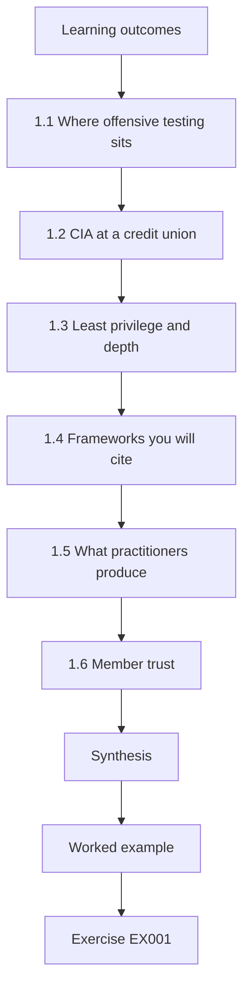

### Logical drawing

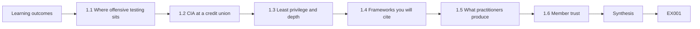

```text
[Learning outcomes]
    |
    v
[1.1 Where offensive testing sits]
    |
    v
[1.2 CIA at a credit union]
    |
    v
[1.3 Least privilege and depth]
    |
    v
[1.4 Frameworks you will cite]
    |
    v
[1.5 What practitioners produce]
    |
    v
[1.6 Member trust]
    |
    v
[Synthesis]
    |
    v
[Worked example] --> [Exercise EX001]
```
<!-- cyberabc:lesson-figures:end ch-01 -->


### Learning outcomes

You will (1) place authorized offensive security among other security practices; (2) name confidentiality, integrity and availability with credit-union examples; (3) explain least privilege and defense in depth; (4) list the frameworks this course uses.

### 1.1 Where offensive testing sits

Security work includes architecture, monitoring, incident response and authorized testing. Testing finds what the others missed, under written permission. It does not replace patching, logging or training. At HCU, Leo's ENG-440 scope covers online banking staging and the staff VPN, and his reviews sit beside patching, logging and training rather than replacing them. When a finding appears, Leo still asks whether patching or monitoring should have caught it, so testing feeds everyday hardening rather than competing with it. A clean ENG-440 report still leaves Secure and HttpOnly cookie work to app-sec and MFA gaps to the VPN owners.

### 1.2 CIA at a credit union

Confidentiality protects member account data; integrity protects balances and transfer instructions; availability keeps online banking usable. A finding is judged by which of these it threatens, and when Leo rates one he names which of the three is at stake. A session cookie without Secure and HttpOnly threatens confidentiality of member sessions; a shared admin password threatens integrity of changes; a test that locks accounts threatens availability. The same technical issue can hit more than one, and the report should say so. Account lockout is why the ROE forbids password spraying: one careless run on payday could lock members out of their wages. The cookie-flag finding in ENG-440 is rated mainly on confidentiality, because a stolen session exposes a member's account view.

### 1.3 Least privilege and depth

Accounts and network paths should allow only what is needed. Several layers — network, application, identity, monitoring — mean one failure does not end the story. Testers look for places where layers are missing.

On the staff VPN, least privilege means each admin has a named account rather than a shared login, and depth means a stolen password still faces MFA and monitoring. Leo looks for places where one layer is missing, such as an admin path reachable without the jump host, because that is where a single failure ends the story.

### 1.4 Frameworks you will cite

NIST SP 800-115 for planning assessments; PTES for engagement stages; OWASP WSTG for web checks; MITRE ATT&CK for technique names; TIBER-EU and CBEST for threat-led tests in finance. Each reference answers a different question, so Leo cites the one that matches the decision being recorded. He opens OWASP WSTG first for web application tests of online banking staging, PTES for the engagement stages, and NIST SP 800-115 when planning what kind of assessment HCU needs. ATT&CK supplies technique names such as T1078 Valid Accounts for the SOC. TIBER-EU and CBEST matter only if HCU later sponsors a threat-led test.

### 1.5 What practitioners produce

Practitioners produce scoped plans, validated findings, clear reports and verified remediations — not piles of unconfirmed scanner noise. Leo's first week delivers a scoped plan for online banking and the VPN, not a scanner dump. Later he will produce validated findings, a clear report for the CISO and engineers, and verified remediations with retest evidence. Those four outputs are what the CISO and examiners can audit. Unconfirmed tool noise stays out of the report so owners can act on what is real; scanner noise without validation wastes fixer time and hides the issues that matter to members.

### 1.6 Member trust

Members trust HCU with wages and savings. A careless test that locks accounts or leaks a statement destroys that trust faster than most technical findings. Every method Leo proposes must answer: what member harm could this cause if it goes wrong, and how do we prevent it? That question shapes the ROE: staging first, no password spraying, stop if member data appears unexpectedly. A locked payday transfer or a leaked statement would harm members who never chose to be part of a test, so prevention is written into methods and stop conditions before any packet leaves.

### Worked example (synthetic HCU)

Leo Okonkwo joins HCU's security team. His first week is a map: online banking and the staff VPN are in the next authorized review; the core banking AS/400 is out of scope. He pins the CIA questions above his desk.

> **Synthetic case — Harborline Credit Union (HCU).** The credit union, Leo Okonkwo and all figures are invented for teaching.

### Errors and limits

Local policies and laws differ; follow HCU's authorization and your jurisdiction. This book never authorizes testing of real systems.

### Exercises

- **EX001 — Three practices.** Name three security practices besides authorized testing. *Rubric:* 3 = three of architecture, monitoring, IR, patching, training; 2 = two; 1 = one; 0 = none.
- **EX002 — CIA match.** Match: leaked member statements; altered transfer amount; online banking down. *Rubric:* 3 = C, I, A; 2 = two; 1 = one; 0 = none.
- **EX003 — Least privilege.** Give a credit-union example of least privilege. *Rubric:* 3 = concrete account/path limited to need; 2 = vague; 1 = wrong; 0 = none.
- **EX004 — Defense in depth.** Why is one firewall not enough? *Rubric:* 3 = other layers can fail independently; app/identity/monitor still needed; 2 = partial; 1 = it is enough; 0 = none.
- **EX005 — Framework pick.** Which source would Leo open first to structure a web application test? *Rubric:* 3 = OWASP WSTG; 2 = ATT&CK; 1 = CBEST only; 0 = none.

### Synthesis

Authorized testing sits beside other practices; CIA, least privilege and public frameworks shape every engagement.

### Continue studying — chapter 01 of 12

[← Course home](../../README.md) · [Course chapter index](../SUBJECTS.md) · [Chapter 02 (draft) →](#ch-02)

<a id="ch-02"></a>

## Chapter 2 — Service and stakeholder context

<!-- cyberabc:lesson-figures:start ch-02 -->
### Lesson map

Lesson 02 published. Map, example, EX006.

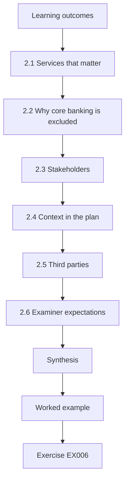

### Logical drawing

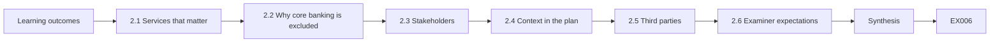

```text
[Learning outcomes]
    |
    v
[2.1 Services that matter]
    |
    v
[2.2 Why core banking is excluded]
    |
    v
[2.3 Stakeholders]
    |
    v
[2.4 Context in the plan]
    |
    v
[2.5 Third parties]
    |
    v
[2.6 Examiner expectations]
    |
    v
[Synthesis]
    |
    v
[Worked example] --> [Exercise EX006]
```
<!-- cyberabc:lesson-figures:end ch-02 -->


### Learning outcomes

You will (1) identify HCU services and who owns them; (2) explain why core banking is often out of scope; (3) map stakeholders for an engagement; (4) write a context paragraph for a test plan.

### 2.1 Services that matter

HCU runs online banking, a staff VPN, email, a member-facing website and a core banking system on an AS/400. Online banking and the VPN are internet-reachable and change often; they are common first targets for authorized review, so Leo's next authorized review starts with them. The staff VPN ranks high because a shared admin password there would reach internal systems, as the later ENG-440 finding showed. Email and the public website matter too, but they change less often and are lower on the current plan. The AS/400 is listed so everyone knows it exists and is deliberately left alone. Each service on the list carries its owner's name, so Leo knows whom to ask before any check touches it.

### 2.2 Why core banking is excluded

The AS/400 holds the system of record for balances. An accidental outage would stop branches. Unless a specialised, heavily controlled engagement is funded, it stays out of scope and is protected by compensating controls. Those controls — network isolation, tightly limited admin paths and monitoring — are what make exclusion defensible to examiners. Leo's plan names them, and the owner of each, rather than pretending the system is invisible, so examiners can put questions to the network team directly. A specialised engagement would need its own funding, ROE and operators trained on that platform; until one is funded, the AS/400 appears in the report only as an exclusion with its controls listed.

### 2.3 Stakeholders

The CISO authorises; the online-banking product owner accepts risk; the network team opens temporary rules; the SOC watches for test traffic; legal reviews the contract. Leo's job is to know who decides what, so before kickoff he can name each person and what they must approve. If the product owner has not accepted residual risk, or the SOC has not been told the window, he does not start. He keeps a dated one-line approval record for each stakeholder in the ENG-440 ticket; the network team's temporary firewall rule, for instance, must be live by 08:00 Saturday or the window slips. Knowing who decides what prevents a test that is authorized on paper but blocked in practice.

### 2.4 Context in the plan

A good plan states business purpose (protect members, meet examiner expectations), services in and out of scope, and peak times to avoid (for example Friday payday). Leo's draft for HCU states the purpose (member data and the annual exam), lists online banking and the VPN in scope, excludes the AS/400, ATM network and card processor, and avoids the Saturday morning batch window. The Saturday window and payday avoidance sit next to the host list so a reviewer sees timing judgment, not only addresses. Reviewers can also check timing against the SOC rota, since the analysts on duty that Saturday morning must expect the test traffic.

### 2.5 Third parties

Card processors and cloud email are separate organisations. Testing them needs their authorization, not only HCU's. Leo's plan lists the card processor and cloud email as out of scope for that reason, so a keen tester does not invent permission that was never granted. If HCU wants them tested, the CISO must obtain written authorization from each provider and attach it to the ROE. HCU's signature alone never covers another organisation's systems, however convenient it would be to probe the card processor from the same Saturday window.

### 2.6 Examiner expectations

Credit unions face safety-and-soundness exams that ask how systems are tested. Leo's context paragraph is also evidence for examiners: it shows HCU chooses scope deliberately, excludes fragile systems and schedules around operations rather than testing "everything that answers a ping." The paragraph is filed with the ROE, so examiners read the same scope reasoning that the CISO signed and should see that HCU tested what it meant to test. Naming the AS/400 exclusion and the batch-window avoidance is as useful as listing what was in scope, because it shows judgment rather than a checklist of every reachable host.

### Worked example (synthetic HCU)

Leo drafts: "Purpose: reduce risk to member data and authenticate online banking ahead of the annual exam. In scope: online banking web tier and staff VPN. Out of scope: AS/400 core, ATM network, third-party card processor. Avoid: Saturday morning batch window."

> **Synthetic case — Harborline Credit Union (HCU).** The credit union, Leo Okonkwo and all figures are invented for teaching.

### Errors and limits

Local policies and laws differ; follow HCU's authorization and your jurisdiction. This book never authorizes testing of real systems.

### Exercises

- **EX006 — Five services.** List five HCU services from the chapter. *Rubric:* 3 = five correct; 2 = four; 1 = two; 0 = none.
- **EX007 — AS/400 exclusion reason.** Why is the AS/400 usually out of scope? *Rubric:* 3 = system of record; outage stops branches; needs specialised controls; 2 = partial; 1 = "old"; 0 = none.
- **EX008 — Who authorises.** Who at HCU authorises the engagement? *Rubric:* 3 = CISO (with product owner acceptance); 2 = CISO; 1 = Leo; 0 = none.
- **EX009 — SOC role.** What does the SOC need to know before testing starts? *Rubric:* 3 = window, source IPs, expected noisy methods; so they do not treat test as real attack blindly; 2 = partial; 1 = vague; 0 = none.
- **EX010 — Third party.** May HCU's ROE alone authorize testing the card processor? *Rubric:* 3 = no; processor's own authorization required; 2 = no; 1 = yes; 0 = none.

### Synthesis

Services, owners, exclusions and third parties belong in the plan before any method is chosen.

### Continue studying — chapter 02 of 12

[← Chapter 01 (draft)](#ch-01) · [Course chapter index](../SUBJECTS.md) · [Chapter 03 (draft) →](#ch-03)

<a id="ch-03"></a>

## Chapter 3 — Authorized practice and evidence handling

<!-- cyberabc:lesson-figures:start ch-03 -->
### Lesson map

Lesson 03 published. Map, example, EX011.

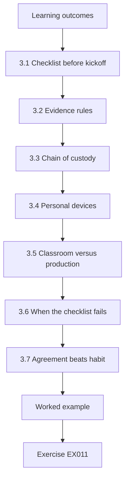

### Logical drawing

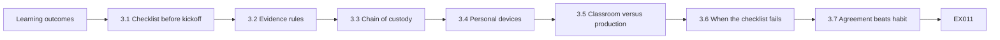

```text
[Learning outcomes]
    |
    v
[3.1 Checklist before kickoff]
    |
    v
[3.2 Evidence rules]
    |
    v
[3.3 Chain of custody]
    |
    v
[3.4 Personal devices]
    |
    v
[3.5 Classroom versus production]
    |
    v
[3.6 When the checklist fails]
    |
    v
[3.7 Agreement beats habit]
    |
    v
[Worked example] --> [Exercise EX011]
```
<!-- cyberabc:lesson-figures:end ch-03 -->


### Learning outcomes

You will (1) complete a rules-of-engagement checklist; (2) explain evidence retention and redaction; (3) refuse work that lacks an emergency contact; (4) describe chain of custody for test data.

### 3.1 Checklist before kickoff

Every required field of the rules of engagement must be filled: scope, exclusions, methods, window, emergency contact, data handling and report audience. An empty emergency contact stops the test.

```python
"""Lab 3: validate a synthetic rules-of-engagement checklist before testing starts."""
required = ["in_scope", "out_of_scope", "allowed_methods", "window", "emergency_contact",
            "data_handling", "report_audience"]
draft = {"in_scope": "192.0.2.0/24 web and VPN", "out_of_scope": "core banking AS/400",
         "allowed_methods": "config review, authenticated web tests", "window": "Sat 08:00-12:00",
         "emergency_contact": "", "data_handling": "delete within 30 days", "report_audience": "CISO"}
missing = [k for k in required if not draft.get(k)]
print("complete" if not missing else "MISSING: " + ", ".join(missing))
for k in required:
    print(f"  {k}: {draft.get(k) or '(empty)'}")
```

Run with `python3 lab_roe.py`. Verified output:

```text
MISSING: emergency_contact
  in_scope: 192.0.2.0/24 web and VPN
  out_of_scope: core banking AS/400
  allowed_methods: config review, authenticated web tests
  window: Sat 08:00-12:00
  emergency_contact: (empty)
  data_handling: delete within 30 days
  report_audience: CISO
```

The lab prints MISSING when emergency_contact is empty, and lists the other fields so Leo can see what is already filled. In the worked draft every field except emergency_contact is filled, which is why the lab prints a single MISSING line. He will not schedule the Saturday 08:00–12:00 window until the CISO names an on-call contact. An empty field is a stop, not a prompt to improvise.

### 3.2 Evidence rules

Capture only what proves the finding. Redact member identifiers. Store evidence in the approved repository with access limited to the engagement team. Delete or return it when the agreement says so. For HCU, that means screenshots without member names or account numbers, stored under the engagement ticket in the vault, not in personal chat; evidence that proves a cookie flag is missing does not need a real member's session token. Access to the ENG-440 folder is limited to the team named in the agreement. When the agreement says delete within 30 days, Leo diaries the deletion and confirms it, and the vault entry shows the deletion date beside the folder so a reviewer can check the rule was met.

### 3.3 Chain of custody

Note who collected each item, when, and every hand-off. For classroom labs the log is short; for real exams it can be scrutinised. Leo's custody line for ENG-440 notes who exported each file, from which jump host, and when it entered the vault. A two-line custody log is enough for the classroom engagement ENG-CLASS-11, but it records exactly the fields Leo will use for ENG-440, so the practice transfers. If evidence moves at shift change, the hand-off line names both people and the ticket id; missing custody is how files go astray before an exam.

### 3.4 Personal devices

Do not keep HCU evidence on personal laptops or chat apps. Use the issued environment. HCU issues a locked-down jump environment for testing. Evidence that leaves it — copied to a phone, pasted into WhatsApp, or saved to a personal drive — breaks the agreement and can expose member data. Leo treats the issued environment as the only place evidence may live. If he must work remotely, he uses the VPN into that environment, never a sync folder that copies files to a home machine. If a copy does leave, Leo reports it to the CISO the same day rather than deleting it quietly.

### 3.5 Classroom versus production

These labs validate checklists on synthetic drafts; they do not replace a legal review of a real ROE. Passing lab_roe on a synthetic draft proves Leo can spot a missing emergency contact; it does not mean a real ROE is ready. A real ROE also needs the CISO's signature, legal's contract check and the network team's firewall approval, none of which the lab simulates. Leo states that classroom-versus-production boundary in every lab report, so nobody treats a classroom pass as production authorization.

### 3.6 When the checklist fails

If any required ROE field is empty on the morning of the test, Leo cancels the window in writing and informs the CISO and SOC. Restarting after a scramble to fill fields produces mistakes; a clean postponement is cheaper than an unauthorized hour. He posts the cancellation to the engagement channel with the missing field named, and the CISO and the SOC lead receive the same written cancellation, so nobody keeps a stale Saturday plan in their calendar or expects traffic. A new window is booked only after the checklist prints complete on a full ROE; the written cancel protects him if someone later claims testing ran without one.

### 3.7 Agreement beats habit

Even if Leo tested the same staging site last quarter, he does not reuse last quarter's ROE. Systems, owners and exclusions change. Each engagement starts from a current signed agreement, and the checklist is run against that agreement, not against memory. Last quarter's exclusions might have omitted a new staging host that is now production-adjacent; running the checklist against the current signed agreement catches that, and the new host would also need a named owner in the stakeholder list before Leo could include it in scope. He dates each checklist run and keeps the output with the new ROE in the vault, so the check can be shown later. Habit is not authorization.

### Worked example (synthetic HCU)

Leo runs the checklist on the draft ROE. It prints MISSING: emergency_contact. He will not schedule the Saturday window until the CISO names an on-call contact and the field is filled.

> **Synthetic case — Harborline Credit Union (HCU).** The credit union, Leo Okonkwo and all figures are invented for teaching.

### Errors and limits

Local policies and laws differ; follow HCU's authorization and your jurisdiction. This book never authorizes testing of real systems.

### Exercises

- **EX011 — Missing field.** What does the lab print as the status line, and what must Leo do? *Rubric:* 3 = MISSING: emergency_contact; do not start until filled; 2 = missing only; 1 = start anyway; 0 = none.
- **EX012 — Filled contact.** If emergency_contact becomes "SOC on-call +1-555-0100", what is the status line? *Rubric:* 3 = complete; 2 = ok; 1 = still missing; 0 = none.
- **EX013 — Redaction.** A screenshot shows a member's full account number. What before filing? *Rubric:* 3 = redact/mask; keep only digits needed to prove issue; 2 = partial; 1 = file as-is; 0 = none.
- **EX014 — Personal chat.** May Leo paste evidence into a private WhatsApp chat with a colleague? *Rubric:* 3 = no; use approved repository only; 2 = no; 1 = yes if private; 0 = none.
- **EX015 — Custody note.** Write a one-line custody entry for a config export. *Rubric:* 3 = who, what, when, from where; 2 = two fields; 1 = vague; 0 = none.

### Synthesis

No emergency contact, no test; evidence is minimised, retained as agreed and never parked on personal devices.

### Continue studying — chapter 03 of 12

[← Chapter 02 (draft)](#ch-02) · [Course chapter index](../SUBJECTS.md) · [Chapter 04 (draft) →](#ch-04)

<a id="ch-04"></a>

## Chapter 4 — Core methods

<!-- cyberabc:lesson-figures:start ch-04 -->
### Lesson map

Lesson 04 published. Map, example, EX016.

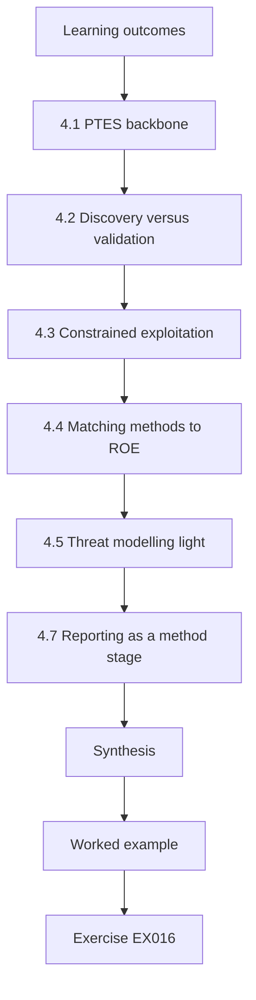

### Logical drawing

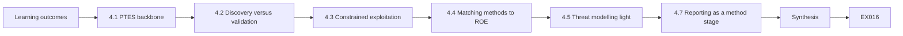

```text
[Learning outcomes]
    |
    v
[4.1 PTES backbone]
    |
    v
[4.2 Discovery versus validation]
    |
    v
[4.3 Constrained exploitation]
    |
    v
[4.4 Matching methods to ROE]
    |
    v
[4.5 Threat modelling light]
    |
    v
[4.7 Reporting as a method stage]
    |
    v
[Synthesis]
    |
    v
[Worked example] --> [Exercise EX016]
```
<!-- cyberabc:lesson-figures:end ch-04 -->


### Learning outcomes

You will (1) describe PTES stages in order; (2) separate discovery from validation; (3) explain why exploitation is optional and constrained; (4) choose methods that match HCU's ROE.

### 4.1 PTES backbone

PTES stages give a shared order: pre-engagement (scoping), intelligence gathering, threat modelling, vulnerability analysis, exploitation, post-exploitation and reporting. HCU's ROE currently allows analysis and authenticated web tests, not broad exploitation. Leo's method table therefore stops at intelligence gathering, vulnerability analysis and authenticated web tests on staging, and marks each PTES stage as allowed, not allowed or out of scope, so the CISO sees where ENG-440 stops. Exploitation and post-exploitation stay off the plan until the ROE is rewritten and re-signed; skipping ahead because a tool made it easy would break trust with the SOC. Using PTES names helps the CISO and outside firms share one vocabulary.

### 4.2 Discovery versus validation

Discovery lists possible issues; validation confirms them with evidence inside the rules. Tool output alone is discovery. A confirmed misconfiguration with a screenshot and business impact is a finding. An outdated-banner at confidence 0.7 is discovery until Leo confirms the version, the exposure and the impact with evidence; he checks the banner against the vendor's advisory for that version before deciding whether it is a finding at all. Only then does it become a finding with a severity and a recommendation. In Chapter 5's lab, a FLOOR of 0.6 keeps open-redirect at 0.9, outdated-banner at 0.7 and cookie-flag at 0.85, but no evidence and no impact statement still means an item stays off the findings list.

### 4.3 Constrained exploitation

If the ROE later allows proving a flaw, use the minimum step that shows impact, on agreed accounts, with a stop if anything unexpected happens. This course still does not teach exploit development. If HCU later allows a proof of impact, Leo uses an agreed test account that holds synthetic data only, so a proof never shows a real member's balance. He takes the minimum step that shows the issue and does not invent steps beyond the ROE. A lockout, a data leak or a host that is not staging triggers an immediate stop and a call to the emergency contact.

### 4.4 Matching methods to ROE

Leo's plan maps each method to an ROE line. Anything not mapped is out. Authenticated WSTG checks on staging map to allowed methods and in-scope systems. Password spraying has no line, so it is out; it would also risk locking real member accounts during payday week, which is one reason the ROE omits it. AS/400 probes have an exclusion line, so they are out. Each line in Leo's method table carries the ROE clause it relies on, so a reviewer can check the mapping line by line. Unmapped methods do not get a trial run; they wait for a written ROE update, and ENG-440 does not earn bonus points for creativity outside the table.

### 4.5 Threat modelling light

Even without a full red-team scenario, name the likely actors (stolen member password, phishing of staff) so checks focus on what matters to HCU. For online banking, those are the actors Leo names. That focus pushes checks toward session handling, password policy and VPN MFA, rather than obscure protocol quirks that no likely actor would use against HCU. Insider misuse and attacks on the AS/400 are left out of this light model because ENG-440 cannot test them. Naming those exclusions in the model lets the report explain why a check was or was not in scope when examiners ask.

### 4.6 Intelligence gathering limits

OSINT on HCU stays with public pages and published documents. Scraping member forums, buying breach data or impersonating staff are out unless the ROE explicitly allows a social-engineering scenario — which HCU's current ROE does not. Leo's collection is restricted to HCU's public website and published documents that any member of the public can open without logging in to online banking. Buying breach data or scraping member forums would gather intelligence outside the ROE and could expose real people. He does not scrape at rates that look like abuse, and he records what he collected. If a social-engineering scenario is ever needed, it gets its own written approval.

### 4.7 Reporting as a method stage

PTES ends with reporting because findings that never reach owners change nothing. Leo budgets time for writing and review inside the engagement window rather than treating the report as unpaid overtime after testing. For ENG-440, he blocks the last part of the Saturday window for writing and peer review, and testing that runs into that reserved time is cut short rather than squeezing out the review. If writing overruns, unfinished validation becomes an explicit gap in the report, not a silent claim of full coverage. Findings that sit only in his notes until Monday help nobody before the exam; reporting is a method stage with a clock, not an afterthought.

### Worked example (synthetic HCU)

Leo's method table: OSINT on public HCU pages (allowed); authenticated WSTG checks on online banking staging (allowed); password spraying (forbidden); AS/400 probes (out of scope).

> **Synthetic case — Harborline Credit Union (HCU).** The credit union, Leo Okonkwo and all figures are invented for teaching.

### Errors and limits

Local policies and laws differ; follow HCU's authorization and your jurisdiction. This book never authorizes testing of real systems.

### Exercises

- **EX016 — Stage order.** Put in order: reporting, vulnerability analysis, pre-engagement, exploitation. *Rubric:* 3 = pre-engagement, vuln analysis, exploitation, reporting; 2 = mostly; 1 = random; 0 = none.
- **EX017 — Discovery or finding.** Tool reports outdated-banner at confidence 0.7. Is that a finding yet? *Rubric:* 3 = discovery until validated with evidence and impact; 2 = partial; 1 = already finding; 0 = none.
- **EX018 — Why spraying is forbidden.** Why does HCU forbid password spraying? *Rubric:* 3 = lockouts/member harm/noisy; not in allowed methods; 2 = partial; 1 = "slow"; 0 = none.
- **EX019 — Minimum proof.** What does "minimum step that shows impact" mean? *Rubric:* 3 = stop once impact shown; no extra pivoting; 2 = partial; 1 = full domain takeover always; 0 = none.
- **EX020 — Map a method.** Map "authenticated WSTG checks on staging" to ROE language. *Rubric:* 3 = cites allowed_methods and in_scope staging; 2 = partial; 1 = unmapped; 0 = none.

### Synthesis

Methods follow PTES order and the ROE; discovery becomes a finding only after validated evidence.

### Continue studying — chapter 04 of 12

[← Chapter 03 (draft)](#ch-03) · [Course chapter index](../SUBJECTS.md) · [Chapter 05 (draft) →](#ch-05)

<a id="ch-05"></a>

## Chapter 5 — Tools and interpretation

<!-- cyberabc:lesson-figures:start ch-05 -->
### Lesson map

Lesson 05 published. Map, example, EX021.

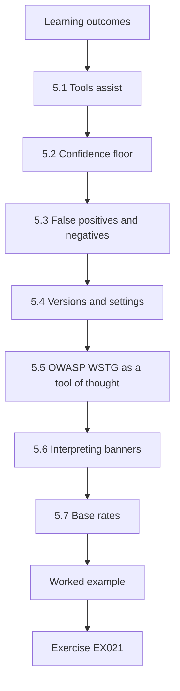

### Logical drawing

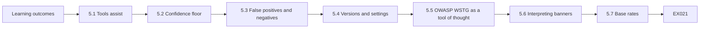

```text
[Learning outcomes]
    |
    v
[5.1 Tools assist]
    |
    v
[5.2 Confidence floor]
    |
    v
[5.3 False positives and negatives]
    |
    v
[5.4 Versions and settings]
    |
    v
[5.5 OWASP WSTG as a tool of thought]
    |
    v
[5.6 Interpreting banners]
    |
    v
[5.7 Base rates]
    |
    v
[Worked example] --> [Exercise EX021]
```
<!-- cyberabc:lesson-figures:end ch-05 -->


### Learning outcomes

You will (1) treat scanners as assistants not judges; (2) filter findings by confidence and confirmation; (3) explain false positives and false negatives; (4) record tool versions in evidence.

### 5.1 Tools assist

Scanners and checklists speed discovery. They mislabel, miss context and cannot judge business impact. Leo reads every kept item: when lab_severity keeps three of five items, he still opens each kept item and asks whether HCU should act. Items he cannot explain in plain words about member impact are sent back for more validation or dropped. The two dropped items, dir-listing and trace-method, are noted in the method appendix so nobody wonders whether they were ignored. Scanners assist discovery; they do not judge member impact or write the recommendation.

### 5.2 Confidence floor

HCU drops unconfirmed items below a confidence floor so the report is not padded with noise.

```python
"""Lab 5: filter a synthetic tool finding list, dropping noise below a confidence floor."""
findings = [("open-redirect", 0.9, True), ("dir-listing", 0.4, False),
            ("outdated-banner", 0.7, True), ("cookie-flag", 0.85, True), ("trace-method", 0.3, False)]
FLOOR = 0.6
kept = [(n, c) for n, c, confirmed in findings if c >= FLOOR and confirmed]
for n, c in kept:
    print(f"KEEP {n:16} confidence={c}")
print(f"kept {len(kept)} of {len(findings)}; dropped {len(findings)-len(kept)}")
```

Run with `python3 lab_severity.py`. Verified output:

```text
KEEP open-redirect    confidence=0.9
KEEP outdated-banner  confidence=0.7
KEEP cookie-flag      confidence=0.85
kept 3 of 5; dropped 2
```

With FLOOR at 0.6, the lab keeps open-redirect (0.9), outdated-banner (0.7) and cookie-flag (0.85), and drops the rest. Dir-listing and trace-method fall below 0.6, so they stay in the raw output appendix rather than the findings list, and unconfirmed items below the floor never appear in executive slides. Raising the floor to 0.8 would drop the banner too. Leo states the floor in the method notes so readers know what was filtered.

### 5.3 False positives and negatives

A false positive wastes fixer time; a false negative leaves risk. Sampling and manual validation reduce both; neither reaches zero. Leo plans validation time from past false-positive rates and accepts that some risk may still be missed. If the last review's false positives clustered in one scanner check, that check gets extra validation time in ENG-440. When in doubt, he validates more rather than shipping a longer list. He tells the CISO the report contains validated items, not that every possible issue was found.

### 5.4 Versions and settings

Record tool name, version and profile with the evidence so a retest can use the same setup. Leo's evidence for the cookie-flag finding names the scanner, its version and the profile used, and the profile name is stored on ticket T-15, so the retest after app-sec's fix repeats the same check with the same scan settings. Without versions, a failed retest cannot tell whether the fix failed or the setup changed. Settings that change mid-engagement are logged with the time of the change, so the evidence still says which setup produced each result.

### 5.5 OWASP WSTG as a tool of thought

Even without a scanner, WSTG gives a structured list of web checks so coverage is visible. Leo uses a WSTG-derived checklist for online banking staging so he can show which checks ran and which were out of scope. Rows are marked ran, not run or out of scope, and each ran row points to its evidence file in the vault. Coverage that is only in his head cannot be reviewed or retested. Empty rows on the checklist are honest gaps; inventing coverage helps nobody when examiners ask what was actually tested.

### 5.6 Interpreting banners

An outdated banner is a clue, not a crisis. Leo checks whether the service is internet-facing, whether the version is truly vulnerable, and whether a WAF or access rule already limits exposure before he writes a high-severity finding. On HCU's staging tier, an outdated banner behind access rules may be low priority; the same banner on an internet-facing admin port would not. For the ENG-440 banner, Leo records that staging sits behind access rules, which is why it is not rated high. He writes that reasoning into the finding so severity is not a mysterious label divorced from member impact; context turns a clue into a proportional finding.

### 5.7 Base rates

If a scanner marks forty items and history shows thirty were false positives, Leo plans validation time accordingly: forty raw items with that history suggest roughly ten real findings. Base rates protect the schedule. He does not promise the CISO "forty findings" before validation, because that sets the wrong expectation and pressures the team to keep noise. Validation time is part of the engagement budget, not optional overtime, and Leo promises a validated set with a time box for confirmation.

### 5.8 Manual spot checks

For every five automated items kept, Leo manually validates at least the highest-severity one end-to-end with an authorized account. Spot checks catch systematic tool mistakes that a confidence score cannot, because those mistakes show up when a human repeats the path. In ENG-440 lab_severity keeps three items and open-redirect at 0.9 is the highest, so Leo walks that path first with an authorized account before the report is drafted. A failed walkthrough of open-redirect means the other kept items get the same human path before the report drafts.

### Worked example (synthetic HCU)

Leo filters the synthetic list: open-redirect, outdated-banner and cookie-flag are kept; dir-listing and trace-method drop. He still manually validates the three kept items before they enter the report.

> **Synthetic case — Harborline Credit Union (HCU).** The credit union, Leo Okonkwo and all figures are invented for teaching.

### Errors and limits

Local policies and laws differ; follow HCU's authorization and your jurisdiction. This book never authorizes testing of real systems.

### Exercises

- **EX021 — Lab keep count.** How many findings does the lab keep, and which are dropped? *Rubric:* 3 = 3 kept; dir-listing and trace-method dropped; 2 = count only; 1 = wrong; 0 = none.
- **EX022 — Raise the floor.** If FLOOR becomes 0.8, which items remain? *Rubric:* 3 = open-redirect and cookie-flag only; 2 = one; 1 = all three; 0 = none.
- **EX023 — False positive.** Give an HCU example of a false positive. *Rubric:* 3 = scanner flags issue that staging config shows is mitigated; 2 = partial; 1 = vague; 0 = none.
- **EX024 — False negative.** Give an HCU example of a false negative. *Rubric:* 3 = issue exists but tool misses (e.g. auth logic flaw); 2 = partial; 1 = vague; 0 = none.
- **EX025 — Version note.** Write the tool line Leo adds to evidence. *Rubric:* 3 = name, version, profile/settings; 2 = name only; 1 = vague; 0 = none.

### Synthesis

Tools propose; humans dispose — filter, validate, record versions, then report.

### Continue studying — chapter 05 of 12

[← Chapter 04 (draft)](#ch-04) · [Course chapter index](../SUBJECTS.md) · [Chapter 06 (draft) →](#ch-06)

<a id="ch-06"></a>

## Chapter 6 — Operational workflow

<!-- cyberabc:lesson-figures:start ch-06 -->
### Lesson map

Lesson 06 published. Map, example, EX026.

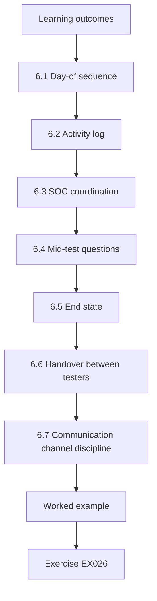

### Logical drawing

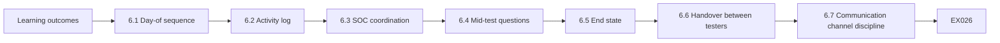

```text
[Learning outcomes]
    |
    v
[6.1 Day-of sequence]
    |
    v
[6.2 Activity log]
    |
    v
[6.3 SOC coordination]
    |
    v
[6.4 Mid-test questions]
    |
    v
[6.5 End state]
    |
    v
[6.6 Handover between testers]
    |
    v
[6.7 Communication channel discipline]
    |
    v
[Worked example] --> [Exercise EX026]
```
<!-- cyberabc:lesson-figures:end ch-06 -->


### Learning outcomes

You will (1) describe the day-of workflow from kickoff to debrief; (2) keep a contemporaneous activity log; (3) coordinate with the SOC; (4) handle a mid-test scope question.

### 6.1 Day-of sequence

Kickoff call confirms ROE and contacts; testers begin only inside the window; progress notes go to the engagement channel; mid-point check with the product owner if anything sensitive appears; end-of-day debrief; evidence vaulted. For ENG-440, Leo's Saturday sequence follows that order. Nothing starts before the kickoff confirms the ROE still matches the signed copy, and evidence is vaulted before he leaves for the day. Deviations from the sequence are logged with a reason so a later review can see why.

### 6.2 Activity log

Every action gets a time, system, method and result. The log defends the team if an outage is blamed on testing and feeds the report. Leo's log line includes time, host, method and result, such as a pause when a hostname looked like production. Each line uses the jump host clock, so log entries and SOC alerts can be lined up afterwards without guessing offsets. Logs are kept in the vault with the evidence, not only in chat history that scrolls away. If payday traffic slows, the log is what shows whether testing was involved.

### 6.3 SOC coordination

Send start and stop messages. If the SOC sees related alerts, they call the emergency contact rather than blocking Leo's access without notice. Leo's start message for ENG-440 goes out at 08:05, names staging only and carries the ticket id, the source IP and the 12:00 end time. If the SOC calls about his IP, he confirms the ticket, shares the window and reduces rate or pauses if they ask; any rate change is written in the activity log with the time and the analyst's name. At 12:00 Leo posts stop to the engagement channel with the ticket id so the SOC can clear his IP from the watch list. Silent testing against a watching SOC creates avoidable incidents.

### 6.4 Mid-test questions

New hostname discovered? Pause and ask. Do not "just include it." At 09:40 Leo finds a hostname that might be production; he pauses, asks the product owner, learns it is staging, logs the decision and continues. The product owner's reply confirming the host belongs to staging is pasted into the ticket before testing resumes, so ENG-440 shows judgment under time pressure, not a lucky guess. The question costs minutes; an unauthorized probe on a production-looking host would cost the engagement. Guessing would have been out of scope.

### 6.5 End state

At stop time, stop. Unfinished checks become next-window work or explicit out-of-time notes — not silent overruns. At 12:00 Leo stops even if a WSTG check is half done. The half-finished check is listed in the report with the step it reached, so the next window starts there. The SOC expects silence after the 12:00 stop message, so any later packet from Leo's IP would look like an attack. Silent overruns break the agreement the SOC and CISO relied on, and the 12:00 stop on ENG-440 is the same rule he practises on ENG-CLASS-11.

### 6.6 Handover between testers

If Leo ends his shift and a colleague continues, the activity log and evidence vault are the handover. Verbal notes are not enough; the colleague must see what was already validated so they do not retest destructively or miss a stop condition. The colleague opening the vault should see validated findings, open questions and any stop conditions already hit. Handover notes name the next safe action and anything that must not be repeated, such as a pause Leo already agreed. When a colleague picks up mid-window, the note plus the vault path is enough; Leo does not leave critical context only in his head.

### 6.7 Communication channel discipline

Engagement chat is for scope, stops and status — not for jokes about "hacking the bank". Casual language leaks into screenshots and damages trust if an examiner later reads the channel. Leo writes status in plain, professional words, with ticket ids, because screenshots of the channel can appear in evidence or examiner review. Screenshots for ENG-440 strip desktop clutter and unrelated tabs before they enter the vault under the ticket id. Communication stays in the engagement channel; personal chat is not an evidence store for ENG-440.

### 6.8 Window extensions

If work must continue past the window, Leo stops, requests a written extension from the CISO, and waits for confirmation before any further packet leaves his laptop. Verbal "sure, keep going" is not enough, even from the CISO on the phone. A written extension names the new end time and is filed with the ROE before work resumes. If Saturday runs long, Leo's laptop sends no further packets until that extension exists, because the SOC and emergency contact must see the same clock Leo uses.

### Worked example (synthetic HCU)

At 08:05 Leo posts "ENG-440 start — staging only". At 09:40 he finds a hostname that might be production; he pauses, asks the product owner, learns it is staging, logs the decision, continues.

> **Synthetic case — Harborline Credit Union (HCU).** The credit union, Leo Okonkwo and all figures are invented for teaching.

### Errors and limits

Local policies and laws differ; follow HCU's authorization and your jurisdiction. This book never authorizes testing of real systems.

### Exercises

- **EX026 — Start message.** What four facts belong in Leo's start message? *Rubric:* 3 = ticket/id, scope reminder, window, tester contact; 2 = three; 1 = one; 0 = none.
- **EX027 — Log line.** Write one activity-log line for a WSTG session check. *Rubric:* 3 = time, system, method, result; 2 = three; 1 = vague; 0 = none.
- **EX028 — SOC alert.** SOC calls about alerts from Leo's IP. What does he do? *Rubric:* 3 = confirm authorized test; share window/ticket; adjust rate if asked; 2 = partial; 1 = ignore; 0 = none.
- **EX029 — New hostname.** Correct process when a new hostname appears. *Rubric:* 3 = pause; ask owner; written scope update if needed; 2 = partial; 1 = test it; 0 = none.
- **EX030 — Stop time.** The window ends with one check unfinished. What does Leo do? *Rubric:* 3 = stop; note unfinished for next window; 2 = stop; 1 = overrun; 0 = none.

### Synthesis

Workflow is kickoff, logged work, SOC visibility and pause-to-ask — never silent scope creep.

### Continue studying — chapter 06 of 12

[← Chapter 05 (draft)](#ch-05) · [Course chapter index](../SUBJECTS.md) · [Chapter 07 (draft) →](#ch-07)

<a id="ch-07"></a>

## Chapter 7 — Controls and verification

<!-- cyberabc:lesson-figures:start ch-07 -->
### Lesson map

Lesson 07 published. Map, example, EX031.

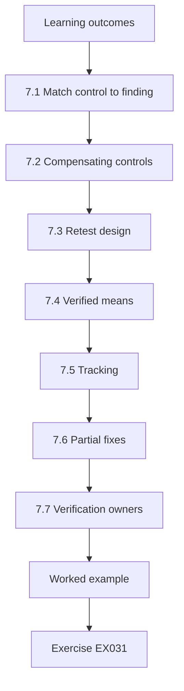

### Logical drawing

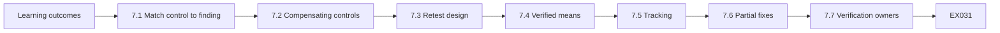

```text
[Learning outcomes]
    |
    v
[7.1 Match control to finding]
    |
    v
[7.2 Compensating controls]
    |
    v
[7.3 Retest design]
    |
    v
[7.4 Verified means]
    |
    v
[7.5 Tracking]
    |
    v
[7.6 Partial fixes]
    |
    v
[7.7 Verification owners]
    |
    v
[Worked example] --> [Exercise EX031]
```
<!-- cyberabc:lesson-figures:end ch-07 -->


### Learning outcomes

You will (1) suggest controls that match findings; (2) distinguish compensating controls; (3) plan a retest; (4) know when a control is verified.

### 7.1 Match control to finding

A shared admin password finding wants named accounts and vaulting; an open redirect wants allow-listed destinations; a missing cookie flag wants the flag set and checked in CI. Leo writes each recommendation to match the finding: named VPN accounts and a vault for shared passwords; allow-listed destinations for an open redirect; Secure and HttpOnly flags checked in CI for the session cookie. App-sec owns Secure and HttpOnly for the cookie-flag finding, and the recommendation line carries that name and a due date. Generic advice such as "harden the app" or "harden sessions" does not tell an owner what to change.

### 7.2 Compensating controls

When the ideal fix is months away, a compensating control reduces risk now — for example, VPN admin paths restricted to jump hosts while password reuse is being eliminated. Leo records the compensating control as temporary, with an owner and a date to revisit the ideal fix, so it does not become permanent by neglect. Temporary network restrictions around an outdated banner are acceptable on the same terms: after the banner is patched, the access rules come off the ticket with a retest note and a retire timestamp. Open-ended compensations become forgotten debt.

### 7.3 Retest design

Retest only the agreed findings, with the same or equivalent method, after the owner says the fix is live. Record pass or fail with evidence. After the owner says the cookie flags are live on staging, Leo repeats the same check with the recorded tool version, and pass or fail goes on the ticket with a fresh screenshot. He confirms hostnames, ports and build versions against the owner's change note before calling a retest a failure. A retest that touches a host outside the original ENG-440 list waits for a written scope update, and retesting unrelated findings wastes the window.

### 7.4 Verified means

Verified means Leo reproduced the original symptom as fixed (or confirmed the compensating control works), not that the owner said they fixed it. Owner confirmation of deployment is necessary but not sufficient. Leo or another tester must see the original symptom gone, or the compensating control working, before the ticket is marked verified. Before-and-after cookie screenshots are hashed into the vault and linked from T-15, so verification is evidence in the record, not a verbal assurance that someone thinks it is fixed.

### 7.5 Tracking

Findings become tickets with owners and dates; verification closes them. Each HCU finding becomes a ticket with an owner and a due date, and verification evidence closes it. Tickets without owners or dates hide risk in the backlog, which is why Chapter 10's lab_ticket flags incomplete fields: it marks T-15 incomplete for owner and verified, and T-18 incomplete for due date, and those never count as closed-ready. Every Friday Leo opens the tracker, and blanks on owner or due date escalate the same week rather than aging into exam findings.

### 7.6 Partial fixes

Sometimes owners fix one path and leave another open. Leo's retest checklist names each path from the original finding. A ticket is not closed until every listed path fails to reproduce the issue or an accepted compensating control is verified. For an open redirect, Leo lists each parameter and path from the original finding; closing after fixing only one leaves members exposed on the others. If one redirect path remains after a partial fix, the CISO accepts it in writing with an expiry or the ticket stays open on the tracker until the residual is owned or removed.

### 7.7 Verification owners

The person who applies a fix should not be the only person who marks it verified. Leo or another tester retests; the owner confirms deployment. Separation keeps wishful closures out of the metrics: "fixed because I deployed it" does not survive a separate retest. The same rule applies to Leo, so a colleague verifies any compensating control he applied and closure never rests on the same hands that made the change. Metrics that count verified tickets only after a separate tester signs keep the numbers honest for the CISO and examiners.

### 7.8 Regression watch

After a fix, Leo asks whether related paths were checked by the owner. A patched open redirect that leaves a second parameter untouched is a common regression; the retest plan names siblings when they exist. When the owner patches one redirect parameter, Leo's retest plan already names the sibling parameters from the finding, and regressions are cheaper to catch in the same window than in the next exam cycle. Regression watch after ENG-440 also checks that cookie flags and redirect fixes stay in later builds. A fix that vanishes in the next staging deploy reopens the ticket with the build id attached.

### Worked example (synthetic HCU)

For the shared VPN admin password, HCU enables MFA and named accounts in two weeks (ideal) and, meanwhile, restricts admin paths to the jump host (compensating). Leo retests both.

> **Synthetic case — Harborline Credit Union (HCU).** The credit union, Leo Okonkwo and all figures are invented for teaching.

### Errors and limits

Local policies and laws differ; follow HCU's authorization and your jurisdiction. This book never authorizes testing of real systems.

### Exercises

- **EX031 — Control match.** Suggest a control for open redirect. *Rubric:* 3 = allow-list redirect targets / remove parameter; 2 = partial; 1 = "firewall"; 0 = none.
- **EX032 — Compensating example.** Give one compensating control for password reuse on VPN admin. *Rubric:* 3 = restrict admin to jump host / MFA / monitoring; 2 = partial; 1 = ignore; 0 = none.
- **EX033 — Retest trigger.** When does retest start? *Rubric:* 3 = after owner confirms fix live / in agreed window; 2 = partial; 1 = immediately always; 0 = none.
- **EX034 — Not verified.** Owner emails "we fixed it" with no details. Is it verified? *Rubric:* 3 = no; need retest evidence; 2 = no; 1 = yes; 0 = none.
- **EX035 — Retest scope.** May Leo test unrelated new URLs during retest? *Rubric:* 3 = no; only agreed findings unless scope extended; 2 = no; 1 = yes; 0 = none.

### Synthesis

Controls match findings; compensating controls buy time; verification is a retest with evidence.

### Continue studying — chapter 07 of 12

[← Chapter 06 (draft)](#ch-06) · [Course chapter index](../SUBJECTS.md) · [Chapter 08 (draft) →](#ch-08)

<a id="ch-08"></a>

## Chapter 8 — Supervised case analysis

<!-- cyberabc:lesson-figures:start ch-08 -->
### Lesson map

Lesson 08 published. Map, example, EX036.

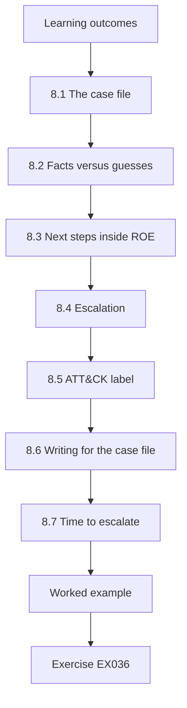

### Logical drawing

```mermaid
flowchart LR
  N0["Learning outcomes"]
  N1["8.1 The case file"]
  N2["8.2 Facts versus guesses"]
  N3["8.3 Next steps inside ROE"]
  N4["8.4 Escalation"]
  N5["8.5 ATT&CK label"]
  N6["8.6 Writing for the case file"]
  N7["8.7 Time to escalate"]
  N0 --> N1 --> N2 --> N3 --> N4 --> N5 --> N6 --> N7 --> Q["EX036"]
```

```text
[Learning outcomes]
    |
    v
[8.1 The case file]
    |
    v
[8.2 Facts versus guesses]
    |
    v
[8.3 Next steps inside ROE]
    |
    v
[8.4 Escalation]
    |
    v
[8.5 ATT&CK label]
    |
    v
[8.6 Writing for the case file]
    |
    v
[8.7 Time to escalate]
    |
    v
[Worked example] --> [Exercise EX036]
```
<!-- cyberabc:lesson-figures:end ch-08 -->


### Learning outcomes

You will (1) analyse a synthetic HCU case file; (2) separate facts from guesses; (3) propose next authorized steps; (4) escalate when needed.

### 8.1 The case file

A synthetic packet holds: ROE excerpt, three validated findings, activity log, and a note that a staff member reused the VPN password on a personal email (reported by the staff member). The packet is labelled ENG-440 and held in the vault, and it holds facts, guesses and actions in labelled lines. The password-reuse note is marked as staff-reported, not as something Leo discovered by touching personal email, which stays out of scope. The report goes to the CISO as a staff-awareness issue, because the reuse concerns accounts outside the engagement.

### 8.2 Facts versus guesses

Fact: password reuse was reported. Guess: an attacker already has the password. Leo labels guesses clearly: his case file says Fact for the report and Guess for any claim that an attacker already has the password. Guesses may drive next steps, but they are never written as confirmed findings. The case note's Guesses line reads none about external abuse yet, which is all the evidence supports. If SOC log review later shows unusual VPN sessions, the guess can move to Fact with the log extract attached.

### 8.3 Next steps inside ROE

Force VPN password reset for that account; check VPN logs for unusual sessions; do not touch personal email (out of scope). Leo requests a VPN password reset for that account and asks the SOC to check logs for unusual sessions. The reset request goes through an IT service desk ticket linked to ENG-440, so the timeline stays in one place. Personal email is out of scope, so he does not contact the provider or request that inbox's logs. The staff member who reported the reuse changes the personal password themselves; HCU never touches that account.

### 8.4 Escalation

Member-data exposure risk and password reuse across personal services go to the CISO the same day. Same-day escalation gives the CISO time to order VPN resets and communications before the risk spreads beyond the staff-reported reuse case; waiting for the weekly finding meeting would be too slow for member-data exposure. The CISO receives the note by phone and email before the end of the working day. Leo escalates with a one-page timeline of facts, guesses labelled as guesses, and the next safe action, not frustration alone.

### 8.5 ATT&CK label

Password reuse enabling VPN access maps to T1078 Valid Accounts for the SOC's detection search. Leo adds T1078 to the case note so the SOC can search with a shared name. The label describes the behaviour; it does not prove an external attacker was involved. The SOC uses the technique name to pull its existing T1078 detections for the VPN rather than writing new ones in a hurry. If the hunt finds nothing, the report says no unusual sessions were seen in the reviewed range, not that the account was never misused.

### 8.6 Writing for the case file

Case notes use timestamps, ticket ids and labels Fact/Guess/Action. Free-form narrative is fine for the summary, but the labelled lines are what the CISO and auditors can scan in a minute during an incident. During the password-reuse incident, each labelled line starts with a timestamp and the ENG-440 ticket id, so the CISO can sort facts, guesses and actions at a glance without reading a long narrative first. Leo still writes a short summary for people who need the story; it runs to three or four sentences and sits above the labelled lines, never in place of them.

### 8.7 Time to escalate

Leo uses a simple rule: if member funds, large-scale personal data or safety systems might be affected, escalate within an hour. Lower-impact items follow the normal finding process. Password reuse that could open the VPN sits under that one-hour rule because member data might follow. The clock starts when Leo reads the staff report, and the CISO call is logged with its time against that start. The low-impact outdated banner on staging goes into the ENG-440 report with app-sec's normal due date, not to the CISO's phone.

### 8.8 SOC collaboration on the case

Leo shares the ATT&CK technique and account id with the SOC so they can hunt, but he does not paste member PII into the ticket. Hunt queries use the VPN account handle and time range from ENG-440. The SOC ticket holds the account handle, the time range and T1078, and nothing that identifies a member: names, national ids and full account numbers stay out of the SOC ticket and out of chat screenshots. Screenshots from the hunt are cropped to the session columns before they enter the vault.

### Worked example (synthetic HCU)

Leo's case note: "Facts: staff report of VPN password reused on personal email; Findings F1–F3 validated. Guesses: none about external abuse yet. Actions: reset, log review, CISO brief. Out of scope: personal email content."

> **Synthetic case — Harborline Credit Union (HCU).** The credit union, Leo Okonkwo and all figures are invented for teaching.

### Errors and limits

Local policies and laws differ; follow HCU's authorization and your jurisdiction. This book never authorizes testing of real systems.

### Exercises

- **EX036 — Fact extract.** List two facts from the case file. *Rubric:* 3 = two clearly factual items; 2 = one; 1 = guess as fact; 0 = none.
- **EX037 — Guess label.** Rewrite "attackers definitely have the password" as a labelled guess. *Rubric:* 3 = labelled uncertainty; 2 = partial; 1 = still certain; 0 = none.
- **EX038 — Out of scope action.** Why not read the staff member's personal email? *Rubric:* 3 = out of scope / no authorization / privacy; 2 = partial; 1 = should read; 0 = none.
- **EX039 — Same-day escalate.** What triggers same-day CISO escalation here? *Rubric:* 3 = credential reuse risk to VPN/member services; 2 = partial; 1 = vague; 0 = none.
- **EX040 — ATT&CK.** Which technique name helps the SOC search detections for this case? *Rubric:* 3 = T1078 Valid Accounts; 2 = name only; 1 = wrong; 0 = none.

### Synthesis

Case work separates facts from guesses, acts only inside scope and escalates real risk the same day.

### Continue studying — chapter 08 of 12

[← Chapter 07 (draft)](#ch-07) · [Course chapter index](../SUBJECTS.md) · [Chapter 09 (draft) →](#ch-09)

<a id="ch-09"></a>

## Chapter 9 — Communication, ethics and reporting

<!-- cyberabc:lesson-figures:start ch-09 -->
### Lesson map

Lesson 09 published. Map, example, EX041.

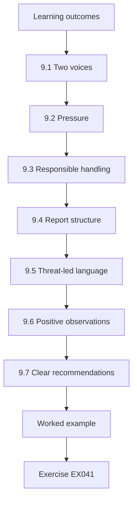

### Logical drawing

```mermaid
flowchart LR
  N0["Learning outcomes"]
  N1["9.1 Two voices"]
  N2["9.2 Pressure"]
  N3["9.3 Responsible handling"]
  N4["9.4 Report structure"]
  N5["9.5 Threat-led language"]
  N6["9.6 Positive observations"]
  N7["9.7 Clear recommendations"]
  N0 --> N1 --> N2 --> N3 --> N4 --> N5 --> N6 --> N7 --> Q["EX041"]
```

```text
[Learning outcomes]
    |
    v
[9.1 Two voices]
    |
    v
[9.2 Pressure]
    |
    v
[9.3 Responsible handling]
    |
    v
[9.4 Report structure]
    |
    v
[9.5 Threat-led language]
    |
    v
[9.6 Positive observations]
    |
    v
[9.7 Clear recommendations]
    |
    v
[Worked example] --> [Exercise EX041]
```
<!-- cyberabc:lesson-figures:end ch-09 -->


### Learning outcomes

You will (1) write for executives and for engineers; (2) handle pressure to hide findings; (3) apply responsible disclosure ethics; (4) structure the HCU report.

### 9.1 Two voices

Executives get risk, affected members, decisions and dates. Engineers get reproduction, evidence and fix guidance. Mixing them produces a report nobody finishes. Leo drafts two paragraphs for the cookie-flag finding that share the same facts. The CISO paragraph covers member-session risk, asks for one decision, the 1 November date for the cookie fix, and names app-sec as owner. The app-sec paragraph gives reproduction steps and the Secure and HttpOnly fix, quoting the staging response header and the Set-Cookie attributes that are missing.

### 9.2 Pressure

Someone may ask to drop a finding before an exam. Leo's answer: findings stay; owners may add a management response. Ethics beat convenience. Requests usually arrive in the weeks before the annual exam, when owners fear an open item on the examiner list. In the worked example the request came from a product manager and concerned the open-redirect finding. Leo kept the finding, told his supervisor the same day and offered to place the manager's remediation plan beside the finding as a management response. The written record of the request goes into the engagement notes, so examiners can see the finding survived pressure; softening facts under pressure destroys trust when examiners ask later.

### 9.3 Responsible handling

Do not publish HCU findings publicly. Do not share with friends. Vendor bugs found in third-party software follow the vendor's disclosure path only with CISO approval. HCU findings stay inside the agreed audience: the report's distribution list names the CISO, the online-banking product owner, app-sec and the network team, and nobody else. Friends and public posts are never an audience. If Leo finds a bug in a vendor product used at HCU, he stops and logs it in the ENG-440 notes with product and version, and asks the CISO before any vendor disclosure path is used.

### 9.4 Report structure

Executive summary; scope and methods; findings by severity; positive observations; retest plan; appendices. Leo's ENG-440 report follows that order so the CISO can read the summary and decisions first, while engineers open the appendices for evidence. The executive summary fits on one page and ends with the decisions the CISO must take this month. Each appendix is referenced by finding number, so an engineer can jump straight to the evidence. Skipping positive observations or the retest plan leaves leaders without balance or a next step.

### 9.5 Threat-led language

If HCU later sponsors a CBEST or TIBER-EU style test, reports also describe scenarios and detection gaps, still without publishing exploit detail. Leo's current reports stay within HCU's web and VPN review. The scope line in the ENG-440 report reads web and VPN configuration review, matching the signed ROE word for word, so examiners reading the method notes do not see a threat-led exercise HCU has not sponsored. Calling ENG-440 threat-led would also imply intelligence work and a white team that HCU never organised. Leo keeps CBEST and TIBER-EU language out of ENG-440 until the CISO funds that programme separately.

### 9.6 Positive observations

Reports should also note what worked: MFA on staff VPN logins, rapid SOC response to the start message, clean staging isolation. Positive observations show balance and tell leaders which investments are paying off; leaders who only see failures cannot tell which investments to keep. Leo limits the VPN observation to ordinary staff logins, because the shared admin password finding shows that the admin path did not yet require a second factor. Each positive observation carries evidence, such as the time the SOC took to acknowledge the start message. Keeping staging isolated is an investment the CISO can defend at budget time because the report shows it held.

### 9.7 Clear recommendations

Each finding's recommendation names a concrete change, an owner role and a suggested date. "Improve security" is not a recommendation; "set Cookie Secure and HttpOnly on the session cookie in the online-banking app by 1 November, owner: app-sec" is. Vague improve-security lines are rewritten before the report leaves the team, and each rewritten line names the owner and the change, so tickets can be opened without a decoding meeting. The ticket opened from the cookie line is T-15, which only became closed-ready once the owner and verification that lab_ticket reported missing were filled.

### 9.8 Review before send

A peer reads the executive summary for blame language, missing decisions and unexplained jargon. That review takes about ten minutes and happens before the summary reaches the CISO. Catching blame language, missing decisions and jargon before send avoids a rewrite the night before an examiner meeting. The peer is someone outside ENG-440, so the summary is read by a person who did not sit through the testing. Comments go into the draft as tracked changes, and Leo resolves each one before the report leaves the team.

### Worked example (synthetic HCU)

A product manager asks Leo to remove the open-redirect finding until after the exam. Leo refuses, offers to include the manager's remediation plan beside the finding, and informs his supervisor.

> **Synthetic case — Harborline Credit Union (HCU).** The credit union, Leo Okonkwo and all figures are invented for teaching.

### Errors and limits

Local policies and laws differ; follow HCU's authorization and your jurisdiction. This book never authorizes testing of real systems.

### Exercises

- **EX041 — Exec sentence.** Write one executive sentence for open redirect on online banking. *Rubric:* 3 = risk to members + decision ask; 2 = partial; 1 = jargon only; 0 = none.
- **EX042 — Engineer detail.** What three technical points do engineers need? *Rubric:* 3 = reproduction, evidence ref, fix guidance; 2 = two; 1 = one; 0 = none.
- **EX043 — Drop request.** How does Leo answer a request to drop a finding? *Rubric:* 3 = refuse; offer management response; tell supervisor; 2 = refuse; 1 = drop it; 0 = none.
- **EX044 — Public blog.** May Leo blog about HCU's findings after the test? *Rubric:* 3 = no; confidential under agreement; 2 = no; 1 = yes anonymised freely; 0 = none.
- **EX045 — Report order.** Order: appendices, executive summary, findings. *Rubric:* 3 = summary, findings, appendices; 2 = partial; 1 = wrong; 0 = none.

### Synthesis

Tell the truth in the right voice; never drop findings under pressure; keep results inside the agreement.

### Continue studying — chapter 09 of 12

[← Chapter 08 (draft)](#ch-08) · [Course chapter index](../SUBJECTS.md) · [Chapter 10 (draft) →](#ch-10)

<a id="ch-10"></a>

## Chapter 10 — Quality and troubleshooting

<!-- cyberabc:lesson-figures:start ch-10 -->
### Lesson map

Lesson 10 published. Map, example, EX046.

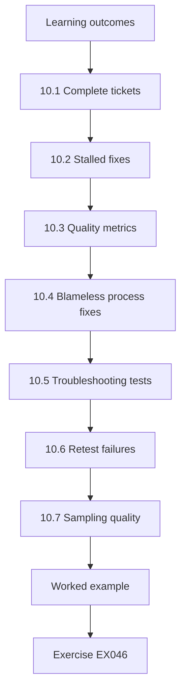

### Logical drawing

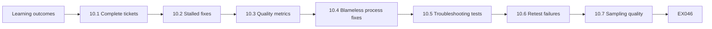

```text
[Learning outcomes]
    |
    v
[10.1 Complete tickets]
    |
    v
[10.2 Stalled fixes]
    |
    v
[10.3 Quality metrics]
    |
    v
[10.4 Blameless process fixes]
    |
    v
[10.5 Troubleshooting tests]
    |
    v
[10.6 Retest failures]
    |
    v
[10.7 Sampling quality]
    |
    v
[Worked example] --> [Exercise EX046]
```
<!-- cyberabc:lesson-figures:end ch-10 -->


### Learning outcomes

You will (1) review tickets for completeness; (2) troubleshoot a stalled remediation; (3) measure engagement quality; (4) fix process gaps without blame.

### 10.1 Complete tickets

Each remediation ticket needs an owner, a due date and a verification note. Incomplete tickets hide risk. lab_ticket marks T-15 incomplete for owner and verified, and T-18 incomplete for due date; Leo does not count those as closed-ready. T-12 and T-21 are the two closed-ready tickets, each with owner, due date and verification filled, so the lab shows two of four tickets closed-ready. Complete tickets are the only ones that hide nothing, which is why a ticket with any blank field stays off the closed-ready count however close its fix appears to be.

### 10.2 Stalled fixes

If a due date passes, Leo checks whether the owner changed, the fix is blocked, or the finding was misunderstood — then escalates with facts. For T-18 the gap is a due date, so Leo agrees one with the network team before anything is escalated. Escalation then carries those facts on a one-page timeline, not frustration alone. A stalled due date without that timeline becomes a mood argument; with it, the CISO can reassign or accept risk in one meeting without decoding mood.

### 10.3 Quality metrics

Useful metrics: percent of findings with owners, median time to retest, count of scope pauses. Vanity metrics (raw finding count) mislead.

```python
"""Lab 10: check synthetic remediation tickets for owner, due date and verification note."""
tickets = [
    {"id": "T-12", "owner": "app-sec", "due": "2026-11-01", "verified": "retest ok"},
    {"id": "T-15", "owner": "", "due": "2026-11-01", "verified": ""},
    {"id": "T-18", "owner": "network", "due": "", "verified": "pending"},
    {"id": "T-21", "owner": "app-sec", "due": "2026-10-20", "verified": "retest ok"},
]
for t in tickets:
    gaps = [k for k in ("owner", "due", "verified") if not t[k]]
    print(f"{t['id']} {'OK' if not gaps else 'INCOMPLETE: ' + ','.join(gaps)}")
print("closed-ready:", sum(1 for t in tickets if t["owner"] and t["due"] and t["verified"] == "retest ok"))
```

Run with `python3 lab_ticket.py`. Verified output:

```text
T-12 OK
T-15 INCOMPLETE: owner,verified
T-18 INCOMPLETE: due
T-21 OK
closed-ready: 2
```

The lab shows two of four tickets closed-ready. Leo reports that hygiene rate, median time to retest and scope-pause counts to the CISO. Raw finding counts without validation are left out of management slides.

Median time to retest runs from the owner's fix-live note to Leo's pass or fail entry on the ticket. Scope-pause counts include the 09:40 hostname question, showing the CISO that pauses happen and are logged.

### 10.4 Blameless process fixes

If two tickets lacked owners, improve the template rather than only criticising people. After two tickets lacked owners, Leo updates the template so owner is required at creation, and the tracker now refuses to save a new ticket until the owner field holds a name. Process fixes stop the same gap from returning next month. Blameless process fixes beat naming individuals; ticket quality at Harborline Credit Union must not depend on heroes remembering to ask, so HCU measures template changes, not who forgot last month.

### 10.5 Troubleshooting tests

When a retest fails unexpectedly, verify you hit the same system and version the owner fixed. Before he marks a retest failed, Leo matches hostnames, ports and build versions to the owner's change note; if they do not match, he schedules a target clarification instead. Hitting the wrong staging slot wastes everyone's time and creates a false fail that poisons trust in the tracker. Troubleshooting a retest starts with target identity, not with blame for the fix author. Each mismatch he finds is noted on the ticket, so the owner and Leo agree on the target before the next retest.

### 10.6 Retest failures

If a retest still finds the issue, Leo files evidence, keeps the ticket open, and asks whether the fix was deployed to the system he tested. Many "failed retests" are version mismatches, not ignored work. Version mismatches are common when owners fix production and Leo still points at an old staging build. Leo's retest note records which build he hit and which build the owner deployed, so any mismatch is visible, and clarifying the target often turns a failed retest into a scheduling fix rather than a blame conversation. When the right build is reached and the issue persists, the ticket stays open with the new evidence attached.

### 10.7 Sampling quality

Once a month Leo samples five closed tickets and checks that evidence of verification exists. Missing evidence reopens the ticket with a note to the owner. The five sampled tickets are picked at random from those closed in the previous month. Sampling catches process drift early; monthly sampling is how Harborline Credit Union notices drift before an examiner does, and closure without verification is rejected in the weekly review. A reopened ticket counts against the closure figures Leo reports to the CISO until fresh retest evidence is attached.

### 10.8 Escalation ladder

Tickets slip first to the owner, then to the owner's manager, then to the CISO with the original due date and the number of nudges. The ladder is written so escalation is not personal, and Leo follows it so a slip is not a personal fight. Each rung has a fixed wait, so the owner's manager hears about a slip only after the owner has had a chance to answer. The CISO sees the original due date and how many nudges already happened, which makes the next decision straightforward. That decision, whether to reassign, extend or accept the risk, is written back onto the ticket.

### Worked example (synthetic HCU)

Leo's ticket check shows T-12 and T-21 closed-ready; T-15 lacks owner and verified; T-18 lacks due. He assigns T-15 to app-sec, sets T-18's due date with network, and updates the ticket template to require those fields.

> **Synthetic case — Harborline Credit Union (HCU).** The credit union, Leo Okonkwo and all figures are invented for teaching.

### Errors and limits

Local policies and laws differ; follow HCU's authorization and your jurisdiction. This book never authorizes testing of real systems.

### Exercises

- **EX046 — Closed-ready count.** What does the lab print for closed-ready? *Rubric:* 3 = closed-ready: 2; 2 = 2; 1 = 4; 0 = none.
- **EX047 — T-15 gaps.** What is wrong with T-15? *Rubric:* 3 = missing owner and verified; 2 = one; 1 = vague; 0 = none.
- **EX048 — Stall questions.** Give two questions Leo asks when a due date slips. *Rubric:* 3 = two of owner change, blocker, misunderstanding, priority; 2 = one; 1 = blame; 0 = none.
- **EX049 — Bad metric.** Why is "number of findings" a weak quality metric? *Rubric:* 3 = encourages noise / punishes thorough scoping; 2 = partial; 1 = it is best; 0 = none.
- **EX050 — Template fix.** What template change prevents the T-15/T-18 gaps? *Rubric:* 3 = require owner, due, verified before ticket can leave triage; 2 = partial; 1 = vague; 0 = none.

### Synthesis

Quality is complete tickets, honest metrics and process fixes when the same gap repeats.

### Continue studying — chapter 10 of 12

[← Chapter 09 (draft)](#ch-09) · [Course chapter index](../SUBJECTS.md) · [Chapter 11 (draft) →](#ch-11)

<a id="ch-11"></a>

## Chapter 11 — Supervised laboratory

<!-- cyberabc:lesson-figures:start ch-11 -->
### Lesson map

Lesson 11 published. Map, example, EX051.

```mermaid
flowchart TD
  N0["Learning outcomes"]
  N1["11.1 Lab brief"]
  N2["11.2 Peer review"]
  N3["11.3 Reflection"]
  N4["11.4 Supervisor gate"]
  N5["11.5 Time box"]
  N6["11.6 Pairing rule"]
  N7["11.7 Lab evidence pack"]
  N0 --> N1 --> N2 --> N3 --> N4 --> N5 --> N6 --> N7
  N7 --> EX["Worked example"]
  EX --> Q["Exercise EX051"]
```

### Logical drawing

```mermaid
flowchart LR
  N0["Learning outcomes"]
  N1["11.1 Lab brief"]
  N2["11.2 Peer review"]
  N3["11.3 Reflection"]
  N4["11.4 Supervisor gate"]
  N5["11.5 Time box"]
  N6["11.6 Pairing rule"]
  N7["11.7 Lab evidence pack"]
  N0 --> N1 --> N2 --> N3 --> N4 --> N5 --> N6 --> N7 --> Q["EX051"]
```

```text
[Learning outcomes]
    |
    v
[11.1 Lab brief]
    |
    v
[11.2 Peer review]
    |
    v
[11.3 Reflection]
    |
    v
[11.4 Supervisor gate]
    |
    v
[11.5 Time box]
    |
    v
[11.6 Pairing rule]
    |
    v
[11.7 Lab evidence pack]
    |
    v
[Worked example] --> [Exercise EX051]
```
<!-- cyberabc:lesson-figures:end ch-11 -->


### Learning outcomes

You will (1) run a supervised lab using only synthetic data and prior labs; (2) produce a mini report; (3) peer-review another learner's scope check; (4) reflect on mistakes.

### 11.1 Lab brief

Using lab_roe, lab_severity and lab_ticket outputs already produced, build a three-part mini report for HCU: authorization readiness, discovery filter result, remediation hygiene. Authorization readiness uses lab_roe; discovery filter uses lab_severity; remediation hygiene uses lab_ticket. Each part of the mini report starts with the lab output pasted verbatim, followed by the decision it supports. The mini report for ENG-CLASS-11 ties the three outputs to HCU decisions — missing emergency_contact, three of five kept at FLOOR 0.6, two of four closed-ready — not to tool praise.

### 11.2 Peer review

Swap scope-check notes with a peer. Score 0–3 on: exclusions present, emergency contact present, methods match ROE. The peer writes a score and a one-line reason for each item, so the supervisor can see why a draft was sent back. A peer score below three on any item means Leo fixes the draft before the supervisor gate. Exclusions, emergency contact and method mapping are the same checks that stop a real window. The emergency contact item matters most, because an empty field stopped Leo's own draft in Chapter 3's worked example.

### 11.3 Reflection

Write three lines: what you nearly did wrong, what caught it, what you will do next time. Each reflection line names the check that caught the mistake, such as lab_roe for the empty contact. Honest near-miss lines — almost starting with empty emergency_contact — teach more than a perfect score with no learning, and Leo's reflection after ENG-CLASS-11 becomes checklist updates for real ROEs. The supervisor reads the three lines before signing, and a reflection that claims no near-miss is sent back, because reflection is scored for learning, not for a perfect run with nothing written down.

### 11.4 Supervisor gate

The supervisor signs only if exclusions and emergency contact are present, the ROE is complete and no out-of-scope target appears. Without that signature, ENG-CLASS-11 stays practice only and does not enter Leo's portfolio as a completed engagement exercise. A signed lab also records the supervisor's name and date, so the portfolio shows who checked the exclusions. The gate exists to enforce exclusions before habits form, because habits formed under time pressure are hard to undo, and it makes them form under the same stop rules as ENG-440.

### 11.5 Time box

The lab runs in one sitting with a hard stop, practising window discipline. When the clock stops, Leo stops typing and vaults what he has. Unfinished parts become notes, not silent extra minutes. A partial mini report vaulted on time scores better than a complete one finished after the stop. The supervisor notes the stop time on the lab record, which makes any extra minutes visible. Window discipline under ENG-CLASS-11 pressure matches the Saturday 12:00 stop on ENG-440, so the habit transfers to real member-facing windows.

### 11.6 Pairing rule

During the supervised lab, one learner drives and one checks the ROE on every step. Roles swap halfway. The checker may halt the driver at any time; halts are scored as good catches, not as failures.

Halting the driver for an unmapped method or a missing exclusion is a success for the pair. Leo learns both roles so he can be either the careful driver or the ROE checker on a real engagement.

The pair records each halt in the operator log with the step, the ROE line it failed and who called it, so the instructor scores catches from the record rather than from memory. Swapping halfway means neither learner spends the whole lab only typing commands or only reading the ROE.

### 11.7 Lab evidence pack

The mini report appendix includes the raw lab outputs (lab_roe, lab_severity, lab_ticket) so the supervisor can recompute the same conclusions. The pack holds the lab_roe output, the lab_severity kept list, the lab_ticket hygiene counts and the vault path for screenshots. Screenshots of chat are optional; reproducible outputs are required, because chat screenshots without the raw outputs do not prove the same work. Supervisors who can recompute kept findings and incomplete tickets trust the mini report, and examiners and supervisors should reconstruct the exercise without asking Leo for folklore.

### 11.8 Cleanup

At lab end, Leo deletes local copies of synthetic evidence from the desktop and confirms the vault holds the only copy. Cleanup is part of the graded checklist: a leftover file on the desktop or leftover tokens in a personal folder fail the lab even if the report is excellent. The vault copy of classroom evidence is then deleted on the diary date that matches the thirty-day rule practised for real ROEs. The habit transfers to ENG-440, where personal copies of evidence are forbidden.

### 11.9 After sign-off

When the supervisor signs, Leo files the mini report under ENG-CLASS-11 and schedules a fifteen-minute debrief with his mentor to turn the reflection lines into checklist updates for the real ROE process. The debrief turns reflection into process change: if Leo nearly skipped an exclusion check, the real ROE checklist gets a stronger prompt. He files the reflection and checklist updates before the next synthetic window. Filing under ENG-CLASS-11 keeps classroom work separate from production tickets. Sign-off without those updates repeats the same near-miss; the portfolio only gains ENG-CLASS-11 when the loop is closed.

### Worked example (synthetic HCU)

Leo's reflection: "Nearly scheduled without emergency contact; checklist caught it; next time I run lab_roe before proposing any window." Supervisor signs his mini report.

> **Synthetic case — Harborline Credit Union (HCU).** The credit union, Leo Okonkwo and all figures are invented for teaching.

### Errors and limits

Local policies and laws differ; follow HCU's authorization and your jurisdiction. This book never authorizes testing of real systems.

### Exercises

- **EX051 — Mini report parts.** Name the three sections of the lab brief. *Rubric:* 3 = authorization readiness, discovery filter, remediation hygiene; 2 = two; 1 = one; 0 = none.
- **EX052 — Peer score item.** Name two peer-review scoring items. *Rubric:* 3 = two of exclusions, emergency contact, methods match; 2 = one; 1 = vague; 0 = none.
- **EX053 — Supervisor refusal.** What missing item makes the supervisor refuse to sign? *Rubric:* 3 = missing exclusions or emergency contact or out-of-scope target present; 2 = partial; 1 = low finding count; 0 = none.
- **EX054 — Reflection quality.** What makes a useful reflection line? *Rubric:* 3 = specific mistake, detector, next behaviour; 2 = partial; 1 = "I did fine"; 0 = none.
- **EX055 — Synthetic only.** Why does this lab forbid live scanning of HCU? *Rubric:* 3 = authorization/classroom limits; synthetic data enough for skills; 2 = partial; 1 = live is fine; 0 = none.

### Synthesis

The supervised lab proves you can refuse incomplete authorizations, filter noise and close the loop — on synthetic data.

### Continue studying — chapter 11 of 12

[← Chapter 10 (draft)](#ch-10) · [Course chapter index](../SUBJECTS.md) · [Chapter 12 (draft) →](#ch-12)

<a id="ch-12"></a>

## Chapter 12 — Practice portfolio and final review

<!-- cyberabc:lesson-figures:start ch-12 -->
### Lesson map

Lesson 12 published. Map, example, EX056.

```mermaid
flowchart TD
  N0["Learning outcomes"]
  N1["12.1 Portfolio contents"]
  N2["12.2 Presentation"]
  N3["12.3 Gaps"]
  N4["12.4 Standing rules"]
  N5["12.5 Handoff"]
  N6["12.6 Portfolio integrity"]
  N7["12.7 Continuing education"]
  N0 --> N1 --> N2 --> N3 --> N4 --> N5 --> N6 --> N7
  N7 --> EX["Worked example"]
  EX --> Q["Exercise EX056"]
```

### Logical drawing

```mermaid
flowchart LR
  N0["Learning outcomes"]
  N1["12.1 Portfolio contents"]
  N2["12.2 Presentation"]
  N3["12.3 Gaps"]
  N4["12.4 Standing rules"]
  N5["12.5 Handoff"]
  N6["12.6 Portfolio integrity"]
  N7["12.7 Continuing education"]
  N0 --> N1 --> N2 --> N3 --> N4 --> N5 --> N6 --> N7 --> Q["EX056"]
```

```text
[Learning outcomes]
    |
    v
[12.1 Portfolio contents]
    |
    v
[12.2 Presentation]
    |
    v
[12.3 Gaps]
    |
    v
[12.4 Standing rules]
    |
    v
[12.5 Handoff]
    |
    v
[12.6 Portfolio integrity]
    |
    v
[12.7 Continuing education]
    |
    v
[Worked example] --> [Exercise EX056]
```
<!-- cyberabc:lesson-figures:end ch-12 -->


### Learning outcomes

You will (1) assemble a portfolio of artifacts from this course; (2) present to a supervisor; (3) identify gaps for the next course; (4) restate standing safety rules.

### 12.1 Portfolio contents

ROE checklist result; scope-check output; filtered finding list; one executive finding paragraph; one engineer finding paragraph; ticket hygiene screenshot; reflection from the supervised lab. Each artefact is one Leo produced in this course, with dates. Alongside them the portfolio holds the scoped plan, validated findings with evidence hashes, the ENG-440-style report and retest notes. Together they show he can scope, filter, write for two audiences, track remediation and reflect — the practitioner outputs from Chapter 1. Synthetic member data only; real identifiers never enter the pack.

### 12.2 Presentation

Ten minutes: context of HCU, how you stayed in scope, top two findings, verification plan, what you will not do alone yet. Presentation to the CISO leads with decisions needed, then method and evidence appendices. Leo practises a ten-minute cut so payday urgency does not force a jargon-heavy dump that buries the cookie-flag owner and due date. His ten minutes end with what he will not do alone yet, such as leading a threat-led scenario. Honesty about limits is part of the presentation, not a footnote.

### 12.3 Gaps

Leo notes he has not yet led a threat-led (CBEST/TIBER-style) scenario or a full WSTG pass — topics for longer courses. Those gaps go on his development plan beside the portfolio. Longer courses and supervised practice close them; claiming them now would misrepresent readiness. HCU's own limits, the AS/400 exclusion and the absence of a threat-led exercise, are written in the portfolio as owned limits, not hidden, so examiners do not invent coverage they will not find in the ROE. Naming gaps shows judgment.

### 12.4 Standing rules

No authorization, no test. No exploit code on real systems. Stop means stop. Evidence stays controlled. Leo prints those four lines on the portfolio cover and on the first page of every engagement folder; they are the standing rules when pressure rises before an exam. The cover also restates the ROE rules Leo will not start without: staging first, no password spraying, stop if member data appears unexpectedly, and delete within 30 days. It carries the emergency contact rule too, because that empty field nearly started Leo's first window, and he still will not start without the emergency_contact field filled.

### 12.5 Handoff

Store the portfolio in HCU's training record so the next supervisor sees evidence, not only a completion tick. A completion tick without artefacts forces the next supervisor to rediscover Leo's strengths and gaps; the training record should open to evidence. Handoff to the next analyst includes the vault path, the status of open tickets T-15 and T-18, and the emergency contact field now filled. Email alone is not handoff and leaves the next analyst guessing, so a walkthrough of the jump environment is scheduled before Leo steps away.

### 12.6 Portfolio integrity

Artifacts in the portfolio must be the ones Leo actually produced in this course, with dates. Replacing them with polished samples from the internet misrepresents skill and is treated as academic dishonesty; downloaded sample reports, however polished, are not evidence of Leo's skill, and examiners who ask him to explain an artefact he did not write will notice. Portfolio integrity also means hashes on evidence files and a changelog when a finding is updated after peer review. Quiet edits after sign-off are refused; the CISO sees the same pack the peer reviewed.

### 12.7 Continuing education

After acceptance, Leo schedules one skill to deepen each month — this quarter, OWASP WSTG session management on staging under authorization — and records it next to the portfolio so progress is visible in reviews. Continuing education for Leo also includes WSTG updates and ATT&CK technique refreshes for T1078, logged beside the portfolio so examiners see currency. Conference talks that would publish HCU-specific paths stay off the continuing-education list on purpose. The monthly skill is chosen from the gaps on his development plan, so a full WSTG pass is built up one area at a time.

### 12.8 Safety restatement on the portfolio cover

The first page of Leo's portfolio states: no real systems were tested in this course; all labs used synthetic data; exploit code was neither used nor requested. Readers who open the portfolio first see that safety boundary: synthetic labs only, no live HCU scanning, no exploit code. That restatement protects Leo and HCU if the file is shared with a new supervisor or examiner. The cover also restates that testing finds what patching, logging and training missed under written permission, and that a clean report still leaves everyday hardening to product and network teams. Safety language is not an appendix; it is the first page.

### Worked example (synthetic HCU)

Leo presents; the supervisor accepts the portfolio with one action: add the emergency-contact near-miss to the team onboarding page. Next course link: AI security (043).

> **Synthetic case — Harborline Credit Union (HCU).** The credit union, Leo Okonkwo and all figures are invented for teaching.

### Errors and limits

Local policies and laws differ; follow HCU's authorization and your jurisdiction. This book never authorizes testing of real systems.

### Exercises

- **EX056 — Portfolio artifacts.** List five portfolio artifacts. *Rubric:* 3 = five from the contents list; 2 = three; 1 = one; 0 = none.
- **EX057 — Presentation must-say.** What must Leo say about scope in the presentation? *Rubric:* 3 = how he stayed in scope / exclusions / pause-to-ask; 2 = partial; 1 = skip it; 0 = none.
- **EX058 — Gap honesty.** Why list gaps in the portfolio? *Rubric:* 3 = shows limits; guides next training; builds trust; 2 = partial; 1 = hide gaps; 0 = none.
- **EX059 — Standing rule.** State the standing rule about exploit code. *Rubric:* 3 = never on real systems / not taught for use outside auth lab policy; 2 = partial; 1 = ok if careful; 0 = none.
- **EX060 — Next course.** What is the next course number and topic? *Rubric:* 3 = 043 AI security; 2 = AI; 1 = wrong; 0 = none.

### Synthesis

A portfolio proves authorized practice; gaps and safety rules travel with you to the next course.

### Continue studying — chapter 12 of 12

[← Chapter 11 (draft)](#ch-11) · [Course chapter index](../SUBJECTS.md) · [Worked results ↓](#worked-results) · [Next course via chapter index →](../SUBJECTS.md)

<a id="worked-results"></a>

## Worked results

Model answers for EX001–EX060. Harborline Credit Union, Leo Okonkwo and all figures are synthetic. Any answer meeting the rubric scores equally.

**EX001.** Architecture, security monitoring and incident response (patching and staff training also count).

**EX002.** Confidentiality; integrity; availability.

**EX003.** A teller account that can view balances but cannot approve wires above a set amount.

**EX004.** Attackers who bypass or abuse an allowed path still face application checks, identity controls and monitoring; one layer failing should not expose everything.

**EX005.** OWASP Web Security Testing Guide — it is organised around web application test cases.

**EX006.** Online banking, staff VPN, email, member website, core banking AS/400.

**EX007.** It is the system of record for balances; testing mistakes could halt branches, so it needs a specialised, carefully controlled engagement if tested at all.

**EX008.** The CISO authorises; the online-banking product owner accepts residual risk for that service.

**EX009.** The time window, source addresses and which methods may look like attacks, so analysts can distinguish authorized testing from a real incident.

**EX010.** No. The card processor is a separate organisation; its systems need its own written authorization.

**EX011.** `MISSING: emergency_contact` — he blocks the kickoff until the CISO provides a contact and the checklist passes.

**EX012.** `complete`

**EX013.** Mask the account number so the finding remains provable without exposing the member's identifier.

**EX014.** No. Evidence stays in the approved repository under the agreement's access rules.

**EX015.** "2026-10-18 09:12 Leo Okonkwo exported VPN config from jump host JUMP-1 under ticket ENG-440; stored in evidence/ENG-440/vpn.txt."

**EX016.** Pre-engagement, vulnerability analysis, exploitation, reporting.

**EX017.** It is discovery until someone confirms it, records evidence and explains impact under the ROE.

**EX018.** It can lock member or staff accounts and disrupt service; it is outside the allowed methods list.

**EX019.** Demonstrate the security effect with the least action needed, then stop — no extra systems or data access.

**EX020.** Allowed under "authenticated web tests" against the in-scope online banking staging system.

**EX021.** Kept 3 of 5; dropped dir-listing and trace-method.

**EX022.** open-redirect (0.9) and cookie-flag (0.85); outdated-banner (0.7) drops.

**EX023.** A scanner reports directory listing, but the staging server returns a login page for that path when checked with an authorized account.

**EX024.** An access-control flaw on a transfer page that no scanner checks because it needs a valid member session and business steps.

**EX025.** "OWASP ZAP 2.15, API scan profile 'HCU-staging-auth', run 2026-10-18 by Leo Okonkwo."

**EX026.** Engagement id, systems in scope, time window and a reachable contact for the tester.

**EX027.** "09:12 staging.examplebank.test — WSTG session timeout check — cookie persisted after logout — evidence E14."

**EX028.** Confirm it is ENG-440, share the ROE window and ticket, and reduce rate or pause if the SOC asks.

**EX029.** Pause testing of that name, ask the product owner or CISO, and continue only after a recorded scope decision.

**EX030.** Stop on time, record the unfinished check, and schedule it only inside a new authorized window.

**EX031.** Allow-list the redirect destinations or remove user-controlled redirects.

**EX032.** Restrict VPN admin interfaces to the jump host network and require MFA while shared passwords are replaced with unique ones.

**EX033.** After the owner states the fix is deployed and within the retest window in the ticket.

**EX034.** No. Verification requires Leo's retest evidence, not only an email.

**EX035.** No. Retest stays on the agreed findings unless a written scope extension says otherwise.

**EX036.** The ROE excludes personal email; a staff member reported reusing the VPN password on personal email.

**EX037.** "Guess (unconfirmed): the password may also be known to others if the personal email was breached; no HCU log evidence yet."

**EX038.** Personal email is outside HCU authorization and privacy boundaries; HCU can reset its own VPN credentials without reading it.

**EX039.** A VPN password exposed outside HCU could let someone reach staff services; that risk needs CISO visibility immediately.

**EX040.** T1078 Valid Accounts.

**EX041.** "Online banking can send members to attacker-controlled sites after login; we ask approval to fix within seven days."

**EX042.** Reproduction steps, evidence reference and concrete fix guidance.

**EX043.** Refuse to remove it, offer to print a management response next to it, and tell his supervisor about the request.

**EX044.** No. Engagement results are confidential under the agreement unless HCU explicitly authorises a public release.

**EX045.** Executive summary, then findings, then appendices.

**EX046.** `closed-ready: 2`

**EX047.** INCOMPLETE: owner,verified

**EX048.** Has the owner changed? What blocker is open? Was the finding misunderstood?

**EX049.** It rewards filing noise and punishes careful validation; severity and closure quality matter more.

**EX050.** Make owner, due date and verification fields mandatory before a ticket leaves triage.

**EX051.** Authorization readiness, discovery filter result and remediation hygiene.

**EX052.** Exclusions present; emergency contact present; methods match the ROE.

**EX053.** Missing exclusions, missing emergency contact, or any out-of-scope target in the plan.

**EX054.** It names a specific near-miss, what caught it and a concrete next-time behaviour.

**EX055.** The classroom authorization covers synthetic exercises only; live scanning needs a separate ROE and would risk real services.

**EX056.** ROE checklist result, scope-check output, filtered findings, executive paragraph, engineer paragraph (tickets and reflection also count).

**EX057.** How he stayed inside the ROE, including exclusions and at least one pause-to-ask example.

**EX058.** Honest limits guide the next course and show the supervisor what not to assign unsupervised yet.

**EX059.** Never use exploit code against real systems; this course does not provide it.

**EX060.** Course 043: AI security.

<a id="references"></a>

## References

Links checked 12 October 2026; re-verify editions before citing.

- Bank of England / PRA. CBEST Threat Intelligence-Led Assessments — Implementation Guide. <https://www.bankofengland.co.uk/financial-stability/operational-resilience-of-the-financial-sector/cbest-threat-intelligence-led-assessments-implementation-guide>
- European Central Bank. TIBER-EU Framework. <https://www.ecb.europa.eu/paym/cyber-resilience/tiber-eu/html/index.en.html>
- FIRST. CVSS v3.1 Specification Document. <https://www.first.org/cvss/v3.1/specification-document>
- MITRE ATT&CK, including T1078 Valid Accounts. <https://attack.mitre.org/>
- NIST SP 800-115 (2008). Technical Guide to Information Security Testing and Assessment. <https://doi.org/10.6028/NIST.SP.800-115>
- OWASP Web Security Testing Guide (WSTG). <https://owasp.org/www-project-web-security-testing-guide/>
- Penetration Testing Execution Standard (PTES). <https://pentest-standard.readthedocs.io/en/latest/>
