# Segurança Ofensiva Autorizada e Red Team: Um Guia para o Profissional

- Idioma: português do Brasil (`pt`); curso profissional, seis meses; aproximadamente 360 horas de estudo planejado. Edição de referência: [inglês](../../en/book/MANUSCRIPT.md).
- Estado editorial: **publicado**. Os capítulos 1–12 de 12 têm texto didático escrito à mão; os exercícios EX001–EX060 têm resoluções correspondentes; os laboratórios offline usam a biblioteca padrão do Python 3, e suas saídas foram incorporadas a partir de execuções reais. A revisão independente e a verificação de 300 páginas A4 continuam em aberto.
- Público: profissionais em início de carreira que entram na equipe de segurança de uma organização.
- Relação com os livros vizinhos: o [livro do curso rápido](../../../../rapid-1-month/offensive-security-red-team/pt/book/MANUSCRIPT.md) é uma introdução em quatro capítulos; o [livro do técnico](../../../../technical-18-months/offensive-security-red-team/pt/book/MANUSCRIPT.md) se aprofunda em ferramentas e verificação. **Este livro é um guia compacto para o profissional.**
- Autor: [hiagokinlevi](https://github.com/hiagokinlevi). Texto original sob [CC0 1.0](../../../../../LICENSE); as obras citadas mantêm seus direitos.
- Limite educacional: não é uma qualificação acreditada. **Não concede autorização para testar sistemas reais.** Todas as organizações, pessoas e números são **sintéticos**, salvo quando uma frase cita uma fonte pública. Os laboratórios ensinam escopo, filtragem, gestão de tickets e relatórios — nunca técnicas transformadas em armas.

[Página do curso](../../README.md) · [Índice de capítulos](../SUBJECTS.md) · [Plano do livro](PLAN.md) · [Skill do curso](../../skill/SKILL.md) · [Resoluções](#worked-results)

## Como usar este rascunho

Os capítulos 1–3 cobrem fundamentos, contexto e autorização; os capítulos 4–7 cobrem métodos, ferramentas, fluxo de trabalho e verificação; os capítulos 8–10 cobrem análise de casos, comunicação e qualidade; os capítulos 11–12 são o laboratório supervisionado e o portfólio. Cada capítulo traz objetivos, ensino, um exemplo resolvido, um caso sintético rotulado, erros e limites, cinco exercícios pontuados de 0 a 3, uma síntese e um bloco **Continue estudando**. Os laboratórios dos capítulos 3, 5 e 10 leem apenas dados locais (`python3 file.py`).

### Caso contínuo sintético

| Elemento | Papel | Limite |
|---|---|---|
| **Harborline Credit Union (HCU)** — internet banking, VPN da equipe, núcleo AS/400 (fora do escopo), camada web de homologação | Organização estudada ao longo do livro | Inventada |
| **Leo Okonkwo** | Profissional júnior de segurança na HCU | Inventado |

### Fontes principais

NIST [SP 800-115](https://doi.org/10.6028/NIST.SP.800-115); [PTES](https://pentest-standard.readthedocs.io/en/latest/); MITRE [ATT&CK](https://attack.mitre.org/); OWASP [WSTG](https://owasp.org/www-project-web-security-testing-guide/); [TIBER-EU](https://www.ecb.europa.eu/paym/cyber-resilience/tiber-eu/html/index.en.html); Bank of England [CBEST](https://www.bankofengland.co.uk/financial-stability/operational-resilience-of-the-financial-sector/cbest-threat-intelligence-led-assessments-implementation-guide). Lista completa em [Referências](#references).

## Sumário

| Capítulos |
|---|
| [1](#ch-01) · [2](#ch-02) · [3](#ch-03) · [4](#ch-04) · [5](#ch-05) · [6](#ch-06) · [7](#ch-07) · [8](#ch-08) · [9](#ch-09) · [10](#ch-10) · [11](#ch-11) · [12](#ch-12) |

[Resoluções](#worked-results) · [Referências](#references)

<a id="ch-01"></a>

## Capítulo 1 — Fundamentos de segurança para profissionais

<!-- cykin:lesson-figures:start ch-01 -->
### Mapa da aula

Aula 01 publicada. Mapa, exemplo, EX001.

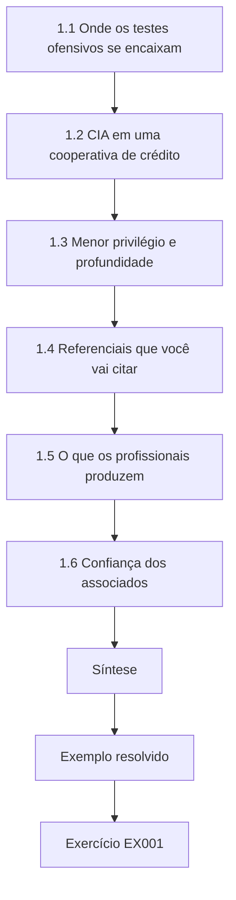

### Desenho lógico

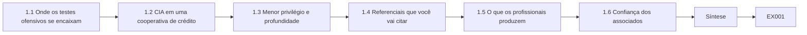

```text
[1.1 Onde os testes ofensivos se encaixam]
    |
    v
[1.2 CIA em uma cooperativa de crédito]
    |
    v
[1.3 Menor privilégio e profundidade]
    |
    v
[1.4 Referenciais que você vai citar]
    |
    v
[1.5 O que os profissionais produzem]
    |
    v
[1.6 Confiança dos associados]
    |
    v
[Síntese]
    |
    v
[Exemplo resolvido] --> [Exercício EX001]
```
<!-- cykin:lesson-figures:end ch-01 -->


### Objetivos de aprendizagem

Você vai (1) situar a segurança ofensiva autorizada entre as outras práticas de segurança; (2) nomear confidencialidade, integridade e disponibilidade com exemplos de uma cooperativa de crédito; (3) explicar o menor privilégio e a defesa em profundidade; (4) listar os referenciais que este curso usa.

### 1.1 Onde os testes ofensivos se encaixam

O trabalho de segurança inclui arquitetura, monitoramento, resposta a incidentes e testes autorizados. Os testes encontram o que as outras práticas deixaram passar, sob permissão por escrito. Eles não substituem a aplicação de patches, o registro de logs nem o treinamento. Na HCU, o escopo do ENG-440 de Leo cobre a homologação do internet banking e a VPN da equipe, e as revisões dele ficam ao lado da aplicação de patches, dos logs e do treinamento, em vez de substituí-los. Quando aparece uma constatação, Leo ainda pergunta se a aplicação de patches ou o monitoramento deveriam tê-la detectado, para que os testes alimentem o endurecimento do dia a dia em vez de competir com ele. Um relatório limpo do ENG-440 continua deixando o trabalho com os atributos Secure e HttpOnly dos cookies para a equipe de segurança de aplicações e as lacunas de MFA para os responsáveis pela VPN.

### 1.2 CIA em uma cooperativa de crédito

A confidencialidade protege os dados das contas dos associados; a integridade protege saldos e instruções de transferência; a disponibilidade mantém o internet banking utilizável. Uma constatação é julgada pelo que ela ameaça, e, quando Leo classifica uma constatação, ele diz qual das três está em jogo. Um cookie de sessão sem Secure e HttpOnly ameaça a confidencialidade das sessões dos associados; uma senha de administrador compartilhada ameaça a integridade das mudanças; um teste que bloqueia contas ameaça a disponibilidade. O mesmo problema técnico pode atingir mais de uma, e o relatório deve dizer isso. O bloqueio de contas é o motivo pelo qual as ROE proíbem o password spraying: uma única execução descuidada no dia do pagamento poderia impedir os associados de acessar seus salários. A constatação sobre os atributos do cookie no ENG-440 é classificada principalmente pela confidencialidade, porque uma sessão roubada expõe a visão da conta de um associado.

### 1.3 Menor privilégio e profundidade

Contas e caminhos de rede devem permitir apenas o necessário. Várias camadas — rede, aplicação, identidade, monitoramento — fazem com que uma única falha não encerre a história. Os testadores procuram lugares onde faltam camadas. Na VPN da equipe, menor privilégio significa que cada administrador tem uma conta nominal em vez de um login compartilhado, e profundidade significa que uma senha roubada ainda enfrenta o MFA e o monitoramento. Leo procura lugares onde falta uma camada, como um caminho administrativo alcançável sem o jump host, porque é ali que uma única falha encerra a história.

### 1.4 Referenciais que você vai citar

NIST SP 800-115 para planejar avaliações; PTES para as etapas do engajamento; OWASP WSTG para verificações web; MITRE ATT&CK para os nomes de técnicas; TIBER-EU e CBEST para testes guiados por ameaças no setor financeiro. Cada referência responde a uma pergunta diferente, por isso Leo cita a que corresponde à decisão que está sendo registrada. Ele abre primeiro o OWASP WSTG para os testes de aplicação web na homologação do internet banking, o PTES para as etapas do engajamento e o NIST SP 800-115 quando planeja que tipo de avaliação a HCU precisa. O ATT&CK fornece nomes de técnicas como T1078 Valid Accounts para o SOC. TIBER-EU e CBEST só importam se a HCU vier a patrocinar um teste guiado por ameaças.

### 1.5 O que os profissionais produzem

Os profissionais produzem planos com escopo definido, constatações validadas, relatórios claros e correções verificadas — não pilhas de ruído de scanner sem confirmação. A primeira semana de Leo entrega um plano com escopo para o internet banking e a VPN, e não um despejo de scanner. Mais adiante, ele vai produzir constatações validadas, um relatório claro para o CISO e para os engenheiros e correções verificadas com evidências de reteste. Essas quatro entregas são o que o CISO e os examinadores conseguem auditar. O ruído de ferramenta sem confirmação fica fora do relatório, para que os responsáveis atuem sobre o que é real; ruído de scanner sem validação desperdiça o tempo de quem corrige e esconde os problemas que importam para os associados.

### 1.6 Confiança dos associados

Os associados confiam à HCU seus salários e economias. Um teste descuidado que bloqueia contas ou vaza um extrato destrói essa confiança mais rápido do que a maioria das constatações técnicas. Todo método que Leo propõe precisa responder: que dano aos associados isto pode causar se der errado, e como evitamos isso? Essa pergunta molda as ROE: homologação primeiro, nada de password spraying, parar se dados de associados aparecerem inesperadamente. Uma transferência de dia de pagamento bloqueada ou um extrato vazado prejudicariam associados que nunca escolheram fazer parte de um teste, por isso a prevenção é escrita nos métodos e nas condições de parada antes que qualquer pacote saia.

### Exemplo resolvido (HCU sintética)

Leo Okonkwo entra na equipe de segurança da HCU. Sua primeira semana é um mapa: o internet banking e a VPN da equipe estão na próxima revisão autorizada; o núcleo bancário AS/400 está fora do escopo. Ele fixa as perguntas de CIA acima da mesa.

> **Caso sintético — Harborline Credit Union (HCU).** A cooperativa de crédito, Leo Okonkwo e todos os números foram inventados para fins didáticos.

### Erros e limites

Políticas e leis locais variam; siga a autorização da HCU e a sua jurisdição. Este livro nunca autoriza testes em sistemas reais.

### Exercícios

- **EX001 — Três práticas.** Cite três práticas de segurança além dos testes autorizados. *Rubrica:* 3 = três entre arquitetura, monitoramento, resposta a incidentes, aplicação de patches, treinamento; 2 = duas; 1 = uma; 0 = nada.
- **EX002 — Associação CIA.** Associe: extratos de associados vazados; valor de transferência alterado; internet banking fora do ar. *Rubrica:* 3 = C, I, A; 2 = dois; 1 = um; 0 = nada.
- **EX003 — Menor privilégio.** Dê um exemplo de menor privilégio em uma cooperativa de crédito. *Rubrica:* 3 = conta/caminho concreto limitado ao necessário; 2 = vago; 1 = errado; 0 = nada.
- **EX004 — Defesa em profundidade.** Por que um único firewall não basta? *Rubrica:* 3 = outras camadas podem falhar de forma independente; aplicação/identidade/monitoramento continuam necessários; 2 = parcial; 1 = ele basta; 0 = nada.
- **EX005 — Escolha de referencial.** Qual fonte Leo abriria primeiro para estruturar um teste de aplicação web? *Rubrica:* 3 = OWASP WSTG; 2 = ATT&CK; 1 = só CBEST; 0 = nada.

### Síntese

Os testes autorizados ficam ao lado das outras práticas; CIA, menor privilégio e referenciais públicos moldam todo engajamento.

### Continue estudando — capítulo 01 de 12

[← Página do curso](../../README.md) · [Índice de capítulos do curso](../SUBJECTS.md) · [Capítulo 02 (rascunho) →](#ch-02)

<a id="ch-02"></a>

## Capítulo 2 — Contexto de serviços e partes interessadas

<!-- cykin:lesson-figures:start ch-02 -->
### Mapa da aula

Aula 02 publicada. Mapa, exemplo, EX006.

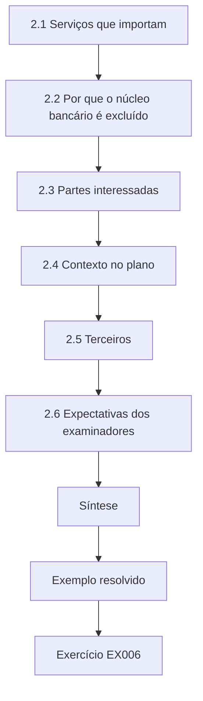

### Desenho lógico

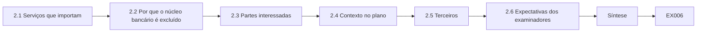

```text
[2.1 Serviços que importam]
    |
    v
[2.2 Por que o núcleo bancário é excluído]
    |
    v
[2.3 Partes interessadas]
    |
    v
[2.4 Contexto no plano]
    |
    v
[2.5 Terceiros]
    |
    v
[2.6 Expectativas dos examinadores]
    |
    v
[Síntese]
    |
    v
[Exemplo resolvido] --> [Exercício EX006]
```
<!-- cykin:lesson-figures:end ch-02 -->


### Objetivos de aprendizagem

Você vai (1) identificar os serviços da HCU e quem é responsável por eles; (2) explicar por que o núcleo bancário costuma ficar fora do escopo; (3) mapear as partes interessadas de um engajamento; (4) escrever um parágrafo de contexto para um plano de teste.

### 2.1 Serviços que importam

A HCU opera internet banking, uma VPN da equipe, e-mail, um site para associados e um núcleo bancário em um AS/400. O internet banking e a VPN são alcançáveis pela internet e mudam com frequência; são alvos iniciais comuns de revisão autorizada, por isso a próxima revisão autorizada de Leo começa por eles. A VPN da equipe tem prioridade alta porque uma senha de administrador compartilhada ali alcançaria sistemas internos, como a constatação posterior do ENG-440 mostrou. O e-mail e o site público também importam, mas mudam com menos frequência e estão mais abaixo no plano atual. O AS/400 está na lista para que todos saibam que ele existe e que é deixado de lado de propósito. Cada serviço da lista traz o nome do seu responsável, para que Leo saiba a quem perguntar antes que qualquer verificação o toque.

### 2.2 Por que o núcleo bancário é excluído

O AS/400 guarda o sistema de registro dos saldos. Uma indisponibilidade acidental pararia as agências. A menos que um trabalho especializado e fortemente controlado seja financiado, ele fica fora do escopo e é protegido por controles compensatórios. Esses controles — isolamento de rede, caminhos administrativos rigidamente limitados e monitoramento — são o que torna a exclusão defensável diante dos examinadores. O plano de Leo os nomeia, com o responsável de cada um, em vez de fingir que o sistema é invisível, para que os examinadores possam fazer perguntas diretamente à equipe de rede. Um trabalho especializado exigiria financiamento próprio, ROE próprias e operadores treinados nessa plataforma; até que seja financiado, o AS/400 aparece no relatório apenas como uma exclusão com seus controles listados.

### 2.3 Partes interessadas

O CISO autoriza; o responsável de produto do internet banking aceita o risco; a equipe de rede abre regras temporárias; o SOC observa o tráfego de teste; o jurídico revisa o contrato. O trabalho de Leo é saber quem decide o quê, por isso, antes do kickoff, ele consegue nomear cada pessoa e o que ela precisa aprovar. Se o responsável de produto não aceitou o risco residual, ou se o SOC não foi avisado da janela, ele não começa. Ele mantém no ticket do ENG-440 um registro de aprovação datado, de uma linha, para cada parte interessada; a regra temporária de firewall da equipe de rede, por exemplo, precisa estar ativa até as 08:00 de sábado, ou a janela é adiada. Saber quem decide o quê evita um teste que está autorizado no papel, mas bloqueado na prática.

### 2.4 Contexto no plano

Um bom plano declara o propósito de negócio (proteger os associados, atender às expectativas dos examinadores), os serviços dentro e fora do escopo e os horários de pico a evitar (por exemplo, a sexta-feira de pagamento). O rascunho de Leo para a HCU declara o propósito (dados dos associados e o exame anual), lista o internet banking e a VPN no escopo, exclui o AS/400, a rede de caixas eletrônicos e a processadora de cartões e evita a janela de processamento em lote da manhã de sábado. A janela de sábado e a exclusão do dia de pagamento ficam ao lado da lista de hosts, para que um revisor veja julgamento sobre horários, e não apenas endereços. Os revisores também podem conferir os horários com a escala do SOC, já que os analistas de plantão naquela manhã de sábado precisam esperar o tráfego de teste.

### 2.5 Terceiros

Processadoras de cartões e e-mail em nuvem são organizações separadas. Testá-las exige a autorização delas, não apenas a da HCU. O plano de Leo lista a processadora de cartões e o e-mail em nuvem como fora do escopo por esse motivo, para que um testador entusiasmado não invente uma permissão que nunca foi concedida. Se a HCU quiser testá-los, o CISO precisa obter autorização por escrito de cada fornecedor e anexá-la às ROE. A assinatura da HCU sozinha nunca cobre os sistemas de outra organização, por mais conveniente que fosse sondar a processadora de cartões na mesma janela de sábado.

### 2.6 Expectativas dos examinadores

As cooperativas de crédito passam por exames de segurança e solidez que perguntam como os sistemas são testados. O parágrafo de contexto de Leo também é evidência para os examinadores: mostra que a HCU escolhe o escopo deliberadamente, exclui sistemas frágeis e agenda os testes em torno da operação, em vez de testar "tudo o que responde a um ping". O parágrafo é arquivado com as ROE, de modo que os examinadores leem o mesmo raciocínio de escopo que o CISO assinou e devem ver que a HCU testou o que pretendia testar. Nomear a exclusão do AS/400 e a fuga da janela de lote é tão útil quanto listar o que estava no escopo, porque mostra julgamento, e não uma checklist de todos os hosts alcançáveis.

### Exemplo resolvido (HCU sintética)

Leo escreve: "Propósito: reduzir o risco aos dados dos associados e autenticar o internet banking antes do exame anual. No escopo: camada web do internet banking e VPN da equipe. Fora do escopo: núcleo AS/400, rede de caixas eletrônicos, processadora de cartões terceirizada. Evitar: janela de processamento em lote da manhã de sábado."

> **Caso sintético — Harborline Credit Union (HCU).** A cooperativa de crédito, Leo Okonkwo e todos os números foram inventados para fins didáticos.

### Erros e limites

Políticas e leis locais variam; siga a autorização da HCU e a sua jurisdição. Este livro nunca autoriza testes em sistemas reais.

### Exercícios

- **EX006 — Cinco serviços.** Liste cinco serviços da HCU citados no capítulo. *Rubrica:* 3 = cinco corretos; 2 = quatro; 1 = dois; 0 = nada.
- **EX007 — Motivo da exclusão do AS/400.** Por que o AS/400 costuma ficar fora do escopo? *Rubrica:* 3 = sistema de registro; uma indisponibilidade para as agências; exige controles especializados; 2 = parcial; 1 = "é antigo"; 0 = nada.
- **EX008 — Quem autoriza.** Quem na HCU autoriza o engajamento? *Rubrica:* 3 = o CISO (com a aceitação do responsável de produto); 2 = o CISO; 1 = Leo; 0 = nada.
- **EX009 — Papel do SOC.** O que o SOC precisa saber antes de o teste começar? *Rubrica:* 3 = janela, IPs de origem, métodos ruidosos esperados; para não tratar o teste às cegas como ataque real; 2 = parcial; 1 = vago; 0 = nada.
- **EX010 — Terceiro.** As ROE da HCU podem, sozinhas, autorizar o teste da processadora de cartões? *Rubrica:* 3 = não; é necessária a autorização da própria processadora; 2 = não; 1 = sim; 0 = nada.

### Síntese

Serviços, responsáveis, exclusões e terceiros entram no plano antes de qualquer método ser escolhido.

### Continue estudando — capítulo 02 de 12

[← Capítulo 01 (rascunho)](#ch-01) · [Índice de capítulos do curso](../SUBJECTS.md) · [Capítulo 03 (rascunho) →](#ch-03)

<a id="ch-03"></a>

## Capítulo 3 — Prática autorizada e tratamento de evidências

<!-- cykin:lesson-figures:start ch-03 -->
### Mapa da aula

Aula 03 publicada. Mapa, exemplo, EX011.

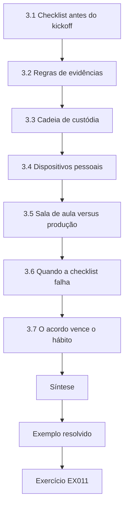

### Desenho lógico

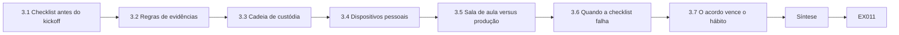

```text
[3.1 Checklist antes do kickoff]
    |
    v
[3.2 Regras de evidências]
    |
    v
[3.3 Cadeia de custódia]
    |
    v
[3.4 Dispositivos pessoais]
    |
    v
[3.5 Sala de aula versus produção]
    |
    v
[3.6 Quando a checklist falha]
    |
    v
[3.7 O acordo vence o hábito]
    |
    v
[Síntese]
    |
    v
[Exemplo resolvido] --> [Exercício EX011]
```
<!-- cykin:lesson-figures:end ch-03 -->


### Objetivos de aprendizagem

Você vai (1) preencher uma checklist de regras de engajamento; (2) explicar a retenção e a anonimização de evidências; (3) recusar trabalho que não tenha contato de emergência; (4) descrever a cadeia de custódia dos dados de teste.

### 3.1 Checklist antes do kickoff

Todo campo obrigatório das regras de engajamento precisa estar preenchido: escopo, exclusões, métodos, janela, contato de emergência, tratamento de dados e público do relatório. Um contato de emergência vazio interrompe o teste.

```python
"""Lab 3: validate a synthetic rules-of-engagement checklist before testing starts."""
required = ["in_scope", "out_of_scope", "allowed_methods", "window", "emergency_contact",
            "data_handling", "report_audience"]
draft = {"in_scope": "192.0.2.0/24 web and VPN", "out_of_scope": "core banking AS/400",
         "allowed_methods": "config review, authenticated web tests", "window": "Sat 08:00-12:00",
         "emergency_contact": "", "data_handling": "delete within 30 days", "report_audience": "CISO"}
missing = [k for k in required if not draft.get(k)]
print("complete" if not missing else "MISSING: " + ", ".join(missing))
for k in required:
    print(f"  {k}: {draft.get(k) or '(empty)'}")
```

Execute com `python3 lab_roe.py`. Saída verificada:

```text
MISSING: emergency_contact
  in_scope: 192.0.2.0/24 web and VPN
  out_of_scope: core banking AS/400
  allowed_methods: config review, authenticated web tests
  window: Sat 08:00-12:00
  emergency_contact: (empty)
  data_handling: delete within 30 days
  report_audience: CISO
```

O laboratório imprime MISSING quando `emergency_contact` está vazio e lista os demais campos, para que Leo veja o que já está preenchido. No rascunho do exemplo, todos os campos estão preenchidos, exceto `emergency_contact`, e é por isso que o laboratório imprime uma única linha MISSING. Ele não vai agendar a janela de sábado, das 08:00 às 12:00, até que o CISO nomeie um contato de plantão. Um campo vazio é uma parada, não um convite para improvisar.

### 3.2 Regras de evidências

Capture apenas o que comprova a constatação. Anonimize os identificadores dos associados. Guarde as evidências no repositório aprovado, com acesso limitado à equipe do engajamento. Apague ou devolva as evidências quando o acordo determinar. Na HCU, isso significa capturas de tela sem nomes de associados nem números de conta, guardadas sob o ticket do engajamento no cofre, e não em chat pessoal; a evidência de que falta um atributo no cookie não precisa do token de sessão de um associado real. O acesso à pasta do ENG-440 é limitado à equipe nomeada no acordo. Quando o acordo diz para apagar em até 30 dias, Leo agenda a exclusão e a confirma, e o registro no cofre mostra a data de exclusão ao lado da pasta, para que um revisor confira que a regra foi cumprida.

### 3.3 Cadeia de custódia

Anote quem coletou cada item, quando e cada transferência. Nos laboratórios de aula, o registro é curto; em exames reais, ele pode ser examinado a fundo. A linha de custódia de Leo no ENG-440 anota quem exportou cada arquivo, de qual jump host e quando ele entrou no cofre. Um registro de custódia de duas linhas basta para o engajamento de aula ENG-CLASS-11, mas ele registra exatamente os campos que Leo vai usar no ENG-440, para que a prática se transfira. Se uma evidência muda de mãos na troca de turno, a linha de transferência nomeia as duas pessoas e o identificador do ticket; a falta de custódia é a forma como arquivos se perdem antes de um exame.

### 3.4 Dispositivos pessoais

Não guarde evidências da HCU em notebooks pessoais nem em aplicativos de chat. Use o ambiente fornecido. A HCU fornece um ambiente de jump restrito para os testes. Uma evidência que sai dele — copiada para um celular, colada no WhatsApp ou salva em um drive pessoal — viola o acordo e pode expor dados de associados. Leo trata o ambiente fornecido como o único lugar onde as evidências podem ficar. Se precisar trabalhar remotamente, ele usa a VPN para entrar nesse ambiente, nunca uma pasta sincronizada que copia arquivos para uma máquina de casa. Se uma cópia chegar a sair, Leo informa o CISO no mesmo dia, em vez de apagá-la discretamente.

### 3.5 Sala de aula versus produção

Estes laboratórios validam checklists em rascunhos sintéticos; eles não substituem a revisão jurídica de ROE reais. Passar no `lab_roe` com um rascunho sintético prova que Leo consegue identificar um contato de emergência ausente; não significa que ROE reais estejam prontas. ROE reais também precisam da assinatura do CISO, da verificação do contrato pelo jurídico e da aprovação de firewall pela equipe de rede, e nada disso o laboratório simula. Leo declara esse limite entre sala de aula e produção em todo relatório de laboratório, para que ninguém trate uma aprovação em aula como autorização de produção.

### 3.6 Quando a checklist falha

Se algum campo obrigatório das ROE estiver vazio na manhã do teste, Leo cancela a janela por escrito e informa o CISO e o SOC. Recomeçar depois de uma correria para preencher campos gera erros; um adiamento limpo custa menos do que uma hora não autorizada. Ele publica o cancelamento no canal do engajamento, com o campo ausente nomeado, e o CISO e o líder do SOC recebem o mesmo cancelamento por escrito, para que ninguém mantenha um plano de sábado desatualizado na agenda nem espere tráfego. Uma nova janela só é marcada depois que a checklist imprime `complete` em ROE completas; o cancelamento por escrito o protege se alguém afirmar mais tarde que os testes ocorreram sem elas.

### 3.7 O acordo vence o hábito

Mesmo que Leo tenha testado o mesmo site de homologação no trimestre passado, ele não reutiliza as ROE do trimestre passado. Sistemas, responsáveis e exclusões mudam. Cada engajamento começa com um acordo assinado e atual, e a checklist é executada contra esse acordo, não contra a memória. As exclusões do trimestre passado podem ter omitido um novo host de homologação que agora é adjacente à produção; executar a checklist contra o acordo assinado atual detecta isso, e o novo host também precisaria de um responsável nomeado na lista de partes interessadas antes que Leo pudesse incluí-lo no escopo. Ele data cada execução da checklist e guarda a saída com as novas ROE no cofre, para que a verificação possa ser mostrada depois. Hábito não é autorização.

### Exemplo resolvido (HCU sintética)

Leo executa a checklist no rascunho das ROE. Ela imprime MISSING: emergency_contact. Ele não vai agendar a janela de sábado até que o CISO nomeie um contato de plantão e o campo seja preenchido.

> **Caso sintético — Harborline Credit Union (HCU).** A cooperativa de crédito, Leo Okonkwo e todos os números foram inventados para fins didáticos.

### Erros e limites

Políticas e leis locais variam; siga a autorização da HCU e a sua jurisdição. Este livro nunca autoriza testes em sistemas reais.

### Exercícios

- **EX011 — Campo ausente.** O que o laboratório imprime como linha de status, e o que Leo precisa fazer? *Rubrica:* 3 = MISSING: emergency_contact; não começar até preencher; 2 = só "ausente"; 1 = começar mesmo assim; 0 = nada.
- **EX012 — Contato preenchido.** Se `emergency_contact` passar a ser "SOC on-call +1-555-0100", qual é a linha de status? *Rubrica:* 3 = complete; 2 = ok; 1 = continua ausente; 0 = nada.
- **EX013 — Anonimização.** Uma captura de tela mostra o número completo da conta de um associado. O que fazer antes de arquivá-la? *Rubrica:* 3 = anonimizar/mascarar; manter só os dígitos necessários para provar o problema; 2 = parcial; 1 = arquivar como está; 0 = nada.
- **EX014 — Chat pessoal.** Leo pode colar evidências em um chat privado de WhatsApp com um colega? *Rubrica:* 3 = não; usar apenas o repositório aprovado; 2 = não; 1 = sim, se for privado; 0 = nada.
- **EX015 — Nota de custódia.** Escreva uma entrada de custódia de uma linha para uma exportação de configuração. *Rubrica:* 3 = quem, o quê, quando, de onde; 2 = dois campos; 1 = vago; 0 = nada.

### Síntese

Sem contato de emergência, não há teste; as evidências são minimizadas, retidas conforme o acordo e nunca deixadas em dispositivos pessoais.

### Continue estudando — capítulo 03 de 12

[← Capítulo 02 (rascunho)](#ch-02) · [Índice de capítulos do curso](../SUBJECTS.md) · [Capítulo 04 (rascunho) →](#ch-04)

<a id="ch-04"></a>

## Capítulo 4 — Métodos centrais

<!-- cykin:lesson-figures:start ch-04 -->
### Mapa da aula

Aula 04 publicada. Mapa, exemplo, EX016.

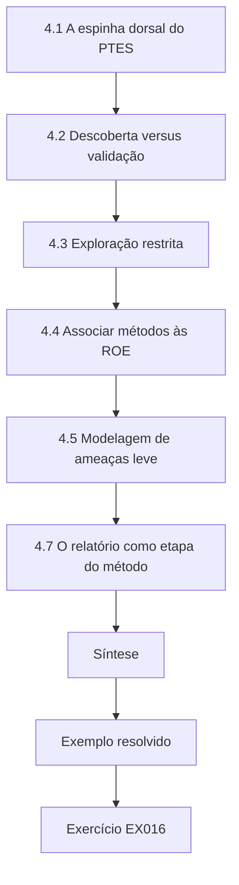

### Desenho lógico

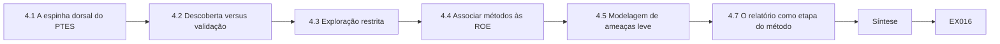

```text
[4.1 A espinha dorsal do PTES]
    |
    v
[4.2 Descoberta versus validação]
    |
    v
[4.3 Exploração restrita]
    |
    v
[4.4 Associar métodos às ROE]
    |
    v
[4.5 Modelagem de ameaças leve]
    |
    v
[4.7 O relatório como etapa do método]
    |
    v
[Síntese]
    |
    v
[Exemplo resolvido] --> [Exercício EX016]
```
<!-- cykin:lesson-figures:end ch-04 -->


### Objetivos de aprendizagem

Você vai (1) descrever as etapas do PTES em ordem; (2) separar descoberta de validação; (3) explicar por que a exploração é opcional e restrita; (4) escolher métodos compatíveis com as ROE da HCU.

### 4.1 A espinha dorsal do PTES

As etapas do PTES dão uma ordem comum: pré-engajamento (definição de escopo), coleta de inteligência, modelagem de ameaças, análise de vulnerabilidades, exploração, pós-exploração e relatório. As ROE atuais da HCU permitem análise e testes web autenticados, não exploração ampla. Por isso, a tabela de métodos de Leo para na coleta de inteligência, na análise de vulnerabilidades e nos testes web autenticados na homologação, e marca cada etapa do PTES como permitida, não permitida ou fora do escopo, para que o CISO veja onde o ENG-440 termina. Exploração e pós-exploração ficam fora do plano até que as ROE sejam reescritas e assinadas de novo; avançar porque uma ferramenta facilitou quebraria a confiança do SOC. Usar os nomes do PTES ajuda o CISO e as empresas externas a compartilhar um único vocabulário.

### 4.2 Descoberta versus validação

A descoberta lista problemas possíveis; a validação os confirma com evidências dentro das regras. A saída de uma ferramenta, sozinha, é descoberta. Uma configuração incorreta confirmada, com captura de tela e impacto de negócio, é uma constatação. Um outdated-banner com confiança 0.7 é descoberta até que Leo confirme a versão, a exposição e o impacto com evidências; ele compara o banner com o boletim do fornecedor para aquela versão antes de decidir se aquilo chega a ser uma constatação. Só então ele vira uma constatação, com severidade e recomendação. No laboratório do capítulo 5, um FLOOR de 0.6 mantém open-redirect em 0.9, outdated-banner em 0.7 e cookie-flag em 0.85, mas, sem evidência e sem declaração de impacto, um item continua fora da lista de constatações.

### 4.3 Exploração restrita

Se as ROE vierem a permitir a demonstração de uma falha, use o menor passo que mostre o impacto, em contas acordadas, com parada se algo inesperado acontecer. Este curso continua sem ensinar desenvolvimento de exploits. Se a HCU vier a permitir uma prova de impacto, Leo usa uma conta de teste acordada que contém apenas dados sintéticos, para que uma prova nunca mostre o saldo de um associado real. Ele dá o menor passo que mostra o problema e não inventa passos além das ROE. Um bloqueio de conta, um vazamento de dados ou um host que não seja de homologação provoca parada imediata e uma ligação para o contato de emergência.

### 4.4 Associar métodos às ROE

O plano de Leo associa cada método a uma linha das ROE. O que não estiver associado fica de fora. As verificações autenticadas do WSTG na homologação correspondem aos métodos permitidos e aos sistemas no escopo. O password spraying não tem linha, então fica de fora; ele também correria o risco de bloquear contas reais de associados na semana do pagamento, o que é um dos motivos pelos quais as ROE o omitem. As sondagens ao AS/400 têm uma linha de exclusão, então ficam de fora. Cada linha da tabela de métodos de Leo traz a cláusula das ROE em que se apoia, para que um revisor confira a associação linha por linha. Métodos não associados não ganham uma execução de teste; eles esperam uma atualização por escrito das ROE, e o ENG-440 não ganha pontos extras por criatividade fora da tabela.

### 4.5 Modelagem de ameaças leve

Mesmo sem um cenário completo de red team, nomeie os atores prováveis (senha de associado roubada, phishing contra a equipe), para que as verificações se concentrem no que importa para a HCU. No internet banking, esses são os atores que Leo nomeia. Esse foco direciona as verificações para o tratamento de sessões, a política de senhas e o MFA da VPN, em vez de peculiaridades obscuras de protocolo que nenhum ator provável usaria contra a HCU. O uso indevido por pessoas internas e os ataques ao AS/400 ficam fora deste modelo leve porque o ENG-440 não pode testá-los. Nomear essas exclusões no modelo permite que o relatório explique por que uma verificação estava ou não no escopo quando os examinadores perguntarem.

### 4.6 Limites da coleta de inteligência

O OSINT sobre a HCU fica restrito a páginas públicas e documentos publicados. Raspar fóruns de associados, comprar dados vazados ou se passar por funcionários está fora, a menos que as ROE permitam explicitamente um cenário de engenharia social — o que as ROE atuais da HCU não fazem. A coleta de Leo se limita ao site público da HCU e aos documentos publicados que qualquer pessoa consegue abrir sem entrar no internet banking. Comprar dados vazados ou raspar fóruns de associados reuniria inteligência fora das ROE e poderia expor pessoas reais. Ele não faz coleta em ritmos que pareçam abuso e registra o que coletou. Se algum dia for necessário um cenário de engenharia social, ele terá sua própria aprovação por escrito.

### 4.7 O relatório como etapa do método

O PTES termina com o relatório porque constatações que nunca chegam aos responsáveis não mudam nada. Leo reserva tempo para a redação e a revisão dentro da janela do engajamento, em vez de tratar o relatório como hora extra não paga depois dos testes. No ENG-440, ele bloqueia a última parte da janela de sábado para redação e revisão por pares, e os testes que avançam sobre esse tempo reservado são interrompidos, em vez de espremer a revisão. Se a redação passar do tempo, a validação inacabada vira uma lacuna explícita no relatório, e não uma alegação silenciosa de cobertura total. Constatações que ficam só nas anotações dele até segunda-feira não ajudam ninguém antes do exame; o relatório é uma etapa do método com relógio, não um detalhe posterior.

### Exemplo resolvido (HCU sintética)

A tabela de métodos de Leo: OSINT em páginas públicas da HCU (permitido); verificações autenticadas do WSTG na homologação do internet banking (permitido); password spraying (proibido); sondagens ao AS/400 (fora do escopo).

> **Caso sintético — Harborline Credit Union (HCU).** A cooperativa de crédito, Leo Okonkwo e todos os números foram inventados para fins didáticos.

### Erros e limites

Políticas e leis locais variam; siga a autorização da HCU e a sua jurisdição. Este livro nunca autoriza testes em sistemas reais.

### Exercícios

- **EX016 — Ordem das etapas.** Coloque em ordem: relatório, análise de vulnerabilidades, pré-engajamento, exploração. *Rubrica:* 3 = pré-engajamento, análise de vulnerabilidades, exploração, relatório; 2 = quase toda; 1 = aleatória; 0 = nada.
- **EX017 — Descoberta ou constatação.** A ferramenta relata outdated-banner com confiança 0.7. Isso já é uma constatação? *Rubrica:* 3 = descoberta até ser validada com evidências e impacto; 2 = parcial; 1 = já é constatação; 0 = nada.
- **EX018 — Por que o spraying é proibido.** Por que a HCU proíbe o password spraying? *Rubrica:* 3 = bloqueios/dano aos associados/ruído; não está entre os métodos permitidos; 2 = parcial; 1 = "é lento"; 0 = nada.
- **EX019 — Prova mínima.** O que significa "menor passo que mostra o impacto"? *Rubrica:* 3 = parar assim que o impacto for mostrado; sem pivotamento extra; 2 = parcial; 1 = sempre tomar o domínio inteiro; 0 = nada.
- **EX020 — Associar um método.** Associe "verificações autenticadas do WSTG na homologação" à linguagem das ROE. *Rubrica:* 3 = cita allowed_methods e in_scope da homologação; 2 = parcial; 1 = não associado; 0 = nada.

### Síntese

Os métodos seguem a ordem do PTES e as ROE; a descoberta só vira constatação depois de evidências validadas.

### Continue estudando — capítulo 04 de 12

[← Capítulo 03 (rascunho)](#ch-03) · [Índice de capítulos do curso](../SUBJECTS.md) · [Capítulo 05 (rascunho) →](#ch-05)

<a id="ch-05"></a>

## Capítulo 5 — Ferramentas e interpretação

<!-- cykin:lesson-figures:start ch-05 -->
### Mapa da aula

Aula 05 publicada. Mapa, exemplo, EX021.

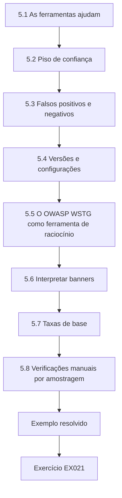

### Desenho lógico

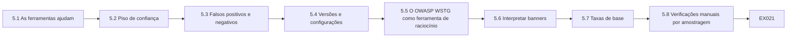

```text
[5.1 As ferramentas ajudam]
    |
    v
[5.2 Piso de confiança]
    |
    v
[5.3 Falsos positivos e negativos]
    |
    v
[5.4 Versões e configurações]
    |
    v
[5.5 O OWASP WSTG como ferramenta de raciocínio]
    |
    v
[5.6 Interpretar banners]
    |
    v
[5.7 Taxas de base]
    |
    v
[5.8 Verificações manuais por amostragem]
    |
    v
[Exemplo resolvido] --> [Exercício EX021]
```
<!-- cykin:lesson-figures:end ch-05 -->


### Objetivos de aprendizagem

Você vai (1) tratar scanners como assistentes, e não como juízes; (2) filtrar constatações por confiança e confirmação; (3) explicar falsos positivos e falsos negativos; (4) registrar as versões das ferramentas nas evidências.

### 5.1 As ferramentas ajudam

Scanners e checklists aceleram a descoberta. Eles rotulam errado, perdem o contexto e não conseguem julgar o impacto de negócio. Leo lê todo item mantido: quando o `lab_severity` mantém três de cinco itens, ele ainda abre cada item mantido e pergunta se a HCU deveria agir. Itens que ele não consegue explicar em palavras simples quanto ao impacto sobre os associados voltam para mais validação ou são descartados. Os dois itens descartados, dir-listing e trace-method, são anotados no apêndice de método, para que ninguém se pergunte se foram ignorados. Os scanners ajudam na descoberta; eles não julgam o impacto sobre os associados nem escrevem a recomendação.

### 5.2 Piso de confiança

A HCU descarta itens não confirmados abaixo de um piso de confiança, para que o relatório não seja inflado com ruído.

```python
"""Lab 5: filter a synthetic tool finding list, dropping noise below a confidence floor."""
findings = [("open-redirect", 0.9, True), ("dir-listing", 0.4, False),
            ("outdated-banner", 0.7, True), ("cookie-flag", 0.85, True), ("trace-method", 0.3, False)]
FLOOR = 0.6
kept = [(n, c) for n, c, confirmed in findings if c >= FLOOR and confirmed]
for n, c in kept:
    print(f"KEEP {n:16} confidence={c}")
print(f"kept {len(kept)} of {len(findings)}; dropped {len(findings)-len(kept)}")
```

Execute com `python3 lab_severity.py`. Saída verificada:

```text
KEEP open-redirect    confidence=0.9
KEEP outdated-banner  confidence=0.7
KEEP cookie-flag      confidence=0.85
kept 3 of 5; dropped 2
```

Com FLOOR em 0.6, o laboratório mantém open-redirect (0.9), outdated-banner (0.7) e cookie-flag (0.85) e descarta o resto. Dir-listing e trace-method ficam abaixo de 0.6, por isso permanecem no apêndice de saída bruta, e não na lista de constatações, e itens não confirmados abaixo do piso nunca aparecem nos slides executivos. Subir o piso para 0.8 descartaria também o banner. Leo declara o piso nas notas de método, para que os leitores saibam o que foi filtrado.

### 5.3 Falsos positivos e negativos

Um falso positivo desperdiça o tempo de quem corrige; um falso negativo deixa o risco. A amostragem e a validação manual reduzem os dois; nenhum chega a zero. Leo planeja o tempo de validação a partir das taxas históricas de falsos positivos e aceita que algum risco ainda possa escapar. Se os falsos positivos da última revisão se concentraram em uma verificação do scanner, essa verificação ganha tempo extra de validação no ENG-440. Na dúvida, ele valida mais em vez de entregar uma lista maior. Ele diz ao CISO que o relatório contém itens validados, e não que todos os problemas possíveis foram encontrados.

### 5.4 Versões e configurações

Registre o nome da ferramenta, a versão e o perfil junto com as evidências, para que um reteste possa usar a mesma configuração. As evidências de Leo para a constatação do cookie-flag nomeiam o scanner, sua versão e o perfil usado, e o nome do perfil fica registrado no ticket T-15, para que o reteste depois da correção da equipe de segurança de aplicações repita a mesma verificação com as mesmas configurações de varredura. Sem versões, um reteste que falha não consegue dizer se a correção falhou ou se a configuração mudou. Configurações que mudam no meio do engajamento são registradas com o horário da mudança, para que as evidências continuem dizendo qual configuração produziu cada resultado.

### 5.5 O OWASP WSTG como ferramenta de raciocínio

Mesmo sem scanner, o WSTG oferece uma lista estruturada de verificações web, para que a cobertura fique visível. Leo usa uma checklist derivada do WSTG para a homologação do internet banking, para mostrar quais verificações foram executadas e quais estavam fora do escopo. As linhas são marcadas como executada, não executada ou fora do escopo, e cada linha executada aponta para seu arquivo de evidência no cofre. A cobertura que existe só na cabeça dele não pode ser revisada nem retestada. Linhas vazias na checklist são lacunas honestas; inventar cobertura não ajuda ninguém quando os examinadores perguntam o que foi realmente testado.

### 5.6 Interpretar banners

Um banner desatualizado é uma pista, não uma crise. Leo verifica se o serviço está exposto à internet, se a versão é realmente vulnerável e se um WAF ou uma regra de acesso já limita a exposição antes de escrever uma constatação de severidade alta. Na camada de homologação da HCU, um banner desatualizado atrás de regras de acesso pode ter baixa prioridade; o mesmo banner em uma porta administrativa exposta à internet não teria. Para o banner do ENG-440, Leo registra que a homologação fica atrás de regras de acesso, e é por isso que ele não é classificado como alto. Ele escreve esse raciocínio na constatação, para que a severidade não seja um rótulo misterioso desligado do impacto sobre os associados; o contexto transforma uma pista em uma constatação proporcional.

### 5.7 Taxas de base

Se um scanner marca quarenta itens e o histórico mostra que trinta foram falsos positivos, Leo planeja o tempo de validação de acordo: quarenta itens brutos com esse histórico sugerem cerca de dez constatações reais. As taxas de base protegem o cronograma. Ele não promete ao CISO "quarenta constatações" antes da validação, porque isso cria a expectativa errada e pressiona a equipe a manter ruído. O tempo de validação faz parte do orçamento do engajamento, não é hora extra opcional, e Leo promete um conjunto validado com um prazo definido para a confirmação.

### 5.8 Verificações manuais por amostragem

A cada cinco itens automatizados mantidos, Leo valida manualmente, de ponta a ponta e com uma conta autorizada, pelo menos o de maior severidade. As verificações por amostragem detectam erros sistemáticos das ferramentas que uma pontuação de confiança não detecta, porque esses erros aparecem quando um humano repete o caminho. No ENG-440, o `lab_severity` mantém três itens e open-redirect, em 0.9, é o mais alto, por isso Leo percorre esse caminho primeiro, com uma conta autorizada, antes de o relatório ser redigido. Se o percurso do open-redirect falhar, os outros itens mantidos passam pelo mesmo caminho humano antes da redação do relatório.

### Exemplo resolvido (HCU sintética)

Leo filtra a lista sintética: open-redirect, outdated-banner e cookie-flag são mantidos; dir-listing e trace-method são descartados. Ele ainda valida manualmente os três itens mantidos antes que entrem no relatório.

> **Caso sintético — Harborline Credit Union (HCU).** A cooperativa de crédito, Leo Okonkwo e todos os números foram inventados para fins didáticos.

### Erros e limites

Políticas e leis locais variam; siga a autorização da HCU e a sua jurisdição. Este livro nunca autoriza testes em sistemas reais.

### Exercícios

- **EX021 — Contagem do laboratório.** Quantas constatações o laboratório mantém, e quais são descartadas? *Rubrica:* 3 = 3 mantidas; dir-listing e trace-method descartadas; 2 = só a contagem; 1 = errado; 0 = nada.
- **EX022 — Subir o piso.** Se FLOOR passar a 0.8, quais itens permanecem? *Rubrica:* 3 = só open-redirect e cookie-flag; 2 = um; 1 = os três; 0 = nada.
- **EX023 — Falso positivo.** Dê um exemplo de falso positivo na HCU. *Rubrica:* 3 = o scanner aponta um problema que a configuração da homologação mostra estar mitigado; 2 = parcial; 1 = vago; 0 = nada.
- **EX024 — Falso negativo.** Dê um exemplo de falso negativo na HCU. *Rubrica:* 3 = o problema existe, mas a ferramenta não o detecta (por exemplo, falha na lógica de autenticação); 2 = parcial; 1 = vago; 0 = nada.
- **EX025 — Nota de versão.** Escreva a linha sobre a ferramenta que Leo acrescenta às evidências. *Rubrica:* 3 = nome, versão, perfil/configurações; 2 = só o nome; 1 = vago; 0 = nada.

### Síntese

As ferramentas propõem; as pessoas decidem — filtrar, validar, registrar versões e só então relatar.

### Continue estudando — capítulo 05 de 12

[← Capítulo 04 (rascunho)](#ch-04) · [Índice de capítulos do curso](../SUBJECTS.md) · [Capítulo 06 (rascunho) →](#ch-06)

<a id="ch-06"></a>

## Capítulo 6 — Fluxo de trabalho operacional

<!-- cykin:lesson-figures:start ch-06 -->
### Mapa da aula

Aula 06 publicada. Mapa, exemplo, EX026.

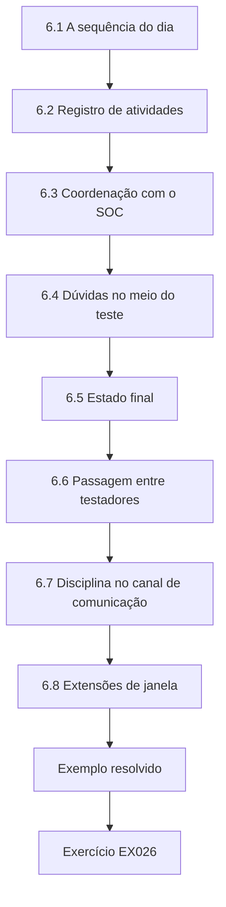

### Desenho lógico

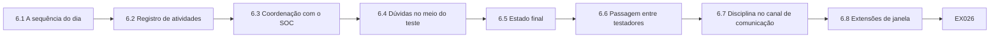

```text
[6.1 A sequência do dia]
    |
    v
[6.2 Registro de atividades]
    |
    v
[6.3 Coordenação com o SOC]
    |
    v
[6.4 Dúvidas no meio do teste]
    |
    v
[6.5 Estado final]
    |
    v
[6.6 Passagem entre testadores]
    |
    v
[6.7 Disciplina no canal de comunicação]
    |
    v
[6.8 Extensões de janela]
    |
    v
[Exemplo resolvido] --> [Exercício EX026]
```
<!-- cykin:lesson-figures:end ch-06 -->


### Objetivos de aprendizagem

Você vai (1) descrever o fluxo de trabalho do dia do teste, do kickoff ao debrief; (2) manter um registro de atividades contemporâneo; (3) coordenar com o SOC; (4) lidar com uma dúvida de escopo no meio do teste.

### 6.1 A sequência do dia

A chamada de kickoff confirma as ROE e os contatos; os testadores começam apenas dentro da janela; as notas de progresso vão para o canal do engajamento; há uma verificação intermediária com o responsável de produto se algo sensível aparecer; há um debrief no fim do dia; as evidências vão para o cofre. No ENG-440, a sequência de sábado de Leo segue essa ordem. Nada começa antes que o kickoff confirme que as ROE ainda correspondem à cópia assinada, e as evidências vão para o cofre antes de ele ir embora. Desvios da sequência são registrados com um motivo, para que uma revisão posterior veja por quê.

### 6.2 Registro de atividades

Toda ação recebe horário, sistema, método e resultado. O registro defende a equipe se uma indisponibilidade for atribuída aos testes e alimenta o relatório. A linha de registro de Leo inclui horário, host, método e resultado, como uma pausa quando um nome de host parecia ser de produção. Cada linha usa o relógio do jump host, para que as entradas do registro e os alertas do SOC possam ser alinhados depois, sem adivinhar diferenças de horário. Os registros ficam no cofre com as evidências, e não apenas em um histórico de chat que vai rolando para longe. Se o tráfego do dia de pagamento ficar lento, é o registro que mostra se os testes estavam envolvidos.

### 6.3 Coordenação com o SOC

Envie mensagens de início e de fim. Se o SOC vir alertas relacionados, ele liga para o contato de emergência, em vez de bloquear o acesso de Leo sem aviso. A mensagem de início de Leo no ENG-440 sai às 08:05, menciona apenas a homologação e traz o identificador do ticket, o IP de origem e o horário de término, 12:00. Se o SOC ligar por causa do IP dele, ele confirma o ticket, compartilha a janela e reduz o ritmo ou pausa se pedirem; qualquer mudança de ritmo é escrita no registro de atividades com o horário e o nome do analista. Às 12:00, Leo publica o fim no canal do engajamento, com o identificador do ticket, para que o SOC retire o IP dele da lista de observação. Testar em silêncio diante de um SOC atento cria incidentes evitáveis.

### 6.4 Dúvidas no meio do teste

Descobriu um novo nome de host? Pause e pergunte. Não "inclua só desta vez". Às 09:40, Leo encontra um nome de host que pode ser de produção; ele pausa, pergunta ao responsável de produto, descobre que é de homologação, registra a decisão e continua. A resposta do responsável de produto confirmando que o host pertence à homologação é colada no ticket antes de os testes recomeçarem, para que o ENG-440 mostre julgamento sob pressão de tempo, e não um palpite de sorte. A pergunta custa minutos; uma sondagem não autorizada em um host com cara de produção custaria o engajamento. Adivinhar teria sido sair do escopo.

### 6.5 Estado final

Na hora de parar, pare. Verificações inacabadas viram trabalho para a próxima janela ou notas explícitas de falta de tempo — não extrapolações silenciosas. Às 12:00, Leo para, mesmo que uma verificação do WSTG esteja pela metade. A verificação inacabada é listada no relatório com a etapa a que chegou, para que a próxima janela comece dali. O SOC espera silêncio depois da mensagem de fim das 12:00, então qualquer pacote posterior vindo do IP de Leo pareceria um ataque. Extrapolações silenciosas quebram o acordo em que o SOC e o CISO confiaram, e a parada das 12:00 no ENG-440 é a mesma regra que ele pratica no ENG-CLASS-11.

### 6.6 Passagem entre testadores

Se Leo encerra o turno e um colega continua, o registro de atividades e o cofre de evidências são a passagem de bastão. Notas verbais não bastam; o colega precisa ver o que já foi validado, para não retestar de forma destrutiva nem perder uma condição de parada. O colega que abre o cofre deve ver as constatações validadas, as dúvidas em aberto e as condições de parada já atingidas. As notas de passagem nomeiam a próxima ação segura e o que não pode ser repetido, como uma pausa que Leo já acordou. Quando um colega assume no meio da janela, a nota mais o caminho no cofre bastam; Leo não deixa contexto crítico apenas na própria cabeça.

### 6.7 Disciplina no canal de comunicação

O chat do engajamento serve para escopo, paradas e status — não para piadas sobre "hackear o banco". A linguagem casual vaza para capturas de tela e prejudica a confiança se um examinador ler o canal mais tarde. Leo escreve o status em palavras simples e profissionais, com identificadores de ticket, porque capturas de tela do canal podem aparecer nas evidências ou na revisão dos examinadores. As capturas de tela do ENG-440 são limpas de bagunça da área de trabalho e de abas sem relação antes de entrarem no cofre sob o identificador do ticket. A comunicação fica no canal do engajamento; o chat pessoal não é repositório de evidências do ENG-440.

### 6.8 Extensões de janela

Se o trabalho precisar continuar além da janela, Leo para, pede uma extensão por escrito ao CISO e espera a confirmação antes que qualquer outro pacote saia do notebook dele. Um "claro, pode continuar" verbal não basta, nem mesmo vindo do CISO ao telefone. Uma extensão por escrito nomeia o novo horário de término e é arquivada com as ROE antes de o trabalho recomeçar. Se o sábado se estender, o notebook de Leo não envia mais nenhum pacote até que essa extensão exista, porque o SOC e o contato de emergência precisam ver o mesmo relógio que Leo usa.

### Exemplo resolvido (HCU sintética)

Às 08:05, Leo publica "ENG-440 start — staging only" (início do ENG-440, apenas homologação). Às 09:40, ele encontra um nome de host que pode ser de produção; pausa, pergunta ao responsável de produto, descobre que é de homologação, registra a decisão e continua.

> **Caso sintético — Harborline Credit Union (HCU).** A cooperativa de crédito, Leo Okonkwo e todos os números foram inventados para fins didáticos.

### Erros e limites

Políticas e leis locais variam; siga a autorização da HCU e a sua jurisdição. Este livro nunca autoriza testes em sistemas reais.

### Exercícios

- **EX026 — Mensagem de início.** Quais quatro fatos pertencem à mensagem de início de Leo? *Rubrica:* 3 = ticket/identificador, lembrete do escopo, janela, contato do testador; 2 = três; 1 = um; 0 = nada.
- **EX027 — Linha de registro.** Escreva uma linha do registro de atividades para uma verificação de sessão do WSTG. *Rubrica:* 3 = horário, sistema, método, resultado; 2 = três; 1 = vago; 0 = nada.
- **EX028 — Alerta do SOC.** O SOC liga por causa de alertas vindos do IP de Leo. O que ele faz? *Rubrica:* 3 = confirma o teste autorizado; compartilha janela/ticket; ajusta o ritmo se pedirem; 2 = parcial; 1 = ignora; 0 = nada.
- **EX029 — Novo nome de host.** Qual é o processo correto quando aparece um novo nome de host? *Rubrica:* 3 = pausar; perguntar ao responsável; atualização de escopo por escrito, se necessário; 2 = parcial; 1 = testá-lo; 0 = nada.
- **EX030 — Hora de parar.** A janela termina com uma verificação inacabada. O que Leo faz? *Rubrica:* 3 = para; anota o item inacabado para a próxima janela; 2 = para; 1 = extrapola; 0 = nada.

### Síntese

O fluxo de trabalho é kickoff, trabalho registrado, visibilidade para o SOC e pausar para perguntar — nunca ampliação silenciosa do escopo.

### Continue estudando — capítulo 06 de 12

[← Capítulo 05 (rascunho)](#ch-05) · [Índice de capítulos do curso](../SUBJECTS.md) · [Capítulo 07 (rascunho) →](#ch-07)

<a id="ch-07"></a>

## Capítulo 7 — Controles e verificação

<!-- cykin:lesson-figures:start ch-07 -->
### Mapa da aula

Aula 07 publicada. Mapa, exemplo, EX031.

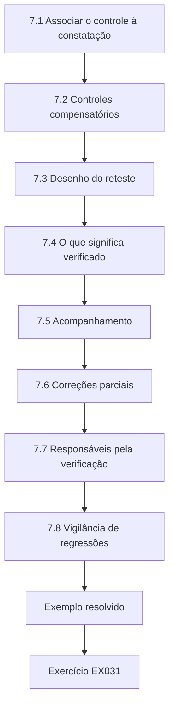

### Desenho lógico

```mermaid
flowchart LR
  N0["7.1 Associar o controle à constatação"]
  N1["7.2 Controles compensatórios"]
  N2["7.3 Desenho do reteste"]
  N3["7.4 O que significa verificado"]
  N4["7.5 Acompanhamento"]
  N5["7.6 Correções parciais"]
  N6["7.7 Responsáveis pela verificação"]
  N7["7.8 Vigilância de regressões"]
  N0 --> N1 --> N2 --> N3 --> N4 --> N5 --> N6 --> N7 --> Q["EX031"]
```

```text
[7.1 Associar o controle à constatação]
    |
    v
[7.2 Controles compensatórios]
    |
    v
[7.3 Desenho do reteste]
    |
    v
[7.4 O que significa verificado]
    |
    v
[7.5 Acompanhamento]
    |
    v
[7.6 Correções parciais]
    |
    v
[7.7 Responsáveis pela verificação]
    |
    v
[7.8 Vigilância de regressões]
    |
    v
[Exemplo resolvido] --> [Exercício EX031]
```
<!-- cykin:lesson-figures:end ch-07 -->


### Objetivos de aprendizagem

Você vai (1) sugerir controles compatíveis com as constatações; (2) distinguir controles compensatórios; (3) planejar um reteste; (4) saber quando um controle está verificado.

### 7.1 Associar o controle à constatação

Uma constatação de senha de administrador compartilhada pede contas nominais e cofre de senhas; um open redirect pede destinos em lista de permissões; um atributo ausente no cookie pede o atributo configurado e verificado na CI. Leo escreve cada recomendação de acordo com a constatação: contas nominais na VPN e um cofre para senhas compartilhadas; destinos em lista de permissões para um open redirect; atributos Secure e HttpOnly verificados na CI para o cookie de sessão. A equipe de segurança de aplicações é responsável por Secure e HttpOnly na constatação do cookie-flag, e a linha da recomendação traz esse nome e um prazo. Conselhos genéricos como "endurecer a aplicação" ou "endurecer as sessões" não dizem a um responsável o que mudar.

### 7.2 Controles compensatórios

Quando a correção ideal está a meses de distância, um controle compensatório reduz o risco agora — por exemplo, caminhos administrativos da VPN restritos aos jump hosts enquanto a reutilização de senhas é eliminada. Leo registra o controle compensatório como temporário, com um responsável e uma data para rever a correção ideal, para que ele não se torne permanente por descuido. Restrições temporárias de rede em torno de um banner desatualizado são aceitáveis nos mesmos termos: depois que o banner recebe o patch, as regras de acesso saem do ticket com uma nota de reteste e um registro de horário de retirada. Compensações sem prazo viram dívida esquecida.

### 7.3 Desenho do reteste

Reteste apenas as constatações acordadas, com o mesmo método ou um equivalente, depois que o responsável disser que a correção está no ar. Registre aprovação ou reprovação com evidências. Depois que o responsável diz que os atributos do cookie estão no ar na homologação, Leo repete a mesma verificação com a versão de ferramenta registrada, e a aprovação ou reprovação vai para o ticket com uma captura de tela nova. Ele confere nomes de host, portas e versões de build com a nota de mudança do responsável antes de declarar que um reteste falhou. Um reteste que toque um host fora da lista original do ENG-440 espera uma atualização de escopo por escrito, e retestar constatações sem relação desperdiça a janela.

### 7.4 O que significa verificado

Verificado significa que Leo reproduziu o sintoma original e o viu corrigido (ou confirmou que o controle compensatório funciona), e não que o responsável disse que corrigiu. A confirmação de implantação pelo responsável é necessária, mas não suficiente. Leo ou outro testador precisa ver que o sintoma original sumiu, ou que o controle compensatório funciona, antes de o ticket ser marcado como verificado. As capturas de tela do cookie, de antes e depois, entram no cofre com hash e são vinculadas ao T-15, para que a verificação seja evidência no registro, e não uma garantia verbal de que alguém acha que está corrigido.

### 7.5 Acompanhamento

As constatações viram tickets com responsáveis e datas; a verificação os fecha. Cada constatação da HCU vira um ticket com um responsável e um prazo, e as evidências de verificação o fecham. Tickets sem responsáveis ou datas escondem risco no backlog, e é por isso que o `lab_ticket` do capítulo 10 sinaliza campos incompletos: ele marca o T-15 como incompleto em owner e verified, e o T-18 como incompleto em due date, e esses nunca contam como prontos para fechamento. Toda sexta-feira, Leo abre o rastreador, e campos de responsável ou prazo em branco são escalados na mesma semana, em vez de envelhecerem até virar constatações de exame.

### 7.6 Correções parciais

Às vezes, os responsáveis corrigem um caminho e deixam outro aberto. A checklist de reteste de Leo nomeia cada caminho da constatação original. Um ticket não é fechado até que nenhum dos caminhos listados reproduza o problema ou que um controle compensatório aceito seja verificado. Em um open redirect, Leo lista cada parâmetro e caminho da constatação original; fechar depois de corrigir apenas um deixa os associados expostos nos outros. Se um caminho de redirecionamento continuar aberto depois de uma correção parcial, o CISO o aceita por escrito, com prazo de expiração, ou o ticket permanece aberto no rastreador até que o risco residual tenha responsável ou seja eliminado.

### 7.7 Responsáveis pela verificação

Quem aplica uma correção não deve ser a única pessoa a marcá-la como verificada. Leo ou outro testador retesta; o responsável confirma a implantação. A separação mantém os fechamentos otimistas fora das métricas: "corrigido porque eu implantei" não sobrevive a um reteste separado. A mesma regra vale para Leo, então um colega verifica qualquer controle compensatório que ele tenha aplicado, e o fechamento nunca depende das mesmas mãos que fizeram a mudança. Métricas que contam tickets verificados só depois da assinatura de um testador separado mantêm os números honestos para o CISO e os examinadores.

### 7.8 Vigilância de regressões

Depois de uma correção, Leo pergunta se os caminhos relacionados foram verificados pelo responsável. Um open redirect corrigido que deixa um segundo parâmetro intocado é uma regressão comum; o plano de reteste nomeia os caminhos irmãos quando existem. Quando o responsável corrige um parâmetro de redirecionamento, o plano de reteste de Leo já nomeia os parâmetros irmãos da constatação, e regressões custam menos quando detectadas na mesma janela do que no próximo ciclo de exame. A vigilância de regressões depois do ENG-440 também verifica se os atributos do cookie e as correções de redirecionamento continuam nos builds seguintes. Uma correção que desaparece na próxima implantação da homologação reabre o ticket com o identificador do build anexado.

### Exemplo resolvido (HCU sintética)

Para a senha de administrador compartilhada da VPN, a HCU habilita MFA e contas nominais em duas semanas (ideal) e, enquanto isso, restringe os caminhos administrativos ao jump host (compensatório). Leo retesta os dois.

> **Caso sintético — Harborline Credit Union (HCU).** A cooperativa de crédito, Leo Okonkwo e todos os números foram inventados para fins didáticos.

### Erros e limites

Políticas e leis locais variam; siga a autorização da HCU e a sua jurisdição. Este livro nunca autoriza testes em sistemas reais.

### Exercícios

- **EX031 — Associação de controle.** Sugira um controle para um open redirect. *Rubrica:* 3 = lista de permissões para os destinos de redirecionamento / remover o parâmetro; 2 = parcial; 1 = "firewall"; 0 = nada.
- **EX032 — Exemplo compensatório.** Dê um controle compensatório para a reutilização de senhas na administração da VPN. *Rubrica:* 3 = restringir a administração ao jump host / MFA / monitoramento; 2 = parcial; 1 = ignorar; 0 = nada.
- **EX033 — Gatilho do reteste.** Quando o reteste começa? *Rubrica:* 3 = depois que o responsável confirma a correção no ar / na janela acordada; 2 = parcial; 1 = sempre imediatamente; 0 = nada.
- **EX034 — Não verificado.** O responsável envia um e-mail dizendo "corrigimos" sem detalhes. Está verificado? *Rubrica:* 3 = não; são necessárias evidências de reteste; 2 = não; 1 = sim; 0 = nada.
- **EX035 — Escopo do reteste.** Leo pode testar URLs novas sem relação durante o reteste? *Rubrica:* 3 = não; só as constatações acordadas, a menos que o escopo seja ampliado; 2 = não; 1 = sim; 0 = nada.

### Síntese

Os controles correspondem às constatações; os controles compensatórios compram tempo; a verificação é um reteste com evidências.

### Continue estudando — capítulo 07 de 12

[← Capítulo 06 (rascunho)](#ch-06) · [Índice de capítulos do curso](../SUBJECTS.md) · [Capítulo 08 (rascunho) →](#ch-08)

<a id="ch-08"></a>

## Capítulo 8 — Análise supervisionada de casos

<!-- cykin:lesson-figures:start ch-08 -->
### Mapa da aula

Aula 08 publicada. Mapa, exemplo, EX036.

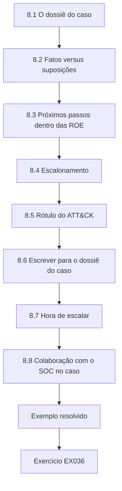

### Desenho lógico

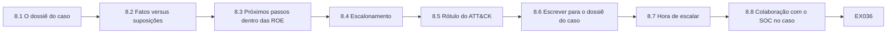

```text
[8.1 O dossiê do caso]
    |
    v
[8.2 Fatos versus suposições]
    |
    v
[8.3 Próximos passos dentro das ROE]
    |
    v
[8.4 Escalonamento]
    |
    v
[8.5 Rótulo do ATT&CK]
    |
    v
[8.6 Escrever para o dossiê do caso]
    |
    v
[8.7 Hora de escalar]
    |
    v
[8.8 Colaboração com o SOC no caso]
    |
    v
[Exemplo resolvido] --> [Exercício EX036]
```
<!-- cykin:lesson-figures:end ch-08 -->


### Objetivos de aprendizagem

Você vai (1) analisar um dossiê de caso sintético da HCU; (2) separar fatos de suposições; (3) propor os próximos passos autorizados; (4) escalar quando necessário.

### 8.1 O dossiê do caso

Um pacote sintético contém: um trecho das ROE, três constatações validadas, o registro de atividades e uma nota de que um funcionário reutilizou a senha da VPN em um e-mail pessoal (relatado pelo próprio funcionário). O pacote é rotulado ENG-440 e guardado no cofre, e registra fatos, suposições e ações em linhas rotuladas. A nota sobre a reutilização de senha é marcada como relatada pelo funcionário, e não como algo que Leo descobriu mexendo no e-mail pessoal, que continua fora do escopo. O relatório vai para o CISO como uma questão de conscientização da equipe, porque a reutilização envolve contas fora do engajamento.

### 8.2 Fatos versus suposições

Fato: a reutilização de senha foi relatada. Suposição: um atacante já tem a senha. Leo rotula as suposições com clareza: seu dossiê diz Fato para o relato e Suposição para qualquer afirmação de que um atacante já tem a senha. As suposições podem orientar os próximos passos, mas nunca são escritas como constatações confirmadas. A linha de Suposições da nota do caso diz que ainda não há nenhuma sobre abuso externo, que é tudo o que as evidências sustentam. Se a revisão de logs do SOC mostrar mais tarde sessões incomuns na VPN, a suposição pode passar a Fato, com o trecho do log anexado.

### 8.3 Próximos passos dentro das ROE

Forçar a redefinição da senha da VPN dessa conta; verificar os logs da VPN em busca de sessões incomuns; não tocar no e-mail pessoal (fora do escopo). Leo solicita a redefinição da senha da VPN dessa conta e pede ao SOC que verifique os logs em busca de sessões incomuns. O pedido de redefinição passa por um ticket da central de serviços de TI vinculado ao ENG-440, para que a linha do tempo fique em um só lugar. O e-mail pessoal está fora do escopo, por isso ele não contata o provedor nem pede os logs dessa caixa de entrada. O funcionário que relatou a reutilização troca ele mesmo a senha pessoal; a HCU nunca toca nessa conta.

### 8.4 Escalonamento

O risco de exposição de dados de associados e a reutilização de senhas em serviços pessoais vão para o CISO no mesmo dia. O escalonamento no mesmo dia dá ao CISO tempo para ordenar redefinições de senha da VPN e comunicações antes que o risco se espalhe para além do caso de reutilização relatado pelo funcionário; esperar a reunião semanal de constatações seria lento demais para uma exposição de dados de associados. O CISO recebe a nota por telefone e por e-mail antes do fim do expediente. Leo escala com uma linha do tempo de uma página com os fatos, as suposições rotuladas como suposições e a próxima ação segura, e não apenas com frustração.

### 8.5 Rótulo do ATT&CK

A reutilização de senha que permite acesso à VPN corresponde a T1078 Valid Accounts na busca de detecções do SOC. Leo acrescenta T1078 à nota do caso para que o SOC possa pesquisar com um nome comum. O rótulo descreve o comportamento; ele não prova que um atacante externo esteve envolvido. O SOC usa o nome da técnica para puxar suas detecções de T1078 já existentes para a VPN, em vez de escrever novas às pressas. Se a busca não encontrar nada, o relatório diz que não foram vistas sessões incomuns no período revisado, e não que a conta nunca foi usada indevidamente.

### 8.6 Escrever para o dossiê do caso

As notas de caso usam registros de horário, identificadores de ticket e os rótulos Fato/Suposição/Ação. Uma narrativa livre serve para o resumo, mas são as linhas rotuladas que o CISO e os auditores conseguem percorrer em um minuto durante um incidente. Durante o incidente de reutilização de senha, cada linha rotulada começa com um registro de horário e o identificador do ticket ENG-440, para que o CISO ordene fatos, suposições e ações de relance, sem ler antes uma longa narrativa. Leo ainda escreve um resumo curto para quem precisa da história; ele tem três ou quatro frases e fica acima das linhas rotuladas, nunca no lugar delas.

### 8.7 Hora de escalar

Leo usa uma regra simples: se fundos de associados, dados pessoais em grande escala ou sistemas de segurança física puderem ser afetados, escale em até uma hora. Itens de menor impacto seguem o processo normal de constatações. A reutilização de senha que poderia abrir a VPN entra nessa regra de uma hora, porque dados de associados poderiam vir em seguida. O relógio começa quando Leo lê o relato do funcionário, e a ligação para o CISO é registrada com o horário em relação a esse início. O banner desatualizado de baixo impacto na homologação entra no relatório do ENG-440 com o prazo normal da equipe de segurança de aplicações, e não no telefone do CISO.

### 8.8 Colaboração com o SOC no caso

Leo compartilha a técnica do ATT&CK e o identificador da conta com o SOC, para que ele possa fazer a busca, mas não cola dados pessoais de associados no ticket. As consultas de busca usam o identificador da conta da VPN e o período do ENG-440. O ticket do SOC contém o identificador da conta, o período e T1078, e nada que identifique um associado: nomes, documentos de identidade e números completos de conta ficam fora do ticket do SOC e das capturas de tela de chat. As capturas de tela da busca são recortadas às colunas de sessão antes de entrarem no cofre.

### Exemplo resolvido (HCU sintética)

A nota de caso de Leo: "Fatos: relato de funcionário sobre a senha da VPN reutilizada no e-mail pessoal; constatações F1–F3 validadas. Suposições: ainda nenhuma sobre abuso externo. Ações: redefinição de senha, revisão de logs, briefing ao CISO. Fora do escopo: conteúdo do e-mail pessoal."

> **Caso sintético — Harborline Credit Union (HCU).** A cooperativa de crédito, Leo Okonkwo e todos os números foram inventados para fins didáticos.

### Erros e limites

Políticas e leis locais variam; siga a autorização da HCU e a sua jurisdição. Este livro nunca autoriza testes em sistemas reais.

### Exercícios

- **EX036 — Extrair fatos.** Liste dois fatos do dossiê do caso. *Rubrica:* 3 = dois itens claramente factuais; 2 = um; 1 = suposição tratada como fato; 0 = nada.
- **EX037 — Rótulo de suposição.** Reescreva "os atacantes com certeza têm a senha" como uma suposição rotulada. *Rubrica:* 3 = incerteza rotulada; 2 = parcial; 1 = continua categórica; 0 = nada.
- **EX038 — Ação fora do escopo.** Por que não ler o e-mail pessoal do funcionário? *Rubrica:* 3 = fora do escopo / sem autorização / privacidade; 2 = parcial; 1 = deveria ler; 0 = nada.
- **EX039 — Escalar no mesmo dia.** O que dispara o escalonamento ao CISO no mesmo dia neste caso? *Rubrica:* 3 = risco da reutilização de credenciais para a VPN/serviços dos associados; 2 = parcial; 1 = vago; 0 = nada.
- **EX040 — ATT&CK.** Qual nome de técnica ajuda o SOC a buscar detecções para este caso? *Rubrica:* 3 = T1078 Valid Accounts; 2 = só o nome; 1 = errado; 0 = nada.

### Síntese

O trabalho de caso separa fatos de suposições, age apenas dentro do escopo e escala o risco real no mesmo dia.

### Continue estudando — capítulo 08 de 12

[← Capítulo 07 (rascunho)](#ch-07) · [Índice de capítulos do curso](../SUBJECTS.md) · [Capítulo 09 (rascunho) →](#ch-09)

<a id="ch-09"></a>

## Capítulo 9 — Comunicação, ética e relatórios

<!-- cykin:lesson-figures:start ch-09 -->
### Mapa da aula

Aula 09 publicada. Mapa, exemplo, EX041.

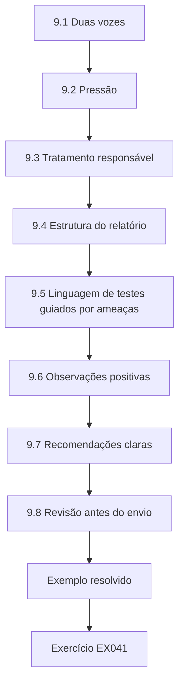

### Desenho lógico

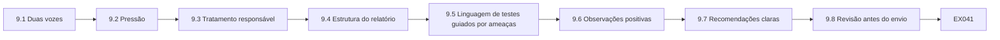

```text
[9.1 Duas vozes]
    |
    v
[9.2 Pressão]
    |
    v
[9.3 Tratamento responsável]
    |
    v
[9.4 Estrutura do relatório]
    |
    v
[9.5 Linguagem de testes guiados por ameaças]
    |
    v
[9.6 Observações positivas]
    |
    v
[9.7 Recomendações claras]
    |
    v
[9.8 Revisão antes do envio]
    |
    v
[Exemplo resolvido] --> [Exercício EX041]
```
<!-- cykin:lesson-figures:end ch-09 -->


### Objetivos de aprendizagem

Você vai (1) escrever para executivos e para engenheiros; (2) lidar com pressão para esconder constatações; (3) aplicar a ética da divulgação responsável; (4) estruturar o relatório da HCU.

### 9.1 Duas vozes

Os executivos recebem risco, associados afetados, decisões e datas. Os engenheiros recebem reprodução, evidências e orientação de correção. Misturar as duas coisas produz um relatório que ninguém termina de ler. Leo escreve dois parágrafos para a constatação do cookie-flag, que compartilham os mesmos fatos. O parágrafo para o CISO trata do risco às sessões dos associados, pede uma única decisão, a data de 1º de novembro para a correção do cookie, e nomeia a equipe de segurança de aplicações como responsável. O parágrafo para a segurança de aplicações traz os passos de reprodução e a correção com Secure e HttpOnly, citando o cabeçalho de resposta da homologação e os atributos de Set-Cookie que estão faltando.

### 9.2 Pressão

Alguém pode pedir que uma constatação seja retirada antes de um exame. A resposta de Leo: as constatações ficam; os responsáveis podem acrescentar uma resposta da gestão. A ética vence a conveniência. Os pedidos costumam chegar nas semanas anteriores ao exame anual, quando os responsáveis temem um item aberto na lista dos examinadores. No exemplo resolvido, o pedido veio de um gerente de produto e dizia respeito à constatação de open redirect. Leo manteve a constatação, avisou o supervisor no mesmo dia e se ofereceu para colocar o plano de correção do gerente ao lado da constatação, como resposta da gestão. O registro escrito do pedido vai para as notas do engajamento, para que os examinadores vejam que a constatação sobreviveu à pressão; suavizar fatos sob pressão destrói a confiança quando os examinadores perguntam depois.

### 9.3 Tratamento responsável

Não publique constatações da HCU. Não as compartilhe com amigos. Bugs de fornecedores encontrados em software de terceiros seguem o caminho de divulgação do fornecedor somente com aprovação do CISO. As constatações da HCU ficam dentro do público acordado: a lista de distribuição do relatório nomeia o CISO, o responsável de produto do internet banking, a segurança de aplicações e a equipe de rede, e ninguém mais. Amigos e publicações públicas nunca são público. Se Leo encontrar um bug em um produto de fornecedor usado na HCU, ele para, registra o bug nas notas do ENG-440 com o produto e a versão e pergunta ao CISO antes de usar qualquer caminho de divulgação ao fornecedor.

### 9.4 Estrutura do relatório

Resumo executivo; escopo e métodos; constatações por severidade; observações positivas; plano de reteste; apêndices. O relatório do ENG-440 de Leo segue essa ordem para que o CISO leia primeiro o resumo e as decisões, enquanto os engenheiros abrem os apêndices em busca das evidências. O resumo executivo cabe em uma página e termina com as decisões que o CISO precisa tomar neste mês. Cada apêndice é referenciado pelo número da constatação, para que um engenheiro vá direto às evidências. Omitir as observações positivas ou o plano de reteste deixa os líderes sem equilíbrio ou sem próximo passo.

### 9.5 Linguagem de testes guiados por ameaças

Se a HCU vier a patrocinar um teste no estilo CBEST ou TIBER-EU, os relatórios também descreverão cenários e lacunas de detecção, ainda sem publicar detalhes de exploração. Os relatórios atuais de Leo ficam dentro da revisão web e de VPN da HCU. A linha de escopo do relatório do ENG-440 diz revisão de configuração web e de VPN, palavra por palavra como nas ROE assinadas, para que os examinadores que leem as notas de método não vejam um exercício guiado por ameaças que a HCU não patrocinou. Chamar o ENG-440 de guiado por ameaças também implicaria trabalho de inteligência e um white team que a HCU nunca organizou. Leo mantém a linguagem do CBEST e do TIBER-EU fora do ENG-440 até que o CISO financie esse programa separadamente.

### 9.6 Observações positivas

Os relatórios também devem registrar o que funcionou: MFA nos logins da equipe na VPN, resposta rápida do SOC à mensagem de início, isolamento limpo da homologação. As observações positivas mostram equilíbrio e dizem aos líderes quais investimentos estão dando retorno; líderes que só veem falhas não conseguem dizer quais investimentos manter. Leo limita a observação sobre a VPN aos logins comuns da equipe, porque a constatação da senha de administrador compartilhada mostra que o caminho administrativo ainda não exigia um segundo fator. Cada observação positiva traz evidências, como o tempo que o SOC levou para confirmar a mensagem de início. Manter a homologação isolada é um investimento que o CISO consegue defender na época do orçamento, porque o relatório mostra que ele se sustentou.

### 9.7 Recomendações claras

A recomendação de cada constatação nomeia uma mudança concreta, o papel do responsável e uma data sugerida. "Melhorar a segurança" não é recomendação; "configurar Secure e HttpOnly no cookie de sessão da aplicação de internet banking até 1º de novembro, responsável: segurança de aplicações" é. Linhas vagas do tipo "melhorar a segurança" são reescritas antes de o relatório sair da equipe, e cada linha reescrita nomeia o responsável e a mudança, para que os tickets possam ser abertos sem uma reunião de decodificação. O ticket aberto a partir da linha do cookie é o T-15, que só ficou pronto para fechamento depois que o responsável e a verificação que o `lab_ticket` apontou como ausentes foram preenchidos.

### 9.8 Revisão antes do envio

Um colega lê o resumo executivo em busca de linguagem de culpa, decisões ausentes e jargão não explicado. Essa revisão leva cerca de dez minutos e acontece antes de o resumo chegar ao CISO. Detectar linguagem de culpa, decisões ausentes e jargão antes do envio evita reescrever tudo na véspera de uma reunião com os examinadores. O revisor é alguém de fora do ENG-440, para que o resumo seja lido por uma pessoa que não acompanhou os testes. Os comentários entram no rascunho como alterações controladas, e Leo resolve cada um antes de o relatório sair da equipe.

### Exemplo resolvido (HCU sintética)

Um gerente de produto pede a Leo que retire a constatação de open redirect até depois do exame. Leo recusa, oferece-se para incluir o plano de correção do gerente ao lado da constatação e informa o supervisor.

> **Caso sintético — Harborline Credit Union (HCU).** A cooperativa de crédito, Leo Okonkwo e todos os números foram inventados para fins didáticos.

### Erros e limites

Políticas e leis locais variam; siga a autorização da HCU e a sua jurisdição. Este livro nunca autoriza testes em sistemas reais.

### Exercícios

- **EX041 — Frase executiva.** Escreva uma frase executiva sobre o open redirect no internet banking. *Rubrica:* 3 = risco aos associados + pedido de decisão; 2 = parcial; 1 = só jargão; 0 = nada.
- **EX042 — Detalhe para engenheiros.** De quais três pontos técnicos os engenheiros precisam? *Rubrica:* 3 = reprodução, referência às evidências, orientação de correção; 2 = dois; 1 = um; 0 = nada.
- **EX043 — Pedido de retirada.** Como Leo responde a um pedido para retirar uma constatação? *Rubrica:* 3 = recusa; oferece resposta da gestão; avisa o supervisor; 2 = recusa; 1 = retira; 0 = nada.
- **EX044 — Blog público.** Leo pode escrever em um blog sobre as constatações da HCU depois do teste? *Rubrica:* 3 = não; são confidenciais nos termos do acordo; 2 = não; 1 = sim, anonimizadas à vontade; 0 = nada.
- **EX045 — Ordem do relatório.** Ordene: apêndices, resumo executivo, constatações. *Rubrica:* 3 = resumo, constatações, apêndices; 2 = parcial; 1 = errado; 0 = nada.

### Síntese

Diga a verdade na voz certa; nunca retire constatações sob pressão; mantenha os resultados dentro do acordo.

### Continue estudando — capítulo 09 de 12

[← Capítulo 08 (rascunho)](#ch-08) · [Índice de capítulos do curso](../SUBJECTS.md) · [Capítulo 10 (rascunho) →](#ch-10)

<a id="ch-10"></a>

## Capítulo 10 — Qualidade e solução de problemas

<!-- cykin:lesson-figures:start ch-10 -->
### Mapa da aula

Aula 10 publicada. Mapa, exemplo, EX046.

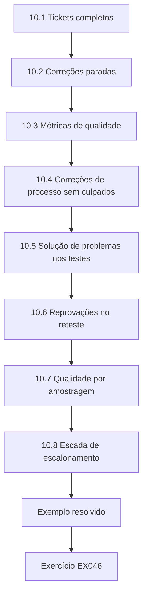

### Desenho lógico

```mermaid
flowchart LR
  N0["10.1 Tickets completos"]
  N1["10.2 Correções paradas"]
  N2["10.3 Métricas de qualidade"]
  N3["10.4 Correções de processo sem culpados"]
  N4["10.5 Solução de problemas nos testes"]
  N5["10.6 Reprovações no reteste"]
  N6["10.7 Qualidade por amostragem"]
  N7["10.8 Escada de escalonamento"]
  N0 --> N1 --> N2 --> N3 --> N4 --> N5 --> N6 --> N7 --> Q["EX046"]
```

```text
[10.1 Tickets completos]
    |
    v
[10.2 Correções paradas]
    |
    v
[10.3 Métricas de qualidade]
    |
    v
[10.4 Correções de processo sem culpados]
    |
    v
[10.5 Solução de problemas nos testes]
    |
    v
[10.6 Reprovações no reteste]
    |
    v
[10.7 Qualidade por amostragem]
    |
    v
[10.8 Escada de escalonamento]
    |
    v
[Exemplo resolvido] --> [Exercício EX046]
```
<!-- cykin:lesson-figures:end ch-10 -->


### Objetivos de aprendizagem

Você vai (1) revisar tickets quanto à completude; (2) destravar uma correção parada; (3) medir a qualidade do engajamento; (4) corrigir falhas de processo sem buscar culpados.

### 10.1 Tickets completos

Cada ticket de correção precisa de um responsável, um prazo e uma nota de verificação. Tickets incompletos escondem risco. O `lab_ticket` marca o T-15 como incompleto em owner e verified, e o T-18 como incompleto em due date; Leo não os conta como prontos para fechamento. T-12 e T-21 são os dois tickets prontos para fechamento, cada um com responsável, prazo e verificação preenchidos, por isso o laboratório mostra dois de quatro tickets prontos para fechamento. Tickets completos são os únicos que não escondem nada, e é por isso que um ticket com qualquer campo em branco fica fora da contagem de prontos para fechamento, por mais perto que sua correção pareça estar.

### 10.2 Correções paradas

Se um prazo vence, Leo verifica se o responsável mudou, se a correção está bloqueada ou se a constatação foi mal compreendida — e então escala com fatos. No T-18, a lacuna é o prazo, por isso Leo combina um com a equipe de rede antes de escalar qualquer coisa. O escalonamento então leva esses fatos em uma linha do tempo de uma página, e não apenas frustração. Um prazo parado sem essa linha do tempo vira uma discussão de humor; com ela, o CISO pode redistribuir o trabalho ou aceitar o risco em uma única reunião, sem precisar decifrar o humor de ninguém.

### 10.3 Métricas de qualidade

Métricas úteis: porcentagem de constatações com responsável, mediana do tempo até o reteste, contagem de pausas de escopo. Métricas de vaidade (contagem bruta de constatações) enganam.

```python
"""Lab 10: check synthetic remediation tickets for owner, due date and verification note."""
tickets = [
    {"id": "T-12", "owner": "app-sec", "due": "2026-11-01", "verified": "retest ok"},
    {"id": "T-15", "owner": "", "due": "2026-11-01", "verified": ""},
    {"id": "T-18", "owner": "network", "due": "", "verified": "pending"},
    {"id": "T-21", "owner": "app-sec", "due": "2026-10-20", "verified": "retest ok"},
]
for t in tickets:
    gaps = [k for k in ("owner", "due", "verified") if not t[k]]
    print(f"{t['id']} {'OK' if not gaps else 'INCOMPLETE: ' + ','.join(gaps)}")
print("closed-ready:", sum(1 for t in tickets if t["owner"] and t["due"] and t["verified"] == "retest ok"))
```

Execute com `python3 lab_ticket.py`. Saída verificada:

```text
T-12 OK
T-15 INCOMPLETE: owner,verified
T-18 INCOMPLETE: due
T-21 OK
closed-ready: 2
```

O laboratório mostra dois de quatro tickets prontos para fechamento. Leo informa ao CISO essa taxa de higiene, a mediana do tempo até o reteste e a contagem de pausas de escopo. Contagens brutas de constatações sem validação ficam fora dos slides de gestão.

A mediana do tempo até o reteste vai da nota do responsável dizendo que a correção está no ar até o registro de aprovação ou reprovação de Leo no ticket. A contagem de pausas de escopo inclui a pergunta sobre o nome de host das 09:40, mostrando ao CISO que as pausas acontecem e são registradas.

### 10.4 Correções de processo sem culpados

Se dois tickets ficaram sem responsável, melhore o modelo, em vez de apenas criticar as pessoas. Depois que dois tickets ficaram sem responsável, Leo atualiza o modelo para que o responsável seja obrigatório na criação, e o rastreador agora se recusa a salvar um novo ticket até que o campo de responsável tenha um nome. As correções de processo impedem que a mesma lacuna volte no mês seguinte. Correções de processo sem culpados são melhores do que apontar indivíduos; a qualidade dos tickets na Harborline Credit Union não pode depender de heróis que se lembrem de perguntar, por isso a HCU mede mudanças no modelo, e não quem esqueceu no mês passado.

### 10.5 Solução de problemas nos testes

Quando um reteste falha inesperadamente, verifique se você atingiu o mesmo sistema e a mesma versão que o responsável corrigiu. Antes de marcar um reteste como reprovado, Leo compara nomes de host, portas e versões de build com a nota de mudança do responsável; se não coincidirem, ele agenda um esclarecimento do alvo. Atingir o slot de homologação errado desperdiça o tempo de todos e cria uma falsa reprovação que envenena a confiança no rastreador. A solução de problemas em um reteste começa pela identidade do alvo, e não pela culpa de quem fez a correção. Cada divergência que ele encontra é anotada no ticket, para que o responsável e Leo concordem sobre o alvo antes do próximo reteste.

### 10.6 Reprovações no reteste

Se um reteste ainda encontra o problema, Leo arquiva as evidências, mantém o ticket aberto e pergunta se a correção foi implantada no sistema que ele testou. Muitos "retestes reprovados" são divergências de versão, e não trabalho ignorado. Divergências de versão são comuns quando os responsáveis corrigem a produção e Leo ainda aponta para um build antigo da homologação. A nota de reteste de Leo registra qual build ele atingiu e qual build o responsável implantou, para que qualquer divergência fique visível, e esclarecer o alvo muitas vezes transforma um reteste reprovado em um ajuste de agenda, em vez de uma conversa sobre culpa. Quando o build certo é atingido e o problema persiste, o ticket continua aberto, com as novas evidências anexadas.

### 10.7 Qualidade por amostragem

Uma vez por mês, Leo sorteia cinco tickets fechados e verifica se existem evidências de verificação. A falta de evidências reabre o ticket, com uma nota ao responsável. Os cinco tickets da amostra são escolhidos ao acaso entre os fechados no mês anterior. A amostragem detecta cedo a deriva do processo; a amostragem mensal é como a Harborline Credit Union percebe a deriva antes de um examinador, e um fechamento sem verificação é rejeitado na revisão semanal. Um ticket reaberto conta contra os números de fechamento que Leo informa ao CISO até que novas evidências de reteste sejam anexadas.

### 10.8 Escada de escalonamento

Os tickets atrasados vão primeiro ao responsável, depois ao gestor do responsável e depois ao CISO, com o prazo original e o número de lembretes. A escada é escrita para que o escalonamento não seja pessoal, e Leo a segue para que um atraso não vire uma briga pessoal. Cada degrau tem uma espera fixa, para que o gestor do responsável só saiba de um atraso depois que o responsável teve a chance de responder. O CISO vê o prazo original e quantos lembretes já foram enviados, o que torna a próxima decisão simples. Essa decisão — redistribuir, prorrogar ou aceitar o risco — é escrita de volta no ticket.

### Exemplo resolvido (HCU sintética)

A verificação de tickets de Leo mostra T-12 e T-21 prontos para fechamento; o T-15 não tem responsável nem verificação; o T-18 não tem prazo. Ele atribui o T-15 à segurança de aplicações, define o prazo do T-18 com a equipe de rede e atualiza o modelo de ticket para exigir esses campos.

> **Caso sintético — Harborline Credit Union (HCU).** A cooperativa de crédito, Leo Okonkwo e todos os números foram inventados para fins didáticos.

### Erros e limites

Políticas e leis locais variam; siga a autorização da HCU e a sua jurisdição. Este livro nunca autoriza testes em sistemas reais.

### Exercícios

- **EX046 — Contagem de prontos para fechamento.** O que o laboratório imprime para closed-ready? *Rubrica:* 3 = closed-ready: 2; 2 = 2; 1 = 4; 0 = nada.
- **EX047 — Lacunas do T-15.** O que está errado com o T-15? *Rubrica:* 3 = faltam o responsável e a verificação; 2 = um dos dois; 1 = vago; 0 = nada.
- **EX048 — Perguntas sobre a parada.** Dê duas perguntas que Leo faz quando um prazo atrasa. *Rubrica:* 3 = duas entre mudança de responsável, bloqueio, mal-entendido, prioridade; 2 = uma; 1 = culpa; 0 = nada.
- **EX049 — Métrica ruim.** Por que o "número de constatações" é uma métrica de qualidade fraca? *Rubrica:* 3 = incentiva o ruído / pune a definição cuidadosa do escopo; 2 = parcial; 1 = é a melhor; 0 = nada.
- **EX050 — Correção no modelo.** Que mudança no modelo evita as lacunas do T-15/T-18? *Rubrica:* 3 = exigir responsável, prazo e verificação antes que o ticket saia da triagem; 2 = parcial; 1 = vago; 0 = nada.

### Síntese

Qualidade é ter tickets completos, métricas honestas e correções de processo quando a mesma lacuna se repete.

### Continue estudando — capítulo 10 de 12

[← Capítulo 09 (rascunho)](#ch-09) · [Índice de capítulos do curso](../SUBJECTS.md) · [Capítulo 11 (rascunho) →](#ch-11)

<a id="ch-11"></a>

## Capítulo 11 — Laboratório supervisionado

<!-- cykin:lesson-figures:start ch-11 -->
### Mapa da aula

Aula 11 publicada. Mapa, exemplo, EX051.

```mermaid
flowchart TD
  N0["11.1 Instruções do laboratório"]
  N1["11.2 Revisão por pares"]
  N2["11.3 Reflexão"]
  N3["11.4 Aprovação do supervisor"]
  N4["11.5 Tempo limitado"]
  N5["11.6 Regra de pares"]
  N6["11.7 Pacote de evidências do laboratório"]
  N7["11.8 Limpeza"]
  N0 --> N1 --> N2 --> N3 --> N4 --> N5 --> N6 --> N7
  N7 --> EX["Exemplo resolvido"]
  EX --> Q["Exercício EX051"]
```

### Desenho lógico

```mermaid
flowchart LR
  N0["11.1 Instruções do laboratório"]
  N1["11.2 Revisão por pares"]
  N2["11.3 Reflexão"]
  N3["11.4 Aprovação do supervisor"]
  N4["11.5 Tempo limitado"]
  N5["11.6 Regra de pares"]
  N6["11.7 Pacote de evidências do laboratório"]
  N7["11.8 Limpeza"]
  N0 --> N1 --> N2 --> N3 --> N4 --> N5 --> N6 --> N7 --> Q["EX051"]
```

```text
[11.1 Instruções do laboratório]
    |
    v
[11.2 Revisão por pares]
    |
    v
[11.3 Reflexão]
    |
    v
[11.4 Aprovação do supervisor]
    |
    v
[11.5 Tempo limitado]
    |
    v
[11.6 Regra de pares]
    |
    v
[11.7 Pacote de evidências do laboratório]
    |
    v
[11.8 Limpeza]
    |
    v
[Exemplo resolvido] --> [Exercício EX051]
```
<!-- cykin:lesson-figures:end ch-11 -->


### Objetivos de aprendizagem

Você vai (1) conduzir um laboratório supervisionado usando apenas dados sintéticos e os laboratórios anteriores; (2) produzir um minirrelatório; (3) revisar a verificação de escopo de outro aluno; (4) refletir sobre os erros.

### 11.1 Instruções do laboratório

Usando as saídas já produzidas de `lab_roe`, `lab_severity` e `lab_ticket`, monte um minirrelatório em três partes para a HCU: prontidão da autorização, resultado do filtro de descoberta e higiene da correção. A prontidão da autorização usa o `lab_roe`; o filtro de descoberta usa o `lab_severity`; a higiene da correção usa o `lab_ticket`. Cada parte do minirrelatório começa com a saída do laboratório colada literalmente, seguida da decisão que ela sustenta. O minirrelatório do ENG-CLASS-11 liga as três saídas a decisões da HCU — `emergency_contact` ausente, três de cinco mantidos com FLOOR 0.6, dois de quatro prontos para fechamento —, e não a elogios às ferramentas.

### 11.2 Revisão por pares

Troque as notas de verificação de escopo com um colega. Pontue de 0 a 3: exclusões presentes, contato de emergência presente, métodos compatíveis com as ROE. O colega escreve uma pontuação e um motivo de uma linha para cada item, para que o supervisor veja por que um rascunho foi devolvido. Uma pontuação abaixo de três em qualquer item significa que Leo corrige o rascunho antes da aprovação do supervisor. Exclusões, contato de emergência e associação de métodos são as mesmas verificações que interrompem uma janela real. O item do contato de emergência é o que mais importa, porque um campo vazio interrompeu o próprio rascunho de Leo no exemplo resolvido do capítulo 3.

### 11.3 Reflexão

Escreva três linhas: o que você quase fez errado, o que detectou o erro, o que você vai fazer da próxima vez. Cada linha de reflexão nomeia a verificação que detectou o erro, como o `lab_roe` no caso do contato vazio. Linhas honestas sobre quase erros — quase começar com `emergency_contact` vazio — ensinam mais do que uma pontuação perfeita sem aprendizado, e a reflexão de Leo depois do ENG-CLASS-11 vira atualizações da checklist para ROE reais. O supervisor lê as três linhas antes de assinar, e uma reflexão que afirma não ter havido nenhum quase erro é devolvida, porque a reflexão é pontuada pelo aprendizado, e não por uma execução perfeita sem nada escrito.

### 11.4 Aprovação do supervisor

O supervisor só assina se as exclusões e o contato de emergência estiverem presentes, as ROE estiverem completas e nenhum alvo fora do escopo aparecer. Sem essa assinatura, o ENG-CLASS-11 continua sendo apenas prática e não entra no portfólio de Leo como exercício de engajamento concluído. Um laboratório assinado também registra o nome do supervisor e a data, para que o portfólio mostre quem conferiu as exclusões. A aprovação existe para impor as exclusões antes que os hábitos se formem, porque hábitos formados sob pressão de tempo são difíceis de desfazer, e faz com que eles se formem sob as mesmas regras de parada do ENG-440.

### 11.5 Tempo limitado

O laboratório acontece em uma única sessão, com parada rígida, para praticar a disciplina de janela. Quando o relógio para, Leo para de digitar e guarda no cofre o que tem. As partes inacabadas viram notas, e não minutos extras silenciosos. Um minirrelatório parcial guardado no cofre dentro do prazo vale mais do que um completo terminado depois da parada. O supervisor anota o horário de parada no registro do laboratório, o que torna visível qualquer minuto extra. A disciplina de janela sob a pressão do ENG-CLASS-11 corresponde à parada das 12:00 de sábado no ENG-440, para que o hábito se transfira para as janelas reais que afetam os associados.

### 11.6 Regra de pares

Durante o laboratório supervisionado, um aluno conduz e outro confere as ROE a cada passo. Os papéis se invertem na metade. Quem confere pode interromper quem conduz a qualquer momento; as interrupções são pontuadas como boas detecções, e não como falhas. Interromper quem conduz por causa de um método não associado ou de uma exclusão ausente é um sucesso para a dupla. Leo aprende os dois papéis para poder ser tanto o condutor cuidadoso quanto o verificador das ROE em um engajamento real.

A dupla registra cada interrupção no registro do operador, com o passo, a linha das ROE que falhou e quem a apontou, para que o instrutor pontue as detecções a partir do registro, e não da memória. Inverter os papéis na metade significa que nenhum dos alunos passa o laboratório inteiro apenas digitando comandos ou apenas lendo as ROE.

### 11.7 Pacote de evidências do laboratório

O apêndice do minirrelatório inclui as saídas brutas dos laboratórios (`lab_roe`, `lab_severity`, `lab_ticket`), para que o supervisor consiga recalcular as mesmas conclusões. O pacote contém a saída do `lab_roe`, a lista de itens mantidos do `lab_severity`, as contagens de higiene do `lab_ticket` e o caminho no cofre das capturas de tela. Capturas de tela de chat são opcionais; saídas reproduzíveis são obrigatórias, porque capturas de chat sem as saídas brutas não provam o mesmo trabalho. Supervisores que conseguem recalcular as constatações mantidas e os tickets incompletos confiam no minirrelatório, e examinadores e supervisores devem conseguir reconstruir o exercício sem pedir o folclore a Leo.

### 11.8 Limpeza

Ao fim do laboratório, Leo apaga da área de trabalho as cópias locais das evidências sintéticas e confirma que o cofre guarda a única cópia. A limpeza faz parte da checklist avaliada: um arquivo esquecido na área de trabalho ou tokens esquecidos em uma pasta pessoal reprovam o laboratório, mesmo que o relatório seja excelente. A cópia das evidências de aula no cofre é então apagada na data agendada que corresponde à regra de trinta dias praticada para ROE reais. O hábito se transfere para o ENG-440, onde cópias pessoais de evidências são proibidas.

### 11.9 Depois da assinatura

Quando o supervisor assina, Leo arquiva o minirrelatório sob o ENG-CLASS-11 e agenda um debrief de quinze minutos com o mentor para transformar as linhas de reflexão em atualizações da checklist do processo real de ROE. O debrief transforma reflexão em mudança de processo: se Leo quase pulou uma verificação de exclusões, a checklist real das ROE ganha um lembrete mais forte. Ele arquiva a reflexão e as atualizações da checklist antes da próxima janela sintética. Arquivar sob o ENG-CLASS-11 mantém o trabalho de aula separado dos tickets de produção. Uma assinatura sem essas atualizações repete o mesmo quase erro; o portfólio só ganha o ENG-CLASS-11 quando o ciclo se fecha.

### Exemplo resolvido (HCU sintética)

A reflexão de Leo: "Quase agendei sem contato de emergência; a checklist detectou; da próxima vez, rodo o `lab_roe` antes de propor qualquer janela." O supervisor assina o minirrelatório dele.

> **Caso sintético — Harborline Credit Union (HCU).** A cooperativa de crédito, Leo Okonkwo e todos os números foram inventados para fins didáticos.

### Erros e limites

Políticas e leis locais variam; siga a autorização da HCU e a sua jurisdição. Este livro nunca autoriza testes em sistemas reais.

### Exercícios

- **EX051 — Partes do minirrelatório.** Cite as três seções das instruções do laboratório. *Rubrica:* 3 = prontidão da autorização, filtro de descoberta, higiene da correção; 2 = duas; 1 = uma; 0 = nada.
- **EX052 — Item da pontuação entre pares.** Cite dois itens pontuados na revisão por pares. *Rubrica:* 3 = dois entre exclusões, contato de emergência, compatibilidade dos métodos; 2 = um; 1 = vago; 0 = nada.
- **EX053 — Recusa do supervisor.** Que item ausente faz o supervisor se recusar a assinar? *Rubrica:* 3 = exclusões ausentes, contato de emergência ausente ou alvo fora do escopo presente; 2 = parcial; 1 = poucas constatações; 0 = nada.
- **EX054 — Qualidade da reflexão.** O que torna útil uma linha de reflexão? *Rubrica:* 3 = erro específico, o que o detectou, próximo comportamento; 2 = parcial; 1 = "fui bem"; 0 = nada.
- **EX055 — Apenas sintético.** Por que este laboratório proíbe varreduras ao vivo na HCU? *Rubrica:* 3 = autorização/limites de sala de aula; dados sintéticos bastam para as habilidades; 2 = parcial; 1 = ao vivo não tem problema; 0 = nada.

### Síntese

O laboratório supervisionado prova que você sabe recusar autorizações incompletas, filtrar ruído e fechar o ciclo — com dados sintéticos.

### Continue estudando — capítulo 11 de 12

[← Capítulo 10 (rascunho)](#ch-10) · [Índice de capítulos do curso](../SUBJECTS.md) · [Capítulo 12 (rascunho) →](#ch-12)

<a id="ch-12"></a>

## Capítulo 12 — Portfólio de prática e revisão final

<!-- cykin:lesson-figures:start ch-12 -->
### Mapa da aula

Aula 12 publicada. Mapa, exemplo, EX056.

```mermaid
flowchart TD
  N0["12.1 Conteúdo do portfólio"]
  N1["12.2 Apresentação"]
  N2["12.3 Lacunas"]
  N3["12.4 Regras permanentes"]
  N4["12.5 Passagem de bastão"]
  N5["12.6 Integridade do portfólio"]
  N6["12.7 Formação continuada"]
  N7["12.8 Reafirmação de segurança na capa do portfólio"]
  N0 --> N1 --> N2 --> N3 --> N4 --> N5 --> N6 --> N7
  N7 --> EX["Exemplo resolvido"]
  EX --> Q["Exercício EX056"]
```

### Desenho lógico

```mermaid
flowchart LR
  N0["12.1 Conteúdo do portfólio"]
  N1["12.2 Apresentação"]
  N2["12.3 Lacunas"]
  N3["12.4 Regras permanentes"]
  N4["12.5 Passagem de bastão"]
  N5["12.6 Integridade do portfólio"]
  N6["12.7 Formação continuada"]
  N7["12.8 Reafirmação de segurança na capa do portfólio"]
  N0 --> N1 --> N2 --> N3 --> N4 --> N5 --> N6 --> N7 --> Q["EX056"]
```

```text
[12.1 Conteúdo do portfólio]
    |
    v
[12.2 Apresentação]
    |
    v
[12.3 Lacunas]
    |
    v
[12.4 Regras permanentes]
    |
    v
[12.5 Passagem de bastão]
    |
    v
[12.6 Integridade do portfólio]
    |
    v
[12.7 Formação continuada]
    |
    v
[12.8 Reafirmação de segurança na capa do portfólio]
    |
    v
[Exemplo resolvido] --> [Exercício EX056]
```
<!-- cykin:lesson-figures:end ch-12 -->


### Objetivos de aprendizagem

Você vai (1) montar um portfólio com os artefatos deste curso; (2) apresentá-lo a um supervisor; (3) identificar lacunas para o próximo curso; (4) reafirmar as regras de segurança permanentes.

### 12.1 Conteúdo do portfólio

Resultado da checklist das ROE; saída da verificação de escopo; lista de constatações filtrada; um parágrafo executivo de constatação; um parágrafo de constatação para engenheiros; captura de tela da higiene dos tickets; reflexão do laboratório supervisionado. Cada artefato é um que Leo produziu neste curso, com datas. Junto com eles, o portfólio contém o plano com escopo, as constatações validadas com hashes das evidências, o relatório no estilo do ENG-440 e as notas de reteste. Juntos, eles mostram que ele sabe definir escopo, filtrar, escrever para dois públicos, acompanhar correções e refletir — as entregas do profissional descritas no capítulo 1. Apenas dados sintéticos de associados; identificadores reais nunca entram no pacote.

### 12.2 Apresentação

Dez minutos: contexto da HCU, como você se manteve no escopo, as duas principais constatações, o plano de verificação e o que você ainda não vai fazer sozinho. A apresentação ao CISO começa pelas decisões necessárias e depois passa ao método e aos apêndices de evidências. Leo pratica uma versão de dez minutos para que a urgência do dia de pagamento não force um despejo cheio de jargão que enterre o responsável e o prazo do cookie-flag. Seus dez minutos terminam com o que ele ainda não vai fazer sozinho, como conduzir um cenário guiado por ameaças. A honestidade sobre os limites faz parte da apresentação, e não é uma nota de rodapé.

### 12.3 Lacunas

Leo registra que ainda não conduziu um cenário guiado por ameaças (no estilo CBEST/TIBER) nem uma passagem completa pelo WSTG — temas de cursos mais longos. Essas lacunas entram no plano de desenvolvimento dele, ao lado do portfólio. Cursos mais longos e prática supervisionada as fecham; reivindicá-las agora deturparia sua prontidão. Os limites da própria HCU, a exclusão do AS/400 e a ausência de um exercício guiado por ameaças, são escritos no portfólio como limites assumidos, e não escondidos, para que os examinadores não inventem uma cobertura que não vão encontrar nas ROE. Nomear as lacunas mostra julgamento.

### 12.4 Regras permanentes

Sem autorização, não há teste. Nada de código de exploração em sistemas reais. Parar significa parar. As evidências permanecem controladas. Leo imprime essas quatro linhas na capa do portfólio e na primeira página de toda pasta de engajamento; elas são as regras permanentes quando a pressão aumenta antes de um exame. A capa também reafirma as regras das ROE sem as quais Leo não começa: homologação primeiro, nada de password spraying, parar se dados de associados aparecerem inesperadamente e apagar em até 30 dias. Ela traz ainda a regra do contato de emergência, porque esse campo vazio quase deu início à primeira janela de Leo, e ele continua sem começar enquanto o campo `emergency_contact` não estiver preenchido.

### 12.5 Passagem de bastão

Guarde o portfólio no registro de treinamento da HCU, para que o próximo supervisor veja evidências, e não apenas uma marca de conclusão. Uma marca de conclusão sem artefatos obriga o próximo supervisor a redescobrir os pontos fortes e as lacunas de Leo; o registro de treinamento deve se abrir para as evidências. A passagem para o próximo analista inclui o caminho no cofre, a situação dos tickets abertos T-15 e T-18 e o campo de contato de emergência agora preenchido. Um e-mail sozinho não é passagem de bastão e deixa o próximo analista adivinhando, por isso uma demonstração guiada do ambiente de jump é agendada antes de Leo se afastar.

### 12.6 Integridade do portfólio

Os artefatos do portfólio precisam ser os que Leo realmente produziu neste curso, com datas. Substituí-los por amostras bem acabadas tiradas da internet deturpa a habilidade e é tratado como desonestidade acadêmica; relatórios de exemplo baixados, por mais bem acabados que sejam, não são evidência da habilidade de Leo, e examinadores que pedirem que ele explique um artefato que não escreveu vão perceber. A integridade do portfólio também significa hashes nos arquivos de evidência e um registro de alterações quando uma constatação é atualizada depois da revisão por pares. Edições discretas depois da assinatura são recusadas; o CISO vê o mesmo pacote que o colega revisou.

### 12.7 Formação continuada

Depois da aceitação, Leo agenda uma habilidade para aprofundar a cada mês — neste trimestre, o gerenciamento de sessões do OWASP WSTG na homologação, sob autorização — e a registra ao lado do portfólio, para que o progresso fique visível nas revisões. A formação continuada de Leo também inclui atualizações do WSTG e revisões da técnica T1078 do ATT&CK, registradas ao lado do portfólio para que os examinadores vejam que ele está atualizado. Palestras em conferências que publicariam caminhos específicos da HCU ficam fora da lista de formação continuada de propósito. A habilidade do mês é escolhida entre as lacunas do plano de desenvolvimento dele, de modo que uma passagem completa pelo WSTG é construída uma área por vez.

### 12.8 Reafirmação de segurança na capa do portfólio

A primeira página do portfólio de Leo declara: nenhum sistema real foi testado neste curso; todos os laboratórios usaram dados sintéticos; código de exploração não foi usado nem solicitado. Quem abre o portfólio vê primeiro esse limite de segurança: apenas laboratórios sintéticos, nenhuma varredura ao vivo na HCU, nenhum código de exploração. Essa reafirmação protege Leo e a HCU se o arquivo for compartilhado com um novo supervisor ou examinador. A capa também reafirma que os testes encontram, sob permissão por escrito, o que a aplicação de patches, os logs e o treinamento deixaram passar, e que um relatório limpo ainda deixa o endurecimento do dia a dia para as equipes de produto e de rede. A linguagem de segurança não é um apêndice; é a primeira página.

### Exemplo resolvido (HCU sintética)

Leo apresenta; o supervisor aceita o portfólio com uma ação: acrescentar o quase erro do contato de emergência à página de integração da equipe. Link do próximo curso: Segurança de IA (043).

> **Caso sintético — Harborline Credit Union (HCU).** A cooperativa de crédito, Leo Okonkwo e todos os números foram inventados para fins didáticos.

### Erros e limites

Políticas e leis locais variam; siga a autorização da HCU e a sua jurisdição. Este livro nunca autoriza testes em sistemas reais.

### Exercícios

- **EX056 — Artefatos do portfólio.** Liste cinco artefatos do portfólio. *Rubrica:* 3 = cinco da lista de conteúdo; 2 = três; 1 = um; 0 = nada.
- **EX057 — O que a apresentação precisa dizer.** O que Leo precisa dizer sobre o escopo na apresentação? *Rubrica:* 3 = como ele se manteve no escopo / exclusões / pausar para perguntar; 2 = parcial; 1 = pular o assunto; 0 = nada.
- **EX058 — Honestidade sobre lacunas.** Por que listar lacunas no portfólio? *Rubrica:* 3 = mostra os limites; orienta o próximo treinamento; gera confiança; 2 = parcial; 1 = esconder as lacunas; 0 = nada.
- **EX059 — Regra permanente.** Enuncie a regra permanente sobre código de exploração. *Rubrica:* 3 = nunca em sistemas reais / não ensinado para uso fora da política de laboratório autorizado; 2 = parcial; 1 = tudo bem se tiver cuidado; 0 = nada.
- **EX060 — Próximo curso.** Qual é o número e o tema do próximo curso? *Rubrica:* 3 = 043 Segurança de IA; 2 = IA; 1 = errado; 0 = nada.

### Síntese

Um portfólio prova a prática autorizada; as lacunas e as regras de segurança acompanham você até o próximo curso.

### Continue estudando — capítulo 12 de 12

[← Capítulo 11 (rascunho)](#ch-11) · [Índice de capítulos do curso](../SUBJECTS.md) · [Resoluções ↓](#worked-results) · [Próximo curso pelo índice de capítulos →](../SUBJECTS.md)

<a id="worked-results"></a>

## Resoluções

Respostas-modelo para EX001–EX060. A Harborline Credit Union, Leo Okonkwo e todos os números são sintéticos. Qualquer resposta que atenda à rubrica recebe a mesma pontuação.

**EX001.** Arquitetura, monitoramento de segurança e resposta a incidentes (aplicação de patches e treinamento da equipe também contam).

**EX002.** Confidencialidade; integridade; disponibilidade.

**EX003.** Uma conta de caixa que consegue consultar saldos, mas não consegue aprovar transferências acima de um valor definido.

**EX004.** Atacantes que contornam ou abusam de um caminho permitido ainda enfrentam verificações na aplicação, controles de identidade e monitoramento; a falha de uma camada não deveria expor tudo.

**EX005.** OWASP Web Security Testing Guide — ele é organizado em torno de casos de teste de aplicações web.

**EX006.** Internet banking, VPN da equipe, e-mail, site para associados e o núcleo bancário AS/400.

**EX007.** Ele é o sistema de registro dos saldos; erros de teste poderiam parar as agências, por isso exige um trabalho especializado e cuidadosamente controlado, se chegar a ser testado.

**EX008.** O CISO autoriza; o responsável de produto do internet banking aceita o risco residual desse serviço.

**EX009.** A janela de horário, os endereços de origem e quais métodos podem parecer ataques, para que os analistas distingam o teste autorizado de um incidente real.

**EX010.** Não. A processadora de cartões é uma organização separada; seus sistemas precisam da autorização por escrito dela própria.

**EX011.** `MISSING: emergency_contact` — ele bloqueia o kickoff até que o CISO forneça um contato e a checklist passe.

**EX012.** `complete`

**EX013.** Mascarar o número da conta, para que a constatação continue demonstrável sem expor o identificador do associado.

**EX014.** Não. As evidências ficam no repositório aprovado, sob as regras de acesso do acordo.

**EX015.** "2026-10-18 09:12 Leo Okonkwo exportou a configuração da VPN do jump host JUMP-1 sob o ticket ENG-440; armazenada em evidence/ENG-440/vpn.txt."

**EX016.** Pré-engajamento, análise de vulnerabilidades, exploração, relatório.

**EX017.** É descoberta até que alguém a confirme, registre evidências e explique o impacto dentro das ROE.

**EX018.** Ele pode bloquear contas de associados ou da equipe e interromper o serviço; está fora da lista de métodos permitidos.

**EX019.** Demonstrar o efeito de segurança com a menor ação necessária e parar — sem acessar sistemas ou dados adicionais.

**EX020.** Permitido em "testes web autenticados" contra o sistema de homologação do internet banking, que está no escopo.

**EX021.** Mantém 3 de 5; descarta dir-listing e trace-method.

**EX022.** open-redirect (0.9) e cookie-flag (0.85); outdated-banner (0.7) é descartado.

**EX023.** Um scanner relata listagem de diretório, mas o servidor de homologação devolve uma página de login para esse caminho quando verificado com uma conta autorizada.

**EX024.** Uma falha de controle de acesso em uma página de transferência que nenhum scanner verifica, porque exige uma sessão válida de associado e etapas de negócio.

**EX025.** "OWASP ZAP 2.15, perfil de varredura de API 'HCU-staging-auth', executado em 2026-10-18 por Leo Okonkwo."

**EX026.** Identificador do engajamento, sistemas no escopo, janela de horário e um contato acessível do testador.

**EX027.** "09:12 staging.examplebank.test — verificação de expiração de sessão do WSTG — cookie persistiu após o logout — evidência E14."

**EX028.** Confirmar que se trata do ENG-440, compartilhar a janela das ROE e o ticket e reduzir o ritmo ou pausar se o SOC pedir.

**EX029.** Pausar os testes desse nome, perguntar ao responsável de produto ou ao CISO e continuar só depois de uma decisão de escopo registrada.

**EX030.** Parar no horário, registrar a verificação inacabada e agendá-la apenas dentro de uma nova janela autorizada.

**EX031.** Colocar os destinos de redirecionamento em lista de permissões ou remover os redirecionamentos controlados pelo usuário.

**EX032.** Restringir as interfaces administrativas da VPN à rede do jump host e exigir MFA enquanto as senhas compartilhadas são substituídas por senhas únicas.

**EX033.** Depois que o responsável declara que a correção foi implantada e dentro da janela de reteste registrada no ticket.

**EX034.** Não. A verificação exige as evidências do reteste de Leo, não apenas um e-mail.

**EX035.** Não. O reteste fica nas constatações acordadas, a menos que uma extensão de escopo por escrito diga o contrário.

**EX036.** As ROE excluem o e-mail pessoal; um funcionário relatou ter reutilizado a senha da VPN no e-mail pessoal.

**EX037.** "Suposição (não confirmada): a senha também pode ser conhecida por outras pessoas se o e-mail pessoal tiver sido comprometido; ainda não há evidência nos logs da HCU."

**EX038.** O e-mail pessoal está fora da autorização da HCU e dos limites de privacidade; a HCU pode redefinir as próprias credenciais de VPN sem lê-lo.

**EX039.** Uma senha de VPN exposta fora da HCU poderia permitir que alguém alcançasse serviços da equipe; esse risco precisa de visibilidade imediata do CISO.

**EX040.** T1078 Valid Accounts.

**EX041.** "O internet banking pode enviar associados para sites controlados por atacantes depois do login; pedimos aprovação para corrigir em até sete dias."

**EX042.** Passos de reprodução, referência às evidências e orientação concreta de correção.

**EX043.** Recusar a remoção, oferecer-se para incluir uma resposta da gestão ao lado da constatação e informar o supervisor sobre o pedido.

**EX044.** Não. Os resultados do engajamento são confidenciais nos termos do acordo, a menos que a HCU autorize explicitamente uma divulgação pública.

**EX045.** Resumo executivo, depois as constatações, depois os apêndices.

**EX046.** `closed-ready: 2`

**EX047.** INCOMPLETE: owner,verified (faltam o responsável e a verificação).

**EX048.** O responsável mudou? Que bloqueio está em aberto? A constatação foi mal compreendida?

**EX049.** Ela recompensa o registro de ruído e pune a validação cuidadosa; a severidade e a qualidade do fechamento importam mais.

**EX050.** Tornar obrigatórios os campos de responsável, prazo e verificação antes que um ticket saia da triagem.

**EX051.** Prontidão da autorização, resultado do filtro de descoberta e higiene da correção.

**EX052.** Exclusões presentes; contato de emergência presente; métodos compatíveis com as ROE.

**EX053.** Exclusões ausentes, contato de emergência ausente ou qualquer alvo fora do escopo no plano.

**EX054.** Ela nomeia um quase erro específico, o que o detectou e um comportamento concreto para a próxima vez.

**EX055.** A autorização de sala de aula cobre apenas exercícios sintéticos; uma varredura ao vivo exige ROE próprias e colocaria serviços reais em risco.

**EX056.** Resultado da checklist das ROE, saída da verificação de escopo, constatações filtradas, parágrafo executivo, parágrafo para engenheiros (os tickets e a reflexão também contam).

**EX057.** Como ele se manteve dentro das ROE, incluindo as exclusões e pelo menos um exemplo de pausar para perguntar.

**EX058.** Limites honestos orientam o próximo curso e mostram ao supervisor o que ainda não deve ser atribuído sem supervisão.

**EX059.** Nunca usar código de exploração contra sistemas reais; este curso não o fornece.

**EX060.** Curso 043: segurança de IA.

<a id="references"></a>
## Referências

Todos os DOIs foram resolvidos em doi.org em 12 de outubro de 2026, e as normas foram conferidas nas páginas de seus editores. A lista é idêntica à da edição em inglês e cobre o livro inteiro; nenhuma das normas técnicas citadas foi verificada aqui como adotada pela ABNT, por isso são citadas em sua edição internacional. Organizações, pessoas, sistemas e números dos casos são sintéticos; somente as obras abaixo são reais.

- Bank of England / PRA. CBEST Threat Intelligence-Led Assessments — Implementation Guide. <https://www.bankofengland.co.uk/financial-stability/operational-resilience-of-the-financial-sector/cbest-threat-intelligence-led-assessments-implementation-guide>
- European Central Bank. TIBER-EU Framework. <https://www.ecb.europa.eu/paym/cyber-resilience/tiber-eu/html/index.en.html>
- FIRST. CVSS v3.1 Specification Document. <https://www.first.org/cvss/v3.1/specification-document>
- MITRE ATT&CK, including T1078 Valid Accounts. <https://attack.mitre.org/>
- NIST SP 800-115 (2008). Technical Guide to Information Security Testing and Assessment. <https://doi.org/10.6028/NIST.SP.800-115>
- OWASP Web Security Testing Guide (WSTG). <https://owasp.org/www-project-web-security-testing-guide/>
- Penetration Testing Execution Standard (PTES). <https://pentest-standard.readthedocs.io/en/latest/>
