# Privacy and Data Protection: Professional Course

- Language: English (`en`); course 027, Professional course (6 months).
- Editorial state: **published**. Chapters 1–12 of 12 have hand-written teaching text; exercises EX001–EX060 have matching worked results with 0–3 rubrics; three offline labs use only the Python 3 standard library on synthetic data, and their outputs are embedded from real runs. Independent review and the 300-page A4 verification remain open.
- Audience: career-changing professionals learning to run privacy work in a small service business.
- Author: [hiagokinlevi](https://github.com/hiagokinlevi). Original text [CC0 1.0](../../../../../LICENSE); cited works keep their rights.
- Boundary: the labs check candidate CVs against a retention rule, track access-request deadlines and look for unredacted third-party names in an access response, all on synthetic data. Legal analysis is teaching, not legal advice. All people, organisations, systems and data are **synthetic** unless a sentence cites a public source.

[Course home](../../README.md) · [Chapter index](../SUBJECTS.md) · [Book plan](PLAN.md) · [Course skill](../../skill/SKILL.md) · [Worked results](#worked-results)

## How to use this draft

Read in order. The chapters follow one professional through six months at a recruitment agency: security foundations, stakeholders and roles, authorised practice, core methods, tools, workflow, controls and verification, a breach case, communication and ethics, quality and troubleshooting, a supervised redaction lab and a final portfolio. Run each lab where it appears, attempt the exercises before the worked results, and score yourself with the rubrics.

### Synthetic running case

| Element | Role | Boundary |
|---|---|---|
| **Marta Silva** | Professional student, former office manager | Invented |
| **Ms. Grace Lin** | Mentor | Invented |
| **Northgate Professional Academy** | Fictional academy | Invented |
| **Halden Recruitment** | Fictional agency, 40 consultants, about 25,000 candidate profiles | Invented |

### Core sources

Regulation (EU) 2016/679 (GDPR) Articles 5, 6(1)(b), 10, 12(3), 14, 15, 32, 33 and 34; EDPB Guidelines 07/2020, 9/2022 and 01/2022; Lei 13.709/2018 (LGPD); NIST [Privacy Framework 1.0](https://doi.org/10.6028/NIST.CSWP.10); ISO/IEC 27701:2025. Full list in [References](#references).

## Contents

| Chapters |
|---|
| [1](#ch-01) · [2](#ch-02) · [3](#ch-03) · [4](#ch-04) · [5](#ch-05) · [6](#ch-06) · [7](#ch-07) · [8](#ch-08) · [9](#ch-09) · [10](#ch-10) · [11](#ch-11) · [12](#ch-12) |

[Worked results](#worked-results) · [References](#references)

<a id="ch-01"></a>

## Chapter 1 — Security foundations for practitioners

<!-- open-cyber-academy:lesson-figures:start ch-01 -->
### Lesson map

Lesson 01 published. Map, example, EX001.

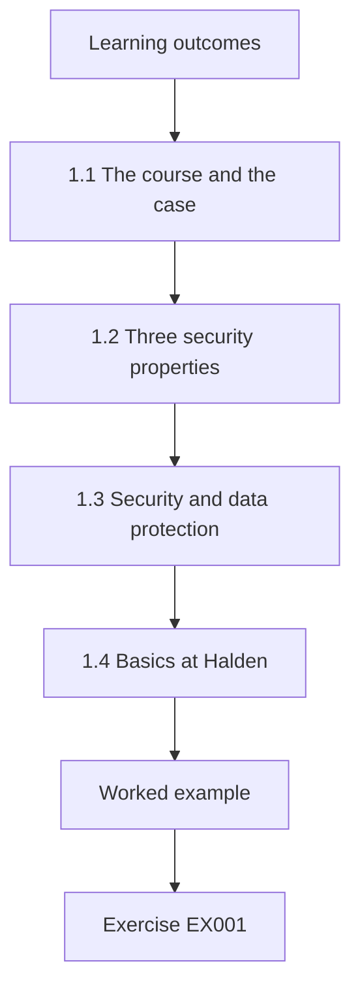

### Logical drawing

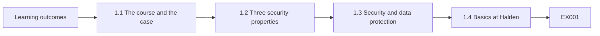

```text
[Learning outcomes]
    |
    v
[1.1 The course and the case]
    |
    v
[1.2 Three security properties]
    |
    v
[1.3 Security and data protection]
    |
    v
[1.4 Basics at Halden]
    |
    v
[Worked example] --> [Exercise EX001]
```
<!-- open-cyber-academy:lesson-figures:end ch-01 -->


### Learning outcomes

You will (1) explain confidentiality, integrity and availability for personal data; (2) relate security to data protection duties; (3) identify the security basics a recruitment agency needs.

### 1.1 The course and the case

Marta Silva, an office manager changing careers, joins a six-month professional course at the fictional Northgate Professional Academy. Her mentor is Ms. Grace Lin, an experienced privacy practitioner. Marta's placement is at the fictional Halden Recruitment, an agency with forty consultants that holds about 25,000 candidate profiles, CVs, interview notes, references and, for some roles, background check results. Candidates trust Halden with their career history, salary expectations and sometimes health or disability information needed for interview adjustments, so careful handling matters from the first day.

### 1.2 Three security properties

Ms. Lin starts with confidentiality, integrity and availability. Confidentiality means only authorised people see a candidate's CV and notes. Integrity means records are accurate and not altered without authority, so a candidate is not rejected because of a wrong note. Availability means consultants can reach records when a client is waiting for a shortlist. Marta notes that Article 32 of the GDPR asks controllers to ensure these properties with measures appropriate to the risk, and that each property protects candidates in a different way.

### 1.3 Security and data protection

Marta learns that data protection is broader than security. Security protects data against loss and misuse, while data protection also asks whether Halden should collect the data at all, for what purpose, for how long and what candidates are told. A perfectly secured database of CVs kept for ten years without reason still breaks the storage limitation principle in Article 5(1)(e). Ms. Lin summarises the relationship: security is necessary for data protection, but it is never sufficient on its own. Both are needed together.

### 1.4 Basics at Halden

Marta lists security basics and checks them at Halden: individual accounts with multi-factor authentication for the recruitment system, encrypted laptops, a password manager, automatic updates, backups that are tested, and a way for staff to report mistakes quickly. She finds that multi-factor authentication is enabled for only half the consultants and that laptops are encrypted except for two older machines. She records these as early findings, owned by the IT provider, with dates for fixing each one. The IT provider accepts both findings and agrees fixing dates.

### Worked example

Marta explains confidentiality, integrity and availability for candidate records, distinguishes security from data protection and finds gaps in multi-factor authentication and laptop encryption.

> **Synthetic case.** Northgate, Halden and all people are synthetic; GDPR Articles 5(1)(e) and 32 are real.

### Errors and limits

Checklists of basics do not show whether controls actually work; verify later.

### Exercises

- **EX001 — Integrity example.** Give an example of an integrity failure at Halden. *Rubric:* 3 = a wrong note leads to rejection;; 2 = mentions accuracy;; 1 = vague;; 0 = none.
- **EX002 — Broader than security.** Why is data protection broader than security? *Rubric:* 3 = it also covers whether, why and how long data are kept;; 2 = mentions purpose;; 1 = vague;; 0 = none.
- **EX003 — Secured but unlawful.** How can a well-secured CV database still break the law? *Rubric:* 3 = kept too long, breaking storage limitation;; 2 = mentions retention;; 1 = vague;; 0 = none.
- **EX004 — MFA coverage.** What share of consultants had multi-factor authentication? *Rubric:* 3 = about half;; 2 = partly correct;; 1 = all;; 0 = none.
- **EX005 — Laptop gap.** What was found about laptop encryption? *Rubric:* 3 = two older machines unencrypted;; 2 = partly correct;; 1 = vague;; 0 = none.

<!-- open-cyber-academy:chapter-navigation:start ch-01 -->
### Continue studying — lesson 01 (chapter 01 of 12)

[← Course home](../../README.md) · [Course chapter index](../SUBJECTS.md) · [Chapter 02 →](#ch-02)

Continue to the next authored lesson.
<!-- open-cyber-academy:chapter-navigation:end -->

<a id="ch-02"></a>

## Chapter 2 — Privacy and data protection: service and stakeholder context

<!-- open-cyber-academy:lesson-figures:start ch-02 -->
### Lesson map

Lesson 02 published. Map, example, EX006.

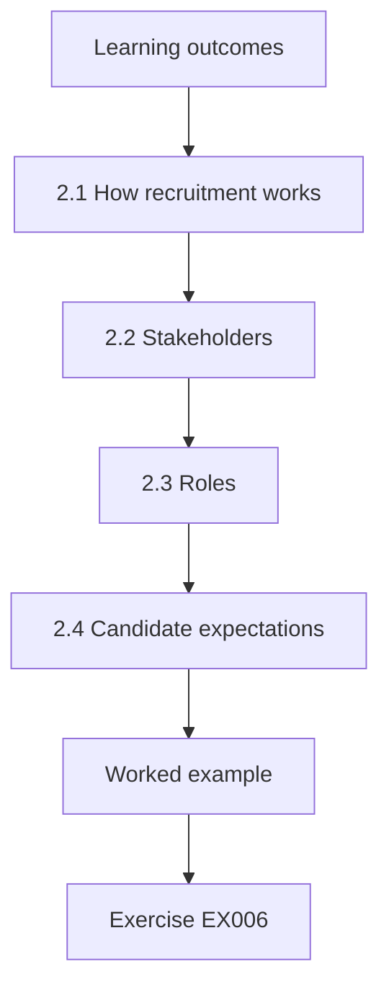

### Logical drawing

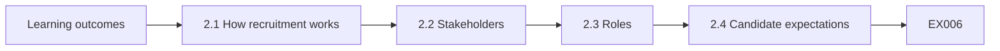

```text
[Learning outcomes]
    |
    v
[2.1 How recruitment works]
    |
    v
[2.2 Stakeholders]
    |
    v
[2.3 Roles]
    |
    v
[2.4 Candidate expectations]
    |
    v
[Worked example] --> [Exercise EX006]
```
<!-- open-cyber-academy:lesson-figures:end ch-02 -->


### Learning outcomes

You will (1) describe Halden's processing and stakeholders; (2) identify controller and processor roles; (3) understand candidate expectations.

### 2.1 How recruitment works

Halden advertises roles, receives applications, screens CVs, interviews candidates, collects references, sometimes arranges background checks and sends shortlists to client employers. Each step processes personal data. Marta maps the steps with a senior consultant and notes where data come from: candidates themselves, job boards, professional networking sites and referees. She learns that data collected from sources other than the candidate trigger the information duty in Article 14, so Halden must tell candidates where their details were obtained. Job board profiles are a common source for consultants searching for passive candidates.

### 2.2 Stakeholders

The stakeholders include candidates, client employers, referees, job boards, the background check provider, Halden's consultants and management, and the supervisory authority. Each has different interests. Candidates want fair treatment and discretion, especially when they are still employed elsewhere. Clients want suitable candidates quickly. Consultants want efficient tools. Marta notes that referees are data subjects too, because their names and opinions are recorded, and that their interests are often forgotten in recruitment processes. A referee who gives a frank opinion expects it to be handled with discretion, and a careless disclosure could damage working relationships.

### 2.3 Roles

Ms. Lin helps Marta work through roles. Halden is a controller for its candidate database because it decides why and how the data are processed. When Halden sends a shortlist to a client, the client becomes a separate controller for its hiring decision. The background check provider acts as a processor for some checks and a controller for others, depending on the contract. Marta uses EDPB Guidelines 07/2020 on controller and processor concepts to reason through each relationship rather than guessing from job titles.

### 2.4 Candidate expectations

Marta reviews twenty anonymised synthetic complaints from a sector survey. Common themes include CVs sent to employers without the candidate's knowledge, profiles kept for years after the candidate asked for removal and unexpected calls about unrelated roles. She concludes that candidates expect to be asked before their CV goes to a specific client and to know how long they stay on the books. These expectations shape her later work on consent, retention and transparency at Halden. Discretion matters most to candidates who are currently employed and searching quietly.

### Worked example

Marta maps recruitment steps and sources, lists stakeholders including referees, works out controller and processor roles with EDPB Guidelines 07/2020 and identifies candidate expectations from synthetic complaints.

> **Synthetic case.** Complaints are synthetic; GDPR Article 14 and EDPB Guidelines 07/2020 are real.

### Errors and limits

Roles depend on facts and contracts; record the reasoning for each.

### Exercises

- **EX006 — Article 14 trigger.** When does Article 14 apply at Halden? *Rubric:* 3 = data obtained from job boards or networking sites;; 2 = mentions other sources;; 1 = vague;; 0 = none.
- **EX007 — Forgotten subjects.** Which data subjects are often forgotten? *Rubric:* 3 = referees;; 2 = partly correct;; 1 = clients;; 0 = none.
- **EX008 — Client role.** What role does a client employer have for its hiring decision? *Rubric:* 3 = separate controller;; 2 = partly correct;; 1 = processor;; 0 = none.
- **EX009 — Role guidance.** Which guidelines help decide roles? *Rubric:* 3 = EDPB Guidelines 07/2020;; 2 = partly correct;; 1 = other;; 0 = none.
- **EX010 — Expectation.** What do candidates expect before CVs go to a client? *Rubric:* 3 = to be asked;; 2 = partly correct;; 1 = vague;; 0 = none.

<!-- open-cyber-academy:chapter-navigation:start ch-02 -->
### Continue studying — lesson 02 (chapter 02 of 12)

[← Chapter 01](#ch-01) · [Course chapter index](../SUBJECTS.md) · [Chapter 03 →](#ch-03)

Continue to the next authored lesson.
<!-- open-cyber-academy:chapter-navigation:end -->

<a id="ch-03"></a>

## Chapter 3 — Authorized practice and evidence handling

<!-- open-cyber-academy:lesson-figures:start ch-03 -->
### Lesson map

Lesson 03 published. Map, example, EX011.

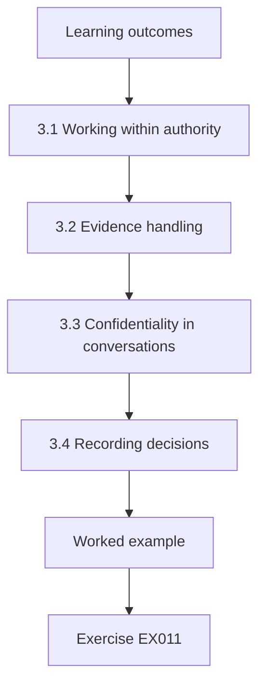

### Logical drawing

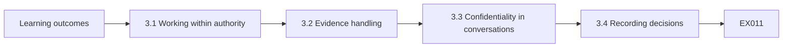

```text
[Learning outcomes]
    |
    v
[3.1 Working within authority]
    |
    v
[3.2 Evidence handling]
    |
    v
[3.3 Confidentiality in conversations]
    |
    v
[3.4 Recording decisions]
    |
    v
[Worked example] --> [Exercise EX011]
```
<!-- open-cyber-academy:lesson-figures:end ch-03 -->


### Learning outcomes

You will (1) work within an authorised scope; (2) handle evidence containing personal data; (3) respect confidentiality during reviews.

### 3.1 Working within authority

Ms. Lin explains that a privacy practitioner often sees sensitive data and must act only within the authority given. Marta's placement agreement allows her to review processes, configuration settings and samples of records chosen with the data protection lead, using synthetic or redacted data where possible. It does not allow her to contact candidates, change system settings herself or search records out of curiosity. When a consultant asks her to look up a friend's application status, she declines and records the request.

### 3.2 Evidence handling

During reviews, Marta collects evidence such as screenshots of retention settings, exported counts and copies of privacy notices. She keeps evidence in a restricted folder, names files consistently with the date and topic, and records how each item was obtained. Where a screenshot would show candidate names, she asks for a synthetic example or crops the image to show only the setting. She notes that evidence is itself personal data when it includes names, so it needs its own retention period. Evidence expires after the placement.

### 3.3 Confidentiality in conversations

Interviews with consultants sometimes reveal concerns about colleagues, such as a manager who shares CVs through personal email. Marta records facts relevant to processes and avoids gossip or personal judgements in her notes. She discusses sensitive findings only with the data protection lead and Ms. Lin. She learns that people share problems more openly when they trust that information will be used to fix processes rather than to blame individuals, which makes fair handling a practical as well as an ethical matter.

### 3.4 Recording decisions

Marta keeps a decision log for her placement: what she was asked to do, what she decided and why, and who approved it. The log includes the declined lookup request, a decision to use a synthetic export for the retention review and an agreement with the data protection lead about which mailboxes she may sample. Ms. Lin reviews the log weekly. She explains that a clear record protects both the practitioner and the organisation if decisions are later questioned by management or a regulator.

### Worked example

Marta works within a written placement scope, declines a lookup of a friend's application, handles evidence in a restricted folder with crops or synthetic examples, keeps conversations confidential and maintains a decision log.

> **Synthetic case.** The scope and log are synthetic.

### Errors and limits

Authority can be unclear in small firms; ask in writing before acting.

### Exercises

- **EX011 — Out-of-scope request.** What request did Marta decline? *Rubric:* 3 = looking up a friend's application status;; 2 = partly correct;; 1 = vague;; 0 = none.
- **EX012 — Placement limits.** Name one thing Marta may not do. *Rubric:* 3 = contact candidates, change settings, search out of curiosity;; 2 = one;; 1 = vague;; 0 = none.
- **EX013 — Screenshot names.** How does Marta avoid capturing names in screenshots? *Rubric:* 3 = synthetic examples or cropping;; 2 = one;; 1 = vague;; 0 = none.
- **EX014 — Trust benefit.** Why does fair handling help practically? *Rubric:* 3 = people share problems more openly;; 2 = mentions openness;; 1 = vague;; 0 = none.
- **EX015 — Decision log.** What does Marta's decision log record? *Rubric:* 3 = request, decision, reason, approver;; 2 = most;; 1 = one;; 0 = none.

<!-- open-cyber-academy:chapter-navigation:start ch-03 -->
### Continue studying — lesson 03 (chapter 03 of 12)

[← Chapter 02](#ch-02) · [Course chapter index](../SUBJECTS.md) · [Chapter 04 →](#ch-04)

Continue to the next authored lesson.
<!-- open-cyber-academy:chapter-navigation:end -->

<a id="ch-04"></a>

## Chapter 4 — Privacy and data protection: core methods

<!-- open-cyber-academy:lesson-figures:start ch-04 -->
### Lesson map

Lesson 04 published. Map, example, EX016.

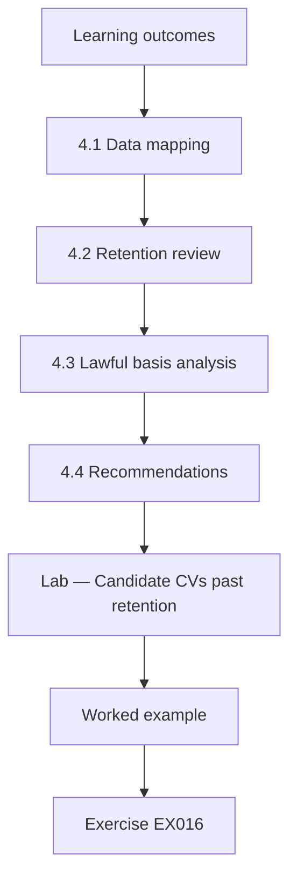

### Logical drawing

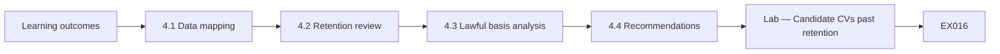

```text
[Learning outcomes]
    |
    v
[4.1 Data mapping]
    |
    v
[4.2 Retention review]
    |
    v
[4.3 Lawful basis analysis]
    |
    v
[4.4 Recommendations]
    |
    v
[Lab — Candidate CVs past retention]
    |
    v
[Worked example] --> [Exercise EX016]
```
<!-- open-cyber-academy:lesson-figures:end ch-04 -->


### Learning outcomes

You will (1) apply data mapping, retention review and lawful basis analysis; (2) analyse CV retention with a lab; (3) recommend changes.

### 4.1 Data mapping

Marta builds a data map for Halden listing each category of data, its source, purpose, system, recipients and retention. Categories include contact details, CVs, interview notes, references, right-to-work documents, background check results and diversity monitoring answers. The map shows that diversity answers are stored with names in the recruitment system although they are used only for anonymous statistics. She recommends storing them separately without names, which supports minimisation and reduces the impact of any breach involving the main candidate database. The IT provider confirms feasibility.

### 4.2 Retention review

Halden's policy says CVs of unsuccessful candidates are deleted six months after last contact unless the candidate agrees to stay in the talent pool. Marta checks practice with a synthetic copy of the candidate database. The lab shows that 1,792 of 2,500 candidates, 71.7%, are past six months without talent-pool agreement, so the policy has not been applied. It also finds 216 talent-pool candidates with no contact for over two years, whose agreement is probably stale and should be refreshed or ended. Most expired profiles are years old.

### 4.3 Lawful basis analysis

With the data protection lead, Marta reviews lawful bases. Processing applications for a specific role relies on steps at the candidate's request before a contract, under Article 6(1)(b). Keeping candidates in the talent pool for future roles relies on consent, which must be specific and withdrawable. Right-to-work checks rely on legal obligation. Background checks need careful analysis, especially for criminal records, which Article 10 restricts. She documents each basis so that consultants know which data they may use for which purpose. Consultants receive a summary.

### 4.4 Recommendations

Marta recommends three changes: run an automated deletion job for expired CVs after a report-only trial, send a refresh request to talent-pool candidates who have not been in contact for two years and delete those who do not reply, and separate diversity data from names. She estimates that the first change alone removes over two-thirds of stored candidate profiles. The managing director approves, and the IT provider schedules the work with Marta preparing the test plan. Each change has an owner and a date, and the deletion job's first live run is scheduled after the trial.

### Lab — Candidate CVs past retention

```python
"""Check candidate CVs against a retention rule in a synthetic recruitment database (stdlib only)."""
import random, datetime
random.seed(21)
today = datetime.date(2026, 10, 1)
cands = []
for i in range(2500):
    last = today - datetime.timedelta(days=random.randint(0, 1500))
    pool = random.random() < 0.18          # candidate agreed to stay in talent pool
    cands.append((i, last, pool))
rule = 183                                  # six months after last contact
expired = [c for c in cands if (today - c[1]).days > rule and not c[2]]
pool_old = [c for c in cands if c[2] and (today - c[1]).days > 730]
print(f"candidates {len(cands)}; past six months without pool consent {len(expired)} ({100*len(expired)/len(cands):.1f}%)")
print(f"talent-pool candidates with no contact for over two years {len(pool_old)}")
```

Run with `python3 lab_cvs.py`. Verified output:

```text
candidates 2500; past six months without pool consent 1792 (71.7%)
talent-pool candidates with no contact for over two years 216
```

### Worked example

Marta maps data categories, finds 1,792 of 2,500 candidates (71.7%) past retention and 216 stale talent-pool entries, documents lawful bases and recommends deletion, consent refresh and separating diversity data.

> **Synthetic case.** Records are synthetic; GDPR Articles 6(1)(b) and 10 are real.

### Errors and limits

Some records may be needed for legal claims; agree exceptions before deleting.

### Exercises

- **EX016 — Diversity data.** What did the map show about diversity answers? *Rubric:* 3 = stored with names though used anonymously;; 2 = mentions names;; 1 = vague;; 0 = none.
- **EX017 — Expired CVs.** How many candidates were past six months without pool consent? *Rubric:* 3 = 1,792 of 2,500, 71.7%;; 2 = approximate;; 1 = wrong;; 0 = none.
- **EX018 — Stale pool.** How many talent-pool candidates had no contact for over two years? *Rubric:* 3 = 216;; 2 = partly correct;; 1 = wrong;; 0 = none.
- **EX019 — Talent pool basis.** What lawful basis supports the talent pool? *Rubric:* 3 = consent;; 2 = partly correct;; 1 = contract;; 0 = none.
- **EX020 — Criminal data.** Which article restricts criminal record data? *Rubric:* 3 = Article 10;; 2 = partly correct;; 1 = other;; 0 = none.

<!-- open-cyber-academy:chapter-navigation:start ch-04 -->
### Continue studying — lesson 04 (chapter 04 of 12)

[← Chapter 03](#ch-03) · [Course chapter index](../SUBJECTS.md) · [Chapter 05 →](#ch-05)

Continue to the next authored lesson.
<!-- open-cyber-academy:chapter-navigation:end -->

<a id="ch-05"></a>

## Chapter 5 — Privacy and data protection: tools and interpretation

<!-- open-cyber-academy:lesson-figures:start ch-05 -->
### Lesson map

Lesson 05 published. Map, example, EX021.

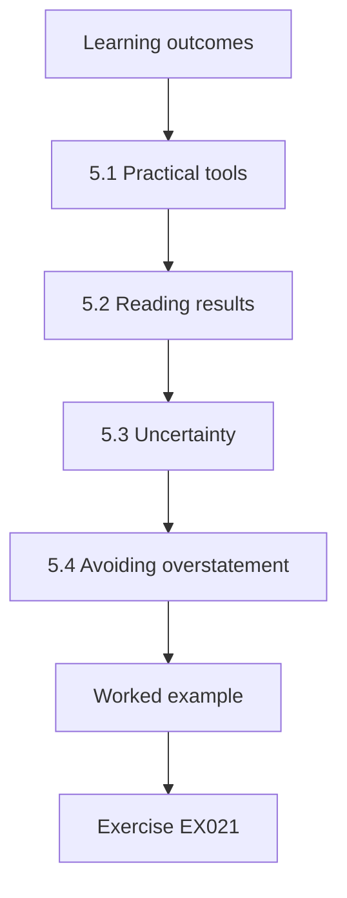

### Logical drawing

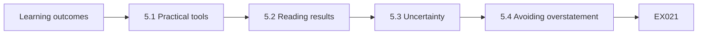

```text
[Learning outcomes]
    |
    v
[5.1 Practical tools]
    |
    v
[5.2 Reading results]
    |
    v
[5.3 Uncertainty]
    |
    v
[5.4 Avoiding overstatement]
    |
    v
[Worked example] --> [Exercise EX021]
```
<!-- open-cyber-academy:lesson-figures:end ch-05 -->


### Learning outcomes

You will (1) use simple tools to examine data and settings; (2) interpret results carefully; (3) avoid overstating findings.

### 5.1 Practical tools

Marta uses the recruitment system's built-in reports, spreadsheet filters on synthetic exports, the email system's search for attachments sent externally, and short Python scripts written with Ms. Lin's help. She learns to start with the system's own reporting before exporting data, because every export creates a new copy that must be protected and deleted. When she needs an export, she asks for only the fields needed for her question, such as last contact date and pool status, not full profiles. Fewer fields mean less risk.

### 5.2 Reading results

A report shows that 340 emails with CV attachments were sent to external addresses last month. Marta resists concluding that 340 CVs were shared improperly. Most went to client employers as part of normal shortlisting. She samples twenty and checks whether each candidate agreed to be put forward for that client. Seventeen did, two cannot be confirmed and one went to a consultant's personal email address. Her interpretation is that the main issue is undocumented candidate agreement, plus one serious personal email case. Context shapes interpretation.

### 5.3 Uncertainty

Ms. Lin teaches Marta to state what a result does and does not show. The sample of twenty suggests that undocumented agreement affects a minority of cases, but it cannot give a precise rate for the whole month. The personal email case shows that it happens, not how often. Marta writes her findings with phrases such as in the sample and could not be confirmed, which help managers understand the strength of the evidence and avoid either panic or complacency. Precision builds trust.

### 5.4 Avoiding overstatement

Marta's first draft says Halden routinely shares CVs without consent. Ms. Lin asks whether the evidence supports routinely. Marta rewrites it: in a sample of twenty external CV emails, two lacked a recorded agreement and one went to a personal address. The revised wording is less dramatic but more credible, and the managing director acts on it immediately. Marta notes that overstatement damages trust in privacy advice, especially when managers later check the evidence for themselves. The facts were serious enough without exaggeration.

### Worked example

Marta uses built-in reports and minimal exports, samples twenty of 340 external CV emails, finds two unconfirmed agreements and one personal-address case, and rewrites findings to match the evidence.

> **Synthetic case.** Results are synthetic.

### Errors and limits

Samples show patterns, not exact rates; say so.

### Exercises

- **EX021 — Start with reports.** Why start with built-in reports? *Rubric:* 3 = exports create new copies;; 2 = mentions copies;; 1 = vague;; 0 = none.
- **EX022 — Sample result.** What did the sample of twenty show? *Rubric:* 3 = 17 agreed, 2 unconfirmed, 1 personal email;; 2 = most;; 1 = one;; 0 = none.
- **EX023 — Main issue.** What was the main issue identified? *Rubric:* 3 = undocumented candidate agreement;; 2 = partly correct;; 1 = vague;; 0 = none.
- **EX024 — Careful phrase.** Give a phrase that signals uncertainty. *Rubric:* 3 = in the sample; could not be confirmed;; 2 = one;; 1 = vague;; 0 = none.
- **EX025 — Overstatement.** Which word did Ms. Lin challenge? *Rubric:* 3 = routinely;; 2 = partly correct;; 1 = other;; 0 = none.

<!-- open-cyber-academy:chapter-navigation:start ch-05 -->
### Continue studying — lesson 05 (chapter 05 of 12)

[← Chapter 04](#ch-04) · [Course chapter index](../SUBJECTS.md) · [Chapter 06 →](#ch-06)

Continue to the next authored lesson.
<!-- open-cyber-academy:chapter-navigation:end -->

<a id="ch-06"></a>

## Chapter 6 — Privacy and data protection: operational workflow

<!-- open-cyber-academy:lesson-figures:start ch-06 -->
### Lesson map

Lesson 06 published. Map, example, EX026.

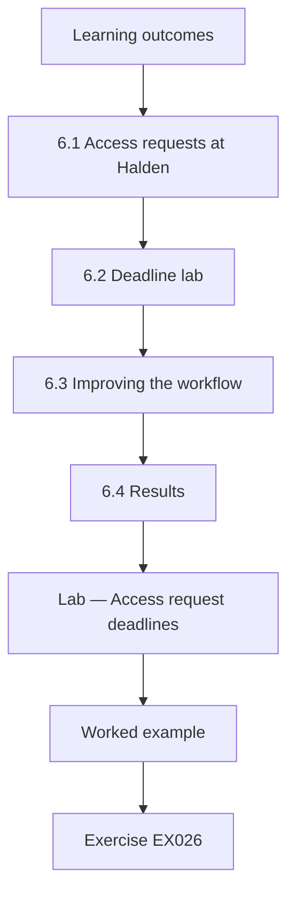

### Logical drawing

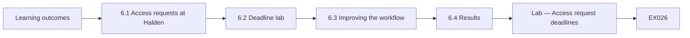

```text
[Learning outcomes]
    |
    v
[6.1 Access requests at Halden]
    |
    v
[6.2 Deadline lab]
    |
    v
[6.3 Improving the workflow]
    |
    v
[6.4 Results]
    |
    v
[Lab — Access request deadlines]
    |
    v
[Worked example] --> [Exercise EX026]
```
<!-- open-cyber-academy:lesson-figures:end ch-06 -->


### Learning outcomes

You will (1) run an access request workflow; (2) track deadlines with a lab; (3) improve the workflow.

### 6.1 Access requests at Halden

Candidates sometimes ask Halden for a copy of their data, often after being rejected for a role. Article 15 gives them the right to access their personal data, and Article 12(3) requires a response without undue delay and within one month, extendable by two further months for complex requests. Marta maps Halden's workflow: requests arrive by email to any consultant, are forwarded to the office manager and are answered by searching the recruitment system and mailboxes. Forwarding between people added several days to each request.

### 6.2 Deadline lab

Marta reviews a synthetic quarter of thirty-six access requests. The lab shows that 7 of 36, 19.4%, were answered after one month, and that the median time to answer was 21 days. Late requests usually involved searches of several consultants' mailboxes and waiting for reference checks. Nobody tracked deadlines centrally, so requests were noticed only when candidates chased them. Marta notes that the lab uses a simplified month calculation, which is enough to show the pattern but not to judge individual legal deadlines. The pattern was consistent across months.

### 6.3 Improving the workflow

Marta designs a central request log with the date received, identity check, systems searched, extension decision and date answered. Consultants forward requests to a single privacy mailbox the same day. A checklist lists every system and shared mailbox to search. She uses EDPB Guidelines 01/2022 to decide what the response must include, such as purposes, recipients, retention periods and the source of data obtained from job boards. Reminders are set for day twenty and day twenty-five. The identity check is proportionate: a reply from the email address on file is usually enough.

### 6.4 Results

Over the next synthetic quarter, the log records all requests, and none are answered late. The median time to answer falls because searches are planned from the first day. Marta adds two lessons to the procedure: extensions must be decided and communicated within the first month, not after it has passed, and reference documents may contain third-party information that requires careful review before release. Ms. Lin notes that operational workflows succeed when they make the right step the easy step for busy consultants.

### Lab — Access request deadlines

```python
"""Track access-request deadlines for a synthetic quarter (stdlib only)."""
import random, datetime
random.seed(4)
start = datetime.date(2026, 4, 1)
reqs = []
for i in range(36):
    recv = start + datetime.timedelta(days=random.randint(0, 80))
    took = random.choice([9, 12, 15, 18, 21, 24, 27, 33, 38, 45])
    reqs.append((recv, took))
def deadline(d):  # one month: same day next month (simplified, clamp to 28)
    m = d.month % 12 + 1; y = d.year + (d.month == 12)
    return datetime.date(y, m, min(d.day, 28))
late = [(r, t) for r, t in reqs if r + datetime.timedelta(days=t) > deadline(r)]
print(f"requests {len(reqs)}; answered after one month {len(late)} ({100*len(late)/len(reqs):.1f}%)")
print(f"median days to answer {sorted(t for _, t in reqs)[len(reqs)//2]}")
```

Run with `python3 lab_deadlines.py`. Verified output:

```text
requests 36; answered after one month 7 (19.4%)
median days to answer 21
```

### Worked example

Marta finds 7 of 36 synthetic requests (19.4%) answered after one month with a median of 21 days, creates a central log, checklist and reminders, and sees no late responses the next quarter.

> **Synthetic case.** Requests are synthetic; GDPR Articles 12(3) and 15 and EDPB Guidelines 01/2022 are real.

### Errors and limits

The lab simplifies month calculation; check legal deadlines individually.

### Exercises

- **EX026 — Late share.** What share of requests was answered late? *Rubric:* 3 = 7 of 36, 19.4%;; 2 = approximate;; 1 = wrong;; 0 = none.
- **EX027 — Median.** What was the median time to answer? *Rubric:* 3 = 21 days;; 2 = partly correct;; 1 = wrong;; 0 = none.
- **EX028 — Late cause.** What usually caused lateness? *Rubric:* 3 = searching several mailboxes and waiting for references;; 2 = mentions mailboxes;; 1 = vague;; 0 = none.
- **EX029 — Response content.** Name two things a response must include. *Rubric:* 3 = purposes, recipients, retention, source;; 2 = two;; 1 = one;; 0 = none.
- **EX030 — Extension timing.** When must extensions be decided? *Rubric:* 3 = within the first month;; 2 = partly correct;; 1 = later;; 0 = none.

<!-- open-cyber-academy:chapter-navigation:start ch-06 -->
### Continue studying — lesson 06 (chapter 06 of 12)

[← Chapter 05](#ch-05) · [Course chapter index](../SUBJECTS.md) · [Chapter 07 →](#ch-07)

Continue to the next authored lesson.
<!-- open-cyber-academy:chapter-navigation:end -->

<a id="ch-07"></a>

## Chapter 7 — Privacy and data protection: controls and verification

<!-- open-cyber-academy:lesson-figures:start ch-07 -->
### Lesson map

Lesson 07 published. Map, example, EX031.

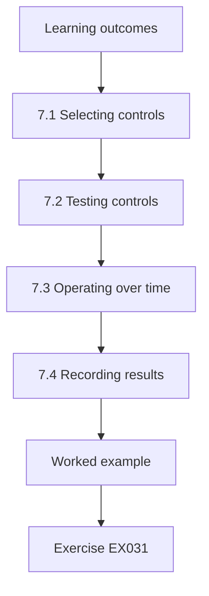

### Logical drawing

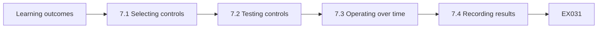

```text
[Learning outcomes]
    |
    v
[7.1 Selecting controls]
    |
    v
[7.2 Testing controls]
    |
    v
[7.3 Operating over time]
    |
    v
[7.4 Recording results]
    |
    v
[Worked example] --> [Exercise EX031]
```
<!-- open-cyber-academy:lesson-figures:end ch-07 -->


### Learning outcomes

You will (1) select controls for recruitment risks; (2) verify that controls operate; (3) record verification results.

### 7.1 Selecting controls

From her findings, Marta proposes controls: multi-factor authentication for all consultants, a block on sending CVs to personal email domains, a recorded candidate agreement before each submission to a client, the automated CV deletion job, the central access request log and separate storage for diversity data. Each control is linked to a risk and a principle. For example, the personal email block addresses confidentiality, while recorded agreement addresses transparency and fairness, because candidates should know where their CV is going before it is sent.

### 7.2 Testing controls

Marta tests each control with synthetic data and test accounts. She tries to send a synthetic CV to a personal email address and confirms the block appears with a clear message. She checks that the recruitment system refuses a client submission when the agreement box is empty. She confirms that the deletion job, in report-only mode, lists the expected number of expired profiles. One test fails: diversity data are still copied into the main system by an old import script, which the IT provider then removes.

### 7.3 Operating over time

Testing once shows a control can work; verification over time shows it keeps working. Marta sets a quarterly verification routine: check multi-factor coverage from the identity report, sample ten client submissions for recorded agreement, confirm deletion job success messages and review the access request log for overdue cases. Each check has an owner and an expected result. She explains that controls in small firms often decay when the person who set them up leaves, so routine checks protect against that loss of attention.

### 7.4 Recording results

Results are recorded in a verification register with the date, control, test method, result and any follow-up. The first quarter shows full multi-factor coverage, ten of ten sampled submissions with recorded agreement and no overdue requests. The register gives the managing director a factual picture of the controls and gives the data protection lead evidence of accountability under Article 5(2). Ms. Lin advises Marta to record failures as clearly as successes, because a register that never shows problems is not believed. The register is reviewed quarterly.

### Worked example

Marta selects six controls linked to risks, tests them with synthetic data, finds an old import script copying diversity data, sets quarterly verification and records results in a register.

> **Synthetic case.** Controls and results are synthetic; GDPR Article 5(2) is real.

### Errors and limits

A passed test can hide gaps if the test is too narrow; vary test cases.

### Exercises

- **EX031 — Agreement control.** Which principle does recorded agreement support? *Rubric:* 3 = transparency and fairness;; 2 = one;; 1 = vague;; 0 = none.
- **EX032 — Failed test.** Which test failed? *Rubric:* 3 = diversity data copied by an old import script;; 2 = partly correct;; 1 = vague;; 0 = none.
- **EX033 — Quarterly checks.** Name two quarterly checks. *Rubric:* 3 = MFA coverage, submission sample, deletion success, overdue requests;; 2 = two;; 1 = one;; 0 = none.
- **EX034 — Sample result.** How many sampled submissions had recorded agreement? *Rubric:* 3 = 10 of 10;; 2 = partly correct;; 1 = wrong;; 0 = none.
- **EX035 — Recording failures.** Why record failures clearly? *Rubric:* 3 = registers without problems are not believed;; 2 = mentions credibility;; 1 = vague;; 0 = none.

<!-- open-cyber-academy:chapter-navigation:start ch-07 -->
### Continue studying — lesson 07 (chapter 07 of 12)

[← Chapter 06](#ch-06) · [Course chapter index](../SUBJECTS.md) · [Chapter 08 →](#ch-08)

Continue to the next authored lesson.
<!-- open-cyber-academy:chapter-navigation:end -->

<a id="ch-08"></a>

## Chapter 8 — Privacy and data protection: supervised case analysis

<!-- open-cyber-academy:lesson-figures:start ch-08 -->
### Lesson map

Lesson 08 published. Map, example, EX036.

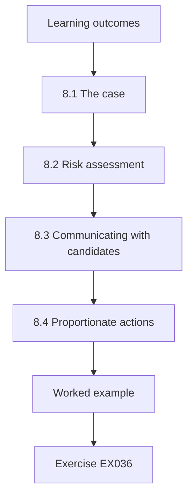

### Logical drawing

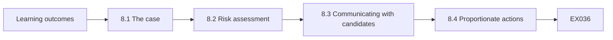

```text
[Learning outcomes]
    |
    v
[8.1 The case]
    |
    v
[8.2 Risk assessment]
    |
    v
[8.3 Communicating with candidates]
    |
    v
[8.4 Proportionate actions]
    |
    v
[Worked example] --> [Exercise EX036]
```
<!-- open-cyber-academy:lesson-figures:end ch-08 -->


### Learning outcomes

You will (1) analyse a real-style privacy incident under supervision; (2) assess risk to candidates; (3) recommend proportionate actions.

### 8.1 The case

A consultant's laptop bag is stolen from a car. The laptop is encrypted, but the bag also contains printed interview notes for six candidates, including one candidate's request for disability adjustments at interview. Marta analyses the case with Ms. Lin and the data protection lead. She lists the facts: what was lost, when, where, what protections applied, who is affected and what has been done so far. She notes that paper often escapes the controls designed for systems. The theft is reported to police that evening.

### 8.2 Risk assessment

Marta assesses the risk using EDPB Guidelines 9/2022. The encrypted laptop presents low risk, because the data are unintelligible without the key. The printed notes present higher risk: they include names, current employers, salary expectations and, for one candidate, health information. Disclosure could harm candidates still employed elsewhere and could reveal a disability. She concludes that the breach is likely to result in a risk to candidates, so the supervisory authority must be notified within 72 hours under Article 33. The decision is recorded with reasons.

### 8.3 Communicating with candidates

Because the disability information creates a high risk for that candidate, Article 34 requires informing her directly. Marta drafts communications for all six candidates explaining what happened, what information was involved, what Halden is doing and who to contact. The draft avoids technical jargon and does not minimise the event. Ms. Lin reviews the wording and suggests offering a direct phone call to the candidate with health information, because a personal conversation is more respectful for sensitive news. Letters go out within two days of the theft.

### 8.4 Proportionate actions

Marta recommends actions in proportion to the causes: no printed interview notes leave the office, notes are recorded directly in the recruitment system, adjustment requests are stored only in a restricted field, and staff receive a short briefing on carrying documents. She avoids recommending disciplinary action, because the consultant followed the practice everyone used. The data protection lead records the breach, notification and decisions. Ms. Lin notes that the analysis is useful because it changed practice, not because it assigned blame. Causes, not people.

### Worked example

Marta analyses a stolen bag with an encrypted laptop and printed notes, assesses higher risk from the paper, supports notification within 72 hours, drafts candidate communications and recommends ending printed notes.

> **Synthetic case.** The case is synthetic; GDPR Articles 33 and 34 and EDPB Guidelines 9/2022 are real.

### Errors and limits

Risk assessment depends on facts that may change; update it as information arrives.

### Exercises

- **EX036 — Low-risk item.** Why was the laptop low risk? *Rubric:* 3 = encrypted, data unintelligible without key;; 2 = mentions encryption;; 1 = vague;; 0 = none.
- **EX037 — High-risk content.** What made the printed notes higher risk? *Rubric:* 3 = names, employers, salaries and health information;; 2 = most;; 1 = one;; 0 = none.
- **EX038 — Notification.** Within what time must the authority be notified? *Rubric:* 3 = 72 hours;; 2 = partly correct;; 1 = wrong;; 0 = none.
- **EX039 — Article 34.** Why must one candidate be informed directly? *Rubric:* 3 = high risk from disability information;; 2 = mentions health;; 1 = vague;; 0 = none.
- **EX040 — No blame.** Why was disciplinary action not recommended? *Rubric:* 3 = the consultant followed common practice;; 2 = partly correct;; 1 = vague;; 0 = none.

<!-- open-cyber-academy:chapter-navigation:start ch-08 -->
### Continue studying — lesson 08 (chapter 08 of 12)

[← Chapter 07](#ch-07) · [Course chapter index](../SUBJECTS.md) · [Chapter 09 →](#ch-09)

Continue to the next authored lesson.
<!-- open-cyber-academy:chapter-navigation:end -->

<a id="ch-09"></a>

## Chapter 9 — Communication, ethics and reporting

<!-- open-cyber-academy:lesson-figures:start ch-09 -->
### Lesson map

Lesson 09 published. Map, example, EX041.

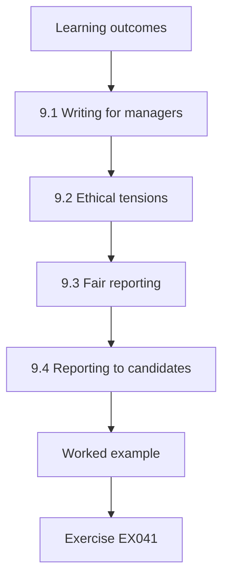

### Logical drawing

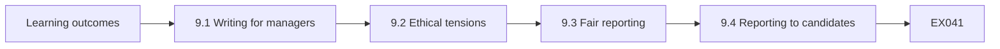

```text
[Learning outcomes]
    |
    v
[9.1 Writing for managers]
    |
    v
[9.2 Ethical tensions]
    |
    v
[9.3 Fair reporting]
    |
    v
[9.4 Reporting to candidates]
    |
    v
[Worked example] --> [Exercise EX041]
```
<!-- open-cyber-academy:lesson-figures:end ch-09 -->


### Learning outcomes

You will (1) write privacy findings for managers; (2) handle ethical tensions; (3) report clearly and fairly.

### 9.1 Writing for managers

Marta prepares a report for Halden's managing director. Ms. Lin advises her to start with decisions needed, not background. The first page lists three decisions: approve the deletion job, fund laptop replacements for the two unencrypted machines and adopt the no-printed-notes rule. Each decision has a short reason, a cost estimate and the risk of not acting. Detailed evidence follows in an appendix. The managing director reads the first page in five minutes and approves all three decisions. The appendix holds the evidence.

### 9.2 Ethical tensions

A client employer asks Halden to tell them which candidates have disabilities so they can plan adjustments in advance. Marta recognises a tension: the client's goal sounds helpful, but sharing health information without the candidate's choice is neither necessary nor fair. She recommends that Halden ask each candidate whether they want adjustments communicated, and share only the adjustment needed, not the condition. Ms. Lin notes that ethical reasoning often finds a way to meet the legitimate goal while protecting the person. Consent unlocks the solution.

### 9.3 Fair reporting

Marta's findings involve individual consultants, such as the one who emailed a CV to a personal address. In her report she describes the event and the process gap without naming the consultant, and she notes that no technical block existed at the time. The data protection lead knows the details and handles any individual follow-up separately. Marta explains that reports aimed at improving systems should focus on causes, and that naming individuals in wide reports discourages others from reporting problems. Systems change; people learn.

### 9.4 Reporting to candidates

Marta also improves how Halden explains privacy to candidates. The privacy notice is rewritten in plain language with sections for applying for a role, staying in the talent pool, references and background checks. It states retention periods in months, not vague phrases. A short version appears on the application form, with a link to the full notice. She tests the short version with five synthetic personas representing different candidates and adjusts wording that might confuse candidates who are not native English speakers.

### Worked example

Marta writes a decision-first report approved in one reading, resolves a client request for disability information by sharing only needed adjustments with consent, reports causes without naming staff and rewrites the candidate notice.

> **Synthetic case.** The report and notice are synthetic.

### Errors and limits

Plain language must remain accurate; check legal points with the data protection lead.

### Exercises

- **EX041 — Report structure.** What appears on the first page of Marta's report? *Rubric:* 3 = decisions needed with reasons, costs and risks;; 2 = mentions decisions;; 1 = background;; 0 = none.
- **EX042 — Disability request.** What did Marta recommend for the client's request? *Rubric:* 3 = ask candidates; share only adjustments;; 2 = mentions consent;; 1 = share;; 0 = none.
- **EX043 — Naming staff.** Why not name consultants in the report? *Rubric:* 3 = focus on causes; naming discourages reporting;; 2 = mentions reporting;; 1 = vague;; 0 = none.
- **EX044 — Retention wording.** How does the new notice state retention? *Rubric:* 3 = in months;; 2 = partly correct;; 1 = vague;; 0 = none.
- **EX045 — Notice testing.** How was the short notice tested? *Rubric:* 3 = with five synthetic personas;; 2 = partly correct;; 1 = vague;; 0 = none.

<!-- open-cyber-academy:chapter-navigation:start ch-09 -->
### Continue studying — lesson 09 (chapter 09 of 12)

[← Chapter 08](#ch-08) · [Course chapter index](../SUBJECTS.md) · [Chapter 10 →](#ch-10)

Continue to the next authored lesson.
<!-- open-cyber-academy:chapter-navigation:end -->

<a id="ch-10"></a>

## Chapter 10 — Privacy and data protection: quality and troubleshooting

<!-- open-cyber-academy:lesson-figures:start ch-10 -->
### Lesson map

Lesson 10 published. Map, example, EX046.

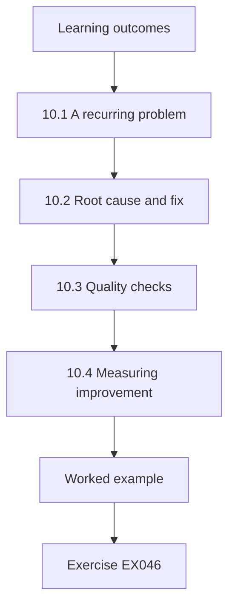

### Logical drawing

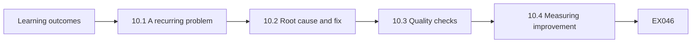

```text
[Learning outcomes]
    |
    v
[10.1 A recurring problem]
    |
    v
[10.2 Root cause and fix]
    |
    v
[10.3 Quality checks]
    |
    v
[10.4 Measuring improvement]
    |
    v
[Worked example] --> [Exercise EX046]
```
<!-- open-cyber-academy:lesson-figures:end ch-10 -->


### Learning outcomes

You will (1) diagnose a recurring privacy problem; (2) improve process quality; (3) measure improvement.

### 10.1 A recurring problem

After the deletion job starts, two candidates complain that they were deleted while still in active recruitment processes. Marta investigates. She finds that the job uses the last contact date, which is updated only when a consultant logs a call or email. Consultants often communicate through networking messages that are not logged in the recruitment system. The data were therefore inaccurate: active candidates appeared inactive. The problem is a data quality failure that causes a privacy control to act on the wrong people.

### 10.2 Root cause and fix

The root cause is that the system's idea of contact does not match real practice. Marta works with consultants to add a simple button, mark active, that updates the date without logging details, and the deletion job now sends a warning to the responsible consultant seven days before deleting a profile. The consultant can confirm or extend with a reason. She notes that Article 5(1)(d) requires accurate data, and that accuracy matters for automated decisions about retention as much as for content.

### 10.3 Quality checks

Marta adds quality checks: a monthly report of profiles with an active application but a last contact date over three months old, and a sample review of five profiles per consultant each quarter. The first report finds thirty-one such profiles, which consultants update. She explains that quality checks catch problems before they cause harm, such as wrongful deletion or, in the opposite direction, keeping candidates who should have been deleted because someone updated the date without real contact. Consultants receive their own lists.

### 10.4 Measuring improvement

Over the next quarter, no candidates are wrongly deleted, and the number of profiles flagged by the monthly report falls from thirty-one to six. Consultants report that the warning emails are useful. Marta also monitors misuse of the mark active button by sampling extended profiles for a recorded reason. Ms. Lin observes that good privacy controls depend on good data and good processes, and that troubleshooting often reveals a gap between how a system assumes work happens and how people actually work.

### Worked example

Marta traces wrongful deletions to inaccurate last contact dates, adds a mark active button and seven-day warnings, introduces monthly and quarterly quality checks and sees flagged profiles fall from thirty-one to six.

> **Synthetic case.** The problem is synthetic; GDPR Article 5(1)(d) is real.

### Errors and limits

New buttons can be misused to keep data indefinitely; sample their use.

### Exercises

- **EX046 — Cause of deletions.** Why were active candidates deleted? *Rubric:* 3 = last contact date not updated for networking messages;; 2 = mentions date;; 1 = vague;; 0 = none.
- **EX047 — Warning period.** How long before deletion is the consultant warned? *Rubric:* 3 = seven days;; 2 = partly correct;; 1 = wrong;; 0 = none.
- **EX048 — Accuracy principle.** Which article requires accurate data? *Rubric:* 3 = Article 5(1)(d);; 2 = partly correct;; 1 = other;; 0 = none.
- **EX049 — Flagged profiles.** How did flagged profiles change? *Rubric:* 3 = from thirty-one to six;; 2 = partly correct;; 1 = wrong;; 0 = none.
- **EX050 — Button misuse.** How is misuse of mark active checked? *Rubric:* 3 = sampling extended profiles for reasons;; 2 = mentions sampling;; 1 = vague;; 0 = none.

<!-- open-cyber-academy:chapter-navigation:start ch-10 -->
### Continue studying — lesson 10 (chapter 10 of 12)

[← Chapter 09](#ch-09) · [Course chapter index](../SUBJECTS.md) · [Chapter 11 →](#ch-11)

Continue to the next authored lesson.
<!-- open-cyber-academy:chapter-navigation:end -->

<a id="ch-11"></a>

## Chapter 11 — Supervised laboratory

<!-- open-cyber-academy:lesson-figures:start ch-11 -->
### Lesson map

Lesson 11 published. Map, example, EX051.

```mermaid
flowchart TD
  N0["Learning outcomes"]
  N1["11.1 The lab task"]
  N2["11.2 Lab results"]
  N3["11.3 Balancing the referee"]
  N4["11.4 Documenting decisions"]
  N5["Lab — Third-party names in an access response"]
  N0 --> N1 --> N2 --> N3 --> N4 --> N5
  N5 --> EX["Worked example"]
  EX --> Q["Exercise EX051"]
```

### Logical drawing

```mermaid
flowchart LR
  N0["Learning outcomes"]
  N1["11.1 The lab task"]
  N2["11.2 Lab results"]
  N3["11.3 Balancing the referee"]
  N4["11.4 Documenting decisions"]
  N5["Lab — Third-party names in an access response"]
  N0 --> N1 --> N2 --> N3 --> N4 --> N5 --> Q["EX051"]
```

```text
[Learning outcomes]
    |
    v
[11.1 The lab task]
    |
    v
[11.2 Lab results]
    |
    v
[11.3 Balancing the referee]
    |
    v
[11.4 Documenting decisions]
    |
    v
[Lab — Third-party names in an access response]
    |
    v
[Worked example] --> [Exercise EX051]
```
<!-- open-cyber-academy:lesson-figures:end ch-11 -->


### Learning outcomes

You will (1) review an access request response for third-party data; (2) apply redaction correctly; (3) explain balancing decisions.

### 11.1 The lab task

Marta's supervised laboratory uses a synthetic access request response prepared for a rejected candidate, Rosa Lindqvist. The response includes interview notes, emails, an internal chat extract, a shortlist and a reference. Article 15(4) says the right to obtain a copy must not adversely affect the rights and freedoms of others, so Halden must consider third-party information before releasing documents. The lab checks which redactions were made and whether names of other people remain visible in the draft response. Visible names are the lab's focus, but she also reads every line in full for indirect clues.

### 11.2 Lab results

The lab finds six lines with four redactions already made and three third-party names still visible: a panel member, Tom Becker, in the interview notes; a referee, Ana Ruiz; and a colleague, Jon Patel, who compiled feedback. Marta does not simply redact all three. Ms. Lin asks her to consider each person's role. Staff acting in their professional capacity, like the panel member and colleague, can often be named, because candidates have a legitimate interest in knowing who assessed them. Context decides each case.

### 11.3 Balancing the referee

The referee is different. Ana Ruiz gave an opinion in confidence as a former manager. Marta considers whether the reference was given on the understanding that it would remain confidential, whether the candidate already knows who the referee is and whether the content can be shared without the name. She recommends disclosing the substance of the reference while asking the referee whether she objects to her name being shared, following the approach in EDPB Guidelines 01/2022 on balancing rights of others. Her answer is recorded.

### 11.4 Documenting decisions

Marta records each redaction decision with the reason: names of other candidates on the shortlist redacted because they are unrelated third parties, staff names left visible because they acted in professional roles, and the referee's name pending her response. She notes that blanket redaction can make responses useless and unfair to the candidate, while no redaction can harm others. Ms. Lin approves the reasoning and notes that documenting decisions allows the response to be defended if the candidate or the authority questions it.

### Lab — Third-party names in an access response

```python
"""Check a synthetic access-request export for unredacted third-party names (stdlib only)."""
import re
candidate = "Rosa Lindqvist"
third = ["Tom Becker", "Ana Ruiz", "Jon Patel"]
doc = [
    "Interview notes: Rosa Lindqvist strong on scheduling; panel member Tom Becker agreed.",
    "Email from [REDACTED] to Rosa Lindqvist confirming second interview.",
    "Reference received from Ana Ruiz, former manager, positive.",
    "Internal chat: [REDACTED] asked whether Rosa Lindqvist could start in May.",
    "Shortlist: Rosa Lindqvist, [REDACTED], [REDACTED].",
    "Feedback compiled by Jon Patel for the hiring manager.",
]
left = [(i + 1, n) for i, line in enumerate(doc) for n in third if n in line]
red = sum(line.count("[REDACTED]") for line in doc)
print(f"lines {len(doc)}; redactions made {red}; third-party names still visible {len(left)}")
for i, n in left: print(f"  line {i}: {n}")
```

Run with `python3 lab_redact.py`. Verified output:

```text
lines 6; redactions made 4; third-party names still visible 3
  line 1: Tom Becker
  line 3: Ana Ruiz
  line 6: Jon Patel
```

### Worked example

Marta finds three third-party names still visible in a six-line synthetic response, leaves professional staff names, redacts other candidates, seeks the referee's view and documents each decision.

> **Synthetic case.** The response is synthetic; GDPR Article 15(4) and EDPB Guidelines 01/2022 are real.

### Errors and limits

A name search misses indirect identifiers such as job titles; read documents in full.

### Exercises

- **EX051 — Visible names.** How many third-party names remained visible? *Rubric:* 3 = three;; 2 = partly correct;; 1 = wrong;; 0 = none.
- **EX052 — Staff names.** Why may staff names often remain? *Rubric:* 3 = they acted in professional roles;; 2 = mentions role;; 1 = vague;; 0 = none.
- **EX053 — Referee approach.** What did Marta recommend for the referee? *Rubric:* 3 = disclose substance; ask about the name;; 2 = both;; 1 = one;; 0 = none.
- **EX054 — Shortlist names.** Why were other candidates redacted? *Rubric:* 3 = unrelated third parties;; 2 = partly correct;; 1 = vague;; 0 = none.
- **EX055 — Blanket redaction.** Why avoid blanket redaction? *Rubric:* 3 = makes responses useless and unfair;; 2 = mentions fairness;; 1 = vague;; 0 = none.

<!-- open-cyber-academy:chapter-navigation:start ch-11 -->
### Continue studying — lesson 11 (chapter 11 of 12)

[← Chapter 10](#ch-10) · [Course chapter index](../SUBJECTS.md) · [Chapter 12 →](#ch-12)

Continue to the next authored lesson.
<!-- open-cyber-academy:chapter-navigation:end -->

<a id="ch-12"></a>

## Chapter 12 — Practice portfolio and final review

<!-- open-cyber-academy:lesson-figures:start ch-12 -->
### Lesson map

Lesson 12 published. Map, example, EX056.

```mermaid
flowchart TD
  N0["Learning outcomes"]
  N1["12.1 Assembling the portfolio"]
  N2["12.2 Evidence of competence"]
  N3["12.3 Final review"]
  N4["12.4 Continuing development"]
  N0 --> N1 --> N2 --> N3 --> N4
  N4 --> EX["Worked example"]
  EX --> Q["Exercise EX056"]
```

### Logical drawing

```mermaid
flowchart LR
  N0["Learning outcomes"]
  N1["12.1 Assembling the portfolio"]
  N2["12.2 Evidence of competence"]
  N3["12.3 Final review"]
  N4["12.4 Continuing development"]
  N0 --> N1 --> N2 --> N3 --> N4 --> Q["EX056"]
```

```text
[Learning outcomes]
    |
    v
[12.1 Assembling the portfolio]
    |
    v
[12.2 Evidence of competence]
    |
    v
[12.3 Final review]
    |
    v
[12.4 Continuing development]
    |
    v
[Worked example] --> [Exercise EX056]
```
<!-- open-cyber-academy:lesson-figures:end ch-12 -->


### Learning outcomes

You will (1) assemble a practice portfolio; (2) reflect on evidence of competence; (3) plan continuing development.

### 12.1 Assembling the portfolio

Marta assembles her portfolio from six months at Halden: the data map, the retention analysis, the access request workflow and log design, the verification register, the breach analysis, the client disability case, the quality troubleshooting and the redaction lab. Each item has a short cover note explaining the problem, what she did, the evidence and the outcome. She removes all real names and uses synthetic examples throughout, checking that no item could identify a Halden candidate or employee. Ms. Lin checks the anonymisation.

### 12.2 Evidence of competence

Ms. Lin reviews the portfolio against the course outcomes. Marta shows she can map processing, analyse retention, run rights workflows, verify controls, assess breaches, handle ethical tensions and communicate with managers. Ms. Lin points to two areas for growth: Marta's legal reasoning on background checks is still tentative, and her scripts depend on help. Marta accepts the feedback and notes that knowing the limits of her competence is part of professional practice, especially in a field where errors affect people. Honest limits matter.

### 12.3 Final review

In the final review meeting, Halden's managing director confirms the changes remain in place: CV deletion runs nightly with warnings, the talent pool has been refreshed, access requests are logged centrally, printed interview notes have stopped and diversity data are stored separately. The data protection lead presents the verification register showing two quarters of results. Marta presents the remaining gaps, including background check contracts that need review and a networking-site integration that has not yet been assessed for Article 14 notices. Both gaps have owners.

### 12.4 Continuing development

Marta plans her next steps: studying criminal record rules for background checks, practising simple scripting, and joining a regional network of privacy practitioners. Halden offers her a part-time privacy coordinator role. Ms. Lin closes the course by reminding her that the most valuable professional habits she has shown are checking practice against policy, stating evidence honestly and finding solutions that respect candidates while supporting the business that serves them. She also volunteers to review the networking-site integration, applying the Article 14 reasoning she learned in her second chapter of the course.

### Worked example

Marta compiles a synthetic portfolio of eight items with cover notes, accepts feedback on legal reasoning and scripting, confirms changes remain in place at Halden and plans continuing development.

> **Synthetic case.** The portfolio is synthetic.

### Errors and limits

Portfolios can overstate individual contribution; credit colleagues accurately.

### Exercises

- **EX056 — Portfolio items.** Name three portfolio items. *Rubric:* 3 = data map, retention analysis, access workflow, register, breach, ethics case, troubleshooting, redaction;; 2 = three;; 1 = one;; 0 = none.
- **EX057 — Cover note.** What does each cover note explain? *Rubric:* 3 = problem, actions, evidence and outcome;; 2 = most;; 1 = one;; 0 = none.
- **EX058 — Growth areas.** What two growth areas did Ms. Lin identify? *Rubric:* 3 = background check legal reasoning and scripting;; 2 = both;; 1 = one;; 0 = none.
- **EX059 — Remaining gaps.** Name one remaining gap at Halden. *Rubric:* 3 = background check contracts; networking-site Article 14 notices;; 2 = one;; 1 = vague;; 0 = none.
- **EX060 — Next role.** What role does Halden offer Marta? *Rubric:* 3 = part-time privacy coordinator;; 2 = partly correct;; 1 = vague;; 0 = none.

<!-- open-cyber-academy:chapter-navigation:start ch-12 -->
### Continue studying — lesson 12 (chapter 12 of 12)

[← Chapter 11](#ch-11) · [Course chapter index](../SUBJECTS.md) · [Next course via chapter index →](../SUBJECTS.md)

The chapter index leads to the next course in the study path.
<!-- open-cyber-academy:chapter-navigation:end -->

<a id="worked-results"></a>

## Worked results

Model answers for EX001–EX060. Marta Silva, Ms. Grace Lin, Northgate Professional Academy, Halden Recruitment and every figure are synthetic. Lab answers quote verified outputs. Any answer meeting the rubric scores equally.

**EX001.** An altered or wrong interview note that causes a candidate to be rejected.

**EX002.** It also asks whether data should be collected, for what purpose and for how long.

**EX003.** By keeping CVs for years without reason, against storage limitation.

**EX004.** About half.

**EX005.** All laptops were encrypted except two older machines.

**EX006.** When candidate data come from sources other than the candidate, such as job boards.

**EX007.** Referees, whose names and opinions are recorded.

**EX008.** A separate controller.

**EX009.** EDPB Guidelines 07/2020 on controller and processor concepts.

**EX010.** To be asked before their CV is sent to a specific client.

**EX011.** A consultant's request to look up a friend's application status.

**EX012.** She may not change system settings herself.

**EX013.** By using synthetic examples or cropping to the setting.

**EX014.** Staff report problems more openly when they trust findings will not be used to blame them.

**EX015.** What she was asked, what she decided, why and who approved it.

**EX016.** They were stored with names although only anonymous statistics use them.

**EX017.** 1,792 of 2,500 (71.7%).

**EX018.** 216.

**EX019.** Consent, specific and withdrawable.

**EX020.** Article 10.

**EX021.** Every export creates a new copy that must be protected and deleted.

**EX022.** Seventeen agreed, two could not be confirmed and one went to a personal address.

**EX023.** Undocumented candidate agreement to be put forward.

**EX024.** In the sample.

**EX025.** Routinely.

**EX026.** 7 of 36 (19.4%).

**EX027.** 21 days.

**EX028.** Searching several consultants' mailboxes and waiting for reference checks.

**EX029.** Purposes and retention periods (also recipients and source).

**EX030.** Within the first month, and communicated to the candidate.

**EX031.** Transparency and fairness.

**EX032.** Diversity data were still copied by an old import script.

**EX033.** Multi-factor coverage and a sample of client submissions.

**EX034.** Ten of ten.

**EX035.** A register that never shows problems loses credibility.

**EX036.** It was encrypted, so data were unintelligible without the key.

**EX037.** Names, current employers, salary expectations and one candidate's health information.

**EX038.** Within 72 hours under Article 33.

**EX039.** The disability information creates a high risk to her.

**EX040.** The consultant followed the practice everyone used.

**EX041.** The decisions needed, each with a reason, cost and risk of not acting.

**EX042.** Ask each candidate and share only the adjustment needed, not the condition.

**EX043.** Naming individuals discourages others from reporting problems.

**EX044.** In months, not vague phrases.

**EX045.** With five synthetic candidate personas.

**EX046.** Their last contact date was not updated for messages outside the system.

**EX047.** Seven days.

**EX048.** Article 5(1)(d).

**EX049.** From thirty-one to six.

**EX050.** By sampling extended profiles for a recorded reason.

**EX051.** Three.

**EX052.** They acted in their professional capacity.

**EX053.** Share the substance and ask the referee about disclosing her name.

**EX054.** They are unrelated third parties.

**EX055.** It can make the response useless and unfair to the candidate.

**EX056.** The data map, retention analysis and redaction lab.

**EX057.** The problem, what she did, the evidence and the outcome.

**EX058.** Legal reasoning on background checks and independent scripting.

**EX059.** Background check contracts needing review.

**EX060.** A part-time privacy coordinator role.

<a id="references"></a>

## References

Every DOI was resolved through doi.org on 12 October 2026; laws and guidelines link to their official publishers. Re-verify editions before citing. Organisations, people, systems and figures in the running cases are synthetic; only the works below are real.

- Brasil. (2018). *Lei nº 13.709, de 14 de agosto de 2018 — Lei Geral de Proteção de Dados Pessoais (LGPD)*. <https://www.planalto.gov.br/ccivil_03/_ato2015-2018/2018/lei/l13709.htm>
- European Data Protection Board. (2023). *Guidelines 9/2022 on personal data breach notification under GDPR* (Version 2.0, adopted 28 March 2023). <https://www.edpb.europa.eu/documents/guideline/guidelines-92022-on-personal-data-breach-notification-under-gdpr_en>
- European Union. (2016). Regulation (EU) 2016/679 (General Data Protection Regulation). *Official Journal of the European Union, L 119*, 1–88. <http://data.europa.eu/eli/reg/2016/679/oj>
- ISO/IEC. (2025). *ISO/IEC 27701:2025 Information security, cybersecurity and privacy protection — Privacy information management systems — Requirements and guidance* (2nd ed., replaces the 2019 edition). <https://www.iso.org/standard/27701>
- National Institute of Standards and Technology. (2020). *NIST Privacy Framework: A tool for improving privacy through enterprise risk management, Version 1.0* (NIST CSWP 10). <https://doi.org/10.6028/NIST.CSWP.10>
- European Data Protection Board. (2023). *Guidelines 01/2022 on data subject rights — Right of access* (Version 2.0 adopted 28 March 2023; Version 2.1 with minor corrections, 30 May 2024). <https://www.edpb.europa.eu/documents/guideline/guidelines-012022-on-data-subject-rights-right-of-access_en>
- European Data Protection Board. (2021). *Guidelines 07/2020 on the concepts of controller and processor in the GDPR* (Version 2.0 adopted 7 July 2021; Version 2.1, 20 September 2022). <https://www.edpb.europa.eu/documents/guideline/guidelines-072020-on-the-concepts-of-controller-and-processor-in-the-gdpr_en>
- Article 29 Data Protection Working Party. (2017). *Guidelines on Data Protection Impact Assessment (DPIA) and determining whether processing is "likely to result in a high risk" for the purposes of Regulation 2016/679* (WP248 rev.01, as last revised 4 October 2017; endorsed by the EDPB). <https://ec.europa.eu/newsroom/article29/items/611236>
- European Data Protection Board. (2020). *Guidelines 05/2020 on consent under Regulation 2016/679* (Version 1.1, adopted 4 May 2020). <https://www.edpb.europa.eu/documents/guideline/guidelines-052020-on-consent-under-regulation-2016679_en>
