# Segurança Quântica e Pós-Quântica: Um Fluxo de Trabalho de Migração para Profissionais

- Idioma: português do Brasil (`pt`); curso profissional, seis meses; aproximadamente 360 horas de estudo planejado. Edição de referência: [inglês](../../en/book/MANUSCRIPT.md).
- Estado editorial: **publicado**. Os capítulos 1–12 de 12 têm texto didático escrito; os exercícios EX001–EX060 (cinco por capítulo) têm as resoluções correspondentes; os laboratórios offline usam a biblioteca padrão do Python 3, com saídas verificadas. A revisão independente e a verificação de 300 páginas A4 continuam em aberto. Cobertura de capítulos em rascunho não é um livro concluído.
- Público: profissionais em início de carreira — analistas de segurança, equipes de risco e conformidade de TI, coordenadores de projeto — que vão conduzir um fluxo de trabalho repetível de migração pós-quântica e comunicar as constatações a gestores, responsáveis e fornecedores. Conhecimento de entrada: fundamentos de segurança e os fundamentos de sistemas pertinentes.
- Relação com os livros vizinhos: o [livro técnico](../../../../technical-18-months/quantum-post-quantum-security/en/book/MANUSCRIPT.md) ensina a configuração prática e o [livro de pós-graduação](../../../../postgraduate-2-years/quantum-post-quantum-security/en/book/MANUSCRIPT.md), a liderança em escala organizacional. **Este livro trata do fluxo de trabalho de gestão da migração**: delimitação do escopo, inventário, priorização, governança, relacionamento com fornecedores, acompanhamento, verificação e relato.
- Autoria: [hiagokinlevi](https://github.com/hiagokinlevi). Texto original sob [CC0 1.0](../../../../../LICENSE); as obras citadas mantêm seus direitos.
- Limite educacional: não é uma qualificação credenciada. Não concede autorização para testar sistemas reais. Todas as organizações, pessoas e números dos exemplos são **sintéticos**, salvo quando uma frase cita uma fonte pública. Sistemas de produção devem usar implementações verificadas da [FIPS 203](https://doi.org/10.6028/NIST.FIPS.203), da [FIPS 204](https://doi.org/10.6028/NIST.FIPS.204) e da [FIPS 205](https://doi.org/10.6028/NIST.FIPS.205).

[Página do curso](../../README.md) · [Índice de capítulos](../SUBJECTS.md) · [Plano do livro](PLAN.md) · [Skill do curso](../../skill/SKILL.md) · [Resoluções](#worked-results)

## Como usar este rascunho

Doze capítulos seguem um único fluxo de trabalho ao longo de seis meses: fundamentos e contexto (1–3), métodos centrais e ferramentas (4–5), o fluxo operacional, controles e verificação (6–7), um caso supervisionado (8), comunicação e relato (9), qualidade e diagnóstico de problemas (10), um laboratório supervisionado (11) e uma revisão de portfólio (12). Cada capítulo tem objetivos de aprendizagem, ensino, um caso resolvido, uma tarefa prática, erros comuns, cinco exercícios pontuados de 0 a 3 (0 ausente ou inseguro; 1 lacuna grave; 2 lacunas menores; 3 completo e justificado), uma síntese e um bloco **Continue estudando**. Os laboratórios rodam offline com Python 3; a saída impressa é mostrada para que você possa conferir a sua execução.

### O caso contínuo: Marlow & Tide Insurance

A **Marlow & Tide Insurance (MTI)** é uma seguradora sintética com 1.800 funcionários. Ela vende apólices por meio de um portal de corretores e de uma API de cotação, trata os sinistros num aplicativo de sinistros, mantém um arquivo de apólices de vida que precisa permanecer confidencial e verificável por 40 anos, troca arquivos com resseguradoras por SFTP e opera VPNs de escritórios, uma autoridade certificadora interna e mais de 120 fornecedores. Você entrou na equipe de segurança da MTI como coordenador do seu fluxo de trabalho de prontidão pós-quântica. Todos os números sobre a MTI são inventados.

### Política de fontes

As fontes primárias foram verificadas em 12 de outubro de 2026: NIST FIPS 203/204/205 (agosto de 2024), SP 800-208, [SP 800-227](https://doi.org/10.6028/NIST.SP.800-227), [NIST IR 8547 (rascunho público inicial)](https://doi.org/10.6028/NIST.IR.8547.ipd), [CSWP 39 upd1](https://doi.org/10.6028/NIST.CSWP.39-upd1), [RFC 9794](https://www.rfc-editor.org/rfc/rfc9794.html) e [RFC 10024](https://www.rfc-editor.org/rfc/rfc10024.html). O FN-DSA (FIPS 206) e a norma do HQC ainda estavam em desenvolvimento. Verifique a situação de novo antes de se apoiar nela.

## Sumário

| Etapa | Capítulos |
|---|---|
| Fundamentos e contexto | [1 Fundamentos de segurança para profissionais](#ch-01) · [2 Contexto de serviços e de partes interessadas](#ch-02) · [3 Prática autorizada e tratamento de evidências](#ch-03) |
| Métodos e fluxo de trabalho | [4 Métodos centrais](#ch-04) · [5 Ferramentas e interpretação](#ch-05) · [6 Fluxo de trabalho operacional](#ch-06) · [7 Controles e verificação](#ch-07) · [8 Análise de caso supervisionada](#ch-08) |
| Comunicação e qualidade | [9 Comunicação, ética e relato](#ch-09) · [10 Qualidade e diagnóstico de problemas](#ch-10) · [11 Laboratório supervisionado](#ch-11) · [12 Portfólio prático e revisão final](#ch-12) |

[Resoluções](#worked-results) · [Referências](#references)

<a id="ch-01"></a>

## Capítulo 1 — Fundamentos de segurança para profissionais

<!-- cyberabc:lesson-figures:start ch-01 -->
### Mapa da aula

Aula 01 publicada. Mapa, exemplo, EX001.

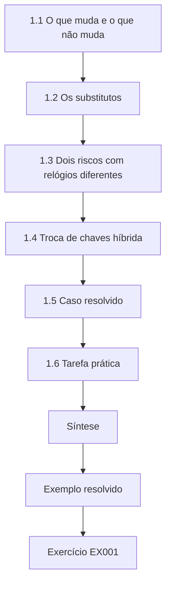

### Desenho lógico

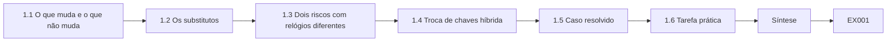

```text
[1.1 O que muda e o que não muda]
    |
    v
[1.2 Os substitutos]
    |
    v
[1.3 Dois riscos com relógios diferentes]
    |
    v
[1.4 Troca de chaves híbrida]
    |
    v
[1.5 Caso resolvido]
    |
    v
[1.6 Tarefa prática]
    |
    v
[Síntese]
    |
    v
[Exemplo resolvido] --> [Exercício EX001]
```
<!-- cyberabc:lesson-figures:end ch-01 -->


### Objetivos de aprendizagem

Você vai (1) explicar o que os computadores quânticos ameaçam na criptografia e o que não ameaçam; (2) nomear as normas pós-quânticas do NIST e a sua situação; (3) distinguir o risco de colher agora e decifrar depois do risco de forjar depois; (4) explicar a troca de chaves híbrida em termos simples; e (5) evitar afirmações equivocadas comuns em relatórios.

### 1.1 O que muda e o que não muda

Os sistemas atuais dependem de dois tipos de criptografia. A criptografia *simétrica* (como o AES) cifra os dados com uma chave compartilhada e as *funções de hash* (como o SHA-256) geram impressões digitais dos dados; elas continuam fortes contra os ataques quânticos conhecidos, nos tamanhos atuais. A criptografia de *chave pública* (RSA, curvas elípticas) permite que os sistemas acordem chaves e assinem dados sem um segredo compartilhado prévio; um computador quântico grande e com correção de erros, executando o algoritmo de Shor (Shor, 1997), a quebraria. Nenhum computador desse tipo existe hoje e ninguém sabe quando existirá; as estimativas públicas dos recursos necessários caíram ao longo do tempo (por exemplo, Gidney, 2025), e é por isso que as organizações estão se planejando agora.

### 1.2 Os substitutos

Em agosto de 2024, o NIST publicou três normas: a [FIPS 203](https://doi.org/10.6028/NIST.FIPS.203) (ML-KEM), para acordar chaves, e a [FIPS 204](https://doi.org/10.6028/NIST.FIPS.204) (ML-DSA) e a [FIPS 205](https://doi.org/10.6028/NIST.FIPS.205) (SLH-DSA), para assinaturas. A [SP 800-208](https://doi.org/10.6028/NIST.SP.800-208) trata das assinaturas baseadas em hash com estado, para usos especializados como firmware. O [IR 8547](https://doi.org/10.6028/NIST.IR.8547.ipd) do NIST é um rascunho público inicial que propõe que os algoritmos vulneráveis ao quântico sejam descontinuados após 2030 e proibidos após 2035 — datas propostas, ainda não regras definitivas. O FN-DSA e uma norma baseada no HQC estavam em desenvolvimento.

### 1.3 Dois riscos com relógios diferentes

*Colher agora, decifrar depois*: um adversário grava hoje tráfego cifrado e o decifra quando existir um computador quântico. Isso importa agora para os dados que precisam permanecer confidenciais por muitos anos — na MTI, os registros de apólices de vida (40 anos) e os registros de sinistros (10 anos). *Forjar depois*: quando existir um computador quântico, um adversário poderia forjar assinaturas, certificados e atualizações de software. Isso importa sobretudo para o que é confiável por muito tempo, como certificados raiz, arquivos assinados e dispositivos que não podem ser atualizados.

Pergunte aos responsáveis pelos dados quais registros se enquadram em cada relógio antes de classificar qualquer coisa.

### 1.4 Troca de chaves híbrida

Durante a transição, os sistemas combinam um método pós-quântico com um tradicional, de modo que um atacante precisaria quebrar ambos. Essa abordagem *híbrida* (terminologia na [RFC 9794](https://www.rfc-editor.org/rfc/rfc9794.html)) já está disponível em softwares web comuns como o grupo TLS X25519MLKEM768 ([RFC 10024](https://www.rfc-editor.org/rfc/rfc10024.html)). A troca de chaves híbrida protege a confidencialidade das sessões; ela não torna, por si só, os certificados ou as assinaturas pós-quânticos.

Para a MTI, isso significa que as sessões gravadas do portal de corretores ficam protegidas assim que o híbrido é negociado, mas o certificado RSA-2048 do portal ainda precisa do seu próprio plano.

### 1.5 Caso resolvido

Um relatório de situação em rascunho diz: "Nosso site agora é à prova de quântico porque habilitamos o Kyber." Corrigido: "O portal de corretores agora usa troca de chaves pós-quântica híbrida (X25519MLKEM768, baseada no ML-KEM da NIST FIPS 203) nas conexões de navegadores atualizados. Isso protege o tráfego gravado do portal contra decifração futura. O certificado do portal ainda usa uma assinatura clássica; a migração do certificado está planejada separadamente."

Repare no que a correção faz. Ela nomeia o serviço, o algoritmo e a sua norma, diz quais clientes se beneficiam, declara o que está protegido e diz claramente o que ainda não foi feito. Ela também abandona "Kyber", o nome anterior à norma, em favor de ML-KEM. Use o mesmo padrão sempre que uma equipe lhe relatar progresso.

### 1.6 Tarefa prática

Reescreva três frases de um folheto de fornecedor ou de uma notícia sobre segurança quântica para que fiquem corretas, com fontes e adequadamente cautelosas.

Para cada frase, registre o original, a sua reescrita e a fonte que usou para verificá-la. Procure três falhas típicas: alegações de permanência como "à prova de quântico", datas de rascunho apresentadas como regras e troca de chaves híbrida descrita como se também cobrisse os certificados. Onde uma alegação não puder ser verificada, diga isso em vez de adivinhar. Guarde as reescritas; elas se tornam o seu texto explicativo correto para o portfólio.

### 1.7 Erros comuns e limites

- Alegações de "à prova de quântico" ou "inquebrável".
- Tratar as datas do rascunho do IR 8547 como definitivas.
- Dizer que a troca de chaves híbrida torna o sistema inteiro pós-quântico.

Cada erro custa credibilidade mais tarde. Um relatório da MTI que chamasse o portal de "à prova de quântico" seria contradito pelo primeiro auditor que olhasse o seu certificado clássico. Um plano construído sobre as datas propostas de 2030 e 2035 do IR 8547 como lei fixa precisaria ser reescrito se o texto final mudar. Confira todo relatório de situação quanto a esses três antes que ele saia da sua mesa. Peça também a um colega que o leia.

### Exercícios

- **EX001 — Manter ou substituir.** Classifique AES-256, RSA-2048, SHA-256 e ECDSA P-256. Rubrica: 3 = quatro corretos, com os motivos.
- **EX002 — Normas.** Nomeie as três normas do NIST de 2024 e para que serve cada uma. Rubrica: 3 = FIPS 203 ML-KEM, estabelecimento de chaves; FIPS 204 ML-DSA e FIPS 205 SLH-DSA, assinaturas.
- **EX003 — Dois relógios.** Dê um exemplo da MTI para cada risco: HNDL e forjar depois. Rubrica: 3 = exemplos corretos e explicados.
- **EX004 — Situação de rascunho.** Escreva uma frase correta sobre as datas do IR 8547. Rubrica: 3 = rascunho, proposta, anos.
- **EX005 — Corrija a alegação.** Corrija: "O TLS híbrido torna os nossos certificados seguros contra o quântico." Rubrica: 3 = separa a troca de chaves da autenticação.

### Síntese

Os computadores quânticos ameaçam o acordo de chaves e as assinaturas de chave pública, não a cifragem simétrica. As normas do NIST de 2024 fornecem substitutos; a troca de chaves híbrida trata já do risco de colher agora e decifrar depois, enquanto as assinaturas seguem um caminho planejado.

<!-- cyberabc:chapter-navigation:start ch-01 -->
### Continue estudando — capítulo 01 de 12

[← Página do curso](../../README.md) · [Índice de capítulos do curso](../SUBJECTS.md) · [Capítulo 02 →](#ch-02)

Siga para a próxima lição escrita.
<!-- cyberabc:chapter-navigation:end -->

<a id="ch-02"></a>

## Capítulo 2 — Segurança quântica e pós-quântica: contexto de serviços e de partes interessadas

<!-- cyberabc:lesson-figures:start ch-02 -->
### Mapa da aula

Aula 02 publicada. Mapa, exemplo, EX006.

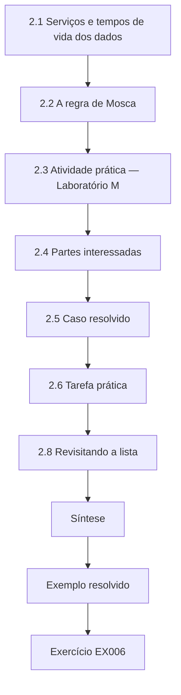

### Desenho lógico

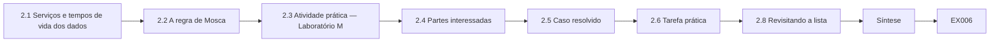

```text
[2.1 Serviços e tempos de vida dos dados]
    |
    v
[2.2 A regra de Mosca]
    |
    v
[2.3 Atividade prática — Laboratório M]
    |
    v
[2.4 Partes interessadas]
    |
    v
[2.5 Caso resolvido]
    |
    v
[2.6 Tarefa prática]
    |
    v
[2.8 Revisitando a lista]
    |
    v
[Síntese]
    |
    v
[Exemplo resolvido] --> [Exercício EX006]
```
<!-- cyberabc:lesson-figures:end ch-02 -->


### Objetivos de aprendizagem

Você vai (1) mapear os serviços da MTI para os dados que eles transportam e por quanto tempo esses dados precisam permanecer protegidos; (2) aplicar a regra de Mosca sob várias hipóteses de cronograma; (3) identificar as partes interessadas e o que cada uma precisa; (4) definir uma primeira lista de prioridades; e (5) explicar as prioridades a não especialistas.

### 2.1 Serviços e tempos de vida dos dados

Liste cada serviço, os dados que ele trata e por quanto tempo esses dados precisam permanecer confidenciais ou confiáveis. Use contratos, regulamentos e tabelas de retenção como fontes e pergunte aos responsáveis pelos dados quando tiver dúvida. Na MTI: arquivo de apólices de vida, 40 anos; registros de sinistros, 10 anos; as sessões do portal de corretores transportam dados pessoais relevantes por cerca de 7 anos; as solicitações de cotação têm vida curta.

Onde as fontes divergirem, adote o tempo de vida mais longo e registre a divergência. Por exemplo, um contrato de resseguro pode exigir que os dados de sinistros sejam mantidos por mais tempo do que diz a tabela interna. Um tempo de vida sem fonte é um palpite e deve ser classificado como tal.

### 2.2 A regra de Mosca

Mosca (2018): se os dados precisam permanecer seguros por *x* anos, a migração leva *y* anos e um computador quântico capaz pode chegar em *z* anos, então os dados já estão em risco quando *x* + *y* > *z*. Como ninguém conhece *z*, experimente vários valores.

Na MTI, o x de 40 anos do arquivo excede sozinho qualquer z plausível, então a decisão não depende da previsão. As solicitações de cotação, com x próximo de zero, nunca estão em risco, por menor que seja z. Os casos interessantes ficam no meio, como os registros de sinistros, nos quais a resposta muda com z.

### 2.3 Atividade prática — Laboratório M

```python
# Lab M (ch 2): Mosca's inequality x + y > z for synthetic Marlow & Tide Insurance data, sweeping z.
assets = [  # (name, shelf-life x in years, migration time y in years) - synthetic
    ("life-policy archive", 40, 4), ("claims records", 10, 3), ("quote requests", 0.1, 1), ("broker portal traffic", 7, 2)]
for z in (10, 15, 20):  # years until a cryptographically relevant quantum computer: an assumption, not a forecast
    late = [n for n, x, y in assets if x + y > z]
    print(f"z={z:>2}: at risk now -> {', '.join(late) if late else 'none'}")
```

Saída esperada:

```text
z=10: at risk now -> life-policy archive, claims records
z=15: at risk now -> life-policy archive
z=20: at risk now -> life-policy archive
```

O arquivo de apólices de vida está em risco sob todas as hipóteses; os registros de sinistros, apenas se *z* for de dez anos. Esse padrão é a base de uma lista de prioridades que não depende de prever o futuro.

Mude as entradas para ver quão sensível a lista é. Se a migração dos registros de sinistros levasse cinco anos em vez de três, os sinistros estariam em risco também com z = 15. Registre essas sensibilidades ao lado da tabela: elas dizem ao patrocinador quais estimativas merecem evidências melhores.

### 2.4 Partes interessadas

Os responsáveis pelos dados (subscrição, sinistros) definem os tempos de vida; os responsáveis pelos sistemas (equipes de TI) fazem as mudanças; os fornecedores controlam os produtos; compras redige os contratos; o jurídico e a conformidade acompanham as obrigações; os executivos aprovam os orçamentos e aceitam os riscos; os auditores conferem as evidências. Liste o que cada um precisa do fluxo de trabalho e o que você precisa de cada um.

Na MTI, a subscrição é responsável pelo tempo de vida das apólices de vida e a área de sinistros pelo tempo de vida de 10 anos dos sinistros; a equipe de infraestrutura é responsável pelos servidores SFTP das resseguradoras. Escreva cada nome no mapa de partes interessadas com um contato, para que os pedidos cheguem a uma pessoa, e não a um departamento.

### 2.5 Caso resolvido

A primeira lista de prioridades da MTI: 1) transferências de registros de apólices de vida entre os escritórios e o arquivo; 2) trocas SFTP com resseguradoras transportando dados de sinistros; 3) portal de corretores; 4) planejamento da AC interna (forjar depois, validade longa). As solicitações de cotação perdem prioridade. A lista é explicada ao patrocinador executivo como "proteger primeiro o que precisa ficar secreto por mais tempo".

Cada posição na lista tem um motivo que pode ser rastreado até o Laboratório M ou até a classe de exposição. A AC interna aparece, embora não transporte segredos, porque a sua validade longa a torna uma preocupação de forjar depois. Mantenha os motivos junto da lista, para que ela possa ser defendida.

### 2.6 Tarefa prática

Monte uma tabela de cinco linhas com serviços da MTI, os dados, o tempo de vida, a fonte do tempo de vida e o responsável; execute o Laboratório M com os seus próprios valores.

Obtenha cada tempo de vida de uma tabela de retenção, de um contrato ou de uma declaração do responsável, e escreva qual foi. Depois compare a sua saída do Laboratório M com a do livro: se um serviço entrar ou sair da lista de risco, explique por quê em uma frase. Peça a um colega que verifique se cada responsável nomeado de fato controla o serviço, e não apenas o usa. Guarde a tabela no seu portfólio.

### 2.7 Erros comuns e limites

- Tempos de vida adivinhados em vez de obtidos de fontes.
- Uma única data quântica suposta.
- Esquecer compras e o jurídico como partes interessadas.

Cada erro enfraquece a lista de prioridades de uma forma diferente. Um tempo de vida adivinhado não pode ser defendido perante um auditor. Uma única data quântica faz a lista parecer uma previsão e convida à discussão sobre a data, e não sobre os dados. Deixar de fora compras e o jurídico significa que as cláusulas contratuais e as obrigações aparecem tarde, depois que os fornecedores já definiram os seus roteiros. Confira a sua própria tabela quanto a cada um deles.

### 2.8 Revisitando a lista

As prioridades mudam quando os fatos mudam: um novo contrato estende um período de retenção, um fornecedor lança suporte híbrido, um serviço é desativado. Revise a lista de prioridades a cada trimestre com os responsáveis pelos dados e pelos sistemas, registre o que mudou e por quê e guarde as versões antigas. Auditores e executivos confiam mais numa lista que evolui visivelmente com as evidências do que numa que nunca muda.

Na MTI, um gatilho típico seria o fornecedor do arquivo publicar datas para o suporte ao ML-DSA, o que mudaria a forma como o item de forjar depois é planejado.

### Exercícios

- **EX006 — Mosca.** Para os registros de sinistros (*x* = 10, *y* = 3), declare os cronogramas sob os quais eles estão em risco. Rubrica: 3 = *z* < 13.
- **EX007 — Fonte do tempo de vida.** Nomeie duas fontes de tempos de vida dos dados numa seguradora. Rubrica: 3 = contratos/regulamentação/tabela de retenção, com confirmação do responsável.
- **EX008 — Mapa de partes interessadas.** Liste cinco partes interessadas e uma necessidade de cada uma. Rubrica: 3 = cinco pares pertinentes.
- **EX009 — Prioridade.** Por que o arquivo de apólices de vida vem primeiro? Rubrica: 3 = em risco sob todas as hipóteses; tempo de vida mais longo.
- **EX010 — Explicação simples.** Explique a lista de prioridades a um executivo em três frases. Rubrica: 3 = clara, correta, orientada à decisão.

### Síntese

Mapas de serviços com tempos de vida obtidos de fontes, a regra de Mosca sob várias hipóteses e um mapa de partes interessadas produzem uma lista de prioridades robusta e explicável.

<!-- cyberabc:chapter-navigation:start ch-02 -->
### Continue estudando — capítulo 02 de 12

[← Capítulo 01](#ch-01) · [Índice de capítulos do curso](../SUBJECTS.md) · [Capítulo 03 →](#ch-03)

Siga para a próxima lição escrita.
<!-- cyberabc:chapter-navigation:end -->

<a id="ch-03"></a>

## Capítulo 3 — Prática autorizada e tratamento de evidências

<!-- cyberabc:lesson-figures:start ch-03 -->
### Mapa da aula

Aula 03 publicada. Mapa, exemplo, EX011.

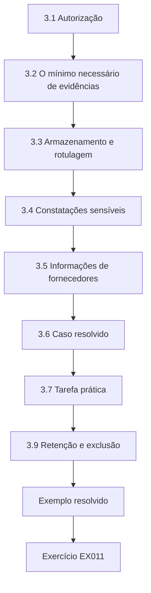

### Desenho lógico

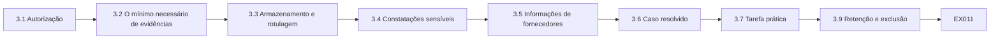

```text
[3.1 Autorização]
    |
    v
[3.2 O mínimo necessário de evidências]
    |
    v
[3.3 Armazenamento e rotulagem]
    |
    v
[3.4 Constatações sensíveis]
    |
    v
[3.5 Informações de fornecedores]
    |
    v
[3.6 Caso resolvido]
    |
    v
[3.7 Tarefa prática]
    |
    v
[3.9 Retenção e exclusão]
    |
    v
[Exemplo resolvido] --> [Exercício EX011]
```
<!-- cyberabc:lesson-figures:end ch-03 -->


### Objetivos de aprendizagem

Você vai (1) obter e respeitar a autorização por escrito; (2) coletar apenas as evidências necessárias; (3) guardar e rotular as evidências adequadamente; (4) tratar constatações sensíveis; e (5) trabalhar com informações confidenciais de fornecedores.

### 3.1 Autorização

Mesmo as atividades "inofensivas" — ler configurações, executar uma ferramenta de inventário, pedir logs — precisam de autorização por escrito do responsável pelo sistema, declarando sistemas, métodos, janela de tempo, tratamento dos dados e contatos. Os testes ativos que alteram a negociação são feitos apenas em laboratórios isolados, pela equipe técnica.

Na MTI, o ticket SEC-118 é o modelo: ele nomeia os servidores, o método somente leitura, as datas, o repositório e um contato. Guarde uma cópia de cada autorização com as evidências que ela produziu e interrompa o trabalho quando a janela se fechar, mesmo que a tarefa não tenha terminado.

### 3.2 O mínimo necessário de evidências

Colete o que responde à pergunta: nomes de algoritmos, versões, detalhes de certificados, datas. Não colete conteúdo de mensagens nem dados de clientes. Prefira exportações de configuração e resumos a capturas brutas.

Nos servidores SFTP das resseguradoras, isso significa uma exportação da versão do OpenSSH e das configurações de troca de chaves, e não amostras dos arquivos transferidos. Se uma equipe oferecer mais do que você precisa, recuse educadamente e registre que recusou. Menos evidências são mais fáceis de proteger e mais simples de apagar quando o programa terminar. Anote o que você escolheu não coletar.

### 3.3 Armazenamento e rotulagem

Guarde as evidências no repositório combinado, com rótulos: fonte, data, coletor, sistema, classificação. Restrinja o acesso; inventários de fraquezas são sensíveis. Mantenha um registro de quem acessou o quê.

Use os mesmos campos de rótulo em todos os itens, para que as buscas funcionem entre as fontes: uma exportação, um questionário e um resumo de logs devem todos mostrar quem os coletou e quando. Revise o registro de acessos todo mês e remova as pessoas que não precisam mais de acesso. Evidências que não podem ser rastreadas até uma fonte e uma data devem ser classificadas como U até que possam.

### 3.4 Constatações sensíveis

Se encontrar algo grave — uma chave privada exposta, um sistema sem patch com uma vulnerabilidade conhecida —, comunique imediatamente pelo processo de segurança; não investigue mais por conta própria.

Registre o que viu, quando e onde, e repasse ao contato de incidentes nomeado na sua autorização. Não copie uma chave descoberta nem teste se ela funciona; isso estaria fora da sua autorização e poderia danificar as evidências. Depois, anote no rastreador que o item aguarda o processo de segurança.

### 3.5 Informações de fornecedores

Os fornecedores podem compartilhar roteiros sob confidencialidade. Registre-os como declarações do fornecedor, respeite o acordo e não os encaminhe para fora do grupo de pessoas que precisam deles.

Guarde-os com acesso restrito, como a MTI fez com o roteiro sob NDA, e classifique as alegações que eles contêm como D até serem observadas. Ao resumir para os executivos, refira-se a um roteiro pela sua data e situação, sem citar detalhes confidenciais. Se um fornecedor pedir que o seu roteiro seja apagado, siga o acordo e anote a exclusão no registro de evidências.

### 3.6 Caso resolvido

O coordenador da MTI pede exportações de configuração dos servidores SFTP das resseguradoras (nome no inventário: `insurer-sftp`). A autorização (ticket SEC-118) cobre exportação somente leitura, de 1 a 15 de outubro, resultados guardados no repositório de evidências de segurança, contato: o líder de infraestrutura. A exportação mostra a versão do OpenSSH e as configurações de troca de chaves; nenhum conteúdo de arquivo é tocado. O roteiro de um fornecedor recebido sob NDA é guardado com acesso restrito e rotulado como "declaração do fornecedor, confidencial".

Repare no que fez isso funcionar: o escopo era estreito, o método era somente leitura, a janela tinha data de término e o contato foi nomeado com antecedência. O roteiro foi útil, mas permaneceu confidencial. Os dois itens podem ser rastreados depois pelos seus rótulos.

### 3.7 Tarefa prática

Escreva um pedido de autorização e um rótulo de evidência para uma atividade de inventário.

Escolha um tipo real de atividade, como uma exportação de certificados da AC interna da MTI. O pedido deve nomear sistemas, método, janela de tempo, armazenamento, tratamento dos dados e um contato, como o SEC-118. O rótulo deve informar fonte, data, coletor, sistema e classificação. Pergunte a um colega se um responsável pelo sistema conseguiria aprovar o seu pedido sem fazer uma única pergunta de acompanhamento. Depois revise o pedido uma vez e guarde as duas versões para mostrar o que você melhorou.

### 3.8 Erros comuns e limites

- Coletar mais dados do que o necessário.
- Evidências sem rótulos.
- Compartilhar amplamente os roteiros dos fornecedores.

Cada erro tem um custo. O excesso de dados aumenta o que precisa ser protegido e depois apagado. Evidências sem rótulo não sustentam uma classificação nem podem ser rastreadas numa auditoria, então o trabalho precisa ser repetido. Um roteiro compartilhado além do acordo pode violar um NDA e prejudicar a relação com o fornecedor, da qual dependem vários itens do rastreador da MTI. Confira cada evidência quanto aos três antes de arquivá-la. Corrija-os antes de arquivar.

### 3.9 Retenção e exclusão

As evidências têm o seu próprio tempo de vida. Combine por quanto tempo as exportações de inventário, os questionários e os logs são mantidos — normalmente pela duração do programa mais um período de auditoria — e apague-os com segurança depois, mantendo apenas os resultados agregados e os registros de decisão. Registre as exclusões no registro de evidências. Manter as exportações brutas para sempre aumenta o dano se o repositório for comprometido, porque um mapa completo das fraquezas criptográficas de uma organização é valioso para os atacantes.

Quando alguém deixar o fluxo de trabalho, remova prontamente o seu acesso ao repositório de evidências e revise o que a pessoa podia ver; as revisões de acesso fazem parte do tratamento de evidências, não são um detalhe posterior.

### Exercícios

- **EX011 — Elementos da autorização.** Liste cinco elementos de uma autorização por escrito. Rubrica: 3 = sistemas, métodos, janela, tratamento dos dados, contatos.
- **EX012 — Mínimo de evidências.** Para um inventário de SFTP, liste três coisas a coletar e duas a não coletar. Rubrica: 3 = listas justificadas.
- **EX013 — Rótulo.** Escreva um rótulo de evidência para a exportação do SFTP. Rubrica: 3 = fonte, data, coletor, sistema, classificação.
- **EX014 — Constatação grave.** O que você faz quando encontra uma chave privada numa exportação? Rubrica: 3 = parar, comunicar, não usar, documentar.
- **EX015 — Roteiro sob NDA.** Como você registra e compartilha um roteiro de fornecedor sob NDA? Rubrica: 3 = rótulo de declaração do fornecedor, acesso restrito, necessidade de saber.

### Síntese

Um tratamento de evidências autorizado, mínimo e bem rotulado protege a organização, os seus clientes e os seus fornecedores, e mantém o fluxo de trabalho confiável.

<!-- cyberabc:chapter-navigation:start ch-03 -->
### Continue estudando — capítulo 03 de 12

[← Capítulo 02](#ch-02) · [Índice de capítulos do curso](../SUBJECTS.md) · [Capítulo 04 →](#ch-04)

Siga para a próxima lição escrita.
<!-- cyberabc:chapter-navigation:end -->

<a id="ch-04"></a>

## Capítulo 4 — Segurança quântica e pós-quântica: métodos centrais

<!-- cyberabc:lesson-figures:start ch-04 -->
### Mapa da aula

Aula 04 publicada. Mapa, exemplo, EX016.

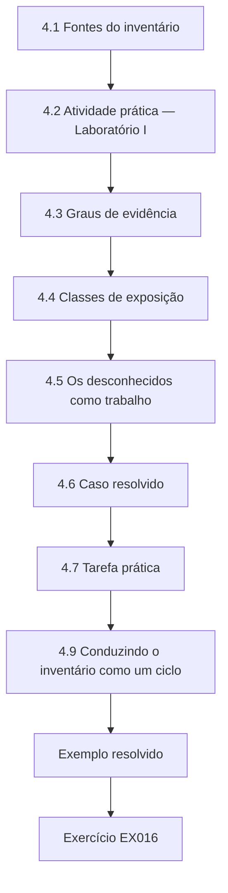

### Desenho lógico

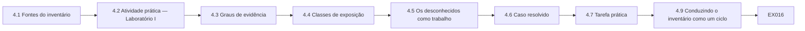

```text
[4.1 Fontes do inventário]
    |
    v
[4.2 Atividade prática — Laboratório I]
    |
    v
[4.3 Graus de evidência]
    |
    v
[4.4 Classes de exposição]
    |
    v
[4.5 Os desconhecidos como trabalho]
    |
    v
[4.6 Caso resolvido]
    |
    v
[4.7 Tarefa prática]
    |
    v
[4.9 Conduzindo o inventário como um ciclo]
    |
    v
[Exemplo resolvido] --> [Exercício EX016]
```
<!-- cyberabc:lesson-figures:end ch-04 -->


### Objetivos de aprendizagem

Você vai (1) conduzir um inventário usando várias fontes; (2) construir e ler uma lista de materiais criptográficos (CBOM); (3) classificar evidências; (4) classificar a exposição; e (5) acompanhar os desconhecidos como trabalho.

### 4.1 Fontes do inventário

Exportações de configuração, listas de certificados da AC, observações de rede feitas pelas equipes técnicas, documentação das aplicações e questionários a fornecedores. Cada uma responde a perguntas diferentes; combine-as.

Na MTI, a troca de chaves do portal de corretores foi vista em observação passiva, o seu certificado veio da configuração e o algoritmo de assinatura do aplicativo de sinistros só era conhecido pelo código. Nenhuma fonte isolada cobriu os seis ativos. Registre qual fonte forneceu cada linha da CBOM, porque a fonte define a classificação da evidência. Anote onde duas fontes divergem e pergunte ao responsável qual está atualizada.

### 4.2 Atividade prática — Laboratório I

```python
# Lab I (ch 4): aggregate a synthetic cryptographic bill of materials (CBOM) and measure coverage.
records = [  # (asset, function, algorithm, source)
    ("broker-portal", "key-exchange", "X25519MLKEM768", "passive"), ("broker-portal", "signature", "RSA-2048", "config"),
    ("claims-app", "key-exchange", "ECDHE-P256", "passive"), ("claims-app", "signature", "ECDSA-P256", "code"),
    ("policy-db", "key-exchange", "RSA-kex", "config"), ("billing", "data-at-rest", "AES-256-GCM", "code"),
    ("call-recorder", "unknown", "unknown", "none"), ("office-vpn", "key-exchange", "ECDHE-P384", "config")]
VULN = {"RSA-2048", "ECDHE-P256", "ECDSA-P256", "RSA-kex", "ECDHE-P384"}
assets = {r[0] for r in records}
unknown = {r[0] for r in records if r[2] == "unknown"}
vuln = [r for r in records if r[2] in VULN]
print(f"assets {len(assets)}, unknown {len(unknown)} ({100*len(unknown)/len(assets):.0f}%)")
print(f"quantum-vulnerable uses {len(vuln)}:", ", ".join(f"{a}/{f}" for a, f, _, _ in vuln))
print("hybrid key exchange present on:", [r[0] for r in records if "MLKEM" in r[2]])
```

Saída esperada:

```text
assets 6, unknown 1 (17%)
quantum-vulnerable uses 5: broker-portal/signature, claims-app/key-exchange, claims-app/signature, policy-db/key-exchange, office-vpn/key-exchange
hybrid key exchange present on: ['broker-portal']
```

O script conta os ativos, sinaliza os usos vulneráveis ao quântico e lista onde a troca de chaves híbrida já está presente. Repare que o AES-256-GCM do faturamento não é sinalizado, porque a cifragem simétrica desse tamanho continua adequada, e que o gravador de chamadas é contado como desconhecido, e não como seguro. A proporção de 17 % de desconhecidos é a primeira medida de destaque: um ativo em seis ainda não pode ser avaliado. Execute-o com um registro extra seu e verifique se as contagens mudam como você espera.

### 4.3 Graus de evidência

Uma classificação simples: A, observado em operação; B, configuração oficial; C, inferido da documentação ou do código; D, alegação do fornecedor; U, desconhecido. Prioridades baseadas em evidências D ou U precisam de verificação antes de se gastar dinheiro.

Os graus também dizem como melhorar a evidência: um D pode subir pedindo à equipe técnica que observe o produto em operação, e um C, obtendo a configuração. Escreva o grau ao lado de cada registro, e não só de cada ativo, já que um ativo pode ter graus diferentes para funções diferentes.

### 4.4 Classes de exposição

Gravar agora (HNDL): troca de chaves clássica transportando dados de vida longa. Forjar depois: assinaturas clássicas confiáveis por longos períodos ou difíceis de substituir. Adequado: cifragem simétrica e hashes em bons tamanhos. Desconhecido.

No extrato do Laboratório I, a troca de chaves RSA do policy-db é de gravar agora se transportar dados de vida longa, a assinatura RSA-2048 do portal de corretores é de forjar depois, o AES-256-GCM do faturamento é adequado e o gravador de chamadas é desconhecido. Classifique cada uso de criptografia separadamente, já que um ativo pode cair em duas classes. A classe decide quais controles se aplicam.

### 4.5 Os desconhecidos como trabalho

Todo desconhecido vira uma tarefa com responsável e prazo: perguntar ao fornecedor, pedir uma exportação de configuração, pedir à equipe técnica que observe. Acompanhe a proporção de desconhecidos como medida de destaque.

Na MTI, o U do gravador de chamadas virou uma tarefa de questionário ao seu fornecedor, com responsável nomeado e prazo. A proporção de desconhecidos é uma medida melhor do progresso do inventário do que o número de ativos listados, porque não pode ser melhorada contando duas vezes os ativos fáceis. Feche cada tarefa com evidências.

### 4.6 Caso resolvido

O primeiro extrato da CBOM da MTI corresponde ao Laboratório I: seis ativos, cinco usos vulneráveis ao quântico, um desconhecido (o gravador de chamadas). Graus: portal de corretores A na troca de chaves (observada) e B na assinatura (configuração), aplicativo de sinistros A na troca de chaves e C na assinatura (apenas código), policy DB B, gravador de chamadas U, VPN dos escritórios B. Tarefas: questionário ao fornecedor do gravador de chamadas; confirmar com o responsável o algoritmo de assinatura do aplicativo de sinistros.

Os graus decidem o que acontece em seguida. Os itens com A ou B podem ser priorizados com confiança; o gravador de chamadas não pode ser priorizado de forma alguma até que o seu fornecedor responda, e a entrada de assinatura do aplicativo de sinistros precisa da confirmação do responsável, porque o código sozinho pode não refletir o que está implantado.

### 4.7 Tarefa prática

Atribua grau e classe a cada registro do Laboratório I e escreva tarefas para os desconhecidos.

Dê a cada registro um grau de A a U e uma classe de exposição, com uma linha explicando cada escolha. Para o gravador de chamadas, escreva uma tarefa com responsável, prazo e a pergunta a fazer. Depois compare com o caso resolvido e explique qualquer diferença. Um colega deve conseguir reproduzir os seus graus apenas pela coluna de fonte. Anote quais registros você não conseguiu classificar e por quê.

### 4.8 Erros comuns e limites

- Uma única fonte.
- Tratar alegações de fornecedores como observações.
- Desconhecidos sem responsáveis.

Uma única fonte deixa pontos cegos: a configuração sozinha não mostra o que é negociado, e a observação sozinha não vê os certificados cifrados. Uma alegação de fornecedor tratada como observação pode empurrar dinheiro para um ativo que já está protegido, ou afastá-lo de um que não está. Um desconhecido sem responsável simplesmente continua desconhecido, trimestre após trimestre, enquanto a medida de destaque estagna. Confira o extrato da MTI quanto a cada um deles antes de confiar nele e corrija o que encontrar.

### 4.9 Conduzindo o inventário como um ciclo

Um inventário não se faz uma única vez. Conduza-o como um ciclo: coletar (exportações, questionários, observações), consolidar na CBOM, atribuir graus, classificar, abrir tarefas para os desconhecidos e as lacunas e repetir a cada trimestre. Cada ciclo deve mostrar três números à gestão: quantos ativos de nível 1 têm evidências A ou B, quantos são desconhecidos e quantos já estão protegidos. Quando um fornecedor responde a um questionário, o grau dos seus produtos passa de U para D; quando uma equipe técnica confirma a resposta por observação, passa para A. Esse movimento é progresso real, mesmo antes de qualquer algoritmo mudar, porque transforma palpites em fatos sobre os quais os orçamentos podem se basear.

Mantenha o acesso à CBOM restrito a quem precisa dela e compartilhe de forma mais ampla apenas os resumos.

### Exercícios

- **EX016 — Leitura do Laboratório I.** Qual ativo já tem troca de chaves híbrida, e o que continua clássico nele? Rubrica: 3 = broker-portal; a sua assinatura (RSA-2048).
- **EX017 — Graus.** Atribua graus a: handshake observado; e-mail do fornecedor; registro no banco de dados da AC; diagrama de arquitetura. Rubrica: 3 = A, D, B, C.
- **EX018 — Classes.** Classifique os cinco usos vulneráveis do Laboratório I pela classe de exposição. Rubrica: 3 = trocas de chaves HNDL; assinaturas forjar depois.
- **EX019 — Proporção de desconhecidos.** Qual é a proporção de desconhecidos do Laboratório I, e como você a relataria? Rubrica: 3 = 17 % dos ativos, mostrada ao lado de cada número.
- **EX020 — Tarefa.** Escreva a tarefa para o gravador de chamadas. Rubrica: 3 = pergunta, método, responsável, prazo.

### Síntese

Uma CBOM com várias fontes e evidências graduadas classifica a exposição e transforma os desconhecidos em trabalho acompanhado.

<!-- cyberabc:chapter-navigation:start ch-04 -->
### Continue estudando — capítulo 04 de 12

[← Capítulo 03](#ch-03) · [Índice de capítulos do curso](../SUBJECTS.md) · [Capítulo 05 →](#ch-05)

Siga para a próxima lição escrita.
<!-- cyberabc:chapter-navigation:end -->

<a id="ch-05"></a>

## Capítulo 5 — Segurança quântica e pós-quântica: ferramentas e interpretação

<!-- cyberabc:lesson-figures:start ch-05 -->
### Mapa da aula

Aula 05 publicada. Mapa, exemplo, EX021.

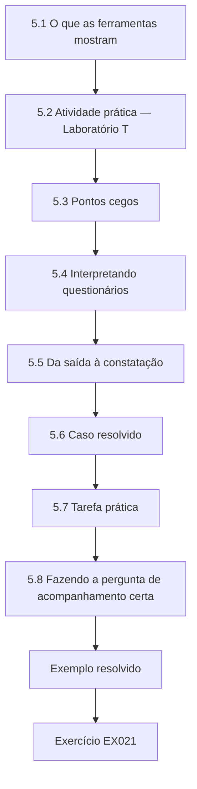

### Desenho lógico

```mermaid
flowchart LR
  N0["5.1 O que as ferramentas mostram"]
  N1["5.2 Atividade prática — Laboratório T"]
  N2["5.3 Pontos cegos"]
  N3["5.4 Interpretando questionários"]
  N4["5.5 Da saída à constatação"]
  N5["5.6 Caso resolvido"]
  N6["5.7 Tarefa prática"]
  N7["5.8 Fazendo a pergunta de acompanhamento certa"]
  N0 --> N1 --> N2 --> N3 --> N4 --> N5 --> N6 --> N7 --> Q["EX021"]
```

```text
[5.1 O que as ferramentas mostram]
    |
    v
[5.2 Atividade prática — Laboratório T]
    |
    v
[5.3 Pontos cegos]
    |
    v
[5.4 Interpretando questionários]
    |
    v
[5.5 Da saída à constatação]
    |
    v
[5.6 Caso resolvido]
    |
    v
[5.7 Tarefa prática]
    |
    v
[5.8 Fazendo a pergunta de acompanhamento certa]
    |
    v
[Exemplo resolvido] --> [Exercício EX021]
```
<!-- cyberabc:lesson-figures:end ch-05 -->


### Objetivos de aprendizagem

Você vai (1) ler a saída de auditorias de configuração e de ferramentas de inventário; (2) distinguir "oferecido" de "negociado"; (3) reconhecer os pontos cegos das ferramentas; (4) interpretar as respostas dos questionários a fornecedores; e (5) transformar a saída das ferramentas em constatações.

### 5.1 O que as ferramentas mostram

As auditorias de configuração mostram o que um serviço oferece e em que ordem. Os resumos de logs das equipes técnicas mostram o que foi negociado. Os inventários de certificados mostram os algoritmos de assinatura e as datas de expiração. Os questionários a fornecedores mostram alegações. Como profissional, você raramente vai executar ferramentas ativas por conta própria; vai ler e interpretar a saída delas.

Na MTI, a auditoria de configuração do Laboratório T mostrou o que o portal de sinistros oferecia; apenas os resumos de logs podiam mostrar o que ele negociava. Mantenha o tipo de cada saída ao lado da sua constatação, para que os leitores saibam se ela descreve a intenção ou a operação.

### 5.2 Atividade prática — Laboratório T

```python
# Lab T (ch 5): audit synthetic TLS server configurations for post-quantum key exchange and preference order.
configs = {  # service: ordered list of offered groups (server preference) - synthetic
    "quote-api": ["X25519MLKEM768", "X25519", "secp256r1"],
    "claims-portal": ["X25519", "X25519MLKEM768", "secp256r1"],
    "insurer-sftp": ["ecdh-sha2-nistp256"],
    "hr-intranet": ["X25519", "secp384r1"]}
HYBRID = {"X25519MLKEM768", "SecP256r1MLKEM768", "SecP384r1MLKEM1024"}
for svc, groups in configs.items():
    offered = [g for g in groups if g in HYBRID]
    if not offered: verdict = "CLASSICAL ONLY"
    elif groups[0] in HYBRID: verdict = "OK (hybrid preferred)"
    else: verdict = "WARN hybrid offered but not preferred"
    print(f"{svc:17s} {verdict}")
```

Saída esperada:

```text
quote-api         OK (hybrid preferred)
claims-portal     WARN hybrid offered but not preferred
insurer-sftp      CLASSICAL ONLY
hr-intranet       CLASSICAL ONLY
```

O portal de sinistros "oferece, mas não prefere" o híbrido: uma auditoria de configuração que verificasse apenas a presença o relataria como concluído, mas a maioria das conexões continuará usando troca de chaves clássica. Pergunte sempre se uma ferramenta verifica a preferência e a negociação real.

O script verifica duas coisas em cada serviço: se algum grupo híbrido é oferecido e se ele vem primeiro na ordem de preferência do servidor. A API de cotação passa nas duas verificações. O servidor SFTP e a intranet de RH falham na primeira. Repare que o script trabalha apenas com configurações; ele não consegue mostrar o que os clientes realmente negociam.

### 5.3 Pontos cegos

Um sensor passivo no TLS 1.3 vê o grupo negociado, mas não o certificado, que é cifrado. Um scanner ativo com uma biblioteca antiga relata tudo como clássico. Uma exportação de configuração pode estar desatualizada. Um questionário pode descrever uma versão do produto que a MTI não executa. Escreva o ponto cego ao lado de cada resultado.

No portal de corretores da MTI, um sensor passivo consegue mostrar X25519MLKEM768, mas não o certificado RSA-2048, que veio da configuração. Combine sempre um resultado com a fonte que cobre o seu ponto cego antes de relatá-lo.

### 5.4 Interpretando questionários

As boas respostas nomeiam algoritmos e conjuntos de parâmetros (ML-KEM-768 conforme a FIPS 203), protocolos (grupo híbrido do TLS 1.3 conforme a RFC 10024; IKEv2 conforme a RFC 9370), versões de produto e datas, e oferecem acesso para teste. As respostas fracas dizem "pronto para PQC" ou "roteiro em revisão". Pontue as respostas de forma consistente, por exemplo 0 = sem resposta, 1 = alegação sem data, 2 = roteiro datado que nomeia algoritmos e protocolos, 3 = entregue e verificável.

Aplique a mesma escala a todos os fornecedores e mantenha o texto da resposta junto da pontuação, para que um revisor possa conferi-la. Uma pontuação 2 continua sendo grau D até que o produto seja observado. Onde um fornecedor oferecer acesso para teste, peça à equipe técnica da MTI que o use e eleve o grau com o que ela encontrar.

### 5.5 Da saída à constatação

Uma constatação declara observação, fonte, data, impacto, recomendação e responsável. "Portal de sinistros: grupo híbrido oferecido, mas X25519 preferido (auditoria de configuração, 6 de outubro). Impacto: as sessões de sinistros continuam expostas a HNDL. Recomendação: reordenar os grupos para preferir X25519MLKEM768; verificar com os logs. Responsável: Web Platform."

Cada elemento tem um propósito: a fonte e a data permitem ao leitor julgar a atualidade, o impacto liga o resultado à exposição e o responsável torna alguém encarregado. Uma constatação sem algum deles tende a ser discutida em vez de corrigida. Escreva as constatações de modo que o responsável possa agir sem lhe perguntar o que você quis dizer.

### 5.6 Caso resolvido

A auditoria sinaliza o insurer-sftp como apenas clássico. A equipe de infraestrutura confirma que a versão do OpenSSH é anterior ao suporte híbrido. Constatação aberta: atualizar e habilitar `mlkem768x25519-sha256`; coordenar com as resseguradoras cujos clientes podem ser antigos; responsável: Infraestrutura; prazo de um trimestre.

Repare que a constatação foi aberta apenas depois que a equipe de infraestrutura confirmou a versão; a auditoria sozinha podia estar desatualizada. A coordenação com as resseguradoras faz parte da constatação porque uma atualização do lado da MTI protege apenas os parceiros cujos clientes também suportam o método híbrido.

### 5.7 Tarefa prática

Transforme cada linha do Laboratório T numa constatação ou numa nota de "conforme o esperado".

Para cada linha, escreva observação, fonte, data, impacto, recomendação e responsável, ou uma nota de uma linha explicando por que nenhuma ação é necessária. A API de cotação deve ser uma nota de "conforme o esperado"; o portal de sinistros e os dois serviços clássicos precisam de constatações. Pergunte se a intranet de RH transporta dados de vida longa antes de decidir a sua prioridade. Mantenha cada constatação em poucas linhas e nomeie o responsável. Peça a um colega que as revise.

### 5.8 Fazendo a pergunta de acompanhamento certa

Quando a saída de uma ferramenta o surpreender, faça três perguntas à equipe técnica antes de abrir uma constatação: a ferramenta é atual o bastante para ver algoritmos pós-quânticos; os dados são recentes; e o resultado coincide com outra fonte? Muitas constatações aparentes desaparecem — ou ficam mais graves — depois dessas verificações.

Na MTI, fazer essas perguntas sobre o resultado do insurer-sftp levou à verificação de versão da equipe de infraestrutura, que transformou um resultado de ferramenta numa constatação confirmada. Registre as respostas às três perguntas junto da constatação, para que um revisor veja o que foi verificado e quando.

### 5.9 Erros comuns e limites

- Contar a presença como sucesso.
- Ignorar os pontos cegos.
- Pontuar as respostas dos questionários de forma inconsistente.

Cada erro leva a um relatório errado. Contar a presença teria marcado o portal de sinistros da MTI como concluído enquanto a maioria das sessões continuava clássica. Ignorar os pontos cegos pode esconder um certificado clássico atrás de um resultado híbrido. Pontuações inconsistentes nos questionários tornam os fornecedores impossíveis de comparar e convidam a reclamações dos que foram pontuados com rigor. Confira toda constatação baseada em ferramentas quanto a esses três erros antes que ela entre no rastreador. Corrija o que encontrar antes de relatar.

### Exercícios

- **EX021 — Oferecido versus negociado.** Explique a diferença usando o portal de sinistros. Rubrica: 3 = a ordem/preferência causa negociação clássica.
- **EX022 — Ponto cego.** O que um sensor passivo de TLS 1.3 não consegue ver, e de onde você obtém isso? Rubrica: 3 = o certificado; configuração/inventário de certificados.
- **EX023 — Pontuar respostas.** Pontue: "pronto para PQC"; "ML-KEM-768 híbrido no TLS 1.3 a partir da v8.2, entregue"; "roteiro 2027 para a RFC 9370". Rubrica: 3 = 1, 3 (se verificável) e 2.
- **EX024 — Constatação.** Escreva a constatação para a hr-intranet. Rubrica: 3 = observação, fonte, data, impacto, recomendação, responsável.
- **EX025 — Acompanhamento.** Liste as três perguntas a fazer antes de abrir uma constatação surpreendente. Rubrica: 3 = atualidade da ferramenta, recência dos dados, corroboração.

### Síntese

Os profissionais interpretam a saída das ferramentas e dos questionários atentos à preferência, à negociação e aos pontos cegos, e a transformam em constatações precisas.

<!-- cyberabc:chapter-navigation:start ch-05 -->
### Continue estudando — capítulo 05 de 12

[← Capítulo 04](#ch-04) · [Índice de capítulos do curso](../SUBJECTS.md) · [Capítulo 06 →](#ch-06)

Siga para a próxima lição escrita.
<!-- cyberabc:chapter-navigation:end -->

<a id="ch-06"></a>

## Capítulo 6 — Segurança quântica e pós-quântica: fluxo de trabalho operacional

<!-- cyberabc:lesson-figures:start ch-06 -->
### Mapa da aula

Aula 06 publicada. Mapa, exemplo, EX026.

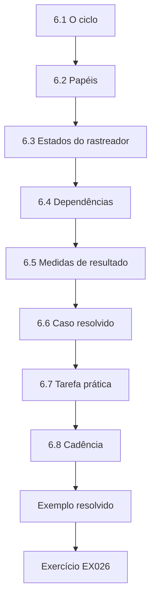

### Desenho lógico

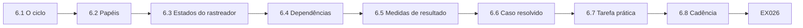

```text
[6.1 O ciclo]
    |
    v
[6.2 Papéis]
    |
    v
[6.3 Estados do rastreador]
    |
    v
[6.4 Dependências]
    |
    v
[6.5 Medidas de resultado]
    |
    v
[6.6 Caso resolvido]
    |
    v
[6.7 Tarefa prática]
    |
    v
[6.8 Cadência]
    |
    v
[Exemplo resolvido] --> [Exercício EX026]
```
<!-- cyberabc:lesson-figures:end ch-06 -->


### Objetivos de aprendizagem

Você vai (1) conduzir o fluxo de trabalho da migração como um ciclo repetível; (2) definir papéis, entradas e saídas de cada passo; (3) usar um rastreador com estados claros; (4) gerenciar as dependências de fornecedores e parceiros; e (5) relatar o progresso com medidas de resultado.

### 6.1 O ciclo

1. **Delimitar o escopo** dos serviços e confirmar a autorização. 2. **Inventariar** com evidências graduadas. 3. **Priorizar** pelo tempo de vida, pela exposição e pela rota de mudança. 4. **Planejar** cada item: controle, responsável, data, dependências. 5. **Implementar** por meio do processo de mudanças da equipe responsável. 6. **Verificar** com evidências de negociação. 7. **Registrar** o risco residual e as exceções. 8. **Relatar** e repetir a cada trimestre.

Cada passo produz uma entrada para o seguinte: a autorização para o inventário, as evidências graduadas para a priorização, um plano para a implementação. Na MTI, o ciclo roda trimestralmente, então um passo atrasado aparece no relatório seguinte, e não no fim do programa.

### 6.2 Papéis

Coordenador (você): conduz o ciclo, mantém o rastreador, escreve os relatórios. Responsáveis pelos sistemas: implementam as mudanças. Responsáveis pelos dados: confirmam os tempos de vida. Compras: cláusulas com fornecedores. Arquitetura de segurança: normas. Patrocinador executivo: decisões e aceitação de riscos. Auditoria interna: verificações independentes.

Na MTI, a equipe de infraestrutura é a responsável pelos servidores SFTP das resseguradoras, a subscrição confirma o tempo de vida do arquivo e o patrocinador aprova as exceções. Escreva os papéis no rastreador, para que cada item nomeie uma pessoa, e combine com cada uma o que ela vai fornecer e até quando.

### 6.3 Estados do rastreador

Use estados simples: *Desconhecido* → *Avaliado* → *Planejado* → *Em andamento* → *Implementado* → *Verificado* → *Encerrado* (ou *Exceção*). Um item passa a Verificado apenas com evidência de negociação, e não só com um ticket de mudança.

Cada estado precisa da sua própria evidência: um registro de inventário para Avaliado, um responsável e uma data para Planejado, um ticket de mudança para Implementado e logs de negociação para Verificado. Registre a data de cada mudança de estado, para que o rastreador mostre quanto tempo os itens levam. Um retorno a um estado anterior também é registrado, com um motivo, como aconteceu com o portal de corretores (Capítulo 10).

### 6.4 Dependências

Muitos itens aguardam fornecedores ou parceiros. Registre a dependência, o pedido enviado, a resposta e a data de acompanhamento. Escale os pedidos sem resposta por meio de compras ou da gestão de contas.

Na MTI, o item do SFTP das resseguradoras dependia de os parceiros atualizarem os seus clientes, e o item do arquivo dependia do roteiro de assinaturas do fornecedor. Cada um tinha no rastreador uma data de pedido e uma data de acompanhamento. Quando uma dependência é resolvida, registre a resposta como evidência e atualize juntos o grau e o estado do item. Seja breve.

### 6.5 Medidas de resultado

Relate: a proporção de itens de nível 1 Verificados; a proporção de Desconhecidos; o número de exceções abertas e quantas estão vencidas; as respostas de fornecedores recebidas. Evite contagens de atividade, como "reuniões realizadas".

Cada medida responde a uma pergunta sobre a qual um executivo pode agir: quanto está protegido, quanto ainda é desconhecido, quanto risco foi aceito e se os fornecedores estão se engajando. Defina cada medida uma única vez, por escrito, e mantenha a definição inalterada entre os trimestres, ou anote qualquer mudança no relatório. Mostre cada medida ao lado da do trimestre anterior.

### 6.6 Caso resolvido

O rastreador da MTI após um trimestre (sintético): 64 itens de nível 1 — 6 Verificados, 9 Implementados, 14 Em andamento, 18 Planejados, 11 Avaliados, 6 Desconhecidos; 3 exceções. Destaque do relatório: "9 % dos itens de nível 1 verificados, 9 % desconhecidos; SFTP das resseguradoras e transferências do arquivo em andamento; 3 exceções, nenhuma vencida."

O destaque relata resultados, e não esforço. Ele também torna a lacuna visível: os 9 itens Implementados ainda não são contados como Verificados, porque não existe evidência de negociação para eles. Os números vão parecer modestos; isso é correto. O patrocinador consegue ver quais itens precisam de um empurrão e quais precisam de coleta de evidências, e não de mais mudanças.

### 6.7 Tarefa prática

Monte um rastreador para dez itens da MTI e faça três deles avançarem pelos estados com evidências.

Dê a cada item uma fonte, um responsável e um estado atual. Para os três que avançarem, anexe a evidência que justifica cada transição: um registro de inventário, um responsável e uma data, um ticket de mudança e depois logs de negociação antes de Verificado. Peça a um colega que verifique se nenhum item pula um estado sem evidência e se as dependências têm datas de acompanhamento. Mantenha um registro de qual evidência você usou em cada avanço.

### 6.8 Cadência

Uma reunião de trabalho mensal com os responsáveis pelos sistemas mantém os itens em movimento; um relatório trimestral vai para o patrocinador; uma revisão anual revisita a norma, as prioridades e os tempos de vida. Mantenha cada reunião curta e conduzida pelo rastreador: primeiro os itens bloqueados, depois os itens a vencer, depois os novos desconhecidos.

Na MTI, foi na reunião mensal que se cobrou a dependência do SFTP das resseguradoras, e o relatório trimestral levou o resultado ao patrocinador. Cancele uma reunião em vez de realizá-la sem nada no rastreador para discutir, e envie depois de cada uma uma nota curta com as decisões e os novos prazos.

### 6.9 Erros comuns e limites

- Marcar itens como concluídos apenas com um ticket de mudança.
- Dependências sem datas de acompanhamento.
- Métricas de atividade nos relatórios.

Cada erro infla o progresso ou esconde atrasos. Um ticket de mudança mostra a intenção, mas a regressão do portal de corretores da MTI mostrou que a configuração pode ser revertida. Uma dependência sem data de acompanhamento pode ficar sem resposta por trimestres. Métricas de atividade, como reuniões realizadas, não dizem nada a um executivo sobre a proteção e tomam o lugar das medidas que dizem. Confira o rastreador e o relatório quanto aos três antes de cada relatório trimestral.

### Exercícios

- **EX026 — Ordenar o ciclo.** Ponha os oito passos em ordem e dê uma saída de cada um. Rubrica: 3 = ordem correta, com as saídas.
- **EX027 — Verificado.** Que evidência leva um item de Implementado a Verificado? Rubrica: 3 = logs de negociação/saída de ferramenta, datados.
- **EX028 — Destaque.** Calcule as proporções de Verificados e de Desconhecidos em 6.6. Rubrica: 3 = 6/64 ≈ 9 %, 6/64 ≈ 9 %.
- **EX029 — Registro de dependência.** Liste os campos de uma dependência de fornecedor. Rubrica: 3 = pedido, data, resposta, grau, acompanhamento, escalonamento.
- **EX030 — Pauta da reunião.** Esboce uma pauta mensal de 30 minutos. Rubrica: 3 = bloqueados, a vencer, desconhecidos, decisões.

### Síntese

Um ciclo repetível, com papéis claros, estados no rastreador, dependências gerenciadas e medidas de resultado, transforma a migração em trabalho rotineiro e relatável.

<!-- cyberabc:chapter-navigation:start ch-06 -->
### Continue estudando — capítulo 06 de 12

[← Capítulo 05](#ch-05) · [Índice de capítulos do curso](../SUBJECTS.md) · [Capítulo 07 →](#ch-07)

Siga para a próxima lição escrita.
<!-- cyberabc:chapter-navigation:end -->

<a id="ch-07"></a>

## Capítulo 7 — Segurança quântica e pós-quântica: controles e verificação

<!-- cyberabc:lesson-figures:start ch-07 -->
### Mapa da aula

Aula 07 publicada. Mapa, exemplo, EX031.

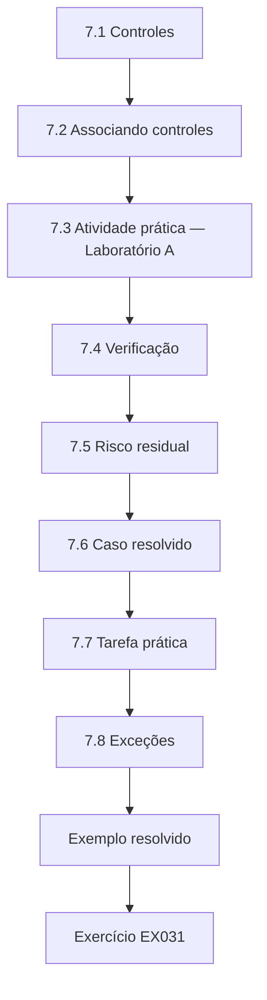

### Desenho lógico

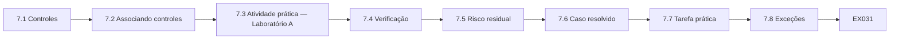

```text
[7.1 Controles]
    |
    v
[7.2 Associando controles]
    |
    v
[7.3 Atividade prática — Laboratório A]
    |
    v
[7.4 Verificação]
    |
    v
[7.5 Risco residual]
    |
    v
[7.6 Caso resolvido]
    |
    v
[7.7 Tarefa prática]
    |
    v
[7.8 Exceções]
    |
    v
[Exemplo resolvido] --> [Exercício EX031]
```
<!-- cyberabc:lesson-figures:end ch-07 -->


### Objetivos de aprendizagem

Você vai (1) descrever os principais controles disponíveis para o risco quântico; (2) associar os controles à exposição; (3) entender a criptoagilidade como objetivo de governança; (4) definir o que conta como verificação; e (5) registrar o risco residual.

### 7.1 Controles

*Troca de chaves híbrida* (X25519MLKEM768 no TLS; ML-KEM no IKEv2 por meio da RFC 9370; `mlkem768x25519-sha256` no SSH). *Chaves pré-compartilhadas provisórias* misturadas às VPNs (RFC 8784) para enlaces fixos. *Minimização de dados*: enviar e guardar menos dados de vida longa. *Planejamento da migração de assinaturas*: AC interna pós-quântica, planos de assinatura de código, renovação de carimbos de tempo do arquivo. *Cláusulas de compras*: suporte a algoritmos, inventários, compromissos de atualização. *Gestão de exceções*: aceitação por tempo limitado com controles compensatórios.

Nem todo controle se aplica a todo item, e vários costumam ser combinados, como no caso do arquivo da MTI. Registre quais controles cada item usa.

### 7.2 Associando controles

Exposição HNDL → troca de chaves híbrida e minimização primeiro. Exposição de forjar depois → planos de assinatura, compras e renovação do arquivo. Desconhecido → investigação. Controlado pelo fornecedor → cláusulas contratuais e acompanhamento do roteiro.

Na MTI, as transferências do arquivo estão expostas a HNDL, então a troca de chaves híbrida e menos transferências vieram primeiro; as assinaturas dos documentos do arquivo são de forjar depois, então foram planejados um prazo para o fornecedor e a renovação dos carimbos de tempo; e o gravador de chamadas, ainda desconhecido, foi para investigação. Registre no rastreador o motivo de cada associação, para que revisores posteriores vejam por que um controle foi escolhido e possam mudá-lo se a exposição mudar.

### 7.3 Atividade prática — Laboratório A

```python
# Lab A (ch 7): crypto-agility through a policy-driven registry instead of hard-coded algorithms.
import hashlib, hmac
REGISTRY = {"hmac-sha256": lambda k, m: hmac.new(k, m, hashlib.sha256).digest(),
            "hmac-sha3-256": lambda k, m: hmac.new(k, m, hashlib.sha3_256).digest()}
POLICY = {"tag-algorithm": "hmac-sha256", "accept": ["hmac-sha256", "hmac-sha3-256"]}
def protect(key, msg):
    alg = POLICY["tag-algorithm"]; return alg, REGISTRY[alg](key, msg)
def check(key, msg, alg, tag):
    if alg not in POLICY["accept"]: return False            # algorithm identifier is authenticated by policy
    return hmac.compare_digest(REGISTRY[alg](key, msg), tag)
k, m = b"k" * 32, b"policy schedule 42"
a1, t1 = protect(k, m)
POLICY["tag-algorithm"] = "hmac-sha3-256"                   # migration = one policy change
a2, t2 = protect(k, m)
print("old tag still verifies during transition:", check(k, m, a1, t1))
print("new tag verifies:", check(k, m, a2, t2), "| algorithms:", a1, "->", a2)
POLICY["accept"] = ["hmac-sha3-256"]                        # retire the old algorithm
print("old tag after retirement:", check(k, m, a1, t1))
```

Saída esperada:

```text
old tag still verifies during transition: True
new tag verifies: True | algorithms: hmac-sha256 -> hmac-sha3-256
old tag after retirement: False
```

Quando os algoritmos são escolhidos por política e rotulados nos dados, a migração é uma mudança de configuração, e um algoritmo antigo pode ser aposentado de forma limpa. Pergunte aos responsáveis pelos sistemas e aos fornecedores se os seus produtos funcionam assim; o [CSWP 39](https://doi.org/10.6028/NIST.CSWP.39-upd1) do NIST discute essas considerações de criptoagilidade.

Pergunte aos responsáveis pelos sistemas da MTI se o algoritmo é nomeado na configuração ou fixado no código. Onde um algoritmo está fixado no código, a migração exige uma mudança de código e uma nova versão, o que leva mais tempo e deve ser planejado mais cedo. Registre a resposta no rastreador como um fator do tempo de migração do item.

### 7.4 Verificação

Verificação significa evidência de que o controle funciona em operação: logs de negociação mostrando híbrido no serviço pretendido, inventário de certificados mostrando os novos algoritmos, respostas de questionários confirmadas por observação, minimização confirmada por revisão dos fluxos de dados. Um ticket de mudança é evidência de intenção, não de efeito.

Na MTI, o item do SFTP das resseguradoras só foi marcado como Verificado quando os logs do sshd mostraram os parceiros negociando o método híbrido. Sem essa evidência, o item continua Implementado, por mais confiante que esteja o responsável. Peça evidências que cubram um período normal de trabalho, para que os clientes ocasionais sejam incluídos, e registre a sua data.

### 7.5 Risco residual

Para cada item verificado, registre o que resta: normalmente a autenticação clássica, parceiros com clientes antigos ou dispositivos aguardando substituição. Dê a cada risco residual um responsável e uma data de revisão.

No item do SFTP das resseguradoras da MTI, o risco residual eram três parceiros com clientes antigos e as chaves de host clássicas. Registrá-lo mantém o item honesto: verificado não significa concluído. Quando um risco residual for resolvido, anote a evidência e encerre-o; quando persistir além da data de revisão, considere uma exceção. Mantenha a lista curta e específica.

### 7.6 Caso resolvido

SFTP das resseguradoras: controle — troca de chaves SSH híbrida após a atualização do OpenSSH; verificação — os logs do sshd mostram 7 de 10 resseguradoras negociando o híbrido; residual — três resseguradoras com clientes antigos (notificadas, prazo de 12 meses), chaves de host clássicas; responsável: Infraestrutura; revisão trimestral.

Esse registro está completo porque cada parte aponta para uma evidência ou uma pessoa: o controle nomeia o método, a verificação dá uma proporção medida nos logs, o risco residual nomeia o que resta e o responsável e o ciclo de revisão dizem quem acompanha e quando. Use-o como modelo.

### 7.7 Tarefa prática

Para três itens da MTI, escreva o controle, a evidência de verificação e o risco residual.

Escolha itens em estados diferentes: por exemplo, os servidores SFTP das resseguradoras, o portal de sinistros e as transferências do arquivo. Para cada um, nomeie o controle, diga que evidência mostraria que ele funciona em operação e liste o que resta depois, com responsável e data de revisão. Onde a evidência ainda não existir, escreva como e quando ela será coletada. Compare os seus registros com o exemplo do SFTP das resseguradoras e preencha qualquer lacuna que encontrar.

### 7.8 Exceções

Quando um controle não puder ser aplicado a tempo, abra uma exceção: escopo, motivo, controles compensatórios, responsável, expiração. O patrocinador aprova; o rastreador a mostra; a expiração aciona uma revisão. Exceções são normais; exceções sem expiração não são.

Na MTI, os dois escritórios aguardando a renovação de hardware são o exemplo: PSKs provisórias como controle compensatório, expiração na renovação. Cada exceção nomeia o seu controle compensatório, para que o patrocinador saiba o que reduz o risco enquanto o controle principal aguarda. Revise as exceções abertas na reunião mensal e relate qualquer exceção vencida no relatório trimestral.

### 7.9 Erros comuns e limites

- Tickets de mudança aceitos como verificação.
- Risco residual omitido.
- Exceções sem expiração.

Cada erro faz o rastreador superestimar a proteção. Um ticket de mudança aceito como verificação teria escondido a regressão do portal de corretores da MTI. Omitir o risco residual faz um item parcialmente protegido parecer concluído, de modo que as chaves de host clássicas ou os clientes antigos dos parceiros saem de vista. Uma exceção sem expiração vira uma aceitação permanente que ninguém decidiu. Revise cada item Verificado e cada exceção quanto a esses três a cada trimestre. Corrija o que encontrar. Registre o que você mudou.

### Exercícios

- **EX031 — Associar.** Associe controles a: transferências do arquivo (HNDL), AC interna (forjar depois), gravador de chamadas (desconhecido), CDN (fornecedor). Rubrica: 3 = quatro associações sensatas.
- **EX032 — Evidência de verificação.** No portal de corretores, o que verifica a troca de chaves híbrida? Rubrica: 3 = logs de negociação/saída de ferramenta, datados.
- **EX033 — Agilidade.** Usando o Laboratório A, explique por que a aposentadoria é uma mudança de política de uma linha. Rubrica: 3 = lista de aceitos, identificador nos dados.
- **EX034 — Residual.** Escreva a nota de risco residual do SFTP das resseguradoras. Rubrica: 3 = riscos restantes, responsável, revisão, prazo.
- **EX035 — Exceção.** Esboce uma exceção para o gravador de chamadas enquanto se aguarda a resposta do fornecedor. Rubrica: 3 = escopo, motivo, controles compensatórios, responsável, expiração.

### Síntese

Os controles são associados à exposição, verificados por evidências operacionais e acompanhados de risco residual registrado e de exceções por tempo limitado; a agilidade torna mais barata a mudança futura.

<!-- cyberabc:chapter-navigation:start ch-07 -->
### Continue estudando — capítulo 07 de 12

[← Capítulo 06](#ch-06) · [Índice de capítulos do curso](../SUBJECTS.md) · [Capítulo 08 →](#ch-08)

Siga para a próxima lição escrita.
<!-- cyberabc:chapter-navigation:end -->

<a id="ch-08"></a>

## Capítulo 8 — Segurança quântica e pós-quântica: análise de caso supervisionada

<!-- cyberabc:lesson-figures:start ch-08 -->
### Mapa da aula

Aula 08 publicada. Mapa, exemplo, EX036.

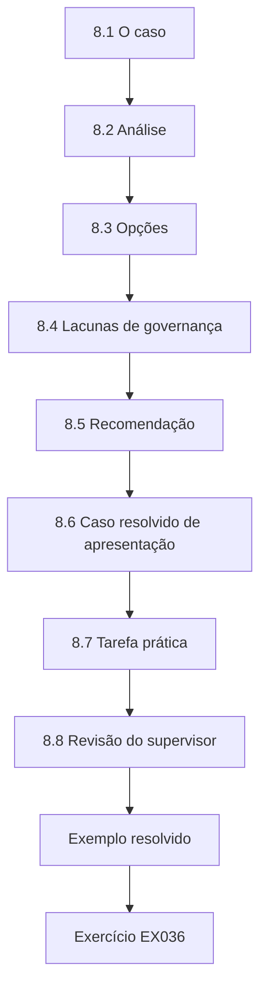

### Desenho lógico

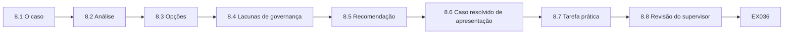

```text
[8.1 O caso]
    |
    v
[8.2 Análise]
    |
    v
[8.3 Opções]
    |
    v
[8.4 Lacunas de governança]
    |
    v
[8.5 Recomendação]
    |
    v
[8.6 Caso resolvido de apresentação]
    |
    v
[8.7 Tarefa prática]
    |
    v
[8.8 Revisão do supervisor]
    |
    v
[Exemplo resolvido] --> [Exercício EX036]
```
<!-- cyberabc:lesson-figures:end ch-08 -->


### Objetivos de aprendizagem

Você vai (1) analisar de ponta a ponta um caso realista de migração; (2) aplicar o fluxo de trabalho sob supervisão; (3) ponderar opções com critérios explícitos; (4) identificar lacunas de governança; e (5) apresentar uma recomendação.

### 8.1 O caso

O arquivo de apólices de vida da MTI (sintético): confidencialidade e verificabilidade por 40 anos; documentos assinados com RSA-2048; transferidos todas as noites dos escritórios regionais por VPNs IPsec com ECDH; armazenados cifrados com AES-256, com as chaves envolvidas por um HSM usando RSA-OAEP; appliances de VPN de um fornecedor cujo firmware suporta a RFC 9370 a partir da versão 7.4, com a MTI na 7.1; o fornecedor do software do arquivo declara "assinaturas PQC no roteiro".

Repare que o caso combina os dois riscos do Capítulo 1: troca de chaves clássica em transferências de vida longa e assinaturas clássicas em documentos de vida longa. Liste os fatos numa tabela, com os seus graus, antes de analisá-los.

### 8.2 Análise

Exposição: as transferências estão expostas a HNDL agora (dados de 40 anos). As assinaturas estão expostas ao risco de forjar depois (os documentos precisam permanecer verificáveis por décadas). O AES-256 em repouso é adequado; o envolvimento de chaves com RSA importa se as chaves envolvidas alguma vez saírem do HSM ou forem copiadas para backups externos.

Atribua grau a cada fato antes de usá-lo. O suporte a partir da versão 7.4 do firmware é uma declaração do fornecedor, então é grau D até ser testado; a alegação de roteiro do fornecedor do arquivo pontua 1 na escala do questionário, uma alegação sem data. Anote também a questão do backup do HSM, que precisa de uma resposta do responsável pelo HSM.

### 8.3 Opções

(A) Atualizar o firmware das VPNs para a 7.4 e habilitar a troca de chaves híbrida; (B) PSKs provisórias conforme a RFC 8784 nos túneis do arquivo até A; (C) reduzir as transferências, enviando os documentos uma única vez na conclusão, em vez da ressincronização noturna; (D) plano de assinaturas do arquivo: exigir do fornecedor datas para o suporte ao ML-DSA e planejar a renovação dos carimbos de tempo. Critérios: proteção, tempo, custo, risco operacional, dependência.

Pontue cada opção em todos os critérios e escreva um motivo curto para cada pontuação. A protege totalmente as transferências, mas depende do firmware do fornecedor; B é rápida, mas acrescenta trabalho de gestão de chaves; C custa pouco e reduz a exposição imediatamente; D trata das assinaturas, mas depende do fornecedor.

### 8.4 Lacunas de governança

Nenhum responsável pela criptografia do arquivo; nenhuma cláusula contratual exigindo que o fornecedor do arquivo suporte assinaturas pós-quânticas; nenhum processo de exceção usado para o atraso das VPNs.

Cada lacuna explica parte do risco. Sem um responsável, ninguém cobrou o fornecedor do arquivo. Sem uma cláusula, a MTI não tem como exigir datas. Sem uma exceção registrada, o atraso das VPNs foi aceito por omissão, e não por decisão. Corrija as lacunas junto com as opções técnicas, ou os mesmos problemas voltarão. Atribua um responsável a cada lacuna.

### 8.5 Recomendação

A em até dois trimestres, com C imediatamente e B para os dois escritórios cujos appliances não podem ser atualizados até a renovação de hardware; D como ação de compras com prazo; nomear a Gestão de Documentos como responsável pela criptografia do arquivo; registrar uma exceção para os dois escritórios, com expiração na renovação.

Repare que as opções são combinadas, e não escolhidas isoladamente: C e B reduzem a exposição enquanto A é preparada, e D inicia o trabalho de assinaturas, que tem o prazo de preparação mais longo. Cada parte tem um responsável e uma data.

### 8.6 Caso resolvido de apresentação

"Recomendação: proteger as transferências do arquivo em até seis meses, atualizando o firmware das VPNs e habilitando a troca de chaves pós-quântica híbrida, reduzir já as transferências noturnas e usar chaves pré-compartilhadas provisórias em dois escritórios. Custo: CU 40–70 mil (sintético). Residual: assinaturas clássicas dos documentos até que o fornecedor do arquivo entregue o ML-DSA; pedimos um aditivo contratual com datas."

A apresentação declara primeiro a recomendação, depois o que ela custa, depois o que resta. Ela usa palavras simples em vez das letras das opções e termina com o único pedido sobre o qual o público pode agir.

### 8.7 Tarefa prática

Analise o caso você mesmo, pontue as opções segundo os critérios e compare com a recomendação acima.

Pontue cada opção em proteção, tempo, custo, risco operacional e dependência, com um motivo curto para cada pontuação. Atribua grau aos fatos em que se apoiar, especialmente o suporte do firmware e a alegação de roteiro do fornecedor. Depois compare a sua recomendação com a do livro e explique qualquer diferença: você pode ponderar o custo ou a dependência de outra forma, o que é aceitável se disser por quê. Apresente as suas pontuações a um colega e anote qualquer mudança.

### 8.8 Revisão do supervisor

Apresente a sua análise ao seu supervisor antes de compartilhá-la: ele vai verificar se os fatos estão graduados corretamente, se as opções foram consideradas de forma justa e se a recomendação fica dentro do que as evidências sustentam. Incorpore os comentários e registre o que mudou.

No caso do arquivo, espere perguntas como por que a opção B se aplica apenas a dois escritórios e se a faixa de custo é sustentada por orçamentos. O seu supervisor também pode perguntar se a alegação sobre a versão 7.4 do firmware foi testada. Responda com as evidências que tem e diga o que ainda não sabe.

### 8.9 Erros comuns e limites

- Ignorar as assinaturas porque a troca de chaves é urgente.
- Opções sem critérios.
- Deixar passar lacunas de governança.

Cada erro deixa parte do risco sem gestão. No caso do arquivo da MTI, focar apenas nas transferências deixaria sem plano documentos assinados com décadas de idade. Opções sem critérios fazem a recomendação parecer preferência. Deixar passar as lacunas de governança significa que o fornecedor do arquivo continua sem ser cobrado e o atraso das VPNs continua sem registro. Confira a sua análise quanto aos três antes de apresentá-la. Revise a sua análise onde encontrar algum deles. Anote cada um que corrigiu.

### Exercícios

- **EX036 — Exposição.** Liste as exposições do caso por classe. Rubrica: 3 = transferências HNDL, assinaturas forjar depois, AES adequado, envolvimento de chaves condicional.
- **EX037 — Pontuação das opções.** Pontue as opções A–C em proteção e tempo (1–5). Rubrica: 3 = pontuações defensáveis, com os motivos.
- **EX038 — Lacuna.** Proponha correções para as três lacunas de governança. Rubrica: 3 = responsável, cláusula, exceção.
- **EX039 — Recomendação.** Reescreva a recomendação para um conselho não técnico em 60 palavras. Rubrica: 3 = clara, correta, custos e residual.
- **EX040 — Envolvimento de chaves.** Quando o envolvimento de chaves com RSA-OAEP se torna uma preocupação quântica? Rubrica: 3 = quando as chaves envolvidas ficam expostas fora do HSM/são gravadas.

### Síntese

A análise de caso supervisionada aplica o fluxo de trabalho de ponta a ponta: exposições, opções com critérios, lacunas de governança e uma recomendação clara e com custos, com o risco residual.

<!-- cyberabc:chapter-navigation:start ch-08 -->
### Continue estudando — capítulo 08 de 12

[← Capítulo 07](#ch-07) · [Índice de capítulos do curso](../SUBJECTS.md) · [Capítulo 09 →](#ch-09)

Siga para a próxima lição escrita.
<!-- cyberabc:chapter-navigation:end -->

<a id="ch-09"></a>

## Capítulo 9 — Comunicação, ética e relato

<!-- cyberabc:lesson-figures:start ch-09 -->
### Mapa da aula

Aula 09 publicada. Mapa, exemplo, EX041.

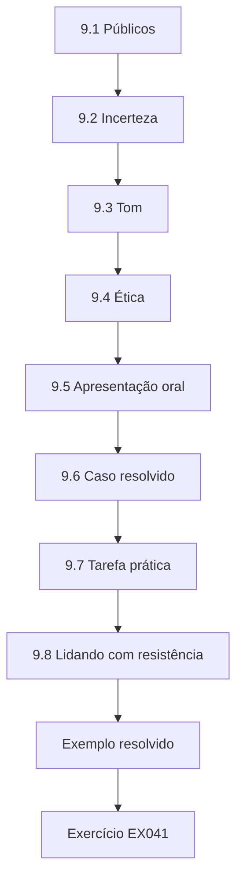

### Desenho lógico

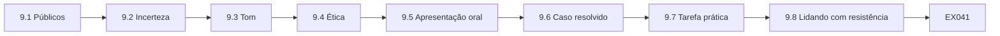

```text
[9.1 Públicos]
    |
    v
[9.2 Incerteza]
    |
    v
[9.3 Tom]
    |
    v
[9.4 Ética]
    |
    v
[9.5 Apresentação oral]
    |
    v
[9.6 Caso resolvido]
    |
    v
[9.7 Tarefa prática]
    |
    v
[9.8 Lidando com resistência]
    |
    v
[Exemplo resolvido] --> [Exercício EX041]
```
<!-- cyberabc:lesson-figures:end ch-09 -->


### Objetivos de aprendizagem

Você vai (1) escrever relatórios para executivos, responsáveis, fornecedores e auditores; (2) comunicar a incerteza com honestidade; (3) evitar mensagens baseadas no medo ou excessivamente confiantes; (4) tratar informações sensíveis de forma ética; e (5) apresentar constatações oralmente.

### 9.1 Públicos

Os executivos precisam de decisões, postura de risco, custos e risco residual em uma página. Os responsáveis pelos sistemas precisam de constatações específicas, com evidências e prazos. Os fornecedores precisam de requisitos e datas claros. Os auditores precisam de evidências e método. As equipes precisam saber o que muda para elas.

Escreva cada versão a partir do mesmo rastreador, para que os números coincidam entre os públicos. Na MTI, o resumo executivo informa a proporção verificada e as decisões necessárias, enquanto a equipe de infraestrutura recebe as constatações do SFTP das resseguradoras com as evidências do sshd e as datas. O fornecedor do arquivo recebe um requisito claro de suporte datado ao ML-DSA. Verifique se cada versão responde ao que aquele público precisa decidir ou fazer.

### 9.2 Incerteza

Diga o que se sabe (normas publicadas, algoritmos em uso), o que se estima (durações da migração) e o que se desconhece (quando existirá um computador quântico capaz). Use faixas e mostre que as recomendações se mantêm em todas elas. Evite previsões de data única.

Na MTI, a lista de prioridades se apoia nos resultados do Laboratório M para z de 10, 15 e 20, e o arquivo vem primeiro nos três. Dizer isso permite aos executivos aceitar a lista sem precisar aceitar previsão alguma. Onde uma estimativa orientar uma decisão, informe a sua fonte e a sua faixa.

### 9.3 Tom

Mensagens baseadas no medo ("apocalipse quântico") produzem pânico ou descaso. Mensagens excessivamente confiantes ("somos seguros contra o quântico") desmoronam na primeira auditoria. Mensagens calmas e específicas funcionam: "estamos protegendo primeiro os dados que precisam permanecer privados por mais tempo; aqui está o progresso e o que falta".

Leia o seu rascunho em voz alta e remova qualquer palavra que alegue uma certeza que você não pode mostrar ou um alarme que não pode justificar. Confira cada número com o rastreador antes de enviar. Na MTI, o resumo trimestral evitou os dois extremos ao declarar com clareza a proporção verificada e os riscos.

### 9.4 Ética

Relatórios sobre fraquezas são sensíveis; compartilhe-os com base na necessidade de saber. Não exagere o risco para ganhar orçamento nem o subestime para evitar trabalho. Credite com exatidão o trabalho das equipes. Rotule os exemplos sintéticos nos materiais de treinamento. Relate os problemas que descobrir, incluindo os seus próprios erros.

Na MTI, um relatório sobre a ordem de preferência fraca do portal de sinistros vai para o Web Platform e para o patrocinador, não para todos os funcionários. Se descobrir que um número que você relatou estava errado, corrija-o no relatório seguinte e diga o que mudou.

### 9.5 Apresentação oral

Comece pela pergunta e pela resposta, mostre as evidências e termine com as decisões necessárias. Mantenha os slides simples; prepare-se para perguntas sobre as hipóteses e a situação das orientações.

No briefing trimestral da MTI, a pergunta é se os dados de nível 1 estão mais bem protegidos do que no trimestre anterior, a resposta é a proporção verificada e as decisões são o aditivo contratual e as duas exceções. Ensaie com alguém que vá perguntar se o IR 8547 é definitivo e responda que é um rascunho com datas propostas. Seja breve.

### 9.6 Caso resolvido

Resumo executivo trimestral (sintético): "Posição: 9 % dos itens de nível 1 verificados, 9 % ainda desconhecidos (eram 31 %). Destaques: o SFTP das resseguradoras agora usa troca de chaves pós-quântica híbrida com 7 de 10 parceiros. Riscos: o fornecedor do arquivo não tem plano datado para assinaturas pós-quânticas. Decisões necessárias: aprovar o pedido de aditivo contratual; aprovar duas exceções para escritórios que aguardam a renovação de hardware. Perspectiva: transferências do arquivo protegidas até o 2º trimestre, se as atualizações de firmware avançarem."

O resumo segue a ordem das perguntas de um executivo: onde estamos, o que melhorou, o que está em risco, o que vocês precisam de mim e o que vem a seguir. Cada número pode ser rastreado até o rastreador. A perspectiva é condicional, o que é honesto quanto à dependência das atualizações de firmware.

### 9.7 Tarefa prática

Escreva a mensagem do mesmo trimestre para os responsáveis pelos sistemas e para um fornecedor.

Para os responsáveis pelos sistemas, comece pelas suas constatações abertas, evidências e prazos; para o fornecedor do arquivo, declare o requisito de suporte datado ao ML-DSA e o pedido de aditivo contratual, sem compartilhar detalhes das fraquezas internas da MTI. Verifique se as duas usam os mesmos números do resumo executivo. Pergunte a um colega se cada destinatário saberia exatamente o que fazer depois de ler. Revise as duas após o retorno. Guarde as duas no seu portfólio.

### 9.8 Lidando com resistência

Os responsáveis podem contestar prazos; os executivos podem questionar o custo. Responda com evidências: o tempo de vida dos dados, a robustez da lista de prioridades entre os cronogramas, a faixa de custo e o risco residual de esperar. Ofereça opções em vez de ultimatos e registre a decisão e quem a tomou.

Na MTI, a um responsável que resista a reordenar os grupos do portal de sinistros poderia ser oferecida uma implantação em etapas, com resultados de gate, em vez de uma mudança imediata. Pergunte o que tornaria o prazo possível, como ajuda de um fornecedor ou outra janela de mudança, e inclua isso nas opções.

### 9.9 Erros comuns e limites

- Um único relatório para todos os públicos.
- Falsa precisão sobre os cronogramas.
- Compartilhar amplamente os detalhes das fraquezas.

Cada erro enfraquece a confiança. Um único relatório dá aos executivos detalhes que eles não vão ler e aos responsáveis pouco demais para agir. A falsa precisão sobre quando existirá um computador quântico convida à discussão e é facilmente desacreditada. Compartilhar amplamente os detalhes das fraquezas cria um mapa útil para os atacantes e quebra a regra da necessidade de saber. Revise cada relatório quanto aos três antes de enviá-lo. Reescreva os que falharem. Anote o que mudou e por quê.

### Exercícios

- **EX041 — Público.** Liste o que os executivos e os auditores precisam, cada um. Rubrica: 3 = decisões/postura versus evidências/método.
- **EX042 — Frase sobre a incerteza.** Escreva uma frase que declare com exatidão a incerteza do cronograma quântico. Rubrica: 3 = sem data, faixa/hipótese, recomendação robusta.
- **EX043 — Corrigir o tom.** Reescreva: "Hackers com computadores quânticos vão roubar tudo em breve!" Rubrica: 3 = calma, específica, correta.
- **EX044 — Mensagem ao fornecedor.** Escreva uma mensagem de requisitos de cinco frases ao fornecedor do arquivo. Rubrica: 3 = requisito, norma, data, teste, contato.
- **EX045 — Resistência.** Como você responde a um responsável que diz "o quântico está a décadas de distância"? Rubrica: 3 = HNDL, tempo de vida, robustez, opções.

### Síntese

Uma boa comunicação se ajusta ao público, declara a incerteza com honestidade, mantém um tom calmo, trata as informações sensíveis de forma ética e leva a decisões registradas.

<!-- cyberabc:chapter-navigation:start ch-09 -->
### Continue estudando — capítulo 09 de 12

[← Capítulo 08](#ch-08) · [Índice de capítulos do curso](../SUBJECTS.md) · [Capítulo 10 →](#ch-10)

Siga para a próxima lição escrita.
<!-- cyberabc:chapter-navigation:end -->

<a id="ch-10"></a>

## Capítulo 10 — Segurança quântica e pós-quântica: qualidade e diagnóstico de problemas

<!-- cyberabc:lesson-figures:start ch-10 -->
### Mapa da aula

Aula 10 publicada. Mapa, exemplo, EX046.

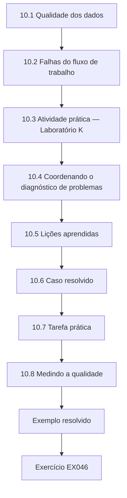

### Desenho lógico

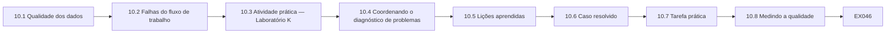

```text
[10.1 Qualidade dos dados]
    |
    v
[10.2 Falhas do fluxo de trabalho]
    |
    v
[10.3 Atividade prática — Laboratório K]
    |
    v
[10.4 Coordenando o diagnóstico de problemas]
    |
    v
[10.5 Lições aprendidas]
    |
    v
[10.6 Caso resolvido]
    |
    v
[10.7 Tarefa prática]
    |
    v
[10.8 Medindo a qualidade]
    |
    v
[Exemplo resolvido] --> [Exercício EX046]
```
<!-- cyberabc:lesson-figures:end ch-10 -->


### Objetivos de aprendizagem

Você vai (1) verificar a qualidade do inventário e do rastreador; (2) detectar falhas comuns do fluxo de trabalho; (3) interpretar as decisões de gate da implantação; (4) coordenar o diagnóstico de problemas com as equipes técnicas; e (5) melhorar o fluxo de trabalho a partir das lições aprendidas.

### 10.1 Qualidade dos dados

Verifique regularmente: evidências vencidas (mais antigas que a idade combinada), itens sem responsáveis, desconhecidos sem tarefas, itens marcados como Verificados sem evidência, exceções vencidas. Sorteie dez itens por mês e confira você mesmo as evidências deles.

Registre o resultado de cada amostra, incluindo os itens aprovados, para que as tendências fiquem visíveis. Na MTI, a regressão do portal de corretores foi encontrada assim. Quando uma amostra falhar, corrija o item e depois pergunte se a mesma falha poderia afetar itens semelhantes, e confira-os também. Mantenha o mesmo método de amostragem todo mês, para que os resultados possam ser comparados ao longo do tempo.

### 10.2 Falhas do fluxo de trabalho

*Fallback silencioso*: um item verificado no trimestre anterior voltou ao clássico após uma atualização. *Itens parados*: dependências sem acompanhamento. *Expansão do escopo*: o fluxo de trabalho absorve trabalho não relacionado. *Deriva dos relatórios*: as definições mudam entre os trimestres sem aviso.

Cada falha tem um remédio diferente: reverificação para o fallback silencioso, escalonamento para os itens parados, uma revisão de escopo para a expansão e um registro de definições para a deriva. Verifique as quatro na reunião mensal. Na MTI, a regressão do portal de corretores foi um fallback silencioso, detectado pela amostragem. Registre cada falha encontrada e o remédio aplicado.

### 10.3 Atividade prática — Laboratório K

```python
# Lab K (ch 10): canary gate for enabling a hybrid group - promote only if failures stay within budget.
import math
def upper95(k, n):                      # Wilson upper bound
    z = 1.96; p = k / n; d = 1 + z*z/n
    return ((p + z*z/(2*n)) + z*math.sqrt(p*(1-p)/n + z*z/(4*n*n))) / d
baseline, budget = 5e-4, 4e-4            # baseline failure rate, allowed increase
for stage, k, n in [("1% canary", 3, 5000), ("10% canary", 28, 50000), ("10% canary (proxy site)", 96, 50000)]:
    ub = upper95(k, n); ok = ub <= baseline + budget
    print(f"{stage:24s} {k}/{n}  upper95={ub:.5f}  {'PROMOTE' if ok else 'HOLD'}")
```

Saída esperada:

```text
1% canary                3/5000  upper95=0.00176  HOLD
10% canary               28/50000  upper95=0.00081  PROMOTE
10% canary (proxy site)  96/50000  upper95=0.00234  HOLD
```

As equipes técnicas implantam as mudanças em etapas e só promovem quando as taxas de falha ficam dentro da margem com confiança. Como coordenador, leia os resultados dos gates para relatar a situação com exatidão: "retido à espera de mais dados" e "retido por causa de uma falha" significam coisas diferentes para o cronograma.

Leia os três resultados com atenção. O primeiro canário ficou retido porque 5.000 conexões são poucas para mostrar que as falhas estão dentro da margem, então são necessários mais dados. O canário de 10 % foi promovido. O site com proxy ficou retido porque as falhas estavam claramente altas, o que aponta para uma falha que precisa de diagnóstico técnico.

### 10.4 Coordenando o diagnóstico de problemas

Quando uma implantação causar problemas, o seu papel é a coordenação: garantir que os responsáveis certos estejam envolvidos, que o impacto seja entendido, que a comunicação saia, que o rastreador mostre o item como bloqueado, com um motivo, e que as lições sejam capturadas. Deixe o diagnóstico técnico com a equipe técnica.

Na MTI, quando a proporção híbrida da API de cotação caiu, o trabalho do coordenador foi envolver o responsável pela plataforma, informar as partes interessadas e atualizar o rastreador, e não diagnosticar a causa. Mantenha uma linha do tempo curta dos eventos e das decisões.

### 10.5 Lições aprendidas

Após cada trimestre e cada incidente significativo, faça uma revisão curta: o que deu certo, o que não deu, o que mudar no fluxo de trabalho. Registre as mudanças nas definições e nos procedimentos.

Mantenha a revisão curta e sem culpados, com foco no fluxo de trabalho, e não nas pessoas. Na MTI, a regressão do portal de corretores levou a uma nova regra: todo item Verificado é reverificado mensalmente. Cada lição deve produzir uma mudança concreta com um responsável, ou uma decisão registrada de não mudar. Compartilhe as notas da revisão com a equipe.

### 10.6 Caso resolvido

Uma amostra mensal descobre que o portal de corretores, marcado como Verificado no 1º trimestre, mostra 4 % de híbrido nos logs do 2º trimestre. Causa: uma atualização da plataforma restaurou um perfil padrão. Ações: o item volta para Em andamento; o responsável restaura o perfil; acrescenta-se uma regra de qualidade — todo item Verificado é reverificado automaticamente a cada mês. Lições registradas.

A resposta segue o fluxo de trabalho: o rastreador mostra o estado real, o responsável corrige a causa e uma regra evita a repetição. Relatar a regressão abertamente protege a credibilidade dos outros números de Verificados.

### 10.7 Tarefa prática

Projete um checklist mensal de qualidade com oito verificações para o rastreador da MTI.

Inclua verificações de evidências vencidas, itens sem responsáveis, desconhecidos sem tarefas, itens Verificados sem evidência de negociação e exceções vencidas. Acrescente verificações suas, como a reverificação mensal dos itens Verificados introduzida após a regressão do portal de corretores. Para cada verificação, diga que dados ela usa, quem a executa e o que acontece quando ela falha. Mantenha o checklist em uma página, para que seja usado, e revise-o após cada trimestre.

### 10.8 Medindo a qualidade

Relate uma medida de qualidade ao lado do progresso: por exemplo, a proporção de itens sorteados cuja evidência coincidia com o seu estado no rastreador. Uma pontuação de qualidade em queda é um alerta precoce de que os números de progresso podem estar superestimados.

Na MTI, a pontuação teria caído no mês em que a regressão do portal de corretores foi encontrada. Relate a pontuação com o tamanho da amostra, já que uma amostra de dez itens dá apenas um número aproximado. Se a pontuação cair, veja que tipos de itens falharam antes de tirar conclusões e diga no relatório como os números podem ser afetados.

### 10.9 Erros comuns e limites

- Confiar no Verificado para sempre.
- Coordenadores fazendo diagnóstico técnico.
- Definições mudadas em silêncio.

Cada erro deixa os números se afastarem da realidade. O portal de corretores da MTI mostrou que os itens Verificados podem regredir após uma atualização. Um coordenador que diagnostica falhas técnicas atrasa as pessoas que podem corrigi-las e pode relatar errado a causa. Definições mudadas em silêncio tornam os números de um trimestre incomparáveis com os do seguinte, de modo que as tendências perdem o sentido. Acrescente uma verificação para cada um ao seu checklist mensal de qualidade. Corrija o que encontrar. Registre as correções.

### Exercícios

- **EX046 — Verificações de qualidade.** Liste cinco verificações de qualidade dos dados. Rubrica: 3 = vencidas, sem responsável, desconhecidos sem tarefa, Verificados sem evidência, exceções vencidas.
- **EX047 — Leitura dos gates.** Relate os três resultados do Laboratório K em linguagem simples para o patrocinador. Rubrica: 3 = aguardar dados; prosseguir; falha num site sob investigação.
- **EX048 — Regressão.** Que mudança no rastreador e que regra decorrem da regressão do portal de corretores? Rubrica: 3 = volta para Em andamento; reverificação mensal.
- **EX049 — Coordenação.** Liste quatro ações do coordenador durante um problema de implantação. Rubrica: 3 = responsáveis, impacto, comunicação, rastreador.
- **EX050 — Medida de qualidade.** Defina uma medida de qualidade e o seu cálculo. Rubrica: 3 = proporção de coincidentes entre os sorteados.

### Síntese

Verificações de qualidade, leitura correta das decisões de gate, diagnóstico coordenado e lições aprendidas mantêm honestos os números do fluxo de trabalho.

<!-- cyberabc:chapter-navigation:start ch-10 -->
### Continue estudando — capítulo 10 de 12

[← Capítulo 09](#ch-09) · [Índice de capítulos do curso](../SUBJECTS.md) · [Capítulo 11 →](#ch-11)

Siga para a próxima lição escrita.
<!-- cyberabc:chapter-navigation:end -->

<a id="ch-11"></a>

## Capítulo 11 — Laboratório supervisionado

<!-- cyberabc:lesson-figures:start ch-11 -->
### Mapa da aula

Aula 11 publicada. Mapa, exemplo, EX051.

```mermaid
flowchart TD
  N0["11.1 Preparação"]
  N1["11.2 Tarefas"]
  N2["11.3 O incidente"]
  N3["11.4 Avaliação"]
  N4["11.5 Caso resolvido"]
  N5["11.6 Tarefa prática"]
  N6["11.7 Reflexão"]
  N7["11.8 Trabalhando com partes interessadas simuladas"]
  N0 --> N1 --> N2 --> N3 --> N4 --> N5 --> N6 --> N7
  N7 --> EX["Exemplo resolvido"]
  EX --> Q["Exercício EX051"]
```

### Desenho lógico

```mermaid
flowchart LR
  N0["11.1 Preparação"]
  N1["11.2 Tarefas"]
  N2["11.3 O incidente"]
  N3["11.4 Avaliação"]
  N4["11.5 Caso resolvido"]
  N5["11.6 Tarefa prática"]
  N6["11.7 Reflexão"]
  N7["11.8 Trabalhando com partes interessadas simuladas"]
  N0 --> N1 --> N2 --> N3 --> N4 --> N5 --> N6 --> N7 --> Q["EX051"]
```

```text
[11.1 Preparação]
    |
    v
[11.2 Tarefas]
    |
    v
[11.3 O incidente]
    |
    v
[11.4 Avaliação]
    |
    v
[11.5 Caso resolvido]
    |
    v
[11.6 Tarefa prática]
    |
    v
[11.7 Reflexão]
    |
    v
[11.8 Trabalhando com partes interessadas simuladas]
    |
    v
[Exemplo resolvido] --> [Exercício EX051]
```
<!-- cyberabc:lesson-figures:end ch-11 -->


### Objetivos de aprendizagem

Você vai (1) executar um ciclo completo do fluxo de trabalho com um conjunto de dados sintético; (2) produzir o rastreador, as constatações e o relatório; (3) trabalhar com responsáveis e fornecedores simulados; (4) tratar um incidente simulado; e (5) refletir sobre o seu desempenho.

### 11.1 Preparação

O laboratório usa um conjunto de dados sintético da MTI: 40 ativos com exportações de configuração, alguns resumos de logs, respostas de questionários a fornecedores e registros de tempos de vida dos dados. O seu supervisor e os colegas fazem o papel dos responsáveis, dos fornecedores e do patrocinador. Nenhum sistema ou dado real está envolvido.

Trate o conjunto de dados como trataria evidências reais: peça uma autorização simulada antes de usá-lo, rotule-o e atribua grau a cada item. O supervisor verifica o tratamento, além dos resultados. Faça perguntas aos participantes que interpretam papéis como faria a responsáveis reais e registre as respostas como evidências.

### 11.2 Tarefas

Dia 1: escopo, autorização (simulada), inventário e graus. Dia 2: priorização com a regra de Mosca e as classes de exposição. Dia 3: planejar os itens, enviar pedidos aos fornecedores, abrir constatações. Dia 4: uma implantação simulada com resultados de gate e um incidente (fallback silencioso). Dia 5: relatório trimestral e apresentação.

Guarde as saídas de cada dia, já que o dia seguinte se baseia nelas. Ao fim de cada dia, verifique se o rastreador reflete o que você aprendeu. O relatório do Dia 5 deve se basear apenas nas saídas dos dias anteriores, de modo que qualquer falta fique visível. Se você se atrasar, avise o supervisor e combine o que deixar de lado, como faria com um patrocinador real.

### 11.3 O incidente

No meio do laboratório, o "responsável pela plataforma" informa que a proporção híbrida da API de cotação caiu após uma atualização. Você coordena: atualização do rastreador, envolvimento do responsável, comunicação às partes interessadas, lições.

Trate-o como um incidente real. Mova o item de Verificado para Em andamento ou bloqueado, com um motivo, contate o responsável, diga às partes interessadas o que mudou e quando virá a próxima atualização, e deixe o diagnóstico com o responsável pela plataforma. Registre uma lição depois, como a MTI fez após a regressão do portal de corretores. Mantenha a linha do tempo.

### 11.4 Avaliação

Os supervisores avaliam a exatidão do inventário e das prioridades, a qualidade das constatações e do tratamento de evidências, a integridade do rastreador, a comunicação e o tratamento do incidente.

Cada critério corresponde a um capítulo do livro, então o retorno lhe diz qual capítulo revisitar. Os supervisores procuram evidências para cada afirmação que você faz; um rastreador correto, com desconhecidos honestos, pontua melhor do que um arrumado com itens Verificados sem sustentação. Peça um retorno por escrito ao fim de cada dia. Aja sobre ele no dia seguinte.

### 11.5 Caso resolvido

A saída do Dia 2 de um participante: 9 ativos de nível 1; lista de prioridades encabeçada pelas transferências do arquivo e pelo SFTP das resseguradoras; 6 desconhecidos com tarefas; tabela de Mosca para *z* = 10, 15, 20. Retorno do supervisor: uma alegação de fornecedor classificada como B deveria ser D; corrigida, e a prioridade daquele ativo reduzida enquanto se aguarda a verificação.

O retorno mostra por que os graus importam: a alegação mal classificada tinha elevado a prioridade de um ativo com base na palavra de um fornecedor. Corrigi-la levou dinheiro e atenção para itens com evidências melhores. O participante registrou a correção no registro diário.

### 11.6 Tarefa prática

Complete o laboratório de cinco dias e mantenha um registro diário curto.

A cada dia, escreva o que produziu, que decisão tomou e por quê, e o que faria diferente. Mantenha o registro factual e curto. Anote quando a resposta de um participante que interpreta um papel mudou o seu plano. O registro alimenta a reflexão e passa a fazer parte do seu portfólio. Leia o registro toda manhã antes de começar, para que as lições de ontem moldem o trabalho de hoje. Compartilhe-o com o seu supervisor no fim da semana.

### 11.7 Reflexão

No final, escreva uma reflexão de uma página: o que você fez bem, o que mudaria, qual habilidade precisa de mais prática e uma melhoria para o próprio fluxo de trabalho. Compartilhe-a com o seu supervisor.

Baseie a reflexão no registro diário e no retorno do supervisor, e não na memória. Seja específico: "classifiquei uma alegação de fornecedor como B" é mais útil do que "a atribuição de graus precisa melhorar". Escolha uma melhoria do fluxo de trabalho que você poderia propor na MTI, como uma regra de reverificação dos itens Verificados, e explique como testaria se ela ajudou.

### 11.8 Trabalhando com partes interessadas simuladas

Trate os participantes que interpretam papéis como reais: envie pedidos claros e educados, com prazos; registre as respostas; escale quando os prazos passarem. O laboratório avalia se você consegue manter um fluxo de trabalho andando por meio de outras pessoas, que é o núcleo do trabalho do profissional.

Se um participante recusar um prazo, registre isso e ofereça opções, como faria com um responsável real. O supervisor observa se os seus pedidos são claros o bastante para que se aja sobre eles sem uma pergunta de acompanhamento, se você registra as respostas como evidências e se o escalonamento é oportuno e educado, e não brusco.

### 11.9 Erros comuns e limites

- Tratar o laboratório como um exercício de planilha.
- Deixar passar a etapa de comunicação do incidente.
- Pular a reflexão.

Cada erro perde aquilo que o laboratório testa. Tratá-lo como um exercício de planilha ignora as pessoas que precisam agir sobre os seus pedidos. Deixar passar a etapa de comunicação do incidente mantém as partes interessadas sem saber de uma regressão, o que prejudica mais a confiança do que a própria regressão. Pular a reflexão perde a lição que o retorno do supervisor deveria produzir. Confira o seu próprio trabalho de laboratório quanto aos três. Anote o que mudou.

### Exercícios

- **EX051 — Plano dos dias.** Escreva as entregas de cada dia do laboratório. Rubrica: 3 = cinco dias, com as saídas.
- **EX052 — Correção de grau.** Por que reclassificar uma alegação de B para D muda as ações de prioridade? Rubrica: 3 = precisa de verificação antes do gasto.
- **EX053 — Nota do incidente.** Escreva a nota às partes interessadas sobre o incidente da API de cotação. Rubrica: 3 = o quê, impacto, ação, próxima atualização.
- **EX054 — Critérios de avaliação.** Liste cinco critérios que os supervisores usam. Rubrica: 3 = exatidão, constatações, evidências, rastreador, comunicação/incidente.
- **EX055 — Reflexão.** Escreva um modelo de reflexão de cinco frases. Rubrica: 3 = pontos fortes, mudanças, lacuna de habilidade, melhoria do fluxo de trabalho, próximo passo.

### Síntese

O laboratório supervisionado executa um ciclo completo com pessoas simuladas e um incidente, construindo confiança no fluxo de trabalho antes do uso real.

<!-- cyberabc:chapter-navigation:start ch-11 -->
### Continue estudando — capítulo 11 de 12

[← Capítulo 10](#ch-10) · [Índice de capítulos do curso](../SUBJECTS.md) · [Capítulo 12 →](#ch-12)

Siga para a próxima lição escrita.
<!-- cyberabc:chapter-navigation:end -->

<a id="ch-12"></a>

## Capítulo 12 — Portfólio prático e revisão final

<!-- cyberabc:lesson-figures:start ch-12 -->
### Mapa da aula

Aula 12 publicada. Mapa, exemplo, EX056.

```mermaid
flowchart TD
  N0["12.1 Conteúdo do portfólio"]
  N1["12.2 Apresentação"]
  N2["12.3 Perguntas prováveis"]
  N3["12.4 Próximos passos"]
  N4["12.5 Mantendo-se atualizado"]
  N5["12.6 Caso resolvido"]
  N6["12.7 Tarefa prática"]
  N7["12.8 Hábitos profissionais"]
  N0 --> N1 --> N2 --> N3 --> N4 --> N5 --> N6 --> N7
  N7 --> EX["Exemplo resolvido"]
  EX --> Q["Exercício EX056"]
```

### Desenho lógico

```mermaid
flowchart LR
  N0["12.1 Conteúdo do portfólio"]
  N1["12.2 Apresentação"]
  N2["12.3 Perguntas prováveis"]
  N3["12.4 Próximos passos"]
  N4["12.5 Mantendo-se atualizado"]
  N5["12.6 Caso resolvido"]
  N6["12.7 Tarefa prática"]
  N7["12.8 Hábitos profissionais"]
  N0 --> N1 --> N2 --> N3 --> N4 --> N5 --> N6 --> N7 --> Q["EX056"]
```

```text
[12.1 Conteúdo do portfólio]
    |
    v
[12.2 Apresentação]
    |
    v
[12.3 Perguntas prováveis]
    |
    v
[12.4 Próximos passos]
    |
    v
[12.5 Mantendo-se atualizado]
    |
    v
[12.6 Caso resolvido]
    |
    v
[12.7 Tarefa prática]
    |
    v
[12.8 Hábitos profissionais]
    |
    v
[Exemplo resolvido] --> [Exercício EX056]
```
<!-- cyberabc:lesson-figures:end ch-12 -->


### Objetivos de aprendizagem

Você vai (1) montar um portfólio que mostre cada objetivo do curso; (2) apresentar o seu fluxo de trabalho e os seus resultados; (3) responder a perguntas sobre método, evidências e situação das orientações; (4) planejar os próximos passos na prática; e (5) manter o seu conhecimento atualizado.

### 12.1 Conteúdo do portfólio

Inclua: um texto explicativo correto (Capítulo 1); um mapa de serviços e de partes interessadas com prioridades (2); autorização e rótulos de evidência (3); um extrato graduado da CBOM (4); constatações a partir da saída de ferramentas (5); um rastreador com estados e dependências (6); registros de controle, verificação e risco residual (7); a análise do caso (8); relatórios para dois públicos (9); um checklist de qualidade e lições (10); as saídas do laboratório e a reflexão (11).

Escolha itens que mostrem resultados, além de documentos, como estados do rastreador sustentados por evidências. Cada item deve citar a sua fonte e a sua data, e os itens graduados devem mostrar o seu grau. Remova tudo o que não puder sustentar e anote quais objetivos estão fracamente cobertos, para poder tratá-los antes da revisão.

### 12.2 Apresentação

Dez minutos: o fluxo de trabalho, o que você produziu, uma decisão que você apoiou, uma lição. Depois, perguntas.

Por exemplo, você pode escolher a recomendação do caso do arquivo como a decisão e a regressão do portal de corretores como a lição. Mantenha a visão geral do fluxo de trabalho em dois minutos, para que a maior parte do tempo vá para os resultados. Ensaie com um cronômetro e prepare um slide que mostre o rastreador antes e depois do seu trabalho. Deixe tempo para as perguntas, já que a revisão testa como você raciocina tanto quanto o que você produziu. Leve o portfólio, para poder apontar as evidências quando perguntado.

### 12.3 Perguntas prováveis

"Como você sabe que um item está verificado?" "Por que o arquivo vem primeiro?" "O IR 8547 é definitivo?" "O que a troca de chaves híbrida não protege?" "O que você faria se um fornecedor nunca respondesse?" Responda com evidências do seu portfólio.

Por exemplo, "Como você sabe que um item está verificado?" se responde com os logs de negociação do portfólio, e não com um ticket de mudança. Prepare uma resposta de uma linha e uma evidência para cada uma. Pratique as respostas com um colega. Mantenha as evidências prontas para mostrar.

### 12.4 Próximos passos

Combine com o seu gestor quais responsabilidades do fluxo de trabalho você vai assumir, quais habilidades aprofundar (por exemplo, o curso técnico, para a configuração prática) e quando vai revisar o progresso.

Registre o acordo por escrito, com datas e um revisor nomeado. Escolha responsabilidades que usem o que o portfólio mostra que você sabe fazer, como conduzir o ciclo trimestral de uma divisão, e acrescente uma habilidade nova de cada vez. Revise o plano após três meses e ajuste-o com o seu gestor. Guarde uma cópia no portfólio.

### 12.5 Mantendo-se atualizado

Acompanhe as publicações do NIST e da IETF, as orientações setoriais e os anúncios dos fornecedores. Atualize o seu texto explicativo e a seção de normas do fluxo de trabalho quando a situação mudar — por exemplo, quando o FN-DSA ou a norma do HQC forem publicados, ou quando o IR 8547 for finalizado.

Reserve um horário fixo a cada mês para conferir essas fontes e registrar o que mudou, se algo mudou. Quando uma situação mudar, atualize o texto explicativo do Capítulo 1 e avise as partes interessadas que dependem dele. Quando as orientações mudarem, verifique se alguma decisão da MTI se apoiava na situação antiga e, se for o caso, leve o assunto à reunião mensal seguinte, em vez de esperar pela revisão anual.

### 12.6 Caso resolvido

Um participante apresenta a posição da MTI no 2º trimestre, a recomendação do caso do arquivo e a lição da regressão do portal de corretores. Perguntado "O que o híbrido não protege?", responde: "A autenticação — o certificado do portal ainda é clássico —, além de qualquer salto ou parceiro ainda em troca de chaves clássica e dos dados gravados antes da mudança." Perguntado sobre o IR 8547, declara que é um rascunho com datas propostas e mostra como as datas internas da MTI foram definidas.

As respostas funcionam porque cada uma aponta para evidências e declara limites. Nenhuma exagera, e ambas se referem aos próprios registros da MTI.

### 12.7 Tarefa prática

Monte o seu portfólio e ensaie a apresentação com um colega.

Verifique se cada item do portfólio corresponde a um objetivo do curso e traz evidências, e não apenas um documento. Ensaie a apresentação de dez minutos pelo menos duas vezes com um colega que faça as perguntas prováveis, incluindo se o IR 8547 é definitivo e o que o híbrido não protege. Cronometre-se, anote as perguntas que achou difíceis e prepare evidências para cada uma antes da revisão final. Peça ao colega anotações por escrito. Revise uma vez e guarde as duas versões.

### 12.8 Hábitos profissionais

Os hábitos que este curso constrói — dar fonte a cada afirmação, graduar as evidências, registrar as decisões, declarar o risco residual, comunicar com calma — se aplicam a qualquer programa de segurança. Pratique-os deliberadamente no seu próximo cargo; são eles que tornam um profissional digno de confiança para coordenar o trabalho entre equipes.

Escolha um hábito para praticar a cada mês e peça a um colega que o avise quando você escorregar. Na MTI, esses hábitos apareceram em pequenas coisas: uma alegação de fornecedor classificada como D, e não como B, uma regressão relatada abertamente e uma exceção com expiração. Continue praticando-os quando ninguém estiver conferindo.

### 12.9 Erros comuns e limites

- Portfólios de documentos sem evidências de resultados.
- Exagerar nas respostas.
- Nenhum plano para se manter atualizado.

Cada erro enfraquece a revisão final. Um portfólio de documentos sem resultados mostra atividade, mas não resultados, como estados do rastreador sem evidências. Exagerar, por exemplo chamando o IR 8547 de definitivo ou a troca de chaves híbrida de proteção completa, desfaz a credibilidade que o portfólio constrói. Sem um plano para se manter atualizado, o seu texto explicativo ficará desatualizado assim que o FN-DSA ou a norma do HQC forem publicados. Confira cada um antes de entregar.

### Exercícios

- **EX056 — Mapa do portfólio.** Associe cinco objetivos do curso a itens do portfólio. Rubrica: 3 = artefatos específicos.
- **EX057 — Resposta.** Responda: "Como você sabe que um item está verificado?" Rubrica: 3 = evidência operacional, data, fonte.
- **EX058 — Silêncio do fornecedor.** O que você faz se um fornecedor nunca responde? Rubrica: 3 = escalar via compras, grau U, exceção/controles compensatórios, fornecedor alternativo.
- **EX059 — Plano de atualização.** Escreva um plano de três itens para se manter atualizado. Rubrica: 3 = fontes, cadência, ações de atualização.
- **EX060 — Próximo cargo.** Nomeie duas responsabilidades do fluxo de trabalho que você poderia assumir em seguida, e por quê. Rubrica: 3 = realistas, ligadas a evidências de habilidade.

### Síntese

O portfólio e a revisão final demonstram um fluxo de trabalho repetível e baseado em evidências e as habilidades de comunicação para conduzi-lo, com um plano para se manter atualizado.

<!-- cyberabc:chapter-navigation:start ch-12 -->
### Continue estudando — capítulo 12 de 12

[← Capítulo 11](#ch-11) · [Índice de capítulos do curso](../SUBJECTS.md) · [Resoluções →](#worked-results)

Siga para a próxima lição escrita.
<!-- cyberabc:chapter-navigation:end -->

<a id="worked-results"></a>

## Resoluções

Respostas-modelo; qualquer resposta que atenda à rubrica recebe a mesma pontuação. Os números sobre a MTI são sintéticos.

**EX001.** AES-256: manter (Grover apenas tira a raiz quadrada da busca). RSA-2048: substituir (Shor). SHA-256: manter (sem quebra quântica prática). ECDSA P-256: substituir (Shor).

**EX002.** FIPS 203 ML-KEM: estabelecimento de chaves. FIPS 204 ML-DSA: assinaturas de uso geral. FIPS 205 SLH-DSA: assinaturas baseadas em hash.

**EX003.** HNDL: transferências de registros de apólices de vida por VPNs com troca de chaves clássica. Forjar depois: a AC raiz interna ou os documentos de apólice assinados que precisam permanecer verificáveis por décadas.

**EX004.** "O NIST IR 8547, um rascunho público inicial, propõe descontinuar os algoritmos vulneráveis ao quântico após 2030 e proibi-los após 2035; essas datas ainda não são definitivas."

**EX005.** "O TLS híbrido protege a troca de chaves da sessão contra decifração futura; os nossos certificados ainda usam assinaturas clássicas e precisam de uma migração separada."

**EX006.** Em risco quando 10 + 3 > *z*, ou seja, *z* < 13 anos.

**EX007.** Regras regulatórias de guarda de registros e contratos de apólices/sinistros, confirmados com os responsáveis pelos dados; a tabela de retenção como verificação cruzada.

**EX008.** Responsáveis pelos dados: perguntas sobre o tempo de vida. Responsáveis pelos sistemas: constatações claras e datas. Compras: texto das cláusulas. Jurídico/conformidade: mapeamento das obrigações. Patrocinador executivo: decisões e postura de risco. (Auditores: evidências.)

**EX009.** Ele está em risco sob todos os cronogramas supostos na varredura, porque o seu tempo de vida de 40 anos supera em muito qualquer *z* plausível.

**EX010.** "Registros que precisam permanecer privados por décadas poderiam ser gravados hoje e decifrados depois. Estamos protegendo essas transferências primeiro, depois o tráfego de sinistros e do portal. Essa ordem é correta qualquer que seja o cronograma quântico que se confirmar."

**EX011.** Sistemas; métodos; janela de tempo; tratamento dos dados; contatos (e condições de parada).

**EX012.** Coletar: versão do OpenSSH; `KexAlgorithms` configurados; tipos de chave de host. Não coletar: conteúdo dos arquivos transferidos; credenciais de usuários ou dados de sessão.

**EX013.** "Fonte: exportação de configuração (somente leitura); data 2026-10-06; coletor: coordenador; sistema: insurer-sftp-01/02; classificação: confidencial – inventário de segurança; ticket SEC-118."

**EX014.** Parar; não copiar nem usar a chave; comunicar imediatamente pelo processo de segurança; registrar o quê e onde; seguir as instruções sobre a revogação.

**EX015.** Registrar como "declaração do fornecedor (grau D), confidencial"; guardar com acesso restrito; compartilhar apenas com as pessoas que precisam dela para o programa.

**EX016.** O broker-portal tem troca de chaves híbrida; a sua assinatura continua RSA-2048 (clássica).

**EX017.** Handshake observado A; e-mail do fornecedor D; registro no banco de dados da AC B; diagrama de arquitetura C.

**EX018.** claims-app/key-exchange, policy-db/key-exchange, office-vpn/key-exchange: HNDL (gravar agora). broker-portal/signature e claims-app/signature: forjar depois.

**EX019.** 1 de 6 ativos = 17 %; relatá-la ao lado de cada número de cobertura, por exemplo "5 de 6 ativos avaliados; 1 (17 %) desconhecido".

**EX020.** "Determinar os algoritmos de troca de chaves e de assinatura usados pelo gravador de chamadas (modelo, versão). Método: questionário ao fornecedor e exportação de configuração. Responsável: TI da Central de Atendimento. Prazo: 30 dias."

**EX021.** O portal de sinistros oferece o grupo híbrido, mas lista o X25519 primeiro; a preferência do servidor prevalece, então os clientes negociam clássico, embora o híbrido esteja "presente".

**EX022.** O certificado do servidor (cifrado no TLS 1.3); obtê-lo da configuração ou do inventário de certificados.

**EX023.** "Pronto para PQC": 1. "ML-KEM-768 híbrido no TLS 1.3 a partir da v8.2, entregue": 3 se puder ser verificado, caso contrário 2. "Roteiro 2027 para a RFC 9370": 2.

**EX024.** "A hr-intranet oferece apenas grupos clássicos (auditoria de configuração, 6 de out.). Impacto: sessões com dados de RH expostas a HNDL. Recomendação: habilitar e preferir X25519MLKEM768 após verificar a biblioteca; verificar pelos logs. Responsável: TI Corporativa."

**EX025.** A ferramenta é atual o bastante para ver algoritmos PQ? Os dados são recentes? Outra fonte concorda?

**EX026.** Escopo (declaração de escopo), inventário (CBOM graduada), priorização (lista de prioridades), planejamento (planos dos itens), implementação (registros de mudança), verificação (evidências de negociação), registro (registro de riscos residuais/exceções), relato (relatório trimestral).

**EX027.** Evidência de negociação datada — logs ou saída de ferramenta mostrando o método híbrido no serviço pretendido.

**EX028.** Verificados 6/64 ≈ 9 %; Desconhecidos 6/64 ≈ 9 %.

**EX029.** Fornecedor, produto/versão, pedido enviado (data), resposta (data, conteúdo), grau da evidência, data de acompanhamento, via de escalonamento.

**EX030.** 5 min itens bloqueados e pedidos; 10 min itens a vencer no mês; 5 min novos desconhecidos e responsáveis; 5 min exceções perto do vencimento; 5 min decisões e ações.

**EX031.** Transferências do arquivo: troca de chaves híbrida + minimização. AC interna: plano de migração de assinaturas. Gravador de chamadas: investigação (questionário). CDN: acompanhamento do contrato/roteiro e configuração quando houver suporte.

**EX032.** Logs ou saída de ferramenta mostrando X25519MLKEM768 negociado no portal de corretores, com data e cobertura.

**EX033.** O identificador do algoritmo viaja com cada tag e a lista de aceitos da política decide a validade; remover o identificador antigo o aposenta em todos os lugares, sem mudanças de código.

**EX034.** "Três resseguradoras com clientes antigos continuam expostas a HNDL até a atualização (prazo de 12 meses); chaves de host clássicas (forjar depois). Responsável: Infraestrutura. Revisão: trimestral."

**EX035.** Escopo: gravador de chamadas (modelo X). Motivo: algoritmos desconhecidos, resposta do fornecedor pendente. Compensatórios: segmentação de rede, exportação mínima de dados. Responsável: TI da Central de Atendimento. Expiração: 90 dias ou a resposta do fornecedor.

**EX036.** Transferências: HNDL. Assinaturas dos documentos: forjar depois. AES-256 em repouso: adequado. Envolvimento de chaves com RSA-OAEP: preocupação apenas se as chaves envolvidas ficarem expostas fora do HSM.

**EX037.** A: proteção 5, tempo 3 (dois trimestres). B: proteção 3–4 (depende da gestão das PSKs), tempo 4. C: proteção 2–3 (reduz o volume), tempo 5 (imediata).

**EX038.** Nomear a Gestão de Documentos como responsável pela criptografia do arquivo; acrescentar uma cláusula contratual exigindo suporte datado a assinaturas PQ; registrar exceções para os escritórios atrasados, com expiração.

**EX039.** "O nosso arquivo de apólices de 40 anos poderia ser gravado hoje e decifrado depois. Em até seis meses vamos atualizar as VPNs dos escritórios para uma nova proteção resistente ao quântico e reduzir já as transferências noturnas. Custo de CU 40–70 mil. As assinaturas dos documentos continuam clássicas até que o fornecedor do arquivo entregue; estamos aditando o contrato para exigir datas."

**EX040.** Quando as chaves envolvidas saem do HSM — em backups, exportações ou transferências gravadas —, um adversário com um CRQC poderia desfazer o envolvimento delas depois.

**EX041.** Executivos: decisões, postura, custo, risco residual. Auditores: evidências, método, definições, amostragem.

**EX042.** "Ninguém pode dizer quando existirá um computador quântico capaz de quebrar a criptografia atual; as nossas prioridades foram escolhidas para continuar corretas, esteja isso a dez ou a vinte e cinco anos de distância."

**EX043.** "Computadores quânticos futuros poderiam decifrar dados gravados hoje. Estamos protegendo primeiro os dados de vida mais longa e acompanhando o progresso trimestralmente."

**EX044.** "A MTI exige assinaturas pós-quânticas para os documentos de apólice arquivados. Confirme, por favor, o suporte ao ML-DSA (NIST FIPS 204) e as datas de lançamento planejadas. Precisamos também de suporte à renovação dos carimbos de tempo dos documentos existentes. Forneça, por favor, um ambiente de teste até 31 de março. Contato: coordenador do programa de segurança."

**EX045.** Explicar o HNDL: dados gravados com tempos de vida longos já estão expostos; mostrar que as prioridades se mantêm entre os cronogramas; oferecer opções em fases, com custos; registrar a decisão.

**EX046.** Evidências vencidas; itens sem responsáveis; desconhecidos sem tarefas; Verificados sem evidência; exceções vencidas.

**EX047.** "Primeira etapa: aguardando mais dados antes de ampliar. Segunda: é seguro ampliar. Terceira: uma falha num site está sendo investigada; esse site está pausado."

**EX048.** Voltar o item para Em andamento; acrescentar uma reverificação automática mensal de todos os itens Verificados.

**EX049.** Envolver os responsáveis certos; estabelecer o impacto; enviar a comunicação às partes interessadas; marcar o item como bloqueado, com o motivo, no rastreador (e registrar as lições).

**EX050.** Proporção de itens sorteados cuja evidência coincide com o estado no rastreador = itens coincidentes / itens sorteados (por exemplo, 9/10 = 90 %), relatada mensalmente.

**EX051.** Dia 1 escopo/autorização, inventário graduado; Dia 2 lista de prioridades e tabela de Mosca; Dia 3 planos dos itens, pedidos aos fornecedores, constatações; Dia 4 acompanhamento da implantação e tratamento do incidente; Dia 5 relatório e apresentação.

**EX052.** Uma alegação de grau D não está verificada; gastar ou programar com base nela arrisca erro, então a próxima ação passa a ser a verificação, e não a migração.

**EX053.** "Hoje, às 10:20, a proteção pós-quântica da API de cotação foi encontrada desativada após uma atualização. Sem indisponibilidade; as cotações continuam. A equipe da plataforma está restaurando a configuração agora. Próxima atualização até as 14:00."

**EX054.** Exatidão do inventário e das prioridades; qualidade das constatações; tratamento de evidências; integridade do rastreador; comunicação e tratamento do incidente.

**EX055.** "O que deu certo foi… Eu mudaria… A habilidade que preciso praticar é… Uma melhoria do fluxo de trabalho é… O meu próximo passo é…"

**EX056.** Texto explicativo → comunicação correta (Cap. 1); CBOM graduada → método de inventário (Cap. 4); rastreador → fluxo de trabalho (Cap. 6); análise do caso → recomendação (Cap. 8); relatórios → comunicação por público (Cap. 9).

**EX057.** Por evidência operacional datada — logs de negociação ou saída de ferramenta — de uma fonte nomeada, mostrando o controle em vigor, reverificada mensalmente.

**EX058.** Escalar via compras/gestão de contas; manter o grau U; aplicar controles compensatórios sob uma exceção por tempo limitado; considerar fornecedores alternativos na renovação.

**EX059.** Fontes: NIST CSRC, IETF datatracker, orientações setoriais; cadência: varredura mensal, atualização trimestral do texto explicativo; ações: atualizar a seção de normas e informar o patrocinador das mudanças de situação.

**EX060.** Conduzir o relatório trimestral (demonstrado pelos relatórios do portfólio) e coordenar os questionários aos fornecedores (demonstrado pelas respostas pontuadas e pelo acompanhamento das dependências).

## Rota de ensino de doze disciplinas

Este é o curso **profissional** para quem conduz o fluxo de trabalho da migração na sintética **Marlow & Tide Insurance (MTI)**: fundamentos, contexto, evidências autorizadas, inventário, interpretação de ferramentas, fluxo de trabalho, controles e verificação, análise de caso, comunicação, qualidade e um laboratório supervisionado.

<a id="references"></a>

## Referências

Links verificados em 12 de outubro de 2026; a situação das normas muda, então verifique de novo.

- Gidney, C. (2025). How to factor 2048 bit RSA integers with less than a million noisy qubits. arXiv:2505.15917. <https://arxiv.org/abs/2505.15917>
- IETF RFCs: 8784 (IKEv2 PSK mixing), 9370 (multiple key exchanges in IKEv2), 9794 (PQ/T hybrid terminology), 10024 (hybrid TLS 1.3 groups). <https://www.rfc-editor.org/>
- Mosca, M. (2018). Cybersecurity in an era with quantum computers: will we be ready? *IEEE Security & Privacy* 16(5). <https://doi.org/10.1109/MSP.2018.3761723>
- NIST FIPS 203, 204, 205 (2024). <https://doi.org/10.6028/NIST.FIPS.203> · <https://doi.org/10.6028/NIST.FIPS.204> · <https://doi.org/10.6028/NIST.FIPS.205>
- NIST SP 800-208 (2020); SP 800-227 (2025). <https://doi.org/10.6028/NIST.SP.800-208> · <https://doi.org/10.6028/NIST.SP.800-227>
- NIST IR 8547 initial public draft (2024); CSWP 39 upd1. <https://doi.org/10.6028/NIST.IR.8547.ipd> · <https://doi.org/10.6028/NIST.CSWP.39-upd1>
- Shor, P. W. (1997). *SIAM J. Computing* 26(5), 1484–1509. <https://doi.org/10.1137/S0097539795293172>
