# Security Architecture and Engineering: Professional Course

- Language: English (`en`); course 030, Professional course (6 months).
- Editorial state: **published**. Chapters 1–12 of 12 have hand-written teaching text; exercises EX001–EX060 have matching worked results with 0–3 rubrics; three offline labs use only the Python 3 standard library on synthetic data, and their outputs are embedded from real runs. Independent review and the 300-page A4 verification remain open.
- Audience: working professionals moving into security architecture practice from neighbouring roles.
- Author: [hiagokinlevi](https://github.com/hiagokinlevi). Original text [CC0 1.0](../../../../../LICENSE); cited works keep their rights.
- Boundary: the labs rank threats, trace requirements to test results and compare permissions with role needs, all on synthetic data; nothing touches a real system or real personal data. Production designs use vetted products and standards; never roll your own cryptography. All people, organisations, systems and data are **synthetic** unless a sentence cites a public source.

[Course home](../../README.md) · [Chapter index](../SUBJECTS.md) · [Book plan](PLAN.md) · [Course skill](../../skill/SKILL.md) · [Worked results](#worked-results)

## How to use this draft

Read in order. The chapters follow one career changer at a housing association: foundations, service context and authorised practice; core methods, tools, workflow, controls and verification; a supervised case, communication and ethics, quality and troubleshooting; a supervised lab and the practice portfolio. Run each lab where it appears, attempt the exercises before the worked results, and score yourself with the rubrics.

### Synthetic running case

| Element | Role | Boundary |
|---|---|---|
| **Owen Hartley** | Professional course learner, former project manager | Invented |
| **Ines Carvalho** | Coach | Invented |
| **Kwame Asante** | Head of IT at Thornbury | Invented |
| **Meridian Professional Academy** | Fictional training provider | Invented |
| **Thornbury Housing Association** | Fictional landlord of 4,000 homes | Invented |

### Core sources

Saltzer and Schroeder (1975), [doi:10.1109/PROC.1975.9939](https://doi.org/10.1109/PROC.1975.9939); Anderson, *Security Engineering* 3e (2020); Shostack, *Threat Modeling* (2014); NIST [SP 800-30 Rev. 1](https://doi.org/10.6028/NIST.SP.800-30r1) and [SP 800-53 Rev. 5](https://doi.org/10.6028/NIST.SP.800-53r5); ISO/IEC 27001:2022. Full list in [References](#references).

## Contents

| Chapters |
|---|
| [1](#ch-01) · [2](#ch-02) · [3](#ch-03) · [4](#ch-04) · [5](#ch-05) · [6](#ch-06) · [7](#ch-07) · [8](#ch-08) · [9](#ch-09) · [10](#ch-10) · [11](#ch-11) · [12](#ch-12) |

[Worked results](#worked-results) · [References](#references)

<a id="ch-01"></a>

## Chapter 1 — Security foundations for practitioners

<!-- open-cyber-academy:lesson-figures:start ch-01 -->
### Lesson map

Lesson 01 published. Map, example, EX001.

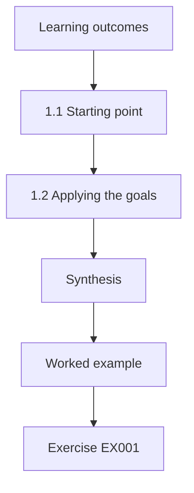

### Logical drawing

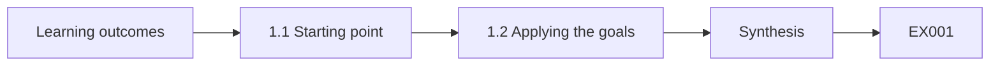

```text
[Learning outcomes]
    |
    v
[1.1 Starting point]
    |
    v
[1.2 Applying the goals]
    |
    v
[Synthesis]
    |
    v
[Worked example] --> [Exercise EX001]
```
<!-- open-cyber-academy:lesson-figures:end ch-01 -->


### Learning outcomes

You will (1) state the core goals of security in practical terms; (2) apply them to a housing association's services; (3) recognise the limits of a short course.

### 1.1 Starting point

Owen Hartley is a project manager moving into security architecture through a six-month professional course at the fictional Meridian Professional Academy. His coach is Ines Carvalho. He works for the fictional Thornbury Housing Association, which manages four thousand rented homes and runs a tenant portal, a repairs system, a rent payment service and a call centre. Ines asks him to describe security in his own words. Owen settles on keeping tenant information private, keeping records correct and keeping services running, which matches confidentiality, integrity and availability.

### 1.2 Applying the goals

Owen applies the three goals to Thornbury. Confidentiality matters most for tenant files, which include benefit details, health needs and safeguarding notes about vulnerable residents. Integrity matters for rent accounts, because a wrong balance could lead to wrongful arrears letters. Availability matters for the repairs system, because a broken boiler in winter cannot wait. Mapping goals to real services helps him explain to colleagues why security is not an IT preference but a way of protecting tenants from concrete harms that they would recognise immediately.

### 1.3 Limits of a short course

Ines is honest about the course: six months will make Owen a capable practitioner who can apply methods, read evidence and work with specialists, not an expert in every area. He will learn when to ask for help, for example on cryptography, cloud configuration or legal questions. Anderson (2020) emphasises that security engineering spans many disciplines, so knowing where one's competence ends is part of professional practice. Owen writes a short list of topics he will refer to specialists, which he plans to revisit as his experience grows.

### Worked example

Owen defines the three security goals in plain terms, maps each to a Thornbury service and lists topics he will refer to specialists.

> **Synthetic case.** Thornbury, Meridian and all people are synthetic; Anderson (2020) is real.

### Errors and limits

Plain-language definitions simplify. Referral lists must be revisited as skills grow.

### Exercises

- **EX001 — Owen's definition.** How did Owen describe security in his own words? *Rubric:* 3 = keep tenant information private, records correct and services running;; 2 = three parts;; 1 = vague;; 0 = none.
- **EX002 — Integrity example.** Why does integrity matter for rent accounts? *Rubric:* 3 = a wrong balance could cause wrongful arrears letters;; 2 = arrears;; 1 = vague;; 0 = none.
- **EX003 — Availability example.** Which service shows availability's importance? *Rubric:* 3 = repairs, such as a broken boiler in winter;; 2 = repairs;; 1 = portal;; 0 = none.
- **EX004 — Course limit.** What will the course make Owen? *Rubric:* 3 = a capable practitioner who knows when to ask specialists;; 2 = practitioner;; 1 = expert;; 0 = none.
- **EX005 — Specialist topics.** Name one topic Owen will refer to specialists. *Rubric:* 3 = cryptography, cloud configuration or legal questions;; 2 = one;; 1 = vague;; 0 = none.

### Synthesis

Practitioners start by tying security goals to real services and knowing the limits of their competence.

### Continue studying — chapter 01 of 12

[← Course home](../../README.md) · [Course chapter index](../SUBJECTS.md) · [Chapter 02 (draft) →](#ch-02)

<a id="ch-02"></a>

## Chapter 2 — Security architecture and engineering: service and stakeholder context

<!-- open-cyber-academy:lesson-figures:start ch-02 -->
### Lesson map

Lesson 02 published. Map, example, EX006.

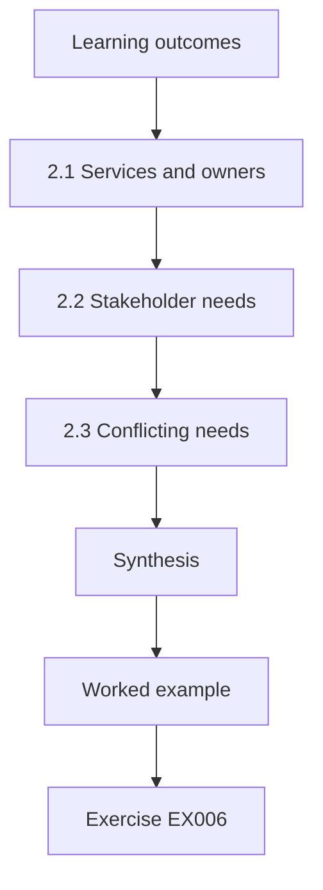

### Logical drawing

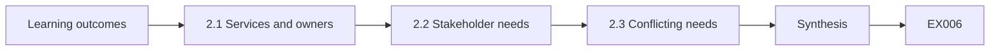

```text
[Learning outcomes]
    |
    v
[2.1 Services and owners]
    |
    v
[2.2 Stakeholder needs]
    |
    v
[2.3 Conflicting needs]
    |
    v
[Synthesis]
    |
    v
[Worked example] --> [Exercise EX006]
```
<!-- open-cyber-academy:lesson-figures:end ch-02 -->


### Learning outcomes

You will (1) map Thornbury's services and stakeholders; (2) record their security needs; (3) handle conflicting needs.

### 2.1 Services and owners

Owen lists Thornbury's main services and their business owners: the tenant portal owned by customer services, repairs owned by the property team, rent owned by finance, the call centre owned by operations and case management for vulnerable tenants owned by the safeguarding lead. Each service also depends on IT and on outside suppliers. Naming owners matters because architecture decisions involve trade-offs that only the business owner can accept, such as slower sign-in in exchange for stronger protection of tenant data.

### 2.2 Stakeholder needs

Owen interviews each owner for twenty minutes using the same questions: what data the service holds, what would hurt most if it failed or leaked, who uses it and from where, and which rules apply. The safeguarding lead stresses that a leak of a tenant's new address could endanger someone fleeing domestic abuse. Finance worries most about payment fraud. Customer services wants the portal to stay easy for elderly tenants. Recording needs in owners' own words builds trust and keeps architecture grounded in real consequences.

### 2.3 Conflicting needs

Needs conflict. Customer services wants simple portal sign-in; the safeguarding lead wants strong protection of addresses. Owen proposes a design where most portal functions use simple sign-in, while viewing or changing contact details requires an extra verification step. Both owners accept it. He records the agreement and the reasons in a short decision note. Ines points out that many conflicts disappear when a design treats different data differently, rather than applying one level of protection to everything in the same way.

### Worked example

Owen maps five services to owners, records needs from short interviews and resolves a portal conflict by protecting contact details more strongly.

> **Synthetic case.** Services and people are synthetic.

### Errors and limits

Short interviews miss detail. Owners may not foresee all consequences.

### Exercises

- **EX006 — Why name owners.** Why name business owners for services? *Rubric:* 3 = only they can accept trade-offs;; 2 = trade-offs;; 1 = vague;; 0 = none.
- **EX007 — Safeguarding concern.** What did the safeguarding lead stress? *Rubric:* 3 = a leaked new address could endanger someone fleeing abuse;; 2 = address;; 1 = vague;; 0 = none.
- **EX008 — Portal compromise.** How was the portal conflict resolved? *Rubric:* 3 = extra verification only for viewing or changing contact details;; 2 = step-up;; 1 = vague;; 0 = none.
- **EX009 — Dissolving conflict.** Why do many conflicts disappear in good designs? *Rubric:* 3 = different data is protected differently;; 2 = differentiate;; 1 = vague;; 0 = none.
- **EX010 — Interview method.** How did Owen keep stakeholder interviews comparable? *Rubric:* 3 = twenty minutes with the same questions for every owner;; 2 = same questions;; 1 = vague;; 0 = none.

### Synthesis

Mapping services, owners and needs lets designs protect what matters most while keeping services usable.

### Continue studying — chapter 02 of 12

[← Chapter 01 (draft)](#ch-01) · [Course chapter index](../SUBJECTS.md) · [Chapter 03 (draft) →](#ch-03)

<a id="ch-03"></a>

## Chapter 3 — Authorized practice and evidence handling

<!-- open-cyber-academy:lesson-figures:start ch-03 -->
### Lesson map

Lesson 03 published. Map, example, EX011.

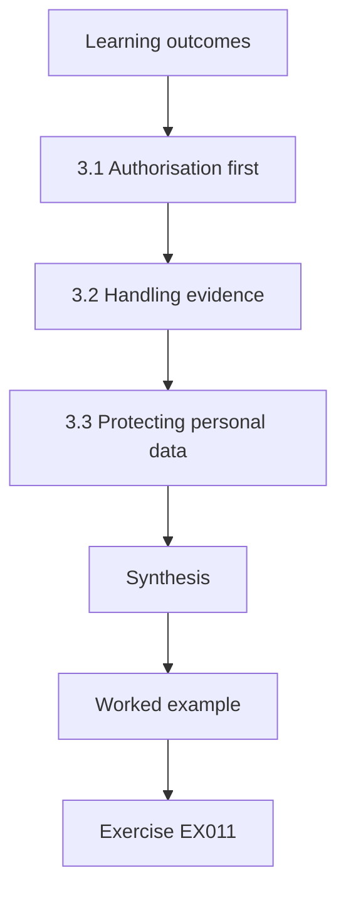

### Logical drawing

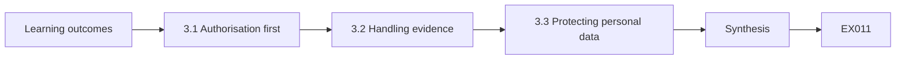

```text
[Learning outcomes]
    |
    v
[3.1 Authorisation first]
    |
    v
[3.2 Handling evidence]
    |
    v
[3.3 Protecting personal data]
    |
    v
[Synthesis]
    |
    v
[Worked example] --> [Exercise EX011]
```
<!-- open-cyber-academy:lesson-figures:end ch-03 -->


### Learning outcomes

You will (1) obtain authorisation before security work; (2) handle evidence carefully; (3) protect personal data during reviews.

### 3.1 Authorisation first

Owen wants to review access to the case management system. Ines insists he first gets written authorisation from the system owner and the head of IT, Kwame Asante, stating what he may look at, when and why. Even an internal employee can cause harm or break policy by looking at systems without permission, especially ones holding safeguarding notes. The authorisation also protects Owen if questions are later raised about why he accessed sensitive records. He keeps it with his working papers.

### 3.2 Handling evidence

During the review Owen exports user and role lists rather than browsing tenant records. He records what he exported, when and from which system, and stores files in a restricted folder. He calculates a checksum of each export so he can show later that it was not altered. If his findings lead to disciplinary action, his evidence must stand up to challenge. Careful handling also means deleting copies when the work ends, as agreed in his authorisation, rather than keeping them indefinitely.

### 3.3 Protecting personal data

Owen's review needs names of staff with access, but not tenant details. When a role report includes tenant names by mistake, he stops, informs the system owner and deletes the extra data. He writes his findings using role names and counts, mentioning individuals only where necessary. ISO/IEC 27001:2022 expects information handling to follow agreed rules, and data protection law limits use to the purpose agreed. Minimising personal data in a review reduces the harm if the review files are ever exposed.

### Worked example

Owen obtains written authorisation, exports and checksums role lists, stores them securely and deletes mistakenly included tenant data.

> **Synthetic case.** Systems and events are synthetic; ISO/IEC 27001:2022 is real.

### Errors and limits

Authorisations may be vague. Checksums prove integrity, not completeness.

### Exercises

- **EX011 — Who authorised.** Who authorised Owen's review? *Rubric:* 3 = the system owner and Kwame Asante, head of IT;; 2 = both;; 1 = vague;; 0 = none.
- **EX012 — Checksum purpose.** Why calculate a checksum of each export? *Rubric:* 3 = to show later it was not altered;; 2 = integrity;; 1 = secrecy;; 0 = none.
- **EX013 — Mistaken data.** What did Owen do when tenant names appeared? *Rubric:* 3 = stopped, informed the owner and deleted the extra data;; 2 = stop;; 1 = continued;; 0 = none.
- **EX014 — Deletion.** When are working copies deleted? *Rubric:* 3 = when the work ends, as agreed;; 2 = end of work;; 1 = never;; 0 = none.
- **EX015 — Export not browse.** Why export role lists instead of browsing records? *Rubric:* 3 = to avoid viewing tenant data not needed for the review;; 2 = minimise;; 1 = speed;; 0 = none.

### Synthesis

Authorised work, careful evidence handling and minimal personal data protect both the organisation and the practitioner.

### Continue studying — chapter 03 of 12

[← Chapter 02 (draft)](#ch-02) · [Course chapter index](../SUBJECTS.md) · [Chapter 04 (draft) →](#ch-04)

<a id="ch-04"></a>

## Chapter 4 — Security architecture and engineering: core methods

<!-- open-cyber-academy:lesson-figures:start ch-04 -->
### Lesson map

Lesson 04 published. Map, example, EX016.

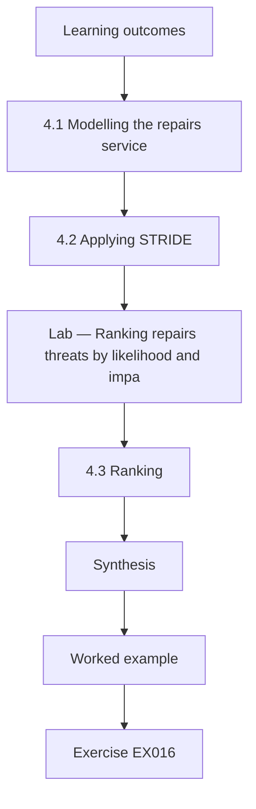

### Logical drawing

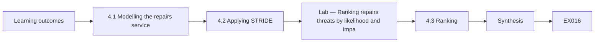

```text
[Learning outcomes]
    |
    v
[4.1 Modelling the repairs service]
    |
    v
[4.2 Applying STRIDE]
    |
    v
[Lab — Ranking repairs threats by likelihood and impa]
    |
    v
[4.3 Ranking]
    |
    v
[Synthesis]
    |
    v
[Worked example] --> [Exercise EX016]
```
<!-- open-cyber-academy:lesson-figures:end ch-04 -->


### Learning outcomes

You will (1) model a service's data flows; (2) apply STRIDE to find threats; (3) rank threats for treatment.

### 4.1 Modelling the repairs service

Owen models the repairs service: tenants report repairs through the portal or call centre; the repairs system creates jobs; jobs go to contractors through a supplier portal; contractors update jobs from phones; tenants receive text updates. He labels data on each flow, including tenant names, addresses, phone numbers and access notes such as key safe codes. He marks trust boundaries between Thornbury and contractors and between Thornbury and the text provider. The model takes two hours with the property team and becomes the basis for analysis.

### 4.2 Applying STRIDE

Owen applies STRIDE from Shostack (2014). Spoofing: a former contractor employee could still sign in to the supplier portal. Tampering: job notes could be altered to hide missed visits. Repudiation: contractors could deny receiving jobs if there is no record. Information disclosure: key safe codes are visible to every contractor rather than only the assigned one. Denial of service: the supplier portal has no fallback. Elevation of privilege: contractor accounts can see other contractors' jobs. He lists each threat with the element it affects.

### Lab — Ranking repairs threats by likelihood and impact

```python
# Rank repairs-service threats by likelihood x impact (1-3 scales, synthetic ratings).
threats = {"key safe codes visible to all contractors": (3, 3), "former contractor accounts still active": (2, 3),
           "contractors see other contractors' jobs": (3, 2), "job notes altered to hide missed visits": (2, 2),
           "no record of job receipt": (2, 1), "supplier portal outage without fallback": (1, 3)}
for i, (t, (l, imp)) in enumerate(sorted(threats.items(), key=lambda x: -x[1][0] * x[1][1]), 1):
    print(f"{i}. {t}: likelihood {l} x impact {imp} = {l * imp}")
```

Run with `python3 lab_rank.py`. Verified output:

```text
1. key safe codes visible to all contractors: likelihood 3 x impact 3 = 9
2. former contractor accounts still active: likelihood 2 x impact 3 = 6
3. contractors see other contractors' jobs: likelihood 3 x impact 2 = 6
4. job notes altered to hide missed visits: likelihood 2 x impact 2 = 4
5. supplier portal outage without fallback: likelihood 1 x impact 3 = 3
6. no record of job receipt: likelihood 2 x impact 1 = 2
```

### 4.3 Ranking

Owen rates each threat for likelihood and impact on a scale of one to three with the property team, following the structure of NIST SP 800-30 Rev. 1, and multiplies them for a simple rank. The lab sorts the threats. Key safe code disclosure ranks highest, because it is likely and could let someone enter a vulnerable tenant's home. Former contractor accounts rank second. He presents the ranking with the reasons, noting that simple scores guide order of work but should not be treated as precise measurements.

### Worked example

Owen models the repairs service, finds six STRIDE threats and ranks them with the property team, placing key safe code exposure first.

> **Synthetic case.** The service and ratings are synthetic; Shostack (2014) and SP 800-30 Rev. 1 are real.

### Errors and limits

Multiplied scores imply false precision. Models miss informal channels such as personal phones.

### Exercises

- **EX016 — Sensitive note.** Which sensitive data appeared in repairs access notes? *Rubric:* 3 = key safe codes;; 2 = key codes;; 1 = vague;; 0 = none.
- **EX017 — Disclosure threat.** What disclosure threat did STRIDE find? *Rubric:* 3 = key safe codes visible to every contractor;; 2 = codes;; 1 = vague;; 0 = none.
- **EX018 — Top rank.** Which threat ranked highest in the lab and with what score? *Rubric:* 3 = key safe code disclosure, 9;; 2 = key codes;; 1 = portal outage;; 0 = none.
- **EX019 — Score caution.** What caution did Owen give about scores? *Rubric:* 3 = they guide order but are not precise measurements;; 2 = ordering;; 1 = vague;; 0 = none.
- **EX020 — Second rank.** Which threat ranked second in the lab? *Rubric:* 3 = former contractor accounts still active, 6;; 2 = former accounts;; 1 = vague;; 0 = none.

### Synthesis

Modelling, STRIDE and simple ranking turn a service into a prioritised list of threats.

### Continue studying — chapter 04 of 12

[← Chapter 03 (draft)](#ch-03) · [Course chapter index](../SUBJECTS.md) · [Chapter 05 (draft) →](#ch-05)

<a id="ch-05"></a>

## Chapter 5 — Security architecture and engineering: tools and interpretation

<!-- open-cyber-academy:lesson-figures:start ch-05 -->
### Lesson map

Lesson 05 published. Map, example, EX021.

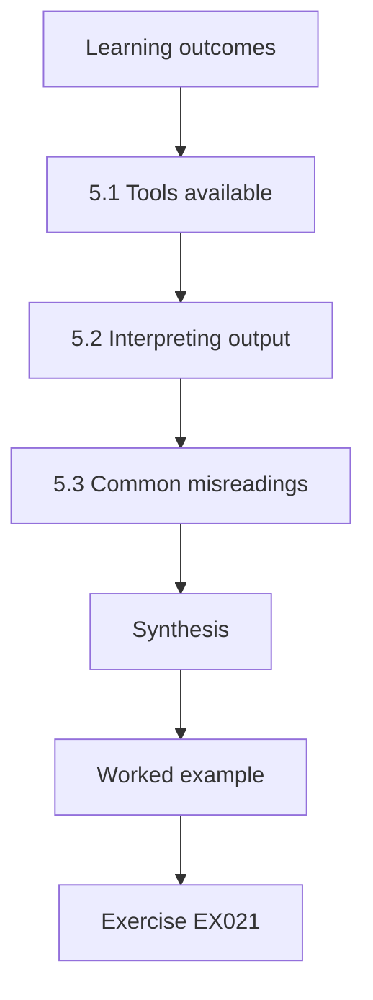

### Logical drawing

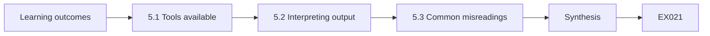

```text
[Learning outcomes]
    |
    v
[5.1 Tools available]
    |
    v
[5.2 Interpreting output]
    |
    v
[5.3 Common misreadings]
    |
    v
[Synthesis]
    |
    v
[Worked example] --> [Exercise EX021]
```
<!-- open-cyber-academy:lesson-figures:end ch-05 -->


### Learning outcomes

You will (1) use simple tools to examine access and configuration; (2) interpret tool output correctly; (3) avoid common misreadings.

### 5.1 Tools available

Owen does not need advanced tools to start. He uses the identity provider's admin reports, the cloud provider's security recommendations page, the supplier portal's user export and a spreadsheet. Kwame also gives him read-only access to the vulnerability scanner Thornbury already runs monthly against its public services. Ines encourages him to learn what existing tools can show before asking for new ones, because organisations often already own capabilities that nobody has time to use well. He lists each tool, its owner and what access he has to it.

### 5.2 Interpreting output

The scanner reports forty findings on the tenant portal. Owen's first reaction is alarm, but he reads each one. Most are informational, such as server version banners. Two are rated high: an outdated library and a weak TLS configuration on an old test subdomain still pointing at a live server. He confirms with the developer that the test subdomain is unused and asks for it to be removed. Interpretation means checking what each finding actually means in context, rather than counting findings or trusting severity labels alone.

### 5.3 Common misreadings

Owen collects misreadings he nearly made. A cloud page showing a high secure score does not mean tenant data is safe; it measures settings against a vendor list. An identity report showing no risky sign-ins may reflect a feature that is switched off. A scanner showing no findings on a server may mean it could not reach it. For each tool he writes down what it measures, what it cannot see and how to confirm a surprising result. This habit makes his later reports far more reliable.

### Worked example

Owen uses existing tools, interprets forty scanner findings to find two real issues and records common misreadings for three tools.

> **Synthetic case.** Tools and findings are synthetic.

### Errors and limits

Severity labels are generic. Tool coverage gaps are easy to miss.

### Exercises

- **EX021 — Existing capability.** Why learn existing tools first? *Rubric:* 3 = organisations often own unused capabilities;; 2 = already owned;; 1 = vague;; 0 = none.
- **EX022 — Real findings.** Which two scanner findings mattered? *Rubric:* 3 = an outdated library and weak TLS on an old live test subdomain;; 2 = two;; 1 = vague;; 0 = none.
- **EX023 — Secure score.** What does a high cloud secure score not mean? *Rubric:* 3 = that tenant data is safe;; 2 = not safety;; 1 = safe;; 0 = none.
- **EX024 — Empty scan.** What might no findings on a server mean? *Rubric:* 3 = the scanner could not reach it;; 2 = reachability;; 1 = secure;; 0 = none.
- **EX025 — Tool notes.** What three things does Owen record for each tool? *Rubric:* 3 = what it measures, what it cannot see, how to confirm surprises;; 2 = two;; 1 = vague;; 0 = none.

### Synthesis

Tool output needs interpretation in context, with clear notes on what each tool measures and misses.

### Continue studying — chapter 05 of 12

[← Chapter 04 (draft)](#ch-04) · [Course chapter index](../SUBJECTS.md) · [Chapter 06 (draft) →](#ch-06)

<a id="ch-06"></a>

## Chapter 6 — Security architecture and engineering: operational workflow

<!-- open-cyber-academy:lesson-figures:start ch-06 -->
### Lesson map

Lesson 06 published. Map, example, EX026.

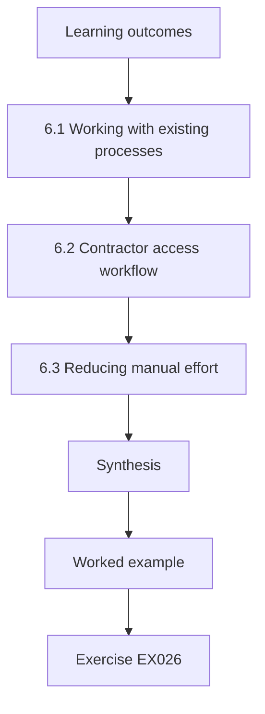

### Logical drawing

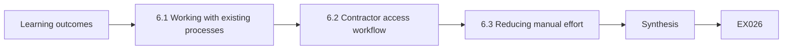

```text
[Learning outcomes]
    |
    v
[6.1 Working with existing processes]
    |
    v
[6.2 Contractor access workflow]
    |
    v
[6.3 Reducing manual effort]
    |
    v
[Synthesis]
    |
    v
[Worked example] --> [Exercise EX026]
```
<!-- open-cyber-academy:lesson-figures:end ch-06 -->


### Learning outcomes

You will (1) fit security checks into existing workflows; (2) design a contractor access workflow; (3) reduce manual effort.

### 6.1 Working with existing processes

Thornbury already has processes for onboarding contractors, raising IT changes and handling complaints. Owen adds security steps to these rather than creating separate ones. Contractor onboarding gains a step to agree data handling rules and named accounts. IT changes gain three security questions. Complaints that mention data handling are copied to the data protection officer. Ines notes that security steps woven into familiar workflows get done far more reliably than separate security procedures that people must remember to follow. Owen agrees each change with the process owner first.

### 6.2 Contractor access workflow

For the threat of former contractor employees, Owen designs a workflow. Contractors request accounts for named staff through the supplier portal; the property team approves; accounts expire after ninety days unless renewed; and contractors must report leavers within two working days, which is written into contracts. Each month, the property team receives a list of accounts not used for thirty days and confirms whether to keep them. The workflow ends shared logins and gives Thornbury a clear record of who can see tenant jobs.

### 6.3 Reducing manual effort

Owen asks the supplier portal vendor whether expiry and unused-account reports can be automated. They can, through existing settings. He also arranges for key safe codes to appear only on the assigned contractor's job and only for the visit day. The property team's monthly check now takes fifteen minutes. He measures the change: active contractor accounts fall from two hundred and ten to one hundred and thirty-five after the first review. Less manual work makes the workflow sustainable for a busy team.

### Worked example

Owen adds security steps to existing processes, designs an expiring contractor access workflow and automates reports, reducing accounts from 210 to 135.

> **Synthetic case.** Processes and figures are synthetic.

### Errors and limits

Contract clauses depend on enforcement. Automated expiry can lock out active staff.

### Exercises

- **EX026 — Woven steps.** Why add steps to existing processes? *Rubric:* 3 = they get done more reliably than separate procedures;; 2 = reliability;; 1 = vague;; 0 = none.
- **EX027 — Expiry period.** When do contractor accounts expire? *Rubric:* 3 = after ninety days unless renewed;; 2 = ninety days;; 1 = never;; 0 = none.
- **EX028 — Key code change.** How were key safe codes restricted? *Rubric:* 3 = only for the assigned contractor and visit day;; 2 = assigned;; 1 = vague;; 0 = none.
- **EX029 — Account reduction.** How did active contractor accounts change? *Rubric:* 3 = from 210 to 135;; 2 = fell;; 1 = vague;; 0 = none.
- **EX030 — Leaver reporting.** How fast must contractors report leavers? *Rubric:* 3 = within two working days, written into contracts;; 2 = two days;; 1 = vague;; 0 = none.

### Synthesis

Security works best woven into existing workflows, with automation keeping the effort sustainable.

### Continue studying — chapter 06 of 12

[← Chapter 05 (draft)](#ch-05) · [Course chapter index](../SUBJECTS.md) · [Chapter 07 (draft) →](#ch-07)

<a id="ch-07"></a>

## Chapter 7 — Security architecture and engineering: controls and verification

<!-- open-cyber-academy:lesson-figures:start ch-07 -->
### Lesson map

Lesson 07 published. Map, example, EX031.

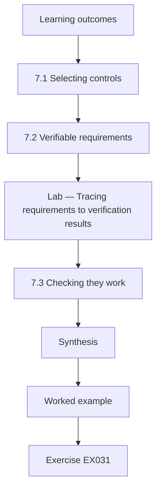

### Logical drawing

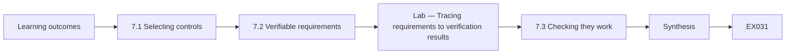

```text
[Learning outcomes]
    |
    v
[7.1 Selecting controls]
    |
    v
[7.2 Verifiable requirements]
    |
    v
[Lab — Tracing requirements to verification results]
    |
    v
[7.3 Checking they work]
    |
    v
[Synthesis]
    |
    v
[Worked example] --> [Exercise EX031]
```
<!-- open-cyber-academy:lesson-figures:end ch-07 -->


### Learning outcomes

You will (1) select controls for top threats; (2) write verifiable requirements; (3) check that controls work.

### 7.1 Selecting controls

For the top repairs threats, Owen selects controls with the property team and IT. Key safe code exposure: show codes only to the assigned contractor on the visit day, as done in chapter 6, and log every view. Former contractor accounts: the expiring access workflow. Cross-contractor visibility: restrict each contractor account to its own jobs. Altered job notes: keep a change history that contractors cannot edit. He checks the selections against control families in NIST SP 800-53 Rev. 5, which confirms he has covered access control, audit and accountability.

### 7.2 Verifiable requirements

Owen turns controls into statements that can be checked: a contractor account can view only jobs assigned to its company; a key safe code is visible only on the visit date; every code view is logged with user and time; job note edits keep the previous version. Vague requirements such as "contractor access must be secure" cannot be tested. Writing them precisely also helps the vendor, who can confirm which ones the product supports and quote for any that need configuration.

### Lab — Tracing requirements to verification results

```python
# Trace requirements to verification results, before and after the vendor fix (synthetic).
reqs = {"R1 contractor sees own company's jobs only": "pass",
        "R2 key safe code visible only on visit date": "fail (visible until end of next day)",
        "R3 every code view logged with user and time": "pass",
        "R4 job note edits keep previous version": "pass"}
for r, res in reqs.items(): print(f"{r}: {res}")
print(f"round 1: {sum(v == 'pass' for v in reqs.values())}/{len(reqs)} passed")
reqs["R2 key safe code visible only on visit date"] = "pass (after vendor cutoff change)"
print(f"round 2: {sum(v.startswith('pass') for v in reqs.values())}/{len(reqs)} passed")
```

Run with `python3 lab_trace.py`. Verified output:

```text
R1 contractor sees own company's jobs only: pass
R2 key safe code visible only on visit date: fail (visible until end of next day)
R3 every code view logged with user and time: pass
R4 job note edits keep previous version: pass
round 1: 3/4 passed
round 2: 4/4 passed
```

### 7.3 Checking they work

Owen and a tester use two test contractor accounts to check each requirement. The lab traces each requirement to its test result. Three pass. The code visibility test fails: codes remain visible for a day after the visit because the vendor uses the end of the following day as the cutoff. The vendor changes the setting and the retest passes. Owen records results in a table linked to the threats, so anyone can see which threats are treated by verified controls and which still depend on unverified promises.

### Worked example

Owen selects controls for four threats, writes four testable requirements and verifies them, catching a code visibility cutoff error.

> **Synthetic case.** Controls and tests are synthetic; SP 800-53 Rev. 5 is real.

### Errors and limits

Test accounts may not reflect real data volume. Vendor settings can revert after updates.

### Exercises

- **EX031 — Tamper control.** Which control addresses altered job notes? *Rubric:* 3 = a change history contractors cannot edit;; 2 = history;; 1 = vague;; 0 = none.
- **EX032 — Vague requirement.** Why is "contractor access must be secure" a poor requirement? *Rubric:* 3 = it cannot be tested;; 2 = untestable;; 1 = vague;; 0 = none.
- **EX033 — Lab coverage.** What did the first test round show in the lab? *Rubric:* 3 = 3 of 4 requirements passed; code visibility failed;; 2 = 3 of 4;; 1 = vague;; 0 = none.
- **EX034 — Failure cause.** Why did the code visibility test fail? *Rubric:* 3 = the vendor cut off at the end of the following day;; 2 = cutoff;; 1 = vague;; 0 = none.
- **EX035 — Retest result.** What did the second round show in the lab? *Rubric:* 3 = all 4 requirements passed after the vendor fix;; 2 = 4 of 4;; 1 = vague;; 0 = none.

### Synthesis

Controls become trustworthy when written as testable requirements and verified with recorded results.

### Continue studying — chapter 07 of 12

[← Chapter 06 (draft)](#ch-06) · [Course chapter index](../SUBJECTS.md) · [Chapter 08 (draft) →](#ch-08)

<a id="ch-08"></a>

## Chapter 8 — Security architecture and engineering: supervised case analysis

<!-- open-cyber-academy:lesson-figures:start ch-08 -->
### Lesson map

Lesson 08 published. Map, example, EX036.

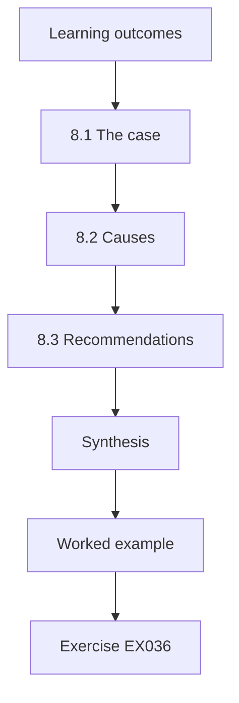

### Logical drawing

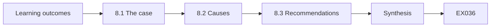

```text
[Learning outcomes]
    |
    v
[8.1 The case]
    |
    v
[8.2 Causes]
    |
    v
[8.3 Recommendations]
    |
    v
[Synthesis]
    |
    v
[Worked example] --> [Exercise EX036]
```
<!-- open-cyber-academy:lesson-figures:end ch-08 -->


### Learning outcomes

You will (1) analyse an incident under supervision; (2) separate causes from symptoms; (3) recommend design changes.

### 8.1 The case

Ines gives Owen a supervised case from Thornbury's history, anonymised. A call centre agent changed a tenant's bank details for rent refunds after a caller passed basic identity questions. The refund went to a criminal's account. The tenant noticed weeks later. Owen reads the call notes, system logs and the investigation report. He builds a timeline first, then lists symptoms, such as the refund going astray, and separates them from causes. Ines reviews each step and challenges his early assumptions about who was at fault.

### 8.2 Causes

Owen identifies causes at several levels. The identity questions used information that criminals can find, such as date of birth and address. The system allowed bank details to change and a refund to be issued on the same day with no notification to the tenant. The agent was measured on call handling time, which discouraged extra checks. No single person failed; the design made the fraud easy. He references Saltzer and Schroeder's (1975) separation of privilege, which suggests that sensitive changes need more than one independent condition.

### 8.3 Recommendations

Owen recommends: confirming bank changes through a code sent to the tenant's registered phone or email; a seven-day hold on refunds after bank changes; automatic notification to the tenant of any change; and adjusting call centre measures so that verification time is not penalised. He estimates the cost and effect of each. Kwame and the head of finance accept all four. Ines notes that case analysis is valuable when it changes the design, not when it simply assigns blame to the agent involved.

### Worked example

Owen analyses an anonymised refund fraud case, identifies design causes using separation of privilege and recommends four accepted changes.

> **Synthetic case.** The case is synthetic; Saltzer and Schroeder (1975) is real.

### Errors and limits

Historical cases have missing evidence. Holds can delay genuine refunds.

### Exercises

- **EX036 — Weak questions.** Why were the identity questions weak? *Rubric:* 3 = criminals can find date of birth and address;; 2 = public data;; 1 = vague;; 0 = none.
- **EX037 — System cause.** What system design enabled the fraud? *Rubric:* 3 = same-day bank change and refund without notification;; 2 = same day;; 1 = vague;; 0 = none.
- **EX038 — Principle.** Which principle did Owen apply? *Rubric:* 3 = separation of privilege;; 2 = separation;; 1 = least privilege;; 0 = none.
- **EX039 — Measure change.** Why adjust call centre measures? *Rubric:* 3 = handling time targets discouraged extra checks;; 2 = incentives;; 1 = vague;; 0 = none.
- **EX040 — Refund hold.** How long is the refund hold after a bank change? *Rubric:* 3 = seven days;; 2 = seven;; 1 = vague;; 0 = none.

### Synthesis

Supervised case analysis finds design causes behind incidents and turns them into accepted changes.

### Continue studying — chapter 08 of 12

[← Chapter 07 (draft)](#ch-07) · [Course chapter index](../SUBJECTS.md) · [Chapter 09 (draft) →](#ch-09)

<a id="ch-09"></a>

## Chapter 9 — Communication, ethics and reporting

<!-- open-cyber-academy:lesson-figures:start ch-09 -->
### Lesson map

Lesson 09 published. Map, example, EX041.

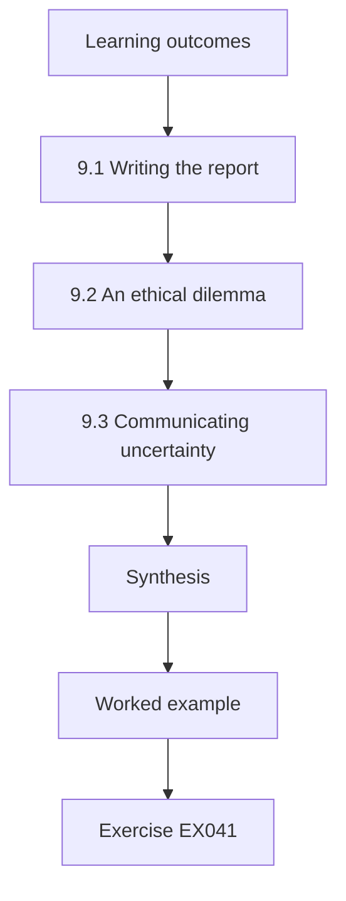

### Logical drawing

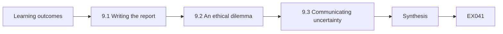

```text
[Learning outcomes]
    |
    v
[9.1 Writing the report]
    |
    v
[9.2 An ethical dilemma]
    |
    v
[9.3 Communicating uncertainty]
    |
    v
[Synthesis]
    |
    v
[Worked example] --> [Exercise EX041]
```
<!-- open-cyber-academy:lesson-figures:end ch-09 -->


### Learning outcomes

You will (1) write a security report for decision makers; (2) handle an ethical dilemma honestly; (3) communicate uncertainty.

### 9.1 Writing the report

Owen writes his first formal report to Thornbury's leadership on the repairs and refund work. He starts with a one-page summary: what was found, what has been done, what remains and what decisions are needed. Details follow in sections with evidence. He avoids jargon and explains consequences in terms leaders care about, such as tenant safety and financial loss. Ines reviews drafts and asks him to remove two paragraphs describing his methods at length, which belong in an appendix rather than the summary.

### 9.2 An ethical dilemma

While reviewing access, Owen finds that a senior manager has viewed safeguarding notes for tenants outside her area several times. It may be legitimate or may be misuse. Owen does not investigate further himself or confront the manager. He reports the facts, without accusations, to the data protection officer as Thornbury's policy requires, and keeps the matter confidential. Ines explains that practitioners must report concerns through proper channels, avoid acting beyond their authority and protect the people involved until facts are established.

### 9.3 Communicating uncertainty

Leaders ask whether Thornbury is now safe from refund fraud. Owen answers honestly: the new controls block the method used in the past case, but determined criminals may try other routes, such as compromising a tenant's email. He gives his confidence in each control and explains what monitoring will show if fraud attempts continue. Clear statements of uncertainty help leaders make sensible decisions and avoid the disappointment and mistrust that follow overconfident claims when something later goes wrong. He puts these confidence levels in a short table.

### Worked example

Owen writes a leadership report with a one-page summary, reports a possible access misuse through proper channels and states uncertainty honestly.

> **Synthetic case.** The report and events are synthetic.

### Errors and limits

Summaries can omit important caveats. Reporting concerns can strain working relationships.

### Exercises

- **EX041 — Summary content.** What does the one-page summary contain? *Rubric:* 3 = findings, actions taken, what remains and decisions needed;; 2 = three;; 1 = vague;; 0 = none.
- **EX042 — Appendix material.** What did Ines ask Owen to move to an appendix? *Rubric:* 3 = lengthy method descriptions;; 2 = methods;; 1 = vague;; 0 = none.
- **EX043 — Access concern.** How did Owen handle the manager's access to safeguarding notes? *Rubric:* 3 = reported facts to the data protection officer without investigating or confronting;; 2 = proper channel;; 1 = confronted;; 0 = none.
- **EX044 — Honest answer.** How did Owen answer whether Thornbury is safe from refund fraud? *Rubric:* 3 = controls block the past method but other routes remain;; 2 = uncertainty;; 1 = yes;; 0 = none.
- **EX045 — Confidentiality.** Why keep the access concern confidential? *Rubric:* 3 = to protect people until facts are established;; 2 = protect;; 1 = vague;; 0 = none.

### Synthesis

Professional reporting is clear for decision makers, ethical in handling concerns and honest about uncertainty.

### Continue studying — chapter 09 of 12

[← Chapter 08 (draft)](#ch-08) · [Course chapter index](../SUBJECTS.md) · [Chapter 10 (draft) →](#ch-10)

<a id="ch-10"></a>

## Chapter 10 — Security architecture and engineering: quality and troubleshooting

<!-- open-cyber-academy:lesson-figures:start ch-10 -->
### Lesson map

Lesson 10 published. Map, example, EX046.

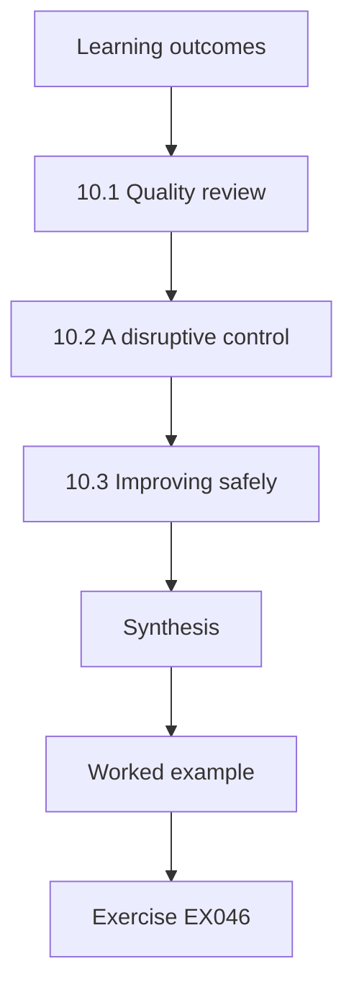

### Logical drawing

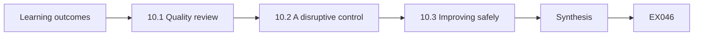

```text
[Learning outcomes]
    |
    v
[10.1 Quality review]
    |
    v
[10.2 A disruptive control]
    |
    v
[10.3 Improving safely]
    |
    v
[Synthesis]
    |
    v
[Worked example] --> [Exercise EX046]
```
<!-- open-cyber-academy:lesson-figures:end ch-10 -->


### Learning outcomes

You will (1) review the quality of security work; (2) troubleshoot a control that disrupts operations; (3) improve without losing protection.

### 10.1 Quality review

Ines asks Owen to review his own earlier work as if he were an auditor. He checks whether each finding has evidence, each requirement has a test, each decision has an owner and each document has a date and version. He finds two decisions with no recorded owner and one requirement tested only once before a vendor update. He fixes the records and schedules a retest. Regular self-review catches quality gaps before others do and builds habits that make later audits straightforward.

### 10.2 A disruptive control

After the refund hold goes live, the call centre reports angry tenants whose genuine refunds are delayed seven days after updating bank details, including elderly tenants who changed banks after a branch closed. Owen investigates. The hold is working as designed, but the design did not consider legitimate urgent cases. He meets finance and the call centre to understand the volume: about twelve genuine cases a month. The control is right in principle but too rigid in practice. He records the complaints and volumes as evidence.

### 10.3 Improving safely

Owen proposes an exception path: if the tenant confirms the change through a call back to their registered phone number made by a different team, the hold can be shortened to one day. The exception requires two people, preserving separation of privilege, and is logged. Finance accepts. Complaints fall, and no fraud occurs through the exception in the first three months. Ines notes that good practitioners adjust controls in response to real effects rather than defending the original design or removing protection under pressure.

### Worked example

Owen self-reviews his work, investigates complaints about the refund hold and adds a two-person exception path that keeps protection.

> **Synthetic case.** Volumes and outcomes are synthetic.

### Errors and limits

Exceptions can be abused if checks weaken. Three months is a short observation period.

### Exercises

- **EX046 — Self-review gaps.** What did Owen's self-review find? *Rubric:* 3 = two decisions without owners and one requirement tested once before an update;; 2 = gaps;; 1 = vague;; 0 = none.
- **EX047 — Genuine cases.** How many genuine urgent cases occur per month? *Rubric:* 3 = about twelve;; 2 = twelve;; 1 = vague;; 0 = none.
- **EX048 — Exception path.** How can the hold be shortened? *Rubric:* 3 = call back to the registered number by a different team, then one day;; 2 = call back;; 1 = removed;; 0 = none.
- **EX049 — Principle kept.** Which principle does the exception preserve? *Rubric:* 3 = separation of privilege, by requiring two people;; 2 = two people;; 1 = vague;; 0 = none.
- **EX050 — Early results.** What happened in the first three months of the exception? *Rubric:* 3 = complaints fell and no fraud used the exception;; 2 = both;; 1 = vague;; 0 = none.

### Synthesis

Quality review and responsive troubleshooting improve controls without abandoning their protective purpose.

### Continue studying — chapter 10 of 12

[← Chapter 09 (draft)](#ch-09) · [Course chapter index](../SUBJECTS.md) · [Chapter 11 (draft) →](#ch-11)

<a id="ch-11"></a>

## Chapter 11 — Supervised laboratory

<!-- open-cyber-academy:lesson-figures:start ch-11 -->
### Lesson map

Lesson 11 published. Map, example, EX051.

```mermaid
flowchart TD
  N0["Learning outcomes"]
  N1["11.1 The lab"]
  N2["Lab — Finding permissions beyond role needs"]
  N3["11.2 Results"]
  N4["11.3 Reporting carefully"]
  N5["Synthesis"]
  N0 --> N1 --> N2 --> N3 --> N4 --> N5
  N5 --> EX["Worked example"]
  EX --> Q["Exercise EX051"]
```

### Logical drawing

```mermaid
flowchart LR
  N0["Learning outcomes"]
  N1["11.1 The lab"]
  N2["Lab — Finding permissions beyond role needs"]
  N3["11.2 Results"]
  N4["11.3 Reporting carefully"]
  N5["Synthesis"]
  N0 --> N1 --> N2 --> N3 --> N4 --> N5 --> Q["EX051"]
```

```text
[Learning outcomes]
    |
    v
[11.1 The lab]
    |
    v
[Lab — Finding permissions beyond role needs]
    |
    v
[11.2 Results]
    |
    v
[11.3 Reporting carefully]
    |
    v
[Synthesis]
    |
    v
[Worked example] --> [Exercise EX051]
```
<!-- open-cyber-academy:lesson-figures:end ch-11 -->


### Learning outcomes

You will (1) carry out a contained access review lab; (2) find excessive permissions; (3) report results with care.

### 11.1 The lab

Ines sets a supervised lab using synthetic data modelled on Thornbury's case management system. The task is to compare each user's permissions with their job role and identify excess access. The lab runs entirely offline on generated names and roles, so no real person's data is involved. Owen first writes down the expected permissions for each role with help from a synthetic role description, because a review is only as good as its definition of what each job needs. Ines approves the role definitions before Owen runs the comparison.

### Lab — Finding permissions beyond role needs

```python
# Compare user permissions with role needs (synthetic case management data).
need = {"housing": {"cases"}, "safeguarding": {"cases", "safeguarding"}, "finance": {"rent"}, "temp": {"cases"}}
users = [("u1", "housing", {"cases"}, True), ("u2", "housing", {"cases", "safeguarding"}, True),
         ("u3", "housing", {"cases", "safeguarding"}, True), ("u4", "safeguarding", {"cases", "safeguarding"}, True),
         ("u5", "finance", {"rent", "case-edit"}, True), ("u6", "finance", {"rent"}, True),
         ("u7", "temp", {"cases"}, False), ("u8", "housing", {"cases"}, True), ("u9", "safeguarding", {"cases", "safeguarding"}, True)]
found = 0
for u, role, has, contract_active in users:
    issues = sorted(has - need[role]) + ([] if contract_active else ["account active after contract end"])
    if issues: found += 1; print(f"{u} ({role}): {', '.join(issues)}")
print(f"{found} of {len(users)} users need action")
```

Run with `python3 lab_access.py`. Verified output:

```text
u2 (housing): safeguarding
u3 (housing): safeguarding
u5 (finance): case-edit
u7 (temp): account active after contract end
4 of 9 users need action
```

### 11.2 Results

The lab finds four users with excess permissions: two housing officers with safeguarding note access they no longer need after changing teams, a finance assistant with case editing rights and a temporary worker whose contract has ended but whose account is still active. Owen ranks them by risk: the active leaver account and safeguarding access first, because they expose the most sensitive data. Ines checks his ranking and agrees, noting that ranking by sensitivity helps busy owners act on the most important items first.

### 11.3 Reporting carefully

Owen writes the lab report as he would at work: role names and counts in the main text, individual names in a restricted appendix, recommended actions and the evidence for each. He notes that the lab could not see permissions granted inside documents or shared folders outside the system. Ines grades the report highly for its care with personal data and its honest limits. She reminds him that a real review would also need the system owner's confirmation before any access is removed.

### Worked example

Owen runs an offline access review lab, finds four excess permissions, ranks them by sensitivity and reports carefully with limits.

> **Synthetic case.** All lab data is synthetic.

### Errors and limits

Role definitions may be wrong. Access outside the system remains invisible.

### Exercises

- **EX051 — Definition first.** Why define expected permissions before the review? *Rubric:* 3 = a review is only as good as its definition of needs;; 2 = baseline;; 1 = vague;; 0 = none.
- **EX052 — Lab finding count.** How many users had excess permissions in the lab? *Rubric:* 3 = 4 of 9;; 2 = four;; 1 = vague;; 0 = none.
- **EX053 — Top risks.** Which findings ranked highest? *Rubric:* 3 = the active leaver account and unneeded safeguarding access;; 2 = two;; 1 = finance;; 0 = none.
- **EX054 — Report structure.** Where do individual names go in Owen's report? *Rubric:* 3 = a restricted appendix;; 2 = appendix;; 1 = main text;; 0 = none.
- **EX055 — Lab blind spot.** What could the lab not see? *Rubric:* 3 = permissions inside documents or shared folders outside the system;; 2 = outside access;; 1 = vague;; 0 = none.

### Synthesis

A careful access review defines needs first, ranks excess by sensitivity and reports with respect for personal data.

### Continue studying — chapter 11 of 12

[← Chapter 10 (draft)](#ch-10) · [Course chapter index](../SUBJECTS.md) · [Chapter 12 (draft) →](#ch-12)

<a id="ch-12"></a>

## Chapter 12 — Practice portfolio and final review

<!-- open-cyber-academy:lesson-figures:start ch-12 -->
### Lesson map

Lesson 12 published. Map, example, EX056.

```mermaid
flowchart TD
  N0["Learning outcomes"]
  N1["12.1 The portfolio"]
  N2["12.2 What changed"]
  N3["12.3 Continued practice"]
  N4["Synthesis"]
  N0 --> N1 --> N2 --> N3 --> N4
  N4 --> EX["Worked example"]
  EX --> Q["Exercise EX056"]
```

### Logical drawing

```mermaid
flowchart LR
  N0["Learning outcomes"]
  N1["12.1 The portfolio"]
  N2["12.2 What changed"]
  N3["12.3 Continued practice"]
  N4["Synthesis"]
  N0 --> N1 --> N2 --> N3 --> N4 --> Q["EX056"]
```

```text
[Learning outcomes]
    |
    v
[12.1 The portfolio]
    |
    v
[12.2 What changed]
    |
    v
[12.3 Continued practice]
    |
    v
[Synthesis]
    |
    v
[Worked example] --> [Exercise EX056]
```
<!-- open-cyber-academy:lesson-figures:end ch-12 -->


### Learning outcomes

You will (1) assemble a portfolio of professional work; (2) review what changed at Thornbury; (3) plan continued practice.

### 12.1 The portfolio

Owen assembles his portfolio: the service and stakeholder map, the repairs threat model and ranking, the contractor workflow, requirements with verification results, the refund case analysis, the leadership report, the exception path design and the lab report. Each item has a short note explaining what he did, what he learned and what he would do differently. Personal data is removed or replaced with synthetic examples. The portfolio shows employers and assessors evidence of applied skill rather than course attendance alone.

### 12.2 What changed

Owen reviews outcomes. Contractor accounts fell from two hundred and ten to one hundred and thirty-five, key safe codes are now visible only to assigned contractors on visit days, bank changes need confirmation, and refunds after changes are held with a safe exception. No refund fraud has been reported since. He is careful to say that the absence of fraud over a few months does not prove the risk has gone, and he recommends continued monitoring and an annual review of the repairs threat model.

### 12.3 Continued practice

Thornbury creates a security architect role and offers it to Owen. He plans to deepen his knowledge of identity and cloud security, join a professional community, and ask Kwame for a mentor from a partner organisation. He keeps his referral list from chapter 1 and notes which items he can now handle himself. Ines's final feedback is that Owen's project management background became a strength, because security architecture is largely about coordinating people, decisions and evidence across an organisation. He also schedules a six-month review with Ines.

### Worked example

Owen assembles an annotated portfolio, reviews measured changes at Thornbury with caution and plans continued development in a new role.

> **Synthetic case.** Portfolio items and outcomes are synthetic.

### Errors and limits

Portfolios can overstate individual contribution. Short-term outcomes may not last.

### Exercises

- **EX056 — Portfolio notes.** What note accompanies each portfolio item? *Rubric:* 3 = what he did, what he learned and what he would change;; 2 = three;; 1 = vague;; 0 = none.
- **EX057 — Fraud caution.** Why is no reported fraud not proof of success? *Rubric:* 3 = a few months without fraud does not prove the risk has gone;; 2 = short period;; 1 = proof;; 0 = none.
- **EX058 — Next learning.** What will Owen study next? *Rubric:* 3 = identity and cloud security;; 2 = identity;; 1 = vague;; 0 = none.
- **EX059 — Background strength.** Why did Owen's background become a strength? *Rubric:* 3 = architecture is largely coordinating people, decisions and evidence;; 2 = coordination;; 1 = vague;; 0 = none.
- **EX060 — Data in portfolio.** How is personal data handled in the portfolio? *Rubric:* 3 = removed or replaced with synthetic examples;; 2 = removed;; 1 = vague;; 0 = none.

### Synthesis

A portfolio of annotated work, an honest review of outcomes and a plan for growth complete professional preparation.

### Continue studying — chapter 12 of 12

[← Chapter 11 (draft)](#ch-11) · [Course chapter index](../SUBJECTS.md) · [Worked results ↓](#worked-results) · [Next course via chapter index →](../SUBJECTS.md)

<a id="worked-results"></a>

## Worked results

Model answers for EX001–EX060. Owen Hartley, Ines Carvalho, Kwame Asante, Meridian Professional Academy, Thornbury Housing Association and every figure are synthetic. Lab answers quote verified outputs. Any answer meeting the rubric scores equally.

**EX001.** Keeping tenant information private, records correct and services running.

**EX002.** Because a wrong balance could lead to wrongful arrears letters.

**EX003.** The repairs system, since a broken boiler in winter cannot wait.

**EX004.** A capable practitioner who can apply methods and knows when to refer to specialists.

**EX005.** Cryptography, cloud configuration or legal questions, such as data protection law.

**EX006.** Because only business owners can accept trade-offs such as slower sign-in for stronger protection.

**EX007.** That a leaked new address could endanger a tenant fleeing domestic abuse.

**EX008.** Simple sign-in for most functions with extra verification for contact details.

**EX009.** Because the design protects different data at different levels instead of treating everything alike.

**EX010.** He gave each owner twenty minutes and asked the same questions.

**EX011.** The system owner and Kwame Asante, the head of IT.

**EX012.** To show later that the export was not altered.

**EX013.** He stopped, informed the system owner and deleted the extra data.

**EX014.** When the work ends, as agreed in the authorisation.

**EX015.** To avoid viewing tenant records that the access review did not need.

**EX016.** Key safe codes for entering tenants' homes.

**EX017.** Key safe codes visible to every contractor rather than only the assigned one.

**EX018.** Key safe code disclosure, with a score of 9.

**EX019.** That simple scores guide the order of work but are not precise measurements.

**EX020.** Former contractor accounts still active, scoring 6.

**EX021.** Because organisations often already own capabilities that nobody uses well.

**EX022.** An outdated library and weak TLS on an unused test subdomain pointing at a live server.

**EX023.** It does not mean tenant data is safe, only that settings match a vendor list.

**EX024.** That the scanner may not have been able to reach it.

**EX025.** What it measures, what it cannot see and how to confirm a surprising result.

**EX026.** Because steps in familiar workflows are followed more reliably than separate procedures.

**EX027.** After ninety days unless renewed.

**EX028.** Shown only on the assigned contractor's job and only on the visit day.

**EX029.** They fell from 210 to 135 after the first review.

**EX030.** Within two working days, as a contract requirement.

**EX031.** A change history that contractors cannot edit.

**EX032.** Because it cannot be tested or confirmed by a vendor.

**EX033.** Three of four passed and the code visibility requirement failed.

**EX034.** The vendor's cutoff was the end of the following day rather than the visit day.

**EX035.** All four requirements passed after the vendor changed the cutoff.

**EX036.** Because they relied on information criminals can easily find, like date of birth and address.

**EX037.** Bank details could change and a refund issue on the same day with no tenant notification.

**EX038.** Separation of privilege, requiring more than one independent condition for sensitive changes.

**EX039.** Because handling time targets discouraged agents from making extra checks.

**EX040.** Seven days.

**EX041.** What was found, what has been done, what remains and what decisions are needed.

**EX042.** Two paragraphs describing his methods at length.

**EX043.** He reported the facts to the data protection officer without investigating further or confronting her.

**EX044.** He said the controls block the past method but other routes, like compromised tenant email, remain.

**EX045.** To protect the people involved until the facts are established.

**EX046.** Two decisions with no owner and one requirement tested only before a vendor update.

**EX047.** About twelve genuine cases a month.

**EX048.** Through a call back to the registered phone by a different team, shortening the hold to one day.

**EX049.** Separation of privilege, since two people are required.

**EX050.** Complaints fell and no fraud occurred through the exception.

**EX051.** Because a review is only as good as its definition of what each job needs.

**EX052.** Four of nine users.

**EX053.** The active account of an ended contract and unneeded safeguarding note access.

**EX054.** In a restricted appendix, with role names and counts in the main text.

**EX055.** Permissions granted in documents or shared folders outside the system.

**EX056.** What he did, what he learned and what he would do differently.

**EX057.** Because a few months without fraud does not prove the risk has disappeared.

**EX058.** Identity and cloud security.

**EX059.** Because security architecture is largely about coordinating people, decisions and evidence.

**EX060.** It is removed or replaced with synthetic examples.

<a id="references"></a>

## References

Links checked 12 October 2026; re-verify editions before citing. Organisations, people, systems and data in this book are synthetic unless a sentence cites a public source.

- Anderson, R. (2020). *Security engineering: A guide to building dependable distributed systems* (3rd ed.). Wiley. Author's page: <https://www.cl.cam.ac.uk/archive/rja14/book.html>
- International Organization for Standardization. (2022). *ISO/IEC 27001:2022 Information security, cybersecurity and privacy protection — Information security management systems — Requirements*. <https://www.iso.org/standard/27001>
- Joint Task Force Transformation Initiative. (2012). *Guide for conducting risk assessments* (NIST SP 800-30 Rev. 1). NIST. <https://doi.org/10.6028/NIST.SP.800-30r1>
- Joint Task Force. (2020). *Security and privacy controls for information systems and organizations* (NIST SP 800-53 Rev. 5). NIST. <https://doi.org/10.6028/NIST.SP.800-53r5>
- Saltzer, J. H., & Schroeder, M. D. (1975). The protection of information in computer systems. *Proceedings of the IEEE*, 63(9), 1278–1308. <https://doi.org/10.1109/PROC.1975.9939>
- Shostack, A. (2014). *Threat modeling: Designing for security*. Wiley.
