# Security Operations and Blue Team: Professional Course

- Language: English (`en`); course 038, Professional course (6 months).
- Editorial state: **published**. Chapters 1–12 of 12 have hand-written teaching text; exercises EX001–EX060 have matching worked results with 0–3 rubrics; three offline labs use only the Python 3 standard library on synthetic evidence, and their outputs are embedded from real runs. Independent review and the 300-page A4 verification remain open.
- Audience: working IT and security professionals who must set up or run a security operations function in a mid-sized organisation.
- Author: [hiagokinlevi](https://github.com/hiagokinlevi). Original text [CC0 1.0](../../../../../LICENSE); cited works keep their rights.
- Ethical and legal boundary: monitor and respond only on systems you are authorised to defend; no exploit code, no payloads, no attack procedures and no instructions for evading detection. Detections are taught from the defender's side using synthetic telemetry. All evidence, people and organisations are **synthetic** unless a sentence cites a public source.

[Course home](../../README.md) · [Chapter index](../SUBJECTS.md) · [Book plan](PLAN.md) · [Course skill](../../skill/SKILL.md) · [Worked results](#worked-results)

## How to use this draft

Read in order: the chapters follow one IT manager building a hybrid security operations function after a night-time account compromise, from mission and authority through logs, detection, provider management, response, investigation, reporting and maturity. Run each lab where it appears, attempt the five exercises before the worked results, and score yourself with the rubrics.

### Synthetic running case

| Element | Role | Boundary |
|---|---|---|
| **Priya Nair** | IT manager and SOC owner | Invented |
| **Tom Reyes** | First in-house analyst | Invented |
| **Fenwick Engineering** | Fictional pump-component manufacturer | Invented |
| **j.harper** | IT technician whose account was compromised | Invented |

### Core sources

NIST [SP 800-61r3](https://doi.org/10.6028/NIST.SP.800-61r3), [SP 800-92](https://doi.org/10.6028/NIST.SP.800-92), [SP 800-137](https://doi.org/10.6028/NIST.SP.800-137) and [CSF 2.0](https://doi.org/10.6028/NIST.CSWP.29); [MITRE ATT&CK](https://attack.mitre.org/); [MITRE D3FEND](https://d3fend.mitre.org/); [Sigma](https://github.com/SigmaHQ/sigma); Knerler, Parker and Zimmerman, *11 Strategies of a World-Class Cybersecurity Operations Center* (MITRE, 2022). Full list in [References](#references).

## Contents

| Chapters |
|---|
| [1](#ch-01) · [2](#ch-02) · [3](#ch-03) · [4](#ch-04) · [5](#ch-05) · [6](#ch-06) · [7](#ch-07) · [8](#ch-08) · [9](#ch-09) · [10](#ch-10) |
| [11](#ch-11) · [12](#ch-12) |

[Worked results](#worked-results) · [References](#references)

<a id="ch-01"></a>

## Chapter 1 — Security operations for working professionals

<!-- cyberabc:lesson-figures:start ch-01 -->
### Lesson map

Lesson 01 published. Map, example, EX001.

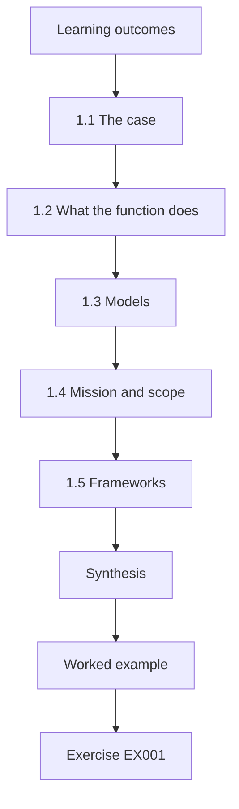

### Logical drawing


```text
[Learning outcomes]
    |
    v
[1.1 The case]
    |
    v
[1.2 What the function does]
    |
    v
[1.3 Models]
    |
    v
[1.4 Mission and scope]
    |
    v
[1.5 Frameworks]
    |
    v
[Synthesis]
    |
    v
[Worked example] --> [Exercise EX001]
```
<!-- cyberabc:lesson-figures:end ch-01 -->


### Learning outcomes

You will (1) explain what a security operations function does in a mid-sized organisation; (2) decide between in-house, outsourced and hybrid models; (3) set a mission and scope; (4) introduce the course case.

### 1.1 The case

Priya Nair is IT manager at the fictional Fenwick Engineering, a 200-person maker of pump components with design offices and a factory floor. On a Tuesday night in March, an alert from the VPN shows IT technician j.harper logging in at 22:41 from a country he has never visited. Within minutes his account joins the Domain Admins group and reads 2,310 design files. Fenwick has no SOC; the alert went to a shared mailbox that nobody watched at night. Priya finds it the next morning. Her board asks her to build a security operations function, and she enrols on this six-month course to do it well.

### 1.2 What the function does

A security operations function watches for signs of attack, decides which matter, and coordinates the response. Zimmerman's "Ten Strategies of a World-Class Cybersecurity Operations Center" (MITRE, 2014) and its successor, Knerler, Parker and Zimmerman's "11 Strategies" (MITRE, 2022), both stress that a SOC first needs a clear mission, authority and a defined constituency, before tools. For Fenwick, the March event showed all three parts missing: an alert fired, but nobody watched for it, decided it mattered or coordinated a response. Priya starts with mission and authority for that reason, before choosing tools or a provider.

### 1.3 Models

In-house gives control and knowledge of the business but costs staff and 24-hour cover. Outsourcing to a managed security service gives night cover and tools but less context. A hybrid keeps an in-house lead who owns decisions while a provider watches out of hours. Fenwick, with no security staff, chooses hybrid. Fenwick cannot afford round-the-clock in-house staff, but March showed that night cover matters. The hybrid lets a provider answer alerts at night while Priya keeps decisions about Fenwick's business, such as when to isolate a factory PC. Her board paper explains this choice with the costs of each model.

### 1.4 Mission and scope

Priya's draft mission: "Detect and respond to threats against Fenwick's design data, production systems and staff accounts, around the clock, with in-house ownership of decisions." Scope includes offices, the VPN, cloud email and the factory's supervisory PCs, but not the machine controllers themselves, which the vendor manages. The mission names the assets March threatened: design data and staff accounts, plus production systems that keep the factory running. Excluding the machine controllers is honest about what Fenwick can monitor, since the vendor manages them. Priya records the exclusion and the vendor's responsibility, so the board knows the gap exists. The scope is reviewed each year with the charter, so a change such as the vendor handing over controller management would bring them into monitoring.

### 1.5 Frameworks

NIST CSF 2.0 (CSWP 29, 2024) gives a shared language for outcomes; NIST SP 800-61r3 (Nelson et al., 2025) frames incident response within it. Priya uses both to explain the plan to the board. The board does not need technical detail, but it needs to see that the plan follows recognised practice. Using CSF 2.0 outcomes, Priya can show which parts of the plan detect, which respond and which govern. SP 800-61r3 shapes the response plan written later in the year. Both documents are public, so the board and the provider can read the same references, and the provider already uses CSF terms in its own reports, which makes monthly reviews easier.

### Worked example

Priya's board paper explains the March event in four lines, proposes a hybrid model with a provider covering 18:00–08:00 and weekends, names herself as SOC owner with one new analyst hire, and lists three first-year goals: log coverage, a tested response plan and alert handling within 30 minutes at any hour.

> **Synthetic case.** Fenwick Engineering, its staff and events are invented.

### Errors and limits

A hybrid model fails if the provider and in-house team do not share context; chapter 6 deals with this.

### Exercises

- **EX001 — The trigger.** What did the March alert show? *Rubric:* 3 = 22:41 new-country VPN login; Domain Admins; 2,310 files read; unwatched mailbox; 2 = partial; 1 = one; 0 = none.
- **EX002 — Model choice.** Why did Fenwick choose a hybrid model? *Rubric:* 3 = no security staff; needs night cover; keep ownership in-house; 2 = partial; 1 = vague; 0 = none.
- **EX003 — Mission parts.** What does Priya's mission statement cover? *Rubric:* 3 = design data, production systems, staff accounts; around clock; in-house decisions; 2 = partial; 1 = vague; 0 = none.
- **EX004 — Out of scope.** What is out of scope and why? *Rubric:* 3 = machine controllers; vendor-managed; 2 = partial; 1 = vague; 0 = none.
- **EX005 — First-year goals.** List the three first-year goals. *Rubric:* 3 = log coverage; tested response plan; 30-minute alert handling; 2 = two; 1 = one; 0 = none.

### Synthesis

Start with mission, scope and model before buying tools.

### Continue studying — chapter 01 of 12

[← Course home](../../README.md) · [Course chapter index](../SUBJECTS.md) · [Chapter 02 (draft) →](#ch-02)

<a id="ch-02"></a>

## Chapter 2 — Governance and authority

<!-- cyberabc:lesson-figures:start ch-02 -->
### Lesson map

Lesson 02 published. Map, example, EX006.

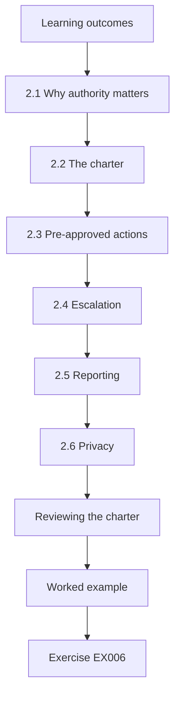

### Logical drawing


```text
[Learning outcomes]
    |
    v
[2.1 Why authority matters]
    |
    v
[2.2 The charter]
    |
    v
[2.3 Pre-approved actions]
    |
    v
[2.4 Escalation]
    |
    v
[2.5 Reporting]
    |
    v
[2.6 Privacy]
    |
    v
[Reviewing the charter]
    |
    v
[Worked example] --> [Exercise EX006]
```
<!-- cyberabc:lesson-figures:end ch-02 -->


### Learning outcomes

You will (1) define who owns security operations decisions; (2) write a SOC charter; (3) agree pre-approved actions; (4) link SOC reporting to the board.

### 2.1 Why authority matters

In March, even if someone had seen the alert, nobody had authority to disable an IT technician's account at night. Authority must be written down before it is needed. Without authority, an analyst who sees an attack at night can only send an email and wait. In March, the attacker had Domain Admins rights for fifteen minutes and sent out 1.4 GB of design files before anyone acted. Priya's charter answers this by deciding in advance who may act, on what, and when, so a night-time decision does not depend on finding a manager. The managing director's signature makes that authority clear to the provider and to staff.

### 2.2 The charter

Priya writes a two-page charter: mission, scope, services, the authority to take pre-approved actions, escalation paths, and how the SOC reports. The managing director signs it. Two pages is short enough for the managing director and the provider to read in full. Each part answers a question that was unclear in March: what the SOC protects, what it does, who may act, who is called and who is told afterwards. The provider's service agreement refers to the charter for authority, so both documents say the same thing. Priya reviews the charter each year, and any change needs the managing director's signature again.

### 2.3 Pre-approved actions

The provider may disable any user account, block an address at the firewall and isolate an office PC without calling Fenwick first. Isolating servers needs Priya or her deputy, because production could stop; the first draft gave factory PCs the same rule. These actions were chosen because they are quick, reversible and would have limited March: disabling j.harper's account would have stopped the attacker. The charter workshop replaced that draft rule for factory supervisory PCs: the provider phones the shift supervisor before isolating one, unless ransomware activity is seen, in which case it isolates first and calls immediately after. Each action taken is recorded and reported the next morning.

### 2.4 Escalation

Severity levels decide who is called: medium goes to the morning queue, high wakes the on-call IT person, critical wakes Priya and the operations director. Linking severity to the people called keeps night calls for alerts that need them. Medium alerts can wait for Tom in the morning; a high alert needs someone from IT who can act on systems; a critical alert needs the people who can make business decisions, such as stopping production. The provider holds a call list with deputies for each role, and Priya updates it when staff change or holidays begin.

### 2.5 Reporting

A monthly one-page report goes to the board's risk committee: incidents, coverage, open risks, decisions needed. This places the SOC within CSF 2.0's Govern function. The report gives the risk committee what it needs to make decisions without technical detail: what happened, how well the SOC sees Fenwick's systems, which risks remain and what the committee is asked to decide. Placing the SOC in the Govern function shows that it reports to the board and is directed by it, rather than running as a technical project. The committee's decisions are recorded in its minutes and reported back to the provider and Tom.

### 2.6 Privacy

Monitoring staff accounts raises privacy questions. The charter states monitoring is for security only, and HR and the staff council review it. Staff accounts are monitored because March began with one, but monitoring could be misused to watch performance or private activity. The charter limits use of monitoring data to security, names who may see it, and requires HR approval before any data is used in a disciplinary matter. The staff council reviews the arrangement each year and reports its findings to the managing director. Priya publishes a short notice to staff explaining what is monitored and why.

### Reviewing the charter

The charter is reviewed every year and after any major incident. Changes need the managing director's signature again, and the provider receives the new version the same week so its analysts act on current authority.

### Worked example

In the charter workshop, the operations director objects to the provider isolating factory supervisory PCs. They agree: the provider may isolate them only after phoning the shift supervisor, unless ransomware activity is seen, in which case it isolates first and calls immediately after.

> **Synthetic case.** The charter is invented.

### Errors and limits

A charter that nobody reads is useless; brief every manager and the provider on it.

### Exercises

- **EX006 — March authority gap.** What authority gap existed in March? *Rubric:* 3 = nobody authorised to disable a technician's account at night; 2 = partial; 1 = vague; 0 = none.
- **EX007 — Charter contents.** List four charter sections. *Rubric:* 3 = mission, scope, services, authority, escalation, reporting (four); 2 = two; 1 = one; 0 = none.
- **EX008 — Provider actions.** Which actions can the provider take alone? *Rubric:* 3 = disable accounts, block addresses, isolate office PCs; 2 = two; 1 = one; 0 = none.
- **EX009 — Factory compromise.** What was agreed for factory PCs? *Rubric:* 3 = call shift supervisor first, unless ransomware: isolate then call; 2 = partial; 1 = vague; 0 = none.
- **EX010 — Privacy safeguard.** How is staff privacy addressed? *Rubric:* 3 = security-only purpose; HR and staff council review; 2 = partial; 1 = vague; 0 = none.

### Synthesis

Write authority down, pre-approve safe actions and report to the board.

### Continue studying — chapter 02 of 12

[← Chapter 01 (draft)](#ch-01) · [Course chapter index](../SUBJECTS.md) · [Chapter 03 (draft) →](#ch-03)

<a id="ch-03"></a>

## Chapter 3 — Log sources and coverage

<!-- cyberabc:lesson-figures:start ch-03 -->
### Lesson map

Lesson 03 published. Map, example, EX011.

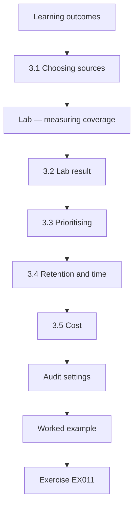

### Logical drawing


```text
[Learning outcomes]
    |
    v
[3.1 Choosing sources]
    |
    v
[Lab — measuring coverage]
    |
    v
[3.2 Lab result]
    |
    v
[3.3 Prioritising]
    |
    v
[3.4 Retention and time]
    |
    v
[3.5 Cost]
    |
    v
[Audit settings]
    |
    v
[Worked example] --> [Exercise EX011]
```
<!-- cyberabc:lesson-figures:end ch-03 -->


### Learning outcomes

You will (1) choose log sources based on risk; (2) measure coverage of critical assets; (3) plan collection with SP 800-92 in mind; (4) prioritise gaps.

### 3.1 Choosing sources

NIST SP 800-92 (Kent and Souppaya, 2006) advises planning log management around what the organisation needs to know. Priya starts from the March case: she needed VPN logs, domain controller logs and file-server audit logs to understand it. Starting from March gives Priya a concrete test: could the SOC have seen and understood that event with the sources it collects? Each source she adds answers a question from the case: who logged in, what changed and which files were read. She then adds sources for the other critical assets on her list, such as the ERP server, and records the reason for each choice.

### Lab — measuring coverage

```python
"""Log coverage: which critical assets send logs to the SIEM (synthetic)."""
assets = {"DC1": "critical", "DC2": "critical", "ERP-SRV": "critical", "FILE1": "critical", "VPN-GW": "critical",
          "PRINT1": "low", "CAD-WS01": "high", "CAD-WS02": "high", "HR-PC": "high", "SHOP-PLC-HMI": "high"}
sending = {"DC1", "DC2", "FILE1", "VPN-GW", "CAD-WS01", "HR-PC"}
for level in ("critical", "high", "low"):
    names = [a for a, l in assets.items() if l == level]
    have = [a for a in names if a in sending]
    print(f"{level:8} {len(have)}/{len(names)} missing={sorted(set(names) - sending)}")
print(f"overall {len(sending)}/{len(assets)} = {100 * len(sending) // len(assets)}%")
```

Run with `python3 lab_coverage.py`. Verified output:

```text
critical 4/5 missing=['ERP-SRV']
high     2/4 missing=['CAD-WS02', 'SHOP-PLC-HMI']
low      0/1 missing=['PRINT1']
overall 6/10 = 60%
```

### 3.2 Lab result

Overall, 6 of 10 listed assets send logs (60%). Four of five critical assets send logs; the ERP server does not. Of the high assets, CAD-WS02 and the factory HMI PC are missing. The print server is low priority. The lab counts assets that send logs, not how useful their logs are, so Priya checks each source's content as well. Missing the ERP server matters most, because it is critical and holds orders and prices. The two missing high assets match the kinds of systems involved in March or in production. Priya records the gaps and their reasons in the coverage table.

### 3.3 Prioritising

The ERP server holds orders and prices; it goes first. CAD-WS02 is a design workstation like the one used in March. The factory HMI needs care: the vendor must approve any agent, so Priya asks for network logs at the factory firewall instead. Prioritising by asset value and by the March case puts the most important gaps first. Network logs from the factory firewall are a compensating control for the HMI: they show its connections, even though nothing on the PC itself is logged. Priya records this in the risk register, with the vendor's position on agents and a date to review it. The board later approves the cost of collecting ERP logs.

### 3.4 Retention and time

Logs are kept 90 days searchable, one year archived; all systems sync to the same time source. Ninety days of searchable logs covers the time it usually takes to notice and investigate an incident. In March, the phishing email arrived two days before the login, so investigators needed several days of history. Keeping a year in archive allows a slower investigation, such as a customer asking months later whether its drawings were accessed. A shared time source means events from the VPN, domain controller and file server can be placed in one timeline, as the March investigation required.

### 3.5 Cost

The provider charges by data volume. Verbose debug logs are filtered out; security-relevant events are kept. Filtering debug logs reduces cost without losing events the SOC needs. Priya and the provider agree a list of events to keep for each source, starting with those used in the March investigation: VPN logins, admin group changes and file reads. Each month the provider reports data volumes, so Priya can see whether a source suddenly grows. Any filter that removes security-relevant events needs her approval, so cost savings do not quietly reduce what the SOC can see.

### Audit settings

Sending logs is not enough if the events are not recorded. Priya checks that file-server auditing records reads on the design shares and that domain controllers record group changes. In March, file auditing had been switched on only a month earlier by chance; without it the 2,310 reads would have been invisible.

### Ownership of collection

IT owns the agents; the provider confirms receipt.

### Worked example

Two months later, coverage is 9 of 10. The factory HMI still has no agent, but firewall logs show its connections. Priya records the remaining gap and the compensating control in the risk register.

> **Synthetic case.** Assets and coverage are synthetic.

### Errors and limits

Coverage of an asset is not coverage of every event on it; check audit settings too.

### Exercises

- **EX011 — Starting point.** How did Priya choose first sources? *Rubric:* 3 = from March case needs: VPN, DC, file audit; 2 = partial; 1 = vague; 0 = none.
- **EX012 — Lab figures.** Give the lab coverage figures. *Rubric:* 3 = 6/10=60%; critical 4/5 missing ERP; high 2/4; 2 = partial; 1 = one; 0 = none.
- **EX013 — Factory HMI.** How was the HMI gap handled? *Rubric:* 3 = firewall logs instead; vendor approval needed; recorded in risk register; 2 = partial; 1 = vague; 0 = none.
- **EX014 — Cost control.** How was log cost controlled? *Rubric:* 3 = filter debug logs; keep security events; 2 = partial; 1 = vague; 0 = none.
- **EX015 — Coverage caveat.** Why is asset coverage not enough? *Rubric:* 3 = audit settings may miss events; 2 = partial; 1 = vague; 0 = none.

### Synthesis

Collect logs according to risk, measure coverage and record gaps with compensating controls.

### Continue studying — chapter 03 of 12

[← Chapter 02 (draft)](#ch-02) · [Course chapter index](../SUBJECTS.md) · [Chapter 04 (draft) →](#ch-04)

<a id="ch-04"></a>

## Chapter 4 — Detection with ATT&CK and Sigma

<!-- cyberabc:lesson-figures:start ch-04 -->
### Lesson map

Lesson 04 published. Map, example, EX016.

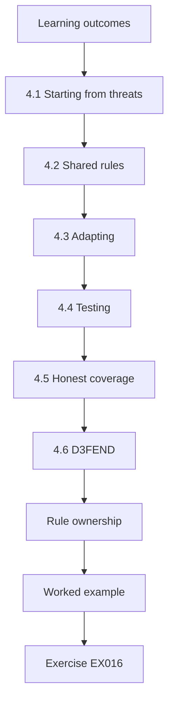

### Logical drawing


```text
[Learning outcomes]
    |
    v
[4.1 Starting from threats]
    |
    v
[4.2 Shared rules]
    |
    v
[4.3 Adapting]
    |
    v
[4.4 Testing]
    |
    v
[4.5 Honest coverage]
    |
    v
[4.6 D3FEND]
    |
    v
[Rule ownership]
    |
    v
[Worked example] --> [Exercise EX016]
```
<!-- cyberabc:lesson-figures:end ch-04 -->


### Learning outcomes

You will (1) map threats to ATT&CK techniques; (2) select detections from shared Sigma rules; (3) adapt rules to the environment; (4) record coverage honestly.

### 4.1 Starting from threats

The March event combined valid accounts used remotely, account manipulation (adding to an admin group) and data collection from a file share. MITRE ATT&CK (Strom et al., 2018) names these behaviours so detections can be planned and compared. Naming behaviours lets Priya plan detections for each part of March: a rule for unusual remote logins, one for admin group changes and one for large file reads. The ATT&CK names also let her compare her rules with published rules and with the provider's catalogue. The coverage table lists each technique with its rule, data source and test status, so the board can see what Fenwick would detect.

### 4.2 Shared rules

SigmaHQ publishes open detection rules in a vendor-neutral format. The provider converts selected rules into its SIEM. Priya chooses rules for admin group changes, new-country VPN logins and mass file reads. Starting from shared rules saves time and benefits from others' testing, but converting them can change how they behave. Priya asks the provider to show each converted rule and test it on Fenwick's data before it is counted. The three rules correspond to the three behaviours in March, so replaying that event tests them directly. Each rule's page records the SigmaHQ source, how the provider converted it and who owns it, which is what the provider later peer-reviewed.

### 4.3 Adapting

Shared rules assume generic environments. Fenwick's IT team legitimately changes admin groups during maintenance, so the rule adds context: changes outside an approved change window are high; inside, low. Without context, the rule would fire on every maintenance change, and the provider would soon learn to ignore it. With change windows, a change outside maintenance raises a high alert, which is what happened in March at 22:43. Priya gives the provider the change calendar and asks IT to record each maintenance window in advance, so the context stays accurate. Tom reviews the rule each month with the calendar to check it is working as intended.

### 4.4 Testing

Each rule is tested by replaying the synthetic March events and a normal week. Replaying March shows whether each rule catches the attack, and replaying a normal week shows how often it fires on legitimate activity. A rule that catches March but fires constantly in a normal week would overwhelm the provider. The replay showed that the three rules would have raised a critical alert within ten minutes of the March login. Each test is recorded with the date, data used and result, and failed tests lead to rule changes before the rule goes live.

### 4.5 Honest coverage

The coverage table lists each technique, rule, data source and tested status. Untested rules are not counted as coverage. Counting only tested rules keeps the coverage table honest: a rule that exists but has never been tested might not fire at all. When a rule changes or a data source is replaced, its tested status is reset until it is tested again. The provider later found two rules that would not fire on the new VPN product, which showed why this matters. Priya presents the table to the board with tested and untested rules shown separately.

### 4.6 D3FEND

MITRE D3FEND (Kaloroumakis and Smith, 2021) helps describe defensive measures, such as account monitoring, in a consistent vocabulary for the board. Using D3FEND terms lets Priya describe what Fenwick does to defend itself, such as monitoring accounts and analysing network traffic, in the same consistent way as ATT&CK describes attacks. This helps the board compare defensive measures with the threats they address. Priya uses it only for description and does not claim that naming a measure proves it works; testing does that.

### Rule ownership

Every rule has an owner who answers questions about it and reviews it twice a year. Tom owns the rules for accounts and VPN; the provider owns its standard rules for malware and email. Ownership stops rules from quietly breaking when systems change, such as the VPN upgrade planned for next year.

### Rule documentation

Each rule has a short page with purpose, data and first triage steps.

### Worked example

Replaying March, the three rules fire at 22:41, 22:43 and about 22:50 (mass read threshold of 1,000 files in 10 minutes). Together they would have raised a critical alert within 10 minutes if anyone had been watching.

> **Synthetic case.** Rules and timings are synthetic.

### Errors and limits

ATT&CK describes known behaviours; novel behaviour may not fit any technique.

### Exercises

- **EX016 — March behaviours.** Which behaviours did March combine? *Rubric:* 3 = remote valid account; admin group change; file collection; 2 = two; 1 = one; 0 = none.
- **EX017 — Rules chosen.** Which three rules did Priya pick? *Rubric:* 3 = admin group change; new-country VPN; mass file reads; 2 = two; 1 = one; 0 = none.
- **EX018 — Adaptation.** How was the admin-group rule adapted? *Rubric:* 3 = change-window context: outside high, inside low; 2 = partial; 1 = vague; 0 = none.
- **EX019 — Replay result.** What did the replay show? *Rubric:* 3 = rules fired 22:41, 22:43, ~22:50; critical within 10 min; 2 = partial; 1 = vague; 0 = none.
- **EX020 — Honest coverage.** What is not counted as coverage? *Rubric:* 3 = untested rules; 2 = partial; 1 = vague; 0 = none.

### Synthesis

Plan detections from real threats, adapt shared rules and count only tested coverage.

### Continue studying — chapter 04 of 12

[← Chapter 03 (draft)](#ch-03) · [Course chapter index](../SUBJECTS.md) · [Chapter 05 (draft) →](#ch-05)

<a id="ch-05"></a>

## Chapter 5 — Triage and the alert pipeline

<!-- cyberabc:lesson-figures:start ch-05 -->
### Lesson map

Lesson 05 published. Map, example, EX021.

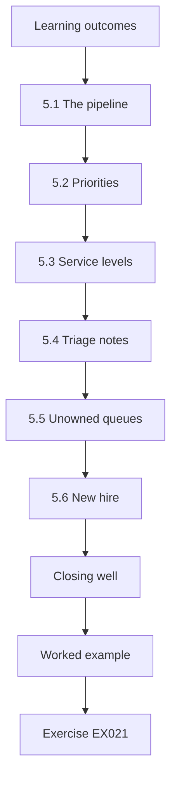

### Logical drawing

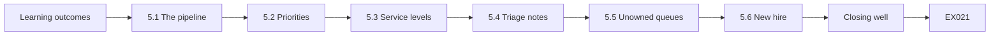

```text
[Learning outcomes]
    |
    v
[5.1 The pipeline]
    |
    v
[5.2 Priorities]
    |
    v
[5.3 Service levels]
    |
    v
[5.4 Triage notes]
    |
    v
[5.5 Unowned queues]
    |
    v
[5.6 New hire]
    |
    v
[Closing well]
    |
    v
[Worked example] --> [Exercise EX021]
```
<!-- cyberabc:lesson-figures:end ch-05 -->


### Learning outcomes

You will (1) design an alert pipeline from SIEM to decision; (2) set triage priorities using asset value; (3) define service levels; (4) avoid alert queues that nobody owns.

### 5.1 The pipeline

Alerts flow from the SIEM to the provider's queue at night and to Fenwick's analyst by day. Each alert is acknowledged, triaged, then closed, escalated or turned into an incident. Every stage has an owner; March showed what happens when nobody owns the queue. Splitting the queue by time of day gives Fenwick cover around the clock without a night shift of its own. The handover at 08:00 keeps the two halves connected, so an alert raised at night is not lost when the provider's shift ends. Tom checks each morning that every night alert has a note and an outcome.

### 5.2 Priorities

Priority combines rule severity with asset value from the asset list built in chapter 3. An admin change on a domain controller is critical; a macro document opened on a reception PC is low. Priority tells the provider and Tom which alerts need attention first. Using asset value means the same rule can produce different priorities: an admin change on a domain controller could give an attacker control of every account, while a macro document on a reception PC affects one machine. Priya reviews priorities each month with Tom and the provider, and adjusts them when the asset list changes.

### 5.3 Service levels

Critical: acknowledge in 15 minutes and call Priya. High: 30 minutes. Medium: same working day. Low: weekly review. These come from the board's first-year goal. Each level has a target that can be measured and reported. Critical alerts get the shortest target because March showed how quickly damage can be done: fifteen minutes passed between the admin change and its removal. The provider and Tom record acknowledgement times, and Priya reports them monthly to the risk committee. Missed targets are discussed at the monthly review with the provider, with the reason and any fix recorded.

### 5.4 Triage notes

Every decision has a note: what was seen, checked, decided and why. The provider's notes must be readable by Fenwick's analyst the next morning. Good notes let a second analyst understand a decision without repeating the work, and show later whether a closed alert was handled correctly. Tom reviews the provider's night notes each morning and asks about any that are unclear. He keeps a short guide with examples of good notes, which the provider uses to train its analysts on Fenwick's service. Notes are also used in the monthly review, to check precision and to find rules that need tuning.

### 5.5 Unowned queues

Priya removes the old shared mailbox; alerts now go only to queues with named owners and service levels. In March, the alert went to a shared mailbox that nobody checked at night, which is why it sat unseen for nine hours. Removing the mailbox means every alert has a named owner who is accountable for acknowledging it within its service level. Priya checks that no rule still sends to the old address. Any new queue must have an owner and a service level before rules can send to it.

### 5.6 New hire

Fenwick hires Tom Reyes as its first analyst. He owns daytime triage and reviews night notes each morning. Hiring an analyst gives Fenwick in-house knowledge that the provider cannot supply, such as which finance staff use macros or when IT runs maintenance. Tom's morning review keeps the night and day halves of the queue connected. He also maintains rule documentation and runbooks. Priya remains SOC owner and decides on escalation and business matters, while Tom handles daily operations. Their roles are written into the charter, so the provider knows to call Priya for decisions and Tom for questions about a night note.

### Closing well

A closed alert states the evidence for closure, such as a change ticket number.

### Weekend cover

At weekends the provider covers all hours, calling on-call IT staff.

### Worked example

In week three, the provider calls Priya at 23:10 about a critical alert: a new-country VPN login for a sales manager. Priya confirms the manager is at a trade fair abroad, as shown in the travel calendar the provider did not have. The alert is closed, and Priya arranges for the provider to receive the travel calendar.

> **Synthetic case.** Alerts and people are invented.

### Errors and limits

Service levels can push analysts to close quickly; review closure quality as well as speed.

### Exercises

- **EX021 — Pipeline stages.** Name the stages of the alert pipeline. *Rubric:* 3 = acknowledge, triage, close/escalate/incident; 2 = partial; 1 = vague; 0 = none.
- **EX022 — Critical service level.** What is the service level for critical alerts? *Rubric:* 3 = acknowledge 15 min; call Priya; 2 = partial; 1 = vague; 0 = none.
- **EX023 — Mailbox decision.** Why remove the shared mailbox? *Rubric:* 3 = nobody owned it; March missed; 2 = partial; 1 = vague; 0 = none.
- **EX024 — Trade fair call.** How was the week-three alert resolved? *Rubric:* 3 = travel calendar showed fair; closed; calendar shared with provider; 2 = partial; 1 = vague; 0 = none.
- **EX025 — Note purpose.** Why must night notes be readable by Tom? *Rubric:* 3 = continuity across provider and in-house; 2 = partial; 1 = vague; 0 = none.

### Synthesis

Every alert needs an owner, a priority and a service level.

### Continue studying — chapter 05 of 12

[← Chapter 04 (draft)](#ch-04) · [Course chapter index](../SUBJECTS.md) · [Chapter 06 (draft) →](#ch-06)

<a id="ch-06"></a>

## Chapter 6 — Working with a managed security provider

<!-- cyberabc:lesson-figures:start ch-06 -->
### Lesson map

Lesson 06 published. Map, example, EX026.

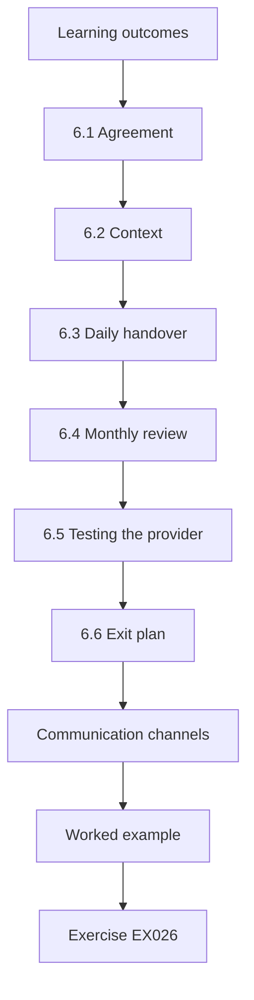

### Logical drawing


```text
[Learning outcomes]
    |
    v
[6.1 Agreement]
    |
    v
[6.2 Context]
    |
    v
[6.3 Daily handover]
    |
    v
[6.4 Monthly review]
    |
    v
[6.5 Testing the provider]
    |
    v
[6.6 Exit plan]
    |
    v
[Communication channels]
    |
    v
[Worked example] --> [Exercise EX026]
```
<!-- cyberabc:lesson-figures:end ch-06 -->


### Learning outcomes

You will (1) write a clear service agreement with a provider; (2) share business context; (3) review provider performance; (4) manage the hybrid handover.

### 6.1 Agreement

The service agreement lists monitored sources, service levels, pre-approved actions, contacts, reporting and exit terms. It refers to Fenwick's charter for authority. The agreement turns the charter into service terms the provider must meet. Listing monitored sources makes it clear which logs the provider watches, so a missing source is noticed. Exit terms protect Fenwick if the provider fails. Referring to the charter means authority is defined in one place, so the two documents cannot disagree. Priya reviews the agreement with the provider each year, and changes are signed by both parties and the managing director.

### 6.2 Context

Providers lack local knowledge. Fenwick shares the asset list, travel calendar, change windows, VIP list and normal factory shift patterns. Each item answers a question the provider cannot answer alone. The travel calendar explains a new-country login, as with the sales manager at a trade fair; change windows explain admin changes; shift patterns explain factory logins at unusual hours. Priya updates the information monthly and asks the provider to confirm it has the current version. Without context, the provider would escalate many benign alerts and miss the signs of real ones.

### 6.3 Daily handover

At 08:00 the provider sends a summary of overnight alerts and open cases; Tom reviews it and replies with questions. The handover means nothing from the night is forgotten. Tom checks that every alert has a note and an outcome, and that open cases have a next step and an owner. His questions often lead to context updates, such as a missing change window. The handover also gives Priya a daily record of how the provider handled Fenwick's alerts, which she uses at the monthly review to discuss response times and missed alerts.

### 6.4 Monthly review

Priya and the provider review response times, false positives, missed alerts and context updates. The review uses figures from both sides: the provider's response times and Tom's records of false positives and missed alerts. Each problem is traced to a cause, such as missing context or a rule that fires too often, and given an action with an owner. Priya records the actions and checks them at the next review. Context updates are confirmed so the provider has the current travel calendar, change windows and VIP list.

### 6.5 Testing the provider

Twice a year, with agreement, Fenwick runs an announced test: a test account is added to an admin group at night to see how quickly the provider responds. An announced test checks the whole path from detection to call, using a harmless action that matches the March behaviour. The provider knows a test will happen but not exactly when, so it measures normal performance. The first test met the fifteen-minute target, while the second took 26 minutes because the on-call analyst was busy with another client. Priya reports both results to the board, and the provider added a backup analyst.

### 6.6 Exit plan

If the provider fails, logs and rules must transfer to a new one; the agreement makes Fenwick the owner of both. Owning logs and rules means Fenwick can move to another provider without starting again. The agreement says how logs and rule definitions are exported, in what format and within what time. Priya checks once a year that the export works by asking for a sample. When the managing director asked what would happen if the provider failed, Priya pointed to these terms and the data ownership clause.

### Communication channels

The agreement lists how each kind of message travels: critical alerts by phone, high by phone or chat, medium and low through the ticket system. Phone numbers are checked monthly by a short test call, because an outdated number at 02:00 defeats every other part of the arrangement. Priya also keeps a printed contact sheet in case email and chat are down during an incident. These details seem small, but they decide whether the provider can actually reach someone when it matters.

### Worked example

The first night test: admin change at 01:00, provider alert at 01:03, call to Priya at 01:12, within the 15-minute target. The second test, three months later, took 26 minutes because the provider's on-call analyst was handling another client. The provider adds a backup analyst.

> **Synthetic case.** Tests and results are invented.

### Errors and limits

A provider shared across many clients may be stretched during wide attacks.

### Exercises

- **EX026 — Context shared.** List four items of context shared. *Rubric:* 3 = assets, travel, change windows, VIPs, shifts (four); 2 = two; 1 = one; 0 = none.
- **EX027 — Morning handover.** What happens at 08:00? *Rubric:* 3 = provider summary; Tom reviews and asks questions; 2 = partial; 1 = vague; 0 = none.
- **EX028 — Test results.** Compare the two night tests. *Rubric:* 3 = 12 min within target; 26 min missed; backup analyst added; 2 = partial; 1 = one; 0 = none.
- **EX029 — Data ownership.** Why must Fenwick own logs and rules? *Rubric:* 3 = to move to new provider if needed; 2 = partial; 1 = vague; 0 = none.
- **EX030 — Monthly review.** What is checked monthly? *Rubric:* 3 = response times, false positives, missed alerts, context; 2 = two; 1 = one; 0 = none.

### Synthesis

A provider works well only with a clear agreement, shared context and regular tests.

### Continue studying — chapter 06 of 12

[← Chapter 05 (draft)](#ch-05) · [Course chapter index](../SUBJECTS.md) · [Chapter 07 (draft) →](#ch-07)

<a id="ch-07"></a>

## Chapter 7 — Measuring and tuning detections

<!-- cyberabc:lesson-figures:start ch-07 -->
### Lesson map

Lesson 07 published. Map, example, EX031.

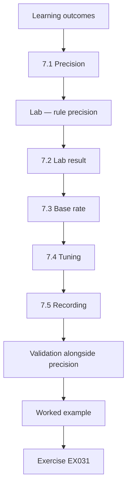

### Logical drawing

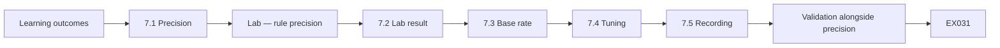

```text
[Learning outcomes]
    |
    v
[7.1 Precision]
    |
    v
[Lab — rule precision]
    |
    v
[7.2 Lab result]
    |
    v
[7.3 Base rate]
    |
    v
[7.4 Tuning]
    |
    v
[7.5 Recording]
    |
    v
[Validation alongside precision]
    |
    v
[Worked example] --> [Exercise EX031]
```
<!-- cyberabc:lesson-figures:end ch-07 -->


### Learning outcomes

You will (1) measure rule precision from triage outcomes; (2) tune noisy rules safely; (3) understand the base-rate problem; (4) record tuning decisions.

### 7.1 Precision

Precision is the share of alerts that were real. Tom marks each closed alert real or benign so precision can be calculated. Tom records the outcome of each alert in the triage note, so precision can be calculated for each rule without extra work. A benign alert is not a failure in itself; rules need some false alarms to catch real attacks. Precision shows which rules waste the most analyst time, so tuning can focus there. Tom's records also show real cases a rule caught, which tuning must keep catching.

### Lab — rule precision

```python
"""Precision of each rule over one month of synthetic triage outcomes."""
rules = {"VPN login from new country": (40, 3), "Admin group change": (12, 4),
         "AV detection on server": (6, 2), "Macro document opened": (95, 1)}
for name, (alerts, real) in sorted(rules.items(), key=lambda r: r[1][1] / r[1][0], reverse=True):
    print(f"{name:28} alerts={alerts:3} real={real} precision={real / alerts:.2f}")
```

Run with `python3 lab_precision.py`. Verified output:

```text
Admin group change           alerts= 12 real=4 precision=0.33
AV detection on server       alerts=  6 real=2 precision=0.33
VPN login from new country   alerts= 40 real=3 precision=0.07
Macro document opened        alerts= 95 real=1 precision=0.01
```

### 7.2 Lab result

Admin group change and AV detection on server each have precision 0.33; new-country VPN login 0.07 (3 real of 40); macro document opened 0.01 (1 of 95). Precision is very low for the macro and VPN rules, so most of their alerts are benign. The macro rule fired 95 times for one real case, which wastes analyst time and teaches staff to ignore it. Tom and Priya choose these two rules for tuning, since they cause most of the triage work. The other rules are kept as they are and reviewed again the following quarter.

### 7.3 Base rate

Axelsson (2000) showed that rare attacks make even good detectors produce mostly false alarms. The macro rule fires on any document with macros, and Fenwick's finance team uses many. Applied to Fenwick, the base rate explains why the macro rule's precision is so low: real malicious macros are rare, while finance staff open legitimate macro documents every day. Even a rule that catches every malicious macro will mostly flag legitimate ones. Tuning must reduce the benign triggers without losing the rare real case.

### 7.4 Tuning

The macro rule is narrowed to documents from outside email that start a new process. The VPN rule now checks the travel calendar first. Each change targets a known cause of benign alerts. Finance documents usually come from inside Fenwick and do not start new processes, so narrowing the macro rule removes most of them. Checking the travel calendar removes alerts for staff known to be abroad, like the sales manager at the trade fair. After tuning, the macro rule fired nine times in a month with one real case, and the VPN rule eight times with three real.

### 7.5 Recording

Each change has a reason, expected effect and review date; real cases are checked to ensure they would still be caught. Recording each change prevents tuning from quietly removing detection. Before a tuned rule goes live, Tom replays the real cases it caught earlier and checks that it still fires on them. The review date ensures that the tuning is checked again after a month of use. If precision does not improve as expected, the change is reconsidered. The record is part of the rule documentation, which the provider later peer-reviewed.

### Validation alongside precision

Precision says how often alerts are right; validation says whether rules fire at all. Priya combines both: monthly precision from triage marks, and twice-yearly announced tests that confirm critical rules still fire. When the VPN product's log format changed in a patch, the validation test caught that the new-country rule had silently stopped firing, something precision figures could never show because a rule that never fires has no false alarms. The format mapping was fixed the same day.

### Analyst input

Tom suggests tuning ideas from his triage experience each month, and they are tested before use.

### Worked example

After tuning, the macro rule fires 9 times in a month with 1 real case; the VPN rule fires 8 times with 3 real. Tom's triage time falls by about four hours a week, which he spends improving runbooks.

> **Synthetic case.** Counts are synthetic.

### Errors and limits

Precision does not show missed attacks; validation tests (chapter 6) help there.

### Exercises

- **EX031 — Lab precision.** Give the lowest and highest precision in the lab. *Rubric:* 3 = macro 0.01; admin/AV 0.33; 2 = one; 1 = vague; 0 = none.
- **EX032 — Base rate.** Explain the base-rate problem. *Rubric:* 3 = rare attacks; mostly false alarms; 2 = partial; 1 = vague; 0 = none.
- **EX033 — Macro tuning.** How was the macro rule tuned? *Rubric:* 3 = external email docs starting new process; 2 = partial; 1 = vague; 0 = none.
- **EX034 — Post-tuning.** What were the results after tuning? *Rubric:* 3 = macro 9 alerts 1 real; VPN 8 alerts 3 real; 2 = partial; 1 = vague; 0 = none.
- **EX035 — Precision limit.** What does precision not show? *Rubric:* 3 = missed attacks; 2 = partial; 1 = vague; 0 = none.

### Synthesis

Measure precision, tune with care and keep real cases detectable.

### Continue studying — chapter 07 of 12

[← Chapter 06 (draft)](#ch-06) · [Course chapter index](../SUBJECTS.md) · [Chapter 08 (draft) →](#ch-08)

<a id="ch-08"></a>

## Chapter 8 — Incident response planning

<!-- cyberabc:lesson-figures:start ch-08 -->
### Lesson map

Lesson 08 published. Map, example, EX036.

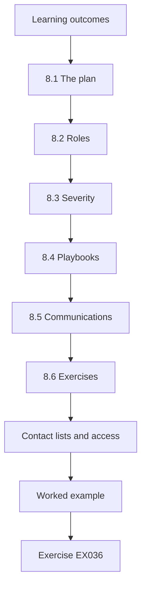

### Logical drawing

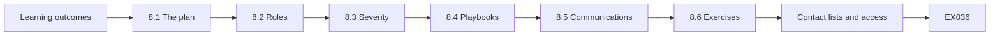

```text
[Learning outcomes]
    |
    v
[8.1 The plan]
    |
    v
[8.2 Roles]
    |
    v
[8.3 Severity]
    |
    v
[8.4 Playbooks]
    |
    v
[8.5 Communications]
    |
    v
[8.6 Exercises]
    |
    v
[Contact lists and access]
    |
    v
[Worked example] --> [Exercise EX036]
```
<!-- cyberabc:lesson-figures:end ch-08 -->


### Learning outcomes

You will (1) write an incident response plan aligned with SP 800-61r3; (2) define roles and severity; (3) prepare playbooks for likely incidents; (4) plan communications and legal duties.

### 8.1 The plan

Priya's plan follows NIST SP 800-61r3 (Nelson et al., 2025), which places response within CSF 2.0 functions, from preparation to recovery and improvement. Following SP 800-61r3 helps Priya build the plan around the whole lifecycle, from preparing contacts and playbooks to learning from each incident. March showed gaps at every stage: no preparation, no authority, no plan for containment and no review afterwards. The plan addresses each one, and it is tested in tabletop exercises with managers. The managing director approves the plan, and Priya reviews it after every incident and exercise.

### 8.2 Roles

Incident lead (Priya), analyst (Tom or provider), IT operations, communications (marketing head), legal and data protection (external adviser), executive approver (managing director). Naming roles in advance avoids the confusion of deciding who does what during an incident. Priya leads and makes decisions, the analyst investigates, IT operations takes technical actions, communications handles messages to staff and customers, the external adviser advises on legal duties, and the managing director approves major decisions such as notifying customers. Each role has a deputy, and contact details are kept in the plan.

### 8.3 Severity

Low: single device or account, no data. Medium: data access or several systems. High: production stopped or sensitive data taken. Severity decides who is involved and how quickly. Under this scale, March would be high, because design files under customer confidentiality agreements were taken. A single phished account with no data accessed, like the month-nine incident, would be low. Priya's plan links each level to the people who must be informed and the actions expected, so the response matches the harm.

### 8.4 Playbooks

Three playbooks: compromised account, ransomware on office PCs, and suspected data theft. Each lists triggers, first steps, pre-approved actions and contacts. The three playbooks cover the incidents Fenwick considers most likely: March was a compromised account followed by data theft, and ransomware is a common threat to manufacturers. Each playbook gives the first steps so the responder does not have to decide everything under pressure. Pre-approved actions match the charter. The playbooks are tested in tabletop exercises and updated after each one.

### 8.5 Communications

Templates for staff, customers and regulators. Personal data breaches may need reporting to the data protection regulator within set deadlines, so the adviser is called early. Prepared templates save time when deadlines apply. Customer templates matter at Fenwick because design files may include customer drawings under confidentiality agreements, which the first tabletop showed nobody had checked. Legal added a step to check contracts for notification duties to customers when design data is accessed. The adviser decides whether a regulator must be notified, using the facts in the incident record.

### 8.6 Exercises

A tabletop exercise each half year tests the plan with managers. Each tabletop uses a realistic scenario, starting with a replay of March, and the managers who would respond work through the plan step by step. Gaps found become actions with owners and dates, such as the contract check legal added after the first exercise. Priya reports the findings and their status to the board. By the end of the year two tabletops had been held, and two of three findings from the first were closed.

### Contact lists and access

The plan includes a printed contact list, out-of-band communication (personal phones and a messaging group created in advance), and emergency admin accounts kept in a sealed envelope in the safe. If the domain is compromised, normal email and accounts may not be trustworthy, so the response team must be able to talk and act without them. Priya tests the emergency accounts each quarter and records the test.

### Recovery

Each playbook ends with recovery steps: restore from backup, reset credentials, confirm monitoring and return systems to users with sign-off.

### Worked example

The first tabletop replays March. Managers realise nobody knew whether the design files included customer drawings under confidentiality agreements. Legal adds a step: check contracts for notification duties to customers when design data is accessed.

> **Synthetic case.** The plan and exercise are invented.

### Errors and limits

Plans age; review after each incident and exercise.

### Exercises

- **EX036 — Plan basis.** What does the plan follow? *Rubric:* 3 = SP 800-61r3 within CSF 2.0; 2 = partial; 1 = vague; 0 = none.
- **EX037 — Roles list.** Name five incident roles. *Rubric:* 3 = lead, analyst, IT ops, comms, legal/DP, approver (five); 2 = three; 1 = one; 0 = none.
- **EX038 — Playbooks.** List the three playbooks. *Rubric:* 3 = compromised account; ransomware; data theft; 2 = two; 1 = one; 0 = none.
- **EX039 — Tabletop finding.** What did the tabletop reveal? *Rubric:* 3 = unknown if designs had customer confidentiality duties; step added; 2 = partial; 1 = vague; 0 = none.
- **EX040 — Early adviser.** Why call the data protection adviser early? *Rubric:* 3 = reporting deadlines for personal data breaches; 2 = partial; 1 = vague; 0 = none.

### Synthesis

A response plan names roles, sets severity, holds playbooks and is tested.

### Continue studying — chapter 08 of 12

[← Chapter 07 (draft)](#ch-07) · [Course chapter index](../SUBJECTS.md) · [Chapter 09 (draft) →](#ch-09)

<a id="ch-09"></a>

## Chapter 9 — Investigation and timelines

<!-- cyberabc:lesson-figures:start ch-09 -->
### Lesson map

Lesson 09 published. Map, example, EX041.

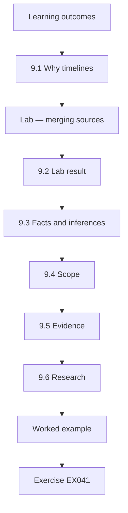

### Logical drawing

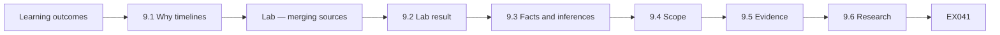

```text
[Learning outcomes]
    |
    v
[9.1 Why timelines]
    |
    v
[Lab — merging sources]
    |
    v
[9.2 Lab result]
    |
    v
[9.3 Facts and inferences]
    |
    v
[9.4 Scope]
    |
    v
[9.5 Evidence]
    |
    v
[9.6 Research]
    |
    v
[Worked example] --> [Exercise EX041]
```
<!-- cyberabc:lesson-figures:end ch-09 -->


### Learning outcomes

You will (1) build a cross-source timeline; (2) separate facts from inferences; (3) scope an incident; (4) preserve evidence for later review.

### 9.1 Why timelines

A timeline puts events from different sources in one order, so gaps and causes become visible. It is the core of most investigations. For March, the timeline joined VPN logs, domain controller logs, file-server audit logs and firewall logs, which no single system held. Placed in order, they showed the login, the admin change, the file reads, the data leaving and the attempt to hide the change. Without a shared time source, events from different systems could not have been ordered reliably.

### Lab — merging sources

```python
"""Merge synthetic events from three sources into one timeline."""
vpn = [("2026-03-03 22:41", "VPN", "login j.harper from 198.51.100.23 (new country)")]
dc = [("2026-03-03 22:43", "DC", "j.harper added to Domain Admins (by j.harper, who holds group-management rights)"),
      ("2026-03-03 22:58", "DC", "j.harper removed from Domain Admins")]
fs = [("2026-03-03 22:47", "FILE1", "j.harper read 2,310 files in \\\\FILE1\\Designs"),
      ("2026-03-03 22:55", "FILE1", "j.harper read 0 files; session closed")]
for t, src, msg in sorted(vpn + dc + fs):
    print(t[11:], f"{src:5}", msg)
```

Run with `python3 lab_timeline.py`. Verified output:

```text
22:41 VPN   login j.harper from 198.51.100.23 (new country)
22:43 DC    j.harper added to Domain Admins (by j.harper, who holds group-management rights)
22:47 FILE1 j.harper read 2,310 files in \\FILE1\Designs
22:55 FILE1 j.harper read 0 files; session closed
22:58 DC    j.harper removed from Domain Admins
```

### 9.2 Lab result

The merged March timeline: 22:41 VPN login from 198.51.100.23 (new country); 22:43 j.harper added to Domain Admins; 22:47 2,310 files read in the Designs share; 22:55 session closed; 22:58 j.harper removed from Domain Admins. The removal suggests an attempt to hide the change. The timeline shows how quickly the attack moved: from login to data reading took six minutes, and the whole event lasted seventeen. Priya notes which events are facts from logs and which are her interpretation, such as the reason for the removal.

### 9.3 Facts and inferences

Facts: the events above. Inference: someone other than j.harper used his account, since he was at home in the UK and his laptop showed no VPN session. Priya labels each line as fact or inference in the report. Labelling each line helps readers see where the report's conclusions come from, and which could change if new evidence appears. The inference about j.harper rests on two facts that could be checked: his location and his laptop's VPN status. Priya does not claim to know who the attacker was, only that someone other than j.harper used the account.

### 9.4 Scope

Questions: how did the attacker get the password? Was MFA bypassed? Were files copied out? Email logs show j.harper entered his password on a fake VPN page two days earlier; the VPN lacked MFA; firewall logs show 1.4 GB sent to 198.51.100.23 between 22:47 and 22:55. Each question changes the response: a phished password calls for MFA and staff awareness, missing MFA calls for adding it to the VPN, and data sent out calls for checking customer contracts. The answers set the scope of the incident, and the final scope statement found no evidence of other accounts or malware. Priya records which sources answered each question, so the conclusions can be checked.

### 9.5 Evidence

Copies of logs are saved with time stamps and hashes, and originals stay in the SIEM. A record lists who handled each item. Hashes show that saved copies have not changed since they were made, which matters if the evidence is later needed for an insurer or legal action. Keeping originals in the SIEM means the copies can be checked against them. The handling record lists each item, who copied it, when and where it was stored. Priya follows the same steps for every incident, so evidence is handled consistently.

### 9.6 Research

Hassan et al. (2019) showed that provenance (how events connect) helps reduce false alarms and speeds investigation; the same idea underlies good timelines. The research applies to Fenwick's investigation in a simple form: linking the VPN login to the admin change and the file reads through the same account and address showed one connected event, not three separate alerts. Priya uses this idea to explain to Tom why connecting events matters more than looking at each alert alone. Tom writes this into the compromised-account runbook, which now tells the analyst to search for other events from the same account and address before closing an alert.

### Gaps stated

The report states that ERP logs were not collected in March.

### Worked example

The final scope statement: one account compromised by phishing; Domain Admins rights used for 15 minutes; about 1.4 GB of design files sent out; no evidence of other accounts or malware. Actions: MFA on VPN, review of who can change admin groups, customer notification check by legal.

> **Synthetic case.** Events and volumes are synthetic.

### Errors and limits

Missing logs (for example from the ERP server in March) can hide parts of the story; state such gaps.

### Exercises

- **EX041 — Timeline order.** Give the first three timeline events. *Rubric:* 3 = 22:41 VPN; 22:43 admin add; 22:47 files read; 2 = partial; 1 = one; 0 = none.
- **EX042 — Removal meaning.** What might the 22:58 removal suggest? *Rubric:* 3 = attempt to hide the change; 2 = partial; 1 = vague; 0 = none.
- **EX043 — Fact vs inference.** Give one fact and one inference. *Rubric:* 3 = fact: events; inference: not j.harper; 2 = partial; 1 = vague; 0 = none.
- **EX044 — Root cause.** How was the password obtained? *Rubric:* 3 = fake VPN page phishing two days before; no MFA; 2 = partial; 1 = vague; 0 = none.
- **EX045 — Scope statement.** Summarise the scope statement. *Rubric:* 3 = one account; 15 min admin; 1.4 GB out; no other accounts/malware; 2 = partial; 1 = one; 0 = none.

### Synthesis

Merge sources, separate fact from inference and state scope and gaps clearly.

### Continue studying — chapter 09 of 12

[← Chapter 08 (draft)](#ch-08) · [Course chapter index](../SUBJECTS.md) · [Chapter 10 (draft) →](#ch-10)

<a id="ch-10"></a>

## Chapter 10 — Metrics and reporting to the board

<!-- cyberabc:lesson-figures:start ch-10 -->
### Lesson map

Lesson 10 published. Map, example, EX046.

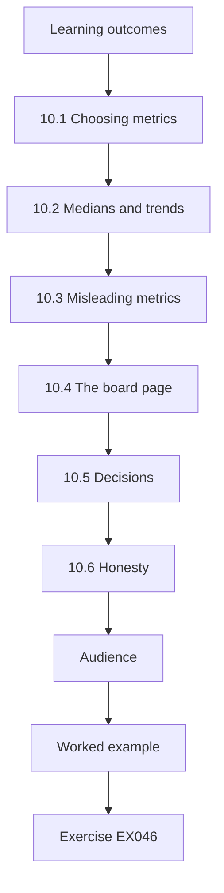

### Logical drawing


```text
[Learning outcomes]
    |
    v
[10.1 Choosing metrics]
    |
    v
[10.2 Medians and trends]
    |
    v
[10.3 Misleading metrics]
    |
    v
[10.4 The board page]
    |
    v
[10.5 Decisions]
    |
    v
[10.6 Honesty]
    |
    v
[Audience]
    |
    v
[Worked example] --> [Exercise EX046]
```
<!-- cyberabc:lesson-figures:end ch-10 -->


### Learning outcomes

You will (1) choose metrics that show SOC value; (2) present trends and risks to non-specialists; (3) avoid misleading metrics; (4) link reporting to decisions.

### 10.1 Choosing metrics

Priya picks: log coverage of critical assets, time to acknowledge critical alerts, rule precision, open high risks and exercise findings closed. Each metric relates to a first-year goal: coverage measures what the SOC can see, acknowledgement time measures response at any hour, precision measures how much time rules waste, and open risks and exercise findings show whether problems are being closed. Priya defines each one in writing, including how it is counted, so the figures are comparable each month. She agrees the definitions with Tom and the provider, so the acknowledgement times in the provider's reports and in Tom's records are counted the same way.

### 10.2 Medians and trends

Medians and month-to-month trends avoid being misled by one unusual case. A single slow response could distort an average, while the median shows typical performance. Priya still reports the worst case, such as the 26-minute provider test, so that unusual cases are not hidden. Trends over several months show whether the SOC is improving, which matters more to the board than a single month's figure. Each chart on the board page shows at least six months. Tom checks each chart against the provider's acknowledgement records and his own triage notes before the page goes to the board.

### 10.3 Misleading metrics

"Alerts handled" looks impressive but grows with noise; Priya leaves it out. A rising count of handled alerts could mean more attacks, or simply noisier rules, so it does not show whether Fenwick is safer. After tuning, the macro rule fired far less, which would make the count fall even though detection improved. Priya chooses metrics that change in the right direction when the SOC gets better, such as precision and acknowledgement time. She explains this choice on the board page, so nobody asks why the count is missing.

### 10.4 The board page

One page: three charts, two decisions needed, one sentence per risk. Keeping it to one page makes the board page readable in a meeting. The three charts show coverage, acknowledgement time and precision over time. The decisions needed tell the board what it is being asked to approve, such as funding for ERP log collection. One sentence per risk gives the board enough to understand each open risk without technical detail. Priya prepares the page from the same data as the monthly report, and Tom checks the figures before it goes to the board.

### 10.5 Decisions

Board decisions in month five: fund MFA for the factory's remote vendor access, and approve the cost of ERP log collection. Each decision closes a gap Priya had reported. The factory vendor connected remotely without MFA, which was the same weakness that let the March attacker in through the VPN. ERP log collection closes the most important coverage gap. Priya presents each decision with its cost and the risk it reduces, so the board can weigh them, and records the board's decisions in the next monthly report.

### 10.6 Honesty

Reporting what went badly builds trust; the 26-minute provider test is reported with its fix. The 26-minute test missed the fifteen-minute target, and Priya reports it alongside the fix: the provider added a backup analyst. Hiding it would make the SOC look better but would leave the board unaware of a real weakness in night cover. Reporting problems with their fixes also shows the board that the SOC finds and corrects its own weaknesses, which supports the second-year budget request.

### Audience

Board members are not security specialists. Priya avoids jargon, explains each chart in one sentence and links each risk to business impact: lost designs, stopped production or customer trust. She practises the presentation with the finance director, who tells her which terms were unclear. The board responds better to the story of March than to any chart, so she always begins with a short real example before the numbers.

### Trends over time

Each chart shows at least six months so the board sees direction, not just a single month. When the median acknowledge time rose one month, Priya explained it was due to two holiday weeks with reduced provider staff, and the provider added cover for the next holiday period. Trends make such explanations visible and keep the board focused on lasting change rather than month-to-month noise.

### Worked example

Six months after March, the board page shows: critical coverage 5/5, median time to acknowledge critical alerts 9 minutes, VPN rule precision 0.38, two of three tabletop findings closed. The board approves the second-year budget.

> **Synthetic case.** Figures are invented.

### Errors and limits

Board metrics summarise; they cannot show everything; keep detail available.

### Exercises

- **EX046 — Metric list.** List Priya's five metrics. *Rubric:* 3 = coverage, acknowledge time, precision, open risks, findings closed; 2 = four; 1 = two; 0 = none.
- **EX047 — Excluded metric.** Which metric was left out and why? *Rubric:* 3 = alerts handled; grows with noise; 2 = partial; 1 = vague; 0 = none.
- **EX048 — Board decisions.** What did the board decide in month five? *Rubric:* 3 = MFA for vendor access; ERP log cost; 2 = one; 1 = vague; 0 = none.
- **EX049 — Six-month figures.** Give two six-month figures. *Rubric:* 3 = coverage 5/5; 9 min; precision 0.38; 2/3 findings (two); 2 = one; 1 = vague; 0 = none.
- **EX050 — Honest reporting.** Why report the failed test? *Rubric:* 3 = builds trust; shows fix; 2 = partial; 1 = vague; 0 = none.

### Synthesis

Report a few honest metrics that lead to decisions.

### Continue studying — chapter 10 of 12

[← Chapter 09 (draft)](#ch-09) · [Course chapter index](../SUBJECTS.md) · [Chapter 11 (draft) →](#ch-11)

<a id="ch-11"></a>

## Chapter 11 — Maturity and continuous improvement

<!-- cyberabc:lesson-figures:start ch-11 -->
### Lesson map

Lesson 11 published. Map, example, EX051.

```mermaid
flowchart TD
  N0["Learning outcomes"]
  N1["11.1 SOC-CMM"]
  N2["11.2 Continuous monitoring"]
  N3["11.3 Research"]
  N4["11.4 Year-two plan"]
  N5["11.5 Lessons loop"]
  N6["Improvement backlog"]
  N7["External views"]
  N0 --> N1 --> N2 --> N3 --> N4 --> N5 --> N6 --> N7
  N7 --> EX["Worked example"]
  EX --> Q["Exercise EX051"]
```

### Logical drawing

```mermaid
flowchart LR
  N0["Learning outcomes"]
  N1["11.1 SOC-CMM"]
  N2["11.2 Continuous monitoring"]
  N3["11.3 Research"]
  N4["11.4 Year-two plan"]
  N5["11.5 Lessons loop"]
  N6["Improvement backlog"]
  N7["External views"]
  N0 --> N1 --> N2 --> N3 --> N4 --> N5 --> N6 --> N7 --> Q["EX051"]
```

```text
[Learning outcomes]
    |
    v
[11.1 SOC-CMM]
    |
    v
[11.2 Continuous monitoring]
    |
    v
[11.3 Research]
    |
    v
[11.4 Year-two plan]
    |
    v
[11.5 Lessons loop]
    |
    v
[Improvement backlog]
    |
    v
[External views]
    |
    v
[Worked example] --> [Exercise EX051]
```
<!-- cyberabc:lesson-figures:end ch-11 -->


### Learning outcomes

You will (1) assess SOC capability with SOC-CMM; (2) apply continuous monitoring ideas from SP 800-137; (3) plan year-two improvements; (4) learn from research on SOC practice.

### 11.1 SOC-CMM

The SOC Capability Maturity Model (van Os, 2016) assesses business, people, process, technology and services. Priya's self-assessment: process improving, people thin (one analyst), technology reliant on the provider. The assessment shows where Fenwick's SOC is strong and where it depends on too few people. With one analyst, holidays and illness leave daytime triage uncovered, which is why the year-two plan adds a second analyst. Reliance on the provider is reasonable for a small company but needs the exit terms and ownership of logs and rules that the agreement provides. Priya repeats the self-assessment each year, and the people score is the first she expects to change once the second analyst starts.

### 11.2 Continuous monitoring

NIST SP 800-137 (Dempsey et al., 2011) frames monitoring as ongoing awareness feeding risk decisions, not a one-time project. For Fenwick, this means the SOC's figures feed decisions about risk, such as funding ERP log collection or MFA for vendor access, rather than being collected and filed. The monthly report and board page are the routine that keeps monitoring connected to decisions. Priya uses the publication to explain to the board why the SOC needs ongoing funding rather than a one-time project budget.

### 11.3 Research

Kokulu et al. (2019) interviewed SOC staff and found common issues between analysts and managers, such as disagreement on how to measure success; Priya uses this to agree metrics with Tom rather than imposing them. Agreeing metrics with Tom means they reflect what he sees in daily triage, such as the time wasted on benign macro alerts. He suggested measuring precision per rule rather than for all alerts together, which made tuning easier to target. Priya and Tom review the metrics each quarter and change them if they stop being useful.

### 11.4 Year-two plan

A second analyst, ERP and factory network monitoring, a quarterly rule review and a purple-team style validation with the provider using authorised test actions only. Each item addresses a gap found during the first year: a second analyst for the thin people score, ERP and factory network monitoring for remaining coverage gaps, quarterly rule reviews to keep rules working as systems change, and validation with the provider to test detections against realistic actions. Priya costs each item for the board, so the second analyst and the monitoring work can be compared with the risks they reduce.

### 11.5 Lessons loop

Each incident and test produces actions with owners and dates, tracked to closure. The loop makes sure that lessons become changes. After the March replay, legal's contract check became a playbook step; after the 26-minute test, the provider added a backup analyst. Each action is tracked in a register with its owner and date, and Priya reviews open actions at each monthly meeting. Actions not closed by their date are reported to the board with a reason, so lessons cannot be quietly dropped. The register goes into the board pack each month, so directors can see overdue actions such as the remaining tabletop finding.

### Improvement backlog

All improvement ideas go into one backlog with priority, owner and date. The backlog is reviewed monthly with the provider. Items come from incidents, exercises, tests, analyst suggestions and the maturity assessment. Keeping a single list stops good ideas being lost in emails and lets Priya show the board how many actions were closed each quarter.

### External views

Priya joins a regional manufacturers' security group, where members compare practices and share warnings. A member's report of phishing pages copying a common VPN login screen led Fenwick to warn staff a week before a similar email arrived. Outside views catch things an internal team, busy with daily work, would not notice.

### Worked example

Tom suggests that his rule documentation be peer-reviewed by the provider. The provider finds two rules that would not fire on the new VPN product. Both are fixed before the old VPN is retired.

> **Synthetic case.** Assessments are invented.

### Errors and limits

Maturity scores are self-reported; external review helps.

### Exercises

- **EX051 — CMM domains.** Name the five SOC-CMM domains. *Rubric:* 3 = business, people, process, technology, services; 2 = four; 1 = two; 0 = none.
- **EX052 — Self-assessment.** Summarise Fenwick's self-assessment. *Rubric:* 3 = process improving; people thin; tech provider-reliant; 2 = partial; 1 = vague; 0 = none.
- **EX053 — Kokulu finding.** How did Priya use Kokulu et al.? *Rubric:* 3 = agree metrics with Tom; avoid manager-analyst mismatch; 2 = partial; 1 = vague; 0 = none.
- **EX054 — Year two.** List three year-two items. *Rubric:* 3 = second analyst, ERP/factory monitoring, rule review, validation (three); 2 = two; 1 = one; 0 = none.
- **EX055 — Peer review gain.** What did provider peer review find? *Rubric:* 3 = two rules failing on new VPN; fixed; 2 = partial; 1 = vague; 0 = none.

### Synthesis

Assess honestly, monitor continuously and close improvement actions.

### Continue studying — chapter 11 of 12

[← Chapter 10 (draft)](#ch-10) · [Course chapter index](../SUBJECTS.md) · [Chapter 12 (draft) →](#ch-12)

<a id="ch-12"></a>

## Chapter 12 — Capstone: the first year in review

<!-- cyberabc:lesson-figures:start ch-12 -->
### Lesson map

Lesson 12 published. Map, example, EX056.

```mermaid
flowchart TD
  N0["Learning outcomes"]
  N1["12.1 Goals revisited"]
  N2["12.2 Real incident"]
  N3["12.3 Comparison with March"]
  N4["12.4 Reflection"]
  N5["12.5 Ethics"]
  N6["12.6 Next steps"]
  N7["Costs"]
  N0 --> N1 --> N2 --> N3 --> N4 --> N5 --> N6 --> N7
  N7 --> EX["Worked example"]
  EX --> Q["Exercise EX056"]
```

### Logical drawing

```mermaid
flowchart LR
  N0["Learning outcomes"]
  N1["12.1 Goals revisited"]
  N2["12.2 Real incident"]
  N3["12.3 Comparison with March"]
  N4["12.4 Reflection"]
  N5["12.5 Ethics"]
  N6["12.6 Next steps"]
  N7["Costs"]
  N0 --> N1 --> N2 --> N3 --> N4 --> N5 --> N6 --> N7 --> Q["EX056"]
```

```text
[Learning outcomes]
    |
    v
[12.1 Goals revisited]
    |
    v
[12.2 Real incident]
    |
    v
[12.3 Comparison with March]
    |
    v
[12.4 Reflection]
    |
    v
[12.5 Ethics]
    |
    v
[12.6 Next steps]
    |
    v
[Costs]
    |
    v
[Worked example] --> [Exercise EX056]
```
<!-- cyberabc:lesson-figures:end ch-12 -->


### Learning outcomes

You will (1) evaluate a year of security operations against goals; (2) present results to leadership; (3) reflect on professional practice; (4) plan your own next steps.

### 12.1 Goals revisited

Log coverage: critical 5/5, high 4/4 by month ten. Tested response plan: two tabletops, one real incident handled. Thirty-minute handling: median critical acknowledge 9 minutes, worst 26. Each goal from the board paper is checked against evidence. Coverage comes from the coverage table, response testing from the tabletop records and the month-nine incident, and handling time from the provider's acknowledgement records. The worst case of 26 minutes was the second provider test, before the backup analyst was added. Priya presents both the 9-minute median and the 26-minute worst case, so the board sees typical performance and the night the target was missed.

### 12.2 Real incident

In month nine, a buyer's account was phished. The provider saw a new-country login at 02:14, disabled the account at 02:19 under pre-approved authority, and called Priya. MFA on the VPN had blocked the attacker; the account had only been used for webmail. No data was taken. The incident tested every part of the SOC built during the year: the new-country rule fired, the provider acted under authority, and the service level was met. Priya records the timeline and reviews it with the provider.

### 12.3 Comparison with March

In March, the alert sat unseen for nine hours and 1.4 GB left. In month nine, response took five minutes and nothing left. The difference shows what the year changed: an owned queue, written authority, a provider watching at night and MFA on the VPN. Priya is careful not to claim that every future attack will be stopped. The month-nine attacker was blocked by MFA, and the account was disabled quickly. She presents the comparison to the board as evidence that the investment worked in one real case, alongside the remaining risks.

### 12.4 Reflection

Priya notes what she would change: hire the analyst earlier, share business context with the provider from day one, and involve the factory earlier. Each change comes from a problem in the first year. Tom joined after the provider had started, so the provider worked without daytime follow-up at first. The travel calendar was shared only after a night call about the sales manager. The factory's concerns about isolation surfaced late in the charter workshop. Priya writes these lessons into her final report, so other small manufacturers can plan better from the start.

### 12.5 Ethics

Monitoring staff is sensitive; the staff council's annual review found no misuse. The review checked who accessed monitoring data and why, and found that it had been used only for security. The staff council's report goes to the managing director and is summarised for staff, so they can see that the limits in the charter were followed. The review will continue each year, and Priya will report any concerns raised by staff. She considers this review as important as any technical metric, because the SOC depends on staff trust.

### 12.6 Next steps

Priya plans further study in incident response and resilience; Tom starts a technical course. Priya's study will deepen her knowledge of response planning, which she now leads at Fenwick. Tom's course will help him improve rules and investigations, and support the year-two quarterly rule reviews. Both plans are part of the year-two budget approved by the board. Priya also plans to share Fenwick's experience with other manufacturers in her region, describing the hybrid model and its first-year results. Tom's course is scheduled around his morning review of night notes, and the provider covers daytime triage on his study days.

### Costs

The first year cost the provider fee, Tom's salary, MFA licences and log storage; Priya compares this with the estimated cost of the March data loss.

### Personal practice

Priya keeps a learning log through the course and the year: what she tried, what worked and what she changed. Writing it forced her to explain decisions, which helped when the board asked why.

### Worked example

Priya presents the year to the board in ten minutes: the March story, the goals, the month-nine contrast, the costs and the year-two plan. The managing director asks what would happen if the provider failed; Priya points to the exit terms and data ownership in the agreement.

> **Synthetic case.** Year results are invented.

### Errors and limits

One year of good results does not prove future resilience; keep testing.

### Exercises

- **EX056 — Goal results.** Summarise results against the three goals. *Rubric:* 3 = coverage full; tabletops + real incident; median 9 worst 26; 2 = partial; 1 = one; 0 = none.
- **EX057 — Month nine.** Describe the month-nine incident handling. *Rubric:* 3 = 02:14 login; 02:19 disabled; MFA blocked VPN; webmail only; no data; 2 = partial; 1 = one; 0 = none.
- **EX058 — Contrast.** Contrast March with month nine. *Rubric:* 3 = 9 hours unseen, 1.4 GB vs 5 min, nothing; 2 = partial; 1 = vague; 0 = none.
- **EX059 — Reflection.** Name two things Priya would change. *Rubric:* 3 = hire earlier; share context day one; involve factory (two); 2 = one; 1 = vague; 0 = none.
- **EX060 — Provider failure.** How would provider failure be handled? *Rubric:* 3 = exit terms; Fenwick owns logs and rules; 2 = partial; 1 = vague; 0 = none.

### Synthesis

Measure the year against its goals, tell the story plainly and keep improving.

### Continue studying — chapter 12 of 12

[← Chapter 11 (draft)](#ch-11) · [Course chapter index](../SUBJECTS.md) · [Worked results ↓](#worked-results) · [Next course via chapter index →](../SUBJECTS.md)

<a id="worked-results"></a>

## Worked results

Model answers for EX001–EX060. Priya Nair, Tom Reyes, Fenwick Engineering, j.harper and every figure are synthetic. Lab answers quote verified outputs. Any answer meeting the rubric scores equally.

**EX001.** A 22:41 VPN login from a new country, the account added to Domain Admins and 2,310 design files read, while the alert sat in an unwatched mailbox.

**EX002.** It had no security staff but needed night cover, and wanted decisions owned in-house.

**EX003.** Detecting and responding to threats against design data, production systems and staff accounts around the clock, with in-house decisions.

**EX004.** The factory machine controllers, because the vendor manages them.

**EX005.** Log coverage, a tested response plan and alert handling within 30 minutes at any hour.

**EX006.** Nobody had authority to disable an IT technician's account at night.

**EX007.** Mission, scope, authority for pre-approved actions and escalation paths.

**EX008.** Disable user accounts, block addresses and isolate office PCs.

**EX009.** Call the shift supervisor before isolating, unless ransomware is seen, then isolate first and call straight after.

**EX010.** The charter limits monitoring to security purposes, reviewed by HR and the staff council.

**EX011.** From what she needed to understand March: VPN, domain controller and file-server audit logs.

**EX012.** 60% overall; 4 of 5 critical (ERP missing); 2 of 4 high.

**EX013.** Firewall logs were used instead because the vendor must approve agents, and the gap was recorded in the risk register.

**EX014.** By filtering out verbose debug logs and keeping security events.

**EX015.** Because the asset may still not log the needed events if audit settings are off.

**EX016.** Remote use of a valid account, adding it to an admin group and collecting files from a share.

**EX017.** Admin group changes, new-country VPN logins and mass file reads.

**EX018.** By checking change windows: changes outside are high, inside low.

**EX019.** The rules fired at 22:41, 22:43 and about 22:50, giving a critical alert within ten minutes.

**EX020.** Untested rules.

**EX021.** Acknowledge, triage, then close, escalate or raise an incident.

**EX022.** Acknowledge within 15 minutes and call Priya.

**EX023.** Because nobody owned it, which is how the March alert was missed.

**EX024.** Priya confirmed from the travel calendar that the manager was at a fair; it was closed and the calendar shared with the provider.

**EX025.** So the in-house analyst can continue cases the provider handled overnight.

**EX026.** Asset list, travel calendar, change windows and VIP list.

**EX027.** The provider sends an overnight summary, which Tom reviews and queries.

**EX028.** The first took 12 minutes, within target; the second took 26, so the provider added a backup analyst.

**EX029.** So they can transfer to a new provider if needed.

**EX030.** Response times, false positives, missed alerts and context updates.

**EX031.** Lowest: macro document opened, 0.01; highest: admin group change and AV on server, 0.33.

**EX032.** When attacks are rare, even accurate detectors produce mostly false alarms.

**EX033.** It now fires only for documents from outside email that start a new process.

**EX034.** Macro 9 alerts with 1 real; VPN 8 alerts with 3 real.

**EX035.** Missed attacks.

**EX036.** NIST SP 800-61r3, which places response within CSF 2.0.

**EX037.** Incident lead, analyst, IT operations, communications and executive approver.

**EX038.** Compromised account, ransomware on office PCs and suspected data theft.

**EX039.** Nobody knew if the design files carried customer confidentiality duties; a contract-check step was added.

**EX040.** Because personal data breaches can have reporting deadlines.

**EX041.** 22:41 VPN login from a new country, 22:43 added to Domain Admins, 22:47 2,310 files read.

**EX042.** An attempt to hide the admin change.

**EX043.** Fact: the account read 2,310 files at 22:47; inference: someone else was using the account.

**EX044.** j.harper entered it on a fake VPN page two days earlier, and the VPN lacked MFA.

**EX045.** One account compromised, admin rights used for 15 minutes, about 1.4 GB sent out, no evidence of other accounts or malware.

**EX046.** Critical log coverage, time to acknowledge critical alerts, rule precision, open high risks and exercise findings closed.

**EX047.** Alerts handled, because it grows with noise.

**EX048.** Fund MFA for factory vendor access and approve ERP log collection.

**EX049.** Critical coverage 5/5 and median acknowledge time 9 minutes.

**EX050.** Reporting failures with their fixes builds trust.

**EX051.** Business, people, process, technology and services.

**EX052.** Process improving, people thin and technology reliant on the provider.

**EX053.** To agree metrics with Tom, avoiding a mismatch between manager and analyst views of success.

**EX054.** A second analyst, ERP and factory monitoring, and quarterly rule reviews.

**EX055.** Two rules would not fire on the new VPN product; they were fixed.

**EX056.** Full critical and high coverage, a plan tested by two tabletops and a real incident, and a median 9-minute acknowledge (worst 26).

**EX057.** New-country login at 02:14, account disabled at 02:19, MFA blocked VPN use, webmail only, no data taken.

**EX058.** March: nine hours unseen and 1.4 GB lost; month nine: five-minute response, nothing lost.

**EX059.** Hire the analyst earlier and share business context with the provider from day one.

**EX060.** Through the exit terms, with Fenwick owning its logs and rules.

<a id="references"></a>

## References

Links checked 12 October 2026; re-verify editions before citing. Organisations, people, systems and telemetry in this book are synthetic unless a sentence cites a public source.


- Alahmadi, B. A., Axon, L., & Martinovic, I. (2022). 99% false positives: A qualitative study of SOC analysts' perspectives on security alarms. *31st USENIX Security Symposium*, 2783–2800. <https://www.usenix.org/conference/usenixsecurity22/presentation/alahmadi>
- Axelsson, S. (2000). The base-rate fallacy and the difficulty of intrusion detection. *ACM Transactions on Information and System Security*, 3(3), 186–205. <https://doi.org/10.1145/357830.357849>
- Dempsey, K., Chawla, N. S., Johnson, A., Johnston, R., Jones, A. C., Orebaugh, A., Scholl, M., & Stine, K. (2011). *Information Security Continuous Monitoring (ISCM) for Federal Information Systems and Organizations* (NIST SP 800-137). <https://doi.org/10.6028/NIST.SP.800-137>
- Hassan, W. U., Guo, S., Li, D., Chen, Z., Jee, K., Li, Z., & Bates, A. (2019). NoDoze: Combatting threat alert fatigue with automated provenance triage. *NDSS Symposium*. <https://doi.org/10.14722/ndss.2019.23349>
- Kaloroumakis, P. E., & Smith, M. J. (2021). *Toward a Knowledge Graph of Cybersecurity Countermeasures* (MITRE D3FEND). The MITRE Corporation. <https://d3fend.mitre.org/resources/D3FEND.pdf>
- Kent, K., & Souppaya, M. (2006). *Guide to Computer Security Log Management* (NIST SP 800-92). <https://doi.org/10.6028/NIST.SP.800-92>
- Knerler, K., Parker, I., & Zimmerman, C. (2022). *11 Strategies of a World-Class Cybersecurity Operations Center* (2nd ed.). The MITRE Corporation. <https://www.mitre.org/news-insights/publication/11-strategies-world-class-cybersecurity-operations-center>
- Kokulu, F. B., Soneji, A., Bao, T., Shoshitaishvili, Y., Zhao, Z., Doupé, A., & Ahn, G.-J. (2019). Matched and mismatched SOCs: A qualitative study on security operations center issues. *ACM CCS 2019*, 1955–1970. <https://doi.org/10.1145/3319535.3354239>
- Landis, J. R., & Koch, G. G. (1977). The measurement of observer agreement for categorical data. *Biometrics*, 33(1), 159–174. <https://doi.org/10.2307/2529310>
- National Institute of Standards and Technology. (2024). *The NIST Cybersecurity Framework (CSF) 2.0* (NIST CSWP 29). <https://doi.org/10.6028/NIST.CSWP.29>
- Nelson, A., Rekhi, S., Souppaya, M., & Scarfone, K. (2025). *Incident Response Recommendations and Considerations for Cybersecurity Risk Management* (NIST SP 800-61 Rev. 3). <https://doi.org/10.6028/NIST.SP.800-61r3>
- SigmaHQ. *Sigma: Generic signature format for SIEM systems* (rule specification and repository). <https://github.com/SigmaHQ/sigma>
- Sommer, R., & Paxson, V. (2010). Outside the closed world: On using machine learning for network intrusion detection. *IEEE Symposium on Security and Privacy*, 305–316. <https://doi.org/10.1109/SP.2010.25>
- Strom, B. E., Applebaum, A., Miller, D. P., Nickels, K. C., Pennington, A. G., & Thomas, C. B. (2018, rev. 2020). *MITRE ATT&CK: Design and Philosophy* (MP180360R1). The MITRE Corporation. <https://attack.mitre.org/docs/ATTACK_Design_and_Philosophy_March_2020.pdf>
- Sundaramurthy, S. C., Case, J., Truong, T., Zomlot, L., & Hoffmann, M. (2014). A tale of three security operation centers. *ACM Workshop on Security Information Workers (SIW '14)*, 43–50. <https://doi.org/10.1145/2663887.2663904>
- van Os, R. (2016). *SOC-CMM: Designing and Evaluating a Tool for Measurement of Capability Maturity in Security Operations Centers* (Master's thesis). Luleå University of Technology. <https://ltu.diva-portal.org/smash/get/diva2:1031560/FULLTEXT02>
- Vielberth, M., Böhm, F., Fichtinger, I., & Pernul, G. (2020). Security operations center: A systematic study and open challenges. *IEEE Access*, 8, 227756–227779. <https://doi.org/10.1109/ACCESS.2020.3045514>
- Zimmerman, C. (2014). *Ten Strategies of a World-Class Cybersecurity Operations Center*. The MITRE Corporation. ISBN 978-0-692-24310-7. <https://www.mitre.org/sites/default/files/publications/pr-13-1028-mitre-10-strategies-cyber-ops-center.pdf>
