# Systems, Endpoint and Hardware Security: Professional Course

- Language: English (`en`); course 035, Professional course (6 months).
- Editorial state: **published**. Chapters 1–12 of 12 have hand-written teaching text; exercises EX001–EX060 have matching worked results with 0–3 rubrics; two offline labs use only the Python 3 standard library on synthetic evidence, and their outputs are embedded from real runs. Independent review and the 300-page A4 verification remain open.
- Audience: working IT managers and practitioners who must turn an endpoint hardening audit finding into a governed, measured programme.
- Author: [hiagokinlevi](https://github.com/hiagokinlevi). Original text [CC0 1.0](../../../../../LICENSE); cited works keep their rights.
- Ethical and legal boundary: review and test only servers, endpoints and devices you are authorised to assess; no exploit code, no payloads, no attack procedures and no instructions for bypassing controls. Weaknesses are taught from the defender's side using synthetic configurations, inventories, logs and data. All evidence, people and organisations are **synthetic** unless a sentence cites a public source.

[Course home](../../README.md) · [Chapter index](../SUBJECTS.md) · [Book plan](PLAN.md) · [Course skill](../../skill/SKILL.md) · [Worked results](#worked-results)

## How to use this draft

Read in order: the chapters follow one IT manager at a fictional logistics company through a six-month programme, from audit finding and charter to a tailored hardening standard, coverage measurement, risk-ranked gaps, privileged access, shared warehouse PCs, Linux baselines, patching, exceptions, evidence and sustainment. Run each lab where it appears, attempt the five exercises before the worked results, and score yourself with the rubrics.

### Synthetic running case

| Element | Role | Boundary |
|---|---|---|
| **Seun Bakare** | IT manager and programme participant | Invented |
| **Claire Dunmore** | Mentor | Invented |
| **Kingsmere Institute** | Fictional institute | Invented |
| **Marlowe Freight** | Fictional logistics company (120 laptops, 40 warehouse PCs, 30 servers) | Invented |

### Core sources

NIST [SP 800-123](https://doi.org/10.6028/NIST.SP.800-123), [SP 800-40r4](https://doi.org/10.6028/NIST.SP.800-40r4), [SP 800-128](https://doi.org/10.6028/NIST.SP.800-128), [SP 800-53r5](https://doi.org/10.6028/NIST.SP.800-53r5) and [SP 800-193](https://doi.org/10.6028/NIST.SP.800-193); [CIS Controls v8](https://www.cisecurity.org/controls/v8) and [CIS Benchmarks](https://www.cisecurity.org/cis-benchmarks); DISA [STIGs](https://public.cyber.mil/stigs/); Microsoft [Windows security baselines](https://learn.microsoft.com/en-us/windows/security/operating-system-security/device-management/windows-security-configuration-framework/windows-security-baselines); Linux [kernel self-protection](https://www.kernel.org/doc/html/latest/security/self-protection.html). Full list in [References](#references).

## Contents

| Chapters |
|---|
| [1](#ch-01) · [2](#ch-02) · [3](#ch-03) · [4](#ch-04) · [5](#ch-05) · [6](#ch-06) · [7](#ch-07) · [8](#ch-08) · [9](#ch-09) · [10](#ch-10) |
| [11](#ch-11) · [12](#ch-12) |

[Worked results](#worked-results) · [References](#references)

<a id="ch-01"></a>

## Chapter 1 — From audit finding to programme

<!-- cyberabc:lesson-figures:start ch-01 -->
### Lesson map

Lesson 01 published. Map, example, EX001.

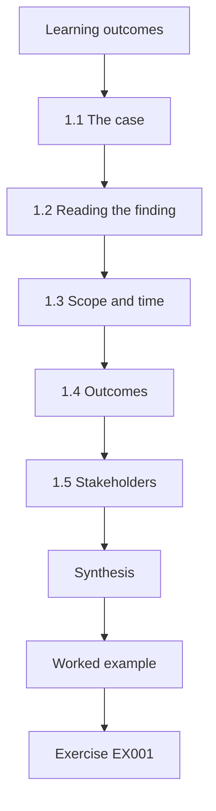

### Logical drawing


```text
[Learning outcomes]
    |
    v
[1.1 The case]
    |
    v
[1.2 Reading the finding]
    |
    v
[1.3 Scope and time]
    |
    v
[1.4 Outcomes]
    |
    v
[1.5 Stakeholders]
    |
    v
[Synthesis]
    |
    v
[Worked example] --> [Exercise EX001]
```
<!-- cyberabc:lesson-figures:end ch-01 -->


### Learning outcomes

You will (1) interpret an audit finding about endpoint hardening; (2) scope a six-month programme; (3) set measurable outcomes.

### 1.1 The case

Seun Bakare is IT manager at the fictional Marlowe Freight, a logistics company with about 150 staff, 120 office laptops, 40 shared warehouse PCs, 18 Linux servers running route planning and the warehouse system, and 12 Windows servers. Seun is taking the six-month professional programme at the fictional Kingsmere Institute, mentored by Claire Dunmore. The year's external audit found that Marlowe had no documented hardening standard and could not show how many endpoints met one. The cyber insurer's renewal questionnaire asked the same questions, and Seun could only answer "partially".

### 1.2 Reading the finding

An audit finding is not a list of tasks; it is a statement that evidence is missing. Marlowe almost certainly has many good settings in place, but cannot prove it. The programme must therefore produce both improvements and evidence: a written standard, measurement against it, and a record of exceptions. NIST SP 800-53 Rev. 5 control CM-2 (baseline configuration) and CM-6 (configuration settings) describe exactly this expectation. For Seun, this reframing changes the first month's work: instead of rushing to change settings, he first writes down what Marlowe expects and finds out how far devices meet it.

### 1.3 Scope and time

Six months is enough to write a standard, measure every device group, close the highest-risk gaps and set up routines, but not to rebuild everything. Seun excludes phones, which are handled by a separate project, and the warehouse handheld scanners, which are vendor-managed, recording both as out of scope with owners. Recording the exclusions with owners stops them looking forgotten. The insurer and auditors can see that phones and scanners are someone's responsibility, even though this programme does not cover them. Claire Dunmore advises Seun to keep the scope fixed unless the operations director agrees a change in writing, because six months leaves no room for drift.

### 1.4 Outcomes

Seun writes four outcomes: a hardening standard approved by the operations director; monthly coverage figures for each device group; the top risk gaps closed or formally accepted; and an exceptions register reviewed quarterly. Each outcome has a measure and a date. Writing outcomes rather than tasks keeps the programme focused on what the auditors and insurer will check at the end. Each outcome also tells Seun what evidence to keep from the start: the approval record, the monthly figures, the gap list with decisions, and the register with review dates. The three checkpoints in the charter are when progress against each outcome is reported to the operations director.

### 1.5 Stakeholders

The operations director owns business risk, the warehouse managers own shared PCs, the infrastructure team owns servers, and the finance director cares about the insurance premium. Seun meets each in the first two weeks to explain the programme and what will change for them. Each stakeholder needs something different from the programme: the operations director wants assurance, warehouse managers worry about delays at shift change, the infrastructure team about maintenance windows, and the finance director about the premium. Seun records each concern and returns to it when a decision affects that group, so nobody first hears of a change on the day it happens.

### Worked example

Seun turns the audit finding into a one-page charter: problem, scope, four outcomes, owners, and a timeline with three checkpoints at months two, four and six.

> **Synthetic case.** Marlowe Freight, Kingsmere Institute and all people and figures are fictional; data are synthetic.

### Errors and limits

Treating an audit finding as a checklist of settings misses the real gap, which is evidence and governance.

### Exercises

- **EX001 — Evidence gap.** Explain why "no documented standard" is a finding even if settings are good. *Rubric:* 3 = missing evidence and governance;; 2 = documentation;; 1 = vague;; 0 = none.
- **EX002 — Control mapping.** Which two SP 800-53 controls match the finding? *Rubric:* 3 = CM-2 and CM-6 explained;; 2 = numbers;; 1 = wrong;; 0 = none.
- **EX003 — Scope decisions.** Why record out-of-scope items with owners? *Rubric:* 3 = prevents assumed coverage;; 2 = clarity;; 1 = vague;; 0 = none.
- **EX004 — Outcome wording.** Rewrite "improve hardening" as a measurable outcome. *Rubric:* 3 = specific measure and date;; 2 = measurable;; 1 = vague;; 0 = none.
- **EX005 — Stakeholder purpose.** Why meet the finance director early? *Rubric:* 3 = insurance and budget interest;; 2 = support;; 1 = vague;; 0 = none.

### Synthesis

A clear charter turns an uncomfortable audit finding into a bounded, measurable programme.

### Continue studying — chapter 01 of 12

[← Course home](../../README.md) · [Course chapter index](../SUBJECTS.md) · [Chapter 02 (draft) →](#ch-02)

<a id="ch-02"></a>

## Chapter 2 — Writing a hardening standard

<!-- cyberabc:lesson-figures:start ch-02 -->
### Lesson map

Lesson 02 published. Map, example, EX006.

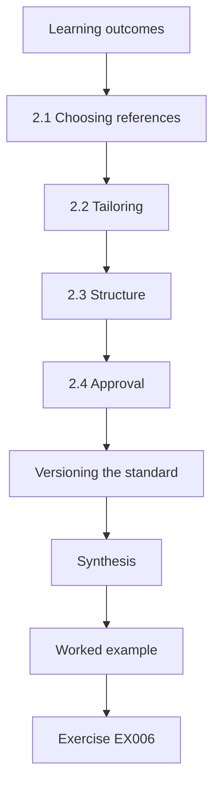

### Logical drawing


```text
[Learning outcomes]
    |
    v
[2.1 Choosing references]
    |
    v
[2.2 Tailoring]
    |
    v
[2.3 Structure]
    |
    v
[2.4 Approval]
    |
    v
[Versioning the standard]
    |
    v
[Synthesis]
    |
    v
[Worked example] --> [Exercise EX006]
```
<!-- cyberabc:lesson-figures:end ch-02 -->


### Learning outcomes

You will (1) choose reference baselines; (2) tailor them; (3) get approval.

### 2.1 Choosing references

Seun bases the standard on the CIS Benchmarks for each operating system, the Microsoft security baselines for Windows and the DISA STIGs as a reference for servers where stricter settings are justified. Using recognised references saves time and gives auditors confidence, because the settings have been reviewed widely. References also speed tailoring discussions: when a team objects to a setting, Seun can show the benchmark's reason before deciding. The standard names the benchmark version used for each operating system, so later reviews know which edition the settings came from and can compare it with newer releases.

### 2.2 Tailoring

Not every benchmark item suits Marlowe. Warehouse PCs are shared by shift workers and must stay signed in to the warehouse system during a shift; a short screen lock would stop work. The standard sets a longer timeout for those PCs, with compensating controls: a kiosk-style restricted desktop and physical placement in supervised areas. Every tailored item records its reason. Tailoring stops staff working around the standard, which is a common way baselines fail in practice. Seun agrees each tailored item with the warehouse managers, and the reason is reviewed when the standard is.

### 2.3 Structure

The standard has a short policy section, then one appendix per device group listing required settings, the reference item and any tailoring. CIS Controls v8 Safeguard 4.1 asks for a documented secure configuration process; the standard includes how settings are changed and reviewed. One appendix per device group lets each team find its own settings without reading the whole standard. The change process says who may propose a change, who reviews it against the references, and who approves it, so the standard can evolve without becoming a list of undocumented exceptions. Every approved change is recorded with its date and reason.

### 2.4 Approval

The operations director approves the standard after a thirty-minute walkthrough. Approval matters because it makes the standard the company's decision, not IT's preference. Seun uses the walkthrough to explain what the standard requires of each device group, which settings were tailored and why, and how compliance will be measured each month. The director's questions focus on the warehouse: whether the longer screen lock is safe and whether shift changes will slow down. The signed approval becomes the first document in the evidence pack, and the standard's next review date is set at the same meeting, a year after approval.

### Versioning the standard

A hardening standard is not written once. CIS Benchmarks are revised, Windows and Linux versions change, and Marlowe's own needs shift. The standard therefore carries a version number and a change history listing what changed, why and who approved it. When a benchmark is updated or a new operating system version arrives, Seun reviews the differences, decides which matter for Marlowe and issues a new version after approval. Devices are measured against the current version, and every monthly report states which version it used. Without this, a fall in compliance could simply mean the standard changed, not that devices got worse.

### Worked example

The laptop appendix lists 42 settings: 38 taken directly from the CIS Benchmark level one, four tailored with reasons, such as allowing a specific USB barcode printer driver.

> **Synthetic case.** The standard is synthetic.

### Errors and limits

Copying a benchmark wholesale without tailoring produces a standard nobody can meet, which becomes a second audit finding.

### Exercises

- **EX006 — Reference choice.** Why base a standard on recognised references? *Rubric:* 3 = reviewed widely, auditor confidence, saves time;; 2 = saves time;; 1 = vague;; 0 = none.
- **EX007 — Tailoring record.** What must each tailored item record? *Rubric:* 3 = reason and compensating control;; 2 = reason;; 1 = vague;; 0 = none.
- **EX008 — Warehouse tailoring.** Describe the warehouse PC screen-lock tailoring and its compensations. *Rubric:* 3 = longer timeout, kiosk desktop, supervised location;; 2 = longer timeout;; 1 = vague;; 0 = none.
- **EX009 — CIS safeguard.** Which CIS safeguard asks for a secure configuration process? *Rubric:* 3 = 4.1;; 2 = Control 4;; 1 = wrong;; 0 = none.
- **EX010 — Approval value.** Why should the operations director approve the standard? *Rubric:* 3 = business ownership;; 2 = authority;; 1 = vague;; 0 = none.

### Synthesis

A tailored, approved standard based on recognised references is the core evidence auditors look for.

### Continue studying — chapter 02 of 12

[← Chapter 01 (draft)](#ch-01) · [Course chapter index](../SUBJECTS.md) · [Chapter 03 (draft) →](#ch-03)

<a id="ch-03"></a>

## Chapter 3 — Measuring coverage

<!-- cyberabc:lesson-figures:start ch-03 -->
### Lesson map

Lesson 03 published. Map, example, EX011.

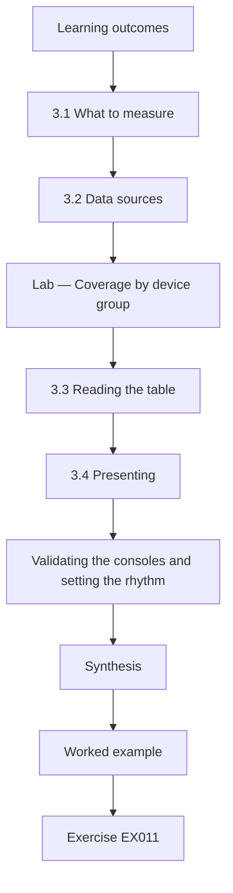

### Logical drawing

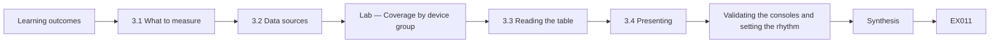

```text
[Learning outcomes]
    |
    v
[3.1 What to measure]
    |
    v
[3.2 Data sources]
    |
    v
[Lab — Coverage by device group]
    |
    v
[3.3 Reading the table]
    |
    v
[3.4 Presenting]
    |
    v
[Validating the consoles and setting the rhythm]
    |
    v
[Synthesis]
    |
    v
[Worked example] --> [Exercise EX011]
```
<!-- cyberabc:lesson-figures:end ch-03 -->


### Learning outcomes

You will (1) measure controls by device group; (2) interpret coverage; (3) find the weakest areas.

### 3.1 What to measure

Seun measures four controls per device group: endpoint detection and response agent reporting, disk encryption, updates within fourteen days and full compliance with the standard. These cover detection, data protection, patching and configuration. Four controls are few enough to measure monthly and explain to non-specialists, yet each corresponds to something an insurer or auditor asks about. Measuring them per device group shows where each control is weakest, rather than giving one company-wide figure. Seun writes down exactly how each control is counted, such as what qualifies as an update installed within fourteen days, so later months use the same definition and figures can be compared over time.

### 3.2 Data sources

Figures come from the endpoint management and detection consoles. Seun first reconciles their device lists with the asset register, so that each percentage has a trustworthy denominator. Reconciling the lists finds devices that exist in the register but not in the consoles, and devices in a console that were retired long ago. Without this step, a missing device simply disappears from the percentage instead of counting as a gap. Seun keeps the reconciled list as the denominator for every monthly figure and repeats the reconciliation each month, so newly bought devices are counted from the start and retired ones are removed with a date.

### Lab — Coverage by device group

```python
"""Control coverage by device group from a synthetic management export (stdlib only)."""
groups = {"office laptops": (120, {"edr": 118, "encrypt": 112, "patch14": 101, "baseline": 84}),
          "warehouse PCs": (40, {"edr": 31, "encrypt": 12, "patch14": 22, "baseline": 15}),
          "Linux servers": (18, {"edr": 14, "encrypt": 18, "patch14": 13, "baseline": 9}),
          "Windows servers": (12, {"edr": 12, "encrypt": 12, "patch14": 10, "baseline": 8})}
for g, (n, c) in groups.items():
    print(f"{g:16} n={n:3d} " + " ".join(f"{k}={v/n*100:3.0f}%" for k, v in c.items()))
weak = min(((g, k, v / n) for g, (n, c) in groups.items() for k, v in c.items()), key=lambda x: x[2])
print(f"weakest cell: {weak[0]} / {weak[1]} at {weak[2]*100:.0f}%")
```

Run with `python3 lab_coverage.py`. Verified output:

```text
office laptops   n=120 edr= 98% encrypt= 93% patch14= 84% baseline= 70%
warehouse PCs    n= 40 edr= 78% encrypt= 30% patch14= 55% baseline= 38%
Linux servers    n= 18 edr= 78% encrypt=100% patch14= 72% baseline= 50%
Windows servers  n= 12 edr=100% encrypt=100% patch14= 83% baseline= 67%
weakest cell: warehouse PCs / encrypt at 30%
```

### 3.3 Reading the table

Office laptops and Windows servers are in reasonable shape. Warehouse PCs are weakest: only 30 percent encrypted and 38 percent compliant. Linux servers have only half meeting the standard and 78 percent with the detection agent. The overall average would hide this; group figures show where effort is needed. The table confirms what the audit suspected but could not show: the problem is concentrated in particular groups rather than spread evenly. That makes the next step clearer, since effort can be targeted. Seun keeps the table as the month-zero baseline in the evidence pack.

### 3.4 Presenting

Seun shows the table to the operations director with a sentence per group. The director immediately asks why warehouse PCs are behind, which leads to the next chapter. Keeping the presentation to one table and a sentence per group makes it readable in a short meeting, and it focuses discussion on decisions rather than detail. Seun also shows how each figure was counted, so the director can trust the comparison between groups. The question about warehouse PCs is exactly the kind of discussion the table is meant to start: why one group lags, what it would take to improve it, and in what order Marlowe should act.

### Validating the consoles and setting the rhythm

Consoles can be wrong. Seun asks the infrastructure team to check five devices from each group by hand against what the console reports. Two Linux servers show as compliant but have a setting changed locally after their last check-in, so the team shortens the reporting interval. He records this validation in the method notes so auditors can see the figures were tested, not just exported. The table is then produced on the first working day of each month, using the same exports and groups. A fixed rhythm makes trends comparable and lets owners plan, because they know when their figures will be seen.

### Worked example

The warehouse encryption cell is the weakest at 30 percent; Seun finds most warehouse PCs are older models bought before encryption was standard.

> **Synthetic case.** Figures are synthetic.

### Errors and limits

Reporting one overall percentage hides weak groups.

### Exercises

- **EX011 — Four controls.** Name the four controls measured. *Rubric:* 3 = all four;; 2 = three;; 1 = fewer;; 0 = none.
- **EX012 — Denominator.** Why reconcile with the asset register first? *Rubric:* 3 = trustworthy denominator;; 2 = accuracy;; 1 = vague;; 0 = none.
- **EX013 — Weakest cell.** What is the weakest cell and its value? *Rubric:* 3 = warehouse encryption 30%;; 2 = warehouse;; 1 = wrong;; 0 = none.
- **EX014 — Averages.** Why avoid a single overall percentage? *Rubric:* 3 = hides weak groups;; 2 = misleading;; 1 = vague;; 0 = none.
- **EX015 — Linux view.** Summarise the Linux server position. *Rubric:* 3 = 50% baseline, 78% EDR, 72% patch;; 2 = some;; 1 = vague;; 0 = none.

### Synthesis

Coverage by group shows where the risk sits.

### Continue studying — chapter 03 of 12

[← Chapter 02 (draft)](#ch-02) · [Course chapter index](../SUBJECTS.md) · [Chapter 04 (draft) →](#ch-04)

<a id="ch-04"></a>

## Chapter 4 — Prioritising gaps

<!-- cyberabc:lesson-figures:start ch-04 -->
### Lesson map

Lesson 04 published. Map, example, EX016.

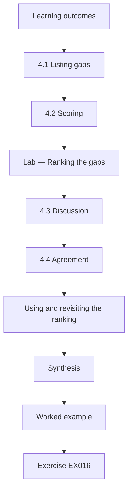

### Logical drawing

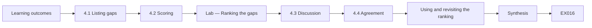

```text
[Learning outcomes]
    |
    v
[4.1 Listing gaps]
    |
    v
[4.2 Scoring]
    |
    v
[Lab — Ranking the gaps]
    |
    v
[4.3 Discussion]
    |
    v
[4.4 Agreement]
    |
    v
[Using and revisiting the ranking]
    |
    v
[Synthesis]
    |
    v
[Worked example] --> [Exercise EX016]
```
<!-- cyberabc:lesson-figures:end ch-04 -->


### Learning outcomes

You will (1) score gaps by risk; (2) consider effort; (3) agree priorities.

### 4.1 Listing gaps

From the coverage table and interviews, Seun lists six gaps: server admin access without MFA, warehouse PCs without the detection agent, Linux servers off the standard, a patching tail on laptops, shared warehouse logons and unencrypted warehouse PCs. The interviews add gaps that a coverage table cannot show, such as shared logons, which only appear when people describe how they work. Seun writes each gap as a short statement with the affected devices and the evidence behind it, so the operations director can see where each one came from before agreeing priorities. The list deliberately stops at six, so that each gap can be discussed properly.

### 4.2 Scoring

He scores each for likelihood and impact from 1 to 5 and multiplies them, breaking ties by effort. This is a simple method, not a precise calculation; its value is in making reasoning visible and discussable. Seun scores each gap with the infrastructure team and a warehouse manager, so the numbers reflect more than his own view. Disagreements are noted beside the score, and where the team cannot agree, the higher score is used until evidence changes it. Effort is estimated in rough days, which helps the director choose between gaps that score similarly. The scored list is filed with the evidence pack, and rescored at each checkpoint.

### Lab — Ranking the gaps

```python
"""Rank hardening gaps by a simple likelihood x impact score (1-5 each), ties by effort (synthetic, stdlib only)."""
gaps = [("warehouse PCs unencrypted", 3, 3, 2), ("warehouse PCs no EDR", 4, 4, 1), ("Linux servers off baseline", 3, 5, 3),
        ("laptops patch tail", 3, 4, 2), ("shared warehouse logons", 4, 3, 2), ("server admin without MFA", 4, 5, 2)]
for name, l, i, e in sorted(gaps, key=lambda g: (-g[1] * g[2], g[3])):
    print(f"{l*i:2d}  effort {e}  {name}")
```

Run with `python3 lab_rank.py`. Verified output:

```text
20  effort 2  server admin without MFA
16  effort 1  warehouse PCs no EDR
15  effort 3  Linux servers off baseline
12  effort 2  laptops patch tail
12  effort 2  shared warehouse logons
 9  effort 2  warehouse PCs unencrypted
```

### 4.3 Discussion

Server admin without MFA ranks highest at 20, since compromised admin credentials would reach every system. The missing detection agent on warehouse PCs is next and is cheap to fix. Unencrypted warehouse PCs rank lowest, because they stay in a secured building and hold little data, so encryption there waits for hardware replacement. The ranking turns the gap list into a work order the director can understand. Keeping encryption last is a deliberate decision with reasons, not a gap left unnoticed, and it is recorded so auditors can see why.

### 4.4 Agreement

The operations director agrees the order, adding that the shared warehouse logons matter for accountability after a stock discrepancy last year. The director's addition shows why business owners should review risk rankings: the scores reflected technical risk, but the stock discrepancy made accountability more urgent than its score suggested. Seun records the director's reasoning beside the ranking and moves shared logons into the month-two work alongside the detection agents. The agreed order becomes the plan, and any later change to it is recorded with the reason and the director's approval.

### Using and revisiting the ranking

The ranking becomes the programme plan. Seun shares it with every owner, so each knows when their group's work happens and why; when a warehouse manager asks why encryption waits, the agreed reasoning answers. The ranking is not fixed. At each checkpoint Seun re-scores the list, because closing one gap changes the others. By month four the warehouse agent gap is closed and the Linux baseline score falls as compliance rises, which moves the laptop patch tail to the top. Re-scoring openly shows leaders that priorities follow evidence rather than whoever complained most recently.

### Worked example

The agreed plan tackles MFA for admins in month two, warehouse agents in month two, Linux baseline in months three and four, and the rest by month six.

> **Synthetic case.** Scores are synthetic.

### Errors and limits

Scores give a false sense of precision if presented without the reasoning.

### Exercises

- **EX016 — Top gap.** Why is admin access without MFA the top gap? *Rubric:* 3 = high likelihood and impact reaching all systems;; 2 = high score;; 1 = vague;; 0 = none.
- **EX017 — Low rank.** Why are unencrypted warehouse PCs ranked low? *Rubric:* 3 = secured building, little data;; 2 = low impact;; 1 = vague;; 0 = none.
- **EX018 — Tie breaking.** How are equal scores ordered? *Rubric:* 3 = lower effort first;; 2 = effort;; 1 = vague;; 0 = none.
- **EX019 — Precision caution.** What caution applies to these scores? *Rubric:* 3 = judgement, not precise, show reasoning;; 2 = approximate;; 1 = vague;; 0 = none.
- **EX020 — Business input.** What did the director add and why? *Rubric:* 3 = shared logons, accountability after discrepancy;; 2 = shared logons;; 1 = vague;; 0 = none.

### Synthesis

Simple, visible scoring helps leaders agree priorities.

### Continue studying — chapter 04 of 12

[← Chapter 03 (draft)](#ch-03) · [Course chapter index](../SUBJECTS.md) · [Chapter 05 (draft) →](#ch-05)

<a id="ch-05"></a>

## Chapter 5 — Privileged access on servers

<!-- cyberabc:lesson-figures:start ch-05 -->
### Lesson map

Lesson 05 published. Map, example, EX021.

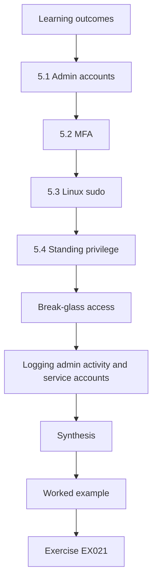

### Logical drawing

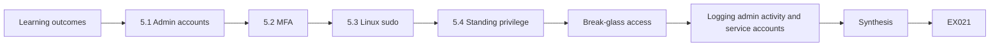

```text
[Learning outcomes]
    |
    v
[5.1 Admin accounts]
    |
    v
[5.2 MFA]
    |
    v
[5.3 Linux sudo]
    |
    v
[5.4 Standing privilege]
    |
    v
[Break-glass access]
    |
    v
[Logging admin activity and service accounts]
    |
    v
[Synthesis]
    |
    v
[Worked example] --> [Exercise EX021]
```
<!-- cyberabc:lesson-figures:end ch-05 -->


### Learning outcomes

You will (1) require MFA for admin access; (2) separate admin accounts; (3) limit standing privilege.

### 5.1 Admin accounts

Server administrators use separate named admin accounts, never their everyday accounts. Seun removes three generic admin accounts used by several people, replacing them with named ones. Generic accounts make it impossible to know who made a change, and their passwords are often shared and rarely changed. Named admin accounts give each administrator their own credentials and their own record in the logs. Seun works with the infrastructure team to find what each generic account was used for before disabling it, so no scheduled job or service breaks. The three accounts are disabled first, then deleted after a month without problems.

### 5.2 MFA

Admin sign-in to servers goes through a jump host that requires MFA. Direct remote access to servers from laptops is blocked by firewall rules, so all admin paths pass through the controlled point. A single jump host gives Marlowe one place to apply MFA, record sessions and review access, instead of trying to protect each server's remote access separately. Blocking direct paths matters as much as adding MFA, because an unblocked route would let an attacker bypass the jump host. Seun tests the firewall rules from an ordinary laptop to confirm that direct connections fail. The jump host itself follows the standard's server appendix.

### 5.3 Linux sudo

On Linux, admins sign in with SSH keys to their own accounts and use sudo, with logging. Root sign-in over SSH is disabled, following the CIS Benchmark. Individual accounts and sudo logging mean every privileged command can be traced to a named administrator, which shared root access cannot provide. SSH keys replace passwords for sign-in, and keys belonging to staff who leave are removed as part of leaving. The infrastructure team applies these settings through the Linux appendix of the standard, so they are measured with the rest of the baseline each month.

### 5.4 Standing privilege

Some admin rights are only needed occasionally. Seun introduces time-limited elevation for domain admin rights, granted for a few hours with approval. Domain admin rights are powerful enough to change any account or device, so holding them permanently increases risk if an admin account is compromised. With time-limited elevation, an administrator asks for the rights, a second person approves, and the rights expire after a few hours. Each grant is logged with the reason. Seun reviews the grants monthly to check that they match real tasks, and the record goes into the evidence pack.

### Break-glass access

If the jump host or MFA service fails during an emergency, admins still need a way in. Seun creates two break-glass accounts with long random passwords stored in a sealed envelope in the safe and in the password manager's emergency vault. Using one triggers an alert to the operations director, and the password is changed afterwards.

The accounts are tested twice a year so they work when needed.

After each test, the passwords are changed and the envelope resealed, and the test is noted in the change log.

### Logging admin activity and service accounts

All admin sessions through the jump host are logged with the user, time and target server, and the logs go to the central log service. A monthly review, following the log management approach in NIST SP 800-92, looks for unexpected targets or unusual hours. Service accounts used by applications get the same scrutiny as people: each has a named owner, the least rights its application needs and a long random password stored in the vault. Seun finds that the backup service account is a domain administrator; the infrastructure team reduces it to the backup operator rights it actually requires.

### Worked example

After two months, all server admin sessions pass through the MFA jump host, and the three generic accounts are disabled.

> **Synthetic case.** Events are synthetic.

### Errors and limits

Blocking direct admin access before the jump host works would stop urgent fixes.

### Exercises

- **EX021 — Generic accounts.** Why replace generic admin accounts? *Rubric:* 3 = accountability and revocation;; 2 = accountability;; 1 = vague;; 0 = none.
- **EX022 — Jump host.** What does the jump host achieve? *Rubric:* 3 = single controlled MFA path;; 2 = MFA;; 1 = vague;; 0 = none.
- **EX023 — Root login.** Why disable root SSH sign-in? *Rubric:* 3 = forces named accounts and sudo logging;; 2 = security;; 1 = vague;; 0 = none.
- **EX024 — Time-limited rights.** Explain time-limited elevation. *Rubric:* 3 = granted temporarily with approval;; 2 = temporary;; 1 = vague;; 0 = none.
- **EX025 — Order of change.** Why build the jump host before blocking direct access? *Rubric:* 3 = avoid locking out admins;; 2 = order;; 1 = vague;; 0 = none.

### Synthesis

Named accounts, MFA and limited standing privilege protect the most powerful access.

### Continue studying — chapter 05 of 12

[← Chapter 04 (draft)](#ch-04) · [Course chapter index](../SUBJECTS.md) · [Chapter 06 (draft) →](#ch-06)

<a id="ch-06"></a>

## Chapter 6 — Warehouse PCs

<!-- cyberabc:lesson-figures:start ch-06 -->
### Lesson map

Lesson 06 published. Map, example, EX026.

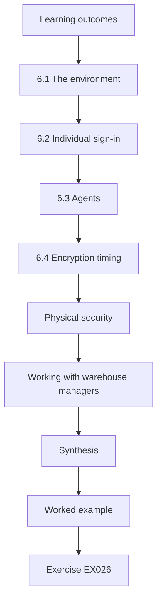

### Logical drawing

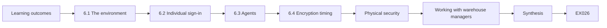

```text
[Learning outcomes]
    |
    v
[6.1 The environment]
    |
    v
[6.2 Individual sign-in]
    |
    v
[6.3 Agents]
    |
    v
[6.4 Encryption timing]
    |
    v
[Physical security]
    |
    v
[Working with warehouse managers]
    |
    v
[Synthesis]
    |
    v
[Worked example] --> [Exercise EX026]
```
<!-- cyberabc:lesson-figures:end ch-06 -->


### Learning outcomes

You will (1) harden shared PCs; (2) replace shared logons; (3) deploy agents.

### 6.1 The environment

Warehouse PCs run the warehouse system, label printing and a browser. They are used by shift workers who share logons, which makes it impossible to tell who did what. Shared logons also mean that any action, from a label printed in error to a stock adjustment, cannot be traced to a person. The PCs sit on warehouse floors and are used around the clock across shifts, so any change must not slow workers or interrupt the warehouse system. Seun spends a shift observing how they are used before proposing anything, and the warehouse managers agree the plan with him.

### 6.2 Individual sign-in

Seun introduces badge-based quick sign-in so each worker uses their own account without slowing shift changes. The restricted desktop shows only the needed apps. Quick sign-in means each action in the warehouse system is linked to a named worker, which answers the director's concern about accountability. Badges are already issued for building access, so workers do not carry anything new. The restricted desktop reduces what can go wrong on a shared PC. Seun pilots the change on one shift first and adjusts the sign-in time after workers report delays at shift change.

### 6.3 Agents

The detection agent is deployed to the nine warehouse PCs missing it. Two are too old to run it and are scheduled for replacement. Before deployment, nine of the forty warehouse PCs did not report the agent. After deployment, only the two old models remain without it, and they are listed in the exceptions register until replacement, with their isolation recorded. Seun checks that newly deployed agents actually report to the console, rather than relying on the installation result. The warehouse managers are told which PCs are being replaced and when.

### 6.4 Encryption timing

Encryption is applied as PCs are replaced, matching the risk ranking. Since unencrypted warehouse PCs ranked lowest, Seun does not encrypt the existing older machines, many of which lack the hardware support needed. Instead, replacement PCs are bought with encryption-capable hardware and encrypted before they reach the warehouse floor. The warehouse encryption figure therefore rises gradually as PCs are replaced. Seun reports it monthly with the replacement schedule, so the director can see when the group will be fully encrypted. The decision is recorded in the evidence pack with the risk ranking that supports it.

### Physical security

Warehouse PCs are in busy areas. Their USB ports are restricted to approved barcode printers and scanners, and the cases are locked so drives cannot be removed easily. The firmware has an admin password so boot settings cannot be changed.

These physical controls support the decision to delay encryption: an unencrypted drive is less of a risk when it cannot easily be removed or read from another system.

Seun records these controls in the exception entry for warehouse encryption, so the reasoning for the delay is visible to auditors.

### Working with warehouse managers

Seun runs the badge sign-in pilot on one shift with a warehouse manager present. Workers find it faster than typing the old shared password, and the manager becomes the change's champion for the other shifts, which matters more than any instruction from IT. Afterwards, warehouse system actions show individual names, which the operations director confirms is what was needed after last year's stock discrepancy. The two PCs too old for the detection agent are replaced in month three with models that support both the agent and encryption, closing their exceptions and adding them to the encrypted count.

### Worked example

Within a month, all warehouse PCs except the two old ones report the agent, and shared logons are retired.

> **Synthetic case.** Figures are synthetic.

### Errors and limits

Individual sign-in that slows shift changes will be resisted; speed matters.

### Exercises

- **EX026 — Shared logon problem.** What problem do shared logons create? *Rubric:* 3 = no accountability;; 2 = tracing;; 1 = vague;; 0 = none.
- **EX027 — Badge sign-in.** Why badge-based sign-in? *Rubric:* 3 = fast individual access;; 2 = speed;; 1 = vague;; 0 = none.
- **EX028 — Old PCs.** How are PCs too old for the agent handled? *Rubric:* 3 = exception and replacement;; 2 = replaced;; 1 = vague;; 0 = none.
- **EX029 — Restricted desktop.** What does the restricted desktop limit? *Rubric:* 3 = apps available;; 2 = access;; 1 = vague;; 0 = none.
- **EX030 — Encryption plan.** Why encrypt warehouse PCs on replacement? *Rubric:* 3 = low risk, hardware age;; 2 = later;; 1 = vague;; 0 = none.

### Synthesis

Shared PCs can be accountable and protected without slowing work.

### Continue studying — chapter 06 of 12

[← Chapter 05 (draft)](#ch-05) · [Course chapter index](../SUBJECTS.md) · [Chapter 07 (draft) →](#ch-07)

<a id="ch-07"></a>

## Chapter 7 — Linux server baseline

<!-- cyberabc:lesson-figures:start ch-07 -->
### Lesson map

Lesson 07 published. Map, example, EX031.

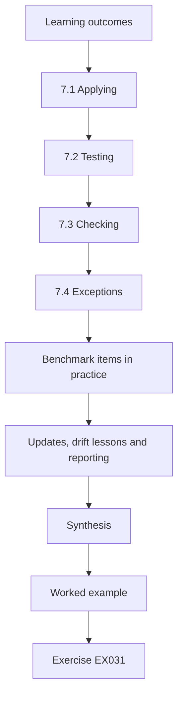

### Logical drawing

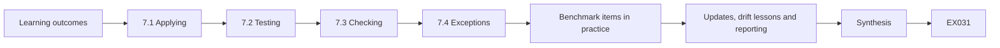

```text
[Learning outcomes]
    |
    v
[7.1 Applying]
    |
    v
[7.2 Testing]
    |
    v
[7.3 Checking]
    |
    v
[7.4 Exceptions]
    |
    v
[Benchmark items in practice]
    |
    v
[Updates, drift lessons and reporting]
    |
    v
[Synthesis]
    |
    v
[Worked example] --> [Exercise EX031]
```
<!-- cyberabc:lesson-figures:end ch-07 -->


### Learning outcomes

You will (1) apply the CIS Benchmark to Linux servers; (2) automate checks; (3) handle exceptions.

### 7.1 Applying

The infrastructure team applies the Linux appendix of the standard using its configuration management tool, so settings are defined in code and applied consistently. Defining settings in code means every Linux server receives the same configuration, and changes can be reviewed before they are applied. It also makes the standard easier to show to auditors, since the code can be compared directly with the appendix. When the standard changes, the infrastructure team updates the code and records the change. Settings that cannot be applied on a server because of the warehouse system become documented exceptions rather than quiet omissions.

### 7.2 Testing

Changes go first to a test copy of the route planning server, then to production in a maintenance window. The route planning server is chosen because it is business-critical: if a setting breaks it, deliveries cannot be planned. Testing on a copy shows whether the application still works with the new settings before production is touched. The infrastructure team runs the planners' usual tasks on the test copy and records any problems. Production changes happen in an agreed maintenance window with a rollback plan. Each change is logged with the date and result, so problems can be traced to a specific change.

### 7.3 Checking

The tool reports drift daily. Seun's monthly figure comes from these reports. Daily drift reports show when a server no longer matches the standard, whether because someone changed a setting by hand or an update reset it. The infrastructure team investigates each drift: a legitimate need becomes a change request, while an unexplained change is corrected and noted. Seun's monthly figure uses the share of servers fully compliant on the last day of the month, defined the same way each time. The reports also go into the evidence pack, so auditors can see compliance held between monthly figures.

### 7.4 Exceptions

The warehouse system's vendor requires an older library on two servers; these are exceptions with isolation and review dates. The vendor confirms in writing that its software needs the older library, and gives a target date for a version that does not. The two servers sit on a restricted network segment that allows only the connections the warehouse system needs. Each exception has a named owner, a review date and a link to the vendor's letter in the register. They account for the remaining gap in the Linux compliance figure, which is reported with that explanation.

### Benchmark items in practice

The Linux appendix includes items such as disabling unused filesystems, setting permissions on sensitive files, configuring time synchronisation, enabling the audit daemon, restricting SSH settings and setting password rules for local accounts. Each comes from the CIS Benchmark for the distribution, with three tailored items for the route planning software.

The team rolls items out in batches of ten, so that any problem can be traced to a small set of changes.

Each batch is recorded with its date and the compliance figure before and after.

### Updates, drift lessons and reporting

The Linux baseline requires security updates through the package manager within the patch targets, with kernel updates followed by a scheduled reboot; live patching is considered but not adopted this year, since monthly reboots fit the maintenance window. Daily drift reports show that most drift comes from emergency fixes made directly on servers, so the team agrees to back-port such fixes into the configuration code within one working day. The Linux figure in Seun's monthly table comes straight from the tool's compliance report, with exceptions listed beneath it, so the number and its caveats always travel together.

### Worked example

Linux compliance rises from 50 to 89 percent; the two exceptions account for the remainder.

> **Synthetic case.** Figures are synthetic.

### Errors and limits

Manual changes outside the tool are overwritten, so everyone must use it.

### Exercises

- **EX031 — Code benefits.** Why define settings in configuration code? *Rubric:* 3 = consistent, repeatable, reviewable;; 2 = consistent;; 1 = vague;; 0 = none.
- **EX032 — Test copy.** Why test on a copy first? *Rubric:* 3 = avoid outages;; 2 = safety;; 1 = vague;; 0 = none.
- **EX033 — Result.** State the Linux compliance change. *Rubric:* 3 = 50 to 89;; 2 = one;; 1 = vague;; 0 = none.
- **EX034 — Vendor exception.** How is the vendor library exception handled? *Rubric:* 3 = isolation, review date;; 2 = recorded;; 1 = vague;; 0 = none.
- **EX035 — Manual changes.** What happens to manual changes? *Rubric:* 3 = overwritten;; 2 = lost;; 1 = vague;; 0 = none.

### Synthesis

Defining baselines in code keeps servers consistent and measurable.

### Continue studying — chapter 07 of 12

[← Chapter 06 (draft)](#ch-06) · [Course chapter index](../SUBJECTS.md) · [Chapter 08 (draft) →](#ch-08)

<a id="ch-08"></a>

## Chapter 8 — Patching programme

<!-- cyberabc:lesson-figures:start ch-08 -->
### Lesson map

Lesson 08 published. Map, example, EX036.

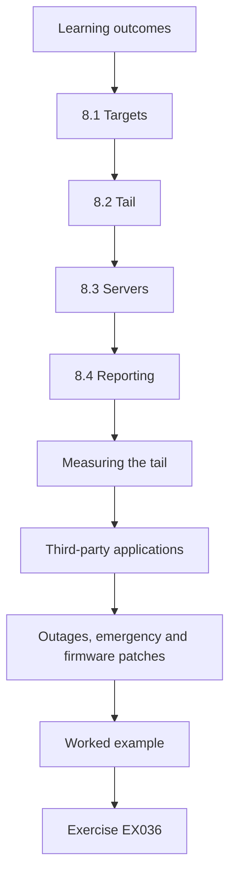

### Logical drawing

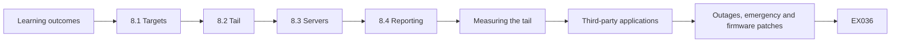

```text
[Learning outcomes]
    |
    v
[8.1 Targets]
    |
    v
[8.2 Tail]
    |
    v
[8.3 Servers]
    |
    v
[8.4 Reporting]
    |
    v
[Measuring the tail]
    |
    v
[Third-party applications]
    |
    v
[Outages, emergency and firmware patches]
    |
    v
[Worked example] --> [Exercise EX036]
```
<!-- cyberabc:lesson-figures:end ch-08 -->


### Learning outcomes

You will (1) set patch targets; (2) reduce the tail; (3) report.

### 8.1 Targets

Fourteen days for laptops and servers, seven for actively exploited flaws, following SP 800-40 Rev. 4 risk-based guidance and the CISA Known Exploited Vulnerabilities catalogue. Separate targets reflect that not all flaws carry the same urgency: a flaw already exploited in the wild needs action sooner than one that is only theoretical. The Known Exploited Vulnerabilities catalogue gives Marlowe a public, regularly updated list to check against. Seun agrees the targets with the infrastructure team and the operations director, and writes them into the standard so that they are measured monthly with the other controls and reported per device group.

### 8.2 Tail

Laptops in the tail are mostly field staff rarely online; cloud-based update management fixes this. Field staff laptops spend weeks away from the office network, so updates that depend on it reach them late. Cloud-based update management lets laptops receive updates over any internet connection. Seun checks the tail each month to confirm that the change works and to find machines that remain behind for other reasons, such as low disk space or a failed restart. Laptops still in the tail after two months are raised with the user's manager, since field staff may need to connect deliberately to receive updates.

### 8.3 Servers

Server patching moves to a monthly window agreed with operations. A fixed monthly window lets operations plan around server restarts, rather than being surprised by them. The window falls at the quietest time of the week for deliveries, as agreed with the operations director. Urgent fixes for actively exploited flaws can still be applied outside the window, following the seven-day target, with operations told in advance. The infrastructure team tests updates on the route planning server's copy before the window and records the results. Each month's window, including any failed updates, is logged for the evidence pack.

### 8.4 Reporting

Monthly percentages per group and the oldest outstanding patch. Percentages per group show typical performance, while the oldest outstanding patch shows the worst case, which an average can hide. Seun reports both to the operations director each month with a one-line explanation of any change. The figures use the reconciled device list as the denominator, so a device that stops reporting counts as a gap rather than disappearing. A short note lists which machines hold the oldest patches and what is being done about them. The same monthly report goes into the evidence pack, so the insurer can see patching performance over the whole programme.

### Measuring the tail

Seun reports not just the percentage within target but the list of devices outside it, sorted by days overdue. The tail matters more than the average, because one long-unpatched server can undo everything else. Each device in the tail has an owner and a reason.

In month one, the tail includes eleven laptops over thirty days, mostly belonging to drivers' supervisors who rarely connect to the office network. Cloud update management closes most of these within a month.

The tail list is shared with owners each month.

### Third-party applications

Operating system patches are only part of the work. Browsers, PDF readers and the route planning client also need updates. The endpoint management tool's application catalogue now updates these automatically on laptops, and the infrastructure team adds application versions to the server baseline.

A monthly report shows versions of the five most common applications, and any version more than one release behind is followed up.

Applications without automatic updating are flagged as candidates for replacement.

Their owners are asked to find an alternative within a year.

### Outages, emergency and firmware patches

Server patching windows are announced a week ahead to operations staff, with a short message on what will be unavailable and for how long, so planners can route around them. For flaws listed in the CISA Known Exploited Vulnerabilities catalogue, the team patches within seven days using an emergency change process that still records what was done. Firmware is part of patching too: laptop and server firmware updates follow the same targets where vendors deliver them through managed channels, and firmware versions appear in the monthly report, because flaws below the operating system are easy to forget and hard to detect.

### Worked example

Laptop patching within 14 days rises from 84 to 95 percent.

> **Synthetic case.** Figures are synthetic.

### Errors and limits

Targets without exception handling force unsafe rushed changes.

### Exercises

- **EX036 — Exploited flaws.** Why a shorter target for exploited flaws? *Rubric:* 3 = active risk;; 2 = urgency;; 1 = vague;; 0 = none.
- **EX037 — KEV.** What is the KEV catalogue used for? *Rubric:* 3 = identifying exploited flaws;; 2 = list;; 1 = vague;; 0 = none.
- **EX038 — Field laptops.** How was the field laptop tail fixed? *Rubric:* 3 = cloud update management;; 2 = updates;; 1 = vague;; 0 = none.
- **EX039 — Report fields.** Name two report figures. *Rubric:* 3 = percent and oldest;; 2 = one;; 1 = vague;; 0 = none.
- **EX040 — Result.** State the laptop change. *Rubric:* 3 = 84 to 95;; 2 = one;; 1 = vague;; 0 = none.

### Synthesis

Risk-based targets and attention to the tail improve patching.

### Continue studying — chapter 08 of 12

[← Chapter 07 (draft)](#ch-07) · [Course chapter index](../SUBJECTS.md) · [Chapter 09 (draft) →](#ch-09)

<a id="ch-09"></a>

## Chapter 9 — Exceptions and risk acceptance

<!-- cyberabc:lesson-figures:start ch-09 -->
### Lesson map

Lesson 09 published. Map, example, EX041.

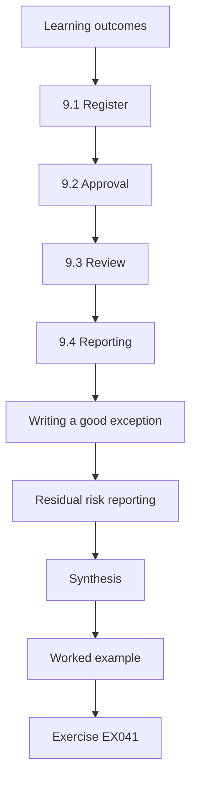

### Logical drawing


```text
[Learning outcomes]
    |
    v
[9.1 Register]
    |
    v
[9.2 Approval]
    |
    v
[9.3 Review]
    |
    v
[9.4 Reporting]
    |
    v
[Writing a good exception]
    |
    v
[Residual risk reporting]
    |
    v
[Synthesis]
    |
    v
[Worked example] --> [Exercise EX041]
```
<!-- cyberabc:lesson-figures:end ch-09 -->


### Learning outcomes

You will (1) run an exceptions register; (2) review quarterly; (3) report residual risk.

### 9.1 Register

Each exception records device, setting, reason, compensating control, owner and expiry. Recording all six fields turns an exception into a decision that can be checked later. The reason explains why the standard cannot be met, the compensating control shows how risk is reduced meanwhile, and the expiry date forces a fresh decision. At Marlowe, the first entries are the two Linux servers with the older library and the two old warehouse PCs without the detection agent. By month six the register holds twelve exceptions, all in date.

### 9.2 Approval

Business owners approve; IT advises. IT can explain the risk and the options, but the decision to accept a risk belongs to the people who own the business process, such as a warehouse manager for warehouse PCs or the operations director for servers. Seun's approval form asks the owner to confirm they understand the reason, the controls and the expiry date. Each approval is signed and dated, and it is filed in the register beside the exception. IT records its advice on the form, so a later reader sees both views.

### 9.3 Review

Quarterly reviews renew, close or escalate. At each review, every exception is checked against its expiry date and its reason. An exception is renewed if the reason still holds and the controls are still in place, closed if the device now meets the standard or has been replaced, and escalated to the operations director if the risk has grown or the controls have lapsed. Seun records each decision with the date and the approver, so the register shows its own history.

### 9.4 Reporting

The register summary goes to the operations director. The summary shows the number of exceptions, how many are in date, which expire before the next review and which have been escalated. This lets the director see whether exceptions are being cleared or are accumulating. Seun includes a sentence on any exception that needs a decision, such as funding a replacement for an old warehouse PC. The summary is part of the evidence pack and is presented with the monthly coverage figures.

### Writing a good exception

A good exception explains why the standard cannot be met, what risk remains, how it is reduced and when the situation will change. For the two Linux servers needing an older library, the entry explains the vendor dependency, isolates the servers in their own network segment with only required connections, and sets an expiry linked to the vendor's next release.

Vague entries such as "business need" are sent back for detail.

Seun keeps two good examples in the register's guidance so that owners can see what a complete entry looks like.

### Residual risk reporting

Each quarter, Seun summarises exceptions by group and risk score for the operations director: how many exist, how many are overdue and which carry the highest residual risk. This puts all accepted risk in one place, so the director can decide whether to fund faster fixes. Over six months the number of exceptions falls as hardware is replaced and vendors release updates. Exceptions are also reviewed whenever the standard changes, because a new version may resolve an exception, for example by relaxing a setting, or create new ones by adding a requirement some devices cannot yet meet.

### Example entries

By month six the register includes the two Linux servers, three old warehouse PCs, one laptop running specialist mapping software that needs an older driver, and six servers awaiting vendor updates. Each has an owner, a compensating control and an expiry date within the next year.

Two earlier exceptions were closed when the vendor released fixes, showing that the register shrinks when actively managed.

The register is small enough to review in half an hour, which keeps the quarterly review realistic for busy owners.

### Worked example

Twelve exceptions at month six, all in date.

> **Synthetic case.** Figures are synthetic.

### Errors and limits

Exceptions without expiry become permanent.

### Exercises

- **EX041 — Fields.** List six register fields. *Rubric:* 3 = six;; 2 = five;; 1 = fewer;; 0 = none.
- **EX042 — Approver.** Who approves exceptions? *Rubric:* 3 = business owner;; 2 = manager;; 1 = IT;; 0 = none.
- **EX043 — Review outcomes.** Name three review outcomes. *Rubric:* 3 = renew, close, escalate;; 2 = two;; 1 = one;; 0 = none.
- **EX044 — Expiry.** Why must exceptions expire? *Rubric:* 3 = prevent permanence;; 2 = review;; 1 = vague;; 0 = none.
- **EX045 — Month six.** How many exceptions at month six? *Rubric:* 3 = twelve in date;; 2 = twelve;; 1 = vague;; 0 = none.

### Synthesis

A governed register makes residual risk visible.

### Continue studying — chapter 09 of 12

[← Chapter 08 (draft)](#ch-08) · [Course chapter index](../SUBJECTS.md) · [Chapter 10 (draft) →](#ch-10)

<a id="ch-10"></a>

## Chapter 10 — Evidence for auditors and insurers

<!-- cyberabc:lesson-figures:start ch-10 -->
### Lesson map

Lesson 10 published. Map, example, EX046.

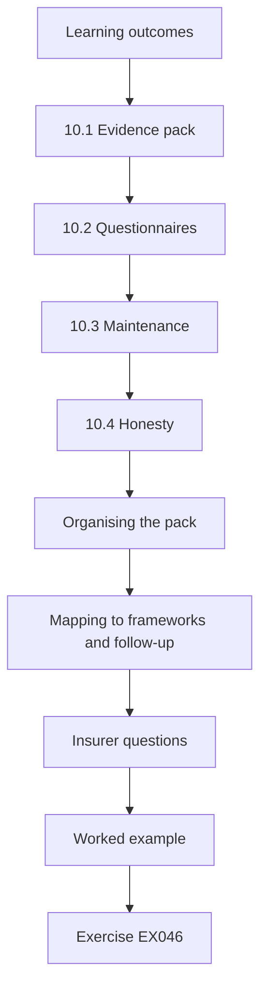

### Logical drawing

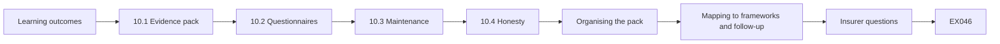

```text
[Learning outcomes]
    |
    v
[10.1 Evidence pack]
    |
    v
[10.2 Questionnaires]
    |
    v
[10.3 Maintenance]
    |
    v
[10.4 Honesty]
    |
    v
[Organising the pack]
    |
    v
[Mapping to frameworks and follow-up]
    |
    v
[Insurer questions]
    |
    v
[Worked example] --> [Exercise EX046]
```
<!-- cyberabc:lesson-figures:end ch-10 -->


### Learning outcomes

You will (1) assemble evidence; (2) answer questionnaires; (3) maintain an evidence pack.

### 10.1 Evidence pack

Standard, approvals, monthly coverage reports, exceptions register and change records. Together these documents show what Marlowe expects of its devices, who approved it, how far devices meet it each month, and which gaps are knowingly accepted. Seun organises the pack by outcome from the charter, so auditors can find evidence for each one. Each document carries its date and version. The pack is stored where the operations director and the infrastructure team can both reach it, and access is limited to people who need it.

### 10.2 Questionnaires

Insurance answers cite the pack. When the insurer's questionnaire asks whether disk encryption or MFA is in place, Seun answers with the current figure and points to the document in the pack that supports it, rather than a simple yes. Where the answer is partial, such as warehouse encryption, he states the figure and the replacement plan. The finance director reviews the answers before they are sent, and a copy of the submitted questionnaire is kept in the pack. Answers from one questionnaire are reused for the next only after the coverage figures are refreshed, so the insurer never sees an out-of-date percentage.

### 10.3 Maintenance

Monthly updates keep it current. Each month Seun adds the new coverage report, any new or closed exceptions and any changes to the standard, with dates. A short checklist names the documents to update and who provides each one: the infrastructure team for servers, the warehouse managers for shared PCs and the endpoint team for laptops. Keeping the pack current means it is ready for an auditor or insurer at any time, not only when a request arrives. Seun checks the pack against this list at month end.

### 10.4 Honesty

Gaps are disclosed with plans. Disclosing gaps, such as the unencrypted warehouse PCs and the two Linux exceptions, builds more trust with auditors and insurers than claiming full compliance that later proves untrue. Each disclosed gap is paired with its reason, compensating controls and a date for resolution. Seun's mentor Claire points out that an insurer who discovers an undisclosed gap after a claim may dispute the claim, so honest disclosure also protects Marlowe financially. Each disclosure is reviewed when the figures change, so dates stay accurate.

### Organising the pack

The evidence pack is a shared folder with a simple index: one section per outcome, with the document, its date and who approved it. Monthly coverage reports are added automatically by a scheduled export. When an auditor asks a question, Seun can point to a specific file rather than writing a new explanation.

Access to the pack is limited, since it shows where weaknesses are.

The pack's owner is named, and a deputy can update it during holidays, so monthly reports keep arriving even when Seun is away.

### Mapping to frameworks and follow-up

The pack's index maps each item to CIS Controls v8 safeguards and NIST SP 800-53 Rev. 5 controls, such as CM-2, CM-6, SI-2 for flaw remediation and AC-6 for least privilege, so auditors using either framework find what they need, and insurer questions, which follow similar themes, are easier to answer. Evidence is kept for at least three years to match the audit cycle, with older monthly reports archived rather than deleted. At the follow-up audit the finding is closed, and the auditor notes the clear link between standard, measurement and exceptions as good practice.

### Insurer questions

Typical insurer questions ask whether MFA protects admin and remote access, whether backups are tested, whether endpoints run detection software and how quickly critical patches are applied. Seun answers each with a figure from the latest monthly report and a reference to the pack.

Where an answer is partial, such as encryption on warehouse PCs, he says so and attaches the replacement plan.

He keeps a copy of each submitted questionnaire in the pack, so next year's answers can be compared with this year's.

### Worked example

The insurer accepts the pack and the premium increase is smaller than feared.

> **Synthetic case.** Figures are synthetic.

### Errors and limits

Overstated answers can void cover.

### Exercises

- **EX046 — Pack contents.** List five pack items. *Rubric:* 3 = five;; 2 = four;; 1 = fewer;; 0 = none.
- **EX047 — Overstating.** Why avoid overstating answers? *Rubric:* 3 = void cover;; 2 = trust;; 1 = vague;; 0 = none.
- **EX048 — Gap disclosure.** How should gaps be presented? *Rubric:* 3 = with plans;; 2 = listed;; 1 = hidden;; 0 = none.
- **EX049 — Maintenance.** How often update the pack? *Rubric:* 3 = monthly;; 2 = regularly;; 1 = never;; 0 = none.
- **EX050 — Outcome.** What was the insurance outcome? *Rubric:* 3 = smaller increase;; 2 = accepted;; 1 = vague;; 0 = none.

### Synthesis

A maintained evidence pack answers audits and insurers efficiently.

### Continue studying — chapter 10 of 12

[← Chapter 09 (draft)](#ch-09) · [Course chapter index](../SUBJECTS.md) · [Chapter 11 (draft) →](#ch-11)

<a id="ch-11"></a>

## Chapter 11 — Results and sustainment

<!-- cyberabc:lesson-figures:start ch-11 -->
### Lesson map

Lesson 11 published. Map, example, EX051.

```mermaid
flowchart TD
  N0["Learning outcomes"]
  N1["11.1 Results"]
  N2["11.2 Routines"]
  N3["11.3 Ownership"]
  N4["Comparing fairly"]
  N5["Cost, effort and owner feedback"]
  N6["Handover of routines"]
  N7["Remaining gaps"]
  N0 --> N1 --> N2 --> N3 --> N4 --> N5 --> N6 --> N7
  N7 --> EX["Worked example"]
  EX --> Q["Exercise EX051"]
```

### Logical drawing

```mermaid
flowchart LR
  N0["Learning outcomes"]
  N1["11.1 Results"]
  N2["11.2 Routines"]
  N3["11.3 Ownership"]
  N4["Comparing fairly"]
  N5["Cost, effort and owner feedback"]
  N6["Handover of routines"]
  N7["Remaining gaps"]
  N0 --> N1 --> N2 --> N3 --> N4 --> N5 --> N6 --> N7 --> Q["EX051"]
```

```text
[Learning outcomes]
    |
    v
[11.1 Results]
    |
    v
[11.2 Routines]
    |
    v
[11.3 Ownership]
    |
    v
[Comparing fairly]
    |
    v
[Cost, effort and owner feedback]
    |
    v
[Handover of routines]
    |
    v
[Remaining gaps]
    |
    v
[Worked example] --> [Exercise EX051]
```
<!-- cyberabc:lesson-figures:end ch-11 -->


### Learning outcomes

You will (1) compare start and end; (2) set routines; (3) assign ownership.

### 11.1 Results

Laptop compliance 70 to 91 percent, Linux 50 to 89, warehouse agents 78 to 95, admin MFA 0 to 100. Seun reports each result against the month-zero baseline from the coverage table, using the same counting rules as the first month. The Linux figure falls short of full compliance because of the two documented exceptions, and the warehouse agent figure falls short because of the two old PCs awaiting replacement. He presents the monthly figures beside the actions taken, so the operations director can see when each change began to show.

### 11.2 Routines

Monthly coverage, quarterly exceptions, yearly standard review. These routines are what keep the programme going after the six months end. Each month, the coverage figures are produced from the consoles and reviewed with the operations director. Each quarter, the exceptions register is reviewed with business owners. Each year, the standard itself is reviewed against new benchmark releases and Marlowe's changing needs. Seun writes each routine down with its owner, inputs and outputs, so it does not depend on his memory. The written routines go into the evidence pack, so an auditor can see how Marlowe keeps the standard current after the programme ends.

### 11.3 Ownership

Each group has a named owner. The infrastructure team owns servers, warehouse managers own the shared PCs, and the endpoint team owns laptops. Each owner receives their group's monthly figures and is responsible for explaining changes and acting on gaps. The operations director remains the owner of the overall risk and approves the standard. Naming owners means the programme does not stop if Seun is away or changes role, and the owners attend the quarterly exceptions review. The owners' names are recorded in the standard itself, so a change of owner needs the same approval as a change of setting.

### 11.4 Limits

One company, six months. Results from one logistics company over six months may not hold for organisations with different devices, staff or suppliers. Six months is also too short to show whether compliance holds once the programme's attention moves elsewhere. The figures come from Marlowe's own consoles, reconciled against the asset register but not independently verified. Seun states these limits in his final report, so readers judge which parts of the approach suit their own organisations rather than copying the figures as targets.

### Comparing fairly

Seun uses the same consoles, groups and definitions at month six as in month one, and repeats the hand validation. He notes changes to the asset count, such as six new laptops, and explains that percentages use the current totals.

He is cautious about attribution: several changes happened together, so he links each result to the most direct action without claiming precise effects.

Where a figure changed because the group changed size rather than because devices improved, he explains it in a footnote so the comparison stays honest.

### Cost, effort and owner feedback

The programme used about forty days of staff time across IT and infrastructure, plus the cost of replacing eight warehouse PCs that was already planned. Seun reports this so leaders can judge value, and notes that the routines now need about two days a month. He also asks owners how the programme affected them. They report that monthly figures helped them plan work and justify replacement budgets, which suggests that measurement has become useful to them rather than a burden imposed by IT. This feedback is the best evidence that the routines will continue after the programme ends.

### Handover of routines

Routines are assigned in the IT team's calendar with named people and backups. The monthly report is generated automatically, and the infrastructure lead presents it at the operations meeting.

Seun also writes a short guide explaining how to update the standard and run the quarterly exception review, so the work does not depend on him.

Each routine has a one-line purpose at the top, so people understand why it matters and are less tempted to skip it when busy. The first month after handover is run jointly, with Seun watching and the new owners doing the work.

### Remaining gaps

Warehouse encryption remains at 50 percent pending replacements, and phones and scanners are outside scope. Seun lists both in the final report with owners and dates, so the next phase starts from a clear position.

The operations director accepts the remaining risk for now and approves the budget for the next phase.

The remaining gaps are added to the exceptions register, so they are reviewed quarterly like everything else rather than tracked in a separate list that could be forgotten.

### Worked example

The final coverage table is filed with the evidence pack.

> **Synthetic case.** Figures are synthetic.

### Errors and limits

Without routines, coverage drifts back.

### Exercises

- **EX051 — Results.** State two results. *Rubric:* 3 = correct;; 2 = one;; 1 = vague;; 0 = none.
- **EX052 — Routines.** List three routines. *Rubric:* 3 = three;; 2 = two;; 1 = one;; 0 = none.
- **EX053 — Ownership.** Why named owners? *Rubric:* 3 = accountability;; 2 = clarity;; 1 = vague;; 0 = none.
- **EX054 — Limits.** Name one limit. *Rubric:* 3 = specific;; 2 = vague;; 1 = minimal attempt;; 0 = none.
- **EX055 — Drift.** What happens without routines? *Rubric:* 3 = drift;; 2 = decline;; 1 = vague;; 0 = none.

### Synthesis

Measured results and routines sustain the programme.

### Continue studying — chapter 11 of 12

[← Chapter 10 (draft)](#ch-10) · [Course chapter index](../SUBJECTS.md) · [Chapter 12 (draft) →](#ch-12)

<a id="ch-12"></a>

## Chapter 12 — Lessons for practitioners

<!-- cyberabc:lesson-figures:start ch-12 -->
### Lesson map

Lesson 12 published. Map, example, EX056.

```mermaid
flowchart TD
  N0["Learning outcomes"]
  N1["12.1 Lessons"]
  N2["12.2 Next steps"]
  N3["12.3 Sharing"]
  N4["12.4 Career"]
  N5["What surprised Seun"]
  N6["What he would do differently"]
  N7["Applying the pattern and developing further"]
  N0 --> N1 --> N2 --> N3 --> N4 --> N5 --> N6 --> N7
  N7 --> EX["Worked example"]
  EX --> Q["Exercise EX056"]
```

### Logical drawing

```mermaid
flowchart LR
  N0["Learning outcomes"]
  N1["12.1 Lessons"]
  N2["12.2 Next steps"]
  N3["12.3 Sharing"]
  N4["12.4 Career"]
  N5["What surprised Seun"]
  N6["What he would do differently"]
  N7["Applying the pattern and developing further"]
  N0 --> N1 --> N2 --> N3 --> N4 --> N5 --> N6 --> N7 --> Q["EX056"]
```

```text
[Learning outcomes]
    |
    v
[12.1 Lessons]
    |
    v
[12.2 Next steps]
    |
    v
[12.3 Sharing]
    |
    v
[12.4 Career]
    |
    v
[What surprised Seun]
    |
    v
[What he would do differently]
    |
    v
[Applying the pattern and developing further]
    |
    v
[Worked example] --> [Exercise EX056]
```
<!-- cyberabc:lesson-figures:end ch-12 -->


### Learning outcomes

You will (1) reflect; (2) share lessons; (3) plan next steps.

### 12.1 Lessons

Evidence matters as much as settings; tailoring keeps standards workable. Seun's first lesson comes from the audit finding itself: Marlowe probably had many good settings, but it could not prove it, so producing evidence was half the work. His second comes from the warehouse: without a longer screen lock and badge sign-in, shift workers would have worked around the standard. He writes both lessons into his final report with examples, so other managers can apply them in their own programmes.

### 12.2 Next steps

Phones and handheld scanners. Phones and handheld scanners were left out of scope at the start, with owners recorded. Seun recommends bringing them into the standard next, beginning with an inventory and coverage measurement as for the other device groups. The scanners are vendor-managed, so the first step is agreeing with the vendor which settings it controls and what evidence it can provide. The recommendation goes to the operations director with a proposed timeline, and the next yearly review of the standard checks progress.

### 12.3 Sharing

Seun presents at the programme. At the final session of the Kingsmere Institute programme, Seun presents the charter, the coverage table, the risk ranking and the evidence pack, describing what worked and what took longer than expected. Other participants ask most about tailoring for the warehouse and about how he persuaded business owners to approve exceptions. Claire suggests he share the charter and register templates with the cohort, removing anything specific to Marlowe. He also offers to answer questions from participants planning similar programmes in their own organisations.

### 12.4 Career

Seun adds governance skills. Before the programme, Seun's work at Marlowe was mostly technical: deploying tools and fixing problems. Running the programme taught him to write a standard, measure against it, rank risks with business owners and build an evidence pack an insurer would accept. He records these skills in his professional development plan, with examples from the programme, and Claire agrees to review his progress after six months. He also plans to take on the yearly standard review himself, which keeps these skills in use after the programme ends.

### What surprised Seun

The biggest surprise was how much of the work was conversation rather than configuration: agreeing tailored settings, explaining badge sign-in, persuading teams to use the configuration tool. Technical changes were rarely the slow part.

He also learned that measurement changes behaviour. Once groups saw their figures monthly, owners began fixing gaps before being asked.

Owners also started asking for figures for their own planning, which Seun had not expected. Measurement turned out to be a management tool as much as a security one.

### What he would do differently

Seun would validate console data earlier, since the first month's Linux figures were slightly optimistic and had to be corrected publicly. He would involve warehouse managers from the first week rather than month two, because their support made the biggest difference to adoption. He would also agree the format of the monthly table with owners before the first report, rather than revising it twice. None of these changed the outcome, but each cost time and some credibility, and each is a lesson that applies to almost any measurement-led programme.

### Applying the pattern and developing further

Claire points out that the pattern of charter, standard, measurement, prioritisation, exceptions and evidence applies to many areas, such as network devices and cloud services. Seun plans to use it for the phone and scanner project next year, starting with a charter and a coverage table. He records the programme as continuing professional development and plans a certification in IT audit to strengthen the governance side of his role. The programme ends where it began, with the audit finding, now formally closed with evidence that will be kept current.

### Advice to peers

Seun's advice to peers starting a similar programme is short: begin with a charter, use recognised references, measure by group, tailor openly and keep an honest exceptions register. Above all, report regularly to the people who own the risk, so security becomes part of normal management rather than a special project.

He also advises keeping the first version of the standard short; a standard that people can actually meet earns more trust than a complete one that nobody reaches.

Expand it once people meet it.

### Worked example

Claire notes the programme pattern fits other areas.

> **Synthetic case.** The case is fictional.

### Errors and limits

Lessons not written down are lost.

### Exercises

- **EX056 — Key lesson.** State the main lesson. *Rubric:* 3 = evidence plus settings;; 2 = stated;; 1 = vague;; 0 = none.
- **EX057 — Next scope.** What comes next? *Rubric:* 3 = phones and scanners;; 2 = phones;; 1 = vague;; 0 = none.
- **EX058 — Tailoring lesson.** Why does tailoring matter? *Rubric:* 3 = workable standards;; 2 = practical;; 1 = vague;; 0 = none.
- **EX059 — Sharing.** Why share lessons? *Rubric:* 3 = help peers;; 2 = useful;; 1 = vague;; 0 = none.
- **EX060 — Pattern.** Where else could the pattern apply? *Rubric:* 3 = another area;; 2 = vague;; 1 = minimal attempt;; 0 = none.

### Synthesis

A disciplined six-month programme closed the audit finding.

### Continue studying — chapter 12 of 12

[← Chapter 11 (draft)](#ch-11) · [Course chapter index](../SUBJECTS.md) · [Worked results ↓](#worked-results) · [Next course via chapter index →](../SUBJECTS.md)

<a id="worked-results"></a>

## Worked results

Model answers for EX001–EX060. Seun Bakare, Claire Dunmore, Kingsmere Institute, Marlowe Freight and every figure are synthetic. Lab answers quote verified outputs. Any answer meeting the rubric scores equally.

**EX001.** Without a standard and measurement, nobody can show settings are good or keep them that way.

**EX002.** CM-2 for baseline configuration and CM-6 for configuration settings.

**EX003.** So nobody assumes phones or scanners are covered, and someone is accountable for them.

**EX004.** Monthly coverage figures for each device group published by month two.

**EX005.** The insurance premium and budget depend on the programme, giving finance a direct stake.

**EX006.** They are widely reviewed, save effort and are recognised by auditors.

**EX007.** The reason for the change and any compensating controls.

**EX008.** A longer timeout with a restricted kiosk desktop and placement in supervised areas.

**EX009.** Safeguard 4.1.

**EX010.** It makes the standard a company decision with business ownership.

**EX011.** EDR reporting, encryption, updates within 14 days, full compliance with the standard.

**EX012.** So each percentage is out of the true number of devices.

**EX013.** Warehouse PCs encryption at 30 percent.

**EX014.** It masks the weak warehouse and Linux groups.

**EX015.** Half meet the standard, 78 percent have the agent and 72 percent are patched within 14 days.

**EX016.** Stolen admin credentials would reach every system, making both likelihood and impact high.

**EX017.** They stay in a secured building and hold little sensitive data.

**EX018.** By effort, doing the easier fix first.

**EX019.** They are judgements, so the reasoning must be shown alongside.

**EX020.** Priority for shared warehouse logons, because of accountability after a stock discrepancy.

**EX021.** So every action is traceable and access can be removed per person.

**EX022.** A single admin path enforcing MFA and logging.

**EX023.** Admins must use named accounts and sudo, so actions are attributable.

**EX024.** Admin rights are granted for a few hours with approval, then removed automatically.

**EX025.** So admins are never left without a working route to fix servers.

**EX026.** Actions cannot be traced to individuals.

**EX027.** It gives each worker their own account without slowing shift changes.

**EX028.** Recorded as exceptions and scheduled for replacement.

**EX029.** It shows only the warehouse system, printing and browser.

**EX030.** Low risk and older hardware make replacement the efficient moment.

**EX031.** Settings are applied consistently and changes are reviewable.

**EX032.** To catch problems before they affect production.

**EX033.** 50 to 89 percent.

**EX034.** Recorded with isolation and a review date.

**EX035.** The tool overwrites them, so changes must go through code.

**EX036.** They are being used by attackers now.

**EX037.** To identify vulnerabilities known to be exploited.

**EX038.** By managing updates over the internet.

**EX039.** Percentage within target and the oldest outstanding patch.

**EX040.** 84 to 95 percent.

**EX041.** Device, setting, reason, control, owner, expiry.

**EX042.** The business owner.

**EX043.** Renew, close or escalate.

**EX044.** To force regular reconsideration.

**EX045.** Twelve, all in date.

**EX046.** Standard, approvals, coverage reports, register, change records.

**EX047.** Inaccurate answers can invalidate insurance.

**EX048.** With remediation plans and dates.

**EX049.** Monthly.

**EX050.** The pack was accepted and the premium rose less than feared.

**EX051.** Linux 50 to 89 percent; admin MFA 0 to 100 percent.

**EX052.** Monthly coverage, quarterly exceptions, yearly standard review.

**EX053.** So someone is responsible for each group.

**EX054.** Only six months of data.

**EX055.** Coverage drifts back.

**EX056.** Evidence and governance matter as much as settings.

**EX057.** Phones and handheld scanners.

**EX058.** It keeps standards achievable.

**EX059.** Others can reuse the approach.

**EX060.** Network device hardening.

<a id="references"></a>

## References

Links checked 12 October 2026; re-verify editions before citing. Organisations, people, systems, code and data in this book are synthetic unless a sentence cites a public source.

- Center for Internet Security. (n.d.). *CIS Benchmarks*. <https://www.cisecurity.org/cis-benchmarks>
- Center for Internet Security. (2021). *CIS Critical Security Controls v8*. <https://www.cisecurity.org/controls/v8>
- Cooper, D., Polk, W., Regenscheid, A., & Souppaya, M. (2011). *BIOS protection guidelines* (NIST SP 800-147). NIST. <https://doi.org/10.6028/NIST.SP.800-147>
- Defense Information Systems Agency. (n.d.). *Security Technical Implementation Guides (STIGs)*. <https://public.cyber.mil/stigs/>
- Dietrich, C., Krombholz, K., Borgolte, K., & Fiebig, T. (2018). Investigating system operators' perspective on security misconfigurations. *2018 ACM SIGSAC Conference on Computer and Communications Security (CCS '18)*, 1272–1289. <https://doi.org/10.1145/3243734.3243794>
- Forrest, S., Hofmeyr, S. A., Somayaji, A., & Longstaff, T. A. (1996). A sense of self for Unix processes. *1996 IEEE Symposium on Security and Privacy*, 120–128. <https://doi.org/10.1109/SECPRI.1996.502675>
- Jacobs, J., Romanosky, S., Edwards, B., Adjerid, I., & Roytman, M. (2021). Exploit Prediction Scoring System (EPSS). *Digital Threats: Research and Practice*, 2(3), 1–17. <https://doi.org/10.1145/3436242>
- Johnson, A., Dempsey, K., Ross, R., Gupta, S., & Bailey, D. (2011, updated 2019). *Guide for security-focused configuration management of information systems* (NIST SP 800-128). NIST. <https://doi.org/10.6028/NIST.SP.800-128>
- Joint Task Force. (2020). *Security and privacy controls for information systems and organizations* (NIST SP 800-53 Rev. 5). NIST. <https://doi.org/10.6028/NIST.SP.800-53r5>
- Kent, K., & Souppaya, M. (2006). *Guide to computer security log management* (NIST SP 800-92). NIST. <https://doi.org/10.6028/NIST.SP.800-92>
- Kernel development community. (n.d.). *Kernel self-protection*. <https://www.kernel.org/doc/html/latest/security/self-protection.html>
- Kim, Y., Daly, R., Kim, J., Fallin, C., Lee, J. H., Lee, D., Wilkerson, C., Lai, K., & Mutlu, O. (2014). Flipping bits in memory without accessing them: An experimental study of DRAM disturbance errors. *41st International Symposium on Computer Architecture (ISCA)*, 361–372. <https://doi.org/10.1109/ISCA.2014.6853210>
- Kocher, P., Horn, J., Fogh, A., Genkin, D., Gruss, D., Haas, W., Hamburg, M., Lipp, M., Mangard, S., Prescher, T., Schwarz, M., & Yarom, Y. (2019). Spectre attacks: Exploiting speculative execution. *2019 IEEE Symposium on Security and Privacy*, 1–19. <https://doi.org/10.1109/SP.2019.00002>
- Landis, J. R., & Koch, G. G. (1977). The measurement of observer agreement for categorical data. *Biometrics*, 33(1), 159–174. <https://doi.org/10.2307/2529310>
- Li, F., & Paxson, V. (2017). A large-scale empirical study of security patches. *2017 ACM SIGSAC Conference on Computer and Communications Security (CCS '17)*, 2201–2215. <https://doi.org/10.1145/3133956.3134072>
- Microsoft. (n.d.). *Windows security baselines*. <https://learn.microsoft.com/en-us/windows/security/operating-system-security/device-management/windows-security-configuration-framework/windows-security-baselines>
- Microsoft. (n.d.). *BitLocker overview*. <https://learn.microsoft.com/en-us/windows/security/operating-system-security/data-protection/bitlocker/>
- Microsoft. (n.d.). *Application Control for Windows*. <https://learn.microsoft.com/en-us/windows/security/application-security/application-control/app-control-for-business/appcontrol>
- Nappa, A., Johnson, R., Bilge, L., Caballero, J., & Dumitraș, T. (2015). The attack of the clones: A study of the impact of shared code on vulnerability patching. *2015 IEEE Symposium on Security and Privacy*, 692–708. <https://doi.org/10.1109/SP.2015.48>
- Regenscheid, A. (2018). *Platform firmware resiliency guidelines* (NIST SP 800-193). NIST. <https://doi.org/10.6028/NIST.SP.800-193>
- Saltzer, J. H., & Schroeder, M. D. (1975). The protection of information in computer systems. *Proceedings of the IEEE*, 63(9), 1278–1308. <https://doi.org/10.1109/PROC.1975.9939>
- Scarfone, K., Jansen, W., & Tracy, M. (2008). *Guide to general server security* (NIST SP 800-123). NIST. <https://doi.org/10.6028/NIST.SP.800-123>
- Souppaya, M., & Scarfone, K. (2013). *Guide to malware incident prevention and handling for desktops and laptops* (NIST SP 800-83 Rev. 1). NIST. <https://doi.org/10.6028/NIST.SP.800-83r1>
- Souppaya, M., & Scarfone, K. (2022). *Guide to enterprise patch management planning: Preventive maintenance for technology* (NIST SP 800-40 Rev. 4). NIST. <https://doi.org/10.6028/NIST.SP.800-40r4>
