# Application and Software Supply Chain Security: Rapid Course

- Language: English (`en`); course 014, Rapid course (1 month).
- Editorial state: **published**. Chapters 1–20 have hand-written teaching text; exercises EX001–EX066 have matching worked results with 0–3 rubrics; two offline labs use only the Python 3 standard library on synthetic evidence, and their outputs are embedded from real runs. The rapid planning minimum is 20 lessons and there is no maximum. These twenty lessons meet that minimum. Independent review remains open. Page count is not the writing target. This is not a finished qualification.
- Audience: people who look after a small organisation's website and need practical, proportionate application and software supply chain security in one month.
- Author: [hiagokinlevi](https://github.com/hiagokinlevi). Original text [CC0 1.0](../../../../../LICENSE); cited works keep their rights.
- Ethical and legal boundary: test and review only software you are authorised to assess; no exploit code, no payloads, no attack procedures and no instructions for bypassing controls. Weaknesses are taught from the defender's side using synthetic code and data. All evidence, people and organisations are **synthetic** unless a sentence cites a public source.

[Course home](../../README.md) · [Chapter index](../SUBJECTS.md) · [Book plan](PLAN.md) · [Course skill](../../skill/SKILL.md) · [Worked results](#worked-results)

<!-- open-cyber-academy:chapter-lessons -->

## How to use this book

Read Riverside's chapters in order. Each numbered chapter is one English lesson, and five lessons can be paced as one week without making a second copy of the text. Lessons 1–4 follow the donation-page error, the written permission, the component list, and the release checklist. Lessons 5–20 each hold one mechanism those two scripts do not settle: list order, version tuples, the 1606-day subtraction, the unused flag, the empty note list, joined notes, fields that are not columns, phone numbers, one hashed literal, the unprinted fraction, the false key, a literal source bit, two separate backup bits, the unpublished morning, and routines that are not keys. Twenty lessons meet the planning minimum. Review of these lessons stays open. They do not confer a qualification. Run each lab where its chapter shows it, try the exercise before the worked result, and score the rubric yourself.

### Synthetic running case

| Element | Role | Boundary |
|---|---|---|
| **Owen Clarke** | Rapid course student and charity IT lead | Invented |
| **Nadia Haddad** | Course tutor | Invented |
| **Riverside Food Network** | Fictional charity | Invented |
| **Kestrel Skills Centre** | Fictional training centre | Invented |

### Core sources

[OWASP Top 10:2021](https://owasp.org/Top10/); OWASP [ASVS](https://owasp.org/www-project-application-security-verification-standard/) 4.0.3 and 5.0.0; OWASP [WSTG](https://owasp.org/www-project-web-security-testing-guide/) and [SAMM](https://owaspsamm.org/); NIST [SP 800-218 (SSDF)](https://doi.org/10.6028/NIST.SP.800-218); [CWE Top 25](https://cwe.mitre.org/top25/); [SLSA v1.0](https://slsa.dev/spec/v1.0/); Shostack, *Threat Modeling: Designing for Security* (Wiley, 2014). Full list in [References](#references).

## Contents

| Chapters |
|---|
| [1](#ch-01) · [2](#ch-02) · [3](#ch-03) · [4](#ch-04) · [5](#ch-05) · [6](#ch-06) · [7](#ch-07) · [8](#ch-08) · [9](#ch-09) · [10](#ch-10) · [11](#ch-11) · [12](#ch-12) · [13](#ch-13) · [14](#ch-14) · [15](#ch-15) · [16](#ch-16) · [17](#ch-17) · [18](#ch-18) · [19](#ch-19) · [20](#ch-20) |

[Worked results](#worked-results) · [References](#references)

<a id="ch-01"></a>

## Chapter 1 — Application and software supply chain security: foundations and decisions

<!-- open-cyber-academy:lesson-figures:start ch-01 -->
### Lesson map

Lesson 01 published. Map, example, EX001.

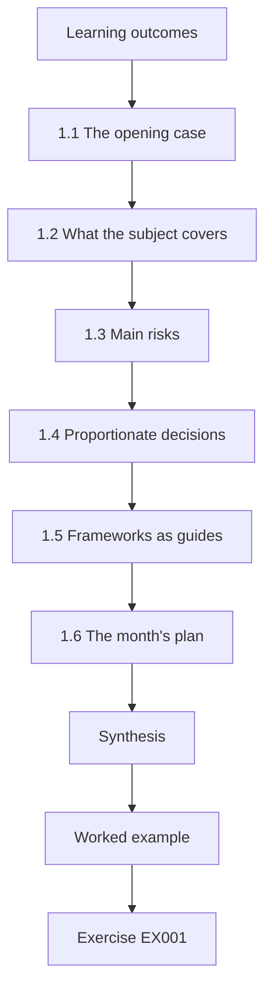

### Logical drawing

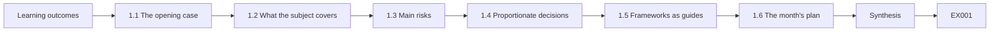

```text
[Learning outcomes]
    |
    v
[1.1 The opening case]
    |
    v
[1.2 What the subject covers]
    |
    v
[1.3 Main risks]
    |
    v
[1.4 Proportionate decisions]
    |
    v
[1.5 Frameworks as guides]
    |
    v
[1.6 The month's plan]
    |
    v
[Synthesis]
    |
    v
[Worked example] --> [Exercise EX001]
```
<!-- open-cyber-academy:lesson-figures:end ch-01 -->


### Learning outcomes

You will (1) explain what application and software supply chain security means for a small organisation's website; (2) recognise the main risks; (3) make simple, proportionate decisions; (4) set priorities for a month of work.

### 1.1 The opening case

Owen Clarke is the only IT person at the fictional charity Riverside Food Network. He is taking a one-month rapid course at the fictional Kestrel Skills Centre with tutor Nadia Haddad. The charity's donation website runs on a common website platform with a handful of plugins. A volunteer installed most of them years ago. Last month a donor reported that the donation page briefly showed an error mentioning an outdated form component, and Owen realised nobody knew which components the site used or who kept them updated.

### 1.2 What the subject covers

Application security protects the website's own code and settings. Software supply chain security protects everything the site is built from: the platform, its plugins, themes and the services they call, and the path by which each arrives and is updated. For a small charity, the supply chain is most of the website.

Owen's site shows the split. The charity wrote almost nothing itself: its settings and a few page templates are its own code. The donation form, the event calendar, the photo gallery, the newsletter plugin, the theme and the platform all came from other people, and the error message a donor saw last month came from one of them.

### 1.3 Main risks

Outdated components with known flaws (OWASP Top 10:2021 A06); components that are no longer maintained; components from unofficial sources; weak administrator sign-in (A07); and integrity failures, where an update or file is changed before it arrives (A08).

Each risk has a face on Owen's site. The donation form was out of date and had a published advisory (A06). The event calendar had not been released for over four years. A component downloaded from an unofficial page could be anything. Three administrator accounts had no multi-factor sign-in (A07). And an update file changed on its way to him is what the hash check guards against (A08).

### 1.4 Proportionate decisions

Owen has a few hours a week. He decides by asking three questions for each risk: how likely is it, how much harm would it cause to donors and the charity, and how cheap is the fix? Cheap fixes for likely, harmful risks go first.

Turning on multi-factor sign-in for the three administrator accounts is the clearest example: an attack on a password is likely, an administrator account could change everything on the site, and the fix costs minutes. Replacing the event calendar is harmful to leave but takes longer, so it comes later in the month.

### 1.5 Frameworks as guides

NIST SP 800-218 (SSDF) and OWASP SAMM v2 are written for software producers and larger organisations, but their ideas scale down: know your components, keep them updated, check what you install, and have a plan for problems.

Owen's month uses each idea at his scale. "Know your components" is the plugin list he exports in week 3. "Keep them updated" is the donate-form update and the weekly routine. "Check what you install" is the hash comparison in the release checklist. "Have a plan" is his rule to stop and call the host and Nadia if he finds signs of misuse.

### 1.6 The month's plan

Week 1 foundations and decisions; week 2 scope and safe practice; week 3 components, data and dependencies; week 4 guided lab and putting it together.

The order matters. Owen cannot decide what to update until he knows what the site uses, and he should not change anything until he has permission, a backup and a staging copy. So the inventory comes in week 3, after the scope, and the donate-form update in week 4, after both. The first week's quick win, multi-factor sign-in, needs no inventory and starts at once.

### Worked example

Owen lists his first decisions: turn on multi-factor sign-in for the three administrator accounts (cheap, high value), list every plugin and its version (cheap, needed for everything else), and ask the platform host whether automatic security updates are available. Nadia agrees these are the right first steps.

> **Synthetic case.** Riverside Food Network and all people and events are synthetic.

### Errors and limits

Proportionate does not mean minimal; some risks need more effort than they first seem to.

### Exercises

- **EX001 — Opening problem.** What did Owen realise after the donor's report? *Rubric:* 3 = nobody knew components or owners; 2 = partial; 1 = vague; 0 = none.
- **EX002 — Supply chain scope.** What does the charity's software supply chain include? *Rubric:* 3 = platform, plugins, themes, services, update path; 2 = three; 1 = one; 0 = none.
- **EX003 — Top 10 links.** Which Top 10:2021 categories match the main risks? *Rubric:* 3 = A06, A07, A08; 2 = two; 1 = one; 0 = none.
- **EX004 — Deciding questions.** What three questions guide Owen's decisions? *Rubric:* 3 = likelihood, harm, cost of fix; 2 = two; 1 = one; 0 = none.
- **EX005 — First decisions.** Name Owen's first three decisions. *Rubric:* 3 = MFA, component list, ask about auto-updates; 2 = two; 1 = one; 0 = none.
- **EX006 — Framework scaling.** How do SSDF and SAMM ideas scale down? *Rubric:* 3 = know, update, check, plan; 2 = three; 1 = one; 0 = none.
- **EX007 — Week three.** What does week 3 cover? *Rubric:* 3 = components, data and dependencies; 2 = partial; 1 = vague; 0 = none.
- **EX008 — Most of the site.** Why is the supply chain "most of the website" here? *Rubric:* 3 = built from others' components; 2 = partial; 1 = vague; 0 = none.
- **EX009 — Unmaintained risk.** Why is an unmaintained component a risk? *Rubric:* 3 = future flaws never fixed; 2 = partial; 1 = vague; 0 = none.
- **EX010 — Integrity failure.** Give an example of an integrity failure. *Rubric:* 3 = update changed before arrival; 2 = partial; 1 = vague; 0 = none.
- **EX011 — MFA value.** Why is multi-factor sign-in a good first step? *Rubric:* 3 = cheap and high value; 2 = partial; 1 = vague; 0 = none.
- **EX012 — Proportionate limit.** What warning comes with proportionate decisions? *Rubric:* 3 = some risks need more effort; 2 = partial; 1 = vague; 0 = none.
- **EX013 — Nadia's role.** What did Nadia do with Owen's list? *Rubric:* 3 = agreed they were right first steps; 2 = partial; 1 = vague; 0 = none.

### Synthesis

Know the components, fix cheap high-value risks first and plan the month.

### Continue studying — lesson 01 (chapter 01 of 20)

[← Course home](../../README.md) · [Course chapter index](../SUBJECTS.md) · [Chapter 02 →](#ch-02)

<a id="ch-02"></a>

## Chapter 2 — Scope, permission and safe practice

<!-- open-cyber-academy:lesson-figures:start ch-02 -->
### Lesson map

Lesson 02 published. Map, example, EX014.

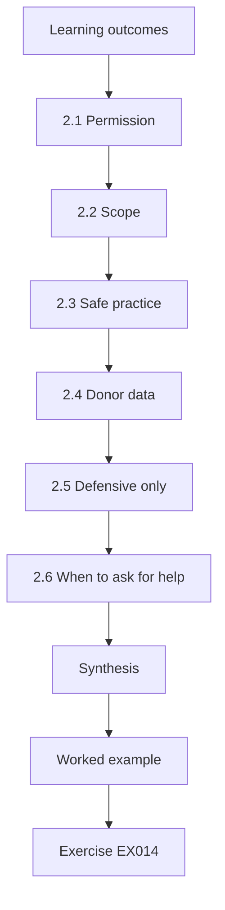

### Logical drawing

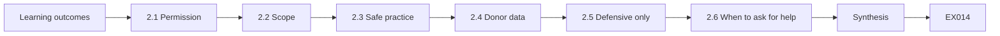

```text
[Learning outcomes]
    |
    v
[2.1 Permission]
    |
    v
[2.2 Scope]
    |
    v
[2.3 Safe practice]
    |
    v
[2.4 Donor data]
    |
    v
[2.5 Defensive only]
    |
    v
[2.6 When to ask for help]
    |
    v
[Synthesis]
    |
    v
[Worked example] --> [Exercise EX014]
```
<!-- open-cyber-academy:lesson-figures:end ch-02 -->


### Learning outcomes

You will (1) confirm permission before checking or changing the website; (2) set clear scope; (3) work safely with backups and staging; (4) protect donor data.

### 2.1 Permission

Owen is employed by the charity, but changes to the website still need the director's agreement, recorded in an email that names what he will check and change. The website host's terms also say what customers may test. Owen checks only the charity's own site and accounts; he does not probe the host's systems or other sites.

The director's reply adds a condition: she wants to be told before any change that donors could notice. Owen treats the donate-form update as such a change and tells her before releasing it. Keeping the permission in an email means that, if something goes wrong, there is a record of what was agreed and by whom.

### 2.2 Scope

The scope for the month: the donation website, its administrator accounts, its plugins and theme, and the charity's account with the website host. Out of scope: the payment provider's systems, which belong to the provider, and volunteers' personal devices.

Leaving out the payment provider is a limit, not an oversight: card details go straight to the provider's page, and Owen has no right to test its systems. He checks only the hand-off, that the donation form sends donors to the provider's real page. In his final presentation he names this as one of the things he cannot check himself.

### 2.3 Safe practice

Before any change, Owen takes a full backup and confirms it can be restored. He tests updates on a staging copy, a private copy of the site with donor data removed or replaced by synthetic records. He makes one change at a time and notes it in a simple change log.

Owen proves the backup works before relying on it: he restores it once to staging in the first weeks. That restore also gives him the staging copy where he later tests the donate-form update with synthetic donations. Each line in the change log says what changed, when, and how to undo it, which is what the director needs if donors report a problem.

### 2.4 Donor data

The site stores donor names, emails and donation amounts; card details stay with the payment provider. Owen never copies donor data to his own devices and uses synthetic records for testing.

This rule also shapes the staging copy: it holds synthetic donors, so testing the donation form there cannot leak a real person's details. When event-calendar turned out to store volunteers' phone numbers, the same thinking applied: those numbers moved to the charity's volunteer system and were deleted from the website.

### 2.5 Defensive only

The course teaches checking and fixing, not attacking. Owen does not run tools that try to break into the site; he reviews versions, settings and logs.

His checks are all of this kind: the plugin list from the administration page, version numbers compared with published advisories, the hash of a download compared with the vendor's, and the list of administrator accounts. None of them sends unusual requests to the site, so none can break it or upset the host. If he wanted a deeper test, it would need the host's permission and a professional tester.

### 2.6 When to ask for help

If he sees signs that the site has already been misused, such as unknown administrator accounts, Owen stops, preserves evidence and contacts the host's support and Nadia.

Preserving evidence means not deleting the unknown account straight away: Owen notes its name and creation date, takes a screenshot, and asks the host for the access logs before anything changes. Deleting first might stop the attacker, but it would also remove the clues to how they got in and what else they touched. In Owen's month, the monthly account review found no unknown accounts.

### Worked example

Owen's permission email to the director lists the scope and says he will take backups, test on staging and keep a change log. The director replies with approval and asks to be told before any change that donors could notice. Owen restores a backup to staging once to prove it works before relying on it.

> **Synthetic case.** Emails and systems are synthetic.

### Errors and limits

Backups that have never been restored may not work.

### Exercises

- **EX014 — Permission form.** How is Owen's permission recorded? *Rubric:* 3 = email naming checks and changes; 2 = partial; 1 = vague; 0 = none.
- **EX015 — In scope.** List the in-scope items. *Rubric:* 3 = site, admin accounts, plugins and theme, host account; 2 = three; 1 = one; 0 = none.
- **EX016 — Out of scope.** Name two out-of-scope items. *Rubric:* 3 = payment provider systems; volunteers' devices; 2 = one; 1 = vague; 0 = none.
- **EX017 — Staging copy.** What is a staging copy? *Rubric:* 3 = private copy with synthetic data; 2 = partial; 1 = vague; 0 = none.
- **EX018 — Backup proof.** How did Owen prove the backup works? *Rubric:* 3 = restored it to staging; 2 = partial; 1 = vague; 0 = none.
- **EX019 — Card details.** Where are card details stored? *Rubric:* 3 = with the payment provider; 2 = partial; 1 = vague; 0 = none.
- **EX020 — Change log.** Why keep a change log? *Rubric:* 3 = track one change at a time; undo; 2 = partial; 1 = vague; 0 = none.
- **EX021 — Misuse signs.** What should Owen do if he sees misuse? *Rubric:* 3 = stop, preserve evidence, contact host and tutor; 2 = two; 1 = one; 0 = none.
- **EX022 — Defensive scope.** What kind of tools does Owen avoid? *Rubric:* 3 = tools that try to break in; 2 = partial; 1 = vague; 0 = none.
- **EX023 — Director request.** What did the director ask for? *Rubric:* 3 = notice before donor-visible changes; 2 = partial; 1 = vague; 0 = none.
- **EX024 — Donor data rule.** How is donor data protected during testing? *Rubric:* 3 = never copied; synthetic records; 2 = partial; 1 = vague; 0 = none.
- **EX025 — Host terms.** Why read the host's terms? *Rubric:* 3 = they say what customers may test; 2 = partial; 1 = vague; 0 = none.
- **EX026 — One change.** Why make one change at a time? *Rubric:* 3 = easy to find what caused a problem; 2 = partial; 1 = vague; 0 = none.

### Synthesis

Permission, scope, backups and staging make changes safe.

### Continue studying — lesson 02 (chapter 02 of 20)

[← Chapter 01](#ch-01) · [Course chapter index](../SUBJECTS.md) · [Chapter 03 →](#ch-03)

<a id="ch-03"></a>

## Chapter 3 — Application and software supply chain security: systems, data and dependencies

<!-- open-cyber-academy:lesson-figures:start ch-03 -->
### Lesson map

Lesson 03 published. Map, example, EX027.

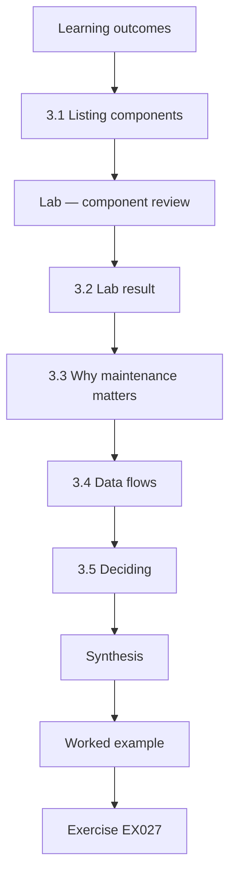

### Logical drawing

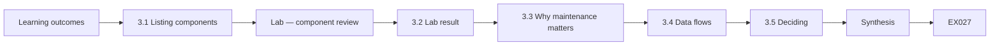

```text
[Learning outcomes]
    |
    v
[3.1 Listing components]
    |
    v
[Lab — component review]
    |
    v
[3.2 Lab result]
    |
    v
[3.3 Why maintenance matters]
    |
    v
[3.4 Data flows]
    |
    v
[3.5 Deciding]
    |
    v
[Synthesis]
    |
    v
[Worked example] --> [Exercise EX027]
```
<!-- open-cyber-academy:lesson-figures:end ch-03 -->


### Learning outcomes

You will (1) list the website's components and versions; (2) check advisories, maintenance and use; (3) map where donor data flows; (4) decide to update, replace or remove each component.

### 3.1 Listing components

Owen exports the plugin list from the site's administration page: name, version and whether each is active. He adds the theme, the platform version and the outside services the site calls: the payment provider and the newsletter service. This list is the charity's inventory, the base for every other check.

Writing down which plugins are active matters: photo-gallery appears in the list but is not in use, and an unused plugin still has code on the server that an attacker could reach. Adding the payment provider and the newsletter service shows where donor data leaves the site, which is needed for the data-flow check later in the week.

### Lab — component review

```python
"""Review a synthetic list of website components: advisories, maintenance and use (stdlib only)."""
from datetime import date
today = date(2026, 10, 1)
components = [  # name, version, fixed_version_or_None, last_release, in_use
    ("donate-form", "3.2.0", "3.2.4", date(2026, 8, 2), True),
    ("event-calendar", "1.4.1", None, date(2022, 5, 9), True),
    ("photo-gallery", "2.0.0", None, date(2026, 6, 20), False),
    ("newsletter", "5.1.3", None, date(2026, 9, 1), True),
]
def v(s): return tuple(map(int, s.split(".")))
for name, ver, fixed, last, used in components:
    notes = []
    if fixed and v(ver) < v(fixed):
        notes.append(f"UPDATE to {fixed}")
    if (today - last).days > 730:
        notes.append(f"UNMAINTAINED ({(today - last).days} days since release)")
    if not used:
        notes.append("REMOVE (not in use)")
    print(f"{name:15} {ver:6} {'; '.join(notes) or 'ok'}")
```

Run with `python3 lab_deps.py`. Verified output:

```text
donate-form     3.2.0  UPDATE to 3.2.4
event-calendar  1.4.1  UNMAINTAINED (1606 days since release)
photo-gallery   2.0.0  REMOVE (not in use)
newsletter      5.1.3  ok
```

### 3.2 Lab result

donate-form 3.2.0 must be updated to 3.2.4, the version that fixes a published advisory. event-calendar 1.4.1 is flagged UNMAINTAINED: its last release was 1,606 days ago. photo-gallery 2.0.0 is flagged REMOVE because it is not in use. newsletter 5.1.3 is ok. Each flag leads to a different action: update, replace or remove.

The lab's rules are simple enough to check by hand. A component is UNMAINTAINED if its last release is more than 730 days, about two years, before the review date of 1 October 2026; event-calendar's last release was 9 May 2022. The script compares versions as numbers, so it would correctly flag a version like 3.10 as newer than 3.9.

### 3.3 Why maintenance matters

A component with no releases for years will not receive fixes for future flaws. Kula et al. (2018) found that outdated dependencies are common because updating takes effort; Zimmermann et al. (2019) showed that a few maintainers can affect very many users. Small sites benefit from choosing popular, actively maintained components.

Owen's event-calendar shows the risk: 1,606 days without a release means that any flaw found in it now will probably never be fixed. When he chooses a replacement, he checks the release history and how many sites use it, so that the new calendar is less likely to be abandoned too.

### 3.4 Data flows

Donor details move from the donation form to the site's database, the card details go directly to the payment provider's page, and email addresses go to the newsletter service if the donor opts in. Each flow is a place to check: the form component, database access, the payment hand-off and the newsletter connection.

The newsletter flow depends on the donor's choice: only donors who tick the box are sent to the newsletter service, so Owen checks that the box is unticked by default. The payment hand-off is the most sensitive point: if the form were changed to collect card numbers itself, they would pass through the charity's site, which is exactly what the current design avoids.

### 3.5 Deciding

Update donate-form now (it handles donor data and has an advisory). Replace event-calendar with a maintained alternative within the month. Remove photo-gallery after confirming nobody needs it. Keep newsletter and turn on automatic security updates where the host supports them.

Owen's later discovery changed one priority: event-calendar also stored volunteers' phone numbers for shift sign-ups, which nobody remembered. That moved its replacement up to week 3, with the phone numbers moved to the charity's existing volunteer system and deleted from the website. A decision list is a plan, not a promise; it changes when new facts appear.

### Worked example

Owen reruns the three priority questions for event-calendar after the discovery. Likelihood is unchanged: with no release for 1,606 days, any future flaw stays unfixed. Harm is higher, because the plugin also holds volunteers' phone numbers. The fix cost is unchanged: a maintained alternative. Higher harm alone is enough to move the replacement up to week 3.

> **Synthetic case.** Components, dates and data are synthetic.

### Errors and limits

A component list from the admin page may miss files added by hand; ask the host if unsure.

### Exercises

- **EX027 — Inventory fields.** What does Owen's inventory record? *Rubric:* 3 = name, version, active, plus theme, platform, services; 2 = three; 1 = one; 0 = none.
- **EX028 — donate-form action.** What does the lab say about donate-form? *Rubric:* 3 = update 3.2.0 to 3.2.4; 2 = partial; 1 = vague; 0 = none.
- **EX029 — event-calendar flag.** Why is event-calendar flagged? *Rubric:* 3 = 1,606 days without a release; 2 = partial; 1 = vague; 0 = none.
- **EX030 — photo-gallery flag.** What should happen to photo-gallery? *Rubric:* 3 = remove; not in use; 2 = partial; 1 = vague; 0 = none.
- **EX031 — Card flow.** Where do card details go? *Rubric:* 3 = directly to payment provider; 2 = partial; 1 = vague; 0 = none.
- **EX032 — Newsletter flow.** When does an email reach the newsletter service? *Rubric:* 3 = if donor opts in; 2 = partial; 1 = vague; 0 = none.
- **EX033 — Maintenance research.** What did Kula et al. find? *Rubric:* 3 = outdated dependencies common; 2 = partial; 1 = vague; 0 = none.
- **EX034 — Choosing components.** What kind of components suit small sites? *Rubric:* 3 = popular, actively maintained; 2 = partial; 1 = vague; 0 = none.
- **EX035 — Hidden data.** What did Owen discover about event-calendar? *Rubric:* 3 = stored volunteers' phone numbers; 2 = partial; 1 = vague; 0 = none.
- **EX036 — Phone numbers.** What happened to the phone numbers? *Rubric:* 3 = moved to volunteer system; deleted; 2 = partial; 1 = vague; 0 = none.
- **EX037 — Three actions.** Name the three possible actions. *Rubric:* 3 = update, replace, remove; 2 = two; 1 = one; 0 = none.
- **EX038 — Admin page gap.** What might the admin page list miss? *Rubric:* 3 = files added by hand; 2 = partial; 1 = vague; 0 = none.

### Synthesis

Inventory, check and decide for each component.

### Continue studying — lesson 03 (chapter 03 of 20)

[← Chapter 02](#ch-02) · [Course chapter index](../SUBJECTS.md) · [Chapter 04 →](#ch-04)

<a id="ch-04"></a>

## Chapter 4 — Application and software supply chain security: guided lab and applied synthesis

<!-- open-cyber-academy:lesson-figures:start ch-04 -->
### Lesson map

Lesson 04 published. Map, example, EX039.

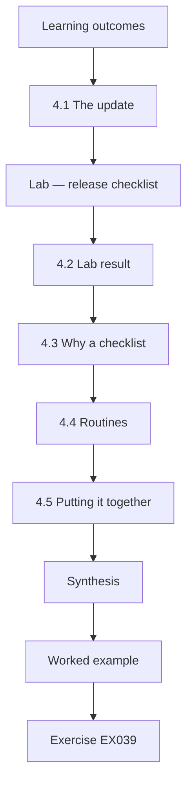

### Logical drawing

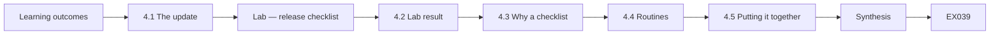

```text
[Learning outcomes]
    |
    v
[4.1 The update]
    |
    v
[Lab — release checklist]
    |
    v
[4.2 Lab result]
    |
    v
[4.3 Why a checklist]
    |
    v
[4.4 Routines]
    |
    v
[4.5 Putting it together]
    |
    v
[Synthesis]
    |
    v
[Worked example] --> [Exercise EX039]
```
<!-- open-cyber-academy:lesson-figures:end ch-04 -->


### Learning outcomes

You will (1) prepare a safe update with a pre-release checklist; (2) verify downloads; (3) complete the month's improvements; (4) set routines to keep the site safe.

### 4.1 The update

Owen prepares the donate-form update to 3.2.4. He downloads it from the plugin's official page, compares its SHA-256 hash with the one published by the vendor, takes a backup and tests it on staging with synthetic donations.

The hash comparison protects against a changed download: even if the official page were tampered with or the file damaged on the way, a different file gives a different hash. The test on staging with synthetic donations checks that the updated form still sends donors to the payment provider and records the donation correctly.

### Lab — release checklist

```python
"""Pre-release checklist for a synthetic site update (stdlib only)."""
import hashlib
download = b"synthetic donate-form 3.2.4 release"
vendor_hash = hashlib.sha256(b"synthetic donate-form 3.2.4 release").hexdigest()
checks = {
    "official source used": True,
    "hash matches vendor": hashlib.sha256(download).hexdigest() == vendor_hash,
    "backup taken": True,
    "tested on staging copy": True,
    "admin accounts use MFA": False,
}
for item, ok in checks.items():
    print(f"[{'x' if ok else ' '}] {item}")
missing = [k for k, ok in checks.items() if not ok]
print("READY" if not missing else f"NOT READY: {', '.join(missing)}")
```

Run with `python3 lab_release.py`. Verified output:

```text
[x] official source used
[x] hash matches vendor
[x] backup taken
[x] tested on staging copy
[ ] admin accounts use MFA
NOT READY: admin accounts use MFA
```

### 4.2 Lab result

Four items pass: official source used, hash matches vendor, backup taken and tested on staging copy. One fails: admin accounts use MFA, because one volunteer administrator has not finished setting up multi-factor sign-in. The lab prints NOT READY: admin accounts use MFA. Owen holds the release until the volunteer completes setup the next morning, then reruns the checklist and releases.

The failed item is outside the update itself, which is why it belongs on the list. A newly updated form on a site where one administrator account still has only a password leaves the most powerful account as the easiest way in. Holding the release for one night costs little; the director had already been told the update was coming.

### 4.3 Why a checklist

A checklist makes sure nothing is skipped under time pressure. Each item links to an earlier lesson: sources and hashes protect integrity, backups and staging protect availability, multi-factor sign-in protects the administrator accounts that could change everything else. SLSA v1.0 and Sigstore (Newman et al., 2022) show how larger projects automate similar integrity checks.

For Owen, the list also replaces memory. He runs this release once, but the weekly routine will repeat the same steps for every update, sometimes in a hurry when an advisory is published. A written checklist means a second volunteer, who the director has asked to learn the routines, can follow the same steps without Owen there.

### 4.4 Routines

Weekly: check for plugin updates and apply security updates after staging. Monthly: review the component list and administrator accounts. Yearly: review maintenance of each component and the restore test. All are noted in the change log.

Each routine has an owner and a note. The weekly update check is Owen's, with the second volunteer as backup. The monthly account review would have caught the volunteer administrator who had not finished setting up multi-factor sign-in. The yearly maintenance review is where a component like event-calendar, quiet for years, would be spotted early.

### 4.5 Putting it together

By the end of the month: multi-factor sign-in for all administrators, a component inventory, donate-form updated, event-calendar replaced, photo-gallery removed, automatic security updates on, and written routines.

Each item has evidence in the change log or the inventory, which is what Owen showed the director and Nadia. The limits are written down too: he cannot check the payment provider's security, he relies on vendors publishing advisories, and he is one person. A second volunteer learning the routines is the answer to the last of these.

### Worked example

Owen presents the month's work to the director and Nadia, opening the change-log entry or inventory row behind each result and reading out the three limits. The director agrees to ask a second volunteer to learn the routines so they continue if Owen is away.

> **Synthetic case.** Components, checklists and outcomes are synthetic.

### Errors and limits

A passed checklist means the known steps were done, not that the site is perfectly safe.

### Exercises

- **EX039 — Download source.** Where did Owen download the update? *Rubric:* 3 = official plugin page; 2 = partial; 1 = vague; 0 = none.
- **EX040 — Hash check.** How did Owen check the download? *Rubric:* 3 = compare SHA-256 with vendor's; 2 = partial; 1 = vague; 0 = none.
- **EX041 — Lab outcome.** What did the checklist report? *Rubric:* 3 = NOT READY: admin MFA; 2 = partial; 1 = vague; 0 = none.
- **EX042 — Holding release.** What did Owen do about the failed item? *Rubric:* 3 = waited for volunteer setup; reran; 2 = partial; 1 = vague; 0 = none.
- **EX043 — Checklist purpose.** Why use a checklist? *Rubric:* 3 = nothing skipped under pressure; 2 = partial; 1 = vague; 0 = none.
- **EX044 — Weekly routine.** What is the weekly routine? *Rubric:* 3 = check and apply security updates after staging; 2 = partial; 1 = vague; 0 = none.
- **EX045 — Monthly routine.** What happens monthly? *Rubric:* 3 = review components and admin accounts; 2 = partial; 1 = vague; 0 = none.
- **EX046 — Month results.** Name four results of the month. *Rubric:* 3 = MFA, inventory, update, replace, remove, auto-updates, routines; 2 = three; 1 = one; 0 = none.
- **EX047 — Limits named.** Name two limits Owen gave. *Rubric:* 3 = payment provider; vendor advisories; one person; 2 = one; 1 = vague; 0 = none.
- **EX048 — Continuity.** How will routines continue if Owen is away? *Rubric:* 3 = second volunteer learns them; 2 = partial; 1 = vague; 0 = none.
- **EX049 — What passing means.** What does a passed checklist mean? *Rubric:* 3 = known steps done, not perfect safety; 2 = partial; 1 = vague; 0 = none.
- **EX050 — Larger projects.** Which tools automate integrity checks for larger projects? *Rubric:* 3 = SLSA, Sigstore; 2 = partial; 1 = vague; 0 = none.

### Synthesis

Check before each release and keep simple routines going.

### Continue studying — lesson 04 (chapter 04 of 20)

[← Chapter 03](#ch-03) · [Course chapter index](../SUBJECTS.md) · [Chapter 05 →](#ch-05)

<a id="ch-05"></a>

## Chapter 5 — The component print is list order

<!-- open-cyber-academy:lesson-figures:start ch-05 -->
### Lesson map

Lesson 05. Map, example, EX051.

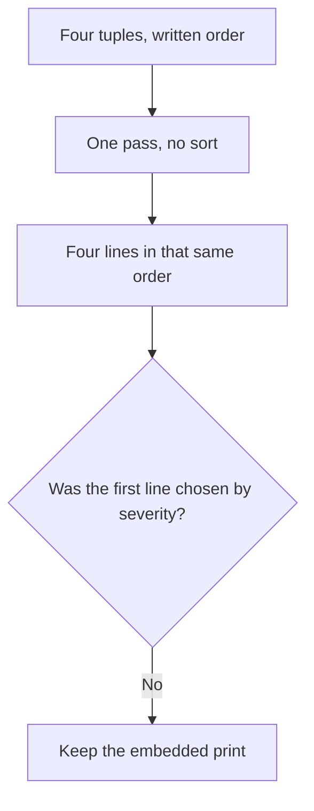

The loop follows the list. It does not rank the rows.

### Logical drawing

```text
donate-form     3.2.0  UPDATE to 3.2.4
event-calendar  1.4.1  UNMAINTAINED (1606 days since release)
photo-gallery   2.0.0  REMOVE (not in use)
newsletter      5.1.3  ok
```
<!-- open-cyber-academy:lesson-figures:end ch-05 -->

### Learning outcomes

After this chapter, you should be able to:

1. Name the list the component script walks.
2. Separate that written order from an advisory ranking.
3. Refuse a note that reorders or drops a line.

### 5.1 One pass, and the format widths are not a ranking.

`lab_deps.py` stores four tuples. The comment names the fields: component name, version, a fixed version or `None`, the last release date, and whether the component is in use. The `for` loop unpacks those tuples in the order the list was written. Nothing in the file calls `sort`, `sorted`, or `min`.

The print format is `{name:15} {ver:6}` and then the notes. Width 15 and width 6 pad short strings with spaces. They do not encode severity. `donate-form` is first because it is the first tuple, even though a reader might think an advisory should outrank a stale calendar. `newsletter` is last because it is the last tuple, and its line still appears when the note list is empty.

A later decision to update, replace, or remove a component is a sentence in the change log. It does not delete a tuple. A print that started with `event-calendar` would be a different list.

| What the loop uses | What it does not use |
|---|---|
| Position in `components` | A severity score |
| The five fields of that tuple | Files inside a plugin directory |
| Format widths 15 and 6 | A second ordering key |

### 5.2 Worked example

| Offered result | What produced it | Decision |
|---|---|---|
| Four lines, donate-form first | List order, one pass | Keep |
| The calendar line still present | Its tuple was not deleted | Keep |
| "The script sorted by advisory." | No sort is called | Refuse |
| "Newsletter was dropped because it is fine." | The fourth tuple is still printed | Refuse |

> **Synthetic case.** These four tuples are the only component output.

### Errors and limits

Do not rebuild the list so that it matches a later change log.

### Apply

- **EX051 — List order.** The print names donate-form, then event-calendar, then photo-gallery, then newsletter. May a severity ranking, or a later decision to update or remove one of them, replace that order? *Rubric:* 3 = no; the four tuples stay in written order; the format widths are padding; do not sort the script;; 2 = the four lines stay and the later decision stays prose;; 1 = one line;; 0 = none.

<!-- open-cyber-academy:chapter-navigation:start ch-05 -->
### Continue studying — lesson 05 (chapter 05 of 20)

[← Chapter 04](#ch-04) · [Course chapter index](../SUBJECTS.md) · [Chapter 06 →](#ch-06)

Continue to the next authored lesson.
<!-- open-cyber-academy:chapter-navigation:end -->

<a id="ch-06"></a>

## Chapter 6 — A version tuple is not a decimal string

<!-- open-cyber-academy:lesson-figures:start ch-06 -->
### Lesson map

Lesson 06. Map, example, EX052.

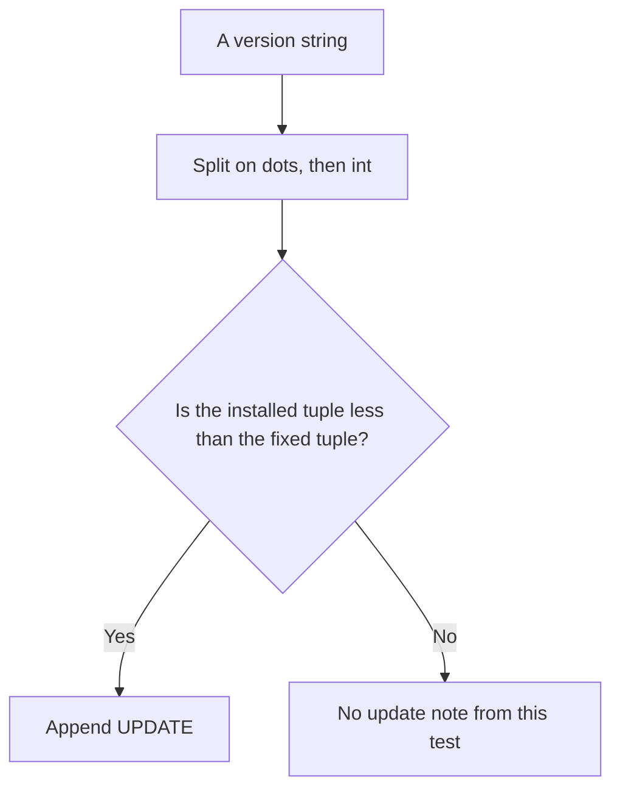

The comparison is numeric tuples. It is not dictionary order on the raw text.

### Logical drawing

```text
installed donate-form: (3, 2, 0)
fixed donate-form:     (3, 2, 4)
(3, 2, 0) < (3, 2, 4) is true
string order of 3.10 and 3.9 is a different test, and neither string is in this list
```
<!-- open-cyber-academy:lesson-figures:end ch-06 -->

### Learning outcomes

After this chapter, you should be able to:

1. Explain `v` as a split into integers.
2. Show why `(3, 2, 0)` is less than `(3, 2, 4)`.
3. Refuse a string-order claim about versions this file does not contain.

### 6.1 `v` splits, maps to `int`, and compares the tuples.

The helper is `tuple(map(int, s.split(".")))`. `3.2.0` becomes `(3, 2, 0)`. `3.2.4` becomes `(3, 2, 4)`. Python compares tuples from the left. The first two places are equal, and `0 < 4`, so the update test is true for donate-form. The appended text is `UPDATE to 3.2.4`, using the fixed string already stored in the tuple. The script does not fetch an advisory page.

The same helper would treat `3.10` as `(3, 10)` and `3.9` as `(3, 9)`. Those tuples compare as ten greater than nine. Character order on the raw strings goes the other way, because the character `1` precedes the character `9`. This file contains neither `3.10` nor `3.9`. The helper is also not `packaging.version`, and a suffix such as a pre-release tag is not present to be parsed. `map(int, ...)` would raise on a non-numeric piece. No tuple here has such a piece.

`if fixed and v(ver) < v(fixed)` skips the comparison when `fixed` is `None`, because `None` is false. event-calendar, photo-gallery, and newsletter store `None` in that field, so they cannot receive an UPDATE note from this test. An installed tuple equal to its fixed tuple would also fail the strict `<`. donate-form is still `3.2.0` in the file. The later update to `3.2.4` is prose and does not edit this tuple.

| Pair | Comparison this helper would make | Present in the four tuples? |
|---|---|---|
| `(3, 2, 0)` and `(3, 2, 4)` | Installed is less | Yes, donate-form |
| `(3, 10)` and `(3, 9)` | Ten is greater than nine | No |
| Raw strings `3.10` and `3.9` | Not what `v` does | No |

### 6.2 Worked example

| Claim | Tuple fact | Decision |
|---|---|---|
| donate-form `3.2.0` is behind `3.2.4` | `(3, 2, 0) < (3, 2, 4)` | Keep |
| The other three rows have no fixed version | `fixed` is `None` | Keep |
| "`3.10` would sort before `3.9` inside this helper." | Integer tuples do the opposite, and neither value is stored | Refuse |
| "The script already shows 3.2.4 installed." | The stored version is still `3.2.0` | Refuse |

> **Synthetic case.** No advisory identifier is stored beside the fixed version.

### Errors and limits

Do not treat a version this list never stored as a result of the run.

### Apply

- **EX052 — Two comparisons.** A classmate says donate-form is flagged because the text `3.2.0` comes before `3.2.4` in the alphabet, and that the same helper would treat `3.10` as older than `3.9`. What does `v` compare, and which of those strings are in the file? *Rubric:* 3 = integer tuples; `(3, 2, 0) < (3, 2, 4)`; `(3, 10)` is greater than `(3, 9)`; `3.10` and `3.9` are absent; the installed donate-form string stays `3.2.0`;; 2 = the helper uses integers and the stored version stays;; 1 = one comparison;; 0 = none.

<!-- open-cyber-academy:chapter-navigation:start ch-06 -->
### Continue studying — lesson 06 (chapter 06 of 20)

[← Chapter 05](#ch-05) · [Course chapter index](../SUBJECTS.md) · [Chapter 07 →](#ch-07)

Continue to the next authored lesson.
<!-- open-cyber-academy:chapter-navigation:end -->

<a id="ch-07"></a>

## Chapter 7 — 1606 is one subtraction

<!-- open-cyber-academy:lesson-figures:start ch-07 -->
### Lesson map

Lesson 07. Map, example, EX053.

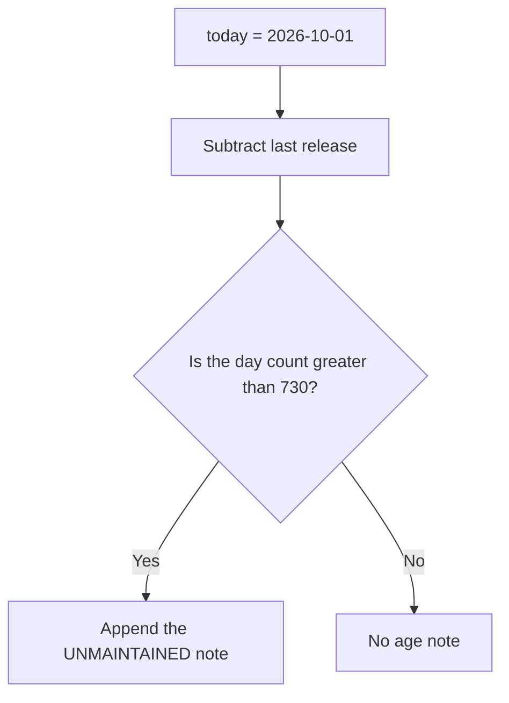

The threshold is a strict greater-than. The print shows the day count, not the threshold.

### Logical drawing

```text
event-calendar last release 2022-05-09
2026-10-01 minus that date = 1606 days
1606 > 730, so the note is appended
730 itself would not pass the test, and no row has that age
```
<!-- open-cyber-academy:lesson-figures:end ch-07 -->

### Learning outcomes

After this chapter, you should be able to:

1. Reconstruct 1606 as one date subtraction.
2. State the predicate as `days > 730`.
3. Refuse a note that prints the threshold as if the script had.

### 7.1 The clock is fixed, and equality at 730 does not flag.

`today` is `date(2026, 10, 1)`. It is not the clock of the machine that happens to run the file, and it is not read from a log. For each tuple the script computes `(today - last).days`. event-calendar's last release is `date(2022, 5, 9)`. That subtraction is 1606. The test is `> 730`, so 1606 appends `UNMAINTAINED (1606 days since release)`. The number inside the note is the subtraction. The number 730 is only in the source.

Equality is the excluded edge. An age that lands on 1 October 2024 measures 730 and stays silent. The previous civil day, 30 September 2024, measures 731 and would add the clause. Neither civil day is a stored tuple. Calling 730 "about two years" is an approximation beside the source. The predicate itself does not measure calendar anniversaries, leap-day labels, or a maintainer's promise.

The other three ages are real subtractions and are not printed, because each fails `> 730`. donate-form was released on 2 August 2026, which is 60 days. photo-gallery was released on 20 June 2026, which is 103 days. newsletter was released on 1 September 2026, which is 30 days. Those three figures may be labelled as arithmetic next to the source. They must not be written into the four output lines.

| Last release | Days before 2026-10-01 | `days > 730` | Row |
|---|---:|---|---|
| 2022-05-09 | 1606 | yes | event-calendar, printed |
| 2026-08-02 | 60 | no | donate-form, not printed |
| 2026-06-20 | 103 | no | photo-gallery, not printed |
| 2026-09-01 | 30 | no | newsletter, not printed |
| 2024-10-01 | 730 | no | no such tuple |
| 2024-09-30 | 731 | yes | no such tuple |

### 7.2 Worked example

| Claim about the age test | Arithmetic | Decision |
|---|---|---|
| event-calendar prints 1606 | `date(2026, 10, 1) - date(2022, 5, 9)` | Keep |
| 730 is the cut in the source | The note does not contain 730 | Keep as source, not as output |
| "A 730-day component would be flagged." | The operator is `>`, so 730 fails | Refuse |
| "The script printed 60, 103, and 30." | Those ages fail the test and stay off the page | Refuse |

> **Synthetic case.** The review date is a constant in the lab, not a timestamp copied from the host.

### Errors and limits

Do not replace the printed 1606 with the hidden threshold or with an age the output omitted.

### Apply

- **EX053 — One subtraction.** The calendar line says 1606 days. A classmate adds the threshold 730 to the output, says a component aged exactly 730 days would be flagged, and writes 60, 103, and 30 onto the other lines. Which figures does the script print, and what does the comparison require? *Rubric:* 3 = only 1606 is printed; it is the subtraction from 2026-10-01 to 2022-05-09; the test is `days > 730`; 730, 60, 103, and 30 stay off the output;; 2 = 1606 stays the printed age and 730 is not printed;; 1 = one figure;; 0 = none.

<!-- open-cyber-academy:chapter-navigation:start ch-07 -->
### Continue studying — lesson 07 (chapter 07 of 20)

[← Chapter 06](#ch-06) · [Course chapter index](../SUBJECTS.md) · [Chapter 08 →](#ch-08)

Continue to the next authored lesson.
<!-- open-cyber-academy:chapter-navigation:end -->

<a id="ch-08"></a>

## Chapter 8 — REMOVE is the unused flag

<!-- open-cyber-academy:lesson-figures:start ch-08 -->
### Lesson map

Lesson 08. Map, example, EX054.

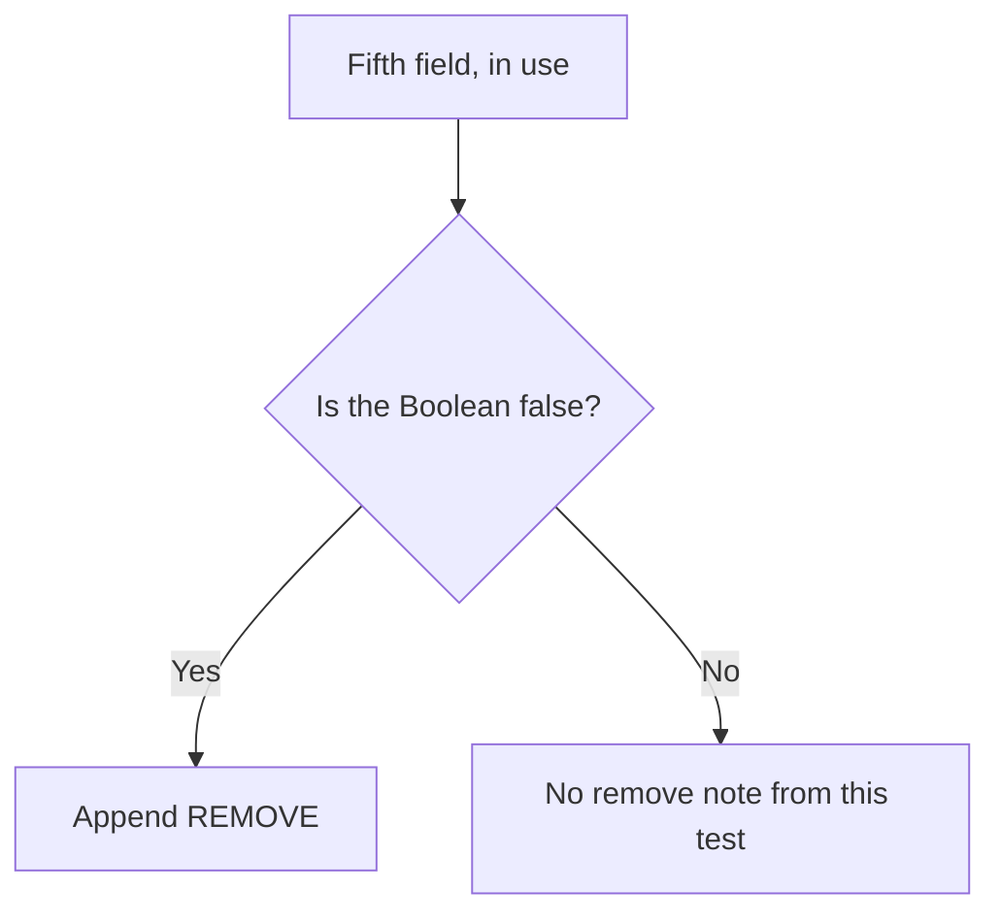

The note reads the Boolean. It does not read the release date.

### Logical drawing

```text
photo-gallery  2.0.0  in use = False  age = 103 days
note produced: REMOVE (not in use)
age test for this row: 103 > 730 is false
```
<!-- open-cyber-academy:lesson-figures:end ch-08 -->

### Learning outcomes

After this chapter, you should be able to:

1. Tie the REMOVE note to the fifth field.
2. Show that photo-gallery's age does not produce that note.
3. Refuse a second print that waits for a later confirmation.

### 8.1 False means unused. The age of this row is a different test.

The third `if` is `if not used`. photo-gallery stores `False`. The appended text is exactly `REMOVE (not in use)`. The words do not say vulnerable, abandoned, or advised. The age test for this row is 103 days, and `103 > 730` is false, so the UNMAINTAINED note is not added. A recent unused plugin and an old unused plugin receive the same REMOVE text. Age never enters this branch.

event-calendar is in use, so `not used` is false and REMOVE is not considered, even though its age note is present. newsletter is in use and receives neither note. The Boolean is not a count of pages that embed the gallery, and it is not a record of who was asked.

The later confirmation that nobody needs the gallery is a sentence Owen still has to settle. The tuple already says `False`. Editing the print after that conversation would hide the export the lab actually ran. A gallery stored as `True` would not receive REMOVE, however strongly someone wanted it gone. The flag is the field, not a wish written beside the file.

| Row | `in_use` | Age note? | REMOVE? |
|---|---|---|---|
| photo-gallery | False | no, 103 days | yes |
| event-calendar | True | yes, 1606 days | no |
| newsletter | True | no, 30 days | no |
| donate-form | True | no, 60 days | no |

### 8.2 Worked example

| Claim | Field the script read | Decision |
|---|---|---|
| photo-gallery is REMOVE because it is unused | Fifth field `False` | Keep |
| Its age is not why that word appears | 103 is not greater than 730 | Keep |
| "REMOVE means the plugin is old." | The branch does not read `last` | Refuse |
| "The line appears only after someone confirms it." | The tuple is already `False` | Refuse |

> **Synthetic case.** No person is named as the one who confirmed the gallery.

### Errors and limits

Leave the unused Boolean as it was exported. The confirmation stays prose.

### Apply

- **EX054 — Which test.** photo-gallery prints REMOVE, and its last release is 103 days before the review date. Does that age produce the note, and does a later confirmation that nobody needs the gallery change the line? *Rubric:* 3 = no; REMOVE is `not used`; 103 fails the age test; the confirmation stays prose; the tuple stays False;; 2 = the Boolean produces the note and the line stays;; 1 = one fact;; 0 = none.

<!-- open-cyber-academy:chapter-navigation:start ch-08 -->
### Continue studying — lesson 08 (chapter 08 of 20)

[← Chapter 07](#ch-07) · [Course chapter index](../SUBJECTS.md) · [Chapter 09 →](#ch-09)

Continue to the next authored lesson.
<!-- open-cyber-academy:chapter-navigation:end -->

<a id="ch-09"></a>

## Chapter 9 — The word ok is an empty note list

<!-- open-cyber-academy:lesson-figures:start ch-09 -->
### Lesson map

Lesson 09. Map, example, EX055.

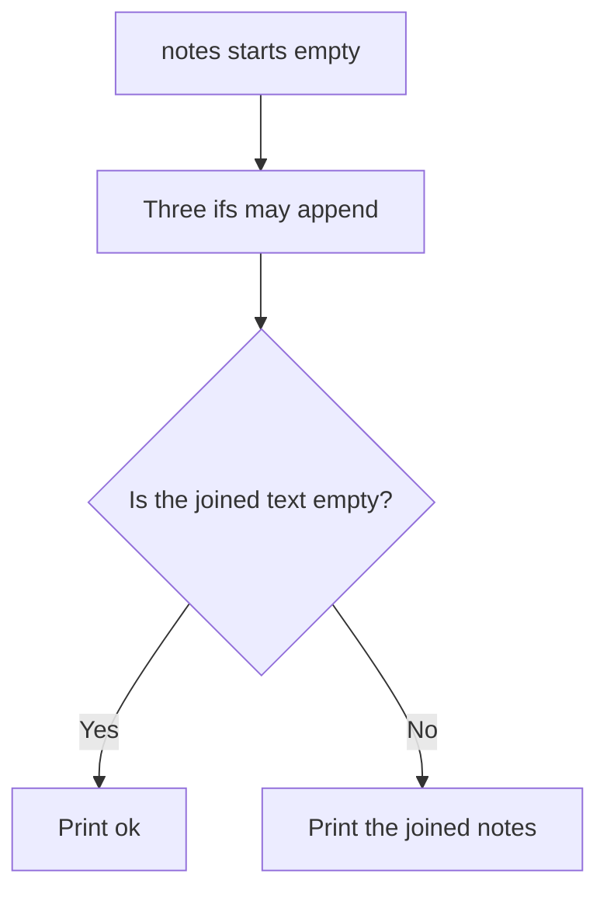

`ok` is the fallback string. It is not a grade.

### Logical drawing

```text
newsletter
  fixed is None
  30 > 730 is false
  in use is True
joined notes: empty
printed token: ok
```
<!-- open-cyber-academy:lesson-figures:end ch-09 -->

### Learning outcomes

After this chapter, you should be able to:

1. Derive `ok` from an empty note list.
2. Name the three tests newsletter fails to trigger.
3. Refuse to read `ok` as a clearance or a scan.

### 9.1 The `or` runs only because `join` returned an empty string.

Each row starts with `notes = []`. Three conditions may append. The print expression is `'; '.join(notes) or 'ok'`. `join` of an empty list is `''`, and `''` is false in Python, so the `or` yields the literal `ok`. That literal is two characters. It is not the word "safe", and it is not the output of a vulnerability scanner. The script imports only `datetime`.

newsletter reaches that fallback for three separate reasons. `fixed` is `None`, so the version comparison is skipped. Thirty days is not greater than 730, so the age note is skipped. `used` is `True`, so REMOVE is skipped. If any one of those three had appended, the joined string would be non-empty and `ok` would not appear. The fallback is the absence of notes, not a fourth positive test.

An empty note list also does not record who looked, how long they looked, or which advisory feed they opened. Kula et al. (2018) discuss how often library dependencies stay stale in a studied population. Zimmermann et al. (2019) discuss concentration of maintenance in the npm ecosystem. Neither paper's counts are cells in this list, and newsletter's `ok` is not a citation of those papers. Jacobs et al. (2021) define EPSS for an identified vulnerability. This row has no identifier, so an EPSS value is undefined here rather than low.

| Test on newsletter | Result | Note appended? |
|---|---|---|
| `fixed` is present and installed `<` fixed | `fixed` is `None` | no |
| age `> 730` | 30 days | no |
| `not used` | the Boolean is true | no |
| joined text | empty, so `ok` | the fallback |

### 9.2 Worked example

| Reading of `ok` | What the expression did | Decision |
|---|---|---|
| No note was appended | Empty join is false, so the literal prints | Keep |
| Three different tests each declined | Version, age, and use | Keep |
| "`ok` means the plugin was scanned." | The file imports no scanner | Refuse |
| "`ok` is an EPSS result." | No vulnerability identifier is stored | Refuse |

> **Synthetic case.** newsletter's version string is `5.1.3`, and no score is attached to it.

### Errors and limits

Do not promote the fallback word into a clearance the script never computed.

### Apply

- **EX055 — Empty join.** newsletter prints `ok`. A classmate calls that a passed scan and an EPSS result. Which three tests declined to append a note, and what does the `or` actually substitute? *Rubric:* 3 = `fixed` is `None`, 30 days is not greater than 730, and the component is in use; empty join is false, so the literal `ok` prints; there is no scan and no EPSS;; 2 = `ok` is the empty-list fallback and the three tests declined;; 1 = one test;; 0 = none.

<!-- open-cyber-academy:chapter-navigation:start ch-09 -->
### Continue studying — lesson 09 (chapter 09 of 20)

[← Chapter 08](#ch-08) · [Course chapter index](../SUBJECTS.md) · [Chapter 10 →](#ch-10)

Continue to the next authored lesson.
<!-- open-cyber-academy:chapter-navigation:end -->

<a id="ch-10"></a>

## Chapter 10 — One row can carry more than one note

<!-- open-cyber-academy:lesson-figures:start ch-10 -->
### Lesson map

Lesson 10. Map, example, EX056.

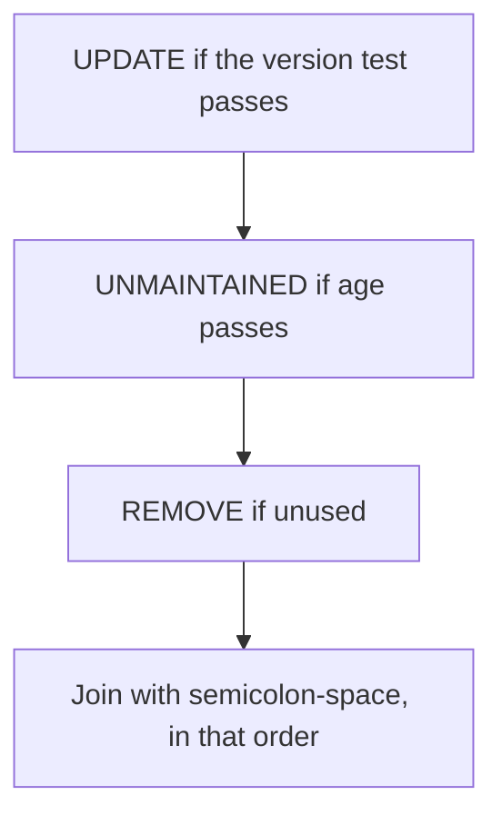

The three tests are independent. This file never makes two of them true on one row.

### Logical drawing

```text
separator in source: '; '
visible separators in the four lines: none
donate-form notes: one
event-calendar notes: one
photo-gallery notes: one
newsletter notes: none
```
<!-- open-cyber-academy:lesson-figures:end ch-10 -->

### Learning outcomes

After this chapter, you should be able to:

1. State the order in which notes are appended.
2. Explain why the separator is invisible in this output.
3. Refuse a merged note that this file did not produce.

### 10.1 The `if` statements do not stop each other.

Nothing in the loop uses `elif`. A row can collect an update note, an age note, and a remove note. `'; '.join(notes)` would place a semicolon and a space between them, in the order the three `if` blocks appear: UPDATE, then UNMAINTAINED, then REMOVE. That order is source order. It is not an estimate of which problem matters more.

In these four tuples the separator never appears. donate-form triggers only the version test. event-calendar triggers only the age test: its fixed version is `None`, and it is in use. photo-gallery triggers only the unused test. newsletter triggers none. A row that was old, unused, and behind a fixed version would print three clauses. No such row is stored, so a note that glues two clauses together is an invention.

The UPDATE text copies the fixed version from the tuple. It does not copy a CWE identifier, a CVE identifier, or a CVSS number. MITRE's CWE Top 25 is a public catalog. This script does not map a tuple onto a CWE entry. Ladisa et al. (2023) and Ohm et al. (2020) classify attacks against open-source supply chains. Their class names are not fields here, and this chapter does not reproduce an attack. The fixed string `3.2.4` remains a version, not a vulnerability key.

| Row | Notes appended | Separator shown? |
|---|---|---|
| donate-form | UPDATE only | no |
| event-calendar | UNMAINTAINED only | no |
| photo-gallery | REMOVE only | no |
| newsletter | none, so `ok` | no |
| A triple-fault row | not stored | would show two separators |

### 10.2 Worked example

| Proposed line | Why it fails or stands | Decision |
|---|---|---|
| donate-form has one UPDATE clause | Only the version test passed | Keep |
| The separator is `'; '` in the source | No output line contains it | Keep as source |
| "event-calendar prints UPDATE and UNMAINTAINED." | `fixed` is `None` | Refuse |
| "3.2.4 is a CWE identifier." | It is the fixed version string | Refuse |

> **Synthetic case.** The four note lists are disjoint. None is a combined finding.

### Errors and limits

Do not join clauses the loop never appended, and do not invent an identifier the tuple lacks.

### Apply

- **EX056 — Separator.** A classmate prints event-calendar as both UPDATE and UNMAINTAINED, separated by a semicolon, and treats `3.2.4` as a weakness identifier. What does this file actually join, and what is `3.2.4`? *Rubric:* 3 = no row has two notes, so the semicolon is not in the output; event-calendar has only the age note; `3.2.4` is donate-form's fixed version, not a CWE or CVE;; 2 = one note per flagged row and the version string stays a version;; 1 = one clause;; 0 = none.

<!-- open-cyber-academy:chapter-navigation:start ch-10 -->
### Continue studying — lesson 10 (chapter 10 of 20)

[← Chapter 09](#ch-09) · [Course chapter index](../SUBJECTS.md) · [Chapter 11 →](#ch-11)

Continue to the next authored lesson.
<!-- open-cyber-academy:chapter-navigation:end -->

<a id="ch-11"></a>

## Chapter 11 — Theme and services are not lab columns

<!-- open-cyber-academy:lesson-figures:start ch-11 -->
### Lesson map

Lesson 11. Map, example, EX057.

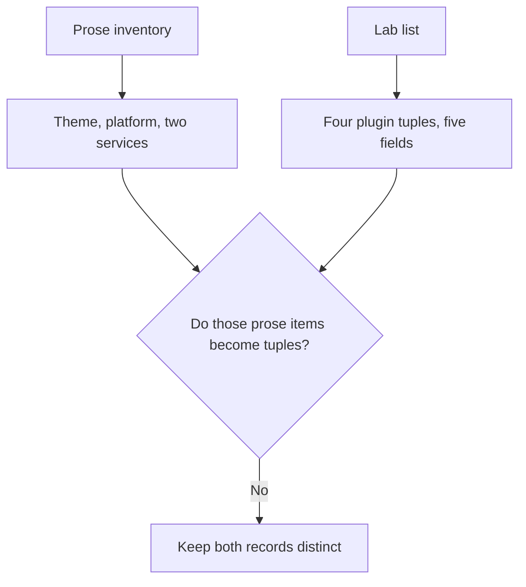

The administration-page story is wider than `components`.

### Logical drawing

```text
in the four tuples: name, version, fixed or None, last release, in use
in the prose inventory, and not in the list: theme, platform version,
  payment provider, newsletter service
```
<!-- open-cyber-academy:lesson-figures:end ch-11 -->

### Learning outcomes

After this chapter, you should be able to:

1. List the five fields a tuple actually stores.
2. Name the inventory items that never become rows.
3. Refuse an output line for the theme or a service.

### 11.1 The script's record is four plugins. The charity's list is a paragraph.

Owen's inventory, in the earlier lesson, records name, version, and active state for plugins, and also the theme, the platform version, and the outside services. The lab that follows stores four plugin tuples. Its fields are the ones in the comment: name, version, fixed version or `None`, last release, and `in_use`. There is no sixth field for a supplier, a theme name, or a service.

The NTIA minimum elements for an SBOM include supplier name, component name, version, other unique identifiers, dependency relationship, the author of the SBOM data, and a timestamp. Component name and version are the first two strings of each tuple. Supplier, another unique identifier, a dependency edge, an SBOM author, and an SBOM timestamp are absent. `today` is a review clock used for subtraction. It is not printed as an SBOM timestamp, and it does not name who wrote the list.

The platform is described as a common website platform and is not named. The theme is not named. The payment provider and the newsletter service are not named, and neither is a tuple. Card details are described as going to the provider rather than resting on the site. That sentence is not a fifth row and not a test the loop runs. A hand-added file that the administration page missed is a limit already stated. The script cannot show a file it was not given, and this chapter does not invent one.

| Item in the prose inventory | Present as a tuple? |
|---|---|
| donate-form, event-calendar, photo-gallery, newsletter | yes |
| theme | no name, no row |
| platform version | no number, no row |
| payment provider | unnamed, no row |
| newsletter service | unnamed, no row |

### 11.2 Worked example

| Sentence offered as a fifth line | What the list contains | Decision |
|---|---|---|
| Four plugin lines | Four tuples | Keep |
| Theme and services stay in the prose inventory | They are not elements of `components` | Keep |
| "The script printed the theme version." | No theme field exists | Refuse |
| "The payment provider is the fifth component." | The provider is out of the list and unnamed | Refuse |

> **Synthetic case.** No supplier string is stored on any tuple.

### Errors and limits

Do not widen the print until a field exists to widen it with.

### Apply

- **EX057 — Five fields.** A classmate adds output lines for the theme, the platform version, and the payment provider, and calls the file an SBOM because a date appears in the source. Which fields do the tuples store, and which NTIA elements are missing? *Rubric:* 3 = the tuples store name, version, fixed or `None`, last release, and `in_use`; theme, platform, and both services are not rows; supplier, other identifiers, dependency relationship, SBOM author, and SBOM timestamp are absent;; 2 = the four plugins stay the only lines and the prose items stay prose;; 1 = one field;; 0 = none.

<!-- open-cyber-academy:chapter-navigation:start ch-11 -->
### Continue studying — lesson 11 (chapter 11 of 20)

[← Chapter 10](#ch-10) · [Course chapter index](../SUBJECTS.md) · [Chapter 12 →](#ch-12)

Continue to the next authored lesson.
<!-- open-cyber-academy:chapter-navigation:end -->

<a id="ch-12"></a>

## Chapter 12 — Phone numbers are not a fifth field

<!-- open-cyber-academy:lesson-figures:start ch-12 -->
### Lesson map

Lesson 12. Map, example, EX058.

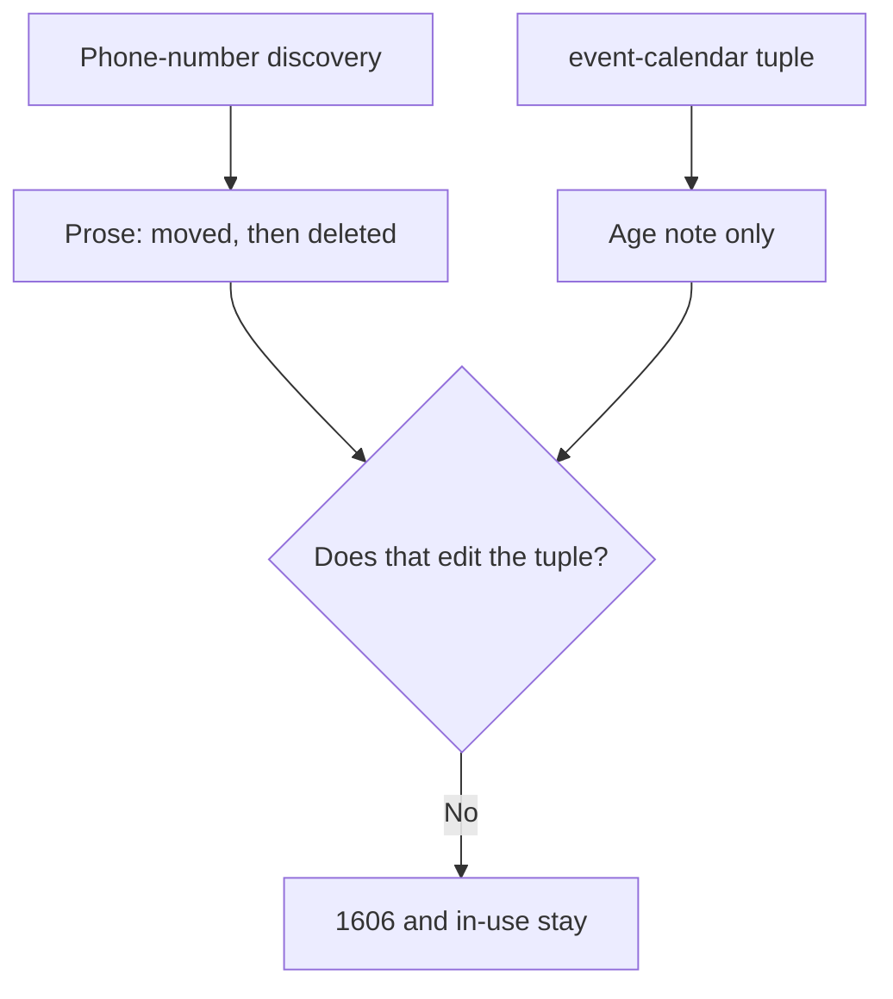

The discovery changes priority in the write-up. It does not change the row.

### Logical drawing

```text
event-calendar tuple stays:
  1.4.1, fixed None, last release 2022-05-09, in use True
printed note stays:
  UNMAINTAINED (1606 days since release)
phone numbers printed: none
```
<!-- open-cyber-academy:lesson-figures:end ch-12 -->

### Learning outcomes

After this chapter, you should be able to:

1. Keep the calendar tuple identical after the discovery.
2. Place the phone-number move in prose.
3. Refuse a digit, a count, or a new flag on that line.

### 12.1 The fifth field stays true. The phones never become a column.

event-calendar's tuple is `("event-calendar", "1.4.1", None, date(2022, 5, 9), True)`. The discovery that it stored volunteers' phone numbers for shift sign-ups is told later. Those numbers were moved to the charity's existing volunteer system and deleted from the website. The volunteer system is not named. No telephone number is written in the book. No count of volunteers is written.

`True` still means the calendar is in use at the time of this export. The move does not flip that Boolean, does not fill in a fixed version, and does not change 1606. A reader who adds `PHONES` to the note list is editing a file the lab did not edit. Higher harm moved the replacement earlier in the month's plan. A plan is not a second execution of the loop.

The three administrator accounts from the opening week are also absent here. This tuple does not store an owner. The volunteer who installed plugins years ago is unnamed and is not a field. Landis and Koch (1977) define kappa for more than one coder. One person reading this row does not produce a kappa. The agreement statistic stays undefined.

| After the discovery | Changes the tuple? |
|---|---|
| Replacement moved earlier in the plan | no |
| Numbers moved to the volunteer system | no |
| Numbers deleted from the website | no |
| Printed note | still the 1606-day line only |

### 12.2 Worked example

| Added text | Stored in the tuple? | Decision |
|---|---|---|
| UNMAINTAINED and 1606 | yes, from the age test | Keep |
| `in_use` remains true | the fifth field | Keep |
| A phone number or a count of volunteers | no such value | Refuse |
| "The row now says the phones were deleted." | The deletion is prose | Refuse |

> **Synthetic case.** The calendar row is still one component line.

### Errors and limits

Do not write a telephone number into a lesson that never recorded one.

### Apply

- **EX058 — Unchanged tuple.** After the phone-number discovery, a classmate changes the calendar line to say the phones were deleted and flips `in_use` to false. What does the tuple still contain? *Rubric:* 3 = version `1.4.1`, fixed `None`, last release 2022-05-09, `in_use` true, and the 1606-day note; the move and the deletion stay prose; no phone number is printed;; 2 = the printed line stays the age note and the Boolean stays true;; 1 = one field;; 0 = none.

<!-- open-cyber-academy:chapter-navigation:start ch-12 -->
### Continue studying — lesson 12 (chapter 12 of 20)

[← Chapter 11](#ch-11) · [Course chapter index](../SUBJECTS.md) · [Chapter 13 →](#ch-13)

Continue to the next authored lesson.
<!-- open-cyber-academy:chapter-navigation:end -->

<a id="ch-13"></a>

## Chapter 13 — The hash match is two hashes of one literal

<!-- open-cyber-academy:lesson-figures:start ch-13 -->
### Lesson map

Lesson 13. Map, example, EX059.

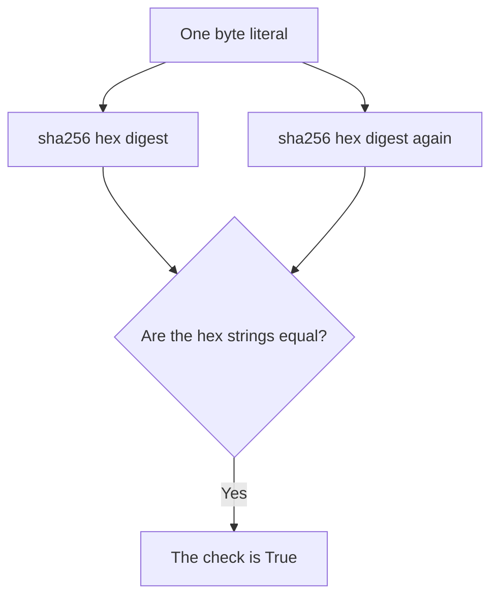

Equal inputs produce equal digests. The digest itself is not printed.

### Logical drawing

```text
download = b"synthetic donate-form 3.2.4 release"
vendor side hashes that same literal
printed result: [x] hash matches vendor
printed hex digits: none
```
<!-- open-cyber-academy:lesson-figures:end ch-13 -->

### Learning outcomes

After this chapter, you should be able to:

1. Show that both sides hash one byte string.
2. Keep the digest off the page.
3. Refuse a signature, a fetched file, or a reproduced build.

### 13.1 `hashlib.sha256` runs twice on equal bytes. The page shows only a tick.

`download` is the literal `b"synthetic donate-form 3.2.4 release"`. `vendor_hash` is `hashlib.sha256` of that same literal, taken as hex. The check compares a fresh hex digest of `download` with `vendor_hash`. Because the byte strings are equal, the digests are equal, and the Boolean is `True`. The print is `[x] hash matches vendor`. No hex character is written to the output. Copying a digest into the lesson would add a value the run did not show.

The script never calls `open`, never reads a path, and never requests a page. The prose says Owen compared a download from the official plugin page with a vendor-published hash. That story is outside the literals. This file cannot fail the comparison unless one literal is edited, and the published file does not contain that edit. A match of two hashes of one string is what the construction guarantees. It is not evidence that a distant page was retrieved during the run.

Newman et al. (2022) describe Sigstore's signing. This script does not sign and does not check a signature. Lamb and Zacchiroli (2022) describe reproducible builds. Hashing one literal does not rebuild the plugin. Thompson (1984) describes a compiler that can mislead a later build. This file does not compile anything. Torres-Arias et al. (2019) describe in-toto layouts that record steps. The checklist is not such a layout. SLSA v1.0 is not scored. The tick remains a Boolean.

| Object | Role in this file | Shown on the page? |
|---|---|---|
| The byte literal | Input to both digests | no |
| The hex digest | Compared, then discarded | no |
| `[x] hash matches vendor` | The Boolean, printed | yes |
| A signature or a certificate | Not computed | no |

### 13.2 Worked example

| Claim about the tick | Mechanism | Decision |
|---|---|---|
| The Boolean is true | Both sides hash one literal | Keep |
| The hex digest is absent | The print is the bracket line only | Keep |
| "The script fetched the vendor page." | No request is made | Refuse |
| "The tick is a Sigstore verification." | No signature is checked | Refuse |

> **Synthetic case.** The byte string is synthetic release text, not a plugin archive.

### Errors and limits

Do not paste a digest the output never contained.

### Apply

- **EX059 — One literal.** The checklist ticks `hash matches vendor`. A classmate prints a hex digest, says the script downloaded the plugin, and calls the tick a signature check. What did the two `sha256` calls receive, and what is printed? *Rubric:* 3 = both calls receive `b"synthetic donate-form 3.2.4 release"`; the digests match by that equality; only the tick is printed; there is no fetch and no signature;; 2 = one literal, a tick, and no digest on the page;; 1 = one fact;; 0 = none.

<!-- open-cyber-academy:chapter-navigation:start ch-13 -->
### Continue studying — lesson 13 (chapter 13 of 20)

[← Chapter 12](#ch-12) · [Course chapter index](../SUBJECTS.md) · [Chapter 14 →](#ch-14)

Continue to the next authored lesson.
<!-- open-cyber-academy:chapter-navigation:end -->

<a id="ch-14"></a>

## Chapter 14 — Four ticks are not a printed fraction

<!-- open-cyber-academy:lesson-figures:start ch-14 -->
### Lesson map

Lesson 14. Map, example, EX060.

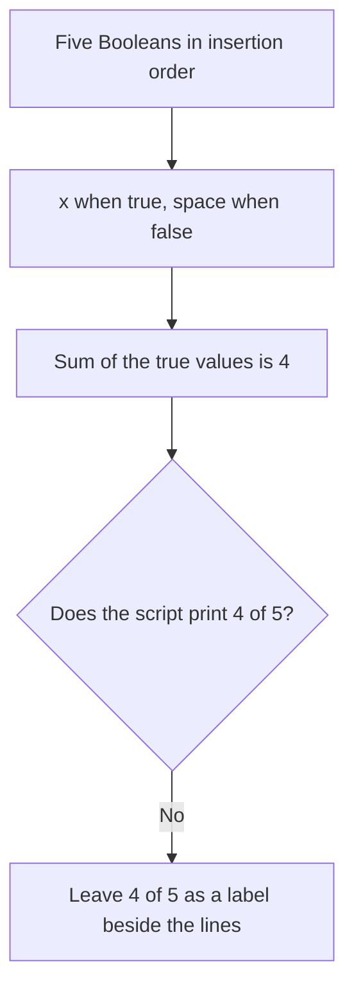

The fraction is arithmetic. The page shows brackets.

### Logical drawing

```text
[x] official source used
[x] hash matches vendor
[x] backup taken
[x] tested on staging copy
[ ] admin accounts use MFA
true values: 4    keys: 5    printed fraction: none
```
<!-- open-cyber-academy:lesson-figures:end ch-14 -->

### Learning outcomes

After this chapter, you should be able to:

1. Count the true values without replacing the print.
2. Explain the bracket as a one-character flag.
3. Keep dictionary order distinct from importance.

### 14.1 Insertion order prints five lines. The sum is not one of them.

`checks` is a dictionary of five strings to Booleans. Python 3.7 and later preserve insertion order. This file does not sort the keys. The loop prints `[x]` when the Boolean is true and `[ ]` when it is false, then the key. Four values are `True`. One is `False`. Someone may write "four true, five keys" in the margin. The loop's own page never contains that fraction, a slash form, or a percentage.

The false key is last because it was written last, not because multi-factor sign-in was judged the least important. Moving that key to the top of the dictionary would move its blank bracket. The published file does not move it. A quality, a duration, or a witness cannot be stored in a Boolean. The `x` does not say how the hash was obtained, and the blank does not name a person.

Decan et al. (2018) study vulnerabilities across a package network. Their counts are not these five Booleans. SSDF (NIST SP 800-218) groups secure-development practices. This dictionary is not a scored SSDF assessment. OWASP ASVS is likewise not scored. The five lines remain five lines.

| Key, in written order | Boolean | Bracket |
|---|---|---|
| official source used | True | x |
| hash matches vendor | True | x |
| backup taken | True | x |
| tested on staging copy | True | x |
| admin accounts use MFA | False | space |

### 14.2 Worked example

| Offered summary | Relation to the print | Decision |
|---|---|---|
| Four `x` brackets and one blank | The five Booleans | Keep |
| "4 of 5" written beside the lines and marked as a count | Not a line the script prints | May stay if labelled |
| "The script's last line is `4 of 5`." | The last line is the blank MFA bracket | Refuse |
| "The blank is last because it matters least." | It is last because of insertion order | Refuse |

> **Synthetic case.** The five keys are the whole checklist.

### Errors and limits

Label derived counts as counts. Do not slide them into the output.

### Apply

- **EX060 — Beside, not instead.** Someone replaces the five bracket lines with the single sentence `4 of 5` and says the blank is last because it is the least important check. What may a count do, and why is the blank last? *Rubric:* 3 = 4 true values out of 5 keys may be labelled beside the print; the script does not print that fraction; the blank is last by insertion order; the five lines stay;; 2 = the brackets stay and the fraction is not the output;; 1 = one line;; 0 = none.

<!-- open-cyber-academy:chapter-navigation:start ch-14 -->
### Continue studying — lesson 14 (chapter 14 of 20)

[← Chapter 13](#ch-13) · [Course chapter index](../SUBJECTS.md) · [Chapter 15 →](#ch-15)

Continue to the next authored lesson.
<!-- open-cyber-academy:chapter-navigation:end -->

<a id="ch-15"></a>

## Chapter 15 — NOT READY names the false keys

<!-- open-cyber-academy:lesson-figures:start ch-15 -->
### Lesson map

Lesson 15. Map, example, EX061.

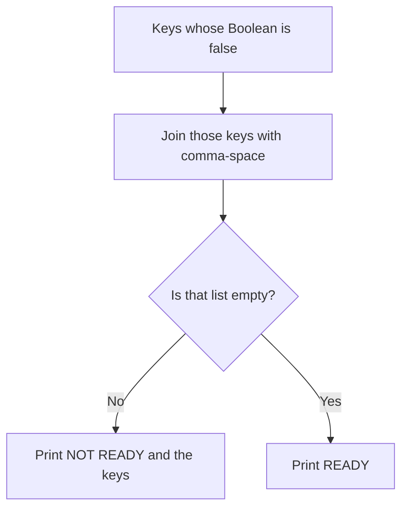

This run takes the first branch. The ready word is the other branch.

### Logical drawing

```text
false keys, in dictionary order: admin accounts use MFA
printed line: NOT READY: admin accounts use MFA
READY: not printed
```
<!-- open-cyber-academy:lesson-figures:end ch-15 -->

### Learning outcomes

After this chapter, you should be able to:

1. Build `missing` as the false keys.
2. Read the printed line as that join.
3. Refuse a count of people inside the Boolean.

### 15.1 One false key. The prose about three accounts is not the value.

`missing` keeps every key whose Boolean is false, in dictionary order. `', '.join(missing)` would separate several keys with a comma and a space. This dictionary has one false key, so the join has nothing to separate. The printed line is exactly `NOT READY: admin accounts use MFA`. `READY` prints only when `missing` is empty. It is not empty.

The opening week speaks of three administrator accounts. The release lesson says one volunteer administrator has not finished multi-factor sign-in. Those sentences are prose. The Boolean does not store the integer 3, the integer 1, or a fraction. It does not store the volunteer's name, which was never given, or the kind of second factor. Two finished accounts and one unfinished account would be a story about the prose. It is not a value the script computed, and this chapter does not print `2 of 3`.

If a second key were false, its name would appear in `missing` in dictionary order, on the same NOT READY line. No second key is false. Changing the MFA Boolean to true in order to see `READY` would be a different file. The published checklist does not make that change.

| Stored by the false Boolean | Not stored |
|---|---|
| The key is unmet | Which of three accounts |
| It is the only unmet key | A name, a factor type, a serial |
| The line names that key | The word READY |

### 15.2 Worked example

| Reading | What `missing` holds | Decision |
|---|---|---|
| NOT READY names one key | `admin accounts use MFA` | Keep |
| READY is the empty-list branch | The list has one key | Keep as the other branch |
| "The script reports 2 of 3 accounts." | No account count is stored | Refuse |
| "Two unmet keys were joined." | One Boolean is false | Refuse |

> **Synthetic case.** The volunteer administrator remains unnamed.

### Errors and limits

Do not turn one Boolean into a census of the three accounts.

### Apply

- **EX061 — The false key.** The last line says `NOT READY: admin accounts use MFA`. A classmate rewrites it as `2 of 3` and adds the unfinished volunteer's name. What does the line actually contain? *Rubric:* 3 = one false key, named in full, after `NOT READY:`; `READY` is not printed; three accounts and one unfinished volunteer stay prose; no name and no `2 of 3` are in the script;; 2 = the printed line stays and the census stays out;; 1 = one token;; 0 = none.

<!-- open-cyber-academy:chapter-navigation:start ch-15 -->
### Continue studying — lesson 15 (chapter 15 of 20)

[← Chapter 14](#ch-14) · [Course chapter index](../SUBJECTS.md) · [Chapter 16 →](#ch-16)

Continue to the next authored lesson.
<!-- open-cyber-academy:chapter-navigation:end -->

<a id="ch-16"></a>

## Chapter 16 — Official source is a stored Boolean

<!-- open-cyber-academy:lesson-figures:start ch-16 -->
### Lesson map

Lesson 16. Map, example, EX062.

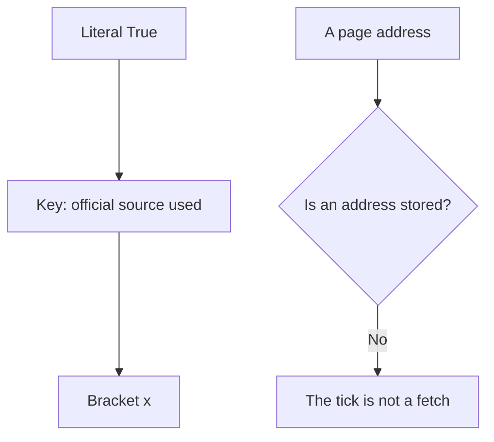

The prose names a page. The dictionary stores a Boolean.

### Logical drawing

```text
"official source used": True
URL stored: none
request performed by the script: none
printed bracket: [x]
```
<!-- open-cyber-academy:lesson-figures:end ch-16 -->

### Learning outcomes

After this chapter, you should be able to:

1. Treat this tick as a literal `True`.
2. Keep the official-page sentence in the prose.
3. Refuse a URL the dictionary does not hold.

### 16.1 True does not remember an address.

The first pair in `checks` is the string `official source used` mapped to the literal `True`. Unlike the hash pair, this pair does not compute anything. The loop cannot tell a computed true from a written true. Both print `[x]`. The difference is in the source: one value is an equality of digests, and this value is a constant.

The earlier lesson says the archive was taken from the plugin's official page. The dictionary does not store that address, the publisher's name, or a retrieval time. A constant `True` would remain `True` even if the sentence about the page were deleted from the prose, and the sentence can be true in the story while a different run stored `False`. This run stores `True`. Wermke et al. (2022) study how maintainers talk about trust. Their interviews are not this Boolean. Johnson et al. (2013) study why developers skip static-analysis tools. No static-analysis tool is invoked here.

Host terms still bound what Owen may test. The constant does not record that he read them. It records only that the checklist author set the bit.

| Question | Answer in this file |
|---|---|
| What is stored? | The literal `True` |
| What is printed? | `[x] official source used` |
| Is a URL stored? | No |
| Does the script request a page? | No |

### 16.2 Worked example

| Claim | Source of the bit | Decision |
|---|---|---|
| The first bracket is `x` | The literal `True` | Keep |
| The official page is a prose sentence | No URL field | Keep |
| "The script saved the download address." | The value is a Boolean | Refuse |
| "The tick proves a request succeeded." | No request is in the file | Refuse |

> **Synthetic case.** The publisher of donate-form is not named.

### Errors and limits

Do not invent an address so that the Boolean looks like a fetch.

### Apply

- **EX062 — Literal true.** A classmate says the first tick is there because the script opened the official plugin page and saved the address. What does the dictionary store for that key? *Rubric:* 3 = the literal `True`; no URL and no request; the page remains a prose sentence; the bracket stays `[x]`;; 2 = a stored Boolean, not a fetch;; 1 = one fact;; 0 = none.

<!-- open-cyber-academy:chapter-navigation:start ch-16 -->
### Continue studying — lesson 16 (chapter 16 of 20)

[← Chapter 15](#ch-15) · [Course chapter index](../SUBJECTS.md) · [Chapter 17 →](#ch-17)

Continue to the next authored lesson.
<!-- open-cyber-academy:chapter-navigation:end -->

<a id="ch-17"></a>

## Chapter 17 — Backup and staging are separate bits

<!-- open-cyber-academy:lesson-figures:start ch-17 -->
### Lesson map

Lesson 17. Map, example, EX063.

```mermaid
flowchart TD
  B["backup taken = True"] --> P["Its own bracket"]
  S["tested on staging copy = True"] --> R["Its own bracket"]
  P --> Q{"Does one True imply the other?"}
  R --> Q
  Q -->|No| K["Both happen to be true in this file"]
```

Two keys. Either could have been false alone. In this file, neither is.

### Logical drawing

```text
[x] backup taken
[x] tested on staging copy
date stored on either bit: none
donor row stored on either bit: none
```
<!-- open-cyber-academy:lesson-figures:end ch-17 -->

### Learning outcomes

After this chapter, you should be able to:

1. Keep the two Booleans independent.
2. Place the restore and the synthetic donations in prose.
3. Refuse a date or a donor record inside either bit.

### 17.1 Each literal answers one question. Neither bit describes the bytes.

`backup taken` is the literal `True`. `tested on staging copy` is another literal `True`. The dictionary does not check that the second is true only when the first is true. A file could store a test without a backup, or a backup without a test. This file stores both as true. The two brackets are two lines because they are two keys.

The prose says Owen restored a backup to staging once, and later tested donate-form there with synthetic donations. The restore is one event told in sentences. It is not a date inside either Boolean. The synthetic donations are not rows in `checks`. No donor name, no amount, and no card number is available to copy. Card numbers are described as staying with the payment provider. The provider's systems are out of scope, and this dictionary does not assess them.

A change log line, in the prose, records what changed, when, and how to undo it. Those three log fields are not keys in `checks`. The bits do not say which backup file was used. Asking the script for a filename asks for a string it does not hold.

| Key | Value | What the prose adds, outside the bit |
|---|---|---|
| backup taken | True | One restore onto staging, earlier |
| tested on staging copy | True | Synthetic donations, no real donor rows |
| either bit | no date field | The change log carries "when", in prose |

### 17.2 Worked example

| Claim | Independence | Decision |
|---|---|---|
| Both brackets are `x` | Both literals are `True` | Keep |
| A backup without a test is representable | The bits do not imply each other | Keep as a property of the dictionary |
| "The script printed the restore date." | No date is stored | Refuse |
| "Synthetic donors are rows in `checks`." | They are prose only | Refuse |

> **Synthetic case.** Staging uses synthetic records. None are listed in the checklist.

### Errors and limits

Do not fill a Boolean with a filename, a date, or a donor.

### Apply

- **EX063 — Two bits.** Both backup and staging print `x`. A classmate treats them as one fact, adds the restore date, and lists a synthetic donor. What does each key store? *Rubric:* 3 = each key stores its own literal `True`; one does not imply the other in the program, though both are true here; the date and the donor stay prose;; 2 = two Booleans stay and the date stays out;; 1 = one bit;; 0 = none.

<!-- open-cyber-academy:chapter-navigation:start ch-17 -->
### Continue studying — lesson 17 (chapter 17 of 20)

[← Chapter 16](#ch-16) · [Course chapter index](../SUBJECTS.md) · [Chapter 18 →](#ch-18)

Continue to the next authored lesson.
<!-- open-cyber-academy:chapter-navigation:end -->

<a id="ch-18"></a>

## Chapter 18 — The morning release is not this print

<!-- open-cyber-academy:lesson-figures:start ch-18 -->
### Lesson map

Lesson 18. Map, example, EX064.

```mermaid
flowchart TD
  F["MFA Boolean is False"] --> N["NOT READY line"]
  M["Next morning, in prose"] --> H["Volunteer finishes setup"]
  H --> Q{"Does the published file change the Boolean?"}
  N --> Q
  Q -->|No| K["The print stays NOT READY"]
```

A later rerun is a sentence. This output is the file as published.

### Logical drawing

```text
published missing list: not empty
published decision word: NOT READY
READY would require an empty missing list
that edit is not in the file
```
<!-- open-cyber-academy:lesson-figures:end ch-18 -->

### Learning outcomes

After this chapter, you should be able to:

1. Keep the published checklist on the NOT READY branch.
2. Place the next morning in prose.
3. Refuse a second script that prints READY.

### 18.1 Holding the release does not assign `True`.

The lesson says Owen held the release until the volunteer finished setup the next morning, then reran the checklist and released. The published dictionary still maps `admin accounts use MFA` to `False`. The `missing` list therefore still has one key, and the last line is still `NOT READY: admin accounts use MFA`. A morning rerun that printed `READY` would be a second program, or an edit of this one. Neither is in the book.

The director had already asked to be told before a donor-visible change, and the update was treated as such a change. That notice is prose. It is not a sixth key, and it does not flip the fifth Boolean. The cost of waiting overnight is also prose. The script has no clock besides the dates in the other lab, and those dates are not read by `lab_release.py`.

Replacing `False` with `True` so the sample looks finished would teach a different file from the one whose output was embedded. The hold, the morning, and the release stay in the narrative beside the unchanged print.

| Event | In the published `checks`? |
|---|---|
| MFA Boolean false | yes |
| NOT READY line | yes, as the print |
| Volunteer finishes the next morning | prose only |
| A later print of READY | not in this file |

### 18.2 Worked example

| Sentence about the release | Effect on this file | Decision |
|---|---|---|
| The embedded print says NOT READY | `missing` is not empty | Keep |
| Owen waited, then released | Narrative beside the file | Keep as prose |
| "The published output now says READY." | The Boolean is still false | Refuse |
| "The director's notice is a checklist key." | It is an email condition | Refuse |

> **Synthetic case.** The morning is part of the story, not a second embedded output.

### Errors and limits

Do not rewrite the false bit because the story moved past it.

### Apply

- **EX064 — Unpublished rerun.** A classmate replaces the last line with `READY` because Owen released the update the next morning. What does the published file still print, and where does the morning belong? *Rubric:* 3 = the file still prints `NOT READY: admin accounts use MFA`; the morning rerun stays prose; `READY` would need an empty `missing` list, which this file does not have;; 2 = NOT READY stays and the morning stays prose;; 1 = one word;; 0 = none.

<!-- open-cyber-academy:chapter-navigation:start ch-18 -->
### Continue studying — lesson 18 (chapter 18 of 20)

[← Chapter 17](#ch-17) · [Course chapter index](../SUBJECTS.md) · [Chapter 19 →](#ch-19)

Continue to the next authored lesson.
<!-- open-cyber-academy:chapter-navigation:end -->

<a id="ch-19"></a>

## Chapter 19 — A routine is not a sixth check

<!-- open-cyber-academy:lesson-figures:start ch-19 -->
### Lesson map

Lesson 19. Map, example, EX065.

```mermaid
flowchart TD
  C["Five keys in checks"] --> L["Five bracket lines"]
  R["Weekly, monthly, yearly routines"] --> P["Prose owners and notes"]
  P --> Q{"Do those routines add keys?"}
  L --> Q
  Q -->|No| K["The dictionary stays five keys"]
```

The routines repeat work. They are not new Booleans.

### Logical drawing

```text
keys: official source, hash, backup, staging, MFA
not keys: weekly update check, monthly account review,
  yearly maintenance review, automatic updates,
  the second volunteer, the director's notice
```
<!-- open-cyber-academy:lesson-figures:end ch-19 -->

### Learning outcomes

After this chapter, you should be able to:

1. List the five keys and stop.
2. Place the three routines in prose.
3. Refuse a sixth bracket for a person or a schedule.

### 19.1 The dictionary's length is five. The calendar of routines is a paragraph.

Weekly work, in the prose, is to check for plugin updates and to apply security updates after staging. Monthly work is to review the component list and the administrator accounts. Yearly work is to review maintenance and the restore test. Each routine is said to have an owner and a note. Owen owns the weekly check. A second volunteer, still unnamed, is the backup the director agreed to ask. None of those sentences is a key in `checks`. `len(checks)` is 5.

Automatic security updates, turned on where the host supports them, are also prose. The host is unnamed, and the dictionary does not store whether that feature exists. The second volunteer is not one of the three administrator accounts merely because both are people. The unfinished volunteer administrator and the second volunteer are different unnamed roles. The script does not store either role.

A sixth key would change the bracket count and, if false, the NOT READY line. The published file has five keys and one false value. SAMM is a maturity model cited for larger practice. It is not scored against these five bits. Shostack (2014) is the threat-modeling reference already in the source list. This checklist is not a threat model, and no data-flow diagram is generated by the script.

| Item | In `checks`? |
|---|---|
| The five release questions | yes |
| Weekly, monthly, and yearly routines | no |
| Automatic updates | no |
| Second volunteer | no |
| Director's notice | no |

### 19.2 Worked example

| Proposed sixth line | Why it is not a key | Decision |
|---|---|---|
| Five brackets remain the print | Five pairs were written | Keep |
| Routines stay in the lesson's prose | They have owners in sentences | Keep |
| "Add a tick for the second volunteer." | No such key | Refuse |
| "Automatic updates are the sixth Boolean." | They are a host feature in prose | Refuse |

> **Synthetic case.** Both volunteers stay unnamed, and they are not merged.

### Errors and limits

Do not lengthen the dictionary to make the routines look measured.

### Apply

- **EX065 — Five keys.** A classmate adds checklist lines for the weekly routine, automatic updates, and the second volunteer, then says the script measured six things. How many keys does `checks` contain, and where do those three items live? *Rubric:* 3 = five keys; one of them is false; the weekly routine, automatic updates, and the second volunteer stay prose; do not add a sixth key;; 2 = the five lines stay and the additions stay prose;; 1 = one key;; 0 = none.

<!-- open-cyber-academy:chapter-navigation:start ch-19 -->
### Continue studying — lesson 19 (chapter 19 of 20)

[← Chapter 18](#ch-18) · [Course chapter index](../SUBJECTS.md) · [Chapter 20 →](#ch-20)

Continue to the next authored lesson.
<!-- open-cyber-academy:chapter-navigation:end -->

<a id="ch-20"></a>

## Chapter 20 — What the charity note can say

<!-- open-cyber-academy:lesson-figures:start ch-20 -->
### Lesson map

Lesson 20. Map, example, EX066.

```mermaid
flowchart TD
  N["A leaving note"] --> Q{"Does the sentence replace a print, fill a blank, or close the review?"}
  Q -->|Yes| R["Reject it"]
  Q -->|No| K["The note may cite that line"]
```

Twenty lessons meet a planning minimum. They leave the charity's open items open.

### Logical drawing

```text
may stay
    the four component lines, including 1606 and ok
    the five brackets and NOT READY: admin accounts use MFA
must not be added
    a reordered list, a digest, a CVE, a platform name
    READY as the published line, a donor count, the word secure
```
<!-- open-cyber-academy:lesson-figures:end ch-20 -->

### Learning outcomes

After this chapter, you should be able to:

1. Repeat both embedded prints and the open blanks.
2. Reject a note that replaces a print or fills a blank.
3. Name the following subject while this review stays open.

### 20.1 A note may quote the file. It may not improve the file.

A leaving note may say what was measured. From the component script, keep the four lines in list order: donate-form `3.2.0` updating to `3.2.4`, event-calendar unmaintained at 1606 days, photo-gallery removed because it is unused, and newsletter `ok`. From the release script, keep the four `x` brackets, the blank MFA bracket, and `NOT READY: admin accounts use MFA`. A count of 4 true values out of 5 keys, the ages 60, 103, and 30, and the cut 730 may be labelled as arithmetic beside the source. They must not be swapped in as lines the scripts printed.

The blanks stay blank. No platform name, no theme name, no host name, no payment-provider name, no plugin publisher, no URL, no hex digest, no CVE, no CWE, no CVSS, no EPSS, no phone number, no volunteer name, no donor count, and no restore date are available to copy. Three administrator accounts stay a prose figure. One unfinished volunteer administrator stays prose. The morning release stays prose, so the published word remains NOT READY. The phone-number move stays prose, so the calendar tuple remains in use and 1606. secure-pipeline-blueprints stays a supplementary repository, and neither lab script measured a control from it.

Chapter 4 keeps the month's closing line, and this leaving note does not reopen it as a finished review. Quoting those embedded lines is the note's whole permission, and polishing either script into a cleaner result is outside it.

### 20.2 Worked example

| Leaving-note sentence | Why it fails or stands | Decision |
|---|---|---|
| "The calendar line says 1606, and the checklist says NOT READY." | The two scripts | May stay |
| "4 of 5 is a count beside the brackets." | Not the printed output | May stay if labelled |
| "The list was reordered, a digest was attached, and the line now says READY." | Replaces both files | Reject |
| "Twenty lessons make Riverside secure." | The review is still open | Reject |

> **Synthetic case.** The note is a classroom page about Riverside Food Network. It is not a notice to donors.

### Errors and limits

Twenty English lessons meet Riverside Food Network's planning minimum and leave this review open. A fresh donation-page question can still earn its own later Riverside lesson. These English chapters do not publish another language edition. Application and software supply chain security stays this course. Security operations and blue team is the learner's following subject. Open items at the charity stay open on that turn. These chapters do not call Riverside secure, and they do not hand anyone a qualification.

### Apply

- **EX066 — Four claims.** A classmate's leaving note reorders the component list, prints a hex digest and a CVE, replaces NOT READY with READY, adds a donor count and a platform name, and says twenty lessons make the charity secure. Which claims do you reject, and what do twenty lessons meet? *Rubric:* 3 = reject the reordered list, the digest, the CVE, READY, the donor count, the platform name, and the secure claim; keep both embedded prints, including 1606, ok, and NOT READY; twenty lessons meet the planning minimum and leave review open;; 2 = reject the closings and keep both prints;; 1 = one claim;; 0 = none.

<!-- open-cyber-academy:chapter-navigation:start ch-20 -->
### Continue studying — lesson 20 (chapter 20 of 20)

[← Chapter 19](#ch-19) · [Course chapter index](../SUBJECTS.md) · [Next course via chapter index →](../SUBJECTS.md)

The chapter index leads to the next course in the study path.
<!-- open-cyber-academy:chapter-navigation:end -->

<a id="worked-results"></a>

## Worked results

Model answers for EX001–EX066. Owen Clarke, Nadia Haddad, Riverside Food Network, Kestrel Skills Centre and every figure are synthetic. Lab answers quote verified outputs. Any answer meeting the rubric scores equally.

**EX001.** Nobody knew which components the site used or who updated them.

**EX002.** The platform, plugins, themes, services and how each arrives and updates.

**EX003.** A06 outdated components, A07 authentication failures, A08 integrity failures.

**EX004.** How likely, how much harm, and how cheap the fix is.

**EX005.** Enable multi-factor sign-in, list plugins and versions, ask about automatic updates.

**EX006.** Know components, keep them updated, check what is installed, plan for problems.

**EX007.** Components, data and dependencies.

**EX008.** The site is built almost entirely from other people's components.

**EX009.** Future flaws will never be fixed.

**EX010.** An update or file changed before it arrives.

**EX011.** It is cheap and protects administrator accounts strongly.

**EX012.** Some risks need more effort than they first seem to.

**EX013.** She agreed they were the right first steps.

**EX014.** An email from the director naming what he will check and change.

**EX015.** The website, administrator accounts, plugins and theme, and the host account.

**EX016.** The payment provider's systems and volunteers' personal devices.

**EX017.** A private copy of the site with donor data replaced by synthetic records.

**EX018.** He restored it to staging.

**EX019.** With the payment provider, not on the site.

**EX020.** To track each change so problems can be traced and undone.

**EX021.** Stop, preserve evidence and contact the host and his tutor.

**EX022.** Tools that try to break into the site.

**EX023.** To be told before changes donors could notice.

**EX024.** It is never copied to personal devices; tests use synthetic records.

**EX025.** They state what customers are allowed to test.

**EX026.** So any problem can be traced to a single change.

**EX027.** Name, version and active state for plugins, plus theme, platform version and outside services.

**EX028.** Update from 3.2.0 to 3.2.4.

**EX029.** It has had no release for 1,606 days.

**EX030.** Remove it, since it is not in use.

**EX031.** Directly to the payment provider's page.

**EX032.** Only if the donor opts in.

**EX033.** Outdated dependencies are common because updating takes effort.

**EX034.** Popular, actively maintained ones.

**EX035.** It stored volunteers' phone numbers.

**EX036.** Moved to the volunteer system and deleted from the website.

**EX037.** Update, replace or remove.

**EX038.** Files added by hand.

**EX039.** From the plugin's official page.

**EX040.** By comparing its SHA-256 hash with the vendor's published hash.

**EX041.** NOT READY because admin accounts did not all use MFA.

**EX042.** Held the release until setup was finished, then reran the checklist.

**EX043.** So nothing is skipped under time pressure.

**EX044.** Check for updates and apply security updates after staging.

**EX045.** Review the component list and administrator accounts.

**EX046.** MFA for admins, inventory, donate-form updated, calendar replaced, gallery removed, auto-updates, routines.

**EX047.** He cannot check the payment provider, relies on vendor advisories, and is one person.

**EX048.** A second volunteer will learn the routines.

**EX049.** The known steps were done, not that the site is perfectly safe.

**EX050.** Approaches like SLSA and Sigstore.

**EX051.** No. The four tuples stay in written order. donate-form is first because it is first. Format widths only pad. A later decision stays in the change log.

**EX052.** `v` compares integer tuples. `(3, 2, 0) < (3, 2, 4)`, so donate-form is flagged. `(3, 10)` is greater than `(3, 9)`. Neither `3.10` nor `3.9` is in the file. The stored version remains `3.2.0`.

**EX053.** The script prints 1606, the subtraction from 1 October 2026 to 9 May 2022. The test is `days > 730`. The figures 730, 60, 103, and 30 are not output lines.

**EX054.** REMOVE comes from `in_use` being false. The age 103 does not pass `> 730`. A later confirmation does not edit the tuple.

**EX055.** newsletter has no fixed version, an age of 30 days, and `in_use` true, so no note is appended. Empty `join` is false, and the literal `ok` prints. That is not a scan and not an EPSS value.

**EX056.** No row carries two notes, so the semicolon-space separator is not in the output. event-calendar has only the age note. `3.2.4` is a fixed version string, not a weakness identifier.

**EX057.** Each tuple stores name, version, fixed version or `None`, last release, and `in_use`. Theme, platform version, and the two services are not rows. Supplier, other identifiers, dependency relationship, SBOM author, and SBOM timestamp are absent.

**EX058.** The tuple stays `1.4.1`, fixed `None`, last release 9 May 2022, and in use. The printed note stays 1606 days. The phone-number move and deletion stay prose. No number is printed.

**EX059.** Both `sha256` calls hash `b"synthetic donate-form 3.2.4 release"`. The tick is that equality. The hex digest is not printed. The script does not fetch a page or check a signature.

**EX060.** Four true values and five keys may be labelled beside the brackets. The script does not print `4 of 5`. The blank bracket is last because that key was written last.

**EX061.** The line is `NOT READY: admin accounts use MFA`. One key is false. Three accounts and one unfinished volunteer are prose. No name and no fraction are stored.

**EX062.** The key stores the literal `True`. No address is stored and no request is made. The official page remains a sentence in the lesson.

**EX063.** `backup taken` and `tested on staging copy` are separate literals, both true here. One does not imply the other in the program. The restore date and the synthetic donor are prose.

**EX064.** The published file still prints `NOT READY: admin accounts use MFA`. The next morning stays prose. `READY` would require an empty missing list.

**EX065.** `checks` has five keys, and one value is false. The weekly routine, automatic updates, and the second volunteer are prose. They are not a sixth key.

**EX066.** Reject the reordered list, the digest, the CVE, the READY line, the donor count, the platform name, and the claim that the charity is secure. Keep both embedded prints. Twenty lessons meet the planning minimum and leave the review open.

<a id="references"></a>

## References

Links checked 12 October 2026; re-verify editions before citing. Organisations, people, systems, code and data in this book are synthetic unless a sentence cites a public source.

- Decan, A., Mens, T., & Constantinou, E. (2018). On the impact of security vulnerabilities in the npm package dependency network. *Proceedings of the 15th International Conference on Mining Software Repositories (MSR '18)*, 181–191. <https://doi.org/10.1145/3196398.3196401>
- Jacobs, J., Romanosky, S., Edwards, B., Adjerid, I., & Roytman, M. (2021). Exploit Prediction Scoring System (EPSS). *Digital Threats: Research and Practice*, 2(3), 1–17. <https://doi.org/10.1145/3436242>
- Johnson, B., Song, Y., Murphy-Hill, E., & Bowdidge, R. (2013). Why don't software developers use static analysis tools to find bugs? *35th International Conference on Software Engineering (ICSE)*, 672–681. <https://doi.org/10.1109/ICSE.2013.6606613>
- Kula, R. G., German, D. M., Ouni, A., Ishio, T., & Inoue, K. (2018). Do developers update their library dependencies? *Empirical Software Engineering*, 23(1), 384–417. <https://doi.org/10.1007/s10664-017-9521-5>
- Ladisa, P., Plate, H., Martinez, M., & Barais, O. (2023). SoK: Taxonomy of attacks on open-source software supply chains. *IEEE Symposium on Security and Privacy*, 1509–1526. <https://doi.org/10.1109/SP46215.2023.10179304>
- Lamb, C., & Zacchiroli, S. (2022). Reproducible builds: Increasing the integrity of software supply chains. *IEEE Software*, 39(2), 62–70. <https://doi.org/10.1109/MS.2021.3073045>
- Landis, J. R., & Koch, G. G. (1977). The measurement of observer agreement for categorical data. *Biometrics*, 33(1), 159–174. <https://doi.org/10.2307/2529310>
- MITRE. (2024). *CWE Top 25 Most Dangerous Software Weaknesses*. <https://cwe.mitre.org/top25/>
- Newman, Z., Meyers, J. S., & Torres-Arias, S. (2022). Sigstore: Software signing for everybody. *ACM SIGSAC Conference on Computer and Communications Security (CCS '22)*, 2353–2367. <https://doi.org/10.1145/3548606.3560596>
- NTIA. (2021). *The minimum elements for a software bill of materials (SBOM)*. U.S. Department of Commerce. <https://www.ntia.gov/report/2021/minimum-elements-software-bill-materials-sbom>
- Ohm, M., Plate, H., Sykosch, A., & Meier, M. (2020). Backstabber's knife collection: A review of open source software supply chain attacks. *DIMVA 2020*, LNCS 12223, 23–43. <https://doi.org/10.1007/978-3-030-52683-2_2>
- OpenSSF. (2023). *SLSA: Supply-chain Levels for Software Artifacts, version 1.0*. <https://slsa.dev/spec/v1.0/>
- OWASP Foundation. (2020). *Software Assurance Maturity Model (SAMM) v2.0*. <https://owaspsamm.org/model/>
- OWASP Foundation. (2020). *Web Security Testing Guide v4.2*. <https://owasp.org/www-project-web-security-testing-guide/>
- OWASP Foundation. (2021). *Application Security Verification Standard 4.0.3*. <https://owasp.org/www-project-application-security-verification-standard/>
- OWASP Foundation. (2021). *OWASP Top 10:2021*. <https://owasp.org/Top10/>
- OWASP Foundation. (2025). *Application Security Verification Standard 5.0.0*. <https://owasp.org/www-project-application-security-verification-standard/>
- Shostack, A. (2014). *Threat modeling: Designing for security*. Wiley. ISBN 978-1-118-80999-0.
- Souppaya, M., Scarfone, K., & Dodson, D. (2022). *Secure Software Development Framework (SSDF) version 1.1* (NIST SP 800-218). NIST. <https://doi.org/10.6028/NIST.SP.800-218>
- Thompson, K. (1984). Reflections on trusting trust. *Communications of the ACM*, 27(8), 761–763. <https://doi.org/10.1145/358198.358210>
- Torres-Arias, S., Afzali, H., Kuppusamy, T. K., Curtmola, R., & Cappos, J. (2019). in-toto: Providing farm-to-table guarantees for bits and bytes. *28th USENIX Security Symposium*, 1393–1410. <https://www.usenix.org/conference/usenixsecurity19/presentation/torres-arias>
- Wermke, D., Wöhler, N., Klemmer, J. H., Fourné, M., Acar, Y., & Fahl, S. (2022). Committed to trust: A qualitative study on security & trust in open source software projects. *IEEE Symposium on Security and Privacy*, 1880–1896. <https://doi.org/10.1109/SP46214.2022.9833686>
- Zimmermann, M., Staicu, C.-A., Tenny, C., & Pradel, M. (2019). Small world with high risks: A study of security threats in the npm ecosystem. *28th USENIX Security Symposium*, 995–1010. <https://www.usenix.org/conference/usenixsecurity19/presentation/zimmerman>
