# Cloud and Container Security: Rapid Course

- Language: English (`en`); course 013, Rapid course (1 month).
- Editorial state: **published**. Chapters 1–20 have hand-written teaching text; exercises EX001–EX066 have matching worked results with 0–3 rubrics; two offline labs use only the Python 3 standard library on synthetic evidence, and their outputs are embedded from real runs. The rapid planning minimum is 20 lessons and there is no maximum. These twenty lessons meet that minimum. Independent review remains open. Page count is not the writing target. This is not a finished qualification.
- Audience: people who look after a small organisation's cloud services and need practical, proportionate cloud and container security in one month.
- Author: [hiagokinlevi](https://github.com/hiagokinlevi). Original text [CC0 1.0](../../../../../LICENSE); cited works keep their rights.
- Ethical and legal boundary: review and test only cloud accounts, clusters and workloads you are authorised to assess; no exploit code, no payloads, no attack procedures and no instructions for bypassing controls. Misconfigurations are taught from the defender's side using synthetic configurations, logs and data. All evidence, people and organisations are **synthetic** unless a sentence cites a public source.

[Course home](../../README.md) · [Chapter index](../SUBJECTS.md) · [Book plan](PLAN.md) · [Course skill](../../skill/SKILL.md) · [Worked results](#worked-results)

<!-- open-cyber-academy:chapter-lessons -->

## How to use this book

Read Oakfield's chapters in order. Each numbered chapter is one English lesson, and five lessons can be paced as one week without copying the text. Lessons 1–4 follow the forwarded letter, the written authority, the sharing filter, and the three-month routine. Lessons 5–20 each hold one mechanism those two scripts do not settle: set membership, the April export, the Boolean sum, deletion, the unnamed provider, the four views, named accounts, the second factor, image age, secret custody, the monthly bit, the cell total, the test restore, and the missing digest. Twenty lessons meet the planning minimum. They leave this review open, and they do not award a qualification. Run each lab where its chapter shows it, try the exercise before the worked result, and score the rubric yourself.

### Synthetic running case

| Element | Role | Boundary |
|---|---|---|
| **Leila Ahmadi** | Rapid course student and practice manager | Invented |
| **Ben Hartley** | Course tutor | Invented |
| **Oakfield Physiotherapy** | Fictional clinic | Invented |
| **Westbrook Community College** | Fictional college | Invented |

### Core sources

NIST [SP 800-145](https://doi.org/10.6028/NIST.SP.800-145), [SP 800-210](https://doi.org/10.6028/NIST.SP.800-210), [SP 800-190](https://doi.org/10.6028/NIST.SP.800-190) and [SP 800-207](https://doi.org/10.6028/NIST.SP.800-207); CSA [Cloud Controls Matrix v4](https://cloudsecurityalliance.org/research/cloud-controls-matrix); [CIS Benchmarks](https://www.cisecurity.org/cis-benchmarks); the [AWS](https://aws.amazon.com/compliance/shared-responsibility-model/), [Azure](https://learn.microsoft.com/en-us/azure/security/fundamentals/shared-responsibility) and [Google Cloud](https://cloud.google.com/architecture/framework/security/shared-responsibility-shared-fate) shared responsibility pages; Kubernetes [Pod Security Standards](https://kubernetes.io/docs/concepts/security/pod-security-standards/) and [RBAC](https://kubernetes.io/docs/reference/access-authn-authz/rbac/) documentation. Full list in [References](#references).

## Contents

| Chapters |
|---|
| [1](#ch-01) · [2](#ch-02) · [3](#ch-03) · [4](#ch-04) · [5](#ch-05) · [6](#ch-06) · [7](#ch-07) · [8](#ch-08) · [9](#ch-09) · [10](#ch-10) · [11](#ch-11) · [12](#ch-12) · [13](#ch-13) · [14](#ch-14) · [15](#ch-15) · [16](#ch-16) · [17](#ch-17) · [18](#ch-18) · [19](#ch-19) · [20](#ch-20) |

[Worked results](#worked-results) · [References](#references)

<a id="ch-01"></a>

## Chapter 1 — Cloud and container security: foundations and decisions

<!-- open-cyber-academy:lesson-figures:start ch-01 -->
### Lesson map

Lesson 01 published. Map, example, EX001.

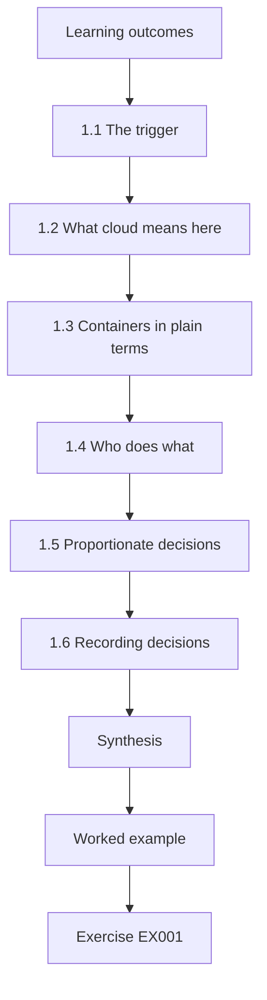

### Logical drawing

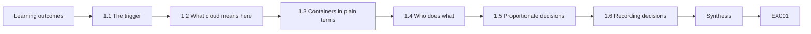

```text
[Learning outcomes]
    |
    v
[1.1 The trigger]
    |
    v
[1.2 What cloud means here]
    |
    v
[1.3 Containers in plain terms]
    |
    v
[1.4 Who does what]
    |
    v
[1.5 Proportionate decisions]
    |
    v
[1.6 Recording decisions]
    |
    v
[Synthesis]
    |
    v
[Worked example] --> [Exercise EX001]
```
<!-- open-cyber-academy:lesson-figures:end ch-01 -->


### Learning outcomes

You will (1) explain what cloud and container services a small clinic relies on; (2) use the shared responsibility model to see what the clinic must do; (3) make proportionate first decisions.

### 1.1 The trigger

Leila Ahmadi is the practice manager and only IT person at the fictional Oakfield Physiotherapy, a clinic with eight staff. The clinic stores letters, referrals and invoices in a cloud storage service and runs an online booking app that a local developer packaged as a container on a small hosted platform. In April a patient mentions that a link to her own treatment letter, forwarded by mistake, opened without any login. Leila realises the patient letters folder is shared with "anyone with the link". She joins a one-month rapid course at the fictional Westbrook Community College, with tutor Ben Hartley, to fix this and set up sensible routines.

### 1.2 What cloud means here

NIST SP 800-145 describes cloud computing as on-demand access to shared computing resources managed by a provider. For Oakfield, that means the storage service, the email service and the hosted platform running the booking container. The clinic owns no servers.

Because Oakfield owns no servers, every security question becomes a question about accounts and settings in someone else's service. The patient letters folder shows it: no hardware was broken into; one sharing setting in the storage service, chosen by a colleague in January, made a folder of treatment letters open to anyone holding a link.

### 1.3 Containers in plain terms

A container is a packaged application with everything it needs to run. The booking app container was built by the developer from a base image; if the base image is old, the app inherits its flaws even if the clinic never touches the code.

The clinic sees only the booking pages, so the age of the base image was invisible to Leila until she asked. The developer's answer, an older image last rebuilt a year ago, meant a year of fixes to the image's system libraries had never reached the clinic's app, even though nobody had changed the app's own code.

### 1.4 Who does what

Each provider's shared responsibility page explains that the provider secures its infrastructure while the customer controls accounts, sharing settings, data and what it runs. Oakfield's sharing mistake sits entirely on the clinic's side.

The storage provider's systems worked exactly as designed: a link set to "anyone with the link" opened without login because the clinic had chosen that setting. No complaint to the provider would have fixed it. The booking container is split: the hosting company runs the platform, the developer builds the image, and the clinic must agree how often it is rebuilt.

### 1.5 Proportionate decisions

A small clinic cannot do everything at once. Ben suggests three first decisions: fix sharing on sensitive folders today, turn on multi-factor authentication for every account this week, and agree with the developer how the booking container will be kept updated.

The order follows harm and effort. The open folder was exposing patient letters now, and fixing it took one setting change, so it came first, that afternoon. Multi-factor authentication needed every staff member's time and two hardware keys, so it took the week. The container needed the developer's agreement, so the first step there was a conversation, not a change.

### 1.6 Recording decisions

Leila writes each decision with date, reason and owner in a one-page log.

The first entries show the pattern: "Patient letters folder set to staff-only — April, afternoon of the patient's report — exposure of treatment letters — Leila." When Mark later decided, as data controller, how to handle the exposure, his decision went into the same log with its reason. A log kept from the first day means that, months later, nobody has to remember why invoices became staff-only or why the old backup was deleted.

### Worked example

Leila changes the patient letters folder to staff-only that afternoon. She then asks Ben whether she must tell patients. Ben says this depends on what was exposed and for how long, and that she should gather evidence first and consult the clinic's data protection guidance, which chapter 2 covers.

> **Synthetic case.** Leila, Ben, Oakfield and Westbrook are synthetic.

### Errors and limits

Fixing the visible problem quickly is right, but the review must still look for similar problems elsewhere.

### Exercises

- **EX001 — Trigger.** What made Leila notice the sharing problem? *Rubric:* 3 = patient's letter opened without login via forwarded link; 2 = partial; 1 = vague; 0 = none.
- **EX002 — Services used.** Name three cloud services Oakfield relies on. *Rubric:* 3 = storage, email, hosted booking platform; 2 = two; 1 = one; 0 = none.
- **EX003 — Container inheritance.** Why can an old base image affect the booking app? *Rubric:* 3 = app inherits its flaws; 2 = partial; 1 = vague; 0 = none.
- **EX004 — Responsibility side.** On which side of shared responsibility does the sharing mistake sit? *Rubric:* 3 = clinic's side; 2 = partial; 1 = vague; 0 = none.
- **EX005 — First decisions.** List Ben's three first decisions. *Rubric:* 3 = fix sharing, MFA, container update agreement; 2 = two; 1 = one; 0 = none.
- **EX006 — Decision log.** What does each decision log entry contain? *Rubric:* 3 = date, reason, owner; 2 = two; 1 = one; 0 = none.
- **EX007 — Notification question.** What did Ben advise about telling patients? *Rubric:* 3 = gather evidence, consult guidance; 2 = partial; 1 = vague; 0 = none.
- **EX008 — Ownership of servers.** Does Oakfield own any servers? *Rubric:* 3 = no; 2 = partial; 1 = vague; 0 = none.
- **EX009 — Definition source.** Which standard defines cloud computing used here? *Rubric:* 3 = NIST SP 800-145; 2 = partial; 1 = vague; 0 = none.
- **EX010 — Clinic size effect.** Why make proportionate rather than complete changes? *Rubric:* 3 = small clinic cannot do everything; 2 = partial; 1 = vague; 0 = none.
- **EX011 — Visible fix limit.** What must follow the quick fix? *Rubric:* 3 = look for similar problems; 2 = partial; 1 = vague; 0 = none.
- **EX012 — Provider duty.** What does the provider secure? *Rubric:* 3 = its infrastructure; 2 = partial; 1 = vague; 0 = none.
- **EX013 — Folder change.** What did Leila change on the first afternoon? *Rubric:* 3 = patient letters to staff-only; 2 = partial; 1 = vague; 0 = none.

### Synthesis

Understand what the clinic controls and fix the most important things first.

### Continue studying — lesson 01 (chapter 01 of 20)

[← Course home](../../README.md) · [Course chapter index](../SUBJECTS.md) · [Chapter 02 →](#ch-02)

<a id="ch-02"></a>

## Chapter 2 — Scope, permission and safe practice

<!-- open-cyber-academy:lesson-figures:start ch-02 -->
### Lesson map

Lesson 02 published. Map, example, EX014.

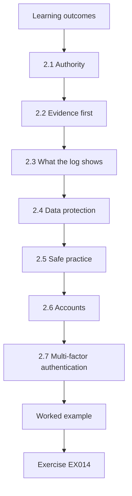

### Logical drawing

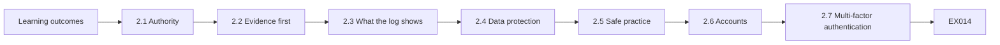

```text
[Learning outcomes]
    |
    v
[2.1 Authority]
    |
    v
[2.2 Evidence first]
    |
    v
[2.3 What the log shows]
    |
    v
[2.4 Data protection]
    |
    v
[2.5 Safe practice]
    |
    v
[2.6 Accounts]
    |
    v
[2.7 Multi-factor authentication]
    |
    v
[Worked example] --> [Exercise EX014]
```
<!-- open-cyber-academy:lesson-figures:end ch-02 -->


### Learning outcomes

You will (1) work within the clinic's authority and data protection duties; (2) collect evidence safely; (3) avoid risky shortcuts.

### 2.1 Authority

As practice manager, Leila is authorised by the clinic's owner, physiotherapist Mark Ellis, to manage accounts and settings. She confirms this in writing for the course and agrees she will only review Oakfield's own services.

Getting this in writing is not a formality. Leila will change sharing settings, remove the shared reception login and delete an old backup; each could upset a colleague or touch patient data. Mark's written authority shows she acted for the clinic. Limiting herself to Oakfield's own services means she does not probe the hospital's system, the developer's other clients or the providers' infrastructure.

### 2.2 Evidence first

Before changing more settings, Leila exports the storage service's sharing report and the activity log for the patient letters folder. She saves them with date and time in a restricted folder.

Order matters because the storage service may show only the current settings. Once a folder is changed to staff-only, the sharing report shows staff-only, and the record of who opened the letters while the link was open survives only in the activity log. When a colleague later suggests deleting the log to tidy up, Leila keeps it: it is the clinic's proof of what happened.

### 2.3 What the log shows

The activity log shows the folder was set to anyone-with-link in January when a colleague shared one letter with a hospital. The log records four views from outside the clinic: three match the hospital's domain, one is the patient's own forwarded view.

Those four views are what turn worry into an answer. Three came from the hospital the letter was meant for; the fourth was the patient opening the link she had been forwarded. No view came from an unknown address. That is why Leila can record the risk as low, while still recording that the folder was open from January to April.

### 2.4 Data protection

Leila follows the regulator's guidance for small organisations, recording what happened, who was affected and why she judges the risk low. Mark, as data controller, makes the final decision and records it.

Her record states the facts from the log: the folder was open by link from January to April, four outside views were recorded, three matched the hospital's domain and the fourth was the patient's own. It also states her reasoning about risk. Mark makes the decision because the clinic, not its practice manager, is legally responsible for patient data, and his decision is recorded alongside hers.

### 2.5 Safe practice

Leila does not try to "test" whether other links work by guessing addresses or using outside tools. She uses the provider's own reports and settings pages.

Guessing link addresses might reach someone else's files, and outside scanning tools might break the provider's terms. The provider's sharing report already lists every item shared by link, which is what the course lab checks against the clinic's rule. Using it gives Leila a complete answer without touching anything she is not authorised to test.

### 2.6 Accounts

Each staff member has their own account; the shared reception login is replaced, so the logs show who did what.

The shared reception login was the gap here. If the patient letters folder had been changed by someone signed in as reception, the activity log could not say which of the eight staff did it. With named accounts, the log shows who shared what, and a leaver's access can be removed without changing everyone else's password. The monthly routine's leavers check depends on this.

### 2.7 Multi-factor authentication

All accounts get a second factor. Two staff without smartphones receive hardware keys.

Multi-factor authentication matters most for the accounts that can change sharing settings: a stolen password alone could otherwise reopen the patient letters folder to the world. The two hardware keys solve a practical problem rather than forcing the two staff members to buy smartphones. Leila records which staff have which factor, so the monthly admin check can confirm that nobody has slipped back to password only. Each key is labelled with its owner's name, and a spare is kept locked in the office.

### Leavers

When staff leave, Leila removes their accounts on their last day and checks whether they owned any shared links, which are moved to a current staff member.

### Worked example

A colleague suggests deleting the activity log to "tidy up". Leila explains that the log is evidence and must be kept, and that tidying would remove the clinic's proof of what happened.

> **Synthetic case.** Synthetic.

### Errors and limits

Changing settings before exporting evidence can erase the record of what was exposed.

### Exercises

- **EX014 — Authority source.** Who authorises Leila's work? *Rubric:* 3 = Mark Ellis, clinic owner; 2 = partial; 1 = vague; 0 = none.
- **EX015 — Evidence exports.** What did Leila export first? *Rubric:* 3 = sharing report and activity log; 2 = partial; 1 = vague; 0 = none.
- **EX016 — Origin of link.** How did the folder become shared with anyone? *Rubric:* 3 = January share with hospital; 2 = partial; 1 = vague; 0 = none.
- **EX017 — Outside views.** What did the outside views show? *Rubric:* 3 = four: three hospital, one patient; 2 = partial; 1 = vague; 0 = none.
- **EX018 — Decision maker.** Who makes the final notification decision? *Rubric:* 3 = Mark as data controller; 2 = partial; 1 = vague; 0 = none.
- **EX019 — Unsafe testing.** What did Leila avoid doing? *Rubric:* 3 = guessing links or outside tools; 2 = partial; 1 = vague; 0 = none.
- **EX020 — Shared login.** Why replace the reception login? *Rubric:* 3 = logs show who did what; 2 = partial; 1 = vague; 0 = none.
- **EX021 — Hardware keys.** How were staff without smartphones handled? *Rubric:* 3 = hardware keys; 2 = partial; 1 = vague; 0 = none.
- **EX022 — Log deletion.** Why must the log be kept? *Rubric:* 3 = it is evidence; 2 = partial; 1 = vague; 0 = none.
- **EX023 — Order of work.** Why export before changing more settings? *Rubric:* 3 = changes can erase the record; 2 = partial; 1 = vague; 0 = none.
- **EX024 — Scope limit.** Which services does Leila review? *Rubric:* 3 = Oakfield's own only; 2 = partial; 1 = vague; 0 = none.
- **EX025 — Risk record.** What does Leila record for data protection? *Rubric:* 3 = what happened, who affected, why low risk; 2 = two; 1 = one; 0 = none.
- **EX026 — Written confirmation.** Why confirm authority in writing? *Rubric:* 3 = clear limits, protection; 2 = partial; 1 = vague; 0 = none.

### Synthesis

Work within authority, keep evidence, and avoid risky shortcuts.

### Continue studying — lesson 02 (chapter 02 of 20)

[← Chapter 01](#ch-01) · [Course chapter index](../SUBJECTS.md) · [Chapter 03 →](#ch-03)

<a id="ch-03"></a>

## Chapter 3 — Cloud and container security: systems, data and dependencies

<!-- open-cyber-academy:lesson-figures:start ch-03 -->
### Lesson map

Lesson 03 published. Map, example, EX027.

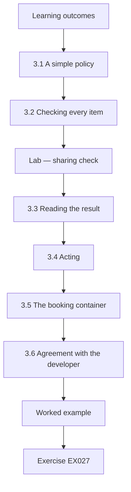

### Logical drawing

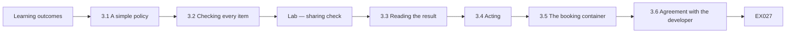

```text
[Learning outcomes]
    |
    v
[3.1 A simple policy]
    |
    v
[3.2 Checking every item]
    |
    v
[Lab — sharing check]
    |
    v
[3.3 Reading the result]
    |
    v
[3.4 Acting]
    |
    v
[3.5 The booking container]
    |
    v
[3.6 Agreement with the developer]
    |
    v
[Worked example] --> [Exercise EX027]
```
<!-- open-cyber-academy:lesson-figures:end ch-03 -->


### Learning outcomes

You will (1) list the clinic's data and where it is shared; (2) check sharing against a simple policy; (3) understand the booking container's dependencies.

### 3.1 A simple policy

Leila writes a one-line rule: sensitive items may be shared only with staff or administrators; non-sensitive items may also be public. Patient letters, referrals, invoices, backups and the booking app configuration count as sensitive.

The rule is short enough for any of the eight staff to apply without asking Leila. The list of sensitive items comes from what the clinic holds: treatment letters and referrals about patients, invoices with their details, backups that contain all of these, and the booking app configuration that holds a database password.

### 3.2 Checking every item

The April problem might not be the only one, so she checks every top-level item in storage against the rule.

A problem found by luck, through one patient's forwarded link, says nothing about what else is shared. The lab checks the sharing setting of all 8 top-level items against the rule. It looks only at what the provider's sharing report lists, so it touches no file and opens no link.

Its result found two items, invoices and old-backup.zip, that nobody had reported.

### Lab — sharing check

```python
"""List synthetic cloud storage items shared more widely than policy allows (stdlib only)."""
items = [("patient-letters/", "anyone-with-link", True), ("rota.xlsx", "staff", False), ("price-list.pdf", "public", False),
         ("referrals/", "staff", True), ("invoices/", "anyone-with-link", True), ("logo.png", "public", False),
         ("old-backup.zip", "anyone-with-link", True), ("booking-app-config", "admins", True)]
allowed = {True: {"staff", "admins"}, False: {"staff", "admins", "public"}}
bad = [(n, s) for n, s, sens in items if s not in allowed[sens]]
print(f"items {len(items)}, sensitive {sum(1 for i in items if i[2])}, shared too widely {len(bad)}")
for n, s in bad: print(f"  {n}: {s}")
```

Run with `python3 lab_sharing.py`. Verified output:

```text
items 8, sensitive 5, shared too widely 3
  patient-letters/: anyone-with-link
  invoices/: anyone-with-link
  old-backup.zip: anyone-with-link
```

### 3.3 Reading the result

Of 8 items, 5 are sensitive and 3 are shared too widely: patient-letters (already fixed in chapter 1, still in the April export), invoices and old-backup.zip, all set to anyone-with-link.

The patient letters folder appears because the sharing report was exported before Leila changed it; that is the evidence copy, not a new problem. The two new findings matter: invoices hold patients' names and payment details, and old-backup.zip holds a full copy of data from the previous system. Both had been open to anyone with the link.

### 3.4 Acting

Invoices are set to staff-only. The old backup, from a previous system, is no longer needed; after checking with Mark and noting the clinic's retention rules, Leila deletes it. Fewer copies mean less to protect.

Leila records both changes in her decision log with their dates and reasons, and checks the activity log for each item before acting, as she did for the patient letters. The rota, price list and logo stay as they are: they are not sensitive, and the rule allows the price list and logo to be public.

### 3.5 The booking container

Leila asks the developer which base image the booking app uses and how often it is rebuilt. The answer is an older image last rebuilt a year ago. NIST SP 800-190 advises rebuilding images regularly from maintained bases and using trusted registries; Shu et al. (2017) found many public images carried known vulnerabilities.

A year without a rebuild means that fixes released for the base image in that time never reached the booking app. Leila does not need to read container files to act on this; she needs an agreement with the developer about how often images are rebuilt and how the clinic will know it happened.

### 3.6 Agreement with the developer

They agree on a monthly rebuild from a maintained base, with the developer sending a one-line confirmation each time.

The one-line confirmation turns the agreement into something Leila can check. The monthly routine includes "confirm the booking app image was rebuilt", and the confirmation email is the evidence. In June it was missing because the developer was on holiday, which is why they later agreed a backup contact.

Leila files each confirmation in the decision log, so a missing month is visible at a glance, as June's was.

### 3.7 Secrets

The booking app's configuration contains a database password. The developer moves it into the platform's secret settings, following the Kubernetes good-practice idea of keeping secrets out of images and files.

A password written in a configuration file travels with every copy of that file: into backups, into the developer's laptop and, in Oakfield's case, into a storage item that is now on the sensitive list. Moving it to the platform's secret settings means a leaked backup or image no longer reveals the database password. The developer also changes the password, because the old one may already have been copied.

### Worked example

Leila asks whether the booking app must run on Kubernetes. The developer explains it runs on a simpler hosted platform, but the same ideas apply: trusted images, regular rebuilds, secrets kept separately and least privilege.

> **Synthetic case.** Synthetic.

### Errors and limits

A one-off check finds today's problems; only a routine finds tomorrow's.

### Exercises

- **EX027 — Policy rule.** State Leila's sharing rule. *Rubric:* 3 = sensitive only staff/admins; non-sensitive may be public; 2 = partial; 1 = vague; 0 = none.
- **EX028 — Lab result.** Which items were shared too widely? *Rubric:* 3 = patient-letters, invoices, old-backup; 2 = two; 1 = one; 0 = none.
- **EX029 — Sensitive count.** How many items were sensitive? *Rubric:* 3 = 5; 2 = partial; 1 = vague; 0 = none.
- **EX030 — Backup decision.** What was done with the old backup and why? *Rubric:* 3 = deleted after checking retention; fewer copies; 2 = partial; 1 = vague; 0 = none.
- **EX031 — Image age.** What did the developer reveal about the image? *Rubric:* 3 = old, rebuilt a year ago; 2 = partial; 1 = vague; 0 = none.
- **EX032 — Rebuild agreement.** What rebuild schedule was agreed? *Rubric:* 3 = monthly with confirmation; 2 = partial; 1 = vague; 0 = none.
- **EX033 — Password move.** Where did the database password go? *Rubric:* 3 = platform secret settings; 2 = partial; 1 = vague; 0 = none.
- **EX034 — Public images.** What did Shu et al. (2017) find? *Rubric:* 3 = many public images had known vulnerabilities; 2 = partial; 1 = vague; 0 = none.
- **EX035 — Platform question.** Do the ideas apply without Kubernetes? *Rubric:* 3 = yes: images, rebuilds, secrets, least privilege; 2 = partial; 1 = vague; 0 = none.
- **EX036 — Why check all.** Why check every item, not just the reported folder? *Rubric:* 3 = other problems may exist; 2 = partial; 1 = vague; 0 = none.
- **EX037 — One-off limit.** What can a one-off check not do? *Rubric:* 3 = find future problems; 2 = partial; 1 = vague; 0 = none.
- **EX038 — Container guidance.** Which NIST publication covers container images? *Rubric:* 3 = SP 800-190; 2 = partial; 1 = vague; 0 = none.

### Synthesis

Check every item against a simple rule and agree how dependencies stay current.

### Continue studying — lesson 03 (chapter 03 of 20)

[← Chapter 02](#ch-02) · [Course chapter index](../SUBJECTS.md) · [Chapter 04 →](#ch-04)

<a id="ch-04"></a>

## Chapter 4 — Cloud and container security: guided lab and applied synthesis

<!-- open-cyber-academy:lesson-figures:start ch-04 -->
### Lesson map

Lesson 04 published. Map, example, EX039.

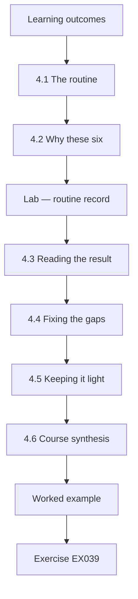

### Logical drawing

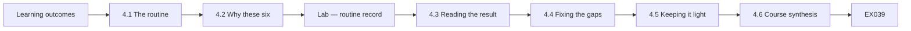

```text
[Learning outcomes]
    |
    v
[4.1 The routine]
    |
    v
[4.2 Why these six]
    |
    v
[Lab — routine record]
    |
    v
[4.3 Reading the result]
    |
    v
[4.4 Fixing the gaps]
    |
    v
[4.5 Keeping it light]
    |
    v
[4.6 Course synthesis]
    |
    v
[Worked example] --> [Exercise EX039]
```
<!-- open-cyber-academy:lesson-figures:end ch-04 -->


### Learning outcomes

You will (1) set up a monthly routine; (2) measure it over three months; (3) bring the course together.

### 4.1 The routine

Ben helps Leila write six monthly tasks: review sharing links, check admin accounts and multi-factor authentication, check that a backup can be restored, confirm the booking app image was rebuilt, review leavers' access, and read the providers' security notices.

Each task can be done by someone who is not an IT specialist, with a clear result: a list of sharing links checked against the rule, a list of accounts with their second factor, a test folder restored, a confirmation email from the developer, a leavers list compared with active accounts, and the providers' notices read.

### 4.2 Why these six

Each task matches something that went wrong or nearly did: sharing, accounts, backups, the old image, leavers and changes announced by providers.

Sharing comes from the patient letters link. Accounts come from the shared reception login and the missing second factors. Backups come from old-backup.zip. The old image comes from the year without a rebuild. The leavers task protects named accounts, and the providers' notices are how the clinic learns of changes like new sharing defaults.

A task with no such origin would be the first to be skipped on a busy Monday.

### Lab — routine record

```python
"""Score a synthetic monthly cloud security routine over three months (stdlib only)."""
tasks = ["review sharing links", "check admin accounts and MFA", "check backups restored", "update booking app image",
         "review access of leavers", "read provider security notices"]
months = {"May": [1, 1, 0, 0, 1, 0], "June": [1, 1, 1, 0, 1, 1], "July": [1, 1, 1, 1, 1, 1]}
for m, done in months.items():
    miss = [t for t, d in zip(tasks, done) if not d]
    print(f"{m}: {sum(done)}/{len(tasks)} done" + (f"; missed: {', '.join(miss)}" if miss else ""))
```

Run with `python3 lab_routine.py`. Verified output:

```text
May: 3/6 done; missed: check backups restored, update booking app image, read provider security notices
June: 5/6 done; missed: update booking app image
July: 6/6 done
```

### 4.3 Reading the result

May: 3 of 6 tasks done; missed backup restore, image update and reading notices. June: 5 of 6; the image update was still missing. July: 6 of 6.

The trend is the useful part. May's three misses each had a different cause; June fixed two of them; the image update was the slowest because it depended on someone outside the clinic. Recording the routine as numbers makes this visible: without the lab, "we mostly did it" would have hidden the fact that the image was not updated for two months in a row.

### 4.4 Fixing the gaps

The backup restore was missed in May because nobody knew how; Leila practises in June with a test folder. The image update was late because the developer was on holiday; they agree a backup contact.

Both fixes target the cause, not the symptom. Practising a restore on a test folder in June means the next real restore is not the first one. A backup contact at the developer means the clinic's monthly rebuild no longer depends on one person being available, which is the same idea Leila later applies to herself by training the deputy manager.

### 4.5 Keeping it light

The routine takes about an hour a month. Leila books it in the calendar for the first Monday.

One hour on a fixed day is what makes the routine survive a busy clinic. When Leila is on leave, the deputy manager follows the one-page instructions; August's routine was completed that way with Leila watching.

The routine is kept short on purpose: a two-day audit would be postponed whenever the clinic was busy, while one hour on a fixed Monday gets done. Leila records each month's result on the one-page log, so the trend from May to July is there for Mark to read, and the deputy can see what was missed last time before starting.

### 4.6 Course synthesis

In one month Leila moved from a forwarded link to a working routine: understand what the clinic controls, work within authority, keep evidence, check everything against a simple rule, keep dependencies current and repeat monthly.

Each step has a matching piece of evidence: the shared responsibility pages, Mark's written authority, the exported activity log, the sharing lab result, the developer's monthly confirmation and the routine record. A new practice manager could pick up Oakfield's security from those documents alone.

The deputy manager's August routine, done with Leila watching, tested exactly that.

### 4.7 Further steps

The CIS Benchmarks and CSA CCM v4 are more detailed than a small clinic needs now, but Leila keeps them as references if Oakfield grows.

If Oakfield opened a second clinic or moved the booking app to Kubernetes, Leila would start from the parts that match what already exists: the access and data-protection controls in CCM, and the benchmark for whichever storage service the clinic uses, rather than reading either document from start to finish.

Until then, the six monthly tasks cover what an eight-person clinic actually runs.

### Recording

Each month's results are kept on the one-page log.

### Worked example

Mark asks how he will know the routine continues if Leila is on leave. She writes the six tasks with instructions on one page and trains the deputy manager, who completes August's routine with Leila watching.

> **Synthetic case.** Synthetic.

### Errors and limits

Routines decay when one person holds them; share and record them.

### Exercises

- **EX039 — Six tasks.** List the six monthly tasks. *Rubric:* 3 = sharing, admin/MFA, backup restore, image update, leavers, notices; 2 = five; 1 = three; 0 = none.
- **EX040 — Task origins.** Why were these six tasks chosen? *Rubric:* 3 = each matches a real or near problem; 2 = partial; 1 = vague; 0 = none.
- **EX041 — Lab trend.** Give the three monthly results. *Rubric:* 3 = 3/6, 5/6, 6/6; 2 = partial; 1 = vague; 0 = none.
- **EX042 — May gap.** Why was the restore missed in May? *Rubric:* 3 = nobody knew how; 2 = partial; 1 = vague; 0 = none.
- **EX043 — Image delay.** What caused the late image update and the fix? *Rubric:* 3 = developer holiday; backup contact; 2 = partial; 1 = vague; 0 = none.
- **EX044 — Time cost.** How long does the routine take? *Rubric:* 3 = about an hour a month; 2 = partial; 1 = vague; 0 = none.
- **EX045 — Scheduling.** When is the routine done? *Rubric:* 3 = first Monday; 2 = partial; 1 = vague; 0 = none.
- **EX046 — Course arc.** Summarise the course in one sentence. *Rubric:* 3 = understand, authority, evidence, check, dependencies, repeat; 2 = partial; 1 = vague; 0 = none.
- **EX047 — References.** Why keep CIS and CCM v4 as references? *Rubric:* 3 = for growth later; 2 = partial; 1 = vague; 0 = none.
- **EX048 — Continuity.** How was continuity ensured? *Rubric:* 3 = one-page instructions, trained deputy; 2 = partial; 1 = vague; 0 = none.
- **EX049 — Deputy result.** What did the deputy do in August? *Rubric:* 3 = completed routine with Leila watching; 2 = partial; 1 = vague; 0 = none.
- **EX050 — Decay risk.** Why do routines decay? *Rubric:* 3 = one person holds them; 2 = partial; 1 = vague; 0 = none.

### Synthesis

A light, shared monthly routine keeps a small organisation's cloud security from drifting.

### Continue studying — lesson 04 (chapter 04 of 20)

[← Chapter 03](#ch-03) · [Course chapter index](../SUBJECTS.md) · [Chapter 05 →](#ch-05)

<a id="ch-05"></a>

## Chapter 5 — The sharing print is one filter

<!-- open-cyber-academy:lesson-figures:start ch-05 -->
### Lesson map

Lesson 05. Map, example, EX051.

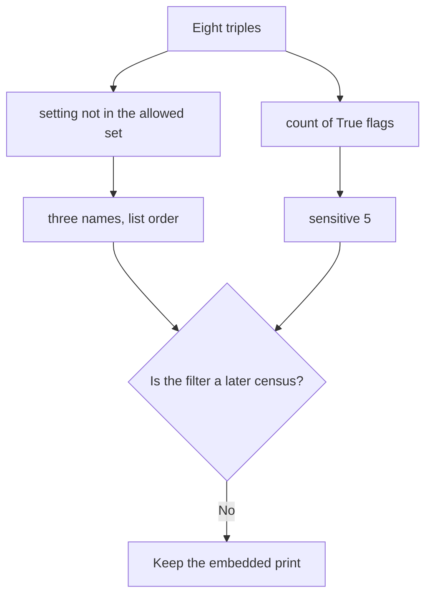

One list. One membership test. Three printed numbers.

### Logical drawing

```text
items 8, sensitive 5, shared too widely 3
  patient-letters/: anyone-with-link
  invoices/: anyone-with-link
  old-backup.zip: anyone-with-link
```
<!-- open-cyber-academy:lesson-figures:end ch-05 -->

### Learning outcomes

After this chapter, you should be able to:

1. Name the three reductions the sharing script actually computes.
2. Keep list order distinct from the April incident.
3. Refuse a note that replaces this export with a later folder state.

### 5.1 Three reductions, and no walk inside a folder.

`lab_sharing.py` stores eight triples. Each triple is a name, a setting string, and a Boolean. The names are the top-level storage items only. A file inside `patient-letters/` is not a fourth field and cannot change `len(items)`.

The Boolean sum is `sum(1 for i in items if i[2])`. Python counts `True` as one, so the five sensitive flags print as `sensitive 5`. That sum does not look at the setting string. `referrals/` and `booking-app-config` contribute to the five and do not contribute to the failure list.

The failure list is a comprehension: keep the pair when the setting is absent from `allowed[sens]`. `allowed[True]` holds `staff` and `admins`. `allowed[False]` holds those two strings plus `public`. The comprehension does not sort. `patient-letters/` is printed first because it is the first failing triple, not because a patient mentioned it. `rota.xlsx`, `price-list.pdf`, `logo.png`, `referrals/`, and `booking-app-config` are tested and kept out of `bad`.

A later staff-only change is a decision-log sentence. It is not a fourth run, and it does not edit these eight triples. Printing `shared too widely 2` would require deleting a triple this file still contains.

### 5.2 Worked example

| Offered result | What produced it | Decision |
|---|---|---|
| `items 8, sensitive 5, shared too widely 3` | Length, Boolean sum, filter length | Keep |
| The three names in list order | The comprehension, unsorted | Keep |
| "The script now omits patient-letters." | No edit of the eight triples | Refuse |
| "The filter counted files inside the folders." | The list has no child rows | Refuse |

> **Synthetic case.** The eight triples are the only sharing output.

### Errors and limits

Directory children stay uncounted. Do not repair the export so that it matches the afternoon change.

### Apply

- **EX051 — One filter.** The print says 8 items, 5 sensitive, and 3 shared too widely, then names patient-letters, invoices, and old-backup.zip. May a later staff-only change, or a count of files inside those folders, replace that print? *Rubric:* 3 = no; the eight triples stay; the Boolean sum stays 5; the filter stays 3, in list order; do not edit the script;; 2 = the print stays and the later change stays prose;; 1 = one number;; 0 = none.

<!-- open-cyber-academy:chapter-navigation:start ch-05 -->
### Continue studying — lesson 05 (chapter 05 of 20)

[← Chapter 04](#ch-04) · [Course chapter index](../SUBJECTS.md) · [Chapter 06 →](#ch-06)

Continue to the next authored lesson.
<!-- open-cyber-academy:chapter-navigation:end -->

<a id="ch-06"></a>

## Chapter 6 — anyone-with-link is not the token public

<!-- open-cyber-academy:lesson-figures:start ch-06 -->
### Lesson map

Lesson 06. Map, example, EX052.

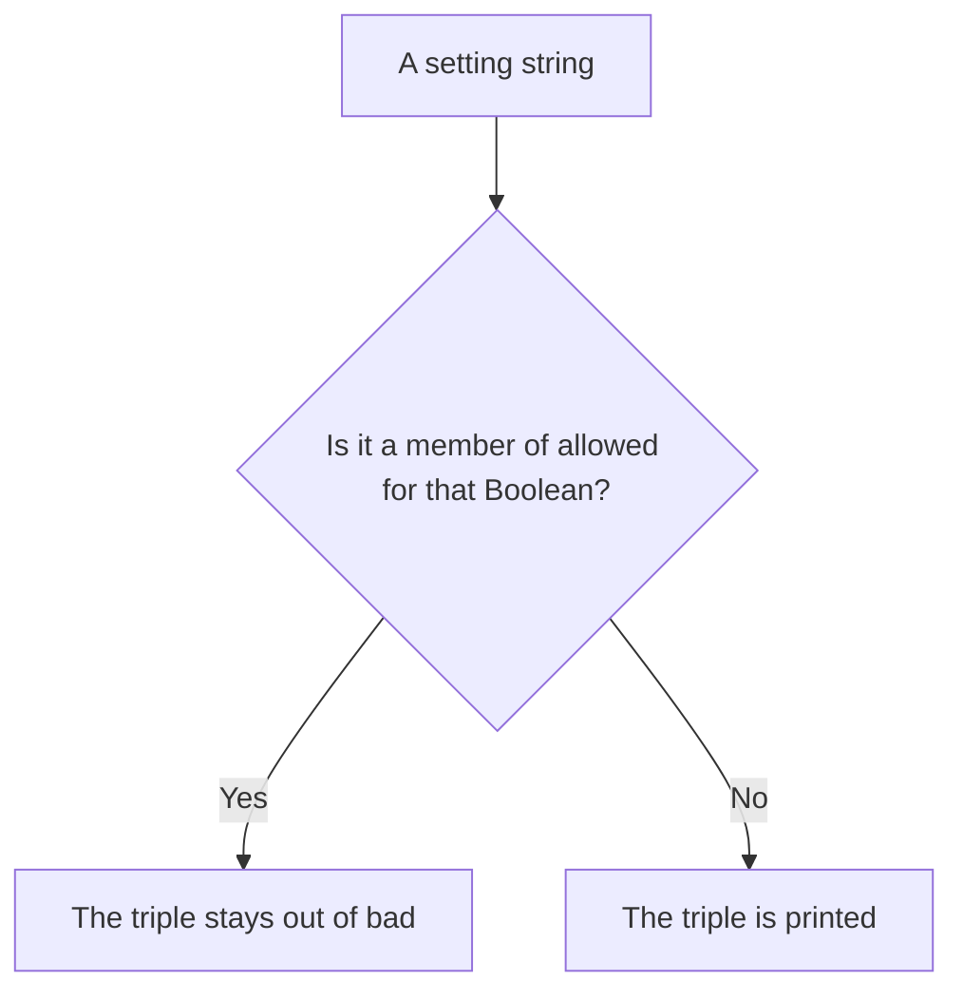

Membership is exact. It is not a rank.

### Logical drawing

```text
allowed when sensitive:     staff, admins
allowed when not sensitive: staff, admins, public
present failure token:      anyone-with-link
absent from this list:      a sensitive triple whose setting is public
```
<!-- open-cyber-academy:lesson-figures:end ch-06 -->

### Learning outcomes

After this chapter, you should be able to:

1. Explain the failure test as set membership.
2. Separate the string `public` from the string `anyone-with-link`.
3. Refuse a claim that every failure in this run had to be sensitive.

### 6.1 The predicate does not rank the strings.

The comprehension asks one question: is this setting one of the strings in the set selected by the Boolean? It does not ask which string is narrower. `staff` and `admins` are both members of the sensitive set, so a sensitive triple using either string passes. The program never orders those two members.

`public` is a member only of the non-sensitive set. A sensitive triple whose setting was the string `public` would fail, because that string is absent from `allowed[True]`. No triple in the eight has that combination. The three failures all carry `anyone-with-link`, which is absent from both sets.

A non-sensitive triple with `anyone-with-link` would also fail. This file contains no such triple, so the failure list and the sensitive-failure list happen to name the same three objects. That coincidence is a property of these eight rows. It is not a definition of the predicate. `price-list.pdf` and `logo.png` pass only because their setting is the string `public`, not because a link was inspected.

The link text itself is absent from the triple. The setting name is what the filter reads. Constructing or guessing an address is outside this chapter and outside the clinic's authority.

### 6.2 Worked example

| Claim about a triple | Membership fact | Decision |
|---|---|---|
| `logo.png` at `public` passes | Non-sensitive, and `public` is allowed | Keep |
| `booking-app-config` at `admins` passes | Sensitive, and `admins` is allowed | Keep |
| A sensitive `public` row would pass | `public` is not in `allowed[True]` | Refuse |
| "Too wide means sensitive" | True only of this particular failure list | Refuse |

> **Synthetic case.** No link string is stored beside the setting name.

### Errors and limits

Do not promote the coincidence of three sensitive failures into the meaning of the test.

### Apply

- **EX052 — Two strings.** A classmate says `anyone-with-link` is just the lab's way of writing `public`, and that a sensitive item marked `public` would have passed. What does the set test do, and which failure token is actually present? *Rubric:* 3 = the strings differ; `public` is allowed only when the flag is false; a sensitive `public` triple would fail and none exists; the three failures are `anyone-with-link`; do not print a link;; 2 = the tokens differ and the three failures stay;; 1 = one token;; 0 = none.

<!-- open-cyber-academy:chapter-navigation:start ch-06 -->
### Continue studying — lesson 06 (chapter 06 of 20)

[← Chapter 05](#ch-05) · [Course chapter index](../SUBJECTS.md) · [Chapter 07 →](#ch-07)

Continue to the next authored lesson.
<!-- open-cyber-academy:chapter-navigation:end -->

<a id="ch-07"></a>

## Chapter 7 — The patient-letters row is the April export

<!-- open-cyber-academy:lesson-figures:start ch-07 -->
### Lesson map

Lesson 07. Map, example, EX053.

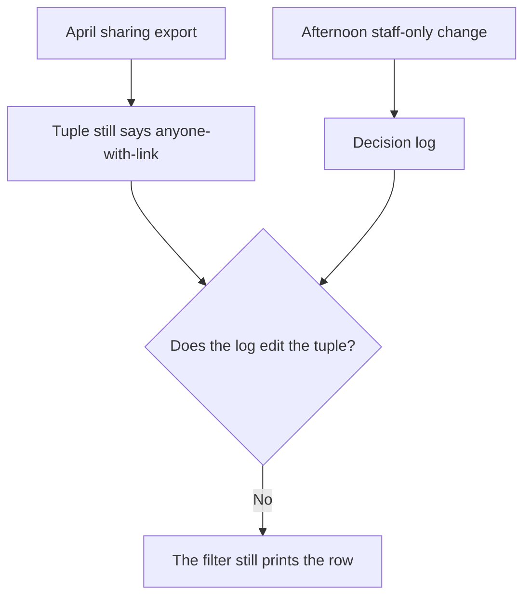

The export and the afternoon are different records.

### Logical drawing

```text
tuple:     patient-letters/ , anyone-with-link , True
log prose: staff-only , April afternoon , Leila
filter:    the tuple remains a failure line
```
<!-- open-cyber-academy:lesson-figures:end ch-07 -->

### Learning outcomes

After this chapter, you should be able to:

1. Say why `patient-letters/` remains on the failure list.
2. Keep the decision log outside the script.
3. Refuse a cleaned print that drops the row.

### 7.1 The afternoon does not rewrite the triple.

Chapter 1 records an afternoon change: the patient-letters folder became staff-only, with a log line that names the date, the exposure, and Leila. That line lives in the one-page log. The sharing script never reads the log.

The triple still holds `anyone-with-link` and `True`. The comprehension therefore still emits the first failure line. Removing it would change both the printed names and the count `shared too widely 3`. No such removal is in the file. The row is the evidence copy of the export, taken before further setting changes.

`invoices/` and `old-backup.zip` are the other two failure lines. They were not the folder a patient described. Their presence is why the filter was run on every top-level name rather than on the reported folder alone. Those two names also stay, for the same reason: the export was not edited after the invoices were later restricted or after the zip was later removed.

A reader who pastes only the afternoon state over the first triple is reporting a setting this program did not load.

### 7.2 Worked example

| Sentence | Record it belongs to | Decision |
|---|---|---|
| The first failure line is `patient-letters/: anyone-with-link` | The eight triples | Keep |
| The folder was set staff-only that afternoon | The decision log | Keep as prose |
| "The lab was rerun and the row disappeared." | No second list | Refuse |
| "Invoices were never in the export." | They are the second failure line | Refuse |

> **Synthetic case.** The log does not feed `lab_sharing.py`.

### Errors and limits

Later restrictions on invoices stay prose as well. The export's three lines stay together.

### Apply

- **EX053 — Which record.** Someone rewrites the first triple as staff-only and says the script now reports two items shared too widely. What still prints, and where does the afternoon change live? *Rubric:* 3 = the triple stays `anyone-with-link`; the filter still prints three names; the afternoon change stays in the log; do not edit the script;; 2 = the three lines stay and the log stays separate;; 1 = one line;; 0 = none.

<!-- open-cyber-academy:chapter-navigation:start ch-07 -->
### Continue studying — lesson 07 (chapter 07 of 20)

[← Chapter 06](#ch-06) · [Course chapter index](../SUBJECTS.md) · [Chapter 08 →](#ch-08)

Continue to the next authored lesson.
<!-- open-cyber-academy:chapter-navigation:end -->

<a id="ch-08"></a>

## Chapter 8 — Five sensitive is a Boolean sum

<!-- open-cyber-academy:lesson-figures:start ch-08 -->
### Lesson map

Lesson 08. Map, example, EX054.

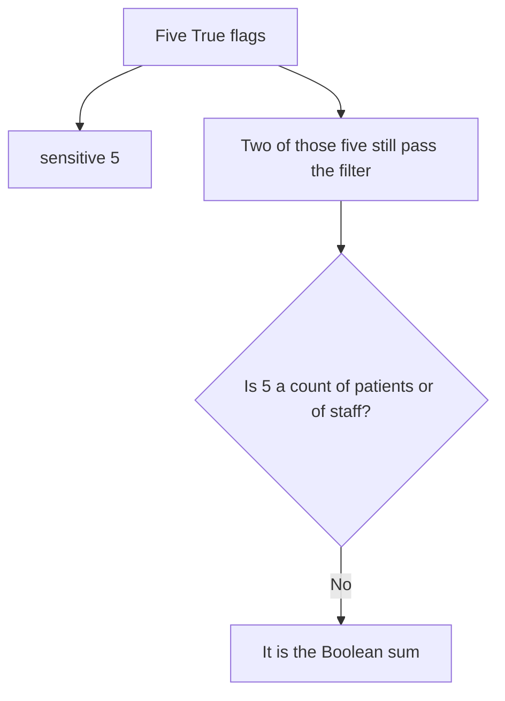

The flag is a classification bit. It is not a headcount.

### Logical drawing

```text
True and kept:  referrals/ at staff
                booking-app-config at admins
True and bad:   patient-letters/ , invoices/ , old-backup.zip
False:          rota.xlsx , price-list.pdf , logo.png
```
<!-- open-cyber-academy:lesson-figures:end ch-08 -->

### Learning outcomes

After this chapter, you should be able to:

1. List the five objects whose flag is true.
2. Separate that sum from the failure list and from the staff count.
3. Refuse a kappa or a patient census read into the number 5.

### 8.1 The flag is Leila's label, counted once.

The sensitive rule names treatment letters, referrals, invoices, backups, and the booking configuration. The script encodes that list as five `True` flags and three `False` flags. `sum` adds the flags. It does not open a letter, and it does not count patients.

Two true flags still pass the membership test. `referrals/` is `staff`. `booking-app-config` is `admins`. Both strings sit in `allowed[True]`, so those triples increase `sensitive 5` and stay out of `bad`. A note that says "five sensitive items were shared too widely" has added two passing rows to a list that holds three.

Eight is the staff count in the prose, and eight is also `len(items)`. Those eights name different sets: people, and top-level objects. The script has no person field. Landis and Koch (1977) define agreement between raters. One person applied these flags, no second coding is recorded, and no kappa is defined. The printed 5 is not an agreement statistic.

### 8.2 Worked example

| Reading of the 5 | Ground | Decision |
|---|---|---|
| Five flags are true | The Boolean sum | Keep |
| `referrals/` is sensitive and not a failure | `staff` is allowed | Keep |
| "Five patients were exposed." | No patient field | Refuse |
| "Two raters agreed, so kappa is high." | One coder, no kappa | Refuse |

> **Synthetic case.** The flags encode the clinic's list. They do not count people.

### Errors and limits

Do not borrow the staff total of eight as if it were the item total's meaning.

### Apply

- **EX054 — What 5 counts.** A note says five sensitive items failed, that this equals five patients, and that two reviewers agreed. Which of those claims survive the Boolean sum? *Rubric:* 3 = only the flag count survives; referrals and booking-app-config are sensitive and allowed; the failure list stays three names; no patient count and no kappa;; 2 = 5 is flags, and two sensitive rows pass;; 1 = one claim;; 0 = none.

<!-- open-cyber-academy:chapter-navigation:start ch-08 -->
### Continue studying — lesson 08 (chapter 08 of 20)

[← Chapter 07](#ch-07) · [Course chapter index](../SUBJECTS.md) · [Chapter 09 →](#ch-09)

Continue to the next authored lesson.
<!-- open-cyber-academy:chapter-navigation:end -->

<a id="ch-09"></a>

## Chapter 9 — Deleting the zip is not a second print

<!-- open-cyber-academy:lesson-figures:start ch-09 -->
### Lesson map

Lesson 09. Map, example, EX055.

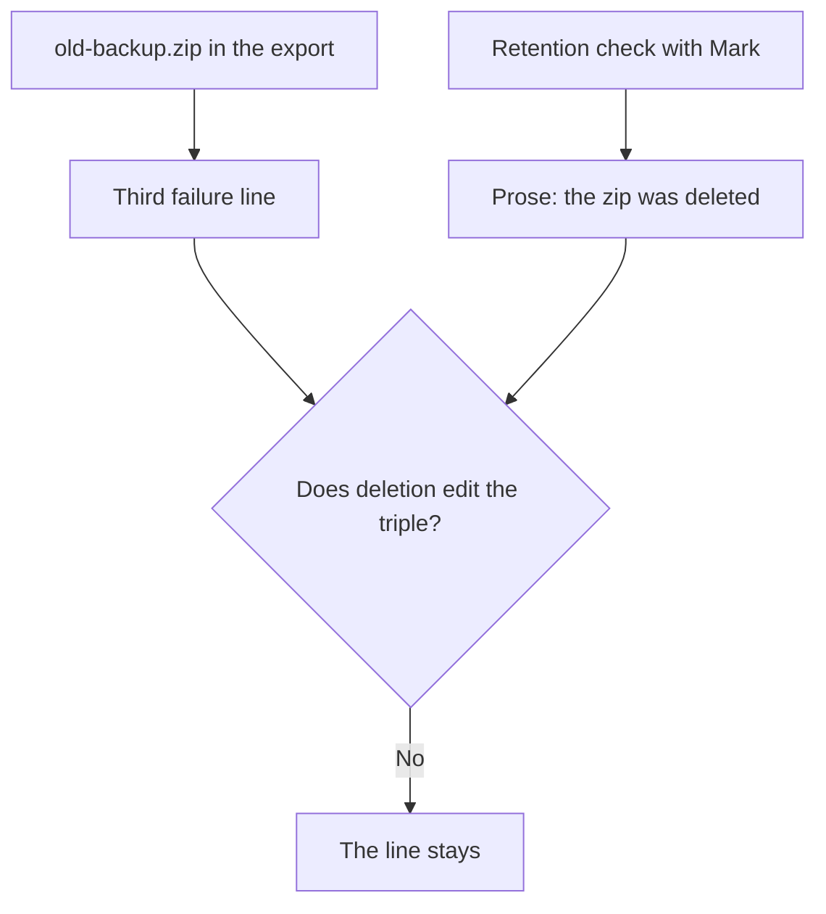

Removal from storage is not removal from the evidence list.

### Logical drawing

```text
still printed:  old-backup.zip: anyone-with-link
prose only:     deleted after the retention check
not recorded:   a sanitization method, a recycler, a date
```
<!-- open-cyber-academy:lesson-figures:end ch-09 -->

### Learning outcomes

After this chapter, you should be able to:

1. Keep `old-backup.zip` on the failure list.
2. Place the deletion in the decision log.
3. Refuse a sanitization certificate the file does not contain.

### 9.1 The zip is still the third failure line.

`old-backup.zip` is sensitive and set to `anyone-with-link`, so the comprehension prints it. The prose then says the zip came from a previous system, was no longer needed, and was deleted after Mark and the retention rules were checked. That sequence is a log entry. The triple is unchanged, so a reader of the script still sees the third line.

Deletion here means the clinic stopped keeping that copy. The page does not name a sanitization method, a tool, a recycler, or a disposal date. A certificate of wiping cannot be copied out of a sentence that never stated one. Fewer copies was the stated reason for removing an unneeded archive, not a measured proof that every other copy was found.

The activity-log check before the deletion is also prose. It is not a column beside the triple. Invoices were restricted rather than deleted; that different action must not be collapsed into the zip's story. Both objects remain failure lines in the export.

### 9.2 Worked example

| Claim | Where it would have to be | Decision |
|---|---|---|
| The third line names `old-backup.zip` | The filter output | Keep |
| The zip was deleted after a retention check | The log | Keep as prose |
| "The script dropped the zip once it was deleted." | No edited list | Refuse |
| "A wipe certificate shows the method." | No method is written | Refuse |

> **Synthetic case.** Mark is the owner who was consulted. No disposal firm is named.

### Errors and limits

Do not describe a wiping procedure. The evidence stops at the export line and the log.

### Apply

- **EX055 — Zip versus log.** A classmate removes `old-backup.zip` from the eight triples, prints `shared too widely 2`, and attaches a wipe certificate. What remains true? *Rubric:* 3 = the triple stays; the third failure line stays; deletion stays in the log after the retention check; no method, recycler, or date is printed;; 2 = the line stays and the certificate is refused;; 1 = one point;; 0 = none.

<!-- open-cyber-academy:chapter-navigation:start ch-09 -->
### Continue studying — lesson 09 (chapter 09 of 20)

[← Chapter 08](#ch-08) · [Course chapter index](../SUBJECTS.md) · [Chapter 10 →](#ch-10)

Continue to the next authored lesson.
<!-- open-cyber-academy:chapter-navigation:end -->

<a id="ch-10"></a>

## Chapter 10 — A responsibility page is not the clinic's contract

<!-- open-cyber-academy:lesson-figures:start ch-10 -->
### Lesson map

Lesson 10. Map, example, EX056.

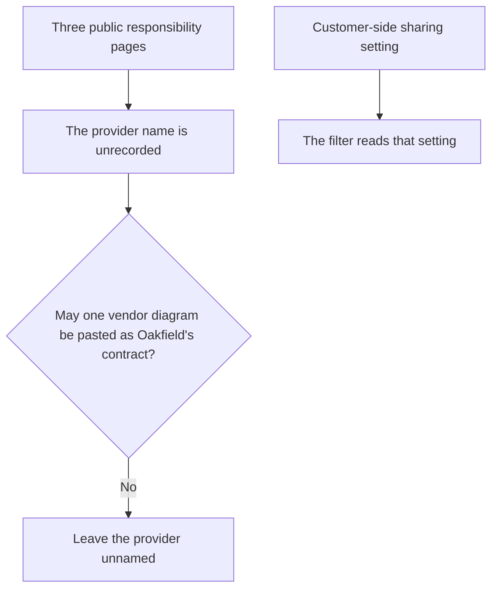

The split is cited. The party is not identified.

### Logical drawing

```text
recorded services: storage, email, hosted booking platform
recorded hardware: the clinic owns no servers
not recorded:      which provider, which region, which ticket
```
<!-- open-cyber-academy:lesson-figures:end ch-10 -->

### Learning outcomes

After this chapter, you should be able to:

1. Place the sharing mistake on the customer side of the cited pages.
2. Leave Oakfield's provider unnamed.
3. Refuse a service-model score and a lock-in measurement.

### 10.1 Three public pages, and no named supplier.

The references include the Amazon Web Services, Microsoft Azure, and Google Cloud descriptions of shared responsibility. Each page draws a split between provider infrastructure and customer configuration. The manuscript never says which of those firms hosts Oakfield. Pasting one diagram into the note would invent a contracting party.

What the clinic recorded is enough for the split it actually used. The storage setting was chosen inside the clinic's account. Changing it did not require a repair of the provider's platform. Email and the hosted booking platform are the other two services in the inventory. None of the three is given a NIST service-model label in the file. SP 800-145 defines cloud computing and also distinguishes service models; this book uses the definition and does not print a model assignment for those three services.

Armbrust and colleagues (2010) discuss confidentiality and lock-in among the obstacles of cloud computing. Oakfield did not measure either obstacle. Deleting one old archive is not a portability test. No ticket number and no region are on the page.

### 10.2 Worked example

| Added sentence | Problem | Decision |
|---|---|---|
| The sharing setting is the clinic's control | Matches the cited split | May stay |
| "Oakfield's contract is the AWS diagram." | The provider is unnamed | Reject |
| "SP 800-145 scored the email service as SaaS." | No model label was stored | Reject |
| "Lock-in was measured when the zip was deleted." | Armbrust is not this log | Reject |

> **Synthetic case.** The three provider pages stay references. They are not a purchase record.

### Errors and limits

Do not file a complaint against an unnamed platform for a setting the account holder chose.

### Apply

- **EX056 — Unnamed provider.** A leaving note names one of the three vendors as Oakfield's host, assigns SaaS to the email service, and calls the zip deletion a lock-in measurement. What may the note keep? *Rubric:* 3 = reject the vendor, the service-model label, and the lock-in claim; the sharing mistake stays on the clinic's side; the three services stay storage, email, and the hosted platform; the clinic owns no servers;; 2 = reject the invented contract and keep the split;; 1 = one rejection;; 0 = none.

<!-- open-cyber-academy:chapter-navigation:start ch-10 -->
### Continue studying — lesson 10 (chapter 10 of 20)

[← Chapter 09](#ch-09) · [Course chapter index](../SUBJECTS.md) · [Chapter 11 →](#ch-11)

Continue to the next authored lesson.
<!-- open-cyber-academy:chapter-navigation:end -->

<a id="ch-11"></a>

## Chapter 11 — Four views are not a complete audience

<!-- open-cyber-academy:lesson-figures:start ch-11 -->
### Lesson map

Lesson 11. Map, example, EX057.

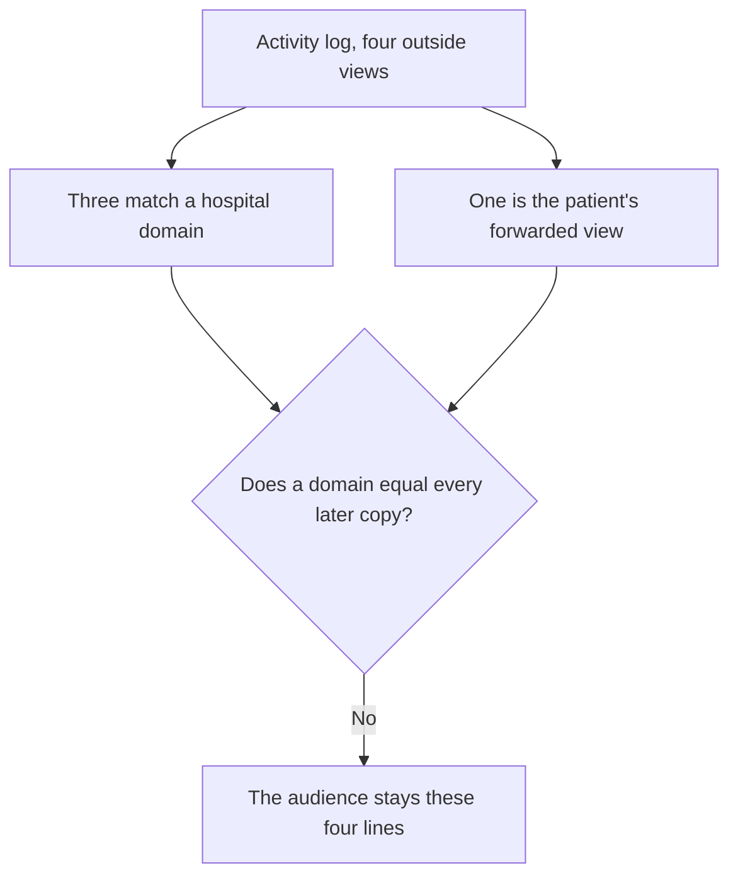

A domain match is not a census of copies.

### Logical drawing

```text
window in prose: January to April
outside views:   4
hospital domain: 3
patient's view:  1
unknown address: none among those four
not stored:      IP, person name, copy count beyond the log
```
<!-- open-cyber-academy:lesson-figures:end ch-11 -->

### Learning outcomes

After this chapter, you should be able to:

1. Repeat the four-view extract without adding recipients.
2. Separate a domain string from a person's identity.
3. Refuse a side-channel finding and a zero-trust score.

### 11.1 The log's four lines are the audience that was written down.

The activity log says the folder was set to anyone-with-link in January, when a colleague shared one letter with a hospital. Four outside views are recorded. Three match the hospital's domain. One is the patient opening a link that had been forwarded. No fourth category, an unknown address, appears among those four. Leila judged the risk low from that extract. Mark, as data controller, makes the notification decision. His decision is a log entry, not a field in `lab_sharing.py`.

Matching a mail domain does not identify which employee opened the letter, and a later forward from that inbox is invisible to this export. Calling the extract closed would invent recipients the page never listed. Clock time stops at the April afternoon, and neither a network address nor a patient's name was copied onto this page.

Ristenpart, Tromer, Shacham, and Savage (2009) describe cross-tenant information leakage on shared machines. That class is not what a sharing token measures. Oakfield recorded no such finding. The clinic does not operate the machine under the storage service, and this chapter does not describe a measurement. SP 800-207 describes authorization of each request. An open link is not that architecture, and the clinic did not adopt the publication as a scored design.

### 11.2 Worked example

| Sentence | Status | Decision |
|---|---|---|
| Four outside views: three hospital-domain, one patient | The exported log | May stay |
| "No unknown address" among those four | The same extract | May stay, bounded |
| "No other copy can exist." | The log does not say that | Reject |
| "A cross-tenant finding was observed." | No finding was recorded | Reject |

> **Synthetic case.** The hospital and the patient stay unnamed.

### Errors and limits

Do not turn the low-risk judgement into a claim that every copy was found.

### Apply

- **EX057 — Bounded audience.** A note says the four views prove no further copy exists, names a side-channel finding, and says the clinic implemented SP 800-207. What can be kept? *Rubric:* 3 = keep four views, three hospital-domain and one patient, with no unknown address among those four; reject the complete-audience claim, the finding, and the architecture score; Mark still decides notification;; 2 = keep the four lines and reject the extras;; 1 = one line;; 0 = none.

<!-- open-cyber-academy:chapter-navigation:start ch-11 -->
### Continue studying — lesson 11 (chapter 11 of 20)

[← Chapter 10](#ch-10) · [Course chapter index](../SUBJECTS.md) · [Chapter 12 →](#ch-12)

Continue to the next authored lesson.
<!-- open-cyber-academy:chapter-navigation:end -->

<a id="ch-12"></a>

## Chapter 12 — A named account is not a storage row

<!-- open-cyber-academy:lesson-figures:start ch-12 -->
### Lesson map

Lesson 12. Map, example, EX058.

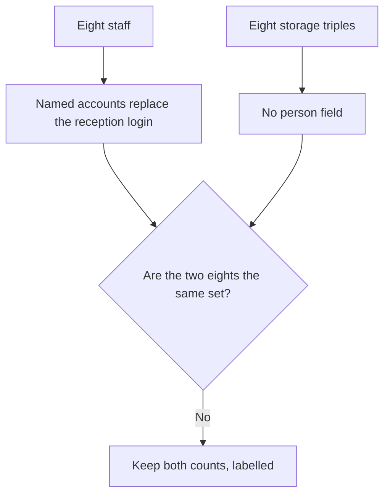

People and objects share a number and not a table.

### Logical drawing

```text
staff:          8 people, reception login replaced
sharing rows:   8 triples, no account column
leaver bits:    1, 1, 1 across May June July
leaver names:   none
```
<!-- open-cyber-academy:lesson-figures:end ch-12 -->

### Learning outcomes

After this chapter, you should be able to:

1. Keep the staff count out of the sharing filter.
2. Say what a named account changes in a log.
3. Refuse a role hierarchy and a named leaver.

### 12.1 The reception login was a logging problem, not a triple.

While several people signed in as reception, an activity line could not say which person changed a folder. Named accounts make a later line attributable to one person. That change is prose. The sharing script still has no account field, so the eight triples are not the eight staff. The colleague who shared the letter in January stays unnamed; the export does not identify them.

Sandhu, Coyne, Feinstein, and Youman (1996) separate users, roles, permissions, and sessions. None of those four sets is in the file. The strings `staff`, `admins`, and `public` are setting tokens. The program does not encode `admins` as a subset of `staff`, and it does not grant a permission through inheritance. Passing the membership test is not a role assignment.

The routine's leaver cell is `1` in May, June, and July. The bit says the task was marked done. It does not list a leaver, a last day, or a link that was moved to a current member. Account removal is not the deletion of `old-backup.zip`.

### 12.2 Worked example

| Claim | Relation to the files | Decision |
|---|---|---|
| Named accounts let a log name one person | Prose about the reception login | May stay |
| The sharing list has eight rows | `len(items)` | May stay, as objects |
| "The eight rows are the eight staff." | No person field | Reject |
| "June's leaver bit names who left." | The bit is only 1 | Reject |

> **Synthetic case.** No leaver is given a name or a date.

### Errors and limits

Do not build a role hierarchy on top of three strings the filter only compares.

### Apply

- **EX058 — Two eights.** A classmate treats the eight triples as the eight staff, says `admins` inherits `staff`, and reads a leaver's name from the June bit. What do you keep? *Rubric:* 3 = the eights are different sets; the strings are not a hierarchy; the leaver bits stay 1, 1, 1 with no name; the January colleague stays unnamed;; 2 = reject the merge and the name;; 1 = one correction;; 0 = none.

<!-- open-cyber-academy:chapter-navigation:start ch-12 -->
### Continue studying — lesson 12 (chapter 12 of 20)

[← Chapter 11](#ch-11) · [Course chapter index](../SUBJECTS.md) · [Chapter 13 →](#ch-13)

Continue to the next authored lesson.
<!-- open-cyber-academy:chapter-navigation:end -->

<a id="ch-13"></a>

## Chapter 13 — A second factor is not a bit in the vector

<!-- open-cyber-academy:lesson-figures:start ch-13 -->
### Lesson map

Lesson 13. Map, example, EX059.

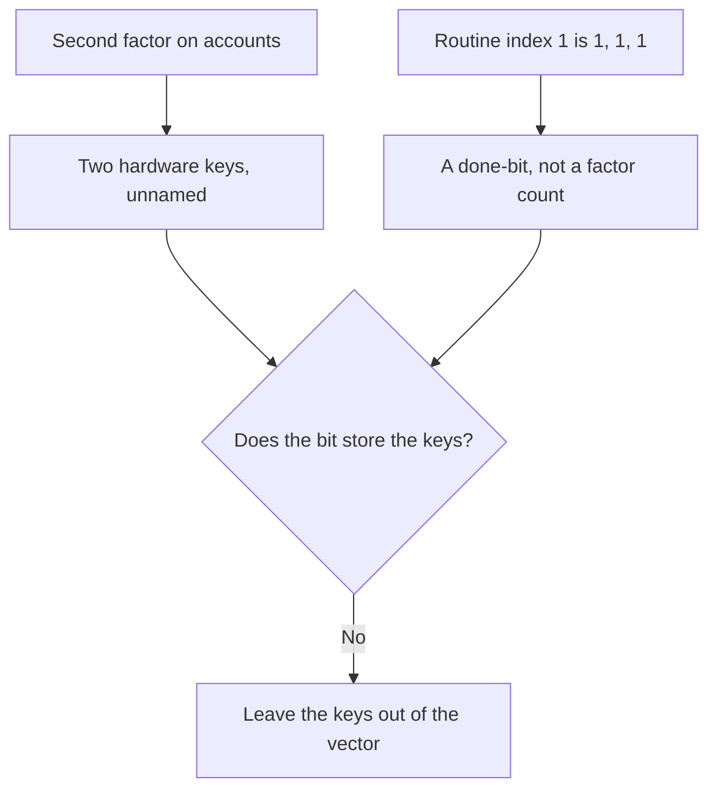

The factor protects an account. The vector stores a tick.

### Logical drawing

```text
prose:   every account has a second factor
         two staff without smartphones received hardware keys
vector:  check admin accounts and MFA = 1 in May, June, July
absent:  key serial, phone number, count of factors
```
<!-- open-cyber-academy:lesson-figures:end ch-13 -->

### Learning outcomes

After this chapter, you should be able to:

1. Say what the second-factor decision covered.
2. Read routine index 1 as a done-bit.
3. Refuse a factor inventory read out of that bit.

### 13.1 The tick does not remember which factor.

Every account received a second factor. Two staff without smartphones received hardware keys. Each key is labelled with its owner's name, and a spare is locked in the office. No owner, label text, serial, or phone number is printed. The sharing triples still have no factor field, so the filter cannot confirm the decision.

In `lab_routine.py` the second task is "check admin accounts and MFA". Its cells are `1`, `1`, and `1`. `sum` counts those cells as done. It does not store whether the factor was a hardware key or an application, whether all eight people were included, or whether an account that can change sharing was the one checked. A `1` is compatible with a careful check and also compatible with a tick written in haste. The file does not distinguish those stories.

SP 800-210 is general access-control guidance for cloud systems. The three monthly ticks are not a completed assessment against that publication. A password without the second factor would be a weaker account control; the page does not teach how to defeat a factor, and it records no bypass.

### 13.2 Worked example

| Reading | Evidence | Decision |
|---|---|---|
| Two hardware keys were issued | Prose, staff without smartphones | May stay, unnamed |
| Index 1 is done in all three months | The vectors | May stay |
| "The bit proves eight of eight factors." | The bit has no denominator of people | Reject |
| "A key serial is in the lab." | No serial is stored | Reject |

> **Synthetic case.** The spare key stays in the office. Its label is not copied here.

### Errors and limits

Do not treat three ticks as a roster of factors.

### Apply

- **EX059 — Tick versus factor.** A note says the three MFA bits prove eight hardware keys, prints a serial, and calls the result an SP 800-210 assessment. What remains? *Rubric:* 3 = the bits stay 1, 1, 1; two unnamed hardware keys stay prose for staff without smartphones; reject eight keys, the serial, and the assessment;; 2 = the bits stay and the inventory is refused;; 1 = one fact;; 0 = none.

<!-- open-cyber-academy:chapter-navigation:start ch-13 -->
### Continue studying — lesson 13 (chapter 13 of 20)

[← Chapter 12](#ch-12) · [Course chapter index](../SUBJECTS.md) · [Chapter 14 →](#ch-14)

Continue to the next authored lesson.
<!-- open-cyber-academy:chapter-navigation:end -->

<a id="ch-14"></a>

## Chapter 14 — A year-old image is not a vulnerability count

<!-- open-cyber-academy:lesson-figures:start ch-14 -->
### Lesson map

Lesson 14. Map, example, EX060.

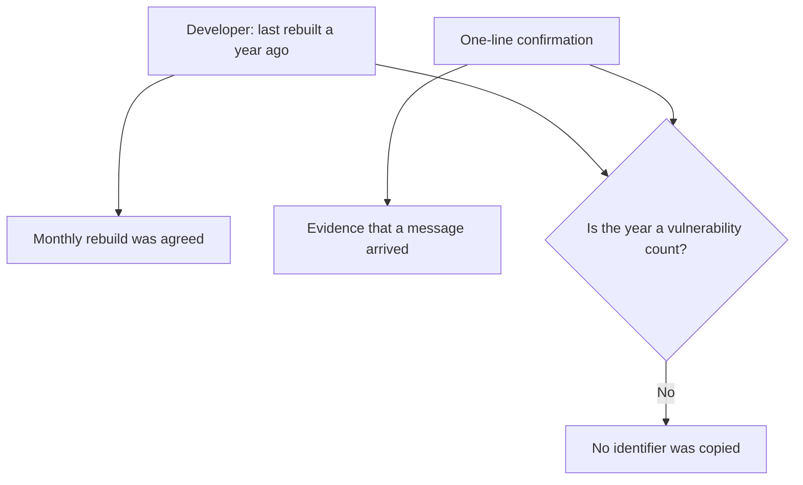

Age is a sentence. A count would be a measurement.

### Logical drawing

```text
recorded:    older base, last rebuilt a year ago
agreement:   monthly rebuild, one-line confirmation
not recorded: digest, tag, registry, CVE, EPSS, image name
```
<!-- open-cyber-academy:lesson-figures:end ch-14 -->

### Learning outcomes

After this chapter, you should be able to:

1. Keep the image age as the developer's sentence.
2. Say what a one-line confirmation does not prove.
3. Refuse an imported vulnerability count.

### 14.1 No identifier enters the booking note.

The developer said the booking image was an older base last rebuilt a year ago. Fixes published for that base during the year did not arrive, even though the clinic had not changed the application's own code. The agreement that followed is a monthly rebuild from a maintained base, plus a one-line confirmation. The confirmation shows that a message was received. It is not a digest comparison, not a signature check, and not a registry allow-list.

Shu, Gu, and Enck (2017) report known vulnerabilities in many public images. Their study is not this clinic's registry, and none of their counts is copied here. Jacobs and colleagues (2021) define EPSS for a known vulnerability identifier. This file has no such identifier, so the score is undefined. Rahman, Parnin, and Williams (2019) discuss smells in infrastructure-as-code scripts. No such script is in either lab, so those smells are not results for the booking app.

SP 800-190 recommends maintained bases and trusted registries. The email does not perform those checks. Burns and colleagues (2016) and Verma and colleagues (2015) describe cluster managers. Oakfield's platform is the simpler host already named, not a Borg cell and not a Kubernetes cluster. No node count is recorded. Oakfield's month-end sentence remains in chapter 4, and this lesson does not reprint it as a new result.

### 14.2 Worked example

| Added figure | Source that would be required | Decision |
|---|---|---|
| Last rebuilt a year ago | The developer's answer | May stay |
| A confirmation email was the check | The agreement | May stay, as a message |
| "Shu's percentage applies to this image." | No count was imported | Reject |
| "EPSS for the base is attached." | No identifier | Reject |

> **Synthetic case.** The developer stays unnamed. The image stays unnamed.

### Errors and limits

A year without a rebuild is a lag. It is not a table of flaws.

### Apply

- **EX060 — Age versus count.** A classmate attaches a vulnerability total, an EPSS value, a digest, and a cluster size to the year-old image. What can the note keep? *Rubric:* 3 = keep the year-old base and the monthly confirmation; reject the total, the score, the digest, and the cluster size; the platform is not Kubernetes;; 2 = keep the age and reject the measurements;; 1 = one item;; 0 = none.

<!-- open-cyber-academy:chapter-navigation:start ch-14 -->
### Continue studying — lesson 14 (chapter 14 of 20)

[← Chapter 13](#ch-13) · [Course chapter index](../SUBJECTS.md) · [Chapter 15 →](#ch-15)

Continue to the next authored lesson.
<!-- open-cyber-academy:chapter-navigation:end -->

<a id="ch-15"></a>

## Chapter 15 — A platform secret is not an empty config row

<!-- open-cyber-academy:lesson-figures:start ch-15 -->
### Lesson map

Lesson 15. Map, example, EX061.

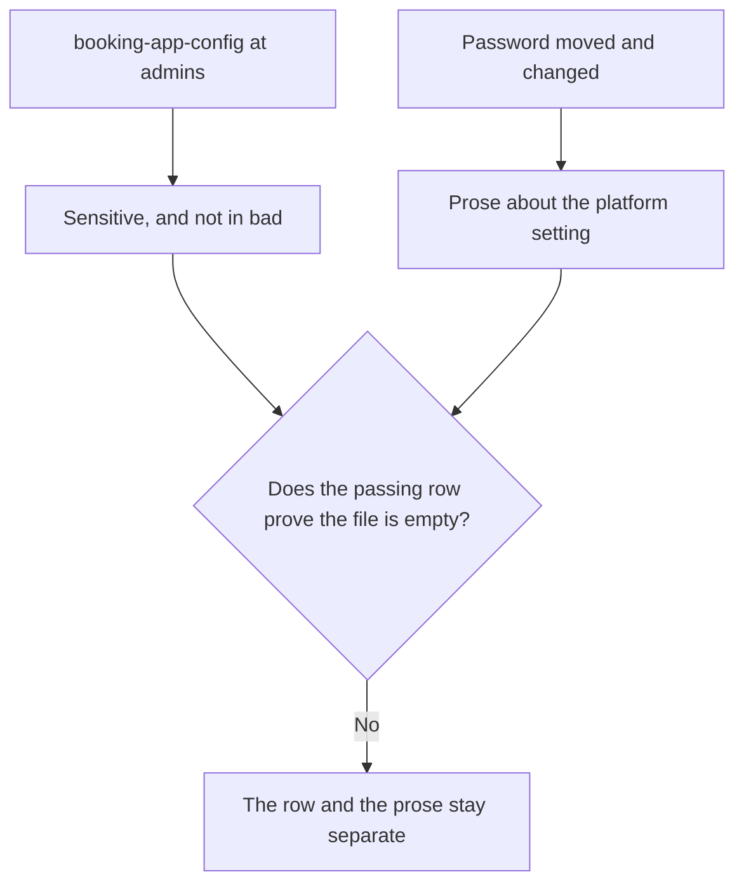

A passing triple does not describe the bytes inside the object.

### Logical drawing

```text
triple:   booking-app-config , admins , True
prose:    database password moved to platform secret settings, then changed
absent:   the password, a Secret object, a statement that the file is empty
```
<!-- open-cyber-academy:lesson-figures:end ch-15 -->

### Learning outcomes

After this chapter, you should be able to:

1. Read the config triple as a sharing result.
2. Keep the password move in prose.
3. Refuse both a printed secret and an emptiness proof.

### 15.1 The row answers a sharing question only.

`booking-app-config` is `True` and `admins`. `admins` is a member of `allowed[True]`, so the comprehension does not print the name. The triple does not say what bytes are inside the object. The prose says the developer moved the database password into the platform's secret settings and then changed it, because the old value may already have been copied. That paragraph is not loaded by the filter.

`staff` and `admins` are equal in the set test. Calling `admins` narrower is a human gloss. The program would also have accepted `staff` for this sensitive object. Kubernetes documents good practices for Secret objects. This platform is not a Kubernetes cluster, and no Secret manifest is in the file. The guidance is an analogy for keeping a value out of an image, not a result printed for Oakfield.

The password is not written here. `old-backup.zip` is a separate triple, described as a copy from the previous system. This chapter does not claim the zip contains the booking password. Copies of a configuration file are the prose concern in the password paragraph; the zip's contents are not itemised beyond that earlier description.

### 15.2 Worked example

| Claim | What would show it | Decision |
|---|---|---|
| The config triple passes | `admins` is allowed | Keep |
| The password was moved and changed | Prose | Keep, value unprinted |
| "The passing row proves the file no longer holds the password." | The triple has no content field | Reject |
| "admins is computed as stricter than staff." | Both are mere members | Reject |

> **Synthetic case.** No password characters appear in the book.

### Errors and limits

Do not fill the blank with an example secret. The absence of a value is the point.

### Apply

- **EX061 — Row versus move.** A note says the passing config row proves the password is gone, prints a sample password, and says `admins` outranks `staff` inside the program. What do you reject, and what stays? *Rubric:* 3 = reject the emptiness proof, the sample, and the ranking; the triple stays sensitive, `admins`, and out of `bad`; the move and the change stay prose;; 2 = the row stays and the secret stays unprinted;; 1 = one point;; 0 = none.

<!-- open-cyber-academy:chapter-navigation:start ch-15 -->
### Continue studying — lesson 15 (chapter 15 of 20)

[← Chapter 14](#ch-14) · [Course chapter index](../SUBJECTS.md) · [Chapter 16 →](#ch-16)

Continue to the next authored lesson.
<!-- open-cyber-academy:chapter-navigation:end -->

<a id="ch-16"></a>

## Chapter 16 — A monthly bit is not a proof

<!-- open-cyber-academy:lesson-figures:start ch-16 -->
### Lesson map

Lesson 16. Map, example, EX062.

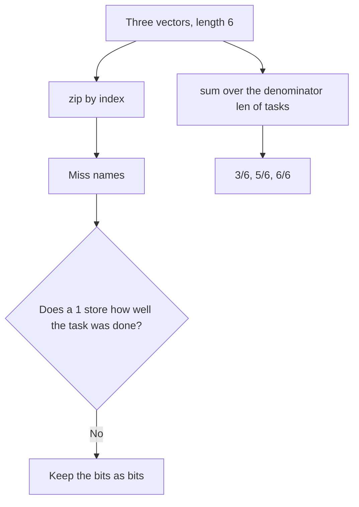

Alignment is an assumption that holds for these three vectors.

### Logical drawing

```text
May:   [1, 1, 0, 0, 1, 0]  -> 3/6
June:  [1, 1, 1, 0, 1, 1]  -> 5/6
July:  [1, 1, 1, 1, 1, 1]  -> 6/6
causes such as "nobody knew how" are not cells
```
<!-- open-cyber-academy:lesson-figures:end ch-16 -->

### Learning outcomes

After this chapter, you should be able to:

1. Align each zero with a task name by index.
2. State the denominator the print uses.
3. Refuse a quality story stored in a `1`.

### 16.1 The print names a miss. It does not store a cause.

`tasks` has six strings. Each month maps to a list of six integers, only `0` or `1` in this file. `sum(done)` is the numerator. The denominator is `len(tasks)`, which is 6, not the length of the vector. `zip` pairs names with cells by position and stops at the shorter sequence. All three vectors have length 6, so the names and the sums see the same cells. That equal length is true of this file. The script does not check it.

May's zeros sit at indexes 2, 3, and 5: restore, image, notices. June's only zero sits at index 3: image. July has no zero, so the miss clause is omitted. A `1` means the cell was truthy. It does not store minutes, a witness, or a document. The prose causes — nobody knew how to restore, the developer was away — are sentences beside the vector. Shifting a bit would rename a miss without a new measurement. No shifted vector is in the file.

The sharing script is a different instrument. A passing storage triple does not set a routine bit, and a routine `1` does not edit a triple.

### 16.2 Worked example

| Statement | Computed? | Decision |
|---|---|---|
| June missed only the image task | Index 3 is the only zero | Keep |
| The denominator is 6 | `len(tasks)` | Keep |
| "June's restore 1 describes a perfect restore." | The cell stores no quality | Reject |
| "The vectors were shifted to match the story." | Length and positions stay | Reject |

> **Synthetic case.** May, June, and July are the only keys.

### Errors and limits

Do not promote a cause sentence into a seventh cell.

### Apply

- **EX062 — Bits and names.** Someone says June's image cell failed because the bit stores the holiday, and that a restore value of 1 is a measured perfect restore. What does the vector hold? *Rubric:* 3 = cells are 0 or 1; June's only zero is index 3, the image task; the holiday and the restore quality stay prose; the denominator stays 6; the three vectors stay length 6;; 2 = the miss is the image bit and the causes stay outside;; 1 = one cell;; 0 = none.

<!-- open-cyber-academy:chapter-navigation:start ch-16 -->
### Continue studying — lesson 16 (chapter 16 of 20)

[← Chapter 15](#ch-15) · [Course chapter index](../SUBJECTS.md) · [Chapter 17 →](#ch-17)

Continue to the next authored lesson.
<!-- open-cyber-academy:chapter-navigation:end -->

<a id="ch-17"></a>

## Chapter 17 — Fourteen of eighteen is not July

<!-- open-cyber-academy:lesson-figures:start ch-17 -->
### Lesson map

Lesson 17. Map, example, EX063.

```mermaid
flowchart TD
  C["18 cells"] --> O["14 ones"]
  C --> Z["4 zeros"]
  J["July is the only all-ones month"] --> Q{"Did the script print 14/18?"}
  O --> Q
  Q -->|No| K["The print stays three month lines"]
```

A cell total is a further reduction. It is not a line in the output.

### Logical drawing

```text
column ones: sharing 3, admin 3, restore 2, image 1, leavers 3, notices 2
zero cells:  May restore, May image, May notices, June image
printed:     May 3/6, June 5/6, July 6/6
not printed: 14/18, the column sums, a mean
```
<!-- open-cyber-academy:lesson-figures:end ch-17 -->

### Learning outcomes

After this chapter, you should be able to:

1. Add the three numerators without replacing the print.
2. Name the four zero cells and the image column.
3. Refuse a single grade for the quarter.

### 17.1 The script prints months. The cell sum is extra arithmetic.

The three numerators are 3, 5, and 6. Their total is 14 ones. Three months times six tasks is 18 cells, so the zeros are 4. Those four positions are May's restore, May's image, May's notices, and June's image. Image is the only task with two zeros. Sharing, the admin check, and leavers are ones in every month. Restore and notices each have a single zero, both in May.

July is the only key for which every cell is `1`. That is one month's conjunction. It is not a property of the eighteen cells. The program never prints `14/18`, never prints the column sums, and never prints an average of the three numerators. A note that replaces the three lines with one of those figures is reporting a quantity the output did not contain. The derivation can be shown beside the print. It must not be pasted over it.

One person recorded the ticks. No second rater is described, so no agreement coefficient is available. August is not a key in the dictionary.

### 17.2 Worked example

| Figure | Status | Decision |
|---|---|---|
| May 3/6, June 5/6, July 6/6 | Printed | Keep |
| 14 ones and 4 zeros | Derived, not printed | May be shown as a derivation |
| "The quarter score is 14/18, so July is the file." | Replaces the three lines | Reject |
| "Image passed every month." | The column has two zeros | Reject |

> **Synthetic case.** The derivation sits beside the embedded lines. It does not edit them.

### Errors and limits

Do not average 3, 5, and 6 into a grade the deputy could mistake for the print.

### Apply

- **EX063 — Beside, not over.** A summary replaces the three month lines with 14/18, says the image column passed, and calls July the whole result. What do you keep, and what may be mentioned only as arithmetic beside the file? *Rubric:* 3 = keep the three printed lines; 14 ones and 4 zeros may be derived and must not replace the print; image is 1 of 3; July is the only all-ones month;; 2 = the printed lines stay and 14/18 is not the file;; 1 = one line;; 0 = none.

<!-- open-cyber-academy:chapter-navigation:start ch-17 -->
### Continue studying — lesson 17 (chapter 17 of 20)

[← Chapter 16](#ch-16) · [Course chapter index](../SUBJECTS.md) · [Chapter 18 →](#ch-18)

Continue to the next authored lesson.
<!-- open-cyber-academy:chapter-navigation:end -->

<a id="ch-18"></a>

## Chapter 18 — A test-folder restore is not the letters

<!-- open-cyber-academy:lesson-figures:start ch-18 -->
### Lesson map

Lesson 18. Map, example, EX064.

```mermaid
flowchart TD
  M["May restore cell is 0"] --> C["Prose: nobody knew how"]
  J["June restore cell is 1"] --> T["Prose: a test folder"]
  T --> Q{"Does the 1 name patient letters?"}
  Q -->|No| K["May's zero stays"]
```

Practice changes a later cell. It does not edit the earlier zero.

### Logical drawing

```text
restore index: 2
May 0, June 1, July 1
object restored in prose: a test folder
not the object: patient-letters/ or old-backup.zip
```
<!-- open-cyber-academy:lesson-figures:end ch-18 -->

### Learning outcomes

After this chapter, you should be able to:

1. Keep May's restore zero.
2. Bound June's one to a test folder in prose.
3. Refuse a letter restore and a zip deletion dressed up as the same event.

### 18.1 Index 2 flips. The letters are a different object.

The restore task is index 2. May stores `0`. The prose says the miss happened because nobody knew how. June stores `1` after Leila practised with a test folder. July stores `1`. The script's miss line for May names "check backups restored" and the June line does not. Nothing in the cell identifies the folder, the file, or a byte count.

`patient-letters/` is a sharing triple, not a restore operand. `old-backup.zip` is the archive that was later deleted. Deleting an unneeded zip does not exercise a restore, and a test-folder practice does not show that the letters could be returned. The two labs do not share a row identifier, so a reader cannot join them by key.

A successful June practice leaves May's zero where it is. Rewriting May to `1` would raise May's numerator and shorten its miss list. That rewrite is not in the file. No backup product, no location, and no duration are printed.

### 18.2 Worked example

| Claim | Fit | Decision |
|---|---|---|
| May missed the restore task | Index 2 is 0 | Keep |
| June's practice used a test folder | Prose | Keep, unnamed beyond that |
| "Patient letters were restored in June." | No such operand | Reject |
| "May was corrected to 1 after the practice." | The vector is unchanged | Reject |

> **Synthetic case.** The test folder has no further name.

### Errors and limits

Do not join the zip's deletion to index 2. They answer different questions.

### Apply

- **EX064 — Which object.** A note changes May's restore bit to 1, says the patient letters were restored, and treats the zip deletion as that restore. What stays in the file? *Rubric:* 3 = May stays 0 and June stays 1 at index 2; the practice object stays an unnamed test folder; letters and the zip are different objects; do not edit the vector;; 2 = the bits stay and the letters claim is refused;; 1 = one bit;; 0 = none.

<!-- open-cyber-academy:chapter-navigation:start ch-18 -->
### Continue studying — lesson 18 (chapter 18 of 20)

[← Chapter 17](#ch-17) · [Course chapter index](../SUBJECTS.md) · [Chapter 19 →](#ch-19)

Continue to the next authored lesson.
<!-- open-cyber-academy:chapter-navigation:end -->

<a id="ch-19"></a>

## Chapter 19 — A backup contact is not a digest

<!-- open-cyber-academy:lesson-figures:start ch-19 -->
### Lesson map

Lesson 19. Map, example, EX065.

```mermaid
flowchart TD
  I["Image cells 0, 0, 1"] --> H["June miss: developer away"]
  B["Unnamed backup contact"] --> P["Prose, not a cell"]
  H --> Q{"Does July's 1 store a digest?"}
  P --> Q
  Q -->|No| K["The confirmation stays a one-line message"]
```

The contact explains a gap. The July tick does not identify an image.

### Logical drawing

```text
image index: 3
May 0, June 0, July 1
June cause in prose: developer on holiday
later prose: a backup contact
not stored: digest, tag, pod profile, network policy
```
<!-- open-cyber-academy:lesson-figures:end ch-19 -->

### Learning outcomes

After this chapter, you should be able to:

1. Read the image column as two zeros and one one.
2. Keep the backup contact unnamed and outside the vector.
3. Refuse a Kubernetes profile and a network-policy result.

### 19.1 July's tick is not an image identity.

Index 3 is the image task. May and June are `0`. July is `1`. The June miss is explained in prose: the developer was on holiday. A backup contact was agreed so the rebuild would not depend on one person. The contact is unnamed. July's `1` does not store that person's name, and it does not store a digest, a tag, or the text of the confirmation email. The email remains the one-line message from the agreement. It is filed in the decision log when it arrives. A missing month, such as June, is visible because the message was absent, which matches the zero already in the vector.

Pod Security Standards name Privileged, Baseline, and Restricted profiles. No profile was selected here, and no pod, host path, or capability list is recorded. A network policy is likewise unrecorded. `price-list.pdf` is public as a storage token. That token is not a packet rule, and the lack of a policy object is not evidence about which connections the booking app accepts. The platform is still the simpler host, not a cluster on which those objects would even be written.

The image column's two zeros remain after the contact is agreed. Agreement is not a retroactive `1`.

### 19.2 Worked example

| Claim | Record | Decision |
|---|---|---|
| Image was missed in May and June | Index 3 | Keep |
| A backup contact was agreed | Prose, unnamed | Keep |
| "July's 1 is the image digest." | No digest field | Reject |
| "A Restricted pod profile passed." | No profile was recorded | Reject |

> **Synthetic case.** The developer and the backup contact stay unnamed.

### Errors and limits

Do not apply a cluster control to a platform that has no cluster record.

### Apply

- **EX065 — Contact versus image.** A note fills July's image bit with a digest, names the backup contact, marks June as passed because the contact now exists, and reports a Restricted pod profile. What do you reject? *Rubric:* 3 = reject the digest, the name, the rewritten June zero, and the profile; May and June stay 0 and July stays 1 at index 3; the contact stays unnamed prose;; 2 = the column stays and the digest is refused;; 1 = one cell;; 0 = none.

<!-- open-cyber-academy:chapter-navigation:start ch-19 -->
### Continue studying — lesson 19 (chapter 19 of 20)

[← Chapter 18](#ch-18) · [Course chapter index](../SUBJECTS.md) · [Chapter 20 →](#ch-20)

Continue to the next authored lesson.
<!-- open-cyber-academy:chapter-navigation:end -->

<a id="ch-20"></a>

## Chapter 20 — What the clinic note can say

<!-- open-cyber-academy:lesson-figures:start ch-20 -->
### Lesson map

Lesson 20. Map, example, EX066.

```mermaid
flowchart TD
  N["A leaving note"] --> Q{"Does the sentence replace a print, fill a blank, or close the review?"}
  Q -->|Yes| R["Reject it"]
  Q -->|No| K["The note may cite that line"]
```

Twenty lessons meet a planning minimum. They leave the clinic's open items open.

### Logical drawing

```text
may stay
    items 8, sensitive 5, shared too widely 3
    the three failure names
    May 3/6, June 5/6, July 6/6
must not be added
    a rewritten triple, an August key, a vendor name
    a vulnerability count, a digest, a Kubernetes score
    a claim the clinic is secure
```
<!-- open-cyber-academy:lesson-figures:end ch-20 -->

### Learning outcomes

After this chapter, you should be able to:

1. Repeat both embedded prints and the open blanks.
2. Reject a note that replaces a print or fills a blank.
3. Name the following subject while this review stays open.

### 20.1 A note may quote the file. It may not improve the file.

A leaving note may say what was measured. From the sharing script, keep `items 8, sensitive 5, shared too widely 3` and the three names in list order: `patient-letters/`, `invoices/`, and `old-backup.zip`. From the routine script, keep May `3/6` with the three miss names, June `5/6` with the image miss, and July `6/6`. Derived arithmetic such as 14 ones in 18 cells may be labelled as arithmetic. It must not be swapped in as the output.

The blanks stay blank. No provider name, no link string, no patient name, no hospital name, no IP address, no password, no key serial, no leaver, no image digest, no vulnerability identifier, no EPSS value, no pod profile, and no network policy are available to copy. August stays the deputy's watched routine in prose, not a fourth dictionary key. The afternoon staff-only change, the zip's deletion, the factor decision, and the backup contact stay prose beside the unchanged files. The posture-watch repository is supplementary and was not a row in either script.

The month's closing sentence stays in chapter 4, and the leaving note does not treat it as a closed review. The note's job is to stop a reader from correcting the first prints into a happier file.

### 20.2 Worked example

| Leaving-note sentence | Why it fails or stands | Decision |
|---|---|---|
| "The sharing print is 3 too wide, and July is 6/6." | The two scripts | May stay |
| "14 of 18 is a derivation beside the month lines." | Not the printed output | May stay if labelled |
| "The triples were edited, a digest was attached, and August was added." | Replaces the files and fills blanks | Reject |
| "Twenty lessons make the clinic secure." | The review is still open | Reject |

> **Synthetic case.** The note is a classroom page about Oakfield Physiotherapy. It is not a notice to patients.

### Errors and limits

Twenty English lessons meet Oakfield Physiotherapy's planning minimum and leave this review open. A fresh booking question can still earn its own later Oakfield lesson. These English chapters do not publish another language edition. Cloud and container security stays this course. Application and software supply chain security is the learner's following subject. Open items at the clinic stay open on that turn. These chapters do not call Oakfield secure, and they do not hand anyone a qualification.

### Apply

- **EX066 — Four claims.** A classmate's leaving note rewrites the sharing list as empty, adds August as 6/6, attaches a vendor name, a digest, and a Kubernetes score, and says twenty lessons make the clinic secure. Which claims do you reject, and what do twenty lessons meet? *Rubric:* 3 = reject the rewritten list, the August key, the vendor, the digest, the score, and the secure claim; keep 8, 5, 3, the three names, and May 3/6, June 5/6, July 6/6; twenty lessons meet the planning minimum and leave review open;; 2 = reject the closings and keep both prints;; 1 = one claim;; 0 = none.

<!-- open-cyber-academy:chapter-navigation:start ch-20 -->
### Continue studying — lesson 20 (chapter 20 of 20)

[← Chapter 19](#ch-19) · [Course chapter index](../SUBJECTS.md) · [Next course via chapter index →](../SUBJECTS.md)

The chapter index leads to the next course in the study path.
<!-- open-cyber-academy:chapter-navigation:end -->

<a id="worked-results"></a>

## Worked results

Model answers for EX001–EX066. Leila Ahmadi, Ben Hartley, Oakfield Physiotherapy, Westbrook Community College and every figure are synthetic. Lab answers quote verified outputs. Any answer meeting the rubric scores equally.

**EX001.** A forwarded link to a patient's letter opened without any login.

**EX002.** Cloud storage, email and the hosted platform running the booking app.

**EX003.** The app inherits flaws in the base image it was built on.

**EX004.** The clinic's side: it controls sharing settings.

**EX005.** Fix sensitive sharing today, MFA this week, agree container updates with the developer.

**EX006.** Date, reason and owner.

**EX007.** Gather evidence first and consult data protection guidance.

**EX008.** No; all services are provider-managed.

**EX009.** NIST SP 800-145.

**EX010.** A small clinic must start with the most important changes.

**EX011.** A review looking for similar problems elsewhere.

**EX012.** Its own infrastructure.

**EX013.** The patient letters folder to staff-only.

**EX014.** Mark Ellis, the clinic owner.

**EX015.** The sharing report and the folder's activity log.

**EX016.** A colleague shared a letter with a hospital in January.

**EX017.** Four views: three from the hospital, one the patient's forwarded view.

**EX018.** Mark, as data controller.

**EX019.** Guessing addresses or using outside tools to test links.

**EX020.** So logs show which person did what.

**EX021.** They received hardware keys.

**EX022.** It is the evidence of what happened.

**EX023.** Changes can erase the record of exposure.

**EX024.** Only Oakfield's own services.

**EX025.** What happened, who was affected and why she judges the risk low.

**EX026.** It makes limits clear and protects everyone.

**EX027.** Sensitive items only to staff or administrators; non-sensitive may also be public.

**EX028.** Patient-letters, invoices and old-backup.zip.

**EX029.** Five.

**EX030.** Deleted after checking retention rules, since fewer copies mean less to protect.

**EX031.** An older base image last rebuilt a year ago.

**EX032.** Monthly rebuilds with a one-line confirmation.

**EX033.** Into the platform's secret settings.

**EX034.** Many public images carried known vulnerabilities.

**EX035.** Yes: trusted images, rebuilds, separate secrets and least privilege.

**EX036.** Other items might have the same problem.

**EX037.** Find problems that appear later.

**EX038.** NIST SP 800-190.

**EX039.** Sharing review, admin and MFA check, backup restore, image update, leavers' access, provider notices.

**EX040.** Each matches something that went wrong or nearly did.

**EX041.** May 3/6, June 5/6, July 6/6.

**EX042.** Nobody knew how to do it.

**EX043.** The developer's holiday; a backup contact was agreed.

**EX044.** About an hour a month.

**EX045.** The first Monday of each month.

**EX046.** Understand control, work within authority, keep evidence, check against a rule, keep dependencies current, repeat monthly.

**EX047.** They are more detailed than needed now but useful if Oakfield grows.

**EX048.** One-page instructions and a trained deputy manager.

**EX049.** Completed the routine with Leila watching.

**EX050.** When only one person holds them.

**EX051.** No. The eight triples stay. The Boolean sum stays 5. The filter stays 3, in list order: patient-letters, invoices, and old-backup.zip. A later staff-only change and any count of files inside folders stay outside the script.

**EX052.** `anyone-with-link` and `public` are different strings. `public` is allowed only when the sensitive flag is false. A sensitive triple set to `public` would fail, and no such triple exists. The three failures are `anyone-with-link`. No link text is printed.

**EX053.** The first triple stays `anyone-with-link`. The filter still prints three names. The afternoon staff-only change stays in the decision log. The script is not edited.

**EX054.** Five is the Boolean sum. `referrals/` and `booking-app-config` are sensitive and still pass. The failure list stays three names. There is no patient count and no kappa.

**EX055.** `old-backup.zip` stays the third failure line. Deletion after the retention check with Mark stays in the log. No sanitization method, recycler, or disposal date is printed.

**EX056.** Reject the named vendor, the SaaS label, and the lock-in measurement. The sharing mistake stays on the clinic's side. The services stay storage, email, and the hosted platform. The clinic owns no servers.

**EX057.** Keep four outside views: three matching the hospital domain and one the patient's forwarded view, with no unknown address among those four. Reject a proof that no further copy exists, a cross-tenant finding, and an SP 800-207 score. Mark still makes the notification decision.

**EX058.** The eight triples are objects, not the eight staff. `staff`, `admins`, and `public` are not a role hierarchy. The leaver bits stay 1, 1, and 1, with no name. The January colleague stays unnamed.

**EX059.** The MFA cells stay 1, 1, and 1. Two hardware keys stay prose for the staff without smartphones, and those people stay unnamed. Reject a claim of eight keys, a serial, and an SP 800-210 assessment.

**EX060.** Keep the year-old base and the monthly one-line confirmation. Reject a vulnerability total, an EPSS value, a digest, and a cluster size. The booking platform is not a Kubernetes cluster.

**EX061.** Reject an emptiness proof, a sample password, and a ranking of `admins` over `staff`. The config triple stays sensitive, set to `admins`, and out of the failure list. The move and the password change stay prose.

**EX062.** The cells are 0 or 1. June's only zero is index 3, the image task. The holiday and any restore quality stay prose. The denominator stays 6, and each vector stays length 6.

**EX063.** Keep May 3/6, June 5/6, and July 6/6. Fourteen ones and four zeros may be derived beside the print and must not replace it. The image column is 1 of 3. July is the only all-ones month.

**EX064.** May's restore cell stays 0 and June's stays 1. The practice object stays a test folder. Patient letters and `old-backup.zip` are different objects. The vector is not edited.

**EX065.** Reject the digest, the contact's name, a rewritten June zero, and a Restricted pod profile. The image cells stay 0, 0, and 1. The backup contact stays unnamed prose.

**EX066.** Reject the empty sharing list, the August key, the vendor, the digest, the Kubernetes score, and the claim that the clinic is secure. Keep 8, 5, 3, the three failure names, and May 3/6, June 5/6, July 6/6. Twenty lessons meet the planning minimum and leave review open.

<a id="references"></a>

## References

Links checked 12 October 2026; re-verify editions before citing. Organisations, people, systems, code and data in this book are synthetic unless a sentence cites a public source.

- Amazon Web Services. (n.d.). *Shared responsibility model*. <https://aws.amazon.com/compliance/shared-responsibility-model/>
- Armbrust, M., Fox, A., Griffith, R., Joseph, A. D., Katz, R., Konwinski, A., Lee, G., Patterson, D., Rabkin, A., Stoica, I., & Zaharia, M. (2010). A view of cloud computing. *Communications of the ACM*, 53(4), 50–58. <https://doi.org/10.1145/1721654.1721672>
- Burns, B., Grant, B., Oppenheimer, D., Brewer, E., & Wilkes, J. (2016). Borg, Omega, and Kubernetes. *Communications of the ACM*, 59(5), 50–57. <https://doi.org/10.1145/2890784>
- Center for Internet Security. (n.d.). *CIS Benchmarks*. <https://www.cisecurity.org/cis-benchmarks>
- Cloud Security Alliance. (2021). *Cloud Controls Matrix (CCM) v4*. <https://cloudsecurityalliance.org/research/cloud-controls-matrix>
- Google Cloud. (n.d.). *Shared responsibilities and shared fate on Google Cloud*. <https://cloud.google.com/architecture/framework/security/shared-responsibility-shared-fate>
- Hu, V. C., Iorga, M., Bao, W., Li, A., Li, Q., & Gouglidis, A. (2020). *General access control guidance for cloud systems* (NIST SP 800-210). NIST. <https://doi.org/10.6028/NIST.SP.800-210>
- Jacobs, J., Romanosky, S., Edwards, B., Adjerid, I., & Roytman, M. (2021). Exploit Prediction Scoring System (EPSS). *Digital Threats: Research and Practice*, 2(3), 1–17. <https://doi.org/10.1145/3436242>
- Kubernetes Authors. (n.d.). *Pod Security Standards*. <https://kubernetes.io/docs/concepts/security/pod-security-standards/>
- Kubernetes Authors. (n.d.). *Using RBAC authorization*. <https://kubernetes.io/docs/reference/access-authn-authz/rbac/>
- Kubernetes Authors. (n.d.). *Network policies*. <https://kubernetes.io/docs/concepts/services-networking/network-policies/>
- Kubernetes Authors. (n.d.). *Good practices for Kubernetes Secrets*. <https://kubernetes.io/docs/concepts/security/secrets-good-practices/>
- Landis, J. R., & Koch, G. G. (1977). The measurement of observer agreement for categorical data. *Biometrics*, 33(1), 159–174. <https://doi.org/10.2307/2529310>
- Mell, P., & Grance, T. (2011). *The NIST definition of cloud computing* (NIST SP 800-145). NIST. <https://doi.org/10.6028/NIST.SP.800-145>
- Microsoft. (n.d.). *Shared responsibility in the cloud*. <https://learn.microsoft.com/en-us/azure/security/fundamentals/shared-responsibility>
- Rahman, A., Parnin, C., & Williams, L. (2019). The seven sins: Security smells in infrastructure as code scripts. *41st International Conference on Software Engineering (ICSE)*, 164–175. <https://doi.org/10.1109/ICSE.2019.00033>
- Ristenpart, T., Tromer, E., Shacham, H., & Savage, S. (2009). Hey, you, get off of my cloud: Exploring information leakage in third-party compute clouds. *16th ACM Conference on Computer and Communications Security (CCS '09)*, 199–212. <https://doi.org/10.1145/1653662.1653687>
- Rose, S., Borchert, O., Mitchell, S., & Connelly, S. (2020). *Zero trust architecture* (NIST SP 800-207). NIST. <https://doi.org/10.6028/NIST.SP.800-207>
- Sandhu, R. S., Coyne, E. J., Feinstein, H. L., & Youman, C. E. (1996). Role-based access control models. *Computer*, 29(2), 38–47. <https://doi.org/10.1109/2.485845>
- Shu, R., Gu, X., & Enck, W. (2017). A study of security vulnerabilities on Docker Hub. *7th ACM Conference on Data and Application Security and Privacy (CODASPY '17)*, 269–280. <https://doi.org/10.1145/3029806.3029832>
- Souppaya, M., Morello, J., & Scarfone, K. (2017). *Application container security guide* (NIST SP 800-190). NIST. <https://doi.org/10.6028/NIST.SP.800-190>
- Verma, A., Pedrosa, L., Korupolu, M., Oppenheimer, D., Tune, E., & Wilkes, J. (2015). Large-scale cluster management at Google with Borg. *10th European Conference on Computer Systems (EuroSys '15)*, 1–17. <https://doi.org/10.1145/2741948.2741964>
