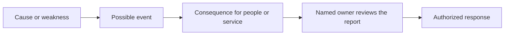
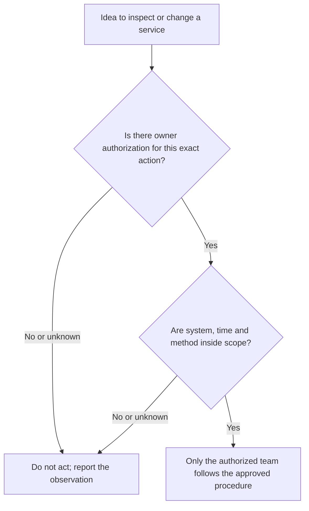
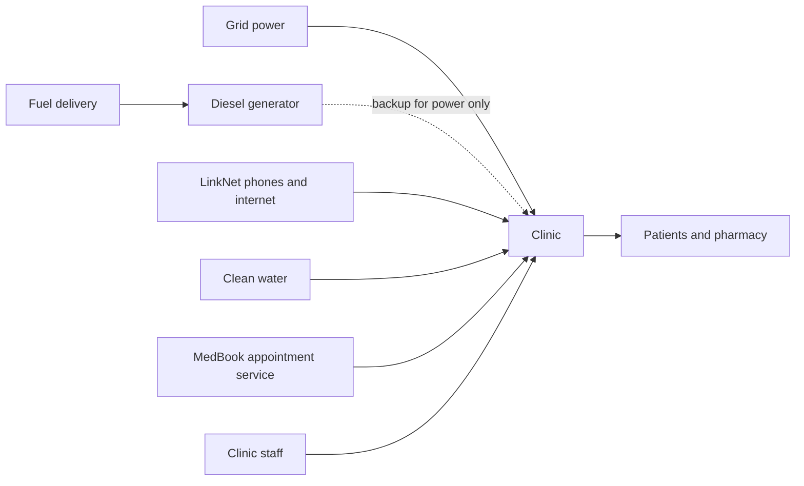
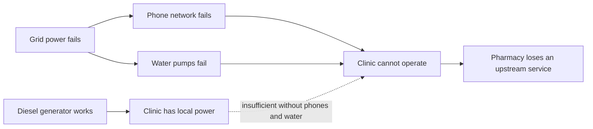

# Critical Infrastructure and Sector Security: A First Introduction

- Language: English (`en`); rapid course, one month; approximately 80 hours of planned study (course 023 of 207 in the [study path](../../../../../STUDY_PATH.md)).
- Editorial state: **published**. Chapters 1–4 of 4 have authored teaching text, one offline lab, exercises EX001–EX050 and matching worked results. Independent subject-matter review, source re-verification, accessibility review, language editing and the 300-page A4 verification remain open. Draft-chapter coverage is not a completed book.
- Audience: **new learners** with no security role and basic digital literacy — students, career changers, and staff or volunteers who have just joined a hospital, clinic, water or power company, transport operator, bank, school or local council and want to understand why their workplace is treated as "critical".
- How this course differs from its neighbours. The [professional book](../../../../professional-6-months/critical-sector-security/en/book/MANUSCRIPT.md) teaches coordinators to run governance: risk registers, RACI, supplier contracts, notification clocks and tabletop exercises. The [technical book](../../../../technical-18-months/critical-sector-security/en/book/MANUSCRIPT.md) teaches hands-on protocol and hardening depth. **This rapid book is a first look and a first safe practice.** It teaches you to recognize what makes a service critical, to explain its core risks in plain words, to stay inside what you are allowed to do, to see how services depend on each other, and to complete one small guided task. It does not make you a coordinator, an engineer or an incident responder, and it never asks you to touch a real system.
- Author and editorial responsibility: [hiagokinlevi](https://github.com/hiagokinlevi). Original maintainer-owned teaching text is dedicated under [CC0 1.0](../../../../../LICENSE); cited works keep their own rights and are not relicensed here.
- Educational boundary: this course is an independent educational blueprint. It is not an accredited programme, grants no qualification and grants no authority over, or access to, any real infrastructure, operator, dataset or person. Every place, organization, person, message, number and dependency in a worked example or the lab is **synthetic** unless a sentence explicitly cites a public source. Nothing in this book is legal, clinical or regulatory advice.

[Course home](../../README.md) · [Chapter index](../SUBJECTS.md) · [Book plan](PLAN.md) · [Course skill](../../skill/SKILL.md) · [Book standard](../../../../../BOOK_STANDARD.md) · [Worked results](#worked-results)

## How to use this draft

The course lasts four weeks, one chapter per week, about 20 hours each. The course outcome is to **recognize and explain the core risks of critical infrastructure, and complete one guided task** safely.

- **Week 1 (Chapter 1)** — what critical infrastructure is, why consequence matters more than data, and how to write one clear risk sentence.
- **Week 2 (Chapter 2)** — what you are and are not allowed to do, how to report something odd, and how to share information carefully.
- **Week 3 (Chapter 3)** — the parts of an essential service (people, IT, operational technology, data, suppliers) and how services depend on each other.
- **Week 4 (Chapter 4)** — a guided lab that traces what fails when one service fails, and a small annotated artifact (a one-page "service card") that brings the course together.

Every chapter has learning outcomes, short teaching sections with definitions, a worked example, a practical activity, common errors and limits, numbered exercises and a synthesis. Each exercise names its objective, inputs, steps, expected evidence and a 0–3 rubric. Write your answer first, then compare with the [worked results](#worked-results). A different answer that meets the rubric earns full credit.

The one lab (Chapter 4) is twenty-odd lines of Python 3 using the standard library only. It needs no network, packages, privileges or real data, and its output is printed in the book, so you can do every exercise without running it. The printed output was produced with Python 3.13.5.

### The synthetic setting used in this book

| Synthetic element | Role in the book | Boundary |
|---|---|---|
| **Larkfield** — a fictional small town of about 20,000 people | Setting for every example. | Invented place. |
| **Larkfield Community Clinic** — a walk-in clinic with a small pharmacy | Where the reader, **Sam Reyes**, has just started as a front-desk administrator. | Invented. |
| **Larkfield Water** (pumps and a treatment plant), **Larkfield Power** (local electricity distributor), **Larkfield Bus** | Neighbouring essential services. | Invented. |
| People: Dr P. Osei (clinic director), H. Novak (practice manager, Sam's supervisor), K. Ito (the clinic's part-time IT contractor), D. Brandt (shift operator at Larkfield Water) | Colleagues and neighbours. | Invented; no real person. |
| **MedBook** (appointment software supplier), **LinkNet** (phone and internet provider) | Suppliers. | Invented; any resemblance to real firms is accidental. |

Because the data are synthetic, the book can show you things a newcomer would rarely see. Use them to learn ideas, never as evidence about real organizations.

### Source policy

Every factual statement about a public framework, law, guidance or incident links to a source consulted in October 2026. Laws and guidance change and differ between countries: re-verify before relying on them. A citation supports the general claim beside it, never the synthetic Larkfield details. Public incidents are described only at the level their publishers released.

### Five rules for this course

1. **Look, learn and report; do not touch.** You never test, scan, log into or change a system you have not been explicitly authorized to use for that purpose (Chapter 2).
2. **Safety first.** In an essential service, harm to people matters more than lost data.
3. **Say what you know and what you guess.** Mark assumptions as assumptions.
4. **Report early, through the right channel.** A false alarm reported quickly costs little; a real problem reported late can cost a lot.
5. **Practise only on synthetic or study material** — like the examples and lab in this book.

## Contents

1. [Foundations and decisions](#ch-01) — essential services, sectors and functions, consequence first, a first risk sentence, and the newcomer's three decisions.
2. [Scope, permission and safe practice](#ch-02) — what authorization means, the newcomer's boundaries, reporting, and careful sharing.
3. [Systems, data and dependencies](#ch-03) — people, IT, operational technology, data, suppliers; upstream and downstream dependencies; single points of failure.
4. [Guided lab and applied synthesis](#ch-04) — Lab 4 (what else fails?), a one-page service card, and a course self-check.
- [Worked results](#worked-results) · [Glossary](#glossary) · [References](#references)

<a id="ch-01"></a>

## Chapter 1 — Critical infrastructure and sector security: foundations and decisions

### Learning outcomes and connection

After this chapter you will be able to:

- explain in your own words what critical infrastructure and an essential service are, and name several sectors;
- explain why, in these services, **safety and availability usually come before confidentiality**;
- describe, at a high level, three public incidents and what each teaches;
- write one clear risk sentence with a cause, an event and a consequence;
- choose sensibly among the three decisions every newcomer faces: notice, report, or leave it to the owner.

The chapter builds on everyday digital literacy. It prepares Chapter 2, which sets the boundaries of what you may do with that understanding.

### 1.1 What makes a service "critical"

Most people meet critical infrastructure only when it stops: the tap runs dry, the lights go out, the card machine says "declined", the bus does not come. **Critical infrastructure** is the set of systems, assets and services whose disruption would seriously harm a society's safety, health, economy or public order. An **essential service** is one of the things that infrastructure delivers to people: clean water, electricity, emergency care, payments, transport.

Governments list these sectors so that they can plan for them. The United States, for example, recognizes sixteen critical-infrastructure sectors, including energy, water and wastewater, healthcare and public health, transportation, financial services, communications and emergency services ([CISA, Critical Infrastructure Sectors](https://www.cisa.gov/topics/critical-infrastructure-security-and-resilience/critical-infrastructure-sectors)). The European Union's NIS2 Directive places duties on "essential" and "important" entities in sectors such as energy, transport, banking, health, drinking water and digital infrastructure ([Directive (EU) 2022/2555](https://eur-lex.europa.eu/eli/dir/2022/2555/oj)). Lists differ between countries, but the idea is the same: some services matter so much that their failure is everyone's problem.

A second useful idea is the **function** rather than the organization. CISA describes a set of National Critical Functions — such as "supply water" or "provide medical care" — grouped under four verbs: connect, distribute, manage and supply ([CISA, National Critical Functions Set](https://www.cisa.gov/national-critical-functions-set)). Thinking in functions helps a newcomer ask the right question: not "what does my employer own?" but "what does my workplace *do* for people, and what happens to them if it stops?"

### 1.2 Consequence first

In an ordinary office, the classic worry is that information is stolen. In an essential service, the first worry is usually that **people are harmed** or that **the service stops**. A helpful order of concern for this course is:

| Order | Question | Larkfield example (synthetic) |
|---|---|---|
| 1. Safety | Could someone be hurt? | Wrong chemical dose at the water plant. |
| 2. Availability (continuity) | Does the service keep running? | The clinic cannot see appointments or prescriptions. |
| 3. Integrity (trustworthiness) | Can we believe what the system shows? | A screen shows a pump running when it has stopped. |
| 4. Confidentiality | Has private information leaked? | Patient records are copied by an outsider. |

This is an order for **thinking about harm**, not a rule that confidentiality does not matter. A leak of patient records is serious and may carry legal duties to tell people quickly. The point is that a newcomer who only thinks about passwords and data will miss the risks that matter most in these sectors. The NIST Cybersecurity Framework 2.0, a widely used high-level guide, organizes security outcomes into six functions — Govern, Identify, Protect, Detect, Respond and Recover — precisely because keeping a service running and bringing it back matter as much as keeping data secret ([NIST CSF 2.0](https://www.nist.gov/cyberframework)).

### 1.3 Three public incidents, briefly

You do not need technical detail to learn from real events. Read each source yourself; the summaries below stay at the level the publishers released.

- **Power in Ukraine, December 2015.** CISA reports that attackers caused power outages affecting about 225,000 customers, operating breakers remotely and making recovery harder; the utilities restored power by switching to manual operation ([CISA IR-ALERT-H-16-056-01](https://www.cisa.gov/news-events/ics-alerts/ir-alert-h-16-056-01)). *Lesson:* attacks on computers can reach the physical world, and people who can run things by hand are part of resilience.
- **WannaCry and the English NHS, May 2017.** The UK National Audit Office found that the ransomware disrupted at least a third of NHS trusts in England and led to thousands of cancelled appointments and operations ([NAO, Investigation: WannaCry cyber attack and the NHS](https://www.nao.org.uk/reports/investigation-wannacry-cyber-attack-and-the-nhs/)). *Lesson:* ordinary IT malware becomes a healthcare availability problem; patients feel it, not only computers.
- **Water facilities, 2023.** CISA and partner agencies reported that actors compromised internet-exposed industrial controllers at multiple U.S. water and wastewater facilities, likely by using default passwords ([CISA AA23-335A](https://www.cisa.gov/news-events/cybersecurity-advisories/aa23-335a)). *Lesson:* simple weaknesses — a device reachable from the internet with a factory password — can be enough.

### 1.4 Writing a risk sentence

"Ransomware" is a word, not a risk. A **risk** is something that might happen and would matter. A clear risk sentence has three parts:

> **Because** (cause or weakness), **(something) could happen** (event), **leading to** (consequence for people or the service).

Example (synthetic): "*Because* the clinic's appointment PCs share one password written on a sticky note, *someone walking past the desk could log in and change or delete appointments*, *leading to* patients missing care and staff losing a morning to rebuild the list."

Good risk sentences name a real consequence (people, time, service), not just "data loss". They also make it obvious **who should own** the problem: here, the practice manager, not the person who noticed it.

### Visual 1 — a risk statement that leads to a decision



**Text alternative:** describe a cause, then a possible event, then the harm to people or service. Report that chain to the owner, who decides on an authorized response. Sam does not perform the response merely because Sam noticed the risk.

### 1.5 The newcomer's three decisions

As a beginner you are not expected to fix security. You are expected to **notice**, to **report** through the right channel, and to **leave the fix to the owner**. Faced with something that looks wrong, ask:

1. *Is anyone in danger now?* If yes, follow the safety or emergency procedure first; security comes second.
2. *Does someone need to know?* If it could affect the service, people or private data, report it to your supervisor or the stated channel today.
3. *Is it mine to change?* Almost always, no. Describe what you saw; do not "just check" or "just fix" it.

### 1.6 Worked example: Sam's first week (synthetic)

Sam Reyes starts at the Larkfield Community Clinic front desk. In the first week Sam notices four things:

| What Sam notices | Order of concern | Sam's decision |
|---|---|---|
| (a) The back door to the pharmacy store is propped open in the afternoon. | Safety/integrity: medicines could be taken or tampered with. | Report to H. Novak today; do not lecture colleagues. |
| (b) An email "from MedBook" asks staff to re-enter their password on a link. | Availability and confidentiality: a stolen login could lock the appointment system. | Do not click; report using the clinic's "report suspicious email" route. |
| (c) The front-desk PC shows "updates pending — restart required" for a week. | Availability later. | Mention to H. Novak, who passes it to K. Ito (IT). Do not restart a shared clinical PC mid-shift yourself. |
| (d) A friend at Larkfield Water says the plant still uses a remote-access tool "with the old password". | Potential safety at another organization. | Not Sam's system. Suggest the friend raises it with their own supervisor; do not try the tool, ask for the password or post about it. |

Sam writes one risk sentence for (b): "Because staff are receiving convincing fake MedBook emails, someone could enter their password on a fake page, leading to an outsider locking or changing appointments and the clinic being unable to see patients for hours." Sam marks one assumption: "*Assumed:* MedBook logins are not protected by a second factor — I don't know."

Notice what Sam did *not* do: investigate, test the link, restart the PC, or touch Larkfield Water. Each decision is small, but together they are exactly what a newcomer adds.

### 1.7 Practical activity

Pick an essential service you use (your water supplier, local hospital, bus company or bank). In no more than one page, write: the function it delivers to people; who would be harmed first if it stopped for a day; one risk sentence with cause, event and consequence; and one thing you are assuming. Keep it general — use public information only and do not probe the service in any way.

Swap pages with a classmate who chose a different service and check each other's risk sentence: does it name a cause, an event and a consequence for people? Then compare who you said would be harmed first. A hospital and a bus company give very different answers, which is exactly the point of thinking in functions.

### 1.8 Common errors and limits

- Thinking security is only about passwords and data. In essential services, start with safety and continuity.
- Writing risks as single words ("hackers", "virus") instead of sentences someone can act on.
- Trying to fix things yourself. Your job at this level is to notice and report.
- Treating one incident summary as the full story. Public reports are deliberately incomplete.
- This chapter simplifies: real organizations use formal risk methods, and laws on critical services differ by country.

- Assuming that whoever noticed a problem should own it. Sam noticed the sticky-note password, but the practice manager decides what to do about it.
- Forgetting to mark assumptions. Sam's note that MedBook logins may lack a second factor is labelled as unknown, not stated as fact.

### Exercises — chapter 1

**EX001 — Spot the essential services.** *Objective:* recognize essential services. *Inputs:* a list: drinking water, a cinema, a hospital emergency department, a card-payment network, a clothing shop, a regional power grid, a city bus network, a video-game server. *Steps:* mark each essential or not and give a one-line reason. *Expected evidence:* eight marks with reasons. *Rubric:* 3 = water, emergency department, payments, grid and buses marked essential with harm-based reasons, others not, with a note that "essential" depends on context; 2 = correct marks, weak reasons; 1 = several errors; 0 = none.

**EX002 — Sector match.** *Objective:* connect services to sectors. *Inputs:* the five essential services from EX001. *Steps:* name the sector each belongs to using the CISA sector list. *Expected evidence:* five pairs. *Rubric:* 3 = all correct (water and wastewater; healthcare and public health; financial services; energy; transportation systems); 2 = four correct; 1 = two or three; 0 = fewer.

**EX003 — Function, not organization.** *Objective:* think in functions. *Inputs:* Larkfield Community Clinic, Larkfield Water, Larkfield Bus. *Steps:* write the function each provides to people as a verb phrase. *Expected evidence:* three phrases. *Rubric:* 3 = "provide medical care / dispense medicines", "supply clean water", "move people" or equivalent, each centred on people; 2 = one describes the organization instead; 1 = lists buildings or software; 0 = none.

**EX004 — Order of concern.** *Objective:* apply consequence first. *Inputs:* (a) patient addresses copied; (b) a water-treatment dose changed without approval; (c) the clinic's appointment system unavailable for a morning; (d) a pump screen showing "running" when the pump has stopped. *Steps:* rank from most to least concerning and justify each. *Expected evidence:* ranking with reasons. *Rubric:* 3 = (b) first (safety), then (c) or (d) with reasoning about continuity versus trust, (a) last for immediate harm but noted as legally serious; 2 = correct first item only; 1 = (a) first with no reasoning; 0 = none.

**EX005 — Why not "data first"?** *Objective:* explain the priority shift. *Inputs:* section 1.2. *Steps:* in three or four sentences, explain to a friend why essential services think about safety and availability before confidentiality. *Expected evidence:* short paragraph. *Rubric:* 3 = mentions physical harm, people depending on continuity, and that confidentiality still matters; 2 = two of these; 1 = one; 0 = none.

**EX006 — Incident lesson: Ukraine 2015.** *Objective:* draw a lesson from a public source. *Inputs:* [CISA IR-ALERT-H-16-056-01](https://www.cisa.gov/news-events/ics-alerts/ir-alert-h-16-056-01). *Steps:* read the summary and write the number of customers affected, how power was restored, and one lesson for a newcomer. *Expected evidence:* three short answers. *Rubric:* 3 = about 225,000 customers, manual operation, a lesson about physical consequence or manual fallback; 2 = two correct; 1 = one; 0 = none.

**EX007 — Incident lesson: WannaCry and the NHS.** *Objective:* connect IT malware to service harm. *Inputs:* the [NAO report](https://www.nao.org.uk/reports/investigation-wannacry-cyber-attack-and-the-nhs/) summary. *Steps:* write who was harmed and how, in two sentences, without technical terms. *Expected evidence:* two sentences. *Rubric:* 3 = patients harmed by cancelled appointments/operations and disrupted trusts, framed as availability; 2 = mentions disruption without people; 1 = only "computers were encrypted"; 0 = none.

**EX008 — Incident lesson: water controllers.** *Objective:* recognize simple weaknesses. *Inputs:* [CISA AA23-335A](https://www.cisa.gov/news-events/cybersecurity-advisories/aa23-335a). *Steps:* name the two simple conditions that made compromise possible and say why each is a beginner-level lesson. *Expected evidence:* two conditions with reasons. *Rubric:* 3 = internet exposure and default passwords, each explained as an everyday hygiene failure; 2 = both named, no reasons; 1 = one; 0 = none.

**EX009 — Rewrite three risks.** *Objective:* write risk sentences. *Inputs:* the words "phishing", "old computer", "open door" set at the Larkfield clinic. *Steps:* rewrite each as "Because…, …could happen, leading to…". *Expected evidence:* three sentences. *Rubric:* 3 = each has cause, event and a consequence for people or service; 2 = one lacks a consequence; 1 = still generic; 0 = none.

**EX010 — Find the owner.** *Objective:* see that risks have owners. *Inputs:* your three sentences from EX009 and the Larkfield people list. *Steps:* name who should own each risk and why it is not Sam. *Expected evidence:* three owners with reasons. *Rubric:* 3 = practice manager or clinic director for process and premises, IT contractor for the computer (with the manager deciding), reasons about authority; 2 = owners without reasons; 1 = Sam named as owner; 0 = none.

**EX011 — Three decisions.** *Objective:* apply notice/report/leave-to-owner. *Inputs:* a colleague says "the fridge alarm for vaccines beeped all night but I switched it off". *Steps:* walk through the three questions of section 1.5. *Expected evidence:* three short answers. *Rubric:* 3 = recognizes possible patient-safety issue first, reports today to the practice manager, does not adjust the fridge or alarm settings; 2 = reports but misses safety; 1 = tries to fix; 0 = none.

**EX012 — Know versus assume.** *Objective:* separate facts from assumptions. *Inputs:* Sam's risk sentence for (b) in 1.6. *Steps:* list two facts Sam knows and two things Sam assumes. *Expected evidence:* four items. *Rubric:* 3 = facts: fake emails arrived, they ask for passwords; assumptions: no second factor, that the email is fake rather than a real MedBook notice (or similar); 2 = three correct; 1 = mixes them up; 0 = none.

**EX013 — Not your system.** *Objective:* respect boundaries outside your workplace. *Inputs:* item (d) in 1.6. *Steps:* write the message Sam might send the friend. *Expected evidence:* two or three sentences. *Rubric:* 3 = encourages the friend to tell their supervisor or security contact, does not ask for details or passwords, does not suggest trying the tool; 2 = encourages reporting but asks for details; 1 = suggests checking; 0 = none.

### Chapter synthesis

Critical infrastructure delivers functions people cannot do without, and its security is judged by consequence: safety first, then continuity, trustworthiness and confidentiality. Real incidents show that computer problems reach patients, homes and streets, and that simple weaknesses are often enough. A newcomer's tools are a clear risk sentence, an honest mark on what is assumed, and three decisions: notice, report, leave the fix to the owner.

<!-- open-cyber-academy:chapter-navigation:start ch-01 -->
### Continue studying — chapter 01 of 04

[← Course home](../../README.md) · [Course chapter index](../SUBJECTS.md) · [Chapter 02 →](#ch-02)

Continue to the next authored lesson.
<!-- open-cyber-academy:chapter-navigation:end -->

<a id="ch-02"></a>

## Chapter 2 — Scope, permission and safe practice

### Learning outcomes and connection

After this chapter you will be able to:

- explain what **authorization** and **scope** mean, and why good intentions do not replace them;
- list what a newcomer may and may not do with a system in an essential service;
- explain why "just checking" can be dangerous in operational environments;
- report a suspicious event clearly, with the right facts and without investigating;
- use the Traffic Light Protocol to decide who may receive a piece of information;
- choose safe places to practise security skills.

Chapter 1 showed why these services matter. This chapter sets the boundaries that keep your curiosity safe. Chapter 3 then looks inside a service.

### 2.1 Authorization and scope

**Authorization** is permission, from the person or organization that owns a system, to do a specific thing with it. **Scope** is the exact boundary of that permission: which systems, which actions, when, and by whom. A valid authorization is normally written, names the owner who gives it, and says what to do if something goes wrong.

Two consequences follow:

- **Having access is not having permission.** Your clinic login lets you book appointments. It does not authorize you to explore other folders, try other people's accounts or test whether the system can be broken.
- **Good intentions are not authorization.** "I was only checking whether it was safe" is not a defence. Many countries treat accessing a computer system without authorization as a crime, whatever the motive, and employers treat it as misconduct.

Professional security testers work under written rules of engagement for exactly this reason; NIST's guide to technical security testing describes planning, rules and approvals before any test begins ([NIST SP 800-115](https://csrc.nist.gov/pubs/sp/800/115/final)). That level of testing is not part of this course.

### Visual 2 — the permission boundary



**Text alternative:** an intention to inspect or change a service passes through two checks: explicit owner permission and exact scope. If either is absent or unclear, stop and report; only the authorized team acts within the approved procedure. A login or good intention does not satisfy either check.

### 2.2 Why "just checking" is dangerous here

Operational systems — the computers that run pumps, valves, breakers, medical devices and signalling — are often old, finely balanced and built to run without interruption. Guidance for operational technology warns that actions routine in office IT, such as scanning a network, can disrupt these systems ([NIST SP 800-82 Rev. 3](https://csrc.nist.gov/pubs/sp/800/82/r3/final)). A well-meaning newcomer who "just checks" a device can stop it, raise false alarms that pull operators away from real work, or leave the device in an unsafe state. In an essential service, the safest curiosity is the kind that asks a question instead of pressing a button.

### 2.3 The newcomer's boundaries

| You **may** | You **may not** |
|---|---|
| Use the systems you were given, for the job you were given. | Explore, test, scan or "poke" any system, including your own employer's. |
| Lock your screen, protect your password, use the second factor you were given. | Share your login, or use someone else's — even "just this once". |
| Notice odd things and write down what you saw. | Investigate: open suspicious attachments to "see what they do", follow links, or try passwords. |
| Report through the official channel. | Fix things yourself, restart shared clinical or operational devices, or change settings. |
| Read public guidance and practise on synthetic or study environments. | Practise on real services, including public websites, without written permission. |
| Ask "who owns this?" | Post photos, screenshots or details of weaknesses on social media. |

### 2.4 Reporting well

A good report is short, factual and fast. It answers five questions:

1. **What** did you see? (Exact words on screen, sender address, what happened.)
2. **When**? (Date and time, with your time zone.)
3. **Where**? (Which computer, room, system or email account.)
4. **What did you do?** (For example: "I did not click", or honestly "I clicked the link and typed my password".)
5. **What is the possible effect?** (Who or what might be affected — one sentence, marked as a guess.)

Honesty matters most in item 4. Reporting quickly that you *did* click is far more useful than hiding it: the sooner the owner knows, the sooner they can reset a password or isolate a machine. Organizations that punish honest reports get fewer of them. Report to the channel your organization names — a supervisor, IT helpdesk or security mailbox. Many national agencies also accept reports of incidents from organizations; in the United States, for example, CISA publishes a reporting route ([CISA, Report to CISA](https://www.cisa.gov/report)). As a newcomer, report internally first unless your organization tells you otherwise.

### 2.5 Sharing information carefully: TLP

Details about weaknesses and incidents can help attackers. The **Traffic Light Protocol (TLP) 2.0** is a simple set of labels that tells recipients how widely they may share information ([FIRST, Traffic Light Protocol](https://www.first.org/tlp/)):

| Label | Who may receive it |
|---|---|
| **TLP:RED** | Only the named people present; no further sharing. |
| **TLP:AMBER+STRICT** | Only the recipient's own organization. |
| **TLP:AMBER** | The recipient's organization and its clients, on a need-to-know basis. |
| **TLP:GREEN** | The recipient's community, but not public channels. |
| **TLP:CLEAR** | Anyone; no restriction beyond normal rules such as copyright. |

If you receive something labelled, respect the label. If something is not labelled and might be sensitive, do not share it outside your organization; ask the sender.

### 2.6 Safe places to practise

You can build real skills without touching anything real: the worked examples and lab in this book; study material such as public incident reports; deliberately vulnerable training environments that you run yourself, offline, on your own computer; and public exercise kits designed for discussion, such as the UK NCSC's Exercise in a Box ([NCSC, Exercise in a Box](https://www.ncsc.gov.uk/information/exercise-in-a-box)). Everyday personal security habits — strong unique passwords, multi-factor authentication, updates and recognizing phishing — are a good starting point too ([CISA, Secure Our World](https://www.cisa.gov/secure-our-world)).

### 2.7 Worked example: the helpful contractor (synthetic)

On Thursday afternoon an unknown man arrives at the clinic desk. "I'm from LinkNet," he says. "Your internet is dropping. I need to plug this box into your network cabinet — it'll only take five minutes. K. Ito said it was fine." Sam has never seen him; Ito is off-site.

Sam's decisions:

- **Authorization.** Sam does not own the network and cannot authorize work on it. A spoken claim that "Ito said it was fine" is not authorization.
- **Verify through a known channel.** Sam asks him to wait, then calls H. Novak and K. Ito using the numbers on the clinic's contact list — not a number the visitor offers.
- **No "just five minutes".** Even if he is genuine, a device plugged into the clinic network without approval could affect the appointment system during clinic hours.
- **Report.** Ito says no work is booked. Novak asks the visitor to leave and books a proper visit with LinkNet. Sam writes a report:

> What: man claiming to be from LinkNet asked to plug a device into the network cabinet; said K. Ito approved. When: Thursday 14:20 (local time). Where: front desk, Larkfield Community Clinic. What I did: did not let him into the cabinet room; called H. Novak and K. Ito on the clinic contact list; Ito confirmed no visit was booked. Possible effect (guess): attempt to gain access to the clinic network. Description: tall, grey LinkNet-style jacket, no ID badge shown.

Sam labels the report TLP:AMBER+STRICT when emailing it to Novak — it stays inside the clinic. Sam does not post about it.

### 2.8 Practical activity

Write your own "boundary card": five things you may do and five things you may not do with the systems at your workplace or school, written in your own words. Then write a report, using the five questions of 2.4, about a suspicious email you have received personally (remove personal details). Do not click anything in it to gather more facts.

Keep the boundary card somewhere you will see it, and compare it with a classmate's: if one of you allows something the other forbids, check which is right against the may and may-not table. In the email report, item 4 should say honestly what you did, even if that was opening the message. Mark the possible effect as a guess, as Sam did in the contractor report.

### 2.9 Common errors and limits

- Confusing access with permission.
- "Investigating" a suspicious email or device before reporting it, and so destroying evidence or spreading harm.
- Delaying a report because you are embarrassed you clicked.
- Verifying a caller's identity using contact details they gave you.
- Over-sharing: posting a screenshot of a weakness "to warn people".
- Accepting a name-drop such as "K. Ito said it was fine" as permission, when only the owner can authorize work.
- Sharing a labelled report more widely than its label allows, as Sam avoided by keeping the contractor report inside the clinic.
- Limits: this chapter is general guidance, not legal advice. Laws on unauthorized access and on reporting duties differ by country and sector; follow your organization's policy.

### Exercises — chapter 2

**EX014 — Access or permission?** *Objective:* distinguish the two. *Inputs:* Sam can open a shared drive folder called "Payroll" by accident. *Steps:* say whether Sam may open the files and what Sam should do. *Expected evidence:* two or three sentences. *Rubric:* 3 = does not open files, reports the over-broad access to the supervisor so the owner can fix permissions; 2 = does not open but does not report; 1 = opens "to check"; 0 = none.

**EX015 — Good intentions.** *Objective:* explain why motive does not authorize. *Inputs:* a classmate says "it's fine to test the town's water website for weaknesses because I'd tell them if I found anything". *Steps:* reply in three sentences. *Expected evidence:* reply. *Rubric:* 3 = explains no authorization from the owner, likely illegal and could disrupt a public service, suggests practising in a lab or reading the organization's published disclosure policy; 2 = two of these; 1 = one; 0 = none.

**EX016 — Scope elements.** *Objective:* recognize what a valid authorization contains. *Inputs:* section 2.1. *Steps:* list four things a written authorization should state. *Expected evidence:* list. *Rubric:* 3 = who owns and approves, which systems, which actions, when (window), plus who does it or what to do if something goes wrong; 2 = three items; 1 = one or two; 0 = none.

**EX017 — Why not scan?** *Objective:* explain OT fragility. *Inputs:* section 2.2. *Steps:* explain in two sentences why a network scan that is harmless in an office could be harmful at a water plant. *Expected evidence:* two sentences. *Rubric:* 3 = older, sensitive devices can stop or misbehave, and a stopped device can affect a physical process or safety; 2 = mentions one; 1 = vague; 0 = none.

**EX018 — Boundaries sort.** *Objective:* apply the may/may-not table. *Inputs:* (a) locking your screen; (b) restarting the pharmacy fridge controller because its display froze; (c) reporting a suspicious USB stick found in the car park; (d) plugging that USB stick in to find its owner; (e) using a colleague's login because yours expired; (f) reading a public CISA advisory. *Steps:* mark each may or may not. *Expected evidence:* six marks. *Rubric:* 3 = may: a, c, f; may not: b, d, e — with one reason each for the may-nots; 2 = all correct without reasons; 1 = one or two errors; 0 = more.

**EX019 — Write a report.** *Objective:* produce a five-part report. *Inputs:* Sam receives an email "MedBook: your account will be closed today" with a link and a sender address that ends in an unfamiliar domain; Sam clicked the link but closed the page before typing anything, Monday 09:05. *Steps:* write the report using the five questions. *Expected evidence:* report. *Rubric:* 3 = all five parts, honest that the link was clicked, no investigation, possible effect marked as a guess; 2 = four parts; 1 = hides the click or omits time; 0 = none.

**EX020 — Honest reporting.** *Objective:* see why speed and honesty matter. *Inputs:* the same case, but Sam did type the password. *Steps:* explain what Sam should add to the report and why speed matters. *Expected evidence:* two or three sentences. *Rubric:* 3 = states clearly that the password was entered and when, reports immediately so the password can be reset and sign-ins checked, notes that delay gives an attacker time; 2 = states but misses speed; 1 = suggests changing the password silently; 0 = none.

**EX021 — Verify the caller.** *Objective:* use a known channel. *Inputs:* a caller says "This is Larkfield Power. We need the clinic's Wi-Fi password to check your smart meter. Call me back on this number." *Steps:* say what Sam does. *Expected evidence:* steps. *Rubric:* 3 = does not give the password, does not use the caller's number, checks with the supervisor and the power company's published number, reports; 2 = refuses but does not report; 1 = calls back the given number; 0 = gives it.

**EX022 — TLP labels.** *Objective:* apply TLP 2.0. *Inputs:* (a) a national advisory marked TLP:CLEAR; (b) Sam's contractor report in 2.7 marked TLP:AMBER+STRICT; (c) a briefing marked TLP:RED given in a meeting. *Steps:* say who Sam may share each with. *Expected evidence:* three answers. *Rubric:* 3 = (a) anyone; (b) only people inside the clinic; (c) nobody beyond those present; 2 = two correct; 1 = one; 0 = none.

**EX023 — Unlabelled information.** *Objective:* default to care. *Inputs:* a colleague forwards an unlabelled email listing the clinic's network passwords "for convenience". *Steps:* say what Sam does. *Expected evidence:* two or three sentences. *Rubric:* 3 = does not forward or reuse, tells the supervisor/IT that passwords were sent by email so they can be changed, deletes it as instructed; 2 = does not forward but does not report; 1 = saves it; 0 = forwards.

**EX024 — Safe practice plan.** *Objective:* choose legitimate practice. *Inputs:* section 2.6. *Steps:* describe two ways you could practise security skills this month without touching any real system. *Expected evidence:* two items. *Rubric:* 3 = two concrete safe options (book lab, offline training environment on your own computer, public tabletop kit, personal account hygiene) with why each is safe; 2 = two without reasons; 1 = one; 0 = any unsafe option.

**EX025 — Social media.** *Objective:* avoid harmful disclosure. *Inputs:* Sam's friend wants to post "Larkfield Water still uses default passwords!" to warn the public. *Steps:* explain the risk and a better route. *Expected evidence:* three sentences. *Rubric:* 3 = posting could help attackers target a safety-critical service before it is fixed and may be unverified; better: tell the utility through its contact or disclosure route, or the friend's supervisor if they work there; 2 = risk only; 1 = vague; 0 = encourages posting.

**EX026 — Contractor case reflection.** *Objective:* extract the decisions in 2.7. *Inputs:* the worked example. *Steps:* list the four decisions Sam made and the principle behind each. *Expected evidence:* four pairs. *Rubric:* 3 = not Sam's to authorize / authorization must come from the owner; verified via known contacts / do not trust caller-supplied details; refused "five minutes" / unapproved changes can disrupt service; reported and labelled / report and share carefully; 2 = three; 1 = one or two; 0 = none.

### Chapter synthesis

Permission comes from the system's owner, is specific and is normally written; access and good intentions are not permission. In essential services, "just checking" can disrupt real processes, so a newcomer's safe actions are to use what they were given, notice, report fast and honestly through a known channel, and share carefully using labels such as TLP. Skills are built in synthetic and study environments, never on live services.

<!-- open-cyber-academy:chapter-navigation:start ch-02 -->
### Continue studying — chapter 02 of 04

[← Chapter 01](#ch-01) · [Course chapter index](../SUBJECTS.md) · [Chapter 03 →](#ch-03)

Continue to the next authored lesson.
<!-- open-cyber-academy:chapter-navigation:end -->

<a id="ch-03"></a>

## Chapter 3 — Critical infrastructure and sector security: systems, data and dependencies

### Learning outcomes and connection

After this chapter you will be able to:

- describe the five parts of an essential service: people, IT, operational technology, data and suppliers;
- explain in plain words what sensors, controllers, operator screens and SCADA do, and how OT differs from office IT;
- name the main kinds of data in a sector and what harm each could cause if lost, changed or leaked;
- tell **upstream**, **downstream** and **shared** dependencies apart;
- spot a **single point of failure** and a **manual fallback** in a simple description.

Chapter 2 set your boundaries. Here you learn to *see* a service clearly from the outside, which prepares the guided lab in Chapter 4.

### 3.1 The five parts of a service

| Part | What it is | Larkfield example (synthetic) |
|---|---|---|
| **People** | Staff, contractors, volunteers — and the knowledge in their heads. | Nurses, Sam at the desk, D. Brandt on shift at the water plant. |
| **IT (information technology)** | Office computers, email, business software, networks. | MedBook appointments, clinic email, billing. |
| **OT (operational technology)** | Computers that sense and control physical things. | Pumps and chlorine dosing at Larkfield Water; the clinic's vaccine-fridge controller. |
| **Data** | The information the service creates and relies on. | Patient records, prescriptions, water-quality readings. |
| **Suppliers** | Outside companies the service relies on. | MedBook (software), LinkNet (phones and internet), Larkfield Power. |

Security problems can start in any part. Many start with people (a convincing email) or suppliers (a remote-access account), not with clever technology.

### 3.2 A gentle look at operational technology

You do not need to configure OT to understand it. A simplified picture of a water pumping station:

- **Sensors** measure things: water level in a tank, pressure in a pipe, chlorine concentration.
- **Actuators** do things: start a pump, open a valve, add chemical.
- A **controller** — often a **PLC** (programmable logic controller), a rugged small computer — reads the sensors and drives the actuators by simple rules ("if the tank is below 30%, start pump 2").
- An **HMI** (human–machine interface) is the operator's screen showing levels and alarms and letting them change settings.
- **SCADA** (supervisory control and data acquisition) is the wider system that collects readings from many sites into a control room.

NIST's guide to OT security describes these components and why OT differs from IT ([NIST SP 800-82 Rev. 3](https://csrc.nist.gov/pubs/sp/800/82/r3/final)). Three differences matter for a newcomer:

| Office IT | Operational technology |
|---|---|
| Restart, patch and replace often. | Must run continuously; changes need planning and testing. |
| Worst case is often lost or leaked data. | Worst case can be physical harm or loss of an essential service. |
| Devices last 3–5 years. | Devices often last 15–25 years or more. |

This is why Chapter 2 forbade "just checking": OT devices may be old and sensitive, and what they control is real.

### 3.3 Data and what could go wrong

| Kind of data | Example | Leaked (confidentiality) | Changed (integrity) | Unavailable (availability) |
|---|---|---|---|---|
| Personal/health | Patient records | Privacy harm; legal duties | Wrong treatment | Care delayed |
| Operational readings | Tank level, chlorine | Helps an attacker plan | Operators act on false picture | Operators "blind"; manual checks needed |
| Settings | Dose setpoint | Helps an attacker plan | Unsafe operation | Cannot adjust process |
| Business | Billing, payroll | Fraud | Wrong bills | Cash-flow problems |

Notice the middle column for operational data: a wrong reading can be more dangerous than a stolen one, because people make decisions on it.

### 3.4 Dependencies

No service stands alone. A **dependency** is something a service needs in order to work.

- **Upstream** dependencies are what *your* service needs: power, water, phones, internet, staff, supplies.
- **Downstream** dependants are those who need *your* service: patients, households, other services.
- **Shared** dependencies are used by many services at once: one phone network, one fuel depot, one software supplier. Their failure hits many services together.

A **single point of failure** is one thing whose loss stops the service because there is no alternative. A **backup** (a generator, a second internet line) or a **manual fallback** (paper appointment lists, operators reading gauges by hand) reduces the impact. But a backup is only as good as *its own* dependencies: a diesel generator needs fuel deliveries, which need roads and drivers. Chapter 4's lab makes this visible.

### 3.5 Suppliers and remote access

Many essential services let suppliers connect remotely to maintain software and equipment. That is useful — and it is a door. CISA's guidance for OT owners lists reducing internet exposure, changing default passwords and securing remote access among the primary mitigations ([CISA, Primary Mitigations to Reduce Cyber Threats to Operational Technology](https://www.cisa.gov/resources-tools/resources/primary-mitigations-reduce-cyber-threats-operational-technology)). CISA's Cross-Sector Cybersecurity Performance Goals likewise set out baseline practices such as multi-factor authentication and asset inventory that apply across sectors ([CISA CPGs](https://www.cisa.gov/cross-sector-cybersecurity-performance-goals)). As a newcomer, you will not manage these accounts, but you should recognize the risk when you hear "the supplier logs in whenever they like with a shared password".

The 2021 ransomware attack on a U.S. pipeline company, described by CISA and the FBI in their advisory, is also a dependency lesson: an attack on business IT systems affected the operation of fuel supply that many others relied on downstream ([CISA AA21-131A](https://www.cisa.gov/news-events/cybersecurity-advisories/aa21-131a)).

### 3.6 Worked example: what does the clinic depend on? (synthetic)

Sam is asked by H. Novak to list, for a staff meeting, what the clinic needs to open its doors. Sam walks through a normal morning and writes:

| Dependency | Type | If lost… | Backup or fallback | Notes |
|---|---|---|---|---|
| Larkfield Power | Upstream, shared | Lights, PCs, fridges stop | Diesel generator (2 hours of fuel stored) | Generator needs a fuel delivery for longer outages. |
| LinkNet phones and internet | Upstream, shared | No MedBook, no phone bookings, no card payments | None known | *Single point of failure?* — ask K. Ito. |
| MedBook (cloud) | Upstream, supplier | No appointment list | Paper list printed? — *unknown* | Ask H. Novak whether a daily printout exists. |
| Larkfield Water | Upstream, shared | No hand washing, no clean instruments | Bottled water for one day | Clinic must close for some procedures. |
| Staff | Upstream | No service | Agency staff | Knowledge of fridge alarm held by one nurse. |
| Patients, pharmacy | Downstream | — | — | Pharmacy depends on clinic prescriptions. |

Sam marks three questions, not conclusions: Is LinkNet a single point of failure? Is there a paper fallback for MedBook? Who else knows the fridge alarm? These go to H. Novak — the owner — who decides what, if anything, to change.

### Visual 3 — the clinic's dependencies (synthetic)



**Text alternative:** power, LinkNet, water, MedBook and staff feed the clinic, which serves patients and the pharmacy. The generator is only a power backup and itself needs fuel delivery. A question mark remains over the other dependencies' backups; this sketch does not prove a real clinic would fail in the same way.

### 3.7 Practical activity

Choose a public essential service near you (or the Larkfield Water plant described above). Using only public information and common sense, draw a simple dependency sketch: the service in the middle, upstream dependencies on the left, downstream dependants on the right. Circle anything shared, star any possible single point of failure, and write one question you would ask the owner. Do not contact or probe the service.

Compare your sketch with Sam's clinic dependency table: did you remember people and suppliers as well as power and water? If you chose Larkfield Water, your sketch should show the clinic and households on the downstream side and should treat LinkNet as shared. Write your question for the owner so that it can be answered yes or no.

### 3.8 Common errors and limits

- Thinking only of computers and forgetting people, suppliers and buildings.
- Treating OT like office IT ("just restart it").
- Listing upstream dependencies but forgetting downstream people who are harmed.
- Assuming a backup works without asking what *it* depends on.
- Stating guesses as facts; in this chapter, a dependency list is a set of questions for the owner.
- Forgetting that one person can be a single point of failure, like the one nurse who knows the clinic's fridge alarm.
- Contacting a supplier or utility to check a dependency yourself, instead of passing the question to the owner.
- Limits: real OT architectures are far more varied than the simple picture in 3.2.

### Exercises — chapter 3

**EX027 — Five parts.** *Objective:* classify service parts. *Inputs:* (a) the clinic's vaccine-fridge controller; (b) MedBook; (c) the nurse who knows the fridge alarm; (d) prescriptions; (e) LinkNet. *Steps:* assign each to people, IT, OT, data or suppliers. *Expected evidence:* five assignments. *Rubric:* 3 = a OT, b IT (and a supplier), c people, d data, e supplier; 2 = four; 1 = two or three; 0 = fewer.

**EX028 — OT components.** *Objective:* explain OT terms in plain words. *Inputs:* sensor, actuator, PLC, HMI, SCADA. *Steps:* give a one-line plain definition and a water-station example for each. *Expected evidence:* five lines. *Rubric:* 3 = all correct with examples; 2 = four; 1 = two or three; 0 = fewer.

**EX029 — IT versus OT.** *Objective:* compare. *Inputs:* section 3.2. *Steps:* give two differences and say why each matters for security. *Expected evidence:* two pairs. *Rubric:* 3 = two correct differences (continuity, physical consequence, lifespan) with security implications (changes need planning, harm can be physical, old devices may lack protections); 2 = differences without implications; 1 = one; 0 = none.

**EX030 — Wrong reading.** *Objective:* see integrity risk in OT. *Inputs:* the HMI at a water station shows the tank 80% full, but it is really 10%. *Steps:* describe what the operator might do and the possible consequence. *Expected evidence:* two or three sentences. *Rubric:* 3 = operator does not start pumps, tank runs dry, pressure or supply lost to customers including the clinic; notes that a manual check would reveal it; 2 = consequence without operator action; 1 = vague; 0 = none.

**EX031 — Data harms.** *Objective:* apply the CIA view to data. *Inputs:* "prescription records". *Steps:* describe one harm each if leaked, changed and unavailable. *Expected evidence:* three harms. *Rubric:* 3 = privacy harm/legal duty; wrong medicine or dose; patients cannot receive medicines; 2 = two; 1 = one; 0 = none.

**EX032 — Upstream, downstream, shared.** *Objective:* classify dependencies. *Inputs:* for Larkfield Water: (a) Larkfield Power; (b) households; (c) the chemical supplier; (d) the clinic; (e) LinkNet, also used by the clinic and bank. *Steps:* classify each. *Expected evidence:* five answers. *Rubric:* 3 = a upstream (shared), b downstream, c upstream, d downstream, e upstream and shared; 2 = four; 1 = two or three; 0 = fewer.

**EX033 — Single point of failure.** *Objective:* spot it. *Inputs:* the table in 3.6. *Steps:* name the item most likely to be a single point of failure and explain. *Expected evidence:* answer and reason. *Rubric:* 3 = LinkNet: no known backup and loses MedBook, phones and payments at once; noted as a question to confirm; 2 = correct item without caution; 1 = picks an item with a backup; 0 = none.

**EX034 — Backup of a backup.** *Objective:* trace backup dependencies. *Inputs:* the clinic generator with two hours of fuel. *Steps:* list what the generator depends on for a 24-hour outage. *Expected evidence:* list. *Rubric:* 3 = fuel delivery, which needs roads, a supplier and drivers, plus someone who knows how to run and test the generator; 2 = fuel only; 1 = "nothing"; 0 = none.

**EX035 — Manual fallback.** *Objective:* recognize fallbacks. *Inputs:* the MedBook dependency. *Steps:* propose one manual fallback and one condition for it to work. *Expected evidence:* fallback and condition. *Rubric:* 3 = a daily printed appointment list (or paper booking form) that is current, stored safely and that staff know how to use; 2 = fallback without condition; 1 = "fix MedBook"; 0 = none.

**EX036 — Supplier door.** *Objective:* recognize remote-access risk. *Inputs:* D. Brandt says "the pump supplier logs in from home whenever they want; everyone uses the same password". *Steps:* write a risk sentence and name two baseline practices from the cited CISA guidance that relate to it. *Expected evidence:* sentence and two practices. *Rubric:* 3 = cause-event-consequence sentence about unauthorized pump control; practices such as securing remote access, MFA, changing default/shared passwords, limiting internet exposure; 2 = sentence and one practice; 1 = practice only; 0 = none.

**EX037 — Pipeline lesson.** *Objective:* draw a dependency lesson. *Inputs:* [CISA AA21-131A](https://www.cisa.gov/news-events/cybersecurity-advisories/aa21-131a). *Steps:* explain in two sentences why an attack on one company's business systems mattered to many others. *Expected evidence:* two sentences. *Rubric:* 3 = pipeline fuel supply is a shared upstream dependency for many downstream users, so disruption spread beyond the victim; 2 = mentions disruption only; 1 = technical detail only; 0 = none.

**EX038 — Questions, not conclusions.** *Objective:* communicate uncertainty. *Inputs:* Sam's three questions in 3.6. *Steps:* rewrite one as a short message to H. Novak, marking what is known and assumed. *Expected evidence:* message. *Rubric:* 3 = polite, factual, separates known (no backup line listed) from assumed (that none exists), asks the owner to decide; 2 = good message without known/assumed split; 1 = states a guess as fact; 0 = none.

### Chapter synthesis

An essential service is people, IT, operational technology, data and suppliers working together. OT senses and controls the physical world, must run continuously and can cause physical harm when it fails, which is why a wrong reading may be worse than a stolen one. Services depend upstream, serve people downstream and share dependencies with each other; single points of failure and backups that have their own dependencies are where trouble hides. A newcomer's dependency list is a set of good questions for the owner.

<!-- open-cyber-academy:chapter-navigation:start ch-03 -->
### Continue studying — chapter 03 of 04

[← Chapter 02](#ch-02) · [Course chapter index](../SUBJECTS.md) · [Chapter 04 →](#ch-04)

Continue to the next authored lesson.
<!-- open-cyber-academy:chapter-navigation:end -->

<a id="ch-04"></a>

## Chapter 4 — Critical infrastructure and sector security: guided lab and applied synthesis

### Learning outcomes and connection

After this chapter you will be able to:

- read a simple dependency map written as text, including backups;
- predict, then check, which services fail when one service fails (a **cascade**);
- explain why a backup can fail to protect a service, and what a model leaves out;
- produce a one-page, annotated **service card** that brings together Chapters 1–3;
- check your own readiness with a short course self-check.

This chapter applies everything so far: consequence first (Chapter 1), safe practice on synthetic data only (Chapter 2) and dependencies (Chapter 3). It completes the course's guided task.

### 4.1 Cascades

When one service fails and others that depend on it fail in turn, the failure **cascades**. Cascades are why critical infrastructure is treated as a connected system rather than a list of separate organizations, and why national lists group services into functions that depend on one another ([CISA, National Critical Functions Set](https://www.cisa.gov/national-critical-functions-set)). The Ukrainian outages and the pipeline ransomware incident in earlier chapters both had effects far beyond the first organization hit.

You can reason about cascades with a pencil: draw each service, draw an arrow to each thing it needs, then "switch off" one box and follow the arrows backwards. A few lines of code can do the same bookkeeping without mistakes, which is what Lab 4 does.

### Visual 4 — why a power backup may not save the clinic (synthetic)



**Text alternative:** in Lab 4's synthetic map, losing grid power also removes the phone network and water pumps. The generator preserves local electricity, but the clinic still cannot operate without phones and water, and the pharmacy then loses the clinic. The model omits time, partial failures and manual workarounds; confirm real dependencies with the service owner.

### 4.2 Lab 4 — what else fails? (synthetic)

**Goal:** trace the cascade when one or two Larkfield services fail. **Inputs:** the synthetic map in the code. **Authorized scope:** your own computer only; no network, no real data. **Steps:** read the map; *before* looking at the output, write down what you expect to fail for each scenario; then compare with the printed output (or run `python3 lab4.py`). **Expected evidence:** your predictions, the output and one sentence per difference.

How to read the map: each line is `service ; what it needs`. Needs are separated by commas — the service needs **all** of them. A vertical bar `a|b` means **either a or b is enough** (b is a backup for a). A service with nothing after the semicolon depends on nothing in this model.

```python
# Lab 4 - who is affected if one thing fails? (offline, standard library only; all data synthetic)
# Each line: service ; what it needs to keep working (comma-separated)
MAP = """
grid power      ;
backup diesel   ; fuel delivery
fuel delivery   ; roads
roads           ;
phone network   ; grid power
water pumps     ; grid power, phone network
clinic          ; grid power|backup diesel, water pumps, phone network
card payments   ; phone network, grid power
pharmacy        ; card payments, clinic
"""
needs = {}
for line in MAP.strip().splitlines():
    name, deps = (part.strip() for part in line.split(";"))
    # "a|b" means: either a or b is enough (a backup)
    needs[name] = [set(d.strip().split("|")) for d in deps.split(",") if d.strip()]

def still_working(failed):
    up = {s for s in needs if s not in failed}
    changed = True
    while changed:
        changed = False
        for s in sorted(up):
            for options in needs[s]:
                if not (options & up):
                    up.discard(s)
                    changed = True
                    break
    return up

for failed in (["grid power"], ["phone network"], ["roads"], ["grid power", "roads"]):
    up = still_working(set(failed))
    down = sorted(set(needs) - up - set(failed))
    print(f"FAIL {' + '.join(failed):<20} -> also down: {', '.join(down) if down else '(nothing else)'}")
```

Output (Python 3.13.5):

```text
FAIL grid power           -> also down: card payments, clinic, pharmacy, phone network, water pumps
FAIL phone network        -> also down: card payments, clinic, pharmacy, water pumps
FAIL roads                -> also down: backup diesel, fuel delivery
FAIL grid power + roads   -> also down: backup diesel, card payments, clinic, fuel delivery, pharmacy, phone network, water pumps
```

**Reading the result.**

1. *Grid power fails.* The clinic has a diesel backup, yet the clinic still goes down. Why? The clinic also needs **water pumps** and the **phone network**, and in this map both need grid power with no backup. The generator keeps the clinic's lights on, but without water and phones it cannot work. *A backup protects one dependency, not the whole service.*
2. *Phone network fails.* The water pumps go down — because in this map the pumps need the phone network (think of remote control and telemetry). Then the clinic and pharmacy follow. Whether real pumps stop when communications fail is exactly the kind of question to ask an owner; many stations can run locally. The model is only as true as its lines.
3. *Roads fail.* Only fuel delivery and backup diesel go down. Nothing else is affected — **while the grid is up**. The backup has quietly failed, and nobody would notice until it was needed.
4. *Grid and roads fail together.* Everything goes down. Real crises (storms, floods) often break several things at once.

**What the model leaves out.** Time (the generator has two hours of fuel, the phone network may have batteries), partial failure (a weak signal, a slow system), people (staff who cannot reach work) and manual fallbacks (cash payments, paper lists). A model helps you ask better questions; it does not tell you what will really happen.

**Trying a change.** Two "what if" edits show how backups change the picture. These outputs were produced by editing the map exactly as described:

- *Edit A:* give the phone network a battery — change its line to `phone network ; grid power|phone battery` and add a line `phone battery ;`. Grid failure now takes down: card payments, clinic, pharmacy, water pumps. The phones survive, but the clinic still fails because the water pumps still need grid power.
- *Edit B:* Edit A **plus** give the water pumps the diesel backup — `water pumps ; grid power|backup diesel, phone network`. Grid failure now takes down only: card payments, pharmacy. The clinic survives. The pharmacy fails because card payments need grid power directly — which suggests the question "can the pharmacy take cash or record sales on paper?"

### 4.3 Worked example: Sam's service card (synthetic)

The course's annotated artifact is a one-page **service card**: a plain-language summary of one essential service that a newcomer can write from public or synthetic information. Sam's card for the clinic:

> **Service card — Larkfield Community Clinic (synthetic)** · Author: Sam Reyes · Date: week 4 · Sharing: TLP:AMBER+STRICT (inside the clinic only)
>
> **Function:** provide walk-in medical care and dispense medicines to about 20,000 residents. **First harmed if it stops:** patients needing same-day care and repeat prescriptions; the pharmacy downstream.
>
> **Order of concern:** (1) safety — wrong or missing medicines, vaccines kept at the wrong temperature; (2) continuity — no appointment list or phones; (3) trust — wrong records; (4) privacy — patient data leaked.
>
> **Key dependencies:** grid power (backup: generator, 2 h fuel — *depends on fuel delivery*); LinkNet phones and internet (*no backup known*); MedBook (cloud); Larkfield Water; one nurse who knows the fridge alarm.
>
> **Two risk sentences:** (a) Because LinkNet is our only connection, a LinkNet outage could stop appointments, phone bookings and card payments at once, leading to patients being turned away for hours. (b) Because staff receive fake MedBook emails, someone could enter their password on a fake page, leading to an outsider locking the appointment list.
>
> **Lab finding (synthetic map):** in Lab 4, a grid failure stops the clinic even with the generator, because water pumps and phones also fail.
>
> **Assumed / unknown:** that there is no paper appointment list; whether LinkNet has a battery backup; whether MedBook uses a second factor.
>
> **Questions for the owner (H. Novak):** Is there a daily printed list? Is a second internet line or mobile backup possible? Can someone else be trained on the fridge alarm?
>
> **What I did not do:** contact LinkNet or MedBook, test any system, or change any setting.

Every line can be traced to something learned in the course, and every guess is marked.

### 4.4 Practical activity and assessment rubric

Write your own service card for a service you choose (from public information) or for Larkfield Water using the synthetic details in this book. Use the headings in 4.3. Then complete the self-check below without notes.

| Criterion | 0 | 1 | 2 | 3 |
|---|---|---|---|---|
| Function and people harmed | Missing | Names organization only | Function or people | Function and who is harmed first |
| Order of concern | Missing | Data only | Some order | Safety → continuity → trust → privacy with examples |
| Dependencies | Missing | One or two | Upstream and downstream | Upstream, downstream, shared, backups and their dependencies |
| Risk sentences | Missing | Single words | One complete sentence | Two complete cause-event-consequence sentences |
| Honesty and safety | Guesses as facts; probing suggested | Some guesses unmarked | Assumptions marked | Assumptions marked, sharing label set, "what I did not do" stated |

A card scoring 12 or more of 15, with no zero, meets the course standard.

**Course self-check (short quiz).** Answer in one line each, then check the worked results under EX050.

1. Name two critical-infrastructure sectors.
2. Put in order: confidentiality, safety, availability.
3. Is having a login the same as having permission?
4. What are the five parts of a good report?
5. Who may receive TLP:RED information?
6. What does a PLC do?
7. What is a shared dependency?
8. Why can a backup fail to protect a service?

### 4.5 Common errors and limits

- Reading the lab output as a prediction of reality rather than a consequence of the map's lines.
- Forgetting that `a|b` means *either* and commas mean *all*.
- Adding a backup and assuming the whole service is now safe.
- Writing a service card full of unmarked guesses, or gathering facts by probing a real service.
- Limits: the lab ignores time, partial failure, people and manual fallbacks; real dependency analysis is done by owners with real data and is taught in later courses.

### Exercises — chapter 4

**EX039 — Read the map.** *Objective:* interpret notation. *Inputs:* the line `clinic ; grid power|backup diesel, water pumps, phone network`. *Steps:* explain in words what the clinic needs. *Expected evidence:* one or two sentences. *Rubric:* 3 = needs (grid power or backup diesel) and water pumps and phone network — all three groups; 2 = minor slip about either/all; 1 = treats all as alternatives; 0 = none.

**EX040 — Predict before you look.** *Objective:* practise prediction. *Inputs:* the map, scenario "grid power fails". *Steps:* without the output, list what you expect to fail, then compare. *Expected evidence:* prediction, output, one sentence per difference. *Rubric:* 3 = honest prediction recorded, differences explained (especially why the clinic fails despite the generator); 2 = comparison without explanation; 1 = copies output only; 0 = none.

**EX041 — Why the generator was not enough.** *Objective:* explain the key result. *Inputs:* output line 1. *Steps:* explain in two sentences. *Expected evidence:* explanation. *Rubric:* 3 = generator covers power only; clinic also needs water pumps and phones, which fail without grid power; 2 = mentions one; 1 = vague; 0 = none.

**EX042 — Silent failure.** *Objective:* recognize hidden loss of backup. *Inputs:* output line 3. *Steps:* explain why "roads fail" is more worrying than it looks and suggest one way an owner might notice. *Expected evidence:* two sentences. *Rubric:* 3 = nothing visible fails but the clinic has lost its backup while the grid is up; owner could check fuel levels/delivery status or test the generator regularly; 2 = first part only; 1 = "nothing happens, so fine"; 0 = none.

**EX043 — Question the model.** *Objective:* challenge assumptions. *Inputs:* output line 2 (pumps fail when phones fail). *Steps:* write one question for the water owner and say why the answer matters. *Expected evidence:* question and reason. *Rubric:* 3 = asks whether pumps can run locally/manually without communications, explaining that if yes the cascade to the clinic would not happen; 2 = question without reason; 1 = accepts the output as fact; 0 = none.

**EX044 — Edit A.** *Objective:* reason about a change. *Inputs:* Edit A result. *Steps:* explain why the clinic still fails with a phone battery. *Expected evidence:* one or two sentences. *Rubric:* 3 = phones now survive, but water pumps still need grid power with no backup, and the clinic needs water; 2 = partial; 1 = wrong; 0 = none.

**EX045 — Edit B.** *Objective:* follow a second change. *Inputs:* Edit B result. *Steps:* explain why the clinic survives and the pharmacy does not, and propose one manual fallback for the pharmacy. *Expected evidence:* explanation and fallback. *Rubric:* 3 = clinic's power, water and phones now all have a working path; pharmacy needs card payments, which need grid power directly; fallback such as cash or paper records with later entry; 2 = explanation only; 1 = vague; 0 = none.

**EX046 — What the model leaves out.** *Objective:* state limits. *Inputs:* section 4.2. *Steps:* name three things the lab does not model and how each could change the result. *Expected evidence:* three pairs. *Rubric:* 3 = three of time, partial failure, people, manual fallbacks, each with an effect (for example, the generator runs out after two hours); 2 = three without effects; 1 = one or two; 0 = none.

**EX047 — Draw it.** *Objective:* turn text into a diagram. *Inputs:* the original map. *Steps:* draw boxes and arrows (on paper or as a text sketch) and shade what fails when the phone network fails. *Expected evidence:* diagram with shading matching output line 2. *Rubric:* 3 = all nine services, arrows from dependant to dependency, either/or marked, correct shading; 2 = one error; 1 = several; 0 = none.

**EX048 — Write a service card.** *Objective:* produce the course artifact. *Inputs:* the synthetic Larkfield Water details in Chapters 1–4 (pumps, treatment, D. Brandt, power, LinkNet, the pump supplier). *Steps:* write a service card using the 4.3 headings. *Expected evidence:* one-page card. *Rubric:* use the 4.4 rubric; 3 = 13–15 with no zero; 2 = 10–12; 1 = 6–9; 0 = below 6.

**EX049 — Peer review.** *Objective:* assess against a rubric. *Inputs:* Sam's card in 4.3. *Steps:* score it with the 4.4 rubric and name one improvement. *Expected evidence:* five scores, total and improvement. *Rubric:* 3 = defensible scores (high in most criteria) with a concrete improvement (for example, add a downstream dependant beyond the pharmacy, or a contact for reporting); 2 = scores without improvement; 1 = scores unjustified; 0 = none.

**EX050 — Course self-check.** *Objective:* confirm core knowledge. *Inputs:* the eight questions in 4.4. *Steps:* answer each in one line without notes. *Expected evidence:* eight answers. *Rubric:* 3 = seven or eight correct; 2 = five or six; 1 = three or four; 0 = fewer.

### Chapter synthesis

Failures in critical infrastructure cascade along dependencies, and backups protect only the dependency they replace — and only while their own dependencies hold. A small, synthetic model makes cascades visible and, more importantly, produces good questions; it never replaces the owner's knowledge. The service card brings the course together in one honest page: function, consequence order, dependencies, risk sentences, assumptions and what you did not do.

<!-- open-cyber-academy:chapter-navigation:start ch-04 -->
### Continue studying — chapter 04 of 04

[← Chapter 03](#ch-03) · [Course chapter index](../SUBJECTS.md) · [Next course via chapter index →](../SUBJECTS.md)

This is the final chapter of this course; the index links the next course in the full study path.
<!-- open-cyber-academy:chapter-navigation:end -->

<a id="worked-results"></a>

## Worked results and assessment notes

These are model answers. A different answer that meets the rubric's standard of reasoning, safety and honesty about limits earns full credit. All Larkfield organizations, people and data are synthetic.

### Chapter 1

**EX001.** Essential: drinking water (illness and sanitation within hours), hospital emergency department (life-threatening delay), card-payment network (people cannot buy food or fuel), regional power grid (almost every other service depends on it), city bus network (people cannot reach work, school or care). Not essential in most contexts: cinema, clothing shop, video-game server. Context matters — a game server is not essential, but the same data centre might also host a hospital's systems.

**EX002.** Water → water and wastewater systems; emergency department → healthcare and public health; card payments → financial services; power grid → energy; buses → transportation systems.

**EX003.** Clinic: "provide medical care and dispense medicines to residents". Water: "supply safe drinking water". Bus: "move people around the town". Each phrase starts from what people receive, not from buildings or software.

**EX004.** (b) first: an unapproved dose change can make people ill. Then (d) or (c): (d) is dangerous because operators act on a false picture — the tank could run dry while the screen looks fine; (c) stops care for a morning but is visible and has workarounds. Either order is acceptable with this reasoning. (a) last for immediate physical harm, but it is serious and may trigger legal duties to notify people and regulators quickly.

**EX005.** "In a hospital or water plant, a computer problem can hurt people directly — a wrong dose, a missed operation. Thousands of people also rely on the service running every hour, so stopping it is itself harm. That's why they think about safety and keeping the service going first. Privacy still matters; it just isn't usually the first danger."

**EX006.** About 225,000 customers lost power; power was restored by switching to manual operation. Lesson: cyberattacks can have physical effects, and staff who can run things by hand are part of resilience.

**EX007.** "Patients had appointments and operations cancelled because hospital computers stopped working. Many NHS trusts were disrupted, so the harm was about care not being available, not only about computers."

**EX008.** (1) Controllers were reachable from the internet; (2) they likely still used default passwords. Both are everyday hygiene failures that need no advanced skill to exploit — and no advanced skill to prevent, which is why beginners should recognize them.

**EX009.** (1) "Because staff receive convincing fake emails, someone could enter their password on a fake login page, leading to an outsider locking the appointment system and patients being turned away." (2) "Because the front-desk PC has not been updated for months, malware could exploit a known flaw and stop it working, leading to delays checking in patients." (3) "Because the pharmacy store door is propped open, someone could take or tamper with medicines, leading to patient harm or shortages."

**EX010.** Phishing: practice manager (H. Novak) owns staff awareness and reporting, with K. Ito for technical controls. Old computer: practice manager decides; K. Ito carries out updates. Open door: practice manager or clinic director owns premises and medicines security. Not Sam: Sam has no authority over budgets, staff rules or IT changes; Sam's role is to notice and report.

**EX011.** (1) Danger? Possibly — vaccines kept at the wrong temperature may be ineffective, which is a patient-safety issue. (2) Report today to H. Novak (or the nurse in charge) with the time the alarm was switched off. (3) Not Sam's to change: do not adjust the fridge or alarm; the owner decides whether vaccines must be quarantined.

**EX012.** Known: fake-looking MedBook emails arrived; they ask for passwords on a link. Assumed: MedBook logins have no second factor; the emails are fake rather than a genuine but badly designed notice; anyone has actually entered a password.

**EX013.** "Thanks for telling me — that sounds worth raising with your supervisor or whoever handles security at the plant, since they're the ones who can check and fix it. Best not to share the details with me or anyone outside, and definitely don't try the tool yourself."

### Chapter 2

**EX014.** Sam must not open the files. Having access by accident is not permission. Sam tells H. Novak that the Payroll folder is visible to front-desk staff so the owner (with K. Ito) can correct the permissions.

**EX015.** "Telling them afterwards doesn't make it authorized — only the owner can give permission, and testing without it can be a crime. It's also a public service; a test could disrupt it. If you want to practise, use an offline training lab, or check whether they publish a vulnerability-disclosure policy and follow it."

**EX016.** Who owns the system and approves; which systems are in scope; which actions are allowed (and forbidden); the time window; who carries it out; what to do and whom to call if something goes wrong.

**EX017.** "Water-plant devices are often old and sensitive, and some can stop or misbehave when they receive unexpected network traffic. A stopped device can affect pumps or dosing — a physical process people depend on — not just a file."

**EX018.** May: (a), (c), (f). May not: (b) — restarting a clinical device is the owner's decision and could lose settings or alarms; (d) — an unknown USB stick may carry malware, report it instead; (e) — using another person's login breaks accountability and policy.

**EX019.** "What: email claiming to be MedBook, subject 'your account will be closed today', with a link; sender address ends in an unfamiliar domain [copy exact address]. When: Monday 09:05 local time. Where: front-desk PC, my clinic email account. What I did: clicked the link, then closed the page without typing anything; I have not forwarded it. Possible effect (guess): attempt to steal MedBook logins; my PC may need checking."

**EX020.** Add: "I typed my MedBook password into the page at about 09:06." Report immediately so the owner can reset the password, check recent sign-ins and look for other staff who received it. Every minute of delay gives an attacker time to use the login.

**EX021.** Sam does not give the password and does not call back the number offered. Sam tells the caller someone will get back to them, informs H. Novak, and if needed calls Larkfield Power on its published number to check. Sam reports the call with time and details.

**EX022.** (a) Anyone. (b) Only people inside the clinic. (c) Nobody beyond those present when it was given.

**EX023.** Sam does not save, forward or use the passwords. Sam tells H. Novak and K. Ito that passwords were sent by email, so they can change them, and deletes the email if told to. Unlabelled sensitive information is treated as internal-only.

**EX024.** (1) This book's Lab 4 on my own computer — synthetic data, no network. (2) A public tabletop kit such as NCSC Exercise in a Box run as a discussion with classmates — no system is touched. Also acceptable: a deliberately vulnerable training system run offline on my own machine; improving my personal accounts' passwords and MFA.

**EX025.** Posting could point attackers at a safety-critical service before it is fixed, and the claim may be wrong or out of date. Better: if the friend works there, tell their supervisor or security contact; if not, use the utility's published contact or vulnerability-disclosure route. Do not publish details.

**EX026.** (1) Did not let him in — only the network owner can authorize work. (2) Called Novak and Ito on the clinic's list — verify through known channels, never caller-supplied ones. (3) Refused "five minutes" — unapproved devices and changes can disrupt services. (4) Wrote a five-part report labelled TLP:AMBER+STRICT — report factually and share carefully.

### Chapter 3

**EX027.** (a) OT; (b) IT — and MedBook the company is a supplier; (c) people; (d) data; (e) supplier.

**EX028.** Sensor — measures something (tank level sensor). Actuator — does something physical (pump motor, valve). PLC — small rugged computer that reads sensors and drives actuators by rules (starts pump 2 when the tank is low). HMI — the operator's screen and controls (shows levels and alarms). SCADA — system that gathers readings from many sites into a control room (all pumping stations on one display).

**EX029.** (1) OT must run continuously → patches and changes need planning and testing, so known weaknesses may stay longer. (2) OT failure can cause physical harm → security mistakes can hurt people. (3) OT devices last decades → many lack modern protections like strong authentication.

**EX030.** Seeing 80%, the operator sees no need to start pumps. The tank empties, pressure falls and households and the clinic lose water. A manual check of the tank (or a second independent reading) would expose the false value — integrity matters as much as availability.

**EX031.** Leaked: patients' private health information exposed; legal duties to notify. Changed: wrong medicine or dose dispensed. Unavailable: patients cannot get repeat medicines on time.

**EX032.** (a) upstream, shared; (b) downstream; (c) upstream; (d) downstream; (e) upstream, shared.

**EX033.** LinkNet: no backup is known and its loss stops MedBook, phone bookings and card payments together. It is a *possible* single point of failure — Sam must confirm with K. Ito rather than assert it.

**EX034.** Fuel deliveries after two hours; therefore a fuel supplier, open roads and available drivers; plus a person who knows how to start, run and refuel the generator, and evidence it has been tested.

**EX035.** A daily printed appointment list (or paper booking forms). Conditions: printed each morning so it is current, stored securely because it holds personal data, and staff know the procedure to use and later re-enter it.

**EX036.** "Because the pump supplier uses one shared password and can log in from home at any time, anyone who learns that password could connect and change pump settings, leading to loss of pressure or unsafe operation for customers." Practices: secure remote access (only when needed, approved and monitored), MFA, change default/shared passwords, reduce internet exposure (CISA OT primary mitigations; CPGs).

**EX037.** The pipeline delivered fuel that many businesses and communities relied on, so it was a shared upstream dependency. When the company was disrupted, the effect spread to downstream users who had not been attacked themselves.

**EX038.** "Hi H., when listing what the clinic depends on, I could only find one internet and phone provider, LinkNet. I don't know whether there's a backup line or mobile fallback — I'm assuming not, but I may be wrong. If there isn't, an outage would stop MedBook, phones and card payments together. Would it be worth checking with K. Ito? — Sam"

### Chapter 4

**EX039.** The clinic needs three things at once: electricity from either the grid **or** the backup diesel, **and** working water pumps, **and** the phone network.

**EX040.** Typical prediction: "clinic stays up because of the generator; phones and pumps fail". Output: clinic, pharmacy and card payments also fail. Difference explained: the generator covers only power; water and phones have no backup in the map.

**EX041.** The generator replaces grid power only. The clinic also needs water pumps and the phone network, which both need grid power with no backup, so they fail and take the clinic with them.

**EX042.** Nothing visible stops, yet the clinic has lost its backup: if the grid fails later, there is no fuel. An owner could notice by checking fuel stock and delivery status, or by testing the generator on a schedule.

**EX043.** "Can the pumps keep running locally, or be run by hand, if communications are lost?" If yes, the line `water pumps ; grid power, phone network` is wrong for local operation, and the cascade to the clinic would not happen when phones fail.

**EX044.** With a battery, the phone network survives. But the water pumps still need grid power with no backup, so they fail; the clinic needs water, so it fails too.

**EX045.** The clinic now has a working path for each need: power from diesel, water from pumps on diesel, phones on battery. The pharmacy still needs card payments, which need grid power directly. Fallback: accept cash or record sales on paper for later entry.

**EX046.** Time — the generator has only two hours of fuel, so the clinic would fail later. Partial failure — a slow network might allow phones but not payments. People — staff unable to travel in a storm would close the clinic even with power. (Manual fallbacks are also acceptable: paper lists could keep the clinic partly open.)

**EX047.** Nine boxes; arrows from each service to what it needs; the clinic's power arrow split into "grid power | backup diesel". With the phone network failed, shade phone network, water pumps, card payments, clinic and pharmacy; grid power, roads, fuel delivery and backup diesel stay unshaded.

**EX048.** A strong card includes: function (supply safe drinking water to about 20,000 residents); first harmed (households, the clinic); order of concern (wrong dosing → loss of supply → false readings → leaked data); dependencies (grid power, chemical supplier, LinkNet for telemetry, the pump supplier's remote access, shift operators like D. Brandt; downstream households, clinic, pharmacy); two risk sentences (for example, the shared supplier password; telemetry loss); assumptions (whether pumps run locally without LinkNet); questions for the owner; a sharing label; and "what I did not do: contact the plant or test anything". Score with the 4.4 rubric.

**EX049.** A defensible score: function 3, order of concern 3, dependencies 3 (shared and backup dependencies noted), risk sentences 3, honesty and safety 3 — 15/15, or 14 if you judge that downstream dependants are thin. Improvement: add downstream dependants beyond the pharmacy (for example, care homes whose residents use the clinic), or the reporting contact for incidents.

**EX050.** (1) Any two, for example energy and healthcare. (2) Safety, availability, confidentiality. (3) No. (4) What, when, where, what you did, possible effect. (5) Only those present when it was shared. (6) Reads sensors and controls actuators by programmed rules. (7) A dependency used by many services at once, such as one phone network. (8) It replaces only one dependency, and it has its own dependencies (fuel, roads, people) that may fail.

<a id="glossary"></a>

## Glossary

- **Actuator** — a device that acts on the physical world, such as a pump motor or valve.
- **Authorization** — specific permission from a system's owner to do a defined thing with it, normally in writing.
- **Availability** — the service or information is there when needed.
- **Backup** — an alternative that can replace a dependency, such as a generator for grid power.
- **Cascade** — failure spreading from one service to those that depend on it.
- **Confidentiality** — information is seen only by those allowed to see it.
- **Critical infrastructure** — systems, assets and services whose disruption would seriously harm safety, health, the economy or public order.
- **Dependency** — something a service needs in order to work; upstream, downstream or shared.
- **Essential service** — a service people cannot do without for long, such as water, power, healthcare or payments.
- **HMI (human–machine interface)** — the operator's screen and controls for a process.
- **Integrity** — information and systems are accurate and have not been changed improperly.
- **Manual fallback** — a way to keep a service going by hand when a system fails.
- **OT (operational technology)** — computers and devices that sense and control physical processes.
- **PLC (programmable logic controller)** — a rugged small computer that reads sensors and controls actuators.
- **Risk sentence** — "Because (cause), (event) could happen, leading to (consequence)."
- **SCADA** — supervisory control and data acquisition; gathers data and supervision across many sites.
- **Scope** — the exact boundary of an authorization.
- **Sensor** — a device that measures something, such as a level or pressure.
- **Service card** — this course's one-page annotated summary of an essential service.
- **Single point of failure** — one element whose loss stops a service because there is no alternative.
- **TLP (Traffic Light Protocol)** — labels (RED, AMBER+STRICT, AMBER, GREEN, CLEAR) that say how widely information may be shared.

<a id="references"></a>

## References

All links were consulted in October 2026. Re-verify before relying on them; laws and guidance change and differ between jurisdictions.

### Sectors, functions and frameworks

- Cybersecurity and Infrastructure Security Agency. [Critical Infrastructure Sectors](https://www.cisa.gov/topics/critical-infrastructure-security-and-resilience/critical-infrastructure-sectors).
- Cybersecurity and Infrastructure Security Agency. [National Critical Functions Set](https://www.cisa.gov/national-critical-functions-set).
- Cybersecurity and Infrastructure Security Agency. [Cross-Sector Cybersecurity Performance Goals](https://www.cisa.gov/cross-sector-cybersecurity-performance-goals).
- Cybersecurity and Infrastructure Security Agency. [Primary Mitigations to Reduce Cyber Threats to Operational Technology](https://www.cisa.gov/resources-tools/resources/primary-mitigations-reduce-cyber-threats-operational-technology).
- European Parliament and Council. [Directive (EU) 2022/2555 (NIS2 Directive)](https://eur-lex.europa.eu/eli/dir/2022/2555/oj).
- National Institute of Standards and Technology. [Cybersecurity Framework (CSF) 2.0](https://www.nist.gov/cyberframework).
- National Institute of Standards and Technology. [SP 800-82 Rev. 3, Guide to Operational Technology (OT) Security](https://csrc.nist.gov/pubs/sp/800/82/r3/final).
- National Institute of Standards and Technology. [SP 800-115, Technical Guide to Information Security Testing and Assessment](https://csrc.nist.gov/pubs/sp/800/115/final).

### Public incidents

- Cybersecurity and Infrastructure Security Agency. [Cyber-Attack Against Ukrainian Critical Infrastructure (IR-ALERT-H-16-056-01)](https://www.cisa.gov/news-events/ics-alerts/ir-alert-h-16-056-01). February 2016.
- Cybersecurity and Infrastructure Security Agency and Federal Bureau of Investigation. [DarkSide Ransomware: Best Practices for Preventing Business Disruption from Ransomware Attacks (AA21-131A)](https://www.cisa.gov/news-events/cybersecurity-advisories/aa21-131a). May 2021.
- Cybersecurity and Infrastructure Security Agency et al. [IRGC-Affiliated Cyber Actors Exploit PLCs in Multiple Sectors, Including US Water and Wastewater Systems Facilities (AA23-335A)](https://www.cisa.gov/news-events/cybersecurity-advisories/aa23-335a). December 2023.
- National Audit Office (UK). [Investigation: WannaCry cyber attack and the NHS](https://www.nao.org.uk/reports/investigation-wannacry-cyber-attack-and-the-nhs/). October 2017.

### Safe practice, reporting and sharing

- Cybersecurity and Infrastructure Security Agency. [Report to CISA](https://www.cisa.gov/report).
- Cybersecurity and Infrastructure Security Agency. [Secure Our World](https://www.cisa.gov/secure-our-world).
- FIRST. [Traffic Light Protocol (TLP) 2.0](https://www.first.org/tlp/).
- National Cyber Security Centre (UK). [Exercise in a Box](https://www.ncsc.gov.uk/information/exercise-in-a-box).

### Lab tooling

- Python Software Foundation. [Python 3 documentation](https://docs.python.org/3/).
