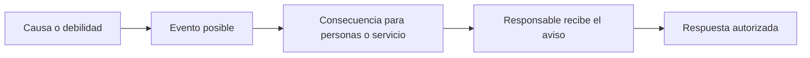
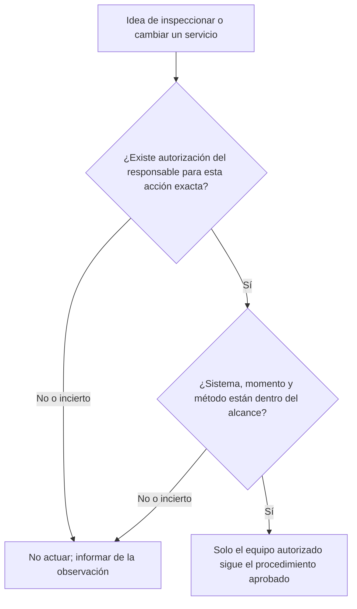
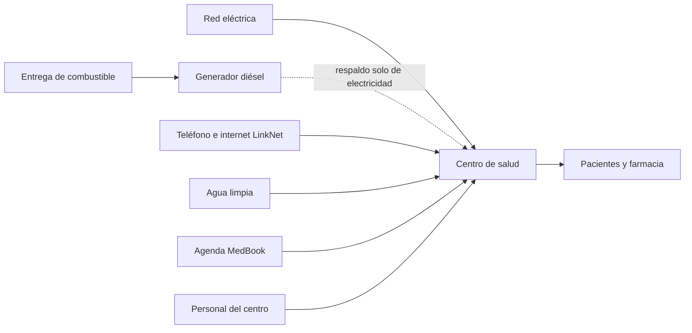
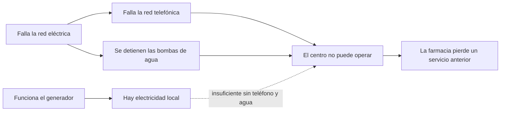

# Infraestructura crítica y seguridad sectorial: una primera introducción

- Idioma: español neutro (`es`); curso rápido, un mes; aproximadamente 80 horas de estudio planificado (curso 023 de 207 en la [ruta de estudio](../../../../../STUDY_PATH.md)). Edición de referencia: [inglés](../../en/book/MANUSCRIPT.md).
- Estado editorial: **borrador**. Los capítulos 1–4 de 4 tienen texto didáctico escrito, un laboratorio sin conexión, los ejercicios EX001–EX050 y sus resultados resueltos correspondientes. Siguen pendientes la revisión independiente por especialistas, la nueva verificación de las fuentes, la revisión de accesibilidad, la edición lingüística y la verificación de las 300 páginas A4. La cobertura de capítulos en borrador no es un libro terminado.
- Público: **principiantes** sin función de seguridad y con alfabetización digital básica: estudiantes, personas que cambian de profesión y personal o voluntariado que acaba de incorporarse a un hospital, un centro de salud, una empresa de agua o de electricidad, un operador de transporte, un banco, un centro educativo o un ayuntamiento y quiere entender por qué su lugar de trabajo se considera «crítico».
- En qué se diferencia este curso de sus vecinos. El [libro profesional](../../../../professional-6-months/critical-sector-security/es/book/MANUSCRIPT.md) enseña a los coordinadores a gestionar la gobernanza: registros de riesgos, RACI, contratos con proveedores, relojes de notificación y ejercicios de mesa. El [libro técnico](../../../../technical-18-months/critical-sector-security/es/book/MANUSCRIPT.md) enseña profundidad práctica en protocolos y bastionado. **Este libro rápido es una primera mirada y una primera práctica segura.** Le enseña a reconocer qué hace crítico a un servicio, a explicar sus riesgos principales con palabras sencillas, a mantenerse dentro de lo que se le permite hacer, a ver cómo dependen unos servicios de otros y a completar una pequeña tarea guiada. No le convierte en coordinador, ingeniero ni respondedor de incidentes, y nunca le pide que toque un sistema real.
- Autoría y responsabilidad editorial: [hiagokinlevi](https://github.com/hiagokinlevi). El texto didáctico original del mantenedor se dedica bajo [CC0 1.0](../../../../../LICENSE); las obras citadas conservan sus propios derechos y no se relicencian aquí.
- Límite educativo: este curso es un proyecto educativo independiente. No es un programa acreditado, no otorga ninguna titulación y no concede autoridad sobre ninguna infraestructura, operador, conjunto de datos o persona reales, ni acceso a ellos. Todo lugar, organización, persona, mensaje, cifra y dependencia de un ejemplo resuelto o del laboratorio es **sintético**, salvo que una frase cite explícitamente una fuente pública. Nada de lo que aparece en este libro constituye asesoramiento jurídico, clínico o regulatorio.

[Página del curso](../../README.md) · [Índice de capítulos](../SUBJECTS.md) · [Plan del libro](PLAN.md) · [Skill del curso](../../skill/SKILL.md) · [Estándar del libro](../../../../../BOOK_STANDARD.md) · [Resultados resueltos](#worked-results)

## Cómo usar este borrador

El curso dura cuatro semanas, un capítulo por semana, unas 20 horas cada una. El resultado del curso es **reconocer y explicar los riesgos principales de las infraestructuras críticas y completar una tarea guiada** con seguridad.

- **Semana 1 (capítulo 1)**: qué son las infraestructuras críticas, por qué la consecuencia importa más que los datos y cómo escribir una frase de riesgo clara.
- **Semana 2 (capítulo 2)**: qué puede y qué no puede hacer, cómo comunicar algo extraño y cómo compartir la información con cuidado.
- **Semana 3 (capítulo 3)**: las partes de un servicio esencial (personas, TI, tecnología operativa, datos, proveedores) y cómo dependen unos servicios de otros.
- **Semana 4 (capítulo 4)**: un laboratorio guiado que sigue qué falla cuando falla un servicio, y un pequeño producto anotado (una «ficha del servicio» de una página) que reúne todo el curso.

Cada capítulo tiene resultados de aprendizaje, secciones didácticas breves con definiciones, un ejemplo resuelto, una actividad práctica, errores comunes y límites, ejercicios numerados y una síntesis. Cada ejercicio indica su objetivo, los insumos, los pasos, la evidencia esperada y una rúbrica de 0–3. Escriba primero su respuesta y después compárela con los [resultados resueltos](#worked-results). Una respuesta distinta que cumpla la rúbrica obtiene la máxima puntuación.

El único laboratorio (capítulo 4) son unas veinte líneas de Python 3 que usan solo la biblioteca estándar. No necesita red, paquetes, privilegios ni datos reales, y su salida está impresa en el libro, así que puede hacer todos los ejercicios sin ejecutarlo. La salida impresa se produjo con Python 3.13.5.

### El escenario sintético de este libro

| Elemento sintético | Papel en el libro | Límite |
|---|---|---|
| **Larkfield**: una pequeña ciudad ficticia de unas 20.000 personas | Escenario de todos los ejemplos. | Lugar inventado. |
| **Larkfield Community Clinic**: un centro de salud sin cita previa con una pequeña farmacia | Donde el lector, **Sam Reyes**, acaba de empezar en un puesto administrativo de recepción. | Inventado. |
| **Larkfield Water** (bombas y una planta de tratamiento), **Larkfield Power** (distribuidora local de electricidad), **Larkfield Bus** | Servicios esenciales vecinos. | Inventados. |
| Personas: Dr. P. Osei (director del centro de salud), H. Novak (gerente del centro, de quien depende Sam), K. Ito (técnico de TI del centro a tiempo parcial, contratado externamente), D. Brandt (operador de turno en Larkfield Water) | Colegas y vecinos. | Inventadas; ninguna persona real. |
| **MedBook** (proveedor del software de citas), **LinkNet** (proveedor de teléfono e internet) | Proveedores. | Inventados; cualquier parecido con empresas reales es accidental. |

Como los datos son sintéticos, el libro puede mostrarle cosas que un recién llegado rara vez vería. Úselas para aprender ideas, nunca como evidencia sobre organizaciones reales.

### Política de fuentes

Toda afirmación factual sobre un marco público, una ley, una orientación o un incidente enlaza con una fuente consultada en octubre de 2026. Las leyes y las orientaciones cambian y difieren entre países: vuelva a verificarlas antes de basarse en ellas. Una cita respalda la afirmación general que la acompaña, nunca los detalles sintéticos de Larkfield. Los incidentes públicos se describen solo al nivel de detalle que publicaron sus autores.

### Cinco reglas para este curso

1. **Mire, aprenda y comunique; no toque.** Nunca pruebe, escanee, inicie sesión ni cambie un sistema que no esté autorizado explícitamente a usar para ese fin (capítulo 2).
2. **Primero, la seguridad de las personas.** En un servicio esencial, el daño a las personas importa más que los datos perdidos.
3. **Diga lo que sabe y lo que supone.** Marque los supuestos como supuestos.
4. **Comunique pronto, por el canal adecuado.** Una falsa alarma comunicada con rapidez cuesta poco; un problema real comunicado tarde puede costar mucho.
5. **Practique solo con material sintético o de estudio**, como los ejemplos y el laboratorio de este libro.

## Contenido

1. [Fundamentos y decisiones](#ch-01): servicios esenciales, sectores y funciones, primero la consecuencia, una primera frase de riesgo y las tres decisiones del recién llegado.
2. [Alcance, permiso y práctica segura](#ch-02): qué significa la autorización, los límites del recién llegado, la comunicación y el intercambio cuidadoso de información.
3. [Sistemas, datos y dependencias](#ch-03): personas, TI, tecnología operativa, datos, proveedores; dependencias aguas arriba y aguas abajo; puntos únicos de fallo.
4. [Laboratorio guiado y síntesis aplicada](#ch-04): el Lab 4 (¿qué más falla?), una ficha del servicio de una página y una autocomprobación del curso.
- [Resultados resueltos](#worked-results) · [Glosario](#glossary) · [Referencias](#references)

<a id="ch-01"></a>

## Capítulo 1 — Infraestructura crítica y seguridad sectorial: fundamentos y decisiones

### Resultados de aprendizaje y conexión

Al terminar este capítulo será capaz de:

- explicar con sus propias palabras qué son las infraestructuras críticas y los servicios esenciales, y nombrar varios sectores;
- explicar por qué, en estos servicios, **la seguridad de las personas y la disponibilidad suelen ir antes que la confidencialidad**;
- describir, a grandes rasgos, tres incidentes públicos y lo que enseña cada uno;
- escribir una frase de riesgo clara con una causa, un evento y una consecuencia;
- elegir con sensatez entre las tres decisiones a las que se enfrenta todo recién llegado: darse cuenta, comunicarlo o dejarlo en manos del dueño.

El capítulo se apoya en la alfabetización digital cotidiana. Prepara el capítulo 2, que fija los límites de lo que puede hacer con esa comprensión.

### 1.1 Qué hace que un servicio sea «crítico»

La mayoría de las personas solo se encuentran con las infraestructuras críticas cuando dejan de funcionar: el grifo se seca, se va la luz, el datáfono dice «denegada», el autobús no llega. Las **infraestructuras críticas** son el conjunto de sistemas, activos y servicios cuya perturbación dañaría gravemente la seguridad, la salud, la economía o el orden público de una sociedad. Un **servicio esencial** es una de las cosas que esas infraestructuras prestan a las personas: agua limpia, electricidad, atención de urgencias, pagos, transporte.

Los gobiernos enumeran estos sectores para poder planificar en torno a ellos. Estados Unidos, por ejemplo, reconoce dieciséis sectores de infraestructura crítica, entre ellos la energía, el agua y las aguas residuales, la sanidad y la salud pública, el transporte, los servicios financieros, las comunicaciones y los servicios de emergencia ([CISA, Critical Infrastructure Sectors](https://www.cisa.gov/topics/critical-infrastructure-security-and-resilience/critical-infrastructure-sectors)). La Directiva NIS2 de la Unión Europea impone obligaciones a las entidades «esenciales» e «importantes» de sectores como la energía, el transporte, la banca, la sanidad, el agua potable y la infraestructura digital ([Directive (EU) 2022/2555](https://eur-lex.europa.eu/eli/dir/2022/2555/oj)). Las listas difieren entre países, pero la idea es la misma: algunos servicios importan tanto que su fallo es un problema de todos.

Una segunda idea útil es la **función** en lugar de la organización. La CISA describe un conjunto de funciones críticas nacionales (como «suministrar agua» o «prestar atención médica») agrupadas bajo cuatro verbos: conectar, distribuir, gestionar y suministrar ([CISA, National Critical Functions Set](https://www.cisa.gov/national-critical-functions-set)). Pensar en funciones ayuda a un recién llegado a hacer la pregunta adecuada: no «¿qué posee mi empleador?», sino «¿qué *hace* mi lugar de trabajo por las personas y qué les ocurre si deja de hacerlo?».

### 1.2 Primero, la consecuencia

En una oficina corriente, la preocupación clásica es que roben información. En un servicio esencial, la primera preocupación suele ser que **se dañe a las personas** o que **el servicio se detenga**. Un orden de preocupación útil para este curso es:

| Orden | Pregunta | Ejemplo de Larkfield (sintético) |
|---|---|---|
| 1. Seguridad de las personas | ¿Podría resultar herido alguien? | Una dosis química errónea en la planta de agua. |
| 2. Disponibilidad (continuidad) | ¿Sigue funcionando el servicio? | El centro de salud no puede ver las citas ni las recetas. |
| 3. Integridad (fiabilidad) | ¿Podemos creer lo que muestra el sistema? | Una pantalla muestra una bomba en marcha cuando se ha parado. |
| 4. Confidencialidad | ¿Se ha filtrado información privada? | Un extraño copia historias clínicas de pacientes. |

Este es un orden para **pensar en el daño**, no una regla según la cual la confidencialidad no importa. Una filtración de historias clínicas es grave y puede acarrear obligaciones legales de informar con rapidez a las personas afectadas. Lo importante es que un recién llegado que solo piense en contraseñas y datos pasará por alto los riesgos que más importan en estos sectores. El NIST Cybersecurity Framework 2.0, una guía de alto nivel de uso extendido, organiza los resultados de seguridad en seis funciones (Gobernar, Identificar, Proteger, Detectar, Responder y Recuperar) precisamente porque mantener un servicio en marcha y restablecerlo importa tanto como mantener los datos en secreto ([NIST CSF 2.0](https://www.nist.gov/cyberframework)).

### 1.3 Tres incidentes públicos, en breve

No necesita detalles técnicos para aprender de hechos reales. Lea usted mismo cada fuente; los resúmenes siguientes se quedan al nivel que publicaron sus autores.

- **La electricidad en Ucrania, diciembre de 2015.** La CISA informa de que los atacantes causaron cortes de electricidad que afectaron a unos 225.000 clientes, accionando interruptores a distancia y dificultando la recuperación; las empresas restablecieron el suministro pasando a operación manual ([CISA IR-ALERT-H-16-056-01](https://www.cisa.gov/news-events/ics-alerts/ir-alert-h-16-056-01)). *Lección:* los ataques a los ordenadores pueden alcanzar el mundo físico, y las personas capaces de hacer funcionar las cosas a mano forman parte de la resiliencia.
- **WannaCry y el NHS de Inglaterra, mayo de 2017.** La National Audit Office del Reino Unido concluyó que el ransomware perturbó al menos a un tercio de los *trusts* del NHS en Inglaterra y provocó la cancelación de miles de citas y operaciones ([NAO, Investigation: WannaCry cyber attack and the NHS](https://www.nao.org.uk/reports/investigation-wannacry-cyber-attack-and-the-nhs/)). *Lección:* un malware corriente de TI se convierte en un problema de disponibilidad sanitaria; lo sufren los pacientes, no solo los ordenadores.
- **Instalaciones de agua, 2023.** La CISA y otras agencias asociadas informaron de que unos actores comprometieron controladores industriales expuestos a internet en varias instalaciones de agua y aguas residuales de Estados Unidos, probablemente usando contraseñas predeterminadas ([CISA AA23-335A](https://www.cisa.gov/news-events/cybersecurity-advisories/aa23-335a)). *Lección:* debilidades simples (un dispositivo accesible desde internet con la contraseña de fábrica) pueden bastar.

### 1.4 Escribir una frase de riesgo

«Ransomware» es una palabra, no un riesgo. Un **riesgo** es algo que podría ocurrir y que importaría. Una frase de riesgo clara tiene tres partes:

> **Como** (causa o debilidad), **podría ocurrir (algo)** (evento), **lo que llevaría a** (consecuencia para las personas o el servicio).

Ejemplo (sintético): «*Como* los PC de citas del centro de salud comparten una contraseña escrita en una nota adhesiva, *alguien que pase junto al mostrador podría iniciar sesión y cambiar o borrar citas*, *lo que llevaría a* que los pacientes se quedaran sin atención y el personal perdiera una mañana en reconstruir la lista».

Las buenas frases de riesgo nombran una consecuencia real (personas, tiempo, servicio), no solo «pérdida de datos». También dejan claro **quién debería ser dueño** del problema: aquí, la gerencia del centro, no la persona que se dio cuenta.

### Visual 1 — de la frase de riesgo a la decisión



**Alternativa textual:** describa la causa, el posible evento y el daño a las personas o al servicio. Informe de esa cadena al responsable, quien decide la respuesta autorizada. Sam no realiza el cambio solo por haber detectado el riesgo.

### 1.5 Las tres decisiones del recién llegado

Como principiante no se espera que arregle la seguridad. Se espera que **se dé cuenta**, que lo **comunique** por el canal adecuado y que **deje la corrección en manos del dueño**. Ante algo que parece ir mal, pregúntese:

1. *¿Hay alguien en peligro ahora?* Si es así, siga primero el procedimiento de seguridad o de emergencia; la ciberseguridad va después.
2. *¿Necesita saberlo alguien?* Si podría afectar al servicio, a las personas o a datos privados, comuníquelo hoy a su supervisor o por el canal establecido.
3. *¿Me corresponde cambiarlo?* Casi siempre, no. Describa lo que vio; no lo «compruebe un momento» ni lo «arregle un momento».

### 1.6 Ejemplo resuelto: la primera semana de Sam (sintético)

Sam Reyes empieza en la recepción del Larkfield Community Clinic. En la primera semana, Sam se fija en cuatro cosas:

| Lo que Sam observa | Orden de preocupación | La decisión de Sam |
|---|---|---|
| (a) La puerta trasera del almacén de la farmacia queda calzada abierta por la tarde. | Seguridad/integridad: podrían llevarse o manipular medicamentos. | Comunicarlo hoy a H. Novak; no sermonear a los colegas. |
| (b) Un correo «de MedBook» pide al personal que vuelva a introducir su contraseña en un enlace. | Disponibilidad y confidencialidad: un inicio de sesión robado podría bloquear el sistema de citas. | No hacer clic; comunicarlo por la vía de «notificar correo sospechoso» del centro. |
| (c) El PC de recepción muestra «actualizaciones pendientes; es necesario reiniciar» desde hace una semana. | Disponibilidad, más adelante. | Mencionarlo a H. Novak, que lo traslada a K. Ito (TI). No reiniciar por su cuenta un PC clínico compartido en mitad del turno. |
| (d) Una amistad que trabaja en Larkfield Water comenta que la planta todavía usa una herramienta de acceso remoto «con la contraseña antigua». | Posible problema de seguridad física en otra organización. | No es un sistema de Sam. Sugerirle que lo plantee a su propio supervisor; no probar la herramienta, no pedir la contraseña ni publicar nada al respecto. |

Sam escribe una frase de riesgo para (b): «Como el personal está recibiendo correos falsos de MedBook muy convincentes, alguien podría introducir su contraseña en una página falsa, lo que llevaría a que un extraño bloqueara o cambiara las citas y el centro no pudiera atender a los pacientes durante horas». Sam marca un supuesto: «*Supuesto:* los inicios de sesión de MedBook no están protegidos por un segundo factor; no lo sé».

Fíjese en lo que Sam *no* hizo: investigar, probar el enlace, reiniciar el PC o tocar nada de Larkfield Water. Cada decisión es pequeña, pero juntas son exactamente lo que aporta un recién llegado.

### 1.7 Actividad práctica

Elija un servicio esencial que use (su empresa de agua, el hospital local, la compañía de autobuses o su banco). En no más de una página, escriba: la función que presta a las personas; quién resultaría perjudicado primero si se detuviera durante un día; una frase de riesgo con causa, evento y consecuencia; y una cosa que esté suponiendo. Manténgalo en términos generales: use solo información pública y no sondee el servicio de ninguna manera. Intercambie las páginas con un compañero que haya elegido un servicio distinto y revisen la frase de riesgo del otro: ¿nombra una causa, un evento y una consecuencia para las personas? Después comparen a quién dijeron que perjudicaría primero. Un hospital y una compañía de autobuses dan respuestas muy distintas, que es justamente la razón de pensar en funciones.

### 1.8 Errores comunes y límites

- Pensar que la seguridad solo trata de contraseñas y datos. En los servicios esenciales, empiece por la seguridad de las personas y la continuidad.
- Escribir los riesgos como palabras sueltas («hackers», «virus») en lugar de como frases a partir de las cuales alguien pueda actuar.
- Intentar arreglar las cosas usted mismo. Su trabajo a este nivel es darse cuenta y comunicarlo.
- Tomar el resumen de un incidente como la historia completa. Los informes públicos son incompletos a propósito.
- Este capítulo simplifica: las organizaciones reales usan métodos formales de riesgo, y las leyes sobre los servicios críticos difieren entre países.

- Dar por hecho que quien detectó un problema debe ser su dueño. Sam se fijó en la contraseña de la nota adhesiva, pero es la gerencia del centro quien decide qué hacer al respecto.
- Olvidar marcar los supuestos. La nota de Sam de que los inicios de sesión de MedBook podrían carecer de segundo factor está etiquetada como desconocida, no afirmada como un hecho.

### Ejercicios — capítulo 1

**EX001 — Identifique los servicios esenciales.** *Objetivo:* reconocer los servicios esenciales. *Insumos:* una lista: agua potable, un cine, un servicio de urgencias hospitalario, una red de pagos con tarjeta, una tienda de ropa, una red eléctrica regional, una red de autobuses urbanos, un servidor de videojuegos. *Pasos:* marcar cada uno como esencial o no y dar una razón de una línea. *Evidencia esperada:* ocho marcas con razones. *Rúbrica:* 3 = agua, urgencias, pagos, red eléctrica y autobuses marcados como esenciales con razones basadas en el daño, los demás no, con una nota de que «esencial» depende del contexto; 2 = marcas correctas, razones débiles; 1 = varios errores; 0 = nada.

**EX002 — Asocie con el sector.** *Objetivo:* relacionar servicios con sectores. *Insumos:* los cinco servicios esenciales de EX001. *Pasos:* nombrar el sector al que pertenece cada uno usando la lista de sectores de la CISA. *Evidencia esperada:* cinco parejas. *Rúbrica:* 3 = todas correctas (agua y aguas residuales; sanidad y salud pública; servicios financieros; energía; sistemas de transporte); 2 = cuatro correctas; 1 = dos o tres; 0 = menos.

**EX003 — La función, no la organización.** *Objetivo:* pensar en funciones. *Insumos:* Larkfield Community Clinic, Larkfield Water, Larkfield Bus. *Pasos:* escribir como una expresión verbal la función que cada uno presta a las personas. *Evidencia esperada:* tres expresiones. *Rúbrica:* 3 = «prestar atención médica / dispensar medicamentos», «suministrar agua limpia», «transportar a las personas» o equivalentes, cada una centrada en las personas; 2 = una describe la organización; 1 = enumera edificios o software; 0 = nada.

**EX004 — Orden de preocupación.** *Objetivo:* aplicar primero la consecuencia. *Insumos:* (a) se copian las direcciones de los pacientes; (b) se cambia sin aprobación una dosis del tratamiento del agua; (c) el sistema de citas del centro de salud no está disponible durante una mañana; (d) una pantalla de una bomba muestra «en marcha» cuando la bomba se ha parado. *Pasos:* ordenarlos de más a menos preocupante y justificar cada uno. *Evidencia esperada:* clasificación con razones. *Rúbrica:* 3 = (b) primero (seguridad de las personas), después (c) o (d) con un razonamiento sobre continuidad frente a fiabilidad, (a) último por daño inmediato pero señalado como grave desde el punto de vista legal; 2 = solo el primero correcto; 1 = (a) primero sin razonamiento; 0 = nada.

**EX005 — ¿Por qué no «primero los datos»?** *Objetivo:* explicar el cambio de prioridad. *Insumos:* la sección 1.2. *Pasos:* en tres o cuatro frases, explicar a un amigo por qué los servicios esenciales piensan en la seguridad de las personas y la disponibilidad antes que en la confidencialidad. *Evidencia esperada:* párrafo breve. *Rúbrica:* 3 = menciona el daño físico, que las personas dependen de la continuidad y que la confidencialidad sigue importando; 2 = dos de ellos; 1 = uno; 0 = nada.

**EX006 — Lección de un incidente: Ucrania 2015.** *Objetivo:* extraer una lección de una fuente pública. *Insumos:* [CISA IR-ALERT-H-16-056-01](https://www.cisa.gov/news-events/ics-alerts/ir-alert-h-16-056-01). *Pasos:* leer el resumen y escribir el número de clientes afectados, cómo se restableció la electricidad y una lección para un recién llegado. *Evidencia esperada:* tres respuestas breves. *Rúbrica:* 3 = unos 225.000 clientes, operación manual, una lección sobre la consecuencia física o la alternativa manual; 2 = dos correctas; 1 = una; 0 = nada.

**EX007 — Lección de un incidente: WannaCry y el NHS.** *Objetivo:* relacionar el malware de TI con el daño al servicio. *Insumos:* el resumen del [informe de la NAO](https://www.nao.org.uk/reports/investigation-wannacry-cyber-attack-and-the-nhs/). *Pasos:* escribir quién resultó perjudicado y cómo, en dos frases, sin términos técnicos. *Evidencia esperada:* dos frases. *Rúbrica:* 3 = pacientes perjudicados por citas y operaciones canceladas y *trusts* perturbados, planteado como disponibilidad; 2 = menciona la perturbación sin las personas; 1 = solo «se cifraron los ordenadores»; 0 = nada.

**EX008 — Lección de un incidente: controladores de agua.** *Objetivo:* reconocer debilidades simples. *Insumos:* [CISA AA23-335A](https://www.cisa.gov/news-events/cybersecurity-advisories/aa23-335a). *Pasos:* nombrar las dos condiciones simples que hicieron posible el compromiso y decir por qué cada una es una lección de nivel principiante. *Evidencia esperada:* dos condiciones con razones. *Rúbrica:* 3 = exposición a internet y contraseñas predeterminadas, cada una explicada como un fallo de higiene cotidiana; 2 = ambas nombradas, sin razones; 1 = una; 0 = nada.

**EX009 — Reescriba tres riesgos.** *Objetivo:* escribir frases de riesgo. *Insumos:* las palabras «phishing», «ordenador viejo» y «puerta abierta», situadas en el centro de salud de Larkfield. *Pasos:* reescribir cada una como «Como…, podría ocurrir…, lo que llevaría a…». *Evidencia esperada:* tres frases. *Rúbrica:* 3 = cada una tiene causa, evento y una consecuencia para las personas o el servicio; 2 = a una le falta la consecuencia; 1 = siguen siendo genéricas; 0 = nada.

**EX010 — Encuentre al dueño.** *Objetivo:* ver que los riesgos tienen dueño. *Insumos:* sus tres frases de EX009 y la lista de personas de Larkfield. *Pasos:* nombrar quién debería ser dueño de cada riesgo y por qué no es Sam. *Evidencia esperada:* tres dueños con razones. *Rúbrica:* 3 = la gerencia o la dirección del centro para los procesos y las instalaciones, el técnico de TI contratado para el ordenador (con la gerencia decidiendo), razones basadas en la autoridad; 2 = dueños sin razones; 1 = se nombra a Sam como dueño; 0 = nada.

**EX011 — Tres decisiones.** *Objetivo:* aplicar darse cuenta / comunicar / dejarlo al dueño. *Insumos:* un colega dice: «la alarma de la nevera de las vacunas pitó toda la noche, pero la apagué». *Pasos:* recorrer las tres preguntas de la sección 1.5. *Evidencia esperada:* tres respuestas breves. *Rúbrica:* 3 = reconoce primero un posible problema de seguridad del paciente, lo comunica hoy a la gerencia del centro, no ajusta la nevera ni la alarma; 2 = lo comunica, pero no ve el aspecto de seguridad; 1 = intenta arreglarlo; 0 = nada.

**EX012 — Saber frente a suponer.** *Objetivo:* separar los hechos de los supuestos. *Insumos:* la frase de riesgo de Sam para (b) en 1.6. *Pasos:* enumerar dos hechos que Sam conoce y dos cosas que Sam supone. *Evidencia esperada:* cuatro elementos. *Rúbrica:* 3 = hechos: llegaron correos falsos, piden contraseñas; supuestos: no hay segundo factor, que el correo es falso y no un aviso real de MedBook (o similar); 2 = tres correctos; 1 = los mezcla; 0 = nada.

**EX013 — No es su sistema.** *Objetivo:* respetar los límites fuera de su lugar de trabajo. *Insumos:* el punto (d) de 1.6. *Pasos:* escribir el mensaje que Sam podría enviar a esa amistad. *Evidencia esperada:* dos o tres frases. *Rúbrica:* 3 = anima a la amistad a decírselo a su supervisor o a su contacto de seguridad, no pide detalles ni contraseñas, no sugiere probar la herramienta; 2 = anima a comunicarlo, pero pide detalles; 1 = sugiere comprobarlo; 0 = nada.

### Síntesis del capítulo

Las infraestructuras críticas prestan funciones de las que las personas no pueden prescindir, y su seguridad se juzga por la consecuencia: primero la seguridad de las personas, después la continuidad, la fiabilidad y la confidencialidad. Los incidentes reales muestran que los problemas informáticos llegan a los pacientes, a los hogares y a las calles, y que a menudo bastan debilidades simples. Las herramientas de un recién llegado son una frase de riesgo clara, una marca honesta en lo que se supone y tres decisiones: darse cuenta, comunicarlo y dejar la corrección en manos del dueño.

<!-- cyberabc:chapter-navigation:start ch-01 -->
### Siga estudiando — capítulo 01 de 04

[← Página del curso](../../README.md) · [Índice de capítulos del curso](../SUBJECTS.md) · [Capítulo 02 →](#ch-02)

Continúe con la siguiente lección escrita.
<!-- cyberabc:chapter-navigation:end -->

<a id="ch-02"></a>

## Capítulo 2 — Alcance, permiso y práctica segura

### Resultados de aprendizaje y conexión

Al terminar este capítulo será capaz de:

- explicar qué significan **autorización** y **alcance**, y por qué las buenas intenciones no los sustituyen;
- enumerar lo que un recién llegado puede y no puede hacer con un sistema de un servicio esencial;
- explicar por qué «solo comprobar» puede ser peligroso en entornos operativos;
- comunicar un evento sospechoso con claridad, con los hechos adecuados y sin investigar;
- usar el Protocolo de Semáforo (TLP) para decidir quién puede recibir una información;
- elegir lugares seguros para practicar habilidades de seguridad.

El capítulo 1 mostró por qué importan estos servicios. Este capítulo fija los límites que mantienen segura su curiosidad. Después, el capítulo 3 mira dentro de un servicio.

### 2.1 Autorización y alcance

La **autorización** es el permiso, otorgado por la persona u organización dueña de un sistema, para hacer algo concreto con él. El **alcance** es el límite exacto de ese permiso: qué sistemas, qué acciones, cuándo y por quién. Una autorización válida suele constar por escrito, nombra al dueño que la otorga e indica qué hacer si algo sale mal. De ello se siguen dos consecuencias:

- **Tener acceso no es tener permiso.** Su usuario del centro de salud le permite reservar citas. No le autoriza a explorar otras carpetas, probar cuentas de otras personas ni comprobar si el sistema se puede romper.
- **Las buenas intenciones no son una autorización.** «Solo estaba comprobando si era seguro» no es una defensa. Muchos países consideran delito el acceso no autorizado a un sistema informático, sea cual sea el motivo, y los empleadores lo consideran una falta.

Los profesionales de las pruebas de seguridad trabajan con reglas de enfrentamiento escritas precisamente por esta razón; la guía del NIST sobre pruebas técnicas de seguridad describe la planificación, las reglas y las aprobaciones previas a cualquier prueba ([NIST SP 800-115](https://csrc.nist.gov/pubs/sp/800/115/final)). Ese nivel de pruebas no forma parte de este curso.

### Visual 2 — el límite del permiso



**Alternativa textual:** para inspeccionar o cambiar un servicio se necesitan permiso explícito del responsable y alcance exacto. Si falta cualquiera de ellos, deténgase e informe; solo actúa el equipo autorizado. Tener acceso o buena intención no reemplaza estos requisitos.

### 2.2 Por qué «solo comprobar» es peligroso aquí

Los sistemas operativos de planta —los ordenadores que hacen funcionar bombas, válvulas, interruptores, dispositivos médicos y señalización— suelen ser antiguos, estar delicadamente ajustados y estar hechos para funcionar sin interrupción. La guía de tecnología operativa advierte de que acciones rutinarias en la informática de oficina, como escanear una red, pueden perturbar estos sistemas ([NIST SP 800-82 Rev. 3](https://csrc.nist.gov/pubs/sp/800/82/r3/final)). Un recién llegado bienintencionado que «solo comprueba» un dispositivo puede detenerlo, provocar falsas alarmas que aparten a los operadores del trabajo real o dejar el dispositivo en un estado inseguro. En un servicio esencial, la curiosidad más segura es la que hace una pregunta en lugar de pulsar un botón.

### 2.3 Los límites del recién llegado

| **Puede** | **No puede** |
|---|---|
| Usar los sistemas que le dieron, para el trabajo que le encargaron. | Explorar, probar, escanear o «toquetear» cualquier sistema, incluidos los de su propio empleador. |
| Bloquear la pantalla, proteger su contraseña y usar el segundo factor que le dieron. | Compartir su usuario o usar el de otra persona, ni siquiera «solo esta vez». |
| Fijarse en lo extraño y anotar lo que vio. | Investigar: abrir archivos adjuntos sospechosos para «ver qué hacen», seguir enlaces o probar contraseñas. |
| Comunicarlo por el canal oficial. | Arreglar las cosas por su cuenta, reiniciar dispositivos clínicos u operativos compartidos o cambiar configuraciones. |
| Leer guías públicas y practicar en entornos sintéticos o de estudio. | Practicar en servicios reales, incluidos los sitios web públicos, sin permiso escrito. |
| Preguntar «¿quién es el dueño de esto?». | Publicar fotos, capturas de pantalla o detalles de debilidades en redes sociales. |

### 2.4 Comunicar bien

Un buen aviso es breve, se ciñe a los hechos y se hace rápido. Responde a cinco preguntas:

1. **¿Qué** vio? (Las palabras exactas en pantalla, la dirección del remitente, lo que ocurrió.)
2. **¿Cuándo**? (Fecha y hora, con su zona horaria.)
3. **¿Dónde**? (Qué ordenador, sala, sistema o cuenta de correo.)
4. **¿Qué hizo?** (Por ejemplo: «No hice clic», o con honestidad «Hice clic en el enlace y escribí mi contraseña».)
5. **¿Cuál es el posible efecto?** (A quién o a qué podría afectar, en una frase y marcada como suposición.)

La honestidad importa sobre todo en el punto 4. Comunicar rápido que *sí* hizo clic es mucho más útil que ocultarlo: cuanto antes lo sepa el dueño, antes podrá restablecer una contraseña o aislar un equipo. Las organizaciones que castigan los avisos honestos reciben menos. Comuníquelo por el canal que indique su organización: un supervisor, el servicio de asistencia informática o un buzón de seguridad. Muchos organismos nacionales también aceptan avisos de incidentes de organizaciones; en Estados Unidos, por ejemplo, la CISA publica una vía para comunicarlos ([CISA, Report to CISA](https://www.cisa.gov/report)). Como recién llegado, comuníquelo primero internamente, salvo que su organización le indique otra cosa.

### 2.5 Compartir información con cuidado: TLP

Los detalles sobre debilidades e incidentes pueden ayudar a los atacantes. El **Protocolo de Semáforo (TLP, *Traffic Light Protocol*) 2.0** es un conjunto sencillo de etiquetas que indica a los destinatarios hasta dónde pueden compartir una información ([FIRST, Traffic Light Protocol](https://www.first.org/tlp/)):

| Etiqueta | Quién puede recibirla |
|---|---|
| **TLP:RED** | Solo las personas nombradas que están presentes; no se comparte más. |
| **TLP:AMBER+STRICT** | Solo la propia organización del destinatario. |
| **TLP:AMBER** | La organización del destinatario y sus clientes, según la necesidad de conocerla. |
| **TLP:GREEN** | La comunidad del destinatario, pero no los canales públicos. |
| **TLP:CLEAR** | Cualquiera; sin más restricción que las normas habituales, como los derechos de autor. |

Si recibe algo etiquetado, respete la etiqueta. Si algo no está etiquetado y podría ser delicado, no lo comparta fuera de su organización; pregunte al remitente.

### 2.6 Lugares seguros para practicar

Puede adquirir habilidades reales sin tocar nada real: los ejemplos resueltos y el laboratorio de este libro; material de estudio como los informes públicos de incidentes; entornos de formación deliberadamente vulnerables que usted mismo ejecute, sin conexión, en su propio ordenador; y kits públicos de ejercicios pensados para el debate, como Exercise in a Box del NCSC del Reino Unido ([NCSC, Exercise in a Box](https://www.ncsc.gov.uk/information/exercise-in-a-box)). Los hábitos cotidianos de seguridad personal —contraseñas robustas y únicas, autenticación multifactor, actualizaciones y saber reconocer el *phishing*— también son un buen punto de partida ([CISA, Secure Our World](https://www.cisa.gov/secure-our-world)).

### 2.7 Ejemplo resuelto: el contratista servicial (sintético)

El jueves por la tarde, un hombre desconocido llega al mostrador del centro de salud. «Soy de LinkNet», dice. «Se os cae internet. Tengo que conectar esta caja a vuestro armario de red; solo serán cinco minutos. K. Ito dijo que no había problema.» Sam no lo ha visto nunca; Ito está fuera del centro. Las decisiones de Sam:

- **Autorización.** La red no es de Sam, y Sam no puede autorizar trabajos en ella. Una afirmación verbal de que «Ito dijo que no había problema» no es una autorización.
- **Verificar por un canal conocido.** Sam le pide que espere y llama a H. Novak y a K. Ito a los números de la lista de contactos del centro, no a un número que ofrezca el visitante.
- **Nada de «solo cinco minutos».** Aunque sea auténtico, un dispositivo conectado a la red del centro sin aprobación podría afectar al sistema de citas durante el horario de consulta.
- **Comunicarlo.** Ito dice que no hay ningún trabajo programado. Novak pide al visitante que se marche y concierta una visita en regla con LinkNet. Sam redacta un aviso:

> Qué: un hombre que decía ser de LinkNet pidió conectar un dispositivo al armario de red; dijo que K. Ito lo había aprobado. Cuándo: jueves, 14:20 (hora local). Dónde: mostrador de recepción, Larkfield Community Clinic. Qué hice: no le dejé entrar en la sala del armario; llamé a H. Novak y a K. Ito a los números de la lista de contactos del centro; Ito confirmó que no había ninguna visita programada. Posible efecto (suposición): intento de obtener acceso a la red del centro. Descripción: alto, chaqueta gris del estilo de LinkNet, no mostró ninguna acreditación.

Sam etiqueta el aviso como TLP:AMBER+STRICT al enviarlo por correo a Novak: se queda dentro del centro. Sam no publica nada al respecto.

### 2.8 Actividad práctica

Escriba su propia «tarjeta de límites»: cinco cosas que puede hacer y cinco que no puede hacer con los sistemas de su lugar de trabajo o centro de estudios, con sus propias palabras. Después redacte un aviso, con las cinco preguntas de 2.4, sobre un correo sospechoso que haya recibido personalmente (elimine los datos personales). No haga clic en nada del correo para reunir más datos. Guarde la tarjeta de límites donde la vea y compárela con la de un compañero: si uno de ustedes permite algo que el otro prohíbe, comprueben cuál tiene razón con la tabla de lo que se puede y no se puede hacer. En el aviso sobre el correo, el punto 4 debe decir con honestidad lo que hizo, aunque fuera abrir el mensaje. Marque el posible efecto como suposición, como hizo Sam en el aviso sobre el contratista.

### 2.9 Errores comunes y límites

- Confundir acceso con permiso.
- «Investigar» un correo o dispositivo sospechoso antes de comunicarlo, con lo que se destruyen pruebas o se extiende el daño.
- Retrasar un aviso por vergüenza de haber hecho clic.
- Verificar la identidad de quien llama con los datos de contacto que esa misma persona le dio.
- Compartir de más: publicar una captura de pantalla de una debilidad «para avisar a la gente».
- Aceptar la mención de un nombre, como «K. Ito dijo que no había problema», como permiso, cuando solo el dueño puede autorizar el trabajo.
- Compartir un aviso etiquetado más allá de lo que permite su etiqueta, algo que Sam evitó al mantener el aviso sobre el contratista dentro del centro.
- Límites: este capítulo es una orientación general, no asesoramiento jurídico. Las leyes sobre el acceso no autorizado y sobre las obligaciones de comunicación varían según el país y el sector; siga la política de su organización.

### Ejercicios — capítulo 2

**EX014 — ¿Acceso o permiso?** *Objetivo:* distinguir ambas cosas. *Insumos:* Sam puede abrir por accidente una carpeta compartida llamada «Payroll» (nóminas). *Pasos:* decir si Sam puede abrir los archivos y qué debe hacer. *Evidencia esperada:* dos o tres frases. *Rúbrica:* 3 = no abre los archivos y comunica el acceso excesivo al supervisor para que el dueño corrija los permisos; 2 = no los abre, pero no lo comunica; 1 = los abre «para comprobar»; 0 = nada.

**EX015 — Buenas intenciones.** *Objetivo:* explicar por qué el motivo no autoriza. *Insumos:* un compañero dice «no pasa nada por probar si la web del agua del pueblo tiene debilidades, porque les avisaría si encontrara algo». *Pasos:* responder en tres frases. *Evidencia esperada:* la respuesta. *Rúbrica:* 3 = explica que no hay autorización del dueño, que probablemente es ilegal y que podría perturbar un servicio público, y sugiere practicar en un laboratorio o leer la política de divulgación publicada por la organización; 2 = dos de estos puntos; 1 = uno; 0 = nada.

**EX016 — Elementos del alcance.** *Objetivo:* reconocer lo que contiene una autorización válida. *Insumos:* la sección 2.1. *Pasos:* enumerar cuatro cosas que debe indicar una autorización escrita. *Evidencia esperada:* la lista. *Rúbrica:* 3 = quién es el dueño y aprueba, qué sistemas, qué acciones, cuándo (ventana), además de quién lo hace o qué hacer si algo sale mal; 2 = tres elementos; 1 = uno o dos; 0 = nada.

**EX017 — ¿Por qué no escanear?** *Objetivo:* explicar la fragilidad de la TO. *Insumos:* la sección 2.2. *Pasos:* explicar en dos frases por qué un escaneo de red inofensivo en una oficina podría ser dañino en una planta de agua. *Evidencia esperada:* dos frases. *Rúbrica:* 3 = los dispositivos antiguos y sensibles pueden detenerse o comportarse mal, y un dispositivo detenido puede afectar a un proceso físico o a la seguridad de las personas; 2 = menciona una de las dos cosas; 1 = vago; 0 = nada.

**EX018 — Clasificar límites.** *Objetivo:* aplicar la tabla de lo que se puede y no se puede hacer. *Insumos:* (a) bloquear la pantalla; (b) reiniciar el controlador del frigorífico de la farmacia porque su pantalla se ha congelado; (c) comunicar que se ha encontrado una memoria USB sospechosa en el aparcamiento; (d) conectar esa memoria USB para encontrar a su dueño; (e) usar el usuario de un colega porque el suyo ha caducado; (f) leer un aviso público de la CISA. *Pasos:* marcar cada uno como «puede» o «no puede». *Evidencia esperada:* seis marcas. *Rúbrica:* 3 = puede: a, c, f; no puede: b, d, e, con un motivo para cada «no puede»; 2 = todo correcto sin motivos; 1 = uno o dos errores; 0 = más.

**EX019 — Redactar un aviso.** *Objetivo:* elaborar un aviso en cinco partes. *Insumos:* Sam recibe un correo «MedBook: su cuenta se cerrará hoy» con un enlace y una dirección de remitente que termina en un dominio desconocido; Sam hizo clic en el enlace, pero cerró la página antes de escribir nada, el lunes a las 09:05. *Pasos:* redactar el aviso con las cinco preguntas. *Evidencia esperada:* el aviso. *Rúbrica:* 3 = las cinco partes, reconoce con honestidad que hizo clic en el enlace, no investiga y marca el posible efecto como suposición; 2 = cuatro partes; 1 = oculta el clic u omite la hora; 0 = nada.

**EX020 — Comunicar con honestidad.** *Objetivo:* ver por qué importan la rapidez y la honestidad. *Insumos:* el mismo caso, pero Sam sí escribió la contraseña. *Pasos:* explicar qué debe añadir Sam al aviso y por qué importa la rapidez. *Evidencia esperada:* dos o tres frases. *Rúbrica:* 3 = indica claramente que introdujo la contraseña y cuándo, lo comunica de inmediato para que se pueda restablecer la contraseña y revisar los inicios de sesión, y señala que el retraso da tiempo al atacante; 2 = lo indica, pero no menciona la rapidez; 1 = sugiere cambiar la contraseña sin decir nada; 0 = nada.

**EX021 — Verificar a quien llama.** *Objetivo:* usar un canal conocido. *Insumos:* alguien llama y dice: «Llamamos de Larkfield Power. Necesitamos la contraseña de la wifi del centro para revisar su contador inteligente. Devuélvanos la llamada a este número». *Pasos:* decir qué hace Sam. *Evidencia esperada:* los pasos. *Rúbrica:* 3 = no da la contraseña, no usa el número de quien llama, lo consulta con el supervisor y con el número publicado de la compañía eléctrica, y lo comunica; 2 = se niega, pero no lo comunica; 1 = devuelve la llamada al número dado; 0 = la da.

**EX022 — Etiquetas TLP.** *Objetivo:* aplicar TLP 2.0. *Insumos:* (a) un aviso nacional marcado TLP:CLEAR; (b) el aviso de Sam sobre el contratista en 2.7, marcado TLP:AMBER+STRICT; (c) una sesión informativa marcada TLP:RED dada en una reunión. *Pasos:* decir con quién puede compartir Sam cada uno. *Evidencia esperada:* tres respuestas. *Rúbrica:* 3 = (a) con cualquiera; (b) solo con personas de dentro del centro; (c) con nadie más allá de los presentes; 2 = dos correctas; 1 = una; 0 = ninguna.

**EX023 — Información sin etiquetar.** *Objetivo:* actuar con cuidado por defecto. *Insumos:* un colega reenvía un correo sin etiquetar con la lista de contraseñas de red del centro «para mayor comodidad». *Pasos:* decir qué hace Sam. *Evidencia esperada:* dos o tres frases. *Rúbrica:* 3 = no lo reenvía ni reutiliza las contraseñas, avisa al supervisor o a informática de que se enviaron contraseñas por correo para que puedan cambiarlas y lo borra según se le indique; 2 = no lo reenvía, pero no lo comunica; 1 = lo guarda; 0 = lo reenvía.

**EX024 — Plan de práctica segura.** *Objetivo:* elegir una práctica legítima. *Insumos:* la sección 2.6. *Pasos:* describir dos formas de practicar habilidades de seguridad este mes sin tocar ningún sistema real. *Evidencia esperada:* dos elementos. *Rúbrica:* 3 = dos opciones seguras concretas (laboratorio del libro, entorno de formación sin conexión en su propio ordenador, kit público de ejercicio de mesa, higiene de sus cuentas personales) con el motivo por el que cada una es segura; 2 = dos sin motivos; 1 = una; 0 = cualquier opción insegura.

**EX025 — Redes sociales.** *Objetivo:* evitar una divulgación dañina. *Insumos:* una amistad de Sam quiere publicar «¡Larkfield Water sigue usando contraseñas por defecto!» para avisar al público. *Pasos:* explicar el riesgo y una vía mejor. *Evidencia esperada:* tres frases. *Rúbrica:* 3 = publicarlo podría ayudar a los atacantes a apuntar a un servicio crítico para la seguridad antes de que se corrija, y puede no estar verificado; mejor: avisar a la empresa de agua por su contacto o vía de divulgación, o a su supervisor si trabaja allí; 2 = solo el riesgo; 1 = vago; 0 = anima a publicarlo.

**EX026 — Reflexión sobre el caso del contratista.** *Objetivo:* extraer las decisiones de 2.7. *Insumos:* el ejemplo resuelto. *Pasos:* enumerar las cuatro decisiones que tomó Sam y el principio en que se basa cada una. *Evidencia esperada:* cuatro pares. *Rúbrica:* 3 = no le corresponde autorizar / la autorización debe venir del dueño; verificó con contactos conocidos / no fiarse de los datos que da quien llama; rechazó los «cinco minutos» / los cambios no aprobados pueden perturbar el servicio; lo comunicó y lo etiquetó / comunicar y compartir con cuidado; 2 = tres; 1 = una o dos; 0 = nada.

### Síntesis del capítulo

El permiso lo da el dueño del sistema, es concreto y suele constar por escrito; ni el acceso ni las buenas intenciones son permiso. En los servicios esenciales, «solo comprobar» puede perturbar procesos reales, así que las acciones seguras de un recién llegado son usar lo que le dieron, fijarse, comunicarlo rápido y con honestidad por un canal conocido, y compartir con cuidado mediante etiquetas como las del TLP. Las habilidades se adquieren en entornos sintéticos y de estudio, nunca en servicios en funcionamiento.

<!-- cyberabc:chapter-navigation:start ch-02 -->
### Siga estudiando — capítulo 02 de 04

[← Capítulo 01](#ch-01) · [Índice de capítulos del curso](../SUBJECTS.md) · [Capítulo 03 →](#ch-03)

Continúe con la siguiente lección escrita.
<!-- cyberabc:chapter-navigation:end -->

<a id="ch-03"></a>

## Capítulo 3 — Infraestructura crítica y seguridad sectorial: sistemas, datos y dependencias

### Resultados de aprendizaje y conexión

Al terminar este capítulo será capaz de:

- describir las cinco partes de un servicio esencial: personas, TI, tecnología operativa, datos y proveedores;
- explicar con palabras sencillas qué hacen los sensores, los controladores, las pantallas de operador y el SCADA, y en qué se diferencia la TO de la informática de oficina;
- nombrar los principales tipos de datos de un sector y el daño que cada uno podría causar si se pierde, se modifica o se filtra;
- distinguir las dependencias **aguas arriba**, **aguas abajo** y **compartidas**;
- detectar un **punto único de fallo** y una **alternativa manual** en una descripción sencilla.

El capítulo 2 fijó sus límites. Aquí aprenderá a *ver* un servicio con claridad desde fuera, lo que prepara el laboratorio guiado del capítulo 4.

### 3.1 Las cinco partes de un servicio

| Parte | Qué es | Ejemplo de Larkfield (sintético) |
|---|---|---|
| **Personas** | Personal, contratistas, voluntarios, y el conocimiento que tienen en la cabeza. | El personal de enfermería, Sam en recepción, D. Brandt de turno en la planta de agua. |
| **TI (tecnologías de la información)** | Ordenadores de oficina, correo electrónico, software de gestión, redes. | Las citas de MedBook, el correo del centro de salud, la facturación. |
| **TO (tecnología operativa)** | Ordenadores que miden y controlan cosas físicas. | Las bombas y la dosificación de cloro de Larkfield Water; el controlador del frigorífico de vacunas del centro. |
| **Datos** | La información que el servicio crea y de la que depende. | Historias clínicas, recetas, lecturas de calidad del agua. |
| **Proveedores** | Empresas externas de las que depende el servicio. | MedBook (software), LinkNet (teléfono e internet), Larkfield Power. |

Los problemas de seguridad pueden empezar en cualquiera de estas partes. Muchos empiezan por las personas (un correo convincente) o por los proveedores (una cuenta de acceso remoto), no por una tecnología ingeniosa.

### 3.2 Una mirada sencilla a la tecnología operativa

No necesita configurar la TO para entenderla. Una imagen simplificada de una estación de bombeo de agua:

- Los **sensores** miden cosas: el nivel de agua de un depósito, la presión en una tubería, la concentración de cloro.
- Los **actuadores** hacen cosas: arrancar una bomba, abrir una válvula, añadir un producto químico.
- Un **controlador** —a menudo un **PLC** (autómata programable), un pequeño ordenador robusto— lee los sensores y acciona los actuadores mediante reglas sencillas («si el depósito está por debajo del 30 %, arrancar la bomba 2»).
- Una **HMI** (interfaz hombre-máquina) es la pantalla del operador, que muestra niveles y alarmas y le permite cambiar configuraciones.
- El **SCADA** (supervisión, control y adquisición de datos) es el sistema más amplio que reúne en una sala de control las lecturas de muchas instalaciones.

La guía del NIST sobre seguridad de la TO describe estos componentes y por qué la TO se diferencia de la TI ([NIST SP 800-82 Rev. 3](https://csrc.nist.gov/pubs/sp/800/82/r3/final)). Para un recién llegado importan tres diferencias:

| Informática de oficina | Tecnología operativa |
|---|---|
| Se reinicia, se parchea y se sustituye a menudo. | Debe funcionar sin interrupción; los cambios requieren planificación y pruebas. |
| Lo peor suele ser la pérdida o filtración de datos. | Lo peor puede ser un daño físico o la pérdida de un servicio esencial. |
| Los dispositivos duran entre 3 y 5 años. | Los dispositivos suelen durar entre 15 y 25 años o más. |

Por eso el capítulo 2 prohibía «solo comprobar»: los dispositivos de TO pueden ser antiguos y sensibles, y lo que controlan es real.

### 3.3 Los datos y lo que podría salir mal

| Tipo de datos | Ejemplo | Filtrados (confidencialidad) | Modificados (integridad) | No disponibles (disponibilidad) |
|---|---|---|---|---|
| Personales/de salud | Historias clínicas | Daño a la privacidad; obligaciones legales | Tratamiento equivocado | Atención retrasada |
| Lecturas operativas | Nivel del depósito, cloro | Ayudan a un atacante a planificar | Los operadores actúan sobre una imagen falsa | Operadores «a ciegas»; hacen falta comprobaciones manuales |
| Configuraciones | Consigna de dosificación | Ayudan a un atacante a planificar | Funcionamiento inseguro | No se puede ajustar el proceso |
| De gestión | Facturación, nóminas | Fraude | Facturas erróneas | Problemas de tesorería |

Fíjese en la columna central para los datos operativos: una lectura errónea puede ser más peligrosa que una robada, porque las personas toman decisiones basándose en ella.

### 3.4 Dependencias

Ningún servicio está aislado. Una **dependencia** es algo que un servicio necesita para funcionar.

- Las dependencias **aguas arriba** son lo que necesita *su* servicio: electricidad, agua, teléfono, internet, personal, suministros.
- Los dependientes **aguas abajo** son quienes necesitan *su* servicio: pacientes, hogares, otros servicios.
- Las dependencias **compartidas** las usan muchos servicios a la vez: una red telefónica, un depósito de combustible, un proveedor de software. Su fallo golpea a muchos servicios a la vez.

Un **punto único de fallo** es algo cuya pérdida detiene el servicio porque no hay alternativa. Un **respaldo** (un generador, una segunda línea de internet) o una **alternativa manual** (listas de citas en papel, operadores que leen los indicadores a mano) reduce el impacto. Pero un respaldo solo es tan bueno como *sus propias* dependencias: un generador diésel necesita entregas de combustible, que a su vez necesitan carreteras y conductores. El laboratorio del capítulo 4 lo hace visible.

### 3.5 Proveedores y acceso remoto

Muchos servicios esenciales permiten que los proveedores se conecten en remoto para mantener el software y los equipos. Es útil, y también es una puerta. La guía de la CISA para los dueños de TO incluye, entre las mitigaciones principales, reducir la exposición a internet, cambiar las contraseñas por defecto y proteger el acceso remoto ([CISA, Primary Mitigations to Reduce Cyber Threats to Operational Technology](https://www.cisa.gov/resources-tools/resources/primary-mitigations-reduce-cyber-threats-operational-technology)). Los objetivos de rendimiento en ciberseguridad intersectoriales de la CISA (*Cross-Sector Cybersecurity Performance Goals*) establecen también prácticas básicas aplicables a todos los sectores, como la autenticación multifactor y el inventario de activos ([CISA CPGs](https://www.cisa.gov/cross-sector-cybersecurity-performance-goals)). Como recién llegado no gestionará estas cuentas, pero debe reconocer el riesgo cuando oiga «el proveedor entra cuando quiere con una contraseña compartida».

El ataque de *ransomware* de 2021 contra una empresa de oleoductos estadounidense, descrito por la CISA y el FBI en su aviso, es también una lección sobre dependencias: un ataque contra los sistemas informáticos de gestión afectó al funcionamiento de un suministro de combustible del que dependían muchos otros aguas abajo ([CISA AA21-131A](https://www.cisa.gov/news-events/cybersecurity-advisories/aa21-131a)).

### 3.6 Ejemplo resuelto: ¿de qué depende el centro de salud? (sintético)

H. Novak pide a Sam que enumere, para una reunión de personal, lo que necesita el centro para abrir sus puertas. Sam repasa una mañana normal y escribe:

| Dependencia | Tipo | Si se pierde… | Respaldo o alternativa | Notas |
|---|---|---|---|---|
| Larkfield Power | Aguas arriba, compartida | Se apagan las luces, los PC y los frigoríficos | Generador diésel (combustible almacenado para 2 horas) | Para cortes más largos, el generador necesita una entrega de combustible. |
| Teléfono e internet de LinkNet | Aguas arriba, compartida | Sin MedBook, sin citas telefónicas, sin pagos con tarjeta | Ninguno conocido | *¿Punto único de fallo?*: preguntar a K. Ito. |
| MedBook (nube) | Aguas arriba, proveedor | Sin lista de citas | ¿Lista impresa en papel?: *desconocido* | Preguntar a H. Novak si existe una copia impresa diaria. |
| Larkfield Water | Aguas arriba, compartida | Sin lavado de manos ni instrumental limpio | Agua embotellada para un día | El centro debe dejar de hacer algunos procedimientos. |
| Personal | Aguas arriba | Sin servicio | Personal de agencia | Solo una persona de enfermería conoce la alarma del frigorífico. |
| Pacientes, farmacia | Aguas abajo | — | — | La farmacia depende de las recetas del centro. |

Sam señala tres preguntas, no conclusiones: ¿es LinkNet un punto único de fallo? ¿Hay una alternativa en papel para MedBook? ¿Quién más conoce la alarma del frigorífico? Estas preguntas van a H. Novak, la persona dueña, que decide qué cambiar, si es que hay que cambiar algo.

### Visual 3 — dependencias del centro de salud (sintético)



**Alternativa textual:** electricidad, LinkNet, agua, MedBook y personal alimentan el centro de salud, que atiende a pacientes y a la farmacia. El generador solo respalda la electricidad y necesita combustible. Los respaldos de las demás dependencias siguen sin confirmarse; el dibujo no demuestra que un centro real fallaría del mismo modo.

### 3.7 Actividad práctica

Elija un servicio esencial público cercano (o la planta de Larkfield Water descrita antes). Usando solo información pública y sentido común, dibuje un esquema sencillo de dependencias: el servicio en el centro, las dependencias aguas arriba a la izquierda y los dependientes aguas abajo a la derecha. Rodee con un círculo todo lo compartido, marque con una estrella cualquier posible punto único de fallo y escriba una pregunta que haría al dueño. No contacte con el servicio ni lo sondee. Compare su esquema con la tabla de dependencias del centro de Sam: ¿se acordó de las personas y los proveedores, además de la electricidad y el agua? Si eligió Larkfield Water, su esquema debería mostrar el centro de salud y los hogares aguas abajo y tratar LinkNet como compartida. Formule su pregunta al dueño de modo que pueda responderse con un sí o un no.

### 3.8 Errores comunes y límites

- Pensar solo en los ordenadores y olvidar a las personas, los proveedores y los edificios.
- Tratar la TO como la informática de oficina («basta con reiniciarlo»).
- Enumerar las dependencias aguas arriba, pero olvidar a las personas perjudicadas aguas abajo.
- Dar por hecho que un respaldo funciona sin preguntar de qué depende *él*.
- Presentar suposiciones como hechos; en este capítulo, una lista de dependencias es un conjunto de preguntas para el dueño.
- Olvidar que una persona puede ser un punto único de fallo, como la única persona de enfermería que conoce la alarma del frigorífico del centro.
- Contactar por su cuenta con un proveedor o una empresa de servicios para comprobar una dependencia, en lugar de trasladar la pregunta al dueño.
- Límites: las arquitecturas reales de TO son mucho más variadas que la imagen sencilla de 3.2.

### Ejercicios — capítulo 3

**EX027 — Cinco partes.** *Objetivo:* clasificar las partes de un servicio. *Insumos:* (a) el controlador del frigorífico de vacunas del centro; (b) MedBook; (c) la persona de enfermería que conoce la alarma del frigorífico; (d) las recetas; (e) LinkNet. *Pasos:* asignar cada uno a personas, TI, TO, datos o proveedores. *Evidencia esperada:* cinco asignaciones. *Rúbrica:* 3 = a TO, b TI (y un proveedor), c personas, d datos, e proveedor; 2 = cuatro; 1 = dos o tres; 0 = menos.

**EX028 — Componentes de TO.** *Objetivo:* explicar con palabras sencillas los términos de TO. *Insumos:* sensor, actuador, PLC, HMI, SCADA. *Pasos:* dar para cada uno una definición sencilla de una línea y un ejemplo de una estación de agua. *Evidencia esperada:* cinco líneas. *Rúbrica:* 3 = todos correctos con ejemplos; 2 = cuatro; 1 = dos o tres; 0 = menos.

**EX029 — TI frente a TO.** *Objetivo:* comparar. *Insumos:* la sección 3.2. *Pasos:* dar dos diferencias y decir por qué cada una importa para la seguridad. *Evidencia esperada:* dos pares. *Rúbrica:* 3 = dos diferencias correctas (continuidad, consecuencia física, vida útil) con sus implicaciones de seguridad (los cambios requieren planificación, el daño puede ser físico, los dispositivos antiguos pueden carecer de protecciones); 2 = diferencias sin implicaciones; 1 = una; 0 = ninguna.

**EX030 — Lectura errónea.** *Objetivo:* ver el riesgo de integridad en la TO. *Insumos:* la HMI de una estación de agua muestra el depósito lleno al 80 %, pero en realidad está al 10 %. *Pasos:* describir lo que podría hacer el operador y la posible consecuencia. *Evidencia esperada:* dos o tres frases. *Rúbrica:* 3 = el operador no arranca las bombas, el depósito se vacía y se pierde presión o suministro para los clientes, incluido el centro de salud; señala que una comprobación manual lo revelaría; 2 = consecuencia sin la acción del operador; 1 = vago; 0 = nada.

**EX031 — Daños a los datos.** *Objetivo:* aplicar la visión de confidencialidad, integridad y disponibilidad a los datos. *Insumos:* «registros de recetas». *Pasos:* describir un daño si se filtran, otro si se modifican y otro si no están disponibles. *Evidencia esperada:* tres daños. *Rúbrica:* 3 = daño a la privacidad/obligación legal; medicamento o dosis equivocados; los pacientes no pueden recibir sus medicamentos; 2 = dos; 1 = uno; 0 = nada.

**EX032 — Aguas arriba, aguas abajo, compartida.** *Objetivo:* clasificar dependencias. *Insumos:* para Larkfield Water: (a) Larkfield Power; (b) los hogares; (c) el proveedor de productos químicos; (d) el centro de salud; (e) LinkNet, que también usan el centro y el banco. *Pasos:* clasificar cada uno. *Evidencia esperada:* cinco respuestas. *Rúbrica:* 3 = a aguas arriba (compartida), b aguas abajo, c aguas arriba, d aguas abajo, e aguas arriba y compartida; 2 = cuatro; 1 = dos o tres; 0 = menos.

**EX033 — Punto único de fallo.** *Objetivo:* detectarlo. *Insumos:* la tabla de 3.6. *Pasos:* nombrar el elemento con más probabilidad de ser un punto único de fallo y explicarlo. *Evidencia esperada:* respuesta y motivo. *Rúbrica:* 3 = LinkNet: no tiene respaldo conocido y su pérdida deja a la vez sin MedBook, teléfono y pagos; se presenta como pregunta por confirmar; 2 = elemento correcto sin cautela; 1 = elige un elemento con respaldo; 0 = nada.

**EX034 — El respaldo del respaldo.** *Objetivo:* seguir las dependencias de un respaldo. *Insumos:* el generador del centro con combustible para dos horas. *Pasos:* enumerar de qué depende el generador en un corte de 24 horas. *Evidencia esperada:* la lista. *Rúbrica:* 3 = entrega de combustible, que necesita carreteras, un proveedor y conductores, además de alguien que sepa ponerlo en marcha y probarlo; 2 = solo el combustible; 1 = «de nada»; 0 = nada.

**EX035 — Alternativa manual.** *Objetivo:* reconocer las alternativas. *Insumos:* la dependencia de MedBook. *Pasos:* proponer una alternativa manual y una condición para que funcione. *Evidencia esperada:* alternativa y condición. *Rúbrica:* 3 = una lista de citas impresa a diario (o un formulario de citas en papel) que esté al día, se guarde de forma segura y que el personal sepa usar; 2 = alternativa sin condición; 1 = «arreglar MedBook»; 0 = nada.

**EX036 — La puerta del proveedor.** *Objetivo:* reconocer el riesgo del acceso remoto. *Insumos:* D. Brandt dice: «el proveedor de las bombas entra desde casa cuando quiere; todo el mundo usa la misma contraseña». *Pasos:* escribir una frase de riesgo y nombrar dos prácticas básicas de la guía de la CISA citada que tengan relación con ella. *Evidencia esperada:* la frase y dos prácticas. *Rúbrica:* 3 = frase de causa, evento y consecuencia sobre el control no autorizado de las bombas; prácticas como proteger el acceso remoto, la autenticación multifactor, cambiar las contraseñas por defecto o compartidas y limitar la exposición a internet; 2 = la frase y una práctica; 1 = solo la práctica; 0 = nada.

**EX037 — La lección del oleoducto.** *Objetivo:* extraer una lección sobre dependencias. *Insumos:* [CISA AA21-131A](https://www.cisa.gov/news-events/cybersecurity-advisories/aa21-131a). *Pasos:* explicar en dos frases por qué un ataque contra los sistemas de gestión de una empresa importó a muchos otros. *Evidencia esperada:* dos frases. *Rúbrica:* 3 = el suministro de combustible del oleoducto es una dependencia compartida aguas arriba para muchos usuarios aguas abajo, así que la perturbación se extendió más allá de la víctima; 2 = solo menciona la perturbación; 1 = solo detalles técnicos; 0 = nada.

**EX038 — Preguntas, no conclusiones.** *Objetivo:* comunicar la incertidumbre. *Insumos:* las tres preguntas de Sam en 3.6. *Pasos:* reescribir una como un mensaje breve a H. Novak, señalando lo que se sabe y lo que se supone. *Evidencia esperada:* el mensaje. *Rúbrica:* 3 = educado, ceñido a los hechos, separa lo que se sabe (no figura ninguna línea de respaldo) de lo que se supone (que no existe) y pide al dueño que decida; 2 = buen mensaje sin separar lo sabido de lo supuesto; 1 = presenta una suposición como hecho; 0 = nada.

### Síntesis del capítulo

Un servicio esencial son personas, TI, tecnología operativa, datos y proveedores que trabajan juntos. La TO mide y controla el mundo físico, debe funcionar sin interrupción y puede causar daños físicos cuando falla, por lo que una lectura errónea puede ser peor que una robada. Los servicios dependen de otros aguas arriba, sirven a personas aguas abajo y comparten dependencias entre sí; los puntos únicos de fallo y los respaldos que tienen sus propias dependencias son donde se esconden los problemas. La lista de dependencias de un recién llegado es un conjunto de buenas preguntas para el dueño.

<!-- cyberabc:chapter-navigation:start ch-03 -->
### Siga estudiando — capítulo 03 de 04

[← Capítulo 02](#ch-02) · [Índice de capítulos del curso](../SUBJECTS.md) · [Capítulo 04 →](#ch-04)

Continúe con la siguiente lección escrita.
<!-- cyberabc:chapter-navigation:end -->

<a id="ch-04"></a>

## Capítulo 4 — Infraestructura crítica y seguridad sectorial: laboratorio guiado y síntesis aplicada

### Resultados de aprendizaje y conexión

Al terminar este capítulo será capaz de:

- leer un mapa sencillo de dependencias escrito como texto, incluidos los respaldos;
- predecir y luego comprobar qué servicios fallan cuando falla uno (una **cascada**);
- explicar por qué un respaldo puede no proteger un servicio y qué deja fuera un modelo;
- elaborar una **ficha del servicio** anotada de una página que reúna los capítulos 1 a 3;
- comprobar su propia preparación con una breve autoevaluación del curso.

Este capítulo aplica todo lo visto: primero la consecuencia (capítulo 1), práctica segura solo con datos sintéticos (capítulo 2) y dependencias (capítulo 3). Completa la tarea guiada del curso.

### 4.1 Cascadas

Cuando falla un servicio y, a su vez, fallan otros que dependen de él, el fallo se propaga **en cascada**. Las cascadas son la razón por la que las infraestructuras críticas se tratan como un sistema conectado y no como una lista de organizaciones separadas, y por la que las listas nacionales agrupan los servicios en funciones que dependen unas de otras ([CISA, National Critical Functions Set](https://www.cisa.gov/national-critical-functions-set)). Los apagones de Ucrania y el incidente de *ransomware* del oleoducto de los capítulos anteriores tuvieron efectos mucho más allá de la primera organización afectada.

Puede razonar sobre las cascadas con un lápiz: dibuje cada servicio, trace una flecha hacia cada cosa que necesita y, después, «apague» una caja y siga las flechas hacia atrás. Unas pocas líneas de código pueden llevar esa misma contabilidad sin errores, que es lo que hace el Lab 4.

### Visual 4 — por qué el generador puede no salvar el servicio (sintético)



**Alternativa textual:** en el mapa sintético del Laboratorio 4, perder la electricidad también detiene la red telefónica y las bombas de agua. El generador mantiene la electricidad local, pero el centro no puede operar sin teléfono ni agua; la farmacia también pierde ese servicio. El modelo omite tiempos, fallos parciales y alternativas manuales; confirme dependencias reales con el responsable.

### 4.2 Lab 4: ¿qué más falla? (sintético)

**Objetivo:** seguir la cascada cuando fallan uno o dos servicios de Larkfield. **Insumos:** el mapa sintético del código. **Alcance autorizado:** solo su propio ordenador; sin red ni datos reales. **Pasos:** lea el mapa; *antes* de mirar la salida, anote lo que espera que falle en cada escenario; después compárelo con la salida impresa (o ejecute `python3 lab4.py`). **Evidencia esperada:** sus predicciones, la salida y una frase por cada diferencia. Cómo leer el mapa: cada línea es `service ; what it needs` (servicio; lo que necesita). Las necesidades se separan con comas: el servicio las necesita **todas**. Una barra vertical `a|b` significa que **basta con a o con b** (b es un respaldo de a). Un servicio sin nada después del punto y coma no depende de nada en este modelo.

```python
# Lab 4 - who is affected if one thing fails? (offline, standard library only; all data synthetic)
# Each line: service ; what it needs to keep working (comma-separated)
MAP = """
grid power      ;
backup diesel   ; fuel delivery
fuel delivery   ; roads
roads           ;
phone network   ; grid power
water pumps     ; grid power, phone network
clinic          ; grid power|backup diesel, water pumps, phone network
card payments   ; phone network, grid power
pharmacy        ; card payments, clinic
"""
needs = {}
for line in MAP.strip().splitlines():
    name, deps = (part.strip() for part in line.split(";"))
    # "a|b" means: either a or b is enough (a backup)
    needs[name] = [set(d.strip().split("|")) for d in deps.split(",") if d.strip()]

def still_working(failed):
    up = {s for s in needs if s not in failed}
    changed = True
    while changed:
        changed = False
        for s in sorted(up):
            for options in needs[s]:
                if not (options & up):
                    up.discard(s)
                    changed = True
                    break
    return up

for failed in (["grid power"], ["phone network"], ["roads"], ["grid power", "roads"]):
    up = still_working(set(failed))
    down = sorted(set(needs) - up - set(failed))
    print(f"FAIL {' + '.join(failed):<20} -> also down: {', '.join(down) if down else '(nothing else)'}")
```

Salida esperada (Python 3.13.5):

```text
FAIL grid power           -> also down: card payments, clinic, pharmacy, phone network, water pumps
FAIL phone network        -> also down: card payments, clinic, pharmacy, water pumps
FAIL roads                -> also down: backup diesel, fuel delivery
FAIL grid power + roads   -> also down: backup diesel, card payments, clinic, fuel delivery, pharmacy, phone network, water pumps
```

**Lectura del resultado.**

1. *Falla la red eléctrica.* El centro de salud tiene un respaldo diésel y, aun así, el centro cae. ¿Por qué? El centro también necesita las **bombas de agua** y la **red telefónica**, y en este mapa ambas necesitan la red eléctrica sin respaldo. El generador mantiene encendidas las luces del centro, pero sin agua ni teléfono no puede funcionar. *Un respaldo protege una dependencia, no todo el servicio.*
2. *Falla la red telefónica.* Las bombas de agua caen, porque en este mapa las bombas necesitan la red telefónica (piense en el control remoto y la telemetría). Después caen el centro y la farmacia. Si las bombas reales se detienen cuando fallan las comunicaciones es justo el tipo de pregunta que hay que hacer al dueño; muchas estaciones pueden funcionar en local. El modelo solo es tan cierto como sus líneas.
3. *Fallan las carreteras.* Solo caen la entrega de combustible y el respaldo diésel. No se ve afectado nada más **mientras la red eléctrica funcione**. El respaldo ha fallado en silencio, y nadie lo notaría hasta que hiciera falta.
4. *Fallan a la vez la red eléctrica y las carreteras.* Cae todo. Las crisis reales (tormentas, inundaciones) a menudo rompen varias cosas a la vez.

**Lo que deja fuera el modelo.** El tiempo (el generador tiene combustible para dos horas; la red telefónica puede tener baterías), los fallos parciales (una señal débil, un sistema lento), las personas (personal que no puede llegar al trabajo) y las alternativas manuales (pagos en efectivo, listas en papel). Un modelo le ayuda a hacer mejores preguntas; no le dice lo que realmente ocurrirá.

**Probar un cambio.** Dos modificaciones «¿y si…?» muestran cómo cambian el panorama los respaldos. Estas salidas se obtuvieron modificando el mapa exactamente como se describe:

- *Modificación A:* dar una batería a la red telefónica; cambie su línea por `phone network ; grid power|phone battery` y añada la línea `phone battery ;`. Ahora, un fallo de la red eléctrica hace caer: los pagos con tarjeta, el centro, la farmacia y las bombas de agua. El teléfono sobrevive, pero el centro sigue fallando porque las bombas de agua siguen necesitando la red eléctrica.
- *Modificación B:* la modificación A **más** dar a las bombas de agua el respaldo diésel: `water pumps ; grid power|backup diesel, phone network`. Ahora, un fallo de la red eléctrica solo hace caer: los pagos con tarjeta y la farmacia. El centro sobrevive. La farmacia falla porque los pagos con tarjeta necesitan directamente la red eléctrica, lo que sugiere la pregunta «¿puede la farmacia cobrar en efectivo o registrar las ventas en papel?».

### 4.3 Ejemplo resuelto: la ficha del servicio de Sam (sintético)

El artefacto anotado del curso es una **ficha del servicio** de una página: un resumen en lenguaje llano de un servicio esencial que un recién llegado puede escribir a partir de información pública o sintética. La ficha de Sam para el centro de salud:

> **Ficha del servicio — Larkfield Community Clinic (sintético)** · Autoría: Sam Reyes · Fecha: semana 4 · Difusión: TLP:AMBER+STRICT (solo dentro del centro)
>
> **Función:** prestar atención médica sin cita previa y dispensar medicamentos a unos 20 000 vecinos. **Primeros perjudicados si se detiene:** pacientes que necesitan atención en el día y recetas de uso continuado; la farmacia, aguas abajo.
>
> **Orden de preocupación:** (1) seguridad de las personas: medicamentos erróneos o que faltan, vacunas conservadas a una temperatura incorrecta; (2) continuidad: sin lista de citas ni teléfono; (3) confianza: registros erróneos; (4) privacidad: filtración de datos de pacientes.
>
> **Dependencias clave:** red eléctrica (respaldo: generador, combustible para 2 h, *que depende de la entrega de combustible*); teléfono e internet de LinkNet (*no se conoce respaldo*); MedBook (nube); Larkfield Water; una sola persona de enfermería que conoce la alarma del frigorífico.
>
> **Dos frases de riesgo:** (a) Como LinkNet es nuestra única conexión, un corte de LinkNet podría detener a la vez las citas, las reservas telefónicas y los pagos con tarjeta, lo que llevaría a rechazar pacientes durante horas. (b) Como el personal recibe correos falsos de MedBook, alguien podría introducir su contraseña en una página falsa, lo que llevaría a que una persona ajena bloqueara la lista de citas.
>
> **Hallazgo del laboratorio (mapa sintético):** en el Lab 4, un fallo de la red eléctrica detiene el centro incluso con el generador, porque también fallan las bombas de agua y el teléfono.
>
> **Supuesto / desconocido:** que no existe una lista de citas en papel; si LinkNet tiene batería de respaldo; si MedBook usa un segundo factor.
>
> **Preguntas para la persona dueña (H. Novak):** ¿Hay una lista impresa a diario? ¿Es posible una segunda línea de internet o un respaldo móvil? ¿Se puede formar a otra persona en la alarma del frigorífico?
>
> **Lo que no hice:** contactar con LinkNet ni con MedBook, probar ningún sistema ni cambiar ninguna configuración.

Cada línea puede rastrearse hasta algo aprendido en el curso, y cada suposición está marcada.

### 4.4 Actividad práctica y rúbrica de evaluación

Escriba su propia ficha de un servicio que elija (a partir de información pública) o de Larkfield Water, con los detalles sintéticos de este libro. Use los encabezados de 4.3. Después complete sin apuntes la autoevaluación siguiente.

| Criterio | 0 | 1 | 2 | 3 |
|---|---|---|---|---|
| Función y personas perjudicadas | Falta | Solo nombra la organización | Función o personas | Función y quién resulta perjudicado primero |
| Orden de preocupación | Falta | Solo los datos | Algún orden | Seguridad de las personas → continuidad → confianza → privacidad, con ejemplos |
| Dependencias | Falta | Una o dos | Aguas arriba y aguas abajo | Aguas arriba, aguas abajo, compartidas, respaldos y sus dependencias |
| Frases de riesgo | Falta | Palabras sueltas | Una frase completa | Dos frases completas de causa, evento y consecuencia |
| Honestidad y seguridad | Suposiciones como hechos; se sugiere sondear | Algunas suposiciones sin marcar | Supuestos marcados | Supuestos marcados, etiqueta de difusión fijada y «lo que no hice» indicado |

Una ficha con 12 puntos o más sobre 15, sin ningún cero, alcanza el nivel del curso.

**Autoevaluación del curso (cuestionario breve).** Responda en una línea cada pregunta y después compruebe los resultados resueltos en EX050.

1. Nombre dos sectores de infraestructura crítica.
2. Ordene: confidencialidad, seguridad de las personas, disponibilidad.
3. ¿Tener un usuario es lo mismo que tener permiso?
4. ¿Cuáles son las cinco partes de un buen aviso?
5. ¿Quién puede recibir información TLP:RED?
6. ¿Qué hace un PLC?
7. ¿Qué es una dependencia compartida?
8. ¿Por qué un respaldo puede no proteger un servicio?

### 4.5 Errores comunes y límites

- Leer la salida del laboratorio como una predicción de la realidad y no como una consecuencia de las líneas del mapa.
- Olvidar que `a|b` significa *una u otra* y que las comas significan *todas*.
- Añadir un respaldo y dar por hecho que todo el servicio ya está seguro.
- Escribir una ficha del servicio llena de suposiciones sin marcar, o reunir datos sondeando un servicio real.
- Límites: el laboratorio ignora el tiempo, los fallos parciales, las personas y las alternativas manuales; el análisis real de dependencias lo hacen los dueños con datos reales y se enseña en cursos posteriores.

### Ejercicios — capítulo 4

**EX039 — Leer el mapa.** *Objetivo:* interpretar la notación. *Insumos:* la línea `clinic ; grid power|backup diesel, water pumps, phone network`. *Pasos:* explicar con palabras lo que necesita el centro. *Evidencia esperada:* una o dos frases. *Rúbrica:* 3 = necesita (red eléctrica o respaldo diésel) y bombas de agua y red telefónica: los tres grupos; 2 = un desliz menor sobre «una u otra» o «todas»; 1 = trata todo como alternativas; 0 = nada.

**EX040 — Predecir antes de mirar.** *Objetivo:* practicar la predicción. *Insumos:* el mapa, escenario «falla la red eléctrica». *Pasos:* sin la salida, enumerar lo que espera que falle y después comparar. *Evidencia esperada:* predicción, salida y una frase por diferencia. *Rúbrica:* 3 = predicción honesta registrada y diferencias explicadas (sobre todo por qué el centro falla a pesar del generador); 2 = comparación sin explicación; 1 = solo copia la salida; 0 = nada.

**EX041 — Por qué no bastó el generador.** *Objetivo:* explicar el resultado clave. *Insumos:* la línea 1 de la salida. *Pasos:* explicarlo en dos frases. *Evidencia esperada:* la explicación. *Rúbrica:* 3 = el generador solo cubre la electricidad; el centro también necesita las bombas de agua y el teléfono, que fallan sin la red eléctrica; 2 = menciona una de las dos cosas; 1 = vago; 0 = nada.

**EX042 — Fallo silencioso.** *Objetivo:* reconocer la pérdida oculta de un respaldo. *Insumos:* la línea 3 de la salida. *Pasos:* explicar por qué «fallan las carreteras» es más preocupante de lo que parece y sugerir una forma en que el dueño podría notarlo. *Evidencia esperada:* dos frases. *Rúbrica:* 3 = no falla nada visible, pero el centro ha perdido su respaldo mientras la red eléctrica funciona; el dueño podría revisar los niveles de combustible o el estado de las entregas, o probar el generador con regularidad; 2 = solo la primera parte; 1 = «no pasa nada, así que bien»; 0 = nada.

**EX043 — Cuestionar el modelo.** *Objetivo:* poner en duda los supuestos. *Insumos:* la línea 2 de la salida (las bombas fallan cuando falla el teléfono). *Pasos:* escribir una pregunta para el dueño del agua y decir por qué importa la respuesta. *Evidencia esperada:* pregunta y motivo. *Rúbrica:* 3 = pregunta si las bombas pueden funcionar en local o a mano sin comunicaciones, y explica que, si es así, no se produciría la cascada hasta el centro; 2 = pregunta sin motivo; 1 = acepta la salida como un hecho; 0 = nada.

**EX044 — Modificación A.** *Objetivo:* razonar sobre un cambio. *Insumos:* el resultado de la modificación A. *Pasos:* explicar por qué el centro sigue fallando con una batería para el teléfono. *Evidencia esperada:* una o dos frases. *Rúbrica:* 3 = ahora el teléfono sobrevive, pero las bombas de agua siguen necesitando la red eléctrica sin respaldo, y el centro necesita agua; 2 = parcial; 1 = incorrecto; 0 = nada.

**EX045 — Modificación B.** *Objetivo:* seguir un segundo cambio. *Insumos:* el resultado de la modificación B. *Pasos:* explicar por qué el centro sobrevive y la farmacia no, y proponer una alternativa manual para la farmacia. *Evidencia esperada:* explicación y alternativa. *Rúbrica:* 3 = la electricidad, el agua y el teléfono del centro tienen ahora una vía que funciona; la farmacia necesita los pagos con tarjeta, que necesitan directamente la red eléctrica; una alternativa como el efectivo o registros en papel que se introducen después; 2 = solo la explicación; 1 = vago; 0 = nada.

**EX046 — Lo que deja fuera el modelo.** *Objetivo:* indicar los límites. *Insumos:* la sección 4.2. *Pasos:* nombrar tres cosas que el laboratorio no modela y cómo podría cambiar cada una el resultado. *Evidencia esperada:* tres pares. *Rúbrica:* 3 = tres entre el tiempo, los fallos parciales, las personas y las alternativas manuales, cada una con un efecto (por ejemplo, el generador se queda sin combustible a las dos horas); 2 = tres sin efectos; 1 = una o dos; 0 = nada.

**EX047 — Dibujarlo.** *Objetivo:* convertir un texto en un diagrama. *Insumos:* el mapa original. *Pasos:* dibujar cajas y flechas (en papel o como esquema de texto) y sombrear lo que falla cuando falla la red telefónica. *Evidencia esperada:* diagrama con un sombreado que coincida con la línea 2 de la salida. *Rúbrica:* 3 = los nueve servicios, flechas del dependiente a la dependencia, la alternativa «una u otra» marcada y sombreado correcto; 2 = un error; 1 = varios; 0 = nada.

**EX048 — Escribir una ficha del servicio.** *Objetivo:* elaborar el artefacto del curso. *Insumos:* los detalles sintéticos de Larkfield Water de los capítulos 1 a 4 (bombas, tratamiento, D. Brandt, electricidad, LinkNet, el proveedor de las bombas). *Pasos:* escribir una ficha del servicio con los encabezados de 4.3. *Evidencia esperada:* una ficha de una página. *Rúbrica:* usar la rúbrica de 4.4; 3 = 13–15 sin ningún cero; 2 = 10–12; 1 = 6–9; 0 = menos de 6.

**EX049 — Revisión entre pares.** *Objetivo:* evaluar con una rúbrica. *Insumos:* la ficha de Sam en 4.3. *Pasos:* puntuarla con la rúbrica de 4.4 y nombrar una mejora. *Evidencia esperada:* cinco puntuaciones, el total y la mejora. *Rúbrica:* 3 = puntuaciones defendibles (altas en la mayoría de los criterios) con una mejora concreta (por ejemplo, añadir un dependiente aguas abajo además de la farmacia, o un contacto para comunicar incidentes); 2 = puntuaciones sin mejora; 1 = puntuaciones sin justificar; 0 = nada.

**EX050 — Autoevaluación del curso.** *Objetivo:* confirmar los conocimientos básicos. *Insumos:* las ocho preguntas de 4.4. *Pasos:* responder cada una en una línea sin apuntes. *Evidencia esperada:* ocho respuestas. *Rúbrica:* 3 = siete u ocho correctas; 2 = cinco o seis; 1 = tres o cuatro; 0 = menos.

### Síntesis del capítulo

Los fallos de las infraestructuras críticas se propagan en cascada a lo largo de las dependencias, y los respaldos solo protegen la dependencia que sustituyen, y solo mientras se mantienen sus propias dependencias. Un modelo pequeño y sintético hace visibles las cascadas y, sobre todo, genera buenas preguntas; nunca sustituye el conocimiento del dueño. La ficha del servicio reúne el curso en una página honesta: función, orden de consecuencias, dependencias, frases de riesgo, supuestos y lo que usted no hizo.

<!-- cyberabc:chapter-navigation:start ch-04 -->
### Siga estudiando — capítulo 04 de 04

[← Capítulo 03](#ch-03) · [Índice de capítulos del curso](../SUBJECTS.md) · [Siguiente curso desde el índice de capítulos →](../SUBJECTS.md)

Este es el último capítulo de este curso; el índice enlaza con el siguiente curso del itinerario completo de estudio.
<!-- cyberabc:chapter-navigation:end -->

<a id="worked-results"></a>

## Resultados resueltos y notas de evaluación

Estas son respuestas modelo. Una respuesta distinta que cumpla el nivel de exigencia de la rúbrica en cuanto a razonamiento, seguridad y honestidad sobre los límites obtiene la máxima puntuación. Todas las organizaciones, personas y datos de Larkfield son sintéticos.

### Capítulo 1

**EX001.** Esenciales: agua potable (enfermedades y problemas de saneamiento en cuestión de horas), urgencias hospitalarias (retrasos que ponen en peligro la vida), red de pagos con tarjeta (las personas no pueden comprar comida ni combustible), red eléctrica regional (casi todos los demás servicios dependen de ella), red de autobuses urbanos (las personas no pueden llegar al trabajo, a la escuela ni a recibir atención). No esenciales en la mayoría de los contextos: cine, tienda de ropa, servidor de videojuegos. El contexto importa: un servidor de juegos no es esencial, pero el mismo centro de datos podría alojar también los sistemas de un hospital.

**EX002.** Agua → agua y aguas residuales; urgencias → sanidad y salud pública; pagos con tarjeta → servicios financieros; red eléctrica → energía; autobuses → sistemas de transporte.

**EX003.** Centro de salud: «prestar atención médica y dispensar medicamentos a los vecinos». Agua: «suministrar agua potable segura». Autobús: «transportar a las personas por la ciudad». Cada expresión parte de lo que reciben las personas, no de los edificios ni del software.

**EX004.** (b) primero: un cambio de dosis no aprobado puede enfermar a las personas. Después (d) o (c): (d) es peligroso porque los operadores actúan sobre una imagen falsa (el depósito podría vaciarse mientras la pantalla parece normal); (c) detiene la atención durante una mañana, pero es visible y tiene soluciones alternativas. Cualquiera de los dos órdenes es aceptable con este razonamiento. (a) último por daño físico inmediato, pero es grave y puede desencadenar obligaciones legales de notificar con rapidez a las personas y a los reguladores.

**EX005.** «En un hospital o en una planta de agua, un problema informático puede dañar directamente a las personas: una dosis equivocada, una operación que no se hace. Además, miles de personas dependen de que el servicio funcione a todas horas, así que detenerlo ya es un daño. Por eso piensan primero en la seguridad de las personas y en mantener el servicio. La privacidad sigue importando; solo que no suele ser el primer peligro».

**EX006.** Unos 225.000 clientes se quedaron sin electricidad; el suministro se restableció pasando a operación manual. Lección: los ciberataques pueden tener efectos físicos, y el personal capaz de hacer funcionar las cosas a mano forma parte de la resiliencia.

**EX007.** «A los pacientes se les cancelaron citas y operaciones porque los ordenadores de los hospitales dejaron de funcionar. Muchos *trusts* del NHS se vieron perturbados, así que el daño consistió en que la atención no estaba disponible, no solo en los ordenadores».

**EX008.** (1) Los controladores eran accesibles desde internet; (2) probablemente seguían usando contraseñas predeterminadas. Ambos son fallos de higiene cotidiana que no exigen ninguna habilidad avanzada para explotarlos (ni para evitarlos), y por eso los principiantes deben reconocerlos.

**EX009.** (1) «Como el personal recibe correos falsos muy convincentes, alguien podría introducir su contraseña en una página de inicio de sesión falsa, lo que llevaría a que un extraño bloqueara el sistema de citas y se rechazara a los pacientes». (2) «Como el PC de recepción lleva meses sin actualizarse, un malware podría explotar un fallo conocido y dejarlo inservible, lo que llevaría a retrasos en el registro de los pacientes». (3) «Como la puerta del almacén de la farmacia queda calzada abierta, alguien podría llevarse o manipular medicamentos, lo que llevaría a daños a los pacientes o a desabastecimiento».

**EX010.** Phishing: la gerencia del centro (H. Novak) es dueña de la concienciación y la comunicación del personal, con K. Ito para los controles técnicos. Ordenador viejo: decide la gerencia del centro; K. Ito realiza las actualizaciones. Puerta abierta: la gerencia o la dirección del centro es dueña de la seguridad de las instalaciones y de los medicamentos. No Sam: Sam no tiene autoridad sobre presupuestos, normas del personal ni cambios de TI; su función es darse cuenta y comunicarlo.

**EX011.** (1) ¿Peligro? Posiblemente: las vacunas conservadas a una temperatura incorrecta pueden perder eficacia, lo que es un problema de seguridad del paciente. (2) Comunicarlo hoy a H. Novak (o al personal de enfermería responsable), con la hora a la que se apagó la alarma. (3) No le corresponde a Sam cambiarlo: no ajustar la nevera ni la alarma; el dueño decide si las vacunas deben ponerse en cuarentena.

**EX012.** Sabido: llegaron correos de MedBook de aspecto falso; piden contraseñas en un enlace. Supuesto: los inicios de sesión de MedBook no tienen segundo factor; los correos son falsos y no un aviso auténtico pero mal diseñado; alguien ha llegado a introducir su contraseña.

**EX013.** «Gracias por contármelo; parece algo que merece la pena plantear a tu supervisor o a quien se ocupe de la seguridad en la planta, porque son quienes pueden comprobarlo y arreglarlo. Mejor no compartas los detalles conmigo ni con nadie de fuera, y desde luego no pruebes la herramienta tú».

### Capítulo 2

**EX014.** Sam no debe abrir los archivos. Tener acceso por accidente no es tener permiso. Sam le dice a H. Novak que el personal de recepción puede ver la carpeta Payroll, para que el dueño (con K. Ito) corrija los permisos.

**EX015.** «Avisarles después no lo convierte en algo autorizado: solo el dueño puede dar permiso, y probar sin él puede ser delito. Además es un servicio público; una prueba podría perturbarlo. Si quieres practicar, usa un laboratorio de formación sin conexión, o mira si publican una política de divulgación de vulnerabilidades y síguela.»

**EX016.** Quién es el dueño del sistema y lo aprueba; qué sistemas entran en el alcance; qué acciones se permiten (y cuáles se prohíben); la ventana de tiempo; quién lo lleva a cabo; qué hacer y a quién llamar si algo sale mal.

**EX017.** «Los dispositivos de una planta de agua suelen ser antiguos y sensibles, y algunos pueden detenerse o comportarse mal cuando reciben tráfico de red inesperado. Un dispositivo detenido puede afectar a las bombas o a la dosificación —un proceso físico del que dependen las personas—, no solo a un archivo.»

**EX018.** Puede: (a), (c), (f). No puede: (b), porque reiniciar un dispositivo clínico es decisión del dueño y podría hacer perder configuraciones o alarmas; (d), porque una memoria USB desconocida puede llevar *malware*, así que hay que comunicarlo; (e), porque usar el usuario de otra persona rompe la rendición de cuentas y la política.

**EX019.** «Qué: correo que dice ser de MedBook, asunto «su cuenta se cerrará hoy», con un enlace; la dirección del remitente termina en un dominio desconocido [copiar la dirección exacta]. Cuándo: lunes, 09:05, hora local. Dónde: PC de recepción, mi cuenta de correo del centro. Qué hice: hice clic en el enlace y cerré la página sin escribir nada; no lo he reenviado. Posible efecto (suposición): intento de robar credenciales de MedBook; puede que haya que revisar mi PC.»

**EX020.** Añadir: «Escribí mi contraseña de MedBook en la página hacia las 09:06». Comunicarlo de inmediato para que el dueño pueda restablecer la contraseña, revisar los inicios de sesión recientes y buscar a otros miembros del personal que lo hayan recibido. Cada minuto de retraso da tiempo al atacante para usar la credencial.

**EX021.** Sam no da la contraseña ni devuelve la llamada al número ofrecido. Sam le dice a quien llama que alguien se pondrá en contacto, informa a H. Novak y, si hace falta, llama a Larkfield Power a su número publicado para comprobarlo. Sam comunica la llamada con la hora y los detalles.

**EX022.** (a) Con cualquiera. (b) Solo con personas de dentro del centro. (c) Con nadie más allá de quienes estaban presentes cuando se dio.

**EX023.** Sam no guarda, reenvía ni usa las contraseñas. Sam avisa a H. Novak y a K. Ito de que se enviaron contraseñas por correo, para que puedan cambiarlas, y borra el correo si se le indica. La información delicada sin etiquetar se trata como de uso solo interno.

**EX024.** (1) El Lab 4 de este libro en mi propio ordenador: datos sintéticos, sin red. (2) Un kit público de ejercicio de mesa, como Exercise in a Box del NCSC, realizado como debate con compañeros: no se toca ningún sistema. También es aceptable: un sistema de formación deliberadamente vulnerable ejecutado sin conexión en mi propio equipo, o mejorar las contraseñas y la autenticación multifactor de mis cuentas personales.

**EX025.** Publicarlo podría señalar a los atacantes un servicio crítico para la seguridad antes de que se corrija, y la afirmación puede ser errónea o estar desactualizada. Mejor: si esa amistad trabaja allí, que se lo diga a su supervisor o a su contacto de seguridad; si no, que use el contacto publicado de la empresa de agua o su vía de divulgación de vulnerabilidades. No publicar detalles.

**EX026.** (1) No le dejó entrar: solo el dueño de la red puede autorizar trabajos. (2) Llamó a Novak y a Ito a los números de la lista del centro: verificar por canales conocidos, nunca por los que da quien llama. (3) Rechazó los «cinco minutos»: los dispositivos y cambios no aprobados pueden perturbar los servicios. (4) Redactó un aviso en cinco partes etiquetado TLP:AMBER+STRICT: comunicar ciñéndose a los hechos y compartir con cuidado.

### Capítulo 3

**EX027.** (a) TO; (b) TI, y MedBook como empresa es un proveedor; (c) personas; (d) datos; (e) proveedor.

**EX028.** Sensor: mide algo (sensor de nivel del depósito). Actuador: hace algo físico (motor de la bomba, válvula). PLC: pequeño ordenador robusto que lee los sensores y acciona los actuadores mediante reglas (arranca la bomba 2 cuando el depósito está bajo). HMI: la pantalla y los mandos del operador (muestra niveles y alarmas). SCADA: sistema que reúne en una sala de control las lecturas de muchas instalaciones (todas las estaciones de bombeo en una sola pantalla).

**EX029.** (1) La TO debe funcionar sin interrupción → los parches y los cambios requieren planificación y pruebas, así que las debilidades conocidas pueden permanecer más tiempo. (2) Un fallo de la TO puede causar daños físicos → los errores de seguridad pueden herir a personas. (3) Los dispositivos de TO duran décadas → muchos carecen de protecciones modernas, como una autenticación robusta.

**EX030.** Al ver un 80 %, el operador no ve necesidad de arrancar las bombas. El depósito se vacía, la presión cae y los hogares y el centro de salud se quedan sin agua. Una comprobación manual del depósito (o una segunda lectura independiente) pondría de manifiesto el valor falso: la integridad importa tanto como la disponibilidad.

**EX031.** Filtrados: se expone información privada de salud de los pacientes; obligaciones legales de notificar. Modificados: se dispensa un medicamento o una dosis equivocados. No disponibles: los pacientes no pueden recibir a tiempo sus medicamentos de uso continuado.

**EX032.** (a) aguas arriba, compartida; (b) aguas abajo; (c) aguas arriba; (d) aguas abajo; (e) aguas arriba, compartida.

**EX033.** LinkNet: no se conoce ningún respaldo y su pérdida detiene a la vez MedBook, las citas telefónicas y los pagos con tarjeta. Es un *posible* punto único de fallo: Sam debe confirmarlo con K. Ito en lugar de afirmarlo.

**EX034.** Entregas de combustible pasadas las dos horas; por tanto, un proveedor de combustible, carreteras abiertas y conductores disponibles; además, una persona que sepa arrancar, hacer funcionar y repostar el generador, y pruebas de que se ha ensayado.

**EX035.** Una lista de citas impresa a diario (o formularios de citas en papel). Condiciones: se imprime cada mañana para que esté al día, se guarda de forma segura porque contiene datos personales y el personal conoce el procedimiento para usarla y, después, volver a introducir los datos.

**EX036.** «Como el proveedor de las bombas usa una única contraseña compartida y puede entrar desde casa en cualquier momento, cualquiera que conozca esa contraseña podría conectarse y cambiar la configuración de las bombas, lo que llevaría a una pérdida de presión o a un funcionamiento inseguro para los clientes.» Prácticas: proteger el acceso remoto (solo cuando haga falta, aprobado y supervisado), autenticación multifactor, cambiar las contraseñas por defecto o compartidas, reducir la exposición a internet (mitigaciones principales de la CISA para la TO; CPG).

**EX037.** El oleoducto suministraba un combustible del que dependían muchas empresas y comunidades, así que era una dependencia compartida aguas arriba. Cuando la empresa sufrió la perturbación, el efecto se extendió a usuarios aguas abajo que no habían sido atacados.

**EX038.** «Hola, H.: al enumerar de qué depende el centro, solo he encontrado un proveedor de internet y teléfono, LinkNet. No sé si hay una línea de respaldo o una alternativa móvil; supongo que no, pero puedo equivocarme. Si no la hay, un corte detendría a la vez MedBook, el teléfono y los pagos con tarjeta. ¿Valdría la pena consultarlo con K. Ito? — Sam»

### Capítulo 4

**EX039.** El centro necesita tres cosas a la vez: electricidad de la red eléctrica **o** del respaldo diésel, **y** bombas de agua que funcionen, **y** la red telefónica.

**EX040.** Predicción típica: «el centro sigue funcionando gracias al generador; fallan el teléfono y las bombas». Salida: también fallan el centro, la farmacia y los pagos con tarjeta. Diferencia explicada: el generador solo cubre la electricidad; el agua y el teléfono no tienen respaldo en el mapa.

**EX041.** El generador solo sustituye a la red eléctrica. El centro también necesita las bombas de agua y la red telefónica, que necesitan ambas la red eléctrica sin respaldo, así que fallan y arrastran al centro con ellas.

**EX042.** No se detiene nada visible y, sin embargo, el centro ha perdido su respaldo: si la red eléctrica falla más tarde, no habrá combustible. El dueño podría notarlo revisando las existencias de combustible y el estado de las entregas, o probando el generador de forma programada.

**EX043.** «¿Pueden las bombas seguir funcionando en local, o manejarse a mano, si se pierden las comunicaciones?» Si es así, la línea `water pumps ; grid power, phone network` es errónea para el funcionamiento en local, y la cascada hasta el centro no se produciría cuando falla el teléfono.

**EX044.** Con una batería, la red telefónica sobrevive. Pero las bombas de agua siguen necesitando la red eléctrica sin respaldo, así que fallan; el centro necesita agua, así que también falla.

**EX045.** Ahora el centro tiene una vía que funciona para cada necesidad: electricidad del diésel, agua de las bombas alimentadas con diésel y teléfono con batería. La farmacia sigue necesitando los pagos con tarjeta, que necesitan directamente la red eléctrica. Alternativa: aceptar efectivo o registrar las ventas en papel para introducirlas después.

**EX046.** El tiempo: el generador solo tiene combustible para dos horas, así que el centro fallaría más tarde. Los fallos parciales: una red lenta podría permitir el teléfono, pero no los pagos. Las personas: si el personal no puede desplazarse durante una tormenta, el centro cerraría aunque tuviera electricidad. (También son aceptables las alternativas manuales: las listas en papel podrían mantener el centro parcialmente abierto.)

**EX047.** Nueve cajas; flechas de cada servicio a lo que necesita; la flecha de electricidad del centro dividida en «grid power | backup diesel». Con la red telefónica caída, se sombrean la red telefónica, las bombas de agua, los pagos con tarjeta, el centro y la farmacia; la red eléctrica, las carreteras, la entrega de combustible y el respaldo diésel quedan sin sombrear.

**EX048.** Una buena ficha incluye: la función (suministrar agua potable segura a unos 20 000 vecinos); los primeros perjudicados (los hogares, el centro de salud); el orden de preocupación (dosificación errónea → pérdida de suministro → lecturas falsas → filtración de datos); las dependencias (red eléctrica, proveedor de productos químicos, LinkNet para la telemetría, el acceso remoto del proveedor de las bombas, operadores de turno como D. Brandt; aguas abajo, los hogares, el centro y la farmacia); dos frases de riesgo (por ejemplo, la contraseña compartida del proveedor; la pérdida de telemetría); los supuestos (si las bombas funcionan en local sin LinkNet); preguntas para el dueño; una etiqueta de difusión; y «lo que no hice: contactar con la planta ni probar nada». Puntúela con la rúbrica de 4.4.

**EX049.** Una puntuación defendible: función 3, orden de preocupación 3, dependencias 3 (se señalan las dependencias compartidas y las de los respaldos), frases de riesgo 3, honestidad y seguridad 3: 15/15, o 14 si considera que los dependientes aguas abajo son escasos. Mejora: añadir dependientes aguas abajo además de la farmacia (por ejemplo, residencias cuyos residentes acuden al centro) o el contacto para comunicar incidentes.

**EX050.** (1) Dos cualesquiera, por ejemplo la energía y la sanidad. (2) Seguridad de las personas, disponibilidad, confidencialidad. (3) No. (4) Qué, cuándo, dónde, qué hizo, posible efecto. (5) Solo quienes estaban presentes cuando se compartió. (6) Lee los sensores y controla los actuadores mediante reglas programadas. (7) Una dependencia que usan muchos servicios a la vez, como una única red telefónica. (8) Solo sustituye una dependencia, y tiene sus propias dependencias (combustible, carreteras, personas) que pueden fallar.

<a id="glossary"></a>

## Glosario

- **Actuador**: dispositivo que actúa sobre el mundo físico, como el motor de una bomba o una válvula.
- **Autorización**: permiso específico del dueño de un sistema para hacer con él algo definido, normalmente por escrito.
- **Disponibilidad**: el servicio o la información están ahí cuando se necesitan.
- **Respaldo**: alternativa que puede sustituir a una dependencia, como un generador para la electricidad de la red.
- **Cascada**: fallo que se propaga de un servicio a los que dependen de él.
- **Confidencialidad**: la información solo la ven quienes tienen permiso para verla.
- **Infraestructura crítica**: sistemas, activos y servicios cuya perturbación dañaría gravemente la seguridad, la salud, la economía o el orden público.
- **Dependencia**: algo que un servicio necesita para funcionar; aguas arriba, aguas abajo o compartida.
- **Servicio esencial**: servicio del que las personas no pueden prescindir durante mucho tiempo, como el agua, la electricidad, la sanidad o los pagos.
- **HMI (interfaz persona-máquina)**: la pantalla y los mandos del operador para un proceso.
- **Integridad**: la información y los sistemas son exactos y no se han modificado indebidamente.
- **Alternativa manual**: forma de mantener un servicio a mano cuando falla un sistema.
- **TO (tecnología operativa)**: ordenadores y dispositivos que miden y controlan procesos físicos.
- **PLC (controlador lógico programable)**: pequeño ordenador robusto que lee sensores y controla actuadores.
- **Frase de riesgo**: «Como (causa), podría ocurrir (evento), lo que llevaría a (consecuencia)».
- **SCADA**: supervisión, control y adquisición de datos; reúne datos y supervisión de muchas instalaciones.
- **Alcance**: el límite exacto de una autorización.
- **Sensor**: dispositivo que mide algo, como un nivel o una presión.
- **Ficha del servicio**: el resumen anotado de una página de un servicio esencial que se elabora en este curso.
- **Punto único de fallo**: elemento cuya pérdida detiene un servicio porque no hay alternativa.
- **TLP (Traffic Light Protocol)**: etiquetas (RED, AMBER+STRICT, AMBER, GREEN, CLEAR) que indican hasta dónde puede compartirse la información.

<a id="references"></a>

## Referencias

Todos los enlaces se consultaron en octubre de 2026. Vuelva a verificarlos antes de basarse en ellos; las leyes y las orientaciones cambian y difieren entre jurisdicciones. La lista es idéntica a la de la edición en inglés; los títulos de las obras se citan en su idioma original.

### Sectores, funciones y marcos

- Cybersecurity and Infrastructure Security Agency. [Critical Infrastructure Sectors](https://www.cisa.gov/topics/critical-infrastructure-security-and-resilience/critical-infrastructure-sectors).
- Cybersecurity and Infrastructure Security Agency. [National Critical Functions Set](https://www.cisa.gov/national-critical-functions-set).
- Cybersecurity and Infrastructure Security Agency. [Cross-Sector Cybersecurity Performance Goals](https://www.cisa.gov/cross-sector-cybersecurity-performance-goals).
- Cybersecurity and Infrastructure Security Agency. [Primary Mitigations to Reduce Cyber Threats to Operational Technology](https://www.cisa.gov/resources-tools/resources/primary-mitigations-reduce-cyber-threats-operational-technology).
- European Parliament and Council. [Directive (EU) 2022/2555 (NIS2 Directive)](https://eur-lex.europa.eu/eli/dir/2022/2555/oj).
- National Institute of Standards and Technology. [Cybersecurity Framework (CSF) 2.0](https://www.nist.gov/cyberframework).
- National Institute of Standards and Technology. [SP 800-82 Rev. 3, Guide to Operational Technology (OT) Security](https://csrc.nist.gov/pubs/sp/800/82/r3/final).
- National Institute of Standards and Technology. [SP 800-115, Technical Guide to Information Security Testing and Assessment](https://csrc.nist.gov/pubs/sp/800/115/final).

### Incidentes públicos

- Cybersecurity and Infrastructure Security Agency. [Cyber-Attack Against Ukrainian Critical Infrastructure (IR-ALERT-H-16-056-01)](https://www.cisa.gov/news-events/ics-alerts/ir-alert-h-16-056-01). February 2016.
- Cybersecurity and Infrastructure Security Agency and Federal Bureau of Investigation. [DarkSide Ransomware: Best Practices for Preventing Business Disruption from Ransomware Attacks (AA21-131A)](https://www.cisa.gov/news-events/cybersecurity-advisories/aa21-131a). May 2021.
- Cybersecurity and Infrastructure Security Agency et al. [IRGC-Affiliated Cyber Actors Exploit PLCs in Multiple Sectors, Including US Water and Wastewater Systems Facilities (AA23-335A)](https://www.cisa.gov/news-events/cybersecurity-advisories/aa23-335a). December 2023.
- National Audit Office (UK). [Investigation: WannaCry cyber attack and the NHS](https://www.nao.org.uk/reports/investigation-wannacry-cyber-attack-and-the-nhs/). October 2017.

### Práctica segura, notificación e intercambio de información

- Cybersecurity and Infrastructure Security Agency. [Report to CISA](https://www.cisa.gov/report).
- Cybersecurity and Infrastructure Security Agency. [Secure Our World](https://www.cisa.gov/secure-our-world).
- FIRST. [Traffic Light Protocol (TLP) 2.0](https://www.first.org/tlp/).
- National Cyber Security Centre (UK). [Exercise in a Box](https://www.ncsc.gov.uk/information/exercise-in-a-box).

### Herramientas del laboratorio

- Python Software Foundation. [Python 3 documentation](https://docs.python.org/3/).
