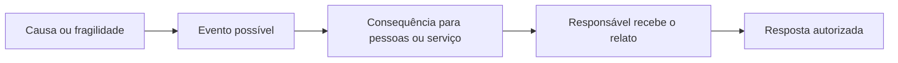
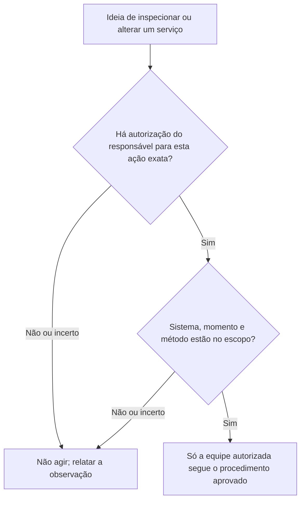
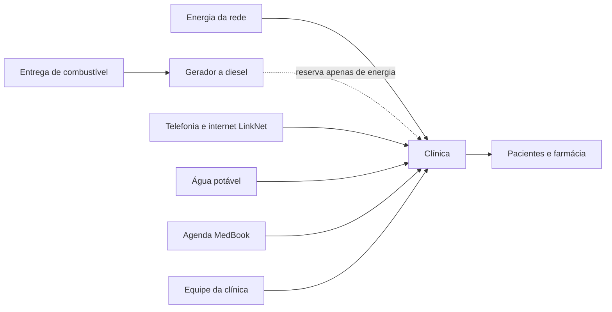
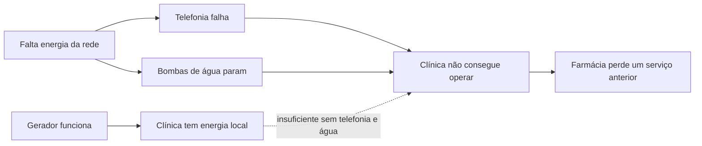

# Infraestrutura Crítica e Segurança Setorial: Uma Primeira Introdução

- Idioma: português do Brasil (`pt`); curso rápido, um mês; aproximadamente 80 horas de estudo planejado (curso 023 de 207 da [trilha de estudo](../../../../../STUDY_PATH.md)). Edição de referência: [inglês](../../en/book/MANUSCRIPT.md).
- Estado editorial: **rascunho**. Os capítulos 1–4 de 4 têm texto didático escrito, um laboratório offline, os exercícios EX001–EX050 e as resoluções correspondentes. Revisão independente por especialistas, nova verificação das fontes, revisão de acessibilidade, revisão linguística e a verificação de 300 páginas A4 continuam em aberto. Cobertura de capítulos em rascunho não é um livro concluído.
- Público: **iniciantes** sem função de segurança e com letramento digital básico — estudantes, pessoas em transição de carreira e funcionários ou voluntários que acabaram de entrar num hospital, numa clínica, numa empresa de água ou de energia, numa operadora de transporte, num banco, numa escola ou numa prefeitura e querem entender por que o seu local de trabalho é tratado como "crítico".
- Como este curso difere dos vizinhos. O [livro profissional](../../../../professional-6-months/critical-sector-security/en/book/MANUSCRIPT.md) ensina coordenadores a conduzir a governança: registros de riscos, RACI, contratos com fornecedores, prazos de notificação e exercícios de mesa. O [livro técnico](../../../../technical-18-months/critical-sector-security/en/book/MANUSCRIPT.md) ensina profundidade prática em protocolos e endurecimento. **Este livro rápido é um primeiro olhar e uma primeira prática segura.** Ele ensina você a reconhecer o que torna um serviço crítico, a explicar os seus riscos centrais em palavras simples, a ficar dentro do que você tem permissão para fazer, a ver como os serviços dependem uns dos outros e a concluir uma pequena tarefa guiada. Ele não faz de você um coordenador, um engenheiro ou um respondedor de incidentes, e nunca pede que você toque um sistema real.
- Autoria e responsabilidade editorial: [hiagokinlevi](https://github.com/hiagokinlevi). O texto didático original, de titularidade do mantenedor, é dedicado sob [CC0 1.0](../../../../../LICENSE); as obras citadas mantêm seus próprios direitos e não são relicenciadas aqui.
- Limite educacional: este curso é um projeto educacional independente. Não é um programa credenciado, não concede qualificação e não concede nenhuma autoridade sobre, ou acesso a, qualquer infraestrutura, operador, conjunto de dados ou pessoa reais. Todo lugar, organização, pessoa, mensagem, número e dependência de um exemplo resolvido ou do laboratório é **sintético**, a menos que uma frase cite explicitamente uma fonte pública. Nada neste livro é aconselhamento jurídico, clínico ou regulatório.

[Página do curso](../../README.md) · [Índice de capítulos](../SUBJECTS.md) · [Plano do livro](PLAN.md) · [Skill do curso](../../skill/SKILL.md) · [Padrão de livros](../../../../../BOOK_STANDARD.md) · [Resoluções](#worked-results)

## Como usar este rascunho

O curso dura quatro semanas, um capítulo por semana, cerca de 20 horas cada. O resultado do curso é **reconhecer e explicar os riscos centrais da infraestrutura crítica e concluir uma tarefa guiada** com segurança.

- **Semana 1 (Capítulo 1)** — o que é infraestrutura crítica, por que a consequência importa mais do que os dados e como escrever uma frase de risco clara.
- **Semana 2 (Capítulo 2)** — o que você pode e não pode fazer, como relatar algo estranho e como compartilhar informações com cuidado.
- **Semana 3 (Capítulo 3)** — as partes de um serviço essencial (pessoas, TI, tecnologia operacional, dados, fornecedores) e como os serviços dependem uns dos outros.
- **Semana 4 (Capítulo 4)** — um laboratório guiado que rastreia o que falha quando um serviço falha, e um pequeno artefato anotado (um "cartão de serviço" de uma página) que reúne o curso.

Cada capítulo tem objetivos de aprendizagem, seções didáticas curtas com definições, um exemplo resolvido, uma atividade prática, erros comuns e limites, exercícios numerados e uma síntese. Cada exercício nomeia o seu objetivo, insumos, passos, evidência esperada e uma rubrica de 0 a 3. Escreva primeiro a sua resposta e depois compare com as [resoluções](#worked-results). Uma resposta diferente que atenda à rubrica recebe a pontuação máxima.

O único laboratório (Capítulo 4) tem umas vinte e poucas linhas de Python 3 usando apenas a biblioteca padrão. Ele não precisa de rede, pacotes, privilégios nem dados reais, e a sua saída está impressa no livro, de modo que você pode fazer todos os exercícios sem executá-lo. A saída impressa foi produzida com o Python 3.13.5.

### O cenário sintético usado neste livro

| Elemento sintético | Papel no livro | Limite |
|---|---|---|
| **Larkfield** — uma pequena cidade fictícia de cerca de 20.000 habitantes | Cenário de todos os exemplos. | Lugar inventado. |
| **Larkfield Community Clinic** — uma clínica de atendimento sem agendamento, com uma pequena farmácia | Onde o leitor, **Sam Reyes**, acabou de começar como administrador da recepção. | Inventada. |
| **Larkfield Water** (bombas e uma estação de tratamento), **Larkfield Power** (distribuidora local de eletricidade), **Larkfield Bus** | Serviços essenciais vizinhos. | Inventados. |
| Pessoas: Dra. P. Osei (diretora da clínica), H. Novak (gerente administrativa, supervisora de Sam), K. Ito (prestador de TI da clínica, em tempo parcial), D. Brandt (operador de turno na Larkfield Water) | Colegas e vizinhos. | Inventadas; nenhuma pessoa real. |
| **MedBook** (fornecedor do software de agendamento), **LinkNet** (provedor de telefone e internet) | Fornecedores. | Inventados; qualquer semelhança com empresas reais é acidental. |

Como os dados são sintéticos, o livro pode mostrar coisas que um iniciante raramente veria. Use-os para aprender ideias, nunca como evidência sobre organizações reais.

### Política de fontes

Toda afirmação factual sobre um framework público, uma lei, uma orientação ou um incidente remete a uma fonte consultada em outubro de 2026. Leis e orientações mudam e diferem entre países: verifique de novo antes de se apoiar nelas. Uma citação apoia a afirmação geral ao seu lado, nunca os detalhes sintéticos de Larkfield. Incidentes públicos são descritos apenas no nível em que os seus editores os divulgaram.

### Cinco regras para este curso

1. **Olhe, aprenda e relate; não toque.** Você nunca testa, varre, entra em ou altera um sistema que não tenha sido explicitamente autorizado a usar para essa finalidade (Capítulo 2).
2. **Segurança das pessoas primeiro.** Num serviço essencial, o dano às pessoas importa mais do que dados perdidos.
3. **Diga o que você sabe e o que você supõe.** Marque os pressupostos como pressupostos.
4. **Relate cedo, pelo canal certo.** Um alarme falso relatado depressa custa pouco; um problema real relatado tarde pode custar muito.
5. **Pratique apenas com material sintético ou de estudo** — como os exemplos e o laboratório deste livro.

## Sumário

1. [Fundamentos e decisões](#ch-01) — serviços essenciais, setores e funções, consequência primeiro, uma primeira frase de risco e as três decisões do iniciante.
2. [Escopo, permissão e prática segura](#ch-02) — o que significa autorização, os limites do iniciante, o relato e o compartilhamento cuidadoso.
3. [Sistemas, dados e dependências](#ch-03) — pessoas, TI, tecnologia operacional, dados, fornecedores; dependências a montante e a jusante; pontos únicos de falha.
4. [Laboratório guiado e síntese aplicada](#ch-04) — Laboratório 4 (o que mais falha?), um cartão de serviço de uma página e uma autoavaliação do curso.
- [Resoluções](#worked-results) · [Glossário](#glossary) · [Referências](#references)

<a id="ch-01"></a>

## Capítulo 1 — Infraestrutura crítica e segurança setorial: fundamentos e decisões

### Objetivos de aprendizagem e conexão

Ao final deste capítulo, você será capaz de:

- explicar com as suas palavras o que são infraestrutura crítica e serviço essencial, e nomear vários setores;
- explicar por que, nesses serviços, **a segurança das pessoas e a disponibilidade geralmente vêm antes da confidencialidade**;
- descrever, em alto nível, três incidentes públicos e o que cada um ensina;
- escrever uma frase de risco clara, com causa, evento e consequência;
- escolher com bom senso entre as três decisões que todo iniciante enfrenta: perceber, relatar ou deixar com o dono.

O capítulo se apoia no letramento digital do dia a dia. Ele prepara o Capítulo 2, que define os limites do que você pode fazer com esse entendimento.

### 1.1 O que torna um serviço "crítico"

A maioria das pessoas só encontra a infraestrutura crítica quando ela para: a torneira seca, a luz apaga, a maquininha diz "recusado", o ônibus não vem. **Infraestrutura crítica** é o conjunto de sistemas, ativos e serviços cuja interrupção prejudicaria seriamente a segurança, a saúde, a economia ou a ordem pública de uma sociedade. Um **serviço essencial** é uma das coisas que essa infraestrutura entrega às pessoas: água limpa, eletricidade, atendimento de emergência, pagamentos, transporte.

Os governos listam esses setores para poderem planejar para eles. Os Estados Unidos, por exemplo, reconhecem dezesseis setores de infraestrutura crítica, incluindo energia, água e esgoto, saúde e saúde pública, transporte, serviços financeiros, comunicações e serviços de emergência ([CISA, Critical Infrastructure Sectors](https://www.cisa.gov/topics/critical-infrastructure-security-and-resilience/critical-infrastructure-sectors)). A Diretiva NIS2 da União Europeia impõe obrigações a entidades "essenciais" e "importantes" em setores como energia, transporte, bancos, saúde, água potável e infraestrutura digital ([Directive (EU) 2022/2555](https://eur-lex.europa.eu/eli/dir/2022/2555/oj)). As listas diferem entre países, mas a ideia é a mesma: alguns serviços importam tanto que a sua falha é problema de todos.

Uma segunda ideia útil é a de **função**, em vez de organização. A CISA descreve um conjunto de Funções Críticas Nacionais — como "fornecer água" ou "prestar atendimento médico" — agrupadas sob quatro verbos: conectar, distribuir, gerenciar e fornecer ([CISA, National Critical Functions Set](https://www.cisa.gov/national-critical-functions-set)). Pensar em funções ajuda o iniciante a fazer a pergunta certa: não "o que o meu empregador possui?", mas "o que o meu local de trabalho *faz* pelas pessoas, e o que acontece com elas se ele parar?"

### 1.2 Consequência primeiro

Num escritório comum, a preocupação clássica é que informações sejam roubadas. Num serviço essencial, a primeira preocupação geralmente é que **pessoas sejam feridas** ou que **o serviço pare**. Uma ordem de preocupação útil para este curso é:

| Ordem | Pergunta | Exemplo de Larkfield (sintético) |
|---|---|---|
| 1. Segurança das pessoas | Alguém pode se ferir? | Dosagem química errada na estação de tratamento de água. |
| 2. Disponibilidade (continuidade) | O serviço continua funcionando? | A clínica não consegue ver as consultas nem as receitas. |
| 3. Integridade (confiabilidade) | Podemos acreditar no que o sistema mostra? | Uma tela mostra uma bomba funcionando quando ela parou. |
| 4. Confidencialidade | Vazaram informações privadas? | Prontuários de pacientes são copiados por alguém de fora. |

Esta é uma ordem para **pensar sobre o dano**, e não uma regra de que a confidencialidade não importa. Um vazamento de prontuários é grave e pode acarretar o dever legal de avisar as pessoas rapidamente. O ponto é que um iniciante que só pensa em senhas e dados vai deixar passar os riscos que mais importam nesses setores. O NIST Cybersecurity Framework 2.0, um guia de alto nível amplamente usado, organiza os resultados de segurança em seis funções — Governar, Identificar, Proteger, Detectar, Responder e Recuperar — justamente porque manter um serviço funcionando e trazê-lo de volta importam tanto quanto manter os dados em segredo ([NIST CSF 2.0](https://www.nist.gov/cyberframework)).

### 1.3 Três incidentes públicos, em resumo

Você não precisa de detalhes técnicos para aprender com eventos reais. Leia você mesmo cada fonte; os resumos abaixo ficam no nível em que os editores os divulgaram.

- **Energia na Ucrânia, dezembro de 2015.** A CISA relata que atacantes causaram interrupções de energia que afetaram cerca de 225.000 clientes, operando disjuntores remotamente e dificultando a recuperação; as distribuidoras restabeleceram a energia passando à operação manual ([CISA IR-ALERT-H-16-056-01](https://www.cisa.gov/news-events/ics-alerts/ir-alert-h-16-056-01)). *Lição:* ataques a computadores podem chegar ao mundo físico, e pessoas capazes de operar as coisas à mão fazem parte da resiliência.
- **WannaCry e o NHS inglês, maio de 2017.** O National Audit Office do Reino Unido constatou que o ransomware perturbou pelo menos um terço dos trusts do NHS na Inglaterra e levou a milhares de consultas e cirurgias canceladas ([NAO, Investigation: WannaCry cyber attack and the NHS](https://www.nao.org.uk/reports/investigation-wannacry-cyber-attack-and-the-nhs/)). *Lição:* um malware comum de TI se torna um problema de disponibilidade na saúde; quem sente são os pacientes, e não só os computadores.
- **Instalações de água, 2023.** A CISA e agências parceiras relataram que agentes comprometeram controladores industriais expostos à internet em várias instalações de água e esgoto dos EUA, provavelmente usando senhas padrão ([CISA AA23-335A](https://www.cisa.gov/news-events/cybersecurity-advisories/aa23-335a)). *Lição:* fraquezas simples — um dispositivo alcançável pela internet com a senha de fábrica — podem bastar.

### 1.4 Escrevendo uma frase de risco

"Ransomware" é uma palavra, não um risco. Um **risco** é algo que pode acontecer e que importaria. Uma frase de risco clara tem três partes:

> **Como** (causa ou fraqueza), **(algo) poderia acontecer** (evento), **levando a** (consequência para as pessoas ou para o serviço).

Exemplo (sintético): "*Como* os PCs de agendamento da clínica compartilham uma única senha escrita num post-it, *alguém que passasse pelo balcão poderia entrar e alterar ou apagar consultas*, *levando a* pacientes sem atendimento e à equipe perdendo uma manhã para reconstruir a lista."

Boas frases de risco nomeiam uma consequência real (pessoas, tempo, serviço), e não apenas "perda de dados". Elas também deixam óbvio **quem deve ser o dono** do problema: aqui, a gerente administrativa, e não a pessoa que o percebeu.

### Visual 1 — da frase de risco à decisão



**Alternativa textual:** descreva a causa, o evento possível e o dano a pessoas ou ao serviço. Relate essa cadeia ao responsável, que decide a resposta autorizada. Sam não executa a correção só porque percebeu o risco.

### 1.5 As três decisões do iniciante

Como iniciante, não se espera que você conserte a segurança. Espera-se que você **perceba**, **relate** pelo canal certo e **deixe a correção com o dono**. Diante de algo que parece errado, pergunte:

1. *Alguém está em perigo agora?* Se sim, siga primeiro o procedimento de segurança ou de emergência; a segurança da informação vem em segundo lugar.
2. *Alguém precisa saber?* Se isso pode afetar o serviço, as pessoas ou dados privados, relate hoje ao seu supervisor ou pelo canal indicado.
3. *Cabe a mim mudar isso?* Quase sempre, não. Descreva o que você viu; não "dê só uma conferida" nem "conserte rapidinho".

### 1.6 Exemplo resolvido: a primeira semana de Sam (sintético)

Sam Reyes começa na recepção da Larkfield Community Clinic. Na primeira semana, Sam percebe quatro coisas:

| O que Sam percebe | Ordem de preocupação | Decisão de Sam |
|---|---|---|
| (a) A porta dos fundos do depósito da farmácia fica escorada aberta à tarde. | Segurança/integridade: medicamentos podem ser levados ou adulterados. | Relatar a H. Novak hoje; não dar sermão nos colegas. |
| (b) Um e-mail "da MedBook" pede que a equipe digite de novo a senha num link. | Disponibilidade e confidencialidade: um login roubado poderia travar o sistema de agendamento. | Não clicar; relatar pela via da clínica para "relatar e-mail suspeito". |
| (c) O PC da recepção mostra "atualizações pendentes — reinicialização necessária" há uma semana. | Disponibilidade, mais adiante. | Mencionar a H. Novak, que passa a K. Ito (TI). Não reiniciar por conta própria um PC clínico compartilhado no meio do turno. |
| (d) Um amigo na Larkfield Water diz que a estação ainda usa uma ferramenta de acesso remoto "com a senha antiga". | Possível risco à segurança em outra organização. | Não é o sistema de Sam. Sugerir que o amigo leve o assunto ao próprio supervisor; não testar a ferramenta, não pedir a senha nem postar sobre isso. |

Sam escreve uma frase de risco para (b): "Como a equipe está recebendo e-mails falsos convincentes da MedBook, alguém poderia digitar a senha numa página falsa, levando a que alguém de fora trave ou altere as consultas e a clínica fique sem conseguir atender pacientes por horas." Sam marca um pressuposto: "*Pressuposto:* os logins da MedBook não são protegidos por um segundo fator — não sei."

Note o que Sam *não* fez: investigar, testar o link, reiniciar o PC ou mexer na Larkfield Water. Cada decisão é pequena, mas juntas são exatamente a contribuição de um iniciante.

### 1.7 Atividade prática

Escolha um serviço essencial que você usa (a sua fornecedora de água, o hospital local, a empresa de ônibus ou o banco). Em no máximo uma página, escreva: a função que ele entrega às pessoas; quem seria prejudicado primeiro se ele parasse por um dia; uma frase de risco com causa, evento e consequência; e uma coisa que você está pressupondo. Mantenha tudo geral — use apenas informações públicas e não sonde o serviço de forma alguma.

Troque as páginas com um colega que escolheu outro serviço e confiram a frase de risco um do outro: ela nomeia uma causa, um evento e uma consequência para as pessoas? Depois comparem quem vocês disseram que seria prejudicado primeiro. Um hospital e uma empresa de ônibus dão respostas muito diferentes, e é justamente esse o sentido de pensar em funções.

### 1.8 Erros comuns e limites

- Achar que segurança é só sobre senhas e dados. Em serviços essenciais, comece pela segurança das pessoas e pela continuidade.
- Escrever riscos como palavras soltas ("hackers", "vírus") em vez de frases a partir das quais alguém possa agir.
- Tentar consertar as coisas você mesmo. O seu trabalho neste nível é perceber e relatar.
- Tratar o resumo de um incidente como a história completa. Os relatórios públicos são deliberadamente incompletos.
- Este capítulo simplifica: organizações reais usam métodos formais de risco, e as leis sobre serviços críticos diferem entre países.

- Pressupor que quem percebeu um problema deve ser o dono dele. Sam percebeu a senha no post-it, mas quem decide o que fazer é a gerente administrativa.
- Esquecer de marcar os pressupostos. A anotação de Sam de que os logins da MedBook podem não ter segundo fator está rotulada como desconhecida, e não afirmada como fato.

### Exercícios — capítulo 1

**EX001 — Identifique os serviços essenciais.** *Objetivo:* reconhecer serviços essenciais. *Insumos:* uma lista: água potável, um cinema, um pronto-socorro hospitalar, uma rede de pagamentos com cartão, uma loja de roupas, uma rede elétrica regional, uma rede de ônibus urbanos, um servidor de videogame. *Passos:* marcar cada um como essencial ou não e dar uma razão de uma linha. *Evidência esperada:* oito marcações com razões. *Rubrica:* 3 = água, pronto-socorro, pagamentos, rede elétrica e ônibus marcados como essenciais, com razões baseadas no dano, os demais não, com uma observação de que "essencial" depende do contexto; 2 = marcações corretas, razões fracas; 1 = vários erros; 0 = nada.

**EX002 — Associe ao setor.** *Objetivo:* ligar serviços a setores. *Insumos:* os cinco serviços essenciais do EX001. *Passos:* nomear o setor de cada um usando a lista de setores da CISA. *Evidência esperada:* cinco pares. *Rubrica:* 3 = todos corretos (água e esgoto; saúde e saúde pública; serviços financeiros; energia; sistemas de transporte); 2 = quatro corretos; 1 = dois ou três; 0 = menos.

**EX003 — Função, não organização.** *Objetivo:* pensar em funções. *Insumos:* Larkfield Community Clinic, Larkfield Water, Larkfield Bus. *Passos:* escrever a função que cada um presta às pessoas como uma expressão verbal. *Evidência esperada:* três expressões. *Rubrica:* 3 = "prestar atendimento médico / dispensar medicamentos", "fornecer água limpa", "transportar pessoas" ou equivalente, cada uma centrada nas pessoas; 2 = uma descreve a organização; 1 = lista prédios ou software; 0 = nada.

**EX004 — Ordem de preocupação.** *Objetivo:* aplicar a consequência primeiro. *Insumos:* (a) endereços de pacientes copiados; (b) uma dosagem do tratamento de água alterada sem aprovação; (c) o sistema de agendamento da clínica indisponível por uma manhã; (d) uma tela de bomba mostrando "funcionando" quando a bomba parou. *Passos:* ordenar do mais ao menos preocupante e justificar cada um. *Evidência esperada:* ordenação com razões. *Rubrica:* 3 = (b) primeiro (segurança das pessoas), depois (c) ou (d), com raciocínio sobre continuidade versus confiabilidade, (a) por último quanto ao dano imediato, mas observado como juridicamente grave; 2 = só o primeiro item correto; 1 = (a) primeiro sem raciocínio; 0 = nada.

**EX005 — Por que não "dados primeiro"?** *Objetivo:* explicar a mudança de prioridade. *Insumos:* seção 1.2. *Passos:* em três ou quatro frases, explicar a um amigo por que os serviços essenciais pensam na segurança das pessoas e na disponibilidade antes da confidencialidade. *Evidência esperada:* parágrafo curto. *Rubrica:* 3 = menciona o dano físico, as pessoas que dependem da continuidade e que a confidencialidade ainda importa; 2 = dois desses; 1 = um; 0 = nada.

**EX006 — Lição de incidente: Ucrânia 2015.** *Objetivo:* tirar uma lição de uma fonte pública. *Insumos:* [CISA IR-ALERT-H-16-056-01](https://www.cisa.gov/news-events/ics-alerts/ir-alert-h-16-056-01). *Passos:* ler o resumo e escrever o número de clientes afetados, como a energia foi restabelecida e uma lição para um iniciante. *Evidência esperada:* três respostas curtas. *Rubrica:* 3 = cerca de 225.000 clientes, operação manual, uma lição sobre a consequência física ou a alternativa manual; 2 = duas corretas; 1 = uma; 0 = nada.

**EX007 — Lição de incidente: WannaCry e o NHS.** *Objetivo:* ligar um malware de TI ao dano no serviço. *Insumos:* o resumo do [relatório do NAO](https://www.nao.org.uk/reports/investigation-wannacry-cyber-attack-and-the-nhs/). *Passos:* escrever quem foi prejudicado e como, em duas frases, sem termos técnicos. *Evidência esperada:* duas frases. *Rubrica:* 3 = pacientes prejudicados por consultas/cirurgias canceladas e trusts perturbados, enquadrado como disponibilidade; 2 = menciona a perturbação sem as pessoas; 1 = só "os computadores foram criptografados"; 0 = nada.

**EX008 — Lição de incidente: controladores de água.** *Objetivo:* reconhecer fraquezas simples. *Insumos:* [CISA AA23-335A](https://www.cisa.gov/news-events/cybersecurity-advisories/aa23-335a). *Passos:* nomear as duas condições simples que tornaram o comprometimento possível e dizer por que cada uma é uma lição de nível iniciante. *Evidência esperada:* duas condições com razões. *Rubrica:* 3 = exposição à internet e senhas padrão, cada uma explicada como uma falha de higiene do dia a dia; 2 = ambas nomeadas, sem razões; 1 = uma; 0 = nada.

**EX009 — Reescreva três riscos.** *Objetivo:* escrever frases de risco. *Insumos:* as palavras "phishing", "computador antigo" e "porta aberta", situadas na clínica de Larkfield. *Passos:* reescrever cada uma como "Como…, …poderia acontecer, levando a…". *Evidência esperada:* três frases. *Rubrica:* 3 = cada uma tem causa, evento e uma consequência para as pessoas ou para o serviço; 2 = uma não tem consequência; 1 = ainda genéricas; 0 = nada.

**EX010 — Encontre o dono.** *Objetivo:* ver que os riscos têm donos. *Insumos:* as suas três frases do EX009 e a lista de pessoas de Larkfield. *Passos:* nomear quem deve ser o dono de cada risco e por que não é Sam. *Evidência esperada:* três donos com razões. *Rubrica:* 3 = a gerente administrativa ou a diretora da clínica para processos e instalações, o prestador de TI para o computador (com a gerente decidindo), razões ligadas à autoridade; 2 = donos sem razões; 1 = Sam nomeado como dono; 0 = nada.

**EX011 — Três decisões.** *Objetivo:* aplicar perceber/relatar/deixar com o dono. *Insumos:* um colega diz "o alarme da geladeira das vacinas apitou a noite toda, mas eu desliguei". *Passos:* percorrer as três perguntas da seção 1.5. *Evidência esperada:* três respostas curtas. *Rubrica:* 3 = reconhece primeiro um possível problema de segurança do paciente, relata hoje à gerente administrativa, não ajusta a geladeira nem as configurações do alarme; 2 = relata, mas deixa passar a segurança; 1 = tenta consertar; 0 = nada.

**EX012 — Saber versus pressupor.** *Objetivo:* separar fatos de pressupostos. *Insumos:* a frase de risco de Sam para (b) na seção 1.6. *Passos:* listar dois fatos que Sam sabe e duas coisas que Sam pressupõe. *Evidência esperada:* quatro itens. *Rubrica:* 3 = fatos: chegaram e-mails falsos, eles pedem senhas; pressupostos: sem segundo fator, que o e-mail é falso e não um aviso real da MedBook (ou semelhante); 2 = três corretos; 1 = mistura-os; 0 = nada.

**EX013 — Não é o seu sistema.** *Objetivo:* respeitar os limites fora do seu local de trabalho. *Insumos:* o item (d) da seção 1.6. *Passos:* escrever a mensagem que Sam poderia enviar ao amigo. *Evidência esperada:* duas ou três frases. *Rubrica:* 3 = incentiva o amigo a contar ao supervisor ou ao contato de segurança, não pede detalhes nem senhas, não sugere testar a ferramenta; 2 = incentiva o relato, mas pede detalhes; 1 = sugere conferir; 0 = nada.

### Síntese do capítulo

A infraestrutura crítica entrega funções de que as pessoas não podem prescindir, e a sua segurança é julgada pela consequência: segurança das pessoas primeiro, depois continuidade, confiabilidade e confidencialidade. Incidentes reais mostram que problemas de computador chegam a pacientes, casas e ruas, e que fraquezas simples muitas vezes bastam. As ferramentas de um iniciante são uma frase de risco clara, uma marcação honesta do que é pressuposto e três decisões: perceber, relatar, deixar a correção com o dono.

<!-- cyberabc:chapter-navigation:start ch-01 -->
### Continue estudando — capítulo 01 de 04

[← Página do curso](../../README.md) · [Índice de capítulos do curso](../SUBJECTS.md) · [Capítulo 02 →](#ch-02)

Siga para a próxima lição escrita.
<!-- cyberabc:chapter-navigation:end -->

<a id="ch-02"></a>

## Capítulo 2 — Escopo, permissão e prática segura

### Objetivos de aprendizagem e conexão

Ao final deste capítulo, você será capaz de:

- explicar o que significam **autorização** e **escopo**, e por que boas intenções não os substituem;
- listar o que um iniciante pode e não pode fazer com um sistema num serviço essencial;
- explicar por que "só dar uma conferida" pode ser perigoso em ambientes operacionais;
- relatar um evento suspeito com clareza, com os fatos certos e sem investigar;
- usar o Traffic Light Protocol para decidir quem pode receber uma informação;
- escolher lugares seguros para praticar habilidades de segurança.

O Capítulo 1 mostrou por que esses serviços importam. Este capítulo define os limites que mantêm a sua curiosidade segura. O Capítulo 3, depois, olha por dentro de um serviço.

### 2.1 Autorização e escopo

**Autorização** é a permissão, dada pela pessoa ou organização dona de um sistema, para fazer uma coisa específica com ele. **Escopo** é o limite exato dessa permissão: quais sistemas, quais ações, quando e por quem. Uma autorização válida normalmente é escrita, nomeia o dono que a concede e diz o que fazer se algo der errado.

Disso decorrem duas consequências:

- **Ter acesso não é ter permissão.** O seu login da clínica permite marcar consultas. Ele não autoriza você a explorar outras pastas, tentar as contas de outras pessoas ou testar se o sistema pode ser quebrado.
- **Boas intenções não são autorização.** "Eu só estava verificando se era seguro" não é defesa. Muitos países tratam o acesso a um sistema de computador sem autorização como crime, qualquer que seja o motivo, e os empregadores o tratam como falta grave.

Os testadores profissionais de segurança trabalham sob regras de engajamento escritas exatamente por isso; o guia do NIST para testes técnicos de segurança descreve planejamento, regras e aprovações antes do início de qualquer teste ([NIST SP 800-115](https://csrc.nist.gov/pubs/sp/800/115/final)). Esse nível de teste não faz parte deste curso.

### Visual 2 — o limite da autorização



**Alternativa textual:** uma proposta de inspeção ou alteração exige permissão explícita do responsável e escopo exato. Se faltar qualquer um dos dois, pare e relate; somente a equipe autorizada age dentro do procedimento. Ter login ou boa intenção não substitui essas condições.

### 2.2 Por que "só dar uma conferida" é perigoso aqui

Os sistemas operacionais — os computadores que fazem funcionar bombas, válvulas, disjuntores, dispositivos médicos e sinalização — muitas vezes são antigos, delicadamente ajustados e construídos para funcionar sem interrupção. As orientações para a tecnologia operacional alertam que ações rotineiras na TI de escritório, como fazer a varredura de uma rede, podem perturbar esses sistemas ([NIST SP 800-82 Rev. 3](https://csrc.nist.gov/pubs/sp/800/82/r3/final)). Um iniciante bem-intencionado que "só dá uma conferida" num dispositivo pode pará-lo, disparar alarmes falsos que tiram os operadores do trabalho real ou deixar o dispositivo num estado inseguro. Num serviço essencial, a curiosidade mais segura é a que faz uma pergunta em vez de apertar um botão.

### 2.3 Os limites do iniciante

| Você **pode** | Você **não pode** |
|---|---|
| Usar os sistemas que lhe foram dados, para o trabalho que lhe foi dado. | Explorar, testar, varrer ou "cutucar" qualquer sistema, inclusive os do seu próprio empregador. |
| Bloquear a tela, proteger a sua senha, usar o segundo fator que lhe foi dado. | Compartilhar o seu login ou usar o de outra pessoa — nem "só desta vez". |
| Perceber coisas estranhas e anotar o que viu. | Investigar: abrir anexos suspeitos para "ver o que fazem", seguir links ou tentar senhas. |
| Relatar pelo canal oficial. | Consertar as coisas você mesmo, reiniciar dispositivos clínicos ou operacionais compartilhados ou mudar configurações. |
| Ler orientações públicas e praticar em ambientes sintéticos ou de estudo. | Praticar em serviços reais, inclusive sites públicos, sem permissão escrita. |
| Perguntar "quem é o dono disto?" | Postar fotos, capturas de tela ou detalhes de fraquezas nas redes sociais. |

### 2.4 Relatando bem

Um bom relato é curto, factual e rápido. Ele responde a cinco perguntas:

1. **O que** você viu? (As palavras exatas na tela, o endereço do remetente, o que aconteceu.)
2. **Quando**? (Data e hora, com o seu fuso horário.)
3. **Onde**? (Qual computador, sala, sistema ou conta de e-mail.)
4. **O que você fez?** (Por exemplo: "Não cliquei", ou, com honestidade, "Cliquei no link e digitei a minha senha".)
5. **Qual é o efeito possível?** (Quem ou o que pode ser afetado — uma frase, marcada como palpite.)

A honestidade importa mais no item 4. Relatar depressa que você *clicou* é muito mais útil do que escondê-lo: quanto antes o dono souber, antes poderá redefinir uma senha ou isolar uma máquina. Organizações que punem relatos honestos recebem menos relatos. Relate pelo canal que a sua organização indica — um supervisor, a central de atendimento de TI ou uma caixa de e-mail de segurança. Muitas agências nacionais também aceitam relatos de incidentes de organizações; nos Estados Unidos, por exemplo, a CISA publica uma via de relato ([CISA, Report to CISA](https://www.cisa.gov/report)). Como iniciante, relate primeiro internamente, a menos que a sua organização diga outra coisa.

### 2.5 Compartilhando informações com cuidado: TLP

Detalhes sobre fraquezas e incidentes podem ajudar atacantes. O **Traffic Light Protocol (TLP) 2.0** é um conjunto simples de rótulos que diz aos destinatários com que amplitude podem compartilhar uma informação ([FIRST, Traffic Light Protocol](https://www.first.org/tlp/)):

| Rótulo | Quem pode recebê-la |
|---|---|
| **TLP:RED** | Apenas as pessoas nomeadas presentes; nenhum compartilhamento adicional. |
| **TLP:AMBER+STRICT** | Apenas a própria organização do destinatário. |
| **TLP:AMBER** | A organização do destinatário e os clientes dela, conforme a necessidade de saber. |
| **TLP:GREEN** | A comunidade do destinatário, mas não canais públicos. |
| **TLP:CLEAR** | Qualquer pessoa; nenhuma restrição além das regras normais, como os direitos autorais. |

Se você receber algo rotulado, respeite o rótulo. Se algo não estiver rotulado e puder ser sensível, não o compartilhe fora da sua organização; pergunte ao remetente.

### 2.6 Lugares seguros para praticar

Você pode construir habilidades reais sem tocar em nada real: os exemplos resolvidos e o laboratório deste livro; material de estudo como relatórios públicos de incidentes; ambientes de treinamento deliberadamente vulneráveis que você mesmo executa, offline, no seu próprio computador; e kits públicos de exercícios pensados para discussão, como o Exercise in a Box do NCSC do Reino Unido ([NCSC, Exercise in a Box](https://www.ncsc.gov.uk/information/exercise-in-a-box)). Os hábitos de segurança pessoal do dia a dia — senhas fortes e únicas, autenticação multifator, atualizações e reconhecimento de phishing — também são um bom ponto de partida ([CISA, Secure Our World](https://www.cisa.gov/secure-our-world)).

### 2.7 Exemplo resolvido: o prestador prestativo (sintético)

Na quinta-feira à tarde, um homem desconhecido chega ao balcão da clínica. "Sou da LinkNet", diz ele. "A internet de vocês está caindo. Preciso ligar esta caixa no armário de rede — vai levar só cinco minutos. O K. Ito disse que tudo bem." Sam nunca o viu; Ito está fora.

As decisões de Sam:

- **Autorização.** Sam não é dono da rede e não pode autorizar trabalho nela. Uma afirmação verbal de que "o Ito disse que tudo bem" não é autorização.
- **Verificar por um canal conhecido.** Sam pede que ele espere e então liga para H. Novak e K. Ito usando os números da lista de contatos da clínica — e não um número oferecido pelo visitante.
- **Nada de "só cinco minutos".** Mesmo que ele seja genuíno, um dispositivo ligado à rede da clínica sem aprovação poderia afetar o sistema de agendamento durante o horário de atendimento.
- **Relatar.** Ito diz que nenhum trabalho está agendado. Novak pede ao visitante que saia e agenda uma visita adequada com a LinkNet. Sam escreve um relato:

> O quê: homem que dizia ser da LinkNet pediu para ligar um dispositivo no armário de rede; disse que K. Ito tinha aprovado. Quando: quinta-feira, 14:20 (horário local). Onde: recepção, Larkfield Community Clinic. O que eu fiz: não o deixei entrar na sala do armário; liguei para H. Novak e K. Ito pela lista de contatos da clínica; Ito confirmou que nenhuma visita estava agendada. Efeito possível (palpite): tentativa de obter acesso à rede da clínica. Descrição: alto, jaqueta cinza no estilo da LinkNet, nenhum crachá mostrado.

Sam rotula o relato como TLP:AMBER+STRICT ao enviá-lo por e-mail a Novak — ele fica dentro da clínica. Sam não posta nada sobre o assunto.

### 2.8 Atividade prática

Escreva o seu próprio "cartão de limites": cinco coisas que você pode fazer e cinco que não pode fazer com os sistemas do seu trabalho ou da sua escola, com as suas palavras. Depois escreva um relato, usando as cinco perguntas da seção 2.4, sobre um e-mail suspeito que você tenha recebido pessoalmente (remova os dados pessoais). Não clique em nada dele para reunir mais fatos.

Guarde o cartão de limites num lugar onde você o veja e compare-o com o de um colega: se um de vocês permite algo que o outro proíbe, verifiquem qual está certo com base na tabela do pode e não pode. No relato do e-mail, o item 4 deve dizer com honestidade o que você fez, mesmo que tenha sido abrir a mensagem. Marque o efeito possível como palpite, como Sam fez no relato do prestador.

### 2.9 Erros comuns e limites

- Confundir acesso com permissão.
- "Investigar" um e-mail ou dispositivo suspeito antes de relatá-lo, destruindo evidências ou espalhando o dano.
- Adiar um relato por vergonha de ter clicado.
- Verificar a identidade de quem ligou usando os contatos que a própria pessoa deu.
- Compartilhar demais: postar uma captura de tela de uma fraqueza "para alertar as pessoas".
- Aceitar a menção a um nome, como "o K. Ito disse que tudo bem", como permissão, quando só o dono pode autorizar o trabalho.
- Compartilhar um relato rotulado mais amplamente do que o rótulo permite, como Sam evitou ao manter o relato do prestador dentro da clínica.
- Limites: este capítulo é uma orientação geral, não aconselhamento jurídico. As leis sobre acesso não autorizado e sobre obrigações de relato diferem por país e por setor; siga a política da sua organização.

### Exercícios — capítulo 2

**EX014 — Acesso ou permissão?** *Objetivo:* distinguir os dois. *Insumos:* Sam consegue abrir, por acidente, uma pasta de um drive compartilhado chamada "Folha de pagamento". *Passos:* dizer se Sam pode abrir os arquivos e o que Sam deve fazer. *Evidência esperada:* duas ou três frases. *Rubrica:* 3 = não abre os arquivos, relata o acesso amplo demais ao supervisor para que o dono corrija as permissões; 2 = não abre, mas não relata; 1 = abre "para conferir"; 0 = nada.

**EX015 — Boas intenções.** *Objetivo:* explicar por que o motivo não autoriza. *Insumos:* um colega de turma diz "tudo bem testar o site da água da cidade em busca de fraquezas, porque eu avisaria se achasse alguma coisa". *Passos:* responder em três frases. *Evidência esperada:* resposta. *Rubrica:* 3 = explica que não há autorização do dono, que provavelmente é ilegal e pode perturbar um serviço público, sugere praticar num laboratório ou ler a política de divulgação publicada pela organização; 2 = dois desses; 1 = um; 0 = nada.

**EX016 — Elementos do escopo.** *Objetivo:* reconhecer o que uma autorização válida contém. *Insumos:* seção 2.1. *Passos:* listar quatro coisas que uma autorização escrita deve declarar. *Evidência esperada:* lista. *Rubrica:* 3 = quem é o dono e aprova, quais sistemas, quais ações, quando (janela), além de quem executa ou o que fazer se algo der errado; 2 = três itens; 1 = um ou dois; 0 = nada.

**EX017 — Por que não varrer?** *Objetivo:* explicar a fragilidade da TO. *Insumos:* seção 2.2. *Passos:* explicar em duas frases por que uma varredura de rede inofensiva num escritório poderia ser prejudicial numa estação de tratamento de água. *Evidência esperada:* duas frases. *Rubrica:* 3 = dispositivos mais antigos e sensíveis podem parar ou se comportar mal, e um dispositivo parado pode afetar um processo físico ou a segurança das pessoas; 2 = menciona um; 1 = vago; 0 = nada.

**EX018 — Classifique os limites.** *Objetivo:* aplicar a tabela do pode e não pode. *Insumos:* (a) bloquear a tela; (b) reiniciar o controlador da geladeira da farmácia porque o visor travou; (c) relatar um pendrive suspeito achado no estacionamento; (d) ligar esse pendrive para descobrir o dono; (e) usar o login de um colega porque o seu expirou; (f) ler um alerta público da CISA. *Passos:* marcar cada um como pode ou não pode. *Evidência esperada:* seis marcações. *Rubrica:* 3 = pode: a, c, f; não pode: b, d, e — com uma razão para cada não pode; 2 = todos corretos, sem razões; 1 = um ou dois erros; 0 = mais.

**EX019 — Escreva um relato.** *Objetivo:* produzir um relato em cinco partes. *Insumos:* Sam recebe um e-mail "MedBook: a sua conta será encerrada hoje", com um link e um endereço de remetente que termina num domínio desconhecido; Sam clicou no link, mas fechou a página antes de digitar qualquer coisa, segunda-feira, 09:05. *Passos:* escrever o relato usando as cinco perguntas. *Evidência esperada:* relato. *Rubrica:* 3 = as cinco partes, honesto quanto ao clique no link, nenhuma investigação, efeito possível marcado como palpite; 2 = quatro partes; 1 = esconde o clique ou omite o horário; 0 = nada.

**EX020 — Relato honesto.** *Objetivo:* ver por que a rapidez e a honestidade importam. *Insumos:* o mesmo caso, mas Sam digitou a senha. *Passos:* explicar o que Sam deve acrescentar ao relato e por que a rapidez importa. *Evidência esperada:* duas ou três frases. *Rubrica:* 3 = declara com clareza que a senha foi digitada e quando, relata imediatamente para que a senha possa ser redefinida e os acessos verificados, observa que a demora dá tempo ao atacante; 2 = declara, mas deixa passar a rapidez; 1 = sugere trocar a senha em silêncio; 0 = nada.

**EX021 — Verifique quem ligou.** *Objetivo:* usar um canal conhecido. *Insumos:* alguém liga dizendo "Aqui é a Larkfield Power. Precisamos da senha do Wi-Fi da clínica para verificar o seu medidor inteligente. Ligue de volta para este número." *Passos:* dizer o que Sam faz. *Evidência esperada:* passos. *Rubrica:* 3 = não dá a senha, não usa o número de quem ligou, confere com o supervisor e com o número publicado da empresa de energia, relata; 2 = recusa, mas não relata; 1 = liga de volta para o número dado; 0 = dá a senha.

**EX022 — Rótulos TLP.** *Objetivo:* aplicar o TLP 2.0. *Insumos:* (a) um alerta nacional marcado como TLP:CLEAR; (b) o relato de Sam sobre o prestador, na seção 2.7, marcado como TLP:AMBER+STRICT; (c) um briefing marcado como TLP:RED dado numa reunião. *Passos:* dizer com quem Sam pode compartilhar cada um. *Evidência esperada:* três respostas. *Rubrica:* 3 = (a) qualquer pessoa; (b) apenas pessoas de dentro da clínica; (c) ninguém além dos presentes; 2 = dois corretos; 1 = um; 0 = nada.

**EX023 — Informação sem rótulo.** *Objetivo:* agir com cuidado por padrão. *Insumos:* um colega encaminha um e-mail sem rótulo que lista as senhas da rede da clínica "por conveniência". *Passos:* dizer o que Sam faz. *Evidência esperada:* duas ou três frases. *Rubrica:* 3 = não encaminha nem reutiliza, avisa o supervisor/TI que senhas foram enviadas por e-mail para que possam ser trocadas, apaga-o conforme instruído; 2 = não encaminha, mas não relata; 1 = guarda-o; 0 = encaminha.

**EX024 — Plano de prática segura.** *Objetivo:* escolher uma prática legítima. *Insumos:* seção 2.6. *Passos:* descrever duas formas de praticar habilidades de segurança este mês sem tocar nenhum sistema real. *Evidência esperada:* dois itens. *Rubrica:* 3 = duas opções seguras e concretas (laboratório do livro, ambiente de treinamento offline no próprio computador, kit público de exercício de mesa, higiene das contas pessoais), com o porquê de cada uma ser segura; 2 = duas sem razões; 1 = uma; 0 = qualquer opção insegura.

**EX025 — Redes sociais.** *Objetivo:* evitar uma divulgação prejudicial. *Insumos:* o amigo de Sam quer postar "A Larkfield Water ainda usa senhas padrão!" para alertar o público. *Passos:* explicar o risco e uma via melhor. *Evidência esperada:* três frases. *Rubrica:* 3 = postar poderia ajudar atacantes a mirar um serviço crítico para a segurança antes da correção, e a informação pode não estar verificada; melhor: avisar a empresa pelo seu contato ou pela sua via de divulgação, ou o supervisor do amigo, se ele trabalhar lá; 2 = apenas o risco; 1 = vago; 0 = incentiva a postagem.

**EX026 — Reflexão sobre o caso do prestador.** *Objetivo:* extrair as decisões da seção 2.7. *Insumos:* o exemplo resolvido. *Passos:* listar as quatro decisões que Sam tomou e o princípio por trás de cada uma. *Evidência esperada:* quatro pares. *Rubrica:* 3 = não cabia a Sam autorizar / a autorização deve vir do dono; verificou pelos contatos conhecidos / não confiar em dados fornecidos por quem ligou; recusou os "cinco minutos" / mudanças não aprovadas podem perturbar o serviço; relatou e rotulou / relatar e compartilhar com cuidado; 2 = três; 1 = uma ou duas; 0 = nada.

### Síntese do capítulo

A permissão vem do dono do sistema, é específica e normalmente é escrita; acesso e boas intenções não são permissão. Em serviços essenciais, "só dar uma conferida" pode perturbar processos reais; por isso, as ações seguras de um iniciante são usar o que lhe foi dado, perceber, relatar rápido e com honestidade por um canal conhecido e compartilhar com cuidado usando rótulos como o TLP. As habilidades são construídas em ambientes sintéticos e de estudo, nunca em serviços em produção.

<!-- cyberabc:chapter-navigation:start ch-02 -->
### Continue estudando — capítulo 02 de 04

[← Capítulo 01](#ch-01) · [Índice de capítulos do curso](../SUBJECTS.md) · [Capítulo 03 →](#ch-03)

Siga para a próxima lição escrita.
<!-- cyberabc:chapter-navigation:end -->

<a id="ch-03"></a>

## Capítulo 3 — Infraestrutura crítica e segurança setorial: sistemas, dados e dependências

### Objetivos de aprendizagem e conexão

Ao final deste capítulo, você será capaz de:

- descrever as cinco partes de um serviço essencial: pessoas, TI, tecnologia operacional, dados e fornecedores;
- explicar em palavras simples o que fazem os sensores, os controladores, as telas dos operadores e o SCADA, e como a TO difere da TI de escritório;
- nomear os principais tipos de dados de um setor e o dano que cada um poderia causar se fosse perdido, alterado ou vazado;
- distinguir dependências **a montante**, **a jusante** e **compartilhadas**;
- identificar um **ponto único de falha** e uma **alternativa manual** numa descrição simples.

O Capítulo 2 definiu os seus limites. Aqui você aprende a *ver* um serviço com clareza, de fora, o que prepara o laboratório guiado do Capítulo 4.

### 3.1 As cinco partes de um serviço

| Parte | O que é | Exemplo de Larkfield (sintético) |
|---|---|---|
| **Pessoas** | Funcionários, prestadores, voluntários — e o conhecimento na cabeça deles. | Enfermeiros, Sam na recepção, D. Brandt de turno na estação de água. |
| **TI (tecnologia da informação)** | Computadores de escritório, e-mail, software de negócio, redes. | Agendamentos da MedBook, e-mail da clínica, faturamento. |
| **TO (tecnologia operacional)** | Computadores que medem e controlam coisas físicas. | Bombas e dosagem de cloro na Larkfield Water; o controlador da geladeira de vacinas da clínica. |
| **Dados** | As informações que o serviço cria e das quais depende. | Prontuários, receitas, leituras de qualidade da água. |
| **Fornecedores** | Empresas de fora das quais o serviço depende. | MedBook (software), LinkNet (telefone e internet), Larkfield Power. |

Os problemas de segurança podem começar em qualquer parte. Muitos começam pelas pessoas (um e-mail convincente) ou pelos fornecedores (uma conta de acesso remoto), e não por uma tecnologia engenhosa.

### 3.2 Um olhar tranquilo sobre a tecnologia operacional

Você não precisa configurar a TO para entendê-la. Uma imagem simplificada de uma estação de bombeamento de água:

- **Sensores** medem coisas: o nível de água num reservatório, a pressão num cano, a concentração de cloro.
- **Atuadores** fazem coisas: ligam uma bomba, abrem uma válvula, adicionam um produto químico.
- Um **controlador** — muitas vezes um **CLP** (controlador lógico programável), um pequeno computador robusto — lê os sensores e comanda os atuadores por regras simples ("se o reservatório estiver abaixo de 30%, ligue a bomba 2").
- Uma **IHM** (interface homem–máquina) é a tela do operador, que mostra níveis e alarmes e permite mudar as configurações.
- O **SCADA** (supervisão, controle e aquisição de dados) é o sistema mais amplo que reúne as leituras de muitos locais numa sala de controle.

O guia do NIST para a segurança da TO descreve esses componentes e por que a TO difere da TI ([NIST SP 800-82 Rev. 3](https://csrc.nist.gov/pubs/sp/800/82/r3/final)). Três diferenças importam para um iniciante:

| TI de escritório | Tecnologia operacional |
|---|---|
| Reiniciar, corrigir e substituir com frequência. | Precisa funcionar continuamente; mudanças exigem planejamento e testes. |
| O pior caso costuma ser dados perdidos ou vazados. | O pior caso pode ser dano físico ou a perda de um serviço essencial. |
| Os dispositivos duram de 3 a 5 anos. | Os dispositivos muitas vezes duram de 15 a 25 anos ou mais. |

É por isso que o Capítulo 2 proibiu "só dar uma conferida": os dispositivos de TO podem ser antigos e sensíveis, e o que eles controlam é real.

### 3.3 Os dados e o que pode dar errado

| Tipo de dado | Exemplo | Vazado (confidencialidade) | Alterado (integridade) | Indisponível (disponibilidade) |
|---|---|---|---|---|
| Pessoais/de saúde | Prontuários | Dano à privacidade; obrigações legais | Tratamento errado | Atendimento atrasado |
| Leituras operacionais | Nível do reservatório, cloro | Ajuda um atacante a planejar | Operadores agem com base num quadro falso | Operadores "cegos"; verificações manuais necessárias |
| Configurações | Setpoint de dosagem | Ajuda um atacante a planejar | Operação insegura | Não é possível ajustar o processo |
| Negócio | Faturamento, folha de pagamento | Fraude | Contas erradas | Problemas de fluxo de caixa |

Observe a coluna do meio para os dados operacionais: uma leitura errada pode ser mais perigosa do que uma roubada, porque as pessoas tomam decisões com base nela.

### 3.4 Dependências

Nenhum serviço existe sozinho. Uma **dependência** é algo de que um serviço precisa para funcionar.

- Dependências **a montante** são aquilo de que o *seu* serviço precisa: energia, água, telefone, internet, pessoal, suprimentos.
- Dependentes **a jusante** são os que precisam do *seu* serviço: pacientes, residências, outros serviços.
- Dependências **compartilhadas** são usadas por muitos serviços ao mesmo tempo: uma rede de telefonia, um depósito de combustível, um fornecedor de software. A sua falha atinge muitos serviços juntos.

Um **ponto único de falha** é uma coisa cuja perda para o serviço porque não há alternativa. Um **backup** (um gerador, uma segunda linha de internet) ou uma **alternativa manual** (listas de consultas em papel, operadores lendo os medidores à mão) reduz o impacto. Mas um backup só é tão bom quanto as *suas próprias* dependências: um gerador a diesel precisa de entregas de combustível, que precisam de estradas e motoristas. O laboratório do Capítulo 4 torna isso visível.

### 3.5 Fornecedores e acesso remoto

Muitos serviços essenciais permitem que fornecedores se conectem remotamente para manter software e equipamentos. Isso é útil — e é uma porta. As orientações da CISA para os donos de TO incluem, entre as mitigações primárias, reduzir a exposição à internet, trocar as senhas padrão e proteger o acesso remoto ([CISA, Primary Mitigations to Reduce Cyber Threats to Operational Technology](https://www.cisa.gov/resources-tools/resources/primary-mitigations-reduce-cyber-threats-operational-technology)). Os Cross-Sector Cybersecurity Performance Goals da CISA também estabelecem práticas de base, como autenticação multifator e inventário de ativos, que se aplicam a todos os setores ([CISA CPGs](https://www.cisa.gov/cross-sector-cybersecurity-performance-goals)). Como iniciante, você não vai gerenciar essas contas, mas deve reconhecer o risco quando ouvir "o fornecedor entra quando quer, com uma senha compartilhada".

O ataque de ransomware de 2021 a uma empresa de oleodutos dos EUA, descrito pela CISA e pelo FBI no seu alerta, também é uma lição de dependência: um ataque aos sistemas de TI de negócio afetou a operação de um abastecimento de combustível do qual muitos outros dependiam a jusante ([CISA AA21-131A](https://www.cisa.gov/news-events/cybersecurity-advisories/aa21-131a)).

### 3.6 Exemplo resolvido: de que a clínica depende? (sintético)

H. Novak pede a Sam que liste, para uma reunião da equipe, o que a clínica precisa para abrir as portas. Sam percorre uma manhã normal e escreve:

| Dependência | Tipo | Se perdida… | Backup ou alternativa | Observações |
|---|---|---|---|---|
| Larkfield Power | A montante, compartilhada | Luzes, PCs e geladeiras param | Gerador a diesel (2 horas de combustível armazenado) | O gerador precisa de uma entrega de combustível para interrupções mais longas. |
| Telefone e internet da LinkNet | A montante, compartilhada | Sem MedBook, sem agendamento por telefone, sem pagamentos com cartão | Nenhum conhecido | *Ponto único de falha?* — perguntar a K. Ito. |
| MedBook (nuvem) | A montante, fornecedor | Sem lista de consultas | Lista impressa em papel? — *desconhecido* | Perguntar a H. Novak se existe uma impressão diária. |
| Larkfield Water | A montante, compartilhada | Sem lavagem das mãos, sem instrumentos limpos | Água engarrafada para um dia | A clínica precisa suspender alguns procedimentos. |
| Pessoal | A montante | Sem serviço | Pessoal de agência | O conhecimento do alarme da geladeira é de uma só enfermeira. |
| Pacientes, farmácia | A jusante | — | — | A farmácia depende das receitas da clínica. |

Sam marca três perguntas, e não conclusões: a LinkNet é um ponto único de falha? Existe uma alternativa em papel para a MedBook? Quem mais conhece o alarme da geladeira? Elas vão para H. Novak — a dona —, que decide o que mudar, se for o caso.

### Visual 3 — dependências da clínica (sintético)



**Alternativa textual:** energia, LinkNet, água, MedBook e equipe alimentam a clínica, que atende pacientes e a farmácia. O gerador é reserva somente de energia e precisa de combustível. As reservas das demais dependências ainda são perguntas; o desenho não demonstra que uma clínica real falharia da mesma maneira.

### 3.7 Atividade prática

Escolha um serviço essencial público perto de você (ou a estação da Larkfield Water descrita acima). Usando apenas informações públicas e bom senso, desenhe um esboço simples de dependências: o serviço no meio, as dependências a montante à esquerda, os dependentes a jusante à direita. Circule tudo o que for compartilhado, marque com uma estrela qualquer possível ponto único de falha e escreva uma pergunta que você faria ao dono. Não contate nem sonde o serviço.

Compare o seu esboço com a tabela de dependências da clínica feita por Sam: você se lembrou das pessoas e dos fornecedores, além da energia e da água? Se escolheu a Larkfield Water, o seu esboço deve mostrar a clínica e as residências do lado a jusante e deve tratar a LinkNet como compartilhada. Escreva a sua pergunta ao dono de modo que possa ser respondida com sim ou não.

### 3.8 Erros comuns e limites

- Pensar só nos computadores e esquecer as pessoas, os fornecedores e os prédios.
- Tratar a TO como a TI de escritório ("é só reiniciar").
- Listar as dependências a montante, mas esquecer as pessoas a jusante que são prejudicadas.
- Pressupor que um backup funciona sem perguntar do que *ele* depende.
- Afirmar palpites como fatos; neste capítulo, uma lista de dependências é um conjunto de perguntas para o dono.
- Esquecer que uma pessoa pode ser um ponto único de falha, como a única enfermeira que conhece o alarme da geladeira da clínica.
- Contatar você mesmo um fornecedor ou uma empresa de serviços para verificar uma dependência, em vez de passar a pergunta ao dono.
- Limites: as arquiteturas reais de TO são muito mais variadas do que a imagem simples da seção 3.2.

### Exercícios — capítulo 3

**EX027 — Cinco partes.** *Objetivo:* classificar as partes de um serviço. *Insumos:* (a) o controlador da geladeira de vacinas da clínica; (b) a MedBook; (c) a enfermeira que conhece o alarme da geladeira; (d) as receitas; (e) a LinkNet. *Passos:* atribuir cada um a pessoas, TI, TO, dados ou fornecedores. *Evidência esperada:* cinco atribuições. *Rubrica:* 3 = a TO, b TI (e fornecedor), c pessoas, d dados, e fornecedor; 2 = quatro; 1 = duas ou três; 0 = menos.

**EX028 — Componentes de TO.** *Objetivo:* explicar os termos de TO em palavras simples. *Insumos:* sensor, atuador, CLP, IHM, SCADA. *Passos:* dar uma definição simples de uma linha e um exemplo numa estação de água para cada um. *Evidência esperada:* cinco linhas. *Rubrica:* 3 = todos corretos, com exemplos; 2 = quatro; 1 = dois ou três; 0 = menos.

**EX029 — TI versus TO.** *Objetivo:* comparar. *Insumos:* seção 3.2. *Passos:* dar duas diferenças e dizer por que cada uma importa para a segurança. *Evidência esperada:* dois pares. *Rubrica:* 3 = duas diferenças corretas (continuidade, consequência física, vida útil) com implicações de segurança (mudanças exigem planejamento, o dano pode ser físico, dispositivos antigos podem não ter proteções); 2 = diferenças sem implicações; 1 = uma; 0 = nada.

**EX030 — Leitura errada.** *Objetivo:* ver o risco de integridade na TO. *Insumos:* a IHM de uma estação de água mostra o reservatório 80% cheio, mas na verdade ele está com 10%. *Passos:* descrever o que o operador poderia fazer e a consequência possível. *Evidência esperada:* duas ou três frases. *Rubrica:* 3 = o operador não liga as bombas, o reservatório seca, perde-se pressão ou abastecimento para os clientes, incluindo a clínica; observa que uma verificação manual o revelaria; 2 = consequência sem a ação do operador; 1 = vago; 0 = nada.

**EX031 — Danos aos dados.** *Objetivo:* aplicar a visão CID aos dados. *Insumos:* "registros de receitas". *Passos:* descrever um dano para cada caso: vazado, alterado e indisponível. *Evidência esperada:* três danos. *Rubrica:* 3 = dano à privacidade/obrigação legal; medicamento ou dose errados; pacientes não conseguem receber medicamentos; 2 = dois; 1 = um; 0 = nada.

**EX032 — A montante, a jusante, compartilhada.** *Objetivo:* classificar dependências. *Insumos:* para a Larkfield Water: (a) Larkfield Power; (b) residências; (c) o fornecedor de produtos químicos; (d) a clínica; (e) a LinkNet, também usada pela clínica e pelo banco. *Passos:* classificar cada um. *Evidência esperada:* cinco respostas. *Rubrica:* 3 = a a montante (compartilhada), b a jusante, c a montante, d a jusante, e a montante e compartilhada; 2 = quatro; 1 = duas ou três; 0 = menos.

**EX033 — Ponto único de falha.** *Objetivo:* identificá-lo. *Insumos:* a tabela da seção 3.6. *Passos:* nomear o item com maior probabilidade de ser um ponto único de falha e explicar. *Evidência esperada:* resposta e razão. *Rubrica:* 3 = LinkNet: nenhum backup conhecido, e derruba a MedBook, os telefones e os pagamentos de uma vez; anotado como pergunta a confirmar; 2 = item correto sem cautela; 1 = escolhe um item com backup; 0 = nada.

**EX034 — O backup do backup.** *Objetivo:* rastrear as dependências de um backup. *Insumos:* o gerador da clínica, com duas horas de combustível. *Passos:* listar do que o gerador depende para uma interrupção de 24 horas. *Evidência esperada:* lista. *Rubrica:* 3 = entrega de combustível, que precisa de estradas, de um fornecedor e de motoristas, além de alguém que saiba operar e testar o gerador; 2 = só o combustível; 1 = "nada"; 0 = nada.

**EX035 — Alternativa manual.** *Objetivo:* reconhecer alternativas. *Insumos:* a dependência da MedBook. *Passos:* propor uma alternativa manual e uma condição para que ela funcione. *Evidência esperada:* alternativa e condição. *Rubrica:* 3 = uma lista diária impressa de consultas (ou um formulário de agendamento em papel) que esteja atualizada, guardada em segurança e que a equipe saiba usar; 2 = alternativa sem condição; 1 = "consertar a MedBook"; 0 = nada.

**EX036 — A porta do fornecedor.** *Objetivo:* reconhecer o risco do acesso remoto. *Insumos:* D. Brandt diz "o fornecedor das bombas entra de casa quando quer; todo mundo usa a mesma senha". *Passos:* escrever uma frase de risco e nomear duas práticas de base das orientações citadas da CISA relacionadas a ela. *Evidência esperada:* frase e duas práticas. *Rubrica:* 3 = frase de causa-evento-consequência sobre o controle não autorizado das bombas; práticas como proteger o acesso remoto, MFA, trocar senhas padrão/compartilhadas, limitar a exposição à internet; 2 = frase e uma prática; 1 = só a prática; 0 = nada.

**EX037 — Lição do oleoduto.** *Objetivo:* tirar uma lição sobre dependência. *Insumos:* [CISA AA21-131A](https://www.cisa.gov/news-events/cybersecurity-advisories/aa21-131a). *Passos:* explicar em duas frases por que um ataque aos sistemas de negócio de uma empresa importou para muitas outras. *Evidência esperada:* duas frases. *Rubrica:* 3 = o abastecimento de combustível pelo oleoduto é uma dependência a montante compartilhada por muitos usuários a jusante, então a perturbação se espalhou para além da vítima; 2 = menciona só a perturbação; 1 = só detalhe técnico; 0 = nada.

**EX038 — Perguntas, não conclusões.** *Objetivo:* comunicar a incerteza. *Insumos:* as três perguntas de Sam na seção 3.6. *Passos:* reescrever uma delas como uma mensagem curta a H. Novak, marcando o que se sabe e o que se pressupõe. *Evidência esperada:* mensagem. *Rubrica:* 3 = educada, factual, separa o sabido (nenhuma linha de backup listada) do pressuposto (que nenhuma existe), pede à dona que decida; 2 = boa mensagem sem a separação sabido/pressuposto; 1 = afirma um palpite como fato; 0 = nada.

### Síntese do capítulo

Um serviço essencial é feito de pessoas, TI, tecnologia operacional, dados e fornecedores trabalhando juntos. A TO mede e controla o mundo físico, precisa funcionar continuamente e pode causar dano físico quando falha; é por isso que uma leitura errada pode ser pior do que uma roubada. Os serviços dependem de coisas a montante, atendem pessoas a jusante e compartilham dependências entre si; os pontos únicos de falha e os backups que têm as suas próprias dependências são onde os problemas se escondem. A lista de dependências de um iniciante é um conjunto de boas perguntas para o dono.

<!-- cyberabc:chapter-navigation:start ch-03 -->
### Continue estudando — capítulo 03 de 04

[← Capítulo 02](#ch-02) · [Índice de capítulos do curso](../SUBJECTS.md) · [Capítulo 04 →](#ch-04)

Siga para a próxima lição escrita.
<!-- cyberabc:chapter-navigation:end -->

<a id="ch-04"></a>

## Capítulo 4 — Infraestrutura crítica e segurança setorial: laboratório guiado e síntese aplicada

### Objetivos de aprendizagem e conexão

Ao final deste capítulo, você será capaz de:

- ler um mapa de dependências simples escrito como texto, incluindo backups;
- prever, e depois verificar, quais serviços falham quando um serviço falha (uma **cascata**);
- explicar por que um backup pode não proteger um serviço, e o que um modelo deixa de fora;
- produzir um **cartão de serviço** anotado de uma página que reúne os Capítulos 1–3;
- verificar a sua própria prontidão com uma breve autoavaliação do curso.

Este capítulo aplica tudo o que veio antes: a consequência em primeiro lugar (Capítulo 1), a prática segura apenas com dados sintéticos (Capítulo 2) e as dependências (Capítulo 3). Ele conclui a tarefa guiada do curso.

### 4.1 Cascatas

Quando um serviço falha e outros que dependem dele falham em seguida, a falha **se propaga em cascata**. As cascatas são a razão pela qual a infraestrutura crítica é tratada como um sistema interligado, e não como uma lista de organizações separadas, e pela qual as listas nacionais agrupam os serviços em funções que dependem umas das outras ([CISA, National Critical Functions Set](https://www.cisa.gov/national-critical-functions-set)). Os apagões na Ucrânia e o incidente de ransomware no oleoduto, vistos nos capítulos anteriores, tiveram efeitos muito além da primeira organização atingida.

Você pode raciocinar sobre cascatas com um lápis: desenhe cada serviço, trace uma seta para cada coisa de que ele precisa e então "desligue" uma caixa e siga as setas de trás para frente. Algumas linhas de código fazem a mesma contabilidade sem erros, e é isso que o Laboratório 4 faz.

### Visual 4 — por que o gerador pode não salvar a clínica (sintético)



**Alternativa textual:** no mapa sintético do Laboratório 4, a falta de energia interrompe telefonia e bombas de água. O gerador preserva energia local, mas a clínica não opera sem telefonia e água; a farmácia também perde a clínica. O modelo omite tempo, falhas parciais e alternativas manuais; confirme dependências reais com o responsável.

### 4.2 Laboratório 4 — o que mais falha? (sintético)

**Meta:** rastrear a cascata quando um ou dois serviços de Larkfield falham. **Insumos:** o mapa sintético no código. **Escopo autorizado:** apenas o seu próprio computador; sem rede, sem dados reais. **Passos:** leia o mapa; *antes* de olhar a saída, anote o que você espera que falhe em cada cenário; depois compare com a saída impressa (ou execute `python3 lab4.py`). **Evidência esperada:** as suas previsões, a saída e uma frase por diferença.

Como ler o mapa: cada linha é `serviço ; aquilo de que precisa`. As necessidades são separadas por vírgulas — o serviço precisa de **todas**. Uma barra vertical `a|b` significa que **basta a ou b** (b é um backup de a). Um serviço sem nada depois do ponto e vírgula não depende de nada neste modelo.

```python
# Lab 4 - who is affected if one thing fails? (offline, standard library only; all data synthetic)
# Each line: service ; what it needs to keep working (comma-separated)
MAP = """
grid power      ;
backup diesel   ; fuel delivery
fuel delivery   ; roads
roads           ;
phone network   ; grid power
water pumps     ; grid power, phone network
clinic          ; grid power|backup diesel, water pumps, phone network
card payments   ; phone network, grid power
pharmacy        ; card payments, clinic
"""
needs = {}
for line in MAP.strip().splitlines():
    name, deps = (part.strip() for part in line.split(";"))
    # "a|b" means: either a or b is enough (a backup)
    needs[name] = [set(d.strip().split("|")) for d in deps.split(",") if d.strip()]

def still_working(failed):
    up = {s for s in needs if s not in failed}
    changed = True
    while changed:
        changed = False
        for s in sorted(up):
            for options in needs[s]:
                if not (options & up):
                    up.discard(s)
                    changed = True
                    break
    return up

for failed in (["grid power"], ["phone network"], ["roads"], ["grid power", "roads"]):
    up = still_working(set(failed))
    down = sorted(set(needs) - up - set(failed))
    print(f"FAIL {' + '.join(failed):<20} -> also down: {', '.join(down) if down else '(nothing else)'}")
```

Saída (Python 3.13.5):

```text
FAIL grid power           -> also down: card payments, clinic, pharmacy, phone network, water pumps
FAIL phone network        -> also down: card payments, clinic, pharmacy, water pumps
FAIL roads                -> also down: backup diesel, fuel delivery
FAIL grid power + roads   -> also down: backup diesel, card payments, clinic, fuel delivery, pharmacy, phone network, water pumps
```

**Lendo o resultado.**

1. *A energia da rede falha.* A clínica tem um backup a diesel, mas mesmo assim cai. Por quê? A clínica também precisa das **bombas de água** e da **rede telefônica**, e neste mapa ambas precisam da energia da rede, sem backup. O gerador mantém as luzes da clínica acesas, mas sem água e sem telefone ela não consegue funcionar. *Um backup protege uma dependência, não o serviço inteiro.*
2. *A rede telefônica falha.* As bombas de água caem — porque neste mapa as bombas precisam da rede telefônica (pense em controle remoto e telemetria). Em seguida caem a clínica e a farmácia. Se as bombas reais param quando as comunicações falham é exatamente o tipo de pergunta a fazer ao dono; muitas estações podem operar localmente. O modelo só é tão verdadeiro quanto as suas linhas.
3. *As estradas falham.* Só a entrega de combustível e o backup a diesel caem. Nada mais é afetado — **enquanto a rede elétrica está no ar**. O backup falhou silenciosamente, e ninguém perceberia até precisar dele.
4. *Rede elétrica e estradas falham juntas.* Tudo cai. Crises reais (tempestades, enchentes) muitas vezes quebram várias coisas ao mesmo tempo.

**O que o modelo deixa de fora.** O tempo (o gerador tem duas horas de combustível; a rede telefônica pode ter baterias), a falha parcial (um sinal fraco, um sistema lento), as pessoas (funcionários que não conseguem chegar ao trabalho) e as alternativas manuais (pagamentos em dinheiro, listas em papel). Um modelo ajuda você a fazer perguntas melhores; ele não diz o que realmente vai acontecer.

**Experimentando uma mudança.** Duas edições do tipo "e se" mostram como os backups mudam o quadro. Estas saídas foram produzidas editando o mapa exatamente como descrito:

- *Edição A:* dê uma bateria à rede telefônica — troque a linha dela por `phone network ; grid power|phone battery` e acrescente a linha `phone battery ;`. A falha da rede elétrica agora derruba: os pagamentos com cartão, a clínica, a farmácia e as bombas de água (`card payments`, `clinic`, `pharmacy`, `water pumps`). Os telefones sobrevivem, mas a clínica ainda falha porque as bombas de água continuam precisando da energia da rede.
- *Edição B:* a Edição A **mais** o backup a diesel para as bombas de água — `water pumps ; grid power|backup diesel, phone network`. A falha da rede elétrica agora derruba apenas: os pagamentos com cartão e a farmácia (`card payments`, `pharmacy`). A clínica sobrevive. A farmácia falha porque os pagamentos com cartão precisam diretamente da energia da rede — o que sugere a pergunta "a farmácia pode aceitar dinheiro ou registrar as vendas em papel?"

### 4.3 Exemplo resolvido: o cartão de serviço de Sam (sintético)

O artefato anotado do curso é um **cartão de serviço** de uma página: um resumo em linguagem simples de um serviço essencial que um iniciante consegue escrever a partir de informações públicas ou sintéticas. O cartão de Sam para a clínica:

> **Cartão de serviço — Larkfield Community Clinic (sintético)** · Autor: Sam Reyes · Data: semana 4 · Compartilhamento: TLP:AMBER+STRICT (apenas dentro da clínica)
>
> **Função:** prestar atendimento médico sem agendamento e dispensar medicamentos a cerca de 20.000 moradores. **Primeiros prejudicados se parar:** pacientes que precisam de atendimento no mesmo dia e de receitas de uso contínuo; a farmácia, a jusante.
>
> **Ordem de preocupação:** (1) segurança física — medicamentos errados ou em falta, vacinas guardadas na temperatura errada; (2) continuidade — sem lista de consultas ou sem telefones; (3) confiança — registros errados; (4) privacidade — dados de pacientes vazados.
>
> **Dependências principais:** energia da rede (backup: gerador, 2 h de combustível — *depende da entrega de combustível*); telefones e internet da LinkNet (*nenhum backup conhecido*); MedBook (nuvem); Larkfield Water; uma enfermeira que conhece o alarme da geladeira.
>
> **Duas frases de risco:** (a) Como a LinkNet é a nossa única conexão, uma interrupção da LinkNet poderia parar de uma vez as consultas, os agendamentos por telefone e os pagamentos com cartão, fazendo com que pacientes sejam mandados embora por horas. (b) Como a equipe recebe e-mails falsos da MedBook, alguém poderia digitar a senha numa página falsa, fazendo com que um estranho bloqueie a lista de consultas.
>
> **Achado do laboratório (mapa sintético):** no Laboratório 4, uma falha da rede elétrica para a clínica mesmo com o gerador, porque as bombas de água e os telefones também falham.
>
> **Pressuposto / desconhecido:** que não existe lista de consultas em papel; se a LinkNet tem backup por bateria; se a MedBook usa um segundo fator.
>
> **Perguntas para a dona (H. Novak):** Existe uma lista diária impressa? É possível uma segunda linha de internet ou um backup móvel? Outra pessoa pode ser treinada no alarme da geladeira?
>
> **O que eu não fiz:** contatar a LinkNet ou a MedBook, testar qualquer sistema ou mudar qualquer configuração.

Cada linha pode ser rastreada até algo aprendido no curso, e cada palpite está marcado.

### 4.4 Atividade prática e rubrica de avaliação

Escreva o seu próprio cartão de serviço para um serviço que você escolher (a partir de informações públicas) ou para a Larkfield Water, usando os detalhes sintéticos deste livro. Use os títulos da seção 4.3. Depois, faça a autoavaliação abaixo sem consultar anotações.

| Critério | 0 | 1 | 2 | 3 |
|---|---|---|---|---|
| Função e pessoas prejudicadas | Ausente | Só nomeia a organização | Função ou pessoas | Função e quem é prejudicado primeiro |
| Ordem de preocupação | Ausente | Só dados | Alguma ordem | Segurança física → continuidade → confiança → privacidade, com exemplos |
| Dependências | Ausente | Uma ou duas | A montante e a jusante | A montante, a jusante, compartilhadas, backups e as dependências deles |
| Frases de risco | Ausente | Palavras soltas | Uma frase completa | Duas frases completas de causa-evento-consequência |
| Honestidade e segurança | Palpites como fatos; sondagem sugerida | Alguns palpites não marcados | Pressupostos marcados | Pressupostos marcados, rótulo de compartilhamento definido, "o que eu não fiz" declarado |

Um cartão com 12 pontos ou mais de 15, sem nenhum zero, atende ao padrão do curso.

**Autoavaliação do curso (questionário breve).** Responda cada pergunta numa linha e depois confira as resoluções em EX050.

1. Cite dois setores de infraestrutura crítica.
2. Ponha em ordem: confidencialidade, segurança física, disponibilidade.
3. Ter um login é o mesmo que ter permissão?
4. Quais são as cinco partes de um bom relato?
5. Quem pode receber informações TLP:RED?
6. O que faz um CLP?
7. O que é uma dependência compartilhada?
8. Por que um backup pode não proteger um serviço?

### 4.5 Erros comuns e limites

- Ler a saída do laboratório como uma previsão da realidade, e não como uma consequência das linhas do mapa.
- Esquecer que `a|b` significa *um ou outro* e que as vírgulas significam *todos*.
- Acrescentar um backup e pressupor que o serviço inteiro agora está seguro.
- Escrever um cartão de serviço cheio de palpites não marcados, ou reunir fatos sondando um serviço real.
- Limites: o laboratório ignora o tempo, a falha parcial, as pessoas e as alternativas manuais; a análise real de dependências é feita pelos donos, com dados reais, e é ensinada em cursos posteriores.

### Exercícios — capítulo 4

**EX039 — Leia o mapa.** *Objetivo:* interpretar a notação. *Insumos:* a linha `clinic ; grid power|backup diesel, water pumps, phone network`. *Passos:* explicar em palavras de que a clínica precisa. *Evidência esperada:* uma ou duas frases. *Rubrica:* 3 = precisa de (energia da rede ou backup a diesel) e das bombas de água e da rede telefônica — os três grupos; 2 = pequeno deslize sobre "um ou outro"/"todos"; 1 = trata tudo como alternativas; 0 = nada.

**EX040 — Preveja antes de olhar.** *Objetivo:* praticar a previsão. *Insumos:* o mapa, cenário "a energia da rede falha". *Passos:* sem a saída, listar o que você espera que falhe e depois comparar. *Evidência esperada:* previsão, saída, uma frase por diferença. *Rubrica:* 3 = previsão honesta registrada, diferenças explicadas (sobretudo por que a clínica falha apesar do gerador); 2 = comparação sem explicação; 1 = só copia a saída; 0 = nada.

**EX041 — Por que o gerador não bastou.** *Objetivo:* explicar o resultado principal. *Insumos:* a linha 1 da saída. *Passos:* explicar em duas frases. *Evidência esperada:* explicação. *Rubrica:* 3 = o gerador cobre só a energia; a clínica também precisa das bombas de água e dos telefones, que falham sem a energia da rede; 2 = menciona um; 1 = vago; 0 = nada.

**EX042 — Falha silenciosa.** *Objetivo:* reconhecer a perda oculta de um backup. *Insumos:* a linha 3 da saída. *Passos:* explicar por que "as estradas falham" é mais preocupante do que parece e sugerir uma forma de o dono perceber. *Evidência esperada:* duas frases. *Rubrica:* 3 = nada visível falha, mas a clínica perdeu o seu backup enquanto a rede elétrica está no ar; o dono poderia verificar os níveis de combustível/a situação das entregas ou testar o gerador regularmente; 2 = só a primeira parte; 1 = "nada acontece, então tudo bem"; 0 = nada.

**EX043 — Questione o modelo.** *Objetivo:* desafiar pressupostos. *Insumos:* a linha 2 da saída (as bombas falham quando os telefones falham). *Passos:* escrever uma pergunta para o dono da água e dizer por que a resposta importa. *Evidência esperada:* pergunta e razão. *Rubrica:* 3 = pergunta se as bombas podem operar localmente/manualmente sem comunicações, explicando que, se sim, a cascata até a clínica não aconteceria; 2 = pergunta sem razão; 1 = aceita a saída como fato; 0 = nada.

**EX044 — Edição A.** *Objetivo:* raciocinar sobre uma mudança. *Insumos:* o resultado da Edição A. *Passos:* explicar por que a clínica ainda falha com uma bateria para os telefones. *Evidência esperada:* uma ou duas frases. *Rubrica:* 3 = os telefones agora sobrevivem, mas as bombas de água ainda precisam da energia da rede, sem backup, e a clínica precisa de água; 2 = parcial; 1 = errado; 0 = nada.

**EX045 — Edição B.** *Objetivo:* acompanhar uma segunda mudança. *Insumos:* o resultado da Edição B. *Passos:* explicar por que a clínica sobrevive e a farmácia não, e propor uma alternativa manual para a farmácia. *Evidência esperada:* explicação e alternativa. *Rubrica:* 3 = a energia, a água e os telefones da clínica agora têm todos um caminho que funciona; a farmácia precisa dos pagamentos com cartão, que precisam diretamente da energia da rede; alternativa como dinheiro ou registros em papel lançados depois; 2 = só a explicação; 1 = vago; 0 = nada.

**EX046 — O que o modelo deixa de fora.** *Objetivo:* declarar limites. *Insumos:* seção 4.2. *Passos:* nomear três coisas que o laboratório não modela e como cada uma poderia mudar o resultado. *Evidência esperada:* três pares. *Rubrica:* 3 = três entre tempo, falha parcial, pessoas e alternativas manuais, cada uma com um efeito (por exemplo, o gerador fica sem combustível após duas horas); 2 = três sem efeitos; 1 = uma ou duas; 0 = nada.

**EX047 — Desenhe.** *Objetivo:* transformar texto em diagrama. *Insumos:* o mapa original. *Passos:* desenhar caixas e setas (em papel ou como esboço em texto) e sombrear o que falha quando a rede telefônica falha. *Evidência esperada:* diagrama com sombreamento que corresponda à linha 2 da saída. *Rubrica:* 3 = os nove serviços, setas do dependente para a dependência, "um ou outro" marcado, sombreamento correto; 2 = um erro; 1 = vários; 0 = nada.

**EX048 — Escreva um cartão de serviço.** *Objetivo:* produzir o artefato do curso. *Insumos:* os detalhes sintéticos da Larkfield Water nos Capítulos 1–4 (bombas, tratamento, D. Brandt, energia, LinkNet, o fornecedor das bombas). *Passos:* escrever um cartão de serviço usando os títulos da seção 4.3. *Evidência esperada:* cartão de uma página. *Rubrica:* usar a rubrica da seção 4.4; 3 = 13–15 sem nenhum zero; 2 = 10–12; 1 = 6–9; 0 = abaixo de 6.

**EX049 — Revisão por pares.** *Objetivo:* avaliar com uma rubrica. *Insumos:* o cartão de Sam na seção 4.3. *Passos:* pontuá-lo com a rubrica da seção 4.4 e nomear uma melhoria. *Evidência esperada:* cinco notas, total e melhoria. *Rubrica:* 3 = notas defensáveis (altas na maioria dos critérios) com uma melhoria concreta (por exemplo, acrescentar um dependente a jusante além da farmácia, ou um contato para relatos); 2 = notas sem melhoria; 1 = notas sem justificativa; 0 = nada.

**EX050 — Autoavaliação do curso.** *Objetivo:* confirmar o conhecimento central. *Insumos:* as oito perguntas da seção 4.4. *Passos:* responder cada uma numa linha, sem anotações. *Evidência esperada:* oito respostas. *Rubrica:* 3 = sete ou oito corretas; 2 = cinco ou seis; 1 = três ou quatro; 0 = menos.

### Síntese do capítulo

As falhas na infraestrutura crítica se propagam em cascata ao longo das dependências, e os backups protegem apenas a dependência que substituem — e só enquanto as dependências deles próprios se mantêm. Um modelo pequeno e sintético torna as cascatas visíveis e, mais importante, gera boas perguntas; ele nunca substitui o conhecimento do dono. O cartão de serviço reúne o curso numa página honesta: função, ordem de consequências, dependências, frases de risco, pressupostos e o que você não fez.

<!-- cyberabc:chapter-navigation:start ch-04 -->
### Continue estudando — capítulo 04 de 04

[← Capítulo 03](#ch-03) · [Índice de capítulos do curso](../SUBJECTS.md) · [Resoluções →](#worked-results)

Siga para a próxima lição escrita.
<!-- cyberabc:chapter-navigation:end -->

<a id="worked-results"></a>

## Resoluções e notas de avaliação

Estas são respostas-modelo. Uma resposta diferente que atenda ao padrão de raciocínio, segurança e honestidade sobre os limites exigido pela rubrica recebe a pontuação máxima. Todas as organizações, pessoas e dados de Larkfield são sintéticos.

### Capítulo 1

**EX001.** Essenciais: água potável (doenças e falta de saneamento em poucas horas), pronto-socorro de hospital (atraso com risco de morte), rede de pagamentos com cartão (as pessoas não conseguem comprar comida nem combustível), rede elétrica regional (quase todos os outros serviços dependem dela), rede municipal de ônibus (as pessoas não conseguem chegar ao trabalho, à escola ou ao atendimento). Não essenciais na maioria dos contextos: cinema, loja de roupas, servidor de videogame. O contexto importa — um servidor de jogos não é essencial, mas o mesmo data center pode também hospedar os sistemas de um hospital.

**EX002.** Água → sistemas de água e de esgoto; pronto-socorro → saúde e saúde pública; pagamentos com cartão → serviços financeiros; rede elétrica → energia; ônibus → sistemas de transporte.

**EX003.** Clínica: "prestar atendimento médico e dispensar medicamentos aos moradores". Água: "fornecer água potável segura". Ônibus: "transportar as pessoas pela cidade". Cada frase parte daquilo que as pessoas recebem, não de prédios ou software.

**EX004.** (b) primeiro: uma mudança de dosagem não aprovada pode deixar as pessoas doentes. Depois (d) ou (c): (d) é perigoso porque os operadores agem com base num quadro falso — o reservatório poderia secar enquanto a tela parece normal; (c) interrompe o atendimento por uma manhã, mas é visível e tem alternativas. As duas ordens são aceitáveis com esse raciocínio. (a) por último quanto ao dano físico imediato, mas é grave e pode desencadear deveres legais de notificar rapidamente as pessoas e os reguladores.

**EX005.** "Num hospital ou numa estação de água, um problema de computador pode ferir pessoas diretamente — uma dose errada, uma cirurgia perdida. Milhares de pessoas também dependem do serviço funcionando a cada hora, então pará-lo já é um dano. É por isso que eles pensam primeiro na segurança das pessoas e em manter o serviço funcionando. A privacidade continua importando; só que normalmente não é o primeiro perigo."

**EX006.** Cerca de 225.000 clientes ficaram sem energia; a energia foi restabelecida passando para a operação manual. Lição: ataques cibernéticos podem ter efeitos físicos, e uma equipe capaz de operar as coisas à mão faz parte da resiliência.

**EX007.** "Pacientes tiveram consultas e cirurgias canceladas porque os computadores dos hospitais pararam de funcionar. Muitos trusts do NHS foram afetados, então o dano foi o atendimento não estar disponível, não apenas os computadores."

**EX008.** (1) Os controladores podiam ser alcançados pela internet; (2) provavelmente ainda usavam senhas padrão. Ambas são falhas de higiene do dia a dia que não exigem habilidade avançada para ser exploradas — nem para ser evitadas, e é por isso que os iniciantes devem reconhecê-las.

**EX009.** (1) "Como a equipe recebe e-mails falsos convincentes, alguém poderia digitar a senha numa página de login falsa, fazendo com que um estranho bloqueie o sistema de consultas e pacientes sejam mandados embora." (2) "Como o PC da recepção não é atualizado há meses, um malware poderia explorar uma falha conhecida e fazê-lo parar, causando atrasos no registro de chegada dos pacientes." (3) "Como a porta do depósito da farmácia fica escorada aberta, alguém poderia levar ou adulterar medicamentos, causando dano aos pacientes ou falta de medicamentos."

**EX010.** Phishing: a gerente da clínica (H. Novak) é dona da conscientização e do relato da equipe, com K. Ito para os controles técnicos. Computador antigo: a gerente decide; K. Ito faz as atualizações. Porta aberta: a gerente ou o diretor da clínica é dono da segurança das instalações e dos medicamentos. Não Sam: Sam não tem autoridade sobre orçamentos, regras da equipe ou mudanças de TI; o papel de Sam é perceber e relatar.

**EX011.** (1) Perigo? Possivelmente — vacinas guardadas na temperatura errada podem perder a eficácia, o que é uma questão de segurança do paciente. (2) Relatar hoje a H. Novak (ou à enfermeira responsável), com o horário em que o alarme foi desligado. (3) Não cabe a Sam mudar: não ajustar a geladeira nem o alarme; a dona decide se as vacinas precisam ser postas em quarentena.

**EX012.** Sabido: chegaram e-mails da MedBook com aparência falsa; eles pedem senhas por um link. Pressuposto: os logins da MedBook não têm segundo fator; os e-mails são falsos, e não um aviso legítimo mal elaborado; alguém de fato digitou uma senha.

**EX013.** "Obrigado por me contar — parece algo que vale levar ao seu supervisor ou a quem cuida da segurança na estação, já que são eles que podem verificar e corrigir. Melhor não compartilhar os detalhes comigo nem com ninguém de fora, e de jeito nenhum testar a ferramenta você mesmo."

### Capítulo 2

**EX014.** Sam não deve abrir os arquivos. Ter acesso por acidente não é permissão. Sam avisa H. Novak de que a pasta Payroll está visível para a equipe da recepção, para que a dona (com K. Ito) corrija as permissões.

**EX015.** "Avisar depois não torna isso autorizado — só o dono pode dar permissão, e testar sem ela pode ser crime. Além disso, é um serviço público; um teste poderia perturbá-lo. Se você quer praticar, use um laboratório de treinamento offline, ou veja se eles publicam uma política de divulgação de vulnerabilidades e siga-a."

**EX016.** Quem é dono do sistema e aprova; quais sistemas estão no escopo; quais ações são permitidas (e proibidas); a janela de tempo; quem executa; o que fazer e para quem ligar se algo der errado.

**EX017.** "Os dispositivos de estações de água muitas vezes são antigos e sensíveis, e alguns podem parar ou se comportar mal quando recebem tráfego de rede inesperado. Um dispositivo parado pode afetar as bombas ou a dosagem — um processo físico do qual as pessoas dependem —, e não apenas um arquivo."

**EX018.** Pode: (a), (c), (f). Não pode: (b) — reiniciar um dispositivo clínico é decisão do dono e pode fazer perder configurações ou alarmes; (d) — um pendrive desconhecido pode conter malware; relate-o em vez disso; (e) — usar o login de outra pessoa quebra a responsabilização e a política.

**EX019.** "O quê: e-mail que se diz da MedBook, assunto 'sua conta será encerrada hoje', com um link; o endereço do remetente termina num domínio desconhecido [copiar o endereço exato]. Quando: segunda-feira, 09:05, horário local. Onde: PC da recepção, minha conta de e-mail da clínica. O que eu fiz: cliquei no link e fechei a página sem digitar nada; não o encaminhei. Efeito possível (palpite): tentativa de roubar logins da MedBook; meu PC talvez precise ser verificado."

**EX020.** Acrescentar: "Digitei minha senha da MedBook na página por volta das 09:06." Relatar imediatamente para que a dona possa redefinir a senha, verificar os acessos recentes e procurar outros funcionários que o receberam. Cada minuto de atraso dá a um atacante tempo para usar o login.

**EX021.** Sam não dá a senha nem liga de volta para o número oferecido. Sam diz a quem ligou que alguém vai retornar, informa H. Novak e, se necessário, liga para a Larkfield Power no número publicado para conferir. Sam relata a ligação com horário e detalhes.

**EX022.** (a) Qualquer pessoa. (b) Só pessoas de dentro da clínica. (c) Ninguém além dos presentes quando a informação foi dada.

**EX023.** Sam não salva, não encaminha nem usa as senhas. Sam avisa H. Novak e K. Ito de que senhas foram enviadas por e-mail, para que eles as troquem, e apaga o e-mail se lhe pedirem. Informação sensível sem rótulo é tratada como apenas interna.

**EX024.** (1) O Laboratório 4 deste livro no meu próprio computador — dados sintéticos, sem rede. (2) Um kit público de exercício de mesa, como o NCSC Exercise in a Box, conduzido como discussão com colegas — nenhum sistema é tocado. Também aceitáveis: um sistema de treinamento deliberadamente vulnerável executado offline na minha própria máquina; melhorar as senhas e a MFA das minhas contas pessoais.

**EX025.** Publicar poderia apontar atacantes para um serviço crítico para a segurança antes de ele ser corrigido, e a afirmação pode estar errada ou desatualizada. Melhor: se o amigo trabalha lá, avisar o supervisor ou o contato de segurança dele; se não, usar o contato publicado da empresa de serviços ou o canal de divulgação de vulnerabilidades. Não publicar detalhes.

**EX026.** (1) Não o deixou entrar — só o dono da rede pode autorizar trabalho. (2) Ligou para Novak e Ito pela lista da clínica — verificar por canais conhecidos, nunca pelos fornecidos por quem liga. (3) Recusou os "cinco minutos" — dispositivos e mudanças não aprovados podem perturbar os serviços. (4) Escreveu um relato de cinco partes rotulado TLP:AMBER+STRICT — relatar de forma factual e compartilhar com cuidado.

### Capítulo 3

**EX027.** (a) TO; (b) TI — e a MedBook, a empresa, é um fornecedor; (c) pessoas; (d) dados; (e) fornecedor.

**EX028.** Sensor — mede algo (sensor de nível do reservatório). Atuador — faz algo físico (motor de bomba, válvula). CLP — pequeno computador robusto que lê sensores e comanda atuadores por regras (liga a bomba 2 quando o reservatório está baixo). IHM — a tela e os controles do operador (mostra níveis e alarmes). SCADA — sistema que reúne as leituras de muitos locais numa sala de controle (todas as estações de bombeamento numa só tela).

**EX029.** (1) A TO precisa funcionar continuamente → correções e mudanças exigem planejamento e testes, então fraquezas conhecidas podem permanecer por mais tempo. (2) A falha da TO pode causar dano físico → erros de segurança podem ferir pessoas. (3) Os dispositivos de TO duram décadas → muitos não têm proteções modernas, como autenticação forte.

**EX030.** Vendo 80%, o operador não vê necessidade de ligar as bombas. O reservatório se esvazia, a pressão cai e as residências e a clínica ficam sem água. Uma verificação manual do reservatório (ou uma segunda leitura independente) revelaria o valor falso — a integridade importa tanto quanto a disponibilidade.

**EX031.** Vazado: informações privadas de saúde dos pacientes expostas; deveres legais de notificação. Alterado: medicamento ou dose errados dispensados. Indisponível: os pacientes não conseguem receber os medicamentos de uso contínuo a tempo.

**EX032.** (a) a montante, compartilhada; (b) a jusante; (c) a montante; (d) a jusante; (e) a montante, compartilhada.

**EX033.** LinkNet: nenhum backup é conhecido e a sua perda para ao mesmo tempo a MedBook, os agendamentos por telefone e os pagamentos com cartão. É um *possível* ponto único de falha — Sam precisa confirmar com K. Ito em vez de afirmá-lo.

**EX034.** Entregas de combustível depois de duas horas; portanto, um fornecedor de combustível, estradas abertas e motoristas disponíveis; mais uma pessoa que saiba ligar, operar e reabastecer o gerador, e evidência de que ele foi testado.

**EX035.** Uma lista diária impressa de consultas (ou formulários de agendamento em papel). Condições: impressa toda manhã para estar atualizada, guardada com segurança porque contém dados pessoais, e a equipe conhece o procedimento para usá-la e, depois, relançar os dados.

**EX036.** "Como o fornecedor das bombas usa uma única senha compartilhada e pode entrar de casa a qualquer hora, qualquer pessoa que descubra essa senha poderia se conectar e mudar as configurações das bombas, causando perda de pressão ou operação insegura para os clientes." Práticas: acesso remoto seguro (só quando necessário, aprovado e monitorado), MFA, trocar senhas padrão/compartilhadas, reduzir a exposição à internet (mitigações primárias de TO da CISA; CPGs).

**EX037.** O oleoduto entregava combustível do qual muitas empresas e comunidades dependiam, então era uma dependência a montante compartilhada. Quando a empresa foi perturbada, o efeito se espalhou para usuários a jusante que não tinham sido atacados.

**EX038.** "Oi, H., ao listar aquilo de que a clínica depende, só encontrei um provedor de internet e telefone, a LinkNet. Não sei se existe uma linha de backup ou uma alternativa móvel — estou pressupondo que não, mas posso estar errado. Se não existir, uma interrupção pararia juntos a MedBook, os telefones e os pagamentos com cartão. Valeria a pena verificar com K. Ito? — Sam"

### Capítulo 4

**EX039.** A clínica precisa de três coisas ao mesmo tempo: eletricidade da rede **ou** do backup a diesel, **e** bombas de água funcionando, **e** a rede telefônica.

**EX040.** Previsão típica: "a clínica continua funcionando por causa do gerador; os telefones e as bombas falham". Saída: a clínica, a farmácia e os pagamentos com cartão também falham. Diferença explicada: o gerador cobre só a energia; a água e os telefones não têm backup no mapa.

**EX041.** O gerador substitui apenas a energia da rede. A clínica também precisa das bombas de água e da rede telefônica, que precisam ambas da energia da rede, sem backup; então elas falham e levam a clínica junto.

**EX042.** Nada visível para, mas a clínica perdeu o seu backup: se a rede elétrica falhar mais tarde, não haverá combustível. Um dono poderia perceber verificando o estoque de combustível e a situação das entregas, ou testando o gerador numa programação.

**EX043.** "As bombas podem continuar funcionando localmente, ou ser operadas à mão, se as comunicações forem perdidas?" Se sim, a linha `water pumps ; grid power, phone network` está errada para a operação local, e a cascata até a clínica não aconteceria quando os telefones falhassem.

**EX044.** Com uma bateria, a rede telefônica sobrevive. Mas as bombas de água ainda precisam da energia da rede, sem backup, então falham; a clínica precisa de água, então também falha.

**EX045.** A clínica agora tem um caminho que funciona para cada necessidade: energia do diesel, água das bombas no diesel, telefones na bateria. A farmácia ainda precisa dos pagamentos com cartão, que precisam diretamente da energia da rede. Alternativa: aceitar dinheiro ou registrar as vendas em papel para lançamento posterior.

**EX046.** Tempo — o gerador tem só duas horas de combustível, então a clínica falharia mais tarde. Falha parcial — uma rede lenta poderia permitir telefones, mas não pagamentos. Pessoas — funcionários impedidos de se deslocar numa tempestade fechariam a clínica mesmo com energia. (Alternativas manuais também são aceitáveis: listas em papel poderiam manter a clínica parcialmente aberta.)

**EX047.** Nove caixas; setas de cada serviço para aquilo de que precisa; a seta de energia da clínica dividida em "grid power | backup diesel" (rede elétrica ou diesel de reserva). Com a rede telefônica em falha, sombrear a rede telefônica, as bombas de água, os pagamentos com cartão, a clínica e a farmácia (`phone network`, `water pumps`, `card payments`, `clinic`, `pharmacy`); a rede elétrica, as estradas, a entrega de combustível e o diesel de reserva (`grid power`, `roads`, `fuel delivery`, `backup diesel`) ficam sem sombra.

**EX048.** Um cartão forte inclui: função (fornecer água potável segura a cerca de 20.000 moradores); primeiros prejudicados (residências, a clínica); ordem de preocupação (dosagem errada → perda do abastecimento → leituras falsas → dados vazados); dependências (energia da rede, fornecedor de produtos químicos, LinkNet para a telemetria, o acesso remoto do fornecedor das bombas, operadores de turno como D. Brandt; a jusante, residências, clínica, farmácia); duas frases de risco (por exemplo, a senha compartilhada do fornecedor; a perda da telemetria); pressupostos (se as bombas funcionam localmente sem a LinkNet); perguntas para o dono; um rótulo de compartilhamento; e "o que eu não fiz: contatar a estação ou testar qualquer coisa". Pontuar com a rubrica da seção 4.4.

**EX049.** Uma pontuação defensável: função 3, ordem de preocupação 3, dependências 3 (dependências compartilhadas e de backup anotadas), frases de risco 3, honestidade e segurança 3 — 15/15, ou 14 se você julgar que os dependentes a jusante estão escassos. Melhoria: acrescentar dependentes a jusante além da farmácia (por exemplo, casas de repouso cujos residentes usam a clínica), ou o contato para relato de incidentes.

**EX050.** (1) Quaisquer dois, por exemplo energia e saúde. (2) Segurança física, disponibilidade, confidencialidade. (3) Não. (4) O quê, quando, onde, o que você fez, efeito possível. (5) Só os presentes quando foi compartilhada. (6) Lê sensores e controla atuadores por regras programadas. (7) Uma dependência usada por muitos serviços ao mesmo tempo, como uma única rede telefônica. (8) Ele substitui só uma dependência, e tem as suas próprias dependências (combustível, estradas, pessoas) que podem falhar.

<a id="glossary"></a>

## Glossário

- **Atuador** — um dispositivo que age sobre o mundo físico, como o motor de uma bomba ou uma válvula.
- **Autorização** — permissão específica do dono de um sistema para fazer algo definido com ele, normalmente por escrito.
- **Disponibilidade** — o serviço ou a informação está lá quando é necessário.
- **Backup** — uma alternativa capaz de substituir uma dependência, como um gerador para a energia da rede.
- **Cascata** — a falha que se espalha de um serviço para os que dependem dele.
- **Confidencialidade** — a informação só é vista por quem tem permissão para vê-la.
- **Infraestrutura crítica** — sistemas, ativos e serviços cuja perturbação prejudicaria seriamente a segurança, a saúde, a economia ou a ordem pública.
- **Dependência** — algo de que um serviço precisa para funcionar; a montante, a jusante ou compartilhada.
- **Serviço essencial** — um serviço sem o qual as pessoas não conseguem ficar por muito tempo, como água, energia, saúde ou pagamentos.
- **IHM (interface homem–máquina)** — a tela e os controles do operador para um processo.
- **Integridade** — a informação e os sistemas estão corretos e não foram alterados indevidamente.
- **Alternativa manual** — uma forma de manter um serviço funcionando à mão quando um sistema falha.
- **TO (tecnologia operacional)** — computadores e dispositivos que medem e controlam processos físicos.
- **CLP (controlador lógico programável)** — um pequeno computador robusto que lê sensores e controla atuadores.
- **Frase de risco** — "Como (causa), (evento) poderia acontecer, causando (consequência)."
- **SCADA** — supervisão, controle e aquisição de dados; reúne dados e supervisão de muitos locais.
- **Escopo** — o limite exato de uma autorização.
- **Sensor** — um dispositivo que mede algo, como um nível ou uma pressão.
- **Cartão de serviço** — o resumo anotado de uma página de um serviço essencial, usado neste curso.
- **Ponto único de falha** — um elemento cuja perda para um serviço porque não há alternativa.
- **TLP (Traffic Light Protocol)** — rótulos (RED, AMBER+STRICT, AMBER, GREEN, CLEAR) que dizem com que amplitude uma informação pode ser compartilhada.

<a id="references"></a>

## Referências

Todos os links foram consultados em outubro de 2026. Verifique-os de novo antes de se apoiar neles; as leis e as orientações mudam e diferem entre jurisdições.

### Setores, funções e frameworks

- Cybersecurity and Infrastructure Security Agency. [Critical Infrastructure Sectors](https://www.cisa.gov/topics/critical-infrastructure-security-and-resilience/critical-infrastructure-sectors).
- Cybersecurity and Infrastructure Security Agency. [National Critical Functions Set](https://www.cisa.gov/national-critical-functions-set).
- Cybersecurity and Infrastructure Security Agency. [Cross-Sector Cybersecurity Performance Goals](https://www.cisa.gov/cross-sector-cybersecurity-performance-goals).
- Cybersecurity and Infrastructure Security Agency. [Primary Mitigations to Reduce Cyber Threats to Operational Technology](https://www.cisa.gov/resources-tools/resources/primary-mitigations-reduce-cyber-threats-operational-technology).
- European Parliament and Council. [Directive (EU) 2022/2555 (NIS2 Directive)](https://eur-lex.europa.eu/eli/dir/2022/2555/oj).
- National Institute of Standards and Technology. [Cybersecurity Framework (CSF) 2.0](https://www.nist.gov/cyberframework).
- National Institute of Standards and Technology. [SP 800-82 Rev. 3, Guide to Operational Technology (OT) Security](https://csrc.nist.gov/pubs/sp/800/82/r3/final).
- National Institute of Standards and Technology. [SP 800-115, Technical Guide to Information Security Testing and Assessment](https://csrc.nist.gov/pubs/sp/800/115/final).

### Incidentes públicos

- Cybersecurity and Infrastructure Security Agency. [Cyber-Attack Against Ukrainian Critical Infrastructure (IR-ALERT-H-16-056-01)](https://www.cisa.gov/news-events/ics-alerts/ir-alert-h-16-056-01). February 2016.
- Cybersecurity and Infrastructure Security Agency and Federal Bureau of Investigation. [DarkSide Ransomware: Best Practices for Preventing Business Disruption from Ransomware Attacks (AA21-131A)](https://www.cisa.gov/news-events/cybersecurity-advisories/aa21-131a). May 2021.
- Cybersecurity and Infrastructure Security Agency et al. [IRGC-Affiliated Cyber Actors Exploit PLCs in Multiple Sectors, Including US Water and Wastewater Systems Facilities (AA23-335A)](https://www.cisa.gov/news-events/cybersecurity-advisories/aa23-335a). December 2023.
- National Audit Office (UK). [Investigation: WannaCry cyber attack and the NHS](https://www.nao.org.uk/reports/investigation-wannacry-cyber-attack-and-the-nhs/). October 2017.

### Prática segura, relato e compartilhamento

- Cybersecurity and Infrastructure Security Agency. [Report to CISA](https://www.cisa.gov/report).
- Cybersecurity and Infrastructure Security Agency. [Secure Our World](https://www.cisa.gov/secure-our-world).
- FIRST. [Traffic Light Protocol (TLP) 2.0](https://www.first.org/tlp/).
- National Cyber Security Centre (UK). [Exercise in a Box](https://www.ncsc.gov.uk/information/exercise-in-a-box).

### Ferramentas do laboratório

- Python Software Foundation. [Python 3 documentation](https://docs.python.org/3/).
