# Cryptography and Trust Services: Rapid Course

- Language: English (`en`); course 008, Rapid course (1 month).
- Editorial state: **published**. Chapters 1–20 have hand-written teaching text; exercises EX001–EX066 have matching worked results with 0–3 rubrics; three offline labs use only the Python 3 standard library on synthetic data, and their outputs are embedded from real runs. The rapid planning minimum is 20 lessons and there is no maximum. These twenty lessons meet that minimum. Independent review remains open. Page count is not the writing target. This is not a finished qualification.
- Audience: new learners with no prior security role.
- Author: [hiagokinlevi](https://github.com/hiagokinlevi). Original text [CC0 1.0](../../../../../LICENSE); cited works keep their rights.
- Boundary: labs compute SHA-256 fingerprints and call hashlib's scrypt on synthetic data; they implement no cipher. Real systems use vetted libraries and products; never roll your own cryptography. All people, organisations and data are **synthetic** unless a sentence cites a public source.

[Course home](../../README.md) · [Chapter index](../SUBJECTS.md) · [Book plan](PLAN.md) · [Course skill](../../skill/SKILL.md) · [Worked results](#worked-results)

<!-- open-cyber-academy:chapter-lessons -->

## How to use this book

Read the chapters in order. This English edition publishes twenty lessons, and each numbered chapter is that lesson. Five chapters in a row can be one study week; the grouping does not make a second copy of the text. Leo Fernandes's first four lessons cover the three promises, the permitted checks, the library's systems and the download fingerprint. Lessons 5–20 each take one later Willow Lane question and leave the laboratory prints where the file already has them. Meeting twenty lessons meets the planning minimum. It does not close review, and it does not award a qualification. Run each lab where the chapter shows it, try the exercise before the worked result, and score the rubric yourself.

### Synthetic running case

| Element | Role | Boundary |
|---|---|---|
| **Leo Fernandes** | New learner and volunteer | Invented |
| **Inês Hartley** | Volunteer IT guide | Invented |
| **Willow Lane Community Library** | Fictional small library | Invented |

### Core sources

[RFC 8446](https://www.rfc-editor.org/rfc/rfc8446); [RFC 5280](https://www.rfc-editor.org/rfc/rfc5280); [RFC 7914](https://www.rfc-editor.org/rfc/rfc7914); [FIPS 180-4](https://doi.org/10.6028/NIST.FIPS.180-4); Menezes, van Oorschot and Vanstone, [Handbook of Applied Cryptography](https://cacr.uwaterloo.ca/hac/). Full list in [References](#references).

## Contents

| Chapters |
|---|
| [1](#ch-01) · [2](#ch-02) · [3](#ch-03) · [4](#ch-04) · [5](#ch-05) · [6](#ch-06) · [7](#ch-07) · [8](#ch-08) · [9](#ch-09) · [10](#ch-10) · [11](#ch-11) · [12](#ch-12) · [13](#ch-13) · [14](#ch-14) · [15](#ch-15) · [16](#ch-16) · [17](#ch-17) · [18](#ch-18) · [19](#ch-19) · [20](#ch-20) |

[Worked results](#worked-results) · [References](#references)

<a id="ch-01"></a>

## Chapter 1 — Cryptography and trust services: foundations and decisions

<!-- open-cyber-academy:lesson-figures:start ch-01 -->
### Lesson map

Lesson 01 published. Map, example, EX001.

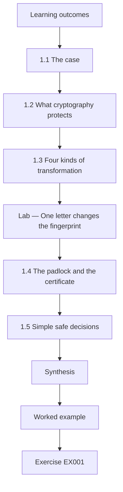

### Logical drawing

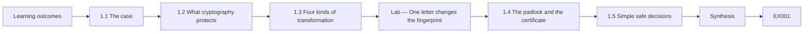

```text
[Learning outcomes]
    |
    v
[1.1 The case]
    |
    v
[1.2 What cryptography protects]
    |
    v
[1.3 Four kinds of transformation]
    |
    v
[Lab — One letter changes the fingerprint]
    |
    v
[1.4 The padlock and the certificate]
    |
    v
[1.5 Simple safe decisions]
    |
    v
[Synthesis]
    |
    v
[Worked example] --> [Exercise EX001]
```
<!-- open-cyber-academy:lesson-figures:end ch-01 -->


### Learning outcomes

You will (1) explain in plain words what cryptography protects; (2) tell encoding, hashing, encryption and signatures apart; (3) see what a padlock and a certificate do and do not promise; (4) make simple, safe decisions about cryptographic tools.

### 1.1 The case

Leo Fernandes has no security background. He signs up for a one-month introductory course and, as practice, helps the fictional Willow Lane Community Library, a small library with a public website, a members' e-book account system, two staff laptops, a public Wi-Fi network and an email newsletter. His guide is Inês Hartley, the volunteer who looks after the library's IT. Every person, place and number in this book is synthetic. Leo's goal is to understand the core risks well enough to explain them to the library team and to complete one guided task safely. He will use cryptography, never invent it.

### 1.2 What cryptography protects

Inês explains three promises. Confidentiality means only the right people can read something, such as a member's address. Integrity means changes are noticed, such as a website file altered by an intruder. Authenticity means you can tell who sent or published something, such as an email from the library. Cryptography delivers these promises with mathematics and keys, which are secret values. It does not stop someone guessing a weak password, clicking a fake link or leaving a laptop unlocked. Leo writes the three words on a card and asks of every tool which promise it keeps, because each tool keeps different promises.

### 1.3 Four kinds of transformation

Leo meets four things that look like scrambled text. Encoding, such as Base64, just changes how data is written; anyone can reverse it, so it hides nothing. Hashing, such as SHA-256, turns any data into a short fingerprint that cannot be turned back, and a tiny change gives a completely different fingerprint. Encryption, such as AES, hides data so only someone with the key can read it. A digital signature lets anyone check who signed something using a public key. The lab below shows the hash behaviour on synthetic text: one changed letter produces an unrelated fingerprint.

### Lab — One letter changes the fingerprint

```python
# SHA-256 fingerprints of synthetic text (FIPS 180-4 via hashlib).
import hashlib
a = "Willow Lane opening hours: 9-17"
b = "Willow Lane opening hours: 9-18"
ha, hb = hashlib.sha256(a.encode()).hexdigest(), hashlib.sha256(b.encode()).hexdigest()
print("A:", ha[:32] + "...")
print("B:", hb[:32] + "...")
print("match:", ha == hb)
```

Run with `python3 lab_fingerprint.py`. Verified output:

```text
A: 7a5d91566f93af7abf7fc2c33d868004...
B: c029501271e71ec3fc765840b69dfabd...
match: False
```

### 1.4 The padlock and the certificate

When Leo opens the library website, the browser shows a padlock. Inês explains that it means the connection uses TLS, the protocol in RFC 8446, so people on the same Wi-Fi cannot read or change what passes between Leo and the site. The site proves its name with a certificate, defined in RFC 5280, issued by an authority the browser trusts. The padlock does not mean the site is honest, free of bugs or the one Leo meant to visit; a fake site with a similar name can have its own padlock. So Leo checks the address carefully, not just the padlock.

### 1.5 Simple safe decisions

Inês gives Leo four rules for decisions he can make himself. Use well-known tools and settings rather than home-made tricks. Never click through a browser certificate warning on a site that should be trusted; report it instead. Keep secrets such as passwords and keys out of emails, chats and shared documents. When unsure, ask before changing anything. Leo notices the rules are about behaviour, not mathematics. Most real problems at small organisations come from settings and habits, and a beginner who follows these rules already avoids the commonest mistakes made by people who know far more theory.

### Worked example

Leo maps the library's website, e-book accounts and newsletter to the three promises, runs the fingerprint lab and explains to a staff member why the padlock alone is not enough.

> **Synthetic case.** Willow Lane Community Library, Leo and Inês are invented; RFC 8446 and RFC 5280 are real.

### Errors and limits

These are first approximations; real systems combine several mechanisms. A padlock on a fake site still looks like a padlock.

### Exercises

- **EX001 — Leo's goal.** What is Leo trying to achieve in this course? *Rubric:* 3 = understand core risks, explain them and complete one guided task safely;; 2 = part;; 1 = design cryptography;; 0 = none.
- **EX002 — Integrity in a library.** Give a library example of integrity. *Rubric:* 3 = noticing that a website file was altered by an intruder;; 2 = example;; 1 = confidentiality example;; 0 = none.
- **EX003 — Things cryptography cannot stop.** Name two things cryptography cannot prevent. *Rubric:* 3 = weak password guessing, clicking fake links, unlocked laptops (two);; 2 = one;; 1 = says it prevents all;; 0 = none.
- **EX004 — Base64 secrecy.** Does Base64 hide a password? Explain. *Rubric:* 3 = no; it is encoding anyone can reverse without a key;; 2 = no;; 1 = yes;; 0 = none.
- **EX005 — One-letter change.** In the lab, what happened when one letter changed? *Rubric:* 3 = the SHA-256 fingerprint changed completely, match False;; 2 = changed;; 1 = same;; 0 = none.
- **EX006 — Reversing a hash.** Can a SHA-256 fingerprint be turned back into the original text? *Rubric:* 3 = no, hashing is one-way;; 2 = no;; 1 = yes;; 0 = none.
- **EX007 — Who reads encrypted data.** Who can read data encrypted with AES? *Rubric:* 3 = only someone holding the right key;; 2 = key holder;; 1 = anyone;; 0 = none.
- **EX008 — Signature check.** What does a digital signature let anyone check? *Rubric:* 3 = who signed it and that it was not changed, using a public key;; 2 = who signed;; 1 = hides content;; 0 = none.
- **EX009 — Padlock promise.** What does the browser padlock actually promise? *Rubric:* 3 = the connection is protected by TLS to the site named in the certificate;; 2 = TLS connection;; 1 = site is honest;; 0 = none.
- **EX010 — Fake site padlock.** Why can a fake library site still show a padlock? *Rubric:* 3 = it can get its own certificate for a look-alike name;; 2 = own certificate;; 1 = impossible;; 0 = none.
- **EX011 — Certificate warning.** What should Leo do if the library site shows a certificate warning? *Rubric:* 3 = not click through; report it;; 2 = report;; 1 = click through;; 0 = none.
- **EX012 — Secrets in chat.** Where should passwords and keys never be shared? *Rubric:* 3 = email, chat or shared documents;; 2 = one place;; 1 = anywhere fine;; 0 = none.
- **EX013 — Rules focus.** What do Inês's four rules mostly concern? *Rubric:* 3 = behaviour and settings rather than mathematics;; 2 = behaviour;; 1 = maths;; 0 = none.

### Synthesis

Cryptography keeps promises of confidentiality, integrity and authenticity through keys, and beginners stay safe by matching tools to promises and following simple rules.

### Continue studying — lesson 01 (chapter 01 of 20)

[← Course home](../../README.md) · [Course chapter index](../SUBJECTS.md) · [Chapter 02 →](#ch-02)

Continue to the next authored lesson.

<a id="ch-02"></a>

## Chapter 2 — Scope, permission and safe practice

<!-- open-cyber-academy:lesson-figures:start ch-02 -->
### Lesson map

Lesson 02 published. Map, example, EX014.

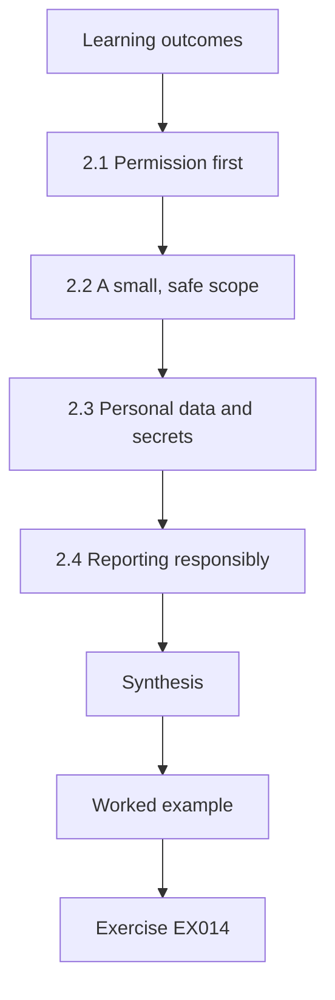

### Logical drawing

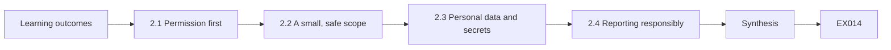

```text
[Learning outcomes]
    |
    v
[2.1 Permission first]
    |
    v
[2.2 A small, safe scope]
    |
    v
[2.3 Personal data and secrets]
    |
    v
[2.4 Reporting responsibly]
    |
    v
[Synthesis]
    |
    v
[Worked example] --> [Exercise EX014]
```
<!-- open-cyber-academy:lesson-figures:end ch-02 -->


### Learning outcomes

You will (1) explain why permission comes before any check; (2) define a small, safe scope; (3) handle personal data and secrets with care; (4) report problems responsibly.

### 2.1 Permission first

Leo is curious and wants to scan the library's network to see what is there. Inês stops him: checking systems without permission can be illegal, can break fragile devices like the old self-service kiosk and can upset partners whose systems sit on the same network. Even with good intentions, testing needs written permission from the person responsible. For Leo, that is the library manager, who signs a short note. Leo learns that asking first is not a formality; it protects the library, its members and Leo himself, and it builds the trust that lets him help again later.

### 2.2 A small, safe scope

The signed note lists exactly what Leo may do: read the library website's certificate details in his browser, check that staff laptops have disk encryption turned on, and review whether the e-book account page uses a strong password policy. It lists what he may not do: scan the network, try passwords, touch the book supplier's systems or the council's Wi-Fi equipment. It also names the week and Inês as his contact. A small scope keeps a beginner's first task safe and finishable. Leo writes the scope at the top of his notes and checks each step against it before starting.

### 2.3 Personal data and secrets

Libraries hold personal data: names, addresses, borrowing history. While checking a laptop, Leo might see member records on screen. Inês teaches him to look only at what the task needs, close anything else and never copy personal data into his notes. If he finds a password written on a sticky note or saved in a text file, he records where it was and what kind of secret it is, but not the password itself, and tells Inês the same day so it can be changed. Writing a secret down in a report would only spread the problem further.

### 2.4 Reporting responsibly

When Leo finds something wrong, he reports it to Inês and the manager, not to friends or social media. His report says what he saw, where, when and why it matters, in plain words, with a suggested next step. If he ever spotted a weakness in a product many libraries use, such as the e-book platform, the right path would be to tell the supplier privately through the library so they can fix it before details become public. This is called coordinated disclosure. Responsible reporting turns a discovery into a fix instead of a new risk.

### Worked example

Leo gets a signed scope note, checks two laptops for disk encryption within it, finds a password sticky note, records only its location and reports it to Inês.

> **Synthetic case.** The scope note, laptops and sticky note are synthetic.

### Errors and limits

Permission does not make careless work safe. Rules on personal data vary by country; follow the library's policy.

### Exercises

- **EX014 — Scan refusal.** Why did Inês stop Leo scanning the network? *Rubric:* 3 = no permission; could be illegal, break devices or affect partners;; 2 = one reason;; 1 = fine to scan;; 0 = none.
- **EX015 — Who grants permission.** Who signs Leo's permission note? *Rubric:* 3 = the library manager;; 2 = manager;; 1 = Leo;; 0 = none.
- **EX016 — Allowed checks.** List two checks Leo may do. *Rubric:* 3 = two of read website certificate, check laptop disk encryption, review password policy;; 2 = one;; 1 = scan network;; 0 = none.
- **EX017 — Forbidden actions.** Name two actions outside Leo's scope. *Rubric:* 3 = two of scanning, trying passwords, supplier systems, council Wi-Fi equipment;; 2 = one;; 1 = vague;; 0 = none.
- **EX018 — Small scope benefit.** What does a small scope give a beginner? *Rubric:* 3 = a safe, finishable first task;; 2 = safe;; 1 = vague;; 0 = none.
- **EX019 — Member record seen.** What should Leo do if a member's record appears on screen? *Rubric:* 3 = look only at what the task needs, close it and not copy it;; 2 = close it;; 1 = copy it;; 0 = none.
- **EX020 — Sticky note.** How should Leo record a password found on a sticky note? *Rubric:* 3 = location and type only, then tell Inês to change it;; 2 = location;; 1 = writes password;; 0 = none.
- **EX021 — Report contents.** What should Leo's report include? *Rubric:* 3 = what, where, when, why it matters and a next step;; 2 = three;; 1 = vague;; 0 = none.
- **EX022 — Wrong audience.** Who should not hear about a weakness first? *Rubric:* 3 = friends or social media;; 2 = names;; 1 = the manager;; 0 = none.
- **EX023 — Platform weakness.** How should a weakness in the e-book platform be handled? *Rubric:* 3 = coordinated disclosure to the supplier through the library;; 2 = supplier;; 1 = post online;; 0 = none.
- **EX024 — Coordinated disclosure name.** What is the private-first reporting path called? *Rubric:* 3 = coordinated disclosure;; 2 = named;; 1 = vague;; 0 = none.
- **EX025 — Kiosk risk.** Which fragile device could an unapproved scan disrupt? *Rubric:* 3 = the old self-service kiosk;; 2 = kiosk;; 1 = vague;; 0 = none.
- **EX026 — Protection of asking.** Whom does asking permission protect? *Rubric:* 3 = the library, its members and Leo;; 2 = two;; 1 = nobody;; 0 = none.

### Synthesis

Safe practice means getting permission, keeping a small scope, handling personal data and secrets carefully and reporting through the right people.

### Continue studying — lesson 02 (chapter 02 of 20)

[← Chapter 01](#ch-01) · [Course chapter index](../SUBJECTS.md) · [Chapter 03 →](#ch-03)

Continue to the next authored lesson.

<a id="ch-03"></a>

## Chapter 3 — Cryptography and trust services: systems, data and dependencies

<!-- open-cyber-academy:lesson-figures:start ch-03 -->
### Lesson map

Lesson 03 published. Map, example, EX027.

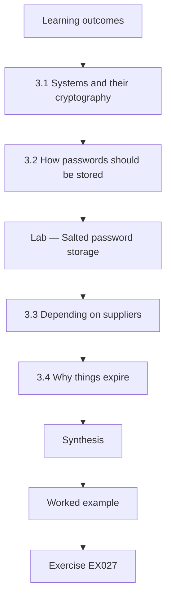

### Logical drawing

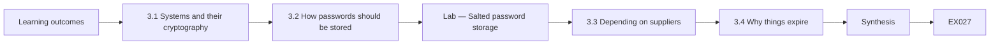

```text
[Learning outcomes]
    |
    v
[3.1 Systems and their cryptography]
    |
    v
[3.2 How passwords should be stored]
    |
    v
[Lab — Salted password storage]
    |
    v
[3.3 Depending on suppliers]
    |
    v
[3.4 Why things expire]
    |
    v
[Synthesis]
    |
    v
[Worked example] --> [Exercise EX027]
```
<!-- open-cyber-academy:lesson-figures:end ch-03 -->


### Learning outcomes

You will (1) list the library's systems and where cryptography is used; (2) explain how passwords should be stored; (3) recognise dependencies on outside suppliers; (4) understand why keys and certificates expire.

### 3.1 Systems and their cryptography

With Inês, Leo lists the library's systems. The website uses TLS so visitors' connections are private. The e-book account system stores members' passwords and is run by an outside supplier. Staff laptops use built-in disk encryption, so a stolen laptop does not expose files. Public Wi-Fi uses a shared password, which keeps out casual neighbours but does not protect users from each other. The newsletter platform signs outgoing email so receivers can tell it really comes from the library. Leo is surprised how many places use cryptography quietly, without anyone at the library thinking about it.

### 3.2 How passwords should be stored

Leo asks how a website remembers his password. Inês explains that a good system never stores the password itself. It stores the result of a slow, salted password-hashing function such as scrypt, described in RFC 7914, or Argon2id, described in RFC 9106. The salt is a random value per user, so two members with the same password get different stored results. When you log in, the system repeats the calculation and compares. If thieves steal the database, slow hashing makes guessing expensive. The lab below shows salted storage on synthetic accounts using Python's standard library.

### Lab — Salted password storage

```python
# Salted scrypt storage for synthetic members. Teaching only; real systems use maintained libraries.
import hashlib, hmac, secrets
P = dict(n=2**14, r=8, p=1, dklen=32)
def store(pw):
    s = secrets.token_bytes(16); return s, hashlib.scrypt(pw, salt=s, **P)
def check(pw, rec): return hmac.compare_digest(hashlib.scrypt(pw, salt=rec[0], **P), rec[1])
m1, m2 = store(b"ReadMore2026"), store(b"ReadMore2026")
print("same password, same stored value?", m1[1] == m2[1])
print("member 1 right password:", check(b"ReadMore2026", m1))
print("member 2 right password:", check(b"ReadMore2026", m2))
print("member 1 wrong password:", check(b"ReadLess2026", m1))
```

Run with `python3 lab_salted.py`. Verified output:

```text
same password, same stored value? False
member 1 right password: True
member 2 right password: True
member 1 wrong password: False
```

### 3.3 Depending on suppliers

Many of the library's protections are run by others. The e-book supplier stores members' password hashes; the newsletter platform holds the email signing key; the web host renews the website certificate. The library cannot change these settings directly, but it depends on them. Inês shows Leo how to check what the supplier promises, for example in its security page or contract, and who to contact if something goes wrong. Knowing the dependency list means that when a supplier announces a problem, the library knows at once whether members are affected and what to tell them.

### 3.4 Why things expire

Certificates and some keys have end dates. A certificate that expires makes browsers show warnings, which happened to the library website last year when the web host's automatic renewal failed silently. Expiry exists so that a key cannot be used forever if it was quietly stolen, and so that settings get refreshed. Inês now keeps a simple calendar of expiry dates with reminders a month ahead, even for items suppliers renew automatically. Leo learns that cryptography is not set-and-forget: someone must watch dates, renewals and suppliers, or the protection itself can cause an outage.

### Worked example

Leo builds a five-row table of library systems, their cryptographic use and who controls them, runs the salted storage lab and adds the website certificate to the expiry calendar.

> **Synthetic case.** Systems, suppliers and the past outage are synthetic; RFC 7914 and RFC 9106 are real.

### Errors and limits

A shared Wi-Fi password gives limited protection between users. Supplier promises still need checking over time.

### Exercises

- **EX027 — Laptop encryption purpose.** What does laptop disk encryption protect against? *Rubric:* 3 = a stolen laptop exposing its files;; 2 = theft;; 1 = network attacks;; 0 = none.
- **EX028 — Shared Wi-Fi limit.** What does the shared Wi-Fi password not do? *Rubric:* 3 = protect users on the network from each other;; 2 = limit;; 1 = protects everything;; 0 = none.
- **EX029 — Newsletter signing.** Why does the newsletter platform sign emails? *Rubric:* 3 = so receivers can tell mail really comes from the library;; 2 = authenticity;; 1 = secrecy;; 0 = none.
- **EX030 — Never stored.** What should a good login system never store? *Rubric:* 3 = the password itself;; 2 = password;; 1 = the hash;; 0 = none.
- **EX031 — Salt meaning.** What is a salt in password storage? *Rubric:* 3 = a random value per user so equal passwords give different results;; 2 = random value;; 1 = secret key;; 0 = none.
- **EX032 — Lab result.** In the salted lab, did two members with the same password get the same stored value? *Rubric:* 3 = no, they differed; both verified with the right password;; 2 = no;; 1 = yes;; 0 = none.
- **EX033 — Slow hashing value.** Why is slow hashing useful if a database is stolen? *Rubric:* 3 = it makes each guess expensive for thieves;; 2 = expensive;; 1 = faster;; 0 = none.
- **EX034 — Supplier key.** Who holds the email signing key? *Rubric:* 3 = the newsletter platform;; 2 = platform;; 1 = library;; 0 = none.
- **EX035 — Checking a supplier.** Where can the library check a supplier's promises? *Rubric:* 3 = its security page or contract;; 2 = one place;; 1 = nowhere;; 0 = none.
- **EX036 — Past outage cause.** Why did the library website show warnings last year? *Rubric:* 3 = the host's automatic renewal failed silently and the certificate expired;; 2 = expired;; 1 = hacked;; 0 = none.
- **EX037 — Purpose of expiry.** Give one reason certificates expire. *Rubric:* 3 = limits use of a stolen key or forces refresh of settings;; 2 = one;; 1 = vague;; 0 = none.
- **EX038 — Calendar reminders.** How far ahead does Inês set expiry reminders? *Rubric:* 3 = a month;; 2 = month, hedged with another option;; 1 = vague;; 0 = none.

### Synthesis

Small organisations depend on cryptography in many systems and suppliers, so they must know where it is used and watch passwords, keys and expiry dates.

### Continue studying — lesson 03 (chapter 03 of 20)

[← Chapter 02](#ch-02) · [Course chapter index](../SUBJECTS.md) · [Chapter 04 →](#ch-04)

Continue to the next authored lesson.

<a id="ch-04"></a>

## Chapter 4 — Cryptography and trust services: guided lab and applied synthesis

<!-- open-cyber-academy:lesson-figures:start ch-04 -->
### Lesson map

Lesson 04 published. Map, example, EX039.

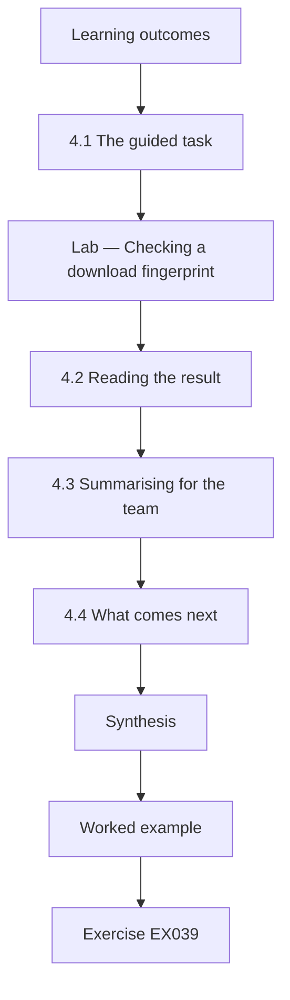

### Logical drawing

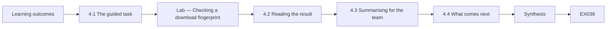

```text
[Learning outcomes]
    |
    v
[4.1 The guided task]
    |
    v
[Lab — Checking a download fingerprint]
    |
    v
[4.2 Reading the result]
    |
    v
[4.3 Summarising for the team]
    |
    v
[4.4 What comes next]
    |
    v
[Synthesis]
    |
    v
[Worked example] --> [Exercise EX039]
```
<!-- open-cyber-academy:lesson-figures:end ch-04 -->


### Learning outcomes

You will (1) complete a guided task verifying a downloaded file with a published fingerprint; (2) interpret the result correctly; (3) write a short plain-language summary for the library team; (4) plan your next learning steps.

### 4.1 The guided task

The library wants to install a free catalogue tool on a staff laptop. The project's website publishes a SHA-256 fingerprint for each download. Inês asks Leo to check that the file he downloaded matches. The idea is simple: if even one byte of the file was damaged or swapped, the fingerprint will differ. Leo does the task in a safe way, using a synthetic file in the lab below, then repeats the steps with the real download under Inês's supervision. The lab compares a correct file and a tampered file against the published value and prints match or mismatch for each.

### Lab — Checking a download fingerprint

```python
# Compare synthetic downloads with a published SHA-256 fingerprint.
import hashlib
original = b"catalogue-tool v2.1 synthetic installer bytes " * 50
published = hashlib.sha256(original).hexdigest()
tampered = original[:-1] + b"!"
print("published:", published[:24] + "...")
for name, data in [("download_ok.bin", original), ("download_bad.bin", tampered)]:
    print(name, "MATCH" if hashlib.sha256(data).hexdigest() == published else "MISMATCH")
```

Run with `python3 lab_checkfile.py`. Verified output:

```text
published: 215e60edb672063786f8bb92...
download_ok.bin MATCH
download_bad.bin MISMATCH
```

### 4.2 Reading the result

A match tells Leo the file is identical to the one whose fingerprint was published. It does not tell him the software is safe or free of bugs, and if an attacker had changed both the file and the fingerprint on the same website, the check would still match. That is why some projects also sign their releases with a digital signature, which needs the project's private key to forge. Leo writes down both points. A mismatch means stop: do not install, download again from the official site and tell Inês if it still fails.

### 4.3 Summarising for the team

Leo writes a five-sentence summary for library staff. The catalogue tool download was checked against the fingerprint published by the project and matched. This shows the file was not damaged or swapped on the way. It does not prove the software is safe, so it is installed only on one laptop first. If a check ever fails, the file must not be installed. Leo also lists the three findings from earlier chapters: the password sticky note, the expiry calendar and the warning about clicking through certificate errors, each with who will act.

### 4.4 What comes next

The course ends with a short reflection. Leo can now explain the three promises, tell encoding from encryption, ask for permission and scope, store nothing secret in notes and check a download fingerprint. He knows what he does not know: how TLS negotiates keys, how certificates are issued, and how organisations manage keys over years. Inês recommends next steps: the Professional course, and reading accessible chapters of the Handbook of Applied Cryptography by Menezes, van Oorschot and Vanstone, whose chapters are free online. Leo leaves with a clear picture of the core risks and one safe task completed.

### Worked example

Leo runs the fingerprint lab, verifies the real download under supervision, writes a five-sentence staff summary and lists three earlier findings with owners.

> **Synthetic case.** The catalogue tool, files and fingerprints are synthetic; the Handbook of Applied Cryptography is real.

### Errors and limits

A fingerprint from the same website as the file proves only that the two match. Signatures need the signer's key to be trusted correctly.

### Exercises

- **EX039 — Published fingerprint.** What does the catalogue project publish for each download? *Rubric:* 3 = a SHA-256 fingerprint;; 2 = fingerprint;; 1 = password;; 0 = none.
- **EX040 — Lab outcomes.** What did the lab print for the correct and tampered files? *Rubric:* 3 = MATCH for the correct file, MISMATCH for the tampered one;; 2 = one;; 1 = both match;; 0 = none.
- **EX041 — Meaning of a match.** What does a matching fingerprint prove? *Rubric:* 3 = the file is identical to the published one;; 2 = identical;; 1 = software is safe;; 0 = none.
- **EX042 — Match is not safety.** What does a match not prove? *Rubric:* 3 = that the software is safe or bug-free;; 2 = safety;; 1 = proves all;; 0 = none.
- **EX043 — Same-site weakness.** When could a fingerprint check be fooled? *Rubric:* 3 = if an attacker changed both file and fingerprint on the same site;; 2 = both changed;; 1 = never;; 0 = none.
- **EX044 — Signed releases.** Why do some projects also sign releases? *Rubric:* 3 = forging a signature needs the project's private key;; 2 = private key;; 1 = no reason;; 0 = none.
- **EX045 — Mismatch action.** What should Leo do after a mismatch? *Rubric:* 3 = stop, do not install, download again from the official site, tell Inês if it fails again;; 2 = stop;; 1 = install anyway;; 0 = none.
- **EX046 — Staged install.** Why is the tool installed on one laptop first? *Rubric:* 3 = a match does not prove the software is safe;; 2 = caution;; 1 = vague;; 0 = none.
- **EX047 — Earlier findings.** List the three earlier findings in Leo's summary. *Rubric:* 3 = sticky note password, expiry calendar, certificate warning advice;; 2 = two;; 1 = vague;; 0 = none.
- **EX048 — Admitted unknowns.** Name two topics Leo knows he has not learnt yet. *Rubric:* 3 = two of TLS key negotiation, certificate issuance, long-term key management;; 2 = one;; 1 = vague;; 0 = none.
- **EX049 — Free reading.** Which reference does Inês recommend with free chapters online? *Rubric:* 3 = Handbook of Applied Cryptography by Menezes, van Oorschot and Vanstone;; 2 = title;; 1 = vague;; 0 = none.
- **EX050 — Next course.** What course does Inês suggest next? *Rubric:* 3 = the Professional course;; 2 = named;; 1 = vague;; 0 = none.

### Synthesis

Checking a published fingerprint is a small, real cryptographic task, and understanding what it does and does not prove is the course's final lesson.

### Continue studying — lesson 04 (chapter 04 of 20)

[← Chapter 03](#ch-03) · [Course chapter index](../SUBJECTS.md) · [Chapter 05 →](#ch-05)

Continue to the next authored lesson.

<a id="ch-05"></a>

## Chapter 5 — The supervised match is not the lab's only line

<!-- open-cyber-academy:lesson-figures:start ch-05 -->
### Lesson map

Lesson 05. Map, example, EX051.

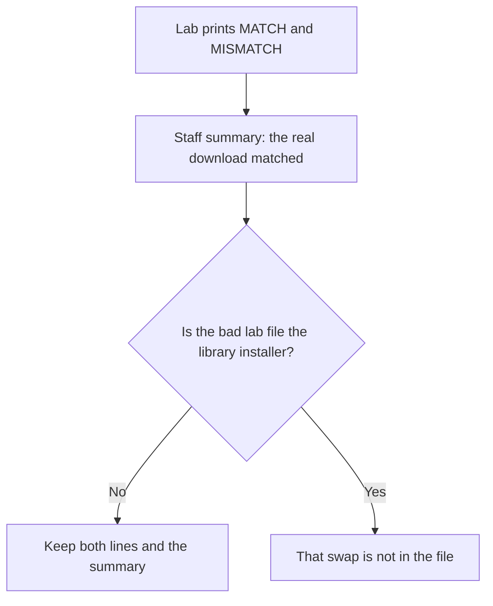

The laboratory pair and the supervised check answer different questions.

### Logical drawing

```text
lab_checkfile.py
    download_ok.bin MATCH
    download_bad.bin MISMATCH
    published prefix stays on that run
staff summary
    the supervised catalogue download matched
    it does not name download_bad.bin
```
<!-- open-cyber-academy:lesson-figures:end ch-05 -->

### Learning outcomes

After this chapter, you should be able to:

1. Keep both laboratory lines from the fingerprint check.
2. Keep the staff summary's supervised match.
3. Refuse to treat one of those records as the other.

### 5.1 Two checks sit side by side.

The embedded laboratory compares synthetic bytes. It prints `download_ok.bin MATCH` and `download_bad.bin MISMATCH`, under the prefix `published: 215e60edb672063786f8bb92...`. Chapter 4 then says Leo repeated the steps on the library's real catalogue download with Inês watching, and the five-sentence summary says that download matched. One classmate deletes the MISMATCH line and treats the laboratory as a single success. Another classmate reads MISMATCH as the fate of the installer the library actually fetched. Neither reading is the file. The synthetic bad file ends with a changed last byte inside the script. The staff page never calls the supervised download `download_bad.bin`. Leo leaves the printed pair where it is and leaves the summary's match where it is.

### 5.2 Worked example

| What someone cites | What the file holds | Decision |
|---|---|---|
| `download_ok.bin MATCH` | The synthetic good file | Keep the line |
| `download_bad.bin MISMATCH` | The synthetic tampered file | Keep the line |
| The staff summary | The supervised download matched | Keep that sentence |
| "So the library file was the bad one." | No such identification | Refuse |

> **Synthetic case.** The laboratory filenames and the library's installer stay different objects.

### Errors and limits

Keeping the MISMATCH line does not spoil the supervised match, and the match does not erase the laboratory pair.

### Apply

- **EX051 — Which file failed?** The laboratory prints `download_ok.bin MATCH` and `download_bad.bin MISMATCH`. The staff summary says the supervised catalogue download matched. Was the library's installer the tampered laboratory file? *Rubric:* 3 = no; both laboratory lines stay; the summary's match stays; the bad file is the synthetic tampered input; do not edit `lab_checkfile.py`;; 2 = the summary and the laboratory are different checks;; 1 = one line;; 0 = none.

<!-- open-cyber-academy:chapter-navigation:start ch-05 -->
### Continue studying — lesson 05 (chapter 05 of 20)

[← Chapter 04](#ch-04) · [Course chapter index](../SUBJECTS.md) · [Chapter 06 →](#ch-06)

Continue to the next authored lesson.
<!-- open-cyber-academy:chapter-navigation:end -->

<a id="ch-06"></a>

## Chapter 6 — Twenty-four digits are not the whole fingerprint

<!-- open-cyber-academy:lesson-figures:start ch-06 -->
### Lesson map

Lesson 06. Map, example, EX052.

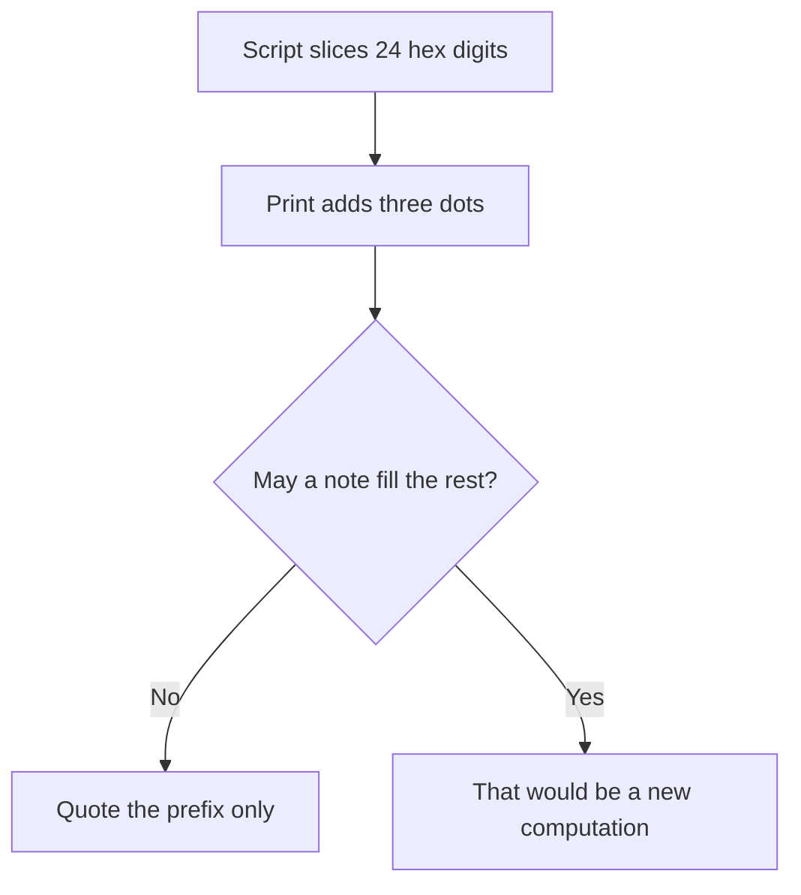

The dots mark digits the embedded output never shows.

### Logical drawing

```text
published = full SHA-256 of the synthetic bytes
print uses published[:24] plus "..."
embedded line
    published: 215e60edb672063786f8bb92...
a note that writes further hex
    is not this output
```
<!-- open-cyber-academy:lesson-figures:end ch-06 -->

### Learning outcomes

After this chapter, you should be able to:

1. Read the printed prefix as a slice.
2. Leave the unseen digits unwritten.
3. Refuse a note that completes the fingerprint.

### 6.1 The slice is the evidence.

`lab_checkfile.py` computes a SHA-256 value and then prints only `published[:24]` followed by three dots. The embedded line is exactly `published: 215e60edb672063786f8bb92...`. FIPS 180-4 defines a longer digest than those twenty-four digits. Nothing in the worked results, the staff summary, or the script's print statement reveals the rest. A classmate who "finishes" the hex is running a calculation the chapter did not publish. Leo may copy the prefix and the dots. He may not replace the dots with digits this book does not contain.

### 6.2 Worked example

| What someone cites | What the file holds | Decision |
|---|---|---|
| `published[:24]` | The script's slice | Keep the slice |
| `215e60edb672063786f8bb92...` | The embedded line | Quote it with the dots |
| A completed 64-digit string | Not printed | Refuse |
| "The dots are optional decoration." | The print adds them | Refuse |

> **Synthetic case.** No one recomputes the hidden digits in this lesson.

### Errors and limits

Quoting the prefix does not claim the digest was shorter than SHA-256. It claims only that the page shows twenty-four digits and dots.

### Apply

- **EX052 — Finish the hex?** A note replaces the three dots after `215e60edb672063786f8bb92` with the rest of a SHA-256 digest. Is that the embedded output? *Rubric:* 3 = no; the script prints `published[:24]` and dots; the embedded line stays `published: 215e60edb672063786f8bb92...`; do not invent the remaining digits; do not edit `lab_checkfile.py`;; 2 = the dots stay;; 1 = the prefix only;; 0 = none.

<!-- open-cyber-academy:chapter-navigation:start ch-06 -->
### Continue studying — lesson 06 (chapter 06 of 20)

[← Chapter 05](#ch-05) · [Course chapter index](../SUBJECTS.md) · [Chapter 07 →](#ch-07)

Continue to the next authored lesson.
<!-- open-cyber-academy:chapter-navigation:end -->

<a id="ch-07"></a>

## Chapter 7 — The hours strings still print match False

<!-- open-cyber-academy:lesson-figures:start ch-07 -->
### Lesson map

Lesson 07. Map, example, EX053.

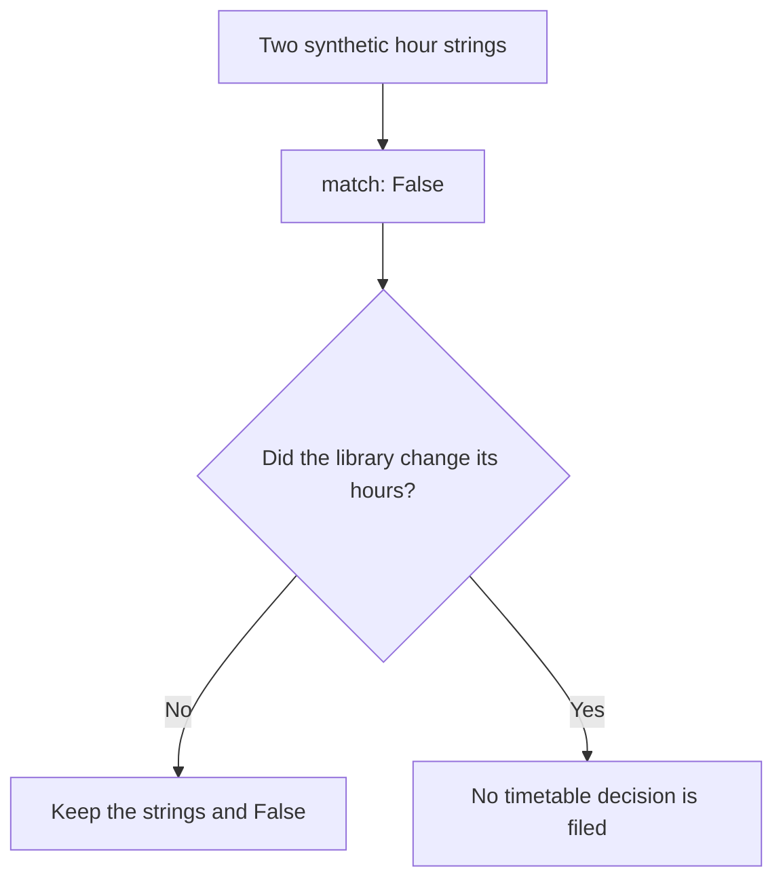

The inputs are laboratory text. They are not a new opening-hours policy.

### Logical drawing

```text
string A ends 9-17
string B ends 9-18
prints
    A: 7a5d91566f93af7abf7fc2c33d868004...
    B: c029501271e71ec3fc765840b69dfabd...
    match: False
library timetable
    not stated by those strings
```
<!-- open-cyber-academy:lesson-figures:end ch-07 -->

### Learning outcomes

After this chapter, you should be able to:

1. Keep the two hour strings and `match: False`.
2. Keep each printed prefix with its dots.
3. Refuse to treat the strings as the library's timetable.

### 7.1 One character apart, and still not a policy.

The fingerprint script sets string A to `Willow Lane opening hours: 9-17` and string B to `Willow Lane opening hours: 9-18`. The embedded output shows `A: 7a5d91566f93af7abf7fc2c33d868004...`, `B: c029501271e71ec3fc765840b69dfabd...`, and `match: False`. Each print is a 32-digit prefix plus dots, just as `ha[:32]` and `hb[:32]` are written. A classmate who needs a tidy story says the library now closes at 18:00, or edits the script until the match line says True. The book never states the library's real hours. The two strings exist so a single character change can be seen. Leo leaves False on the page and does not promote either string into a timetable decision.

### 7.2 Worked example

| What someone cites | What the file holds | Decision |
|---|---|---|
| String A ending `9-17` | Laboratory input | Keep the input |
| String B ending `9-18` | Laboratory input | Keep the input |
| `match: False` | Embedded output | Keep False |
| "The library adopted 9-18." | No hours decision | Refuse |

> **Synthetic case.** The hour strings are inputs to a hash. They do not set the door time.

### Errors and limits

Leaving False in place does not hide that the prefixes differ. It refuses a True the script did not print.

### Apply

- **EX053 — New hours?** The laboratory strings end `9-17` and `9-18`, and the output says `match: False` with the two published prefixes. May Leo report that Willow Lane changed its opening hours? *Rubric:* 3 = no; both strings stay; both prefixes stay with their dots; `match: False` stays; the strings are not a timetable; do not edit `lab_fingerprint.py`;; 2 = False stays and the hours are not a policy;; 1 = one prefix;; 0 = none.

<!-- open-cyber-academy:chapter-navigation:start ch-07 -->
### Continue studying — lesson 07 (chapter 07 of 20)

[← Chapter 06](#ch-06) · [Course chapter index](../SUBJECTS.md) · [Chapter 08 →](#ch-08)

Continue to the next authored lesson.
<!-- open-cyber-academy:chapter-navigation:end -->

<a id="ch-08"></a>

## Chapter 8 — Equal passwords still store different values

<!-- open-cyber-academy:lesson-figures:start ch-08 -->
### Lesson map

Lesson 08. Map, example, EX054.

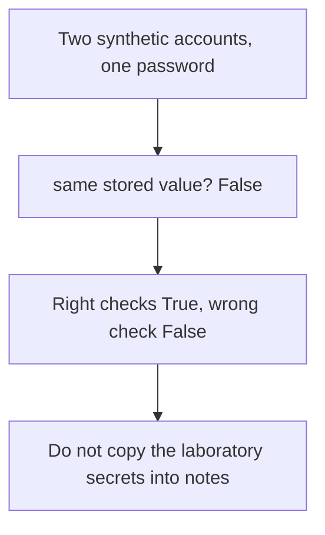

A shared password in the script is not a shared stored value, and it is not a library secret to write down.

### Logical drawing

```text
stored-value line stays False
right-password lines stay True and True
wrong-password line stays False
notes
    no copy of those laboratory passwords
```
<!-- open-cyber-academy:lesson-figures:end ch-08 -->

### Learning outcomes

After this chapter, you should be able to:

1. Keep all four salted-storage lines.
2. Explain False on the "same stored value" line.
3. Leave the laboratory passwords out of the library notes.

### 8.1 Four lines, none of them a member's secret.

`lab_salted.py` stores one synthetic password for two accounts and prints `same password, same stored value? False`. The next two lines say `member 1 right password: True` and `member 2 right password: True`. The last line says `member 1 wrong password: False`. A salt is a fresh random value per account, so equal passwords need not produce equal stored results, and the check repeats the calculation rather than looking up a saved password. A classmate who wants the first line to say True is erasing the salt. A classmate who pastes the script's passwords into the staff notes is breaking the sticky-note rule: record place and kind, not the secret itself. These four lines are a teaching run. They are not credentials Leo found at Willow Lane. He does not retune `n`, `r`, `p`, or the salt length.

### 8.2 Worked example

| What someone cites | What the file holds | Decision |
|---|---|---|
| `same stored value? False` | Different salts | Keep False |
| Both right-password lines | True and True | Keep both |
| The wrong-password line | False | Keep False |
| "Copy the script passwords into the notes." | Secrets stay out of notes | Refuse |

> **Synthetic case.** The accounts in this run are not library members.

### Errors and limits

Refusing to copy the passwords does not change the four printed Booleans.

### Apply

- **EX054 — Same value?** Two synthetic accounts use the same password. The first printed line asks whether the stored values match. What does the file say, and may those passwords be copied into the library notes? *Rubric:* 3 = the stored values differ, so the line stays False; both right-password lines stay True; the wrong-password line stays False; do not copy the laboratory passwords into the notes; do not edit `lab_salted.py`;; 2 = False stays and the notes stay clear;; 1 = one line;; 0 = none.

<!-- open-cyber-academy:chapter-navigation:start ch-08 -->
### Continue studying — lesson 08 (chapter 08 of 20)

[← Chapter 07](#ch-07) · [Course chapter index](../SUBJECTS.md) · [Chapter 09 →](#ch-09)

Continue to the next authored lesson.
<!-- open-cyber-academy:chapter-navigation:end -->

<a id="ch-09"></a>

## Chapter 9 — Laboratory scrypt is not the supplier's algorithm

<!-- open-cyber-academy:lesson-figures:start ch-09 -->
### Lesson map

Lesson 09. Map, example, EX055.

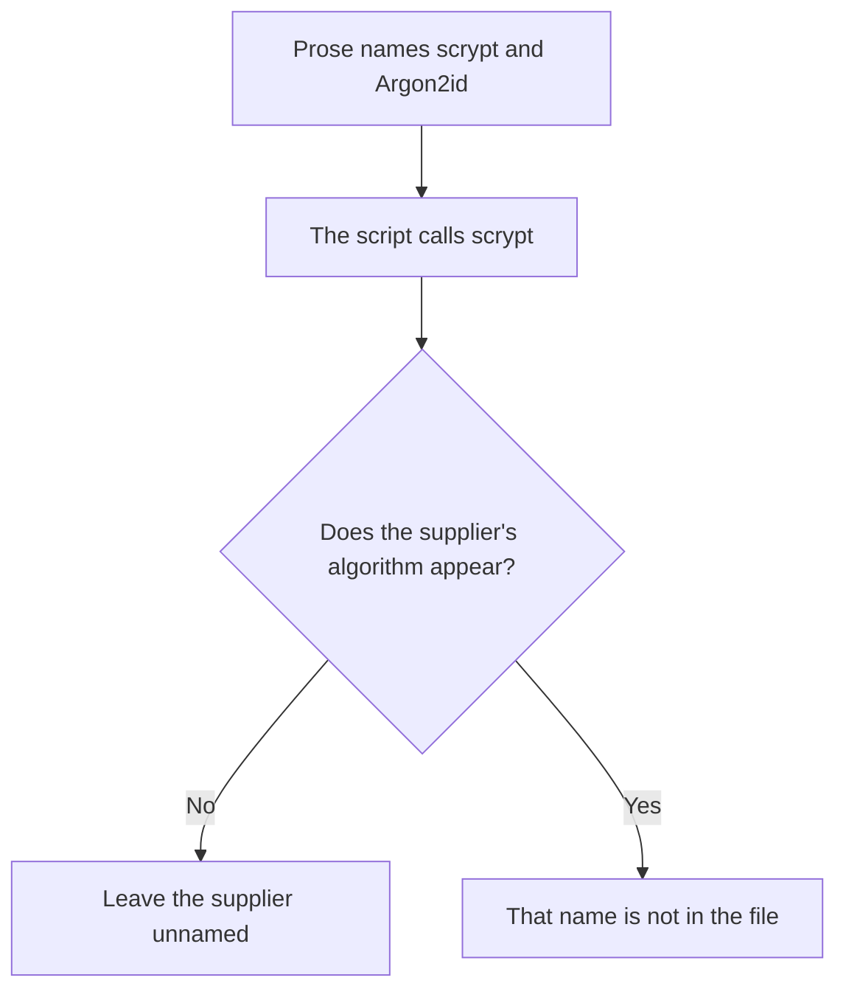

An example function and a supplier's function are different claims.

### Logical drawing

```text
chapter 3 examples
    scrypt, RFC 7914
    Argon2id, RFC 9106
laboratory
    hashlib.scrypt on synthetic accounts
e-book supplier
    stores password hashes
    algorithm not named
```
<!-- open-cyber-academy:lesson-figures:end ch-09 -->

### Learning outcomes

After this chapter, you should be able to:

1. Keep scrypt as the function the laboratory calls.
2. Keep Argon2id as a cited example, not a second run.
3. Leave the supplier's algorithm unnamed.

### 9.1 The citation, the script, and the supplier are three places.

Chapter 3 says a good login system stores a slow salted hash, "such as scrypt" in RFC 7914 or Argon2id in RFC 9106. The laboratory then calls `hashlib.scrypt` and prints the four lines already recorded. The e-book supplier stores members' password hashes. Inês points to a security page or a contract for a supplier's promise, and this manuscript never includes either document. A classmate who writes "the supplier uses scrypt" has moved the script's import into a company the file does not describe. A classmate who writes "the supplier uses Argon2id" has moved a citation the same way. Leo leaves both names where chapter 3 put them and does not add an algorithm key to the supplier row.

### 9.2 Worked example

| What someone cites | What the file holds | Decision |
|---|---|---|
| `hashlib.scrypt` | The laboratory call | Keep it on the script |
| RFC 9106 | A cited example | Keep the citation |
| The supplier stores hashes | No algorithm name | Leave it unnamed |
| "Therefore the supplier runs scrypt." | Not stated | Refuse |

> **Synthetic case.** No supplier security page is pasted into the notes.

### Errors and limits

Naming the laboratory function does not identify the supplier, and the missing name is not permission to guess one.

### Apply

- **EX055 — Whose function?** The laboratory calls `hashlib.scrypt`. The chapter also cites Argon2id. The e-book supplier stores password hashes. Which algorithm does the supplier use? *Rubric:* 3 = the file does not say; scrypt stays the laboratory call; Argon2id stays a citation; do not name the supplier's algorithm; do not edit `lab_salted.py`;; 2 = the supplier stays unnamed;; 1 = one label;; 0 = none.

<!-- open-cyber-academy:chapter-navigation:start ch-09 -->
### Continue studying — lesson 09 (chapter 09 of 20)

[← Chapter 08](#ch-08) · [Course chapter index](../SUBJECTS.md) · [Chapter 10 →](#ch-10)

Continue to the next authored lesson.
<!-- open-cyber-academy:chapter-navigation:end -->

<a id="ch-10"></a>

## Chapter 10 — The policy review has no recorded result

<!-- open-cyber-academy:lesson-figures:start ch-10 -->
### Lesson map

Lesson 10. Map, example, EX056.

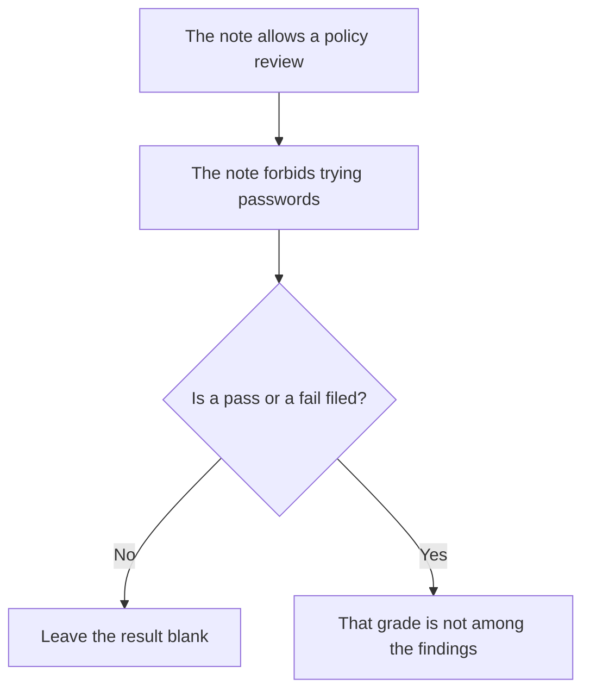

Permission to look is not a grade, and it is not permission to guess.

### Logical drawing

```text
allowed
    read the e-book password-policy page
forbidden
    try passwords
staff findings
    sticky note, expiry calendar, warning advice
    no policy pass and no policy fail
```
<!-- open-cyber-academy:lesson-figures:end ch-10 -->

### Learning outcomes

After this chapter, you should be able to:

1. Keep the policy review inside the signed note.
2. Keep password guessing outside it.
3. Leave the review without a pass or a fail.

### 10.1 An allowed look is not a score.

The signed note lets Leo review whether the e-book account page uses a strong password policy. The same note forbids trying passwords. When he writes the staff summary, the three earlier findings are the sticky note, the expiry calendar, and the advice not to click through certificate warnings. A policy grade is not one of them. No minimum length, no lifetime, and no screenshot of the page is in the file. A classmate who marks the policy "strong" is filling a blank. A classmate who tries a member password "to see" has left the note. Leo may say the review was permitted. He may not say how it came out.

### 10.2 Worked example

| What someone cites | What the file holds | Decision |
|---|---|---|
| Review the password policy | Inside the note | Keep the permission |
| Try passwords | Outside the note | Keep the ban |
| Three findings in the summary | No policy grade | Leave the grade unwritten |
| "The policy passed." | Not recorded | Refuse |

> **Synthetic case.** No minimum length is invented for the e-book page.

### Errors and limits

A blank grade is still a blank. It is not a quiet pass and not a quiet fail.

### Apply

- **EX056 — Did the policy pass?** Leo was allowed to review the e-book password policy and forbidden to try passwords. The staff summary lists three findings and no policy grade. What result do you record? *Rubric:* 3 = no pass and no fail is in the file; the review stays allowed; trying passwords stays forbidden; do not invent a length or a screenshot;; 2 = the grade stays blank;; 1 = one boundary;; 0 = none.

<!-- open-cyber-academy:chapter-navigation:start ch-10 -->
### Continue studying — lesson 10 (chapter 10 of 20)

[← Chapter 09](#ch-09) · [Course chapter index](../SUBJECTS.md) · [Chapter 11 →](#ch-11)

Continue to the next authored lesson.
<!-- open-cyber-academy:chapter-navigation:end -->

<a id="ch-11"></a>

## Chapter 11 — Two laptop checks have no on/off print

<!-- open-cyber-academy:lesson-figures:start ch-11 -->
### Lesson map

Lesson 11. Map, example, EX057.

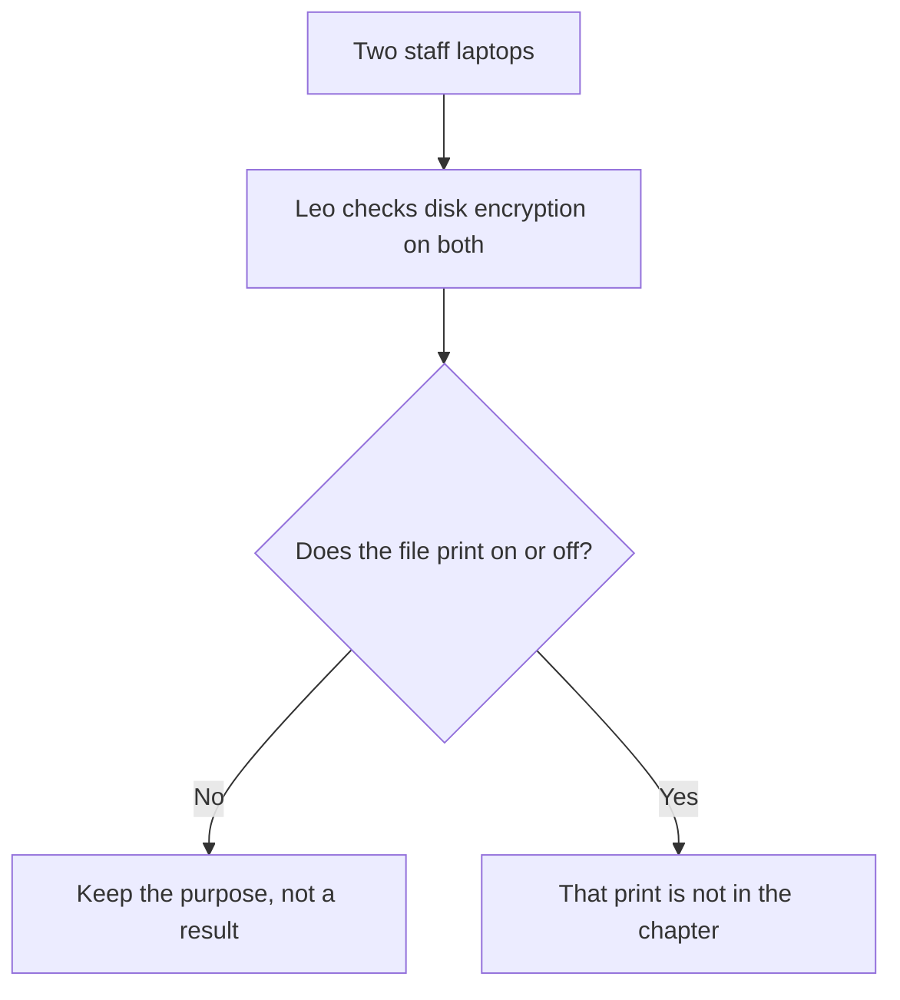

The reason for disk encryption is not a reading of the two machines.

### Logical drawing

```text
library
    two staff laptops
purpose
    a stolen laptop should not expose its files
worked example
    Leo checks two laptops
    no on/off line
    no serial number
```
<!-- open-cyber-academy:lesson-figures:end ch-11 -->

### Learning outcomes

After this chapter, you should be able to:

1. Keep the count at two staff laptops.
2. Keep the purpose of disk encryption.
3. Leave each machine without an on/off result.

### 11.1 A check can be real and still unpublished.

Chapter 1 gives the library two staff laptops. Chapter 3 says built-in disk encryption means a stolen laptop does not expose its files. The worked example says Leo checks two laptops for disk encryption, inside the signed note. It stops there. No line says both were on. No line says one was off. No serial number, asset tag, or staff name is attached to either machine. A classmate who writes "2 of 2 on" has composed a print this book never ran. The purpose sentence explains why the control matters. It does not report what Leo saw. He does not add a results row the chapter never showed.

### 11.2 Worked example

| What someone cites | What the file holds | Decision |
|---|---|---|
| Two staff laptops | The opening inventory | Keep two |
| Stolen-laptop purpose | Chapter 3 | Keep the purpose |
| "Checks two laptops" | The worked example | Keep the check |
| "Both were on." | No on/off line | Refuse |

> **Synthetic case.** Neither laptop gains a name or a serial number.

### Errors and limits

Saying the purpose aloud does not create an on/off line, and a missing line is not a failure.

### Apply

- **EX057 — Were they on?** Willow Lane has two staff laptops. Leo checks disk encryption on both. Disk encryption is meant to protect files on a stolen machine. What on/off result do you write? *Rubric:* 3 = none; the file has no on/off print and no serial number; the count stays two; the purpose stays the stolen-laptop purpose; do not invent a result;; 2 = the result stays unprinted;; 1 = the count only;; 0 = none.

<!-- open-cyber-academy:chapter-navigation:start ch-11 -->
### Continue studying — lesson 11 (chapter 11 of 20)

[← Chapter 10](#ch-10) · [Course chapter index](../SUBJECTS.md) · [Chapter 12 →](#ch-12)

Continue to the next authored lesson.
<!-- open-cyber-academy:chapter-navigation:end -->

<a id="ch-12"></a>

## Chapter 12 — The report is not a completed change

<!-- open-cyber-academy:lesson-figures:start ch-12 -->
### Lesson map

Lesson 12. Map, example, EX058.

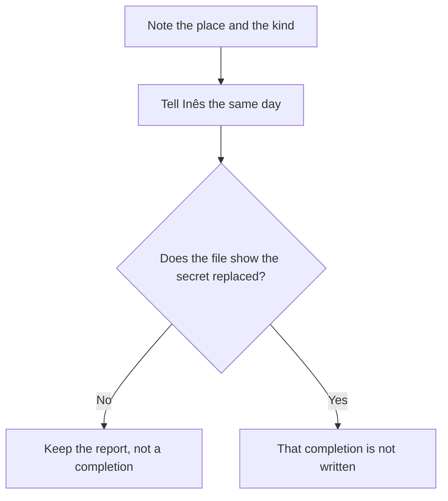

A same-day report asks for a change. It is not the change.

### Logical drawing

```text
record
    where the sticky note was
    that it is a password
    not the password
report
    Inês, the same day
not in the file
    the new secret
    removal of the note
    a date for the change
```
<!-- open-cyber-academy:lesson-figures:end ch-12 -->

### Learning outcomes

After this chapter, you should be able to:

1. Keep the report of the sticky note.
2. Keep the password itself unwritten.
3. Leave the replacement unfinished in the file.

### 12.1 Telling Inês starts the fix. The file does not finish it.

If Leo finds a password on a sticky note, he records the place and the kind of secret, not the characters, and tells Inês the same day so it can be changed. The worked example says he reports the note. The staff summary lists that sticky note among the three findings. What the book never shows is the replacement: no new secret, no statement that the paper is gone, and no date for the change. The place itself is not printed, so a later page cannot invent "the circulation desk" or any other spot. A classmate who writes the password "just this once" spreads the secret the rule was written to stop. A classmate who writes "already changed" closes an action the file left open. The report stands. The completion does not.

### 12.2 Worked example

| What someone cites | What the file holds | Decision |
|---|---|---|
| Place and kind | The recording rule | Keep both, without the secret |
| Report to Inês | The worked example | Keep the report |
| A replaced password | Not shown | Leave it open |
| A named location | Not printed | Refuse |

> **Synthetic case.** No password characters and no room name are added.

### Errors and limits

An open change is still an open change. The report does not become a failure because the replacement is undated.

### Apply

- **EX058 — Already changed?** Leo reported a sticky-note password by place and kind, not by value. The summary lists the finding. May the leaving note say the password was written down and has already been changed? *Rubric:* 3 = no; the password stays unwritten; the place stays unnamed; the report stays; the replacement is not shown; do not invent a date;; 2 = the report stays and the change stays open;; 1 = one limit;; 0 = none.

<!-- open-cyber-academy:chapter-navigation:start ch-12 -->
### Continue studying — lesson 12 (chapter 12 of 20)

[← Chapter 11](#ch-11) · [Course chapter index](../SUBJECTS.md) · [Chapter 13 →](#ch-13)

Continue to the next authored lesson.
<!-- open-cyber-academy:chapter-navigation:end -->

<a id="ch-13"></a>

## Chapter 13 — Last year's warning is not this week's incident

<!-- open-cyber-academy:lesson-figures:start ch-13 -->
### Lesson map

Lesson 13. Map, example, EX059.

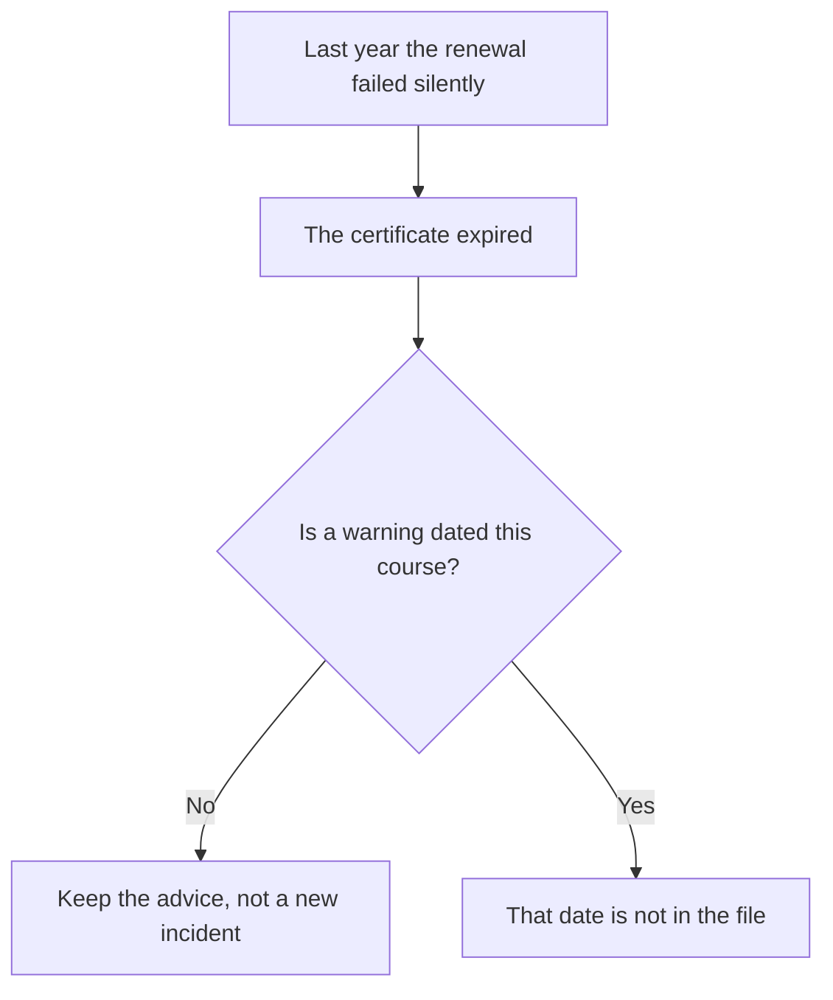

The old outage explains the calendar. It does not open a fresh incident.

### Logical drawing

```text
last year
    host renewal failed silently
    certificate expired
    browsers showed warnings
    cause is not an intrusion
this course
    advice: do not click through
    no dated warning in the file
```
<!-- open-cyber-academy:lesson-figures:end ch-13 -->

### Learning outcomes

After this chapter, you should be able to:

1. Keep last year's cause as a silent renewal failure.
2. Keep the click-through ban.
3. Leave this course without a dated warning.

### 13.1 An expired certificate and a rule are not the same event.

Chapter 3 says the library website showed warnings last year because the web host's automatic renewal failed silently and the certificate expired. The exercise that asks about that outage rejects "hacked" as the cause. The staff summary's third finding is advice: do not click through certificate warnings. No sentence dates a warning during Leo's month, names a browser, or says he saw one. A classmate who files "warning, this week" has moved last year into the current notes. A classmate who clicks through "because it happened before and was only expiry" breaks the rule Inês gave for a site that should be trusted. Leo keeps the historical cause and the present advice in separate lines.

### 13.2 Worked example

| What someone cites | What the file holds | Decision |
|---|---|---|
| Silent renewal failure | Last year's cause | Keep the cause |
| "Hacked" | Rejected by the earlier exercise | Keep it rejected |
| Do not click through | The standing rule | Keep the rule |
| A warning dated this course | Not in the file | Refuse |

> **Synthetic case.** No browser name and no new warning date are added.

### Errors and limits

Separating the year from the rule does not make either one unimportant.

### Apply

- **EX059 — Which warning?** Last year the host renewal failed silently and the certificate expired. The summary advises staff not to click through a warning. Is there a dated certificate warning during this course? *Rubric:* 3 = no dated warning this course; last year's cause stays the silent renewal failure; it was not an intrusion; the click-through ban stays; do not invent a date;; 2 = the old cause and the rule stay apart;; 1 = one fact;; 0 = none.

<!-- open-cyber-academy:chapter-navigation:start ch-13 -->
### Continue studying — lesson 13 (chapter 13 of 20)

[← Chapter 12](#ch-12) · [Course chapter index](../SUBJECTS.md) · [Chapter 14 →](#ch-14)

Continue to the next authored lesson.
<!-- open-cyber-academy:chapter-navigation:end -->

<a id="ch-14"></a>

## Chapter 14 — A month-ahead reminder is not a printed date

<!-- open-cyber-academy:lesson-figures:start ch-14 -->
### Lesson map

Lesson 14. Map, example, EX060.

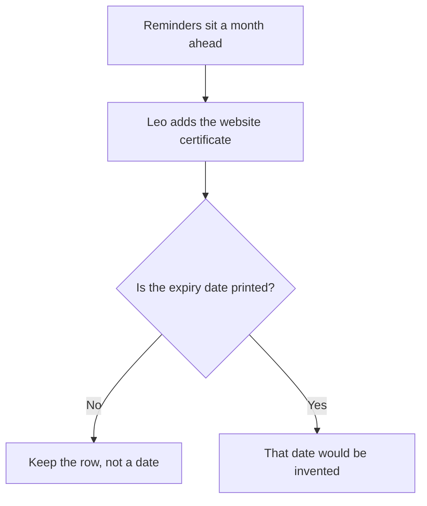

A calendar habit is not a date, and a row is not a completed renewal.

### Logical drawing

```text
Inês
    reminder a month before expiry
    includes items suppliers renew
Leo
    adds the website certificate
not printed
    the expiry date
    the reminder date
    a completed renewal
```
<!-- open-cyber-academy:lesson-figures:end ch-14 -->

### Learning outcomes

After this chapter, you should be able to:

1. Keep the one-month lead time.
2. Keep the website certificate on the calendar.
3. Leave every date and the renewal itself unprinted.

### 14.1 The lead time is a rule. The date is absent.

Inês keeps a calendar of expiry dates and sets reminders a month ahead, even when a supplier renews automatically. The worked example says Leo adds the website certificate to that calendar. Last year's silent failure is why the habit exists. The book still does not print the certificate's end date, the reminder's date, or a sentence that the host has renewed it. A classmate who writes a day and a month is decorating the page. A classmate who says "added, therefore renewed" confuses Leo's row with the host's job. The row can stand. The dates stay out. The renewal stays unconfirmed.

### 14.2 Worked example

| What someone cites | What the file holds | Decision |
|---|---|---|
| Reminders a month ahead | Inês's habit | Keep the lead time |
| Website certificate added | The worked example | Keep the row |
| An expiry date | Not printed | Refuse |
| "The host has renewed it." | Not shown | Refuse |

> **Synthetic case.** No calendar day is chosen in this lesson.

### Errors and limits

An undated row can still be a useful row. Usefulness is not a date.

### Apply

- **EX060 — Which day?** Reminders come a month before expiry. Leo adds the website certificate to the calendar. What expiry date do you write, and has the host renewed it? *Rubric:* 3 = no date is in the file; the one-month lead stays; the certificate stays on the calendar; the renewal is not shown; do not invent a day;; 2 = the row stays and the date stays blank;; 1 = the lead time only;; 0 = none.

<!-- open-cyber-academy:chapter-navigation:start ch-14 -->
### Continue studying — lesson 14 (chapter 14 of 20)

[← Chapter 13](#ch-13) · [Course chapter index](../SUBJECTS.md) · [Chapter 15 →](#ch-15)

Continue to the next authored lesson.
<!-- open-cyber-academy:chapter-navigation:end -->

<a id="ch-15"></a>

## Chapter 15 — The shared Wi-Fi secret stays unwritten

<!-- open-cyber-academy:lesson-figures:start ch-15 -->
### Lesson map

Lesson 15. Map, example, EX061.

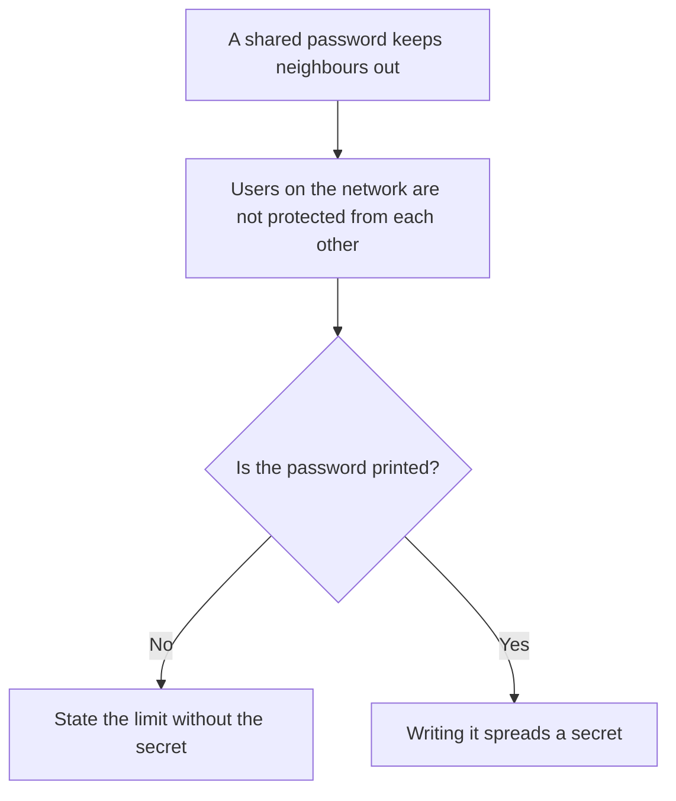

The limit can be taught without the secret, and the council equipment stays out of scope.

### Logical drawing

```text
public Wi-Fi
    shared password
    not printed
    blocks casual neighbours
    does not separate users
out of scope
    council Wi-Fi equipment
    scanning
    the kiosk stays uncrashed because no scan is recorded
```
<!-- open-cyber-academy:lesson-figures:end ch-15 -->

### Learning outcomes

After this chapter, you should be able to:

1. State both the reach and the limit of the shared password.
2. Leave that password unwritten.
3. Leave scanning, the council equipment, and a kiosk crash out of the file.

### 15.1 The limit is public. The secret is not.

Public Wi-Fi uses a shared password. Chapter 3 says it keeps out casual neighbours and does not protect people on the network from one another. The password itself never appears. The signed note forbids scanning and forbids touching the council's Wi-Fi equipment. The old self-service kiosk is the fragile device an unapproved scan might disrupt, and Inês stopped the scan before it happened, so the file contains no crash. A classmate who prints the shared password "so staff can see the risk" puts a secret into a note, which the four rules forbid. A classmate who scans "only the library side" still does the action the note refused. Leo can teach the limit with the sentence already written. He does not need the secret, a scan, or a damaged kiosk to make the point.

### 15.2 Worked example

| What someone cites | What the file holds | Decision |
|---|---|---|
| Keeps casual neighbours out | The reach | Keep it |
| Does not protect users from each other | The limit | Keep it |
| The shared password | Not printed | Leave it unwritten |
| A scan or a kiosk crash | Not recorded | Refuse |

> **Synthetic case.** No Wi-Fi password and no crash log are created.

### Errors and limits

Teaching the limit without the secret does not make the shared password stronger than chapter 3 said.

### Apply

- **EX061 — Write the password?** The shared Wi-Fi password keeps casual neighbours out and does not protect users from each other. Scanning and the council's equipment are outside the note. What do you add to the summary? *Rubric:* 3 = state the reach and the limit; do not write the password; do not scan; do not touch the council equipment; the kiosk crash is not in the file;; 2 = the secret stays unwritten and the scan stays undone;; 1 = one limit;; 0 = none.

<!-- open-cyber-academy:chapter-navigation:start ch-15 -->
### Continue studying — lesson 15 (chapter 15 of 20)

[← Chapter 14](#ch-14) · [Course chapter index](../SUBJECTS.md) · [Chapter 16 →](#ch-16)

Continue to the next authored lesson.
<!-- open-cyber-academy:chapter-navigation:end -->

<a id="ch-16"></a>

## Chapter 16 — The signing key stays with the platform

<!-- open-cyber-academy:lesson-figures:start ch-16 -->
### Lesson map

Lesson 16. Map, example, EX062.

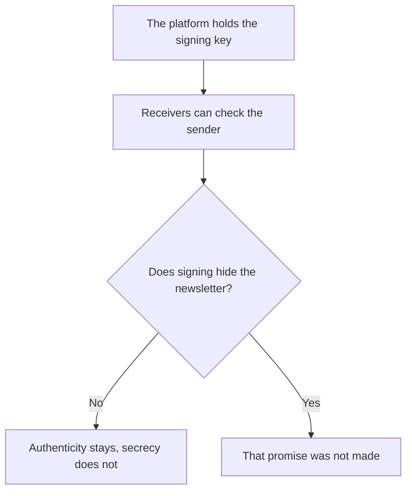

The key's home is the supplier. Its promise is about who sent the mail.

### Logical drawing

```text
newsletter platform
    holds the email signing key
    signs outgoing mail
promise
    receivers can tell the mail comes from the library
not the promise
    the body is secret
forbidden
    paste the key into email, chat, or a shared document
```
<!-- open-cyber-academy:lesson-figures:end ch-16 -->

### Learning outcomes

After this chapter, you should be able to:

1. Leave the signing key with the newsletter platform.
2. Describe the check as authenticity.
3. Refuse a request to copy the key into a message.

### 16.1 Who holds the key decides who must not be asked for it.

Chapter 3 says the newsletter platform signs outgoing email so receivers can tell it really comes from the library, and that the platform holds the signing key. The library depends on that supplier and cannot change the setting directly. A signature lets someone check who signed and that the signed bytes were not altered. It does not, by itself, hide the newsletter's words. No key value, no public key, and no screenshot of a signer appears in the file. A classmate who asks the platform to paste the key into chat breaks the rule against secrets in email, chat, and shared documents, and also asks for a control the library does not hold. Leo names the holder and the promise. He does not request the key.

### 16.2 Worked example

| What someone cites | What the file holds | Decision |
|---|---|---|
| Platform holds the key | Chapter 3 | Keep the holder |
| Receivers can check the sender | The signing purpose | Keep the purpose |
| "The body is therefore secret." | Not the stated promise | Refuse |
| "Email me the key." | Secrets stay out of mail | Refuse |

> **Synthetic case.** No key characters are requested or stored.

### Errors and limits

Naming the platform as holder does not give the library the key, and it does not make the newsletter confidential.

### Apply

- **EX062 — Where is the key?** The newsletter platform signs mail so receivers can tell it comes from the library. A colleague asks Leo to have the key sent by email for the summary. What do you answer? *Rubric:* 3 = the platform keeps the key; signing here is about the sender, not secrecy of the body; do not ask for the key by email, chat, or a shared document; no key value is in the file;; 2 = the key stays with the platform;; 1 = one promise;; 0 = none.

<!-- open-cyber-academy:chapter-navigation:start ch-16 -->
### Continue studying — lesson 16 (chapter 16 of 20)

[← Chapter 15](#ch-15) · [Course chapter index](../SUBJECTS.md) · [Chapter 17 →](#ch-17)

Continue to the next authored lesson.
<!-- open-cyber-academy:chapter-navigation:end -->

<a id="ch-17"></a>

## Chapter 17 — One laptop, and the version token stays in the lab

<!-- open-cyber-academy:lesson-figures:start ch-17 -->
### Lesson map

Lesson 17. Map, example, EX063.

```mermaid
flowchart TD
  A["Match is not a safety proof"] --> B["Install on one laptop first"]
  B --> C{"Does v2.1 leave the laboratory string?"}
  C -->|No| D["Keep one laptop and the lab token"]
  C -->|Yes| E["The summary has no version"]
```

The trial is one machine. The version characters belong to the synthetic bytes.

### Logical drawing

```text
staff summary
    matched download
    install on one laptop first
    no version number
laboratory bytes
    contain "catalogue-tool v2.1"
    synthetic installer
other staff laptop
    does not receive the tool in this file
```
<!-- open-cyber-academy:lesson-figures:end ch-17 -->

### Learning outcomes

After this chapter, you should be able to:

1. Keep the install on one laptop.
2. Keep `v2.1` inside the laboratory string.
3. Leave the second laptop without the tool.

### 17.1 A cautious install does not spread, and a laboratory token does not become a version line.

The staff summary says the catalogue download matched and that the tool is installed only on one laptop first, because a match does not prove the software is safe or free of bugs. The library has two staff laptops. The file never says the second one received the tool. Inside `lab_checkfile.py` the synthetic bytes include the characters `catalogue-tool v2.1`. That string is the laboratory input, fifty copies of it, not a version written on the staff page. The five-sentence summary records no version. A classmate who writes "v2.1 installed on both laptops" has moved a laboratory token onto a machine the summary left alone, and then onto a second machine. Leo keeps the trial at one laptop and leaves `v2.1` in the script.

### 17.2 Worked example

| What someone cites | What the file holds | Decision |
|---|---|---|
| Install on one laptop first | The summary | Keep one |
| Two staff laptops | The inventory | The second stays without the tool |
| `catalogue-tool v2.1` | Synthetic bytes | Leave it in the script |
| "v2.1 on both." | Not written | Refuse |

> **Synthetic case.** The second laptop is not given the catalogue tool.

### Errors and limits

One laptop is a limit on harm. It is not a certificate that the chosen laptop is safe.

### Apply

- **EX063 — Both laptops, version 2.1?** The summary installs the tool on one laptop first. The laboratory bytes contain `catalogue-tool v2.1`. May the note say version 2.1 is now on both staff laptops? *Rubric:* 3 = no; the install stays on one laptop; the second laptop does not receive it; `v2.1` stays inside the synthetic bytes; the summary records no version; do not edit `lab_checkfile.py`;; 2 = one laptop, and the token stays in the lab;; 1 = one limit;; 0 = none.

<!-- open-cyber-academy:chapter-navigation:start ch-17 -->
### Continue studying — lesson 17 (chapter 17 of 20)

[← Chapter 16](#ch-16) · [Course chapter index](../SUBJECTS.md) · [Chapter 18 →](#ch-18)

Continue to the next authored lesson.
<!-- open-cyber-academy:chapter-navigation:end -->

<a id="ch-18"></a>

## Chapter 18 — A double change is a limit, not an event

<!-- open-cyber-academy:lesson-figures:start ch-18 -->
### Lesson map

Lesson 18. Map, example, EX064.

```mermaid
flowchart TD
  A["A match means the bytes equal the published file"] --> B["Same-site replacement of both would still match"]
  B --> C{"Did this book record that attack?"}
  C -->|No| D["Keep the limit and the supervised match"]
  C -->|Yes| E["No attack and no project signature are filed"]
```

The limit explains a weakness of the method. It does not report an attack.

### Logical drawing

```text
a match
    file equals the published fingerprint's file
    does not prove the software is safe
limit
    attacker changes file and fingerprint on the same site
not recorded
    that attack at this project
    a signature on this release
    the project's private key
```
<!-- open-cyber-academy:lesson-figures:end ch-18 -->

### Learning outcomes

After this chapter, you should be able to:

1. Say what a match proves.
2. Keep the same-site limit as a limit.
3. Leave this release unsigned in the file.

### 18.1 The warning is conditional.

A match means the downloaded bytes are the bytes whose fingerprint was published. Chapter 4 adds two limits. The software may still be unsafe or buggy, which is why the install starts on one laptop. And if an attacker replaced both the file and the fingerprint on the same website, the check would still match. Some projects also sign releases, because forging a signature needs the project's private key. The file uses "some projects" and "if". It does not say this catalogue project was attacked, and it does not say this release was signed. The supervised download matched. A classmate who writes "the site was altered" or "the signature checked out" adds an event and a control the chapter did not record. Leo keeps the conditional limit and does not invent a signer.

### 18.2 Worked example

| What someone cites | What the file holds | Decision |
|---|---|---|
| Match means identical bytes | Chapter 4 | Keep the meaning |
| Same-site change of both | A stated limit | Keep it conditional |
| Supervised download | Matched | Keep the match |
| "This release was signed." | Not recorded | Refuse |

> **Synthetic case.** No attacker and no project signature are added to the summary.

### Errors and limits

A limit that did not fire is still worth teaching. Teaching it is not a claim that it fired.

### Apply

- **EX064 — Was the site altered?** A match shows the file equals the published one. The same check can be fooled if both the file and the fingerprint on one site are replaced. Some projects sign releases. What do you write about this catalogue download? *Rubric:* 3 = the supervised download matched; the same-site case stays a limit, not a recorded attack; this file does not say the project signed this release; do not invent a key or an attacker;; 2 = the limit stays conditional;; 1 = the match only;; 0 = none.

<!-- open-cyber-academy:chapter-navigation:start ch-18 -->
### Continue studying — lesson 18 (chapter 18 of 20)

[← Chapter 17](#ch-17) · [Course chapter index](../SUBJECTS.md) · [Chapter 19 →](#ch-19)

Continue to the next authored lesson.
<!-- open-cyber-academy:chapter-navigation:end -->

<a id="ch-19"></a>

## Chapter 19 — The named week is not a calendar date

<!-- open-cyber-academy:lesson-figures:start ch-19 -->
### Lesson map

Lesson 19. Map, example, EX065.

```mermaid
flowchart TD
  A["The manager signs a note"] --> B["The note names a week and Inês"]
  B --> C{"Do the dates appear?"}
  C -->|No| D["Keep the scope and omit the dates"]
  C -->|Yes| E["Those dates are not printed"]
```

Finishing the fingerprint task does not widen the note.

### Logical drawing

```text
signed by the library manager
    allowed: certificate details, laptop encryption, password-policy page
    forbidden: scanning, trying passwords, book supplier, council Wi-Fi
    week named, dates not printed
    Inês is the contact
fingerprint task
    does not add the forbidden actions
```
<!-- open-cyber-academy:lesson-figures:end ch-19 -->

### Learning outcomes

After this chapter, you should be able to:

1. Keep the manager as the signer and Inês as the contact.
2. Keep the allowed and forbidden lists.
3. Leave the week's dates unprinted.

### 19.1 The note is specific, and it is still undated on the page.

The signed note lists what Leo may do: read the website certificate in the browser, check disk encryption on staff laptops, and review the e-book password policy. It lists what he may not do: scan the network, try passwords, touch the book supplier's systems, or touch the council's Wi-Fi equipment. It names the week and names Inês as the contact. The library manager signs. The week is never given as calendar dates. Completing the fingerprint check, even under supervision, is not a sentence that adds scanning or the supplier systems. The kiosk stays the reason a scan was refused, and no scan is recorded. A classmate who fills Monday and Friday onto the note is inventing the only field the book left blank. Leo copies the lists. He does not invent the dates, and he does not widen the lists.

### 19.2 Worked example

| What someone cites | What the file holds | Decision |
|---|---|---|
| Manager signs | Chapter 2 | Keep the signer |
| Inês is the contact | The note | Keep the contact |
| Allowed and forbidden lists | The note | Keep both lists |
| Calendar dates for the week | Not printed | Refuse |

> **Synthetic case.** No weekday pair is written onto the permission note.

### Errors and limits

An undated week can still bind the lists. Missing dates do not make the forbidden actions allowed.

### Apply

- **EX065 — Which dates?** The manager signed a note that names the week and names Inês. Scanning, password guessing, the book supplier, and the council's Wi-Fi stay outside. The fingerprint task is finished. What dates do you add, and does the task widen the note? *Rubric:* 3 = no dates are in the file; the signer and the contact stay; the allowed and forbidden lists stay; the finished task does not add scanning or the excluded systems;; 2 = the dates stay blank and the lists stay;; 1 = one list;; 0 = none.

<!-- open-cyber-academy:chapter-navigation:start ch-19 -->
### Continue studying — lesson 19 (chapter 19 of 20)

[← Chapter 18](#ch-18) · [Course chapter index](../SUBJECTS.md) · [Chapter 20 →](#ch-20)

Continue to the next authored lesson.
<!-- open-cyber-academy:chapter-navigation:end -->

<a id="ch-20"></a>

## Chapter 20 — What the library note can say

<!-- open-cyber-academy:lesson-figures:start ch-20 -->
### Lesson map

Lesson 20. Map, example, EX066.

```mermaid
flowchart TD
  N["A leaving note"] --> F["Quote the prints and the open items"]
  F --> Q{"Does the sentence replace a print or close an open item?"}
  Q -->|Yes| R["Reject it"]
  Q -->|No| K["The note may cite that line"]
```

Twenty lessons meet a planning minimum. They leave Willow Lane's open items open.

### Logical drawing

```text
may stay
    MATCH and MISMATCH
    prefix 215e60edb672063786f8bb92...
    hours strings and match False
    stored value False; right True; wrong False
    supplier algorithm unnamed
    one laptop; v2.1 only in the lab bytes
must not be added
    a finished digest, a timetable, a policy grade
    an on/off pair, a written secret, a renewal date
    an emailed key, a second install, a recorded attack
    a claim that the library is secure
```
<!-- open-cyber-academy:lesson-figures:end ch-20 -->

### Learning outcomes

After this chapter, you should be able to:

1. Repeat the laboratory lines and the open items.
2. Reject a note that replaces a print or closes an open item.
3. Name the following subject while this review stays open.

### 20.1 A note may quote the file. It may not improve the file.

A leaving note may say what was already written. From the check-file run, keep `download_ok.bin MATCH`, `download_bad.bin MISMATCH`, and the prefix `published: 215e60edb672063786f8bb92...`. The hour strings remain `9-17` and `9-18`, and False stays their match line rather than a new closing time. Salted storage still shows different stored values, True on each right-password line, and False on the wrong-password line. The e-book supplier's algorithm stays unnamed. The password-policy grade stays unwritten. The two laptops stay without an on/off line. The sticky-note password stays unwritten and its replacement stays undated. Last year's renewal failure stays last year. The certificate row stays undated. The Wi-Fi password stays unwritten. The signing key stays with the platform. The catalogue tool stays on one laptop, and `v2.1` stays inside the laboratory bytes. No same-site attack and no project signature are filed. The permission week stays without dates. Chapter 4's synthesis still calls the guided fingerprint task its final lesson for that course. That sentence stays. It does not close the items above.

### 20.2 Worked example

| Leaving-note sentence | Why it fails or stands | Decision |
|---|---|---|
| "The lab printed MATCH and MISMATCH, and the supervised download matched." | Both records | May stay |
| "The hours match is False and the stored values differed." | The two embedded runs | May stay |
| "The digest is now complete and the library adopted 9-18." | Neither is printed | Reject |
| "The policy passed, both laptops were on, and the secret is already changed." | None of those results is filed | Reject |
| "Version 2.1 is on both laptops and the project signature checked out." | The token and the signature are not on the summary | Reject |
| "Twenty lessons make Willow Lane secure." | The review is still open | Reject |

> **Synthetic case.** The note is a classroom page about Willow Lane. It is not a notice to borrowers.

### Errors and limits

Twenty English lessons meet Willow Lane's planning minimum and leave this review open. A fresh library question can still earn a later Willow Lane lesson. These English chapters do not publish another language edition. Cryptography and trust services stays this course. Web3, blockchain and cryptoasset security is the learner's following subject. Inês's suggestion of the Professional course stays a suggestion from chapter 4. Open items at the library stay open on that turn. These chapters do not call the library secure, and they do not hand anyone a qualification.

### Apply

- **EX066 — Four claims.** A classmate's leaving note says the laboratory now prints only MATCH and the remaining fingerprint digits have been filled in, that the salted stored values became equal and the supplier's algorithm is scrypt, that the password policy passed and both laptops showed encryption on, and that the catalogue tool is on both machines because twenty lessons make Willow Lane secure. Which claims do you reject, and what do twenty lessons meet? *Rubric:* 3 = reject the shortened laboratory line, the completed digest, the equal stored values, the named supplier algorithm, the policy pass, the on/off pair, and the second install; the prints stay MATCH and MISMATCH, hours match False, stored-value False with the right-password Trues and the wrong-password False; the supplier stays unnamed; the policy grade stays blank; the laptops stay without an on/off line; the tool stays on one laptop; twenty lessons meet the planning minimum and leave review open; do not call Willow Lane secure;; 2 = reject the closings and keep the prints;; 1 = one claim;; 0 = none.

<!-- open-cyber-academy:chapter-navigation:start ch-20 -->
### Continue studying — lesson 20 (chapter 20 of 20)

[← Chapter 19](#ch-19) · [Course chapter index](../SUBJECTS.md) · [Next course via chapter index →](../SUBJECTS.md)

The chapter index leads to the next course in the study path.
<!-- open-cyber-academy:chapter-navigation:end -->

<a id="worked-results"></a>

## Worked results

Model answers for EX001–EX066. Leo Fernandes, Inês Hartley, Willow Lane Community Library and every figure are synthetic. Lab answers quote verified outputs. Any answer meeting the rubric scores equally.

**EX001.** To understand the core risks, explain them to the library team and safely complete one guided task.

**EX002.** Noticing that a page on the library website has been changed by someone who should not have changed it.

**EX003.** It cannot stop a weak password being guessed or a person clicking a fake link.

**EX004.** No. Base64 is only a way of writing data, and anyone can turn it back without any key.

**EX005.** The fingerprint was completely different and the match check printed False.

**EX006.** No. Hashing is one-way; you can only check a guess by hashing it and comparing.

**EX007.** Only someone who has the correct secret key.

**EX008.** Who signed the item and that it has not been altered, using the signer's public key.

**EX009.** That the connection is protected by TLS and the site holds a certificate for the name shown.

**EX010.** Because it can obtain a valid certificate for its own look-alike name, so the padlock appears.

**EX011.** Stop, do not click through, and report the warning to Inês.

**EX012.** Never in emails, chat messages or shared documents.

**EX013.** They concern behaviour and settings, which is where most real problems come from.

**EX014.** Because without permission it could be illegal, could break fragile devices like the kiosk and could affect partners' systems.

**EX015.** The library manager, who is responsible for the library's systems.

**EX016.** Reading the website's certificate details and checking that laptops have disk encryption on.

**EX017.** Scanning the network and trying passwords are both outside his scope.

**EX018.** It makes the first task safe and possible to finish.

**EX019.** Look away from what the task does not need, close it and never copy it into notes.

**EX020.** He notes where it was and that it is a password, without writing it down, and tells Inês so it can be changed.

**EX021.** What he saw, where and when, why it matters and a suggested next step.

**EX022.** Friends and social media; findings go to Inês and the manager.

**EX023.** Tell the supplier privately through the library so it can be fixed before details are public.

**EX024.** Coordinated disclosure.

**EX025.** The library's old self-service kiosk, which might crash under scanning.

**EX026.** It protects the library, its members and Leo himself.

**EX027.** It stops files being read if a laptop is lost or stolen.

**EX028.** It does not protect people on the network from one another.

**EX029.** So that receiving mail systems can check that the newsletter really comes from the library.

**EX030.** The actual password; it keeps only a slow, salted hash.

**EX031.** A random value stored with each user's hash so that identical passwords produce different stored results.

**EX032.** No. Their stored values were different, and both still verified with the correct password.

**EX033.** It makes every password guess costly, slowing down thieves trying to recover passwords.

**EX034.** The newsletter platform supplier.

**EX035.** In the supplier's published security page or in the contract.

**EX036.** The certificate expired because the web host's automatic renewal failed without anyone noticing.

**EX037.** So that a quietly stolen key cannot be used forever.

**EX038.** One month before each expiry date.

**EX039.** A SHA-256 fingerprint of each file.

**EX040.** The correct file printed MATCH and the tampered file printed MISMATCH.

**EX041.** That the downloaded file is exactly the file whose fingerprint was published.

**EX042.** It does not prove the software is safe or free of bugs.

**EX043.** If an attacker replaced both the file and the published fingerprint on the same website.

**EX044.** Because forging a digital signature requires the project's private key, which an attacker on the website lacks.

**EX045.** Stop, not install, download again from the official site and tell Inês if it still fails.

**EX046.** Because the match does not prove safety, so trying it on one laptop limits harm if something is wrong.

**EX047.** The password sticky note, the expiry calendar and the advice not to click through certificate warnings.

**EX048.** How TLS negotiates keys and how certificates are issued.

**EX049.** The Handbook of Applied Cryptography by Menezes, van Oorschot and Vanstone.

**EX050.** The Professional course in cryptography and trust services.

**EX051.** No. The laboratory still prints MATCH for the synthetic good file and MISMATCH for the synthetic tampered file. The staff summary still says the supervised download matched. Those checks stay separate. Do not edit the script.

**EX052.** No. The script prints the first 24 hex digits and three dots. The embedded line stays `published: 215e60edb672063786f8bb92...`. Do not write the hidden digits. Do not edit the script.

**EX053.** No. Both hour strings stay, both prefixes stay with their dots, and the line stays `match: False`. Those strings are not Willow Lane's timetable. Do not edit the script.

**EX054.** The stored values differ, so that line stays False. Both right-password lines stay True. The wrong-password line stays False. Do not copy the laboratory passwords into the notes. Do not edit the script.

**EX055.** The file does not name the supplier's algorithm. Scrypt stays the call in the laboratory. Argon2id stays a citation. Do not edit the script.

**EX056.** No pass and no fail is recorded. Looking at the policy page stays allowed. Trying passwords stays forbidden. Do not invent a length.

**EX057.** No on/off result is printed. The library still has two staff laptops. Disk encryption still means a stolen machine should not expose its files. Do not invent a serial number.

**EX058.** No. The password stays unwritten and the place stays unnamed. The report to Inês stays. The replacement is not shown.

**EX059.** No warning is dated in this course. Last year's cause stays a silent renewal failure, not an intrusion. The ban on clicking through stays. Do not invent a date.

**EX060.** No expiry date is printed. The reminder stays a month ahead. The website certificate stays on the calendar. A renewal is not shown.

**EX061.** Say that the shared password keeps casual neighbours out and does not protect users from each other. Do not write the password, do not scan, and do not record a kiosk crash.

**EX062.** The newsletter platform keeps the signing key. The check concerns who sent the mail, not secrecy of the body. Do not ask for the key by email, chat, or a shared document.

**EX063.** No. The install stays on one laptop, and the other staff laptop does not receive the tool. The characters `v2.1` stay inside the synthetic bytes. The summary has no version. Do not edit the script.

**EX064.** The supervised download matched. Replacing both the file and the fingerprint on one site stays a limit, not a recorded attack. This file does not say the project signed this release.

**EX065.** No dates are printed. The library manager stays the signer and Inês stays the contact. The allowed list and the forbidden list stay. Finishing the fingerprint task does not add scanning or the excluded systems.

**EX066.** Reject the shortened laboratory line, the completed digest, the equal stored values, the named supplier algorithm, the policy pass, the on/off pair, and the second install. Keep MATCH and MISMATCH, `match: False` on the hours run, stored-value False, the right-password Trues, and the wrong-password False. The supplier stays unnamed, the policy grade stays blank, and the tool stays on one laptop. Twenty lessons meet the planning minimum and leave review open. Do not call Willow Lane secure.

<a id="references"></a>

## References

Links checked 12 October 2026; re-verify editions before citing. Organisations, people, systems, keys and data in this book are synthetic unless a sentence cites a public source.

- Biryukov, A., Dinu, D., Khovratovich, D., & Josefsson, S. (2021). *Argon2 memory-hard function for password hashing and proof-of-work applications* (RFC 9106). IETF. <https://www.rfc-editor.org/rfc/rfc9106>
- Cooper, D., Santesson, S., Farrell, S., Boeyen, S., Housley, R., & Polk, W. (2008). *Internet X.509 public key infrastructure certificate and CRL profile* (RFC 5280). IETF. <https://www.rfc-editor.org/rfc/rfc5280>
- Katz, J., & Lindell, Y. (2020). *Introduction to modern cryptography* (3rd ed.). CRC Press.
- Menezes, A. J., van Oorschot, P. C., & Vanstone, S. A. (1996). *Handbook of applied cryptography*. CRC Press. Chapters free online: <https://cacr.uwaterloo.ca/hac/>
- National Institute of Standards and Technology. (2001, updated 2023). *Advanced Encryption Standard (AES)* (FIPS 197). <https://doi.org/10.6028/NIST.FIPS.197-upd1>
- National Institute of Standards and Technology. (2015). *Secure hash standard (SHS)* (FIPS 180-4). <https://doi.org/10.6028/NIST.FIPS.180-4>
- Percival, C., & Josefsson, S. (2016). *The scrypt password-based key derivation function* (RFC 7914). IETF. <https://www.rfc-editor.org/rfc/rfc7914>
- Rescorla, E. (2018). *The Transport Layer Security (TLS) protocol version 1.3* (RFC 8446). IETF. <https://www.rfc-editor.org/rfc/rfc8446>
