# Cybersecurity: A One-Month Guided Course

- Edition: working draft, 11 October 2026
- Language: English (`en`)
- Course: rapid, one month; approximately 80 hours of planned study
- Status: Nine English chapters drafted, with exercises EX001–EX025 and worked results. The rapid-course planning minimum is 20 lessons and there is no maximum. Technical, language and source review are **not complete**.
- Maintainer: [hiagokinlevi](https://github.com/hiagokinlevi)
- Original text: [CC0 1.0](../../../../../LICENSE), within the [rights notice](../../../../../RIGHTS.md). External sources linked below retain their own rights.

## How to study this draft

Read the explanation before attempting an exercise. Work only with the fictional library described here. Keep a short notebook with the facts you observe, the assumptions you make, and the question you would ask next. Compare your responses with the worked results at the end. A plausible alternative can be correct when it identifies its assumptions and supports its decision with evidence.

This is the **one principal book** for the English rapid Cybersecurity course. It incorporates the earlier Security Literacy draft. Each authored chapter teaches one idea with an example and exercises. Worked results are in the final appendix. The planning minimum for this rapid book is 20 lessons, and there is no maximum. Nine drafted chapters are not that minimum and are not a finished qualification.

| Subject-chapter | Authored exercises | Draft status |
|---|---:|---|
| 1. Foundations and decisions | EX001–EX005 | Draft |
| 2. Scope, permission and safe practice | EX006–EX010 | Draft |
| 3. Systems, data and dependencies | EX011–EX015 | Draft |
| 4. Guided lab and applied synthesis | EX016–EX020 | Draft |
| 5. What may be said about a booking | EX021 | Draft |
| 6. A handwritten change is not a correction | EX022 | Draft |
| 7. A pending queue during an outage | EX023 | Draft |
| 8. A weak procedure is not yet a vulnerability | EX024 | Draft |
| 9. A verdict tally is not a severity | EX025 | Draft |

<a id="ch-01"></a>

## Chapter 1 — Cybersecurity: foundations and decisions

<!-- cykin:lesson-figures:start ch-01 -->
### Lesson map

Lesson 01 published. Map, example, EX001.

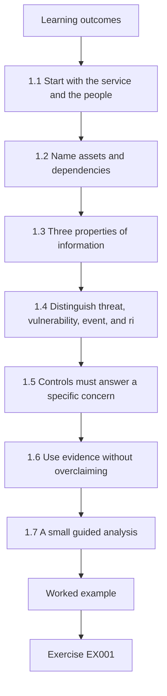

### Logical drawing

```mermaid
flowchart LR
  N0["Learning outcomes"]
  N1["1.1 Start with the service and the people"]
  N2["1.2 Name assets and dependencies"]
  N3["1.3 Three properties of information"]
  N4["1.4 Distinguish threat, vulnerability, event, and ri"]
  N5["1.5 Controls must answer a specific concern"]
  N6["1.6 Use evidence without overclaiming"]
  N7["1.7 A small guided analysis"]
  N0 --> N1 --> N2 --> N3 --> N4 --> N5 --> N6 --> N7 --> Q["EX001"]
```

```text
[Learning outcomes]
    |
    v
[1.1 Start with the service and the people]
    |
    v
[1.2 Name assets and dependencies]
    |
    v
[1.3 Three properties of information]
    |
    v
[1.4 Distinguish threat, vulnerability, event, and ri]
    |
    v
[1.5 Controls must answer a specific concern]
    |
    v
[1.6 Use evidence without overclaiming]
    |
    v
[1.7 A small guided analysis]
    |
    v
[Worked example] --> [Exercise EX001]
```
<!-- cykin:lesson-figures:end ch-01 -->


### Learning outcomes

After this chapter, you should be able to:

1. Describe an asset, a threat, a vulnerability, a control, a risk scenario, and evidence in ordinary language.
2. Explain confidentiality, integrity, and availability with a concrete service example.
3. Separate an observation from an assumption and a recommendation.
4. Describe the six functions of the NIST Cybersecurity Framework (CSF) 2.0 without treating them as a required sequence or a product checklist.
5. Produce a small, reviewable security note without probing a real system.

### 1.1 Start with the service and the people

Security begins with a question: **What needs to keep working, for whom, and what harm would follow if it did not?** The answer gives meaning to the technical details. A server is not valuable merely because it is a server. It matters because it supports a service, stores information, or helps people complete a task. A login page matters because it controls access to something behind it. A backup matters if it can actually restore the service within the time its users need.

Our teaching case is **Harbor Library**, an entirely fictional public library. Residents reserve study rooms through a website. Staff can view reservations, resolve conflicts, and print a daily schedule. The library also keeps a list of patrons who asked to receive event announcements. These are invented details; no real library or personal records are used in this lesson.

Before proposing a security tool, list the service outcomes:

| Service outcome | People affected | Example of harm if it fails | Question to verify |
|---|---|---|---|
| Residents can reserve available rooms | Residents and front-desk staff | A resident travels to a room that was double-booked | How are conflicting reservations prevented? |
| Staff can see an accurate daily schedule | Staff and residents | Staff give a room to the wrong group | What is the authoritative schedule? |
| Event contacts are used only for announcements | Subscribers | Unwanted disclosure or misuse of contact details | Who can export the contact list, and why? |

This table is a first model, not a verified inventory. In a real organization, a service owner would confirm the outcomes and acceptable disruption. For the exercises here, the fictional case is the full scope; do not test an actual website.

### 1.2 Name assets and dependencies

An **asset** is something of value that helps provide or protect a service. It can be information, software, a device, an account, a process, or a person's time and trust. Harbor Library's reservation records are information assets. The booking application, staff accounts, backup copies, and printed schedule are also assets. Their value and handling differ: a printed schedule may be essential during an outage, while a staff account can change reservations and therefore needs strong access controls.

A **dependency** is something a service needs in order to work. The booking page may need an identity service, a database, a network connection, and staff procedures. A dependency does not automatically become a single point of failure; that claim requires evidence about alternatives and recovery. Draw a simple chain before assigning a control:

```text
Resident -> booking page -> reservation store -> staff schedule
                         \-> confirmation message
Staff member -> staff sign-in -> reservation store
```

The arrows mean information or a request moves between parts of the service. They do not prove the implementation is built this way. That distinction matters: a diagram is a hypothesis until an owner or observation confirms it.

### 1.3 Three properties of information

The familiar **confidentiality, integrity, and availability** model describes three different ways a service or its information can be harmed. It is a teaching lens, not an exhaustive list of all harms.

- **Confidentiality** asks who may see information. If the event contact list is sent to an unauthorized recipient, confidentiality is affected even if the booking site remains online.
- **Integrity** asks whether information is correct and changed only in the intended way. If a reservation is silently altered, the schedule can be available but wrong.
- **Availability** asks whether authorized people can use the service when needed. An outage can prevent a resident from booking and staff from checking the schedule even if no information is disclosed.

One event can affect several properties. For example, an account with excessive privileges might export the contact list and change room bookings. Avoid reducing the analysis to one label. State the actual consequence, the people affected, and what is known.

Other concerns may matter too: whether a person's data was collected for a legitimate purpose, whether records can be traced to an authorized action, and whether the library can restore service after a disruption. Later chapters will treat these in more depth.

### 1.4 Distinguish threat, vulnerability, event, and risk

A **threat** is a circumstance or event with potential for harm. The [NIST glossary's threat entry](https://csrc.nist.gov/glossary/term/threat) includes unauthorized access, disclosure, modification, and denial of service among possible impacts. A threat is not proof that an attack occurred.

A **vulnerability** is a weakness that a threat source could exploit or trigger. The [NIST glossary's vulnerability entry](https://csrc.nist.gov/glossary/term/vulnerability) includes weaknesses in systems, procedures, controls, and implementations. A reused staff password is a possible weakness. Whether that weakness exists at Harbor Library is unknown; the case does not assert it.

An **event** is something observed: for example, the fictional schedule became unavailable from 10:00 to 10:20. An event alone does not establish its cause. It might result from maintenance, a software error, a network failure, or malicious activity. An **incident** is an event or series of events judged to require a security response under defined criteria. The course will use the organization's response criteria rather than labeling every error an attack.

A **risk scenario** links a plausible condition to an outcome: “If an unauthorized person changes room reservations, residents may receive incorrect confirmations and staff may allocate rooms incorrectly.” This statement does not assign a probability. It also does not claim that any unauthorized change has happened. To prioritize action, add context: how critical is the service, what controls exist, what evidence supports the scenario, and what uncertainty remains? A number without these inputs would create false confidence.

The six CSF 2.0 functions—**Govern, Identify, Protect, Detect, Respond, and Recover**—offer a common language for discussing these responsibilities. NIST describes them as concurrent and continuous outcomes, not a strict six-step procedure. For Harbor Library, assigning an owner for reservation data is governance; understanding the booking dependency is identification; access restrictions are protection; noticing unexpected changes is detection; containing an account misuse is response; restoring a trustworthy schedule is recovery. A single practical decision can involve more than one function. See the [NIST CSF 2.0 FAQ](https://www.nist.gov/cyberframework/faqs) for the framework's own description.

### 1.5 Controls must answer a specific concern

A **control** is a measure intended to reduce risk or improve an outcome. It may be technical, procedural, or organizational. “Use security software” is too vague to evaluate. “Require staff to use an approved second factor when signing in to the reservation administration page” describes a population, an action, and a boundary. It still needs verification: do all staff accounts follow the rule, can an approved user recover access, and is there a safe exception process?

For personal digital safety, [CISA's Secure Our World guidance](https://www.cisa.gov/secure-our-world) recommends recognizing and reporting phishing, using strong passwords and a password manager, enabling multifactor authentication, and updating software. These are useful starting actions. They do not replace a service-specific analysis. A library could implement all four and still have an untested restore process or an unclear owner for the event contact list.

Think in terms of **prevent, notice, act, and recover**. A control that reduces a chance of misuse may fail or be bypassed. The library therefore also needs a way to recognize abnormal changes, a person who can act, and a procedure to restore correct information. The right combination depends on the service's importance and verified facts. More controls are not automatically better: a procedure that no one owns is unlikely to work under pressure.

### 1.6 Use evidence without overclaiming

Security literacy includes knowing what a statement is based on. A useful working note separates four kinds of sentence:

1. **Observed fact:** “The fictional exercise log records a failed staff sign-in at 09:14.” The evidence is named and its scope is clear.
2. **Reported fact:** “The service owner says the printed schedule is refreshed each morning.” The speaker and time are named; the statement has not yet been independently checked.
3. **Inference:** “If printing occurs only in the morning, staff may not see later reservations during an outage.” This follows from the report but still needs testing.
4. **Recommendation:** “Test a midday outage and compare the printed schedule with the authoritative reservation list.” This proposes a check, not a claim about the present system.

The distinction prevents a common mistake: turning a plausible explanation into a finding. If a page is unavailable once, it is inaccurate to write “The library was attacked.” Instead, record the time, what failed, who observed it, and what logs or owner testimony could help determine the cause. Do not collect or publish patrons' personal information to make a teaching point.

Evidence has limits. A screenshot of a backup job may show that the job was configured. It does not prove a usable copy was produced or that a full service restore will meet the library's needs. A single test at noon does not prove the service is always available. Good notes identify both what the evidence supports and what it cannot establish.

### 1.7 A small guided analysis

Read this **synthetic** record. It is invented for this book, not a real incident:

```text
09:00  Staff print the daily room schedule.
10:05  A resident receives a booking confirmation for Room 2 at 14:00.
11:30  The booking page is unavailable to the front desk for 20 minutes.
11:42  Staff use the printed 09:00 schedule to answer a room question.
12:10  A staff member notices that the 10:05 booking is absent from the printout.
```

What is established? The printout predates the booking, and the later booking is absent from it. The record also says the page was unavailable to the front desk for twenty minutes. It does **not** establish why the page failed, whether residents could use it, or whether anyone accessed the contact list. The first concern is that staff may make a decision from stale information during an outage. A proportionate next action is to ask the service owner how staff should confirm current bookings when the live schedule is unavailable, then test that fallback with synthetic bookings.

A compact analysis note could read:

> In a fictional outage exercise, staff used a 09:00 printout after a 10:05 booking. The printout did not include that booking. The exercise therefore demonstrates a stale-schedule risk for front-desk decisions; it does not establish the cause of the booking-page outage. Confirm the fallback procedure with the service owner and test it with a later reservation.

This is the pattern for the rest of the course: name the service, describe the evidence, limit the conclusion, and propose a safe check. Chapter 2 adds authorization, scope, and stop conditions so that this method can be practiced responsibly.

### Chapter 1 summary

Security vocabulary is useful only when it improves a decision. Name the service and people first, map valuable assets and dependencies, describe the kind of harm, then connect a plausible condition to evidence and a proportionate control. Keep observations, assumptions, inferences, and recommendations distinct. The next chapter shows how to practice this work within an authorized boundary.

### Chapter 1 exercises

Use the fictional case only. Compare your work with the final worked-results appendix.

### EX001 — Asset and dependency map

- **Objective:** Distinguish a service, an asset, and a dependency.
- **Input:** The Harbor Library description in Sections 1.1–1.2.
- **Safe condition:** Work from this text alone; do not browse or test a real library.
- **Task:** Name the booking service, three different assets, and two dependencies. Explain why one asset matters to residents.
- **Expected evidence:** A five-item annotated map or short table.
- **Rubric:** Credit for a clear service outcome, three plausible assets of at least two kinds, two dependencies, and a resident-facing consequence.

### EX002 — Three kinds of harm

- **Objective:** Apply confidentiality, integrity, and availability without conflating them.
- **Input:** The fictional services in Section 1.1.
- **Safe condition:** Invent events; use no real personal information.
- **Task:** Write one distinct scenario for each of the three properties. For each, name the affected people and one fact you would need to check before claiming the event occurred.
- **Expected evidence:** Three labeled scenario statements and three verification questions.
- **Rubric:** Credit for matching the harm to the property, identifying people, and not asserting an unobserved event as fact.

### EX003 — Observation or inference

- **Objective:** Calibrate a conclusion to the available evidence.
- **Input:** The five-line synthetic record in Section 1.7.
- **Safe condition:** Analyze the supplied text only.
- **Task:** Classify these claims as supported, unsupported, or a reasonable inference: (a) a 10:05 booking was absent from the 09:00 printout; (b) an attacker caused the outage; (c) a stale printout could mislead staff; (d) the event contact list was exported. Explain each classification.
- **Expected evidence:** Four classifications and one sentence of reasoning each.
- **Rubric:** Credit for correct limits and an explanation tied to the record.

### EX004 — Control and check

- **Objective:** Propose a proportionate measure with evidence of effectiveness.
- **Input:** The stale-schedule issue in Section 1.7.
- **Safe condition:** Design a paper exercise; do not change a live system.
- **Task:** Propose one fallback procedure for staff during a booking-page outage. Define its owner, trigger, verification step, and one failure mode.
- **Expected evidence:** A four-part procedure plus a sample test with a synthetic booking.
- **Rubric:** Credit for an explicit owner and trigger, a test that can detect stale data, and an honest limitation.

### EX005 — Six-function view

- **Objective:** Use the CSF 2.0 functions as a vocabulary for service decisions.
- **Input:** Harbor Library and the [NIST FAQ](https://www.nist.gov/cyberframework/faqs).
- **Safe condition:** Work with the fictional case only.
- **Task:** Give one Harbor Library example for each of Govern, Identify, Protect, Detect, Respond, and Recover. Explain why completing one function does not finish security work.
- **Expected evidence:** Six short examples and a two-sentence explanation.
- **Rubric:** Credit for examples that match each function, recognize shared responsibility, and avoid treating the functions as a once-only sequence.

<!-- cykin:chapter-navigation:start ch-01 -->
### Continue studying — chapter 01 of 09

[← Course home](../../README.md) · [Course chapter index](../SUBJECTS.md) · [Chapter 02 →](#ch-02)

Continue to the next authored lesson.
<!-- cykin:chapter-navigation:end -->

<a id="ch-02"></a>

## Chapter 2 — Scope, permission and safe practice

<!-- cykin:lesson-figures:start ch-02 -->
### Lesson map

Lesson 02 published. Map, example, EX006.

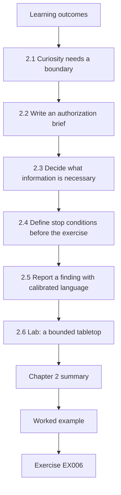

### Logical drawing

```mermaid
flowchart LR
  N0["Learning outcomes"]
  N1["2.1 Curiosity needs a boundary"]
  N2["2.2 Write an authorization brief"]
  N3["2.3 Decide what information is necessary"]
  N4["2.4 Define stop conditions before the exercise"]
  N5["2.5 Report a finding with calibrated language"]
  N6["2.6 Lab: a bounded tabletop"]
  N7["Chapter 2 summary"]
  N0 --> N1 --> N2 --> N3 --> N4 --> N5 --> N6 --> N7 --> Q["EX006"]
```

```text
[Learning outcomes]
    |
    v
[2.1 Curiosity needs a boundary]
    |
    v
[2.2 Write an authorization brief]
    |
    v
[2.3 Decide what information is necessary]
    |
    v
[2.4 Define stop conditions before the exercise]
    |
    v
[2.5 Report a finding with calibrated language]
    |
    v
[2.6 Lab: a bounded tabletop]
    |
    v
[Chapter 2 summary]
    |
    v
[Worked example] --> [Exercise EX006]
```
<!-- cykin:lesson-figures:end ch-02 -->


### Learning outcomes

After this chapter, you should be able to define an allowed study activity, identify who can authorize it, write stop conditions, choose a synthetic data set, and report an observation without collecting unnecessary personal information.

### 2.1 Curiosity needs a boundary

The first chapter used an invented schedule so every reader could practice the method. A public website is different. Being able to open a page does not mean you have permission to probe the system behind it, test accounts, collect records, or disrupt its operation. A training exercise needs a named environment, an owner, permitted actions, and a way to stop. Reading a public document and testing a live service are different activities, even when the learner's intent is educational.

This course uses **synthetic** records and paper exercises by default. A learner may work with a real system only after its owner has authorized the specific activity and the learner understands the organization's rules. This is a practice rule for the course, not legal advice about any jurisdiction. If authorization is unclear, the next step is to ask the owner; it is not to test first and explain later.

The [NIST SP 800-115 testing guide](https://csrc.nist.gov/pubs/sp/800/115/final) describes planning and conducting technical assessments. Its [rules-of-engagement definition](https://csrc.nist.gov/glossary/term/Rules_of_Engagement) emphasizes guidelines and constraints set before a test. This rapid course stays at the level of defining safe scope and reviewing evidence. It does not require active testing of anyone else's systems.

### 2.2 Write an authorization brief

Imagine that Harbor Library's service owner wants staff to rehearse what to do if the room-booking page becomes unavailable. The approved exercise can be entirely offline. A one-page brief should answer seven questions:

| Question | Harbor Library exercise answer |
|---|---|
| Who owns the exercise? | The fictional service owner appoints a front-desk lead. |
| What is in scope? | A paper schedule, invented reservations, and a role-play of a 20-minute outage. |
| What is out of scope? | Live accounts, real residents, the actual booking page, and production data. |
| What may participants do? | Compare printed and synthetic later bookings; record decisions. |
| When does it run? | During a scheduled 30-minute training session. |
| What ends it? | The time limit, an unexpected real-system interaction, or a participant's safety concern. |
| Who receives the result? | The service owner receives a short note with evidence and limitations. |

The brief is specific enough for a beginner to follow. It also prevents the exercise from expanding into an unapproved account or network test. A phrase such as “test the library” is not an adequate scope because it does not identify systems, actions, people, or time.

### 2.3 Decide what information is necessary

Good evidence does not require copying everything available. The exercise needs a booking time, a room identifier, a printout time, and a decision made by staff. It does not need a resident's name, contact details, or account credentials. Replace names with invented labels such as `Resident A` and use artificial booking IDs. This both reduces possible harm and makes the exercise reproducible for other learners.

For a real incident report, preserve required evidence under the organization's approved process; do not independently delete or transform records you have a duty to retain. For a classroom exercise, start with synthetic inputs so the privacy question is simple. The learner should be able to explain why each field in the exercise is present. If a field does not support an objective, remove it.

The following sample has enough information for a schedule comparison:

```csv
booking_id,room,start_time,created_time,status
SYN-001,Room 2,14:00,08:20,confirmed
SYN-002,Room 2,15:00,10:05,confirmed
```

`SYN-` identifies invented records. The sample contains no real identity data. A reader can ask whether a 09:00 printout would include both records without accessing a booking system. It would include only the first if the printout is a snapshot at 09:00; that is an exercise assumption to state explicitly.

### 2.4 Define stop conditions before the exercise

A **stop condition** is an observable reason to pause work and ask for direction. It should be written before an activity begins, when everyone can think clearly. Examples for this paper exercise are: a participant opens a real booking page to “check” the scenario; a sheet contains a real patron name; the exercise begins to interfere with front-desk service; or a result suggests an actual urgent problem that needs the organization's response process. In each case, pause the training, protect the material already collected, and ask the designated owner what to do next.

Stopping is not failure. It is evidence that the team respected its boundary. A good report can state, “The exercise stopped after the team noticed a real patron name in the sample sheet. The sheet was not circulated; the owner replaced it with synthetic data.” That sentence documents both the problem and the safe action without publishing the name.

### 2.5 Report a finding with calibrated language

The goal of an exercise report is to help the owner decide what to check or change. A compact structure is:

1. **Objective and scope:** what was the exercise intended to test, and what was excluded?
2. **Method:** which synthetic inputs and steps were used?
3. **Observation:** what did participants actually see or do?
4. **Interpretation:** what risk or control gap may follow, and what alternative explanation remains?
5. **Recommendation:** what can the owner verify or improve next?
6. **Limitations:** what did the exercise not establish?

For the invented library test, a fair statement is: “In one paper exercise, staff using a 09:00 snapshot did not see a synthetic reservation created at 10:05. The exercise suggests that a static printout is insufficient as the sole source for later bookings during an outage. The exercise did not test the real booking service or establish how a real front desk currently operates.” The sentence is useful because the observation and its limit are both visible.

Avoid dramatic labels such as “critical breach” when no breach has been observed. Avoid a vague recommendation such as “improve security.” Propose a decision the owner can evaluate: define a fallback source for later bookings, mark the printout time, and rehearse the procedure with a later synthetic reservation.

### 2.6 Lab: a bounded tabletop

This lab needs only a text editor or paper. Use the two synthetic CSV rows above and draw a 09:00 printout containing `SYN-001` only. One learner plays the front-desk worker, one the resident asking about Room 2 at 15:00, and one the observer. If working alone, write three short lines for each role. The observer asks whether the worker knows the printout time, notices the missing later booking, and avoids promising a room without a current source.

Run two rounds. In round one, give the worker no fallback instruction and record what happens. In round two, give the worker this rule: “When the booking page is unavailable, mark the age of the printout and place unverified later requests in a pending queue until an approved source or the service owner confirms them.” Record whether the rule changed the decision. Do not infer that the rule will work in every setting. The result demonstrates only how this small scenario behaved under the stated assumptions.

An acceptable lab record has the date of the fictional exercise, role labels, the two synthetic booking IDs, the decision in each round, and a limitation statement. There is no need to create a live account, send a message, or access an external system.

### Chapter 2 summary

An authorized boundary makes a security exercise useful and safe. State the owner, permitted data and actions, excluded systems, timing, stop conditions, and reporting route before starting. Use synthetic records when they can answer the learning question. Report exactly what was observed and what remains unknown. Chapter 3 will add a more complete model of systems, data flows, and dependencies within that boundary.

### Chapter 2 exercises

Keep every activity within the synthetic paper-exercise boundary. Worked results appear at the end of this book.

### EX006 — Write the scope

- **Objective:** Turn a vague activity into an authorized exercise boundary.
- **Input:** The Harbor Library tabletop in Section 2.6.
- **Safe condition:** Use only paper or a text editor and invented records.
- **Task:** Write a six-line brief naming owner, in-scope materials, excluded systems, permitted actions, time window, and recipient of results.
- **Expected evidence:** A brief another learner could follow without guessing the boundary.
- **Rubric:** Credit for all six elements and a clear exclusion of production systems and real residents.

### EX007 — Minimize the data

- **Objective:** Select only information needed to test a learning outcome.
- **Input:** A fictional draft sheet with booking ID, room, start time, created time, resident name, personal phone number, and status.
- **Safe condition:** Do not use or invent realistic personal contact details.
- **Task:** Choose fields for the stale-printout exercise, explain each choice, and remove unnecessary fields.
- **Expected evidence:** A revised synthetic field list and one sentence per retained field.
- **Rubric:** Credit for retaining timing and room evidence while excluding name and phone number.

### EX008 — Stop or continue

- **Objective:** Apply a prewritten stop condition.
- **Input:** Halfway through the paper exercise, a participant proposes opening the real library site to check an answer.
- **Safe condition:** Do not open or test any real service.
- **Task:** State whether to continue, what to record, who decides the next step, and how to finish the learning objective safely.
- **Expected evidence:** A four-part response with an offline alternative.
- **Rubric:** Credit for pausing the proposed live action, notifying the owner, preserving the exercise boundary, and continuing with synthetic data if approved.

### EX009 — Calibrate the report

- **Objective:** Distinguish an observation from an exaggerated claim.
- **Input:** “The old printout did not show `SYN-002`; therefore the real library has a critical security breach.”
- **Safe condition:** Use the supplied fictional case only.
- **Task:** Rewrite the sentence as an observation, interpretation, limitation, and next check.
- **Expected evidence:** Four labeled sentences.
- **Rubric:** Credit for retaining the observed printout gap, removing the unsupported breach claim, and proposing an owner-approved check.

### EX010 — Compare two tabletop rounds

- **Objective:** Assess whether a procedure changes a decision in a controlled exercise.
- **Input:** The two rounds in Section 2.6, including the pending-queue rule in round two.
- **Safe condition:** Role-play without real service data or communication.
- **Task:** Define one observable decision in each round, one criterion for improvement, and two limits on generalizing the result.
- **Expected evidence:** A short comparison table and limitations.
- **Rubric:** Credit for an observable measure, a plausible decision difference, and limits about synthetic data and one-session scope.

<!-- cykin:chapter-navigation:start ch-02 -->
### Continue studying — chapter 02 of 09

[← Chapter 01](#ch-01) · [Course chapter index](../SUBJECTS.md) · [Chapter 03 →](#ch-03)

Continue to the next authored lesson.
<!-- cykin:chapter-navigation:end -->

<a id="ch-03"></a>

## Chapter 3 — Cybersecurity: systems, data and dependencies

<!-- cykin:lesson-figures:start ch-03 -->
### Lesson map

Lesson 03 published. Map, example, EX011.

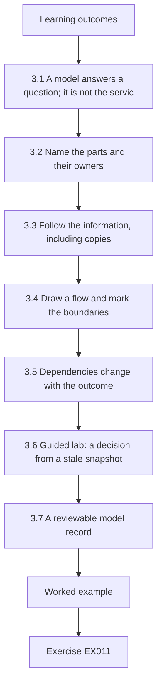

### Logical drawing

```mermaid
flowchart LR
  N0["Learning outcomes"]
  N1["3.1 A model answers a question; it is not the servic"]
  N2["3.2 Name the parts and their owners"]
  N3["3.3 Follow the information, including copies"]
  N4["3.4 Draw a flow and mark the boundaries"]
  N5["3.5 Dependencies change with the outcome"]
  N6["3.6 Guided lab: a decision from a stale snapshot"]
  N7["3.7 A reviewable model record"]
  N0 --> N1 --> N2 --> N3 --> N4 --> N5 --> N6 --> N7 --> Q["EX011"]
```

```text
[Learning outcomes]
    |
    v
[3.1 A model answers a question; it is not the servic]
    |
    v
[3.2 Name the parts and their owners]
    |
    v
[3.3 Follow the information, including copies]
    |
    v
[3.4 Draw a flow and mark the boundaries]
    |
    v
[3.5 Dependencies change with the outcome]
    |
    v
[3.6 Guided lab: a decision from a stale snapshot]
    |
    v
[3.7 A reviewable model record]
    |
    v
[Worked example] --> [Exercise EX011]
```
<!-- cykin:lesson-figures:end ch-03 -->


### Learning outcomes

After this chapter, you should be able to:

1. Set a useful boundary for a small service model and name its people, processes, stores, and outside services.
2. Trace one kind of information from creation to use, copying, and disposal without assuming that every copy is current.
3. Distinguish a data flow from a dependency and mark where a change of authority or trust deserves a question.
4. State which parts of a diagram are supplied facts, exercise assumptions, or unanswered questions.
5. Produce a small model and evidence-gap list from synthetic records only.

### 3.1 A model answers a question; it is not the service

The first chapter named Harbor Library's room-booking service. The second limited our practice to invented records. We can now ask a more precise question: **Could a front-desk worker make a correct room decision while the live booking view is unavailable?** A useful model contains the parts needed to answer that question. It need not depict every device the library owns.

A **service boundary** says what the model covers. For this lesson it includes a resident's booking request, the booking view, a reservation store, a staff view, and the staff's fallback printout. The event-announcement list is a separate data set; it belongs in a broader library inventory but is outside the booking-decision path we will trace. That exclusion is deliberate, not a claim that the contact list has no security needs.

NIST's [CSF 2.0](https://doi.org/10.6028/NIST.CSWP.29) places inventories of hardware, software and services, representations of authorized network flows, supplier services, asset prioritization, and designated data types in its Asset Management category (`ID.AM`). The framework describes outcomes; it does not prescribe this course's diagram or prove that Harbor Library has any particular implementation. An organization would confirm the model with owners and approved records. Our beginner exercise uses stated assumptions so that the reasoning can be checked without live discovery.

The [OWASP Threat Modeling Cheat Sheet](https://cheatsheetseries.owasp.org/cheatsheets/Threat_Modeling_Cheat_Sheet.html) recommends showing external entities, processes, data stores, flows, and trust boundaries when modeling a system. We borrow these simple labels to understand the service. Threat ranking and application testing belong later in the learning path. For now, the job is to understand what information moves, who depends on it, and where our knowledge ends.

### 3.2 Name the parts and their owners

An **external entity** is a person or system outside the modeled process that interacts with it. A **process** accepts information and performs a task. A **data store** retains information. A **data flow** is movement between them. These labels describe roles in a model, not verified product architecture. One real application could combine several roles; one role could be spread across several services.

| Modeled part | Role in the lesson | Who would confirm it in a real review? | Current evidence |
|---|---|---|---|
| Resident | Requests a room and receives a decision | Service owner and user-facing process owner | Fictional case description |
| Booking view | Receives a request and shows booking information | Application owner | Teaching assumption; no software examined |
| Reservation store | Holds the current booking state for the exercise | Application or data owner | Synthetic booking rows only |
| Staff view | Lets authorized staff consult the schedule | Service owner and staff lead | Teaching assumption |
| Printed schedule | Snapshot used during the tabletop outage | Front-desk lead | Invented 09:00 printout in Chapter 2 |
| Event contacts | Separate information used for announcements | Data owner | Fictional service description; outside this flow |

The “owner” column is a route for verification, not an assertion that one named person holds every responsibility. If the staff view actually reads from a different store, the model must change. If the paper printout is produced every hour rather than once each morning, its freshness risk also changes. A diagram should be revised when evidence disagrees with it.

### 3.3 Follow the information, including copies

Start with the data needed for the decision. In our synthetic exercise, a reservation has an invented ID, room, start time, creation time, and status. A confirmed booking is represented in the reservation store. A staff view may display that state. A printout contains a **snapshot** made at a particular time; it does not automatically receive later changes. This is a temporal property of the paper copy, not a software vulnerability.

Trace each representation explicitly:

| Representation | Why it exists | When it is current for this exercise | Question before relying on it |
|---|---|---|---|
| Synthetic booking row | Describes a reservation for the lesson | At its stated `created_time` | Is its status confirmed or only requested? |
| Staff schedule view | Would support a live room decision | Unknown while the exercise says the view is unavailable | What source feeds it, and when was that source updated? |
| 09:00 printed schedule | Provides an offline reference | Contains bookings known at 09:00 under our stated snapshot assumption | Were later bookings added, changed, or canceled? |
| Pending request queue | Records an unverified decision during the exercise | As current as the worker's entries, but **not** authoritative booking confirmation | Who reconciles it after the service returns? |

The event-contact list has a different purpose from the reservation list. Do not assume that a person who may view a room booking may also export event contacts. Likewise, a backup is a potential recovery resource, not automatically a current booking view. For a real inventory, an owner should identify data types, locations, purpose, access, retention and disposal rules according to the organization's policies. In this exercise, we record only the fields needed for the teaching question and invent no personal identifiers.

The distinction between **source of truth** and **copy** helps prevent an easy mistake. A current authoritative record is the one the service owner designates for a particular decision, subject to its actual integrity and availability. A printed copy may still be useful during an outage, but its timestamp limits what it can establish. “The printout exists” does not imply “the printout reflects all reservations.” “A backup job completed” does not imply “staff can safely use the backup as a live schedule.” Each claim needs separate evidence.

### 3.4 Draw a flow and mark the boundaries

The following is a **text alternative** to a diagram. It is intentionally small. Arrows indicate proposed movement of information, and brackets name roles. They do not claim that a real Harbor Library application has this architecture.

```text
[Resident] --booking request--> [Booking view] --proposed write--> [Reservation store]
     ^                              |                               |
     |                         booking result                   proposed read
     +------------------------------+                               |
                                                                    v
[Staff member] --sign-in and query--> [Staff view] <---------------+
                                         |
                                    09:00 snapshot
                                         v
                                [Printed schedule]
```

The first arrow crosses a boundary between a resident and a service that decides whether a request is valid. The staff sign-in and query cross a different boundary because a worker may have authority to see or change information that a resident cannot. The printed schedule leaves a digital process and becomes a physical copy; its handling and freshness need human procedures. A **trust boundary** marks a change in assumptions or authority that should be examined. It is not, by itself, evidence that authentication, authorization, encryption, or logging is present or absent.

For each arrow, ask three beginner questions: **What moves? Who is allowed to cause or read that movement? What evidence would show that the intended rule is followed?** For the resident request, the answers might be “room and time,” “a resident may request an available room,” and “an owner-approved test with synthetic bookings plus a reviewed application specification.” Those are possible checks, not facts established by our paper exercise. Do not use this diagram as permission to send test requests to a public site.

If a third-party messaging service sends confirmations, add it as an outside service only after confirming that it is actually used. Then ask what data it receives, what the supplier is responsible for, and whether the service can still make a booking decision if messaging is delayed. This is an example of a **conditional dependency**: the answer may differ between “a reservation can be saved” and “a resident receives confirmation.” Keeping those outcomes separate avoids treating every supplier outage as a complete booking outage.

### 3.5 Dependencies change with the outcome

A dependency is needed for a particular outcome under particular conditions. In the proposed live path, the booking view may depend on a reservation store. During the tabletop outage, staff may instead depend on the latest approved fallback source and a rule for pending requests. A component can be important without being the only way to keep working. Do not call the reservation store a “single point of failure” unless the owner has confirmed there is no suitable alternative and has defined what failure means.

To review a dependency, write a conditional sentence: “If **X** is unavailable, **Y** cannot be completed within **Z** time using the approved fallback.” The fictional case does not provide a recovery target `Z`, so leave it as a question for the service owner. Separate effects on residents, staff, and event subscribers. An outage of the front-desk view does not prove that a resident's page is down; Chapter 1's record specifically limited the observed outage to the front desk.

The service model also needs an update rule. A change to the booking workflow, printing schedule, or approved source can invalidate this page. A small inventory entry should therefore record the model's date, author or responsible owner, scope, evidence, open questions, and the trigger for revision. A tidy diagram with no review date can mislead a reader more than a rough diagram with clear uncertainty labels.

### 3.6 Guided lab: a decision from a stale snapshot

Use the **synthetic** rows introduced in Chapter 2:

```csv
booking_id,room,start_time,created_time,status
SYN-001,Room 2,14:00,08:20,confirmed
SYN-002,Room 2,15:00,10:05,confirmed
```

For this lab only, assume a 09:00 printout is a fixed snapshot, includes `SYN-001`, and cannot include `SYN-002` because that booking was created at 10:05. The front-desk view is unavailable from 11:30 to 11:50. At 11:42 someone asks whether Room 2 is free at 15:00. No network or real data is used.

1. Copy the six modeled parts from Section 3.2 onto paper or into a Markdown table. Circle the printed schedule as a copy.
2. Trace `SYN-002` from its 10:05 creation to the reservation store in the *hypothetical* model. Draw a question mark at any unverified step, including whether the staff view would normally show it.
3. Compare the query time, printout time, and booking time. The printout cannot answer the 15:00 availability question under the stated snapshot assumption. Do not turn that conclusion into a claim about a real service.
4. Use the Chapter 2 fallback rule: mark the request **pending**, record the reason, and seek an approved current source or the owner. Do not promise the room from the old paper alone.
5. Write a three-line report: observed exercise fact, decision, and limitation. A model answer is: “The 09:00 synthetic printout omitted a booking created at 10:05. In the tabletop, the worker marked the 15:00 request pending rather than confirming it. The exercise did not inspect a real reservation store or establish how the real library handles outages.”

The expected artifact is a small model plus this report. The outcome is not “we discovered a breach.” The outcome is a defensible decision given limited information. If the owner later supplies a verified hourly paper schedule or an approved offline replica, repeat the analysis with that evidence; do not preserve the original conclusion merely because it appeared in a diagram.

### 3.7 A reviewable model record

Use this Markdown template for a service model. It is intentionally short enough that another learner can challenge it:

```text
Decision being supported:
Service and people affected:
In scope / out of scope:
Entities, processes, and stores:
Data types and their purposes:
Flows and boundaries:
Dependencies and fallback assumptions:
Supplied facts:
Exercise assumptions:
Open questions and owner to ask:
Last reviewed / update trigger:
```

For Harbor Library, “booking created at 10:05” is a supplied synthetic fact; “the printed schedule is a fixed 09:00 snapshot” is an exercise assumption; “what source staff may use during a real outage” is an open question. These categories should remain visible in the final artifact. A learner who writes “the system has no recovery” because this chapter did not mention one has confused **missing evidence** with **evidence of absence**.

Common errors include drawing a detailed architecture from a short narrative, treating every line as a verified network connection, omitting physical copies, confusing a dependency with a failure, and leaving a model unchanged after new information arrives. The remedy is modest: keep the model tied to one decision, label uncertainty, ask its owner, and revise the record when a fact changes. Chapter 4 will use this bounded model to discuss plausible threats and ordinary failure modes without asserting that any one of them occurred.

### Chapter 3 summary

Model the people, processes, stores, and information needed for a defined service decision. Treat data copies and their timestamps explicitly. A flow shows proposed movement; a trust boundary prompts a question about authority; a dependency matters only in relation to a stated outcome. Mark supplied facts, assumptions, and unanswered questions so that the model remains useful when evidence changes.

### Chapter 3 exercises

Use the model and invented records above; do not test a live service. Worked results appear in the final appendix.

### EX011 — Boundary and components

- **Objective:** Define a service model that answers a specific question without inventing implementation details.
- **Input:** The decision question in Section 3.1 and the six modeled parts in Section 3.2.
- **Safe condition:** Use the fictional case only; do not inspect a real library service.
- **Steps:** (1) Write the decision question. (2) Name four parts needed to answer it and classify each as entity, process, store, or copy. (3) Name one related data set that is outside this decision path and explain why. (4) Mark one unverified architectural assumption.
- **Expected evidence:** A scope statement and a four-row component table with one open question.
- **Rubric:** Full credit requires a bounded booking-decision question, appropriate roles, a reasoned exclusion of event contacts, and a visible uncertainty label. A highly detailed but unsupported network diagram does not meet the objective.

### EX012 — Trace the snapshot

- **Objective:** Distinguish the time of a data copy from the time of a later change.
- **Input:** The two CSV rows in Section 3.6, a fixed 09:00 printout, and the 11:42 room question.
- **Safe condition:** Work only with these invented times and IDs.
- **Steps:** (1) Put the four relevant times in order. (2) List which booking IDs the printout can include under the snapshot assumption. (3) State what the printout cannot establish at 11:42. (4) Record the worker's defensible next action.
- **Expected evidence:** A short timeline and a decision note with its assumption.
- **Rubric:** Full credit requires `SYN-001` in the printout, `SYN-002` absent, an explicit snapshot assumption, and a pending or owner-confirmed decision rather than an unsupported promise.

### EX013 — Flow versus dependency

- **Objective:** Tell information movement apart from a condition required for an outcome.
- **Input:** The text diagram in Section 3.4 and the two outcomes “save a reservation” and “send a confirmation.”
- **Safe condition:** Treat the optional messaging supplier as hypothetical; do not contact a vendor or send messages.
- **Steps:** (1) Name two flows shown in the diagram. (2) Write one conditional dependency for each outcome. (3) Explain whether a messaging delay necessarily proves that the reservation was not saved. (4) Name the fact an owner must confirm.
- **Expected evidence:** Two labeled flows, two conditional statements, and one verification question.
- **Rubric:** Full credit requires distinguishing a proposed data path from a required service condition and withholding a claim about the unconfirmed supplier or implementation.

### EX014 — Boundary questions

- **Objective:** Use a trust boundary as a prompt for verification rather than as proof of a control.
- **Input:** The resident-to-booking-view and staff-to-staff-view arrows in Section 3.4.
- **Safe condition:** This is a paper review; do not test accounts or send requests to a live service.
- **Steps:** For each arrow, write (1) what information or action crosses it, (2) who ought to be permitted to initiate it in the fictional scenario, (3) one control question for the owner, and (4) one kind of authorized evidence that could answer that question.
- **Expected evidence:** A two-row table separating expected permission from observed proof.
- **Rubric:** Full credit requires distinct resident and staff authority, specific owner questions, and a statement that the diagram alone does not verify any implementation.

### EX015 — Revise when a fact changes

- **Objective:** Update a model without clinging to an earlier conclusion.
- **Input:** A *new fictional owner report* says the front desk receives an approved offline schedule refreshed at 11:40 and containing `SYN-002`. Its accuracy has not yet been tested.
- **Safe condition:** Do not seek or copy real bookings; reason from this additional invented report.
- **Steps:** (1) Identify which earlier conclusion is weakened. (2) Add the reported offline schedule as a separate representation. (3) Specify a safe synthetic check of its timestamp and content. (4) State the decision if the check succeeds and if it fails, and note one remaining limitation.
- **Expected evidence:** A revised model note with report, test, branch decisions, and limitation.
- **Rubric:** Full credit requires treating the new information as a report, not as independently observed fact; changing the stale-09:00-only conclusion conditionally; and keeping the worker's decision within the approved fallback rule.

<!-- cykin:chapter-navigation:start ch-03 -->
### Continue studying — chapter 03 of 09

[← Chapter 02](#ch-02) · [Course chapter index](../SUBJECTS.md) · [Chapter 04 →](#ch-04)

Continue to the next authored lesson.
<!-- cykin:chapter-navigation:end -->

<a id="ch-04"></a>

## Chapter 4 — Cybersecurity: guided lab and applied synthesis

<!-- cykin:lesson-figures:start ch-04 -->
### Lesson map

Lesson 04 published. Map, example, EX016.

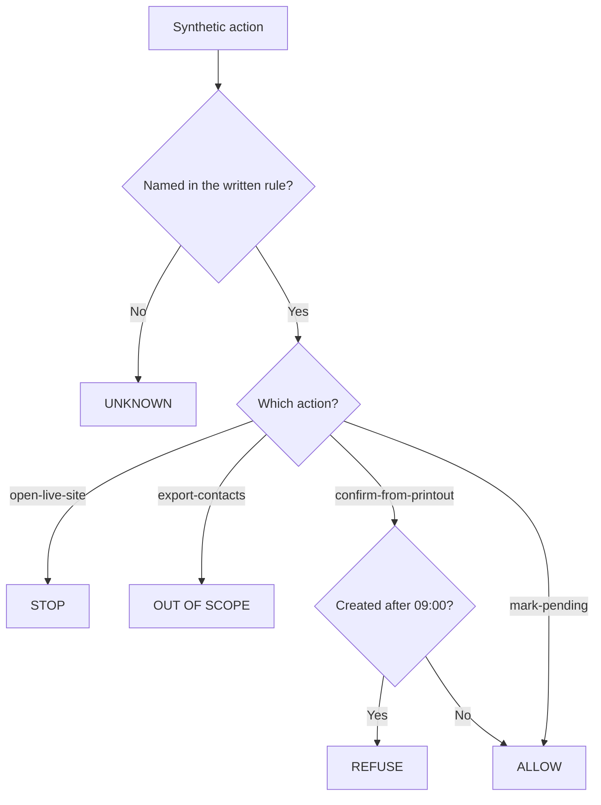

The diagram classifies one invented action. It does not describe a real library, and ALLOW is not proof that a room is free.

### Logical drawing

```text
written rule + synthetic row
        |
        +-- open live site --------> STOP
        +-- export contacts -------> OUT OF SCOPE
        +-- confirm from 09:00 paper
        |         |
        |         +-- later booking exists --> REFUSE
        |         +-- no later booking -----> ALLOW
        +-- mark pending ----------> ALLOW
        +-- anything else ---------> UNKNOWN
```
<!-- cykin:lesson-figures:end ch-04 -->

### Learning outcomes

After this chapter, you should be able to:

1. Apply a written rule to a synthetic staff action and name the verdict the rule produces.
2. Separate a classification of a recorded proposal from a decision that the real service is safe.
3. Explain why ALLOW, REFUSE, OUT OF SCOPE and STOP answer different questions.
4. State one fact the offline script cannot know.
5. Write a short dossier that keeps the observation, the decision and the limit in separate sentences.

### 4.1 Four verdicts, one written rule

Chapters 1–3 left a front-desk worker with a 09:00 paper schedule, two invented bookings, and a rule: do not confirm a later room from that paper, do not open a live site, and do not pull the event-contact list into the booking exercise. Chapter 4 turns that rule into a check a second person can rerun.

The check uses four verdicts. They are labels for this exercise, not a severity scale.

| Verdict | Question it answers | What it does not answer |
|---|---|---|
| STOP | Did this action leave the paper exercise? | Whether a real site is under attack |
| OUT OF SCOPE | Is this data set outside the booking decision? | Whether the contact list is well protected |
| REFUSE | Does the 09:00 snapshot omit a later booking for that room and start? | Why the booking page was unavailable |
| ALLOW | Does the written rule permit this recorded action? | Whether Room 2 is actually free |
| UNKNOWN | Is the action missing from the rule set? | What the owner would decide after being asked |

A number such as 7.4 would hide which of these questions changed. This chapter does not score the library.

### 4.2 The script reads the exercise assumption

The lab below is standard-library Python. It encodes three assumptions already fixed in this book: the printout time is 09:00, `SYN-002` was created at 10:05 for Room 2 at 15:00, and event contacts are outside the booking path. It does not read the Chapter 3 owner *report* of an 11:40 offline sheet. That report is still unverified, so the script must not treat it as a newer printout.

`REFUSE` fires only when a confirm-from-printout action names a room and start whose booking was created after 09:00. `ALLOW` on mark-pending means the rule accepts a pending queue. `ALLOW` on a confirmation means only that no later booking in this tiny table matches that room and start. A different room can therefore print ALLOW while remaining unknown in the real building.

### 4.3 Worked example: four actions

Use the same rows the script uses.

| Time | Action | Why the rule speaks | Verdict |
|---|---|---|---|
| 11:42 | Confirm Room 2 at 15:00 from the paper | `SYN-002` was created at 10:05, after the printout | REFUSE |
| 11:43 | Export event contacts | Announcement contacts are not the booking decision | OUT OF SCOPE |
| 11:44 | Open the live booking site | The brief forbids production systems | STOP |
| 11:45 | Mark the 15:00 request pending | The fallback rule allows a pending queue | ALLOW |

The 11:44 line classifies a *recorded proposal*. It does not by itself halt a classroom. In a live rehearsal the owner still pauses the people, as Chapter 2 required. The script keeps going so the other three rows stay visible. That difference is a limit of the program, not a softer stop condition.

### 4.4 Lab: classify the synthetic log

Save this program as `lab_dossier.py` and run it with `python3 lab_dossier.py`. Do not point it at a network, a library website, or a file of real patrons. The expected output is fixed for these rows. If your output differs, the rule you ran is not the rule in this chapter.

```python
"""Harbor Library tabletop dossier. Synthetic records only."""

PRINTOUT = "09:00"

BOOKINGS = [
    {"id": "SYN-001", "room": "Room 2", "start": "14:00", "created": "08:20", "status": "confirmed"},
    {"id": "SYN-002", "room": "Room 2", "start": "15:00", "created": "10:05", "status": "confirmed"},
]

ACTIONS = [
    {"time": "11:42", "action": "confirm-from-printout", "room": "Room 2", "start": "15:00"},
    {"time": "11:43", "action": "export-contacts"},
    {"time": "11:44", "action": "open-live-site"},
    {"time": "11:45", "action": "mark-pending", "room": "Room 2", "start": "15:00"},
]


def minutes(clock):
    hour, minute = clock.split(":")
    return int(hour) * 60 + int(minute)


def decide(action):
    kind = action["action"]
    if kind == "open-live-site":
        return "STOP", "live site is outside the paper exercise"
    if kind == "export-contacts":
        return "OUT OF SCOPE", "event contacts are outside the booking decision"
    if kind == "confirm-from-printout":
        later = [
            booking["id"]
            for booking in BOOKINGS
            if booking["room"] == action["room"]
            and booking["start"] == action["start"]
            and minutes(booking["created"]) > minutes(PRINTOUT)
        ]
        if later:
            return "REFUSE", "printout 09:00 omits " + ",".join(later)
        return "ALLOW", "no later booking is recorded for that room and start"
    if kind == "mark-pending":
        return "ALLOW", "pending until an approved current source"
    return "UNKNOWN", "the written rule set does not name this action"


def main():
    print("printout: 09:00; bookings: 2")
    omitted = [booking["id"] for booking in BOOKINGS if minutes(booking["created"]) > minutes(PRINTOUT)]
    print("omitted by printout: " + ",".join(omitted))
    counts = {"STOP": 0, "OUT OF SCOPE": 0, "REFUSE": 0, "ALLOW": 0, "UNKNOWN": 0}
    for action in ACTIONS:
        verdict, reason = decide(action)
        counts[verdict] += 1
        print(f"{action['time']} {action['action']}: {verdict}; {reason}")
    print(
        "STOP {STOP}; OUT OF SCOPE {OUT OF SCOPE}; REFUSE {REFUSE}; ALLOW {ALLOW}; UNKNOWN {UNKNOWN}".format(
            **counts
        )
    )


if __name__ == "__main__":
    main()
```

Exact output, checked with Python 3:

```text
printout: 09:00; bookings: 2
omitted by printout: SYN-002
11:42 confirm-from-printout: REFUSE; printout 09:00 omits SYN-002
11:43 export-contacts: OUT OF SCOPE; event contacts are outside the booking decision
11:44 open-live-site: STOP; live site is outside the paper exercise
11:45 mark-pending: ALLOW; pending until an approved current source
STOP 1; OUT OF SCOPE 1; REFUSE 1; ALLOW 1; UNKNOWN 0
```

The count line is a tally of these four rows. It is not a risk rating. Changing the 11:42 room to Room 4, which does not appear in `BOOKINGS`, makes that row ALLOW. The new ALLOW means the table has no later booking for Room 4 at 15:00. It does not mean a resident may have the room.

### 4.5 A dossier uses only what the run showed

Write six short sentences and stop. Sentence 1 names the exercise and the 09:00 assumption. Sentence 2 quotes one output line. Sentence 3 states the decision that line supports. Sentence 4 names a verdict that must not be merged with it: exporting contacts is OUT OF SCOPE, not REFUSE, because the contact list was never a booking-time comparison. Sentence 5 says the script did not inspect a reservation store and did not accept the unverified 11:40 report. Sentence 6 names the owner question that is still open: which approved source, if any, may replace the 09:00 paper.

If sentence 5 is blank, the note is not ready to guide a procedure change. A blank limit lets a reader treat a classroom tally as a finding about Harbor Library's real systems, which this book does not have.

### Chapter 4 summary

A written rule can classify a synthetic action the same way twice. STOP, OUT OF SCOPE, REFUSE, ALLOW and UNKNOWN answer different questions. The program's ALLOW is permission under the rows it was given, not evidence that a room is free or that a reported 11:40 sheet exists. The dossier keeps the output, the decision and the limit apart.

### Chapter 4 exercises

Use the program and output in Section 4.4. Do not contact a real library. Worked results are in the appendix.

### EX016 — Read the tally

- **Objective:** Tie one verdict to the row that produced it.
- **Input:** The exact lab output in Section 4.4.
- **Safe condition:** Do not add bookings or open a website.
- **Task:** Name the action that received REFUSE, the booking id the reason cites, and the assumption that makes that id absent from the paper.
- **Expected evidence:** Three items, each taken from the output or the stated 09:00 snapshot.
- **Rubric:** Credit only if the action is the 11:42 confirmation, the id is `SYN-002`, and the assumption is the 09:00 printout rather than an inferred attack.

### EX017 — ALLOW is not availability

- **Objective:** Limit what a matching rule is allowed to mean.
- **Input:** Change only the 11:42 action so the room is Room 4 and the start remains 15:00. Leave every other row as printed.
- **Safe condition:** Edit the synthetic table on paper or in a local copy. Do not query a live system.
- **Task:** State the new verdict for 11:42 and write the sentence a staff member must not say to a resident.
- **Expected evidence:** The verdict plus one prohibited claim.
- **Rubric:** Credit for ALLOW together with a refusal to promise Room 4. An answer that calls the room free fails.

### EX018 — Do not merge the verdicts

- **Objective:** Keep a data-set boundary distinct from a stale-paper comparison.
- **Input:** The 11:43 output line.
- **Safe condition:** Reason from that line only.
- **Task:** Explain why the export is OUT OF SCOPE rather than REFUSE, and name one fact about contact-list protection that this run does not provide.
- **Expected evidence:** A distinction and one explicit unknown.
- **Rubric:** Credit when REFUSE stays attached to the printout comparison and the contact list remains unmeasured.

### EX019 — Script stop versus human stop

- **Objective:** Notice that a classified row is not the same act as pausing people.
- **Input:** The 11:44 STOP line and the Chapter 2 rule that a live-site proposal pauses the exercise.
- **Safe condition:** Do not open a site to illustrate the point.
- **Task:** Say what the program did after printing STOP, what a facilitator should do with the participants, and why those two actions differ.
- **Expected evidence:** Three sentences.
- **Rubric:** Credit if the program continues through 11:45 while the facilitator pauses the people and asks the owner.

### EX020 — Six-sentence dossier

- **Objective:** Report the run without enlarging it.
- **Input:** Section 4.5 and the lab output.
- **Safe condition:** Invent no outage cause, no patron, and no second system.
- **Task:** Write the six sentences. Leave sentence 5 concrete. Do not assign a numeric score.
- **Expected evidence:** Six sentences a classmate can check against the output.
- **Rubric:** Credit when each sentence stays inside the run, the 11:43 line is not redescribed as REFUSE, and the 11:40 report is still unverified.

<!-- cykin:chapter-navigation:start ch-04 -->
### Continue studying — chapter 04 of 09

[← Chapter 03](#ch-03) · [Course chapter index](../SUBJECTS.md) · [Chapter 05 →](#ch-05)

Continue to the next authored lesson.
<!-- cykin:chapter-navigation:end -->

<a id="ch-05"></a>

## Chapter 5 — What may be said about a booking

<!-- cykin:lesson-figures:start ch-05 -->
### Lesson map

Lesson 05 published. Map, example, EX021.

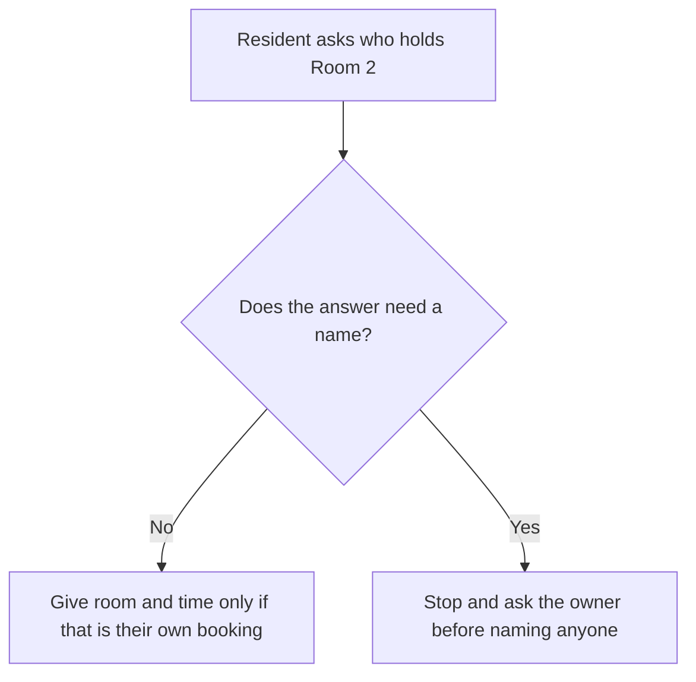

The drawing limits a spoken answer. It does not prove that the booking system hides names.

### Logical drawing

```text
question about another person's booking
        |
        +-- answer with room state only --> still check that the asker needs it
        +-- answer with a name -----------> not authorized by this lesson
```
<!-- cykin:lesson-figures:end ch-05 -->

### Learning outcomes

After this chapter, you should be able to:

1. Separate a booking fact the asker needs from a fact about another person.
2. Explain why a true statement can still be the wrong thing to say.
3. Choose a reply that answers the operational question without naming a resident.

### 5.1 Confidentiality is about disclosure, not secrecy of the room

Confidentiality, in the ordinary security sense used in Chapter 1, means that information is not disclosed to someone who should not receive it. The room number on a library door is not confidential. The name of the person who reserved it can be, because the reservation connects a person to a place and a time. Harbor Library's exercise has no privacy statute to apply and no real patrons. The limit still matters: a practice that treats every true fact as sayable will train the wrong habit.

A resident at the desk asks, "Who has Room 2 at 14:00?" The worker can see, in the synthetic table, that `SYN-001` is a confirmed booking for Room 2 at 14:00. The table in this book does not even contain a resident name. Inventing one in order to be helpful would create personal data the exercise removed on purpose in Chapter 2.

### 5.2 Worked example

The operational question hiding inside the spoken question is usually "Can I use Room 2 at 14:00?" That question can be answered from the booking state.

| Asker's words | Fact the worker has | Reply that stays inside the exercise | Reply that leaves it |
|---|---|---|---|
| Who has Room 2 at 14:00? | `SYN-001` confirmed, no name stored | "That slot is already booked. I can't use this sheet to say who." | A made-up name, or a guess from the event list |
| Is Room 2 free at 15:00? | `SYN-002` confirmed after 09:00 | "The current exercise record shows 15:00 as booked. I will not confirm a change from the 09:00 paper." | "It's free" because the paper omitted `SYN-002` |

The second row reuses the stale-paper rule from Chapter 4. The new point is the first row: even a current record does not authorize naming a person who is not in the record.

### 5.3 What this chapter does not decide

It does not decide that every library must hide reservation names, or that a name is always sensitive. A library could have a posted public program that lists a speaker's name because that person agreed to be listed. Harbor Library's booking exercise has no such agreement and no name field. Staff who need a name for a safety reason ask the owner and record why. They do not borrow a name from the announcement contacts, which Chapter 3 left outside the booking path.

### Chapter 5 summary

A true booking state can be shared when it answers the asker's own question. A person's identity is a different disclosure. This exercise has no names to give, and inventing one is not customer service.

### Chapter 5 exercises

### EX021 — Answer the person in front of you

- **Objective:** Refuse an unnecessary disclosure without hiding the room state.
- **Input:** A resident asks who booked Room 2 at 14:00. The synthetic row is `SYN-001`, confirmed, with no name.
- **Safe condition:** Do not invent a resident and do not open a live site.
- **Task:** Write the reply you would say, and name the fact you deliberately leave out.
- **Expected evidence:** One spoken reply and one withheld item.
- **Rubric:** Credit if the slot is described as booked and no person is named or invented.

<!-- cykin:chapter-navigation:start ch-05 -->
### Continue studying — chapter 05 of 09

[← Chapter 04](#ch-04) · [Course chapter index](../SUBJECTS.md) · [Chapter 06 →](#ch-06)

Continue to the next authored lesson.
<!-- cykin:chapter-navigation:end -->

<a id="ch-06"></a>

## Chapter 6 — A handwritten change is not a correction

<!-- cykin:lesson-figures:start ch-06 -->
### Lesson map

Lesson 06 published. Map, example, EX022.

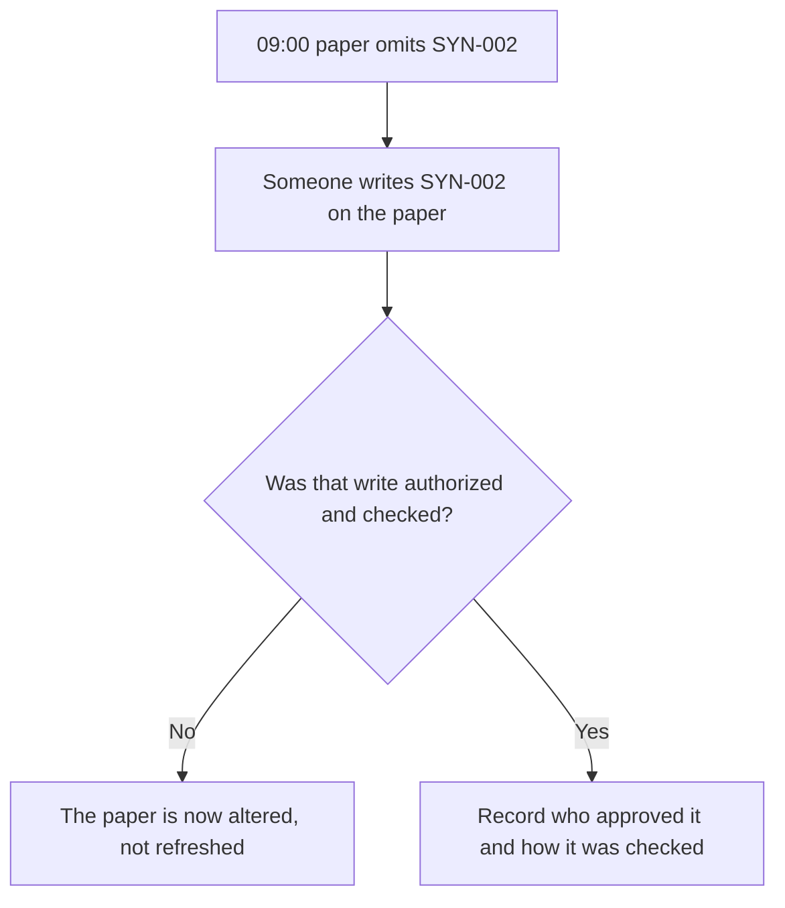

The diagram distinguishes an edit from a new authorized copy.

### Logical drawing

```text
stale paper
    |
    +-- leave it and mark the request pending
    +-- replace it with an approved later copy
    +-- write on it so the confirmation looks allowed --> alteration
```
<!-- cykin:lesson-figures:end ch-06 -->

### Learning outcomes

After this chapter, you should be able to:

1. Tell an authorized refresh of a schedule from a handwritten addition.
2. Explain why making the paper match the desired answer damages the record.
3. State what evidence would be required before a later copy could replace the 09:00 paper.

### 6.1 Integrity is about the record, not the wish

Integrity means the information stays accurate and is changed only in an authorized way. Chapter 3 already warned that a second copy can be stale. This chapter looks at a different failure: a worker who wants to help writes `SYN-002` onto the 09:00 sheet so that a confirmation no longer looks refused. The booking may really exist in the synthetic table. The writing still changes the artifact that was supposed to be the 09:00 snapshot.

After that pen mark, a classmate can no longer see what the paper said at 09:00. The lab in Chapter 4 would also change if someone edited `PRINTOUT` or the booking time so the program printed ALLOW. Both moves adjust the record to the preferred verdict. Neither move is a check.

### 6.2 Worked example

| Action | What is preserved | Verdict for this exercise |
|---|---|---|
| Leave the 09:00 sheet unmarked and mark the 15:00 request pending | The snapshot and the later booking stay distinct | Consistent with Chapter 4 |
| Ask the owner for the reported 11:40 sheet and check its time and the presence of `SYN-002` | The new copy is still only reported until the check passes | The Chapter 3 condition |
| Write `SYN-002` on the 09:00 sheet in pencil | The original snapshot is gone | Not a correction |

The third row is the lesson. Good intent does not restore integrity. If the owner later produces a real 11:40 copy, the penciled sheet cannot serve as that copy, because its time and its author are no longer reliable.

### 6.3 A limit

This chapter does not claim that Harbor Library forbids all handwritten schedules. A designed offline form, with a time, an author and a check, can be an authorized copy. An anonymous pencil mark on yesterday's printout is not that form. The exercise also does not show that anyone at Harbor Library did this. It is a mistake to practice against, using the synthetic sheet only.

### Chapter 6 summary

Changing a snapshot so that a rule would have allowed the action destroys the evidence the rule needed. Pending, or a checked later copy, keeps the history. A pencil mark does not.

### Chapter 6 exercises

### EX022 — Spot the alteration

- **Objective:** Reject an edit that manufactures agreement.
- **Input:** The 09:00 sheet lists only `SYN-001`. During the outage a volunteer pencils in `SYN-002`, Room 2, 15:00, and says, "Now the paper matches the table, so we can confirm."
- **Safe condition:** Do not confirm a room and do not alter your own copy into the answer you prefer.
- **Task:** Say what the pencil mark did to the 09:00 record, whether confirmation is now allowed, and what you would keep instead.
- **Expected evidence:** Three judgments.
- **Rubric:** Credit only if the mark is called an alteration, confirmation stays refused on that sheet, and the alternative is a pending request or an owner-checked later copy.

<!-- cykin:chapter-navigation:start ch-06 -->
### Continue studying — chapter 06 of 09

[← Chapter 05](#ch-05) · [Course chapter index](../SUBJECTS.md) · [Chapter 07 →](#ch-07)

Continue to the next authored lesson.
<!-- cykin:chapter-navigation:end -->

<a id="ch-07"></a>

## Chapter 7 — A pending queue during an outage

<!-- cykin:lesson-figures:start ch-07 -->
### Lesson map

Lesson 07 published. Map, example, EX023.

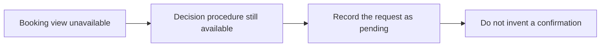

Availability of a screen and availability of a safe decision are different.

### Logical drawing

```text
outage of the booking view
        |
        +-- service unavailable
        +-- staff procedure available --> pending queue
        +-- confirmation from memory ----> not available as a method
```
<!-- cykin:lesson-figures:end ch-07 -->

### Learning outcomes

After this chapter, you should be able to:

1. Separate "the booking page is down" from "no decision procedure exists."
2. Use a pending queue as a continuity method without pretending the room was confirmed.
3. Apply the same method to a second outage without inventing a new cause.

### 7.1 Availability of what

Chapter 1 named availability as the property that information and the service are there when needed. At 11:30 the booking view is not there. The front desk can still be there. Those are different assets. Calling the whole library "unavailable" would erase the procedure that is still usable: write the request, mark it pending, and wait for an approved current source.

A pending entry needs four fields and nothing personal: time the request was heard, room, requested start, and the words "not confirmed." Adding a resident name would repeat the Chapter 5 mistake. Adding "probably fine" would be a confirmation wearing softer clothes.

### 7.2 Worked example: the next morning

The next morning the view fails again from 09:10 to 09:25. A visitor asks to take Room 2 at 15:00 that day. Nothing in this book says the two outages have the same cause. The worker does not need the cause. The current approved source is still missing, and the 09:00 paper from the earlier exercise is a different day's snapshot, so it cannot confirm today's 15:00.

| Field | Entry |
|---|---|
| Heard | 09:12 |
| Room | Room 2 |
| Start | 15:00 |
| State | not confirmed |

When the view returns, the worker compares the pending line with the current record before anyone tells the visitor the room is theirs. If the current record already has a booking, the visitor is told the slot is booked, still without a name. If it is free, a new booking still requires whatever approval the owner defined. This lesson does not invent that approval step.

### 7.3 Limit

One calm pending slip does not measure how long the library can operate this way, how many requests arrive, or whether the view will return. It also does not explain the outage. Availability work at this level is the safe next action during the gap, not a capacity study.

### Chapter 7 summary

A down page removes one way to see bookings. It does not authorize memory, yesterday's paper, or a verbal yes. A pending line with room, time and "not confirmed" keeps the service honest until a current source exists.

### Chapter 7 exercises

### EX023 — Write the pending line

- **Objective:** Continue service without confirming a room.
- **Input:** At 09:12 the booking view is down. A visitor wants Room 2 at 15:00 today. Yesterday's 09:00 paper is in the drawer.
- **Safe condition:** Do not diagnose the outage and do not use yesterday's paper as today's source.
- **Task:** Fill the four pending fields and state why yesterday's paper is the wrong source.
- **Expected evidence:** The four fields and one exclusion.
- **Rubric:** Credit if the state is "not confirmed," no name is stored, and yesterday's sheet is excluded because it is a different snapshot.

<!-- cykin:chapter-navigation:start ch-07 -->
### Continue studying — chapter 07 of 09

[← Chapter 06](#ch-06) · [Course chapter index](../SUBJECTS.md) · [Chapter 08 →](#ch-08)

Continue to the next authored lesson.
<!-- cykin:chapter-navigation:end -->

<a id="ch-08"></a>

## Chapter 8 — A weak procedure is not yet a vulnerability

<!-- cykin:lesson-figures:start ch-08 -->
### Lesson map

Lesson 08 published. Map, example, EX024.

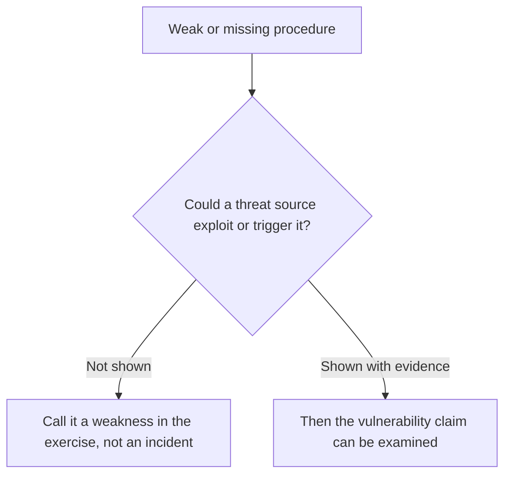

The test stops when the evidence stops. This case stops at the first box's "not shown" branch.

### Logical drawing

```text
stale printout used as if it were current
        |
        +-- weak procedure: observed in the exercise design
        +-- software flaw: not observed
        +-- attack: not observed
        +-- incident: not declared
```
<!-- cykin:lesson-figures:end ch-08 -->

### Learning outcomes

After this chapter, you should be able to:

1. Use "weakness" for the stale-paper habit without upgrading it to an attack.
2. State the extra evidence a vulnerability claim would require.
3. Refuse a lesson that treats a classroom limitation as an incident report.

### 8.1 The words are not interchangeable

The [NIST Computer Security Resource Center glossary](https://csrc.nist.gov/glossary/term/vulnerability) describes a vulnerability as a weakness that could be exploited or triggered by a threat source. A threat, in the same glossary, is a circumstance or event that could harm operations or assets. An incident is not the same noun as either of those. Chapter 1 already separated threat, vulnerability, event and risk. This chapter applies that split to the only failure the book has actually built: people may treat a 09:00 printout as if it were the live schedule.

That habit is a weakness in the procedure. The book has not exhibited a defect in a booking program, a payload, a stolen account, or a harmed resident. Calling it a vulnerability is only fair if we also say "could be triggered" as a hypothesis and then show the trigger. We cannot show it. The library is fictional, and the outage has no measured cause.

### 8.2 Worked example

| Statement | Class in this book | Why |
|---|---|---|
| The 09:00 paper omits a booking created at 10:05 | Observation | It is in the synthetic table |
| Staff might confirm from that paper | Weak procedure | The exercise was built so that mistake is possible |
| An attacker took the booking page down | Unsupported | No evidence, and Chapter 4 forbids the live site |
| The booking software has a flaw an attacker could use | Not established | No program behavior was tested |
| The outage is a security incident | Not declared | No owner has defined it as one, and the cause is unknown |

The useful decision is procedural. Keep the pending rule, stop pencil edits, and do not name people who are not in the record. Those actions reduce the weakness the exercise can demonstrate. They do not close an incident that was never opened.

### 8.3 What a later lesson would need

A later, more technical course can examine a software flaw when it has an authorized program, a controlled input and an observed result. This rapid lesson stops before that. If a classmate writes "critical vulnerability, score 9.1" on the dossier from Chapter 4, the number is the false precision Chapter 4 already rejected, and the noun is the wrong class. The dossier stays a record of four synthetic verdicts.

### Chapter 8 summary

Harbor Library's exercise shows a stale procedure and the harm that procedure can cause inside the story: a wrong confirmation, a disclosure, or a ruined snapshot. It does not show an exploitable product flaw or an attack. Use the smaller word until the evidence grows.

### Chapter 8 exercises

### EX024 — Choose the smaller word

- **Objective:** Classify the stale-paper problem without inflating it.
- **Input:** A classmate's note says, "The 11:30 outage was an incident caused by a critical vulnerability in the booking site."
- **Safe condition:** Use only facts from Chapters 1–7. Do not investigate a real site.
- **Task:** Replace the note with three sentences: what was observed, what class of problem the exercise supports, and which stronger claim remains unproven.
- **Expected evidence:** Three sentences a reader can check against the book.
- **Rubric:** Credit if the outage stays unexplained, the supported class is a weak procedure, and neither vulnerability nor incident is asserted as fact.

<!-- cykin:chapter-navigation:start ch-08 -->
### Continue studying — chapter 08 of 09

[← Chapter 07](#ch-07) · [Course chapter index](../SUBJECTS.md) · [Chapter 09 →](#ch-09)

Continue to the next authored lesson.
<!-- cykin:chapter-navigation:end -->

<a id="ch-09"></a>

## Chapter 9 — A verdict tally is not a severity

<!-- cykin:lesson-figures:start ch-09 -->
### Lesson map

Lesson 09 published. Map, example, EX025.

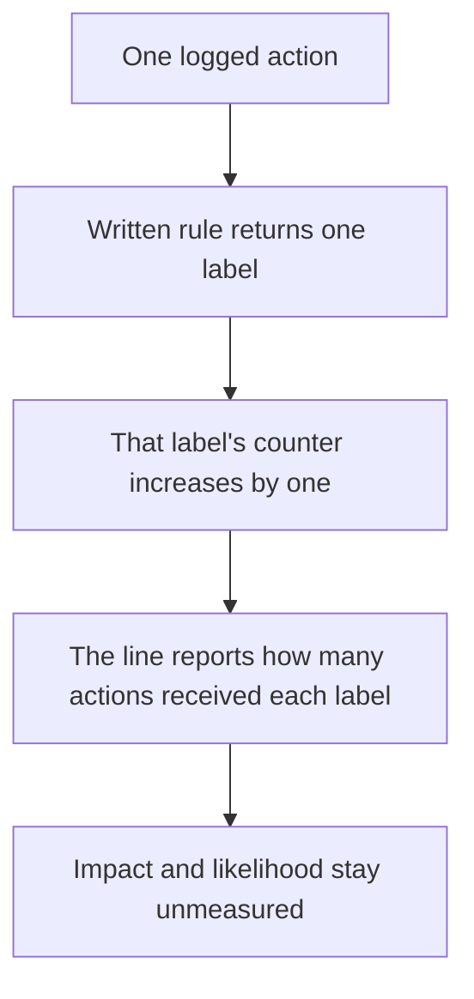

The last box is the limit. Printing the counters ends the tally. The flowchart does not continue into a score.

### Logical drawing

```text
Chapter 4 log, four actions
        |
        +-- REFUSE 1        one confirmation was not allowed
        +-- ALLOW 1         the rule matched; the room was not declared free
        +-- OUT OF SCOPE 1  one action asked a different question
        +-- STOP 1          one action left the paper exercise
        +-- UNKNOWN 0       no action missed every branch
        |
        +-- the line is a census of labels
        +-- impact is not in the line
        +-- likelihood is not in the line
```
<!-- cykin:lesson-figures:end ch-09 -->

### Learning outcomes

After this chapter, you should be able to:

1. Read `STOP 1; OUT OF SCOPE 1; REFUSE 1; ALLOW 1; UNKNOWN 0` as four counted labels and one empty remainder.
2. Keep that census separate from adverse impact and from likelihood.
3. Refuse a score, a percentage, or a rank built only from those five numbers.

### 9.1 The program counts labels

Chapter 4's program walks the synthetic log once. Each action receives one label, and that label's counter increases by one. The printed line is a census of this log:

`STOP 1; OUT OF SCOPE 1; REFUSE 1; ALLOW 1; UNKNOWN 0`

Four actions entered. Four decided labels came out, one of each class, and the remainder stayed at zero. Those equal counts belong to the exercise design. The log was written with one action per class so every branch would appear. A later week at a real desk could show forty ALLOW lines and one REFUSE line. That single REFUSE could be the only line on which a resident would have been told that a taken room was free. Equal classroom counts do not make the classes weigh the same.

`UNKNOWN 0` means every action in this log matched a branch of the written rule. The outage still has no tested cause. The reported 11:40 sheet is still unchecked. The library still has open questions. None of those facts was an action in the log, so none of them can move a counter.

### 9.2 Worked example

[NIST SP 800-30 Rev. 1](https://doi.org/10.6028/NIST.SP.800-30r1), as carried in the [CSRC glossary entry for risk](https://csrc.nist.gov/glossary/term/risk), treats risk as a measure of the extent to which a potential circumstance threatens an entity, typically a function of adverse impact and likelihood. Accessed 13 October 2026. The Harbor tally supplies neither input. It does not estimate how often staff would trust a stale printout, and it does not measure the harm of a wrong confirmation. This chapter uses that distinction only. It does not perform a risk assessment, and it does not assign the library a level.

| Sentence a classmate proposed | What the printed line can support | Decision |
|---|---|---|
| "The run labeled one action of each class, and no action was UNKNOWN." | The five counters | Keep, as a count |
| "Half the verdicts were adverse, so the figure is 50 percent." | No impact and no likelihood | Refuse the percentage |
| "ALLOW 1 shows that one room was confirmed free." | The rule found no later booking for that slot | Refuse the availability claim |
| "UNKNOWN 0 shows that the 11:30 outage is understood." | The log had no unmatched action | Refuse the causal claim |
| "Give the library 2.5 and close the exercise." | No scale, and no owner has accepted a current source | Refuse the score and the closure |

The report that survives is the four Chapter 4 decisions, named one by one, plus the statement that impact and likelihood were not measured. Chapter 8 kept the demonstrated problem in the class "weak procedure." This chapter leaves that class where it is.

### 9.3 What the counters leave open

A facilitator can still ask which approved source, if any, may replace the 09:00 paper. That question sits outside the tally. Treating the counters as balanced would hide the pending Room 2 at 15:00 request from Chapter 7. The arithmetic of this log is finished. The booking decision is still open.

### Chapter 9 summary

The tally is a census of labels on one synthetic log. Equal counts come from the way that log was built. They do not state a severity, a probability, or permission to stop asking which source is current.

### Chapter 9 exercises

### EX025 — Take the score off the dashboard

- **Objective:** Keep the Chapter 4 tally as a count.
- **Input:** A classmate's dashboard says, "Harbor risk score 25. Two adverse verdicts out of four is 50 percent, so the library is Medium and the exercise can close."
- **Safe condition:** Use the printed tally from Chapter 4. Do not invent a second run or open a live site.
- **Task:** Replace the dashboard with four sentences: what was counted, why 50 percent does not follow, why Medium does not follow, and which decision remains open.
- **Expected evidence:** Four sentences a reader can check against the printed line and Chapters 4, 7 and 8.
- **Rubric:** Credit when the tally stays a count of four labels, the percentage and the rank are both refused, and the pending confirmation is still unresolved. A replacement number does not earn credit.

<!-- cykin:chapter-navigation:start ch-09 -->
### Continue studying — chapter 09 of 09

[← Chapter 08](#ch-08) · [Course chapter index](../SUBJECTS.md) · [Next course via chapter index →](../SUBJECTS.md)

The chapter index leads to the next course in the study path.
<!-- cykin:chapter-navigation:end -->

## References and source notes

- [NIST, Cybersecurity Framework 2.0 FAQ](https://www.nist.gov/cyberframework/faqs) — six functions and their continuous, outcome-oriented use. Accessed 11 October 2026.
- [NIST CSRC glossary, “threat”](https://csrc.nist.gov/glossary/term/threat) — terminology source. Accessed 11 October 2026.
- [NIST CSRC glossary, “vulnerability”](https://csrc.nist.gov/glossary/term/vulnerability) — terminology source. Accessed 11 October 2026.
- [CISA, Secure Our World](https://www.cisa.gov/secure-our-world) — practical personal security starting actions. Accessed 11 October 2026.
- [NIST SP 800-115, Technical Guide to Information Security Testing and Assessment](https://csrc.nist.gov/pubs/sp/800/115/final) — planning and assessment context. Accessed 11 October 2026.
- [NIST CSRC glossary, “Rules of Engagement”](https://csrc.nist.gov/glossary/term/Rules_of_Engagement) — pre-agreed testing boundaries. Accessed 11 October 2026.
- [NIST, The Cybersecurity Framework 2.0 (NIST CSWP 29)](https://doi.org/10.6028/NIST.CSWP.29) — Asset Management outcomes `ID.AM-01`, `ID.AM-02`, `ID.AM-03`, `ID.AM-04`, `ID.AM-05`, and `ID.AM-07`. Accessed 11 October 2026.
- [OWASP, Threat Modeling Cheat Sheet](https://cheatsheetseries.owasp.org/cheatsheets/Threat_Modeling_Cheat_Sheet.html) — system-model elements, data flows, and trust boundaries. Accessed 11 October 2026.
- [NIST CSRC glossary, “vulnerability”](https://csrc.nist.gov/glossary/term/vulnerability) — weakness that could be exploited or triggered by a threat source. Accessed 13 October 2026.
- [NIST CSRC glossary, “threat”](https://csrc.nist.gov/glossary/term/threat) — circumstance or event with the potential to harm operations or assets. Accessed 13 October 2026.
- [NIST SP 800-30 Rev. 1](https://doi.org/10.6028/NIST.SP.800-30r1), through the [CSRC glossary entry for “risk”](https://csrc.nist.gov/glossary/term/risk) — risk as impact together with likelihood. Accessed 13 October 2026. The Harbor tally is not an application of that method.

Harbor Library, its services, event log, and worked decisions are original fictional teaching material. No text or figures from the linked sources are reproduced here. The definitions and framework descriptions are paraphrased and tied to those primary references.

## Final appendix — worked results and assessment notes

These results match EX001–EX025. Equivalent answers earn credit when they keep the same evidence limits. Reaching the 20-lesson minimum is separate from this answer key.

### EX001 — Worked result

The service is room booking and schedule access. Assets include reservation records (information), the booking application (software), and staff sign-in accounts (identity resources). The reservation store and staff sign-in process are dependencies for the staff schedule shown in the sample diagram; their exact design would require verification in a real setting. Reservation records matter to residents because an incorrect or unavailable booking can waste a visit or create a double booking. A response that labels “the internet” as the service without explaining the resident outcome is incomplete.

### EX002 — Worked result

Confidentiality: an unauthorized recipient receives the event contact list; subscribers are affected; check an approved export or delivery record before asserting disclosure. Integrity: a reservation is changed without the resident's request; residents and staff are affected; compare the authoritative record and a change history. Availability: the booking page is unavailable during a reservation window; residents and staff may be affected; check the time, scope, and service monitoring. These are invented scenarios. An answer may use different examples if each property and verification question are clear.

### EX003 — Worked result

(a) is supported by the synthetic record. (b) is unsupported: no cause for the outage is recorded. (c) is a reasonable inference because the printout is older than the booking, but actual wrong allocation is not observed. (d) is unsupported: the contact list does not appear in the event record. The key skill is preserving the boundary between a plausible consequence and a documented event.

### EX004 — Worked result

An acceptable fallback: the front-desk lead owns an outage procedure. When the live schedule has been unavailable for five minutes, staff mark the last printout's time and avoid confirming later bookings from that printout alone. They use an approved, current secondary source if one exists, or record the request and tell the resident that confirmation is pending. In a paper test, add a synthetic booking at 10:05, trigger an outage at 11:30, and check whether staff notice that a 09:00 printout is stale. A failure mode is that the secondary source is also outdated; the owner should verify its update time before relying on it. The precise five-minute trigger is a proposed exercise parameter, not a real policy.

### EX005 — Worked result

Govern: assign an owner for reservation and contact-list decisions. Identify: map the booking service and its dependencies. Protect: restrict staff changes to authorized accounts. Detect: alert a reviewer to unexpected reservation changes. Respond: suspend a confirmed misused account and communicate with the service owner. Recover: restore a trustworthy schedule and verify it with the owner. NIST describes the functions as continuous and concurrent. Mapping one example to each function helps reveal responsibilities; it does not prove that every control works or that risk has vanished.

### EX006 — Worked result

Owner: the fictional library service owner, represented by the instructor. In scope: the two synthetic bookings and an invented 09:00 printout. Excluded: production systems, accounts, and real resident information. Permitted actions: compare records and role-play front-desk decisions. Time: one scheduled 30-minute session. Result recipient: the service owner. An answer that names a real site without specific authorization fails the boundary requirement.

### EX007 — Worked result

Keep booking ID to trace the invented record, room to compare competing use, start time to determine which request matters, created time to test printout staleness, and status to know whether the request is confirmed. Remove resident name and personal phone number: neither is needed for the timing question. A learner may omit status if the scenario clearly says both bookings are confirmed, but should state that assumption.

### EX008 — Worked result

Pause the proposed live check. Record that it was proposed, without opening the site or assigning blame. Ask the designated exercise owner whether a different approved activity is needed. Continue the learning objective offline by using the synthetic booking sheet and printout if the owner confirms that the original exercise remains in scope. An individual's curiosity is not a substitute for the approved boundary.

### EX009 — Worked result

Observation: the 09:00 synthetic printout did not include `SYN-002`, which the sample says was created at 10:05. Interpretation: a static printout could mislead staff about later bookings during an outage. Limitation: the paper exercise did not test the real library or show a breach. Next check: ask the service owner for the approved fallback procedure and test it with a later synthetic booking. The wording keeps the evidence and the conclusion in proportion.

### EX010 — Worked result

In round one, the worker may promise Room 2 at 15:00 from an old printout; record that as the observed decision in the role-play. In round two, the worker marks the printout as stale and puts the request in a pending queue. An improvement criterion is “the worker does not confirm a post-printout booking without a current approved source.” The result is limited by invented data and a single session with a small number of participants. It does not establish real-world reliability; repeat tests and owner review would be needed.

### EX011 — Worked result

The decision question is whether a front-desk worker can make a correct room decision while the live view is unavailable. Resident is an external entity; booking view and staff view are processes; reservation store is a store; the printed schedule is a physical copy. Any four of these roles, correctly explained, satisfy the table. The event-contact list is outside the traced booking path because its purpose is announcements, though it remains relevant to a broader information inventory. One open question is whether the staff view reads the same store shown in the diagram. A good model says “proposed read” until the owner confirms it.

### EX012 — Worked result

At 08:20, `SYN-001` is created; at 09:00, the fixed printout is made; at 10:05, `SYN-002` is created; at 11:42, the room question arrives. Under the stated snapshot assumption, the printout can show `SYN-001` but not `SYN-002`. It cannot establish that Room 2 is free at 15:00. The worker marks the request pending and asks for an approved current source or the owner. If a learner says that the printout might refresh itself, they must explicitly challenge the exercise assumption; they cannot silently use a different scenario.

### EX013 — Worked result

Two flows in the proposed model are a resident's booking request to the booking view and a proposed write from the booking view to the reservation store. To save a reservation in this hypothetical path, the booking process would need a way to persist a valid decision; whether the depicted store is the real mechanism is unverified. To send a confirmation through a hypothetical supplier, that supplier would need to receive the required notification data and accept the delivery task. A delayed message does not by itself prove a failed reservation. Ask the owner whether confirmations are sent through an outside service and whether saving and messaging are coupled. Other answers are acceptable when they state an outcome, dependency, and uncertainty rather than asserting an unobserved implementation.

### EX014 — Worked result

Resident boundary: a room and time request enters the booking view; a resident may request an available room but should not gain staff powers. Ask the owner how requests are validated and what an approved synthetic test or design review shows. Staff boundary: an authenticated worker queries a staff view and may see or change information according to a defined role. Ask which roles may make changes and whether an approved role matrix and reviewed test support that rule. The arrows locate questions; they do not show that access checks exist or work. A claim that encryption or multifactor authentication is present from this drawing alone fails the evidence requirement.

### EX015 — Worked result

The earlier conclusion that only a stale 09:00 paper schedule is available is weakened by the owner's new report. Add “reported approved offline schedule, refreshed 11:40” as a separate copy; mark its authority and freshness as **reported, not verified**. In a paper rehearsal, give the worker a synthetic 11:40 sheet and check that its timestamp is 11:40 and that it includes `SYN-002`. If the owner confirms this as an approved current source and the check succeeds, the worker can use it according to the approved procedure; if the check fails, keep the request pending. One remaining limitation is that a single synthetic check does not establish how reliably the real offline schedule refreshes. The correct model changes conditionally instead of defending the old diagram.

### EX016 — Worked result

The REFUSE line is `11:42 confirm-from-printout`. The reason names `SYN-002`. That id is absent from the paper because the exercise printout is fixed at 09:00 and the booking was created at 10:05. The output does not say an attacker caused the gap.

### EX017 — Worked result

Room 4 at 15:00 has no row created after 09:00, so the rule prints ALLOW and the reason says no later booking is recorded for that room and start. The staff member must not tell a resident that Room 4 is free. ALLOW here means the synthetic table did not contain a conflicting later booking.

### EX018 — Worked result

REFUSE compares a printout time with a booking created later. The 11:43 export never makes that comparison, so the rule returns OUT OF SCOPE. This run does not show who can download the contact list, how long it is kept, or whether a control on it works.

### EX019 — Worked result

After STOP, the program still prints the 11:45 mark-pending line and the final tally. A facilitator pauses the participants, does not let anyone open a site, and asks the exercise owner what happens next. The program is replaying a log; the facilitator is responsible for the people in the room.

### EX020 — Worked result

One acceptable note: The exercise classified four synthetic actions against a 09:00 printout. At 11:42 the program refused confirmation of Room 2 at 15:00 because the paper omits `SYN-002`. The decision is to leave that request pending rather than confirm it from the paper. The 11:43 export is out of scope, not a refused booking. The script did not open a reservation store and did not treat the reported 11:40 sheet as verified. The open question for the owner is which approved source, if any, may replace the 09:00 paper. No numeric score belongs in the note.

### EX021 — Worked result

Say: "Room 2 at 14:00 is already booked. This sheet does not say who, and I will not guess." Leave out any person's name. `SYN-001` identifies a synthetic booking, not a resident, so reading the id aloud is also unnecessary for the asker's question.

### EX022 — Worked result

The pencil mark replaces the 09:00 snapshot with a new, unauthorized line, so the sheet can no longer show what was printed. Confirmation on that altered sheet is still not allowed. Keep the request pending, or wait for a later copy whose time and author the owner can check. Do not treat the pencil as that copy.

### EX023 — Worked result

Heard 09:12; room Room 2; start 15:00; state not confirmed. Yesterday's 09:00 paper is a different snapshot, so it cannot show whether today's 15:00 is free. No resident name belongs on the slip, and the outage cause is not part of the entry.

### EX024 — Worked result

The exercise observed a 09:00 paper that omitted a later synthetic booking, and a booking view that was described as unavailable, with no tested cause. The supported class is a weak confirmation procedure. A software vulnerability, an attack, and an incident are unproven: no program flaw was demonstrated, and no owner declared an incident.

### EX025 — Worked result

The program counted one STOP, one OUT OF SCOPE, one REFUSE and one ALLOW on the four-action log, and left UNKNOWN at zero. Fifty percent would turn two of those labels into a harm rate. The printed line does not measure harm, and it does not measure how often staff would trust the stale paper. Medium names a rank this exercise never defined. The Room 2 at 15:00 request stays pending until an approved current source exists. Chapter 8's weak confirmation procedure is unchanged.
