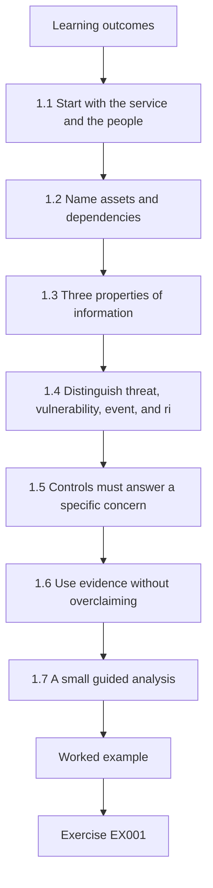
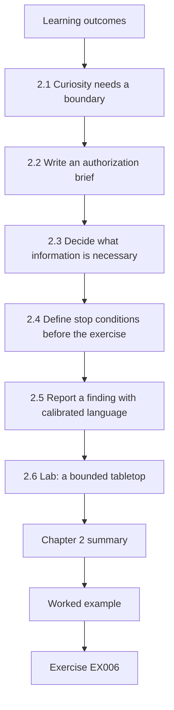
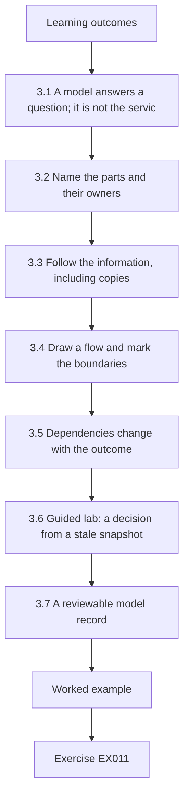

```mermaid
flowchart LR
  N0["Learning outcomes"]
  N1["1.1 Start with the service and the people"]
  N2["1.2 Name assets and dependencies"]
  N3["1.3 Three properties of information"]
  N4["1.4 Distinguish threat, vulnerability, event, and ri"]
  N5["1.5 Controls must answer a specific concern"]
  N6["1.6 Use evidence without overclaiming"]
  N7["1.7 A small guided analysis"]
  N0 --> N1 --> N2 --> N3 --> N4 --> N5 --> N6 --> N7 --> Q["EX001"]
```

```mermaid
flowchart LR
  N0["Learning outcomes"]
  N1["2.1 Curiosity needs a boundary"]
  N2["2.2 Write an authorization brief"]
  N3["2.3 Decide what information is necessary"]
  N4["2.4 Define stop conditions before the exercise"]
  N5["2.5 Report a finding with calibrated language"]
  N6["2.6 Lab: a bounded tabletop"]
  N7["Chapter 2 summary"]
  N0 --> N1 --> N2 --> N3 --> N4 --> N5 --> N6 --> N7 --> Q["EX006"]
```

```mermaid
flowchart LR
  N0["Learning outcomes"]
  N1["3.1 A model answers a question; it is not the servic"]
  N2["3.2 Name the parts and their owners"]
  N3["3.3 Follow the information, including copies"]
  N4["3.4 Draw a flow and mark the boundaries"]
  N5["3.5 Dependencies change with the outcome"]
  N6["3.6 Guided lab: a decision from a stale snapshot"]
  N7["3.7 A reviewable model record"]
  N0 --> N1 --> N2 --> N3 --> N4 --> N5 --> N6 --> N7 --> Q["EX011"]
```

# Cybersecurity: A One-Month Guided Course

- Edition: working draft, 11 October 2026
- Language: English (`en`)
- Course: rapid, one month; approximately 80 hours of planned study
- Status: Three of four subject-chapters drafted; fifteen of fifty minimum exercises and their worked results drafted. Chapter 4 and the 300-page A4 verification are **not complete**.
- Maintainer: [hiagokinlevi](https://github.com/hiagokinlevi)
- Original text: [CC0 1.0](../../../../../LICENSE), within the [rights notice](../../../../../RIGHTS.md). External sources linked below retain their own rights.

## How to study this draft

Read the explanation before attempting an exercise. Work only with the fictional library described here. Keep a short notebook with the facts you observe, the assumptions you make, and the question you would ask next. Compare your responses with the worked results at the end. A plausible alternative can be correct when it identifies its assumptions and supports its decision with evidence.

This is the **one principal book** for the English rapid Cybersecurity course. It incorporates the earlier Security Literacy draft. Its [subject grade](../SUBJECTS.md) and [book plan](PLAN.md) specify four chapters: one per subject. Each chapter teaches its subject with examples and exercises; worked results are gathered in the final appendix. The current text contains three draft chapters, not a completed book or qualification.

| Subject-chapter | Planned exercises | Authored exercises | Draft status |
|---|---:|---:|---|
| 1. Foundations and decisions | 13 | 5 | Draft |
| 2. Scope, permission and safe practice | 13 | 5 | Draft |
| 3. Systems, data and dependencies | 12 | 5 | Draft |
| 4. Guided lab and applied synthesis | 12 | 0 | Planned |

The exercise allocation is a planning minimum, not a claim that the missing questions exist. The final book also needs at least 300 rendered A4 pages; no page count has been verified.

<a id="ch-01"></a>

## Chapter 1 — Cybersecurity: foundations and decisions

<!-- cykin:lesson-figures:start ch-01 -->
### Lesson map

Lesson 01 published. Map, example, EX001.



### Logical drawing



```text
[Learning outcomes]
    |
    v
[1.1 Start with the service and the people]
    |
    v
[1.2 Name assets and dependencies]
    |
    v
[1.3 Three properties of information]
    |
    v
[1.4 Distinguish threat, vulnerability, event, and ri]
    |
    v
[1.5 Controls must answer a specific concern]
    |
    v
[1.6 Use evidence without overclaiming]
    |
    v
[1.7 A small guided analysis]
    |
    v
[Worked example] --> [Exercise EX001]
```
<!-- cykin:lesson-figures:end ch-01 -->


### Learning outcomes

After this chapter, you should be able to:

1. Describe an asset, a threat, a vulnerability, a control, a risk scenario, and evidence in ordinary language.
2. Explain confidentiality, integrity, and availability with a concrete service example.
3. Separate an observation from an assumption and a recommendation.
4. Describe the six functions of the NIST Cybersecurity Framework (CSF) 2.0 without treating them as a required sequence or a product checklist.
5. Produce a small, reviewable security note without probing a real system.

### 1.1 Start with the service and the people

Security begins with a question: **What needs to keep working, for whom, and what harm would follow if it did not?** The answer gives meaning to the technical details. A server is not valuable merely because it is a server. It matters because it supports a service, stores information, or helps people complete a task. A login page matters because it controls access to something behind it. A backup matters if it can actually restore the service within the time its users need.

Our teaching case is **Harbor Library**, an entirely fictional public library. Residents reserve study rooms through a website. Staff can view reservations, resolve conflicts, and print a daily schedule. The library also keeps a list of patrons who asked to receive event announcements. These are invented details; no real library or personal records are used in this lesson.

Before proposing a security tool, list the service outcomes:

| Service outcome | People affected | Example of harm if it fails | Question to verify |
|---|---|---|---|
| Residents can reserve available rooms | Residents and front-desk staff | A resident travels to a room that was double-booked | How are conflicting reservations prevented? |
| Staff can see an accurate daily schedule | Staff and residents | Staff give a room to the wrong group | What is the authoritative schedule? |
| Event contacts are used only for announcements | Subscribers | Unwanted disclosure or misuse of contact details | Who can export the contact list, and why? |

This table is a first model, not a verified inventory. In a real organization, a service owner would confirm the outcomes and acceptable disruption. For the exercises here, the fictional case is the full scope; do not test an actual website.

### 1.2 Name assets and dependencies

An **asset** is something of value that helps provide or protect a service. It can be information, software, a device, an account, a process, or a person's time and trust. Harbor Library's reservation records are information assets. The booking application, staff accounts, backup copies, and printed schedule are also assets. Their value and handling differ: a printed schedule may be essential during an outage, while a staff account can change reservations and therefore needs strong access controls.

A **dependency** is something a service needs in order to work. The booking page may need an identity service, a database, a network connection, and staff procedures. A dependency does not automatically become a single point of failure; that claim requires evidence about alternatives and recovery. Draw a simple chain before assigning a control:

```text
Resident -> booking page -> reservation store -> staff schedule
                         \-> confirmation message
Staff member -> staff sign-in -> reservation store
```

The arrows mean information or a request moves between parts of the service. They do not prove the implementation is built this way. That distinction matters: a diagram is a hypothesis until an owner or observation confirms it.

### 1.3 Three properties of information

The familiar **confidentiality, integrity, and availability** model describes three different ways a service or its information can be harmed. It is a teaching lens, not an exhaustive list of all harms.

- **Confidentiality** asks who may see information. If the event contact list is sent to an unauthorized recipient, confidentiality is affected even if the booking site remains online.
- **Integrity** asks whether information is correct and changed only in the intended way. If a reservation is silently altered, the schedule can be available but wrong.
- **Availability** asks whether authorized people can use the service when needed. An outage can prevent a resident from booking and staff from checking the schedule even if no information is disclosed.

One event can affect several properties. For example, an account with excessive privileges might export the contact list and change room bookings. Avoid reducing the analysis to one label. State the actual consequence, the people affected, and what is known.

Other concerns may matter too: whether a person's data was collected for a legitimate purpose, whether records can be traced to an authorized action, and whether the library can restore service after a disruption. Later chapters will treat these in more depth.

### 1.4 Distinguish threat, vulnerability, event, and risk

A **threat** is a circumstance or event with potential for harm. The [NIST glossary's threat entry](https://csrc.nist.gov/glossary/term/threat) includes unauthorized access, disclosure, modification, and denial of service among possible impacts. A threat is not proof that an attack occurred.

A **vulnerability** is a weakness that a threat source could exploit or trigger. The [NIST glossary's vulnerability entry](https://csrc.nist.gov/glossary/term/vulnerability) includes weaknesses in systems, procedures, controls, and implementations. A reused staff password is a possible weakness. Whether that weakness exists at Harbor Library is unknown; the case does not assert it.

An **event** is something observed: for example, the fictional schedule became unavailable from 10:00 to 10:20. An event alone does not establish its cause. It might result from maintenance, a software error, a network failure, or malicious activity. An **incident** is an event or series of events judged to require a security response under defined criteria. The course will use the organization's response criteria rather than labeling every error an attack.

A **risk scenario** links a plausible condition to an outcome: “If an unauthorized person changes room reservations, residents may receive incorrect confirmations and staff may allocate rooms incorrectly.” This statement does not assign a probability. It also does not claim that any unauthorized change has happened. To prioritize action, add context: how critical is the service, what controls exist, what evidence supports the scenario, and what uncertainty remains? A number without these inputs would create false confidence.

The six CSF 2.0 functions—**Govern, Identify, Protect, Detect, Respond, and Recover**—offer a common language for discussing these responsibilities. NIST describes them as concurrent and continuous outcomes, not a strict six-step procedure. For Harbor Library, assigning an owner for reservation data is governance; understanding the booking dependency is identification; access restrictions are protection; noticing unexpected changes is detection; containing an account misuse is response; restoring a trustworthy schedule is recovery. A single practical decision can involve more than one function. See the [NIST CSF 2.0 FAQ](https://www.nist.gov/cyberframework/faqs) for the framework's own description.

### 1.5 Controls must answer a specific concern

A **control** is a measure intended to reduce risk or improve an outcome. It may be technical, procedural, or organizational. “Use security software” is too vague to evaluate. “Require staff to use an approved second factor when signing in to the reservation administration page” describes a population, an action, and a boundary. It still needs verification: do all staff accounts follow the rule, can an approved user recover access, and is there a safe exception process?

For personal digital safety, [CISA's Secure Our World guidance](https://www.cisa.gov/secure-our-world) recommends recognizing and reporting phishing, using strong passwords and a password manager, enabling multifactor authentication, and updating software. These are useful starting actions. They do not replace a service-specific analysis. A library could implement all four and still have an untested restore process or an unclear owner for the event contact list.

Think in terms of **prevent, notice, act, and recover**. A control that reduces a chance of misuse may fail or be bypassed. The library therefore also needs a way to recognize abnormal changes, a person who can act, and a procedure to restore correct information. The right combination depends on the service's importance and verified facts. More controls are not automatically better: a procedure that no one owns is unlikely to work under pressure.

### 1.6 Use evidence without overclaiming

Security literacy includes knowing what a statement is based on. A useful working note separates four kinds of sentence:

1. **Observed fact:** “The fictional exercise log records a failed staff sign-in at 09:14.” The evidence is named and its scope is clear.
2. **Reported fact:** “The service owner says the printed schedule is refreshed each morning.” The speaker and time are named; the statement has not yet been independently checked.
3. **Inference:** “If printing occurs only in the morning, staff may not see later reservations during an outage.” This follows from the report but still needs testing.
4. **Recommendation:** “Test a midday outage and compare the printed schedule with the authoritative reservation list.” This proposes a check, not a claim about the present system.

The distinction prevents a common mistake: turning a plausible explanation into a finding. If a page is unavailable once, it is inaccurate to write “The library was attacked.” Instead, record the time, what failed, who observed it, and what logs or owner testimony could help determine the cause. Do not collect or publish patrons' personal information to make a teaching point.

Evidence has limits. A screenshot of a backup job may show that the job was configured. It does not prove a usable copy was produced or that a full service restore will meet the library's needs. A single test at noon does not prove the service is always available. Good notes identify both what the evidence supports and what it cannot establish.

### 1.7 A small guided analysis

Read this **synthetic** record. It is invented for this book, not a real incident:

```text
09:00  Staff print the daily room schedule.
10:05  A resident receives a booking confirmation for Room 2 at 14:00.
11:30  The booking page is unavailable to the front desk for 20 minutes.
11:42  Staff use the printed 09:00 schedule to answer a room question.
12:10  A staff member notices that the 10:05 booking is absent from the printout.
```

What is established? The printout predates the booking, and the later booking is absent from it. The record also says the page was unavailable to the front desk for twenty minutes. It does **not** establish why the page failed, whether residents could use it, or whether anyone accessed the contact list. The first concern is that staff may make a decision from stale information during an outage. A proportionate next action is to ask the service owner how staff should confirm current bookings when the live schedule is unavailable, then test that fallback with synthetic bookings.

A compact analysis note could read:

> In a fictional outage exercise, staff used a 09:00 printout after a 10:05 booking. The printout did not include that booking. The exercise therefore demonstrates a stale-schedule risk for front-desk decisions; it does not establish the cause of the booking-page outage. Confirm the fallback procedure with the service owner and test it with a later reservation.

This is the pattern for the rest of the course: name the service, describe the evidence, limit the conclusion, and propose a safe check. Chapter 2 adds authorization, scope, and stop conditions so that this method can be practiced responsibly.

### Chapter 1 summary

Security vocabulary is useful only when it improves a decision. Name the service and people first, map valuable assets and dependencies, describe the kind of harm, then connect a plausible condition to evidence and a proportionate control. Keep observations, assumptions, inferences, and recommendations distinct. The next chapter shows how to practice this work within an authorized boundary.

### Chapter 1 exercises

Use the fictional case only. Compare your work with the final worked-results appendix.

### EX001 — Asset and dependency map

- **Objective:** Distinguish a service, an asset, and a dependency.
- **Input:** The Harbor Library description in Sections 1.1–1.2.
- **Safe condition:** Work from this text alone; do not browse or test a real library.
- **Task:** Name the booking service, three different assets, and two dependencies. Explain why one asset matters to residents.
- **Expected evidence:** A five-item annotated map or short table.
- **Rubric:** Credit for a clear service outcome, three plausible assets of at least two kinds, two dependencies, and a resident-facing consequence.

### EX002 — Three kinds of harm

- **Objective:** Apply confidentiality, integrity, and availability without conflating them.
- **Input:** The fictional services in Section 1.1.
- **Safe condition:** Invent events; use no real personal information.
- **Task:** Write one distinct scenario for each of the three properties. For each, name the affected people and one fact you would need to check before claiming the event occurred.
- **Expected evidence:** Three labeled scenario statements and three verification questions.
- **Rubric:** Credit for matching the harm to the property, identifying people, and not asserting an unobserved event as fact.

### EX003 — Observation or inference

- **Objective:** Calibrate a conclusion to the available evidence.
- **Input:** The five-line synthetic record in Section 1.7.
- **Safe condition:** Analyze the supplied text only.
- **Task:** Classify these claims as supported, unsupported, or a reasonable inference: (a) a 10:05 booking was absent from the 09:00 printout; (b) an attacker caused the outage; (c) a stale printout could mislead staff; (d) the event contact list was exported. Explain each classification.
- **Expected evidence:** Four classifications and one sentence of reasoning each.
- **Rubric:** Credit for correct limits and an explanation tied to the record.

### EX004 — Control and check

- **Objective:** Propose a proportionate measure with evidence of effectiveness.
- **Input:** The stale-schedule issue in Section 1.7.
- **Safe condition:** Design a paper exercise; do not change a live system.
- **Task:** Propose one fallback procedure for staff during a booking-page outage. Define its owner, trigger, verification step, and one failure mode.
- **Expected evidence:** A four-part procedure plus a sample test with a synthetic booking.
- **Rubric:** Credit for an explicit owner and trigger, a test that can detect stale data, and an honest limitation.

### EX005 — Six-function view

- **Objective:** Use the CSF 2.0 functions as a vocabulary for service decisions.
- **Input:** Harbor Library and the [NIST FAQ](https://www.nist.gov/cyberframework/faqs).
- **Safe condition:** Work with the fictional case only.
- **Task:** Give one Harbor Library example for each of Govern, Identify, Protect, Detect, Respond, and Recover. Explain why completing one function does not finish security work.
- **Expected evidence:** Six short examples and a two-sentence explanation.
- **Rubric:** Credit for examples that match each function, recognize shared responsibility, and avoid treating the functions as a once-only sequence.

<!-- cykin:chapter-navigation:start ch-01 -->
### Continue studying — chapter 01 of 04

[← Course home](../../README.md) · [Course chapter index](../SUBJECTS.md) · [Chapter 02 →](#ch-02)

Continue to the next authored lesson.
<!-- cykin:chapter-navigation:end -->

<a id="ch-02"></a>

## Chapter 2 — Scope, permission and safe practice

<!-- cykin:lesson-figures:start ch-02 -->
### Lesson map

Lesson 02 published. Map, example, EX006.



### Logical drawing



```text
[Learning outcomes]
    |
    v
[2.1 Curiosity needs a boundary]
    |
    v
[2.2 Write an authorization brief]
    |
    v
[2.3 Decide what information is necessary]
    |
    v
[2.4 Define stop conditions before the exercise]
    |
    v
[2.5 Report a finding with calibrated language]
    |
    v
[2.6 Lab: a bounded tabletop]
    |
    v
[Chapter 2 summary]
    |
    v
[Worked example] --> [Exercise EX006]
```
<!-- cykin:lesson-figures:end ch-02 -->


### Learning outcomes

After this chapter, you should be able to define an allowed study activity, identify who can authorize it, write stop conditions, choose a synthetic data set, and report an observation without collecting unnecessary personal information.

### 2.1 Curiosity needs a boundary

The first chapter used an invented schedule so every reader could practice the method. A public website is different. Being able to open a page does not mean you have permission to probe the system behind it, test accounts, collect records, or disrupt its operation. A training exercise needs a named environment, an owner, permitted actions, and a way to stop. Reading a public document and testing a live service are different activities, even when the learner's intent is educational.

This course uses **synthetic** records and paper exercises by default. A learner may work with a real system only after its owner has authorized the specific activity and the learner understands the organization's rules. This is a practice rule for the course, not legal advice about any jurisdiction. If authorization is unclear, the next step is to ask the owner; it is not to test first and explain later.

The [NIST SP 800-115 testing guide](https://csrc.nist.gov/pubs/sp/800/115/final) describes planning and conducting technical assessments. Its [rules-of-engagement definition](https://csrc.nist.gov/glossary/term/Rules_of_Engagement) emphasizes guidelines and constraints set before a test. This rapid course stays at the level of defining safe scope and reviewing evidence. It does not require active testing of anyone else's systems.

### 2.2 Write an authorization brief

Imagine that Harbor Library's service owner wants staff to rehearse what to do if the room-booking page becomes unavailable. The approved exercise can be entirely offline. A one-page brief should answer seven questions:

| Question | Harbor Library exercise answer |
|---|---|
| Who owns the exercise? | The fictional service owner appoints a front-desk lead. |
| What is in scope? | A paper schedule, invented reservations, and a role-play of a 20-minute outage. |
| What is out of scope? | Live accounts, real residents, the actual booking page, and production data. |
| What may participants do? | Compare printed and synthetic later bookings; record decisions. |
| When does it run? | During a scheduled 30-minute training session. |
| What ends it? | The time limit, an unexpected real-system interaction, or a participant's safety concern. |
| Who receives the result? | The service owner receives a short note with evidence and limitations. |

The brief is specific enough for a beginner to follow. It also prevents the exercise from expanding into an unapproved account or network test. A phrase such as “test the library” is not an adequate scope because it does not identify systems, actions, people, or time.

### 2.3 Decide what information is necessary

Good evidence does not require copying everything available. The exercise needs a booking time, a room identifier, a printout time, and a decision made by staff. It does not need a resident's name, contact details, or account credentials. Replace names with invented labels such as `Resident A` and use artificial booking IDs. This both reduces possible harm and makes the exercise reproducible for other learners.

For a real incident report, preserve required evidence under the organization's approved process; do not independently delete or transform records you have a duty to retain. For a classroom exercise, start with synthetic inputs so the privacy question is simple. The learner should be able to explain why each field in the exercise is present. If a field does not support an objective, remove it.

The following sample has enough information for a schedule comparison:

```csv
booking_id,room,start_time,created_time,status
SYN-001,Room 2,14:00,08:20,confirmed
SYN-002,Room 2,15:00,10:05,confirmed
```

`SYN-` identifies invented records. The sample contains no real identity data. A reader can ask whether a 09:00 printout would include both records without accessing a booking system. It would include only the first if the printout is a snapshot at 09:00; that is an exercise assumption to state explicitly.

### 2.4 Define stop conditions before the exercise

A **stop condition** is an observable reason to pause work and ask for direction. It should be written before an activity begins, when everyone can think clearly. Examples for this paper exercise are: a participant opens a real booking page to “check” the scenario; a sheet contains a real patron name; the exercise begins to interfere with front-desk service; or a result suggests an actual urgent problem that needs the organization's response process. In each case, pause the training, protect the material already collected, and ask the designated owner what to do next.

Stopping is not failure. It is evidence that the team respected its boundary. A good report can state, “The exercise stopped after the team noticed a real patron name in the sample sheet. The sheet was not circulated; the owner replaced it with synthetic data.” That sentence documents both the problem and the safe action without publishing the name.

### 2.5 Report a finding with calibrated language

The goal of an exercise report is to help the owner decide what to check or change. A compact structure is:

1. **Objective and scope:** what was the exercise intended to test, and what was excluded?
2. **Method:** which synthetic inputs and steps were used?
3. **Observation:** what did participants actually see or do?
4. **Interpretation:** what risk or control gap may follow, and what alternative explanation remains?
5. **Recommendation:** what can the owner verify or improve next?
6. **Limitations:** what did the exercise not establish?

For the invented library test, a fair statement is: “In one paper exercise, staff using a 09:00 snapshot did not see a synthetic reservation created at 10:05. The exercise suggests that a static printout is insufficient as the sole source for later bookings during an outage. The exercise did not test the real booking service or establish how a real front desk currently operates.” The sentence is useful because the observation and its limit are both visible.

Avoid dramatic labels such as “critical breach” when no breach has been observed. Avoid a vague recommendation such as “improve security.” Propose a decision the owner can evaluate: define a fallback source for later bookings, mark the printout time, and rehearse the procedure with a later synthetic reservation.

### 2.6 Lab: a bounded tabletop

This lab needs only a text editor or paper. Use the two synthetic CSV rows above and draw a 09:00 printout containing `SYN-001` only. One learner plays the front-desk worker, one the resident asking about Room 2 at 15:00, and one the observer. If working alone, write three short lines for each role. The observer asks whether the worker knows the printout time, notices the missing later booking, and avoids promising a room without a current source.

Run two rounds. In round one, give the worker no fallback instruction and record what happens. In round two, give the worker this rule: “When the booking page is unavailable, mark the age of the printout and place unverified later requests in a pending queue until an approved source or the service owner confirms them.” Record whether the rule changed the decision. Do not infer that the rule will work in every setting. The result demonstrates only how this small scenario behaved under the stated assumptions.

An acceptable lab record has the date of the fictional exercise, role labels, the two synthetic booking IDs, the decision in each round, and a limitation statement. There is no need to create a live account, send a message, or access an external system.

### Chapter 2 summary

An authorized boundary makes a security exercise useful and safe. State the owner, permitted data and actions, excluded systems, timing, stop conditions, and reporting route before starting. Use synthetic records when they can answer the learning question. Report exactly what was observed and what remains unknown. Chapter 3 will add a more complete model of systems, data flows, and dependencies within that boundary.

### Chapter 2 exercises

Keep every activity within the synthetic paper-exercise boundary. Worked results appear at the end of this book.

### EX006 — Write the scope

- **Objective:** Turn a vague activity into an authorized exercise boundary.
- **Input:** The Harbor Library tabletop in Section 2.6.
- **Safe condition:** Use only paper or a text editor and invented records.
- **Task:** Write a six-line brief naming owner, in-scope materials, excluded systems, permitted actions, time window, and recipient of results.
- **Expected evidence:** A brief another learner could follow without guessing the boundary.
- **Rubric:** Credit for all six elements and a clear exclusion of production systems and real residents.

### EX007 — Minimize the data

- **Objective:** Select only information needed to test a learning outcome.
- **Input:** A fictional draft sheet with booking ID, room, start time, created time, resident name, personal phone number, and status.
- **Safe condition:** Do not use or invent realistic personal contact details.
- **Task:** Choose fields for the stale-printout exercise, explain each choice, and remove unnecessary fields.
- **Expected evidence:** A revised synthetic field list and one sentence per retained field.
- **Rubric:** Credit for retaining timing and room evidence while excluding name and phone number.

### EX008 — Stop or continue

- **Objective:** Apply a prewritten stop condition.
- **Input:** Halfway through the paper exercise, a participant proposes opening the real library site to check an answer.
- **Safe condition:** Do not open or test any real service.
- **Task:** State whether to continue, what to record, who decides the next step, and how to finish the learning objective safely.
- **Expected evidence:** A four-part response with an offline alternative.
- **Rubric:** Credit for pausing the proposed live action, notifying the owner, preserving the exercise boundary, and continuing with synthetic data if approved.

### EX009 — Calibrate the report

- **Objective:** Distinguish an observation from an exaggerated claim.
- **Input:** “The old printout did not show `SYN-002`; therefore the real library has a critical security breach.”
- **Safe condition:** Use the supplied fictional case only.
- **Task:** Rewrite the sentence as an observation, interpretation, limitation, and next check.
- **Expected evidence:** Four labeled sentences.
- **Rubric:** Credit for retaining the observed printout gap, removing the unsupported breach claim, and proposing an owner-approved check.

### EX010 — Compare two tabletop rounds

- **Objective:** Assess whether a procedure changes a decision in a controlled exercise.
- **Input:** The two rounds in Section 2.6, including the pending-queue rule in round two.
- **Safe condition:** Role-play without real service data or communication.
- **Task:** Define one observable decision in each round, one criterion for improvement, and two limits on generalizing the result.
- **Expected evidence:** A short comparison table and limitations.
- **Rubric:** Credit for an observable measure, a plausible decision difference, and limits about synthetic data and one-session scope.

<!-- cykin:chapter-navigation:start ch-02 -->
### Continue studying — chapter 02 of 04

[← Chapter 01](#ch-01) · [Course chapter index](../SUBJECTS.md) · [Chapter 03 →](#ch-03)

Continue to the next authored lesson.
<!-- cykin:chapter-navigation:end -->

<a id="ch-03"></a>

## Chapter 3 — Cybersecurity: systems, data and dependencies

<!-- cykin:lesson-figures:start ch-03 -->
### Lesson map

Lesson 03 published. Map, example, EX011.



### Logical drawing



```text
[Learning outcomes]
    |
    v
[3.1 A model answers a question; it is not the servic]
    |
    v
[3.2 Name the parts and their owners]
    |
    v
[3.3 Follow the information, including copies]
    |
    v
[3.4 Draw a flow and mark the boundaries]
    |
    v
[3.5 Dependencies change with the outcome]
    |
    v
[3.6 Guided lab: a decision from a stale snapshot]
    |
    v
[3.7 A reviewable model record]
    |
    v
[Worked example] --> [Exercise EX011]
```
<!-- cykin:lesson-figures:end ch-03 -->


### Learning outcomes

After this chapter, you should be able to:

1. Set a useful boundary for a small service model and name its people, processes, stores, and outside services.
2. Trace one kind of information from creation to use, copying, and disposal without assuming that every copy is current.
3. Distinguish a data flow from a dependency and mark where a change of authority or trust deserves a question.
4. State which parts of a diagram are supplied facts, exercise assumptions, or unanswered questions.
5. Produce a small model and evidence-gap list from synthetic records only.

### 3.1 A model answers a question; it is not the service

The first chapter named Harbor Library's room-booking service. The second limited our practice to invented records. We can now ask a more precise question: **Could a front-desk worker make a correct room decision while the live booking view is unavailable?** A useful model contains the parts needed to answer that question. It need not depict every device the library owns.

A **service boundary** says what the model covers. For this lesson it includes a resident's booking request, the booking view, a reservation store, a staff view, and the staff's fallback printout. The event-announcement list is a separate data set; it belongs in a broader library inventory but is outside the booking-decision path we will trace. That exclusion is deliberate, not a claim that the contact list has no security needs.

NIST's [CSF 2.0](https://doi.org/10.6028/NIST.CSWP.29) places inventories of hardware, software and services, representations of authorized network flows, supplier services, asset prioritization, and designated data types in its Asset Management category (`ID.AM`). The framework describes outcomes; it does not prescribe this course's diagram or prove that Harbor Library has any particular implementation. An organization would confirm the model with owners and approved records. Our beginner exercise uses stated assumptions so that the reasoning can be checked without live discovery.

The [OWASP Threat Modeling Cheat Sheet](https://cheatsheetseries.owasp.org/cheatsheets/Threat_Modeling_Cheat_Sheet.html) recommends showing external entities, processes, data stores, flows, and trust boundaries when modeling a system. We borrow these simple labels to understand the service. Threat ranking and application testing belong later in the learning path. For now, the job is to understand what information moves, who depends on it, and where our knowledge ends.

### 3.2 Name the parts and their owners

An **external entity** is a person or system outside the modeled process that interacts with it. A **process** accepts information and performs a task. A **data store** retains information. A **data flow** is movement between them. These labels describe roles in a model, not verified product architecture. One real application could combine several roles; one role could be spread across several services.

| Modeled part | Role in the lesson | Who would confirm it in a real review? | Current evidence |
|---|---|---|---|
| Resident | Requests a room and receives a decision | Service owner and user-facing process owner | Fictional case description |
| Booking view | Receives a request and shows booking information | Application owner | Teaching assumption; no software examined |
| Reservation store | Holds the current booking state for the exercise | Application or data owner | Synthetic booking rows only |
| Staff view | Lets authorized staff consult the schedule | Service owner and staff lead | Teaching assumption |
| Printed schedule | Snapshot used during the tabletop outage | Front-desk lead | Invented 09:00 printout in Chapter 2 |
| Event contacts | Separate information used for announcements | Data owner | Fictional service description; outside this flow |

The “owner” column is a route for verification, not an assertion that one named person holds every responsibility. If the staff view actually reads from a different store, the model must change. If the paper printout is produced every hour rather than once each morning, its freshness risk also changes. A diagram should be revised when evidence disagrees with it.

### 3.3 Follow the information, including copies

Start with the data needed for the decision. In our synthetic exercise, a reservation has an invented ID, room, start time, creation time, and status. A confirmed booking is represented in the reservation store. A staff view may display that state. A printout contains a **snapshot** made at a particular time; it does not automatically receive later changes. This is a temporal property of the paper copy, not a software vulnerability.

Trace each representation explicitly:

| Representation | Why it exists | When it is current for this exercise | Question before relying on it |
|---|---|---|---|
| Synthetic booking row | Describes a reservation for the lesson | At its stated `created_time` | Is its status confirmed or only requested? |
| Staff schedule view | Would support a live room decision | Unknown while the exercise says the view is unavailable | What source feeds it, and when was that source updated? |
| 09:00 printed schedule | Provides an offline reference | Contains bookings known at 09:00 under our stated snapshot assumption | Were later bookings added, changed, or canceled? |
| Pending request queue | Records an unverified decision during the exercise | As current as the worker's entries, but **not** authoritative booking confirmation | Who reconciles it after the service returns? |

The event-contact list has a different purpose from the reservation list. Do not assume that a person who may view a room booking may also export event contacts. Likewise, a backup is a potential recovery resource, not automatically a current booking view. For a real inventory, an owner should identify data types, locations, purpose, access, retention and disposal rules according to the organization's policies. In this exercise, we record only the fields needed for the teaching question and invent no personal identifiers.

The distinction between **source of truth** and **copy** helps prevent an easy mistake. A current authoritative record is the one the service owner designates for a particular decision, subject to its actual integrity and availability. A printed copy may still be useful during an outage, but its timestamp limits what it can establish. “The printout exists” does not imply “the printout reflects all reservations.” “A backup job completed” does not imply “staff can safely use the backup as a live schedule.” Each claim needs separate evidence.

### 3.4 Draw a flow and mark the boundaries

The following is a **text alternative** to a diagram. It is intentionally small. Arrows indicate proposed movement of information, and brackets name roles. They do not claim that a real Harbor Library application has this architecture.

```text
[Resident] --booking request--> [Booking view] --proposed write--> [Reservation store]
     ^                              |                               |
     |                         booking result                   proposed read
     +------------------------------+                               |
                                                                    v
[Staff member] --sign-in and query--> [Staff view] <---------------+
                                         |
                                    09:00 snapshot
                                         v
                                [Printed schedule]
```

The first arrow crosses a boundary between a resident and a service that decides whether a request is valid. The staff sign-in and query cross a different boundary because a worker may have authority to see or change information that a resident cannot. The printed schedule leaves a digital process and becomes a physical copy; its handling and freshness need human procedures. A **trust boundary** marks a change in assumptions or authority that should be examined. It is not, by itself, evidence that authentication, authorization, encryption, or logging is present or absent.

For each arrow, ask three beginner questions: **What moves? Who is allowed to cause or read that movement? What evidence would show that the intended rule is followed?** For the resident request, the answers might be “room and time,” “a resident may request an available room,” and “an owner-approved test with synthetic bookings plus a reviewed application specification.” Those are possible checks, not facts established by our paper exercise. Do not use this diagram as permission to send test requests to a public site.

If a third-party messaging service sends confirmations, add it as an outside service only after confirming that it is actually used. Then ask what data it receives, what the supplier is responsible for, and whether the service can still make a booking decision if messaging is delayed. This is an example of a **conditional dependency**: the answer may differ between “a reservation can be saved” and “a resident receives confirmation.” Keeping those outcomes separate avoids treating every supplier outage as a complete booking outage.

### 3.5 Dependencies change with the outcome

A dependency is needed for a particular outcome under particular conditions. In the proposed live path, the booking view may depend on a reservation store. During the tabletop outage, staff may instead depend on the latest approved fallback source and a rule for pending requests. A component can be important without being the only way to keep working. Do not call the reservation store a “single point of failure” unless the owner has confirmed there is no suitable alternative and has defined what failure means.

To review a dependency, write a conditional sentence: “If **X** is unavailable, **Y** cannot be completed within **Z** time using the approved fallback.” The fictional case does not provide a recovery target `Z`, so leave it as a question for the service owner. Separate effects on residents, staff, and event subscribers. An outage of the front-desk view does not prove that a resident's page is down; Chapter 1's record specifically limited the observed outage to the front desk.

The service model also needs an update rule. A change to the booking workflow, printing schedule, or approved source can invalidate this page. A small inventory entry should therefore record the model's date, author or responsible owner, scope, evidence, open questions, and the trigger for revision. A tidy diagram with no review date can mislead a reader more than a rough diagram with clear uncertainty labels.

### 3.6 Guided lab: a decision from a stale snapshot

Use the **synthetic** rows introduced in Chapter 2:

```csv
booking_id,room,start_time,created_time,status
SYN-001,Room 2,14:00,08:20,confirmed
SYN-002,Room 2,15:00,10:05,confirmed
```

For this lab only, assume a 09:00 printout is a fixed snapshot, includes `SYN-001`, and cannot include `SYN-002` because that booking was created at 10:05. The front-desk view is unavailable from 11:30 to 11:50. At 11:42 someone asks whether Room 2 is free at 15:00. No network or real data is used.

1. Copy the six modeled parts from Section 3.2 onto paper or into a Markdown table. Circle the printed schedule as a copy.
2. Trace `SYN-002` from its 10:05 creation to the reservation store in the *hypothetical* model. Draw a question mark at any unverified step, including whether the staff view would normally show it.
3. Compare the query time, printout time, and booking time. The printout cannot answer the 15:00 availability question under the stated snapshot assumption. Do not turn that conclusion into a claim about a real service.
4. Use the Chapter 2 fallback rule: mark the request **pending**, record the reason, and seek an approved current source or the owner. Do not promise the room from the old paper alone.
5. Write a three-line report: observed exercise fact, decision, and limitation. A model answer is: “The 09:00 synthetic printout omitted a booking created at 10:05. In the tabletop, the worker marked the 15:00 request pending rather than confirming it. The exercise did not inspect a real reservation store or establish how the real library handles outages.”

The expected artifact is a small model plus this report. The outcome is not “we discovered a breach.” The outcome is a defensible decision given limited information. If the owner later supplies a verified hourly paper schedule or an approved offline replica, repeat the analysis with that evidence; do not preserve the original conclusion merely because it appeared in a diagram.

### 3.7 A reviewable model record

Use this Markdown template for a service model. It is intentionally short enough that another learner can challenge it:

```text
Decision being supported:
Service and people affected:
In scope / out of scope:
Entities, processes, and stores:
Data types and their purposes:
Flows and boundaries:
Dependencies and fallback assumptions:
Supplied facts:
Exercise assumptions:
Open questions and owner to ask:
Last reviewed / update trigger:
```

For Harbor Library, “booking created at 10:05” is a supplied synthetic fact; “the printed schedule is a fixed 09:00 snapshot” is an exercise assumption; “what source staff may use during a real outage” is an open question. These categories should remain visible in the final artifact. A learner who writes “the system has no recovery” because this chapter did not mention one has confused **missing evidence** with **evidence of absence**.

Common errors include drawing a detailed architecture from a short narrative, treating every line as a verified network connection, omitting physical copies, confusing a dependency with a failure, and leaving a model unchanged after new information arrives. The remedy is modest: keep the model tied to one decision, label uncertainty, ask its owner, and revise the record when a fact changes. Chapter 4 will use this bounded model to discuss plausible threats and ordinary failure modes without asserting that any one of them occurred.

### Chapter 3 summary

Model the people, processes, stores, and information needed for a defined service decision. Treat data copies and their timestamps explicitly. A flow shows proposed movement; a trust boundary prompts a question about authority; a dependency matters only in relation to a stated outcome. Mark supplied facts, assumptions, and unanswered questions so that the model remains useful when evidence changes.

### Chapter 3 exercises

Use the model and invented records above; do not test a live service. Worked results appear in the final appendix.

### EX011 — Boundary and components

- **Objective:** Define a service model that answers a specific question without inventing implementation details.
- **Input:** The decision question in Section 3.1 and the six modeled parts in Section 3.2.
- **Safe condition:** Use the fictional case only; do not inspect a real library service.
- **Steps:** (1) Write the decision question. (2) Name four parts needed to answer it and classify each as entity, process, store, or copy. (3) Name one related data set that is outside this decision path and explain why. (4) Mark one unverified architectural assumption.
- **Expected evidence:** A scope statement and a four-row component table with one open question.
- **Rubric:** Full credit requires a bounded booking-decision question, appropriate roles, a reasoned exclusion of event contacts, and a visible uncertainty label. A highly detailed but unsupported network diagram does not meet the objective.

### EX012 — Trace the snapshot

- **Objective:** Distinguish the time of a data copy from the time of a later change.
- **Input:** The two CSV rows in Section 3.6, a fixed 09:00 printout, and the 11:42 room question.
- **Safe condition:** Work only with these invented times and IDs.
- **Steps:** (1) Put the four relevant times in order. (2) List which booking IDs the printout can include under the snapshot assumption. (3) State what the printout cannot establish at 11:42. (4) Record the worker's defensible next action.
- **Expected evidence:** A short timeline and a decision note with its assumption.
- **Rubric:** Full credit requires `SYN-001` in the printout, `SYN-002` absent, an explicit snapshot assumption, and a pending or owner-confirmed decision rather than an unsupported promise.

### EX013 — Flow versus dependency

- **Objective:** Tell information movement apart from a condition required for an outcome.
- **Input:** The text diagram in Section 3.4 and the two outcomes “save a reservation” and “send a confirmation.”
- **Safe condition:** Treat the optional messaging supplier as hypothetical; do not contact a vendor or send messages.
- **Steps:** (1) Name two flows shown in the diagram. (2) Write one conditional dependency for each outcome. (3) Explain whether a messaging delay necessarily proves that the reservation was not saved. (4) Name the fact an owner must confirm.
- **Expected evidence:** Two labeled flows, two conditional statements, and one verification question.
- **Rubric:** Full credit requires distinguishing a proposed data path from a required service condition and withholding a claim about the unconfirmed supplier or implementation.

### EX014 — Boundary questions

- **Objective:** Use a trust boundary as a prompt for verification rather than as proof of a control.
- **Input:** The resident-to-booking-view and staff-to-staff-view arrows in Section 3.4.
- **Safe condition:** This is a paper review; do not test accounts or send requests to a live service.
- **Steps:** For each arrow, write (1) what information or action crosses it, (2) who ought to be permitted to initiate it in the fictional scenario, (3) one control question for the owner, and (4) one kind of authorized evidence that could answer that question.
- **Expected evidence:** A two-row table separating expected permission from observed proof.
- **Rubric:** Full credit requires distinct resident and staff authority, specific owner questions, and a statement that the diagram alone does not verify any implementation.

### EX015 — Revise when a fact changes

- **Objective:** Update a model without clinging to an earlier conclusion.
- **Input:** A *new fictional owner report* says the front desk receives an approved offline schedule refreshed at 11:40 and containing `SYN-002`. Its accuracy has not yet been tested.
- **Safe condition:** Do not seek or copy real bookings; reason from this additional invented report.
- **Steps:** (1) Identify which earlier conclusion is weakened. (2) Add the reported offline schedule as a separate representation. (3) Specify a safe synthetic check of its timestamp and content. (4) State the decision if the check succeeds and if it fails, and note one remaining limitation.
- **Expected evidence:** A revised model note with report, test, branch decisions, and limitation.
- **Rubric:** Full credit requires treating the new information as a report, not as independently observed fact; changing the stale-09:00-only conclusion conditionally; and keeping the worker's decision within the approved fallback rule.

<!-- cykin:chapter-navigation:start ch-03 -->
### Continue studying — chapter 03 of 04

[← Chapter 02](#ch-02) · [Course chapter index](../SUBJECTS.md) · [Chapter 04 plan →](PLAN.md#ch-04)

The next chapter is an outline, not yet an authored lesson.
<!-- cykin:chapter-navigation:end -->

## References and source notes

- [NIST, Cybersecurity Framework 2.0 FAQ](https://www.nist.gov/cyberframework/faqs) — six functions and their continuous, outcome-oriented use. Accessed 11 October 2026.
- [NIST CSRC glossary, “threat”](https://csrc.nist.gov/glossary/term/threat) — terminology source. Accessed 11 October 2026.
- [NIST CSRC glossary, “vulnerability”](https://csrc.nist.gov/glossary/term/vulnerability) — terminology source. Accessed 11 October 2026.
- [CISA, Secure Our World](https://www.cisa.gov/secure-our-world) — practical personal security starting actions. Accessed 11 October 2026.
- [NIST SP 800-115, Technical Guide to Information Security Testing and Assessment](https://csrc.nist.gov/pubs/sp/800/115/final) — planning and assessment context. Accessed 11 October 2026.
- [NIST CSRC glossary, “Rules of Engagement”](https://csrc.nist.gov/glossary/term/Rules_of_Engagement) — pre-agreed testing boundaries. Accessed 11 October 2026.
- [NIST, The Cybersecurity Framework 2.0 (NIST CSWP 29)](https://doi.org/10.6028/NIST.CSWP.29) — Asset Management outcomes `ID.AM-01`, `ID.AM-02`, `ID.AM-03`, `ID.AM-04`, `ID.AM-05`, and `ID.AM-07`. Accessed 11 October 2026.
- [OWASP, Threat Modeling Cheat Sheet](https://cheatsheetseries.owasp.org/cheatsheets/Threat_Modeling_Cheat_Sheet.html) — system-model elements, data flows, and trust boundaries. Accessed 11 October 2026.

Harbor Library, its services, event log, and worked decisions are original fictional teaching material. No text or figures from the linked sources are reproduced here. The definitions and framework descriptions are paraphrased and tied to those primary references.

## Final appendix — worked results and assessment notes

The complete edition will place all fifty or more numbered results in this final appendix of the same book. These first results let a learner check the first three subject-chapters now. Equivalent, well-supported answers may also earn full credit.

### EX001 — Worked result

The service is room booking and schedule access. Assets include reservation records (information), the booking application (software), and staff sign-in accounts (identity resources). The reservation store and staff sign-in process are dependencies for the staff schedule shown in the sample diagram; their exact design would require verification in a real setting. Reservation records matter to residents because an incorrect or unavailable booking can waste a visit or create a double booking. A response that labels “the internet” as the service without explaining the resident outcome is incomplete.

### EX002 — Worked result

Confidentiality: an unauthorized recipient receives the event contact list; subscribers are affected; check an approved export or delivery record before asserting disclosure. Integrity: a reservation is changed without the resident's request; residents and staff are affected; compare the authoritative record and a change history. Availability: the booking page is unavailable during a reservation window; residents and staff may be affected; check the time, scope, and service monitoring. These are invented scenarios. An answer may use different examples if each property and verification question are clear.

### EX003 — Worked result

(a) is supported by the synthetic record. (b) is unsupported: no cause for the outage is recorded. (c) is a reasonable inference because the printout is older than the booking, but actual wrong allocation is not observed. (d) is unsupported: the contact list does not appear in the event record. The key skill is preserving the boundary between a plausible consequence and a documented event.

### EX004 — Worked result

An acceptable fallback: the front-desk lead owns an outage procedure. When the live schedule has been unavailable for five minutes, staff mark the last printout's time and avoid confirming later bookings from that printout alone. They use an approved, current secondary source if one exists, or record the request and tell the resident that confirmation is pending. In a paper test, add a synthetic booking at 10:05, trigger an outage at 11:30, and check whether staff notice that a 09:00 printout is stale. A failure mode is that the secondary source is also outdated; the owner should verify its update time before relying on it. The precise five-minute trigger is a proposed exercise parameter, not a real policy.

### EX005 — Worked result

Govern: assign an owner for reservation and contact-list decisions. Identify: map the booking service and its dependencies. Protect: restrict staff changes to authorized accounts. Detect: alert a reviewer to unexpected reservation changes. Respond: suspend a confirmed misused account and communicate with the service owner. Recover: restore a trustworthy schedule and verify it with the owner. NIST describes the functions as continuous and concurrent. Mapping one example to each function helps reveal responsibilities; it does not prove that every control works or that risk has vanished.

### EX006 — Worked result

Owner: the fictional library service owner, represented by the instructor. In scope: the two synthetic bookings and an invented 09:00 printout. Excluded: production systems, accounts, and real resident information. Permitted actions: compare records and role-play front-desk decisions. Time: one scheduled 30-minute session. Result recipient: the service owner. An answer that names a real site without specific authorization fails the boundary requirement.

### EX007 — Worked result

Keep booking ID to trace the invented record, room to compare competing use, start time to determine which request matters, created time to test printout staleness, and status to know whether the request is confirmed. Remove resident name and personal phone number: neither is needed for the timing question. A learner may omit status if the scenario clearly says both bookings are confirmed, but should state that assumption.

### EX008 — Worked result

Pause the proposed live check. Record that it was proposed, without opening the site or assigning blame. Ask the designated exercise owner whether a different approved activity is needed. Continue the learning objective offline by using the synthetic booking sheet and printout if the owner confirms that the original exercise remains in scope. An individual's curiosity is not a substitute for the approved boundary.

### EX009 — Worked result

Observation: the 09:00 synthetic printout did not include `SYN-002`, which the sample says was created at 10:05. Interpretation: a static printout could mislead staff about later bookings during an outage. Limitation: the paper exercise did not test the real library or show a breach. Next check: ask the service owner for the approved fallback procedure and test it with a later synthetic booking. The wording keeps the evidence and the conclusion in proportion.

### EX010 — Worked result

In round one, the worker may promise Room 2 at 15:00 from an old printout; record that as the observed decision in the role-play. In round two, the worker marks the printout as stale and puts the request in a pending queue. An improvement criterion is “the worker does not confirm a post-printout booking without a current approved source.” The result is limited by invented data and a single session with a small number of participants. It does not establish real-world reliability; repeat tests and owner review would be needed.

### EX011 — Worked result

The decision question is whether a front-desk worker can make a correct room decision while the live view is unavailable. Resident is an external entity; booking view and staff view are processes; reservation store is a store; the printed schedule is a physical copy. Any four of these roles, correctly explained, satisfy the table. The event-contact list is outside the traced booking path because its purpose is announcements, though it remains relevant to a broader information inventory. One open question is whether the staff view reads the same store shown in the diagram. A good model says “proposed read” until the owner confirms it.

### EX012 — Worked result

At 08:20, `SYN-001` is created; at 09:00, the fixed printout is made; at 10:05, `SYN-002` is created; at 11:42, the room question arrives. Under the stated snapshot assumption, the printout can show `SYN-001` but not `SYN-002`. It cannot establish that Room 2 is free at 15:00. The worker marks the request pending and asks for an approved current source or the owner. If a learner says that the printout might refresh itself, they must explicitly challenge the exercise assumption; they cannot silently use a different scenario.

### EX013 — Worked result

Two flows in the proposed model are a resident's booking request to the booking view and a proposed write from the booking view to the reservation store. To save a reservation in this hypothetical path, the booking process would need a way to persist a valid decision; whether the depicted store is the real mechanism is unverified. To send a confirmation through a hypothetical supplier, that supplier would need to receive the required notification data and accept the delivery task. A delayed message does not by itself prove a failed reservation. Ask the owner whether confirmations are sent through an outside service and whether saving and messaging are coupled. Other answers are acceptable when they state an outcome, dependency, and uncertainty rather than asserting an unobserved implementation.

### EX014 — Worked result

Resident boundary: a room and time request enters the booking view; a resident may request an available room but should not gain staff powers. Ask the owner how requests are validated and what an approved synthetic test or design review shows. Staff boundary: an authenticated worker queries a staff view and may see or change information according to a defined role. Ask which roles may make changes and whether an approved role matrix and reviewed test support that rule. The arrows locate questions; they do not show that access checks exist or work. A claim that encryption or multifactor authentication is present from this drawing alone fails the evidence requirement.

### EX015 — Worked result

The earlier conclusion that only a stale 09:00 paper schedule is available is weakened by the owner's new report. Add “reported approved offline schedule, refreshed 11:40” as a separate copy; mark its authority and freshness as **reported, not verified**. In a paper rehearsal, give the worker a synthetic 11:40 sheet and check that its timestamp is 11:40 and that it includes `SYN-002`. If the owner confirms this as an approved current source and the check succeeds, the worker can use it according to the approved procedure; if the check fails, keep the request pending. One remaining limitation is that a single synthetic check does not establish how reliably the real offline schedule refreshes. The correct model changes conditionally instead of defending the old diagram.
