# Data Governance: Rapid Course

- Language: English (`en`); course 003, Rapid course (1 month).
- Editorial state: **published**. Chapters 1–20 have hand-written teaching text; exercises EX001–EX074 have matching worked results with 0–3 rubrics; one offline lab uses only the Python 3 standard library on synthetic data, and its output is embedded from a real run. The rapid planning minimum is 20 lessons and there is no maximum. These twenty lessons meet that minimum. Independent review remains open. Page count is not the writing target. This is not a finished qualification, and it is not legal advice.
- Audience: beginners who need a fast, practical start in data governance for a small business.
- Author: [hiagokinlevi](https://github.com/hiagokinlevi). Original text [CC0 1.0](../../../../../LICENSE); cited works keep their rights.
- Boundary: the lab checks a twelve-row synthetic café sign-up list for blank emails, malformed addresses, duplicates and consent ticks. Law is cited by edition and paraphrased; nothing here is legal advice. All people, organisations, systems and data are **synthetic** unless a sentence cites a public source.

[Course home](../../README.md) · [Chapter index](../SUBJECTS.md) · [Book plan](PLAN.md) · [Course skill](../../skill/SKILL.md) · [Worked results](#worked-results)

<!-- open-cyber-academy:chapter-lessons -->

## How to use this book

Read in order. Twenty English chapter-lessons are published. Each numbered chapter is one lesson. The reader may group five consecutive chapters into a study week for pacing, without making a second copy of the text. The first four follow Kwame Boateng through first decisions, rules, suppliers and the sign-up lab. Chapters 5–20 each settle one later question about that same month. Meeting the planning minimum does not close review. Run the lab where it appears, attempt each exercise before the worked results, and score yourself with the rubric. Chapters 1–4 also carry concept tables, data tables and exercises EX051–EX058. Nothing in this book is legal advice.

### Synthetic running case

| Element | Role | Boundary |
|---|---|---|
| **Kwame Boateng** | Rapid course student, café shift supervisor | Invented |
| **Ms. Lena Fischer** | Mentor, council data manager | Invented |
| **Riverside Adult Learning Centre** | Fictional learning centre | Invented |
| **Copperleaf Café** | Fictional business, two cafés and twelve staff | Invented |

### Core sources

GDPR. Full list in [References](#references).

## Contents

| Chapters |
|---|
| [1](#ch-01) · [2](#ch-02) · [3](#ch-03) · [4](#ch-04) · [5](#ch-05) · [6](#ch-06) · [7](#ch-07) · [8](#ch-08) · [9](#ch-09) · [10](#ch-10) · [11](#ch-11) · [12](#ch-12) · [13](#ch-13) · [14](#ch-14) · [15](#ch-15) · [16](#ch-16) · [17](#ch-17) · [18](#ch-18) · [19](#ch-19) · [20](#ch-20) |

[Worked results](#worked-results) · [References](#references)

<a id="ch-01"></a>

## Chapter 1 — Data governance: foundations and first decisions

<!-- open-cyber-academy:lesson-figures:start ch-01 -->
### Lesson map

Lesson 01 published. Map, example, EX051.

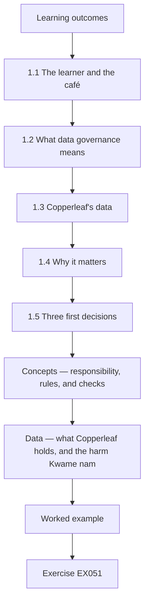

### Logical drawing

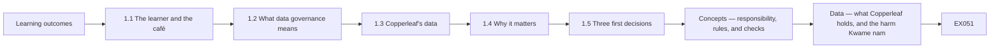

```text
[Learning outcomes]
    |
    v
[1.1 The learner and the café]
    |
    v
[1.2 What data governance means]
    |
    v
[1.3 Copperleaf's data]
    |
    v
[1.4 Why it matters]
    |
    v
[1.5 Three first decisions]
    |
    v
[Concepts — responsibility, rules, and checks]
    |
    v
[Data — what Copperleaf holds, and the harm Kwame nam]
    |
    v
[Worked example] --> [Exercise EX051]
```
<!-- open-cyber-academy:lesson-figures:end ch-01 -->


### Learning outcomes

You will (1) explain data governance in plain words; (2) list the data a small café holds; (3) make three first decisions about responsibility and rules.

### 1.1 The learner and the café

Kwame Boateng works as a shift supervisor at Copperleaf Café, a fictional business with two cafés, twelve staff and a newsletter for regular customers. The owner, Mrs. Adeyemi, asks him to sort out how the café looks after its data. He joins a one-month rapid course at the fictional Riverside Adult Learning Centre, guided by mentor Ms. Lena Fischer, who works as a data manager for a local council. Every exercise uses synthetic data invented for teaching, never real customer details.

### 1.2 What data governance means

Ms. Fischer explains data governance in one sentence: agreeing who is responsible for each kind of data, what rules it must follow and how everyone checks that the rules work. Kwame notes that this is about decisions and habits, not expensive software. A small café can govern its data with a short list of owners, a page of rules and a few regular checks. The aim is data that are accurate enough to use, safe and kept only as long as needed.

### 1.3 Copperleaf's data

Kwame lists Copperleaf's data: the newsletter sign-up sheet with customer emails, staff names, contact numbers and rotas, supplier contacts and invoices, card payment reports from the till provider, allergy notes for a few regular customers and photos from a recent event. He marks which contain personal data about identifiable people. Most do. He notes that allergy notes are health information, which the GDPR treats as special category data needing extra care. He writes each item on a list with where it is kept, so nothing is forgotten later.

### 1.4 Why it matters

Ms. Fischer asks Kwame what could go wrong. He lists: emailing customers who never agreed, losing the allergy notes and serving the wrong food, sharing staff phone numbers with the wrong person, keeping old rotas forever and paying a supplier twice because two invoice copies exist. Each problem affects customers, staff or money. He sees that governance protects people and the business at the same time, and that small businesses face the same kinds of risk as large ones. Mrs. Adeyemi agrees.

### 1.5 Three first decisions

Ms. Fischer asks Kwame to make three decisions this week. First, Mrs. Adeyemi is accountable for all data, and Kwame looks after it day to day. Second, each kind of data gets a named person: Kwame for the newsletter and allergy notes, the assistant manager for rotas and Mrs. Adeyemi for supplier and payment records. Third, no customer or staff data leave the café's approved systems. Mrs. Adeyemi agrees all three, and Kwame writes them on one page. Staff are told that week.

### Worked example

Kwame defines governance as responsibility, rules and checks, lists Copperleaf's data including allergy notes as health information, identifies risks to people and money and records three first decisions approved by Mrs. Adeyemi.

> **Synthetic case.** Copperleaf, Riverside and all people are synthetic; the GDPR is real.

### Errors and limits

Thinking governance needs expensive tools delays simple decisions that help immediately.

### Concepts — responsibility, rules, and checks

Ms. Fischer's one sentence has three parts. Copperleaf can use them before it buys anything.

| Part | Question this week | Copperleaf's first answer | What is still missing |
|---|---|---|---|
| Responsibility | Who answers if this data is wrong or lost? | Mrs. Adeyemi is accountable. Kwame looks after it day to day | A named person for every kind of data |
| Rules | What may this data be used for, and where may it sit? | No customer or staff data leave approved systems | The page of rules comes in the next chapter |
| Checks | How will someone see that the rule held? | The three decisions are written on one page and told to staff | A dated check, not only an announcement |

Allergy notes are not "just another customer note". They are health information. The GDPR treats that as special-category data, so the extra care is part of the rule, not a later upgrade.

### Data — what Copperleaf holds, and the harm Kwame named

| Data | Where Kwame found it | Personal data? | Harm he named |
|---|---|---|---|
| Newsletter emails | Sign-up sheet | Yes | Emailing someone who never agreed |
| Staff names, numbers, rotas | Café records | Yes | Sharing a phone number with the wrong person |
| Supplier contacts and invoices | Email and paper | Business, with people attached | Paying a supplier twice from two copies |
| Card-payment reports | Till provider | Yes, about payments | A report leaving the approved system |
| Allergy notes | A few regulars | Yes, health information | Serving the wrong food |
| Event photos | Recent event | Often yes | Kept with no agreed end |

### Decision flow — a new fact about a person

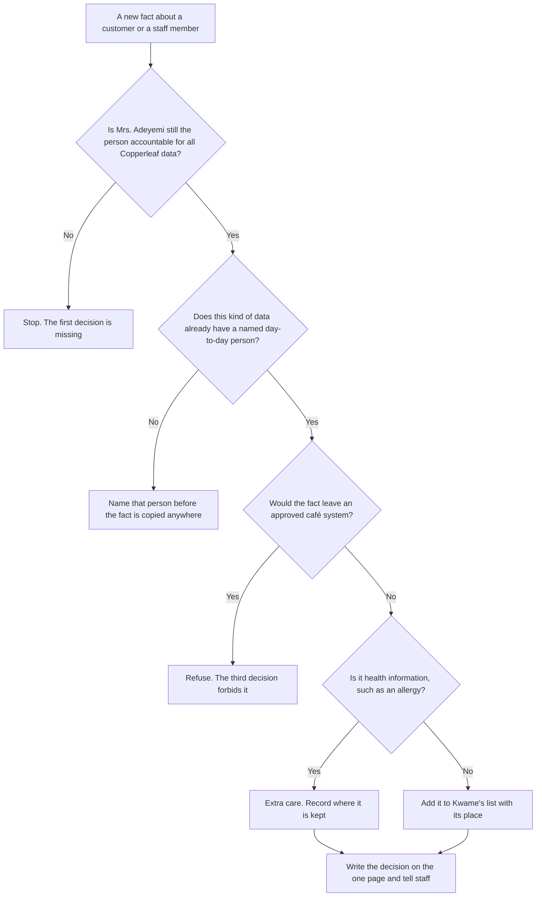

### Worked example — an allergy on a napkin

A regular writes "no milk" on a napkin. A barista photographs the napkin on a personal phone so the next shift can see it. Kwame stops that copy. The note is health information, and a personal phone is not an approved café system, so the third decision already forbids the photograph. He writes the allergy onto the café's own list, records where that list is kept, and tells Mrs. Adeyemi the same day because she is accountable. The napkin is not left on the counter.

> **Synthetic case.** The milk scribble, the camera roll and the same-afternoon counter check are invented. The GDPR is real. This is not legal advice.

### Apply

- **EX051 — Napkin photograph.** Why is the personal-phone photograph refused, and who must be told the same day? *Rubric:* 3 = a personal phone is not an approved system, and the note is health information; Mrs. Adeyemi, because she is accountable;; 2 = the approved-system rule only;; 1 = vague;; 0 = none.
- **EX052 — Missing name.** Staff rotas have no named day-to-day person yet. Which of the three decisions is incomplete, and what is written before the rota is copied to a new place? *Rubric:* 3 = the second decision; name the person, on the one page, before any copy;; 2 = name a person, without the page;; 1 = vague;; 0 = none.

### Exercises

- **EX001 — Café size.** How many cafés does Copperleaf run? *Rubric:* 3 = two;; 2 = partly correct;; 1 = wrong;; 0 = none.
- **EX002 — Mentor job.** What is Ms. Fischer's job? *Rubric:* 3 = data manager for a local council;; 2 = partly correct;; 1 = other;; 0 = none.
- **EX003 — One-sentence definition.** How does Ms. Fischer define governance? *Rubric:* 3 = who is responsible, what rules, how rules are checked;; 2 = partly correct;; 1 = partial;; 0 = none.
- **EX004 — Software need.** Does a small café need expensive software to govern data? *Rubric:* 3 = no;; 2 = partly correct;; 1 = yes;; 0 = none.
- **EX005 — Allergy status.** Why do allergy notes need extra care? *Rubric:* 3 = they are health information, special category data;; 2 = partly correct;; 1 = vague;; 0 = none.
- **EX006 — Staff data example.** Name one kind of staff data Copperleaf holds. *Rubric:* 3 = names, contact numbers or rotas;; 2 = one;; 1 = vague;; 0 = none.
- **EX007 — Supplier risk.** What money risk did Kwame list? *Rubric:* 3 = paying a supplier twice from duplicate invoices;; 2 = partly correct;; 1 = vague;; 0 = none.
- **EX008 — Allergy risk.** What could losing allergy notes cause? *Rubric:* 3 = serving the wrong food;; 2 = partly correct;; 1 = vague;; 0 = none.
- **EX009 — Accountable person.** Who is accountable for all Copperleaf data? *Rubric:* 3 = Mrs. Adeyemi;; 2 = partly correct;; 1 = other;; 0 = none.
- **EX010 — Newsletter person.** Who looks after the newsletter list? *Rubric:* 3 = Kwame;; 2 = partly correct;; 1 = other;; 0 = none.
- **EX011 — Rota person.** Who looks after rotas? *Rubric:* 3 = the assistant manager;; 2 = partly correct;; 1 = other;; 0 = none.
- **EX012 — Approved systems rule.** What is the third decision? *Rubric:* 3 = no customer or staff data leave approved systems;; 2 = partly correct;; 1 = vague;; 0 = none.
- **EX013 — Decision record.** Where are the three decisions written? *Rubric:* 3 = on one page;; 2 = partly correct;; 1 = vague;; 0 = none.

<!-- open-cyber-academy:chapter-navigation:start ch-01 -->
### Continue studying — lesson 01 (chapter 01 of 20)

[← Course home](../../README.md) · [Course chapter index](../SUBJECTS.md) · [Chapter 02 →](#ch-02)

Continue to the next authored lesson.
<!-- open-cyber-academy:chapter-navigation:end -->

<a id="ch-02"></a>

## Chapter 2 — Ownership, rules and safe practice

<!-- open-cyber-academy:lesson-figures:start ch-02 -->
### Lesson map

Lesson 02 published. Map, example, EX053.

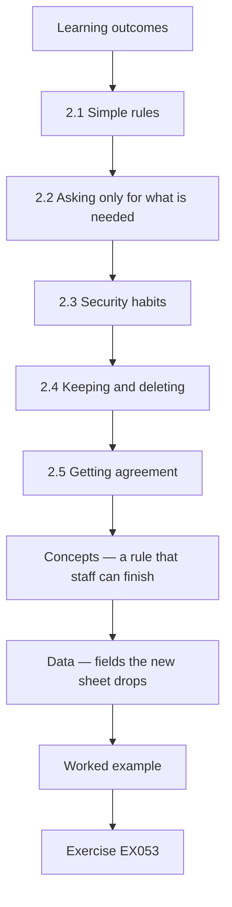

### Logical drawing

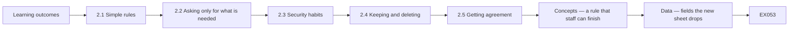

```text
[Learning outcomes]
    |
    v
[2.1 Simple rules]
    |
    v
[2.2 Asking only for what is needed]
    |
    v
[2.3 Security habits]
    |
    v
[2.4 Keeping and deleting]
    |
    v
[2.5 Getting agreement]
    |
    v
[Concepts — a rule that staff can finish]
    |
    v
[Data — fields the new sheet drops]
    |
    v
[Worked example] --> [Exercise EX053]
```
<!-- open-cyber-academy:lesson-figures:end ch-02 -->


### Learning outcomes

You will (1) write simple rules for each kind of data; (2) apply basic security habits; (3) decide how long to keep records.

### 2.1 Simple rules

Kwame writes a page of rules with Ms. Fischer's help. Newsletter emails are used only for the newsletter. Allergy notes are kept in a locked folder behind the counter and shown only to staff preparing that customer's order. Rotas are shared through the staff messaging group the café pays for, not personal social media. Invoices are filed by supplier and date in one shared folder. Each rule names the person responsible, so staff know whom to ask. The page fits on one side.

### 2.2 Asking only for what is needed

The old sign-up sheet asked for name, email, phone, birthday and home address. Kwame asks why. Mrs. Adeyemi says only the email is needed for the newsletter, and a first name makes emails friendlier. Kwame removes phone, birthday and address from the new sheet. Ms. Fischer explains that collecting less data means less to protect, less to lose and fewer questions from customers about why the café wants their details. The new sheet is quicker to fill in, and Kwame notices that more customers sign up in the first week than before.

### 2.3 Security habits

Kwame lists habits for staff: lock the till computer screen when stepping away, use separate logins for the till system rather than one shared code, keep the sign-up sheet out of customers' reach, never photograph customer details on personal phones and report lost papers or devices to Kwame the same day. He explains each habit at the next staff meeting with a real example of what could happen, such as a customer reading the sign-up sheet on the counter. Staff agree readily.

### 2.4 Keeping and deleting

Kwame sets keeping periods. Newsletter emails are kept while the customer stays subscribed and deleted soon after they unsubscribe. Old rotas are kept for the period employment rules require, then deleted. Supplier bills remain until the accountant names the tax retention end, and only then are they shredded. Allergy notes are reviewed every six months with the customer. Photos from events are deleted after a year unless people agreed to longer use. He writes each period beside the matching rule. Mrs. Adeyemi checks the tax and employment periods with her accountant.

### 2.5 Getting agreement

Kwame shows the rules to Mrs. Adeyemi and the assistant manager. The assistant manager asks whether staff may still swap shifts by text. They agree that shift swaps go through the paid messaging group, which keeps numbers private. Mrs. Adeyemi signs the page and asks Kwame to pin it in the staff room. Ms. Fischer reminds him that rules work when people understand them, so he should explain changes rather than just announce them. Kwame explains each change at the next staff meeting.

### Worked example

Kwame writes rules naming who is responsible, cuts the sign-up sheet to first name and email, lists security habits explained with examples, sets keeping periods and gets the rules signed and pinned in the staff room.

> **Synthetic case.** Rules are synthetic.

### Errors and limits

Copying a large company's long policy into a café produces rules nobody reads.

### Concepts — a rule that staff can finish

A café rule fails when it is long, when it collects data nobody will use, or when the only way to obey it is a private text message.

| Test | Passes at Copperleaf | Fails |
|---|---|---|
| One job | Newsletter emails are used only for the newsletter | Using that list to advertise a supplier |
| Least data | New sheet keeps first name and email | The old sheet's phone, birthday and home address |
| A channel the café controls | Rotas and shift swaps stay in the paid messaging group | A personal text, which spreads phone numbers |
| A period | Allergy notes are reviewed with the customer every six months | "Keep it until someone remembers" |
| A person | Each rule names who to ask | A page with no name |

Mrs. Adeyemi checks the tax and employment periods with the accountant. Kwame does not invent those periods.

### Data — fields the new sheet drops

| Old field | Kept? | Why |
|---|---|---|
| First name | Yes | Makes the newsletter greeting usable |
| Email | Yes | The only address the newsletter needs |
| Phone | No | Not needed to send the newsletter |
| Birthday | No | Not needed, and it is extra personal data |
| Home address | No | Not needed, and it is extra personal data |

Less data means less to protect, less to lose and fewer questions from customers. The new sheet is also faster, which is why more people signed up in the first week.

### Decision flow — someone wants one more field

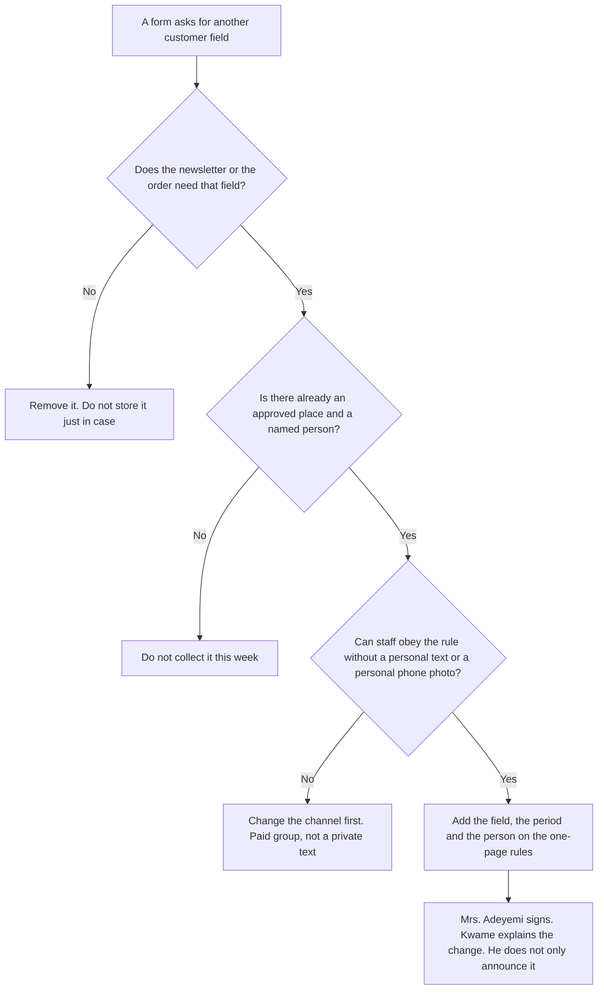

### Worked example — a birthday for a free cake

A supplier offers a free cake if the sign-up sheet collects birthdays. Kwame refuses the field. The newsletter needs a first name and an email, which is the reason the old birthday column was removed. A cake is not a new purpose written on the rules page. If Mrs. Adeyemi later wants a birthday offer, that is a separate rule: a named person, a period, and a channel that is not a personal phone. It is not added in the margin of the newsletter sheet.

> **Synthetic case.** The free-cake bargain and the handwritten margin are invented.

### Apply

- **EX053 — Birthday field.** Why does the birthday stay off the newsletter sheet, and what would a later birthday offer need before any date is collected? *Rubric:* 3 = the newsletter does not need it; a later offer needs its own rule, a named person, a period and an approved channel;; 2 = the newsletter does not need it;; 1 = vague;; 0 = none.
- **EX054 — Shift text.** Two staff swap a shift by private text. Which signed rule did they miss, and where must the swap go? *Rubric:* 3 = swaps go through the paid messaging group so numbers stay private;; 2 = the paid group, without the reason;; 1 = vague;; 0 = none.

### Exercises

- **EX014 — Newsletter use.** What may newsletter emails be used for? *Rubric:* 3 = only the newsletter;; 2 = partly correct;; 1 = other;; 0 = none.
- **EX015 — Allergy access.** Who may see allergy notes? *Rubric:* 3 = staff preparing that customer's order;; 2 = partly correct;; 1 = vague;; 0 = none.
- **EX016 — Rota channel.** How are rotas shared? *Rubric:* 3 = the paid staff messaging group;; 2 = partly correct;; 1 = vague;; 0 = none.
- **EX017 — Kept sign-up fields.** Which fields stay on the new sign-up sheet? *Rubric:* 3 = first name and email;; 2 = both;; 1 = one;; 0 = none.
- **EX018 — Collect-less benefit.** Why collect less data? *Rubric:* 3 = less to protect, lose or explain;; 2 = partly correct;; 1 = vague;; 0 = none.
- **EX019 — Till login habit.** What replaces the shared till code? *Rubric:* 3 = separate logins;; 2 = partly correct;; 1 = vague;; 0 = none.
- **EX020 — Loss reporting.** When should lost papers be reported? *Rubric:* 3 = the same day;; 2 = partly correct;; 1 = wrong;; 0 = none.
- **EX021 — Unsubscribe action.** What happens to emails after unsubscribing? *Rubric:* 3 = deleted soon after;; 2 = partly correct;; 1 = vague;; 0 = none.
- **EX022 — Allergy review.** How often are allergy notes reviewed? *Rubric:* 3 = every six months;; 2 = partly correct;; 1 = wrong;; 0 = none.
- **EX023 — Photo period.** How long are event photos kept by default? *Rubric:* 3 = one year;; 2 = partly correct;; 1 = wrong;; 0 = none.
- **EX024 — Shift swap answer.** How do staff swap shifts now? *Rubric:* 3 = through the paid messaging group;; 2 = partly correct;; 1 = text;; 0 = none.
- **EX025 — Rules location.** Where are the signed rules displayed? *Rubric:* 3 = the staff room;; 2 = partly correct;; 1 = other;; 0 = none.
- **EX026 — Explaining changes.** What does Ms. Fischer say makes rules work? *Rubric:* 3 = people understanding them;; 2 = partly correct;; 1 = vague;; 0 = none.

<!-- open-cyber-academy:chapter-navigation:start ch-02 -->
### Continue studying — lesson 02 (chapter 02 of 20)

[← Chapter 01](#ch-01) · [Course chapter index](../SUBJECTS.md) · [Chapter 03 →](#ch-03)

Continue to the next authored lesson.
<!-- open-cyber-academy:chapter-navigation:end -->

<a id="ch-03"></a>

## Chapter 3 — Quality, systems and suppliers

<!-- open-cyber-academy:lesson-figures:start ch-03 -->
### Lesson map

Lesson 03 published. Map, example, EX055.

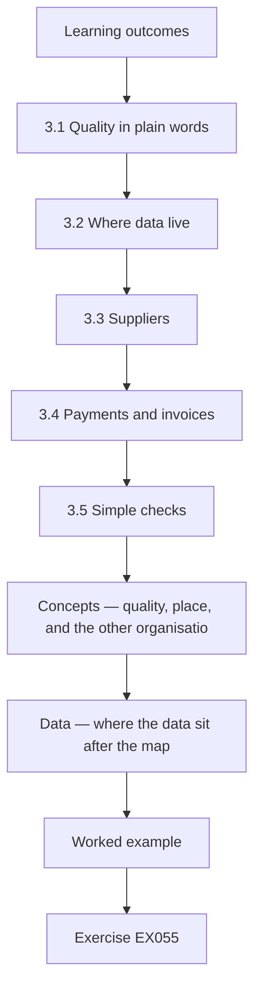

### Logical drawing

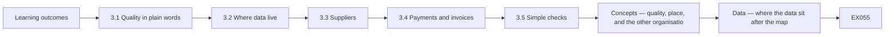

```text
[Learning outcomes]
    |
    v
[3.1 Quality in plain words]
    |
    v
[3.2 Where data live]
    |
    v
[3.3 Suppliers]
    |
    v
[3.4 Payments and invoices]
    |
    v
[3.5 Simple checks]
    |
    v
[Concepts — quality, place, and the other organisatio]
    |
    v
[Data — where the data sit after the map]
    |
    v
[Worked example] --> [Exercise EX055]
```
<!-- open-cyber-academy:lesson-figures:end ch-03 -->


### Learning outcomes

You will (1) check data quality in a small business; (2) map where data are stored; (3) check suppliers who handle the café's data.

### 3.1 Quality in plain words

Ms. Fischer explains quality with three questions: is the data complete, is it valid and is it accurate? For the newsletter list, complete means every row has an email, valid means each email looks like a real address and accurate means it belongs to the person who signed up. Kwame adds a fourth question for duplicates: does the same person appear twice? He notes that poor quality wastes effort and annoys customers who receive two copies of every email. Kwame writes all four down.

### 3.2 Where data live

Kwame draws a simple map of where Copperleaf's data are stored: the paper sign-up sheet, the newsletter service, the till provider's system, the staff messaging group, a shared folder for invoices and the locked allergy folder. For each place he notes who can see it and whether it is protected. He finds an old spreadsheet of customer emails on the café laptop that nobody uses. Mrs. Adeyemi agrees he should delete it after checking it holds nothing needed. He keeps the map with the rules.

### 3.3 Suppliers

Three suppliers handle Copperleaf's data: the newsletter service, the till and card payment provider and the messaging app. Kwame checks each one's terms for data protection commitments, such as keeping data secure, using it only for Copperleaf and deleting it when the contract ends. The newsletter service and till provider include these terms. The messaging app is a free personal version without business terms, so Mrs. Adeyemi switches to its paid business version. Kwame keeps a copy of each supplier's terms in the shared folder.

### 3.4 Payments and invoices

Kwame looks at invoices and finds two copies of the same supplier invoice, one emailed and one paper, with slightly different dates. The café nearly paid twice. He suggests that invoices be entered once, from the emailed copy, with the paper copy marked as received. Mrs. Adeyemi agrees. Ms. Fischer notes that duplicate records are a quality problem in money data too, and that a single entry point prevents most of them. The accountant also welcomes the change, because it makes the monthly records easier to check.

### 3.5 Simple checks

Kwame sets three monthly checks: look for duplicate or malformed emails in the newsletter list, confirm that only current staff are in the messaging group and compare invoices entered with payments made. Each check takes a few minutes. He records the date and anything found in a notebook kept with the rules. Ms. Fischer explains that short, regular checks catch problems early and show that the rules are being followed. After the first month, the notebook already shows one duplicate email removed and one former staff member taken out of the group.

### Worked example

Kwame defines quality with completeness, validity, accuracy and duplicates, maps where data live and deletes an unused email spreadsheet, moves staff messaging to a business version, stops duplicate invoices at entry and sets three monthly checks.

> **Synthetic case.** Systems and suppliers are synthetic.

### Errors and limits

Free personal apps used for business data often lack the terms a business needs.

### Concepts — quality, place, and the other organisation

Four quality questions, then a place, then a supplier. Copperleaf does not treat a convenient app as a supplier until its terms match the café's rules.

| Question or check | Newsletter meaning | Money meaning |
|---|---|---|
| Complete | Every row has an email | An invoice has supplier, date and amount |
| Valid | The address looks real | The copy is one invoice, not a second scan |
| Accurate | It belongs to the person who signed | The emailed copy is the one that is entered |
| Duplicate | The same person is not listed twice | Email plus paper must not be paid twice |
| Place | Newsletter service, not the forgotten laptop spreadsheet | One shared folder, filed by supplier and date |
| Supplier terms | Secure, used only for Copperleaf, deleted when the contract ends | Same three commitments |

The free personal messaging app failed the terms test. The paid business version replaced it. Kwame files the paid-app contract beside the newsletter and till terms, so the three commitments can be reread without opening each vendor site.

### Data — where the data sit after the map

| Place | Who can see it | Protected? | Action |
|---|---|---|---|
| Paper sign-up sheet | Whoever stands at the counter | Only if it is kept out of customers' reach | Replace with the short sheet |
| Newsletter service | The service and Kwame | Terms include the three commitments | Keep |
| Till provider | The provider and the café | Terms include the three commitments | Keep |
| Staff messaging | Current staff, once the group is cleaned | Paid business version | Leave the free personal app |
| Invoice folder | Office | One entry point: the emailed copy | Mark the paper copy as received |
| Locked allergy folder | Staff preparing that order | Locked, reviewed every six months | Keep |
| Old laptop spreadsheet | Whoever opens the laptop | Forgotten, nobody uses it | Delete after checking it holds nothing needed |

### Decision flow — a supplier or a second copy

```mermaid
flowchart TD
  A["A supplier or a second copy of a record"] --> B{"Do the terms promise security, use only for Copperleaf, and deletion when the contract ends?"}
  B -->|No| C["Do not put customer or staff data there"]
  B -->|Yes| D{"Is this a second copy of an invoice or a customer list?"}
  D -->|Yes| E["Enter once. Mark the other copy as received. Do not pay it again"]
  D -->|No| F{"Is the place on Kwame's map, with a person who can see it?"}
  F -->|No| G["Add it to the map or do not use it"]
  F -->|Yes| H["Keep the terms in the shared folder"]
  C --> I["Record the date and the finding in the notebook"]
  E --> I
  H --> I
```

### Worked example — a cheaper till that wants the newsletter

A new till provider offers a lower rate if it may email Copperleaf's customers with its own offers. Kwame refuses. The terms would use café data for the provider, not only for Copperleaf. A lower card rate does not excuse skipping security, Copperleaf-only use, or deletion at the end of the contract. The rate is not a reason to skip the three commitments. He writes the refusal in the notebook and leaves the current till provider in place.

> **Synthetic case.** The cheaper till offer is invented.

### Apply

- **EX055 — Cheaper till.** Which commitment fails, and what is written in the notebook? *Rubric:* 3 = the provider would use the data for its own offers, not only for Copperleaf; the refusal and the date;; 2 = the use limit only;; 1 = vague;; 0 = none.
- **EX056 — Second paper invoice.** An emailed invoice is already entered. The paper copy arrives with a slightly different date. What is entered, what is marked, and what is not paid? *Rubric:* 3 = enter the emailed copy once; mark the paper copy received; do not pay the paper copy as a second bill;; 2 = do not pay twice;; 1 = vague;; 0 = none.

### Exercises

- **EX027 — Quality questions.** What three quality questions does Ms. Fischer use? *Rubric:* 3 = complete, valid, accurate;; 2 = all;; 1 = some;; 0 = none.
- **EX028 — Added question.** What fourth question did Kwame add? *Rubric:* 3 = whether the same person appears twice;; 2 = partly correct;; 1 = vague;; 0 = none.
- **EX029 — Forgotten spreadsheet.** What forgotten file was on the café laptop? *Rubric:* 3 = an old spreadsheet of customer emails;; 2 = partly correct;; 1 = vague;; 0 = none.
- **EX030 — Deletion condition.** What was checked before deleting it? *Rubric:* 3 = that it held nothing needed;; 2 = partly correct;; 1 = vague;; 0 = none.
- **EX031 — Supplier count.** How many suppliers handle Copperleaf's data? *Rubric:* 3 = three;; 2 = partly correct;; 1 = wrong;; 0 = none.
- **EX032 — Supplier terms.** What should supplier terms commit to? *Rubric:* 3 = security, use only for Copperleaf, deletion at end;; 2 = most;; 1 = few;; 0 = none.
- **EX033 — Messaging fix.** What changed for the messaging app? *Rubric:* 3 = switched to the paid business version;; 2 = partly correct;; 1 = vague;; 0 = none.
- **EX034 — Invoice duplicate.** Why did the café nearly pay twice? *Rubric:* 3 = emailed and paper copies of one invoice;; 2 = partly correct;; 1 = vague;; 0 = none.
- **EX035 — Invoice entry rule.** Which invoice copy is entered? *Rubric:* 3 = the emailed copy;; 2 = partly correct;; 1 = paper;; 0 = none.
- **EX036 — Messaging check.** What does the messaging group check confirm? *Rubric:* 3 = only current staff are members;; 2 = partly correct;; 1 = vague;; 0 = none.
- **EX037 — Check record.** Where are check results recorded? *Rubric:* 3 = a notebook kept with the rules;; 2 = partly correct;; 1 = vague;; 0 = none.
- **EX038 — Check time.** How long does each monthly check take? *Rubric:* 3 = a few minutes;; 2 = partly correct;; 1 = wrong;; 0 = none.

<!-- open-cyber-academy:chapter-navigation:start ch-03 -->
### Continue studying — lesson 03 (chapter 03 of 20)

[← Chapter 02](#ch-02) · [Course chapter index](../SUBJECTS.md) · [Chapter 04 →](#ch-04)

Continue to the next authored lesson.
<!-- open-cyber-academy:chapter-navigation:end -->

<a id="ch-04"></a>

## Chapter 4 — Guided lab and action plan

<!-- open-cyber-academy:lesson-figures:start ch-04 -->
### Lesson map

Lesson 04 published. Map, example, EX057.

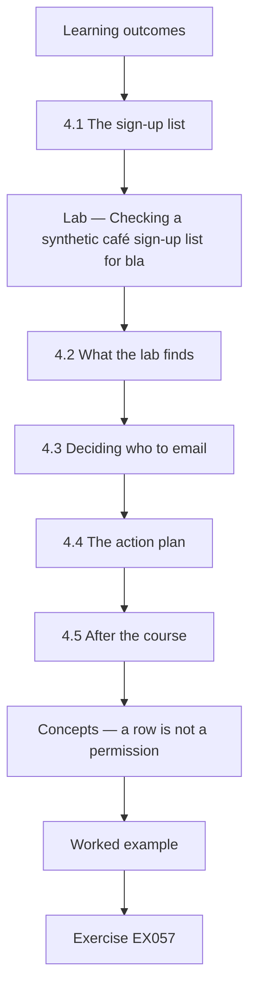

### Logical drawing

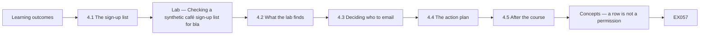

```text
[Learning outcomes]
    |
    v
[4.1 The sign-up list]
    |
    v
[Lab — Checking a synthetic café sign-up list for bla]
    |
    v
[4.2 What the lab finds]
    |
    v
[4.3 Deciding who to email]
    |
    v
[4.4 The action plan]
    |
    v
[4.5 After the course]
    |
    v
[Concepts — a row is not a permission]
    |
    v
[Worked example] --> [Exercise EX057]
```
<!-- open-cyber-academy:lesson-figures:end ch-04 -->


### Learning outcomes

You will (1) check a synthetic sign-up list with a short script; (2) decide who may receive the newsletter; (3) write a one-month action plan.

### 4.1 The sign-up list

Copperleaf's newsletter list was typed from paper sheets by different staff. Some rows have blank emails, some have the same address typed twice with different capitals or spaces and some have no tick in the consent box. Kwame wants to know how many addresses the café may actually email. Ms. Fischer helps him write a short Python script using only the standard library, run on a synthetic list of twelve rows that copies these problems without using any real customer details. Kwame runs it.

### Lab — Checking a synthetic café sign-up list for blanks, malformed addresses, duplicates and consent ticks

```python
"""Check a synthetic cafe newsletter sign-up list: blanks, duplicates and consent ticks (stdlib only)."""
rows = [("ana@example.org", "yes"), ("Ana@Example.org ", "yes"), ("", "yes"), ("ben@example.org", ""),
        ("cai@example.org", "yes"), ("dee@example", "yes"), ("eli@example.org", "no"), ("fay@example.org", "yes"),
        ("cai@example.org", "yes"), ("gus@example.org", "yes"), ("", ""), ("hal@example.org", "yes")]
clean = [(e.strip().lower(), c) for e, c in rows]
blank = sum(1 for e, _ in clean if not e)
bad = sum(1 for e, _ in clean if e and ("@" not in e or "." not in e.split("@")[-1]))
seen, dup = set(), 0
for e, _ in clean:
    if e and e in seen: dup += 1
    seen.add(e)
ok = {e for e, c in clean if e and c == "yes" and "." in e.split("@")[-1]}
print(f"rows {len(rows)}; blank email {blank}; malformed {bad}; duplicates {dup}")
print(f"unique valid addresses with a yes tick: {len(ok)}")
```

Run with `python3 lab_signups.py`. Verified output:

```text
rows 12; blank email 2; malformed 1; duplicates 2
unique valid addresses with a yes tick: 5
```

### 4.2 What the lab finds

The script trims spaces and lowercases each address before checking it. Of twelve rows, two have a blank email, one address is malformed because it has no proper ending after the at sign and two rows are duplicates of addresses already listed. After removing problems, only five unique, valid addresses have a yes tick in the consent box. Kwame is surprised: twelve rows on paper become five people the café can confidently email. He shows the result to Mrs. Adeyemi, who had expected a much larger list.

### 4.3 Deciding who to email

Ms. Fischer explains that marketing emails need the customer's consent, and the café must be able to show it. Rows with a blank tick or a no tick are not emailed. The malformed address cannot be used anyway. Kwame and Mrs. Adeyemi decide to email the five confirmed addresses and to ask other customers in person to sign the new sheet if they want the newsletter. He records the decision and the date in the notebook. Mrs. Adeyemi agrees with the decision.

### 4.4 The action plan

Kwame writes a one-month plan with five actions: replace the sign-up sheet with the shorter version including a clear consent box and the date; run the lab check each month on the typed list; delete the forgotten spreadsheet; finish switching to the paid messaging app; and explain the rules at the next staff meeting. Each action has a person and a date. Mrs. Adeyemi approves it, and Kwame pins it beside the rules. He keeps the plan short so that it can actually be finished in a month.

### 4.5 After the course

At the end of the month, Kwame reviews progress. Four actions are done; the staff meeting moved to the following week. He reflects that small, clear decisions changed more than he expected, and that checking data with a short script made the problem visible to everyone. Ms. Fischer suggests he continue with privacy and data protection, since customer and staff details are central to the café. The next course in this area does exactly that. Kwame thanks Ms. Fischer and enrols the following month.

### Worked example

Kwame checks twelve synthetic sign-up rows, finding two blanks, one malformed address and two duplicates, leaving five unique valid addresses with consent, decides to email only those and completes four of five actions in his one-month plan.

> **Synthetic case.** The list is synthetic; outputs come from lab_signups.py; the GDPR is real. This is not legal advice.

### Errors and limits

Counting rows instead of unique, valid, consented addresses overstates who may be emailed.

### Concepts — a row is not a permission

The script does not ask how many lines are on the paper. It asks which addresses are unique, valid and ticked `yes` after the address is trimmed and lowercased. The tick itself is not lowercased. `Yes` is not `yes`.

| Lab result on 12 synthetic rows | Count | May that row be emailed? |
|---|---:|---|
| Blank email | 2 | No. There is no address |
| Malformed address | 1 | No. `dee@example` has no proper ending after @ |
| Duplicate rows | 2 | The repeat is not a second person |
| Unique valid address with tick `yes` | 5 | Yes. This is the only send list |
| Tick blank or `no`, including `eli@example.org` | Not in the 5 | No. Consent was not given |

Twelve rows became five people. Emailing the other seven because they appear on the paper overstates the list. That is the error in this chapter.

### Data — the five actions and the one that slipped

| Action | Person | Done when Kwame reviewed the month? |
|---|---|---|
| Short sheet with a clear consent box and the date | Kwame | Yes |
| Run this check each month on the typed list | Kwame | Yes |
| Delete the forgotten spreadsheet after the check | Kwame | Yes |
| Finish the paid messaging app | Mrs. Adeyemi and Kwame | Yes |
| Explain the rules at the staff meeting | Kwame | No. The meeting moved to the next week |

The plan stays five actions. A slipped date is written down. It is not deleted from the plan to make the month look finished.

### Decision flow — may this address receive the newsletter?

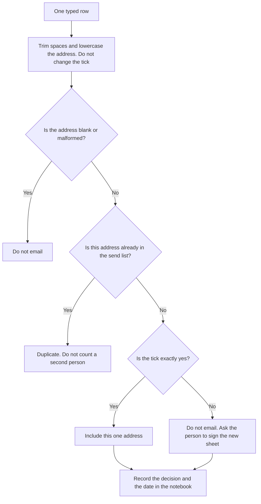

### Worked example — a capital Yes and a regular who ticked no

A row reads `Ina@Example.org` with the tick `Yes`. Ina's typed capitals become a usable address, yet the consent box is stored exactly as written. The send rule accepts only `yes`, so the exact-match test leaves her outside the five. Kwame does not "fix" the tick in the script to raise the count. He asks Ina to sign the new sheet. The same week Mrs. Adeyemi wants to email `eli@example.org`, a regular who ticked `no`. Kwame refuses. A regular is not a substitute for the tick. Eli can join by signing the new sheet in person. Both decisions go in the notebook with the date.

> **Synthetic case.** Ina's row and the request to email Eli are invented. The tick rule is the one in lab_signups.py. This is not legal advice.

### Apply

- **EX057 — Capital Yes.** What does the script do to `Ina@Example.org` and to the tick `Yes`, and is that row emailed? *Rubric:* 3 = the address is trimmed and lowercased; the tick stays `Yes`; the row is not emailed because only `yes` counts;; 2 = the address is cleaned and the row is not emailed;; 1 = one of those;; 0 = none.
- **EX058 — Regular who ticked no.** May `eli@example.org` be emailed because Eli is a regular, and what is Eli offered instead? *Rubric:* 3 = no; Eli may sign the new sheet in person; the refusal is dated in the notebook;; 2 = no, without the sheet;; 1 = yes;; 0 = none.

### Exercises

- **EX039 — Lab rows.** How many rows does the synthetic list have? *Rubric:* 3 = twelve;; 2 = partly correct;; 1 = wrong;; 0 = none.
- **EX040 — Blank emails.** How many rows have a blank email? *Rubric:* 3 = two;; 2 = partly correct;; 1 = wrong;; 0 = none.
- **EX041 — Malformed count.** How many addresses are malformed? *Rubric:* 3 = one;; 2 = partly correct;; 1 = wrong;; 0 = none.
- **EX042 — Duplicate rows.** How many duplicate rows does the script find? *Rubric:* 3 = two;; 2 = partly correct;; 1 = wrong;; 0 = none.
- **EX043 — Emailable total.** How many unique valid addresses have a yes tick? *Rubric:* 3 = five;; 2 = partly correct;; 1 = wrong;; 0 = none.
- **EX044 — Normalising steps.** What does the script do before checking each address? *Rubric:* 3 = trims spaces and lowercases;; 2 = both;; 1 = one;; 0 = none.
- **EX045 — Blank tick decision.** Are rows with a blank tick emailed? *Rubric:* 3 = no;; 2 = partly correct;; 1 = yes;; 0 = none.
- **EX046 — Other customers.** How will other customers join the newsletter? *Rubric:* 3 = by signing the new sheet in person;; 2 = partly correct;; 1 = vague;; 0 = none.
- **EX047 — Plan actions.** How many actions are in the one-month plan? *Rubric:* 3 = five;; 2 = partly correct;; 1 = wrong;; 0 = none.
- **EX048 — New sheet features.** What does the new sheet include? *Rubric:* 3 = a clear consent box and the date;; 2 = both;; 1 = one;; 0 = none.
- **EX049 — Late action.** Which action slipped? *Rubric:* 3 = the staff meeting explanation;; 2 = partly correct;; 1 = other;; 0 = none.
- **EX050 — Next topic.** What does Ms. Fischer suggest next? *Rubric:* 3 = privacy and data protection;; 2 = partly correct;; 1 = other;; 0 = none.

<!-- open-cyber-academy:chapter-navigation:start ch-04 -->
### Continue studying — lesson 04 (chapter 04 of 20)

[← Chapter 03](#ch-03) · [Course chapter index](../SUBJECTS.md) · [Chapter 05 →](#ch-05)

Continue to the next authored lesson.
<!-- open-cyber-academy:chapter-navigation:end -->

<a id="ch-05"></a>

## Chapter 5 — A moved meeting is not an explanation

<!-- open-cyber-academy:lesson-figures:start ch-05 -->
### Lesson map

Lesson 05 published. Map, example, EX059.

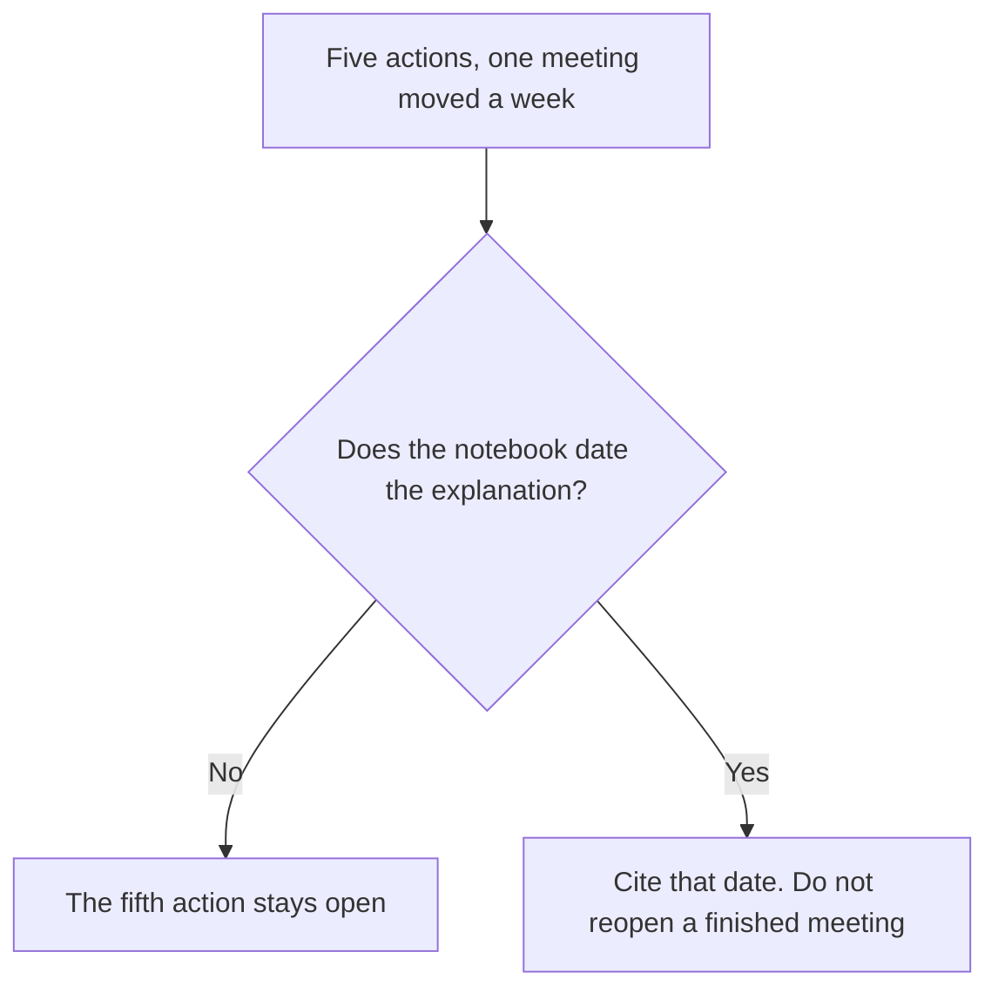

Moving a date records a delay. It does not deliver the explanation.

### Logical drawing

```text
plan pinned beside the rules
    four actions dated as done
    staff meeting shifted to the next week
        |
        +-- the plan still has five lines
        +-- staff have not heard the rules until the meeting is held
        +-- striking the line would hide the delay
```
<!-- open-cyber-academy:lesson-figures:end ch-05 -->

### Learning outcomes

After this chapter, you should be able to:

1. Keep the staff-meeting action on the plan while the notebook has no meeting date.
2. Refuse to delete that line so the month looks finished.
3. Tell a calendar change apart from an explanation the staff have heard.

### 5.1 The fifth line is still a line

Chapter 4 closed the month with four actions done and the staff explanation moved to the following week. A classmate wants the pinned plan rewritten as four actions, because four-out-of-four looks complete. The rewrite would erase the delay Mrs. Adeyemi can see. Kwame leaves the fifth line where it is. The meeting, when it happens, gets a date in the notebook beside the rules. Until that date exists, staff who were not in the room where he drafted the page have not been shown the rules as a group.

### 5.2 Worked example

| What someone points to | What it shows | Decision |
|---|---|---|
| "The meeting was moved." | A new intended week | The action stays open |
| "Four actions are ticked." | Those four have dates | Do not retitle the plan as four actions |
| "Staff already work here, so they know." | Presence is not the meeting | Wait for the dated explanation |
| A notebook line with the meeting date | The explanation happened | Cite that line |

> **Synthetic case.** This lesson does not invent the meeting date. The slip stays the slip from Chapter 4.

### Errors and limits

Holding the meeting later does not change the signed rules. What the meeting is allowed to decide is a later lesson. This chapter also does not set a legal deadline for training.

### Apply

- **EX059 — Four out of five.** The pinned plan shows four dated actions and a staff meeting moved to the next week. No notebook line dates the explanation. May the plan be rewritten as four actions, and what remains unfinished? *Rubric:* 3 = do not drop the fifth line; the explanation is unfinished until the notebook dates it; a moved week is not that date;; 2 = keep the line and refuse the rewrite;; 1 = one of those;; 0 = none.

<!-- open-cyber-academy:chapter-navigation:start ch-05 -->
### Continue studying — lesson 05 (chapter 05 of 20)

[← Chapter 04](#ch-04) · [Course chapter index](../SUBJECTS.md) · [Chapter 06 →](#ch-06)

Continue to the next authored lesson.
<!-- open-cyber-academy:chapter-navigation:end -->

<a id="ch-06"></a>

## Chapter 6 — One removed duplicate is not a new census

<!-- open-cyber-academy:lesson-figures:start ch-06 -->
### Lesson map

Lesson 06 published. Map, example, EX060.

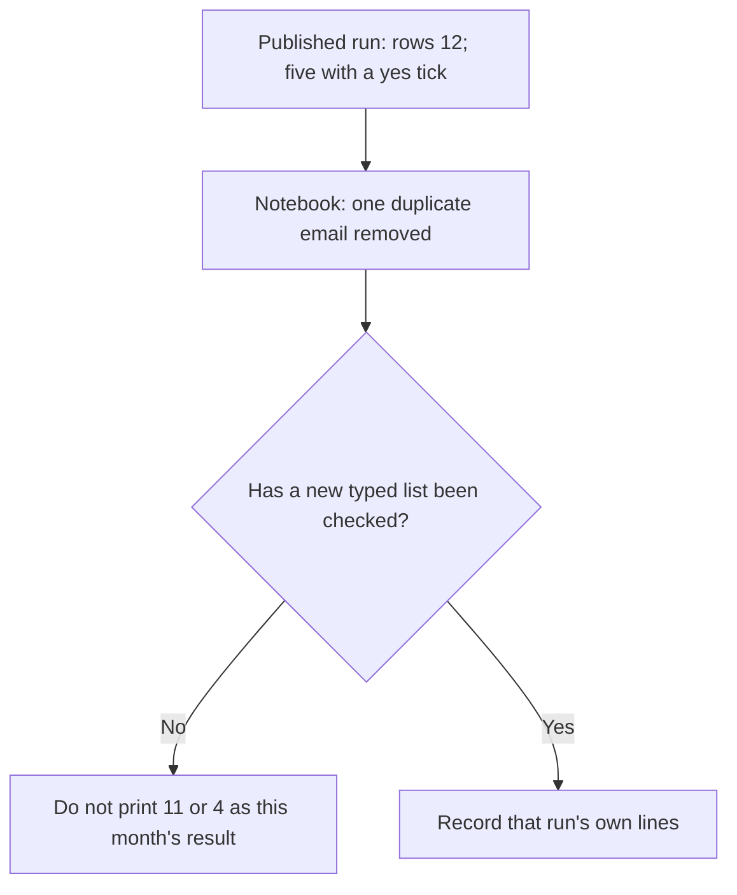

A notebook finding is not a second execution of the script.

### Logical drawing

```text
lab_signups.py on the twelve-row synthetic file
    rows 12; blank email 2; malformed 1; duplicates 2
    unique valid addresses with a yes tick: 5
first-month notebook
    one duplicate email removed
        |
        +-- the removal is a finding, not a rerun
        +-- 12 minus 1 is arithmetic, not a measurement
        +-- the script is not edited to force a new print
```
<!-- open-cyber-academy:lesson-figures:end ch-06 -->

### Learning outcomes

After this chapter, you should be able to:

1. Keep the published twelve-row output as the only verified count of that file.
2. Reject 11 rows, or 4 sendable addresses, when nobody has rerun the check.
3. Leave the program and its printed lines unchanged.

### 6.1 The notebook and the script answer different questions

The first month's notebook says one duplicate email was removed. That sentence records a check. The script's print describes the synthetic file of twelve rows, before anyone subtracts. A classmate writes "open send list this month: 4" because one duplicate left the café. The five were unique addresses with an exact `yes` tick. Removing a duplicate does not, by itself, remove one of those five, and it does not shrink the twelve-row file. Either effect would have to be counted on a new export. Kwame does not type 4 or 11 into the notebook as if the program had printed them.

### 6.2 Worked example

| Claim | What was actually done | Decision |
|---|---|---|
| "One duplicate was taken off the working list." | The notebook says so | Keep it as a finding |
| "So the file is now 11 rows." | No new run | Refuse the number |
| "So only four people may be emailed." | The five were already unique | Refuse. Uniqueness was already in the print |
| "Edit the ticks so the next print looks tidier." | The script counts the file it is given | Refuse the edit |

> **Synthetic case.** The lines `rows 12` and `unique valid addresses with a yes tick: 5` stay the published run.

### Errors and limits

A later month might show different counts. Those counts exist only after that month's list is checked. This chapter does not perform that check.

### Apply

- **EX060 — Do not subtract the notebook.** Someone writes "this month: 11 rows and 4 yes-tick addresses" because one duplicate was removed. What is wrong with both numbers, and which print remains the verified one? *Rubric:* 3 = neither 11 nor 4 was counted; the verified print is still 12 rows and 5 yes-tick addresses; do not edit the script;; 2 = reject both numbers and keep the published print;; 1 = one number;; 0 = none.

<!-- open-cyber-academy:chapter-navigation:start ch-06 -->
### Continue studying — lesson 06 (chapter 06 of 20)

[← Chapter 05](#ch-05) · [Course chapter index](../SUBJECTS.md) · [Chapter 07 →](#ch-07)

Continue to the next authored lesson.
<!-- open-cyber-academy:chapter-navigation:end -->

<a id="ch-07"></a>

## Chapter 7 — Last month's leaver does not clear this month

<!-- open-cyber-academy:lesson-figures:start ch-07 -->
### Lesson map

Lesson 07 published. Map, example, EX061.

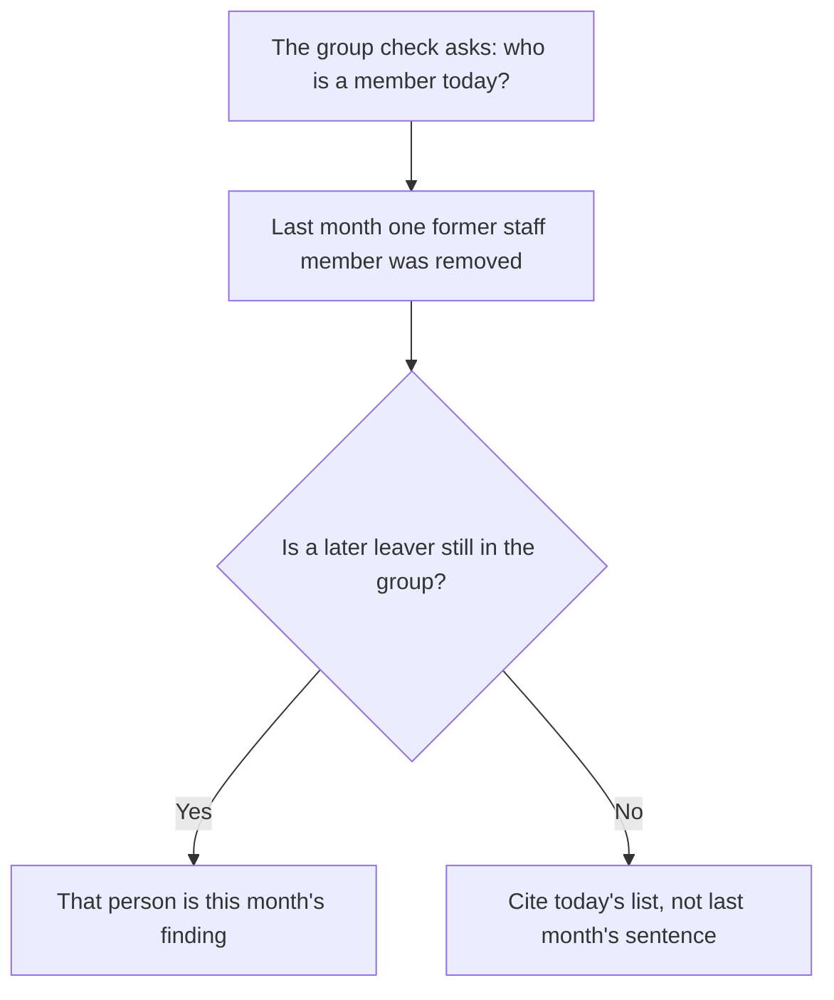

A past removal proves last month. Membership is read again.

### Logical drawing

```text
monthly check: only current staff in the paid group
first month: one former member removed, dated
a later person finishes
    |
    +-- last month's sentence does not name this person
    +-- "we already cleaned the group" is not a new look
    +-- the person stays a finding until removal is dated
```
<!-- open-cyber-academy:lesson-figures:end ch-07 -->

### Learning outcomes

After this chapter, you should be able to:

1. Treat the monthly membership check as a look at the current group.
2. Refuse to close the check by citing one earlier removal.
3. Record a later leaver as open until the removal itself is dated.

### 7.1 The question is who is in the group now

The first month's notebook records one former staff member taken out of the paid messaging group. That line is evidence about that person and that date. The check Kwame set is narrower and repeats: are the people in the group current staff? A classmate says the group can be skipped this month because it was cleaned once. Skipping would miss anyone who left after that date. Kwame opens the member list. If a person whose last day has passed is still there, the finding is an open membership, and the removal is written with the date. He does not add a personal name that the case file does not contain.

### 7.2 Worked example

| Reason to skip the check | What the notebook holds | Decision |
|---|---|---|
| "We removed someone last month." | One dated removal | Look again |
| "The paid app is a business version, so leavers expire." | No such expiry is recorded | Do not assume it |
| A named current employee | They still work | They may stay |
| A leaver still listed, no removal date | The check's question | Remove and date it |

> **Synthetic case.** The later leaver is unnamed. Do not invent a name.

### Errors and limits

Removing a member does not delete their old rota, and it does not decide the employment keeping period. That period is still the accountant's sentence, which Chapter 11 keeps blank until it is written.

### Apply

- **EX061 — Whose month is the removal?** Last month's notebook dates one former member's removal. This month a different person's last day has passed, and the group still lists them. What is the finding, and which earlier sentence fails to close it? *Rubric:* 3 = the person is still a member; remove them and date it; last month's removal does not cover this person;; 2 = remove and date, and reject the old sentence as cover;; 1 = one of those;; 0 = none.

<!-- open-cyber-academy:chapter-navigation:start ch-07 -->
### Continue studying — lesson 07 (chapter 07 of 20)

[← Chapter 06](#ch-06) · [Course chapter index](../SUBJECTS.md) · [Chapter 08 →](#ch-08)

Continue to the next authored lesson.
<!-- open-cyber-academy:chapter-navigation:end -->

<a id="ch-08"></a>

## Chapter 8 — An unsubscribe is a new line

<!-- open-cyber-academy:lesson-figures:start ch-08 -->
### Lesson map

Lesson 08 published. Map, example, EX062.

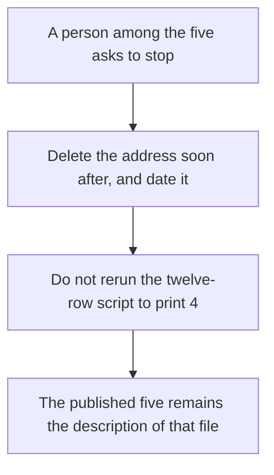

The keeping rule and the lab file are different objects.

### Logical drawing

```text
rule: newsletter address kept while subscribed
    deleted soon after unsubscribe
synthetic file: five addresses with tick yes
a later stop request from one of those addresses
    |
    +-- the request is a new event
    +-- the script is not edited, and 5 is not rewritten as 4
    +-- the notebook dates the deletion
```
<!-- open-cyber-academy:lesson-figures:end ch-08 -->

### Learning outcomes

After this chapter, you should be able to:

1. Apply the unsubscribe rule to one address without touching the published lab print.
2. Refuse to treat "5 minus 1" as a new measured send list.
3. Date the deletion in the notebook.

### 8.1 The five describe a file. A stop request describes a person.

The lab print says five unique valid addresses have a `yes` tick on that synthetic file. The keeping rule says an address stays while the person is subscribed and is deleted soon after they unsubscribe. Those sentences can both be true. If one of the five later asks to stop, Kwame deletes that address from the working send list and writes the date. He does not open `lab_signups.py` and change the file so the historic print says 4. The historic print still describes the file he ran. The deletion describes what happened after.

### 8.2 Worked example

| Proposal | Object it changes | Decision |
|---|---|---|
| Delete the address and date the notebook | The working list, after a real stop request | Accept |
| Change the script's print from 5 to 4 | The record of the old file | Refuse |
| Keep emailing because the lab once counted them | A file that did not contain this stop request | Refuse |
| Wait until next year's review | The rule says soon after | Delete, and date it |

> **Synthetic case.** No new address is added to the twelve-row file. Do not invent which of the five unsubscribed.

### Errors and limits

Deleting one address does not answer whether the other four still have a `yes` on a later sheet. A later sheet is a later check. This is not a statement of what the GDPR requires in every organisation.

### Apply

- **EX062 — Five, or four?** One address from the send list unsubscribes. A colleague edits the lab note so it reads "unique valid addresses with a yes tick: 4". What is deleted, what is dated, and what print stays? *Rubric:* 3 = delete the address from the working list and date the notebook; leave the published print at 5; do not edit the script to force 4;; 2 = delete and keep the published 5;; 1 = one of those;; 0 = none.

<!-- open-cyber-academy:chapter-navigation:start ch-08 -->
### Continue studying — lesson 08 (chapter 08 of 20)

[← Chapter 07](#ch-07) · [Course chapter index](../SUBJECTS.md) · [Chapter 09 →](#ch-09)

Continue to the next authored lesson.
<!-- open-cyber-academy:chapter-navigation:end -->

<a id="ch-09"></a>

## Chapter 9 — A locked folder is not a six-month review

<!-- open-cyber-academy:lesson-figures:start ch-09 -->
### Lesson map

Lesson 09 published. Map, example, EX063.

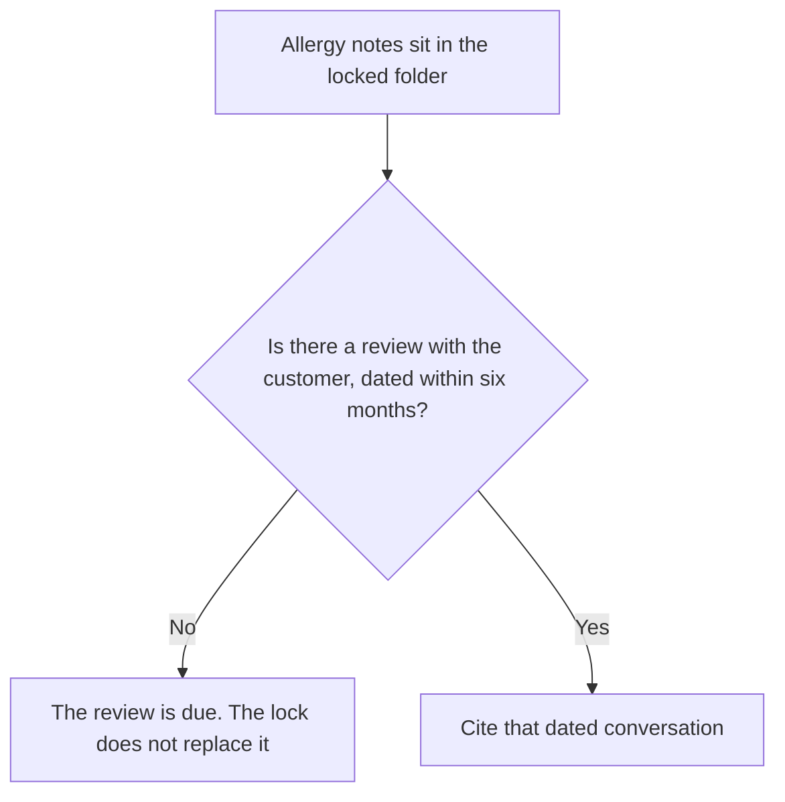

The folder answers who can see the note. The review answers whether the note is still right.

### Logical drawing

```text
rule: allergy notes, locked, shown only to staff preparing that order
period: review with the customer every six months
folder still locked
    |
    +-- a lock is not a conversation
    +-- "we have always had this note" is not a date
    +-- no customer name is invented to fill the gap
```
<!-- open-cyber-academy:lesson-figures:end ch-09 -->

### Learning outcomes

After this chapter, you should be able to:

1. Separate the locked folder from the six-month review with the customer.
2. Treat a missing review date as an open check.
3. Refuse to invent a customer name or an allergy in order to close the line.

### 9.1 Two controls, one folder

Allergy notes are health information. They stay in a locked folder and are shown only to staff preparing that customer's order. Separately, Kwame's keeping rule says the notes are reviewed with the customer every six months. A classmate points at the lock and says the review is therefore done. The lock limits who can read. It does not ask the customer whether the note is still right. If the notebook has no review date inside six months, the review is open. Kwame writes that the check is due. He does not type a customer's name or a food into the gap.

### 9.2 Worked example

| Evidence offered | What it proves | Decision |
|---|---|---|
| The folder is locked | Access control | Not the review |
| "The note has been there for years." | Age, without a conversation | The review is open |
| A notebook line: reviewed with the customer, dated this season | The rule's act | Cite it |
| "Write 'no nuts' so the page looks complete." | An invented allergy | Refuse |

> **Synthetic case.** No allergy and no customer are added by this lesson.

### Errors and limits

An open review does not mean the note should be read aloud at the counter. Access stays with staff preparing that order. This chapter is not medical advice and not a complete account of special-category duties. The privacy course is the next course for those duties.

### Apply

- **EX063 — Lock or conversation?** The allergy folder is locked. The notebook has no review with a customer in the last six months. A colleague says the lock closes the keeping rule, and offers to type an allergy so the line looks finished. What do you accept, and what do you refuse? *Rubric:* 3 = the review is open; the lock is not the conversation; do not invent an allergy or a customer name;; 2 = the review stays open and the invention is refused;; 1 = one of those;; 0 = none.

<!-- open-cyber-academy:chapter-navigation:start ch-09 -->
### Continue studying — lesson 09 (chapter 09 of 20)

[← Chapter 08](#ch-08) · [Course chapter index](../SUBJECTS.md) · [Chapter 10 →](#ch-10)

Continue to the next authored lesson.
<!-- open-cyber-academy:chapter-navigation:end -->

<a id="ch-10"></a>

## Chapter 10 — A nice photo is not a longer-use agreement

<!-- open-cyber-academy:lesson-figures:start ch-10 -->
### Lesson map

Lesson 10 published. Map, example, EX064.

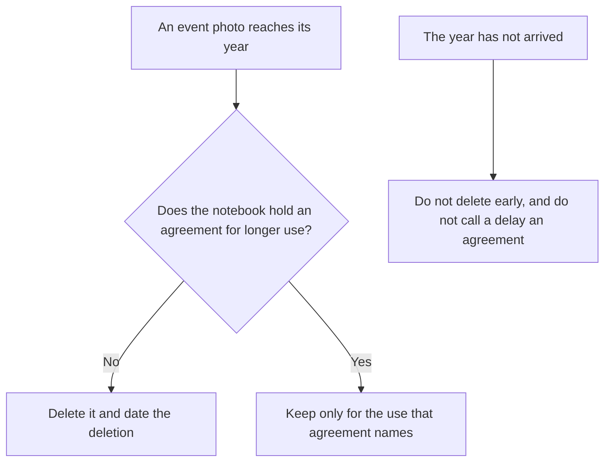

Liking a picture does not extend the period.

### Logical drawing

```text
default: event photos deleted after one year
exception: people agreed to longer use
a photo staff want to keep on the wall
    |
    +-- "it is a nice photo" is not the exception
    +-- no agreement is invented here
    +-- before the year, waiting is not the same as extending
```
<!-- open-cyber-academy:lesson-figures:end ch-10 -->

### Learning outcomes

After this chapter, you should be able to:

1. Apply the one-year default when no longer-use agreement is in the notebook.
2. Refuse to treat taste, or a wish to decide later, as that agreement.
3. Leave a photo that has not reached the year undeleted, without calling the wait an extension.

### 10.1 The exception has to be written

Event photos are deleted after a year unless people agreed to longer use. Mrs. Adeyemi likes one photograph and wants it left up "until we decide." Deciding later is not an agreement already held. If the photo's year has arrived and the notebook has no longer-use line, Kwame deletes it and dates the deletion. If the year has not arrived, he does not delete it to look strict, and he does not write a longer period in the margin. The default remains one year. This lesson does not create the agreement and does not pick a calendar day for the event.

### 10.2 Worked example

| Situation | Agreement in the notebook | Decision |
|---|---|---|
| Year reached, no longer-use line | Absent | Delete and date it |
| "It is the best photo from the night." | Absent | Still delete when the year is reached |
| "Leave it until we decide." | Absent | That sentence is not longer use |
| Year not reached | Absent | Keep until the year. Do not relabel the period |

> **Synthetic case.** No person in the photograph is named.

### Errors and limits

Deleting one photo does not set a new period for the next event. Each event keeps the one-year default unless its own agreement is written. This is not a complete image-rights opinion.

### Apply

- **EX064 — Whose sentence extends the year?** A photo has reached one year. Staff want it kept because it looks good, and Mrs. Adeyemi says "until we decide." The notebook has no longer-use agreement. What happens to the photo, and what sentence fails to extend the year? *Rubric:* 3 = delete it and date the deletion; neither taste nor "until we decide" is the agreement; do not invent an agreement;; 2 = delete, and reject both sentences;; 1 = one of those;; 0 = none.

<!-- open-cyber-academy:chapter-navigation:start ch-10 -->
### Continue studying — lesson 10 (chapter 10 of 20)

[← Chapter 09](#ch-09) · [Course chapter index](../SUBJECTS.md) · [Chapter 11 →](#ch-11)

Continue to the next authored lesson.
<!-- open-cyber-academy:chapter-navigation:end -->

<a id="ch-11"></a>

## Chapter 11 — A blank period is not a shredding date

<!-- open-cyber-academy:lesson-figures:start ch-11 -->
### Lesson map

Lesson 11 published. Map, example, EX065.

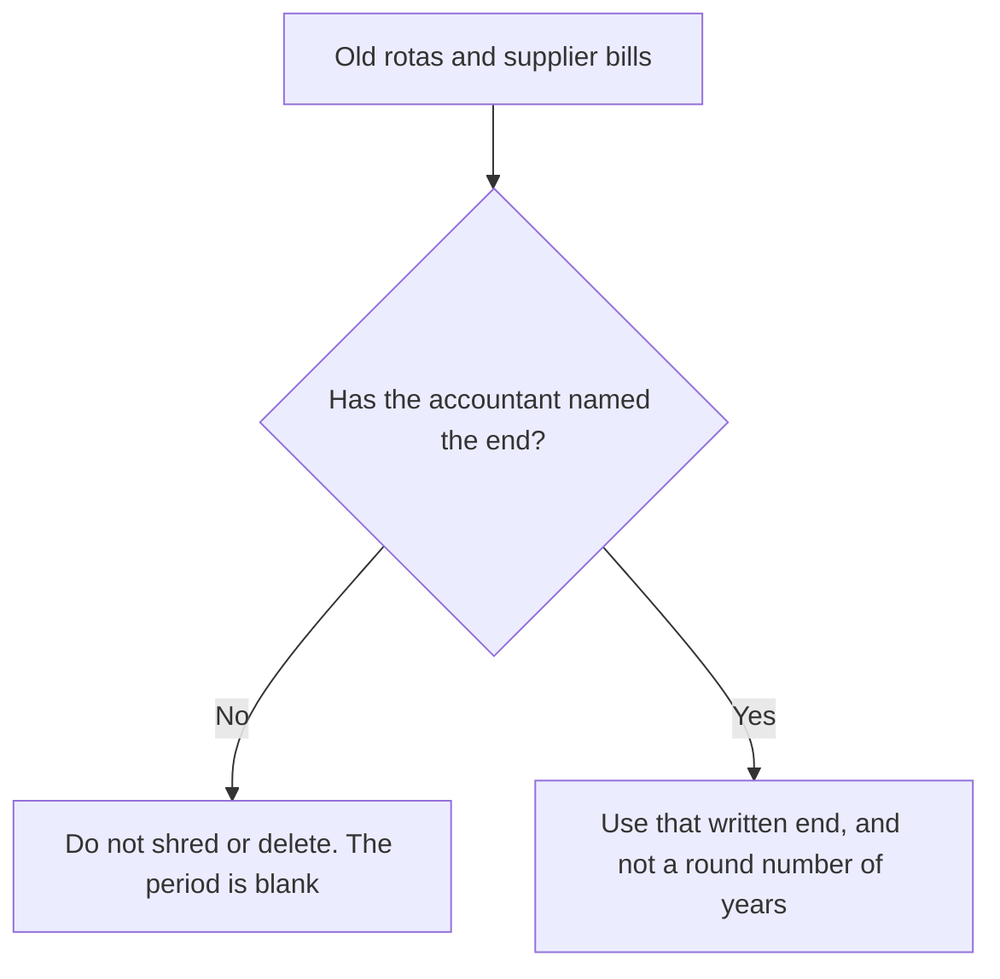

Kwame does not invent the tax period or the employment period.

### Logical drawing

```text
rules already written
    supplier bills remain until the accountant names the tax end
    old rotas remain for the employment period the accountant confirms
notebook
    those ends are still unnamed
        |
        +-- "a year feels long enough" is not the accountant
        +-- Mrs. Adeyemi is the person who checks with the accountant
        +-- this lesson writes no number of years
```
<!-- open-cyber-academy:lesson-figures:end ch-11 -->

### Learning outcomes

After this chapter, you should be able to:

1. Leave supplier bills and old rotas in place while the accountant's end dates are blank.
2. Refuse a homemade period such as "about a year."
3. Name Mrs. Adeyemi's check with the accountant as the way the blank gets filled.

### 11.1 The café already refused to guess

Chapter 2 set two periods that Kwame does not invent. Supplier bills stay until the accountant names the tax retention end, and only then are they shredded. Old rotas stay for the employment period the accountant confirms. A classmate finds a thick file and wants it shredded because a year "feels long." Feeling is not the sentence the rule requires. Until the accountant's words are in the notebook, the end is blank and the papers stay. Mrs. Adeyemi is the owner who checks those periods. Kwame can remind her. He cannot fill the blank with a number.

### 11.2 Worked example

| Proposal | Source of the date | Decision |
|---|---|---|
| Shred supplier bills older than a year | Kwame's sense of "long" | Refuse. The end is unnamed |
| Delete old rotas to save drawer space | The same guess | Refuse |
| Mrs. Adeyemi writes the accountant's named end | The person the rule names | Then, and only then, that end applies |
| Copy a period from another café's poster | Not Copperleaf's accountant | Refuse |

> **Synthetic case.** No year-count is supplied. Do not add one.

### Errors and limits

A blank is not permission to keep the papers forever without asking. It is a stop on destruction until the named person supplies the end. The privacy course can discuss legal duties. This chapter does not state a tax year or an employment statute.

### Apply

- **EX065 — Who may name the end?** The invoice drawer is full. The notebook still has no accountant's date for supplier bills or for old rotas. A colleague says "shred anything older than a year." What do you refuse, and whose sentence can fill the blank? *Rubric:* 3 = refuse the one-year guess; the papers stay while the ends are blank; Mrs. Adeyemi's check with the accountant is what can name the ends;; 2 = refuse the guess and name the accountant check;; 1 = one of those;; 0 = none.

<!-- open-cyber-academy:chapter-navigation:start ch-11 -->
### Continue studying — lesson 11 (chapter 11 of 20)

[← Chapter 10](#ch-10) · [Course chapter index](../SUBJECTS.md) · [Chapter 12 →](#ch-12)

Continue to the next authored lesson.
<!-- open-cyber-academy:chapter-navigation:end -->

<a id="ch-12"></a>

## Chapter 12 — The second café needs the same page

<!-- open-cyber-academy:lesson-figures:start ch-12 -->
### Lesson map

Lesson 12 published. Map, example, EX066.

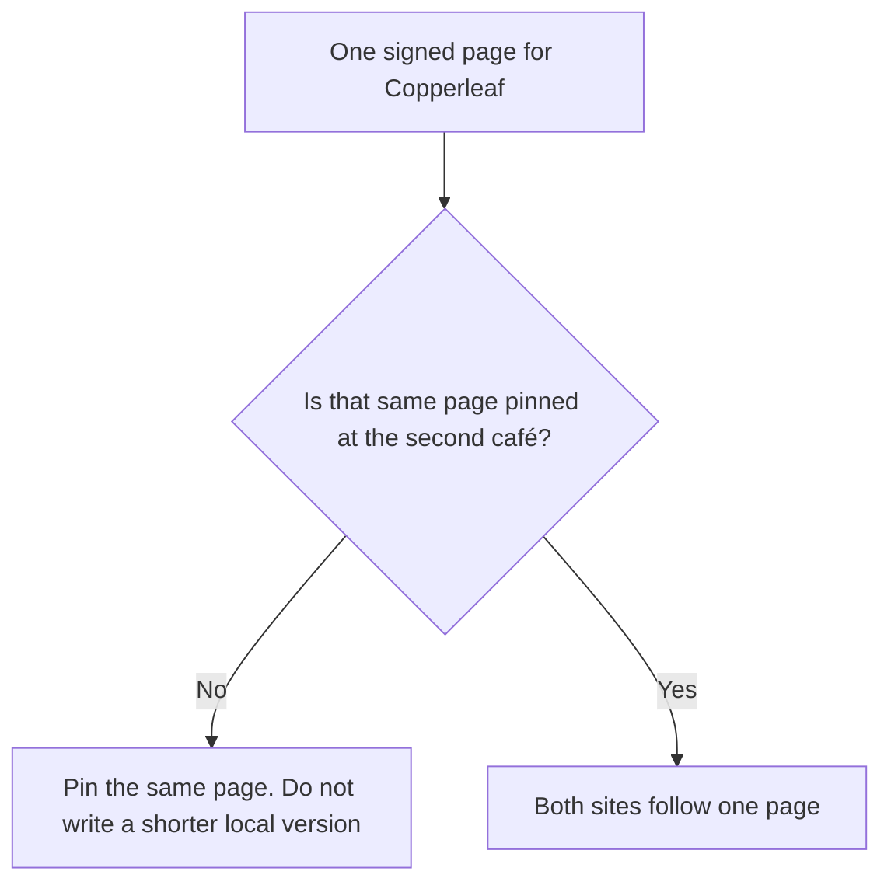

Two buildings do not justify two rulebooks.

### Logical drawing

```text
Copperleaf: two cafés, twelve staff, one owner
rules signed by Mrs. Adeyemi and pinned in a staff room
second café
    |
    +-- the pin at one site is not a pin at the other
    +-- a shorter "local" page would split the decisions
    +-- allergy, rota and sheet rules travel with the same page
```
<!-- open-cyber-academy:lesson-figures:end ch-12 -->

### Learning outcomes

After this chapter, you should be able to:

1. Treat the signed page as the rule for both cafés.
2. Refuse a shorter page written only for the second site.
3. Keep one pin from standing in for the other site.

### 12.1 Accountability is the business, not the room

Mrs. Adeyemi is accountable for all Copperleaf data, and the three first decisions were written once. Chapter 2 pinned that page in the staff room. Copperleaf has two cafés. A pin on one wall does not put the page in front of staff who work at the other site. The assistant manager suggests a shorter note for the second café, "just the bits they need." A shorter note would let that site drift: a birthday field, a private text, a photo on a phone. Kwame pins the same signed page at the second café. He does not author a second policy. This lesson does not claim the second pin has already been dated. It states what must be pinned.

### 12.2 Worked example

| Second-site proposal | Relation to the signed page | Decision |
|---|---|---|
| Pin a copy of the same page | One rulebook | Accept |
| "They already heard about it from the other site." | Hearing is not a pin | Pin it |
| A half-page that drops the allergy rule | A different rule | Refuse |
| A local birthday line "only at this café" | The sheet rule is business-wide | Refuse |

> **Synthetic case.** Staff are not split into a headcount per café. Twelve remains the business total.

### Errors and limits

Pinning the page does not, by itself, hold the staff meeting from Chapter 5. The meeting is still its own line. Two pins also do not create a third café.

### Apply

- **EX066 — One page or two?** The signed rules are pinned at one café. The second café has no pin. The assistant manager drafts a shorter note that omits allergy notes. What is pinned, and what is refused? *Rubric:* 3 = pin the same signed page at the second café; refuse the shorter note; one site's pin does not cover the other;; 2 = the same page, and refuse the shorter note;; 1 = one of those;; 0 = none.

<!-- open-cyber-academy:chapter-navigation:start ch-12 -->
### Continue studying — lesson 12 (chapter 12 of 20)

[← Chapter 11](#ch-11) · [Course chapter index](../SUBJECTS.md) · [Chapter 13 →](#ch-13)

Continue to the next authored lesson.
<!-- open-cyber-academy:chapter-navigation:end -->

<a id="ch-13"></a>

## Chapter 13 — A busy shift does not revive the shared code

<!-- open-cyber-academy:lesson-figures:start ch-13 -->
### Lesson map

Lesson 13 published. Map, example, EX067.

```mermaid
flowchart TD
  B["Saturday queue at the second café"] --> C["Someone asks for the old shared till code"]
  C --> R["Refuse. Separate logins stay"]
  R --> L["Lock the screen when stepping away, on this shift too"]
```

The habit was written for busy moments, not for quiet ones.

### Logical drawing

```text
habit already set
    separate till logins, not one shared code
    lock the screen when stepping away
Saturday, second café, queue at the door
    |
    +-- "only this shift" is the exception the habit forbids
    +-- a borrowed login attributes sales to the wrong person
    +-- this lesson does not issue a new login on the spot
```
<!-- open-cyber-academy:lesson-figures:end ch-13 -->

### Learning outcomes

After this chapter, you should be able to:

1. Refuse a one-shift return to the shared till code.
2. Keep screen-locking in force during a queue.
3. Hold any new login until it is that person's own, not a borrowed one.

### 13.1 The queue is the case the habit was for

Kwame replaced the shared till code with separate logins, and he told staff to lock the screen when they step away. On a Saturday the second café is queued to the door. A colleague asks for the old code "only until the rush ends," because finding a personal login feels slow. The rush is when a borrowed session does the most harm: a void, a refund or a card report would sit under someone else's name. Kwame refuses the old code. If a person has no login yet, they do not inherit a colleague's. Creating one is a separate step, not a shout across the counter. This lesson does not create that login.

### 13.2 Worked example

| Request during the queue | What the record would show | Decision |
|---|---|---|
| "Use the old shared code for an hour." | One code, many people | Refuse |
| "I will finish this order on the screen the other person left open." | Sales under someone else's login | Refuse the borrowed screen |
| Lock the screen, then unlock one's own login | The habit, on a busy Saturday too | Accept |
| "Write me a personal login after the rush." | A later account, not this sale | That waits. This lesson does not issue it |

> **Synthetic case.** The colleague at the second café is unnamed. The example refuses a borrowed screen and adds no person to the staff file.

### Errors and limits

A refusal at the counter does not open an account. A personal login still needs the owner's agreement and a notebook line before that person works the till alone. This chapter also does not divide the twelve staff between the two cafés.

### Apply

- **EX067 — Only this shift.** Saturday at the second café, the queue reaches the door. A colleague asks for the old shared till code "until the rush ends," and also asks to finish an order on a screen another person left unlocked. What do you refuse, and what is not created here? *Rubric:* 3 = refuse the old shared code and the borrowed unlocked screen; a new personal login is not created across the counter;; 2 = refuse both, and do not issue a login on the spot;; 1 = one of those;; 0 = none.

<!-- open-cyber-academy:chapter-navigation:start ch-13 -->
### Continue studying — lesson 13 (chapter 13 of 20)

[← Chapter 12](#ch-12) · [Course chapter index](../SUBJECTS.md) · [Chapter 14 →](#ch-14)

Continue to the next authored lesson.
<!-- open-cyber-academy:chapter-navigation:end -->

<a id="ch-14"></a>

## Chapter 14 — A lost sheet is not rebuilt from memory

<!-- open-cyber-academy:lesson-figures:start ch-14 -->
### Lesson map

Lesson 14 published. Map, example, EX068.

```mermaid
flowchart TD
  L["The counter sign-up sheet is missing"] --> K["Tell Kwame the same day and date the notebook"]
  K --> M{"Is the replacement a memory or the lab file?"}
  M -->|Yes| R["Do not type it. The send list is not rebuilt"]
  M -->|No, the paper is found| F["Use the paper, not a recollection"]
```

A report of loss is not a new census of names.

### Logical drawing

```text
habit: lost papers go to Kwame the same day
the counter sheet is gone
    |
    +-- memory is not the sheet
    +-- the twelve-row laboratory file is not the café's paper
    +-- no lost name is invented to fill the mail
```
<!-- open-cyber-academy:lesson-figures:end ch-14 -->

### Learning outcomes

After this chapter, you should be able to:

1. Report a missing sign-up sheet to Kwame on the day it is noticed.
2. Refuse a send list typed from what people think they remember.
3. Keep the laboratory's five addresses out of the café's working list.

### 14.1 The missing paper and the teaching file are different objects

The habit already says a lost paper or device is reported to Kwame the same day. The sheet that sat by the counter is gone. A colleague wants the afternoon newsletter to leave anyway, typed from names people believe they saw, and wants the five laboratory addresses pasted in because those were "the valid ones." The laboratory file is a twelve-row exercise. Its print describes that file. It is not a copy of the paper that left the counter. Kwame writes that the sheet is missing and dates the note. He does not assemble a send list from recollection, and he does not treat the synthetic rows as the customers who signed.

### 14.2 Worked example

| Proposal | What stands in for the missing paper | Decision |
|---|---|---|
| Tell Kwame today and date the notebook | The habit's report | Accept |
| Type the names staff think they saw | Memory | Refuse |
| Paste the five laboratory addresses into the café list | A teaching file | Refuse |
| Email "whoever we can still name" this afternoon | An invented list | Refuse |

> **Synthetic case.** The names on the lost sheet are not in the case file. Do not supply them.

### Errors and limits

Reporting the loss does not show that someone copied the sheet, and it does not authorise a fresh collection by itself. A later stack of forms is judged on its own dates, which Chapter 19 takes up. This chapter does not name a finder or a thief.

### Apply

- **EX068 — Whose list is the mail?** The counter sheet is gone. A colleague wants the send list rebuilt from memory and wants the laboratory's five addresses pasted in so the mail can leave today. What is reported, and what is not typed? *Rubric:* 3 = tell Kwame the same day; do not rebuild from memory; do not copy the laboratory addresses into the café list;; 2 = report the loss and refuse both substitutes;; 1 = one of those;; 0 = none.

<!-- open-cyber-academy:chapter-navigation:start ch-14 -->
### Continue studying — lesson 14 (chapter 14 of 20)

[← Chapter 13](#ch-13) · [Course chapter index](../SUBJECTS.md) · [Chapter 15 →](#ch-15)

Continue to the next authored lesson.
<!-- open-cyber-academy:chapter-navigation:end -->

<a id="ch-15"></a>

## Chapter 15 — A supplier form does not add a phone field

<!-- open-cyber-academy:lesson-figures:start ch-15 -->
### Lesson map

Lesson 15 published. Map, example, EX069.

```mermaid
flowchart TD
  F["Supplier form adds a phone box"] --> S{"Is a phone on the signed page?"}
  S -->|No| N["Collect none"]
  S -->|Only after a new signature| W["That signature is not written here"]
```

A supplier's box is not Copperleaf's rule.

### Logical drawing

```text
signed page: first name and email
dropped earlier: phone, birthday, home address
supplier form: phone, "to improve delivery"
    |
    +-- the form is not Mrs. Adeyemi's signature
    +-- no telephone number is written in this lesson
    +-- a later phone rule would need a person and a period
```
<!-- open-cyber-academy:lesson-figures:end ch-15 -->

### Learning outcomes

After this chapter, you should be able to:

1. Collect no phone while the signed page lists first name and email only.
2. Tell a supplier's form apart from that page.
3. State what a later phone rule would still need, without signing it here.

### 15.1 The page already chose the fields

The shorter sheet keeps a first name and an email. Phone, birthday and home address were dropped on purpose. The newsletter supplier then sends a revised form with a phone box, "so delivery can be improved." Improving delivery is the supplier's reason, not a change Mrs. Adeyemi has signed. Kwame leaves the box empty. He does not copy a number from an old sheet, and he does not invent one. A later decision to collect phones would need her new signature, a named person and a period. None of those three is written in this lesson.

### 15.2 Worked example

| What arrives | Authority it has | Decision |
|---|---|---|
| A phone box on the supplier's form | The supplier's layout | Collect no phone |
| "Customers expect us to call." | An expectation, not the page | Still collect none |
| An old sheet that once had numbers | A field the new page dropped | Do not copy the numbers across |
| Mrs. Adeyemi's new signature, a named person and a period | The rule for adding a field | Not signed in this lesson |

> **Synthetic case.** No telephone number appears in the case. Do not add one.

### Errors and limits

Refusing the box is a decision under the signed page. It is not a finding that a statute was broken, and it is not legal advice. Chapter 19 still applies: a phone scribbled later onto an undated copy does not enter the send list either.

### Apply

- **EX069 — Whose box is the phone?** The newsletter supplier's form adds a phone box "to improve delivery." The signed page still lists first name and email only. What is collected, and what would a later phone rule still need? *Rubric:* 3 = collect no phone; the supplier form is not the signed page; a later rule needs Mrs. Adeyemi's signature, a named person, and a period;; 2 = collect none, and name the signature the later rule needs;; 1 = one of those;; 0 = none.

<!-- open-cyber-academy:chapter-navigation:start ch-15 -->
### Continue studying — lesson 15 (chapter 15 of 20)

[← Chapter 14](#ch-14) · [Course chapter index](../SUBJECTS.md) · [Chapter 16 →](#ch-16)

Continue to the next authored lesson.
<!-- open-cyber-academy:chapter-navigation:end -->

<a id="ch-16"></a>

## Chapter 16 — A payment without the emailed invoice is a gap

<!-- open-cyber-academy:lesson-figures:start ch-16 -->
### Lesson map

Lesson 16 published. Map, example, EX070.

```mermaid
flowchart TD
  C["Monthly check: invoices entered against payments"] --> G{"Does this payment have its emailed invoice?"}
  G -->|No| R["Record the gap and the date. Tell Mrs. Adeyemi"]
  G -->|Yes| M["Enter it once. Do not pay a second copy"]
  R --> X["Do not invent a paper bill. Do not mark the check clean"]
```

A missing document stays missing until it is found.

### Logical drawing

```text
monthly check already set
    invoices entered, compared with payments
this month
    one payment, no emailed invoice beside it
        |
        +-- the gap is written, with the date
        +-- a homemade paper bill would fake the record
        +-- a gap is not, by itself, proof of theft
```
<!-- open-cyber-academy:lesson-figures:end ch-16 -->

### Learning outcomes

After this chapter, you should be able to:

1. Record a payment that has no emailed invoice, and date that gap.
2. Tell Mrs. Adeyemi rather than closing the check.
3. Refuse to create a paper bill so the folder looks complete.

### 16.1 The earlier rule was about two copies. This finding is about none

Chapter 3 stopped a double payment: the emailed copy is entered once, and the paper copy is marked received. This month's check meets a different shape. A payment is in the record, and the emailed invoice for it is not. He leaves that unmatched payment as an open notebook line. Writing a fresh paper bill would create the document the check just found absent. Kwame notes the gap and the date, and he tells Mrs. Adeyemi, who is accountable. He does not tick the monthly check as clean. He also does not treat the gap as proof that money was stolen. The notebook holds a missing invoice, not a named culprit, an amount, or a bill number.

### 16.2 Worked example

| Proposal | What it does to the gap | Decision |
|---|---|---|
| Write the gap and the date, and tell Mrs. Adeyemi | Keeps the finding | Accept |
| Draft a paper bill so the folder matches the payment | Invents the missing invoice | Refuse |
| Mark the monthly check clean | Hides the gap | Refuse |
| "Someone stole it" | A cause the check did not show | Do not write that |

> **Synthetic case.** No amount, supplier name, or bill number is added.

### Errors and limits

Leaving the gap open does not stop the café from asking the supplier for a copy later. That request, if made, is a new line in the notebook. This chapter does not start it, and it does not accuse a member of staff.

### Apply

- **EX070 — What is the check allowed to close?** The monthly comparison finds one payment and no emailed invoice for it. A colleague wants a paper bill written so the folder matches, and wants the check marked clean. What is recorded, and what is not created? *Rubric:* 3 = record the gap and the date; tell Mrs. Adeyemi; do not create a paper bill; do not mark the check clean;; 2 = record the gap and refuse both repairs;; 1 = one of those;; 0 = none.

<!-- open-cyber-academy:chapter-navigation:start ch-16 -->
### Continue studying — lesson 16 (chapter 16 of 20)

[← Chapter 15](#ch-15) · [Course chapter index](../SUBJECTS.md) · [Chapter 17 →](#ch-17)

Continue to the next authored lesson.
<!-- open-cyber-academy:chapter-navigation:end -->

<a id="ch-17"></a>

## Chapter 17 — The meeting explains the page

<!-- open-cyber-academy:lesson-figures:start ch-17 -->
### Lesson map

Lesson 17 published. Map, example, EX071.

```mermaid
flowchart TD
  M["The staff meeting, once it is actually held"] --> E["It explains the signed page"]
  E --> V{"Do staff vote a field back on?"}
  V -->|Yes| R["A vote is not Mrs. Adeyemi's signature"]
  V -->|No| K["The explanation can be dated. The rules stay as signed"]
```

Explanation is not a rewrite.

### Logical drawing

```text
fifth action: explain the rules to staff
still open until the notebook dates that explanation
when the meeting happens
    |
    +-- the page is read, not amended by a show of hands
    +-- birthdays return only with a new signature, a person and a period
    +-- this lesson does not write the meeting's calendar date
```
<!-- open-cyber-academy:lesson-figures:end ch-17 -->

### Learning outcomes

After this chapter, you should be able to:

1. Describe the meeting as an explanation of the signed page.
2. Refuse a vote that would collect birthdays again.
3. Leave Chapter 5's open line undated until a real meeting is written down.

### 17.1 What the room may do

Chapter 5 kept the staff-meeting line because the notebook has no date for the explanation. This chapter says what that meeting is for, on the day it is actually held. Kwame reads the signed page: who is accountable, which fields the sheet keeps, where allergy notes live, and which channel carries rotas and shift swaps. People may ask what a line means. They may not put a birthday back by agreeing among themselves. Only a new signature from Mrs. Adeyemi, naming a person and a period, could add that field. She does not sign one here. Teaching this limit also does not fill Chapter 5 with a calendar date. The fifth action closes when the notebook dates an explanation that was given, and that date is a record of the explanation, not a change to the rules. The meeting does not enrol anyone on the next course.

### 17.2 Worked example

| What happens in the room | Effect on the signed page | Decision |
|---|---|---|
| Kwame reads the page and answers questions | Staff hear the rules | That is the explanation |
| "Everyone voted to collect birthdays again." | No new signature | The field stays off the sheet |
| Mrs. Adeyemi signs a new line, with a person and a period | A real amendment | Not done in this lesson |
| "Write today's date so Chapter 5 looks finished." | A date for a meeting this lesson did not hold | Leave the line open |

> **Synthetic case.** No calendar date is inserted into the fifth action.

### Errors and limits

A dated explanation, once it exists, finishes the fifth action. It does not reopen the four actions that already have dates, and it does not decide the privacy questions the next course is for. Ms. Fischer's suggestion stays a suggestion.

### Apply

- **EX071 — What did the room decide?** The moved meeting is held. Staff vote to collect birthdays again "because everyone agreed." Mrs. Adeyemi has not signed a new rule. What does the meeting explain, and what does the vote fail to add? *Rubric:* 3 = the meeting explains the signed page; a vote does not add birthdays; only Mrs. Adeyemi's new signature, with a person and a period, could add the field;; 2 = explanation only, and the vote adds no field;; 1 = one of those;; 0 = none.

<!-- open-cyber-academy:chapter-navigation:start ch-17 -->
### Continue studying — lesson 17 (chapter 17 of 20)

[← Chapter 16](#ch-16) · [Course chapter index](../SUBJECTS.md) · [Chapter 18 →](#ch-18)

Continue to the next authored lesson.
<!-- open-cyber-academy:chapter-navigation:end -->

<a id="ch-18"></a>

## Chapter 18 — One deletion does not cover a new place

<!-- open-cyber-academy:lesson-figures:start ch-18 -->
### Lesson map

Lesson 18 published. Map, example, EX072.

```mermaid
flowchart TD
  S["The laptop spreadsheet was deleted after a check"] --> U["A USB stick is found and is not on the map"]
  U --> A["Add the stick as unchecked"]
  A --> W["Do not wipe it in this lesson"]
```

A finished deletion has a scope. The stick is outside it.

### Logical drawing

```text
map already used
    paper sheet, newsletter service, till provider
    staff messaging, invoice folder, allergy folder
    laptop spreadsheet: checked, then deleted
a drawer
    USB stick, not listed
        |
        +-- unknown contents are not assumed to be event photos
        +-- the stick is added as unchecked
        +-- wiping is not this lesson's act
```
<!-- open-cyber-academy:lesson-figures:end ch-18 -->

### Learning outcomes

After this chapter, you should be able to:

1. Keep the laptop-spreadsheet deletion finished for that file alone.
2. Add a newly found stick to the map as unchecked.
3. Refuse to wipe the stick before anyone has looked under the rules.

### 18.1 The map is a list of places, and this place was missing

The forgotten spreadsheet of customer emails lived on the café laptop. It was checked, it held nothing the café still needed, and it was deleted. That sentence is closed for that file. A USB stick then turns up in a drawer. The map Kwame drew named the paper sheet, the newsletter service, the till provider, the staff messaging group, the shared invoice folder and the locked allergy folder, plus the laptop he had already checked. The stick is none of those. A classmate says the deletion "covers loose copies," or that the stick is probably event photos and should be wiped. Unknown contents are not photos, and they are not the spreadsheet. Kwame adds the stick to the map and marks it unchecked. He does not wipe it here. Wiping would destroy whatever is on it before the rules have been applied to it.

### 18.2 Worked example

| Claim about the stick | Scope it assumes | Decision |
|---|---|---|
| "The spreadsheet deletion covers it." | One finished file | The deletion stays finished and does not cover the stick |
| "It must be the event photos." | A guess about contents | Do not assume that |
| Add it to the map as unchecked | A place not yet looked at | Accept |
| Wipe it this afternoon | Destruction before a check | Refuse |

> **Synthetic case.** The stick's contents are not described. Do not invent files on it.

### Errors and limits

Adding the stick does not say it is harmless, and it does not say it holds customer data. Both would be guesses. A later look, if Mrs. Adeyemi asks for one, is a new notebook line. This lesson does not perform that look.

### Apply

- **EX072 — Which deletion is finished?** The laptop spreadsheet is already deleted. A USB stick is found and is not on the map. A colleague says the spreadsheet deletion covers the stick, or that it must be photos and should be wiped. What stays finished, and what is added? *Rubric:* 3 = the spreadsheet deletion stays finished and does not cover the stick; add the stick to the map as unchecked; do not wipe it;; 2 = the deletion does not cover the stick, and the stick is not wiped;; 1 = one of those;; 0 = none.

<!-- open-cyber-academy:chapter-navigation:start ch-18 -->
### Continue studying — lesson 18 (chapter 18 of 20)

[← Chapter 17](#ch-17) · [Course chapter index](../SUBJECTS.md) · [Chapter 19 →](#ch-19)

Continue to the next authored lesson.
<!-- open-cyber-academy:chapter-navigation:end -->

<a id="ch-19"></a>

## Chapter 19 — An undated new sheet is not the send list

<!-- open-cyber-academy:lesson-figures:start ch-19 -->
### Lesson map

Lesson 19 published. Map, example, EX073.

```mermaid
flowchart TD
  D["Action one ticked the form: consent box and a date line"] --> C["Filled copies sit on the counter"]
  C --> B{"Is the date line blank?"}
  B -->|Yes| H["Do not email them. Do not merge them into the laboratory five"]
  B -->|No| K["A dated sheet can be judged under the signed fields"]
```

Designing the form was the ticked action. Using blank copies is a different act.

### Logical drawing

```text
plan, action one: short sheet with a consent box and the date
a stack of copies
    names, emails, ticks
    date line blank on each
        |
        +-- a blank date is not the consent the design asked for
        +-- the laboratory five stay a description of the synthetic file
        +-- a phone in the margin is still Chapter 15: collect none
```
<!-- open-cyber-academy:lesson-figures:end ch-19 -->

### Learning outcomes

After this chapter, you should be able to:

1. Tell the ticked form design apart from a stack of undated copies.
2. Keep those copies out of the newsletter send.
3. Keep them out of the laboratory's five addresses.

### 19.1 The tick was about the form, not about this stack

The first action on the pinned plan was the short sheet: a clear consent box and a line for the date. That tick records the design Mrs. Adeyemi agreed. A stack of copies is now on the counter. Each has a first name, an email and a tick, and the date line is empty. An empty date line means the sheet does not show when the person agreed. Kwame does not email the stack. He does not fold it into the five addresses the laboratory counted, because those five describe the twelve-row teaching file and this paper is not that file. He also does not treat a phone number written in a margin as collected: Chapter 15 still collects none. He does not invent addresses to complete blank rows.

### 19.2 Worked example

| What someone wants to do with the stack | What the tick actually was | Decision |
|---|---|---|
| Email the copies today | The tick was the form design | Do not email undated copies |
| Merge them with the laboratory's five | Two different lists | Do not merge |
| "The consent box is ticked, so the date is optional." | The design included the date line | The blank date keeps them off the send |
| A phone written in the margin | A field the page does not collect | Leave it off |

> **Synthetic case.** No real address is created to fill a blank.

### Errors and limits

Holding the stack back does not destroy it in this lesson, and it does not count as the staff explanation from Chapter 5. A copy that later has a real date can be read against the signed fields. This chapter does not back-date the blanks.

### Apply

- **EX073 — What did action one finish?** Copies of the new sheet are filled with names, emails and ticks, and every date line is blank. A colleague wants them emailed today and merged with the laboratory's five yes-tick addresses. What was the ticked action, and what stays out of the send? *Rubric:* 3 = do not email the undated copies; the ticked action was the form design; do not merge the stack into the laboratory five;; 2 = do not email them, and do not merge them;; 1 = one of those;; 0 = none.

<!-- open-cyber-academy:chapter-navigation:start ch-19 -->
### Continue studying — lesson 19 (chapter 19 of 20)

[← Chapter 18](#ch-18) · [Course chapter index](../SUBJECTS.md) · [Chapter 20 →](#ch-20)

Continue to the next authored lesson.
<!-- open-cyber-academy:chapter-navigation:end -->

<a id="ch-20"></a>

## Chapter 20 — What the notebook can say

<!-- open-cyber-academy:lesson-figures:start ch-20 -->
### Lesson map

Lesson 20 published. Map, example, EX074.

```mermaid
flowchart TD
  N["Leaving note"] --> F["Repeat only what the file and the published run already hold"]
  F --> Q{"Does the sentence add a count, a date, or a finished status?"}
  Q -->|Yes| R["Reject it"]
  Q -->|No| K["The note may cite that line"]
```

Twenty lessons meet a planning minimum. They do not close the book.

### Logical drawing

```text
the file may support
    Mrs. Adeyemi accountable; Kwame day to day
    one signed page for both cafés, second pin still undated
    sheet fields; allergy lock; lab print; first-month findings
    four plan actions dated; staff explanation still open
the note may not support
    a new print of 4 or 11; a homemade shredding year
    a lock treated as the six-month review
    a nice photo treated as longer use
    a wiped stick; an emailed undated stack
    "compliant", "certified", or "the course is complete"
```
<!-- open-cyber-academy:lesson-figures:end ch-20 -->

### Learning outcomes

After this chapter, you should be able to:

1. Repeat the Copperleaf decisions the notebook and the published run already contain.
2. Reject counts, dates and destruction the case file does not hold.
3. Say what twenty lessons meet, and what they leave open.

### 20.1 The note repeats the file

A leaving note may say what was already written down. Mrs. Adeyemi is accountable for Copperleaf's data, and Kwame handles the day-to-day work. The signed page is the rule for both cafés once the second site has it pinned. Chapter 12 required that pin and did not record it as already dated, so the note does not invent the date. The newsletter sheet keeps a first name and an email. Allergy notes stay in the locked folder, and only staff preparing that order read them. The published laboratory lines stay `rows 12; blank email 2; malformed 1; duplicates 2` and `unique valid addresses with a yes tick: 5`. The first month's notebook removed one duplicate email and took one former member out of the messaging group. Four actions on the plan have dates. The staff explanation stays open until its own date is written.

### 20.2 Worked example

| Sentence offered for the note | What the file actually holds | Decision |
|---|---|---|
| "Mrs. Adeyemi is accountable, and four actions are dated." | Those lines | May stay |
| "The send list is 4, or the file is now 11 rows." | The published run was not replaced | Reject both numbers |
| "Bills older than a year were shredded." | The accountant's end is still blank | The papers stay |
| "The allergy review happened because the folder is locked." | A lock, and no review date | The review stays open |
| "The nice photo counts as longer use." | No agreement in the notebook | Taste does not extend the year |
| "The USB stick was wiped." | The stick was added as unchecked | Do not claim a wipe |
| "The undated stack was emailed." | Blank date lines are not the send list | Do not claim the send |
| "Copperleaf is compliant and the course is complete." | A planning minimum, review still open | Reject both labels |

> **Synthetic case.** The note cites the file. It adds no meeting date, no pin date, no customer, no phone number and no staff name.

### Errors and limits

Meeting the planning minimum of 20 lessons leaves independent review open. It is not a finished qualification, not a certificate, and not legal advice. There is no maximum: a later decision can add a lesson. These English chapters do not publish another language edition. The next course is privacy and data protection, because duties about people and their data are still ahead. Nothing in this leaving note settles those duties.

### Apply

- **EX074 — Four claims.** A classmate's leaving note says the lab print is now four yes-tick addresses, that supplier bills older than a year were shredded, that the allergy review is done because the folder is locked, and that Copperleaf is compliant because twenty lessons exist. Which claims do you reject, and what do twenty lessons meet? *Rubric:* 3 = reject all four claims; the published print stays 12 rows and 5 yes-tick addresses; bills stay while the accountant's end is blank; the lock is not the review; twenty lessons meet the planning minimum and leave review open;; 2 = reject the four claims and keep the published print;; 1 = one claim;; 0 = none.

<!-- open-cyber-academy:chapter-navigation:start ch-20 -->
### Continue studying — lesson 20 (chapter 20 of 20)

[← Chapter 19](#ch-19) · [Course chapter index](../SUBJECTS.md) · [Next course via chapter index →](../SUBJECTS.md)

The chapter index leads to the next course in the study path.
<!-- open-cyber-academy:chapter-navigation:end -->

<a id="worked-results"></a>


## Worked results

Model answers for EX001–EX074. Kwame Boateng, Ms. Lena Fischer, Riverside Adult Learning Centre, Copperleaf Café and every figure are synthetic. Lab answers quote verified outputs. Any answer meeting the rubric scores equally.

**EX001.** Two.

**EX002.** A data manager for a local council.

**EX003.** Agreeing who is responsible, what rules apply and how they are checked.

**EX004.** No; owners, rules and checks are enough to start.

**EX005.** They are health information, a special category under the GDPR.

**EX006.** Staff rotas.

**EX007.** Paying a supplier twice because two invoice copies exist.

**EX008.** Serving a customer food they react to.

**EX009.** Mrs. Adeyemi, the owner.

**EX010.** Kwame.

**EX011.** The assistant manager.

**EX012.** Customer and staff data stay within approved systems.

**EX013.** On a single page agreed by Mrs. Adeyemi.

**EX014.** Only the newsletter.

**EX015.** Only staff preparing that customer's order.

**EX016.** Through the café's paid staff messaging group.

**EX017.** First name and email.

**EX018.** There is less to protect, lose or explain.

**EX019.** Separate logins for each person.

**EX020.** The same day, to Kwame.

**EX021.** They are deleted soon after.

**EX022.** Every six months, with the customer.

**EX023.** A year, unless people agreed to longer use.

**EX024.** Through the paid messaging group, keeping numbers private.

**EX025.** Pinned in the staff room.

**EX026.** People understanding why the rules exist.

**EX027.** Is it complete, valid and accurate?

**EX028.** Whether the same person appears twice.

**EX029.** An old spreadsheet of customer emails.

**EX030.** That it held nothing the café still needed.

**EX031.** Three.

**EX032.** Security, use only for Copperleaf and deletion at the end.

**EX033.** Copperleaf switched to its paid business version.

**EX034.** The same invoice existed as an emailed and a paper copy.

**EX035.** The emailed copy, with the paper marked as received.

**EX036.** That only current staff are in the group.

**EX037.** In a notebook kept with the rules.

**EX038.** A few minutes.

**EX039.** Twelve.

**EX040.** Two blank emails.

**EX041.** One malformed address.

**EX042.** Two duplicate rows.

**EX043.** Five.

**EX044.** It trims spaces and converts to lowercase.

**EX045.** No; blank ticks are not treated as consent.

**EX046.** By signing the new sheet in person if they wish.

**EX047.** Five actions.

**EX048.** A clear consent box and the date.

**EX049.** Explaining the rules at the staff meeting, moved a week.

**EX050.** Privacy and data protection.


**EX051.** A personal phone is not an approved system, and the note is health information. Mrs. Adeyemi must be told the same day because she is accountable.

**EX052.** The second decision is incomplete. Name the day-to-day person on the one page before the rota is copied anywhere.

**EX053.** The newsletter does not need a birthday. A later birthday offer would need its own rule, a named person, a keeping period and an approved channel before any date is collected.

**EX054.** Shift swaps go through the paid messaging group so phone numbers stay private.

**EX055.** The provider would use Copperleaf's data for its own offers, not only for Copperleaf. The notebook records the refusal and the date.

**EX056.** Enter the emailed copy once, mark the paper copy as received, and do not pay the paper copy as a second bill.

**EX057.** The script trims and lowercases the address. The tick stays `Yes`. The row is not emailed, because only an exact `yes` counts.

**EX058.** No. Eli may sign the new sheet in person. The refusal is dated in the notebook.


**EX059.** Do not drop the fifth line. The explanation is unfinished until the notebook dates it. A moved week is not that date.

**EX060.** Neither 11 nor 4 was counted. The verified print remains 12 rows and 5 yes-tick addresses. Do not edit the script.

**EX061.** The later person is still a member. Remove them and date the removal. Last month's removal does not cover this person.

**EX062.** Delete the address from the working list and date the notebook. Leave the published print at 5. Do not edit the script to force 4.

**EX063.** The review is open. The lock is not the conversation. Do not invent an allergy or a customer name.

**EX064.** Delete the photo and date the deletion. Neither taste nor a postponed decision is the agreement. Do not invent an agreement.

**EX065.** Refuse the one-year guess. The papers stay while the ends are blank. Mrs. Adeyemi's check with the accountant can name the ends.

**EX066.** Pin the same signed page at the second café. Refuse the shorter note. One site's pin does not cover the other.

**EX067.** Refuse the old shared code and the borrowed unlocked screen. A new personal login is not created across the counter.

**EX068.** Tell Kwame the same day. Do not rebuild the send list from memory. Do not copy the laboratory addresses into the café list.

**EX069.** Collect no phone. The supplier form is not the signed page. A later rule needs Mrs. Adeyemi's signature, a named person, and a period.

**EX070.** Record the gap and the date. Tell Mrs. Adeyemi. Do not create a paper bill. Do not mark the check clean.

**EX071.** The meeting explains the signed page. A vote does not add birthdays. Only Mrs. Adeyemi's new signature, with a person and a period, could add the field.

**EX072.** The spreadsheet deletion stays finished and does not cover the stick. Add the stick to the map as unchecked. Do not wipe it.

**EX073.** Do not email the undated copies. The ticked action was the form design. Do not merge the stack into the laboratory five.

**EX074.** Reject all four claims. The published print stays 12 rows and 5 yes-tick addresses. Bills stay while the accountant's end is blank. The lock is not the review. Twenty lessons meet the planning minimum and leave review open. The next course is privacy and data protection. This is not legal advice.

<a id="references"></a>
## References

Every DOI was resolved through doi.org on 12 October 2026, and standards were checked against their publisher pages. Organisations, people, systems and figures in the running cases are synthetic; only the works below are real.

- European Union. (2016). Regulation (EU) 2016/679 (General Data Protection Regulation). *Official Journal of the European Union, L 119*, 1–88. <http://data.europa.eu/eli/reg/2016/679/oj>
