# Data Governance: Rapid Course

- Language: English (`en`); course 003, Rapid course (1 month).
- Editorial state: **published**. Chapters 1–4 of 4 have hand-written teaching text; exercises EX001–EX058 have matching worked results with 0–3 rubrics; one offline labs use only the Python 3 standard library on synthetic data, and their outputs are embedded from real runs. Independent review and the 300-page A4 verification remain open.
- Audience: beginners who need a fast, practical start in data governance for a small business.
- Author: [hiagokinlevi](https://github.com/hiagokinlevi). Original text [CC0 1.0](../../../../../LICENSE); cited works keep their rights.
- Boundary: the lab checks a twelve-row synthetic café sign-up list for blank emails, malformed addresses, duplicates and consent ticks. Law is cited by edition and paraphrased; nothing here is legal advice. All people, organisations, systems and data are **synthetic** unless a sentence cites a public source.

[Course home](../../README.md) · [Chapter index](../SUBJECTS.md) · [Book plan](PLAN.md) · [Course skill](../../skill/SKILL.md) · [Worked results](#worked-results)

## How to use this draft

Read in order. The four chapters follow one shift supervisor through a one-month course: foundations and first decisions, ownership and safe practice, quality, systems and suppliers, and a guided lab that becomes a short action plan. Run each lab where it appears, attempt the exercises before the worked results, and score yourself with the rubrics. Each chapter also has a concept table, a data table, a decision flowchart and a second worked example. EX051–EX058 apply those tools to a new café fact.

### Synthetic running case

| Element | Role | Boundary |
|---|---|---|
| **Kwame Boateng** | Rapid course student, café shift supervisor | Invented |
| **Ms. Lena Fischer** | Mentor, council data manager | Invented |
| **Riverside Adult Learning Centre** | Fictional learning centre | Invented |
| **Copperleaf Café** | Fictional business, two cafés and twelve staff | Invented |

### Core sources

GDPR. Full list in [References](#references).

## Contents

| Chapters |
|---|
| [1](#ch-01) · [2](#ch-02) · [3](#ch-03) · [4](#ch-04) |

[Worked results](#worked-results) · [References](#references)

<a id="ch-01"></a>

## Chapter 1 — Data governance: foundations and first decisions

<!-- cykin:lesson-figures:start ch-01 -->
### Lesson map

Lesson 01 published. Map, example, EX051.

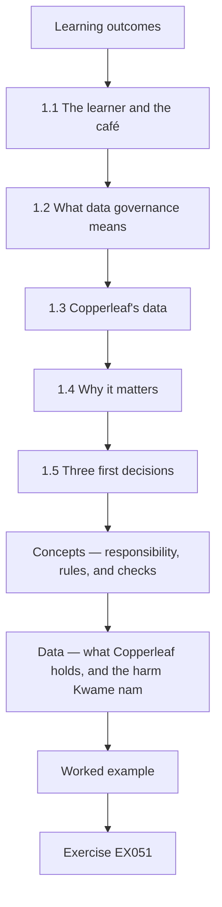

### Logical drawing

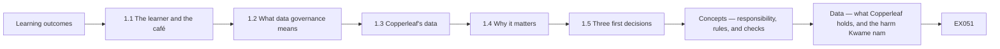

```text
[Learning outcomes]
    |
    v
[1.1 The learner and the café]
    |
    v
[1.2 What data governance means]
    |
    v
[1.3 Copperleaf's data]
    |
    v
[1.4 Why it matters]
    |
    v
[1.5 Three first decisions]
    |
    v
[Concepts — responsibility, rules, and checks]
    |
    v
[Data — what Copperleaf holds, and the harm Kwame nam]
    |
    v
[Worked example] --> [Exercise EX051]
```
<!-- cykin:lesson-figures:end ch-01 -->


### Learning outcomes

You will (1) explain data governance in plain words; (2) list the data a small café holds; (3) make three first decisions about responsibility and rules.

### 1.1 The learner and the café

Kwame Boateng works as a shift supervisor at Copperleaf Café, a fictional business with two cafés, twelve staff and a newsletter for regular customers. The owner, Mrs. Adeyemi, asks him to sort out how the café looks after its data. He joins a one-month rapid course at the fictional Riverside Adult Learning Centre, guided by mentor Ms. Lena Fischer, who works as a data manager for a local council. Every exercise uses synthetic data invented for teaching, never real customer details.

### 1.2 What data governance means

Ms. Fischer explains data governance in one sentence: agreeing who is responsible for each kind of data, what rules it must follow and how everyone checks that the rules work. Kwame notes that this is about decisions and habits, not expensive software. A small café can govern its data with a short list of owners, a page of rules and a few regular checks. The aim is data that are accurate enough to use, safe and kept only as long as needed.

### 1.3 Copperleaf's data

Kwame lists Copperleaf's data: the newsletter sign-up sheet with customer emails, staff names, contact numbers and rotas, supplier contacts and invoices, card payment reports from the till provider, allergy notes for a few regular customers and photos from a recent event. He marks which contain personal data about identifiable people. Most do. He notes that allergy notes are health information, which the GDPR treats as special category data needing extra care. He writes each item on a list with where it is kept, so nothing is forgotten later.

### 1.4 Why it matters

Ms. Fischer asks Kwame what could go wrong. He lists: emailing customers who never agreed, losing the allergy notes and serving the wrong food, sharing staff phone numbers with the wrong person, keeping old rotas forever and paying a supplier twice because two invoice copies exist. Each problem affects customers, staff or money. He sees that governance protects people and the business at the same time, and that small businesses face the same kinds of risk as large ones. Mrs. Adeyemi agrees.

### 1.5 Three first decisions

Ms. Fischer asks Kwame to make three decisions this week. First, Mrs. Adeyemi is accountable for all data, and Kwame looks after it day to day. Second, each kind of data gets a named person: Kwame for the newsletter and allergy notes, the assistant manager for rotas and Mrs. Adeyemi for supplier and payment records. Third, no customer or staff data leave the café's approved systems. Mrs. Adeyemi agrees all three, and Kwame writes them on one page. Staff are told that week.

### Worked example

Kwame defines governance as responsibility, rules and checks, lists Copperleaf's data including allergy notes as health information, identifies risks to people and money and records three first decisions approved by Mrs. Adeyemi.

> **Synthetic case.** Copperleaf, Riverside and all people are synthetic; the GDPR is real.

### Errors and limits

Thinking governance needs expensive tools delays simple decisions that help immediately.

### Concepts — responsibility, rules, and checks

Ms. Fischer's one sentence has three parts. Copperleaf can use them before it buys anything.

| Part | Question this week | Copperleaf's first answer | What is still missing |
|---|---|---|---|
| Responsibility | Who answers if this data is wrong or lost? | Mrs. Adeyemi is accountable. Kwame looks after it day to day | A named person for every kind of data |
| Rules | What may this data be used for, and where may it sit? | No customer or staff data leave approved systems | The page of rules comes in the next chapter |
| Checks | How will someone see that the rule held? | The three decisions are written on one page and told to staff | A dated check, not only an announcement |

Allergy notes are not "just another customer note". They are health information. The GDPR treats that as special-category data, so the extra care is part of the rule, not a later upgrade.

### Data — what Copperleaf holds, and the harm Kwame named

| Data | Where Kwame found it | Personal data? | Harm he named |
|---|---|---|---|
| Newsletter emails | Sign-up sheet | Yes | Emailing someone who never agreed |
| Staff names, numbers, rotas | Café records | Yes | Sharing a phone number with the wrong person |
| Supplier contacts and invoices | Email and paper | Business, with people attached | Paying a supplier twice from two copies |
| Card-payment reports | Till provider | Yes, about payments | A report leaving the approved system |
| Allergy notes | A few regulars | Yes, health information | Serving the wrong food |
| Event photos | Recent event | Often yes | Kept with no agreed end |

### Decision flow — a new fact about a person

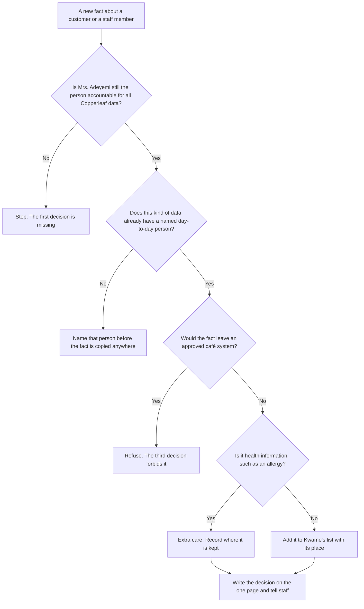

### Worked example — an allergy on a napkin

A regular writes "no milk" on a napkin. A barista photographs the napkin on a personal phone so the next shift can see it. Kwame stops that copy. The note is health information, and a personal phone is not an approved café system, so the third decision already forbids the photograph. He writes the allergy onto the café's own list, records where that list is kept, and tells Mrs. Adeyemi the same day because she is accountable. The napkin is not left on the counter.

> **Synthetic case.** The milk scribble, the camera roll and the same-afternoon counter check are invented. The GDPR is real. This is not legal advice.

### Apply

- **EX051 — Napkin photograph.** Why is the personal-phone photograph refused, and who must be told the same day? *Rubric:* 3 = a personal phone is not an approved system, and the note is health information; Mrs. Adeyemi, because she is accountable;; 2 = the approved-system rule only;; 1 = vague;; 0 = none.
- **EX052 — Missing name.** Staff rotas have no named day-to-day person yet. Which of the three decisions is incomplete, and what is written before the rota is copied to a new place? *Rubric:* 3 = the second decision; name the person, on the one page, before any copy;; 2 = name a person, without the page;; 1 = vague;; 0 = none.

### Exercises

- **EX001 — Café size.** How many cafés does Copperleaf run? *Rubric:* 3 = two;; 2 = partly correct;; 1 = wrong;; 0 = none.
- **EX002 — Mentor job.** What is Ms. Fischer's job? *Rubric:* 3 = data manager for a local council;; 2 = partly correct;; 1 = other;; 0 = none.
- **EX003 — One-sentence definition.** How does Ms. Fischer define governance? *Rubric:* 3 = who is responsible, what rules, how rules are checked;; 2 = partly correct;; 1 = partial;; 0 = none.
- **EX004 — Software need.** Does a small café need expensive software to govern data? *Rubric:* 3 = no;; 2 = partly correct;; 1 = yes;; 0 = none.
- **EX005 — Allergy status.** Why do allergy notes need extra care? *Rubric:* 3 = they are health information, special category data;; 2 = partly correct;; 1 = vague;; 0 = none.
- **EX006 — Staff data example.** Name one kind of staff data Copperleaf holds. *Rubric:* 3 = names, contact numbers or rotas;; 2 = one;; 1 = vague;; 0 = none.
- **EX007 — Supplier risk.** What money risk did Kwame list? *Rubric:* 3 = paying a supplier twice from duplicate invoices;; 2 = partly correct;; 1 = vague;; 0 = none.
- **EX008 — Allergy risk.** What could losing allergy notes cause? *Rubric:* 3 = serving the wrong food;; 2 = partly correct;; 1 = vague;; 0 = none.
- **EX009 — Accountable person.** Who is accountable for all Copperleaf data? *Rubric:* 3 = Mrs. Adeyemi;; 2 = partly correct;; 1 = other;; 0 = none.
- **EX010 — Newsletter person.** Who looks after the newsletter list? *Rubric:* 3 = Kwame;; 2 = partly correct;; 1 = other;; 0 = none.
- **EX011 — Rota person.** Who looks after rotas? *Rubric:* 3 = the assistant manager;; 2 = partly correct;; 1 = other;; 0 = none.
- **EX012 — Approved systems rule.** What is the third decision? *Rubric:* 3 = no customer or staff data leave approved systems;; 2 = partly correct;; 1 = vague;; 0 = none.
- **EX013 — Decision record.** Where are the three decisions written? *Rubric:* 3 = on one page;; 2 = partly correct;; 1 = vague;; 0 = none.

<!-- cykin:chapter-navigation:start ch-01 -->
### Continue studying — lesson 01 (chapter 01 of 04)

[← Course home](../../README.md) · [Course chapter index](../SUBJECTS.md) · [Chapter 02 →](#ch-02)

Continue to the next authored lesson.
<!-- cykin:chapter-navigation:end -->

<a id="ch-02"></a>

## Chapter 2 — Ownership, rules and safe practice

<!-- cykin:lesson-figures:start ch-02 -->
### Lesson map

Lesson 02 published. Map, example, EX053.

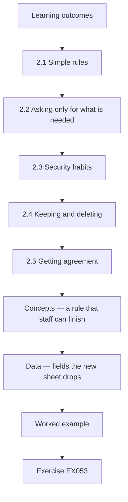

### Logical drawing

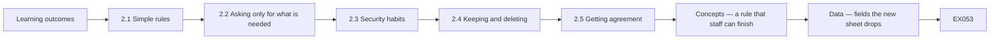

```text
[Learning outcomes]
    |
    v
[2.1 Simple rules]
    |
    v
[2.2 Asking only for what is needed]
    |
    v
[2.3 Security habits]
    |
    v
[2.4 Keeping and deleting]
    |
    v
[2.5 Getting agreement]
    |
    v
[Concepts — a rule that staff can finish]
    |
    v
[Data — fields the new sheet drops]
    |
    v
[Worked example] --> [Exercise EX053]
```
<!-- cykin:lesson-figures:end ch-02 -->


### Learning outcomes

You will (1) write simple rules for each kind of data; (2) apply basic security habits; (3) decide how long to keep records.

### 2.1 Simple rules

Kwame writes a page of rules with Ms. Fischer's help. Newsletter emails are used only for the newsletter. Allergy notes are kept in a locked folder behind the counter and shown only to staff preparing that customer's order. Rotas are shared through the staff messaging group the café pays for, not personal social media. Invoices are filed by supplier and date in one shared folder. Each rule names the person responsible, so staff know whom to ask. The page fits on one side.

### 2.2 Asking only for what is needed

The old sign-up sheet asked for name, email, phone, birthday and home address. Kwame asks why. Mrs. Adeyemi says only the email is needed for the newsletter, and a first name makes emails friendlier. Kwame removes phone, birthday and address from the new sheet. Ms. Fischer explains that collecting less data means less to protect, less to lose and fewer questions from customers about why the café wants their details. The new sheet is quicker to fill in, and Kwame notices that more customers sign up in the first week than before.

### 2.3 Security habits

Kwame lists habits for staff: lock the till computer screen when stepping away, use separate logins for the till system rather than one shared code, keep the sign-up sheet out of customers' reach, never photograph customer details on personal phones and report lost papers or devices to Kwame the same day. He explains each habit at the next staff meeting with a real example of what could happen, such as a customer reading the sign-up sheet on the counter. Staff agree readily.

### 2.4 Keeping and deleting

Kwame sets keeping periods. Newsletter emails are kept while the customer stays subscribed and deleted soon after they unsubscribe. Old rotas are kept for the period employment rules require, then deleted. Supplier bills remain until the accountant names the tax retention end, and only then are they shredded. Allergy notes are reviewed every six months with the customer. Photos from events are deleted after a year unless people agreed to longer use. He writes each period beside the matching rule. Mrs. Adeyemi checks the tax and employment periods with her accountant.

### 2.5 Getting agreement

Kwame shows the rules to Mrs. Adeyemi and the assistant manager. The assistant manager asks whether staff may still swap shifts by text. They agree that shift swaps go through the paid messaging group, which keeps numbers private. Mrs. Adeyemi signs the page and asks Kwame to pin it in the staff room. Ms. Fischer reminds him that rules work when people understand them, so he should explain changes rather than just announce them. Kwame explains each change at the next staff meeting.

### Worked example

Kwame writes rules naming who is responsible, cuts the sign-up sheet to first name and email, lists security habits explained with examples, sets keeping periods and gets the rules signed and pinned in the staff room.

> **Synthetic case.** Rules are synthetic.

### Errors and limits

Copying a large company's long policy into a café produces rules nobody reads.

### Concepts — a rule that staff can finish

A café rule fails when it is long, when it collects data nobody will use, or when the only way to obey it is a private text message.

| Test | Passes at Copperleaf | Fails |
|---|---|---|
| One job | Newsletter emails are used only for the newsletter | Using that list to advertise a supplier |
| Least data | New sheet keeps first name and email | The old sheet's phone, birthday and home address |
| A channel the café controls | Rotas and shift swaps stay in the paid messaging group | A personal text, which spreads phone numbers |
| A period | Allergy notes are reviewed with the customer every six months | "Keep it until someone remembers" |
| A person | Each rule names who to ask | A page with no name |

Mrs. Adeyemi checks the tax and employment periods with the accountant. Kwame does not invent those periods.

### Data — fields the new sheet drops

| Old field | Kept? | Why |
|---|---|---|
| First name | Yes | Makes the newsletter greeting usable |
| Email | Yes | The only address the newsletter needs |
| Phone | No | Not needed to send the newsletter |
| Birthday | No | Not needed, and it is extra personal data |
| Home address | No | Not needed, and it is extra personal data |

Less data means less to protect, less to lose and fewer questions from customers. The new sheet is also faster, which is why more people signed up in the first week.

### Decision flow — someone wants one more field

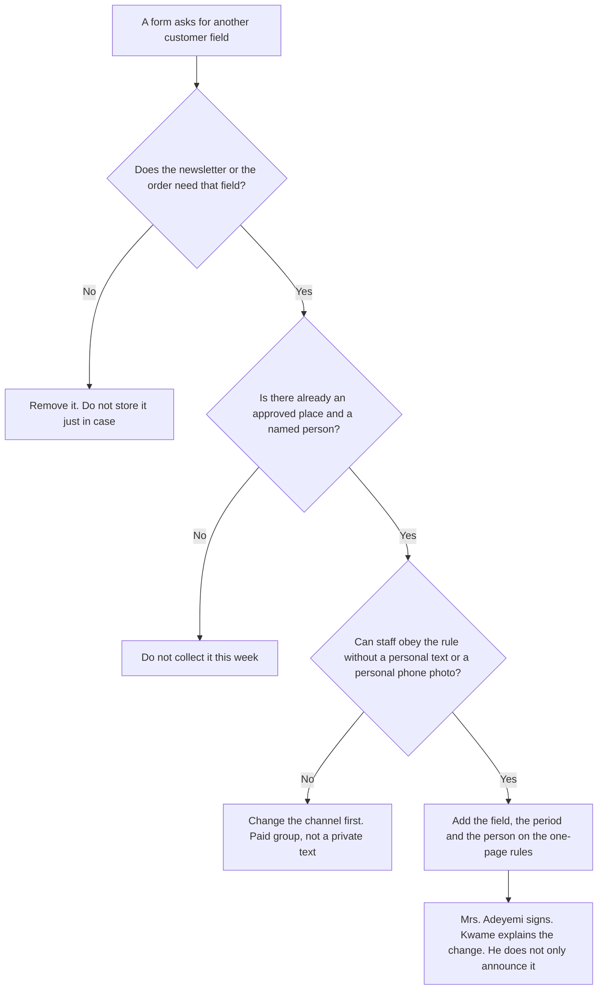

### Worked example — a birthday for a free cake

A supplier offers a free cake if the sign-up sheet collects birthdays. Kwame refuses the field. The newsletter needs a first name and an email, which is the reason the old birthday column was removed. A cake is not a new purpose written on the rules page. If Mrs. Adeyemi later wants a birthday offer, that is a separate rule: a named person, a period, and a channel that is not a personal phone. It is not added in the margin of the newsletter sheet.

> **Synthetic case.** The free-cake bargain and the handwritten margin are invented.

### Apply

- **EX053 — Birthday field.** Why does the birthday stay off the newsletter sheet, and what would a later birthday offer need before any date is collected? *Rubric:* 3 = the newsletter does not need it; a later offer needs its own rule, a named person, a period and an approved channel;; 2 = the newsletter does not need it;; 1 = vague;; 0 = none.
- **EX054 — Shift text.** Two staff swap a shift by private text. Which signed rule did they miss, and where must the swap go? *Rubric:* 3 = swaps go through the paid messaging group so numbers stay private;; 2 = the paid group, without the reason;; 1 = vague;; 0 = none.

### Exercises

- **EX014 — Newsletter use.** What may newsletter emails be used for? *Rubric:* 3 = only the newsletter;; 2 = partly correct;; 1 = other;; 0 = none.
- **EX015 — Allergy access.** Who may see allergy notes? *Rubric:* 3 = staff preparing that customer's order;; 2 = partly correct;; 1 = vague;; 0 = none.
- **EX016 — Rota channel.** How are rotas shared? *Rubric:* 3 = the paid staff messaging group;; 2 = partly correct;; 1 = vague;; 0 = none.
- **EX017 — Kept sign-up fields.** Which fields stay on the new sign-up sheet? *Rubric:* 3 = first name and email;; 2 = both;; 1 = one;; 0 = none.
- **EX018 — Collect-less benefit.** Why collect less data? *Rubric:* 3 = less to protect, lose or explain;; 2 = partly correct;; 1 = vague;; 0 = none.
- **EX019 — Till login habit.** What replaces the shared till code? *Rubric:* 3 = separate logins;; 2 = partly correct;; 1 = vague;; 0 = none.
- **EX020 — Loss reporting.** When should lost papers be reported? *Rubric:* 3 = the same day;; 2 = partly correct;; 1 = wrong;; 0 = none.
- **EX021 — Unsubscribe action.** What happens to emails after unsubscribing? *Rubric:* 3 = deleted soon after;; 2 = partly correct;; 1 = vague;; 0 = none.
- **EX022 — Allergy review.** How often are allergy notes reviewed? *Rubric:* 3 = every six months;; 2 = partly correct;; 1 = wrong;; 0 = none.
- **EX023 — Photo period.** How long are event photos kept by default? *Rubric:* 3 = one year;; 2 = partly correct;; 1 = wrong;; 0 = none.
- **EX024 — Shift swap answer.** How do staff swap shifts now? *Rubric:* 3 = through the paid messaging group;; 2 = partly correct;; 1 = text;; 0 = none.
- **EX025 — Rules location.** Where are the signed rules displayed? *Rubric:* 3 = the staff room;; 2 = partly correct;; 1 = other;; 0 = none.
- **EX026 — Explaining changes.** What does Ms. Fischer say makes rules work? *Rubric:* 3 = people understanding them;; 2 = partly correct;; 1 = vague;; 0 = none.

<!-- cykin:chapter-navigation:start ch-02 -->
### Continue studying — lesson 02 (chapter 02 of 04)

[← Chapter 01](#ch-01) · [Course chapter index](../SUBJECTS.md) · [Chapter 03 →](#ch-03)

Continue to the next authored lesson.
<!-- cykin:chapter-navigation:end -->

<a id="ch-03"></a>

## Chapter 3 — Quality, systems and suppliers

<!-- cykin:lesson-figures:start ch-03 -->
### Lesson map

Lesson 03 published. Map, example, EX055.

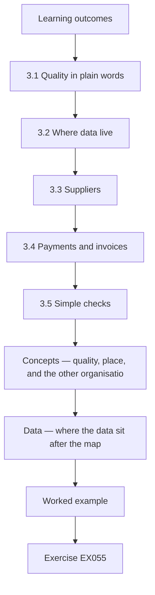

### Logical drawing

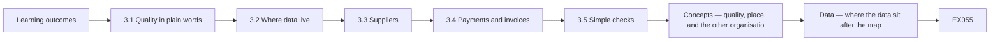

```text
[Learning outcomes]
    |
    v
[3.1 Quality in plain words]
    |
    v
[3.2 Where data live]
    |
    v
[3.3 Suppliers]
    |
    v
[3.4 Payments and invoices]
    |
    v
[3.5 Simple checks]
    |
    v
[Concepts — quality, place, and the other organisatio]
    |
    v
[Data — where the data sit after the map]
    |
    v
[Worked example] --> [Exercise EX055]
```
<!-- cykin:lesson-figures:end ch-03 -->


### Learning outcomes

You will (1) check data quality in a small business; (2) map where data are stored; (3) check suppliers who handle the café's data.

### 3.1 Quality in plain words

Ms. Fischer explains quality with three questions: is the data complete, is it valid and is it accurate? For the newsletter list, complete means every row has an email, valid means each email looks like a real address and accurate means it belongs to the person who signed up. Kwame adds a fourth question for duplicates: does the same person appear twice? He notes that poor quality wastes effort and annoys customers who receive two copies of every email. Kwame writes all four down.

### 3.2 Where data live

Kwame draws a simple map of where Copperleaf's data are stored: the paper sign-up sheet, the newsletter service, the till provider's system, the staff messaging group, a shared folder for invoices and the locked allergy folder. For each place he notes who can see it and whether it is protected. He finds an old spreadsheet of customer emails on the café laptop that nobody uses. Mrs. Adeyemi agrees he should delete it after checking it holds nothing needed. He keeps the map with the rules.

### 3.3 Suppliers

Three suppliers handle Copperleaf's data: the newsletter service, the till and card payment provider and the messaging app. Kwame checks each one's terms for data protection commitments, such as keeping data secure, using it only for Copperleaf and deleting it when the contract ends. The newsletter service and till provider include these terms. The messaging app is a free personal version without business terms, so Mrs. Adeyemi switches to its paid business version. Kwame keeps a copy of each supplier's terms in the shared folder.

### 3.4 Payments and invoices

Kwame looks at invoices and finds two copies of the same supplier invoice, one emailed and one paper, with slightly different dates. The café nearly paid twice. He suggests that invoices be entered once, from the emailed copy, with the paper copy marked as received. Mrs. Adeyemi agrees. Ms. Fischer notes that duplicate records are a quality problem in money data too, and that a single entry point prevents most of them. The accountant also welcomes the change, because it makes the monthly records easier to check.

### 3.5 Simple checks

Kwame sets three monthly checks: look for duplicate or malformed emails in the newsletter list, confirm that only current staff are in the messaging group and compare invoices entered with payments made. Each check takes a few minutes. He records the date and anything found in a notebook kept with the rules. Ms. Fischer explains that short, regular checks catch problems early and show that the rules are being followed. After the first month, the notebook already shows one duplicate email removed and one former staff member taken out of the group.

### Worked example

Kwame defines quality with completeness, validity, accuracy and duplicates, maps where data live and deletes an unused email spreadsheet, moves staff messaging to a business version, stops duplicate invoices at entry and sets three monthly checks.

> **Synthetic case.** Systems and suppliers are synthetic.

### Errors and limits

Free personal apps used for business data often lack the terms a business needs.

### Concepts — quality, place, and the other organisation

Four quality questions, then a place, then a supplier. Copperleaf does not treat a convenient app as a supplier until its terms match the café's rules.

| Question or check | Newsletter meaning | Money meaning |
|---|---|---|
| Complete | Every row has an email | An invoice has supplier, date and amount |
| Valid | The address looks real | The copy is one invoice, not a second scan |
| Accurate | It belongs to the person who signed | The emailed copy is the one that is entered |
| Duplicate | The same person is not listed twice | Email plus paper must not be paid twice |
| Place | Newsletter service, not the forgotten laptop spreadsheet | One shared folder, filed by supplier and date |
| Supplier terms | Secure, used only for Copperleaf, deleted when the contract ends | Same three commitments |

The free personal messaging app failed the terms test. The paid business version replaced it. Kwame files the paid-app contract beside the newsletter and till terms, so the three commitments can be reread without opening each vendor site.

### Data — where the data sit after the map

| Place | Who can see it | Protected? | Action |
|---|---|---|---|
| Paper sign-up sheet | Whoever stands at the counter | Only if it is kept out of customers' reach | Replace with the short sheet |
| Newsletter service | The service and Kwame | Terms include the three commitments | Keep |
| Till provider | The provider and the café | Terms include the three commitments | Keep |
| Staff messaging | Current staff, once the group is cleaned | Paid business version | Leave the free personal app |
| Invoice folder | Office | One entry point: the emailed copy | Mark the paper copy as received |
| Locked allergy folder | Staff preparing that order | Locked, reviewed every six months | Keep |
| Old laptop spreadsheet | Whoever opens the laptop | Forgotten, nobody uses it | Delete after checking it holds nothing needed |

### Decision flow — a supplier or a second copy

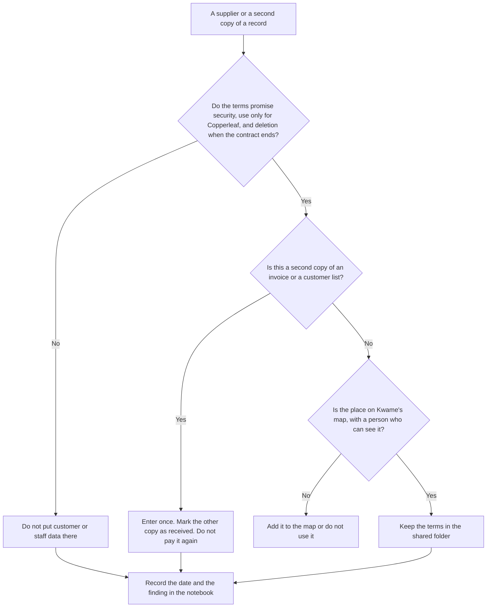

### Worked example — a cheaper till that wants the newsletter

A new till provider offers a lower rate if it may email Copperleaf's customers with its own offers. Kwame refuses. The terms would use café data for the provider, not only for Copperleaf. A lower card rate does not excuse skipping security, Copperleaf-only use, or deletion at the end of the contract. The rate is not a reason to skip the three commitments. He writes the refusal in the notebook and leaves the current till provider in place.

> **Synthetic case.** The cheaper till offer is invented.

### Apply

- **EX055 — Cheaper till.** Which commitment fails, and what is written in the notebook? *Rubric:* 3 = the provider would use the data for its own offers, not only for Copperleaf; the refusal and the date;; 2 = the use limit only;; 1 = vague;; 0 = none.
- **EX056 — Second paper invoice.** An emailed invoice is already entered. The paper copy arrives with a slightly different date. What is entered, what is marked, and what is not paid? *Rubric:* 3 = enter the emailed copy once; mark the paper copy received; do not pay the paper copy as a second bill;; 2 = do not pay twice;; 1 = vague;; 0 = none.

### Exercises

- **EX027 — Quality questions.** What three quality questions does Ms. Fischer use? *Rubric:* 3 = complete, valid, accurate;; 2 = all;; 1 = some;; 0 = none.
- **EX028 — Added question.** What fourth question did Kwame add? *Rubric:* 3 = whether the same person appears twice;; 2 = partly correct;; 1 = vague;; 0 = none.
- **EX029 — Forgotten spreadsheet.** What forgotten file was on the café laptop? *Rubric:* 3 = an old spreadsheet of customer emails;; 2 = partly correct;; 1 = vague;; 0 = none.
- **EX030 — Deletion condition.** What was checked before deleting it? *Rubric:* 3 = that it held nothing needed;; 2 = partly correct;; 1 = vague;; 0 = none.
- **EX031 — Supplier count.** How many suppliers handle Copperleaf's data? *Rubric:* 3 = three;; 2 = partly correct;; 1 = wrong;; 0 = none.
- **EX032 — Supplier terms.** What should supplier terms commit to? *Rubric:* 3 = security, use only for Copperleaf, deletion at end;; 2 = most;; 1 = few;; 0 = none.
- **EX033 — Messaging fix.** What changed for the messaging app? *Rubric:* 3 = switched to the paid business version;; 2 = partly correct;; 1 = vague;; 0 = none.
- **EX034 — Invoice duplicate.** Why did the café nearly pay twice? *Rubric:* 3 = emailed and paper copies of one invoice;; 2 = partly correct;; 1 = vague;; 0 = none.
- **EX035 — Invoice entry rule.** Which invoice copy is entered? *Rubric:* 3 = the emailed copy;; 2 = partly correct;; 1 = paper;; 0 = none.
- **EX036 — Messaging check.** What does the messaging group check confirm? *Rubric:* 3 = only current staff are members;; 2 = partly correct;; 1 = vague;; 0 = none.
- **EX037 — Check record.** Where are check results recorded? *Rubric:* 3 = a notebook kept with the rules;; 2 = partly correct;; 1 = vague;; 0 = none.
- **EX038 — Check time.** How long does each monthly check take? *Rubric:* 3 = a few minutes;; 2 = partly correct;; 1 = wrong;; 0 = none.

<!-- cykin:chapter-navigation:start ch-03 -->
### Continue studying — lesson 03 (chapter 03 of 04)

[← Chapter 02](#ch-02) · [Course chapter index](../SUBJECTS.md) · [Chapter 04 →](#ch-04)

Continue to the next authored lesson.
<!-- cykin:chapter-navigation:end -->

<a id="ch-04"></a>

## Chapter 4 — Guided lab and action plan

<!-- cykin:lesson-figures:start ch-04 -->
### Lesson map

Lesson 04 published. Map, example, EX057.

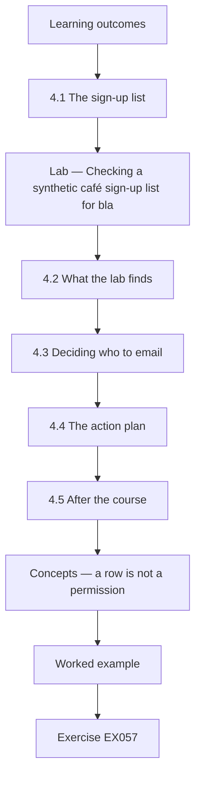

### Logical drawing

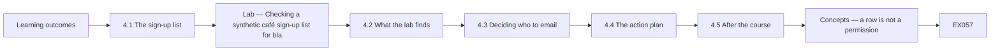

```text
[Learning outcomes]
    |
    v
[4.1 The sign-up list]
    |
    v
[Lab — Checking a synthetic café sign-up list for bla]
    |
    v
[4.2 What the lab finds]
    |
    v
[4.3 Deciding who to email]
    |
    v
[4.4 The action plan]
    |
    v
[4.5 After the course]
    |
    v
[Concepts — a row is not a permission]
    |
    v
[Worked example] --> [Exercise EX057]
```
<!-- cykin:lesson-figures:end ch-04 -->


### Learning outcomes

You will (1) check a synthetic sign-up list with a short script; (2) decide who may receive the newsletter; (3) write a one-month action plan.

### 4.1 The sign-up list

Copperleaf's newsletter list was typed from paper sheets by different staff. Some rows have blank emails, some have the same address typed twice with different capitals or spaces and some have no tick in the consent box. Kwame wants to know how many addresses the café may actually email. Ms. Fischer helps him write a short Python script using only the standard library, run on a synthetic list of twelve rows that copies these problems without using any real customer details. Kwame runs it.

### Lab — Checking a synthetic café sign-up list for blanks, malformed addresses, duplicates and consent ticks

```python
"""Check a synthetic cafe newsletter sign-up list: blanks, duplicates and consent ticks (stdlib only)."""
rows = [("ana@example.org", "yes"), ("Ana@Example.org ", "yes"), ("", "yes"), ("ben@example.org", ""),
        ("cai@example.org", "yes"), ("dee@example", "yes"), ("eli@example.org", "no"), ("fay@example.org", "yes"),
        ("cai@example.org", "yes"), ("gus@example.org", "yes"), ("", ""), ("hal@example.org", "yes")]
clean = [(e.strip().lower(), c) for e, c in rows]
blank = sum(1 for e, _ in clean if not e)
bad = sum(1 for e, _ in clean if e and ("@" not in e or "." not in e.split("@")[-1]))
seen, dup = set(), 0
for e, _ in clean:
    if e and e in seen: dup += 1
    seen.add(e)
ok = {e for e, c in clean if e and c == "yes" and "." in e.split("@")[-1]}
print(f"rows {len(rows)}; blank email {blank}; malformed {bad}; duplicates {dup}")
print(f"unique valid addresses with a yes tick: {len(ok)}")
```

Run with `python3 lab_signups.py`. Verified output:

```text
rows 12; blank email 2; malformed 1; duplicates 2
unique valid addresses with a yes tick: 5
```

### 4.2 What the lab finds

The script trims spaces and lowercases each address before checking it. Of twelve rows, two have a blank email, one address is malformed because it has no proper ending after the at sign and two rows are duplicates of addresses already listed. After removing problems, only five unique, valid addresses have a yes tick in the consent box. Kwame is surprised: twelve rows on paper become five people the café can confidently email. He shows the result to Mrs. Adeyemi, who had expected a much larger list.

### 4.3 Deciding who to email

Ms. Fischer explains that marketing emails need the customer's consent, and the café must be able to show it. Rows with a blank tick or a no tick are not emailed. The malformed address cannot be used anyway. Kwame and Mrs. Adeyemi decide to email the five confirmed addresses and to ask other customers in person to sign the new sheet if they want the newsletter. He records the decision and the date in the notebook. Mrs. Adeyemi agrees with the decision.

### 4.4 The action plan

Kwame writes a one-month plan with five actions: replace the sign-up sheet with the shorter version including a clear consent box and the date; run the lab check each month on the typed list; delete the forgotten spreadsheet; finish switching to the paid messaging app; and explain the rules at the next staff meeting. Each action has a person and a date. Mrs. Adeyemi approves it, and Kwame pins it beside the rules. He keeps the plan short so that it can actually be finished in a month.

### 4.5 After the course

At the end of the month, Kwame reviews progress. Four actions are done; the staff meeting moved to the following week. He reflects that small, clear decisions changed more than he expected, and that checking data with a short script made the problem visible to everyone. Ms. Fischer suggests he continue with privacy and data protection, since customer and staff details are central to the café. The next course in this area does exactly that. Kwame thanks Ms. Fischer and enrols the following month.

### Worked example

Kwame checks twelve synthetic sign-up rows, finding two blanks, one malformed address and two duplicates, leaving five unique valid addresses with consent, decides to email only those and completes four of five actions in his one-month plan.

> **Synthetic case.** The list is synthetic; outputs come from lab_signups.py; the GDPR is real. This is not legal advice.

### Errors and limits

Counting rows instead of unique, valid, consented addresses overstates who may be emailed.

### Concepts — a row is not a permission

The script does not ask how many lines are on the paper. It asks which addresses are unique, valid and ticked `yes` after the address is trimmed and lowercased. The tick itself is not lowercased. `Yes` is not `yes`.

| Lab result on 12 synthetic rows | Count | May that row be emailed? |
|---|---:|---|
| Blank email | 2 | No. There is no address |
| Malformed address | 1 | No. `dee@example` has no proper ending after @ |
| Duplicate rows | 2 | The repeat is not a second person |
| Unique valid address with tick `yes` | 5 | Yes. This is the only send list |
| Tick blank or `no`, including `eli@example.org` | Not in the 5 | No. Consent was not given |

Twelve rows became five people. Emailing the other seven because they appear on the paper overstates the list. That is the error in this chapter.

### Data — the five actions and the one that slipped

| Action | Person | Done when Kwame reviewed the month? |
|---|---|---|
| Short sheet with a clear consent box and the date | Kwame | Yes |
| Run this check each month on the typed list | Kwame | Yes |
| Delete the forgotten spreadsheet after the check | Kwame | Yes |
| Finish the paid messaging app | Mrs. Adeyemi and Kwame | Yes |
| Explain the rules at the staff meeting | Kwame | No. The meeting moved to the next week |

The plan stays five actions. A slipped date is written down. It is not deleted from the plan to make the month look finished.

### Decision flow — may this address receive the newsletter?

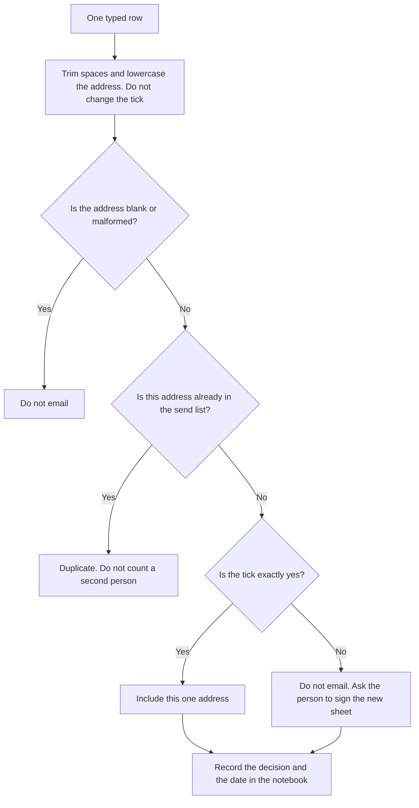

### Worked example — a capital Yes and a regular who ticked no

A row reads `Ina@Example.org` with the tick `Yes`. Ina's typed capitals become a usable address, yet the consent box is stored exactly as written. The send rule accepts only `yes`, so the exact-match test leaves her outside the five. Kwame does not "fix" the tick in the script to raise the count. He asks Ina to sign the new sheet. The same week Mrs. Adeyemi wants to email `eli@example.org`, a regular who ticked `no`. Kwame refuses. A regular is not a substitute for the tick. Eli can join by signing the new sheet in person. Both decisions go in the notebook with the date.

> **Synthetic case.** Ina's row and the request to email Eli are invented. The tick rule is the one in lab_signups.py. This is not legal advice.

### Apply

- **EX057 — Capital Yes.** What does the script do to `Ina@Example.org` and to the tick `Yes`, and is that row emailed? *Rubric:* 3 = the address is trimmed and lowercased; the tick stays `Yes`; the row is not emailed because only `yes` counts;; 2 = the address is cleaned and the row is not emailed;; 1 = one of those;; 0 = none.
- **EX058 — Regular who ticked no.** May `eli@example.org` be emailed because Eli is a regular, and what is Eli offered instead? *Rubric:* 3 = no; Eli may sign the new sheet in person; the refusal is dated in the notebook;; 2 = no, without the sheet;; 1 = yes;; 0 = none.

### Exercises

- **EX039 — Lab rows.** How many rows does the synthetic list have? *Rubric:* 3 = twelve;; 2 = partly correct;; 1 = wrong;; 0 = none.
- **EX040 — Blank emails.** How many rows have a blank email? *Rubric:* 3 = two;; 2 = partly correct;; 1 = wrong;; 0 = none.
- **EX041 — Malformed count.** How many addresses are malformed? *Rubric:* 3 = one;; 2 = partly correct;; 1 = wrong;; 0 = none.
- **EX042 — Duplicate rows.** How many duplicate rows does the script find? *Rubric:* 3 = two;; 2 = partly correct;; 1 = wrong;; 0 = none.
- **EX043 — Emailable total.** How many unique valid addresses have a yes tick? *Rubric:* 3 = five;; 2 = partly correct;; 1 = wrong;; 0 = none.
- **EX044 — Normalising steps.** What does the script do before checking each address? *Rubric:* 3 = trims spaces and lowercases;; 2 = both;; 1 = one;; 0 = none.
- **EX045 — Blank tick decision.** Are rows with a blank tick emailed? *Rubric:* 3 = no;; 2 = partly correct;; 1 = yes;; 0 = none.
- **EX046 — Other customers.** How will other customers join the newsletter? *Rubric:* 3 = by signing the new sheet in person;; 2 = partly correct;; 1 = vague;; 0 = none.
- **EX047 — Plan actions.** How many actions are in the one-month plan? *Rubric:* 3 = five;; 2 = partly correct;; 1 = wrong;; 0 = none.
- **EX048 — New sheet features.** What does the new sheet include? *Rubric:* 3 = a clear consent box and the date;; 2 = both;; 1 = one;; 0 = none.
- **EX049 — Late action.** Which action slipped? *Rubric:* 3 = the staff meeting explanation;; 2 = partly correct;; 1 = other;; 0 = none.
- **EX050 — Next topic.** What does Ms. Fischer suggest next? *Rubric:* 3 = privacy and data protection;; 2 = partly correct;; 1 = other;; 0 = none.

<!-- cykin:chapter-navigation:start ch-04 -->
### Continue studying — lesson 04 (chapter 04 of 04)

[← Chapter 03](#ch-03) · [Course chapter index](../SUBJECTS.md) · [Next course via chapter index →](../SUBJECTS.md)

The chapter index leads to the next course in the study path.
<!-- cykin:chapter-navigation:end -->

<a id="worked-results"></a>

## Worked results

Model answers for EX001–EX058. Kwame Boateng, Ms. Lena Fischer, Riverside Adult Learning Centre, Copperleaf Café and every figure are synthetic. Lab answers quote verified outputs. Any answer meeting the rubric scores equally.

**EX001.** Two.

**EX002.** A data manager for a local council.

**EX003.** Agreeing who is responsible, what rules apply and how they are checked.

**EX004.** No; owners, rules and checks are enough to start.

**EX005.** They are health information, a special category under the GDPR.

**EX006.** Staff rotas.

**EX007.** Paying a supplier twice because two invoice copies exist.

**EX008.** Serving a customer food they react to.

**EX009.** Mrs. Adeyemi, the owner.

**EX010.** Kwame.

**EX011.** The assistant manager.

**EX012.** Customer and staff data stay within approved systems.

**EX013.** On a single page agreed by Mrs. Adeyemi.

**EX014.** Only the newsletter.

**EX015.** Only staff preparing that customer's order.

**EX016.** Through the café's paid staff messaging group.

**EX017.** First name and email.

**EX018.** There is less to protect, lose or explain.

**EX019.** Separate logins for each person.

**EX020.** The same day, to Kwame.

**EX021.** They are deleted soon after.

**EX022.** Every six months, with the customer.

**EX023.** A year, unless people agreed to longer use.

**EX024.** Through the paid messaging group, keeping numbers private.

**EX025.** Pinned in the staff room.

**EX026.** People understanding why the rules exist.

**EX027.** Is it complete, valid and accurate?

**EX028.** Whether the same person appears twice.

**EX029.** An old spreadsheet of customer emails.

**EX030.** That it held nothing the café still needed.

**EX031.** Three.

**EX032.** Security, use only for Copperleaf and deletion at the end.

**EX033.** Copperleaf switched to its paid business version.

**EX034.** The same invoice existed as an emailed and a paper copy.

**EX035.** The emailed copy, with the paper marked as received.

**EX036.** That only current staff are in the group.

**EX037.** In a notebook kept with the rules.

**EX038.** A few minutes.

**EX039.** Twelve.

**EX040.** Two blank emails.

**EX041.** One malformed address.

**EX042.** Two duplicate rows.

**EX043.** Five.

**EX044.** It trims spaces and converts to lowercase.

**EX045.** No; blank ticks are not treated as consent.

**EX046.** By signing the new sheet in person if they wish.

**EX047.** Five actions.

**EX048.** A clear consent box and the date.

**EX049.** Explaining the rules at the staff meeting, moved a week.

**EX050.** Privacy and data protection.


**EX051.** A personal phone is not an approved system, and the note is health information. Mrs. Adeyemi must be told the same day because she is accountable.

**EX052.** The second decision is incomplete. Name the day-to-day person on the one page before the rota is copied anywhere.

**EX053.** The newsletter does not need a birthday. A later birthday offer would need its own rule, a named person, a keeping period and an approved channel before any date is collected.

**EX054.** Shift swaps go through the paid messaging group so phone numbers stay private.

**EX055.** The provider would use Copperleaf's data for its own offers, not only for Copperleaf. The notebook records the refusal and the date.

**EX056.** Enter the emailed copy once, mark the paper copy as received, and do not pay the paper copy as a second bill.

**EX057.** The script trims and lowercases the address. The tick stays `Yes`. The row is not emailed, because only an exact `yes` counts.

**EX058.** No. Eli may sign the new sheet in person. The refusal is dated in the notebook.

<a id="references"></a>
## References

Every DOI was resolved through doi.org on 12 October 2026, and standards were checked against their publisher pages. Organisations, people, systems and figures in the running cases are synthetic; only the works below are real.

- European Union. (2016). Regulation (EU) 2016/679 (General Data Protection Regulation). *Official Journal of the European Union, L 119*, 1–88. <http://data.europa.eu/eli/reg/2016/679/oj>
