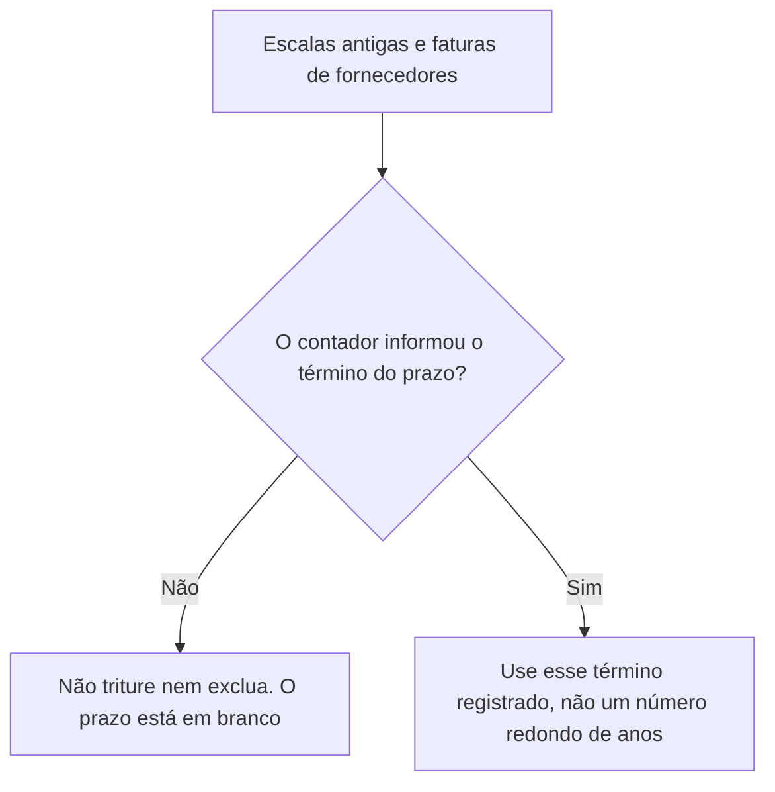
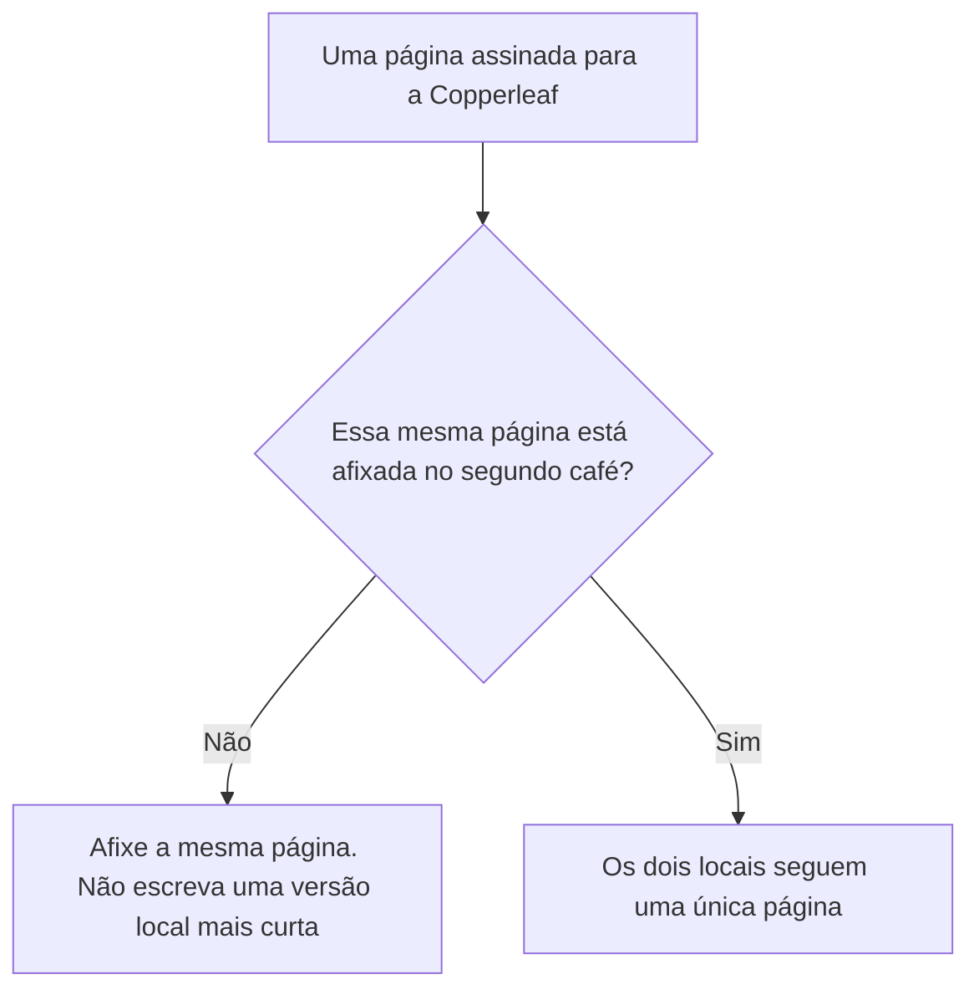
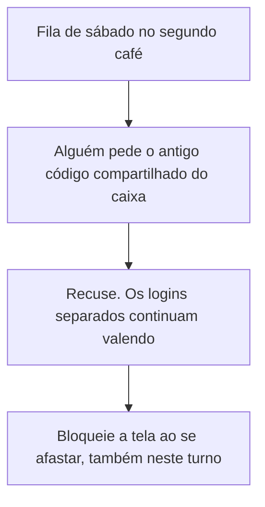
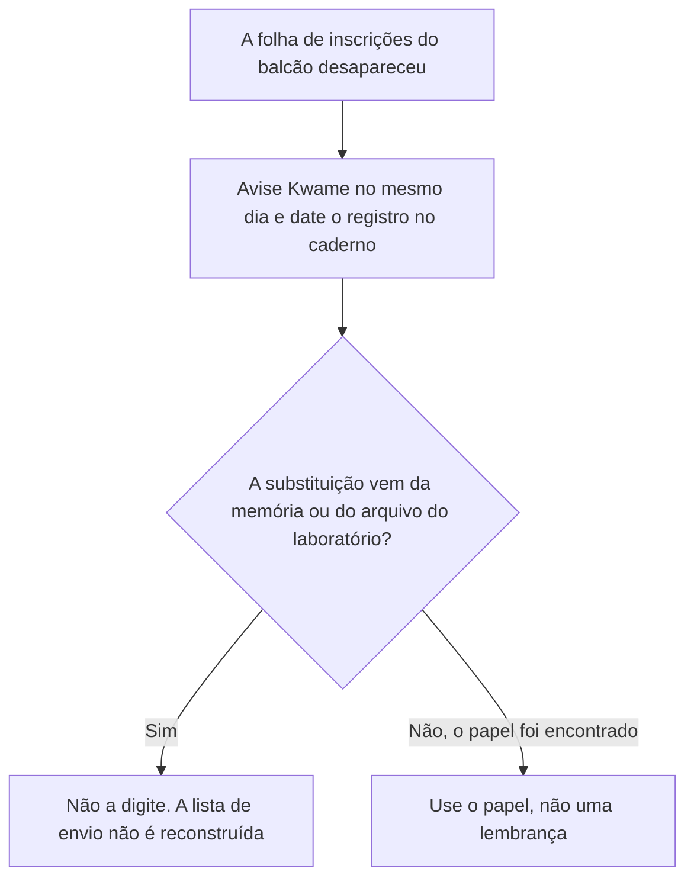
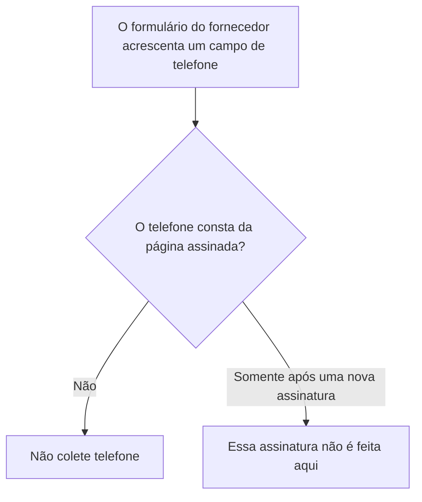
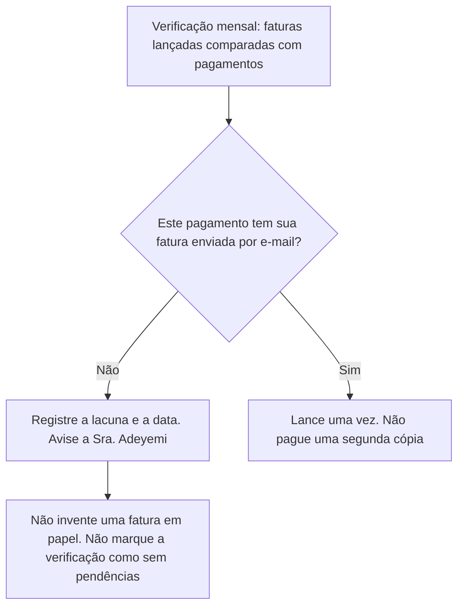
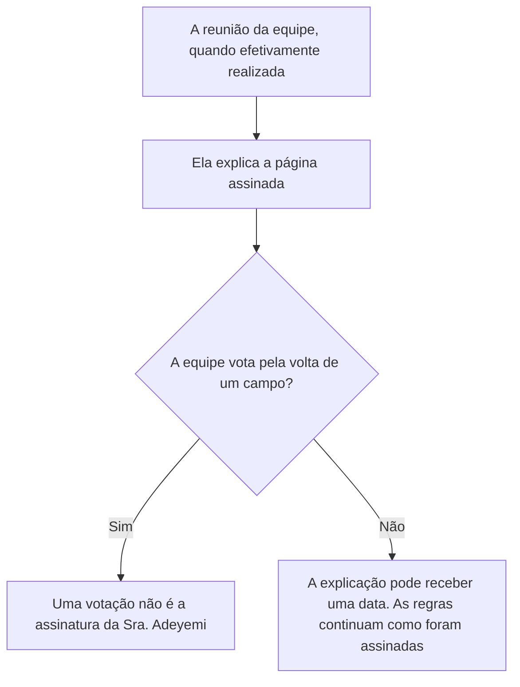
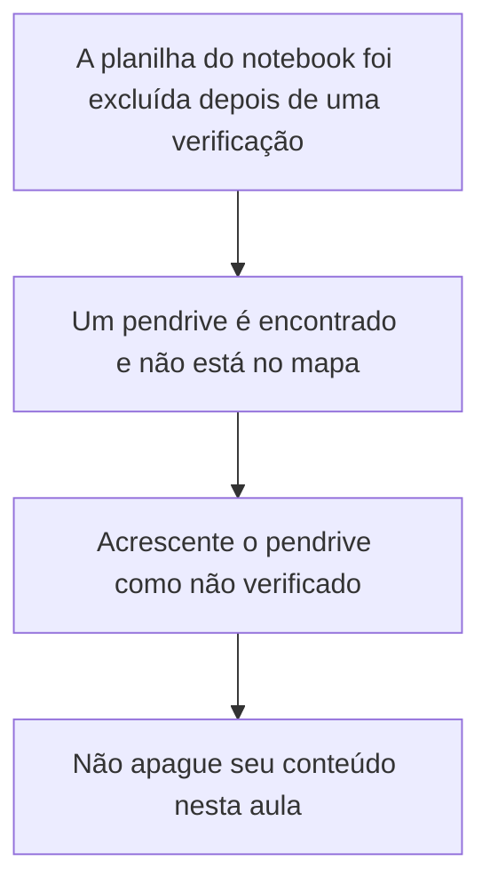
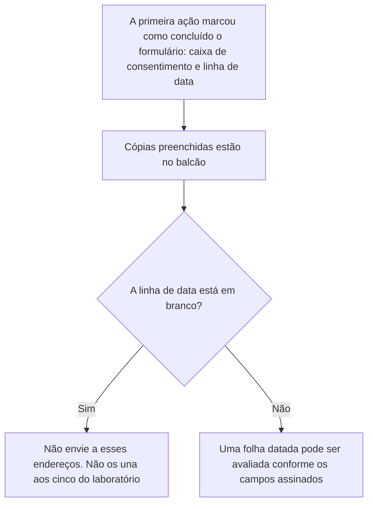
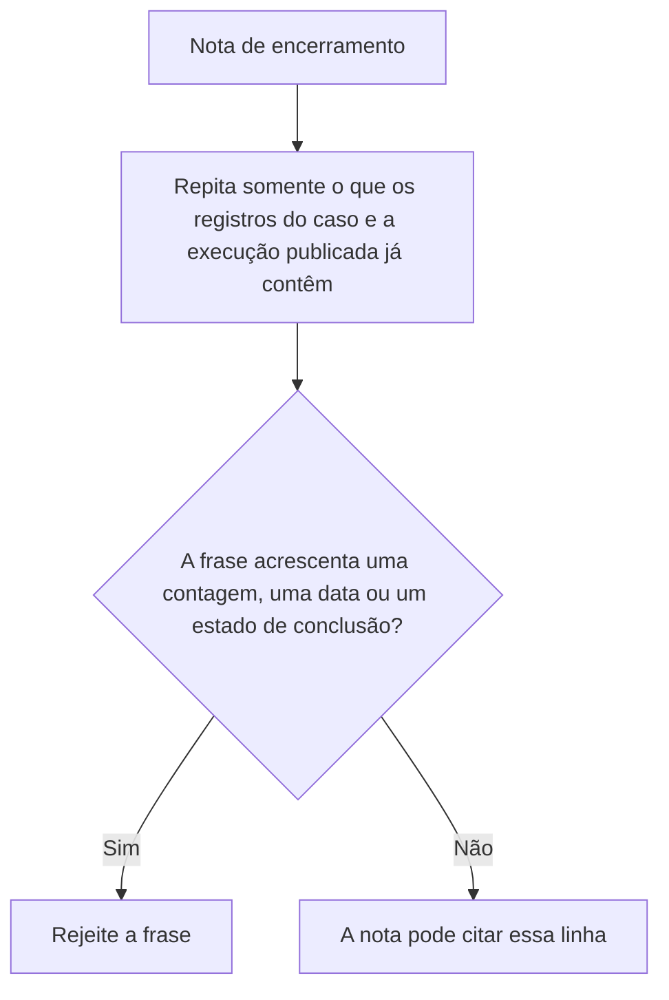

# Governança de Dados: Curso Rápido

- Idioma: português do Brasil (`pt`); curso 003, curso rápido (1 mês). Edição de referência: [inglês](../../en/book/MANUSCRIPT.md).
- Estado editorial: **publicado, com texto nos capítulos 1–20 e revisão de equivalência pendente**. Esta edição contém EX001–EX074 com resoluções e rubricas de 0 a 3. Há texto português nas vinte posições da referência inglesa fixada; isso não aprova a equivalência integral nem conclui o livro. O laboratório permanece sintético e usa somente a biblioteca padrão do Python. Revisão independente, equivalência integral, revisão linguística e inspeção da edição renderizada continuam abertas. Páginas são uma medição de edição, não uma meta de escrita ou aprovação.
- Público: iniciantes que precisam de um começo rápido e prático em governança de dados para um pequeno negócio.
- Autor: [hiagokinlevi](https://github.com/hiagokinlevi). Texto original sob [CC0 1.0](../../../../../LICENSE); as obras citadas mantêm seus direitos.
- Limites: o laboratório confere uma lista sintética de doze linhas de inscrições de um café em busca de e-mails em branco, endereços malformados, duplicatas e marcações de consentimento. A legislação é citada pela edição e parafraseada; nada aqui é aconselhamento jurídico. Pessoas, organizações, sistemas e dados são **sintéticos**, salvo quando uma frase cita uma fonte pública.

[Página do curso](../../README.md) · [Índice de capítulos](../SUBJECTS.md) · [Plano do livro](PLAN.md) · [Skill do curso](../../skill/SKILL.md) · [Resoluções](#worked-results)

## Como usar este livro em revisão

Leia na ordem. Os quatro capítulos iniciais acompanham um supervisor de turno ao longo de um curso de um mês: fundamentos e primeiras decisões, responsabilidade e práticas seguras, qualidade, sistemas e fornecedores, e um laboratório guiado que se transforma em um plano de ação curto. Execute o laboratório onde ele aparece, tente os exercícios antes de consultar as resoluções e avalie-se com as rubricas. Cada capítulo traz também uma tabela de conceitos, uma tabela de dados, um fluxograma de decisão e um segundo exemplo resolvido. EX051–EX058 aplicam essas ferramentas a um fato novo do café.

<a id="pt-translation-ch05-10"></a>

**Tradução 05–10 — 14 de outubro de 2026:** seis capítulos completos da referência inglesa e EX059–EX064 foram incorporados com mapas, desenhos textuais, exemplos, enunciados, rubricas e respostas no apêndice deste mesmo livro. Fonte: `levels/rapid-1-month/data-governance/en/book/MANUSCRIPT.md`, revisão `d087ecc50f623e740c9a9092ded79cb37b88a098`, conteúdo `ad3512e8614ace755cbaaab991ef932fceda4818`. O conteúdo português anterior era `6bc1f9251f864aa38ce7b63dd5ab7e29b4fbbe0f`. Os capítulos 1–4, seus 58 exercícios e respostas, o programa e as referências não foram reescritos nesta passagem; apresentação e navegação foram ajustadas. Responsabilidade editorial: hiagokinlevi. Não se declara revisão humana independente.

Ao final do lote 05–10, havia dez de vinte posições inglesas com texto português e 64 de 74 IDs com respostas: **50% das posições e 86,49% dos IDs**, não percentuais de equivalência integral. A continuação foi incorporada no [lote 11–20 abaixo](#pt-translation-ch11-20). Os capítulos 05–10 não acrescentaram um programa executável. Naquela passagem, o programa completo anterior foi transcrito e executado em Python 3.13.5, reproduzindo as duas linhas publicadas; os testes adicionais abaixo são controles locais daquele lote, não novos acontecimentos no café.

**Limites editoriais, separados do texto traduzido:** os prazos de seis meses e de um ano e a expressão "logo depois" pertencem à regra sintética do café. Não são apresentados como prazos universais do GDPR ou da LGPD. A ausência de uma data de reunião ou revisão deve ser lida dentro das premissas do caso, não como prova geral de que uma ação não ocorreu. O caso anterior já menciona uma comunicação das primeiras decisões à equipe; isso não preenche a data da reunião posterior que o Capítulo 5 mantém em aberto.

O rótulo literal `unique valid addresses with a yes tick` é uma saída do programa fornecido, não uma validação completa de endereços ou de consentimento jurídico. Um controle local com `[("a.b", "yes")]` reproduziu `malformed 1` e, simultaneamente, uma contagem de envio igual a 1: o conjunto `ok` não exige `@`, embora o contador `bad` o verifique. O defeito da fonte permanece explícito e não foi corrigido silenciosamente. Não utilize este script como validador de produção ou autorização para enviar mensagens. A entrada vazia produziu contagens zero; retirar apenas a linha duplicada `Ana@Example.org ` produziu 11 linhas, uma duplicata e ainda 5 endereços no conjunto `ok`. Esses controles não substituem o arquivo sintético canônico de doze linhas.

A comparação deste lote preservou os seis enunciados, níveis 0–3, respostas e rótulos de dados executáveis. A pontuação duplicada `;;` das rubricas foi normalizada para `;`, sem mudar critérios. Estrutura Markdown e conexões dos mapas foram conferidas; Mermaid, A4, o site e uma revisão integral dos capítulos anteriores não foram verificados. A precisão técnica da fonte e sua equivalência completa continuam sujeitas à revisão. A disponibilidade deste lote não conclui a coleção inglesa ou portuguesa.

<a id="pt-translation-ch11-20"></a>

### Atualização da tradução 11–20 — 14 de outubro de 2026

Dez capítulos da referência inglesa, seus mapas, desenhos textuais, exemplos, exercícios EX065–EX074, rubricas de 0 a 3 e respostas foram incorporados ao mesmo livro. Fonte: `levels/rapid-1-month/data-governance/en/book/MANUSCRIPT.md`, revisão `dabc0411054775b939fef3ebf3ddcd4c61e430fc`, blob `ad3512e8614ace755cbaaab991ef932fceda4818`. Alvo anterior: `levels/rapid-1-month/data-governance/pt/book/MANUSCRIPT.md`, blob `a34a1bad69c73a9819da60db7d47298f70406b4a`. O conteúdo inglês permaneceu igual ao da referência usada no lote 05–10. Responsabilidade editorial: hiagokinlevi. Houve comparação assistida do lote; não se declara revisão humana independente.

A disponibilidade passa de dez para **vinte posições de capítulo em português sobre vinte inglesas**, e de 64 para **74 IDs de exercícios com respostas sobre 74 ingleses**. São contagens de presença: não constituem aprovação de 100% da tradução, da revisão de todas as unidades, do currículo diário ou da coleção. Os capítulos 1–10, seus 64 enunciados e respostas, o programa e as referências são preservados; foram atualizadas apenas a apresentação, a contagem e a continuação da navegação. O [registro do plano](PLAN.md#translation-review) identifica a revisão ainda necessária. A4 não foi renderizado nesta passagem.

| Âncora na fonte inglesa | Capítulo português | Exercício e resposta no mesmo livro |
|---|---|---|
| `ch-11` | [11](#ch-11) | [EX065](#answer-ex065) |
| `ch-12` | [12](#ch-12) | [EX066](#answer-ex066) |
| `ch-13` | [13](#ch-13) | [EX067](#answer-ex067) |
| `ch-14` | [14](#ch-14) | [EX068](#answer-ex068) |
| `ch-15` | [15](#ch-15) | [EX069](#answer-ex069) |
| `ch-16` | [16](#ch-16) | [EX070](#answer-ex070) |
| `ch-17` | [17](#ch-17) | [EX071](#answer-ex071) |
| `ch-18` | [18](#ch-18) | [EX072](#answer-ex072) |
| `ch-19` | [19](#ch-19) | [EX073](#answer-ex073) |
| `ch-20` | [20](#ch-20) | [EX074](#answer-ex074) |

A verificação estrutural local deste lote encontrou trinta objetivos, dez tabelas com 44 linhas de exemplos, dez mapas Mermaid com 35 conexões correspondentes à projeção da fonte, dez desenhos textuais e dez pares de enunciado/resposta. Conferiu IDs, níveis das rubricas, navegação entre capítulos e links de ida e volta para as novas respostas. Essa verificação não substitui uma avaliação de fidelidade nem prova a renderização dos diagramas. Os capítulos 11–20 não acrescentam um programa executável; o laboratório anterior não foi executado novamente nesta passagem, e sua limitação já registrada permanece aberta.

**Notas de leitura, separadas da tradução:** o Capítulo 11 aplica a responsabilidade e os prazos da política sintética, não um calendário legal universal. A redação principal dos capítulos 17 e 20 não fornece uma data para a reunião; o enunciado de EX071, por sua vez, pede analisar a hipótese específica de que a reunião foi realizada. Essa premissa vale para o exercício e não preenche retroativamente o caderno do caso. O Capítulo 19 não autoriza incorporar o telefone manuscrito a um campo aprovado; não afirma que a escrita física deixou de existir, nem relata sua eliminação. Essas distinções não alteram os enunciados ou suas respostas.

Foi preservada a referência do Capítulo 20 à edição inglesa: a publicação do inglês, por si só, não publica outra língua. Esta tradução tem sua própria revisão. A fonte e a edição portuguesa continuam sujeitas à revisão integral de precisão, fontes, direitos, linguagem e acessibilidade. Nenhuma operação real de envio, exclusão, criação de conta, afixação ou reunião foi realizada. A disponibilidade no repositório é distinta de build, implantação e leitura ao vivo do site ou do MCP; essas etapas não foram verificadas neste lote.

### Caso sintético

| Elemento | Papel | Natureza |
|---|---|---|
| **Kwame Boateng** | Estudante do curso rápido, supervisor de turno em um café | Inventado |
| **Sra. Lena Fischer** | Mentora, gerente de dados de uma prefeitura | Inventada |
| **Riverside Adult Learning Centre** | Centro de educação de adultos fictício | Inventado |
| **Copperleaf Café** | Negócio fictício, com dois cafés e doze funcionários | Inventado |

### Fontes principais

GDPR; LGPD. Lista completa em [Referências](#references).

## Sumário

| Capítulos em português |
|---|
| [1](#ch-01) · [2](#ch-02) · [3](#ch-03) · [4](#ch-04) · [5](#ch-05) · [6](#ch-06) · [7](#ch-07) · [8](#ch-08) · [9](#ch-09) · [10](#ch-10) · [11](#ch-11) · [12](#ch-12) · [13](#ch-13) · [14](#ch-14) · [15](#ch-15) · [16](#ch-16) · [17](#ch-17) · [18](#ch-18) · [19](#ch-19) · [20](#ch-20) |

[Resoluções](#worked-results) · [Referências](#references)

<a id="ch-01"></a>

## Capítulo 1 — Governança de dados: fundamentos e primeiras decisões

<!-- open-cyber-academy:chapter-navigation:start ch-01 -->
### Continue estudando — aula 01 (capítulo 01 de 20)

[← Início do curso](../../README.md) · [Índice das aulas](../SUBJECTS.md) · [Capítulo 02 →](#ch-02)

Continue para a próxima aula já escrita.
<!-- open-cyber-academy:chapter-navigation:end -->

<a id="ch-02"></a>

## Capítulo 2 — Responsabilidade, regras e práticas seguras

<!-- open-cyber-academy:chapter-navigation:start ch-02 -->
### Continue estudando — aula 02 (capítulo 02 de 20)

[← Capítulo 01](#ch-01) · [Índice das aulas](../SUBJECTS.md) · [Capítulo 03 →](#ch-03)

Continue para a próxima aula já escrita.
<!-- open-cyber-academy:chapter-navigation:end -->

<a id="ch-03"></a>

## Capítulo 3 — Qualidade, sistemas e fornecedores

<!-- open-cyber-academy:chapter-navigation:start ch-03 -->
### Continue estudando — aula 03 (capítulo 03 de 20)

[← Capítulo 02](#ch-02) · [Índice das aulas](../SUBJECTS.md) · [Capítulo 04 →](#ch-04)

Continue para a próxima aula já escrita.
<!-- open-cyber-academy:chapter-navigation:end -->

<a id="ch-04"></a>

## Capítulo 4 — Laboratório guiado e plano de ação

<!-- open-cyber-academy:chapter-navigation:start ch-04 -->
### Continue estudando — aula 04 (capítulo 04 de 20)

[← Capítulo 03](#ch-03) · [Índice das aulas](../SUBJECTS.md) · [Capítulo 05 em português →](#ch-05)

Continue para a nova sequência traduzida; não salte os capítulos 05–10.
<!-- open-cyber-academy:chapter-navigation:end -->

<a id="ch-10"></a>

## Capítulo 10 — Gostar de uma foto não é concordar com um uso mais longo

### Aplicar

- **EX064 — Qual frase prolonga o ano?** Uma foto completou um ano. A equipe quer guardá-la porque ficou bonita, e a Sra. Adeyemi diz "até decidirmos". O caderno não contém concordância com uso mais longo. O que acontece com a foto? Qual frase não prolonga o prazo de um ano? *Rubrica:* 3 = excluir a foto e registrar a data; nem a preferência estética nem "até decidirmos" constituem a concordância; não inventar uma concordância; 2 = excluir e rejeitar as duas frases; 1 = um desses elementos; 0 = nenhum.

<!-- open-cyber-academy:chapter-navigation:start ch-10 -->
### Continue estudando — aula 10 (capítulo 10 de 20 na referência inglesa)

[← Capítulo 09](#ch-09) · [Índice das aulas](../SUBJECTS.md) · [Capítulo 11 em português →](#ch-11)

Continue para a sequência traduzida dos capítulos 11–20, com respostas no apêndice deste mesmo livro.
<!-- open-cyber-academy:chapter-navigation:end -->

<a id="ch-11"></a>

## Capítulo 11 — Um prazo em branco não é uma data para destruir documentos

<!-- open-cyber-academy:lesson-figures:start ch-11 -->
### Mapa da aula

Aula 11. Mapa, exemplo, EX065.



Kwame não inventa o prazo fiscal nem o prazo de guarda dos registros trabalhistas.

### Desenho lógico

```text
regras já escritas
    faturas de fornecedores ficam até o contador informar o término da guarda fiscal
    escalas antigas ficam pelo prazo trabalhista que o contador confirmar
caderno
    esses términos continuam sem definição
        |
        +-- "um ano parece suficiente" não é a informação do contador
        +-- a Sra. Adeyemi é quem consulta o contador
        +-- esta aula não escreve um número de anos
```
<!-- open-cyber-academy:lesson-figures:end ch-11 -->

### Objetivos de aprendizagem

Depois deste capítulo, você deverá conseguir:

1. Manter as faturas de fornecedores e as escalas antigas enquanto as datas de término informadas pelo contador estiverem em branco.
2. Recusar um prazo inventado, como "cerca de um ano".
3. Identificar a consulta da Sra. Adeyemi ao contador como o meio de preencher a lacuna.

### 11.1 O café já havia recusado o palpite

O Capítulo 2 estabeleceu dois prazos que Kwame não inventa. As faturas de fornecedores ficam guardadas até que o contador informe o término da retenção fiscal; só então são trituradas. As escalas antigas ficam pelo prazo de guarda dos registros trabalhistas confirmado pelo contador. Um colega encontra uma pasta volumosa e quer triturar seu conteúdo porque um ano "parece muito tempo". Uma impressão não é a informação exigida pela regra. Enquanto as palavras do contador não estiverem no caderno, o término continua em branco e os documentos ficam guardados. A Sra. Adeyemi é a proprietária que confere esses prazos. Kwame pode lembrá-la disso. Ele não pode preencher a lacuna com um número.

### 11.2 Exemplo resolvido

| Proposta | Origem da data | Decisão |
|---|---|---|
| Triturar faturas de fornecedores com mais de um ano | A impressão de Kwame sobre o que é "muito tempo" | Recuse. O término não foi informado |
| Excluir escalas antigas para liberar espaço na gaveta | O mesmo palpite | Recuse |
| A Sra. Adeyemi registra o término informado pelo contador | A pessoa indicada pela regra | Então, e somente então, esse término se aplica |
| Copiar um prazo do cartaz de outro café | Não é o contador da Copperleaf | Recuse |

> **Caso sintético.** Nenhuma quantidade de anos é fornecida. Não acrescente uma.

### Erros e limites

Uma lacuna não autoriza guardar os documentos para sempre sem consultar ninguém. Ela impede a destruição até que a pessoa indicada informe o término. O curso de privacidade pode discutir deveres legais. Este capítulo não estabelece um prazo fiscal nem apresenta uma norma trabalhista.

### Aplicar

- **EX065 — Quem pode informar o término?** A gaveta de faturas está cheia. O caderno ainda não contém uma data informada pelo contador para as faturas de fornecedores ou para as escalas antigas. Um colega diz: "triture tudo que tiver mais de um ano". O que você recusa? A informação de quem pode preencher a lacuna? *Rubrica:* 3 = recusar o palpite de um ano; os documentos ficam guardados enquanto os términos estiverem em branco; a consulta da Sra. Adeyemi ao contador é o que pode definir esses términos; 2 = recusar o palpite e identificar a consulta ao contador; 1 = um desses elementos; 0 = nenhum.

[Resolução de EX065 no apêndice](#answer-ex065).

<!-- open-cyber-academy:chapter-navigation:start ch-11 -->
### Continue estudando — aula 11 (capítulo 11 de 20)

[← Capítulo 10](#ch-10) · [Índice das aulas](../SUBJECTS.md) · [Capítulo 12 →](#ch-12)

Continue para a próxima aula traduzida.
<!-- open-cyber-academy:chapter-navigation:end -->

<a id="ch-12"></a>

## Capítulo 12 — O segundo café precisa da mesma página

<!-- open-cyber-academy:lesson-figures:start ch-12 -->
### Mapa da aula

Aula 12. Mapa, exemplo, EX066.



Dois prédios não justificam dois conjuntos de regras.

### Desenho lógico

```text
Copperleaf: dois cafés, doze funcionários, uma proprietária
regras assinadas pela Sra. Adeyemi e afixadas em uma sala da equipe
segundo café
    |
    +-- afixar em um local não é afixar no outro
    +-- uma página "local" mais curta dividiria as decisões
    +-- regras de alergias, escalas e inscrições seguem na mesma página
```
<!-- open-cyber-academy:lesson-figures:end ch-12 -->

### Objetivos de aprendizagem

Depois deste capítulo, você deverá conseguir:

1. Tratar a página assinada como a regra dos dois cafés.
2. Recusar uma página mais curta escrita somente para o segundo local.
3. Impedir que a afixação em um local seja apresentada como afixação no outro.

### 12.1 A responsabilidade abrange o negócio, não a sala

A Sra. Adeyemi responde por todos os dados da Copperleaf, e as três primeiras decisões foram escritas uma única vez. O Capítulo 2 afixou essa página na sala da equipe. A Copperleaf tem dois cafés. Uma página em uma parede não coloca as regras diante dos funcionários que trabalham no outro local. O subgerente sugere uma nota mais curta para o segundo café, "só com as partes de que eles precisam". Uma nota mais curta permitiria que esse local se desviasse: um campo de aniversário, uma mensagem privada, uma fotografia em um celular. Kwame afixa a mesma página assinada no segundo café. Ele não escreve uma segunda política. Esta aula não afirma que a segunda afixação já recebeu uma data. Ela estabelece o que deve ser afixado.

### 12.2 Exemplo resolvido

| Proposta para o segundo local | Relação com a página assinada | Decisão |
|---|---|---|
| Afixar uma cópia da mesma página | Um único conjunto de regras | Aceite |
| "Eles já ouviram falar disso no outro local." | Ouvir não é ter a página afixada | Afixe a página |
| Meia página que omite a regra sobre alergias | Uma regra diferente | Recuse |
| Uma linha local de aniversário, "só neste café" | A regra da folha vale para todo o negócio | Recuse |

> **Caso sintético.** A equipe não é dividida em uma contagem de funcionários por café. Doze continua sendo o total do negócio.

### Erros e limites

Afixar a página não realiza, por si só, a reunião da equipe do Capítulo 5. A reunião continua sendo uma linha própria. Duas afixações também não criam um terceiro café.

### Aplicar

- **EX066 — Uma página ou duas?** As regras assinadas estão afixadas em um café. O segundo café não tem a página afixada. O subgerente redige uma nota mais curta que omite as anotações de alergia. O que é afixado? O que é recusado? *Rubrica:* 3 = afixar a mesma página assinada no segundo café; recusar a nota mais curta; a afixação em um local não cobre o outro; 2 = usar a mesma página e recusar a nota mais curta; 1 = um desses elementos; 0 = nenhum.

[Resolução de EX066 no apêndice](#answer-ex066).

<!-- open-cyber-academy:chapter-navigation:start ch-12 -->
### Continue estudando — aula 12 (capítulo 12 de 20)

[← Capítulo 11](#ch-11) · [Índice das aulas](../SUBJECTS.md) · [Capítulo 13 →](#ch-13)

Continue para a próxima aula traduzida.
<!-- open-cyber-academy:chapter-navigation:end -->

<a id="ch-13"></a>

## Capítulo 13 — Um turno movimentado não restabelece o código compartilhado

<!-- open-cyber-academy:lesson-figures:start ch-13 -->
### Mapa da aula

Aula 13. Mapa, exemplo, EX067.



O hábito foi estabelecido para os momentos movimentados, não para os tranquilos.

### Desenho lógico

```text
hábito já estabelecido
    logins separados no caixa, não um código compartilhado
    bloquear a tela ao se afastar
sábado, segundo café, fila até a porta
    |
    +-- "só neste turno" é a exceção que o hábito proíbe
    +-- um login emprestado atribui vendas à pessoa errada
    +-- esta aula não fornece um novo login na hora
```
<!-- open-cyber-academy:lesson-figures:end ch-13 -->

### Objetivos de aprendizagem

Depois deste capítulo, você deverá conseguir:

1. Recusar o retorno ao código compartilhado do caixa por um único turno.
2. Manter o bloqueio de tela em vigor mesmo com uma fila.
3. Aguardar um login próprio para a pessoa, sem substituí-lo por um emprestado.

### 13.1 A fila é a situação para a qual o hábito foi criado

Kwame substituiu o código compartilhado do caixa por logins separados e orientou a equipe a bloquear a tela quando se afastasse. Em um sábado, a fila do segundo café chega à porta. Um colega pede o código antigo "só até acabar o movimento", porque localizar um login pessoal parece demorado. É no movimento intenso que uma sessão emprestada causa mais dano: um cancelamento de venda, um reembolso ou um relatório de cartões ficaria sob o nome de outra pessoa. Kwame recusa o código antigo. Uma pessoa que ainda não tem login não herda o de um colega. Criar um login é uma etapa separada, não um pedido gritado de um lado do balcão para o outro. Esta aula não cria esse login.

### 13.2 Exemplo resolvido

| Pedido durante a fila | O que o registro mostraria | Decisão |
|---|---|---|
| "Use o antigo código compartilhado por uma hora." | Um código, várias pessoas | Recuse |
| "Vou terminar este pedido na tela que a outra pessoa deixou aberta." | Vendas sob o login de outra pessoa | Recuse a tela emprestada |
| Bloquear a tela e depois desbloquear o próprio login | O hábito, também em um sábado movimentado | Aceite |
| "Crie um login pessoal para mim depois do movimento." | Uma conta posterior, não esta venda | Isso fica para depois. Esta aula não fornece o login |

> **Caso sintético.** O colega do segundo café não tem nome informado. O exemplo recusa uma tela emprestada e não acrescenta ninguém ao cadastro da equipe.

### Erros e limites

Uma recusa no balcão não abre uma conta. Um login pessoal ainda precisa da concordância da proprietária e de uma linha no caderno antes que a pessoa opere o caixa sozinha. Este capítulo também não divide os doze funcionários entre os dois cafés.

### Aplicar

- **EX067 — Só neste turno.** É sábado no segundo café, e a fila chega à porta. Um colega pede o antigo código compartilhado do caixa "até acabar o movimento" e também pede para terminar um pedido na tela que outra pessoa deixou desbloqueada. O que você recusa? O que não é criado aqui? *Rubrica:* 3 = recusar o código compartilhado antigo e a tela desbloqueada emprestada; um novo login pessoal não é criado de um lado do balcão para o outro; 2 = recusar os dois pedidos e não fornecer um login na hora; 1 = um desses elementos; 0 = nenhum.

[Resolução de EX067 no apêndice](#answer-ex067).

<!-- open-cyber-academy:chapter-navigation:start ch-13 -->
### Continue estudando — aula 13 (capítulo 13 de 20)

[← Capítulo 12](#ch-12) · [Índice das aulas](../SUBJECTS.md) · [Capítulo 14 →](#ch-14)

Continue para a próxima aula traduzida.
<!-- open-cyber-academy:chapter-navigation:end -->

<a id="ch-14"></a>

## Capítulo 14 — Uma folha perdida não é reconstruída de memória

<!-- open-cyber-academy:lesson-figures:start ch-14 -->
### Mapa da aula

Aula 14. Mapa, exemplo, EX068.



Um relato de perda não é uma nova contagem completa de nomes.

### Desenho lógico

```text
hábito: papéis perdidos são comunicados a Kwame no mesmo dia
a folha do balcão sumiu
    |
    +-- a memória não é a folha
    +-- o arquivo de doze linhas do laboratório não é o papel do café
    +-- nenhum nome perdido é inventado para completar o envio
```
<!-- open-cyber-academy:lesson-figures:end ch-14 -->

### Objetivos de aprendizagem

Depois deste capítulo, você deverá conseguir:

1. Comunicar a Kwame o desaparecimento de uma folha de inscrições no dia em que ele for percebido.
2. Recusar uma lista de envio digitada a partir do que as pessoas acham que lembram.
3. Manter os cinco endereços do laboratório fora da lista de trabalho do café.

### 14.1 O papel desaparecido e o arquivo didático são objetos diferentes

O hábito já estabelece que a perda de um papel ou dispositivo deve ser comunicada a Kwame no mesmo dia. A folha que ficava junto ao balcão sumiu. Um colega quer enviar o boletim da tarde mesmo assim, digitando os nomes que as pessoas acreditam ter visto, e quer colar os cinco endereços do laboratório porque eram "os válidos". O arquivo do laboratório é um exercício de doze linhas. Sua saída descreve aquele arquivo. Ele não é uma cópia do papel que saiu do balcão. Kwame registra que a folha desapareceu e coloca a data na anotação. Ele não monta uma lista de envio com base em lembranças nem trata as linhas sintéticas como os clientes que assinaram.

### 14.2 Exemplo resolvido

| Proposta | O que ocupa o lugar do papel desaparecido | Decisão |
|---|---|---|
| Avisar Kwame hoje e datar o registro no caderno | A comunicação prevista no hábito | Aceite |
| Digitar os nomes que a equipe acha que viu | Memória | Recuse |
| Colar os cinco endereços do laboratório na lista do café | Um arquivo didático | Recuse |
| Enviar nesta tarde a "quem ainda conseguirmos nomear" | Uma lista inventada | Recuse |

> **Caso sintético.** Os nomes da folha perdida não estão nos registros do caso. Não os forneça.

### Erros e limites

Comunicar a perda não demonstra que alguém copiou a folha e não autoriza, por si só, uma nova coleta. Uma pilha posterior de formulários será avaliada por suas próprias datas, assunto retomado no Capítulo 19. Este capítulo não identifica quem encontrou o papel nem um ladrão.

### Aplicar

- **EX068 — De quem é a lista do envio?** A folha do balcão sumiu. Um colega quer reconstruir a lista de envio de memória e colar nela os cinco endereços do laboratório para enviar o boletim ainda hoje. O que é comunicado? O que não é digitado? *Rubrica:* 3 = avisar Kwame no mesmo dia; não reconstruir de memória; não copiar os endereços do laboratório para a lista do café; 2 = comunicar a perda e recusar os dois substitutos; 1 = um desses elementos; 0 = nenhum.

[Resolução de EX068 no apêndice](#answer-ex068).

<!-- open-cyber-academy:chapter-navigation:start ch-14 -->
### Continue estudando — aula 14 (capítulo 14 de 20)

[← Capítulo 13](#ch-13) · [Índice das aulas](../SUBJECTS.md) · [Capítulo 15 →](#ch-15)

Continue para a próxima aula traduzida.
<!-- open-cyber-academy:chapter-navigation:end -->

<a id="ch-15"></a>

## Capítulo 15 — Um formulário do fornecedor não acrescenta um campo de telefone

<!-- open-cyber-academy:lesson-figures:start ch-15 -->
### Mapa da aula

Aula 15. Mapa, exemplo, EX069.



Um campo do fornecedor não é uma regra da Copperleaf.

### Desenho lógico

```text
página assinada: primeiro nome e e-mail
campos retirados anteriormente: telefone, aniversário, endereço residencial
formulário do fornecedor: telefone, "para melhorar a entrega"
    |
    +-- o formulário não é a assinatura da Sra. Adeyemi
    +-- nenhum número de telefone é escrito nesta aula
    +-- uma regra posterior para telefone precisaria de uma pessoa e de um prazo
```
<!-- open-cyber-academy:lesson-figures:end ch-15 -->

### Objetivos de aprendizagem

Depois deste capítulo, você deverá conseguir:

1. Não coletar telefone enquanto a página assinada listar apenas primeiro nome e e-mail.
2. Distinguir o formulário de um fornecedor dessa página.
3. Explicar o que uma regra posterior para telefone ainda precisaria conter, sem assiná-la aqui.

### 15.1 A página já escolheu os campos

A folha mais curta mantém um primeiro nome e um e-mail. Telefone, aniversário e endereço residencial foram retirados de propósito. O fornecedor do boletim envia então um formulário revisado com um campo de telefone, "para que a entrega possa ser melhorada". Melhorar a entrega é o motivo do fornecedor, não uma alteração assinada pela Sra. Adeyemi. Kwame deixa o campo vazio. Ele não copia um número de uma folha antiga nem inventa um. Uma decisão posterior de coletar telefones precisaria de uma nova assinatura dela, de uma pessoa nomeada e de um prazo. Nenhum desses três elementos é registrado nesta aula.

### 15.2 Exemplo resolvido

| O que chega | Autoridade que possui | Decisão |
|---|---|---|
| Um campo de telefone no formulário do fornecedor | A disposição dos campos escolhida pelo fornecedor | Não colete telefone |
| "Os clientes esperam que a gente ligue." | Uma expectativa, não a página | Continue sem coletar telefone |
| Uma folha antiga que tinha números | Um campo retirado pela nova página | Não copie os números para o novo formulário |
| Uma nova assinatura da Sra. Adeyemi, uma pessoa nomeada e um prazo | A regra para acrescentar um campo | Não é assinada nesta aula |

> **Caso sintético.** Nenhum número de telefone aparece no caso. Não acrescente um.

### Erros e limites

Recusar o campo é uma decisão baseada na página assinada. Não é uma constatação de que uma lei foi descumprida nem aconselhamento jurídico. O Capítulo 19 continua valendo: um telefone rabiscado posteriormente em uma cópia sem data também não entra na lista de envio.

### Aplicar

- **EX069 — De quem é o campo de telefone?** O formulário do fornecedor do boletim acrescenta um campo de telefone "para melhorar a entrega". A página assinada continua listando apenas primeiro nome e e-mail. O que é coletado? Do que uma regra posterior para telefone ainda precisaria? *Rubrica:* 3 = não coletar telefone; o formulário do fornecedor não é a página assinada; uma regra posterior precisa da assinatura da Sra. Adeyemi, de uma pessoa nomeada e de um prazo; 2 = não coletar telefone e identificar a assinatura exigida pela regra posterior; 1 = um desses elementos; 0 = nenhum.

[Resolução de EX069 no apêndice](#answer-ex069).

<!-- open-cyber-academy:chapter-navigation:start ch-15 -->
### Continue estudando — aula 15 (capítulo 15 de 20)

[← Capítulo 14](#ch-14) · [Índice das aulas](../SUBJECTS.md) · [Capítulo 16 →](#ch-16)

Continue para a próxima aula traduzida.
<!-- open-cyber-academy:chapter-navigation:end -->

<a id="ch-16"></a>

## Capítulo 16 — Um pagamento sem a fatura enviada por e-mail é uma lacuna

<!-- open-cyber-academy:lesson-figures:start ch-16 -->
### Mapa da aula

Aula 16. Mapa, exemplo, EX070.



Um documento ausente continua ausente até ser encontrado.

### Desenho lógico

```text
verificação mensal já estabelecida
    faturas lançadas, comparadas com pagamentos
neste mês
    um pagamento, sem a respectiva fatura enviada por e-mail
        |
        +-- a lacuna é registrada, com a data
        +-- uma fatura em papel fabricada falsificaria o registro
        +-- uma lacuna não é, por si só, prova de furto
```
<!-- open-cyber-academy:lesson-figures:end ch-16 -->

### Objetivos de aprendizagem

Depois deste capítulo, você deverá conseguir:

1. Registrar um pagamento sem a fatura enviada por e-mail e datar essa lacuna.
2. Avisar a Sra. Adeyemi em vez de encerrar a verificação.
3. Recusar a criação de uma fatura em papel para fazer a pasta parecer completa.

### 16.1 A regra anterior tratava de duas cópias. Este achado trata de nenhuma

O Capítulo 3 impediu um pagamento em duplicidade: a cópia enviada por e-mail é lançada uma vez, e a cópia em papel é marcada como recebida. A verificação deste mês encontra uma situação diferente. Um pagamento está registrado, mas sua fatura enviada por e-mail não está. Kwame mantém esse pagamento sem correspondência como uma linha em aberto no caderno. Escrever uma nova fatura em papel criaria o documento cuja ausência a verificação acabou de encontrar. Kwame anota a lacuna e a data e avisa a Sra. Adeyemi, que é a responsável. Ele não marca a verificação mensal como sem pendências. Também não trata a lacuna como prova de que dinheiro foi furtado. O caderno registra uma fatura ausente, não um culpado identificado, um valor ou um número de fatura.

### 16.2 Exemplo resolvido

| Proposta | Efeito sobre a lacuna | Decisão |
|---|---|---|
| Registrar a lacuna e a data e avisar a Sra. Adeyemi | Preserva o achado | Aceite |
| Redigir uma fatura em papel para que a pasta corresponda ao pagamento | Inventa a fatura ausente | Recuse |
| Marcar a verificação mensal como sem pendências | Esconde a lacuna | Recuse |
| "Alguém furtou isso" | Uma causa que a verificação não demonstrou | Não registre essa afirmação |

> **Caso sintético.** Nenhum valor, nome de fornecedor ou número de fatura é acrescentado.

### Erros e limites

Manter a lacuna em aberto não impede o café de pedir uma cópia ao fornecedor posteriormente. Esse pedido, caso seja feito, constitui uma nova linha no caderno. Este capítulo não inicia o pedido nem acusa um integrante da equipe.

### Aplicar

- **EX070 — O que a verificação pode encerrar?** A comparação mensal encontra um pagamento sem a respectiva fatura enviada por e-mail. Um colega quer que seja escrita uma fatura em papel para fazer a pasta corresponder ao pagamento e quer marcar a verificação como sem pendências. O que é registrado? O que não é criado? *Rubrica:* 3 = registrar a lacuna e a data; avisar a Sra. Adeyemi; não criar uma fatura em papel; não marcar a verificação como sem pendências; 2 = registrar a lacuna e recusar as duas supostas correções; 1 = um desses elementos; 0 = nenhum.

[Resolução de EX070 no apêndice](#answer-ex070).

<!-- open-cyber-academy:chapter-navigation:start ch-16 -->
### Continue estudando — aula 16 (capítulo 16 de 20)

[← Capítulo 15](#ch-15) · [Índice das aulas](../SUBJECTS.md) · [Capítulo 17 →](#ch-17)

Continue para a próxima aula traduzida.
<!-- open-cyber-academy:chapter-navigation:end -->

<a id="ch-17"></a>

## Capítulo 17 — A reunião explica a página

<!-- open-cyber-academy:lesson-figures:start ch-17 -->
### Mapa da aula

Aula 17. Mapa, exemplo, EX071.



Explicar não é reescrever.

### Desenho lógico

```text
quinta ação: explicar as regras à equipe
continua em aberto até que o caderno registre a data dessa explicação
quando a reunião acontecer
    |
    +-- a página é lida, não alterada por uma votação de mãos levantadas
    +-- aniversários só voltam com nova assinatura, uma pessoa e um prazo
    +-- esta aula não escreve a data de calendário da reunião
```
<!-- open-cyber-academy:lesson-figures:end ch-17 -->

### Objetivos de aprendizagem

Depois deste capítulo, você deverá conseguir:

1. Descrever a reunião como uma explicação da página assinada.
2. Recusar uma votação que restabeleceria a coleta de aniversários.
3. Manter sem data a linha em aberto do Capítulo 5 até que uma reunião efetivamente realizada seja registrada.

### 17.1 O que os participantes podem fazer

O Capítulo 5 manteve a linha da reunião da equipe porque o caderno não tem uma data para a explicação. Este capítulo diz para que serve essa reunião no dia em que ela efetivamente ocorrer. Kwame lê a página assinada: quem responde pelos dados, quais campos permanecem na folha, onde ficam as anotações de alergia e qual canal transporta escalas e trocas de turno. As pessoas podem perguntar o que uma linha significa. Não podem recolocar o aniversário na folha por um acordo entre elas. Somente uma nova assinatura da Sra. Adeyemi, que nomeie uma pessoa e um prazo, poderia acrescentar esse campo. Ela não assina uma nova regra aqui. Ensinar esse limite também não preenche o Capítulo 5 com uma data de calendário. A quinta ação é encerrada quando o caderno registra a data de uma explicação que foi dada; essa data registra a explicação, não uma alteração das regras. A reunião não matricula ninguém no próximo curso.

### 17.2 Exemplo resolvido

| O que acontece na sala | Efeito sobre a página assinada | Decisão |
|---|---|---|
| Kwame lê a página e responde às perguntas | A equipe ouve as regras | Essa é a explicação |
| "Todos votaram para voltar a coletar aniversários." | Nenhuma nova assinatura | O campo continua fora da folha |
| A Sra. Adeyemi assina uma nova linha, com uma pessoa e um prazo | Uma alteração efetiva | Não é realizada nesta aula |
| "Escreva a data de hoje para o Capítulo 5 parecer concluído." | Uma data para uma reunião que esta aula não realizou | Mantenha a linha em aberto |

> **Caso sintético.** Nenhuma data de calendário é inserida na quinta ação.

### Erros e limites

Uma explicação datada, quando existir, encerra a quinta ação. Ela não reabre as quatro ações que já têm datas nem decide as questões de privacidade destinadas ao curso seguinte. A sugestão da Sra. Fischer continua sendo uma sugestão.

### Aplicar

- **EX071 — O que os participantes decidiram?** A reunião adiada é realizada. A equipe vota para voltar a coletar aniversários "porque todos concordaram". A Sra. Adeyemi não assinou uma nova regra. O que a reunião explica? O que a votação não consegue acrescentar? *Rubrica:* 3 = a reunião explica a página assinada; uma votação não acrescenta aniversários; somente uma nova assinatura da Sra. Adeyemi, com uma pessoa e um prazo, poderia acrescentar o campo; 2 = apenas a explicação, e a votação não acrescenta um campo; 1 = um desses elementos; 0 = nenhum.

[Resolução de EX071 no apêndice](#answer-ex071).

<!-- open-cyber-academy:chapter-navigation:start ch-17 -->
### Continue estudando — aula 17 (capítulo 17 de 20)

[← Capítulo 16](#ch-16) · [Índice das aulas](../SUBJECTS.md) · [Capítulo 18 →](#ch-18)

Continue para a próxima aula traduzida.
<!-- open-cyber-academy:chapter-navigation:end -->

<a id="ch-18"></a>

## Capítulo 18 — Uma exclusão não cobre um novo local

<!-- open-cyber-academy:lesson-figures:start ch-18 -->
### Mapa da aula

Aula 18. Mapa, exemplo, EX072.



Uma exclusão concluída tem um escopo. O pendrive está fora dele.

### Desenho lógico

```text
mapa já utilizado
    folha de papel, serviço do boletim, provedor do caixa
    mensagens da equipe, pasta de faturas, pasta de alergias
    planilha do notebook: verificada e depois excluída
uma gaveta
    pendrive não listado
        |
        +-- não se presume que um conteúdo desconhecido sejam fotos do evento
        +-- o pendrive é acrescentado como não verificado
        +-- apagar seu conteúdo não é a ação desta aula
```
<!-- open-cyber-academy:lesson-figures:end ch-18 -->

### Objetivos de aprendizagem

Depois deste capítulo, você deverá conseguir:

1. Manter concluída a exclusão da planilha do notebook, apenas para aquele arquivo.
2. Acrescentar ao mapa um pendrive recém-encontrado como não verificado.
3. Recusar a exclusão do conteúdo do pendrive antes de alguém examiná-lo conforme as regras.

### 18.1 O mapa é uma lista de locais, e este local estava ausente

A planilha esquecida de e-mails de clientes ficava no notebook do café. Ela foi verificada, não continha nada de que o café ainda precisasse e foi excluída. Essa frase está encerrada para aquele arquivo. Depois, um pendrive aparece em uma gaveta. O mapa desenhado por Kwame indicava a folha de papel, o serviço do boletim, o provedor do caixa, o grupo de mensagens da equipe, a pasta compartilhada de faturas e a pasta trancada de alergias, além do notebook que ele já havia verificado. O pendrive não é nenhum desses locais. Um colega diz que a exclusão "cobre cópias avulsas" ou que o pendrive provavelmente contém fotos do evento e deve ser apagado. Um conteúdo desconhecido não pode ser tratado como fotos nem como a planilha. Kwame acrescenta o pendrive ao mapa e o marca como não verificado. Ele não apaga seu conteúdo aqui. Apagá-lo destruiria o que estiver nele antes da aplicação das regras.

### 18.2 Exemplo resolvido

| Afirmação sobre o pendrive | Escopo que ela presume | Decisão |
|---|---|---|
| "A exclusão da planilha cobre isso." | Um arquivo cuja exclusão foi concluída | A exclusão continua concluída e não cobre o pendrive |
| "Devem ser as fotos do evento." | Um palpite sobre o conteúdo | Não presuma isso |
| Acrescentá-lo ao mapa como não verificado | Um local ainda não examinado | Aceite |
| Apagar seu conteúdo nesta tarde | Destruição antes de uma verificação | Recuse |

> **Caso sintético.** O conteúdo do pendrive não é descrito. Não invente arquivos nele.

### Erros e limites

Acrescentar o pendrive não significa que ele seja inofensivo nem que contenha dados de clientes. As duas afirmações seriam palpites. Um exame posterior, caso a Sra. Adeyemi o solicite, constitui uma nova linha no caderno. Esta aula não realiza esse exame.

### Aplicar

- **EX072 — Qual exclusão está concluída?** A planilha do notebook já foi excluída. Um pendrive é encontrado e não está no mapa. Um colega diz que a exclusão da planilha cobre o pendrive ou que ele deve conter fotos e precisa ser apagado. O que continua concluído? O que é acrescentado? *Rubrica:* 3 = a exclusão da planilha continua concluída e não cobre o pendrive; acrescentar o pendrive ao mapa como não verificado; não apagar seu conteúdo; 2 = a exclusão não cobre o pendrive e seu conteúdo não é apagado; 1 = um desses elementos; 0 = nenhum.

[Resolução de EX072 no apêndice](#answer-ex072).

<!-- open-cyber-academy:chapter-navigation:start ch-18 -->
### Continue estudando — aula 18 (capítulo 18 de 20)

[← Capítulo 17](#ch-17) · [Índice das aulas](../SUBJECTS.md) · [Capítulo 19 →](#ch-19)

Continue para a próxima aula traduzida.
<!-- open-cyber-academy:chapter-navigation:end -->

<a id="ch-19"></a>

## Capítulo 19 — Uma nova folha sem data não é a lista de envio

<!-- open-cyber-academy:lesson-figures:start ch-19 -->
### Mapa da aula

Aula 19. Mapa, exemplo, EX073.



Elaborar o formulário era a ação marcada como concluída. Usar cópias com campos em branco é outro ato.

### Desenho lógico

```text
plano, primeira ação: folha curta com uma caixa de consentimento e a data
uma pilha de cópias
    nomes, e-mails, marcações
    linha de data em branco em todas
        |
        +-- uma data em branco não é o consentimento que o modelo solicitava
        +-- os cinco do laboratório continuam descrevendo o arquivo sintético
        +-- telefone na margem continua sendo o Capítulo 15: não coletar
```
<!-- open-cyber-academy:lesson-figures:end ch-19 -->

### Objetivos de aprendizagem

Depois deste capítulo, você deverá conseguir:

1. Distinguir a elaboração do formulário marcada como concluída de uma pilha de cópias sem data.
2. Manter essas cópias fora do envio do boletim.
3. Mantê-las separadas dos cinco endereços do laboratório.

### 19.1 A marca de conclusão se referia ao formulário, não a esta pilha

A primeira ação do plano afixado era a folha curta: uma caixa de consentimento clara e uma linha para a data. Essa marca de conclusão registra o modelo aprovado pela Sra. Adeyemi. Agora há uma pilha de cópias no balcão. Cada uma contém primeiro nome, e-mail e uma marcação, mas a linha de data está vazia. Uma linha de data vazia significa que a folha não mostra quando a pessoa concordou. Kwame não envia e-mails aos endereços da pilha. Ele não os incorpora aos cinco endereços contados pelo laboratório, porque esses cinco descrevem o arquivo didático de doze linhas, e esse papel não é aquele arquivo. Também não trata um telefone escrito na margem como um campo coletado: o Capítulo 15 continua sem coletar telefone. Ele não inventa endereços para completar linhas em branco.

### 19.2 Exemplo resolvido

| O que alguém quer fazer com a pilha | A que a marca de conclusão realmente se referia | Decisão |
|---|---|---|
| Enviar hoje aos endereços das cópias | A marca se referia à elaboração do formulário | Não use cópias sem data para envio |
| Uni-los aos cinco endereços do laboratório | Duas listas diferentes | Não una as listas |
| "A caixa de consentimento está marcada, então a data é opcional." | O modelo incluía a linha de data | A data em branco mantém esses endereços fora do envio |
| Um telefone escrito na margem | Um campo que a página não coleta | Deixe-o de fora |

> **Caso sintético.** Nenhum endereço real é criado para preencher uma lacuna.

### Erros e limites

Reter a pilha sem usá-la para envio não a destrói nesta aula e não conta como a explicação à equipe do Capítulo 5. Uma cópia que posteriormente contenha uma data real pode ser examinada em relação aos campos assinados. Este capítulo não preenche as lacunas com datas retroativas.

### Aplicar

- **EX073 — O que a primeira ação concluiu?** Cópias da nova folha estão preenchidas com nomes, e-mails e marcações, mas todas as linhas de data estão em branco. Um colega quer enviar e-mails a esses endereços hoje e juntá-los aos cinco endereços com a marca `yes` do laboratório. Qual era a ação marcada como concluída? O que continua fora do envio? *Rubrica:* 3 = não usar as cópias sem data para envio; a ação marcada como concluída era a elaboração do formulário; não incorporar a pilha aos cinco do laboratório; 2 = não enviar a esses endereços e não unir as listas; 1 = um desses elementos; 0 = nenhum.

[Resolução de EX073 no apêndice](#answer-ex073).

<!-- open-cyber-academy:chapter-navigation:start ch-19 -->
### Continue estudando — aula 19 (capítulo 19 de 20)

[← Capítulo 18](#ch-18) · [Índice das aulas](../SUBJECTS.md) · [Capítulo 20 →](#ch-20)

Continue para a próxima aula traduzida.
<!-- open-cyber-academy:chapter-navigation:end -->

<a id="ch-20"></a>

## Capítulo 20 — O que o caderno permite afirmar

<!-- open-cyber-academy:lesson-figures:start ch-20 -->
### Mapa da aula

Aula 20. Mapa, exemplo, EX074.



Vinte aulas atendem a um mínimo de planejamento. Elas não encerram o livro.

### Desenho lógico

```text
os registros do caso podem sustentar
    Sra. Adeyemi responsável; Kwame cuida do dia a dia
    uma página assinada para os dois cafés; segunda afixação ainda sem data
    campos da folha; tranca das alergias; saída do laboratório; achados do primeiro mês
    quatro ações do plano datadas; explicação à equipe ainda em aberto
a nota não pode sustentar
    uma nova saída de 4 ou 11; um ano inventado para triturar documentos
    uma tranca tratada como a revisão semestral
    uma foto bonita tratada como concordância com uso mais longo
    um pendrive apagado; uma pilha sem datas usada para envio
    "em conformidade", "certificado" ou "o curso está concluído"
```
<!-- open-cyber-academy:lesson-figures:end ch-20 -->

### Objetivos de aprendizagem

Depois deste capítulo, você deverá conseguir:

1. Repetir as decisões da Copperleaf que o caderno e a execução publicada já contêm.
2. Rejeitar contagens, datas e destruições que os registros do caso não apresentam.
3. Explicar a que vinte aulas atendem e o que deixam em aberto.

### 20.1 A nota repete os registros do caso

Uma nota de encerramento pode afirmar o que já foi registrado. A Sra. Adeyemi responde pelos dados da Copperleaf, e Kwame cuida do trabalho cotidiano. A página assinada é a regra para os dois cafés quando estiver afixada também no segundo local. O Capítulo 12 exigiu essa afixação, mas não a registrou como já datada; por isso, a nota não inventa a data. A folha do boletim mantém primeiro nome e e-mail. As anotações de alergia ficam na pasta trancada e só são lidas pelos funcionários que preparam aquele pedido. As linhas publicadas do laboratório continuam sendo `rows 12; blank email 2; malformed 1; duplicates 2` e `unique valid addresses with a yes tick: 5`. O caderno do primeiro mês registrou a remoção de um e-mail duplicado e a retirada de um ex-integrante do grupo de mensagens. Quatro ações do plano têm datas. A explicação à equipe continua em aberto até que sua própria data seja registrada.

### 20.2 Exemplo resolvido

| Frase proposta para a nota | O que os registros efetivamente contêm | Decisão |
|---|---|---|
| "A Sra. Adeyemi é a responsável, e quatro ações estão datadas." | Essas linhas | Pode permanecer |
| "A lista de envio tem 4 endereços, ou o arquivo agora tem 11 linhas." | A execução publicada não foi substituída | Rejeite os dois números |
| "Faturas com mais de um ano foram trituradas." | O término informado pelo contador continua em branco | Os documentos ficam guardados |
| "A revisão das alergias aconteceu porque a pasta está trancada." | Uma tranca, sem data de revisão | A revisão continua em aberto |
| "A foto bonita conta como concordância com uso mais longo." | Nenhuma concordância no caderno | O gosto não prolonga o prazo de um ano |
| "O pendrive foi apagado." | O pendrive foi acrescentado como não verificado | Não afirme que houve exclusão |
| "A pilha sem datas foi usada para envio." | Linhas de data em branco não constituem a lista de envio | Não afirme que houve envio |
| "A Copperleaf está em conformidade, e o curso está concluído." | Um mínimo de planejamento, com revisão ainda aberta | Rejeite os dois rótulos |

> **Caso sintético.** A nota cita os registros. Não acrescenta data de reunião, data de afixação, cliente, número de telefone ou nome de funcionário.

### Erros e limites

Atender ao mínimo de planejamento de vinte aulas deixa a revisão independente em aberto. Isso não é uma qualificação concluída, um certificado ou aconselhamento jurídico. Não há máximo: uma decisão posterior pode acrescentar uma aula. Estes capítulos da edição inglesa não publicam, por si só, uma edição em outro idioma. O próximo curso é privacidade e proteção de dados, porque os deveres relativos às pessoas e a seus dados ainda serão estudados. Nada nesta nota de encerramento resolve esses deveres.

### Aplicar

- **EX074 — Quatro afirmações.** A nota de encerramento de um colega diz que a saída do laboratório agora é de quatro endereços com a marca `yes`, que faturas de fornecedores com mais de um ano foram trituradas, que a revisão das alergias está concluída porque a pasta está trancada e que a Copperleaf está em conformidade porque existem vinte aulas. Quais afirmações você rejeita? A que vinte aulas atendem? *Rubrica:* 3 = rejeitar as quatro afirmações; a saída publicada continua sendo 12 linhas e 5 endereços com a marca yes; as faturas ficam guardadas enquanto o término informado pelo contador estiver em branco; a tranca não é a revisão; vinte aulas atendem ao mínimo de planejamento e deixam a revisão em aberto; 2 = rejeitar as quatro afirmações e manter a saída publicada; 1 = rejeitar uma afirmação; 0 = nenhum.

[Resolução de EX074 no apêndice](#answer-ex074).

<!-- open-cyber-academy:chapter-navigation:start ch-20 -->
### Continue estudando — aula 20 (capítulo 20 de 20)

[← Capítulo 19](#ch-19) · [Índice das aulas](../SUBJECTS.md) · [Próximo curso pelo índice →](../SUBJECTS.md)

O índice das aulas leva ao próximo curso do percurso de estudos.
<!-- open-cyber-academy:chapter-navigation:end -->

<a id="worked-results"></a>

## Resoluções

Respostas-modelo para EX001–EX074. Kwame Boateng, a Sra. Lena Fischer, o Riverside Adult Learning Centre, o Copperleaf Café e todos os números são sintéticos. Qualquer resposta que atenda à rubrica recebe a mesma pontuação.

**EX001.** Dois.

**EX064.** Exclua a foto e registre a data da exclusão. Nem a preferência estética nem uma decisão adiada constituem a concordância. Não invente uma concordância.

<a id="answer-ex065"></a>

**EX065.** Recuse o palpite de um ano. Os documentos ficam guardados enquanto os términos estiverem em branco. A consulta da Sra. Adeyemi ao contador pode definir esses términos.

[Voltar ao exercício EX065](#ch-11).

<a id="answer-ex066"></a>

**EX066.** Afixe a mesma página assinada no segundo café. Recuse a nota mais curta. A afixação em um local não cobre o outro.

[Voltar ao exercício EX066](#ch-12).

<a id="answer-ex067"></a>

**EX067.** Recuse o código compartilhado antigo e a tela desbloqueada emprestada. Um novo login pessoal não é criado de um lado do balcão para o outro.

[Voltar ao exercício EX067](#ch-13).

<a id="answer-ex068"></a>

**EX068.** Avise Kwame no mesmo dia. Não reconstrua a lista de envio de memória. Não copie os endereços do laboratório para a lista do café.

[Voltar ao exercício EX068](#ch-14).

<a id="answer-ex069"></a>

**EX069.** Não colete telefone. O formulário do fornecedor não é a página assinada. Uma regra posterior precisa da assinatura da Sra. Adeyemi, de uma pessoa nomeada e de um prazo.

[Voltar ao exercício EX069](#ch-15).

<a id="answer-ex070"></a>

**EX070.** Registre a lacuna e a data. Avise a Sra. Adeyemi. Não crie uma fatura em papel. Não marque a verificação como sem pendências.

[Voltar ao exercício EX070](#ch-16).

<a id="answer-ex071"></a>

**EX071.** A reunião explica a página assinada. Uma votação não acrescenta aniversários. Somente uma nova assinatura da Sra. Adeyemi, com uma pessoa e um prazo, poderia acrescentar o campo.

[Voltar ao exercício EX071](#ch-17).

<a id="answer-ex072"></a>

**EX072.** A exclusão da planilha continua concluída e não cobre o pendrive. Acrescente o pendrive ao mapa como não verificado. Não apague seu conteúdo.

[Voltar ao exercício EX072](#ch-18).

<a id="answer-ex073"></a>

**EX073.** Não use as cópias sem data para envio. A ação marcada como concluída era a elaboração do formulário. Não incorpore a pilha aos cinco endereços do laboratório.

[Voltar ao exercício EX073](#ch-19).

<a id="answer-ex074"></a>

**EX074.** Rejeite as quatro afirmações. A saída publicada continua sendo 12 linhas e 5 endereços com a marca yes. As faturas ficam guardadas enquanto o término informado pelo contador estiver em branco. A tranca não é a revisão. Vinte aulas atendem ao mínimo de planejamento e deixam a revisão em aberto. O próximo curso é privacidade e proteção de dados. Isto não é aconselhamento jurídico.

[Voltar ao exercício EX074](#ch-20).

<a id="references"></a>
## Referências
