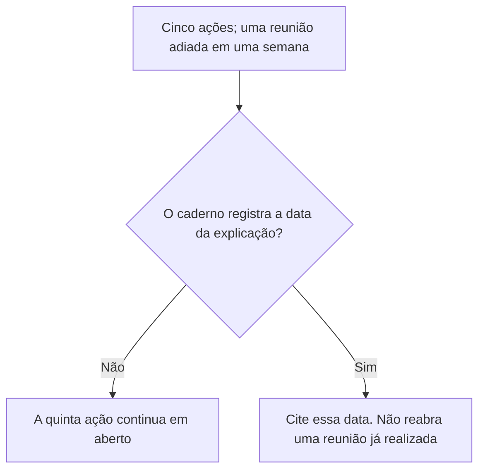
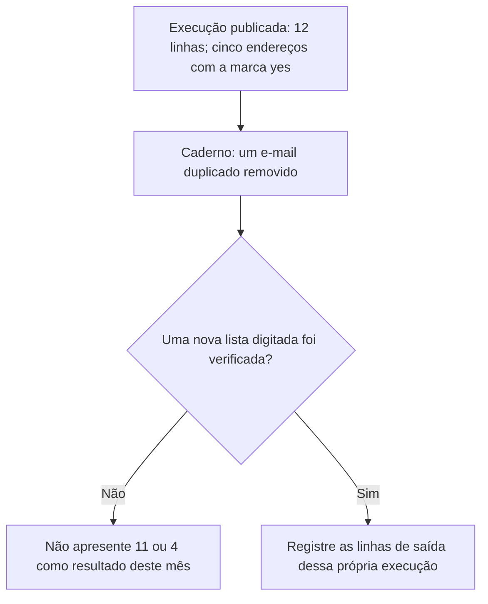
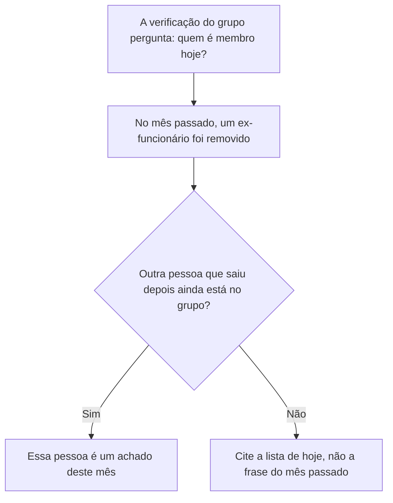
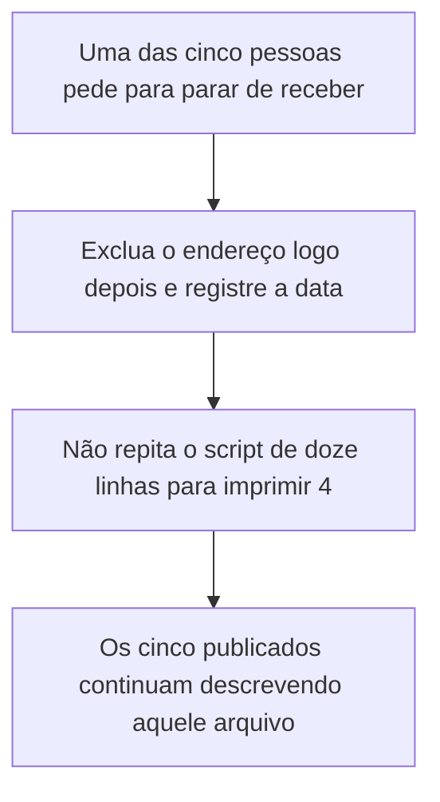
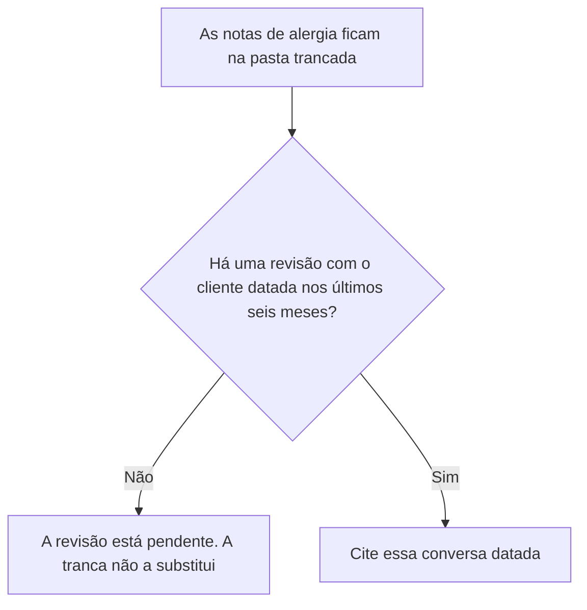
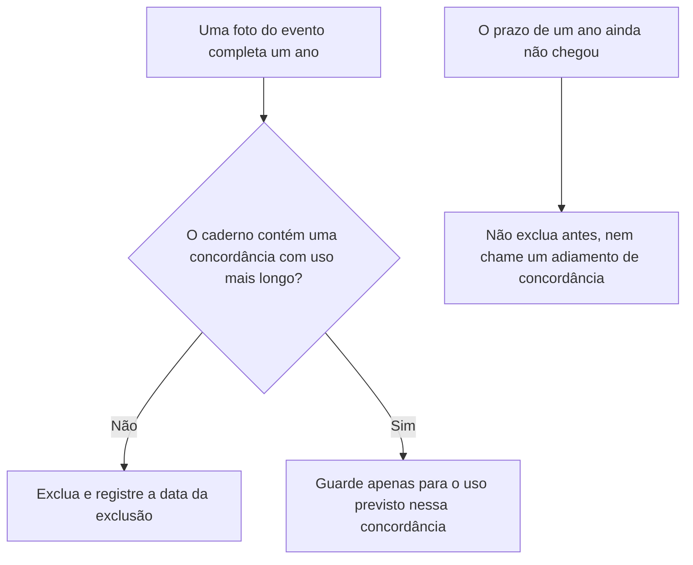

# Governança de Dados: Curso Rápido

- Idioma: português do Brasil (`pt`); curso 003, curso rápido (1 mês). Edição de referência: [inglês](../../en/book/MANUSCRIPT.md).
- Estado editorial: **publicado, com tradução parcial e revisão de equivalência pendente**. Esta edição contém capítulos 1–10 e EX001–EX064 com resoluções e rubricas de 0 a 3. A referência inglesa contém vinte capítulos; a continuação 11–20 ainda não está traduzida neste manuscrito. O laboratório permanece sintético e usa somente a biblioteca padrão do Python. Revisão independente, equivalência integral, revisão linguística e inspeção da edição renderizada continuam abertas. Páginas são uma medição de edição, não uma meta de escrita ou aprovação.
- Público: iniciantes que precisam de um começo rápido e prático em governança de dados para um pequeno negócio.

## Como usar este livro parcial

Leia na ordem. Os quatro capítulos iniciais acompanham um supervisor de turno ao longo de um curso de um mês: fundamentos e primeiras decisões, responsabilidade e práticas seguras, qualidade, sistemas e fornecedores, e um laboratório guiado que se transforma em um plano de ação curto. Execute o laboratório onde ele aparece, tente os exercícios antes de consultar as resoluções e avalie-se com as rubricas. Cada capítulo traz também uma tabela de conceitos, uma tabela de dados, um fluxograma de decisão e um segundo exemplo resolvido. EX051–EX058 aplicam essas ferramentas a um fato novo do café.

<a id="pt-translation-ch05-10"></a>

**Tradução 05–10 — 14 de outubro de 2026:** seis capítulos completos da referência inglesa e EX059–EX064 foram incorporados com mapas, desenhos textuais, exemplos, enunciados, rubricas e respostas no apêndice deste mesmo livro. Fonte: `levels/rapid-1-month/data-governance/en/book/MANUSCRIPT.md`, revisão `d087ecc50f623e740c9a9092ded79cb37b88a098`, conteúdo `ad3512e8614ace755cbaaab991ef932fceda4818`. O conteúdo português anterior era `6bc1f9251f864aa38ce7b63dd5ab7e29b4fbbe0f`. Os capítulos 1–4, seus 58 exercícios e respostas, o programa e as referências não foram reescritos nesta passagem; apresentação e navegação foram ajustadas. Responsabilidade editorial: hiagokinlevi. Não se declara revisão humana independente.

Há dez de vinte posições inglesas com texto português, e 64 de 74 IDs com respostas: **50% das posições e 86,49% dos IDs**, não percentuais de equivalência integral. A sequência 11–20 continua [pendente de tradução](PLAN.md#translation-gap). Os capítulos 05–10 não acrescentam um programa executável. O programa completo anterior foi transcrito e executado em Python 3.13.5, reproduzindo as duas linhas publicadas; os testes adicionais abaixo são controles locais, não novos acontecimentos no café.

**Limites editoriais, separados do texto traduzido:** os prazos de seis meses e de um ano e a expressão "logo depois" pertencem à regra sintética do café. Não são apresentados como prazos universais do GDPR ou da LGPD. A ausência de uma data de reunião ou revisão deve ser lida dentro das premissas do caso, não como prova geral de que uma ação não ocorreu. O caso anterior já menciona uma comunicação das primeiras decisões à equipe; isso não preenche a data da reunião posterior que o Capítulo 5 mantém em aberto.

O rótulo literal `unique valid addresses with a yes tick` é uma saída do programa fornecido, não uma validação completa de endereços ou de consentimento jurídico. Um controle local com `[("a.b", "yes")]` reproduziu `malformed 1` e, simultaneamente, uma contagem de envio igual a 1: o conjunto `ok` não exige `@`, embora o contador `bad` o verifique. O defeito da fonte permanece explícito e não foi corrigido silenciosamente. Não utilize este script como validador de produção ou autorização para enviar mensagens. A entrada vazia produziu contagens zero; retirar apenas a linha duplicada `Ana@Example.org ` produziu 11 linhas, uma duplicata e ainda 5 endereços no conjunto `ok`. Esses controles não substituem o arquivo sintético canônico de doze linhas.

A comparação deste lote preservou os seis enunciados, níveis 0–3, respostas e rótulos de dados executáveis. A pontuação duplicada `;;` das rubricas foi normalizada para `;`, sem mudar critérios. Estrutura Markdown e conexões dos mapas foram conferidas; Mermaid, A4, o site e uma revisão integral dos capítulos anteriores não foram verificados. A precisão técnica da fonte e sua equivalência completa continuam sujeitas à revisão. A disponibilidade deste lote não conclui a coleção inglesa ou portuguesa.

### Caso sintético

## Sumário

| Capítulos em português |
|---|
| [1](#ch-01) · [2](#ch-02) · [3](#ch-03) · [4](#ch-04) · [5](#ch-05) · [6](#ch-06) · [7](#ch-07) · [8](#ch-08) · [9](#ch-09) · [10](#ch-10) |

[Resoluções](#worked-results) · [Referências](#references)

<a id="ch-01"></a>

## Capítulo 1 — Governança de dados: fundamentos e primeiras decisões

<!-- open-cyber-academy:chapter-navigation:start ch-01 -->
### Continue estudando — aula 01 (capítulo 01; dez disponíveis de vinte na referência inglesa)

[← Início do curso](../../README.md) · [Índice das aulas](../SUBJECTS.md) · [Capítulo 02 →](#ch-02)

Continue para a próxima aula já escrita.
<!-- open-cyber-academy:chapter-navigation:end -->

<a id="ch-02"></a>

## Capítulo 2 — Responsabilidade, regras e práticas seguras

<!-- open-cyber-academy:chapter-navigation:start ch-02 -->
### Continue estudando — aula 02 (capítulo 02; dez disponíveis de vinte na referência inglesa)

[← Capítulo 01](#ch-01) · [Índice das aulas](../SUBJECTS.md) · [Capítulo 03 →](#ch-03)

Continue para a próxima aula já escrita.
<!-- open-cyber-academy:chapter-navigation:end -->

<a id="ch-03"></a>

## Capítulo 3 — Qualidade, sistemas e fornecedores

<!-- open-cyber-academy:chapter-navigation:start ch-03 -->
### Continue estudando — aula 03 (capítulo 03; dez disponíveis de vinte na referência inglesa)

[← Capítulo 02](#ch-02) · [Índice das aulas](../SUBJECTS.md) · [Capítulo 04 →](#ch-04)

Continue para a próxima aula já escrita.
<!-- open-cyber-academy:chapter-navigation:end -->

<a id="ch-04"></a>

## Capítulo 4 — Laboratório guiado e plano de ação

<!-- open-cyber-academy:chapter-navigation:start ch-04 -->
### Continue estudando — aula 04 (capítulo 04; dez disponíveis de vinte na referência inglesa)

[← Capítulo 03](#ch-03) · [Índice das aulas](../SUBJECTS.md) · [Capítulo 05 em português →](#ch-05)

Continue para a nova sequência traduzida; não salte os capítulos 05–10.
<!-- open-cyber-academy:chapter-navigation:end -->

<a id="ch-05"></a>

## Capítulo 5 — Adiar uma reunião não é explicar as regras

<!-- open-cyber-academy:lesson-figures:start ch-05 -->
### Mapa da aula

Aula 05. Mapa, exemplo, EX059.



Mudar uma data registra um atraso. Não transmite a explicação.

### Desenho lógico

```text
plano afixado ao lado das regras
    quatro ações com datas de conclusão
    reunião da equipe transferida para a semana seguinte
        |
        +-- o plano continua com cinco linhas
        +-- a equipe não ouviu as regras na reunião enquanto ela não ocorreu
        +-- riscar a linha esconderia o atraso
```
<!-- open-cyber-academy:lesson-figures:end ch-05 -->

### Objetivos de aprendizagem

Depois deste capítulo, você deverá conseguir:

1. Manter a reunião da equipe no plano enquanto o caderno não registrar a data de sua realização.
2. Recusar a exclusão dessa linha para fazer o mês parecer concluído.
3. Distinguir uma alteração no calendário de uma explicação que a equipe efetivamente ouviu.

### 5.1 A quinta linha continua sendo uma linha

O Capítulo 4 encerrou o mês com quatro ações concluídas e a explicação à equipe transferida para a semana seguinte. Um colega quer reescrever o plano afixado como um plano de quatro ações, porque quatro de quatro parece completo. A alteração apagaria o atraso que a Sra. Adeyemi consegue ver. Kwame mantém a quinta linha onde está. Quando a reunião acontecer, sua data será registrada no caderno ao lado das regras. Enquanto essa data não existir, os funcionários que não estavam na sala quando ele redigiu a página ainda não receberam, em grupo, a apresentação das regras.

### 5.2 Exemplo resolvido

| O que alguém aponta | O que isso mostra | Decisão |
|---|---|---|
| "A reunião foi transferida." | Uma nova semana pretendida | A ação continua em aberto |
| "Quatro ações estão marcadas como concluídas." | Essas quatro têm datas | Não renomeie o plano como um plano de quatro ações |
| "A equipe já trabalha aqui, então sabe." | Estar presente não é participar da reunião | Aguarde a explicação com data registrada |
| Uma linha no caderno com a data da reunião | A explicação aconteceu | Cite essa linha |

> **Caso sintético.** Esta aula não inventa a data da reunião. O atraso continua sendo o registrado no Capítulo 4.

### Erros e limites

Realizar a reunião mais tarde não altera as regras assinadas. O que a reunião pode decidir é assunto de uma aula posterior. Este capítulo também não estabelece um prazo legal para treinamento.

### Aplicar

- **EX059 — Quatro de cinco.** O plano afixado mostra quatro ações datadas e uma reunião da equipe transferida para a semana seguinte. Nenhuma linha no caderno registra a data da explicação. O plano pode ser reescrito como um plano de quatro ações? O que continua inacabado? *Rubrica:* 3 = não retirar a quinta linha; a explicação continua inacabada até que o caderno registre sua data; transferir a semana não é registrar essa data; 2 = manter a linha e recusar a reescrita; 1 = um desses elementos; 0 = nenhum.

<!-- open-cyber-academy:chapter-navigation:start ch-05 -->
### Continue estudando — aula 05 (capítulo 05 de 20 na referência inglesa)

[← Capítulo 04](#ch-04) · [Índice das aulas](../SUBJECTS.md) · [Capítulo 06 →](#ch-06)

Continue para a próxima aula traduzida.
<!-- open-cyber-academy:chapter-navigation:end -->

<a id="ch-06"></a>

## Capítulo 6 — Remover uma duplicata não é fazer uma nova contagem completa

<!-- open-cyber-academy:lesson-figures:start ch-06 -->
### Mapa da aula

Aula 06. Mapa, exemplo, EX060.



Um achado no caderno não é uma segunda execução do script.

### Desenho lógico

```text
lab_signups.py sobre o arquivo sintético de doze linhas
    rows 12; blank email 2; malformed 1; duplicates 2
    unique valid addresses with a yes tick: 5
caderno do primeiro mês
    um e-mail duplicado removido
        |
        +-- a remoção é um achado, não uma nova execução
        +-- 12 menos 1 é aritmética, não uma medição
        +-- o script não é alterado para forçar uma nova saída
```
<!-- open-cyber-academy:lesson-figures:end ch-06 -->

### Objetivos de aprendizagem

Depois deste capítulo, você deverá conseguir:

1. Manter a saída publicada de doze linhas como a única contagem verificada daquele arquivo.
2. Rejeitar 11 linhas ou 4 endereços aptos ao envio quando ninguém repetiu a verificação.
3. Deixar o programa e suas linhas de saída inalterados.

### 6.1 O caderno e o script respondem a perguntas diferentes

O caderno do primeiro mês diz que um e-mail duplicado foi removido. Essa frase registra uma verificação. A saída do script descreve o arquivo sintético de doze linhas, antes de qualquer subtração. Um colega escreve "lista de envio deste mês: 4" porque uma duplicata saiu da lista do café. Os cinco eram endereços únicos com a marca exata `yes`. Remover uma duplicata não remove, por si só, um desses cinco endereços, nem reduz o arquivo de doze linhas. Qualquer um desses efeitos teria de ser contado sobre uma nova exportação. Kwame não digita 4 ou 11 no caderno como se o programa tivesse produzido esses números.

### 6.2 Exemplo resolvido

| Afirmação | O que efetivamente foi feito | Decisão |
|---|---|---|
| "Uma duplicata foi retirada da lista de trabalho." | O caderno registra isso | Mantenha como um achado |
| "Então o arquivo agora tem 11 linhas." | Nenhuma nova execução | Recuse o número |
| "Então só quatro pessoas podem receber e-mail." | Os cinco endereços já eram únicos | Recuse. A unicidade já estava considerada na saída |
| "Altere as marcações para a próxima saída ficar mais organizada." | O script conta o arquivo que recebe | Recuse a alteração |

> **Caso sintético.** As linhas `rows 12` e `unique valid addresses with a yes tick: 5` continuam sendo a saída publicada.

### Erros e limites

Um mês posterior pode apresentar outras contagens. Elas só existem depois que a lista daquele mês é verificada. Este capítulo não realiza essa verificação.

### Aplicar

- **EX060 — Não subtraia o caderno.** Alguém escreve "neste mês: 11 linhas e 4 endereços com a marca yes" porque uma duplicata foi removida. O que há de errado nos dois números? Qual saída continua sendo a verificada? *Rubrica:* 3 = nem 11 nem 4 foram contados; a saída verificada continua sendo 12 linhas e 5 endereços com a marca yes; não alterar o script; 2 = rejeitar os dois números e manter a saída publicada; 1 = rejeitar um dos números; 0 = nenhum.

<!-- open-cyber-academy:chapter-navigation:start ch-06 -->
### Continue estudando — aula 06 (capítulo 06 de 20 na referência inglesa)

[← Capítulo 05](#ch-05) · [Índice das aulas](../SUBJECTS.md) · [Capítulo 07 →](#ch-07)

Continue para a próxima aula traduzida.
<!-- open-cyber-academy:chapter-navigation:end -->

<a id="ch-07"></a>

## Capítulo 7 — A saída de alguém no mês passado não encerra a verificação deste mês

<!-- open-cyber-academy:lesson-figures:start ch-07 -->
### Mapa da aula

Aula 07. Mapa, exemplo, EX061.



Uma remoção anterior comprova o que aconteceu no mês passado. A composição do grupo é consultada novamente.

### Desenho lógico

```text
verificação mensal: somente funcionários atuais no grupo pago
primeiro mês: um ex-integrante removido, com data
outra pessoa encerra seu trabalho depois
    |
    +-- a frase do mês passado não se refere a essa pessoa
    +-- "já limpamos o grupo" não é uma nova consulta
    +-- a pessoa continua sendo um achado até que a remoção seja datada
```
<!-- open-cyber-academy:lesson-figures:end ch-07 -->

### Objetivos de aprendizagem

Depois deste capítulo, você deverá conseguir:

1. Tratar a verificação mensal de membros como uma consulta à composição atual do grupo.
2. Recusar o encerramento dessa verificação com base em uma remoção anterior.
3. Registrar a permanência de outra pessoa que saiu como pendência até que a própria remoção receba uma data.

### 7.1 A pergunta é quem está no grupo agora

O caderno do primeiro mês registra a retirada de um ex-funcionário do grupo pago de mensagens. Essa linha é evidência sobre aquela pessoa e aquela data. A verificação definida por Kwame é mais delimitada e se repete: as pessoas do grupo são funcionários atuais? Um colega diz que o grupo pode ser ignorado neste mês porque já foi limpo uma vez. Ignorá-lo deixaria passar quem saiu depois daquela data. Kwame abre a lista de membros. Se uma pessoa cujo último dia de trabalho já passou continua ali, o achado é sua permanência no grupo, e a remoção é registrada com a data. Ele não acrescenta um nome pessoal que o caso não fornece.

### 7.2 Exemplo resolvido

| Motivo apresentado para pular a verificação | O que o caderno contém | Decisão |
|---|---|---|
| "Removemos alguém no mês passado." | Uma remoção datada | Consulte novamente |
| "O aplicativo pago é uma versão empresarial, então quem sai perde o acesso automaticamente." | Nenhuma expiração desse tipo está registrada | Não presuma isso |
| Um funcionário atual identificado | A pessoa ainda trabalha no café | Pode permanecer |
| Uma pessoa que saiu ainda aparece na lista, sem data de remoção | É a pergunta da verificação | Remova e registre a data |

> **Caso sintético.** A pessoa que saiu depois não tem nome informado. Não invente um nome.

### Erros e limites

Remover um membro não apaga sua escala antiga nem determina o prazo de guarda dos registros trabalhistas. Esse prazo continua dependendo da informação do contador, que o Capítulo 11 mantém em branco até que seja registrada.

### Aplicar

- **EX061 — De qual mês é a remoção?** O caderno do mês passado registra a data da remoção de um ex-integrante. Neste mês, o último dia de trabalho de outra pessoa já passou, e o grupo ainda a lista. Qual é o achado? Qual frase anterior não o encerra? *Rubrica:* 3 = a pessoa ainda é membro; removê-la e registrar a data; a remoção do mês passado não cobre essa pessoa; 2 = remover, datar e rejeitar a frase anterior como evidência de resolução; 1 = um desses elementos; 0 = nenhum.

<!-- open-cyber-academy:chapter-navigation:start ch-07 -->
### Continue estudando — aula 07 (capítulo 07 de 20 na referência inglesa)

[← Capítulo 06](#ch-06) · [Índice das aulas](../SUBJECTS.md) · [Capítulo 08 →](#ch-08)

Continue para a próxima aula traduzida.
<!-- open-cyber-academy:chapter-navigation:end -->

<a id="ch-08"></a>

## Capítulo 8 — Um cancelamento de inscrição gera uma nova linha

<!-- open-cyber-academy:lesson-figures:start ch-08 -->
### Mapa da aula

Aula 08. Mapa, exemplo, EX062.



A regra de guarda e o arquivo do laboratório são objetos diferentes.

### Desenho lógico

```text
regra: o endereço do boletim é guardado enquanto a inscrição permanece ativa
    excluído logo depois do cancelamento
arquivo sintético: cinco endereços com a marca yes
um desses endereços pede posteriormente para parar de receber
    |
    +-- o pedido é um novo evento
    +-- o script não é alterado, e 5 não é reescrito como 4
    +-- o caderno registra a data da exclusão
```
<!-- open-cyber-academy:lesson-figures:end ch-08 -->

### Objetivos de aprendizagem

Depois deste capítulo, você deverá conseguir:

1. Aplicar a regra de cancelamento a um endereço sem alterar a saída publicada do laboratório.
2. Recusar "5 menos 1" como uma nova lista de envio medida.
3. Registrar a data da exclusão no caderno.

### 8.1 Os cinco descrevem um arquivo. Um pedido para parar descreve uma pessoa.

A saída do laboratório diz que cinco endereços únicos e válidos têm a marca `yes` naquele arquivo sintético. A regra de guarda diz que um endereço permanece enquanto a pessoa está inscrita e é excluído logo depois que ela cancela a inscrição. As duas frases podem ser verdadeiras ao mesmo tempo. Se uma dessas cinco pessoas pedir posteriormente para parar de receber, Kwame exclui o endereço da lista de envio em uso e escreve a data. Ele não abre `lab_signups.py` nem altera o arquivo para que a saída histórica passe a dizer 4. A saída histórica continua descrevendo o arquivo que ele executou. A exclusão descreve o que aconteceu depois.

### 8.2 Exemplo resolvido

| Proposta | Objeto que ela modifica | Decisão |
|---|---|---|
| Excluir o endereço e datar o registro no caderno | A lista de trabalho, depois de um pedido efetivo para parar | Aceite |
| Alterar a saída do script de 5 para 4 | O registro do arquivo anterior | Recuse |
| Continuar enviando porque o laboratório contou essa pessoa uma vez | Um arquivo que não continha esse pedido para parar | Recuse |
| Esperar até a revisão do próximo ano | A regra diz logo depois | Exclua e registre a data |

> **Caso sintético.** Nenhum endereço novo é acrescentado ao arquivo de doze linhas. Não invente qual dos cinco cancelou a inscrição.

### Erros e limites

Excluir um endereço não responde se os outros quatro ainda têm uma marca `yes` em uma folha posterior. Uma folha posterior exige uma verificação posterior. Isso não é uma afirmação do que o GDPR exige em todas as organizações.

### Aplicar

- **EX062 — Cinco ou quatro?** Um endereço da lista de envio cancela a inscrição. Um colega altera a nota do laboratório para que ela diga "unique valid addresses with a yes tick: 4". O que é excluído? O que recebe uma data? Qual saída permanece? *Rubrica:* 3 = excluir o endereço da lista de trabalho e datar o caderno; manter a saída publicada em 5; não alterar o script para forçar 4; 2 = excluir e manter os 5 publicados; 1 = um desses elementos; 0 = nenhum.

<!-- open-cyber-academy:chapter-navigation:start ch-08 -->
### Continue estudando — aula 08 (capítulo 08 de 20 na referência inglesa)

[← Capítulo 07](#ch-07) · [Índice das aulas](../SUBJECTS.md) · [Capítulo 09 →](#ch-09)

Continue para a próxima aula traduzida.
<!-- open-cyber-academy:chapter-navigation:end -->

<a id="ch-09"></a>

## Capítulo 9 — Uma pasta trancada não substitui a revisão semestral

<!-- open-cyber-academy:lesson-figures:start ch-09 -->
### Mapa da aula

Aula 09. Mapa, exemplo, EX063.



A pasta responde quem pode ver a nota. A revisão responde se ela continua correta.

### Desenho lógico

```text
regra: notas de alergia trancadas, mostradas apenas a quem prepara aquele pedido
prazo: revisão com o cliente a cada seis meses
a pasta continua trancada
    |
    +-- uma tranca não é uma conversa
    +-- "sempre tivemos esta nota" não é uma data
    +-- nenhum nome de cliente é inventado para preencher a lacuna
```
<!-- open-cyber-academy:lesson-figures:end ch-09 -->

### Objetivos de aprendizagem

Depois deste capítulo, você deverá conseguir:

1. Distinguir a pasta trancada da revisão semestral com o cliente.
2. Tratar a ausência de uma data de revisão como uma verificação em aberto.
3. Recusar a invenção de um nome de cliente ou de uma alergia para encerrar a linha.

### 9.1 Dois controles, uma pasta

Notas de alergia são informações de saúde. Elas ficam em uma pasta trancada e são mostradas apenas aos funcionários que preparam o pedido daquele cliente. Separadamente, a regra de guarda de Kwame determina que as notas sejam revistas com o cliente a cada seis meses. Um colega aponta para a tranca e diz que, por isso, a revisão está concluída. A tranca limita quem pode ler. Ela não pergunta ao cliente se a nota continua correta. Se o caderno não tiver uma data de revisão dentro dos seis meses, a revisão continua em aberto. Kwame escreve que a verificação está pendente. Ele não digita o nome de um cliente nem de um alimento para preencher a lacuna.

### 9.2 Exemplo resolvido

| Evidência apresentada | O que ela comprova | Decisão |
|---|---|---|
| A pasta está trancada | Controle de acesso | Não é a revisão |
| "A nota está ali há anos." | Idade, sem uma conversa | A revisão continua em aberto |
| Uma linha no caderno: revisto com o cliente, com data desta estação do ano | O ato previsto na regra | Cite a linha |
| "Escreva 'sem castanhas' para a página parecer completa." | Uma alergia inventada | Recuse |

> **Caso sintético.** Esta aula não acrescenta uma alergia nem um cliente.

### Erros e limites

Uma revisão em aberto não significa que a nota deva ser lida em voz alta no balcão. O acesso continua restrito a quem prepara aquele pedido. Este capítulo não é aconselhamento médico nem uma descrição completa dos deveres relativos a dados de categoria especial. O curso de privacidade é o próximo curso para estudar esses deveres.

### Aplicar

- **EX063 — Tranca ou conversa?** A pasta de alergias está trancada. O caderno não tem registro de revisão com um cliente nos últimos seis meses. Um colega diz que a tranca cumpre a regra de guarda e se oferece para digitar uma alergia, para que a linha pareça concluída. O que você aceita e o que recusa? *Rubrica:* 3 = a revisão continua em aberto; a tranca não é a conversa; não inventar uma alergia nem um nome de cliente; 2 = manter a revisão em aberto e recusar a invenção; 1 = um desses elementos; 0 = nenhum.

<!-- open-cyber-academy:chapter-navigation:start ch-09 -->
### Continue estudando — aula 09 (capítulo 09 de 20 na referência inglesa)

[← Capítulo 08](#ch-08) · [Índice das aulas](../SUBJECTS.md) · [Capítulo 10 →](#ch-10)

Continue para a próxima aula traduzida.
<!-- open-cyber-academy:chapter-navigation:end -->

<a id="ch-10"></a>

## Capítulo 10 — Gostar de uma foto não é concordar com um uso mais longo

<!-- open-cyber-academy:lesson-figures:start ch-10 -->
### Mapa da aula

Aula 10. Mapa, exemplo, EX064.



Gostar de uma imagem não prolonga o prazo.

### Desenho lógico

```text
padrão: fotos de eventos excluídas após um ano
exceção: as pessoas concordaram com um uso mais longo
uma foto que a equipe quer manter na parede
    |
    +-- "é uma foto bonita" não é a exceção
    +-- nenhuma concordância é inventada aqui
    +-- antes de completar um ano, aguardar não é prolongar o prazo
```
<!-- open-cyber-academy:lesson-figures:end ch-10 -->

### Objetivos de aprendizagem

Depois deste capítulo, você deverá conseguir:

1. Aplicar o prazo padrão de um ano quando não houver concordância com uso mais longo no caderno.
2. Recusar uma preferência estética ou a vontade de decidir depois como se fossem essa concordância.
3. Manter sem exclusão uma foto que ainda não completou um ano, sem chamar essa espera de prorrogação.

### 10.1 A exceção precisa estar registrada

Fotos de eventos são excluídas depois de um ano, salvo quando as pessoas concordaram com um uso mais longo. A Sra. Adeyemi gosta de uma fotografia e quer deixá-la exposta "até decidirmos". Decidir mais tarde não é uma concordância já obtida. Se a foto completou um ano e o caderno não tem uma linha sobre uso mais longo, Kwame a exclui e registra a data da exclusão. Se ainda não completou um ano, ele não a exclui para parecer rigoroso nem escreve um prazo maior na margem. O padrão continua sendo um ano. Esta aula não cria a concordância nem escolhe uma data de calendário para o evento.

### 10.2 Exemplo resolvido

| Situação | Concordância no caderno | Decisão |
|---|---|---|
| Um ano completo, sem linha sobre uso mais longo | Ausente | Exclua e registre a data |
| "É a melhor foto da noite." | Ausente | Ainda assim, exclua quando completar um ano |
| "Deixe até decidirmos." | Ausente | Essa frase não autoriza uso mais longo |
| Ainda não completou um ano | Ausente | Guarde até completar o ano. Não altere o prazo declarado |

> **Caso sintético.** Ninguém na fotografia é identificado pelo nome.

### Erros e limites

Excluir uma foto não estabelece um novo prazo para o evento seguinte. Cada evento mantém o padrão de um ano, salvo quando sua própria concordância é registrada. Isso não é um parecer completo sobre direitos de imagem.

### Aplicar

- **EX064 — Qual frase prolonga o ano?** Uma foto completou um ano. A equipe quer guardá-la porque ficou bonita, e a Sra. Adeyemi diz "até decidirmos". O caderno não contém concordância com uso mais longo. O que acontece com a foto? Qual frase não prolonga o prazo de um ano? *Rubrica:* 3 = excluir a foto e registrar a data; nem a preferência estética nem "até decidirmos" constituem a concordância; não inventar uma concordância; 2 = excluir e rejeitar as duas frases; 1 = um desses elementos; 0 = nenhum.

<!-- open-cyber-academy:chapter-navigation:start ch-10 -->
### Continue estudando — aula 10 (capítulo 10 de 20 na referência inglesa)

[← Capítulo 09](#ch-09) · [Índice das aulas](../SUBJECTS.md) · [Continuação 11–20 ainda não traduzida →](PLAN.md#translation-gap)

A próxima aula da referência inglesa é o Capítulo 11. Ela ainda não está traduzida neste manuscrito. A ligação para um plano não substitui o ensino em português.
<!-- open-cyber-academy:chapter-navigation:end -->

<a id="worked-results"></a>

## Resoluções

Respostas-modelo para EX001–EX064. Kwame Boateng, a Sra. Lena Fischer, o Riverside Adult Learning Centre, o Copperleaf Café e todos os números são sintéticos. Qualquer resposta que atenda à rubrica recebe a mesma pontuação.

**EX001.** Dois.

**EX057.** O script apara o endereço e o põe em minúsculas. A marca continua `Yes`. A linha não recebe e-mail, porque só um `yes` exato conta.

**EX058.** Não. Eli pode assinar a folha nova pessoalmente. A recusa fica datada no caderno.

**EX059.** Não retire a quinta linha. A explicação continua inacabada até que o caderno registre sua data. Transferir a semana não é registrar essa data.

**EX060.** Nem 11 nem 4 foram contados. A saída verificada continua sendo 12 linhas e 5 endereços com a marca yes. Não altere o script.

**EX061.** A outra pessoa que saiu continua sendo membro. Remova-a e registre a data da remoção. A remoção do mês passado não cobre essa pessoa.

**EX062.** Exclua o endereço da lista de trabalho e registre a data no caderno. Mantenha a saída publicada em 5. Não altere o script para forçar 4.

**EX063.** A revisão continua em aberto. A tranca não é a conversa. Não invente uma alergia nem um nome de cliente.

**EX064.** Exclua a foto e registre a data da exclusão. Nem a preferência estética nem uma decisão adiada constituem a concordância. Não invente uma concordância.

<a id="references"></a>
## Referências
