# Governança de Dados: Curso Rápido

- Idioma: português do Brasil (`pt`); curso 003, curso rápido (1 mês). Edição de referência: [inglês](../../en/book/MANUSCRIPT.md).
- Estado editorial: **publicado, com texto nos capítulos 1–20 e revisão de equivalência pendente**. Esta edição contém EX001–EX074 com resoluções e rubricas de 0 a 3. Há texto português nas vinte posições da referência inglesa fixada; isso não aprova a equivalência integral nem conclui o livro. O laboratório permanece sintético e usa somente a biblioteca padrão do Python. Revisão independente, equivalência integral, revisão linguística e inspeção da edição renderizada continuam abertas. Páginas são uma medição de edição, não uma meta de escrita ou aprovação.
- Público: iniciantes que precisam de um começo rápido e prático em governança de dados para um pequeno negócio.
- Autor: [hiagokinlevi](https://github.com/hiagokinlevi). Texto original sob [CC0 1.0](../../../../../LICENSE); as obras citadas mantêm seus direitos.
- Limites: o laboratório confere uma lista sintética de doze linhas de inscrições de um café em busca de e-mails em branco, endereços malformados, duplicatas e marcações de consentimento. A legislação é citada pela edição e parafraseada; nada aqui é aconselhamento jurídico. Pessoas, organizações, sistemas e dados são **sintéticos**, salvo quando uma frase cita uma fonte pública.

[Página do curso](../../README.md) · [Índice de capítulos](../SUBJECTS.md) · [Plano do livro](PLAN.md) · [Skill do curso](../../skill/SKILL.md) · [Resoluções](#worked-results)

## Como usar este livro em revisão

Leia na ordem. Os quatro capítulos iniciais acompanham um supervisor de turno ao longo de um curso de um mês: fundamentos e primeiras decisões, responsabilidade e práticas seguras, qualidade, sistemas e fornecedores, e um laboratório guiado que se transforma em um plano de ação curto. Execute o laboratório onde ele aparece, tente os exercícios antes de consultar as resoluções e avalie-se com as rubricas. Cada capítulo traz também uma tabela de conceitos, uma tabela de dados, um fluxograma de decisão e um segundo exemplo resolvido. EX051–EX058 aplicam essas ferramentas a um fato novo do café.

<a id="pt-translation-ch05-10"></a>

**Tradução 05–10 — 14 de outubro de 2026:** seis capítulos completos da referência inglesa e EX059–EX064 foram incorporados com mapas, desenhos textuais, exemplos, enunciados, rubricas e respostas no apêndice deste mesmo livro. Fonte: `levels/rapid-1-month/data-governance/en/book/MANUSCRIPT.md`, revisão `d087ecc50f623e740c9a9092ded79cb37b88a098`, conteúdo `ad3512e8614ace755cbaaab991ef932fceda4818`. O conteúdo português anterior era `6bc1f9251f864aa38ce7b63dd5ab7e29b4fbbe0f`. Os capítulos 1–4, seus 58 exercícios e respostas, o programa e as referências não foram reescritos nesta passagem; apresentação e navegação foram ajustadas. Responsabilidade editorial: hiagokinlevi. Não se declara revisão humana independente.

Ao final do lote 05–10, havia dez de vinte posições inglesas com texto português e 64 de 74 IDs com respostas: **50% das posições e 86,49% dos IDs**, não percentuais de equivalência integral. A continuação foi incorporada no [lote 11–20 abaixo](#pt-translation-ch11-20). Os capítulos 05–10 não acrescentaram um programa executável. Naquela passagem, o programa completo anterior foi transcrito e executado em Python 3.13.5, reproduzindo as duas linhas publicadas; os testes adicionais abaixo são controles locais daquele lote, não novos acontecimentos no café.

**Limites editoriais, separados do texto traduzido:** os prazos de seis meses e de um ano e a expressão "logo depois" pertencem à regra sintética do café. Não são apresentados como prazos universais do GDPR ou da LGPD. A ausência de uma data de reunião ou revisão deve ser lida dentro das premissas do caso, não como prova geral de que uma ação não ocorreu. O caso anterior já menciona uma comunicação das primeiras decisões à equipe; isso não preenche a data da reunião posterior que o Capítulo 5 mantém em aberto.

O rótulo literal `unique valid addresses with a yes tick` é uma saída do programa fornecido, não uma validação completa de endereços ou de consentimento jurídico. Um controle local com `[("a.b", "yes")]` reproduziu `malformed 1` e, simultaneamente, uma contagem de envio igual a 1: o conjunto `ok` não exige `@`, embora o contador `bad` o verifique. O defeito da fonte permanece explícito e não foi corrigido silenciosamente. Não utilize este script como validador de produção ou autorização para enviar mensagens. A entrada vazia produziu contagens zero; retirar apenas a linha duplicada `Ana@Example.org ` produziu 11 linhas, uma duplicata e ainda 5 endereços no conjunto `ok`. Esses controles não substituem o arquivo sintético canônico de doze linhas.

A comparação deste lote preservou os seis enunciados, níveis 0–3, respostas e rótulos de dados executáveis. A pontuação duplicada `;;` das rubricas foi normalizada para `;`, sem mudar critérios. Estrutura Markdown e conexões dos mapas foram conferidas; Mermaid, A4, o site e uma revisão integral dos capítulos anteriores não foram verificados. A precisão técnica da fonte e sua equivalência completa continuam sujeitas à revisão. A disponibilidade deste lote não conclui a coleção inglesa ou portuguesa.

<a id="pt-translation-ch11-20"></a>

### Atualização da tradução 11–20 — 14 de outubro de 2026

Dez capítulos da referência inglesa, seus mapas, desenhos textuais, exemplos, exercícios EX065–EX074, rubricas de 0 a 3 e respostas foram incorporados ao mesmo livro. Fonte: `levels/rapid-1-month/data-governance/en/book/MANUSCRIPT.md`, revisão `dabc0411054775b939fef3ebf3ddcd4c61e430fc`, blob `ad3512e8614ace755cbaaab991ef932fceda4818`. Alvo anterior: `levels/rapid-1-month/data-governance/pt/book/MANUSCRIPT.md`, blob `a34a1bad69c73a9819da60db7d47298f70406b4a`. O conteúdo inglês permaneceu igual ao da referência usada no lote 05–10. Responsabilidade editorial: hiagokinlevi. Houve comparação assistida do lote; não se declara revisão humana independente.

A disponibilidade passa de dez para **vinte posições de capítulo em português sobre vinte inglesas**, e de 64 para **74 IDs de exercícios com respostas sobre 74 ingleses**. São contagens de presença: não constituem aprovação de 100% da tradução, da revisão de todas as unidades, do currículo diário ou da coleção. Os capítulos 1–10, seus 64 enunciados e respostas, o programa e as referências são preservados; foram atualizadas apenas a apresentação, a contagem e a continuação da navegação. O [registro do plano](PLAN.md#translation-review) identifica a revisão ainda necessária. A4 não foi renderizado nesta passagem.

| Âncora na fonte inglesa | Capítulo português | Exercício e resposta no mesmo livro |
|---|---|---|
| `ch-11` | [11](#ch-11) | [EX065](#answer-ex065) |
| `ch-12` | [12](#ch-12) | [EX066](#answer-ex066) |
| `ch-13` | [13](#ch-13) | [EX067](#answer-ex067) |
| `ch-14` | [14](#ch-14) | [EX068](#answer-ex068) |
| `ch-15` | [15](#ch-15) | [EX069](#answer-ex069) |
| `ch-16` | [16](#ch-16) | [EX070](#answer-ex070) |
| `ch-17` | [17](#ch-17) | [EX071](#answer-ex071) |
| `ch-18` | [18](#ch-18) | [EX072](#answer-ex072) |
| `ch-19` | [19](#ch-19) | [EX073](#answer-ex073) |
| `ch-20` | [20](#ch-20) | [EX074](#answer-ex074) |

A verificação estrutural local deste lote encontrou trinta objetivos, dez tabelas com 44 linhas de exemplos, dez mapas Mermaid com 35 conexões correspondentes à projeção da fonte, dez desenhos textuais e dez pares de enunciado/resposta. Conferiu IDs, níveis das rubricas, navegação entre capítulos e links de ida e volta para as novas respostas. Essa verificação não substitui uma avaliação de fidelidade nem prova a renderização dos diagramas. Os capítulos 11–20 não acrescentam um programa executável; o laboratório anterior não foi executado novamente nesta passagem, e sua limitação já registrada permanece aberta.

**Notas de leitura, separadas da tradução:** o Capítulo 11 aplica a responsabilidade e os prazos da política sintética, não um calendário legal universal. A redação principal dos capítulos 17 e 20 não fornece uma data para a reunião; o enunciado de EX071, por sua vez, pede analisar a hipótese específica de que a reunião foi realizada. Essa premissa vale para o exercício e não preenche retroativamente o caderno do caso. O Capítulo 19 não autoriza incorporar o telefone manuscrito a um campo aprovado; não afirma que a escrita física deixou de existir, nem relata sua eliminação. Essas distinções não alteram os enunciados ou suas respostas.

Foi preservada a referência do Capítulo 20 à edição inglesa: a publicação do inglês, por si só, não publica outra língua. Esta tradução tem sua própria revisão. A fonte e a edição portuguesa continuam sujeitas à revisão integral de precisão, fontes, direitos, linguagem e acessibilidade. Nenhuma operação real de envio, exclusão, criação de conta, afixação ou reunião foi realizada. A disponibilidade no repositório é distinta de build, implantação e leitura ao vivo do site ou do MCP; essas etapas não foram verificadas neste lote.

### Caso sintético

| Elemento | Papel | Natureza |
|---|---|---|
| **Kwame Boateng** | Estudante do curso rápido, supervisor de turno em um café | Inventado |
| **Sra. Lena Fischer** | Mentora, gerente de dados de uma prefeitura | Inventada |
| **Riverside Adult Learning Centre** | Centro de educação de adultos fictício | Inventado |
| **Copperleaf Café** | Negócio fictício, com dois cafés e doze funcionários | Inventado |

### Fontes principais

GDPR; LGPD. Lista completa em [Referências](#references).

## Sumário

| Capítulos em português |
|---|
| [1](#ch-01) · [2](#ch-02) · [3](#ch-03) · [4](#ch-04) · [5](#ch-05) · [6](#ch-06) · [7](#ch-07) · [8](#ch-08) · [9](#ch-09) · [10](#ch-10) · [11](#ch-11) · [12](#ch-12) · [13](#ch-13) · [14](#ch-14) · [15](#ch-15) · [16](#ch-16) · [17](#ch-17) · [18](#ch-18) · [19](#ch-19) · [20](#ch-20) |

[Resoluções](#worked-results) · [Referências](#references)

<a id="ch-01"></a>

## Capítulo 1 — Governança de dados: fundamentos e primeiras decisões

<!-- open-cyber-academy:lesson-figures:start ch-01 -->
### Mapa da aula

Aula 01 publicada. Mapa, exemplo, EX051.

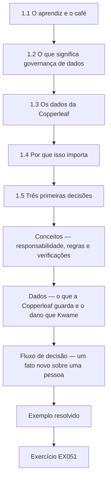

### Desenho lógico

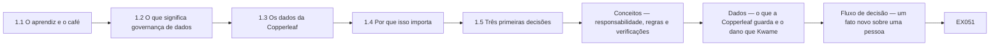

```text
[1.1 O aprendiz e o café]
    |
    v
[1.2 O que significa governança de dados]
    |
    v
[1.3 Os dados da Copperleaf]
    |
    v
[1.4 Por que isso importa]
    |
    v
[1.5 Três primeiras decisões]
    |
    v
[Conceitos — responsabilidade, regras e verificações]
    |
    v
[Dados — o que a Copperleaf guarda e o dano que Kwame]
    |
    v
[Fluxo de decisão — um fato novo sobre uma pessoa]
    |
    v
[Exemplo resolvido] --> [Exercício EX051]
```
<!-- open-cyber-academy:lesson-figures:end ch-01 -->


### Objetivos de aprendizagem

Você vai (1) explicar a governança de dados em palavras simples; (2) listar os dados que um pequeno café mantém; (3) tomar três primeiras decisões sobre responsabilidades e regras.

### 1.1 O aprendiz e o café

Kwame Boateng trabalha como supervisor de turno no Copperleaf Café, um negócio fictício com dois cafés, doze funcionários e um boletim por e-mail para os clientes frequentes. A dona, a Sra. Adeyemi, pede a ele que organize a forma como o café cuida de seus dados. Ele entra em um curso rápido de um mês no fictício Riverside Adult Learning Centre, orientado pela mentora Sra. Lena Fischer, que trabalha como gerente de dados de uma prefeitura. Todos os exercícios usam dados sintéticos inventados para o ensino, nunca dados reais de clientes. Kwame começa o curso animado e com muitas perguntas.

### 1.2 O que significa governança de dados

A Sra. Fischer explica a governança de dados em uma frase: combinar quem é responsável por cada tipo de dado, que regras ele deve seguir e como todos conferem se as regras funcionam. Kwame anota que se trata de decisões e hábitos, e não de software caro. Um pequeno café consegue governar seus dados com uma lista curta de responsáveis, uma página de regras e algumas verificações regulares. O objetivo são dados exatos o bastante para serem usados, seguros e guardados só pelo tempo necessário. Kwame gosta da ideia de começar pequeno e escreve a frase da mentora na primeira página do caderno.

### 1.3 Os dados da Copperleaf

Kwame lista os dados da Copperleaf: a folha de inscrição no boletim com os e-mails dos clientes, os nomes, telefones e escalas dos funcionários, os contatos e as notas fiscais dos fornecedores, os relatórios de pagamento com cartão do fornecedor do caixa, anotações de alergia de alguns clientes frequentes e fotos de um evento recente. Ele marca quais contêm dados pessoais sobre pessoas identificáveis. A maioria contém. Observa que as anotações de alergia são informações de saúde, que o GDPR trata como categoria especial e a LGPD como dado pessoal sensível (art. 5º, II), com cuidados adicionais. Ele escreve cada item em uma lista, com o local onde fica guardado.

### 1.4 Por que isso importa

A Sra. Fischer pergunta a Kwame o que poderia dar errado. Ele lista: mandar e-mails a clientes que nunca concordaram, perder as anotações de alergia e servir a comida errada, passar os telefones dos funcionários para a pessoa errada, guardar escalas antigas para sempre e pagar duas vezes a um fornecedor porque existem duas cópias da mesma nota. Cada problema afeta clientes, funcionários ou dinheiro. Ele percebe que a governança protege as pessoas e o negócio ao mesmo tempo, e que os pequenos negócios enfrentam os mesmos tipos de risco que os grandes. A Sra. Adeyemi concorda com a lista e pede que ele siga adiante.

### 1.5 Três primeiras decisões

A Sra. Fischer pede a Kwame que tome três decisões naquela semana. Primeira: a Sra. Adeyemi responde por todos os dados, e Kwame cuida deles no dia a dia. Segunda: cada tipo de dado ganha um responsável nomeado: Kwame para o boletim e as anotações de alergia, o subgerente para as escalas e a Sra. Adeyemi para os registros de fornecedores e pagamentos. Terceira: nenhum dado de cliente ou de funcionário sai dos sistemas aprovados do café. A Sra. Adeyemi concorda com as três, e Kwame as escreve em uma única página. A equipe é informada naquela mesma semana, durante a troca de turno.

### Exemplo resolvido

Kwame define a governança como responsabilidades, regras e verificações, lista os dados da Copperleaf, incluindo as anotações de alergia como informação de saúde, identifica riscos para as pessoas e para o dinheiro e registra três primeiras decisões aprovadas pela Sra. Adeyemi.

> **Caso sintético.** A Copperleaf, o Riverside e todas as pessoas são sintéticos; o GDPR e a LGPD são reais.

### Erros e limites

Achar que a governança exige ferramentas caras atrasa decisões simples que ajudam de imediato.

### Conceitos — responsabilidade, regras e verificações

A frase da Sra. Fischer tem três partes. A Copperleaf pode usá-las antes de comprar qualquer coisa.

| Parte | Pergunta desta semana | Primeira resposta da Copperleaf | O que ainda falta |
|---|---|---|---|
| Responsabilidade | Quem responde se este dado estiver errado ou se perder? | A Sra. Adeyemi é responsável. Kwame cuida no dia a dia | Uma pessoa nomeada para cada tipo de dado |
| Regras | Para que este dado pode ser usado, e onde pode ficar? | Dados de clientes ou da equipe não saem dos sistemas aprovados | A página de regras vem no capítulo seguinte |
| Verificações | Como alguém verá que a regra se manteve? | As três decisões estão numa página e foram ditas à equipe | Uma verificação com data, não só um aviso |

As notas de alergia não são "mais uma nota de cliente". São informação de saúde. O GDPR trata isso como dado de categoria especial, então o cuidado extra faz parte da regra.

### Dados — o que a Copperleaf guarda e o dano que Kwame nomeou

| Dado | Onde Kwame encontrou | Dado pessoal? | Dano que ele nomeou |
|---|---|---|---|
| E-mails do boletim | Folha de inscrição | Sim | Escrever a quem nunca concordou |
| Nomes, telefones e escalas da equipe | Registros do café | Sim | Entregar um telefone à pessoa errada |
| Contatos e faturas de fornecedores | E-mail e papel | Negócio, com pessoas ligadas | Pagar um fornecedor duas vezes por duas cópias |
| Relatórios de pagamento com cartão | Provedor do caixa | Sim, sobre pagamentos | Um relatório sair do sistema aprovado |
| Notas de alergia | Alguns clientes habituais | Sim, informação de saúde | Servir o alimento errado |
| Fotos do evento | Evento recente | Muitas vezes sim | Guardadas sem um fim combinado |

### Fluxo de decisão — um fato novo sobre uma pessoa

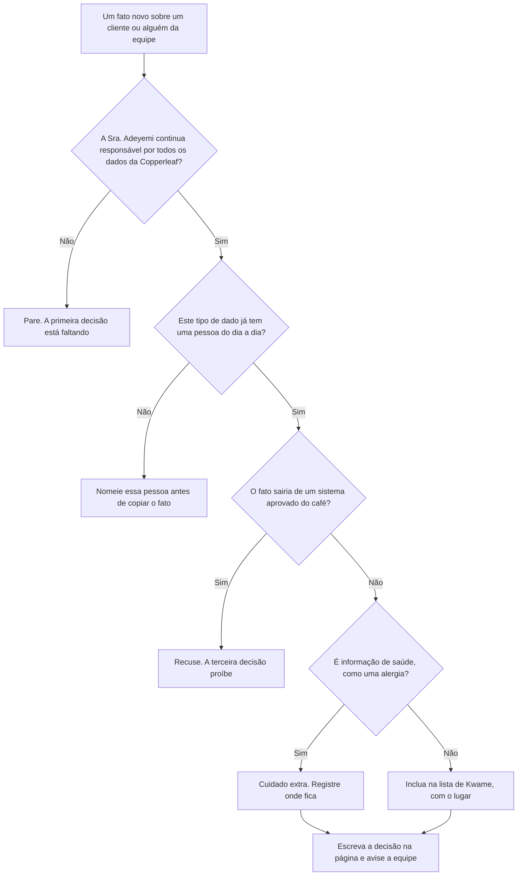

### Exemplo resolvido — uma alergia num guardanapo

Um cliente habitual escreve "sem leite" num guardanapo. Um barista fotografa o guardanapo no celular pessoal para o turno seguinte ver. Kwame impede essa cópia. A nota é informação de saúde, e um celular pessoal não é um sistema aprovado do café, então a terceira decisão já proíbe a fotografia. Ele escreve a alergia na lista do próprio café, registra onde a lista fica e avisa a Sra. Adeyemi no mesmo dia, porque ela é a responsável. O guardanapo não fica no balcão.

> **Caso sintético.** O guardanapo, o cliente e a fotografia são inventados. O GDPR e a LGPD são reais. Isto não é aconselhamento jurídico.

### Aplicar

- **EX051 — Fotografia do guardanapo.** Por que a fotografia no celular pessoal é recusada, e quem precisa ser avisado no mesmo dia? *Rubrica:* 3 = um celular pessoal não é um sistema aprovado, e a nota é informação de saúde; a Sra. Adeyemi, porque é a responsável;; 2 = só a regra do sistema aprovado;; 1 = vago;; 0 = nenhuma.
- **EX052 — Nome ausente.** As escalas ainda não têm uma pessoa do dia a dia. Qual das três decisões está incompleta, e o que se escreve antes de copiar a escala para outro lugar? *Rubrica:* 3 = a segunda decisão; nomear a pessoa, na página, antes de qualquer cópia;; 2 = nomear uma pessoa, sem a página;; 1 = vago;; 0 = nenhuma.

### Exercícios

- **EX001 — Tamanho do negócio.** Quantos cafés a Copperleaf tem? *Rubrica:* 3 = dois;; 2 = parcialmente correto;; 1 = errado;; 0 = nenhuma.
- **EX002 — Trabalho da mentora.** Qual é o trabalho da Sra. Fischer? *Rubrica:* 3 = gerente de dados de uma prefeitura;; 2 = parcialmente correto;; 1 = outro;; 0 = nenhuma.
- **EX003 — Definição em uma frase.** Como a Sra. Fischer define governança? *Rubrica:* 3 = quem é responsável, que regras, como as regras são conferidas;; 2 = parcialmente correto;; 1 = parcial;; 0 = nenhuma.
- **EX004 — Necessidade de software.** Um pequeno café precisa de software caro para governar seus dados? *Rubrica:* 3 = não;; 2 = parcialmente correto;; 1 = sim;; 0 = nenhuma.
- **EX005 — Situação das alergias.** Por que as anotações de alergia exigem cuidado adicional? *Rubrica:* 3 = são informações de saúde, dados de categoria especial;; 2 = parcialmente correto;; 1 = vago;; 0 = nenhuma.
- **EX006 — Exemplo de dado de funcionário.** Cite um tipo de dado de funcionário que a Copperleaf mantém. *Rubrica:* 3 = nomes, telefones ou escalas;; 2 = um;; 1 = vago;; 0 = nenhuma.
- **EX007 — Risco com fornecedores.** Que risco financeiro Kwame listou? *Rubrica:* 3 = pagar duas vezes a um fornecedor por notas duplicadas;; 2 = parcialmente correto;; 1 = vago;; 0 = nenhuma.
- **EX008 — Risco das alergias.** O que a perda das anotações de alergia poderia causar? *Rubrica:* 3 = servir a comida errada;; 2 = parcialmente correto;; 1 = vago;; 0 = nenhuma.
- **EX009 — Quem responde.** Quem responde por todos os dados da Copperleaf? *Rubrica:* 3 = a Sra. Adeyemi;; 2 = parcialmente correto;; 1 = outro;; 0 = nenhuma.
- **EX010 — Responsável pelo boletim.** Quem cuida da lista do boletim? *Rubrica:* 3 = Kwame;; 2 = parcialmente correto;; 1 = outro;; 0 = nenhuma.
- **EX011 — Responsável pelas escalas.** Quem cuida das escalas? *Rubrica:* 3 = o subgerente;; 2 = parcialmente correto;; 1 = outro;; 0 = nenhuma.
- **EX012 — Regra dos sistemas aprovados.** Qual é a terceira decisão? *Rubrica:* 3 = nenhum dado de cliente ou funcionário sai dos sistemas aprovados;; 2 = parcialmente correto;; 1 = vago;; 0 = nenhuma.
- **EX013 — Registro das decisões.** Onde as três decisões estão escritas? *Rubrica:* 3 = em uma única página;; 2 = parcialmente correto;; 1 = vago;; 0 = nenhuma.

<!-- open-cyber-academy:chapter-navigation:start ch-01 -->
### Continue estudando — aula 01 (capítulo 01 de 20)

[← Início do curso](../../README.md) · [Índice das aulas](../SUBJECTS.md) · [Capítulo 02 →](#ch-02)

Continue para a próxima aula já escrita.
<!-- open-cyber-academy:chapter-navigation:end -->

<a id="ch-02"></a>

## Capítulo 2 — Responsabilidade, regras e práticas seguras

<!-- open-cyber-academy:lesson-figures:start ch-02 -->
### Mapa da aula

Aula 02 publicada. Mapa, exemplo, EX053.

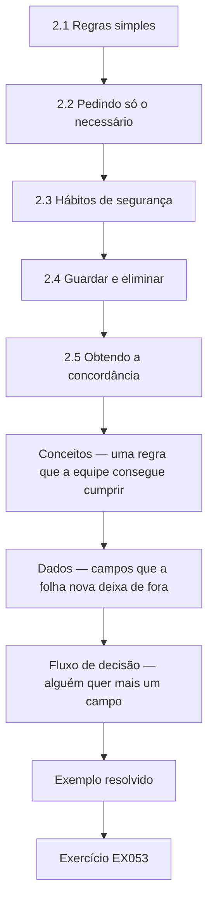

### Desenho lógico

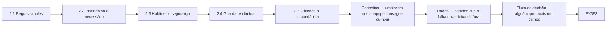

```text
[2.1 Regras simples]
    |
    v
[2.2 Pedindo só o necessário]
    |
    v
[2.3 Hábitos de segurança]
    |
    v
[2.4 Guardar e eliminar]
    |
    v
[2.5 Obtendo a concordância]
    |
    v
[Conceitos — uma regra que a equipe consegue cumprir]
    |
    v
[Dados — campos que a folha nova deixa de fora]
    |
    v
[Fluxo de decisão — alguém quer mais um campo]
    |
    v
[Exemplo resolvido] --> [Exercício EX053]
```
<!-- open-cyber-academy:lesson-figures:end ch-02 -->


### Objetivos de aprendizagem

Você vai (1) escrever regras simples para cada tipo de dado; (2) aplicar hábitos básicos de segurança; (3) decidir por quanto tempo guardar os registros.

### 2.1 Regras simples

Kwame escreve uma página de regras com a ajuda da Sra. Fischer. Os e-mails do boletim são usados apenas para o boletim. As anotações de alergia ficam em uma pasta trancada atrás do balcão e só são mostradas a quem prepara o pedido daquele cliente. As escalas são compartilhadas pelo grupo de mensagens da equipe pago pelo café, e não por redes sociais pessoais. As notas fiscais são arquivadas por fornecedor e data em uma única pasta compartilhada. Cada regra nomeia o responsável, para que a equipe saiba a quem perguntar. A página cabe em um só lado da folha e fica fácil de ler em poucos minutos.

### 2.2 Pedindo só o necessário

A antiga folha de inscrição pedia nome, e-mail, telefone, data de aniversário e endereço residencial. Kwame pergunta por quê. A Sra. Adeyemi responde que só o e-mail é necessário para o boletim, e que o primeiro nome deixa os e-mails mais simpáticos. Kwame retira telefone, aniversário e endereço da nova folha. A Sra. Fischer explica que coletar menos dados significa menos a proteger, menos a perder e menos perguntas dos clientes sobre por que o café quer seus dados; é o princípio da necessidade da LGPD (art. 6º, III). A nova folha é mais rápida de preencher, e mais clientes se inscrevem na primeira semana.

### 2.3 Hábitos de segurança

Kwame lista hábitos para a equipe: bloquear a tela do computador do caixa ao se afastar, usar logins separados no sistema do caixa em vez de um código compartilhado, manter a folha de inscrição fora do alcance dos clientes, nunca fotografar dados de clientes com celulares pessoais e relatar a Kwame no mesmo dia papéis ou aparelhos perdidos. Ele explica cada hábito na reunião seguinte da equipe com um exemplo real do que poderia acontecer, como um cliente lendo a folha de inscrição deixada no balcão. A equipe concorda prontamente e sugere afixar a lista perto do caixa.

### 2.4 Guardar e eliminar

Kwame define os prazos de guarda. Os e-mails do boletim são guardados enquanto o cliente continuar inscrito e eliminados logo depois do cancelamento. As escalas antigas são guardadas pelo período exigido pelas regras trabalhistas e depois eliminadas. As contas dos fornecedores permanecem até o contador indicar o fim da retenção fiscal e, só então, são picotadas. As anotações de alergia são revistas com o cliente a cada seis meses. As fotos de eventos são eliminadas após um ano, salvo se as pessoas concordaram com um uso mais longo. Ele escreve cada prazo ao lado da regra correspondente. A Sra. Adeyemi confere os prazos fiscais e trabalhistas com seu contador.

### 2.5 Obtendo a concordância

Kwame mostra as regras à Sra. Adeyemi e ao subgerente. O subgerente pergunta se a equipe ainda pode trocar turnos por mensagem de texto. Eles combinam que as trocas passam pelo grupo de mensagens pago, que mantém os números em sigilo. A Sra. Adeyemi assina a página e pede a Kwame que a afixe na sala da equipe. A Sra. Fischer lembra que as regras funcionam quando as pessoas as entendem, por isso ele deve explicar as mudanças em vez de apenas anunciá-las. Kwame explica cada mudança na reunião seguinte da equipe e responde às dúvidas de quem chegou depois.

### Exemplo resolvido

Kwame escreve regras que nomeiam os responsáveis, reduz a folha de inscrição ao primeiro nome e ao e-mail, lista hábitos de segurança explicados com exemplos, define prazos de guarda e obtém a assinatura das regras, que ficam afixadas na sala da equipe.

> **Caso sintético.** As regras são sintéticas.

### Erros e limites

Copiar a política longa de uma grande empresa para um café produz regras que ninguém lê.

### Conceitos — uma regra que a equipe consegue cumprir

Uma regra de café falha quando é longa, quando coleta um dado que ninguém vai usar, ou quando o único modo de cumpri-la é uma mensagem particular.

| Teste | Passa na Copperleaf | Falha |
|---|---|---|
| Um uso | Os e-mails do boletim servem só ao boletim | Usar essa lista para anunciar um fornecedor |
| Menos dados | A folha nova guarda o primeiro nome e o e-mail | Telefone, aniversário e endereço da folha antiga |
| Um canal que o café controla | Escalas e trocas ficam no grupo pago | Uma mensagem particular, que espalha telefones |
| Um prazo | As notas de alergia são revistas com o cliente a cada seis meses | "Guardar até alguém lembrar" |
| Uma pessoa | Cada regra diz a quem perguntar | Uma página sem nome |

A Sra. Adeyemi confere os prazos fiscais e trabalhistas com a contadora. Kwame não inventa esses prazos.

### Dados — campos que a folha nova deixa de fora

| Campo antigo | Fica? | Por quê |
|---|---|---|
| Primeiro nome | Sim | Torna a saudação do boletim utilizável |
| E-mail | Sim | O único endereço de que o boletim precisa |
| Telefone | Não | Não é necessário para enviar o boletim |
| Aniversário | Não | Não é necessário, e é um dado pessoal a mais |
| Endereço | Não | Não é necessário, e é um dado pessoal a mais |

Menos dados significam menos o que proteger, menos o que perder e menos perguntas dos clientes. A folha nova também é mais rápida, e por isso mais pessoas se inscreveram na primeira semana.

### Fluxo de decisão — alguém quer mais um campo

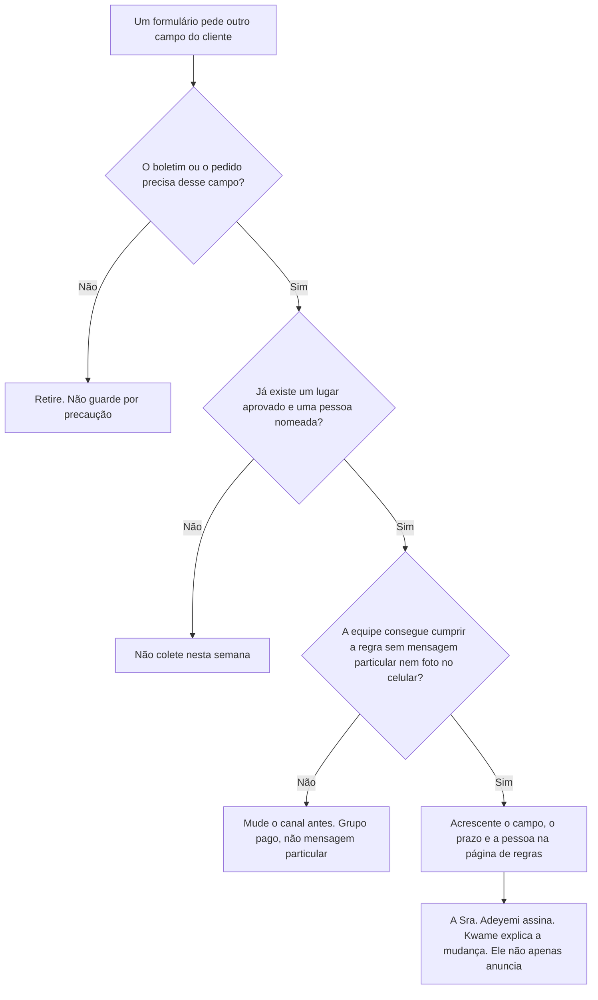

### Exemplo resolvido — um bolo grátis em troca do aniversário

Um fornecedor oferece um bolo grátis se a folha de inscrição coletar aniversários. Kwame recusa o campo. O boletim precisa de um primeiro nome e de um e-mail, que foi o motivo de a coluna antiga ter saído. Um bolo não é uma finalidade nova escrita na página de regras. Se a Sra. Adeyemi quiser depois uma oferta de aniversário, isso é outra regra: uma pessoa nomeada, um prazo e um canal que não seja um celular pessoal. Não entra na margem da folha do boletim.

> **Caso sintético.** A oferta do bolo é inventada.

### Aplicar

- **EX053 — Campo de aniversário.** Por que o aniversário fica fora da folha do boletim, e o que uma oferta posterior precisaria antes de qualquer data ser coletada? *Rubrica:* 3 = o boletim não precisa dele; uma oferta posterior precisa de regra própria, pessoa nomeada, prazo e canal aprovado;; 2 = o boletim não precisa dele;; 1 = vago;; 0 = nenhuma.
- **EX054 — Mensagem de troca.** Duas pessoas trocam um turno por mensagem particular. Qual regra assinada falhou, e para onde a troca precisa ir? *Rubrica:* 3 = as trocas passam pelo grupo pago, para os números continuarem reservados;; 2 = o grupo pago, sem o motivo;; 1 = vago;; 0 = nenhuma.

### Exercícios

- **EX014 — Uso do boletim.** Para que podem ser usados os e-mails do boletim? *Rubrica:* 3 = apenas para o boletim;; 2 = parcialmente correto;; 1 = outro;; 0 = nenhuma.
- **EX015 — Acesso às alergias.** Quem pode ver as anotações de alergia? *Rubrica:* 3 = quem prepara o pedido daquele cliente;; 2 = parcialmente correto;; 1 = vago;; 0 = nenhuma.
- **EX016 — Canal das escalas.** Como as escalas são compartilhadas? *Rubrica:* 3 = pelo grupo de mensagens pago da equipe;; 2 = parcialmente correto;; 1 = vago;; 0 = nenhuma.
- **EX017 — Campos mantidos.** Que campos continuam na nova folha de inscrição? *Rubrica:* 3 = primeiro nome e e-mail;; 2 = ambos;; 1 = um;; 0 = nenhuma.
- **EX018 — Benefício de coletar menos.** Por que coletar menos dados? *Rubrica:* 3 = menos a proteger, perder ou explicar;; 2 = parcialmente correto;; 1 = vago;; 0 = nenhuma.
- **EX019 — Login do caixa.** O que substitui o código compartilhado do caixa? *Rubrica:* 3 = logins separados;; 2 = parcialmente correto;; 1 = vago;; 0 = nenhuma.
- **EX020 — Relato de perdas.** Quando papéis perdidos devem ser relatados? *Rubrica:* 3 = no mesmo dia;; 2 = parcialmente correto;; 1 = errado;; 0 = nenhuma.
- **EX021 — Após o cancelamento.** O que acontece com os e-mails após o cancelamento da inscrição? *Rubrica:* 3 = são eliminados logo depois;; 2 = parcialmente correto;; 1 = vago;; 0 = nenhuma.
- **EX022 — Revisão das alergias.** Com que frequência as anotações de alergia são revistas? *Rubrica:* 3 = a cada seis meses;; 2 = parcialmente correto;; 1 = errado;; 0 = nenhuma.
- **EX023 — Prazo das fotos.** Por quanto tempo as fotos de eventos são guardadas por padrão? *Rubrica:* 3 = um ano;; 2 = parcialmente correto;; 1 = errado;; 0 = nenhuma.
- **EX024 — Troca de turnos.** Como a equipe troca turnos agora? *Rubrica:* 3 = pelo grupo de mensagens pago;; 2 = parcialmente correto;; 1 = por mensagem de texto;; 0 = nenhuma.
- **EX025 — Local das regras.** Onde as regras assinadas ficam expostas? *Rubrica:* 3 = na sala da equipe;; 2 = parcialmente correto;; 1 = outro;; 0 = nenhuma.
- **EX026 — Explicando as mudanças.** O que, segundo a Sra. Fischer, faz as regras funcionarem? *Rubrica:* 3 = as pessoas entenderem as regras;; 2 = parcialmente correto;; 1 = vago;; 0 = nenhuma.

<!-- open-cyber-academy:chapter-navigation:start ch-02 -->
### Continue estudando — aula 02 (capítulo 02 de 20)

[← Capítulo 01](#ch-01) · [Índice das aulas](../SUBJECTS.md) · [Capítulo 03 →](#ch-03)

Continue para a próxima aula já escrita.
<!-- open-cyber-academy:chapter-navigation:end -->

<a id="ch-03"></a>

## Capítulo 3 — Qualidade, sistemas e fornecedores

<!-- open-cyber-academy:lesson-figures:start ch-03 -->
### Mapa da aula

Aula 03 publicada. Mapa, exemplo, EX055.

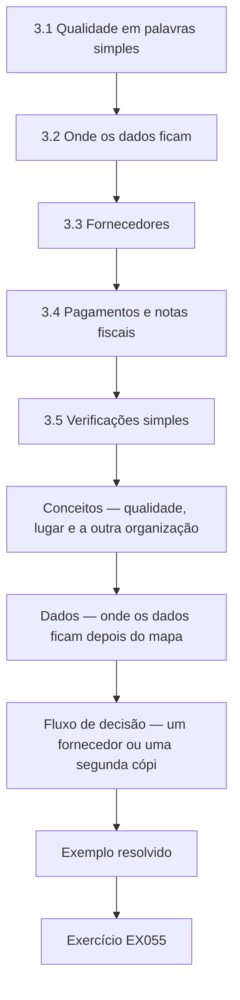

### Desenho lógico

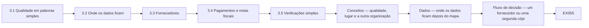

```text
[3.1 Qualidade em palavras simples]
    |
    v
[3.2 Onde os dados ficam]
    |
    v
[3.3 Fornecedores]
    |
    v
[3.4 Pagamentos e notas fiscais]
    |
    v
[3.5 Verificações simples]
    |
    v
[Conceitos — qualidade, lugar e a outra organização]
    |
    v
[Dados — onde os dados ficam depois do mapa]
    |
    v
[Fluxo de decisão — um fornecedor ou uma segunda cópi]
    |
    v
[Exemplo resolvido] --> [Exercício EX055]
```
<!-- open-cyber-academy:lesson-figures:end ch-03 -->


### Objetivos de aprendizagem

Você vai (1) conferir a qualidade dos dados em um pequeno negócio; (2) mapear onde os dados ficam guardados; (3) avaliar os fornecedores que lidam com os dados do café.

### 3.1 Qualidade em palavras simples

A Sra. Fischer explica a qualidade com três perguntas: o dado está completo, é válido e é exato? Na lista do boletim, completo significa que toda linha tem um e-mail, válido significa que cada e-mail parece um endereço real e exato significa que ele pertence à pessoa que se inscreveu. Kwame acrescenta uma quarta pergunta, sobre duplicatas: a mesma pessoa aparece duas vezes? Ele observa que a má qualidade desperdiça esforço e irrita os clientes que recebem duas cópias de cada e-mail. Kwame escreve as quatro perguntas no caderno, para usá-las nas verificações que vai montar mais adiante.

### 3.2 Onde os dados ficam

Kwame desenha um mapa simples de onde ficam os dados da Copperleaf: a folha de inscrição em papel, o serviço de boletins, o sistema do fornecedor do caixa, o grupo de mensagens da equipe, uma pasta compartilhada para as notas fiscais e a pasta trancada das alergias. Para cada lugar, anota quem pode ver e se está protegido. Ele encontra no notebook do café uma planilha antiga com e-mails de clientes que ninguém usa. A Sra. Adeyemi concorda que ele a elimine depois de conferir que ela não contém nada necessário. Kwame guarda o mapa junto com as regras, para atualizá-lo quando algo mudar.

### 3.3 Fornecedores

Três fornecedores lidam com os dados da Copperleaf: o serviço de boletins, o fornecedor do caixa e dos pagamentos com cartão e o aplicativo de mensagens. Kwame confere os termos de cada um em busca de compromissos de proteção de dados, como manter os dados seguros, usá-los só para a Copperleaf e eliminá-los no fim do contrato; na LGPD, quem trata dados em nome do controlador é o operador (art. 39). O serviço de boletins e o fornecedor do caixa incluem esses termos. O aplicativo de mensagens é uma versão pessoal gratuita, sem termos empresariais, então a Sra. Adeyemi passa para a versão empresarial paga.

### 3.4 Pagamentos e notas fiscais

Kwame examina as notas fiscais e encontra duas cópias da mesma nota de um fornecedor, uma por e-mail e outra em papel, com datas ligeiramente diferentes. O café quase pagou duas vezes. Ele sugere que as notas sejam lançadas uma única vez, a partir da cópia recebida por e-mail, com a cópia em papel marcada como recebida. A Sra. Adeyemi concorda. A Sra. Fischer observa que registros duplicados também são um problema de qualidade nos dados financeiros, e que um único ponto de entrada evita a maioria deles. O contador também aprova a mudança, porque ela torna os registros mensais mais fáceis de conferir.

### 3.5 Verificações simples

Kwame define três verificações mensais: procurar e-mails duplicados ou malformados na lista do boletim, confirmar que só funcionários atuais estão no grupo de mensagens e comparar as notas lançadas com os pagamentos feitos. Cada verificação leva poucos minutos. Ele registra a data e o que encontrou em um caderno guardado com as regras. A Sra. Fischer explica que verificações curtas e regulares pegam os problemas cedo e mostram que as regras estão sendo seguidas. Depois do primeiro mês, o caderno já mostra um e-mail duplicado removido e um ex-funcionário retirado do grupo de mensagens.

### Exemplo resolvido

Kwame define a qualidade com completude, validade, exatidão e duplicatas, mapeia onde os dados ficam e elimina uma planilha de e-mails sem uso, passa as mensagens da equipe para uma versão empresarial, impede notas duplicadas no lançamento e define três verificações mensais.

> **Caso sintético.** Os sistemas e fornecedores são sintéticos.

### Erros e limites

Aplicativos pessoais gratuitos usados para dados do negócio muitas vezes não têm os termos de que uma empresa precisa.

### Conceitos — qualidade, lugar e a outra organização

Quatro perguntas de qualidade, depois um lugar, depois um fornecedor. A Copperleaf não trata um aplicativo cômodo como fornecedor enquanto os termos não coincidirem com as regras do café.

| Pergunta ou verificação | No boletim | No dinheiro |
|---|---|---|
| Completo | Cada linha tem um e-mail | A fatura tem fornecedor, data e valor |
| Válido | O endereço parece real | A cópia é uma fatura, não uma segunda digitalização |
| Exato | Pertence a quem se inscreveu | A cópia enviada por e-mail é a que se lança |
| Duplicata | A mesma pessoa não aparece duas vezes | E-mail mais papel não podem ser pagos duas vezes |
| Lugar | Serviço do boletim, não a planilha esquecida no portátil | Uma pasta compartilhada, por fornecedor e data |
| Termos do fornecedor | Segurança, uso só para a Copperleaf, exclusão no fim do contrato | Os mesmos três compromissos |

O aplicativo pessoal e gratuito de mensagens falhou no teste dos termos. A versão empresarial paga o substituiu. Kwame guarda uma cópia dos termos de cada fornecedor na pasta compartilhada.

### Dados — onde os dados ficam depois do mapa

| Lugar | Quem pode ver | Protegido? | Ação |
|---|---|---|---|
| Folha de papel | Quem está no balcão | Só se ficar fora do alcance dos clientes | Trocar pela folha curta |
| Serviço do boletim | O serviço e Kwame | Os termos incluem os três compromissos | Manter |
| Provedor do caixa | O provedor e o café | Os termos incluem os três compromissos | Manter |
| Mensagens da equipe | Equipe atual, depois da limpeza do grupo | Versão empresarial paga | Sair do aplicativo pessoal gratuito |
| Pasta de faturas | Escritório | Um ponto de lançamento: a cópia do e-mail | Marcar a cópia em papel como recebida |
| Pasta trancada de alergias | Quem prepara aquele pedido | Trancada, revista a cada seis meses | Manter |
| Planilha antiga no portátil | Quem abrir o portátil | Esquecida, ninguém usa | Apagar depois de conferir que não guarda nada necessário |

### Fluxo de decisão — um fornecedor ou uma segunda cópia

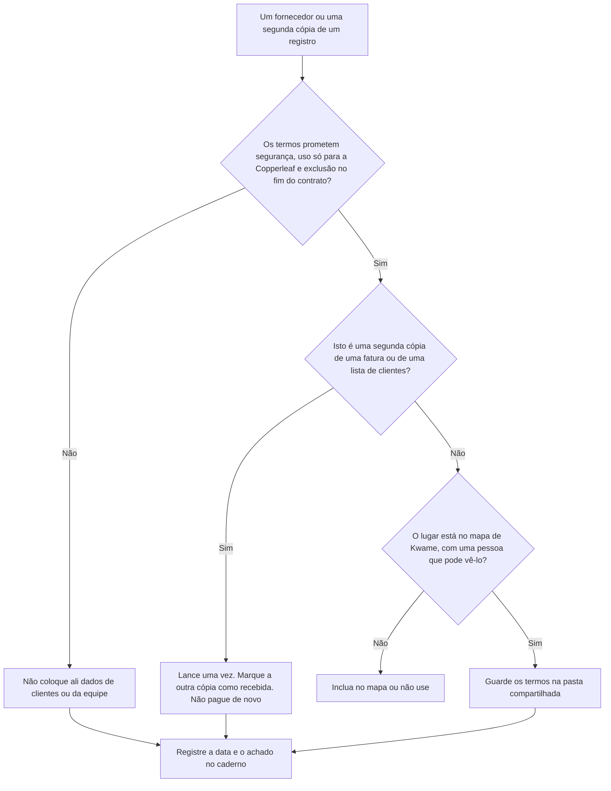

### Exemplo resolvido — um caixa mais barato que quer o boletim

Um provedor novo de caixa oferece uma taxa menor se puder escrever aos clientes da Copperleaf com ofertas próprias. Kwame recusa. Os termos usariam os dados do café para o provedor, não só para a Copperleaf. Isso falha no mesmo teste que tirou o aplicativo gratuito de mensagens. A taxa não é motivo para pular os três compromissos. Ele escreve a recusa no caderno e mantém o provedor atual.

> **Caso sintético.** A oferta do caixa mais barato é inventada.

### Aplicar

- **EX055 — Caixa mais barato.** Qual compromisso falha, e o que se escreve no caderno? *Rubrica:* 3 = o provedor usaria os dados para ofertas próprias, não só para a Copperleaf; a recusa e a data;; 2 = só o limite de uso;; 1 = vago;; 0 = nenhuma.
- **EX056 — Segunda fatura em papel.** Uma fatura enviada por e-mail já foi lançada. A cópia em papel chega com uma data um pouco diferente. O que se lança, o que se marca e o que não se paga? *Rubrica:* 3 = lançar uma vez a cópia do e-mail; marcar o papel como recebido; não pagar o papel como segunda conta;; 2 = não pagar duas vezes;; 1 = vago;; 0 = nenhuma.

### Exercícios

- **EX027 — Perguntas de qualidade.** Que três perguntas de qualidade a Sra. Fischer usa? *Rubrica:* 3 = completo, válido, exato;; 2 = todas;; 1 = algumas;; 0 = nenhuma.
- **EX028 — Pergunta acrescentada.** Que quarta pergunta Kwame acrescentou? *Rubrica:* 3 = se a mesma pessoa aparece duas vezes;; 2 = parcialmente correto;; 1 = vago;; 0 = nenhuma.
- **EX029 — Planilha esquecida.** Que arquivo esquecido estava no notebook do café? *Rubrica:* 3 = uma planilha antiga de e-mails de clientes;; 2 = parcialmente correto;; 1 = vago;; 0 = nenhuma.
- **EX030 — Condição para eliminar.** O que foi conferido antes de eliminá-la? *Rubrica:* 3 = que não continha nada necessário;; 2 = parcialmente correto;; 1 = vago;; 0 = nenhuma.
- **EX031 — Número de fornecedores.** Quantos fornecedores lidam com os dados da Copperleaf? *Rubrica:* 3 = três;; 2 = parcialmente correto;; 1 = errado;; 0 = nenhuma.
- **EX032 — Termos dos fornecedores.** Com o que os termos dos fornecedores devem se comprometer? *Rubrica:* 3 = segurança, uso só para a Copperleaf e eliminação no fim;; 2 = a maioria;; 1 = poucos;; 0 = nenhuma.
- **EX033 — Correção das mensagens.** O que mudou no aplicativo de mensagens? *Rubrica:* 3 = passou para a versão empresarial paga;; 2 = parcialmente correto;; 1 = vago;; 0 = nenhuma.
- **EX034 — Nota duplicada.** Por que o café quase pagou duas vezes? *Rubrica:* 3 = cópias por e-mail e em papel da mesma nota;; 2 = parcialmente correto;; 1 = vago;; 0 = nenhuma.
- **EX035 — Regra de lançamento.** Que cópia da nota é lançada? *Rubrica:* 3 = a cópia recebida por e-mail;; 2 = parcialmente correto;; 1 = a de papel;; 0 = nenhuma.
- **EX036 — Verificação das mensagens.** O que a verificação do grupo de mensagens confirma? *Rubrica:* 3 = que só funcionários atuais são membros;; 2 = parcialmente correto;; 1 = vago;; 0 = nenhuma.
- **EX037 — Registro das verificações.** Onde os resultados das verificações são registrados? *Rubrica:* 3 = em um caderno guardado com as regras;; 2 = parcialmente correto;; 1 = vago;; 0 = nenhuma.
- **EX038 — Tempo das verificações.** Quanto tempo leva cada verificação mensal? *Rubrica:* 3 = poucos minutos;; 2 = parcialmente correto;; 1 = errado;; 0 = nenhuma.

<!-- open-cyber-academy:chapter-navigation:start ch-03 -->
### Continue estudando — aula 03 (capítulo 03 de 20)

[← Capítulo 02](#ch-02) · [Índice das aulas](../SUBJECTS.md) · [Capítulo 04 →](#ch-04)

Continue para a próxima aula já escrita.
<!-- open-cyber-academy:chapter-navigation:end -->

<a id="ch-04"></a>

## Capítulo 4 — Laboratório guiado e plano de ação

<!-- open-cyber-academy:lesson-figures:start ch-04 -->
### Mapa da aula

Aula 04 publicada. Mapa, exemplo, EX057.

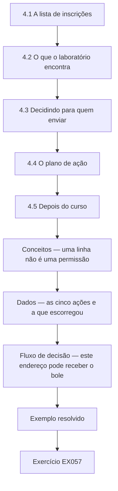

### Desenho lógico

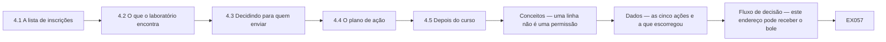

```text
[4.1 A lista de inscrições]
    |
    v
[4.2 O que o laboratório encontra]
    |
    v
[4.3 Decidindo para quem enviar]
    |
    v
[4.4 O plano de ação]
    |
    v
[4.5 Depois do curso]
    |
    v
[Conceitos — uma linha não é uma permissão]
    |
    v
[Dados — as cinco ações e a que escorregou]
    |
    v
[Fluxo de decisão — este endereço pode receber o bole]
    |
    v
[Exemplo resolvido] --> [Exercício EX057]
```
<!-- open-cyber-academy:lesson-figures:end ch-04 -->


### Objetivos de aprendizagem

Você vai (1) conferir uma lista sintética de inscrições com um script curto; (2) decidir quem pode receber o boletim; (3) escrever um plano de ação de um mês.

### 4.1 A lista de inscrições

A lista do boletim da Copperleaf foi digitada a partir das folhas de papel por funcionários diferentes. Algumas linhas têm e-mail em branco, algumas têm o mesmo endereço digitado duas vezes com maiúsculas ou espaços diferentes e algumas não têm marcação na caixa de consentimento. Kwame quer saber para quantos endereços o café pode de fato enviar e-mails. A Sra. Fischer o ajuda a escrever um script curto em Python usando só a biblioteca padrão, executado sobre uma lista sintética de doze linhas que reproduz esses problemas sem usar nenhum dado real de cliente. Kwame o executa.

```python
"""Check a synthetic cafe newsletter sign-up list: blanks, duplicates and consent ticks (stdlib only)."""
rows = [("ana@example.org", "yes"), ("Ana@Example.org ", "yes"), ("", "yes"), ("ben@example.org", ""),
        ("cai@example.org", "yes"), ("dee@example", "yes"), ("eli@example.org", "no"), ("fay@example.org", "yes"),
        ("cai@example.org", "yes"), ("gus@example.org", "yes"), ("", ""), ("hal@example.org", "yes")]
clean = [(e.strip().lower(), c) for e, c in rows]
blank = sum(1 for e, _ in clean if not e)
bad = sum(1 for e, _ in clean if e and ("@" not in e or "." not in e.split("@")[-1]))
seen, dup = set(), 0
for e, _ in clean:
    if e and e in seen: dup += 1
    seen.add(e)
ok = {e for e, c in clean if e and c == "yes" and "." in e.split("@")[-1]}
print(f"rows {len(rows)}; blank email {blank}; malformed {bad}; duplicates {dup}")
print(f"unique valid addresses with a yes tick: {len(ok)}")
```

Execute com `python3 lab_signups.py`. Saída verificada:

```text
rows 12; blank email 2; malformed 1; duplicates 2
unique valid addresses with a yes tick: 5
```

### 4.2 O que o laboratório encontra

O script remove os espaços e converte cada endereço para minúsculas antes de conferi-lo. Das doze linhas, duas têm e-mail em branco, um endereço está malformado porque não tem uma terminação adequada depois da arroba e duas linhas duplicam endereços já listados. Depois de retirados os problemas, só cinco endereços únicos e válidos têm um sim na caixa de consentimento. Kwame se surpreende: doze linhas no papel viram cinco pessoas a quem o café pode mandar e-mails com segurança. Ele mostra o resultado à Sra. Adeyemi, que esperava uma lista muito maior e pede que ele explique cada problema encontrado.

### 4.3 Decidindo para quem enviar

A Sra. Fischer explica que os e-mails de marketing exigem o consentimento do cliente, e que o café precisa conseguir demonstrá-lo; na LGPD, o consentimento deve ser livre, informado e inequívoco (art. 5º, XII), e cabe ao controlador provar que o obteve (art. 8º, § 2º). As linhas com marcação em branco ou com não ficam de fora. O endereço malformado não pode ser usado de qualquer forma. Kwame e a Sra. Adeyemi decidem enviar e-mails aos cinco endereços confirmados e convidar pessoalmente os outros clientes a assinar a nova folha, se quiserem o boletim. Ele registra a decisão e a data no caderno.

### 4.4 O plano de ação

Kwame escreve um plano de um mês com cinco ações: trocar a folha de inscrição pela versão mais curta, com uma caixa de consentimento clara e a data; executar a verificação do laboratório todo mês na lista digitada; eliminar a planilha esquecida; concluir a mudança para o aplicativo de mensagens pago; e explicar as regras na reunião seguinte da equipe. Cada ação tem um responsável e uma data. A Sra. Adeyemi o aprova, e Kwame o afixa ao lado das regras. Ele mantém o plano curto para que possa de fato ser concluído em um mês, sem competir com o trabalho do café.

### 4.5 Depois do curso

No fim do mês, Kwame revisa o andamento. Quatro ações estão concluídas; a reunião da equipe foi adiada para a semana seguinte. Ele reflete que decisões pequenas e claras mudaram mais do que esperava, e que conferir os dados com um script curto tornou o problema visível para todos. A Sra. Fischer sugere que ele continue com privacidade e proteção de dados, já que os dados de clientes e funcionários são centrais para o café. O próximo curso desta área faz exatamente isso. Kwame agradece à Sra. Fischer e se inscreve no mês seguinte, levando o caderno do curso.

### Exemplo resolvido

Kwame confere doze linhas sintéticas de inscrição e encontra dois e-mails em branco, um endereço malformado e duas duplicatas, restando cinco endereços únicos e válidos com consentimento; ele decide enviar e-mails só a esses e conclui quatro das cinco ações de seu plano de um mês.

> **Caso sintético.** A lista é sintética; as saídas vêm de lab_signups.py; o GDPR e a LGPD são reais. Isto não é aconselhamento jurídico.

### Erros e limites

Contar linhas em vez de endereços únicos, válidos e com consentimento superestima quem pode receber e-mails.

### Conceitos — uma linha não é uma permissão

O script não pergunta quantas linhas há no papel. Ele pergunta quais endereços são únicos, válidos e marcados com `yes` depois de o endereço ser aparado e posto em minúsculas. A marca em si não é posta em minúsculas. `Yes` não é `yes`.

| Resultado do laboratório em 12 linhas sintéticas | Contagem | Essa linha pode receber e-mail? |
|---|---:|---|
| E-mail em branco | 2 | Não. Não há endereço |
| Endereço malformado | 1 | Não. `dee@example` não tem um fim adequado depois de @ |
| Linhas duplicadas | 2 | A repetição não é uma segunda pessoa |
| Endereço único e válido com marca `yes` | 5 | Sim. Esta é a única lista de envio |
| Marca em branco ou `no`, inclusive `eli@example.org` | Fora dos 5 | Não. Não houve consentimento |

Doze linhas viraram cinco pessoas. Enviar às outras sete porque aparecem no papel superestima a lista. Esse é o erro deste capítulo.

### Dados — as cinco ações e a que escorregou

| Ação | Pessoa | Feita quando Kwame revisou o mês? |
|---|---|---|
| Folha curta com caixa clara de consentimento e a data | Kwame | Sim |
| Rodar esta verificação todo mês na lista digitada | Kwame | Sim |
| Apagar a planilha esquecida depois da conferência | Kwame | Sim |
| Concluir o aplicativo pago de mensagens | Sra. Adeyemi e Kwame | Sim |
| Explicar as regras na reunião da equipe | Kwame | Não. A reunião foi para a semana seguinte |

O plano continua com cinco ações. Uma data que escorrega é anotada. Ela não sai do plano para o mês parecer concluído.

### Fluxo de decisão — este endereço pode receber o boletim?

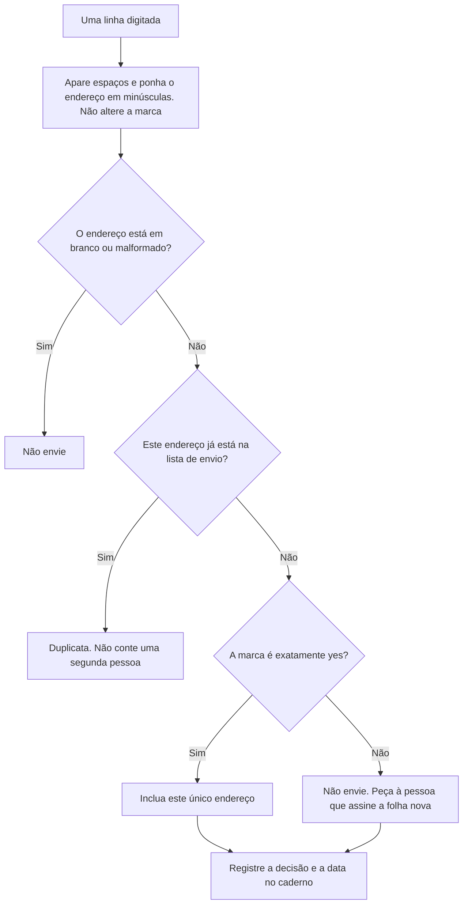

### Exemplo resolvido — um Yes maiúsculo e um habitual que marcou não

Uma linha traz `Ina@Example.org` com a marca `Yes`. O script põe o endereço em minúsculas, `ina@example.org`, que é válido, e deixa a marca como `Yes`. A regra de envio aceita só `yes`, então Ina não está entre as cinco. Kwame não "corrige" a marca no script para aumentar a contagem. Ele pede a Ina que assine a folha nova. Na mesma semana a Sra. Adeyemi quer escrever a `eli@example.org`, um habitual que marcou `no`. Kwame recusa. Ser habitual não substitui a marca. Eli pode entrar assinando a folha nova pessoalmente. As duas decisões vão para o caderno, com a data.

> **Caso sintético.** A linha de Ina e o pedido de escrever a Eli são inventados. A regra da marca é a de lab_signups.py. Isto não é aconselhamento jurídico.

### Aplicar

- **EX057 — Yes maiúsculo.** O que o script faz com `Ina@Example.org` e com a marca `Yes`, e essa linha recebe e-mail? *Rubrica:* 3 = o endereço é aparado e posto em minúsculas; a marca continua `Yes`; a linha não recebe e-mail porque só `yes` conta;; 2 = o endereço é limpo e a linha não recebe e-mail;; 1 = um desses;; 0 = nenhuma.
- **EX058 — Habitual que marcou não.** `eli@example.org` pode receber e-mail por Eli ser habitual, e o que se oferece a Eli? *Rubrica:* 3 = não; Eli pode assinar a folha nova pessoalmente; a recusa fica datada no caderno;; 2 = não, sem a folha;; 1 = sim;; 0 = nenhuma.

### Exercícios

- **EX039 — Linhas do laboratório.** Quantas linhas tem a lista sintética? *Rubrica:* 3 = doze;; 2 = parcialmente correto;; 1 = errado;; 0 = nenhuma.
- **EX040 — E-mails em branco.** Quantas linhas têm e-mail em branco? *Rubrica:* 3 = duas;; 2 = parcialmente correto;; 1 = errado;; 0 = nenhuma.
- **EX041 — Malformados.** Quantos endereços estão malformados? *Rubrica:* 3 = um;; 2 = parcialmente correto;; 1 = errado;; 0 = nenhuma.
- **EX042 — Linhas duplicadas.** Quantas linhas duplicadas o script encontra? *Rubrica:* 3 = duas;; 2 = parcialmente correto;; 1 = errado;; 0 = nenhuma.
- **EX043 — Total que pode receber.** Quantos endereços únicos e válidos têm um sim? *Rubrica:* 3 = cinco;; 2 = parcialmente correto;; 1 = errado;; 0 = nenhuma.
- **EX044 — Etapas de normalização.** O que o script faz antes de conferir cada endereço? *Rubrica:* 3 = remove espaços e converte para minúsculas;; 2 = ambos;; 1 = um;; 0 = nenhuma.
- **EX045 — Marcação em branco.** As linhas com marcação em branco recebem e-mails? *Rubrica:* 3 = não;; 2 = parcialmente correto;; 1 = sim;; 0 = nenhuma.
- **EX046 — Outros clientes.** Como os outros clientes vão entrar no boletim? *Rubrica:* 3 = assinando pessoalmente a nova folha;; 2 = parcialmente correto;; 1 = vago;; 0 = nenhuma.
- **EX047 — Ações do plano.** Quantas ações tem o plano de um mês? *Rubrica:* 3 = cinco;; 2 = parcialmente correto;; 1 = errado;; 0 = nenhuma.
- **EX048 — Itens da nova folha.** O que a nova folha inclui? *Rubrica:* 3 = uma caixa de consentimento clara e a data;; 2 = ambos;; 1 = um;; 0 = nenhuma.
- **EX049 — Ação atrasada.** Que ação atrasou? *Rubrica:* 3 = a explicação das regras na reunião da equipe;; 2 = parcialmente correto;; 1 = outra;; 0 = nenhuma.
- **EX050 — Próximo tema.** O que a Sra. Fischer sugere em seguida? *Rubrica:* 3 = privacidade e proteção de dados;; 2 = parcialmente correto;; 1 = outro;; 0 = nenhuma.

<!-- open-cyber-academy:chapter-navigation:start ch-04 -->
### Continue estudando — aula 04 (capítulo 04 de 20)

[← Capítulo 03](#ch-03) · [Índice das aulas](../SUBJECTS.md) · [Capítulo 05 em português →](#ch-05)

Continue para a nova sequência traduzida; não salte os capítulos 05–10.
<!-- open-cyber-academy:chapter-navigation:end -->

<a id="ch-05"></a>

## Capítulo 5 — Adiar uma reunião não é explicar as regras

<!-- open-cyber-academy:lesson-figures:start ch-05 -->
### Mapa da aula

Aula 05. Mapa, exemplo, EX059.

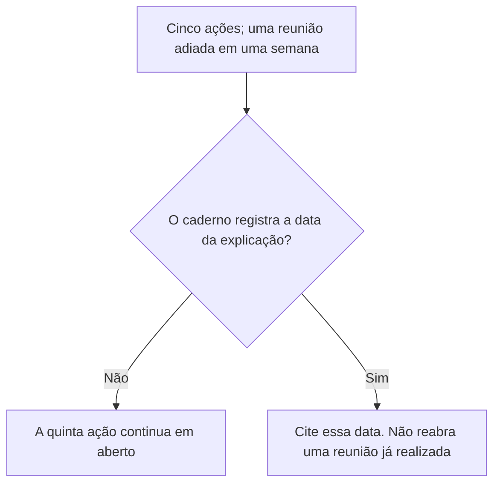

Mudar uma data registra um atraso. Não transmite a explicação.

### Desenho lógico

```text
plano afixado ao lado das regras
    quatro ações com datas de conclusão
    reunião da equipe transferida para a semana seguinte
        |
        +-- o plano continua com cinco linhas
        +-- a equipe não ouviu as regras na reunião enquanto ela não ocorreu
        +-- riscar a linha esconderia o atraso
```
<!-- open-cyber-academy:lesson-figures:end ch-05 -->

### Objetivos de aprendizagem

Depois deste capítulo, você deverá conseguir:

1. Manter a reunião da equipe no plano enquanto o caderno não registrar a data de sua realização.
2. Recusar a exclusão dessa linha para fazer o mês parecer concluído.
3. Distinguir uma alteração no calendário de uma explicação que a equipe efetivamente ouviu.

### 5.1 A quinta linha continua sendo uma linha

O Capítulo 4 encerrou o mês com quatro ações concluídas e a explicação à equipe transferida para a semana seguinte. Um colega quer reescrever o plano afixado como um plano de quatro ações, porque quatro de quatro parece completo. A alteração apagaria o atraso que a Sra. Adeyemi consegue ver. Kwame mantém a quinta linha onde está. Quando a reunião acontecer, sua data será registrada no caderno ao lado das regras. Enquanto essa data não existir, os funcionários que não estavam na sala quando ele redigiu a página ainda não receberam, em grupo, a apresentação das regras.

### 5.2 Exemplo resolvido

| O que alguém aponta | O que isso mostra | Decisão |
|---|---|---|
| "A reunião foi transferida." | Uma nova semana pretendida | A ação continua em aberto |
| "Quatro ações estão marcadas como concluídas." | Essas quatro têm datas | Não renomeie o plano como um plano de quatro ações |
| "A equipe já trabalha aqui, então sabe." | Estar presente não é participar da reunião | Aguarde a explicação com data registrada |
| Uma linha no caderno com a data da reunião | A explicação aconteceu | Cite essa linha |

> **Caso sintético.** Esta aula não inventa a data da reunião. O atraso continua sendo o registrado no Capítulo 4.

### Erros e limites

Realizar a reunião mais tarde não altera as regras assinadas. O que a reunião pode decidir é assunto de uma aula posterior. Este capítulo também não estabelece um prazo legal para treinamento.

### Aplicar

- **EX059 — Quatro de cinco.** O plano afixado mostra quatro ações datadas e uma reunião da equipe transferida para a semana seguinte. Nenhuma linha no caderno registra a data da explicação. O plano pode ser reescrito como um plano de quatro ações? O que continua inacabado? *Rubrica:* 3 = não retirar a quinta linha; a explicação continua inacabada até que o caderno registre sua data; transferir a semana não é registrar essa data; 2 = manter a linha e recusar a reescrita; 1 = um desses elementos; 0 = nenhum.

<!-- open-cyber-academy:chapter-navigation:start ch-05 -->
### Continue estudando — aula 05 (capítulo 05 de 20 na referência inglesa)

[← Capítulo 04](#ch-04) · [Índice das aulas](../SUBJECTS.md) · [Capítulo 06 →](#ch-06)

Continue para a próxima aula traduzida.
<!-- open-cyber-academy:chapter-navigation:end -->

<a id="ch-06"></a>

## Capítulo 6 — Remover uma duplicata não é fazer uma nova contagem completa

<!-- open-cyber-academy:lesson-figures:start ch-06 -->
### Mapa da aula

Aula 06. Mapa, exemplo, EX060.

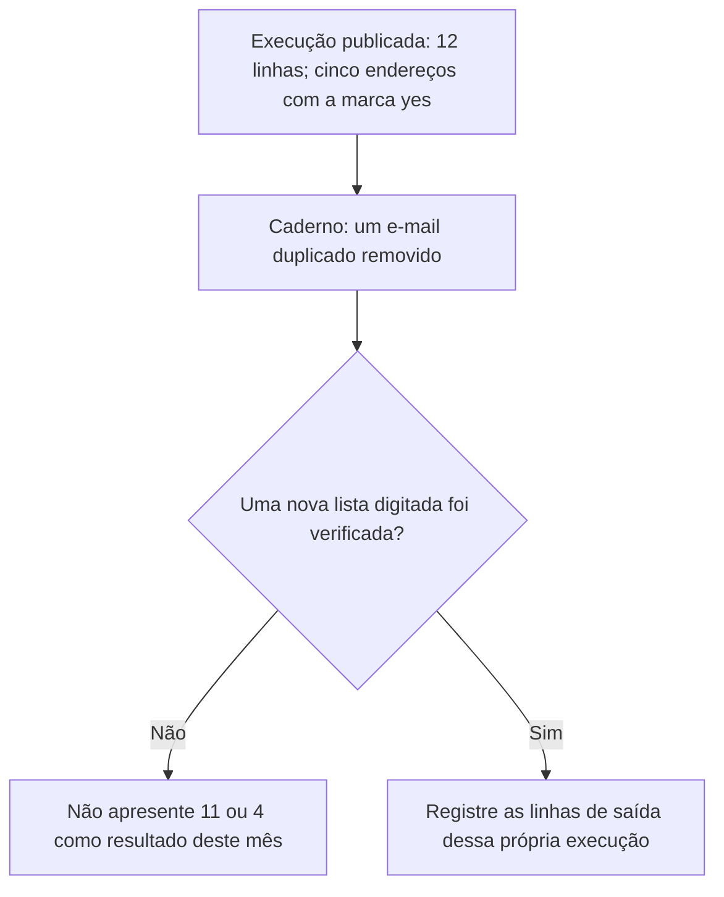

Um achado no caderno não é uma segunda execução do script.

### Desenho lógico

```text
lab_signups.py sobre o arquivo sintético de doze linhas
    rows 12; blank email 2; malformed 1; duplicates 2
    unique valid addresses with a yes tick: 5
caderno do primeiro mês
    um e-mail duplicado removido
        |
        +-- a remoção é um achado, não uma nova execução
        +-- 12 menos 1 é aritmética, não uma medição
        +-- o script não é alterado para forçar uma nova saída
```
<!-- open-cyber-academy:lesson-figures:end ch-06 -->

### Objetivos de aprendizagem

Depois deste capítulo, você deverá conseguir:

1. Manter a saída publicada de doze linhas como a única contagem verificada daquele arquivo.
2. Rejeitar 11 linhas ou 4 endereços aptos ao envio quando ninguém repetiu a verificação.
3. Deixar o programa e suas linhas de saída inalterados.

### 6.1 O caderno e o script respondem a perguntas diferentes

O caderno do primeiro mês diz que um e-mail duplicado foi removido. Essa frase registra uma verificação. A saída do script descreve o arquivo sintético de doze linhas, antes de qualquer subtração. Um colega escreve "lista de envio deste mês: 4" porque uma duplicata saiu da lista do café. Os cinco eram endereços únicos com a marca exata `yes`. Remover uma duplicata não remove, por si só, um desses cinco endereços, nem reduz o arquivo de doze linhas. Qualquer um desses efeitos teria de ser contado sobre uma nova exportação. Kwame não digita 4 ou 11 no caderno como se o programa tivesse produzido esses números.

### 6.2 Exemplo resolvido

| Afirmação | O que efetivamente foi feito | Decisão |
|---|---|---|
| "Uma duplicata foi retirada da lista de trabalho." | O caderno registra isso | Mantenha como um achado |
| "Então o arquivo agora tem 11 linhas." | Nenhuma nova execução | Recuse o número |
| "Então só quatro pessoas podem receber e-mail." | Os cinco endereços já eram únicos | Recuse. A unicidade já estava considerada na saída |
| "Altere as marcações para a próxima saída ficar mais organizada." | O script conta o arquivo que recebe | Recuse a alteração |

> **Caso sintético.** As linhas `rows 12` e `unique valid addresses with a yes tick: 5` continuam sendo a saída publicada.

### Erros e limites

Um mês posterior pode apresentar outras contagens. Elas só existem depois que a lista daquele mês é verificada. Este capítulo não realiza essa verificação.

### Aplicar

- **EX060 — Não subtraia o caderno.** Alguém escreve "neste mês: 11 linhas e 4 endereços com a marca yes" porque uma duplicata foi removida. O que há de errado nos dois números? Qual saída continua sendo a verificada? *Rubrica:* 3 = nem 11 nem 4 foram contados; a saída verificada continua sendo 12 linhas e 5 endereços com a marca yes; não alterar o script; 2 = rejeitar os dois números e manter a saída publicada; 1 = rejeitar um dos números; 0 = nenhum.

<!-- open-cyber-academy:chapter-navigation:start ch-06 -->
### Continue estudando — aula 06 (capítulo 06 de 20 na referência inglesa)

[← Capítulo 05](#ch-05) · [Índice das aulas](../SUBJECTS.md) · [Capítulo 07 →](#ch-07)

Continue para a próxima aula traduzida.
<!-- open-cyber-academy:chapter-navigation:end -->

<a id="ch-07"></a>

## Capítulo 7 — A saída de alguém no mês passado não encerra a verificação deste mês

<!-- open-cyber-academy:lesson-figures:start ch-07 -->
### Mapa da aula

Aula 07. Mapa, exemplo, EX061.

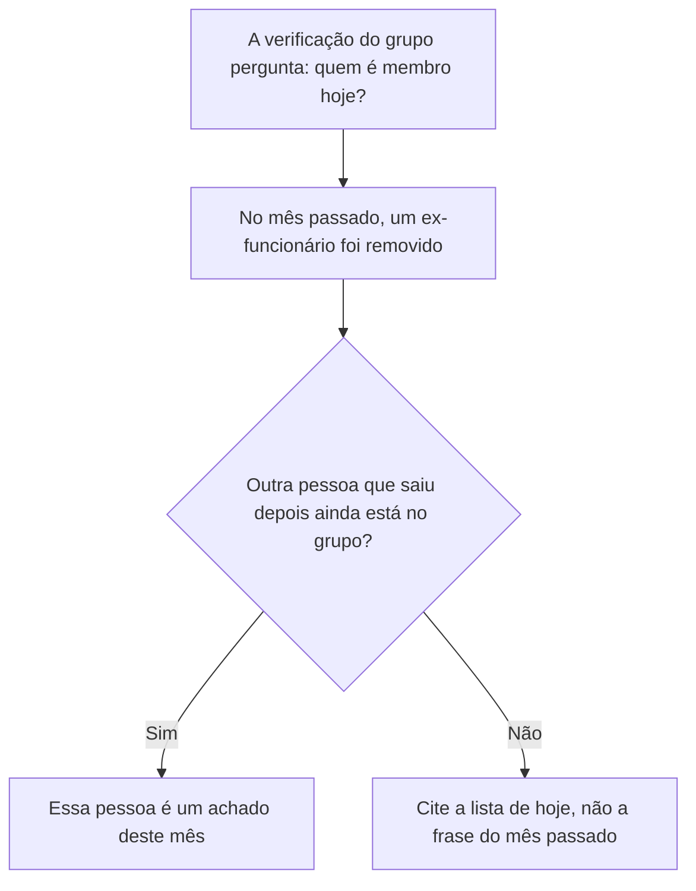

Uma remoção anterior comprova o que aconteceu no mês passado. A composição do grupo é consultada novamente.

### Desenho lógico

```text
verificação mensal: somente funcionários atuais no grupo pago
primeiro mês: um ex-integrante removido, com data
outra pessoa encerra seu trabalho depois
    |
    +-- a frase do mês passado não se refere a essa pessoa
    +-- "já limpamos o grupo" não é uma nova consulta
    +-- a pessoa continua sendo um achado até que a remoção seja datada
```
<!-- open-cyber-academy:lesson-figures:end ch-07 -->

### Objetivos de aprendizagem

Depois deste capítulo, você deverá conseguir:

1. Tratar a verificação mensal de membros como uma consulta à composição atual do grupo.
2. Recusar o encerramento dessa verificação com base em uma remoção anterior.
3. Registrar a permanência de outra pessoa que saiu como pendência até que a própria remoção receba uma data.

### 7.1 A pergunta é quem está no grupo agora

O caderno do primeiro mês registra a retirada de um ex-funcionário do grupo pago de mensagens. Essa linha é evidência sobre aquela pessoa e aquela data. A verificação definida por Kwame é mais delimitada e se repete: as pessoas do grupo são funcionários atuais? Um colega diz que o grupo pode ser ignorado neste mês porque já foi limpo uma vez. Ignorá-lo deixaria passar quem saiu depois daquela data. Kwame abre a lista de membros. Se uma pessoa cujo último dia de trabalho já passou continua ali, o achado é sua permanência no grupo, e a remoção é registrada com a data. Ele não acrescenta um nome pessoal que o caso não fornece.

### 7.2 Exemplo resolvido

| Motivo apresentado para pular a verificação | O que o caderno contém | Decisão |
|---|---|---|
| "Removemos alguém no mês passado." | Uma remoção datada | Consulte novamente |
| "O aplicativo pago é uma versão empresarial, então quem sai perde o acesso automaticamente." | Nenhuma expiração desse tipo está registrada | Não presuma isso |
| Um funcionário atual identificado | A pessoa ainda trabalha no café | Pode permanecer |
| Uma pessoa que saiu ainda aparece na lista, sem data de remoção | É a pergunta da verificação | Remova e registre a data |

> **Caso sintético.** A pessoa que saiu depois não tem nome informado. Não invente um nome.

### Erros e limites

Remover um membro não apaga sua escala antiga nem determina o prazo de guarda dos registros trabalhistas. Esse prazo continua dependendo da informação do contador, que o Capítulo 11 mantém em branco até que seja registrada.

### Aplicar

- **EX061 — De qual mês é a remoção?** O caderno do mês passado registra a data da remoção de um ex-integrante. Neste mês, o último dia de trabalho de outra pessoa já passou, e o grupo ainda a lista. Qual é o achado? Qual frase anterior não o encerra? *Rubrica:* 3 = a pessoa ainda é membro; removê-la e registrar a data; a remoção do mês passado não cobre essa pessoa; 2 = remover, datar e rejeitar a frase anterior como evidência de resolução; 1 = um desses elementos; 0 = nenhum.

<!-- open-cyber-academy:chapter-navigation:start ch-07 -->
### Continue estudando — aula 07 (capítulo 07 de 20 na referência inglesa)

[← Capítulo 06](#ch-06) · [Índice das aulas](../SUBJECTS.md) · [Capítulo 08 →](#ch-08)

Continue para a próxima aula traduzida.
<!-- open-cyber-academy:chapter-navigation:end -->

<a id="ch-08"></a>

## Capítulo 8 — Um cancelamento de inscrição gera uma nova linha

<!-- open-cyber-academy:lesson-figures:start ch-08 -->
### Mapa da aula

Aula 08. Mapa, exemplo, EX062.

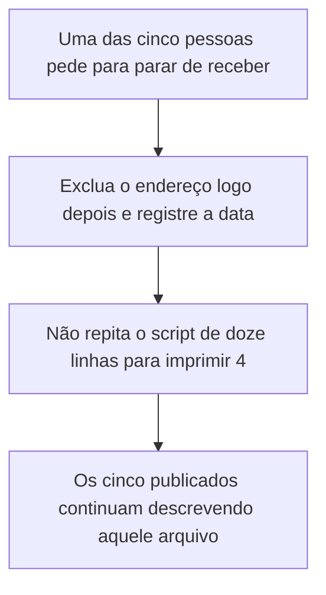

A regra de guarda e o arquivo do laboratório são objetos diferentes.

### Desenho lógico

```text
regra: o endereço do boletim é guardado enquanto a inscrição permanece ativa
    excluído logo depois do cancelamento
arquivo sintético: cinco endereços com a marca yes
um desses endereços pede posteriormente para parar de receber
    |
    +-- o pedido é um novo evento
    +-- o script não é alterado, e 5 não é reescrito como 4
    +-- o caderno registra a data da exclusão
```
<!-- open-cyber-academy:lesson-figures:end ch-08 -->

### Objetivos de aprendizagem

Depois deste capítulo, você deverá conseguir:

1. Aplicar a regra de cancelamento a um endereço sem alterar a saída publicada do laboratório.
2. Recusar "5 menos 1" como uma nova lista de envio medida.
3. Registrar a data da exclusão no caderno.

### 8.1 Os cinco descrevem um arquivo. Um pedido para parar descreve uma pessoa.

A saída do laboratório diz que cinco endereços únicos e válidos têm a marca `yes` naquele arquivo sintético. A regra de guarda diz que um endereço permanece enquanto a pessoa está inscrita e é excluído logo depois que ela cancela a inscrição. As duas frases podem ser verdadeiras ao mesmo tempo. Se uma dessas cinco pessoas pedir posteriormente para parar de receber, Kwame exclui o endereço da lista de envio em uso e escreve a data. Ele não abre `lab_signups.py` nem altera o arquivo para que a saída histórica passe a dizer 4. A saída histórica continua descrevendo o arquivo que ele executou. A exclusão descreve o que aconteceu depois.

### 8.2 Exemplo resolvido

| Proposta | Objeto que ela modifica | Decisão |
|---|---|---|
| Excluir o endereço e datar o registro no caderno | A lista de trabalho, depois de um pedido efetivo para parar | Aceite |
| Alterar a saída do script de 5 para 4 | O registro do arquivo anterior | Recuse |
| Continuar enviando porque o laboratório contou essa pessoa uma vez | Um arquivo que não continha esse pedido para parar | Recuse |
| Esperar até a revisão do próximo ano | A regra diz logo depois | Exclua e registre a data |

> **Caso sintético.** Nenhum endereço novo é acrescentado ao arquivo de doze linhas. Não invente qual dos cinco cancelou a inscrição.

### Erros e limites

Excluir um endereço não responde se os outros quatro ainda têm uma marca `yes` em uma folha posterior. Uma folha posterior exige uma verificação posterior. Isso não é uma afirmação do que o GDPR exige em todas as organizações.

### Aplicar

- **EX062 — Cinco ou quatro?** Um endereço da lista de envio cancela a inscrição. Um colega altera a nota do laboratório para que ela diga "unique valid addresses with a yes tick: 4". O que é excluído? O que recebe uma data? Qual saída permanece? *Rubrica:* 3 = excluir o endereço da lista de trabalho e datar o caderno; manter a saída publicada em 5; não alterar o script para forçar 4; 2 = excluir e manter os 5 publicados; 1 = um desses elementos; 0 = nenhum.

<!-- open-cyber-academy:chapter-navigation:start ch-08 -->
### Continue estudando — aula 08 (capítulo 08 de 20 na referência inglesa)

[← Capítulo 07](#ch-07) · [Índice das aulas](../SUBJECTS.md) · [Capítulo 09 →](#ch-09)

Continue para a próxima aula traduzida.
<!-- open-cyber-academy:chapter-navigation:end -->

<a id="ch-09"></a>

## Capítulo 9 — Uma pasta trancada não substitui a revisão semestral

<!-- open-cyber-academy:lesson-figures:start ch-09 -->
### Mapa da aula

Aula 09. Mapa, exemplo, EX063.

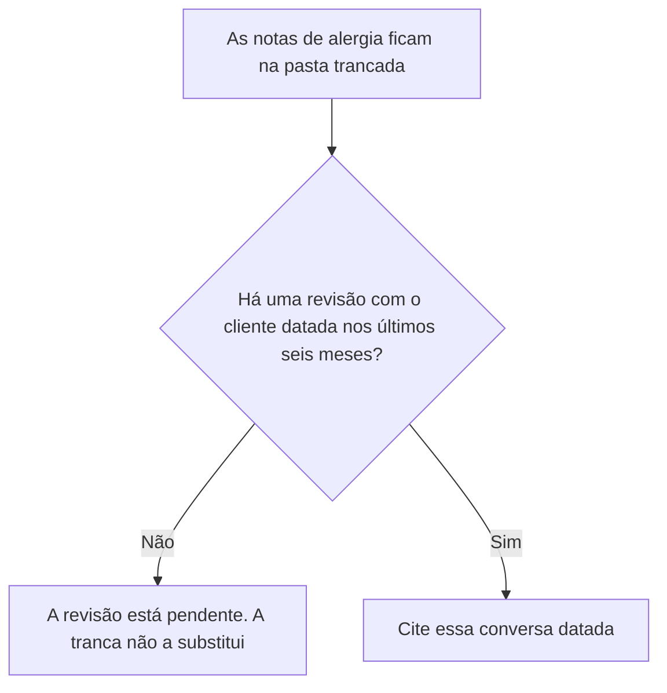

A pasta responde quem pode ver a nota. A revisão responde se ela continua correta.

### Desenho lógico

```text
regra: notas de alergia trancadas, mostradas apenas a quem prepara aquele pedido
prazo: revisão com o cliente a cada seis meses
a pasta continua trancada
    |
    +-- uma tranca não é uma conversa
    +-- "sempre tivemos esta nota" não é uma data
    +-- nenhum nome de cliente é inventado para preencher a lacuna
```
<!-- open-cyber-academy:lesson-figures:end ch-09 -->

### Objetivos de aprendizagem

Depois deste capítulo, você deverá conseguir:

1. Distinguir a pasta trancada da revisão semestral com o cliente.
2. Tratar a ausência de uma data de revisão como uma verificação em aberto.
3. Recusar a invenção de um nome de cliente ou de uma alergia para encerrar a linha.

### 9.1 Dois controles, uma pasta

Notas de alergia são informações de saúde. Elas ficam em uma pasta trancada e são mostradas apenas aos funcionários que preparam o pedido daquele cliente. Separadamente, a regra de guarda de Kwame determina que as notas sejam revistas com o cliente a cada seis meses. Um colega aponta para a tranca e diz que, por isso, a revisão está concluída. A tranca limita quem pode ler. Ela não pergunta ao cliente se a nota continua correta. Se o caderno não tiver uma data de revisão dentro dos seis meses, a revisão continua em aberto. Kwame escreve que a verificação está pendente. Ele não digita o nome de um cliente nem de um alimento para preencher a lacuna.

### 9.2 Exemplo resolvido

| Evidência apresentada | O que ela comprova | Decisão |
|---|---|---|
| A pasta está trancada | Controle de acesso | Não é a revisão |
| "A nota está ali há anos." | Idade, sem uma conversa | A revisão continua em aberto |
| Uma linha no caderno: revisto com o cliente, com data desta estação do ano | O ato previsto na regra | Cite a linha |
| "Escreva 'sem castanhas' para a página parecer completa." | Uma alergia inventada | Recuse |

> **Caso sintético.** Esta aula não acrescenta uma alergia nem um cliente.

### Erros e limites

Uma revisão em aberto não significa que a nota deva ser lida em voz alta no balcão. O acesso continua restrito a quem prepara aquele pedido. Este capítulo não é aconselhamento médico nem uma descrição completa dos deveres relativos a dados de categoria especial. O curso de privacidade é o próximo curso para estudar esses deveres.

### Aplicar

- **EX063 — Tranca ou conversa?** A pasta de alergias está trancada. O caderno não tem registro de revisão com um cliente nos últimos seis meses. Um colega diz que a tranca cumpre a regra de guarda e se oferece para digitar uma alergia, para que a linha pareça concluída. O que você aceita e o que recusa? *Rubrica:* 3 = a revisão continua em aberto; a tranca não é a conversa; não inventar uma alergia nem um nome de cliente; 2 = manter a revisão em aberto e recusar a invenção; 1 = um desses elementos; 0 = nenhum.

<!-- open-cyber-academy:chapter-navigation:start ch-09 -->
### Continue estudando — aula 09 (capítulo 09 de 20 na referência inglesa)

[← Capítulo 08](#ch-08) · [Índice das aulas](../SUBJECTS.md) · [Capítulo 10 →](#ch-10)

Continue para a próxima aula traduzida.
<!-- open-cyber-academy:chapter-navigation:end -->

<a id="ch-10"></a>

## Capítulo 10 — Gostar de uma foto não é concordar com um uso mais longo

<!-- open-cyber-academy:lesson-figures:start ch-10 -->
### Mapa da aula

Aula 10. Mapa, exemplo, EX064.

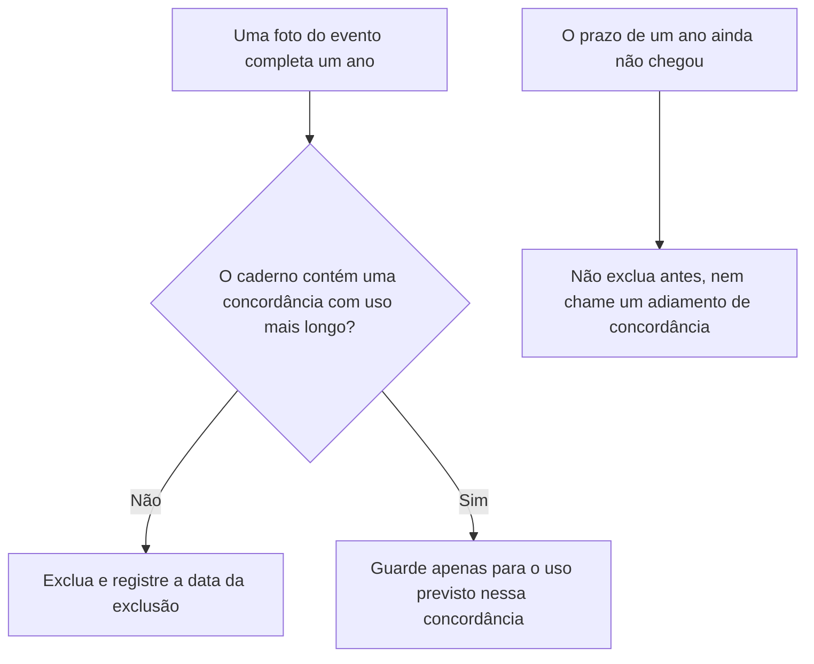

Gostar de uma imagem não prolonga o prazo.

### Desenho lógico

```text
padrão: fotos de eventos excluídas após um ano
exceção: as pessoas concordaram com um uso mais longo
uma foto que a equipe quer manter na parede
    |
    +-- "é uma foto bonita" não é a exceção
    +-- nenhuma concordância é inventada aqui
    +-- antes de completar um ano, aguardar não é prolongar o prazo
```
<!-- open-cyber-academy:lesson-figures:end ch-10 -->

### Objetivos de aprendizagem

Depois deste capítulo, você deverá conseguir:

1. Aplicar o prazo padrão de um ano quando não houver concordância com uso mais longo no caderno.
2. Recusar uma preferência estética ou a vontade de decidir depois como se fossem essa concordância.
3. Manter sem exclusão uma foto que ainda não completou um ano, sem chamar essa espera de prorrogação.

### 10.1 A exceção precisa estar registrada

Fotos de eventos são excluídas depois de um ano, salvo quando as pessoas concordaram com um uso mais longo. A Sra. Adeyemi gosta de uma fotografia e quer deixá-la exposta "até decidirmos". Decidir mais tarde não é uma concordância já obtida. Se a foto completou um ano e o caderno não tem uma linha sobre uso mais longo, Kwame a exclui e registra a data da exclusão. Se ainda não completou um ano, ele não a exclui para parecer rigoroso nem escreve um prazo maior na margem. O padrão continua sendo um ano. Esta aula não cria a concordância nem escolhe uma data de calendário para o evento.

### 10.2 Exemplo resolvido

| Situação | Concordância no caderno | Decisão |
|---|---|---|
| Um ano completo, sem linha sobre uso mais longo | Ausente | Exclua e registre a data |
| "É a melhor foto da noite." | Ausente | Ainda assim, exclua quando completar um ano |
| "Deixe até decidirmos." | Ausente | Essa frase não autoriza uso mais longo |
| Ainda não completou um ano | Ausente | Guarde até completar o ano. Não altere o prazo declarado |

> **Caso sintético.** Ninguém na fotografia é identificado pelo nome.

### Erros e limites

Excluir uma foto não estabelece um novo prazo para o evento seguinte. Cada evento mantém o padrão de um ano, salvo quando sua própria concordância é registrada. Isso não é um parecer completo sobre direitos de imagem.

### Aplicar

- **EX064 — Qual frase prolonga o ano?** Uma foto completou um ano. A equipe quer guardá-la porque ficou bonita, e a Sra. Adeyemi diz "até decidirmos". O caderno não contém concordância com uso mais longo. O que acontece com a foto? Qual frase não prolonga o prazo de um ano? *Rubrica:* 3 = excluir a foto e registrar a data; nem a preferência estética nem "até decidirmos" constituem a concordância; não inventar uma concordância; 2 = excluir e rejeitar as duas frases; 1 = um desses elementos; 0 = nenhum.

<!-- open-cyber-academy:chapter-navigation:start ch-10 -->
### Continue estudando — aula 10 (capítulo 10 de 20 na referência inglesa)

[← Capítulo 09](#ch-09) · [Índice das aulas](../SUBJECTS.md) · [Capítulo 11 em português →](#ch-11)

Continue para a sequência traduzida dos capítulos 11–20, com respostas no apêndice deste mesmo livro.
<!-- open-cyber-academy:chapter-navigation:end -->

<a id="ch-11"></a>

## Capítulo 11 — Um prazo em branco não é uma data para destruir documentos

<!-- open-cyber-academy:lesson-figures:start ch-11 -->
### Mapa da aula

Aula 11. Mapa, exemplo, EX065.

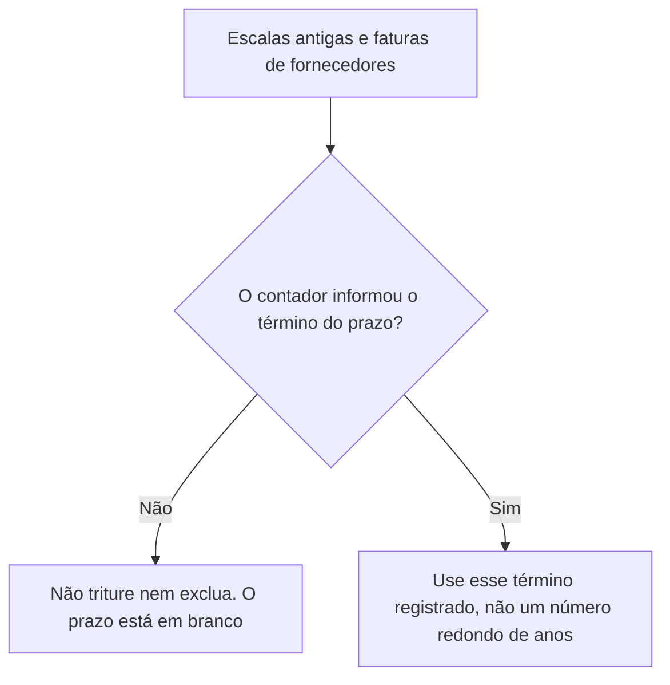

Kwame não inventa o prazo fiscal nem o prazo de guarda dos registros trabalhistas.

### Desenho lógico

```text
regras já escritas
    faturas de fornecedores ficam até o contador informar o término da guarda fiscal
    escalas antigas ficam pelo prazo trabalhista que o contador confirmar
caderno
    esses términos continuam sem definição
        |
        +-- "um ano parece suficiente" não é a informação do contador
        +-- a Sra. Adeyemi é quem consulta o contador
        +-- esta aula não escreve um número de anos
```
<!-- open-cyber-academy:lesson-figures:end ch-11 -->

### Objetivos de aprendizagem

Depois deste capítulo, você deverá conseguir:

1. Manter as faturas de fornecedores e as escalas antigas enquanto as datas de término informadas pelo contador estiverem em branco.
2. Recusar um prazo inventado, como "cerca de um ano".
3. Identificar a consulta da Sra. Adeyemi ao contador como o meio de preencher a lacuna.

### 11.1 O café já havia recusado o palpite

O Capítulo 2 estabeleceu dois prazos que Kwame não inventa. As faturas de fornecedores ficam guardadas até que o contador informe o término da retenção fiscal; só então são trituradas. As escalas antigas ficam pelo prazo de guarda dos registros trabalhistas confirmado pelo contador. Um colega encontra uma pasta volumosa e quer triturar seu conteúdo porque um ano "parece muito tempo". Uma impressão não é a informação exigida pela regra. Enquanto as palavras do contador não estiverem no caderno, o término continua em branco e os documentos ficam guardados. A Sra. Adeyemi é a proprietária que confere esses prazos. Kwame pode lembrá-la disso. Ele não pode preencher a lacuna com um número.

### 11.2 Exemplo resolvido

| Proposta | Origem da data | Decisão |
|---|---|---|
| Triturar faturas de fornecedores com mais de um ano | A impressão de Kwame sobre o que é "muito tempo" | Recuse. O término não foi informado |
| Excluir escalas antigas para liberar espaço na gaveta | O mesmo palpite | Recuse |
| A Sra. Adeyemi registra o término informado pelo contador | A pessoa indicada pela regra | Então, e somente então, esse término se aplica |
| Copiar um prazo do cartaz de outro café | Não é o contador da Copperleaf | Recuse |

> **Caso sintético.** Nenhuma quantidade de anos é fornecida. Não acrescente uma.

### Erros e limites

Uma lacuna não autoriza guardar os documentos para sempre sem consultar ninguém. Ela impede a destruição até que a pessoa indicada informe o término. O curso de privacidade pode discutir deveres legais. Este capítulo não estabelece um prazo fiscal nem apresenta uma norma trabalhista.

### Aplicar

- **EX065 — Quem pode informar o término?** A gaveta de faturas está cheia. O caderno ainda não contém uma data informada pelo contador para as faturas de fornecedores ou para as escalas antigas. Um colega diz: "triture tudo que tiver mais de um ano". O que você recusa? A informação de quem pode preencher a lacuna? *Rubrica:* 3 = recusar o palpite de um ano; os documentos ficam guardados enquanto os términos estiverem em branco; a consulta da Sra. Adeyemi ao contador é o que pode definir esses términos; 2 = recusar o palpite e identificar a consulta ao contador; 1 = um desses elementos; 0 = nenhum.

[Resolução de EX065 no apêndice](#answer-ex065).

<!-- open-cyber-academy:chapter-navigation:start ch-11 -->
### Continue estudando — aula 11 (capítulo 11 de 20)

[← Capítulo 10](#ch-10) · [Índice das aulas](../SUBJECTS.md) · [Capítulo 12 →](#ch-12)

Continue para a próxima aula traduzida.
<!-- open-cyber-academy:chapter-navigation:end -->

<a id="ch-12"></a>

## Capítulo 12 — O segundo café precisa da mesma página

<!-- open-cyber-academy:lesson-figures:start ch-12 -->
### Mapa da aula

Aula 12. Mapa, exemplo, EX066.

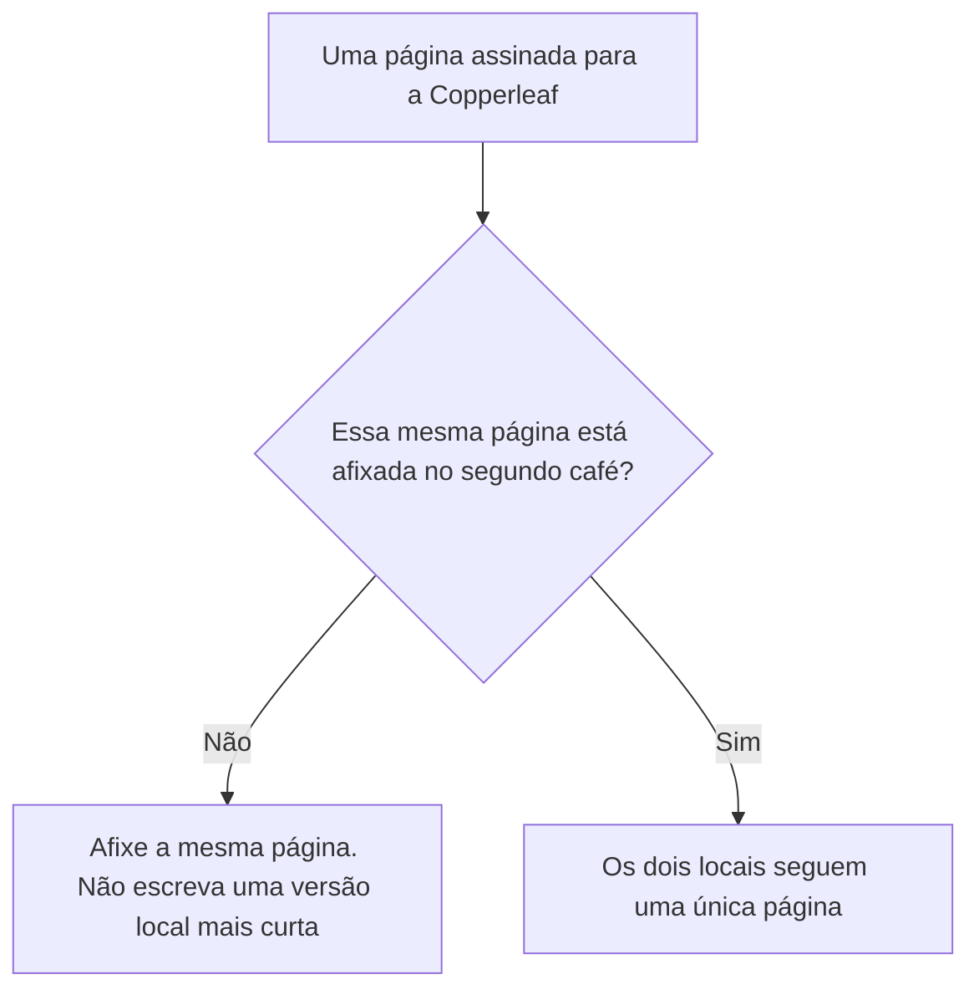

Dois prédios não justificam dois conjuntos de regras.

### Desenho lógico

```text
Copperleaf: dois cafés, doze funcionários, uma proprietária
regras assinadas pela Sra. Adeyemi e afixadas em uma sala da equipe
segundo café
    |
    +-- afixar em um local não é afixar no outro
    +-- uma página "local" mais curta dividiria as decisões
    +-- regras de alergias, escalas e inscrições seguem na mesma página
```
<!-- open-cyber-academy:lesson-figures:end ch-12 -->

### Objetivos de aprendizagem

Depois deste capítulo, você deverá conseguir:

1. Tratar a página assinada como a regra dos dois cafés.
2. Recusar uma página mais curta escrita somente para o segundo local.
3. Impedir que a afixação em um local seja apresentada como afixação no outro.

### 12.1 A responsabilidade abrange o negócio, não a sala

A Sra. Adeyemi responde por todos os dados da Copperleaf, e as três primeiras decisões foram escritas uma única vez. O Capítulo 2 afixou essa página na sala da equipe. A Copperleaf tem dois cafés. Uma página em uma parede não coloca as regras diante dos funcionários que trabalham no outro local. O subgerente sugere uma nota mais curta para o segundo café, "só com as partes de que eles precisam". Uma nota mais curta permitiria que esse local se desviasse: um campo de aniversário, uma mensagem privada, uma fotografia em um celular. Kwame afixa a mesma página assinada no segundo café. Ele não escreve uma segunda política. Esta aula não afirma que a segunda afixação já recebeu uma data. Ela estabelece o que deve ser afixado.

### 12.2 Exemplo resolvido

| Proposta para o segundo local | Relação com a página assinada | Decisão |
|---|---|---|
| Afixar uma cópia da mesma página | Um único conjunto de regras | Aceite |
| "Eles já ouviram falar disso no outro local." | Ouvir não é ter a página afixada | Afixe a página |
| Meia página que omite a regra sobre alergias | Uma regra diferente | Recuse |
| Uma linha local de aniversário, "só neste café" | A regra da folha vale para todo o negócio | Recuse |

> **Caso sintético.** A equipe não é dividida em uma contagem de funcionários por café. Doze continua sendo o total do negócio.

### Erros e limites

Afixar a página não realiza, por si só, a reunião da equipe do Capítulo 5. A reunião continua sendo uma linha própria. Duas afixações também não criam um terceiro café.

### Aplicar

- **EX066 — Uma página ou duas?** As regras assinadas estão afixadas em um café. O segundo café não tem a página afixada. O subgerente redige uma nota mais curta que omite as anotações de alergia. O que é afixado? O que é recusado? *Rubrica:* 3 = afixar a mesma página assinada no segundo café; recusar a nota mais curta; a afixação em um local não cobre o outro; 2 = usar a mesma página e recusar a nota mais curta; 1 = um desses elementos; 0 = nenhum.

[Resolução de EX066 no apêndice](#answer-ex066).

<!-- open-cyber-academy:chapter-navigation:start ch-12 -->
### Continue estudando — aula 12 (capítulo 12 de 20)

[← Capítulo 11](#ch-11) · [Índice das aulas](../SUBJECTS.md) · [Capítulo 13 →](#ch-13)

Continue para a próxima aula traduzida.
<!-- open-cyber-academy:chapter-navigation:end -->

<a id="ch-13"></a>

## Capítulo 13 — Um turno movimentado não restabelece o código compartilhado

<!-- open-cyber-academy:lesson-figures:start ch-13 -->
### Mapa da aula

Aula 13. Mapa, exemplo, EX067.

```mermaid
flowchart TD
  B["Fila de sábado no segundo café"] --> C["Alguém pede o antigo código compartilhado do caixa"]
  C --> R["Recuse. Os logins separados continuam valendo"]
  R --> L["Bloqueie a tela ao se afastar, também neste turno"]
```

O hábito foi estabelecido para os momentos movimentados, não para os tranquilos.

### Desenho lógico

```text
hábito já estabelecido
    logins separados no caixa, não um código compartilhado
    bloquear a tela ao se afastar
sábado, segundo café, fila até a porta
    |
    +-- "só neste turno" é a exceção que o hábito proíbe
    +-- um login emprestado atribui vendas à pessoa errada
    +-- esta aula não fornece um novo login na hora
```
<!-- open-cyber-academy:lesson-figures:end ch-13 -->

### Objetivos de aprendizagem

Depois deste capítulo, você deverá conseguir:

1. Recusar o retorno ao código compartilhado do caixa por um único turno.
2. Manter o bloqueio de tela em vigor mesmo com uma fila.
3. Aguardar um login próprio para a pessoa, sem substituí-lo por um emprestado.

### 13.1 A fila é a situação para a qual o hábito foi criado

Kwame substituiu o código compartilhado do caixa por logins separados e orientou a equipe a bloquear a tela quando se afastasse. Em um sábado, a fila do segundo café chega à porta. Um colega pede o código antigo "só até acabar o movimento", porque localizar um login pessoal parece demorado. É no movimento intenso que uma sessão emprestada causa mais dano: um cancelamento de venda, um reembolso ou um relatório de cartões ficaria sob o nome de outra pessoa. Kwame recusa o código antigo. Uma pessoa que ainda não tem login não herda o de um colega. Criar um login é uma etapa separada, não um pedido gritado de um lado do balcão para o outro. Esta aula não cria esse login.

### 13.2 Exemplo resolvido

| Pedido durante a fila | O que o registro mostraria | Decisão |
|---|---|---|
| "Use o antigo código compartilhado por uma hora." | Um código, várias pessoas | Recuse |
| "Vou terminar este pedido na tela que a outra pessoa deixou aberta." | Vendas sob o login de outra pessoa | Recuse a tela emprestada |
| Bloquear a tela e depois desbloquear o próprio login | O hábito, também em um sábado movimentado | Aceite |
| "Crie um login pessoal para mim depois do movimento." | Uma conta posterior, não esta venda | Isso fica para depois. Esta aula não fornece o login |

> **Caso sintético.** O colega do segundo café não tem nome informado. O exemplo recusa uma tela emprestada e não acrescenta ninguém ao cadastro da equipe.

### Erros e limites

Uma recusa no balcão não abre uma conta. Um login pessoal ainda precisa da concordância da proprietária e de uma linha no caderno antes que a pessoa opere o caixa sozinha. Este capítulo também não divide os doze funcionários entre os dois cafés.

### Aplicar

- **EX067 — Só neste turno.** É sábado no segundo café, e a fila chega à porta. Um colega pede o antigo código compartilhado do caixa "até acabar o movimento" e também pede para terminar um pedido na tela que outra pessoa deixou desbloqueada. O que você recusa? O que não é criado aqui? *Rubrica:* 3 = recusar o código compartilhado antigo e a tela desbloqueada emprestada; um novo login pessoal não é criado de um lado do balcão para o outro; 2 = recusar os dois pedidos e não fornecer um login na hora; 1 = um desses elementos; 0 = nenhum.

[Resolução de EX067 no apêndice](#answer-ex067).

<!-- open-cyber-academy:chapter-navigation:start ch-13 -->
### Continue estudando — aula 13 (capítulo 13 de 20)

[← Capítulo 12](#ch-12) · [Índice das aulas](../SUBJECTS.md) · [Capítulo 14 →](#ch-14)

Continue para a próxima aula traduzida.
<!-- open-cyber-academy:chapter-navigation:end -->

<a id="ch-14"></a>

## Capítulo 14 — Uma folha perdida não é reconstruída de memória

<!-- open-cyber-academy:lesson-figures:start ch-14 -->
### Mapa da aula

Aula 14. Mapa, exemplo, EX068.

```mermaid
flowchart TD
  L["A folha de inscrições do balcão desapareceu"] --> K["Avise Kwame no mesmo dia e date o registro no caderno"]
  K --> M{"A substituição vem da memória ou do arquivo do laboratório?"}
  M -->|Sim| R["Não a digite. A lista de envio não é reconstruída"]
  M -->|Não, o papel foi encontrado| F["Use o papel, não uma lembrança"]
```

Um relato de perda não é uma nova contagem completa de nomes.

### Desenho lógico

```text
hábito: papéis perdidos são comunicados a Kwame no mesmo dia
a folha do balcão sumiu
    |
    +-- a memória não é a folha
    +-- o arquivo de doze linhas do laboratório não é o papel do café
    +-- nenhum nome perdido é inventado para completar o envio
```
<!-- open-cyber-academy:lesson-figures:end ch-14 -->

### Objetivos de aprendizagem

Depois deste capítulo, você deverá conseguir:

1. Comunicar a Kwame o desaparecimento de uma folha de inscrições no dia em que ele for percebido.
2. Recusar uma lista de envio digitada a partir do que as pessoas acham que lembram.
3. Manter os cinco endereços do laboratório fora da lista de trabalho do café.

### 14.1 O papel desaparecido e o arquivo didático são objetos diferentes

O hábito já estabelece que a perda de um papel ou dispositivo deve ser comunicada a Kwame no mesmo dia. A folha que ficava junto ao balcão sumiu. Um colega quer enviar o boletim da tarde mesmo assim, digitando os nomes que as pessoas acreditam ter visto, e quer colar os cinco endereços do laboratório porque eram "os válidos". O arquivo do laboratório é um exercício de doze linhas. Sua saída descreve aquele arquivo. Ele não é uma cópia do papel que saiu do balcão. Kwame registra que a folha desapareceu e coloca a data na anotação. Ele não monta uma lista de envio com base em lembranças nem trata as linhas sintéticas como os clientes que assinaram.

### 14.2 Exemplo resolvido

| Proposta | O que ocupa o lugar do papel desaparecido | Decisão |
|---|---|---|
| Avisar Kwame hoje e datar o registro no caderno | A comunicação prevista no hábito | Aceite |
| Digitar os nomes que a equipe acha que viu | Memória | Recuse |
| Colar os cinco endereços do laboratório na lista do café | Um arquivo didático | Recuse |
| Enviar nesta tarde a "quem ainda conseguirmos nomear" | Uma lista inventada | Recuse |

> **Caso sintético.** Os nomes da folha perdida não estão nos registros do caso. Não os forneça.

### Erros e limites

Comunicar a perda não demonstra que alguém copiou a folha e não autoriza, por si só, uma nova coleta. Uma pilha posterior de formulários será avaliada por suas próprias datas, assunto retomado no Capítulo 19. Este capítulo não identifica quem encontrou o papel nem um ladrão.

### Aplicar

- **EX068 — De quem é a lista do envio?** A folha do balcão sumiu. Um colega quer reconstruir a lista de envio de memória e colar nela os cinco endereços do laboratório para enviar o boletim ainda hoje. O que é comunicado? O que não é digitado? *Rubrica:* 3 = avisar Kwame no mesmo dia; não reconstruir de memória; não copiar os endereços do laboratório para a lista do café; 2 = comunicar a perda e recusar os dois substitutos; 1 = um desses elementos; 0 = nenhum.

[Resolução de EX068 no apêndice](#answer-ex068).

<!-- open-cyber-academy:chapter-navigation:start ch-14 -->
### Continue estudando — aula 14 (capítulo 14 de 20)

[← Capítulo 13](#ch-13) · [Índice das aulas](../SUBJECTS.md) · [Capítulo 15 →](#ch-15)

Continue para a próxima aula traduzida.
<!-- open-cyber-academy:chapter-navigation:end -->

<a id="ch-15"></a>

## Capítulo 15 — Um formulário do fornecedor não acrescenta um campo de telefone

<!-- open-cyber-academy:lesson-figures:start ch-15 -->
### Mapa da aula

Aula 15. Mapa, exemplo, EX069.

```mermaid
flowchart TD
  F["O formulário do fornecedor acrescenta um campo de telefone"] --> S{"O telefone consta da página assinada?"}
  S -->|Não| N["Não colete telefone"]
  S -->|Somente após uma nova assinatura| W["Essa assinatura não é feita aqui"]
```

Um campo do fornecedor não é uma regra da Copperleaf.

### Desenho lógico

```text
página assinada: primeiro nome e e-mail
campos retirados anteriormente: telefone, aniversário, endereço residencial
formulário do fornecedor: telefone, "para melhorar a entrega"
    |
    +-- o formulário não é a assinatura da Sra. Adeyemi
    +-- nenhum número de telefone é escrito nesta aula
    +-- uma regra posterior para telefone precisaria de uma pessoa e de um prazo
```
<!-- open-cyber-academy:lesson-figures:end ch-15 -->

### Objetivos de aprendizagem

Depois deste capítulo, você deverá conseguir:

1. Não coletar telefone enquanto a página assinada listar apenas primeiro nome e e-mail.
2. Distinguir o formulário de um fornecedor dessa página.
3. Explicar o que uma regra posterior para telefone ainda precisaria conter, sem assiná-la aqui.

### 15.1 A página já escolheu os campos

A folha mais curta mantém um primeiro nome e um e-mail. Telefone, aniversário e endereço residencial foram retirados de propósito. O fornecedor do boletim envia então um formulário revisado com um campo de telefone, "para que a entrega possa ser melhorada". Melhorar a entrega é o motivo do fornecedor, não uma alteração assinada pela Sra. Adeyemi. Kwame deixa o campo vazio. Ele não copia um número de uma folha antiga nem inventa um. Uma decisão posterior de coletar telefones precisaria de uma nova assinatura dela, de uma pessoa nomeada e de um prazo. Nenhum desses três elementos é registrado nesta aula.

### 15.2 Exemplo resolvido

| O que chega | Autoridade que possui | Decisão |
|---|---|---|
| Um campo de telefone no formulário do fornecedor | A disposição dos campos escolhida pelo fornecedor | Não colete telefone |
| "Os clientes esperam que a gente ligue." | Uma expectativa, não a página | Continue sem coletar telefone |
| Uma folha antiga que tinha números | Um campo retirado pela nova página | Não copie os números para o novo formulário |
| Uma nova assinatura da Sra. Adeyemi, uma pessoa nomeada e um prazo | A regra para acrescentar um campo | Não é assinada nesta aula |

> **Caso sintético.** Nenhum número de telefone aparece no caso. Não acrescente um.

### Erros e limites

Recusar o campo é uma decisão baseada na página assinada. Não é uma constatação de que uma lei foi descumprida nem aconselhamento jurídico. O Capítulo 19 continua valendo: um telefone rabiscado posteriormente em uma cópia sem data também não entra na lista de envio.

### Aplicar

- **EX069 — De quem é o campo de telefone?** O formulário do fornecedor do boletim acrescenta um campo de telefone "para melhorar a entrega". A página assinada continua listando apenas primeiro nome e e-mail. O que é coletado? Do que uma regra posterior para telefone ainda precisaria? *Rubrica:* 3 = não coletar telefone; o formulário do fornecedor não é a página assinada; uma regra posterior precisa da assinatura da Sra. Adeyemi, de uma pessoa nomeada e de um prazo; 2 = não coletar telefone e identificar a assinatura exigida pela regra posterior; 1 = um desses elementos; 0 = nenhum.

[Resolução de EX069 no apêndice](#answer-ex069).

<!-- open-cyber-academy:chapter-navigation:start ch-15 -->
### Continue estudando — aula 15 (capítulo 15 de 20)

[← Capítulo 14](#ch-14) · [Índice das aulas](../SUBJECTS.md) · [Capítulo 16 →](#ch-16)

Continue para a próxima aula traduzida.
<!-- open-cyber-academy:chapter-navigation:end -->

<a id="ch-16"></a>

## Capítulo 16 — Um pagamento sem a fatura enviada por e-mail é uma lacuna

<!-- open-cyber-academy:lesson-figures:start ch-16 -->
### Mapa da aula

Aula 16. Mapa, exemplo, EX070.

```mermaid
flowchart TD
  C["Verificação mensal: faturas lançadas comparadas com pagamentos"] --> G{"Este pagamento tem sua fatura enviada por e-mail?"}
  G -->|Não| R["Registre a lacuna e a data. Avise a Sra. Adeyemi"]
  G -->|Sim| M["Lance uma vez. Não pague uma segunda cópia"]
  R --> X["Não invente uma fatura em papel. Não marque a verificação como sem pendências"]
```

Um documento ausente continua ausente até ser encontrado.

### Desenho lógico

```text
verificação mensal já estabelecida
    faturas lançadas, comparadas com pagamentos
neste mês
    um pagamento, sem a respectiva fatura enviada por e-mail
        |
        +-- a lacuna é registrada, com a data
        +-- uma fatura em papel fabricada falsificaria o registro
        +-- uma lacuna não é, por si só, prova de furto
```
<!-- open-cyber-academy:lesson-figures:end ch-16 -->

### Objetivos de aprendizagem

Depois deste capítulo, você deverá conseguir:

1. Registrar um pagamento sem a fatura enviada por e-mail e datar essa lacuna.
2. Avisar a Sra. Adeyemi em vez de encerrar a verificação.
3. Recusar a criação de uma fatura em papel para fazer a pasta parecer completa.

### 16.1 A regra anterior tratava de duas cópias. Este achado trata de nenhuma

O Capítulo 3 impediu um pagamento em duplicidade: a cópia enviada por e-mail é lançada uma vez, e a cópia em papel é marcada como recebida. A verificação deste mês encontra uma situação diferente. Um pagamento está registrado, mas sua fatura enviada por e-mail não está. Kwame mantém esse pagamento sem correspondência como uma linha em aberto no caderno. Escrever uma nova fatura em papel criaria o documento cuja ausência a verificação acabou de encontrar. Kwame anota a lacuna e a data e avisa a Sra. Adeyemi, que é a responsável. Ele não marca a verificação mensal como sem pendências. Também não trata a lacuna como prova de que dinheiro foi furtado. O caderno registra uma fatura ausente, não um culpado identificado, um valor ou um número de fatura.

### 16.2 Exemplo resolvido

| Proposta | Efeito sobre a lacuna | Decisão |
|---|---|---|
| Registrar a lacuna e a data e avisar a Sra. Adeyemi | Preserva o achado | Aceite |
| Redigir uma fatura em papel para que a pasta corresponda ao pagamento | Inventa a fatura ausente | Recuse |
| Marcar a verificação mensal como sem pendências | Esconde a lacuna | Recuse |
| "Alguém furtou isso" | Uma causa que a verificação não demonstrou | Não registre essa afirmação |

> **Caso sintético.** Nenhum valor, nome de fornecedor ou número de fatura é acrescentado.

### Erros e limites

Manter a lacuna em aberto não impede o café de pedir uma cópia ao fornecedor posteriormente. Esse pedido, caso seja feito, constitui uma nova linha no caderno. Este capítulo não inicia o pedido nem acusa um integrante da equipe.

### Aplicar

- **EX070 — O que a verificação pode encerrar?** A comparação mensal encontra um pagamento sem a respectiva fatura enviada por e-mail. Um colega quer que seja escrita uma fatura em papel para fazer a pasta corresponder ao pagamento e quer marcar a verificação como sem pendências. O que é registrado? O que não é criado? *Rubrica:* 3 = registrar a lacuna e a data; avisar a Sra. Adeyemi; não criar uma fatura em papel; não marcar a verificação como sem pendências; 2 = registrar a lacuna e recusar as duas supostas correções; 1 = um desses elementos; 0 = nenhum.

[Resolução de EX070 no apêndice](#answer-ex070).

<!-- open-cyber-academy:chapter-navigation:start ch-16 -->
### Continue estudando — aula 16 (capítulo 16 de 20)

[← Capítulo 15](#ch-15) · [Índice das aulas](../SUBJECTS.md) · [Capítulo 17 →](#ch-17)

Continue para a próxima aula traduzida.
<!-- open-cyber-academy:chapter-navigation:end -->

<a id="ch-17"></a>

## Capítulo 17 — A reunião explica a página

<!-- open-cyber-academy:lesson-figures:start ch-17 -->
### Mapa da aula

Aula 17. Mapa, exemplo, EX071.

```mermaid
flowchart TD
  M["A reunião da equipe, quando efetivamente realizada"] --> E["Ela explica a página assinada"]
  E --> V{"A equipe vota pela volta de um campo?"}
  V -->|Sim| R["Uma votação não é a assinatura da Sra. Adeyemi"]
  V -->|Não| K["A explicação pode receber uma data. As regras continuam como foram assinadas"]
```

Explicar não é reescrever.

### Desenho lógico

```text
quinta ação: explicar as regras à equipe
continua em aberto até que o caderno registre a data dessa explicação
quando a reunião acontecer
    |
    +-- a página é lida, não alterada por uma votação de mãos levantadas
    +-- aniversários só voltam com nova assinatura, uma pessoa e um prazo
    +-- esta aula não escreve a data de calendário da reunião
```
<!-- open-cyber-academy:lesson-figures:end ch-17 -->

### Objetivos de aprendizagem

Depois deste capítulo, você deverá conseguir:

1. Descrever a reunião como uma explicação da página assinada.
2. Recusar uma votação que restabeleceria a coleta de aniversários.
3. Manter sem data a linha em aberto do Capítulo 5 até que uma reunião efetivamente realizada seja registrada.

### 17.1 O que os participantes podem fazer

O Capítulo 5 manteve a linha da reunião da equipe porque o caderno não tem uma data para a explicação. Este capítulo diz para que serve essa reunião no dia em que ela efetivamente ocorrer. Kwame lê a página assinada: quem responde pelos dados, quais campos permanecem na folha, onde ficam as anotações de alergia e qual canal transporta escalas e trocas de turno. As pessoas podem perguntar o que uma linha significa. Não podem recolocar o aniversário na folha por um acordo entre elas. Somente uma nova assinatura da Sra. Adeyemi, que nomeie uma pessoa e um prazo, poderia acrescentar esse campo. Ela não assina uma nova regra aqui. Ensinar esse limite também não preenche o Capítulo 5 com uma data de calendário. A quinta ação é encerrada quando o caderno registra a data de uma explicação que foi dada; essa data registra a explicação, não uma alteração das regras. A reunião não matricula ninguém no próximo curso.

### 17.2 Exemplo resolvido

| O que acontece na sala | Efeito sobre a página assinada | Decisão |
|---|---|---|
| Kwame lê a página e responde às perguntas | A equipe ouve as regras | Essa é a explicação |
| "Todos votaram para voltar a coletar aniversários." | Nenhuma nova assinatura | O campo continua fora da folha |
| A Sra. Adeyemi assina uma nova linha, com uma pessoa e um prazo | Uma alteração efetiva | Não é realizada nesta aula |
| "Escreva a data de hoje para o Capítulo 5 parecer concluído." | Uma data para uma reunião que esta aula não realizou | Mantenha a linha em aberto |

> **Caso sintético.** Nenhuma data de calendário é inserida na quinta ação.

### Erros e limites

Uma explicação datada, quando existir, encerra a quinta ação. Ela não reabre as quatro ações que já têm datas nem decide as questões de privacidade destinadas ao curso seguinte. A sugestão da Sra. Fischer continua sendo uma sugestão.

### Aplicar

- **EX071 — O que os participantes decidiram?** A reunião adiada é realizada. A equipe vota para voltar a coletar aniversários "porque todos concordaram". A Sra. Adeyemi não assinou uma nova regra. O que a reunião explica? O que a votação não consegue acrescentar? *Rubrica:* 3 = a reunião explica a página assinada; uma votação não acrescenta aniversários; somente uma nova assinatura da Sra. Adeyemi, com uma pessoa e um prazo, poderia acrescentar o campo; 2 = apenas a explicação, e a votação não acrescenta um campo; 1 = um desses elementos; 0 = nenhum.

[Resolução de EX071 no apêndice](#answer-ex071).

<!-- open-cyber-academy:chapter-navigation:start ch-17 -->
### Continue estudando — aula 17 (capítulo 17 de 20)

[← Capítulo 16](#ch-16) · [Índice das aulas](../SUBJECTS.md) · [Capítulo 18 →](#ch-18)

Continue para a próxima aula traduzida.
<!-- open-cyber-academy:chapter-navigation:end -->

<a id="ch-18"></a>

## Capítulo 18 — Uma exclusão não cobre um novo local

<!-- open-cyber-academy:lesson-figures:start ch-18 -->
### Mapa da aula

Aula 18. Mapa, exemplo, EX072.

```mermaid
flowchart TD
  S["A planilha do notebook foi excluída depois de uma verificação"] --> U["Um pendrive é encontrado e não está no mapa"]
  U --> A["Acrescente o pendrive como não verificado"]
  A --> W["Não apague seu conteúdo nesta aula"]
```

Uma exclusão concluída tem um escopo. O pendrive está fora dele.

### Desenho lógico

```text
mapa já utilizado
    folha de papel, serviço do boletim, provedor do caixa
    mensagens da equipe, pasta de faturas, pasta de alergias
    planilha do notebook: verificada e depois excluída
uma gaveta
    pendrive não listado
        |
        +-- não se presume que um conteúdo desconhecido sejam fotos do evento
        +-- o pendrive é acrescentado como não verificado
        +-- apagar seu conteúdo não é a ação desta aula
```
<!-- open-cyber-academy:lesson-figures:end ch-18 -->

### Objetivos de aprendizagem

Depois deste capítulo, você deverá conseguir:

1. Manter concluída a exclusão da planilha do notebook, apenas para aquele arquivo.
2. Acrescentar ao mapa um pendrive recém-encontrado como não verificado.
3. Recusar a exclusão do conteúdo do pendrive antes de alguém examiná-lo conforme as regras.

### 18.1 O mapa é uma lista de locais, e este local estava ausente

A planilha esquecida de e-mails de clientes ficava no notebook do café. Ela foi verificada, não continha nada de que o café ainda precisasse e foi excluída. Essa frase está encerrada para aquele arquivo. Depois, um pendrive aparece em uma gaveta. O mapa desenhado por Kwame indicava a folha de papel, o serviço do boletim, o provedor do caixa, o grupo de mensagens da equipe, a pasta compartilhada de faturas e a pasta trancada de alergias, além do notebook que ele já havia verificado. O pendrive não é nenhum desses locais. Um colega diz que a exclusão "cobre cópias avulsas" ou que o pendrive provavelmente contém fotos do evento e deve ser apagado. Um conteúdo desconhecido não pode ser tratado como fotos nem como a planilha. Kwame acrescenta o pendrive ao mapa e o marca como não verificado. Ele não apaga seu conteúdo aqui. Apagá-lo destruiria o que estiver nele antes da aplicação das regras.

### 18.2 Exemplo resolvido

| Afirmação sobre o pendrive | Escopo que ela presume | Decisão |
|---|---|---|
| "A exclusão da planilha cobre isso." | Um arquivo cuja exclusão foi concluída | A exclusão continua concluída e não cobre o pendrive |
| "Devem ser as fotos do evento." | Um palpite sobre o conteúdo | Não presuma isso |
| Acrescentá-lo ao mapa como não verificado | Um local ainda não examinado | Aceite |
| Apagar seu conteúdo nesta tarde | Destruição antes de uma verificação | Recuse |

> **Caso sintético.** O conteúdo do pendrive não é descrito. Não invente arquivos nele.

### Erros e limites

Acrescentar o pendrive não significa que ele seja inofensivo nem que contenha dados de clientes. As duas afirmações seriam palpites. Um exame posterior, caso a Sra. Adeyemi o solicite, constitui uma nova linha no caderno. Esta aula não realiza esse exame.

### Aplicar

- **EX072 — Qual exclusão está concluída?** A planilha do notebook já foi excluída. Um pendrive é encontrado e não está no mapa. Um colega diz que a exclusão da planilha cobre o pendrive ou que ele deve conter fotos e precisa ser apagado. O que continua concluído? O que é acrescentado? *Rubrica:* 3 = a exclusão da planilha continua concluída e não cobre o pendrive; acrescentar o pendrive ao mapa como não verificado; não apagar seu conteúdo; 2 = a exclusão não cobre o pendrive e seu conteúdo não é apagado; 1 = um desses elementos; 0 = nenhum.

[Resolução de EX072 no apêndice](#answer-ex072).

<!-- open-cyber-academy:chapter-navigation:start ch-18 -->
### Continue estudando — aula 18 (capítulo 18 de 20)

[← Capítulo 17](#ch-17) · [Índice das aulas](../SUBJECTS.md) · [Capítulo 19 →](#ch-19)

Continue para a próxima aula traduzida.
<!-- open-cyber-academy:chapter-navigation:end -->

<a id="ch-19"></a>

## Capítulo 19 — Uma nova folha sem data não é a lista de envio

<!-- open-cyber-academy:lesson-figures:start ch-19 -->
### Mapa da aula

Aula 19. Mapa, exemplo, EX073.

```mermaid
flowchart TD
  D["A primeira ação marcou como concluído o formulário: caixa de consentimento e linha de data"] --> C["Cópias preenchidas estão no balcão"]
  C --> B{"A linha de data está em branco?"}
  B -->|Sim| H["Não envie a esses endereços. Não os una aos cinco do laboratório"]
  B -->|Não| K["Uma folha datada pode ser avaliada conforme os campos assinados"]
```

Elaborar o formulário era a ação marcada como concluída. Usar cópias com campos em branco é outro ato.

### Desenho lógico

```text
plano, primeira ação: folha curta com uma caixa de consentimento e a data
uma pilha de cópias
    nomes, e-mails, marcações
    linha de data em branco em todas
        |
        +-- uma data em branco não é o consentimento que o modelo solicitava
        +-- os cinco do laboratório continuam descrevendo o arquivo sintético
        +-- telefone na margem continua sendo o Capítulo 15: não coletar
```
<!-- open-cyber-academy:lesson-figures:end ch-19 -->

### Objetivos de aprendizagem

Depois deste capítulo, você deverá conseguir:

1. Distinguir a elaboração do formulário marcada como concluída de uma pilha de cópias sem data.
2. Manter essas cópias fora do envio do boletim.
3. Mantê-las separadas dos cinco endereços do laboratório.

### 19.1 A marca de conclusão se referia ao formulário, não a esta pilha

A primeira ação do plano afixado era a folha curta: uma caixa de consentimento clara e uma linha para a data. Essa marca de conclusão registra o modelo aprovado pela Sra. Adeyemi. Agora há uma pilha de cópias no balcão. Cada uma contém primeiro nome, e-mail e uma marcação, mas a linha de data está vazia. Uma linha de data vazia significa que a folha não mostra quando a pessoa concordou. Kwame não envia e-mails aos endereços da pilha. Ele não os incorpora aos cinco endereços contados pelo laboratório, porque esses cinco descrevem o arquivo didático de doze linhas, e esse papel não é aquele arquivo. Também não trata um telefone escrito na margem como um campo coletado: o Capítulo 15 continua sem coletar telefone. Ele não inventa endereços para completar linhas em branco.

### 19.2 Exemplo resolvido

| O que alguém quer fazer com a pilha | A que a marca de conclusão realmente se referia | Decisão |
|---|---|---|
| Enviar hoje aos endereços das cópias | A marca se referia à elaboração do formulário | Não use cópias sem data para envio |
| Uni-los aos cinco endereços do laboratório | Duas listas diferentes | Não una as listas |
| "A caixa de consentimento está marcada, então a data é opcional." | O modelo incluía a linha de data | A data em branco mantém esses endereços fora do envio |
| Um telefone escrito na margem | Um campo que a página não coleta | Deixe-o de fora |

> **Caso sintético.** Nenhum endereço real é criado para preencher uma lacuna.

### Erros e limites

Reter a pilha sem usá-la para envio não a destrói nesta aula e não conta como a explicação à equipe do Capítulo 5. Uma cópia que posteriormente contenha uma data real pode ser examinada em relação aos campos assinados. Este capítulo não preenche as lacunas com datas retroativas.

### Aplicar

- **EX073 — O que a primeira ação concluiu?** Cópias da nova folha estão preenchidas com nomes, e-mails e marcações, mas todas as linhas de data estão em branco. Um colega quer enviar e-mails a esses endereços hoje e juntá-los aos cinco endereços com a marca `yes` do laboratório. Qual era a ação marcada como concluída? O que continua fora do envio? *Rubrica:* 3 = não usar as cópias sem data para envio; a ação marcada como concluída era a elaboração do formulário; não incorporar a pilha aos cinco do laboratório; 2 = não enviar a esses endereços e não unir as listas; 1 = um desses elementos; 0 = nenhum.

[Resolução de EX073 no apêndice](#answer-ex073).

<!-- open-cyber-academy:chapter-navigation:start ch-19 -->
### Continue estudando — aula 19 (capítulo 19 de 20)

[← Capítulo 18](#ch-18) · [Índice das aulas](../SUBJECTS.md) · [Capítulo 20 →](#ch-20)

Continue para a próxima aula traduzida.
<!-- open-cyber-academy:chapter-navigation:end -->

<a id="ch-20"></a>

## Capítulo 20 — O que o caderno permite afirmar

<!-- open-cyber-academy:lesson-figures:start ch-20 -->
### Mapa da aula

Aula 20. Mapa, exemplo, EX074.

```mermaid
flowchart TD
  N["Nota de encerramento"] --> F["Repita somente o que os registros do caso e a execução publicada já contêm"]
  F --> Q{"A frase acrescenta uma contagem, uma data ou um estado de conclusão?"}
  Q -->|Sim| R["Rejeite a frase"]
  Q -->|Não| K["A nota pode citar essa linha"]
```

Vinte aulas atendem a um mínimo de planejamento. Elas não encerram o livro.

### Desenho lógico

```text
os registros do caso podem sustentar
    Sra. Adeyemi responsável; Kwame cuida do dia a dia
    uma página assinada para os dois cafés; segunda afixação ainda sem data
    campos da folha; tranca das alergias; saída do laboratório; achados do primeiro mês
    quatro ações do plano datadas; explicação à equipe ainda em aberto
a nota não pode sustentar
    uma nova saída de 4 ou 11; um ano inventado para triturar documentos
    uma tranca tratada como a revisão semestral
    uma foto bonita tratada como concordância com uso mais longo
    um pendrive apagado; uma pilha sem datas usada para envio
    "em conformidade", "certificado" ou "o curso está concluído"
```
<!-- open-cyber-academy:lesson-figures:end ch-20 -->

### Objetivos de aprendizagem

Depois deste capítulo, você deverá conseguir:

1. Repetir as decisões da Copperleaf que o caderno e a execução publicada já contêm.
2. Rejeitar contagens, datas e destruições que os registros do caso não apresentam.
3. Explicar a que vinte aulas atendem e o que deixam em aberto.

### 20.1 A nota repete os registros do caso

Uma nota de encerramento pode afirmar o que já foi registrado. A Sra. Adeyemi responde pelos dados da Copperleaf, e Kwame cuida do trabalho cotidiano. A página assinada é a regra para os dois cafés quando estiver afixada também no segundo local. O Capítulo 12 exigiu essa afixação, mas não a registrou como já datada; por isso, a nota não inventa a data. A folha do boletim mantém primeiro nome e e-mail. As anotações de alergia ficam na pasta trancada e só são lidas pelos funcionários que preparam aquele pedido. As linhas publicadas do laboratório continuam sendo `rows 12; blank email 2; malformed 1; duplicates 2` e `unique valid addresses with a yes tick: 5`. O caderno do primeiro mês registrou a remoção de um e-mail duplicado e a retirada de um ex-integrante do grupo de mensagens. Quatro ações do plano têm datas. A explicação à equipe continua em aberto até que sua própria data seja registrada.

### 20.2 Exemplo resolvido

| Frase proposta para a nota | O que os registros efetivamente contêm | Decisão |
|---|---|---|
| "A Sra. Adeyemi é a responsável, e quatro ações estão datadas." | Essas linhas | Pode permanecer |
| "A lista de envio tem 4 endereços, ou o arquivo agora tem 11 linhas." | A execução publicada não foi substituída | Rejeite os dois números |
| "Faturas com mais de um ano foram trituradas." | O término informado pelo contador continua em branco | Os documentos ficam guardados |
| "A revisão das alergias aconteceu porque a pasta está trancada." | Uma tranca, sem data de revisão | A revisão continua em aberto |
| "A foto bonita conta como concordância com uso mais longo." | Nenhuma concordância no caderno | O gosto não prolonga o prazo de um ano |
| "O pendrive foi apagado." | O pendrive foi acrescentado como não verificado | Não afirme que houve exclusão |
| "A pilha sem datas foi usada para envio." | Linhas de data em branco não constituem a lista de envio | Não afirme que houve envio |
| "A Copperleaf está em conformidade, e o curso está concluído." | Um mínimo de planejamento, com revisão ainda aberta | Rejeite os dois rótulos |

> **Caso sintético.** A nota cita os registros. Não acrescenta data de reunião, data de afixação, cliente, número de telefone ou nome de funcionário.

### Erros e limites

Atender ao mínimo de planejamento de vinte aulas deixa a revisão independente em aberto. Isso não é uma qualificação concluída, um certificado ou aconselhamento jurídico. Não há máximo: uma decisão posterior pode acrescentar uma aula. Estes capítulos da edição inglesa não publicam, por si só, uma edição em outro idioma. O próximo curso é privacidade e proteção de dados, porque os deveres relativos às pessoas e a seus dados ainda serão estudados. Nada nesta nota de encerramento resolve esses deveres.

### Aplicar

- **EX074 — Quatro afirmações.** A nota de encerramento de um colega diz que a saída do laboratório agora é de quatro endereços com a marca `yes`, que faturas de fornecedores com mais de um ano foram trituradas, que a revisão das alergias está concluída porque a pasta está trancada e que a Copperleaf está em conformidade porque existem vinte aulas. Quais afirmações você rejeita? A que vinte aulas atendem? *Rubrica:* 3 = rejeitar as quatro afirmações; a saída publicada continua sendo 12 linhas e 5 endereços com a marca yes; as faturas ficam guardadas enquanto o término informado pelo contador estiver em branco; a tranca não é a revisão; vinte aulas atendem ao mínimo de planejamento e deixam a revisão em aberto; 2 = rejeitar as quatro afirmações e manter a saída publicada; 1 = rejeitar uma afirmação; 0 = nenhum.

[Resolução de EX074 no apêndice](#answer-ex074).

<!-- open-cyber-academy:chapter-navigation:start ch-20 -->
### Continue estudando — aula 20 (capítulo 20 de 20)

[← Capítulo 19](#ch-19) · [Índice das aulas](../SUBJECTS.md) · [Próximo curso pelo índice →](../SUBJECTS.md)

O índice das aulas leva ao próximo curso do percurso de estudos.
<!-- open-cyber-academy:chapter-navigation:end -->

<a id="worked-results"></a>

## Resoluções

Respostas-modelo para EX001–EX074. Kwame Boateng, a Sra. Lena Fischer, o Riverside Adult Learning Centre, o Copperleaf Café e todos os números são sintéticos. Qualquer resposta que atenda à rubrica recebe a mesma pontuação.

**EX001.** Dois.

**EX002.** Gerente de dados de uma prefeitura.

**EX003.** Combinar quem é responsável, que regras valem e como elas são conferidas.

**EX004.** Não; responsáveis, regras e verificações bastam para começar.

**EX005.** São informações de saúde, uma categoria especial no GDPR e dado sensível na LGPD.

**EX006.** As escalas da equipe.

**EX007.** Pagar duas vezes a um fornecedor porque existem duas cópias da nota.

**EX008.** Servir a um cliente uma comida que lhe faz mal.

**EX009.** A Sra. Adeyemi, a dona.

**EX010.** Kwame.

**EX011.** O subgerente.

**EX012.** Os dados de clientes e funcionários ficam dentro dos sistemas aprovados.

**EX013.** Em uma única página aprovada pela Sra. Adeyemi.

**EX014.** Apenas o boletim.

**EX015.** Apenas quem prepara o pedido daquele cliente.

**EX016.** Pelo grupo de mensagens pago da equipe do café.

**EX017.** Primeiro nome e e-mail.

**EX018.** Há menos a proteger, perder ou explicar.

**EX019.** Logins separados para cada pessoa.

**EX020.** No mesmo dia, a Kwame.

**EX021.** São eliminados logo depois.

**EX022.** A cada seis meses, com o cliente.

**EX023.** Um ano, salvo se as pessoas concordaram com um uso mais longo.

**EX024.** Pelo grupo de mensagens pago, que mantém os números em sigilo.

**EX025.** Afixadas na sala da equipe.

**EX026.** As pessoas entenderem por que as regras existem.

**EX027.** Está completo, é válido e é exato?

**EX028.** Se a mesma pessoa aparece duas vezes.

**EX029.** Uma planilha antiga de e-mails de clientes.

**EX030.** Que não continha nada de que o café ainda precisasse.

**EX031.** Três.

**EX032.** Segurança, uso apenas para a Copperleaf e eliminação no fim.

**EX033.** A Copperleaf passou para a versão empresarial paga.

**EX034.** A mesma nota existia como cópia por e-mail e em papel.

**EX035.** A cópia recebida por e-mail, com a de papel marcada como recebida.

**EX036.** Que só funcionários atuais estão no grupo.

**EX037.** Em um caderno guardado com as regras.

**EX038.** Poucos minutos.

**EX039.** Doze.

**EX040.** Dois e-mails em branco.

**EX041.** Um endereço malformado.

**EX042.** Duas linhas duplicadas.

**EX043.** Cinco.

**EX044.** Remove os espaços e converte para minúsculas.

**EX045.** Não; marcações em branco não valem como consentimento.

**EX046.** Assinando pessoalmente a nova folha, se quiserem.

**EX047.** Cinco ações.

**EX048.** Uma caixa de consentimento clara e a data.

**EX049.** A explicação das regras na reunião da equipe, adiada em uma semana.

**EX050.** Privacidade e proteção de dados.


**EX051.** Um celular pessoal não é um sistema aprovado, e a nota é informação de saúde. A Sra. Adeyemi precisa ser avisada no mesmo dia porque é a responsável.

**EX052.** A segunda decisão está incompleta. Nomeie a pessoa do dia a dia na página antes de copiar a escala para qualquer lugar.

**EX053.** O boletim não precisa do aniversário. Uma oferta posterior precisaria de regra própria, pessoa nomeada, prazo e canal aprovado antes de qualquer data ser coletada.

**EX054.** As trocas de turno passam pelo grupo pago, para os telefones continuarem reservados.

**EX055.** O provedor usaria os dados da Copperleaf para ofertas próprias, não só para a Copperleaf. O caderno registra a recusa e a data.

**EX056.** Lance uma vez a cópia enviada por e-mail, marque o papel como recebido e não pague o papel como segunda conta.

**EX057.** O script apara o endereço e o põe em minúsculas. A marca continua `Yes`. A linha não recebe e-mail, porque só um `yes` exato conta.

**EX058.** Não. Eli pode assinar a folha nova pessoalmente. A recusa fica datada no caderno.

**EX059.** Não retire a quinta linha. A explicação continua inacabada até que o caderno registre sua data. Transferir a semana não é registrar essa data.

**EX060.** Nem 11 nem 4 foram contados. A saída verificada continua sendo 12 linhas e 5 endereços com a marca yes. Não altere o script.

**EX061.** A outra pessoa que saiu continua sendo membro. Remova-a e registre a data da remoção. A remoção do mês passado não cobre essa pessoa.

**EX062.** Exclua o endereço da lista de trabalho e registre a data no caderno. Mantenha a saída publicada em 5. Não altere o script para forçar 4.

**EX063.** A revisão continua em aberto. A tranca não é a conversa. Não invente uma alergia nem um nome de cliente.

**EX064.** Exclua a foto e registre a data da exclusão. Nem a preferência estética nem uma decisão adiada constituem a concordância. Não invente uma concordância.

<a id="answer-ex065"></a>

**EX065.** Recuse o palpite de um ano. Os documentos ficam guardados enquanto os términos estiverem em branco. A consulta da Sra. Adeyemi ao contador pode definir esses términos.

[Voltar ao exercício EX065](#ch-11).

<a id="answer-ex066"></a>

**EX066.** Afixe a mesma página assinada no segundo café. Recuse a nota mais curta. A afixação em um local não cobre o outro.

[Voltar ao exercício EX066](#ch-12).

<a id="answer-ex067"></a>

**EX067.** Recuse o código compartilhado antigo e a tela desbloqueada emprestada. Um novo login pessoal não é criado de um lado do balcão para o outro.

[Voltar ao exercício EX067](#ch-13).

<a id="answer-ex068"></a>

**EX068.** Avise Kwame no mesmo dia. Não reconstrua a lista de envio de memória. Não copie os endereços do laboratório para a lista do café.

[Voltar ao exercício EX068](#ch-14).

<a id="answer-ex069"></a>

**EX069.** Não colete telefone. O formulário do fornecedor não é a página assinada. Uma regra posterior precisa da assinatura da Sra. Adeyemi, de uma pessoa nomeada e de um prazo.

[Voltar ao exercício EX069](#ch-15).

<a id="answer-ex070"></a>

**EX070.** Registre a lacuna e a data. Avise a Sra. Adeyemi. Não crie uma fatura em papel. Não marque a verificação como sem pendências.

[Voltar ao exercício EX070](#ch-16).

<a id="answer-ex071"></a>

**EX071.** A reunião explica a página assinada. Uma votação não acrescenta aniversários. Somente uma nova assinatura da Sra. Adeyemi, com uma pessoa e um prazo, poderia acrescentar o campo.

[Voltar ao exercício EX071](#ch-17).

<a id="answer-ex072"></a>

**EX072.** A exclusão da planilha continua concluída e não cobre o pendrive. Acrescente o pendrive ao mapa como não verificado. Não apague seu conteúdo.

[Voltar ao exercício EX072](#ch-18).

<a id="answer-ex073"></a>

**EX073.** Não use as cópias sem data para envio. A ação marcada como concluída era a elaboração do formulário. Não incorpore a pilha aos cinco endereços do laboratório.

[Voltar ao exercício EX073](#ch-19).

<a id="answer-ex074"></a>

**EX074.** Rejeite as quatro afirmações. A saída publicada continua sendo 12 linhas e 5 endereços com a marca yes. As faturas ficam guardadas enquanto o término informado pelo contador estiver em branco. A tranca não é a revisão. Vinte aulas atendem ao mínimo de planejamento e deixam a revisão em aberto. O próximo curso é privacidade e proteção de dados. Isto não é aconselhamento jurídico.

[Voltar ao exercício EX074](#ch-20).

<a id="references"></a>
## Referências

Todos os DOIs foram resolvidos em doi.org em 12 de outubro de 2026, e as normas foram conferidas nas páginas de seus editores. A lista é idêntica à da edição em inglês e cobre o livro inteiro, acrescida apenas da LGPD, citada nesta edição como referência brasileira; nenhuma das normas citadas foi verificada aqui como adotada pela ABNT, por isso são citadas em sua edição internacional. Organizações, pessoas, sistemas e números dos casos são sintéticos; somente as obras abaixo são reais.

- European Union. (2016). Regulation (EU) 2016/679 (General Data Protection Regulation). *Official Journal of the European Union, L 119*, 1–88. <http://data.europa.eu/eli/reg/2016/679/oj>
- Brasil. (2018). *Lei nº 13.709, de 14 de agosto de 2018 — Lei Geral de Proteção de Dados Pessoais (LGPD)*. Diário Oficial da União. <https://www.planalto.gov.br/ccivil_03/_ato2015-2018/2018/lei/l13709.htm>
