# Digital Forensics and Malware Analysis: Rapid Course

- Language: English (`en`); course 017, Rapid course (1 month).
- Editorial state: **published**. Chapters 1–20 have hand-written teaching text; exercises EX001–EX066 have matching worked results with 0–3 rubrics; two offline labs use only the Python 3 standard library on synthetic evidence, and their outputs are embedded from real runs. The rapid planning minimum is 20 lessons and there is no maximum. These twenty lessons meet that minimum. Independent review remains open. Page count is not the writing target. This is not a finished qualification.
- Audience: new learners who want to recognise the core risks and complete one guided forensic task safely.
- Author: [hiagokinlevi](https://github.com/hiagokinlevi). Original text [CC0 1.0](../../../../../LICENSE); cited works keep their rights.
- Ethical and legal boundary: examine only media and systems you are authorised to examine; no live malware, no exploit code, no payloads and no instructions for defeating protections. Malware is discussed through behaviour, artefacts and safe static descriptions of synthetic samples. All evidence, people and organisations are **synthetic** unless a sentence cites a public source.

[Course home](../../README.md) · [Chapter index](../SUBJECTS.md) · [Book plan](PLAN.md) · [Course skill](../../skill/SKILL.md) · [Worked results](#worked-results)

<!-- open-cyber-academy:chapter-lessons -->

## How to use this book

Read Priya's chapters in order. Each numbered chapter is one English lesson. Sets of five lessons can be paced as weeks. The reader does not need a second copy of the text. Lessons 1–4 follow the advert, the hash print, the startup print, and the Thursday report. Lessons 5–20 each hold one mechanism those prints do not settle. The mechanisms are dict order, the twelve-character slice, the single known-bad key, and the bytes the script was given. They continue with the three clocks, the exact Tuesday gaps, and the sorted difference. They finish with the absent clock, the empty MISSING loop, and the separate scripts. Thursday as a sentence, the added scope line, the clean-computer clock, a judgment about accounts, the USB record, and the food-bank note close the set. Twenty lessons meet the planning minimum. Review stays open. The lessons are not a qualification. Run each lab in its chapter. Try each exercise before the worked result. Score the rubric yourself.

### Synthetic running case

| Element | Role | Boundary |
|---|---|---|
| **Tomás Reyes** | Volunteer | Invented |
| **Priya Nair** | Volunteer IT coordinator | Invented |
| **Ana** | Food bank coordinator | Invented |
| **Riverside Food Bank** | Fictional charity | Invented |

### Core sources

NIST [SP 800-86](https://doi.org/10.6028/NIST.SP.800-86) and [SP 800-101r1](https://doi.org/10.6028/NIST.SP.800-101r1); [RFC 3227](https://www.rfc-editor.org/rfc/rfc3227); ISO/IEC [27037](https://www.iso.org/standard/44381.html), [27041](https://www.iso.org/standard/44405.html), [27042](https://www.iso.org/standard/44406.html) and [27043](https://www.iso.org/standard/44407.html); [SWGDE](https://www.swgde.org/documents/published-complete-listing); Carrier, *File System Forensic Analysis* (2005). Full list in [References](#references).

## Contents

| Chapters |
|---|
| [1](#ch-01) · [2](#ch-02) · [3](#ch-03) · [4](#ch-04) · [5](#ch-05) · [6](#ch-06) · [7](#ch-07) · [8](#ch-08) · [9](#ch-09) · [10](#ch-10) · [11](#ch-11) · [12](#ch-12) · [13](#ch-13) · [14](#ch-14) · [15](#ch-15) · [16](#ch-16) · [17](#ch-17) · [18](#ch-18) · [19](#ch-19) · [20](#ch-20) |

[Worked results](#worked-results) · [References](#references)

<a id="ch-01"></a>

## Chapter 1 — Digital forensics and malware analysis: foundations and decisions

<!-- open-cyber-academy:lesson-figures:start ch-01 -->
### Lesson map

Lesson 01 published. Map, example, EX001.

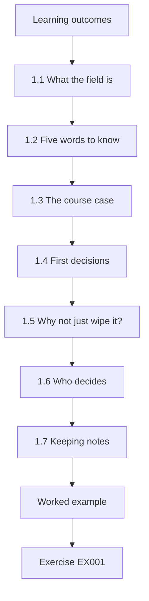

### Logical drawing

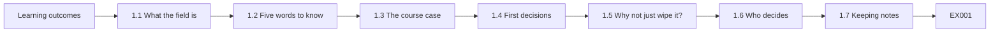

```text
[Learning outcomes]
    |
    v
[1.1 What the field is]
    |
    v
[1.2 Five words to know]
    |
    v
[1.3 The course case]
    |
    v
[1.4 First decisions]
    |
    v
[1.5 Why not just wipe it?]
    |
    v
[1.6 Who decides]
    |
    v
[1.7 Keeping notes]
    |
    v
[Worked example] --> [Exercise EX001]
```
<!-- open-cyber-academy:lesson-figures:end ch-01 -->


### Learning outcomes

You will (1) explain in plain words what digital forensics and malware analysis are; (2) define malware, artefact, evidence, hash and incident; (3) describe the first decisions after something looks wrong; (4) meet the course case.

### 1.1 What the field is

Digital forensics is the careful study of computers and accounts to find out what happened, in a way other people can check. Malware analysis looks at suspicious programs to learn what they do. Both help people respond to incidents: NIST SP 800-61 describes response as preparing, detecting and analysing, containing and recovering, then learning lessons.

In this course the incident is small: one laptop at a food bank showing fake virus alerts. Priya does not need a lab. She needs to find out what the downloaded file installed, whether any food bank account is at risk, and how to make the laptop safe again, in a way Ana can check afterwards.

### 1.2 Five words to know

**Malware** is software made to cause harm, such as stealing data or showing fake alerts. An **artefact** is any trace on a computer: a file, a log line, a startup entry. **Evidence** is an artefact you have collected carefully so you can show it was not changed. A **hash** is a short fingerprint calculated from a file; if one byte changes, the fingerprint changes. An **incident** is an event that harms or threatens systems or data.

In the course case, FreeTemplates_setup.exe is the malware, and TemplateUpdater in the startup list is an artefact. Priya's saved copy of the startup list becomes evidence once its date and source are written down.

### 1.3 The course case

**Tomás Reyes** volunteers at the fictional **Riverside Food Bank**. On a Tuesday he downloads a "free invoice template" from an advert. Soon, pop-ups claim the laptop is infected and urge him to phone a number. He tells **Priya Nair**, the food bank's volunteer IT coordinator.

The pop-ups are a known trick: the program wants Tomás to phone a fake support line, where someone may ask for payment or for remote access to the laptop. Tomás did the right thing by telling someone instead of calling. The question for Priya is what the template file put on the laptop, and whether anything beyond the laptop is affected, such as the food bank's email or donations account.

### 1.4 First decisions

Priya's first decisions are simple: do not phone the number; do not pay anything; stop using the laptop for food bank work; disconnect it from Wi-Fi; write down what is seen and when. She does not delete files yet, because they may tell her what happened.

Disconnecting from Wi-Fi stops the laptop from talking to the internet, so a program on it cannot download more files or send data out. Leaving it switched on but disconnected keeps the pop-ups visible for her notes. Her first note records all of this: report at 14:20, laptop disconnected at 14:25, Ana's permission at 14:30, no calls made and nothing paid.

### 1.5 Why not just wipe it?

Wiping removes the problem but also the answers: what was installed, whether passwords were taken, whether other machines are affected. A few careful steps first make the fix safer.

For FB-LAP-02, those first steps answered the main worry. The hash check identified the file as known adware, the startup list showed two new programs, and the email sign-in history showed only Tomás's usual sign-ins. With those answers written down, Priya and Ana could restore the laptop on Thursday knowing what they were removing, and knowing that the food bank's email did not need further work beyond a new password and two-step sign-in.

### 1.6 Who decides

The food bank's coordinator owns the laptop. Priya asks her permission before examining it.

Ana owns the decisions, not just the laptop. She decides what Priya may examine, whether Tomás's food bank email may be checked, whether the laptop is restored or cleaned, and whether anyone outside the food bank must be told. Priya's job is to give Ana clear facts and options. When Priya later needs to look at the email account, she goes back to Ana rather than deciding for herself, and Ana's answer is added to the scope in writing.

### 1.7 Keeping notes

Every step goes in a notebook with the time.

Write down the time, what you did, what you saw, and where it came from, in words someone else can follow. Priya's first note does this: "Tue 14:20 — Tomás reports pop-ups after downloading 'FreeTemplates_setup.exe' at about 13:50." Later, the browser history gave the exact download time, 13:48, and her notes show both the first report and the later, checked time. A good note never changes old entries; it adds new ones.

### Worked example

The next lines of Priya's first note read: "Laptop FB-LAP-02 disconnected from Wi-Fi 14:25. Coordinator Ana gave permission to examine 14:30. No calls made, nothing paid."

> **Synthetic case.** Riverside Food Bank, the laptop and all people are invented.

### Errors and limits

Fake alerts are designed to scare; calm, written steps work better than speed.

### Exercises

- **EX001 — Forensics in a sentence.** Explain digital forensics in one plain sentence. *Rubric:* 3 = finding what happened on computers in a checkable way; 2 = partial; 1 = hacking; 0 = none.
- **EX002 — Malware analysis.** What question does malware analysis answer? *Rubric:* 3 = what a suspicious program does; 2 = partial; 1 = who wrote it; 0 = none.
- **EX003 — Define malware.** Give a definition of malware with one example of harm. *Rubric:* 3 = harmful software plus example (theft, fake alerts); 2 = definition only; 1 = any program; 0 = none.
- **EX004 — Artefact.** Name three kinds of artefact. *Rubric:* 3 = file, log line, startup entry (any three traces); 2 = two; 1 = one; 0 = none.
- **EX005 — Evidence versus artefact.** What turns an artefact into evidence? *Rubric:* 3 = careful collection showing it was not changed; 2 = partial; 1 = vague; 0 = none.
- **EX006 — Hash.** Describe what a hash does. *Rubric:* 3 = fingerprint of a file; changes if any byte changes; 2 = partial; 1 = password; 0 = none.
- **EX007 — Incident.** Is Tomás's situation an incident? Explain. *Rubric:* 3 = yes; threatens laptop and data; 2 = yes only; 1 = no; 0 = none.
- **EX008 — Response phases.** List the incident response phases. *Rubric:* 3 = prepare, detect/analyse, contain/recover, lessons; 2 = three; 1 = one; 0 = none.
- **EX009 — Do not call.** Why should Tomás not phone the number? *Rubric:* 3 = fake alert scam; callers ask for money or remote access; 2 = partial; 1 = fine to call; 0 = none.
- **EX010 — Disconnect.** What does disconnecting from Wi-Fi achieve? *Rubric:* 3 = stops communication and spread while keeping evidence; 2 = partial; 1 = vague; 0 = none.
- **EX011 — Wipe now?** Give one reason not to wipe straight away. *Rubric:* 3 = lose answers about what happened, passwords, other machines; 2 = partial; 1 = wipe now; 0 = none.
- **EX012 — Permission.** Whose permission did Priya need, and why? *Rubric:* 3 = coordinator Ana, owner of laptop; 2 = name only; 1 = vague; 0 = none.
- **EX013 — First note.** List four details in Priya's first note. *Rubric:* 3 = report time, file name, disconnect time, permission, no calls/payment (four); 2 = three; 1 = one; 0 = none.

### Synthesis

Understand the basic words, decide calmly, keep evidence and write down every step.

### Continue studying — lesson 01 (chapter 01 of 20)

[← Course home](../../README.md) · [Course chapter index](../SUBJECTS.md) · [Chapter 02 →](#ch-02)

<a id="ch-02"></a>

## Chapter 2 — Scope, permission and safe practice

<!-- open-cyber-academy:lesson-figures:start ch-02 -->
### Lesson map

Lesson 02 published. Map, example, EX014.

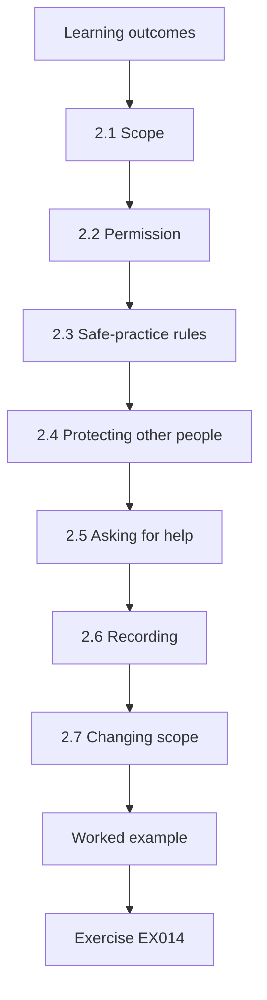

### Logical drawing

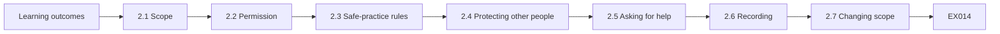

```text
[Learning outcomes]
    |
    v
[2.1 Scope]
    |
    v
[2.2 Permission]
    |
    v
[2.3 Safe-practice rules]
    |
    v
[2.4 Protecting other people]
    |
    v
[2.5 Asking for help]
    |
    v
[2.6 Recording]
    |
    v
[2.7 Changing scope]
    |
    v
[Worked example] --> [Exercise EX014]
```
<!-- open-cyber-academy:lesson-figures:end ch-02 -->


### Learning outcomes

You will (1) set a written scope; (2) explain why permission matters; (3) follow safe-practice rules with suspicious files; (4) protect other people's data.

### 2.1 Scope

Scope says what you may look at, for which purpose and for how long. Priya writes: "Laptop FB-LAP-02 only; purpose: find what the downloaded file installed and whether food bank data is at risk; Tuesday–Friday." Tomás's personal phone is not in scope.

Each part of Priya's scope has a reason. One laptop, because that is where the problem appeared. A question, so she knows when she has finished. Four days, so the work does not drift into a general review of every food bank computer. Tomás's phone is excluded because it belongs to him, not the food bank.

### 2.2 Permission

Looking at a computer without the owner's permission can break the law and trust. Ana, the coordinator, signs the scope. Tomás agrees too, since he used the laptop and may have personal browser data on it.

Ana's signature also protects Priya. If someone later asks why she looked at the laptop, she can show the signed scope. Tomás's agreement matters because his personal browser data may be on the laptop; Priya tells him she will not read his personal browsing beyond what the question needs, such as the advert page visited just before the download.

### 2.3 Safe-practice rules

Never run a suspicious file to "see what it does". Never send it by ordinary email. Never upload it to public websites without permission, because files can contain private data. Work on a copy of evidence when possible. Keep the laptop off the network.

Priya follows each rule in this case. She never runs FreeTemplates_setup.exe; she calculates its hash instead. She does not upload the file to a public checking website, because Ana has not agreed and the file might contain private data. She keeps FB-LAP-02 off Wi-Fi until it is restored. When she copies her notes to a USB stick, she copies only her own notes and results, not the suspicious file.

### 2.4 Protecting other people

The laptop holds a list of food bank clients. Priya looks only at what the question needs and does not open the client list. If client data was at risk, Ana must decide whether to tell people.

The question is whether the downloaded file could have read or sent data, not what the client list says. If the evidence had shown data leaving the laptop, Priya would have told Ana what kind of data was on it, and Ana, not Priya, would decide whether clients must be told. In this case nothing pointed to data leaving, and the client list stayed unopened.

### 2.5 Asking for help

When something is beyond her skill, Priya asks a trusted professional rather than guessing. Knowing your limits is part of safe practice.

In this case, the evidence pointed to a known adware installer with no sign of email misuse, which Priya could handle. If the hash had matched nothing and the laptop had shown signs of sending data out, she would have stopped and asked Ana to bring in a professional incident responder, keeping the laptop disconnected and her notes ready to hand over.

### 2.6 Recording

Scope, permission, and any change to them are written and dated.

Priya's scope page shows three dated entries: the original scope signed by Ana on Tuesday, Tomás's agreement, and Wednesday's change that added "food bank email account sign-in history". Each entry says who agreed and when. If anyone later asks why Priya looked at the email account, the page answers the question without anyone having to remember. A spoken "yes, go ahead" in a corridor is easy to forget or dispute; a dated line is not.

### 2.7 Changing scope

If Priya finds signs that another laptop is affected, she asks Ana before looking at it.

The email account is the case's real example. On Wednesday, Priya saw that Tomás had saved the food bank email password in the browser. Checking whether the account was misused was outside the original scope, which covered the laptop only. She asked Ana, who added the email sign-in history to the scope in writing. Only then did Priya look. If another laptop had shown the same pop-ups, the same step would apply before she touched it.

### Worked example

The scope change Priya added on Wednesday reads: "Added: food bank email account sign-in history. Reason: Tomás's food bank email password is saved in the browser on FB-LAP-02, so the account may have been misused. Agreed by: Ana, coordinator." The line sits under the original Tuesday scope, which stays unchanged.

> **Synthetic case.** The scope and events are invented.

### Errors and limits

Good intentions do not replace permission; ask first even when it feels slow.

### Exercises

- **EX014 — Scope parts.** What three things does a scope state? *Rubric:* 3 = what, purpose, time; 2 = two; 1 = one; 0 = none.
- **EX015 — Out of scope.** Name one thing outside Priya's first scope. *Rubric:* 3 = Tomás's personal phone (or email account before widening); 2 = vague; 1 = laptop; 0 = none.
- **EX016 — Who signs.** Who signed the scope, and who else agreed? *Rubric:* 3 = Ana signed; Tomás agreed; 2 = one; 1 = nobody; 0 = none.
- **EX017 — Never run.** Why never run a suspicious file to test it? *Rubric:* 3 = it may do harm and change evidence; 2 = partial; 1 = fine; 0 = none.
- **EX018 — Public upload.** What is the risk of uploading a file to public sites? *Rubric:* 3 = may expose private data; needs permission; 2 = partial; 1 = vague; 0 = none.
- **EX019 — Client list.** How did Priya treat the client list? *Rubric:* 3 = did not open it; looked only at what was needed; 2 = partial; 1 = read it; 0 = none.
- **EX020 — Telling clients.** Who decides whether to tell clients, and why? *Rubric:* 3 = Ana, as the responsible owner; 2 = name only; 1 = Priya; 0 = none.
- **EX021 — Limits.** What should Priya do when a task is beyond her skill? *Rubric:* 3 = ask a trusted professional; 2 = partial; 1 = guess; 0 = none.
- **EX022 — Network.** Why keep the laptop off the network? *Rubric:* 3 = stop contact and spread; 2 = partial; 1 = faster; 0 = none.
- **EX023 — Copies.** Why work on a copy when possible? *Rubric:* 3 = original stays unchanged; 2 = partial; 1 = no reason; 0 = none.
- **EX024 — Saved password.** What was found on Wednesday? *Rubric:* 3 = saved food bank email password in browser; 2 = partial; 1 = wrong; 0 = none.
- **EX025 — Widening.** How was the scope widened? *Rubric:* 3 = asked Ana; added email sign-in history in writing; 2 = partial; 1 = just looked; 0 = none.
- **EX026 — Second laptop.** If another laptop looks affected, what comes first? *Rubric:* 3 = ask Ana before examining; 2 = partial; 1 = examine; 0 = none.

### Synthesis

Write the scope, get permission, handle suspicious files safely, protect others' data and widen scope only in writing.

### Continue studying — lesson 02 (chapter 02 of 20)

[← Chapter 01](#ch-01) · [Course chapter index](../SUBJECTS.md) · [Chapter 03 →](#ch-03)

<a id="ch-03"></a>

## Chapter 3 — Digital forensics and malware analysis: systems, data and dependencies

<!-- open-cyber-academy:lesson-figures:start ch-03 -->
### Lesson map

Lesson 03 published. Map, example, EX027.

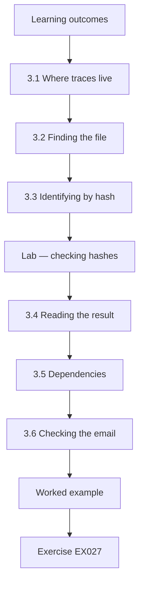

### Logical drawing

```mermaid
flowchart LR
  N0["Learning outcomes"]
  N1["3.1 Where traces live"]
  N2["3.2 Finding the file"]
  N3["3.3 Identifying by hash"]
  N4["Lab — checking hashes"]
  N5["3.4 Reading the result"]
  N6["3.5 Dependencies"]
  N7["3.6 Checking the email"]
  N0 --> N1 --> N2 --> N3 --> N4 --> N5 --> N6 --> N7 --> Q["EX027"]
```

```text
[Learning outcomes]
    |
    v
[3.1 Where traces live]
    |
    v
[3.2 Finding the file]
    |
    v
[3.3 Identifying by hash]
    |
    v
[Lab — checking hashes]
    |
    v
[3.4 Reading the result]
    |
    v
[3.5 Dependencies]
    |
    v
[3.6 Checking the email]
    |
    v
[Worked example] --> [Exercise EX027]
```
<!-- open-cyber-academy:lesson-figures:end ch-03 -->


### Learning outcomes

You will (1) find where useful traces live on a laptop; (2) use hashes to identify known files; (3) understand how accounts and services depend on each other; (4) record findings with sources.

### 3.1 Where traces live

On a laptop: the downloads folder, the list of installed programs, startup entries (programs that run at sign-in), browser history and security logs. Each answers part of the question.

In this case, Downloads showed the installer and its time; the browser history showed the advert page visited just before; and the startup list showed what the installer added. Security logs could show whether anything tried to sign in with stolen passwords. No single place gives the full story, which is why Priya checks several and writes down which place each fact came from.

### 3.2 Finding the file

In Downloads, Priya finds FreeTemplates_setup.exe, downloaded at 13:48. The browser history shows the advert page just before.

Two times fit together here: the advert page at 13:46 and the download at 13:48. Tomás remembered "about 13:50", which is close but not exact; the file's own time is more reliable than memory. Priya does not open or run the file. She only notes its name, its folder and its time, then moves to the hash check.

The two-minute gap fits a click on the advert followed by a download. A gap of an hour would have suggested that something else, such as another site, delivered the file.

### 3.3 Identifying by hash

Instead of running the file, she calculates its hash and compares it with a list of known bad files. Kornblum (2006) and others describe how hashes help sort known from unknown files.

The lab shows how: the script calculates each file's SHA-256 fingerprint and looks for it in a short known-bad list. Only FreeTemplates_setup.exe matches. The file never has to run, so the check is safe. In real work the list would come from a trusted source, and Priya would record which version of the list she used, as her note does with "list v1".

### Lab — checking hashes

```python
"""Compare SHA-256 hashes of synthetic files with a synthetic known-bad list."""
import hashlib
files = {
    "budget.xlsx": b"synthetic spreadsheet bytes",
    "FreeTemplates_setup.exe": b"synthetic installer bytes - not a real program",
    "photo.jpg": b"synthetic photo bytes",
}
known_bad = {hashlib.sha256(b"synthetic installer bytes - not a real program").hexdigest(): "Fake-template adware (synthetic)"}
for name, data in files.items():
    h = hashlib.sha256(data).hexdigest()
    print(f"{name:25} {h[:12]}  {known_bad.get(h, 'no match')}")
```

Run with `python3 lab_hashcheck.py`. Verified output:

```text
budget.xlsx               0edf30e2fa30  no match
FreeTemplates_setup.exe   3e5d3b83407c  Fake-template adware (synthetic)
photo.jpg                 ffcab6e8630a  no match
```

### 3.4 Reading the result

budget.xlsx and photo.jpg have no match. FreeTemplates_setup.exe matches "Fake-template adware" in the synthetic list. A match identifies a known file; no match does not prove a file is safe.

Both files could still be harmful, but nothing else points to them: they were not downloaded with the installer, and they did not add startup programs. Priya records them as checked, with no match, and moves on. She does not write "clean". A known-bad list only covers files that were reported before it was last updated, so she also writes the date of the list next to the results.

### 3.5 Dependencies

The laptop's browser holds a saved password for the food bank email. The email is used to reset the online donations account. So a problem on one laptop could reach the email and then donations. Mapping such links shows what else to check.

This chain is why Ana widened the scope to the email account. Priya also notes the donations account as the next link: if the email had shown strange sign-ins, she would have asked Ana to check the donations account's recent activity and password reset history too.

### 3.6 Checking the email

Within the widened scope, the email sign-in history shows only Tomás's usual sign-ins. Priya changes the password anyway, from a clean computer, and turns on two-step sign-in.

She changes the password from a clean computer because the laptop might still have a program that records what is typed. A new password typed on FB-LAP-02 could be captured at once. Two-step sign-in means a stolen password alone is not enough to get into the email. Her note records the time: 15:10 on Wednesday. Tomás is told not to save the new password in the laptop's browser.

### 3.7 Recording

Each finding is written with where it came from.

Priya's Wednesday note shows the pattern: the installer "in Downloads, 13:48"; the hash match "known adware (list v1)"; the advert page from "browser history 13:46"; and the email sign-ins checked and found normal. Each fact names its source. If Ana or a professional later doubts one of them, they know where to look again. A finding with no source can only be trusted on Priya's word, and a careful note means nobody has to rely on that.

### Worked example

Priya's note: "FreeTemplates_setup.exe in Downloads, 13:48; hash matches known adware (list v1); browser history shows advert page 13:46. Email sign-ins normal; password changed from clean PC 15:10 Wed; two-step on."

> **Synthetic case.** Files and hashes come from the lab script.

### Errors and limits

Known-bad lists miss new or changed files; use hashes as one clue among several.

### Exercises

- **EX027 — Trace locations.** Name four places traces live on a laptop. *Rubric:* 3 = downloads, installed programs, startup entries, browser history, logs (four); 2 = three; 1 = one; 0 = none.
- **EX028 — Download time.** When was the file downloaded, and what came just before? *Rubric:* 3 = 13:48; advert page 13:46; 2 = one; 1 = wrong; 0 = none.
- **EX029 — Hash not run.** Why compare hashes instead of running the file? *Rubric:* 3 = identifies safely without harm; 2 = partial; 1 = faster; 0 = none.
- **EX030 — Hash lab.** Which file matched, and as what? *Rubric:* 3 = FreeTemplates_setup.exe, fake-template adware; 2 = file only; 1 = wrong; 0 = none.
- **EX031 — No match.** Does "no match" mean safe? *Rubric:* 3 = no; new/changed files not on list; 2 = no only; 1 = yes; 0 = none.
- **EX032 — Dependency chain.** Explain the laptop-to-donations chain. *Rubric:* 3 = saved email password → email resets donations account; 2 = partial; 1 = vague; 0 = none.
- **EX033 — Email check result.** What did the sign-in history show? *Rubric:* 3 = only usual sign-ins; 2 = partial; 1 = attacker; 0 = none.
- **EX034 — Clean computer.** Why change the password from a clean computer? *Rubric:* 3 = infected laptop might capture new password; 2 = partial; 1 = no reason; 0 = none.
- **EX035 — Two-step.** What does two-step sign-in add? *Rubric:* 3 = second proof beyond password; 2 = partial; 1 = vague; 0 = none.
- **EX036 — Source notes.** Why write where each finding came from? *Rubric:* 3 = others can check it; 2 = partial; 1 = habit; 0 = none.
- **EX037 — Startup entries.** What are startup entries? *Rubric:* 3 = programs that run automatically at sign-in; 2 = partial; 1 = wrong; 0 = none.
- **EX038 — Known lists.** State one limit of known-bad lists. *Rubric:* 3 = miss new or changed files; 2 = partial; 1 = vague; 0 = none.

### Synthesis

Know where traces live, identify files safely by hash, follow dependencies and write sources beside findings.

### Continue studying — lesson 03 (chapter 03 of 20)

[← Chapter 02](#ch-02) · [Course chapter index](../SUBJECTS.md) · [Chapter 04 →](#ch-04)

<a id="ch-04"></a>

## Chapter 4 — Digital forensics and malware analysis: guided lab and applied synthesis

<!-- open-cyber-academy:lesson-figures:start ch-04 -->
### Lesson map

Lesson 04 published. Map, example, EX039.

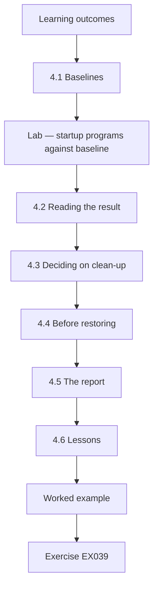

### Logical drawing

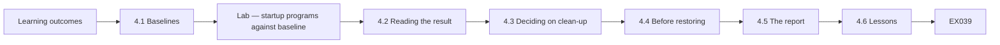

```text
[Learning outcomes]
    |
    v
[4.1 Baselines]
    |
    v
[Lab — startup programs against baseline]
    |
    v
[4.2 Reading the result]
    |
    v
[4.3 Deciding on clean-up]
    |
    v
[4.4 Before restoring]
    |
    v
[4.5 The report]
    |
    v
[4.6 Lessons]
    |
    v
[Worked example] --> [Exercise EX039]
```
<!-- open-cyber-academy:lesson-figures:end ch-04 -->


### Learning outcomes

You will (1) compare a system against a baseline in a guided lab; (2) decide on clean-up with evidence; (3) write a short report; (4) list lessons and next steps.

### 4.1 Baselines

A baseline is a record of what normal looks like. Priya saved a list of startup programs when the food bank laptops were set up. Comparing today's list with it shows what changed.

The baseline only helps because it was saved before the problem. For FB-LAP-02 it listed three startup programs: OneDrive, AudioService and PrinterHelper. Without it, Priya would see five programs and have to judge each name by guessing; with it, the lab prints the two that are new, and her attention goes straight to them.

### Lab — startup programs against baseline

```python
"""Compare a synthetic list of startup programs with a saved baseline."""
baseline = {"OneDrive", "AudioService", "PrinterHelper"}
today = {"OneDrive", "AudioService", "PrinterHelper", "TemplateUpdater", "AlertPopup"}
print("baseline:", len(baseline), "today:", len(today))
for name in sorted(today - baseline):
    print("NEW:", name)
for name in sorted(baseline - today):
    print("MISSING:", name)
```

Run with `python3 lab_startup.py`. Verified output:

```text
baseline: 3 today: 5
NEW: AlertPopup
NEW: TemplateUpdater
```

### 4.2 Reading the result

Three baseline programs are still present. Two are new: TemplateUpdater and AlertPopup. Their names and timing match the template download, and AlertPopup explains the fake alerts.

The lab also prints nothing under MISSING, which tells Priya that none of the three normal programs was removed or replaced. That matters: some harmful programs disable or replace normal ones. Her note records the two new names, the time they appeared, and that they fit the download at 13:48. She does not open them; their names and timing are enough to decide what to do next.

### 4.3 Deciding on clean-up

Evidence so far: a known adware installer, two new startup programs, no sign of email misuse. Because the laptop is small and backed up, Priya and Ana decide to restore it from the clean setup image rather than remove items one by one; removal might miss something.

Restoring from the clean image takes the laptop back to its known setup. It also removes anything the startup list did not show. The decision is Ana's, made with Priya's facts in front of her. Tomás's documents are safe because they are in the shared drive, not only on the laptop.

### 4.4 Before restoring

Priya copies her notes, the hash results and the startup comparison to a USB stick, and Tomás confirms his documents are in the shared drive.

Once the laptop is restored, the old disk contents are gone, so anything not saved now is lost for good. Priya saves her own records, not the suspicious installer: the notes, the three hash results and the startup comparison showing TemplateUpdater and AlertPopup. If the same adware appears on another food bank laptop, these records show what to look for. Priya labels the USB stick with the case date and keeps it locked away with the scope page.

### 4.5 The report

A one-page report: what happened, when, what was found, what was done, and what will change. Plain words for volunteers.

Priya's report fits on one page: on Tuesday at 13:48 a fake template installer was downloaded from an advert; it added two startup programs, including one that showed fake virus alerts; no email misuse was found; the laptop was restored on Thursday from the clean image; the email password was changed and two-step sign-in enabled. It ends with the changes: standard accounts for volunteers and a list of approved template sites.

### 4.6 Lessons

Download templates only from known sites; use a standard account without admin rights; keep the startup baseline current; report pop-ups early, as Tomás did.

Each lesson comes from a fact in this case. Templates from known sites, because the installer came from an advert. A standard account without admin rights, because that would likely have stopped the installer from adding startup programs. A current baseline, because the saved startup list made the new programs easy to spot. Early reporting, because Tomás's quick message meant the laptop was off Wi-Fi within minutes of his report.

### 4.7 Next steps for learners

This course gives a first, guided taste. Further courses add evidence handling, timelines and supervised casework.

In this course, Priya hashed files without running them, compared startup programs with a baseline, and widened scope only with Ana's written agreement. Later courses build on each step: evidence copies with their own hashes, timelines that combine browser history and system logs, and casework supervised by an experienced examiner.

Each of those later steps still starts where Priya started: with written permission, a clear question and notes that someone else can check.

### Worked example

Priya's report: "Tue 13:48 a fake template installer was downloaded from an advert. It added two startup programs, including one that showed fake virus alerts. No email misuse found. The laptop was restored on Thursday from the clean image; the email password was changed and two-step sign-in enabled. Changes: standard accounts for volunteers; a list of approved template sites."

> **Synthetic case.** The lab data and report are invented.

### Errors and limits

A baseline helps only if it is up to date; old baselines flag normal updates as new.

### Exercises

- **EX039 — Baseline meaning.** Define a baseline. *Rubric:* 3 = record of normal state for comparison; 2 = partial; 1 = backup; 0 = none.
- **EX040 — Lab result.** Which entries were new? *Rubric:* 3 = TemplateUpdater and AlertPopup; 2 = one; 1 = wrong; 0 = none.
- **EX041 — Pop-up cause.** Which entry explains the pop-ups? *Rubric:* 3 = AlertPopup; 2 = guess with reason; 1 = wrong; 0 = none.
- **EX042 — Restore versus remove.** Why restore rather than remove items? *Rubric:* 3 = removal may miss something; laptop backed up and simple; 2 = partial; 1 = faster; 0 = none.
- **EX043 — Before restoring.** What was saved before restoring? *Rubric:* 3 = notes, hash results, comparison; documents confirmed in shared drive; 2 = partial; 1 = vague; 0 = none.
- **EX044 — Evidence summary.** Summarise the evidence for the decision. *Rubric:* 3 = known adware hash, two new startup entries, no email misuse; 2 = two; 1 = one; 0 = none.
- **EX045 — Report audience.** Who is the report for, and how is it written? *Rubric:* 3 = volunteers; plain words, one page; 2 = partial; 1 = technical; 0 = none.
- **EX046 — Report parts.** List the parts of the report. *Rubric:* 3 = what, when, found, done, changes; 2 = three; 1 = one; 0 = none.
- **EX047 — Lessons.** Give three lessons. *Rubric:* 3 = known sites, standard accounts, current baseline, early reporting (three); 2 = two; 1 = one; 0 = none.
- **EX048 — Admin rights.** How do standard accounts help? *Rubric:* 3 = installers cannot add startup programs without admin approval; 2 = partial; 1 = vague; 0 = none.
- **EX049 — Old baseline.** What happens with an old baseline? *Rubric:* 3 = normal updates appear as new; false alarms; 2 = partial; 1 = vague; 0 = none.
- **EX050 — Tomás's part.** What did Tomás do well? *Rubric:* 3 = reported quickly; did not call or pay; 2 = one; 1 = vague; 0 = none.

### Synthesis

Compare against a baseline, decide clean-up from evidence, report plainly and turn lessons into changes.

### Continue studying — lesson 04 (chapter 04 of 20)

[← Chapter 03](#ch-03) · [Course chapter index](../SUBJECTS.md) · [Chapter 05 →](#ch-05)

<a id="ch-05"></a>

## Chapter 5 — The hash print is dict order

<!-- open-cyber-academy:lesson-figures:start ch-05 -->
### Lesson map

Lesson 05. Map, example, EX051.

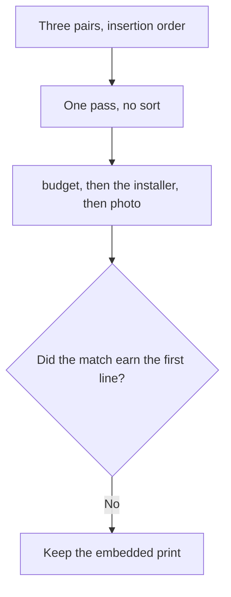

The loop follows the dict. A match does not jump the queue.

### Logical drawing

```text
budget.xlsx               0edf30e2fa30  no match
FreeTemplates_setup.exe   3e5d3b83407c  Fake-template adware (synthetic)
photo.jpg                 ffcab6e8630a  no match
```
<!-- open-cyber-academy:lesson-figures:end ch-05 -->

### Learning outcomes

After this chapter, you should be able to:

1. Name the order `files` yields.
2. Separate that order from a match-first ranking.
3. Refuse a note that prints the installer row on top.

### 5.1 One pass, and width 25 is not a ranking.

`lab_hashcheck.py` stores three pairs in a dict. The first pair is the name `budget.xlsx` with the byte string for a synthetic spreadsheet. The second pair is `FreeTemplates_setup.exe` with the installer bytes. The third pair is `photo.jpg` with the photo bytes. Since Python 3.7 a dict keeps insertion order, and `files.items()` walks that order. The loop body hashes the current bytes, slices a prefix, and prints. Nothing in the file calls `sorted` on the names.

The format starts with `{name:25}`. Width 25 pads a short name with spaces on the right. `budget.xlsx` is 11 characters, so 14 pad spaces sit inside the field. `FreeTemplates_setup.exe` is 23 characters, so two pad spaces sit inside the field. `photo.jpg` is 9 characters, so 16 pad spaces sit inside the field. The format then adds one space before the prefix. Those spaces do not encode risk. The installer row is second because that pair was inserted second, even though a reader might want the only match moved to the top.

A later decision to restore the laptop is a sentence in the report. It does not delete a pair. A print that started with `FreeTemplates_setup.exe` would be a different dict.

| What the loop uses | What it does not use |
|---|---|
| Insertion position in `files` | A match-first sort |
| The name and the byte string | A startup name |
| Format width 25 | A severity score |

### 5.2 Worked example

| Offered result | What produced it | Decision |
|---|---|---|
| Three lines, spreadsheet first | Dict order, one pass | Keep |
| The installer still second | Its pair was not moved | Keep |
| "The script sorted matches first." | No sort is called | Refuse |
| "The no-match lines were dropped." | Two pairs still print `no match` | Refuse |

> **Synthetic case.** These three pairs are the only hash output.

### Errors and limits

Do not rebuild the dict so that the matching name prints first.

### Apply

- **EX051 — Dict order.** The print names `budget.xlsx`, then `FreeTemplates_setup.exe`, then `photo.jpg`. May a match-first ranking, or a later decision to restore the laptop, replace that order? *Rubric:* 3 = no; the three pairs stay in insertion order; width 25 is padding; do not sort the script;; 2 = the three lines stay and the restore stays prose;; 1 = one line;; 0 = none.

<!-- open-cyber-academy:chapter-navigation:start ch-05 -->
### Continue studying — lesson 05 (chapter 05 of 20)

[← Chapter 04](#ch-04) · [Course chapter index](../SUBJECTS.md) · [Chapter 06 →](#ch-06)

Continue to the next authored lesson.
<!-- open-cyber-academy:chapter-navigation:end -->

<a id="ch-06"></a>

## Chapter 6 — Twelve characters are not the digest

<!-- open-cyber-academy:lesson-figures:start ch-06 -->
### Lesson map

Lesson 06. Map, example, EX052.

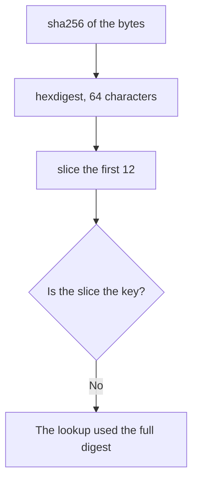

The page shows a prefix. The dict key is the whole fingerprint.

### Logical drawing

```text
computed
  hexdigest, 64 hex characters
printed
  the first 12 only
lookup
  the full digest, before the slice
three prefixes on the page
  0edf30e2fa30
  3e5d3b83407c
  ffcab6e8630a
```
<!-- open-cyber-academy:lesson-figures:end ch-06 -->

### Learning outcomes

After this chapter, you should be able to:

1. Separate `hexdigest` from the slice `h[:12]`.
2. Say which value is the dict key.
3. Refuse a note that treats a prefix as the stored fingerprint.

### 6.1 The slice is a reading aid. The key is the full digest.

`hashlib.sha256(data).hexdigest()` returns 64 hexadecimal characters. That length is the whole SHA-256 result written in hex: 256 bits, four bits to a character. The print uses `h[:12]`, so the page keeps the first 12 characters and drops the other 52. Twelve hex characters are 48 bits. They are enough to tell these three rows apart on a classroom page. They are not the value the script stored for the lookup.

The lookup happens before the slice is a problem for a careful reader, because the code computes `h` once and then uses that same `h` twice. `known_bad.get(h, 'no match')` searches for the 64-character string. The f-string then prints `h[:12]`. A classmate who copies only the visible prefix has not copied the key. Two different files can share a 12-character opening in principle. This run's three openings differ, and that fact does not promote the prefix into an identity.

Kornblum (2006) describes a way to notice files that are almost the same. This script does not do that. It asks whether the full digest is exactly the one key. A one-byte change in the byte string would miss. The chapter does not print the hidden 52 characters, because the lab did not print them.

| Piece | Role in this file |
|---|---|
| `hexdigest()` | 64-character fingerprint |
| `h[:12]` | The characters on the page |
| `known_bad.get(h, ...)` | Lookup of the full fingerprint |
| The other 52 characters | Computed, not printed |

### 6.2 Worked example

| Offered reading | What the file does | Decision |
|---|---|---|
| `3e5d3b83407c` is on the installer row | First 12 of that row's digest | Keep |
| The key is those 12 characters | The key is the unprinted full digest | Refuse |
| "Paste the prefix into a new list as the key." | The list was built from `hexdigest()` | Refuse |
| The three prefixes differ | True of this run, and still a prefix | Keep |

> **Synthetic case.** The lab page shows prefixes only.

### Errors and limits

Do not invent the hidden characters in order to look complete.

### Apply

- **EX052 — Prefix.** Each row shows 12 hex characters. Is that slice the dict key, and does this page print the other 52 characters? *Rubric:* 3 = no; `hexdigest` is 64 characters; the lookup uses the full digest; the page prints `h[:12]` only; do not fill in the rest;; 2 = the key is the full digest and the rest is unprinted;; 1 = the prefix only;; 0 = none.

<!-- open-cyber-academy:chapter-navigation:start ch-06 -->
### Continue studying — lesson 06 (chapter 06 of 20)

[← Chapter 05](#ch-05) · [Course chapter index](../SUBJECTS.md) · [Chapter 07 →](#ch-07)

Continue to the next authored lesson.
<!-- open-cyber-academy:chapter-navigation:end -->

<a id="ch-07"></a>

## Chapter 7 — One key is not a clean verdict

<!-- open-cyber-academy:lesson-figures:start ch-07 -->
### Lesson map

Lesson 07. Map, example, EX053.

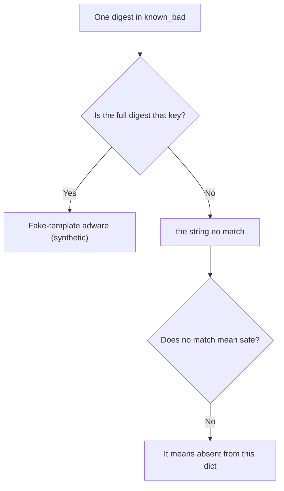

The default string is an absence. It is not a clearance.

### Logical drawing

```text
known_bad
  one key, one label
hit
  Fake-template adware (synthetic)
miss
  no match
list note
  known adware (list v1)
  a date is written in practice
  no calendar date is printed here
```
<!-- open-cyber-academy:lesson-figures:end ch-07 -->

### Learning outcomes

After this chapter, you should be able to:

1. Count the keys in `known_bad`.
2. Read `no match` as the default string.
3. Refuse the word clean, and refuse a calendar date for list v1.

### 7.1 The default is what `.get` returns when the key is absent.

`known_bad` is built with one entry. The key is the SHA-256 hex digest of `b"synthetic installer bytes - not a real program"`. The value is the label `Fake-template adware (synthetic)`. There is no second key, and there is no known-good dict beside it. `known_bad.get(h, 'no match')` returns the label when `h` is that key. Otherwise it returns the literal `no match`.

The spreadsheet row and the photo row both take the default. They share a string because both digests are absent, not because the script compared the two files with each other. ISO/IEC 27042 separates what was observed from what someone concludes. The observation is "absent from this one-key dict". The conclusion "safe" is a different sentence, and the script does not print it. Priya's note uses "known adware (list v1)" for the hit. She also writes the date of the list she used. This book never prints that date, so a later page cannot invent one.

NIST's National Software Reference Library is a collection of known software hashes, often used to set ordinary files aside. This lab did not query it. A miss against one synthetic key is not an NSRL "known" hit, and it is not a clearance.

| Return | Meaning in this file |
|---|---|
| The adware label | Full digest equals the one key |
| `no match` | Full digest is absent |
| A date for list v1 | Written in practice, not printed here |
| The word clean | Not a return value |

### 7.2 Worked example

| Offered reading | What the file supports | Decision |
|---|---|---|
| The installer label is a hit on the one key | The digests are equal | Keep |
| `no match` on two rows | Both keys were absent | Keep |
| "`budget.xlsx` is clean." | The word is not in the output | Refuse |
| "List v1 is dated 13 October." | No calendar date is printed | Refuse |

> **Synthetic case.** The known-bad dict has one synthetic key.

### Errors and limits

Do not promote a default string into a safety verdict.

### Apply

- **EX053 — Default string.** `budget.xlsx` and `photo.jpg` print `no match`. Does that word mean the file is safe, and is a calendar date for list v1 available to copy? *Rubric:* 3 = no; `no match` means absent from the one-key dict; the installer label is the only hit; list v1 has no printed date;; 2 = the default is an absence and the date is unprinted;; 1 = one row;; 0 = none.

<!-- open-cyber-academy:chapter-navigation:start ch-07 -->
### Continue studying — lesson 07 (chapter 07 of 20)

[← Chapter 06](#ch-06) · [Course chapter index](../SUBJECTS.md) · [Chapter 08 →](#ch-08)

Continue to the next authored lesson.
<!-- open-cyber-academy:chapter-navigation:end -->

<a id="ch-08"></a>

## Chapter 8 — The script hashes the bytes it was given

<!-- open-cyber-academy:lesson-figures:start ch-08 -->
### Lesson map

Lesson 08. Map, example, EX054.

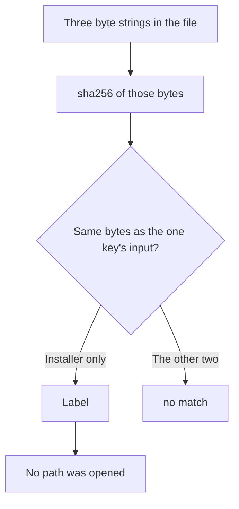

The filename is printed. The bytes are hashed.

### Logical drawing

```text
hashed
  b"synthetic spreadsheet bytes"
  b"synthetic installer bytes - not a real program"
  b"synthetic photo bytes"
not done
  open a path
  start the installer
  upload the bytes
equal inputs
  the installer string and the known_bad input
```
<!-- open-cyber-academy:lesson-figures:end ch-08 -->

### Learning outcomes

After this chapter, you should be able to:

1. Name the three byte strings.
2. Explain why only one of them hits.
3. Refuse a claim that the script opened FB-LAP-02.

### 8.1 Equality is on the bytes. The name is only a label.

The installer pair and the `known_bad` entry are built from the same byte string, `b"synthetic installer bytes - not a real program"`. SHA-256 of the same input returns the same digest, so the lookup hits. The spreadsheet string and the photo string are different inputs, so their digests miss. The filename is display text beside the row. Renaming the installer leaves the hit in place, because those bytes are unchanged. Putting the photo bytes under that same display name misses, because the SHA-256 input changed.

The file contains no `open` call and no process start. It does not read a directory on FB-LAP-02, and it does not launch the named installer. That is the point of the exercise: identification without running anything. RFC 3227's collection guidance is about not disturbing what you still need to study. Running a program to "see" it would change the laptop. This script never receives that chance, because its inputs are literals.

Ana has not agreed to a public upload, and the chapter does not add one. The bytes might stand in for a file that held private data. The lab's strings are synthetic on purpose, and they still are not pasted to a website from this lesson.

| Input | What the hash sees |
|---|---|
| Installer literal | The same bytes as the one key |
| Spreadsheet literal | A different byte string |
| Photo literal | A different byte string |
| The filename | Displayed, not hashed |

### 8.2 Worked example

| Offered claim | What the source shows | Decision |
|---|---|---|
| The hit follows from equal byte strings | Same literal in both places | Keep |
| The other two literals differ | Their digests miss | Keep |
| "The script opened Downloads." | No `open` call | Refuse |
| "The `.exe` suffix caused the hit." | The suffix is not hashed | Refuse |

> **Synthetic case.** The three strings are not files from a food-bank disk.

### Errors and limits

Do not add a path, a launch, or an upload in order to make the lab feel more real.

### Apply

- **EX054 — What was hashed.** Why does `FreeTemplates_setup.exe` hit while the other two names miss, and did the script open the laptop? *Rubric:* 3 = the installer literal equals the known-bad input; the other literals differ; the filename is not hashed; no path is opened and nothing is started;; 2 = equal bytes explain the hit and the laptop is not opened;; 1 = the name only;; 0 = none.

<!-- open-cyber-academy:chapter-navigation:start ch-08 -->
### Continue studying — lesson 08 (chapter 08 of 20)

[← Chapter 07](#ch-07) · [Course chapter index](../SUBJECTS.md) · [Chapter 09 →](#ch-09)

Continue to the next authored lesson.
<!-- open-cyber-academy:chapter-navigation:end -->

<a id="ch-09"></a>

## Chapter 9 — Three clocks stay three clocks

<!-- open-cyber-academy:lesson-figures:start ch-09 -->
### Lesson map

Lesson 09. Map, example, EX055.

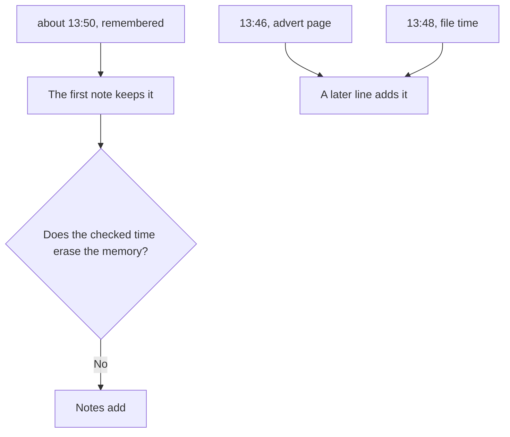

Three times describe one afternoon. None of them replaces the others.

### Logical drawing

```text
memory
  about 13:50
browser history
  advert page 13:46
file time
  13:48
note rule
  add a line
  do not rewrite the earlier line
```
<!-- open-cyber-academy:lesson-figures:end ch-09 -->

### Learning outcomes

After this chapter, you should be able to:

1. Name the memory, the advert time, and the file time.
2. Say which line was written first.
3. Refuse a note that deletes "about 13:50".

### 9.1 The checked time is added. The remembered phrase stays.

Tomás remembered the download as about 13:50. That phrase is what the first note recorded, beside the 14:20 report. Later, browser history showed the advert page at 13:46, and the file time read 13:48. Priya adds those checked times. She does not go back and replace the remembered phrase with the neater one. A reader who sees only 13:48 has lost the fact that memory and the file disagreed by a small, stated amount.

The disagreement is useful. Memory was close, and it was not exact. The file time is the better clock for "when the download landed", because it is a property Priya read, not a reconstruction. The advert time is a different event: a page view, two minutes earlier. Carrier (2005) treats file times as metadata that still need a source. This course does not parse a raw file-system structure. It teaches the three clocks Priya actually wrote down.

Priya's later line cites the browser and the file and leaves the volunteer's phrase where it was written. A checker can still see all three clocks.

| Clock | Kind of trace |
|---|---|
| about 13:50 | Tomás's memory, kept in the first note |
| 13:46 | Advert page in browser history |
| 13:48 | File time Priya read |
| One merged clock | Not what the notes contain |

### 9.2 Worked example

| Offered note | What it does to the record | Decision |
|---|---|---|
| First line keeps about 13:50; a later line adds 13:48 and 13:46 | Addition | Keep |
| "Correct the first line to 13:48 and delete the memory." | Rewrites an old entry | Refuse |
| "The advert and the file are the same instant." | Two minutes apart | Refuse |
| All three remain visible | A checker can see the gap | Keep |

> **Synthetic case.** The clocks belong to FB-LAP-02's Tuesday.

### Errors and limits

Do not sand the remembered phrase down so the file looks perfectly consistent.

### Apply

- **EX055 — Three clocks.** Tomás said about 13:50. The advert page is 13:46 and the file time is 13:48. May a later note replace the remembered phrase with the file time? *Rubric:* 3 = no; notes add; about 13:50 stays; 13:46 and 13:48 are added as their own traces;; 2 = the memory stays and the checked times are added;; 1 = one clock;; 0 = none.

<!-- open-cyber-academy:chapter-navigation:start ch-09 -->
### Continue studying — lesson 09 (chapter 09 of 20)

[← Chapter 08](#ch-08) · [Course chapter index](../SUBJECTS.md) · [Chapter 10 →](#ch-10)

Continue to the next authored lesson.
<!-- open-cyber-academy:chapter-navigation:end -->

<a id="ch-10"></a>

## Chapter 10 — Two minutes is 13:46 to 13:48

<!-- open-cyber-academy:lesson-figures:start ch-10 -->
### Lesson map

Lesson 10. Map, example, EX056.

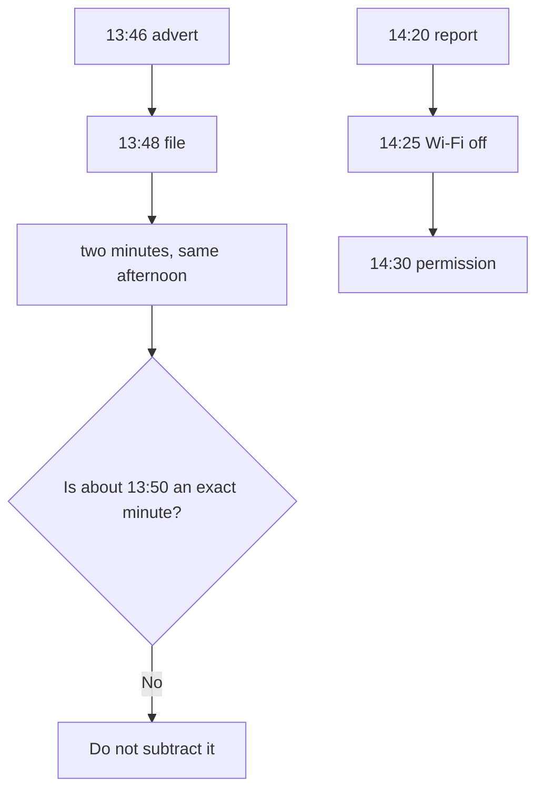

Some pairs subtract cleanly. The remembered phrase does not.

### Logical drawing

```text
exact, Tuesday
  13:46 to 13:48 = 2 minutes
  14:20 to 14:25 = 5 minutes
  14:25 to 14:30 = 5 minutes
  14:20 to 14:30 = 10 minutes
not exact
  about 13:50
other day
  Wednesday 15:10
```
<!-- open-cyber-academy:lesson-figures:end ch-10 -->

### Learning outcomes

After this chapter, you should be able to:

1. Subtract the exact Tuesday pairs.
2. Leave "about 13:50" unsubtracted.
3. Refuse an hour-count from Tuesday afternoon to Wednesday 15:10.

### 10.1 Exact pairs are both written as clock times. "About" is not.

13:48 minus 13:46 is two minutes. That pair is the advert page and then the file. The opening chapters treat a two-minute gap as a click followed by a download, and an hour-long gap as a hint that something else delivered the file. This gap is the short one. The arithmetic uses the two checked clocks only.

14:25 minus 14:20 is five minutes, from the report to the Wi-Fi disconnect. 14:30 minus 14:25 is five minutes, from the disconnect to Ana's permission. 14:30 minus 14:20 is ten minutes for the whole first response. Those three results are the same afternoon, and each endpoint is a time Priya wrote without the word "about".

"About 13:50" cannot be subtracted from 13:48 to produce a precise error. The word "about" is the reason. A note that prints "memory was wrong by two minutes" has invented a precision Tomás did not claim. Wednesday 15:10 is the password change on the next day. The night between Tuesday and Wednesday is not given as a count of hours in this book, so this chapter does not print one.

| Pair | Result this chapter will state |
|---|---|
| 13:46 to 13:48 | 2 minutes |
| 14:20 to 14:25 | 5 minutes |
| 14:25 to 14:30 | 5 minutes |
| about 13:50 against 13:48 | Not an exact difference |
| Tuesday afternoon to Wednesday 15:10 | Not an hour-count in this book |

### 10.2 Worked example

| Offered sentence | Arithmetic | Decision |
|---|---|---|
| "Advert to file is two minutes." | 13:48 minus 13:46 | Keep |
| "Report to permission is ten minutes." | 14:30 minus 14:20 | Keep |
| "Memory missed by exactly two minutes." | "About" blocks the subtraction | Refuse |
| "Fifteen hours passed before the password change." | No such count is printed | Refuse |

> **Synthetic case.** The clocks are the ones already in Priya's notes.

### Errors and limits

Do not turn an approximate memory into an exact error bar.

### Apply

- **EX056 — Which gaps are exact.** Compute the advert-to-file gap and the report-to-permission gap. Is "about 13:50" an exact third gap, and is an hour-count to Wednesday 15:10 printed? *Rubric:* 3 = two minutes and ten minutes; about 13:50 is not an exact gap; no hour-count to Wednesday is printed;; 2 = the two exact gaps and the refused pair;; 1 = one gap;; 0 = none.

<!-- open-cyber-academy:chapter-navigation:start ch-10 -->
### Continue studying — lesson 10 (chapter 10 of 20)

[← Chapter 09](#ch-09) · [Course chapter index](../SUBJECTS.md) · [Chapter 11 →](#ch-11)

Continue to the next authored lesson.
<!-- open-cyber-academy:chapter-navigation:end -->

<a id="ch-11"></a>

## Chapter 11 — Sorted names are not appearance order

<!-- open-cyber-academy:lesson-figures:start ch-11 -->
### Lesson map

Lesson 11. Map, example, EX057.

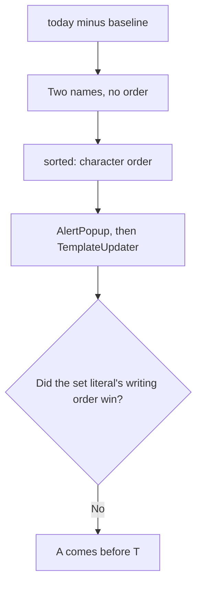

The print is alphabetical. The set literal is not a timeline.

### Logical drawing

```text
set literal writes the new names as
  TemplateUpdater, then AlertPopup
sorted difference prints
  NEW: AlertPopup
  NEW: TemplateUpdater
reason
  A before T
not stored
  which name appeared first
```
<!-- open-cyber-academy:lesson-figures:end ch-11 -->

### Learning outcomes

After this chapter, you should be able to:

1. Read `sorted(today - baseline)`.
2. Explain why AlertPopup prints before TemplateUpdater.
3. Refuse "appeared first" as a meaning of that order.

### 11.1 A set drops writing order. `sorted` imposes character order.

`today - baseline` is a set of the names that are in `today` and not in `baseline`. The members are `TemplateUpdater` and `AlertPopup`. A set has no order, so the fact that the set literal wrote `TemplateUpdater` before `AlertPopup` is not a property the set keeps. `sorted` then orders the two strings by their characters. `A` comes before `T`, so `AlertPopup` prints first and `TemplateUpdater` prints second.

That order is not "appeared first". The script has no field for which startup name was registered earlier. It also is not the order of the set literal. A classmate who swaps the NEW lines to match the literal has built a different print. A classmate who says AlertPopup "showed up first" has added a story the difference does not contain.

MITRE ATT&CK groups programs that start at logon under a persistence class called Boot or Logon Autostart Execution. Naming the class is enough here. The lab does not score either NEW line against that matrix, and this chapter does not give a procedure for creating a startup entry.

| Order someone might expect | What actually happens |
|---|---|
| Literal order, TemplateUpdater first | The set drops it |
| Time order | No time is stored |
| Character order | `sorted` prints AlertPopup first |
| A severity order | No score is stored |

### 11.2 Worked example

| Offered reading | What `sorted` did | Decision |
|---|---|---|
| AlertPopup then TemplateUpdater | `A` before `T` | Keep |
| Both names are the whole difference | Two members | Keep |
| "TemplateUpdater appeared first, so print it first." | Appearance is not a field | Refuse |
| "The set literal's order is the timeline." | Sets do not keep that order | Refuse |

> **Synthetic case.** The two NEW lines are the whole difference.

### Errors and limits

Do not narrate a race between the two names.

### Apply

- **EX057 — Sort order.** The set literal writes `TemplateUpdater` before `AlertPopup`, and the print does the opposite. Does the print mean AlertPopup appeared first? *Rubric:* 3 = no; `sorted` orders by characters; `A` comes before `T`; the set stores no appearance time;; 2 = character order, not a timeline;; 1 = one name;; 0 = none.

<!-- open-cyber-academy:chapter-navigation:start ch-11 -->
### Continue studying — lesson 11 (chapter 11 of 20)

[← Chapter 10](#ch-10) · [Course chapter index](../SUBJECTS.md) · [Chapter 12 →](#ch-12)

Continue to the next authored lesson.
<!-- open-cyber-academy:chapter-navigation:end -->

<a id="ch-12"></a>

## Chapter 12 — A set difference stores no clock

<!-- open-cyber-academy:lesson-figures:start ch-12 -->
### Lesson map

Lesson 12. Map, example, EX058.

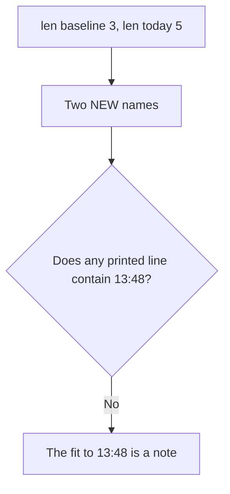

Lengths and names are in the print. The download clock is not.

### Logical drawing

```text
baseline: 3 today: 5
NEW: AlertPopup
NEW: TemplateUpdater
absent from those three lines
  13:48
  13:46
  Tuesday
```
<!-- open-cyber-academy:lesson-figures:end ch-12 -->

### Learning outcomes

After this chapter, you should be able to:

1. Read the length line as two integers.
2. Say where 13:48 lives.
3. Refuse a lab column that the script never printed.

### 12.1 The fit to 13:48 is prose. The print has names and lengths.

`print("baseline:", len(baseline), "today:", len(today))` writes two integers. The baseline set has three names, and `today` has five. The difference of those lengths is two, and two NEW lines follow. That arithmetic checks the print against itself. It is not a share of risk, and this chapter does not write it as a fraction of five.

Neither integer is a clock. `AlertPopup` and `TemplateUpdater` are strings. The set that held them cannot store the download time, because a set of strings has no timestamp field. Priya's note says the two names fit the download at 13:48. That sentence is hers. A reader who looks only at the three lab lines cannot recover 13:48, 13:46, or the word Tuesday from them.

NIST SP 800-86 is about bringing forensic technique into incident response, including writing down where a fact came from. Here the lengths and the names come from the script. The clock comes from the file-time note in the earlier chapter. Mixing them into one "lab result" makes the script look wiser than it is.

| Fact | Where it is stored |
|---|---|
| 3 and 5 | The length line |
| Two new names | The NEW lines |
| 13:48 | Priya's note, not the script |
| A fraction of the five names | Not printed |

### 12.2 Worked example

| Offered sentence | Source | Decision |
|---|---|---|
| "The length line says 3 and 5." | The print | Keep |
| "Two NEW lines follow." | The print | Keep |
| "The script printed 13:48 beside AlertPopup." | No such column | Refuse |
| "Two of five startup names were malicious." | A fraction the file does not print | Refuse |

> **Synthetic case.** The startup print is three lines.

### Errors and limits

Do not glue the download clock onto a line that has no clock.

### Apply

- **EX058 — Where the clock lives.** The startup print shows lengths 3 and 5 and two NEW names. Which of those lines contains 13:48? *Rubric:* 3 = none; 13:48 is in the notes; the script stores names and lengths only; do not print a fraction of five;; 2 = the clock is prose and the print has no time;; 1 = one line;; 0 = none.

<!-- open-cyber-academy:chapter-navigation:start ch-12 -->
### Continue studying — lesson 12 (chapter 12 of 20)

[← Chapter 11](#ch-11) · [Course chapter index](../SUBJECTS.md) · [Chapter 13 →](#ch-13)

Continue to the next authored lesson.
<!-- open-cyber-academy:chapter-navigation:end -->

<a id="ch-13"></a>

## Chapter 13 — An empty MISSING loop still ran

<!-- open-cyber-academy:lesson-figures:start ch-13 -->
### Lesson map

Lesson 13. Map, example, EX059.

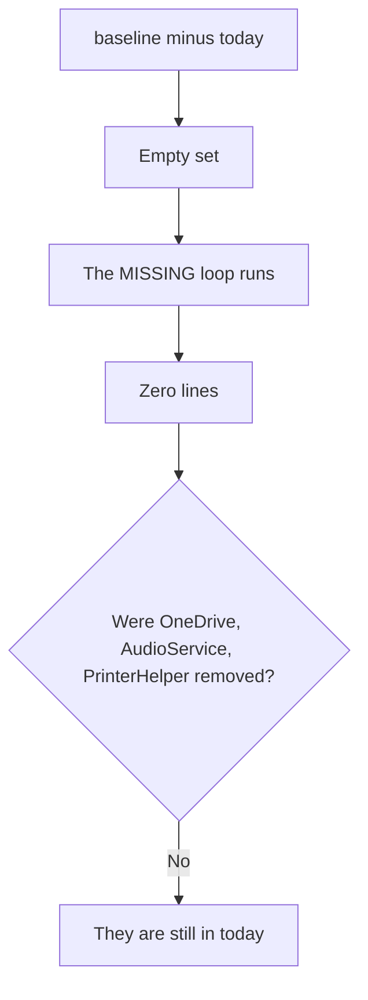

No MISSING line is a result. It is not a loop that was skipped.

### Logical drawing

```text
still in both sets
  OneDrive
  AudioService
  PrinterHelper
baseline minus today
  empty
printed under MISSING
  nothing
```
<!-- open-cyber-academy:lesson-figures:end ch-13 -->

### Learning outcomes

After this chapter, you should be able to:

1. Name the three baseline programs that remain.
2. Explain an empty difference.
3. Refuse an invented MISSING line.

### 13.1 The second loop prints once per leftover name. There are none.

After the NEW lines, the script walks `sorted(baseline - today)` and prints `MISSING:` plus the name. `baseline - today` holds names that were in the saved set and are absent from `today`. OneDrive, AudioService, and PrinterHelper are members of both sets, so that difference is empty. `sorted` of an empty set is an empty sequence. The loop body never runs, and the page shows no MISSING line.

An empty result is still information. Some harmful programs disable or replace a normal startup name. Priya's note records that none of the three baseline names was removed. She gets that from the absence, not from a sentence the script failed to emit. Adding a fake MISSING line "for completeness" would claim a removal that the sets contradict.

The length line agrees. Baseline length 3 and today length 5, with two names added and zero names removed, is 3 + 2 - 0 = 5. That check uses only the sets. It does not require a clock, and it does not require opening either new program.

| Set fact | Print |
|---|---|
| Name in both sets | No MISSING line |
| Name only in `today` | A NEW line |
| Name only in `baseline` | A MISSING line, and this run has none |
| An invented removal | Not supported |

### 13.2 Worked example

| Offered reading | What the sets support | Decision |
|---|---|---|
| Three baseline names remain | They are members of `today` | Keep |
| The MISSING loop printed nothing | The difference is empty | Keep |
| "PrinterHelper was replaced." | It is still in `today` | Refuse |
| "Add MISSING: none so the page looks finished." | That word is not a member | Refuse |

> **Synthetic case.** The baseline three are still present.

### Errors and limits

Do not fill an empty difference with a comforting extra line.

### Apply

- **EX059 — Empty difference.** Why is there no MISSING line, and which baseline names remain? *Rubric:* 3 = OneDrive, AudioService, and PrinterHelper are still in `today`; the difference is empty; the loop ran and printed nothing;; 2 = the three names remain and nothing was missing;; 1 = one name;; 0 = none.

<!-- open-cyber-academy:chapter-navigation:start ch-13 -->
### Continue studying — lesson 13 (chapter 13 of 20)

[← Chapter 12](#ch-12) · [Course chapter index](../SUBJECTS.md) · [Chapter 14 →](#ch-14)

Continue to the next authored lesson.
<!-- open-cyber-academy:chapter-navigation:end -->

<a id="ch-14"></a>

## Chapter 14 — Two labs are not one script

<!-- open-cyber-academy:lesson-figures:start ch-14 -->
### Lesson map

Lesson 14. Map, example, EX060.

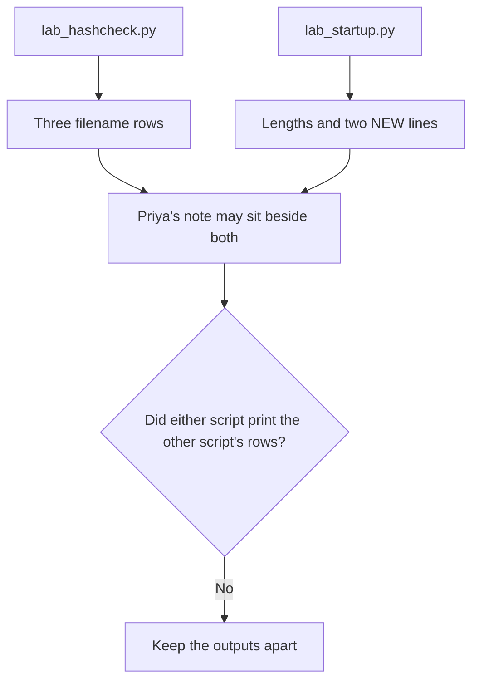

The note may place the results side by side. The files do not.

### Logical drawing

```text
hash script sees
  three names and three byte strings
startup script sees
  two sets of startup names
neither script sees
  the other script's variables
```
<!-- open-cyber-academy:lesson-figures:end ch-14 -->

### Learning outcomes

After this chapter, you should be able to:

1. Name the two scripts and their outputs.
2. Keep a prefix out of the startup print.
3. Refuse a merged lab that neither file produced.

### 14.1 Each file has its own names. The case note is a third page.

`lab_hashcheck.py` walks a dict of filenames and byte strings. Its output is three rows: a prefix and either `no match` or the adware label. It never builds a set called `baseline`, and it never prints `NEW`. `lab_startup.py` walks two sets of startup names. Its output is a length line and two NEW lines. It never calls `hashlib`, and it never prints `0edf30e2fa30`, `3e5d3b83407c`, or `ffcab6e8630a`.

Priya's notebook is allowed to mention both results in one paragraph, because she ran both checks and she labels the sources. That paragraph is not a third script. A sentence such as "the prefix caused AlertPopup" moves from two observations to a cause. The observations can sit together. The cause is not a column in either print. She also does not open the new programs. Their names, plus the hash label, are what she uses.

There is no hidden third lab in this course. A classmate who pastes the prefix onto a NEW line has invented a tool. NIST's Computer Forensics Tool Testing program is how some forensic tools are examined. These two classroom scripts have not been submitted to it, and this chapter does not claim they were.

| Script | Prints | Does not print |
|---|---|---|
| `lab_hashcheck.py` | Three filename rows | Startup names |
| `lab_startup.py` | Lengths and NEW lines | Hex prefixes |
| The notebook | Both, with sources | A fused column |

### 14.2 Worked example

| Offered page | What it mixes | Decision |
|---|---|---|
| Hash print quoted alone | One script | Keep |
| Startup print quoted alone | The other script | Keep |
| "3e5d3b83407c NEW: AlertPopup" | A column neither file has | Refuse |
| "One script printed both outputs." | Two files | Refuse |

> **Synthetic case.** Two standard-library files, two embedded outputs.

### Errors and limits

Do not weld the prefix to a startup name and call the weld a lab.

### Apply

- **EX060 — Two outputs.** Can the startup print include `3e5d3b83407c`, and can the hash print include `NEW: AlertPopup`? *Rubric:* 3 = no; each script prints only its own rows; the notebook may cite both with sources; neither file contains the other file's columns;; 2 = the outputs stay separate;; 1 = one script;; 0 = none.

<!-- open-cyber-academy:chapter-navigation:start ch-14 -->
### Continue studying — lesson 14 (chapter 14 of 20)

[← Chapter 13](#ch-13) · [Course chapter index](../SUBJECTS.md) · [Chapter 15 →](#ch-15)

Continue to the next authored lesson.
<!-- open-cyber-academy:chapter-navigation:end -->

<a id="ch-15"></a>

## Chapter 15 — Thursday is a sentence, not a column

<!-- open-cyber-academy:lesson-figures:start ch-15 -->
### Lesson map

Lesson 15. Map, example, EX061.

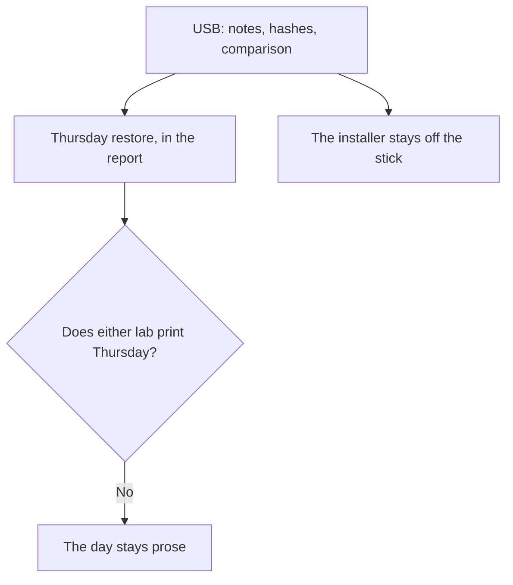

The restore is a decision recorded in words. The scripts have no day field.

### Logical drawing

```text
saved before the restore
  notes
  three hash results
  startup comparison
not saved on that stick
  the installer
report sentence
  restored Thursday from the clean image
lab columns
  no weekday
```
<!-- open-cyber-academy:lesson-figures:end ch-15 -->

### Learning outcomes

After this chapter, you should be able to:

1. Say what was copied before the restore.
2. Keep Thursday out of both lab prints.
3. Refuse a copy of the installer on the USB stick.

### 15.1 The image restore is Ana's decision. The labs do not timestamp it.

The report says the laptop was restored on Thursday from the clean setup image. Neither script has a weekday field, a path to an image, or a success flag. Searching the hash print or the startup print for the word Thursday fails. The day lives in the report sentence, next to the other actions: the password change and two-step sign-in.

Before that restore, unsaved disk contents would be gone. Priya copies her notes, the three hash results, and the startup comparison. Tomás confirms his documents are on the shared drive, not only on the laptop. The installer is not one of the copied things. Putting it on the stick would carry the suspicious file away from the laptop she is about to rebuild, which her own rules already refuse.

Choosing a full image, rather than deleting the two new names by hand, is the decision in the earlier chapter: a one-by-one removal might miss something the startup list did not show. That reasoning stays a decision. It does not become a fourth column under the NEW lines.

| Item | Where Thursday can appear |
|---|---|
| Report sentence | Yes |
| Hash print | No |
| Startup print | No |
| Installer on the USB stick | No, on any day |

### 15.2 Worked example

| Offered line | Where it belongs | Decision |
|---|---|---|
| "Restored Thursday from the clean image." | The report | Keep |
| "USB held notes, three hash results, and the comparison." | The pre-restore copy | Keep |
| "NEW: Thursday" | Not a startup name | Refuse |
| "The stick also holds FreeTemplates_setup.exe." | The installer stays off | Refuse |

> **Synthetic case.** Thursday is a report word about FB-LAP-02.

### Errors and limits

Do not promote a weekday into a lab field so the print looks dated.

### Apply

- **EX061 — What is prose.** Where does Thursday appear, what was saved beforehand, and is the installer on the USB stick? *Rubric:* 3 = Thursday is only in the report; the stick holds notes, the three hash results, and the startup comparison; the installer is not copied; neither lab prints the day;; 2 = the day is prose and the installer stays off the stick;; 1 = one item;; 0 = none.

<!-- open-cyber-academy:chapter-navigation:start ch-15 -->
### Continue studying — lesson 15 (chapter 15 of 20)

[← Chapter 14](#ch-14) · [Course chapter index](../SUBJECTS.md) · [Chapter 16 →](#ch-16)

Continue to the next authored lesson.
<!-- open-cyber-academy:chapter-navigation:end -->

<a id="ch-16"></a>

## Chapter 16 — The Tuesday line stays above the addition

<!-- open-cyber-academy:lesson-figures:start ch-16 -->
### Lesson map

Lesson 16. Map, example, EX062.

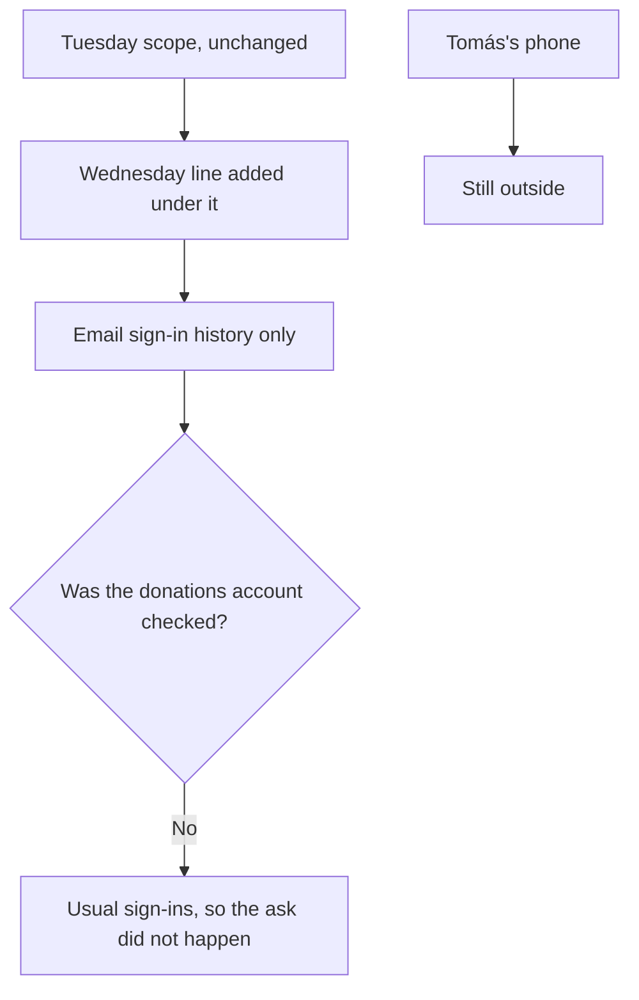

A wider scope is a new line. It is not a rewritten first line.

### Logical drawing

```text
stays
  laptop FB-LAP-02
  Tuesday through Friday
  the original purpose
added under it
  email sign-in history
  reason: saved food-bank email password
  agreed by Ana
not added
  the phone
  a donations-account result
```
<!-- open-cyber-academy:lesson-figures:end ch-16 -->

### Learning outcomes

After this chapter, you should be able to:

1. Keep the Tuesday scope line in place.
2. Name what the Wednesday line adds.
3. Refuse a donations-account result.

### 16.1 The addition names one account history. It does not swallow the next link.

The Tuesday scope covered the laptop, a purpose, and Tuesday through Friday. Wednesday's finding was a saved food-bank email password in the browser. Checking that account was outside the first line. Priya asked Ana. The new line authorises the email account's sign-in history, states the reason, and names Ana. It is written under the Tuesday line. The Tuesday line is not edited to pretend the email was in scope from the start.

The donations account is the next link, because that email can reset it. The sign-in history showed only Tomás's usual sign-ins, so Priya did not ask Ana to open the donations account. No donations result exists to quote. A note that says the donations password was or was not changed has filled a blank. Tomás's phone stays outside both lines. Another laptop with the same pop-ups would need its own ask before anyone examined it.

ISO/IEC 27037 is about identifying and preserving what you were allowed to take. Authority here is the signed page, including the added line. Looking one link further because it feels related is a new examination, and this case did not do it.

| Object | Authority in this case |
|---|---|
| FB-LAP-02 | Tuesday line |
| Email sign-in history | Wednesday line |
| Donations account | Not checked |
| Tomás's phone | Still outside |

### 16.2 Worked example

| Offered sentence | Effect on the page | Decision |
|---|---|---|
| "Tuesday line unchanged; Wednesday line underneath." | Addition | Keep |
| "Email history only, agreed by Ana." | The added authority | Keep |
| "Rewrite Tuesday so the email was always in scope." | Erases the boundary | Refuse |
| "Donations activity was normal." | No such check | Refuse |

> **Synthetic case.** The scope page is the food bank's permission record.

### Errors and limits

Do not let a nearby account borrow the line that was written for a different one.

### Apply

- **EX062 — Added, not replaced.** What did Wednesday add, what stayed outside, and was the donations account checked? *Rubric:* 3 = email sign-in history was added under the unchanged Tuesday line, with Ana's agreement; the phone stays outside; the donations account was not checked because sign-ins were usual;; 2 = the addition is the email history and donations was not checked;; 1 = one line;; 0 = none.

<!-- open-cyber-academy:chapter-navigation:start ch-16 -->
### Continue studying — lesson 16 (chapter 16 of 20)

[← Chapter 15](#ch-15) · [Course chapter index](../SUBJECTS.md) · [Chapter 17 →](#ch-17)

Continue to the next authored lesson.
<!-- open-cyber-academy:chapter-navigation:end -->

<a id="ch-17"></a>

## Chapter 17 — 15:10 is a clean-computer clock

<!-- open-cyber-academy:lesson-figures:start ch-17 -->
### Lesson map

Lesson 17. Map, example, EX063.

```mermaid
flowchart TD
  S["Usual sign-ins only"] --> C["Password changed anyway"]
  C --> P["15:10 Wednesday, clean computer"]
  P --> M["Two-step on"]
  M --> B["Do not save the new password in the browser"]
  P --> Q{"Does 15:10 prove a capture was seen?"}
  Q -->|No| K["The reason is a precaution"]
```

The clock is a precaution taken off the laptop. It is not a sighting.

### Logical drawing

```text
observed
  usual sign-ins only
done at 15:10 Wednesday
  new password, typed on a clean computer
  two-step turned on
instruction
  do not store that password in the browser
not observed
  a capture of keystrokes
  a count of the usual sign-ins
```
<!-- open-cyber-academy:lesson-figures:end ch-17 -->

### Learning outcomes

After this chapter, you should be able to:

1. Place 15:10 on a clean computer.
2. Separate a precaution from a sighting.
3. Refuse a sign-in count that was never printed.

### 17.1 The password moved because the laptop was the wrong keyboard.

The email history showed only Tomás's usual sign-ins. Priya still changes the password, and she does it from a clean computer at 15:10 on Wednesday. The reason is that a program on FB-LAP-02 might record what is typed. A new password entered on that keyboard could be captured at once. Two-step sign-in is turned on in the same action, so a password alone would not be enough later. Tomás is told not to save the new password in the browser.

The reason is not a finding. Nobody in this case observed a capture. The sentence "a keylogger was running" would upgrade a precaution into an artefact the notes do not contain. The labs do not see this action at all: the hash script has no account field, and the startup script has no password field. 15:10 is a notebook clock.

"Usual" is also not a number. The book does not say how many ordinary sign-ins were on the page. A later summary that prints a count has invented a tally. The change stands even though the history looked ordinary, which is a different fact from "the history proved misuse" and a different fact from "the history was ignored".

| Statement | Status |
|---|---|
| Usual sign-ins only | Observed |
| 15:10, clean computer, two-step on | Done |
| New password left out of the browser | Instructed |
| A capture was seen | Not in the notes |
| A count of usual sign-ins | Not printed |

### 17.2 Worked example

| Offered sentence | What it adds | Decision |
|---|---|---|
| "15:10 Wednesday, clean computer, two-step on." | The note | Keep |
| "History was usual, and the password changed anyway." | Both facts | Keep |
| "A keylogger captured the attempt." | A sighting | Refuse |
| "Four usual sign-ins, all from the office." | A tally and a place | Refuse |

> **Synthetic case.** The email action is Wednesday, off FB-LAP-02.

### Errors and limits

Do not narrate a capture that the precaution was designed to avoid.

### Apply

- **EX063 — Clean keyboard.** Why was the password changed on a clean computer at 15:10, and what was not observed? *Rubric:* 3 = typing on FB-LAP-02 might be captured; 15:10 Wednesday is the clean-computer clock; two-step was turned on; no capture was observed; no count of usual sign-ins is printed;; 2 = the clock is a precaution and no capture was seen;; 1 = the time only;; 0 = none.

<!-- open-cyber-academy:chapter-navigation:start ch-17 -->
### Continue studying — lesson 17 (chapter 17 of 20)

[← Chapter 16](#ch-16) · [Course chapter index](../SUBJECTS.md) · [Chapter 18 →](#ch-18)

Continue to the next authored lesson.
<!-- open-cyber-academy:chapter-navigation:end -->

<a id="ch-18"></a>

## Chapter 18 — A likely stop is not a measured cause

<!-- open-cyber-academy:lesson-figures:start ch-18 -->
### Lesson map

Lesson 18. Map, example, EX064.

```mermaid
flowchart TD
  J["Judgment: a standard account would likely have stopped the startup adds"] --> F["Future change: standard accounts"]
  L["Labs: hashes and names"] --> Q{"Did a lab print an account type?"}
  Q -->|No| K["Do not convert the judgment into a cause"]
```

The lesson names a control. The scripts do not test it.

### Logical drawing

```text
judgment, not a lab row
  a standard account would likely have blocked the startup adds
not measured
  that administrator rights were used
  an account-type column
future change
  standard accounts for volunteers
```
<!-- open-cyber-academy:lesson-figures:end ch-18 -->

### Learning outcomes

After this chapter, you should be able to:

1. Keep the standard-account sentence as a judgment.
2. Say what the labs actually print.
3. Refuse "admin rights were used" as a measured fact.

### 18.1 The lesson estimates a control. The prints do not show the account.

Chapter 4's lesson list includes a standard account without administrator rights, on the grounds that such an account would likely have stopped the installer from registering startup programs. "Would likely" is the mark of a judgment. ISO/IEC 27042 asks an examiner to keep interpretation distinct from the trace. The traces in the labs are hashes, labels, lengths, and startup names. None of those lines names an account type.

No test in this course showed that the installer ran with administrator rights. Saying "admin was used" borrows the feeling of the judgment and states it as history. The future change is still worth making: volunteers get standard accounts, so a later installer has a harder time registering startup programs. That change is a decision about the next laptops. It is not a result row from `lab_startup.py`, and it is not proof about Tuesday's account.

The other lessons stay in their own lanes. Templates from known sites, a current baseline, and Tomás's early report are separate changes. This chapter does not fold them into the account judgment, and it does not score the judgment as a confirmed cause.

| Sentence | Kind |
|---|---|
| Would likely have stopped the startup adds | Judgment |
| Admin rights were used on Tuesday | Not measured |
| Standard accounts for volunteers | A change going forward |
| Hash rows and NEW lines | What the labs print |

### 18.2 Worked example

| Offered sentence | Kind of claim | Decision |
|---|---|---|
| "A standard account is a likely barrier, not a tested cause." | Judgment kept as a judgment | Keep |
| "The labs print names and hashes, not an account type." | What is on the page | Keep |
| "The installer used administrator rights." | Unmeasured history | Refuse |
| "The startup script proved the account type." | No such column | Refuse |

> **Synthetic case.** The account change is a food-bank decision after the incident.

### Errors and limits

Do not launder a likelihood into a timestamped cause.

### Apply

- **EX064 — Judgment.** A classmate writes that administrator rights were used because a standard account would likely have stopped the startup entries. What is measured, and what is only a judgment? *Rubric:* 3 = the likely-stop sentence is a judgment; neither lab prints an account type; admin use was not measured; standard accounts are a later change;; 2 = the sentence stays a judgment and the labs have no account column;; 1 = one claim;; 0 = none.

<!-- open-cyber-academy:chapter-navigation:start ch-18 -->
### Continue studying — lesson 18 (chapter 18 of 20)

[← Chapter 17](#ch-17) · [Course chapter index](../SUBJECTS.md) · [Chapter 19 →](#ch-19)

Continue to the next authored lesson.
<!-- open-cyber-academy:chapter-navigation:end -->

<a id="ch-19"></a>

## Chapter 19 — The USB stick does not hold the installer

<!-- open-cyber-academy:lesson-figures:start ch-19 -->
### Lesson map

Lesson 19. Map, example, EX065.

```mermaid
flowchart TD
  N["Notes"] --> U["Labelled stick"]
  H["Three hash results"] --> U
  C["Startup comparison"] --> U
  U --> L["Locked with the scope page"]
  I["Installer"] --> X["Not on the stick"]
  CL["Client list"] --> X
```

The stick preserves the examination. It does not preserve the program.

### Logical drawing

```text
on the stick
  notes
  three hash results
  comparison showing TemplateUpdater and AlertPopup
label
  the case date
kept with
  the scope page
absent
  FreeTemplates_setup.exe
  the client list
```
<!-- open-cyber-academy:lesson-figures:end ch-19 -->

### Learning outcomes

After this chapter, you should be able to:

1. List the three classes of record on the stick.
2. Name what was left off.
3. Refuse an examination of another laptop that Ana has not approved.

### 19.1 The stick is a copy of the record. Another laptop still needs a new ask.

Priya labels the USB stick with the case date and keeps it locked with the scope page. The contents are her notes, the three hash results, and the startup comparison that shows TemplateUpdater and AlertPopup. If the same adware shows up on another food-bank laptop, those records say what to look for: the prefix behaviour of a known installer name, and the two startup names. They are not a copy of the program. The installer stays off the stick.

The client list stays off for a prior reason. She never opened it, so she has nothing from it to copy. "Nothing pointed to data leaving" is the case's observation. If a later case did show data leaving, Ana would decide whether clients must be told. This stick does not smuggle that decision forward by holding the list "just in case".

Another laptop is a new examination. The records can prepare the question. They do not authorise the look. Ana's agreement comes first, as it did when the email history was added. The stick's lock and the scope page's lock are the same habit: the record and the authority travel together, and the suspicious file travels with neither.

| On the stick | Off the stick |
|---|---|
| Notes | The installer |
| Three hash results | The client list |
| The two NEW names in the comparison | Authority to open another laptop |

### 19.2 Worked example

| Offered action | Authority and contents | Decision |
|---|---|---|
| "Stick has notes, three hash results, the comparison, the case date, and sits with the scope page." | The record | Keep |
| "Use the two names as what to look for, after Ana agrees." | Preparation, then permission | Keep |
| "Copy the installer so the next laptop can be compared byte for byte at home." | Moves the file | Refuse |
| "Open the other laptop because the stick already exists." | Skips the ask | Refuse |

> **Synthetic case.** The stick is the food bank's copy of Priya's record.

### Errors and limits

Do not treat a labelled stick as permission to open the next machine.

### Apply

- **EX065 — Stick contents.** What is on the USB stick, what is locked with it, and what must stay off? *Rubric:* 3 = notes, three hash results, and the startup comparison; labelled with the case date; locked with the scope page; the installer and the client list stay off; another laptop still needs Ana's agreement;; 2 = the record is on the stick and the installer is not;; 1 = one item;; 0 = none.

<!-- open-cyber-academy:chapter-navigation:start ch-19 -->
### Continue studying — lesson 19 (chapter 19 of 20)

[← Chapter 18](#ch-18) · [Course chapter index](../SUBJECTS.md) · [Chapter 20 →](#ch-20)

Continue to the next authored lesson.
<!-- open-cyber-academy:chapter-navigation:end -->

<a id="ch-20"></a>

## Chapter 20 — What the food bank note can say

<!-- open-cyber-academy:lesson-figures:start ch-20 -->
### Lesson map

Lesson 20. Map, example, EX066.

```mermaid
flowchart TD
  N["A food-bank note"] --> Q{"Does the sentence replace a print, fill a blank, or close the review?"}
  Q -->|Yes| R["Reject it"]
  Q -->|No| K["The note may cite that line"]
```

Twenty lessons meet a planning minimum. They leave the food bank's open items open.

### Logical drawing

```text
may stay
    both lab prints, in their own order
    13:46, 13:48, and about 13:50
    14:20, 14:25, 14:30, Wednesday 15:10, Thursday in the report
    list v1 with no invented date
    the Tuesday line and the Wednesday addition
    chapter 4's closing line, quoted once:
    Compare against a baseline, decide clean-up from evidence, report plainly and turn lessons into changes.
must not be added
    a full digest, a phone number, a payment amount
    the word clean, a donations result
    admin-was-used as a measured fact
    a merged lab, the word secure
```
<!-- open-cyber-academy:lesson-figures:end ch-20 -->

### Learning outcomes

After this chapter, you should be able to:

1. Repeat both embedded prints and the open clocks.
2. Reject a note that replaces a print or fills a blank.
3. Name the following subject while this review stays open.

### 20.1 A note may quote the files. It may not improve the files.

A food-bank note may say what was measured. From the hash script, keep the three rows in dict order, with the prefixes `0edf30e2fa30`, `3e5d3b83407c`, and `ffcab6e8630a`, and do not call a `no match` row clean. From the startup script, keep `baseline: 3 today: 5` and the NEW lines in character order, AlertPopup then TemplateUpdater, with no MISSING line. From the clocks, keep 13:46, 13:48, and about 13:50 as three traces. Keep 14:20, 14:25, and 14:30 on Tuesday, 15:10 on Wednesday for the clean-computer change, and Thursday only in the report.

The blanks stay blank. No full digest, no phone number, no payment amount, no calendar date for list v1, no donations result, and no measured use of administrator rights are available to copy. The installer stays off the USB stick. The client list stays unopened. Tomás's phone stays outside the scope. dfir-attack-lab is a supplementary repository, and neither script measured a control from it.

Chapter 4 already closed on its own sentence. The drawing above quotes that sentence once. This note does not reopen it as a finished review. Quoting the embedded lines is the note's whole permission. Polishing either script into a cleaner result is outside it.

### 20.2 Worked example

| Leaving-note sentence | Why it fails or stands | Decision |
|---|---|---|
| "Both prints remain, and about 13:50 stays beside 13:48." | The files plus the added clock | May stay |
| "15:10 was a clean computer, and Thursday is the report." | Precaution and prose | May stay |
| "The labs were merged, the photo was clean, and admin rights were used." | Replaces the files and the judgment | Reject |
| "Twenty lessons make the food bank secure." | The review is still open | Reject |

> **Synthetic case.** The note is a classroom page about Riverside Food Bank. It is not a letter to clients.

### Errors and limits

Twenty English lessons meet Riverside Food Bank's planning minimum and leave this review open. A fresh Thursday-restore question can still earn its own later food-bank lesson. These English chapters do not publish another language edition. Digital forensics stays this course. Threat intelligence and OSINT is the learner's following subject. Open items at the food bank stay open on that turn. These chapters do not call Riverside Food Bank finished, and they do not award a credential.

### Apply

- **EX066 — Four claims.** A classmate's food-bank note reorders the NEW lines, prints a full digest and a phone number, calls `photo.jpg` clean, reports a donations result, says administrator rights were used, and says twenty lessons make the food bank secure. Which claims do you reject, and what do twenty lessons meet? *Rubric:* 3 = reject the reordered NEW lines, the full digest, the phone number, the word clean, the donations result, the admin-was-used claim, and the secure claim; keep both prints, 13:46, 13:48, about 13:50, Wednesday 15:10, and Thursday only in the report; twenty lessons meet the planning minimum and leave review open;; 2 = reject the closings and keep the prints;; 1 = one claim;; 0 = none.

<!-- open-cyber-academy:chapter-navigation:start ch-20 -->
### Continue studying — lesson 20 (chapter 20 of 20)

[← Chapter 19](#ch-19) · [Course chapter index](../SUBJECTS.md) · [Next course via chapter index →](../SUBJECTS.md)

The chapter index leads to the next course in the study path.
<!-- open-cyber-academy:chapter-navigation:end -->

<a id="worked-results"></a>

## Worked results

Model answers for EX001–EX066. Tomás Reyes, Priya Nair, Ana, Riverside Food Bank and every figure are synthetic. Lab answers quote verified outputs. Any answer meeting the rubric scores equally.

**EX001.** It is the careful study of computers and accounts to find out what happened, done so others can check the work.

**EX002.** What a suspicious program actually does.

**EX003.** Software designed to cause harm, for example by stealing passwords or showing fake virus alerts.

**EX004.** A file, a log line and a startup entry.

**EX005.** Collecting it carefully and recording it so you can show it has not been changed.

**EX006.** It computes a short fingerprint from a file; changing even one byte gives a different fingerprint.

**EX007.** Yes, because a harmful program threatens the laptop and the food bank's data.

**EX008.** Prepare; detect and analyse; contain and recover; learn lessons.

**EX009.** The pop-up is a scam, and the people on the phone usually ask for payment or remote control of the laptop.

**EX010.** It stops the laptop talking to the internet or spreading, while leaving its contents in place to examine.

**EX011.** Wiping destroys the traces that show what was installed, whether passwords were taken and whether other devices are at risk.

**EX012.** Ana, the coordinator, because the food bank owns the laptop.

**EX013.** When Tomás reported it, the file name, when Wi-Fi was disconnected and when Ana gave permission (and that no calls or payments were made).

**EX014.** What may be examined, for what purpose, and for how long.

**EX015.** Tomás's personal phone.

**EX016.** Ana signed it, and Tomás also agreed because he had used the laptop.

**EX017.** Running it could cause harm and would change the very evidence being studied.

**EX018.** The file might contain private information, and uploading it without permission could expose that.

**EX019.** She left it closed and examined only what the question required.

**EX020.** Ana, because she is responsible for the food bank and its clients.

**EX021.** Ask a trusted professional for help instead of guessing.

**EX022.** It prevents the malware contacting anyone or spreading to other devices.

**EX023.** So the original stays exactly as it was found.

**EX024.** Tomás had saved his food bank email password in the browser.

**EX025.** Priya asked Ana, who added the email account's sign-in history to the written scope.

**EX026.** Get Ana's permission before examining it.

**EX027.** The downloads folder, installed programs, startup entries and browser history (security logs as well).

**EX028.** At 13:48, just after the advert page was visited at 13:46.

**EX029.** A hash identifies the file without running it, so nothing harmful happens.

**EX030.** FreeTemplates_setup.exe, listed as fake-template adware.

**EX031.** No: new or modified files will not be on the list.

**EX032.** The browser stores the food bank email password, and that email can reset the donations account, so one laptop can lead to donations.

**EX033.** Only Tomás's normal sign-ins.

**EX034.** If the laptop is still infected it might record the new password as it is typed.

**EX035.** A second proof, such as a code on a phone, so a stolen password alone is not enough.

**EX036.** So someone else can go to the same place and confirm it.

**EX037.** Programs set to start on their own whenever someone signs in.

**EX038.** They cannot recognise files that are new or have been altered.

**EX039.** A saved record of what normal looks like, used to spot changes.

**EX040.** TemplateUpdater and AlertPopup.

**EX041.** AlertPopup, whose name and timing fit the fake virus alerts.

**EX042.** Removing items one by one could leave something behind, and the laptop had a clean image and backups.

**EX043.** Priya's notes, the hash results and the startup comparison went to a USB stick, and Tomás confirmed his files were on the shared drive.

**EX044.** The installer's hash matched known adware, two unexpected startup programs appeared, and the email showed no misuse.

**EX045.** Food bank volunteers, so it is one page in plain language.

**EX046.** What happened, when it happened, what was found, what was done and what will change.

**EX047.** Get templates only from known sites, give volunteers standard accounts and keep the startup baseline current.

**EX048.** Without administrator rights, an installer cannot quietly register programs to start at sign-in.

**EX049.** Ordinary software updates show up as changes, causing false alarms.

**EX050.** He reported the pop-ups promptly and neither phoned the number nor paid anything.

**EX051.** No. The three pairs stay in insertion order. Width 25 only pads the name. A later restore does not reorder the script.

**EX052.** No. `hexdigest` is 64 characters. The lookup uses that full digest. The page prints the first 12 only. Do not fill in the rest.

**EX053.** No. `no match` means the full digest is absent from the one-key dict. The installer label is the only hit. List v1 has no printed date.

**EX054.** The installer literal equals the known-bad input, and the other two literals differ. The filename is not hashed. No path is opened and nothing is started.

**EX055.** No. Notes add. About 13:50 stays in the first line. 13:46 and 13:48 are added as their own traces.

**EX056.** Advert to file is two minutes. Report to permission is ten minutes. About 13:50 is not an exact gap. No hour-count from Tuesday to Wednesday 15:10 is printed.

**EX057.** No. `sorted` orders by characters, and `A` comes before `T`. The set stores no appearance time.

**EX058.** None of the lines. 13:48 is in the notes. The script stores names and lengths only. Do not print a fraction of five.

**EX059.** OneDrive, AudioService, and PrinterHelper are still in `today`. The difference is empty, so the MISSING loop prints nothing.

**EX060.** No. The startup print has no prefix, and the hash print has no NEW line. The notebook may cite both with sources.

**EX061.** Thursday is only in the report. The stick holds notes, the three hash results, and the startup comparison. The installer is not copied. Neither lab prints the day.

**EX062.** Email sign-in history was added under the unchanged Tuesday line, with Ana's agreement. The phone stays outside. The donations account was not checked, because sign-ins were usual.

**EX063.** Typing on FB-LAP-02 might be captured, so the change was made on a clean computer at 15:10 Wednesday, with two-step turned on. No capture was observed, and no count of usual sign-ins is printed.

**EX064.** The likely-stop sentence is a judgment. Neither lab prints an account type. Administrator use was not measured. Standard accounts are a later change.

**EX065.** The stick holds notes, three hash results, and the startup comparison. It is labelled with the case date and locked with the scope page. The installer and the client list stay off. Another laptop still needs Ana's agreement.

**EX066.** Reject the reordered NEW lines, the full digest, the phone number, the word clean, the donations result, the admin-was-used claim, and the claim that the food bank is secure. Keep both prints, 13:46, 13:48, about 13:50, Wednesday 15:10, and Thursday only in the report. Twenty lessons meet the planning minimum and leave review open.

<a id="references"></a>

## References

Links checked 12 October 2026; re-verify editions before citing. Organisations, people, devices and artefacts in this book are synthetic unless a sentence cites a public source.


- Carrier, B. (2005). *File System Forensic Analysis*. Addison-Wesley. ISBN 978-0-321-26817-4.
- Casey, E. (2011). *Digital Evidence and Computer Crime* (3rd ed.). Academic Press. ISBN 978-0-12-374268-1.
- Garfinkel, S. L. (2010). Digital forensics research: The next 10 years. *Digital Investigation*, 7, S64–S73. <https://doi.org/10.1016/j.diin.2010.05.009>
- Garfinkel, S., Farrell, P., Roussev, V., & Dinolt, G. (2009). Bringing science to digital forensics with standardized forensic corpora. *Digital Investigation*, 6, S2–S11. <https://doi.org/10.1016/j.diin.2009.06.016>
- IETF RFC 3227 (2002). Brezinski, D., & Killalea, T. Guidelines for Evidence Collection and Archiving. <https://www.rfc-editor.org/rfc/rfc3227>
- ISO/IEC 27037:2012. Guidelines for identification, collection, acquisition and preservation of digital evidence. <https://www.iso.org/standard/44381.html>
- ISO/IEC 27041:2015. Guidance on assuring suitability and adequacy of incident investigative method. <https://www.iso.org/standard/44405.html>
- ISO/IEC 27042:2015. Guidelines for the analysis and interpretation of digital evidence. <https://www.iso.org/standard/44406.html>
- ISO/IEC 27043:2015. Incident investigation principles and processes. <https://www.iso.org/standard/44407.html>
- Kornblum, J. (2006). Identifying almost identical files using context triggered piecewise hashing. *Digital Investigation*, 3(S), 91–97. <https://doi.org/10.1016/j.diin.2006.06.015>
- Landis, J. R., & Koch, G. G. (1977). The measurement of observer agreement for categorical data. *Biometrics*, 33(1), 159–174. <https://doi.org/10.2307/2529310>
- MITRE ATT&CK. <https://attack.mitre.org/>
- NIST Computer Forensics Tool Testing (CFTT) Program. <https://www.nist.gov/itl/ssd/software-quality-group/computer-forensics-tool-testing-program-cftt>
- NIST National Software Reference Library (NSRL). <https://www.nist.gov/itl/ssd/software-quality-group/national-software-reference-library-nsrl>
- NIST SP 800-101 Rev. 1 (2014). Ayers, R., Brothers, S., & Jansen, W. Guidelines on Mobile Device Forensics. <https://doi.org/10.6028/NIST.SP.800-101r1>
- NIST SP 800-61 Rev. 3 (2025). Incident Response Recommendations and Considerations for Cybersecurity Risk Management. <https://doi.org/10.6028/NIST.SP.800-61r3>
- NIST SP 800-86 (2006). Kent, K., Chevalier, S., Grance, T., & Dang, H. Guide to Integrating Forensic Techniques into Incident Response. <https://doi.org/10.6028/NIST.SP.800-86>
- Roussev, V. (2010). Data fingerprinting with similarity digests. In *Advances in Digital Forensics VI*, IFIP AICT 337, 207–226. Springer. <https://doi.org/10.1007/978-3-642-15506-2_15>
- Sikorski, M., & Honig, A. (2012). *Practical Malware Analysis*. No Starch Press. <https://nostarch.com/malware>
- SWGDE (Scientific Working Group on Digital Evidence). Published documents. <https://www.swgde.org/documents/published-complete-listing>
