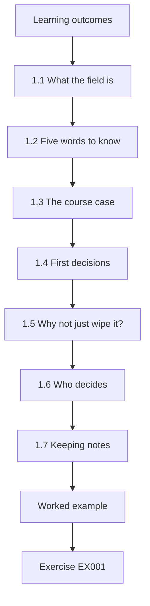
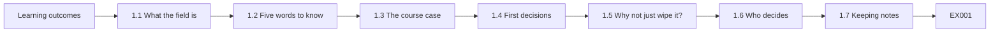
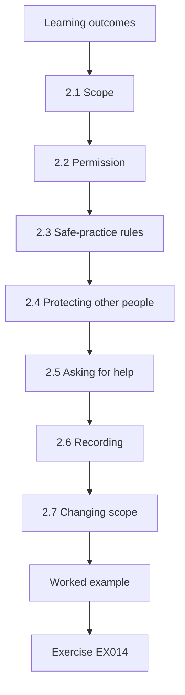
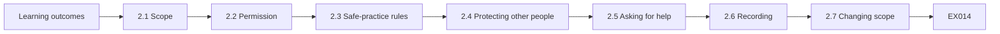
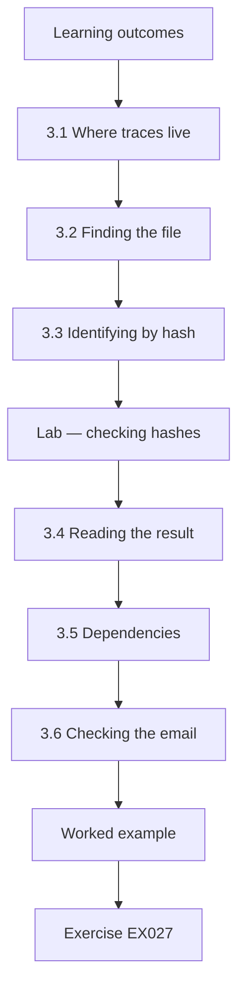
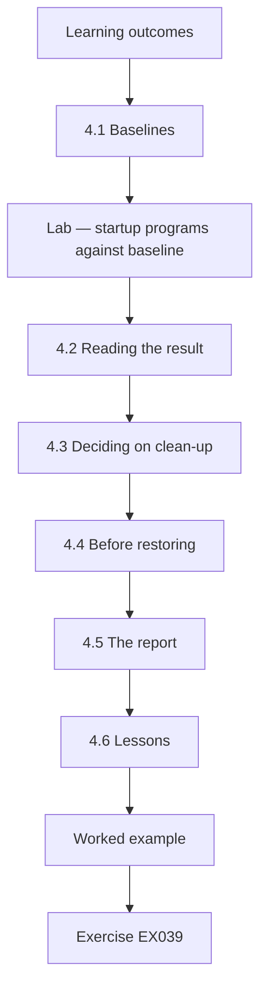
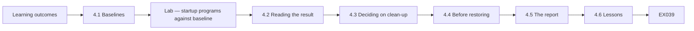

```mermaid
flowchart LR
  N0["Learning outcomes"]
  N1["3.1 Where traces live"]
  N2["3.2 Finding the file"]
  N3["3.3 Identifying by hash"]
  N4["Lab — checking hashes"]
  N5["3.4 Reading the result"]
  N6["3.5 Dependencies"]
  N7["3.6 Checking the email"]
  N0 --> N1 --> N2 --> N3 --> N4 --> N5 --> N6 --> N7 --> Q["EX027"]
```

# Digital Forensics and Malware Analysis: Rapid Course

- Language: English (`en`); course 017, Rapid course (1 month).
- Editorial state: **published**. Chapters 1–4 of 4 have hand-written teaching text; exercises EX001–EX050 have matching worked results with 0–3 rubrics; Two offline labs use only the Python 3 standard library on synthetic evidence, and their outputs are embedded from real runs. Independent review and the 300-page A4 verification remain open.
- Audience: new learners who want to recognise the core risks and complete one guided forensic task safely.
- Author: [hiagokinlevi](https://github.com/hiagokinlevi). Original text [CC0 1.0](../../../../../LICENSE); cited works keep their rights.
- Ethical and legal boundary: examine only media and systems you are authorised to examine; no live malware, no exploit code, no payloads and no instructions for defeating protections. Malware is discussed through behaviour, artefacts and safe static descriptions of synthetic samples. All evidence, people and organisations are **synthetic** unless a sentence cites a public source.

[Course home](../../README.md) · [Chapter index](../SUBJECTS.md) · [Book plan](PLAN.md) · [Course skill](../../skill/SKILL.md) · [Worked results](#worked-results)

## How to use this draft

Read in order: the four chapters follow one small charity laptop incident from first decisions to a short report. Run each lab where it appears, attempt the exercises before the worked results, and score yourself with the rubrics.

### Synthetic running case

| Element | Role | Boundary |
|---|---|---|
| **Tomás Reyes** | Volunteer | Invented |
| **Priya Nair** | Volunteer IT coordinator | Invented |
| **Ana** | Food bank coordinator | Invented |
| **Riverside Food Bank** | Fictional charity | Invented |

### Core sources

NIST [SP 800-86](https://doi.org/10.6028/NIST.SP.800-86) and [SP 800-101r1](https://doi.org/10.6028/NIST.SP.800-101r1); [RFC 3227](https://www.rfc-editor.org/rfc/rfc3227); ISO/IEC [27037](https://www.iso.org/standard/44381.html), [27041](https://www.iso.org/standard/44405.html), [27042](https://www.iso.org/standard/44406.html) and [27043](https://www.iso.org/standard/44407.html); [SWGDE](https://www.swgde.org/documents/published-complete-listing); Carrier, *File System Forensic Analysis* (2005). Full list in [References](#references).

## Contents

| Chapters |
|---|
| [1](#ch-01) · [2](#ch-02) · [3](#ch-03) · [4](#ch-04) |

[Worked results](#worked-results) · [References](#references)

<a id="ch-01"></a>

## Chapter 1 — Digital forensics and malware analysis: foundations and decisions

<!-- cykin:lesson-figures:start ch-01 -->
### Lesson map

Lesson 01 published. Map, example, EX001.



### Logical drawing



```text
[Learning outcomes]
    |
    v
[1.1 What the field is]
    |
    v
[1.2 Five words to know]
    |
    v
[1.3 The course case]
    |
    v
[1.4 First decisions]
    |
    v
[1.5 Why not just wipe it?]
    |
    v
[1.6 Who decides]
    |
    v
[1.7 Keeping notes]
    |
    v
[Worked example] --> [Exercise EX001]
```
<!-- cykin:lesson-figures:end ch-01 -->


### Learning outcomes

You will (1) explain in plain words what digital forensics and malware analysis are; (2) define malware, artefact, evidence, hash and incident; (3) describe the first decisions after something looks wrong; (4) meet the course case.

### 1.1 What the field is

Digital forensics is the careful study of computers and accounts to find out what happened, in a way other people can check. Malware analysis looks at suspicious programs to learn what they do. Both help people respond to incidents: NIST SP 800-61 describes response as preparing, detecting and analysing, containing and recovering, then learning lessons.

In this course the incident is small: one laptop at a food bank showing fake virus alerts. Priya does not need a lab. She needs to find out what the downloaded file installed, whether any food bank account is at risk, and how to make the laptop safe again, in a way Ana can check afterwards.

### 1.2 Five words to know

**Malware** is software made to cause harm, such as stealing data or showing fake alerts. An **artefact** is any trace on a computer: a file, a log line, a startup entry. **Evidence** is an artefact you have collected carefully so you can show it was not changed. A **hash** is a short fingerprint calculated from a file; if one byte changes, the fingerprint changes. An **incident** is an event that harms or threatens systems or data.

In the course case, FreeTemplates_setup.exe is the malware, and TemplateUpdater in the startup list is an artefact. Priya's saved copy of the startup list becomes evidence once its date and source are written down.

### 1.3 The course case

**Tomás Reyes** volunteers at the fictional **Riverside Food Bank**. On a Tuesday he downloads a "free invoice template" from an advert. Soon, pop-ups claim the laptop is infected and urge him to phone a number. He tells **Priya Nair**, the food bank's volunteer IT coordinator.

The pop-ups are a known trick: the program wants Tomás to phone a fake support line, where someone may ask for payment or for remote access to the laptop. Tomás did the right thing by telling someone instead of calling. The question for Priya is what the template file put on the laptop, and whether anything beyond the laptop is affected, such as the food bank's email or donations account.

### 1.4 First decisions

Priya's first decisions are simple: do not phone the number; do not pay anything; stop using the laptop for food bank work; disconnect it from Wi-Fi; write down what is seen and when. She does not delete files yet, because they may tell her what happened.

Disconnecting from Wi-Fi stops the laptop from talking to the internet, so a program on it cannot download more files or send data out. Leaving it switched on but disconnected keeps the pop-ups visible for her notes. Her first note records all of this: report at 14:20, laptop disconnected at 14:25, Ana's permission at 14:30, no calls made and nothing paid.

### 1.5 Why not just wipe it?

Wiping removes the problem but also the answers: what was installed, whether passwords were taken, whether other machines are affected. A few careful steps first make the fix safer.

For FB-LAP-02, those first steps answered the main worry. The hash check identified the file as known adware, the startup list showed two new programs, and the email sign-in history showed only Tomás's usual sign-ins. With those answers written down, Priya and Ana could restore the laptop on Thursday knowing what they were removing, and knowing that the food bank's email did not need further work beyond a new password and two-step sign-in.

### 1.6 Who decides

The food bank's coordinator owns the laptop. Priya asks her permission before examining it.

Ana owns the decisions, not just the laptop. She decides what Priya may examine, whether Tomás's food bank email may be checked, whether the laptop is restored or cleaned, and whether anyone outside the food bank must be told. Priya's job is to give Ana clear facts and options. When Priya later needs to look at the email account, she goes back to Ana rather than deciding for herself, and Ana's answer is added to the scope in writing.

### 1.7 Keeping notes

Every step goes in a notebook with the time.

Write down the time, what you did, what you saw, and where it came from, in words someone else can follow. Priya's first note does this: "Tue 14:20 — Tomás reports pop-ups after downloading 'FreeTemplates_setup.exe' at about 13:50." Later, the browser history gave the exact download time, 13:48, and her notes show both the first report and the later, checked time. A good note never changes old entries; it adds new ones.

### Worked example

The next lines of Priya's first note read: "Laptop FB-LAP-02 disconnected from Wi-Fi 14:25. Coordinator Ana gave permission to examine 14:30. No calls made, nothing paid."

> **Synthetic case.** Riverside Food Bank, the laptop and all people are invented.

### Errors and limits

Fake alerts are designed to scare; calm, written steps work better than speed.

### Exercises

- **EX001 — Forensics in a sentence.** Explain digital forensics in one plain sentence. *Rubric:* 3 = finding what happened on computers in a checkable way; 2 = partial; 1 = hacking; 0 = none.
- **EX002 — Malware analysis.** What question does malware analysis answer? *Rubric:* 3 = what a suspicious program does; 2 = partial; 1 = who wrote it; 0 = none.
- **EX003 — Define malware.** Give a definition of malware with one example of harm. *Rubric:* 3 = harmful software plus example (theft, fake alerts); 2 = definition only; 1 = any program; 0 = none.
- **EX004 — Artefact.** Name three kinds of artefact. *Rubric:* 3 = file, log line, startup entry (any three traces); 2 = two; 1 = one; 0 = none.
- **EX005 — Evidence versus artefact.** What turns an artefact into evidence? *Rubric:* 3 = careful collection showing it was not changed; 2 = partial; 1 = vague; 0 = none.
- **EX006 — Hash.** Describe what a hash does. *Rubric:* 3 = fingerprint of a file; changes if any byte changes; 2 = partial; 1 = password; 0 = none.
- **EX007 — Incident.** Is Tomás's situation an incident? Explain. *Rubric:* 3 = yes; threatens laptop and data; 2 = yes only; 1 = no; 0 = none.
- **EX008 — Response phases.** List the incident response phases. *Rubric:* 3 = prepare, detect/analyse, contain/recover, lessons; 2 = three; 1 = one; 0 = none.
- **EX009 — Do not call.** Why should Tomás not phone the number? *Rubric:* 3 = fake alert scam; callers ask for money or remote access; 2 = partial; 1 = fine to call; 0 = none.
- **EX010 — Disconnect.** What does disconnecting from Wi-Fi achieve? *Rubric:* 3 = stops communication and spread while keeping evidence; 2 = partial; 1 = vague; 0 = none.
- **EX011 — Wipe now?** Give one reason not to wipe straight away. *Rubric:* 3 = lose answers about what happened, passwords, other machines; 2 = partial; 1 = wipe now; 0 = none.
- **EX012 — Permission.** Whose permission did Priya need, and why? *Rubric:* 3 = coordinator Ana, owner of laptop; 2 = name only; 1 = vague; 0 = none.
- **EX013 — First note.** List four details in Priya's first note. *Rubric:* 3 = report time, file name, disconnect time, permission, no calls/payment (four); 2 = three; 1 = one; 0 = none.

### Synthesis

Understand the basic words, decide calmly, keep evidence and write down every step.

### Continue studying — chapter 01 of 04

[← Course home](../../README.md) · [Course chapter index](../SUBJECTS.md) · [Chapter 02 (draft) →](#ch-02)

<a id="ch-02"></a>

## Chapter 2 — Scope, permission and safe practice

<!-- cykin:lesson-figures:start ch-02 -->
### Lesson map

Lesson 02 published. Map, example, EX014.



### Logical drawing



```text
[Learning outcomes]
    |
    v
[2.1 Scope]
    |
    v
[2.2 Permission]
    |
    v
[2.3 Safe-practice rules]
    |
    v
[2.4 Protecting other people]
    |
    v
[2.5 Asking for help]
    |
    v
[2.6 Recording]
    |
    v
[2.7 Changing scope]
    |
    v
[Worked example] --> [Exercise EX014]
```
<!-- cykin:lesson-figures:end ch-02 -->


### Learning outcomes

You will (1) set a written scope; (2) explain why permission matters; (3) follow safe-practice rules with suspicious files; (4) protect other people's data.

### 2.1 Scope

Scope says what you may look at, for which purpose and for how long. Priya writes: "Laptop FB-LAP-02 only; purpose: find what the downloaded file installed and whether food bank data is at risk; Tuesday–Friday." Tomás's personal phone is not in scope.

Each part of Priya's scope has a reason. One laptop, because that is where the problem appeared. A question, so she knows when she has finished. Four days, so the work does not drift into a general review of every food bank computer. Tomás's phone is excluded because it belongs to him, not the food bank.

### 2.2 Permission

Looking at a computer without the owner's permission can break the law and trust. Ana, the coordinator, signs the scope. Tomás agrees too, since he used the laptop and may have personal browser data on it.

Ana's signature also protects Priya. If someone later asks why she looked at the laptop, she can show the signed scope. Tomás's agreement matters because his personal browser data may be on the laptop; Priya tells him she will not read his personal browsing beyond what the question needs, such as the advert page visited just before the download.

### 2.3 Safe-practice rules

Never run a suspicious file to "see what it does". Never send it by ordinary email. Never upload it to public websites without permission, because files can contain private data. Work on a copy of evidence when possible. Keep the laptop off the network.

Priya follows each rule in this case. She never runs FreeTemplates_setup.exe; she calculates its hash instead. She does not upload the file to a public checking website, because Ana has not agreed and the file might contain private data. She keeps FB-LAP-02 off Wi-Fi until it is restored. When she copies her notes to a USB stick, she copies only her own notes and results, not the suspicious file.

### 2.4 Protecting other people

The laptop holds a list of food bank clients. Priya looks only at what the question needs and does not open the client list. If client data was at risk, Ana must decide whether to tell people.

The question is whether the downloaded file could have read or sent data, not what the client list says. If the evidence had shown data leaving the laptop, Priya would have told Ana what kind of data was on it, and Ana, not Priya, would decide whether clients must be told. In this case nothing pointed to data leaving, and the client list stayed unopened.

### 2.5 Asking for help

When something is beyond her skill, Priya asks a trusted professional rather than guessing. Knowing your limits is part of safe practice.

In this case, the evidence pointed to a known adware installer with no sign of email misuse, which Priya could handle. If the hash had matched nothing and the laptop had shown signs of sending data out, she would have stopped and asked Ana to bring in a professional incident responder, keeping the laptop disconnected and her notes ready to hand over.

### 2.6 Recording

Scope, permission, and any change to them are written and dated.

Priya's scope page shows three dated entries: the original scope signed by Ana on Tuesday, Tomás's agreement, and Wednesday's change that added "food bank email account sign-in history". Each entry says who agreed and when. If anyone later asks why Priya looked at the email account, the page answers the question without anyone having to remember. A spoken "yes, go ahead" in a corridor is easy to forget or dispute; a dated line is not.

### 2.7 Changing scope

If Priya finds signs that another laptop is affected, she asks Ana before looking at it.

The email account is the case's real example. On Wednesday, Priya saw that Tomás had saved the food bank email password in the browser. Checking whether the account was misused was outside the original scope, which covered the laptop only. She asked Ana, who added the email sign-in history to the scope in writing. Only then did Priya look. If another laptop had shown the same pop-ups, the same step would apply before she touched it.

### Worked example

The scope change Priya added on Wednesday reads: "Added: food bank email account sign-in history. Reason: Tomás's food bank email password is saved in the browser on FB-LAP-02, so the account may have been misused. Agreed by: Ana, coordinator." The line sits under the original Tuesday scope, which stays unchanged.

> **Synthetic case.** The scope and events are invented.

### Errors and limits

Good intentions do not replace permission; ask first even when it feels slow.

### Exercises

- **EX014 — Scope parts.** What three things does a scope state? *Rubric:* 3 = what, purpose, time; 2 = two; 1 = one; 0 = none.
- **EX015 — Out of scope.** Name one thing outside Priya's first scope. *Rubric:* 3 = Tomás's personal phone (or email account before widening); 2 = vague; 1 = laptop; 0 = none.
- **EX016 — Who signs.** Who signed the scope, and who else agreed? *Rubric:* 3 = Ana signed; Tomás agreed; 2 = one; 1 = nobody; 0 = none.
- **EX017 — Never run.** Why never run a suspicious file to test it? *Rubric:* 3 = it may do harm and change evidence; 2 = partial; 1 = fine; 0 = none.
- **EX018 — Public upload.** What is the risk of uploading a file to public sites? *Rubric:* 3 = may expose private data; needs permission; 2 = partial; 1 = vague; 0 = none.
- **EX019 — Client list.** How did Priya treat the client list? *Rubric:* 3 = did not open it; looked only at what was needed; 2 = partial; 1 = read it; 0 = none.
- **EX020 — Telling clients.** Who decides whether to tell clients, and why? *Rubric:* 3 = Ana, as the responsible owner; 2 = name only; 1 = Priya; 0 = none.
- **EX021 — Limits.** What should Priya do when a task is beyond her skill? *Rubric:* 3 = ask a trusted professional; 2 = partial; 1 = guess; 0 = none.
- **EX022 — Network.** Why keep the laptop off the network? *Rubric:* 3 = stop contact and spread; 2 = partial; 1 = faster; 0 = none.
- **EX023 — Copies.** Why work on a copy when possible? *Rubric:* 3 = original stays unchanged; 2 = partial; 1 = no reason; 0 = none.
- **EX024 — Saved password.** What was found on Wednesday? *Rubric:* 3 = saved food bank email password in browser; 2 = partial; 1 = wrong; 0 = none.
- **EX025 — Widening.** How was the scope widened? *Rubric:* 3 = asked Ana; added email sign-in history in writing; 2 = partial; 1 = just looked; 0 = none.
- **EX026 — Second laptop.** If another laptop looks affected, what comes first? *Rubric:* 3 = ask Ana before examining; 2 = partial; 1 = examine; 0 = none.

### Synthesis

Write the scope, get permission, handle suspicious files safely, protect others' data and widen scope only in writing.

### Continue studying — chapter 02 of 04

[← Chapter 01 (draft)](#ch-01) · [Course chapter index](../SUBJECTS.md) · [Chapter 03 (draft) →](#ch-03)

<a id="ch-03"></a>

## Chapter 3 — Digital forensics and malware analysis: systems, data and dependencies

<!-- cykin:lesson-figures:start ch-03 -->
### Lesson map

Lesson 03 published. Map, example, EX027.



### Logical drawing



```text
[Learning outcomes]
    |
    v
[3.1 Where traces live]
    |
    v
[3.2 Finding the file]
    |
    v
[3.3 Identifying by hash]
    |
    v
[Lab — checking hashes]
    |
    v
[3.4 Reading the result]
    |
    v
[3.5 Dependencies]
    |
    v
[3.6 Checking the email]
    |
    v
[Worked example] --> [Exercise EX027]
```
<!-- cykin:lesson-figures:end ch-03 -->


### Learning outcomes

You will (1) find where useful traces live on a laptop; (2) use hashes to identify known files; (3) understand how accounts and services depend on each other; (4) record findings with sources.

### 3.1 Where traces live

On a laptop: the downloads folder, the list of installed programs, startup entries (programs that run at sign-in), browser history and security logs. Each answers part of the question.

In this case, Downloads showed the installer and its time; the browser history showed the advert page visited just before; and the startup list showed what the installer added. Security logs could show whether anything tried to sign in with stolen passwords. No single place gives the full story, which is why Priya checks several and writes down which place each fact came from.

### 3.2 Finding the file

In Downloads, Priya finds FreeTemplates_setup.exe, downloaded at 13:48. The browser history shows the advert page just before.

Two times fit together here: the advert page at 13:46 and the download at 13:48. Tomás remembered "about 13:50", which is close but not exact; the file's own time is more reliable than memory. Priya does not open or run the file. She only notes its name, its folder and its time, then moves to the hash check.

The two-minute gap fits a click on the advert followed by a download. A gap of an hour would have suggested that something else, such as another site, delivered the file.

### 3.3 Identifying by hash

Instead of running the file, she calculates its hash and compares it with a list of known bad files. Kornblum (2006) and others describe how hashes help sort known from unknown files.

The lab shows how: the script calculates each file's SHA-256 fingerprint and looks for it in a short known-bad list. Only FreeTemplates_setup.exe matches. The file never has to run, so the check is safe. In real work the list would come from a trusted source, and Priya would record which version of the list she used, as her note does with "list v1".

### Lab — checking hashes

```python
"""Compare SHA-256 hashes of synthetic files with a synthetic known-bad list."""
import hashlib
files = {
    "budget.xlsx": b"synthetic spreadsheet bytes",
    "FreeTemplates_setup.exe": b"synthetic installer bytes - not a real program",
    "photo.jpg": b"synthetic photo bytes",
}
known_bad = {hashlib.sha256(b"synthetic installer bytes - not a real program").hexdigest(): "Fake-template adware (synthetic)"}
for name, data in files.items():
    h = hashlib.sha256(data).hexdigest()
    print(f"{name:25} {h[:12]}  {known_bad.get(h, 'no match')}")
```

Run with `python3 lab_hashcheck.py`. Verified output:

```text
budget.xlsx               0edf30e2fa30  no match
FreeTemplates_setup.exe   3e5d3b83407c  Fake-template adware (synthetic)
photo.jpg                 ffcab6e8630a  no match
```

### 3.4 Reading the result

budget.xlsx and photo.jpg have no match. FreeTemplates_setup.exe matches "Fake-template adware" in the synthetic list. A match identifies a known file; no match does not prove a file is safe.

Both files could still be harmful, but nothing else points to them: they were not downloaded with the installer, and they did not add startup programs. Priya records them as checked, with no match, and moves on. She does not write "clean". A known-bad list only covers files that were reported before it was last updated, so she also writes the date of the list next to the results.

### 3.5 Dependencies

The laptop's browser holds a saved password for the food bank email. The email is used to reset the online donations account. So a problem on one laptop could reach the email and then donations. Mapping such links shows what else to check.

This chain is why Ana widened the scope to the email account. Priya also notes the donations account as the next link: if the email had shown strange sign-ins, she would have asked Ana to check the donations account's recent activity and password reset history too.

### 3.6 Checking the email

Within the widened scope, the email sign-in history shows only Tomás's usual sign-ins. Priya changes the password anyway, from a clean computer, and turns on two-step sign-in.

She changes the password from a clean computer because the laptop might still have a program that records what is typed. A new password typed on FB-LAP-02 could be captured at once. Two-step sign-in means a stolen password alone is not enough to get into the email. Her note records the time: 15:10 on Wednesday. Tomás is told not to save the new password in the laptop's browser.

### 3.7 Recording

Each finding is written with where it came from.

Priya's Wednesday note shows the pattern: the installer "in Downloads, 13:48"; the hash match "known adware (list v1)"; the advert page from "browser history 13:46"; and the email sign-ins checked and found normal. Each fact names its source. If Ana or a professional later doubts one of them, they know where to look again. A finding with no source can only be trusted on Priya's word, and a careful note means nobody has to rely on that.

### Worked example

Priya's note: "FreeTemplates_setup.exe in Downloads, 13:48; hash matches known adware (list v1); browser history shows advert page 13:46. Email sign-ins normal; password changed from clean PC 15:10 Wed; two-step on."

> **Synthetic case.** Files and hashes come from the lab script.

### Errors and limits

Known-bad lists miss new or changed files; use hashes as one clue among several.

### Exercises

- **EX027 — Trace locations.** Name four places traces live on a laptop. *Rubric:* 3 = downloads, installed programs, startup entries, browser history, logs (four); 2 = three; 1 = one; 0 = none.
- **EX028 — Download time.** When was the file downloaded, and what came just before? *Rubric:* 3 = 13:48; advert page 13:46; 2 = one; 1 = wrong; 0 = none.
- **EX029 — Hash not run.** Why compare hashes instead of running the file? *Rubric:* 3 = identifies safely without harm; 2 = partial; 1 = faster; 0 = none.
- **EX030 — Hash lab.** Which file matched, and as what? *Rubric:* 3 = FreeTemplates_setup.exe, fake-template adware; 2 = file only; 1 = wrong; 0 = none.
- **EX031 — No match.** Does "no match" mean safe? *Rubric:* 3 = no; new/changed files not on list; 2 = no only; 1 = yes; 0 = none.
- **EX032 — Dependency chain.** Explain the laptop-to-donations chain. *Rubric:* 3 = saved email password → email resets donations account; 2 = partial; 1 = vague; 0 = none.
- **EX033 — Email check result.** What did the sign-in history show? *Rubric:* 3 = only usual sign-ins; 2 = partial; 1 = attacker; 0 = none.
- **EX034 — Clean computer.** Why change the password from a clean computer? *Rubric:* 3 = infected laptop might capture new password; 2 = partial; 1 = no reason; 0 = none.
- **EX035 — Two-step.** What does two-step sign-in add? *Rubric:* 3 = second proof beyond password; 2 = partial; 1 = vague; 0 = none.
- **EX036 — Source notes.** Why write where each finding came from? *Rubric:* 3 = others can check it; 2 = partial; 1 = habit; 0 = none.
- **EX037 — Startup entries.** What are startup entries? *Rubric:* 3 = programs that run automatically at sign-in; 2 = partial; 1 = wrong; 0 = none.
- **EX038 — Known lists.** State one limit of known-bad lists. *Rubric:* 3 = miss new or changed files; 2 = partial; 1 = vague; 0 = none.

### Synthesis

Know where traces live, identify files safely by hash, follow dependencies and write sources beside findings.

### Continue studying — chapter 03 of 04

[← Chapter 02 (draft)](#ch-02) · [Course chapter index](../SUBJECTS.md) · [Chapter 04 (draft) →](#ch-04)

<a id="ch-04"></a>

## Chapter 4 — Digital forensics and malware analysis: guided lab and applied synthesis

<!-- cykin:lesson-figures:start ch-04 -->
### Lesson map

Lesson 04 published. Map, example, EX039.



### Logical drawing



```text
[Learning outcomes]
    |
    v
[4.1 Baselines]
    |
    v
[Lab — startup programs against baseline]
    |
    v
[4.2 Reading the result]
    |
    v
[4.3 Deciding on clean-up]
    |
    v
[4.4 Before restoring]
    |
    v
[4.5 The report]
    |
    v
[4.6 Lessons]
    |
    v
[Worked example] --> [Exercise EX039]
```
<!-- cykin:lesson-figures:end ch-04 -->


### Learning outcomes

You will (1) compare a system against a baseline in a guided lab; (2) decide on clean-up with evidence; (3) write a short report; (4) list lessons and next steps.

### 4.1 Baselines

A baseline is a record of what normal looks like. Priya saved a list of startup programs when the food bank laptops were set up. Comparing today's list with it shows what changed.

The baseline only helps because it was saved before the problem. For FB-LAP-02 it listed three startup programs: OneDrive, AudioService and PrinterHelper. Without it, Priya would see five programs and have to judge each name by guessing; with it, the lab prints the two that are new, and her attention goes straight to them.

### Lab — startup programs against baseline

```python
"""Compare a synthetic list of startup programs with a saved baseline."""
baseline = {"OneDrive", "AudioService", "PrinterHelper"}
today = {"OneDrive", "AudioService", "PrinterHelper", "TemplateUpdater", "AlertPopup"}
print("baseline:", len(baseline), "today:", len(today))
for name in sorted(today - baseline):
    print("NEW:", name)
for name in sorted(baseline - today):
    print("MISSING:", name)
```

Run with `python3 lab_startup.py`. Verified output:

```text
baseline: 3 today: 5
NEW: AlertPopup
NEW: TemplateUpdater
```

### 4.2 Reading the result

Three baseline programs are still present. Two are new: TemplateUpdater and AlertPopup. Their names and timing match the template download, and AlertPopup explains the fake alerts.

The lab also prints nothing under MISSING, which tells Priya that none of the three normal programs was removed or replaced. That matters: some harmful programs disable or replace normal ones. Her note records the two new names, the time they appeared, and that they fit the download at 13:48. She does not open them; their names and timing are enough to decide what to do next.

### 4.3 Deciding on clean-up

Evidence so far: a known adware installer, two new startup programs, no sign of email misuse. Because the laptop is small and backed up, Priya and Ana decide to restore it from the clean setup image rather than remove items one by one; removal might miss something.

Restoring from the clean image takes the laptop back to its known setup. It also removes anything the startup list did not show. The decision is Ana's, made with Priya's facts in front of her. Tomás's documents are safe because they are in the shared drive, not only on the laptop.

### 4.4 Before restoring

Priya copies her notes, the hash results and the startup comparison to a USB stick, and Tomás confirms his documents are in the shared drive.

Once the laptop is restored, the old disk contents are gone, so anything not saved now is lost for good. Priya saves her own records, not the suspicious installer: the notes, the three hash results and the startup comparison showing TemplateUpdater and AlertPopup. If the same adware appears on another food bank laptop, these records show what to look for. Priya labels the USB stick with the case date and keeps it locked away with the scope page.

### 4.5 The report

A one-page report: what happened, when, what was found, what was done, and what will change. Plain words for volunteers.

Priya's report fits on one page: on Tuesday at 13:48 a fake template installer was downloaded from an advert; it added two startup programs, including one that showed fake virus alerts; no email misuse was found; the laptop was restored on Thursday from the clean image; the email password was changed and two-step sign-in enabled. It ends with the changes: standard accounts for volunteers and a list of approved template sites.

### 4.6 Lessons

Download templates only from known sites; use a standard account without admin rights; keep the startup baseline current; report pop-ups early, as Tomás did.

Each lesson comes from a fact in this case. Templates from known sites, because the installer came from an advert. A standard account without admin rights, because that would likely have stopped the installer from adding startup programs. A current baseline, because the saved startup list made the new programs easy to spot. Early reporting, because Tomás's quick message meant the laptop was off Wi-Fi within minutes of his report.

### 4.7 Next steps for learners

This course gives a first, guided taste. Further courses add evidence handling, timelines and supervised casework.

In this course, Priya hashed files without running them, compared startup programs with a baseline, and widened scope only with Ana's written agreement. Later courses build on each step: evidence copies with their own hashes, timelines that combine browser history and system logs, and casework supervised by an experienced examiner.

Each of those later steps still starts where Priya started: with written permission, a clear question and notes that someone else can check.

### Worked example

Priya's report: "Tue 13:48 a fake template installer was downloaded from an advert. It added two startup programs, including one that showed fake virus alerts. No email misuse found. The laptop was restored on Thursday from the clean image; the email password was changed and two-step sign-in enabled. Changes: standard accounts for volunteers; a list of approved template sites."

> **Synthetic case.** The lab data and report are invented.

### Errors and limits

A baseline helps only if it is up to date; old baselines flag normal updates as new.

### Exercises

- **EX039 — Baseline meaning.** Define a baseline. *Rubric:* 3 = record of normal state for comparison; 2 = partial; 1 = backup; 0 = none.
- **EX040 — Lab result.** Which entries were new? *Rubric:* 3 = TemplateUpdater and AlertPopup; 2 = one; 1 = wrong; 0 = none.
- **EX041 — Pop-up cause.** Which entry explains the pop-ups? *Rubric:* 3 = AlertPopup; 2 = guess with reason; 1 = wrong; 0 = none.
- **EX042 — Restore versus remove.** Why restore rather than remove items? *Rubric:* 3 = removal may miss something; laptop backed up and simple; 2 = partial; 1 = faster; 0 = none.
- **EX043 — Before restoring.** What was saved before restoring? *Rubric:* 3 = notes, hash results, comparison; documents confirmed in shared drive; 2 = partial; 1 = vague; 0 = none.
- **EX044 — Evidence summary.** Summarise the evidence for the decision. *Rubric:* 3 = known adware hash, two new startup entries, no email misuse; 2 = two; 1 = one; 0 = none.
- **EX045 — Report audience.** Who is the report for, and how is it written? *Rubric:* 3 = volunteers; plain words, one page; 2 = partial; 1 = technical; 0 = none.
- **EX046 — Report parts.** List the parts of the report. *Rubric:* 3 = what, when, found, done, changes; 2 = three; 1 = one; 0 = none.
- **EX047 — Lessons.** Give three lessons. *Rubric:* 3 = known sites, standard accounts, current baseline, early reporting (three); 2 = two; 1 = one; 0 = none.
- **EX048 — Admin rights.** How do standard accounts help? *Rubric:* 3 = installers cannot add startup programs without admin approval; 2 = partial; 1 = vague; 0 = none.
- **EX049 — Old baseline.** What happens with an old baseline? *Rubric:* 3 = normal updates appear as new; false alarms; 2 = partial; 1 = vague; 0 = none.
- **EX050 — Tomás's part.** What did Tomás do well? *Rubric:* 3 = reported quickly; did not call or pay; 2 = one; 1 = vague; 0 = none.

### Synthesis

Compare against a baseline, decide clean-up from evidence, report plainly and turn lessons into changes.

### Continue studying — chapter 04 of 04

[← Chapter 03 (draft)](#ch-03) · [Course chapter index](../SUBJECTS.md) · [Worked results ↓](#worked-results) · [Next course via chapter index →](../SUBJECTS.md)

<a id="worked-results"></a>

## Worked results

Model answers for EX001–EX050. Tomás Reyes, Priya Nair, Ana, Riverside Food Bank and every figure are synthetic. Lab answers quote verified outputs. Any answer meeting the rubric scores equally.

**EX001.** It is the careful study of computers and accounts to find out what happened, done so others can check the work.

**EX002.** What a suspicious program actually does.

**EX003.** Software designed to cause harm, for example by stealing passwords or showing fake virus alerts.

**EX004.** A file, a log line and a startup entry.

**EX005.** Collecting it carefully and recording it so you can show it has not been changed.

**EX006.** It computes a short fingerprint from a file; changing even one byte gives a different fingerprint.

**EX007.** Yes, because a harmful program threatens the laptop and the food bank's data.

**EX008.** Prepare; detect and analyse; contain and recover; learn lessons.

**EX009.** The pop-up is a scam, and the people on the phone usually ask for payment or remote control of the laptop.

**EX010.** It stops the laptop talking to the internet or spreading, while leaving its contents in place to examine.

**EX011.** Wiping destroys the traces that show what was installed, whether passwords were taken and whether other devices are at risk.

**EX012.** Ana, the coordinator, because the food bank owns the laptop.

**EX013.** When Tomás reported it, the file name, when Wi-Fi was disconnected and when Ana gave permission (and that no calls or payments were made).

**EX014.** What may be examined, for what purpose, and for how long.

**EX015.** Tomás's personal phone.

**EX016.** Ana signed it, and Tomás also agreed because he had used the laptop.

**EX017.** Running it could cause harm and would change the very evidence being studied.

**EX018.** The file might contain private information, and uploading it without permission could expose that.

**EX019.** She left it closed and examined only what the question required.

**EX020.** Ana, because she is responsible for the food bank and its clients.

**EX021.** Ask a trusted professional for help instead of guessing.

**EX022.** It prevents the malware contacting anyone or spreading to other devices.

**EX023.** So the original stays exactly as it was found.

**EX024.** Tomás had saved his food bank email password in the browser.

**EX025.** Priya asked Ana, who added the email account's sign-in history to the written scope.

**EX026.** Get Ana's permission before examining it.

**EX027.** The downloads folder, installed programs, startup entries and browser history (security logs as well).

**EX028.** At 13:48, just after the advert page was visited at 13:46.

**EX029.** A hash identifies the file without running it, so nothing harmful happens.

**EX030.** FreeTemplates_setup.exe, listed as fake-template adware.

**EX031.** No: new or modified files will not be on the list.

**EX032.** The browser stores the food bank email password, and that email can reset the donations account, so one laptop can lead to donations.

**EX033.** Only Tomás's normal sign-ins.

**EX034.** If the laptop is still infected it might record the new password as it is typed.

**EX035.** A second proof, such as a code on a phone, so a stolen password alone is not enough.

**EX036.** So someone else can go to the same place and confirm it.

**EX037.** Programs set to start on their own whenever someone signs in.

**EX038.** They cannot recognise files that are new or have been altered.

**EX039.** A saved record of what normal looks like, used to spot changes.

**EX040.** TemplateUpdater and AlertPopup.

**EX041.** AlertPopup, whose name and timing fit the fake virus alerts.

**EX042.** Removing items one by one could leave something behind, and the laptop had a clean image and backups.

**EX043.** Priya's notes, the hash results and the startup comparison went to a USB stick, and Tomás confirmed his files were on the shared drive.

**EX044.** The installer's hash matched known adware, two unexpected startup programs appeared, and the email showed no misuse.

**EX045.** Food bank volunteers, so it is one page in plain language.

**EX046.** What happened, when it happened, what was found, what was done and what will change.

**EX047.** Get templates only from known sites, give volunteers standard accounts and keep the startup baseline current.

**EX048.** Without administrator rights, an installer cannot quietly register programs to start at sign-in.

**EX049.** Ordinary software updates show up as changes, causing false alarms.

**EX050.** He reported the pop-ups promptly and neither phoned the number nor paid anything.

<a id="references"></a>

## References

Links checked 12 October 2026; re-verify editions before citing. Organisations, people, devices and artefacts in this book are synthetic unless a sentence cites a public source.


- Carrier, B. (2005). *File System Forensic Analysis*. Addison-Wesley. ISBN 978-0-321-26817-4.
- Casey, E. (2011). *Digital Evidence and Computer Crime* (3rd ed.). Academic Press. ISBN 978-0-12-374268-1.
- Garfinkel, S. L. (2010). Digital forensics research: The next 10 years. *Digital Investigation*, 7, S64–S73. <https://doi.org/10.1016/j.diin.2010.05.009>
- Garfinkel, S., Farrell, P., Roussev, V., & Dinolt, G. (2009). Bringing science to digital forensics with standardized forensic corpora. *Digital Investigation*, 6, S2–S11. <https://doi.org/10.1016/j.diin.2009.06.016>
- IETF RFC 3227 (2002). Brezinski, D., & Killalea, T. Guidelines for Evidence Collection and Archiving. <https://www.rfc-editor.org/rfc/rfc3227>
- ISO/IEC 27037:2012. Guidelines for identification, collection, acquisition and preservation of digital evidence. <https://www.iso.org/standard/44381.html>
- ISO/IEC 27041:2015. Guidance on assuring suitability and adequacy of incident investigative method. <https://www.iso.org/standard/44405.html>
- ISO/IEC 27042:2015. Guidelines for the analysis and interpretation of digital evidence. <https://www.iso.org/standard/44406.html>
- ISO/IEC 27043:2015. Incident investigation principles and processes. <https://www.iso.org/standard/44407.html>
- Kornblum, J. (2006). Identifying almost identical files using context triggered piecewise hashing. *Digital Investigation*, 3(S), 91–97. <https://doi.org/10.1016/j.diin.2006.06.015>
- Landis, J. R., & Koch, G. G. (1977). The measurement of observer agreement for categorical data. *Biometrics*, 33(1), 159–174. <https://doi.org/10.2307/2529310>
- MITRE ATT&CK. <https://attack.mitre.org/>
- NIST Computer Forensics Tool Testing (CFTT) Program. <https://www.nist.gov/itl/ssd/software-quality-group/computer-forensics-tool-testing-program-cftt>
- NIST National Software Reference Library (NSRL). <https://www.nist.gov/itl/ssd/software-quality-group/national-software-reference-library-nsrl>
- NIST SP 800-101 Rev. 1 (2014). Ayers, R., Brothers, S., & Jansen, W. Guidelines on Mobile Device Forensics. <https://doi.org/10.6028/NIST.SP.800-101r1>
- NIST SP 800-61 Rev. 3 (2025). Incident Response Recommendations and Considerations for Cybersecurity Risk Management. <https://doi.org/10.6028/NIST.SP.800-61r3>
- NIST SP 800-86 (2006). Kent, K., Chevalier, S., Grance, T., & Dang, H. Guide to Integrating Forensic Techniques into Incident Response. <https://doi.org/10.6028/NIST.SP.800-86>
- Roussev, V. (2010). Data fingerprinting with similarity digests. In *Advances in Digital Forensics VI*, IFIP AICT 337, 207–226. Springer. <https://doi.org/10.1007/978-3-642-15506-2_15>
- Sikorski, M., & Honig, A. (2012). *Practical Malware Analysis*. No Starch Press. <https://nostarch.com/malware>
- SWGDE (Scientific Working Group on Digital Evidence). Published documents. <https://www.swgde.org/documents/published-complete-listing>
