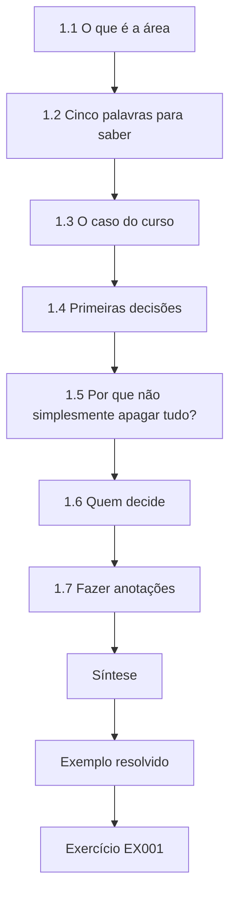
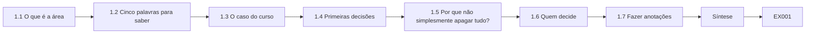
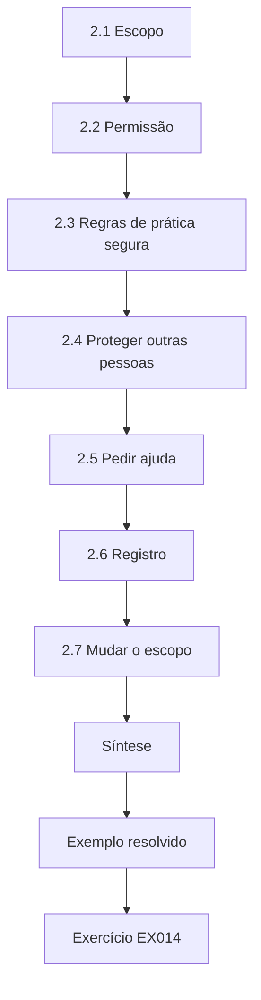
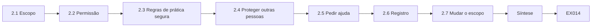
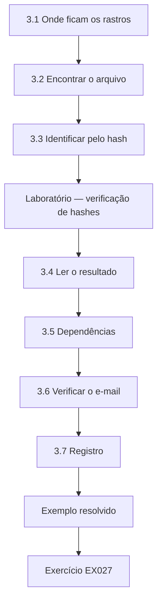
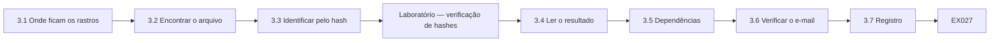
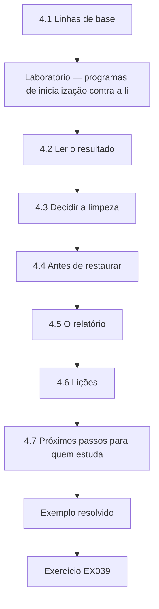
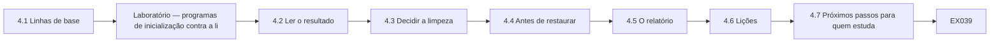

# Perícia Digital e Análise de Malware: Curso Rápido

- Idioma: português do Brasil (`pt`); curso 017, curso rápido (1 mês). Edição de referência: [inglês](../../en/book/MANUSCRIPT.md).
- Estado editorial: **publicado**. Os capítulos 1–4 de 4 têm texto didático escrito à mão; os exercícios EX001–EX050 têm resoluções correspondentes com rubricas de 0 a 3; dois laboratórios offline usam apenas a biblioteca padrão do Python 3 sobre evidências sintéticas, e suas saídas foram incorporadas a partir de execuções reais. A revisão independente e a verificação de 300 páginas A4 continuam em aberto.
- Público: iniciantes que querem reconhecer os riscos principais e concluir com segurança uma tarefa pericial guiada.
- Autor: [hiagokinlevi](https://github.com/hiagokinlevi). Texto original sob [CC0 1.0](../../../../../LICENSE); as obras citadas mantêm seus direitos.
- Limite ético e legal: examine apenas mídias e sistemas que você está autorizado a examinar; nada de malware ativo, código de exploração, *payloads* ou instruções para burlar proteções. O malware é discutido por meio de comportamento, artefatos e descrições estáticas seguras de amostras sintéticas. Todas as evidências, pessoas e organizações são **sintéticas**, salvo quando uma frase cita uma fonte pública.

[Página do curso](../../README.md) · [Índice de capítulos](../SUBJECTS.md) · [Plano do livro](PLAN.md) · [Skill do curso](../../skill/SKILL.md) · [Resoluções](#worked-results)

## Como usar este rascunho

Leia em ordem: os quatro capítulos acompanham um pequeno incidente no notebook de uma instituição de caridade, das primeiras decisões a um relatório curto. Execute cada laboratório onde ele aparece, tente os exercícios antes das resoluções e pontue-se com as rubricas.

### Caso contínuo sintético

| Elemento | Papel | Limite |
|---|---|---|
| **Tomás Reyes** | Voluntário | Inventado |
| **Priya Nair** | Coordenadora voluntária de TI | Inventada |
| **Ana** | Coordenadora do banco de alimentos | Inventada |
| **Riverside Food Bank** | Instituição de caridade fictícia | Inventada |

### Fontes principais

NIST [SP 800-86](https://doi.org/10.6028/NIST.SP.800-86) e [SP 800-101r1](https://doi.org/10.6028/NIST.SP.800-101r1); [RFC 3227](https://www.rfc-editor.org/rfc/rfc3227); ISO/IEC [27037](https://www.iso.org/standard/44381.html), [27041](https://www.iso.org/standard/44405.html), [27042](https://www.iso.org/standard/44406.html) e [27043](https://www.iso.org/standard/44407.html); [SWGDE](https://www.swgde.org/documents/published-complete-listing); Carrier, *File System Forensic Analysis* (2005). Lista completa em [Referências](#references).

## Sumário

| Capítulos |
|---|
| [1](#ch-01) · [2](#ch-02) · [3](#ch-03) · [4](#ch-04) |

[Resoluções](#worked-results) · [Referências](#references)

<a id="ch-01"></a>

## Capítulo 1 — Perícia digital e análise de malware: fundamentos e decisões

<!-- open-cyber-academy:lesson-figures:start ch-01 -->
### Mapa da aula

Aula 01 publicada. Mapa, exemplo, EX001.



### Desenho lógico



```text
[1.1 O que é a área]
    |
    v
[1.2 Cinco palavras para saber]
    |
    v
[1.3 O caso do curso]
    |
    v
[1.4 Primeiras decisões]
    |
    v
[1.5 Por que não simplesmente apagar tudo?]
    |
    v
[1.6 Quem decide]
    |
    v
[1.7 Fazer anotações]
    |
    v
[Síntese]
    |
    v
[Exemplo resolvido] --> [Exercício EX001]
```
<!-- open-cyber-academy:lesson-figures:end ch-01 -->


### Objetivos de aprendizagem

Você vai (1) explicar em palavras simples o que são a perícia digital e a análise de malware; (2) definir malware, artefato, evidência, hash e incidente; (3) descrever as primeiras decisões quando algo parece errado; (4) conhecer o caso do curso.

### 1.1 O que é a área

A perícia digital é o estudo cuidadoso de computadores e contas para descobrir o que aconteceu, de um modo que outras pessoas possam conferir. A análise de malware examina programas suspeitos para saber o que eles fazem. As duas ajudam as pessoas a responder a incidentes: a NIST SP 800-61 descreve a resposta como preparar, detectar e analisar, conter e recuperar, e depois tirar lições. Neste curso o incidente é pequeno: um notebook de um banco de alimentos exibindo falsos alertas de vírus. Priya não precisa de um laboratório. Ela precisa descobrir o que o arquivo baixado instalou, se alguma conta do banco de alimentos está em risco e como deixar o notebook seguro de novo, de um modo que Ana possa conferir depois.

### 1.2 Cinco palavras para saber

**Malware** é um software feito para causar dano, como roubar dados ou exibir alertas falsos. Um **artefato** é qualquer rastro num computador: um arquivo, uma linha de log, uma entrada de inicialização. **Evidência** é um artefato que você coletou com cuidado, de modo a poder mostrar que ele não foi alterado. Um **hash** é uma impressão digital curta calculada a partir de um arquivo; se um byte muda, a impressão digital muda. Um **incidente** é um evento que causa dano ou ameaça sistemas ou dados. No caso do curso, FreeTemplates_setup.exe é o malware, e TemplateUpdater na lista de inicialização é um artefato. A cópia salva da lista de inicialização feita por Priya se torna evidência assim que sua data e sua origem são anotadas.

### 1.3 O caso do curso

**Tomás Reyes** é voluntário no fictício **Riverside Food Bank**. Numa terça-feira, ele baixa um "modelo de fatura grátis" a partir de um anúncio. Logo, janelas *pop-up* afirmam que o notebook está infectado e insistem para que ele ligue para um número. Ele avisa **Priya Nair**, a coordenadora voluntária de TI do banco de alimentos. Os *pop-ups* são um golpe conhecido: o programa quer que Tomás ligue para uma falsa central de suporte, onde alguém pode pedir pagamento ou acesso remoto ao notebook. Tomás agiu certo ao avisar alguém em vez de ligar. A pergunta para Priya é o que o arquivo de modelo colocou no notebook e se algo além do notebook foi afetado, como o e-mail do banco de alimentos ou a conta de doações.

### 1.4 Primeiras decisões

As primeiras decisões de Priya são simples: não ligar para o número; não pagar nada; parar de usar o notebook para o trabalho do banco de alimentos; desconectá-lo do Wi-Fi; anotar o que se vê e quando. Ela ainda não apaga arquivos, porque eles podem lhe mostrar o que aconteceu. Desconectar do Wi-Fi impede o notebook de falar com a internet, então um programa nele não consegue baixar mais arquivos nem enviar dados para fora. Mantê-lo ligado, mas desconectado, deixa os *pop-ups* visíveis para as anotações dela. Sua primeira anotação registra tudo isso: relato às 14:20, notebook desconectado às 14:25, permissão de Ana às 14:30, nenhuma ligação feita e nada pago.

### 1.5 Por que não simplesmente apagar tudo?

Apagar tudo remove o problema, mas também as respostas: o que foi instalado, se senhas foram roubadas, se outras máquinas foram afetadas. Alguns passos cuidadosos antes tornam a correção mais segura. No FB-LAP-02, esses primeiros passos responderam à principal preocupação. A verificação de hash identificou o arquivo como um *adware* conhecido, a lista de inicialização mostrou dois programas novos, e o histórico de entradas do e-mail mostrou apenas as entradas habituais de Tomás. Com essas respostas anotadas, Priya e Ana puderam restaurar o notebook na quinta-feira sabendo o que estavam removendo, e sabendo que o e-mail do banco de alimentos não precisava de mais trabalho além de uma nova senha e da verificação em duas etapas.

### 1.6 Quem decide

A coordenadora do banco de alimentos é a dona do notebook. Priya pede a permissão dela antes de examiná-lo. Ana é dona das decisões, não só do notebook. Ela decide o que Priya pode examinar, se o e-mail de Tomás no banco de alimentos pode ser verificado, se o notebook será restaurado ou limpo, e se alguém de fora do banco de alimentos precisa ser avisado. O trabalho de Priya é dar a Ana fatos e opções claros. Quando, mais tarde, Priya precisa olhar a conta de e-mail, ela volta a Ana em vez de decidir por conta própria, e a resposta de Ana é acrescentada ao escopo por escrito.

### 1.7 Fazer anotações

Cada passo vai para um caderno, com o horário. Anote o horário, o que você fez, o que viu e de onde isso veio, em palavras que outra pessoa consiga acompanhar. A primeira anotação de Priya, citada no exemplo resolvido abaixo, faz isso e dá o horário do download como por volta de 13:50. Depois, o histórico do navegador forneceu o horário exato do download, 13:48, e as anotações dela mostram tanto o primeiro relato quanto o horário verificado mais tarde. Uma boa anotação nunca altera entradas antigas; ela acrescenta novas.

### Exemplo resolvido

Primeira anotação de Priya: "Ter 14:20 — Tomás relata *pop-ups* depois de baixar 'FreeTemplates_setup.exe' por volta de 13:50. Notebook FB-LAP-02 desconectado do Wi-Fi às 14:25. A coordenadora Ana deu permissão para o exame às 14:30. Nenhuma ligação feita, nada pago."

> **Caso sintético.** O Riverside Food Bank, o notebook e todas as pessoas são inventados.

### Erros e limites

Alertas falsos são feitos para assustar; passos calmos e escritos funcionam melhor do que a pressa.

### Exercícios

- **EX001 — A perícia numa frase.** Explique a perícia digital numa frase simples. *Rubrica:* 3 = descobrir o que aconteceu em computadores de um modo conferível; 2 = parcial; 1 = invasão (*hacking*); 0 = nada.
- **EX002 — Análise de malware.** Que pergunta a análise de malware responde? *Rubrica:* 3 = o que um programa suspeito faz; 2 = parcial; 1 = quem o escreveu; 0 = nada.
- **EX003 — Definir malware.** Dê uma definição de malware com um exemplo de dano. *Rubrica:* 3 = software nocivo mais exemplo (roubo, alertas falsos); 2 = só a definição; 1 = qualquer programa; 0 = nada.
- **EX004 — Artefato.** Cite três tipos de artefato. *Rubrica:* 3 = arquivo, linha de log, entrada de inicialização (quaisquer três rastros); 2 = dois; 1 = um; 0 = nada.
- **EX005 — Evidência versus artefato.** O que transforma um artefato em evidência? *Rubrica:* 3 = coleta cuidadosa que mostra que ele não foi alterado; 2 = parcial; 1 = vago; 0 = nada.
- **EX006 — Hash.** Descreva o que um hash faz. *Rubrica:* 3 = impressão digital de um arquivo; muda se qualquer byte mudar; 2 = parcial; 1 = senha; 0 = nada.
- **EX007 — Incidente.** A situação de Tomás é um incidente? Explique. *Rubrica:* 3 = sim; ameaça o notebook e os dados; 2 = só sim; 1 = não; 0 = nada.
- **EX008 — Fases da resposta.** Liste as fases da resposta a incidentes. *Rubrica:* 3 = preparar, detectar/analisar, conter/recuperar, lições; 2 = três; 1 = uma; 0 = nada.
- **EX009 — Não ligue.** Por que Tomás não deve ligar para o número? *Rubrica:* 3 = golpe do alerta falso; quem atende pede dinheiro ou acesso remoto; 2 = parcial; 1 = pode ligar; 0 = nada.
- **EX010 — Desconectar.** O que se consegue ao desconectar do Wi-Fi? *Rubrica:* 3 = interrompe a comunicação e a propagação, preservando a evidência; 2 = parcial; 1 = vago; 0 = nada.
- **EX011 — Apagar agora?** Dê um motivo para não apagar tudo de imediato. *Rubrica:* 3 = perde as respostas sobre o que aconteceu, as senhas, outras máquinas; 2 = parcial; 1 = apagar agora; 0 = nada.
- **EX012 — Permissão.** De quem Priya precisava de permissão, e por quê? *Rubrica:* 3 = da coordenadora Ana, dona do notebook; 2 = só o nome; 1 = vago; 0 = nada.
- **EX013 — Primeira anotação.** Liste quatro detalhes da primeira anotação de Priya. *Rubrica:* 3 = horário do relato, nome do arquivo, horário da desconexão, permissão, nenhuma ligação/pagamento (quatro); 2 = três; 1 = um; 0 = nada.

### Síntese

Entenda as palavras básicas, decida com calma, guarde as evidências e anote cada passo.

### Continue estudando — capítulo 01 de 04

[← Página do curso](../../README.md) · [Índice de capítulos do curso](../SUBJECTS.md) · [Capítulo 02 (rascunho) →](#ch-02)

<a id="ch-02"></a>

## Capítulo 2 — Escopo, permissão e prática segura

<!-- open-cyber-academy:lesson-figures:start ch-02 -->
### Mapa da aula

Aula 02 publicada. Mapa, exemplo, EX014.



### Desenho lógico



```text
[2.1 Escopo]
    |
    v
[2.2 Permissão]
    |
    v
[2.3 Regras de prática segura]
    |
    v
[2.4 Proteger outras pessoas]
    |
    v
[2.5 Pedir ajuda]
    |
    v
[2.6 Registro]
    |
    v
[2.7 Mudar o escopo]
    |
    v
[Síntese]
    |
    v
[Exemplo resolvido] --> [Exercício EX014]
```
<!-- open-cyber-academy:lesson-figures:end ch-02 -->


### Objetivos de aprendizagem

Você vai (1) definir um escopo por escrito; (2) explicar por que a permissão importa; (3) seguir regras de prática segura com arquivos suspeitos; (4) proteger os dados de outras pessoas.

### 2.1 Escopo

O escopo diz o que você pode examinar, com que finalidade e por quanto tempo. Priya escreve: "Somente o notebook FB-LAP-02; finalidade: descobrir o que o arquivo baixado instalou e se os dados do banco de alimentos estão em risco; de terça a sexta-feira." O celular pessoal de Tomás não está no escopo. Cada parte do escopo de Priya tem um motivo. Um notebook, porque foi nele que o problema apareceu. Uma pergunta, para que ela saiba quando terminou. Quatro dias, para que o trabalho não se transforme numa revisão geral de todos os computadores do banco de alimentos. O celular de Tomás fica de fora porque pertence a ele, não ao banco de alimentos.

### 2.2 Permissão

Examinar um computador sem a permissão do dono pode violar a lei e a confiança. Ana, a coordenadora, assina o escopo. Tomás também concorda, já que usou o notebook e pode ter dados pessoais de navegação nele. A assinatura de Ana também protege Priya. Se alguém perguntar depois por que ela examinou o notebook, ela pode mostrar o escopo assinado. A concordância de Tomás importa porque seus dados pessoais de navegação podem estar no notebook; Priya avisa que não vai ler a navegação pessoal dele além do que a pergunta exige, como a página do anúncio visitada logo antes do download.

### 2.3 Regras de prática segura

Nunca execute um arquivo suspeito para "ver o que ele faz". Nunca o envie por e-mail comum. Nunca o envie a sites públicos sem permissão, porque arquivos podem conter dados privados. Trabalhe numa cópia da evidência quando possível. Mantenha o notebook fora da rede. Priya segue cada regra neste caso. Ela nunca executa FreeTemplates_setup.exe; em vez disso, calcula seu hash. Ela não envia o arquivo a um site público de verificação, porque Ana não concordou e o arquivo pode conter dados privados. Ela mantém o FB-LAP-02 fora do Wi-Fi até ele ser restaurado. Quando copia suas anotações para um pendrive, copia apenas as próprias anotações e resultados, não o arquivo suspeito.

### 2.4 Proteger outras pessoas

O notebook guarda uma lista de clientes do banco de alimentos. Priya examina apenas o que a pergunta exige e não abre a lista de clientes. Se os dados de clientes estivessem em risco, caberia a Ana decidir se avisaria as pessoas. A pergunta é se o arquivo baixado poderia ter lido ou enviado dados, não o que a lista de clientes diz. Se a evidência tivesse mostrado dados saindo do notebook, Priya teria contado a Ana que tipo de dados havia nele, e Ana, não Priya, decidiria se os clientes precisariam ser avisados. Neste caso nada indicou saída de dados, e a lista de clientes continuou fechada.

### 2.5 Pedir ajuda

Quando algo está além da sua habilidade, Priya pede ajuda a um profissional de confiança em vez de adivinhar. Conhecer os próprios limites faz parte da prática segura. Neste caso, a evidência apontou para um instalador de *adware* conhecido, sem sinal de uso indevido do e-mail, algo que Priya conseguia resolver. Se o hash não tivesse correspondido a nada e o notebook tivesse mostrado sinais de envio de dados para fora, ela teria parado e pedido a Ana que chamasse um profissional de resposta a incidentes, mantendo o notebook desconectado e as anotações prontas para entregar.

### 2.6 Registro

O escopo, a permissão e qualquer mudança neles são escritos e datados. A página de escopo de Priya mostra três entradas datadas: o escopo original assinado por Ana na terça-feira, a concordância de Tomás e a mudança de quarta-feira que acrescentou "histórico de entradas da conta de e-mail do banco de alimentos". Cada entrada diz quem concordou e quando. Se alguém perguntar depois por que Priya examinou a conta de e-mail, a página responde sem que ninguém precise se lembrar. Um "sim, pode seguir" dito no corredor é fácil de esquecer ou contestar; uma linha datada, não.

### 2.7 Mudar o escopo

Se Priya encontrar sinais de que outro notebook foi afetado, ela pergunta a Ana antes de examiná-lo. A conta de e-mail, descrita no exemplo resolvido abaixo, é o exemplo real do caso. O escopo original abrangia apenas o notebook, então Priya esperou até que Ana acrescentasse o histórico de entradas da conta ao escopo por escrito. Só então ela olhou a conta. Se outro notebook tivesse mostrado os mesmos *pop-ups*, o mesmo passo valeria antes de ela tocar nele.

### Exemplo resolvido

Na quarta-feira, Priya vê que Tomás salvou no navegador a senha do e-mail do banco de alimentos. Verificar se a conta foi usada indevidamente está fora do escopo original. Ela pergunta a Ana, que acrescenta "histórico de entradas da conta de e-mail do banco de alimentos" ao escopo por escrito.

> **Caso sintético.** O escopo e os eventos são inventados.

### Erros e limites

Boas intenções não substituem a permissão; pergunte antes, mesmo quando parecer lento.

### Exercícios

- **EX014 — Partes do escopo.** Que três coisas um escopo declara? *Rubrica:* 3 = o quê, finalidade, tempo; 2 = duas; 1 = uma; 0 = nada.
- **EX015 — Fora do escopo.** Cite uma coisa fora do primeiro escopo de Priya. *Rubrica:* 3 = o celular pessoal de Tomás (ou a conta de e-mail antes da ampliação); 2 = vago; 1 = o notebook; 0 = nada.
- **EX016 — Quem assina.** Quem assinou o escopo, e quem mais concordou? *Rubrica:* 3 = Ana assinou; Tomás concordou; 2 = um; 1 = ninguém; 0 = nada.
- **EX017 — Nunca executar.** Por que nunca executar um arquivo suspeito para testá-lo? *Rubrica:* 3 = pode causar dano e alterar a evidência; 2 = parcial; 1 = não tem problema; 0 = nada.
- **EX018 — Envio público.** Qual é o risco de enviar um arquivo a sites públicos? *Rubrica:* 3 = pode expor dados privados; exige permissão; 2 = parcial; 1 = vago; 0 = nada.
- **EX019 — Lista de clientes.** Como Priya tratou a lista de clientes? *Rubrica:* 3 = não a abriu; examinou só o necessário; 2 = parcial; 1 = leu a lista; 0 = nada.
- **EX020 — Avisar os clientes.** Quem decide se os clientes serão avisados, e por quê? *Rubrica:* 3 = Ana, como responsável; 2 = só o nome; 1 = Priya; 0 = nada.
- **EX021 — Limites.** O que Priya deve fazer quando uma tarefa está além da sua habilidade? *Rubrica:* 3 = pedir ajuda a um profissional de confiança; 2 = parcial; 1 = adivinhar; 0 = nada.
- **EX022 — Rede.** Por que manter o notebook fora da rede? *Rubrica:* 3 = impedir contato e propagação; 2 = parcial; 1 = é mais rápido; 0 = nada.
- **EX023 — Cópias.** Por que trabalhar numa cópia quando possível? *Rubrica:* 3 = o original continua inalterado; 2 = parcial; 1 = sem motivo; 0 = nada.
- **EX024 — Senha salva.** O que foi encontrado na quarta-feira? *Rubrica:* 3 = senha do e-mail do banco de alimentos salva no navegador; 2 = parcial; 1 = errado; 0 = nada.
- **EX025 — Ampliação.** Como o escopo foi ampliado? *Rubrica:* 3 = perguntou a Ana; histórico de entradas do e-mail acrescentado por escrito; 2 = parcial; 1 = simplesmente examinou; 0 = nada.
- **EX026 — Segundo notebook.** Se outro notebook parecer afetado, o que vem primeiro? *Rubrica:* 3 = pedir permissão a Ana antes de examinar; 2 = parcial; 1 = examinar; 0 = nada.

### Síntese

Escreva o escopo, obtenha a permissão, manuseie arquivos suspeitos com segurança, proteja os dados dos outros e amplie o escopo apenas por escrito.

### Continue estudando — capítulo 02 de 04

[← Capítulo 01 (rascunho)](#ch-01) · [Índice de capítulos do curso](../SUBJECTS.md) · [Capítulo 03 (rascunho) →](#ch-03)

<a id="ch-03"></a>

## Capítulo 3 — Perícia digital e análise de malware: sistemas, dados e dependências

<!-- open-cyber-academy:lesson-figures:start ch-03 -->
### Mapa da aula

Aula 03 publicada. Mapa, exemplo, EX027.



### Desenho lógico



```text
[3.1 Onde ficam os rastros]
    |
    v
[3.2 Encontrar o arquivo]
    |
    v
[3.3 Identificar pelo hash]
    |
    v
[Laboratório — verificação de hashes]
    |
    v
[3.4 Ler o resultado]
    |
    v
[3.5 Dependências]
    |
    v
[3.6 Verificar o e-mail]
    |
    v
[3.7 Registro]
    |
    v
[Exemplo resolvido] --> [Exercício EX027]
```
<!-- open-cyber-academy:lesson-figures:end ch-03 -->


### Objetivos de aprendizagem

Você vai (1) encontrar onde ficam os rastros úteis num notebook; (2) usar hashes para identificar arquivos conhecidos; (3) entender como contas e serviços dependem uns dos outros; (4) registrar constatações com suas fontes.

### 3.1 Onde ficam os rastros

Num notebook: a pasta de downloads, a lista de programas instalados, as entradas de inicialização (programas que rodam ao entrar na conta), o histórico do navegador e os logs de segurança. Cada um responde a uma parte da pergunta. Neste caso, Downloads mostrou o instalador e seu horário; o histórico do navegador mostrou a página do anúncio visitada logo antes; e a lista de inicialização mostrou o que o instalador acrescentou. Os logs de segurança poderiam mostrar se algo tentou entrar com senhas roubadas. Nenhum lugar sozinho conta a história inteira, e é por isso que Priya verifica vários e anota de que lugar veio cada fato.

### 3.2 Encontrar o arquivo

Em Downloads, Priya encontra FreeTemplates_setup.exe, baixado às 13:48. O histórico do navegador mostra a página do anúncio logo antes. Dois horários se encaixam aqui: a página do anúncio às 13:46 e o download às 13:48. Tomás se lembrava de "por volta de 13:50", o que é próximo, mas não exato; o horário do próprio arquivo é mais confiável do que a memória. Priya não abre nem executa o arquivo. Ela apenas anota o nome, a pasta e o horário, e passa para a verificação de hash.

O intervalo de dois minutos é compatível com um clique no anúncio seguido de um download. Um intervalo de uma hora teria sugerido que outra coisa, como outro site, entregou o arquivo.

### 3.3 Identificar pelo hash

Em vez de executar o arquivo, ela calcula seu hash e o compara com uma lista de arquivos sabidamente maliciosos. Kornblum (2006) e outros descrevem como os hashes ajudam a separar arquivos conhecidos de desconhecidos. O laboratório mostra como: o script calcula a impressão digital SHA-256 de cada arquivo e a procura numa pequena lista de arquivos maliciosos conhecidos. Só FreeTemplates_setup.exe corresponde. O arquivo nunca precisa ser executado, então a verificação é segura. Num trabalho real, a lista viria de uma fonte confiável, e Priya registraria qual versão da lista usou, como sua anotação faz com "list v1".

### Laboratório — verificação de hashes

```python
"""Compare SHA-256 hashes of synthetic files with a synthetic known-bad list."""
import hashlib
files = {
    "budget.xlsx": b"synthetic spreadsheet bytes",
    "FreeTemplates_setup.exe": b"synthetic installer bytes - not a real program",
    "photo.jpg": b"synthetic photo bytes",
}
known_bad = {hashlib.sha256(b"synthetic installer bytes - not a real program").hexdigest(): "Fake-template adware (synthetic)"}
for name, data in files.items():
    h = hashlib.sha256(data).hexdigest()
    print(f"{name:25} {h[:12]}  {known_bad.get(h, 'no match')}")
```

Execute com `python3 lab_hashcheck.py`. Saída verificada:

```text
budget.xlsx               0edf30e2fa30  no match
FreeTemplates_setup.exe   3e5d3b83407c  Fake-template adware (synthetic)
photo.jpg                 ffcab6e8630a  no match
```

### 3.4 Ler o resultado

budget.xlsx e photo.jpg não têm correspondência. FreeTemplates_setup.exe corresponde a "Fake-template adware" na lista sintética. Uma correspondência identifica um arquivo conhecido; a falta de correspondência não prova que um arquivo é seguro. budget.xlsx e photo.jpg ainda podem ser nocivos, já que a lista só cobre arquivos já conhecidos, mas nada mais aponta para eles: não foram baixados junto com o instalador e não acrescentaram programas de inicialização. Priya os registra como verificados, sem correspondência, e segue adiante. Ela não escreve "limpo".

### 3.5 Dependências

O navegador do notebook guarda uma senha salva do e-mail do banco de alimentos. O e-mail é usado para redefinir a conta de doações on-line. Assim, um problema num notebook poderia chegar ao e-mail e depois às doações. Mapear essas ligações mostra o que mais verificar. Essa cadeia é o motivo pelo qual Ana ampliou o escopo para a conta de e-mail. Priya também anota a conta de doações como o próximo elo: se o e-mail tivesse mostrado entradas estranhas, ela teria pedido a Ana para verificar também a atividade recente da conta de doações e seu histórico de redefinição de senha.

### 3.6 Verificar o e-mail

Dentro do escopo ampliado, o histórico de entradas do e-mail mostra apenas as entradas habituais de Tomás. Mesmo assim, Priya troca a senha, a partir de um computador limpo, e ativa a verificação em duas etapas. Ela troca a senha a partir de um computador limpo porque o notebook ainda pode ter um programa que registra o que é digitado. Uma nova senha digitada no FB-LAP-02 poderia ser capturada na hora. A verificação em duas etapas significa que uma senha roubada, sozinha, não basta para entrar no e-mail. Sua anotação registra o horário: 15:10 de quarta-feira. Tomás é orientado a não salvar a nova senha no navegador do notebook.

### 3.7 Registro

Cada constatação é escrita junto com sua origem. A anotação de quarta-feira de Priya mostra o padrão: o instalador "em Downloads, 13:48"; a correspondência de hash "*adware* conhecido (list v1)"; a página do anúncio pelo "histórico do navegador, 13:46"; e as entradas do e-mail verificadas e consideradas normais. Cada fato indica sua fonte. Se Ana ou um profissional duvidar de algum deles depois, sabe onde olhar de novo. Uma constatação sem fonte só pode ser aceita pela palavra de Priya, e uma anotação cuidadosa faz com que ninguém precise depender disso.

### Exemplo resolvido

Anotação de Priya: "FreeTemplates_setup.exe em Downloads, 13:48; hash corresponde a *adware* conhecido (list v1); histórico do navegador mostra a página do anúncio às 13:46. Entradas do e-mail normais; senha trocada a partir de PC limpo às 15:10 de qua; duas etapas ativadas."

> **Caso sintético.** Os arquivos e hashes vêm do script do laboratório.

### Erros e limites

Listas de arquivos maliciosos conhecidos deixam passar arquivos novos ou alterados; use os hashes como uma pista entre várias.

### Exercícios

- **EX027 — Locais dos rastros.** Cite quatro lugares onde ficam rastros num notebook. *Rubrica:* 3 = downloads, programas instalados, entradas de inicialização, histórico do navegador, logs (quatro); 2 = três; 1 = um; 0 = nada.
- **EX028 — Horário do download.** Quando o arquivo foi baixado, e o que veio logo antes? *Rubrica:* 3 = 13:48; página do anúncio às 13:46; 2 = um; 1 = errado; 0 = nada.
- **EX029 — Hash sem executar.** Por que comparar hashes em vez de executar o arquivo? *Rubrica:* 3 = identifica com segurança, sem dano; 2 = parcial; 1 = é mais rápido; 0 = nada.
- **EX030 — Laboratório de hash.** Qual arquivo correspondeu, e como quê? *Rubrica:* 3 = FreeTemplates_setup.exe, *adware* de modelo falso; 2 = só o arquivo; 1 = errado; 0 = nada.
- **EX031 — Sem correspondência.** "Sem correspondência" significa seguro? *Rubrica:* 3 = não; arquivos novos/alterados não estão na lista; 2 = só não; 1 = sim; 0 = nada.
- **EX032 — Cadeia de dependências.** Explique a cadeia do notebook até as doações. *Rubrica:* 3 = senha do e-mail salva → o e-mail redefine a conta de doações; 2 = parcial; 1 = vago; 0 = nada.
- **EX033 — Resultado da verificação do e-mail.** O que o histórico de entradas mostrou? *Rubrica:* 3 = só as entradas habituais; 2 = parcial; 1 = um atacante; 0 = nada.
- **EX034 — Computador limpo.** Por que trocar a senha a partir de um computador limpo? *Rubrica:* 3 = o notebook infectado poderia capturar a nova senha; 2 = parcial; 1 = sem motivo; 0 = nada.
- **EX035 — Duas etapas.** O que a verificação em duas etapas acrescenta? *Rubrica:* 3 = uma segunda prova além da senha; 2 = parcial; 1 = vago; 0 = nada.
- **EX036 — Anotar as fontes.** Por que anotar de onde veio cada constatação? *Rubrica:* 3 = outras pessoas podem conferi-la; 2 = parcial; 1 = hábito; 0 = nada.
- **EX037 — Entradas de inicialização.** O que são entradas de inicialização? *Rubrica:* 3 = programas que rodam automaticamente ao entrar na conta; 2 = parcial; 1 = errado; 0 = nada.
- **EX038 — Listas conhecidas.** Cite um limite das listas de arquivos maliciosos conhecidos. *Rubrica:* 3 = deixam passar arquivos novos ou alterados; 2 = parcial; 1 = vago; 0 = nada.

### Síntese

Saiba onde ficam os rastros, identifique arquivos com segurança pelo hash, siga as dependências e escreva as fontes ao lado das constatações.

### Continue estudando — capítulo 03 de 04

[← Capítulo 02 (rascunho)](#ch-02) · [Índice de capítulos do curso](../SUBJECTS.md) · [Capítulo 04 (rascunho) →](#ch-04)

<a id="ch-04"></a>

## Capítulo 4 — Perícia digital e análise de malware: laboratório guiado e síntese aplicada

<!-- open-cyber-academy:lesson-figures:start ch-04 -->
### Mapa da aula

Aula 04 publicada. Mapa, exemplo, EX039.



### Desenho lógico



```text
[4.1 Linhas de base]
    |
    v
[Laboratório — programas de inicialização contra a li]
    |
    v
[4.2 Ler o resultado]
    |
    v
[4.3 Decidir a limpeza]
    |
    v
[4.4 Antes de restaurar]
    |
    v
[4.5 O relatório]
    |
    v
[4.6 Lições]
    |
    v
[4.7 Próximos passos para quem estuda]
    |
    v
[Exemplo resolvido] --> [Exercício EX039]
```
<!-- open-cyber-academy:lesson-figures:end ch-04 -->


### Objetivos de aprendizagem

Você vai (1) comparar um sistema com uma linha de base num laboratório guiado; (2) decidir a limpeza com base em evidências; (3) escrever um relatório curto; (4) listar lições e próximos passos.

### 4.1 Linhas de base

Uma linha de base é um registro de como o normal se parece. Priya salvou uma lista de programas de inicialização quando os notebooks do banco de alimentos foram configurados. Comparar a lista de hoje com ela mostra o que mudou. A linha de base só ajuda porque foi salva antes do problema. No FB-LAP-02, ela listava três programas de inicialização: OneDrive, AudioService e PrinterHelper. Sem ela, Priya veria cinco programas e teria de julgar cada nome no palpite; com ela, o laboratório imprime os dois que são novos, e a atenção dela vai direto para eles.

### Laboratório — programas de inicialização contra a linha de base

```python
"""Compare a synthetic list of startup programs with a saved baseline."""
baseline = {"OneDrive", "AudioService", "PrinterHelper"}
today = {"OneDrive", "AudioService", "PrinterHelper", "TemplateUpdater", "AlertPopup"}
print("baseline:", len(baseline), "today:", len(today))
for name in sorted(today - baseline):
    print("NEW:", name)
for name in sorted(baseline - today):
    print("MISSING:", name)
```

Execute com `python3 lab_startup.py`. Saída verificada:

```text
baseline: 3 today: 5
NEW: AlertPopup
NEW: TemplateUpdater
```

### 4.2 Ler o resultado

Os três programas da linha de base continuam presentes. Dois são novos: TemplateUpdater e AlertPopup. Seus nomes e o momento em que surgiram batem com o download do modelo, e AlertPopup explica os alertas falsos. O laboratório também não imprime nada em MISSING, o que mostra a Priya que nenhum dos três programas normais foi removido ou substituído. Isso importa: alguns programas nocivos desativam ou substituem os normais. Sua anotação registra os dois nomes novos, o horário em que apareceram e que eles se encaixam no download das 13:48. Ela não os abre; os nomes e o momento bastam para decidir o que fazer em seguida.

### 4.3 Decidir a limpeza

Evidências até aqui: um instalador de *adware* conhecido, dois programas de inicialização novos, nenhum sinal de uso indevido do e-mail. Como o notebook é simples e tem cópia de segurança, Priya e Ana decidem restaurá-lo a partir da imagem limpa de configuração em vez de remover os itens um a um; a remoção poderia deixar algo para trás. Restaurar a partir da imagem limpa leva o notebook de volta à sua configuração conhecida. Também remove qualquer coisa que a lista de inicialização não tenha mostrado. A decisão é de Ana, tomada com os fatos de Priya diante dela. Os documentos de Tomás estão seguros porque ficam na unidade compartilhada, não só no notebook.

### 4.4 Antes de restaurar

Priya copia suas anotações, os resultados de hash e a comparação de inicialização para um pendrive, e Tomás confirma que seus documentos estão na unidade compartilhada. Depois que o notebook é restaurado, o conteúdo antigo do disco desaparece, então tudo o que não for salvo agora se perde para sempre. Priya salva os próprios registros, não o instalador suspeito: as anotações, os três resultados de hash e a comparação de inicialização que mostra TemplateUpdater e AlertPopup. Se o mesmo *adware* aparecer em outro notebook do banco de alimentos, esses registros mostram o que procurar. Priya identifica o pendrive com a data do caso e o guarda trancado junto com a página de escopo.

### 4.5 O relatório

Um relatório de uma página: o que aconteceu, quando, o que foi encontrado, o que foi feito e o que vai mudar. Palavras simples para voluntários. O relatório de Priya cabe numa página: na terça-feira, às 13:48, um falso instalador de modelo foi baixado a partir de um anúncio; ele acrescentou dois programas de inicialização, incluindo um que exibia falsos alertas de vírus; nenhum uso indevido do e-mail foi encontrado; o notebook foi restaurado na quinta-feira a partir da imagem limpa; a senha do e-mail foi trocada e a verificação em duas etapas foi ativada. Ele termina com as mudanças: contas padrão para os voluntários e uma lista de sites de modelos aprovados.

### 4.6 Lições

Baixe modelos apenas de sites conhecidos; use uma conta padrão sem direitos de administrador; mantenha atualizada a linha de base de inicialização; relate *pop-ups* cedo, como Tomás fez. Cada lição vem de um fato deste caso. Modelos de sites conhecidos, porque o instalador veio de um anúncio. Uma conta padrão sem direitos de administrador, porque isso provavelmente teria impedido o instalador de acrescentar programas de inicialização. Uma linha de base atual, porque a lista de inicialização salva tornou fácil identificar os programas novos. Relato precoce, porque a mensagem rápida de Tomás fez com que o notebook estivesse fora do Wi-Fi poucos minutos depois do relato.

### 4.7 Próximos passos para quem estuda

Este curso oferece uma primeira amostra, guiada. Os cursos seguintes acrescentam manuseio de evidências, linhas do tempo e casos supervisionados. Neste curso, Priya calculou hashes de arquivos sem executá-los, comparou os programas de inicialização com uma linha de base e ampliou o escopo apenas com a concordância escrita de Ana. Os cursos seguintes avançam a partir de cada passo: cópias de evidência com hashes próprios, linhas do tempo que combinam o histórico do navegador e os logs do sistema, e casos supervisionados por um examinador experiente.

Cada um desses passos posteriores ainda começa onde Priya começou: com permissão por escrito, uma pergunta clara e anotações que outra pessoa consegue conferir.

### Exemplo resolvido

Relatório de Priya: "Ter 13:48: um falso instalador de modelo foi baixado a partir de um anúncio. Ele acrescentou dois programas de inicialização, incluindo um que exibia falsos alertas de vírus. Nenhum uso indevido do e-mail encontrado. O notebook foi restaurado na quinta-feira a partir da imagem limpa; a senha do e-mail foi trocada e a verificação em duas etapas foi ativada. Mudanças: contas padrão para os voluntários; uma lista de sites de modelos aprovados."

> **Caso sintético.** Os dados do laboratório e o relatório são inventados.

### Erros e limites

Uma linha de base só ajuda se estiver atualizada; linhas de base antigas marcam atualizações normais como novidades.

### Exercícios

- **EX039 — Significado de linha de base.** Defina linha de base. *Rubrica:* 3 = registro do estado normal para comparação; 2 = parcial; 1 = cópia de segurança; 0 = nada.
- **EX040 — Resultado do laboratório.** Quais entradas eram novas? *Rubrica:* 3 = TemplateUpdater e AlertPopup; 2 = uma; 1 = errado; 0 = nada.
- **EX041 — Causa dos pop-ups.** Qual entrada explica os *pop-ups*? *Rubrica:* 3 = AlertPopup; 2 = palpite com motivo; 1 = errado; 0 = nada.
- **EX042 — Restaurar versus remover.** Por que restaurar em vez de remover os itens? *Rubrica:* 3 = a remoção pode deixar algo para trás; notebook com cópia de segurança e simples; 2 = parcial; 1 = é mais rápido; 0 = nada.
- **EX043 — Antes de restaurar.** O que foi salvo antes de restaurar? *Rubrica:* 3 = anotações, resultados de hash, comparação; documentos confirmados na unidade compartilhada; 2 = parcial; 1 = vago; 0 = nada.
- **EX044 — Resumo das evidências.** Resuma as evidências que sustentaram a decisão. *Rubrica:* 3 = hash de *adware* conhecido, duas entradas de inicialização novas, nenhum uso indevido do e-mail; 2 = duas; 1 = uma; 0 = nada.
- **EX045 — Público do relatório.** Para quem é o relatório, e como ele é escrito? *Rubrica:* 3 = voluntários; palavras simples, uma página; 2 = parcial; 1 = técnico; 0 = nada.
- **EX046 — Partes do relatório.** Liste as partes do relatório. *Rubrica:* 3 = o quê, quando, o que foi encontrado, o que foi feito, mudanças; 2 = três; 1 = uma; 0 = nada.
- **EX047 — Lições.** Dê três lições. *Rubrica:* 3 = sites conhecidos, contas padrão, linha de base atual, relato precoce (três); 2 = duas; 1 = uma; 0 = nada.
- **EX048 — Direitos de administrador.** Como as contas padrão ajudam? *Rubrica:* 3 = instaladores não conseguem acrescentar programas de inicialização sem aprovação de administrador; 2 = parcial; 1 = vago; 0 = nada.
- **EX049 — Linha de base antiga.** O que acontece com uma linha de base antiga? *Rubrica:* 3 = atualizações normais aparecem como novidades; alarmes falsos; 2 = parcial; 1 = vago; 0 = nada.
- **EX050 — A parte de Tomás.** O que Tomás fez bem? *Rubrica:* 3 = relatou rápido; não ligou nem pagou; 2 = uma coisa; 1 = vago; 0 = nada.

### Síntese

Compare com uma linha de base, decida a limpeza a partir das evidências, relate com clareza e transforme as lições em mudanças.

### Continue estudando — capítulo 04 de 04

[← Capítulo 03 (rascunho)](#ch-03) · [Índice de capítulos do curso](../SUBJECTS.md) · [Resoluções ↓](#worked-results) · [Próximo curso pelo índice de capítulos →](../SUBJECTS.md)

<a id="worked-results"></a>

## Resoluções

Respostas-modelo para EX001–EX050. Tomás Reyes, Priya Nair, Ana, o Riverside Food Bank e todos os valores são sintéticos. As respostas dos laboratórios citam saídas verificadas. Qualquer resposta que atenda à rubrica recebe a mesma pontuação.

**EX001.** É o estudo cuidadoso de computadores e contas para descobrir o que aconteceu, feito de modo que outras pessoas possam conferir o trabalho.

**EX002.** O que um programa suspeito realmente faz.

**EX003.** Um software projetado para causar dano, por exemplo roubando senhas ou exibindo falsos alertas de vírus.

**EX004.** Um arquivo, uma linha de log e uma entrada de inicialização.

**EX005.** Coletá-lo com cuidado e registrá-lo de modo a poder mostrar que ele não foi alterado.

**EX006.** Ele calcula uma impressão digital curta a partir de um arquivo; alterar até um único byte gera uma impressão digital diferente.

**EX007.** Sim, porque um programa nocivo ameaça o notebook e os dados do banco de alimentos.

**EX008.** Preparar; detectar e analisar; conter e recuperar; tirar lições.

**EX009.** O *pop-up* é um golpe, e as pessoas ao telefone costumam pedir pagamento ou controle remoto do notebook.

**EX010.** Impede o notebook de falar com a internet ou de propagar algo, deixando seu conteúdo no lugar para ser examinado.

**EX011.** Apagar tudo destrói os rastros que mostram o que foi instalado, se senhas foram roubadas e se outros dispositivos estão em risco.

**EX012.** De Ana, a coordenadora, porque o banco de alimentos é o dono do notebook.

**EX013.** Quando Tomás relatou o problema, o nome do arquivo, quando o Wi-Fi foi desconectado e quando Ana deu permissão (e que nenhuma ligação nem pagamento foi feito).

**EX014.** O que pode ser examinado, com que finalidade e por quanto tempo.

**EX015.** O celular pessoal de Tomás.

**EX016.** Ana o assinou, e Tomás também concordou porque tinha usado o notebook.

**EX017.** Executá-lo poderia causar dano e alteraria justamente a evidência em estudo.

**EX018.** O arquivo pode conter informações privadas, e enviá-lo sem permissão poderia expô-las.

**EX019.** Ela a deixou fechada e examinou apenas o que a pergunta exigia.

**EX020.** Ana, porque ela é a responsável pelo banco de alimentos e por seus clientes.

**EX021.** Pedir ajuda a um profissional de confiança em vez de adivinhar.

**EX022.** Isso impede o malware de contatar alguém ou de se propagar para outros dispositivos.

**EX023.** Para que o original continue exatamente como foi encontrado.

**EX024.** Tomás tinha salvado no navegador a senha do e-mail do banco de alimentos.

**EX025.** Priya perguntou a Ana, que acrescentou ao escopo escrito o histórico de entradas da conta de e-mail.

**EX026.** Obter a permissão de Ana antes de examiná-lo.

**EX027.** A pasta de downloads, os programas instalados, as entradas de inicialização e o histórico do navegador (e também os logs de segurança).

**EX028.** Às 13:48, logo depois de a página do anúncio ser visitada, às 13:46.

**EX029.** Um hash identifica o arquivo sem executá-lo, então nada nocivo acontece.

**EX030.** FreeTemplates_setup.exe, listado como *adware* de modelo falso.

**EX031.** Não: arquivos novos ou modificados não estarão na lista.

**EX032.** O navegador guarda a senha do e-mail do banco de alimentos, e esse e-mail pode redefinir a conta de doações, então um notebook pode levar às doações.

**EX033.** Apenas as entradas normais de Tomás.

**EX034.** Se o notebook ainda estiver infectado, ele pode registrar a nova senha enquanto ela é digitada.

**EX035.** Uma segunda prova, como um código num celular, para que uma senha roubada, sozinha, não baste.

**EX036.** Para que outra pessoa possa ir ao mesmo lugar e confirmá-la.

**EX037.** Programas configurados para iniciar sozinhos sempre que alguém entra na conta.

**EX038.** Elas não reconhecem arquivos novos ou que foram alterados.

**EX039.** Um registro salvo de como o normal se parece, usado para identificar mudanças.

**EX040.** TemplateUpdater e AlertPopup.

**EX041.** AlertPopup, cujo nome e momento de surgimento batem com os falsos alertas de vírus.

**EX042.** Remover os itens um a um poderia deixar algo para trás, e o notebook tinha uma imagem limpa e cópias de segurança.

**EX043.** As anotações de Priya, os resultados de hash e a comparação de inicialização foram para um pendrive, e Tomás confirmou que seus arquivos estavam na unidade compartilhada.

**EX044.** O hash do instalador correspondeu a um *adware* conhecido, surgiram dois programas de inicialização inesperados, e o e-mail não mostrou uso indevido.

**EX045.** Os voluntários do banco de alimentos, por isso ele tem uma página em linguagem simples.

**EX046.** O que aconteceu, quando aconteceu, o que foi encontrado, o que foi feito e o que vai mudar.

**EX047.** Obter modelos apenas de sites conhecidos, dar aos voluntários contas padrão e manter atualizada a linha de base de inicialização.

**EX048.** Sem direitos de administrador, um instalador não consegue registrar silenciosamente programas para iniciar quando alguém entra na conta.

**EX049.** Atualizações comuns de software aparecem como mudanças, causando alarmes falsos.

**EX050.** Ele relatou os *pop-ups* prontamente e não ligou para o número nem pagou nada.

<a id="references"></a>
## Referências

Todos os DOIs foram resolvidos em doi.org em 12 de outubro de 2026, e as normas foram conferidas nas páginas de seus editores. A lista é idêntica à da edição em inglês e cobre o livro inteiro; nenhuma das normas técnicas citadas foi verificada aqui como adotada pela ABNT, por isso são citadas em sua edição internacional. Organizações, pessoas, sistemas e números dos casos são sintéticos; somente as obras abaixo são reais.

- Carrier, B. (2005). *File System Forensic Analysis*. Addison-Wesley. ISBN 978-0-321-26817-4.
- Casey, E. (2011). *Digital Evidence and Computer Crime* (3rd ed.). Academic Press. ISBN 978-0-12-374268-1.
- Garfinkel, S. L. (2010). Digital forensics research: The next 10 years. *Digital Investigation*, 7, S64–S73. <https://doi.org/10.1016/j.diin.2010.05.009>
- Garfinkel, S., Farrell, P., Roussev, V., & Dinolt, G. (2009). Bringing science to digital forensics with standardized forensic corpora. *Digital Investigation*, 6, S2–S11. <https://doi.org/10.1016/j.diin.2009.06.016>
- IETF RFC 3227 (2002). Brezinski, D., & Killalea, T. Guidelines for Evidence Collection and Archiving. <https://www.rfc-editor.org/rfc/rfc3227>
- ISO/IEC 27037:2012. Guidelines for identification, collection, acquisition and preservation of digital evidence. <https://www.iso.org/standard/44381.html>
- ISO/IEC 27041:2015. Guidance on assuring suitability and adequacy of incident investigative method. <https://www.iso.org/standard/44405.html>
- ISO/IEC 27042:2015. Guidelines for the analysis and interpretation of digital evidence. <https://www.iso.org/standard/44406.html>
- ISO/IEC 27043:2015. Incident investigation principles and processes. <https://www.iso.org/standard/44407.html>
- Kornblum, J. (2006). Identifying almost identical files using context triggered piecewise hashing. *Digital Investigation*, 3(S), 91–97. <https://doi.org/10.1016/j.diin.2006.06.015>
- Landis, J. R., & Koch, G. G. (1977). The measurement of observer agreement for categorical data. *Biometrics*, 33(1), 159–174. <https://doi.org/10.2307/2529310>
- MITRE ATT&CK. <https://attack.mitre.org/>
- NIST Computer Forensics Tool Testing (CFTT) Program. <https://www.nist.gov/itl/ssd/software-quality-group/computer-forensics-tool-testing-program-cftt>
- NIST National Software Reference Library (NSRL). <https://www.nist.gov/itl/ssd/software-quality-group/national-software-reference-library-nsrl>
- NIST SP 800-101 Rev. 1 (2014). Ayers, R., Brothers, S., & Jansen, W. Guidelines on Mobile Device Forensics. <https://doi.org/10.6028/NIST.SP.800-101r1>
- NIST SP 800-61 Rev. 3 (2025). Incident Response Recommendations and Considerations for Cybersecurity Risk Management. <https://doi.org/10.6028/NIST.SP.800-61r3>
- NIST SP 800-86 (2006). Kent, K., Chevalier, S., Grance, T., & Dang, H. Guide to Integrating Forensic Techniques into Incident Response. <https://doi.org/10.6028/NIST.SP.800-86>
- Roussev, V. (2010). Data fingerprinting with similarity digests. In *Advances in Digital Forensics VI*, IFIP AICT 337, 207–226. Springer. <https://doi.org/10.1007/978-3-642-15506-2_15>
- Sikorski, M., & Honig, A. (2012). *Practical Malware Analysis*. No Starch Press. <https://nostarch.com/malware>
- SWGDE (Scientific Working Group on Digital Evidence). Published documents. <https://www.swgde.org/documents/published-complete-listing>
