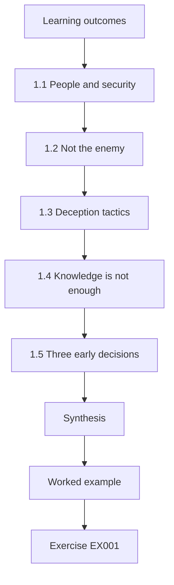
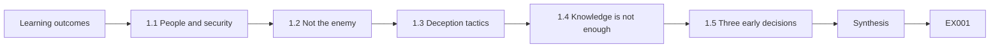
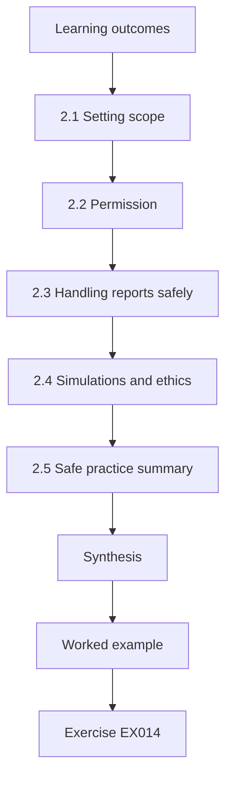
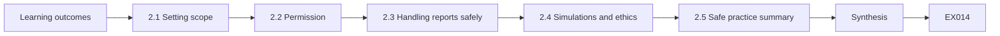
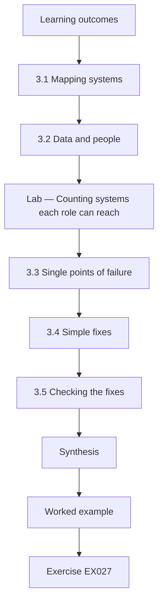
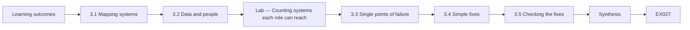
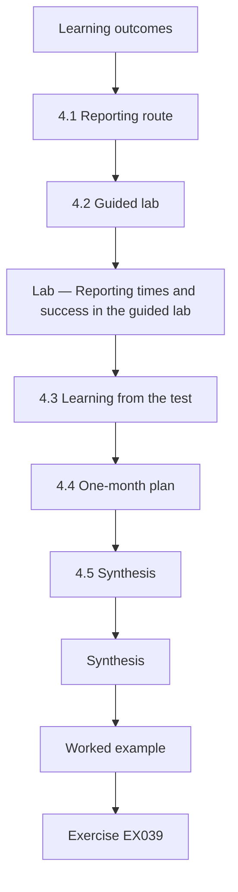
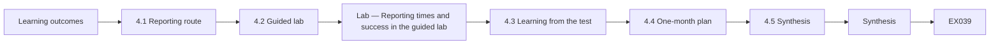

# Human Factors and Cyber Policy: Rapid Course

- Language: English (`en`); course 006, Rapid course (1 month).
- Editorial state: **published**. Chapters 1–4 of 4 have hand-written teaching text; exercises EX001–EX050 have matching worked results with 0–3 rubrics; two offline labs use only the Python 3 standard library on synthetic data, and their outputs are embedded from real runs. Independent review and the 300-page A4 verification remain open.
- Audience: staff and volunteers in small charities and community organisations who need a fast, practical start in human-centred security.
- Author: [hiagokinlevi](https://github.com/hiagokinlevi). Original text [CC0 1.0](../../../../../LICENSE); cited works keep their rights.
- Boundary: the labs count systems each role can reach and summarise reporting times in a guided test, both on synthetic data; no real staff, volunteers, donors, emails or accounts are involved. The guided test uses a test email account and volunteers who know the purpose. The course recommends no simulated phishing; if ever used, it must be announced, agreed with staff and volunteer representatives, avoid lures about money, food or hardship, give kind feedback and report only totals. All people, organisations, systems and data are **synthetic** unless a sentence cites a public source.

[Course home](../../README.md) · [Chapter index](../SUBJECTS.md) · [Book plan](PLAN.md) · [Course skill](../../skill/SKILL.md) · [Worked results](#worked-results)

## How to use this draft

Read in order. The four chapters follow one operations coordinator at a small food bank: foundations and early decisions; scope, permission and safe practice; systems, data and dependencies; and a guided lab with a one-month plan. Run each lab where it appears, attempt the exercises before the worked results, and score yourself with the rubrics.

### Synthetic running case

| Element | Role | Boundary |
|---|---|---|
| **Ruth Adeyemi** | Operations coordinator and rapid-course learner | Invented |
| **Callum Shaw** | Facilitator | Invented |
| **Oakmere Adult Learning Centre** | Fictional training provider | Invented |
| **Riverbend Food Bank** | Fictional charity, 12 staff and 60 volunteers | Invented |

### Core sources

Adams and Sasse (1999), [doi:10.1145/322796.322806](https://doi.org/10.1145/322796.322806); Sasse, Brostoff and Weirich (2001), [doi:10.1023/A:1011902718709](https://doi.org/10.1023/A:1011902718709); Hadnagy (2018); Cialdini (2021); Bada, Sasse and Nurse (2019), arXiv:1901.02672; Hansche et al. (2024), NIST SP 800-50r1. Full list in [References](#references).

## Contents

| Chapters |
|---|
| [1](#ch-01) · [2](#ch-02) · [3](#ch-03) · [4](#ch-04) |

[Worked results](#worked-results) · [References](#references)

<a id="ch-01"></a>

## Chapter 1 — Human factors and cyber policy: foundations and decisions

<!-- cykin:lesson-figures:start ch-01 -->
### Lesson map

Lesson 01 published. Map, example, EX001.



### Logical drawing



```text
[Learning outcomes]
    |
    v
[1.1 People and security]
    |
    v
[1.2 Not the enemy]
    |
    v
[1.3 Deception tactics]
    |
    v
[1.4 Knowledge is not enough]
    |
    v
[1.5 Three early decisions]
    |
    v
[Synthesis]
    |
    v
[Worked example] --> [Exercise EX001]
```
<!-- cykin:lesson-figures:end ch-01 -->


### Learning outcomes

You will (1) explain why people, not only technology, decide security outcomes; (2) recognise common deception tactics; (3) make three early decisions for a small charity.

### 1.1 People and security

Ruth Adeyemi coordinates operations at the fictional Riverbend Food Bank, a charity with twelve staff and sixty volunteers. She joins a one-month rapid course at the fictional Oakmere Adult Learning Centre, guided by facilitator Callum Shaw. Callum begins with a simple idea: most attacks on small charities reach people before they reach systems. A fake supplier invoice, a call pretending to be the bank or an email asking a volunteer to log in somewhere all depend on a person acting. Security therefore depends on helping people act safely under ordinary pressures.

### 1.2 Not the enemy

Callum introduces two classic papers. Adams and Sasse (1999), Users are not the enemy, showed that people break security rules mostly because the rules do not fit their work, not because they are careless. Sasse, Brostoff and Weirich (2001) argued for transforming the so-called weakest link through better design. Ruth recognises this at Riverbend: volunteers share one login for the donations spreadsheet because creating individual accounts was never arranged. The problem is the setup, not the volunteers' attitude, and blaming them would only make them hide mistakes.

### 1.3 Deception tactics

Ruth learns common tactics described by Hadnagy (2018) and explained by Cialdini's principles of influence. Attackers claim authority, such as posing as the bank or a major donor; create urgency, such as a deadline today; and use liking or familiarity, such as copying a known supplier's style. At Riverbend, a typical attack might be an email from a lookalike of the food wholesaler's address asking for payment to new bank details. Knowing these patterns helps Ruth design simple checks that do not rely on spotting every clue.

### 1.4 Knowledge is not enough

Callum warns that telling people about tactics rarely changes behaviour by itself. Bada, Sasse and Nurse (2019) found that awareness campaigns often fail when they rely on fear or assume knowledge leads to action. NIST SP 800-50r1 (Hansche et al., 2024) describes learning programmes that combine awareness with role-based training and evaluation. For a small charity, Ruth concludes, the practical approach is a few easy habits, clear procedures for risky tasks and a friendly way to ask for help, rather than long lectures that people forget.

### 1.5 Three early decisions

Ruth makes three early decisions for Riverbend. First, any change to a supplier's bank details will be checked by phoning the supplier on the number already on file. Second, staff and volunteers will be told clearly that reporting anything odd is welcome and never leads to blame. Third, the shared donations login will be replaced with individual accounts. She writes the decisions in a one-page note for the charity manager, explaining the reason for each in plain language. Callum notes that these decisions target the highest risks with little cost.

### Worked example

Ruth learns why people decide outcomes, recognises authority and urgency tactics and makes three decisions: callbacks for bank changes, a no-blame reporting message and individual accounts.

> **Synthetic case.** Riverbend is synthetic; Adams and Sasse (1999), Sasse et al. (2001), Hadnagy (2018), Cialdini (2021), Bada et al. (2019) and SP 800-50r1 are real.

### Errors and limits

Decisions need follow-through. Small teams change often.

### Exercises

- **EX001 — Charity size.** How many staff and volunteers does Riverbend have? *Rubric:* 3 = twelve staff and sixty volunteers;; 2 = 72;; 1 = vague;; 0 = none.
- **EX002 — Where attacks land.** According to Callum, what do most attacks on small charities reach first? *Rubric:* 3 = people, before they reach systems;; 2 = people, without the contrast with systems;; 1 = systems;; 0 = none.
- **EX003 — Rule breaking cause.** Why do people break security rules according to Adams and Sasse (1999)? *Rubric:* 3 = the rules do not fit their work;; 2 = fit;; 1 = carelessness;; 0 = none.
- **EX004 — Shared login cause.** Why do volunteers share one donations login? *Rubric:* 3 = individual accounts were never arranged;; 2 = setup;; 1 = laziness;; 0 = none.
- **EX005 — Authority example.** Give an example of an authority tactic. *Rubric:* 3 = posing as the bank or a major donor;; 2 = authority;; 1 = vague;; 0 = none.
- **EX006 — Urgency example.** Give an example of an urgency tactic. *Rubric:* 3 = a deadline today;; 2 = deadline;; 1 = vague;; 0 = none.
- **EX007 — Typical attack.** What typical attack might Riverbend face? *Rubric:* 3 = a lookalike wholesaler email with new bank details;; 2 = invoice fraud;; 1 = vague;; 0 = none.
- **EX008 — Campaign weakness.** Why do awareness campaigns often fail according to Bada et al. (2019)? *Rubric:* 3 = fear and assuming knowledge leads to action;; 2 = fear;; 1 = vague;; 0 = none.
- **EX009 — SP 800-50r1 content.** What does SP 800-50r1 combine in learning programmes? *Rubric:* 3 = awareness, role-based training and evaluation;; 2 = three;; 1 = lectures;; 0 = none.
- **EX010 — Practical approach.** What practical approach suits a small charity? *Rubric:* 3 = easy habits, clear procedures and friendly help;; 2 = habits;; 1 = long lectures;; 0 = none.
- **EX011 — First decision.** What is Ruth's first decision? *Rubric:* 3 = phone suppliers on the number on file before bank changes;; 2 = callback;; 1 = vague;; 0 = none.
- **EX012 — Second decision.** What is Ruth's second decision? *Rubric:* 3 = tell everyone reporting is welcome without blame;; 2 = no blame;; 1 = vague;; 0 = none.
- **EX013 — Third decision.** What is Ruth's third decision? *Rubric:* 3 = replace the shared login with individual accounts;; 2 = accounts;; 1 = vague;; 0 = none.

### Synthesis

Security in small organisations starts with people, simple procedures and a welcoming reporting culture.

### Continue studying — chapter 01 of 04

[← Course home](../../README.md) · [Course chapter index](../SUBJECTS.md) · [Chapter 02 (draft) →](#ch-02)

<a id="ch-02"></a>

## Chapter 2 — Scope, permission and safe practice

<!-- cykin:lesson-figures:start ch-02 -->
### Lesson map

Lesson 02 published. Map, example, EX014.



### Logical drawing



```text
[Learning outcomes]
    |
    v
[2.1 Setting scope]
    |
    v
[2.2 Permission]
    |
    v
[2.3 Handling reports safely]
    |
    v
[2.4 Simulations and ethics]
    |
    v
[2.5 Safe practice summary]
    |
    v
[Synthesis]
    |
    v
[Worked example] --> [Exercise EX014]
```
<!-- cykin:lesson-figures:end ch-02 -->


### Learning outcomes

You will (1) set the scope of security work in a small charity; (2) obtain permission and respect boundaries; (3) practise safely and ethically, including on simulations.

### 2.1 Setting scope

Callum asks Ruth to write down what her security work will cover. In scope are reporting suspicious messages, the bank change procedure, individual accounts and a short welcome guide for volunteers. Out of scope are reading anyone's email, monitoring what volunteers do and any test that tricks people without agreement. Writing scope down helps Ruth explain her role to colleagues and protects her from being asked to do things that would damage trust, such as checking up on particular volunteers. The manager reads it.

### 2.2 Permission

Ruth asks the charity manager and the trustees' chair to approve her one-page scope. They sign it. She tells staff and the volunteer coordinators what she will do and why. Callum explains that permission matters even for small, friendly changes, because security work touches people's accounts, data and sense of being trusted. Asking first also brings useful ideas: the volunteer coordinator suggests including the guide in the induction pack that every new volunteer already receives, which saves Ruth from creating a separate process.

### 2.3 Handling reports safely

Ruth learns safe habits for handling reported messages. She never clicks links or opens attachments in reported emails; she forwards them to the charity's IT volunteer using the agreed method; and she records only the date, type and outcome, not who reported. If a report suggests something serious, such as donor data being sent to the wrong address, she follows the charity's incident steps and asks the IT volunteer for help rather than investigating alone. Safe handling protects both the charity and the person who reported.

### 2.4 Simulations and ethics

The charity manager asks whether Riverbend should send fake phishing emails to test volunteers. Callum explains that deception can damage trust, which a volunteer-based charity depends on. Lain, Kostiainen and Čapkun (2022) found that some common simulation practices did not help. Ruth recommends no simulations for now. If they are ever used, rules must be agreed with staff and volunteer representatives: announce the programme, avoid lures about money, food or personal hardship, give kind feedback immediately, report only totals and never use results against anyone.

### 2.5 Safe practice summary

Ruth writes a short safe practice summary for herself: work within the signed scope; ask before changing anyone's access; handle reports without clicking; keep records free of names; use synthetic examples in training; and practise procedures through announced role-play rather than secret tests. She pins it above her desk. Callum notes that these habits are what separate trustworthy security work from well-meant interference, and that they matter even more in charities, where people give their time freely and can simply leave if they feel mistrusted.

### Worked example

Ruth writes and gets approval for a scope, adopts safe report handling, recommends no simulations with strict future rules and writes a safe practice summary.

> **Synthetic case.** Scope and rules are synthetic; Lain et al. (2022) is real.

### Errors and limits

Scope may need updating. Volunteers may not read guides.

### Exercises

- **EX014 — Out-of-scope item.** Name one item outside Ruth's scope. *Rubric:* 3 = reading anyone's email;; 2 = monitoring;; 1 = reporting;; 0 = none.
- **EX015 — Scope signatories.** Who signed Ruth's scope? *Rubric:* 3 = the charity manager and trustees' chair;; 2 = two;; 1 = vague;; 0 = none.
- **EX016 — Coordinator idea.** What did the volunteer coordinator suggest? *Rubric:* 3 = include the guide in the induction pack;; 2 = induction;; 1 = vague;; 0 = none.
- **EX017 — Reported link rule.** What must Ruth never do with links in reported emails? *Rubric:* 3 = click them;; 2 = no clicking;; 1 = vague;; 0 = none.
- **EX018 — Record fields.** What does Ruth record about reports? *Rubric:* 3 = date, type and outcome only;; 2 = minimal;; 1 = names;; 0 = none.
- **EX019 — Serious report.** What does Ruth do with a serious report? *Rubric:* 3 = follow incident steps with the IT volunteer;; 2 = escalate;; 1 = investigate alone;; 0 = none.
- **EX020 — Simulation risk.** Why are simulations risky for a volunteer charity? *Rubric:* 3 = deception can damage trust;; 2 = trust;; 1 = cost;; 0 = none.
- **EX021 — Simulation recommendation.** What does Ruth recommend about simulations now? *Rubric:* 3 = no simulations for now;; 2 = no simulations, without 'for now';; 1 = monthly;; 0 = no answer.
- **EX022 — Banned lure themes.** Which lure themes are banned if simulations are ever used? *Rubric:* 3 = money, food or personal hardship;; 2 = hardship;; 1 = vague;; 0 = none.
- **EX023 — Results use.** How may simulation results ever be used? *Rubric:* 3 = only as totals, never against anyone;; 2 = aggregate;; 1 = vague;; 0 = none.
- **EX024 — Procedure practice.** How should procedures be practised? *Rubric:* 3 = announced role-play;; 2 = role-play;; 1 = secret tests;; 0 = none.
- **EX025 — Why habits matter more.** Why do safe habits matter even more in charities? *Rubric:* 3 = volunteers can leave if mistrusted;; 2 = volunteers;; 1 = vague;; 0 = none.
- **EX026 — Pinned summary.** Where does Ruth keep her safe practice summary? *Rubric:* 3 = pinned above her desk;; 2 = desk;; 1 = vague;; 0 = none.

### Synthesis

Clear scope, permission and ethical habits make security work trustworthy.

### Continue studying — chapter 02 of 04

[← Chapter 01 (draft)](#ch-01) · [Course chapter index](../SUBJECTS.md) · [Chapter 03 (draft) →](#ch-03)

<a id="ch-03"></a>

## Chapter 3 — Human factors and cyber policy: systems, data and dependencies

<!-- cykin:lesson-figures:start ch-03 -->
### Lesson map

Lesson 03 published. Map, example, EX027.



### Logical drawing



```text
[Learning outcomes]
    |
    v
[3.1 Mapping systems]
    |
    v
[3.2 Data and people]
    |
    v
[Lab — Counting systems each role can reach]
    |
    v
[3.3 Single points of failure]
    |
    v
[3.4 Simple fixes]
    |
    v
[3.5 Checking the fixes]
    |
    v
[Synthesis]
    |
    v
[Worked example] --> [Exercise EX027]
```
<!-- cykin:lesson-figures:end ch-03 -->


### Learning outcomes

You will (1) map the systems, data and people a small charity depends on; (2) find points where one person or mistake can cause harm; (3) choose simple fixes.

### 3.1 Mapping systems

Ruth maps Riverbend's systems on one page: shared email accounts, the donations spreadsheet, an online bank account, a volunteer rota app and the charity's social media pages. Beside each she writes who uses it and what data it holds. The donations spreadsheet holds donor names and addresses; the rota app holds volunteer phone numbers; the bank account can make payments. Mapping helps Ruth see where personal data and money sit, which are the things attackers most want and the things whose loss would hurt the charity most.

### 3.2 Data and people

Ruth notes how data move between people. Volunteers copy donor details from paper forms into the spreadsheet. The treasurer approves payments after the coordinator forwards invoices by email. Staff post updates on social media using one shared password. At each handover, a deceptive message or simple error could cause harm. She counts how many systems each person can access and finds that the treasurer, a retired volunteer, can reach almost everything, while some staff who need access to the rota do not have it.

### Lab — Counting systems each role can reach

```python
# Systems each role can reach (synthetic): email, spreadsheet, bank, rota, social media.
access = {"treasurer": {"email", "spreadsheet", "bank", "rota", "social"}, "coordinator": {"email", "spreadsheet", "rota"},
          "warehouse volunteer": {"spreadsheet"}, "staff (rota needed)": {"email"}}
for r, s in access.items(): print(f"{r}: {len(s)} of 5")
```

Run with `python3 lab_access.py`. Verified output:

```text
treasurer: 5 of 5
coordinator: 3 of 5
warehouse volunteer: 1 of 5
staff (rota needed): 1 of 5
```

### 3.3 Single points of failure

Ruth finds two single points of failure. Only the treasurer can approve payments, so if she is away, invoices wait and pressure builds, which attackers can exploit with urgent fake invoices. Only one volunteer knows the social media password, so if that account is taken over, nobody else can recover it quickly. She also notes that the bank account sends alerts only to the treasurer's personal email. Each single point means that one absence, one mistake or one deception could cause lasting harm.

### 3.4 Simple fixes

Ruth chooses simple fixes. A second trustee is authorised to approve payments, always after a callback for any bank change. Social media accounts get individual logins with two-step verification and recovery details held by the charity manager. Bank alerts go to a shared charity mailbox as well as the treasurer. Donor data in the spreadsheet are limited to what is needed for thank-you letters. Each fix costs little and removes a point where one person or mistake could cause serious harm.

### 3.5 Checking the fixes

Ruth checks that each fix works. She asks the second trustee to approve a small test payment with a callback, confirms that a test bank alert reaches the shared mailbox and logs into social media with her own account to confirm two-step verification works. She records each check with the date. Callum reminds her that checking fixes is part of the job, because many security changes are made with good intentions but never confirmed, and they quietly fail when they are needed most.

### Worked example

Ruth maps systems and data, counts access by role, finds payment and social media single points of failure and checks simple fixes.

> **Synthetic case.** Systems and data are synthetic.

### Errors and limits

Maps go out of date. Second approvers need training.

### Exercises

- **EX027 — Data locations.** Where do donor names and addresses sit? *Rubric:* 3 = the donations spreadsheet;; 2 = spreadsheet;; 1 = rota app;; 0 = none.
- **EX028 — Treasurer access.** How many of five systems can the treasurer reach in the lab? *Rubric:* 3 = 5;; 2 = all;; 1 = 2;; 0 = none.
- **EX029 — Payment single point.** Why is the treasurer a single point of failure? *Rubric:* 3 = only she can approve payments;; 2 = approval;; 1 = vague;; 0 = none.
- **EX030 — Pressure link.** How does a waiting invoice help attackers? *Rubric:* 3 = pressure builds that urgent fakes exploit;; 2 = urgency;; 1 = vague;; 0 = none.
- **EX031 — Social media risk.** What is the social media single point? *Rubric:* 3 = only one volunteer knows the password;; 2 = one person;; 1 = vague;; 0 = none.
- **EX032 — Bank alerts.** Where did bank alerts originally go? *Rubric:* 3 = only the treasurer's personal email;; 2 = personal;; 1 = vague;; 0 = none.
- **EX033 — Payment fix.** What fixes the payment single point? *Rubric:* 3 = a second authorised trustee with callbacks;; 2 = second approver;; 1 = vague;; 0 = none.
- **EX034 — Social media fix.** How are social media accounts secured? *Rubric:* 3 = individual logins with two-step verification;; 2 = two-step;; 1 = shared password;; 0 = none.
- **EX035 — Donor data limit.** What limit applies to donor data? *Rubric:* 3 = only what thank-you letters need;; 2 = minimal;; 1 = vague;; 0 = none.
- **EX036 — Fix checks.** How did Ruth check the bank alert fix? *Rubric:* 3 = a test alert reached the shared mailbox;; 2 = test;; 1 = vague;; 0 = none.
- **EX037 — Unchecked fixes.** Why check fixes according to Callum? *Rubric:* 3 = well-meant changes often fail silently;; 2 = silent failure;; 1 = vague;; 0 = none.
- **EX038 — Rota access gap.** What gap did Ruth find for rota access? *Rubric:* 3 = some staff who need it lack it;; 2 = missing access;; 1 = vague;; 0 = none.

### Synthesis

Mapping systems, data and people reveals single points of failure that simple fixes can remove.

### Continue studying — chapter 03 of 04

[← Chapter 02 (draft)](#ch-02) · [Course chapter index](../SUBJECTS.md) · [Chapter 04 (draft) →](#ch-04)

<a id="ch-04"></a>

## Chapter 4 — Human factors and cyber policy: guided lab and applied synthesis

<!-- cykin:lesson-figures:start ch-04 -->
### Lesson map

Lesson 04 published. Map, example, EX039.



### Logical drawing



```text
[Learning outcomes]
    |
    v
[4.1 Reporting route]
    |
    v
[4.2 Guided lab]
    |
    v
[Lab — Reporting times and success in the guided lab]
    |
    v
[4.3 Learning from the test]
    |
    v
[4.4 One-month plan]
    |
    v
[4.5 Synthesis]
    |
    v
[Synthesis]
    |
    v
[Worked example] --> [Exercise EX039]
```
<!-- cykin:lesson-figures:end ch-04 -->


### Learning outcomes

You will (1) test a reporting route with volunteers in a safe setting; (2) measure whether it is quick and clear; (3) write a one-month action plan.

### 4.1 Reporting route

Riverbend had no clear way to report suspicious messages; people mentioned them to whoever was nearby, if at all. Ruth sets up a simple route: forward anything odd to a shared report address, or tell the duty coordinator, who forwards it. The IT volunteer checks the address daily and replies to every report with a short verdict and thanks. She writes a two-line instruction and adds it to the volunteer guide and to a poster in the warehouse. The route must be quick, because volunteers have little time on shift.

### 4.2 Guided lab

In the guided lab, Ruth tests the route with eight volunteers using a test email account and synthetic messages. Everyone knows they are testing the route, not being tested. Each volunteer receives three messages, one suspicious, and is asked to report anything odd. Ruth times how long reporting takes and notes confusion. The lab summarises times and success. Seven of eight report the suspicious message correctly; one forwards a genuine message instead, unsure which was odd, which Ruth treats as a useful report rather than a mistake.

### Lab — Reporting times and success in the guided lab

```python
# Reporting times (seconds) and success for eight volunteers in the guided lab (synthetic).
times = [25, 31, 34, 38, 42, 47, 95, 110]; correct = [1, 1, 1, 1, 1, 1, 1, 0]
s = sorted(times)
print(f"correct {sum(correct)}/8; median time {(s[3] + s[4]) / 2:.0f} s; over 60 s: {sum(t > 60 for t in times)}")
```

Run with `python3 lab_route.py`. Verified output:

```text
correct 7/8; median time 40 s; over 60 s: 2
```

### 4.3 Learning from the test

The test shows that forwarding takes most volunteers under a minute, but two struggled to find the report address on their phones. Ruth adds the address as a contact on the shared volunteer phones and asks the IT volunteer to add a quick reply template. Volunteers say they like hearing back, which matches evidence that feedback encourages future reporting. Ruth also notes that one volunteer felt nervous about reporting a genuine message, so she adds a line to the guide: if unsure, report it.

### 4.4 One-month plan

Ruth writes a one-month action plan. Week one: confirm the callback procedure with the treasurer and second trustee, and send the no-blame message. Week two: replace the shared donations login with individual accounts. Week three: launch the reporting route with the guide and poster. Week four: review reports, replies and any problems with the charity manager. Each step has an owner and a check. Callum notes that a short, concrete plan is more likely to be completed than an ambitious strategy.

### 4.5 Synthesis

At the end of the course, Ruth summarises what she learned. Security at Riverbend depends on people: volunteers, staff and trustees acting under real pressures. The most useful measures are simple: callbacks for bank changes, individual accounts, an easy reporting route with friendly replies and no blame for honest mistakes. Deceptive tests are unnecessary and could harm trust. She shares her summary with the trustees, who adopt the plan. Callum reminds her to review it after three months, because good habits need regular attention to last.

### Worked example

Ruth sets up a reporting route, tests it with eight volunteers, fixes phone contact and unsure-report issues and writes a four-week plan adopted by trustees.

> **Synthetic case.** The lab and plan are synthetic.

### Errors and limits

Small test. Plans slip without review.

### Exercises

- **EX039 — Old reporting.** How were suspicious messages reported before? *Rubric:* 3 = mentioned to whoever was nearby;; 2 = informal;; 1 = button;; 0 = none.
- **EX040 — Reply promise.** What does the IT volunteer do for every report? *Rubric:* 3 = replies with a short verdict and thanks;; 2 = feedback;; 1 = vague;; 0 = none.
- **EX041 — Lab success.** How many volunteers reported the suspicious message correctly in the lab? *Rubric:* 3 = 7 of 8;; 2 = seven;; 1 = 8 of 8;; 0 = none.
- **EX042 — Lab median time.** What was the median reporting time in the lab? *Rubric:* 3 = 40 seconds;; 2 = under a minute;; 1 = vague;; 0 = none.
- **EX043 — Genuine forward.** How did Ruth treat the volunteer who forwarded a genuine message? *Rubric:* 3 = as a useful report;; 2 = useful;; 1 = mistake;; 0 = none.
- **EX044 — Phone fix.** What fixed the phone problem? *Rubric:* 3 = adding the report address as a contact;; 2 = contact;; 1 = vague;; 0 = none.
- **EX045 — Unsure line.** What line did Ruth add to the guide? *Rubric:* 3 = if unsure, report it;; 2 = unsure;; 1 = vague;; 0 = none.
- **EX046 — Week two.** What happens in week two of the plan? *Rubric:* 3 = individual accounts replace the shared login;; 2 = accounts;; 1 = vague;; 0 = none.
- **EX047 — Week four.** What happens in week four? *Rubric:* 3 = review reports and problems with the manager;; 2 = review;; 1 = vague;; 0 = none.
- **EX048 — Plan style.** Why prefer a short concrete plan? *Rubric:* 3 = it is more likely to be completed;; 2 = completion;; 1 = vague;; 0 = none.
- **EX049 — Deceptive tests view.** What is Ruth's view on deceptive tests? *Rubric:* 3 = unnecessary and could harm trust;; 2 = unnecessary;; 1 = vague;; 0 = none.
- **EX050 — Review timing.** When should Ruth review the plan? *Rubric:* 3 = after three months;; 2 = three months;; 1 = never;; 0 = none.

### Synthesis

A safe test, a short plan and simple, kind measures give a small charity a strong start.

### Continue studying — chapter 04 of 04

[← Chapter 03 (draft)](#ch-03) · [Course chapter index](../SUBJECTS.md) · [Worked results ↓](#worked-results) · [Next course via chapter index →](../SUBJECTS.md)

<a id="worked-results"></a>

## Worked results

Model answers for EX001–EX050. Ruth Adeyemi, Callum Shaw, Oakmere Adult Learning Centre, Riverbend Food Bank and every figure are synthetic. Lab answers quote verified outputs. Any answer meeting the rubric scores equally.

**EX001.** Twelve staff and sixty volunteers.

**EX002.** People, before they reach systems.

**EX003.** Mostly because the rules do not fit their work.

**EX004.** Because individual accounts were never arranged.

**EX005.** Posing as the bank or a major donor.

**EX006.** Claiming a deadline today.

**EX007.** An email from a lookalike wholesaler address asking for payment to new bank details.

**EX008.** Because they rely on fear or assume knowledge leads to action.

**EX009.** Awareness, role-based training and evaluation.

**EX010.** A few easy habits, clear procedures and a friendly way to ask for help.

**EX011.** To check bank detail changes by phoning the supplier on the number on file.

**EX012.** To tell staff and volunteers that reporting anything odd is welcome and never leads to blame.

**EX013.** To replace the shared donations login with individual accounts.

**EX014.** Reading anyone's email, monitoring volunteers or tricking people without agreement.

**EX015.** The charity manager and the chair of trustees.

**EX016.** Including the guide in the existing induction pack.

**EX017.** Click them, or open attachments.

**EX018.** Only the date, type and outcome.

**EX019.** She follows the incident steps and asks the IT volunteer for help.

**EX020.** Because deception can damage the trust the charity depends on.

**EX021.** No simulations for now.

**EX022.** Money, food or personal hardship.

**EX023.** Only as totals, never against any individual.

**EX024.** Through announced role-play rather than secret tests.

**EX025.** Because volunteers give their time freely and can leave if they feel mistrusted.

**EX026.** Pinned above her desk.

**EX027.** In the donations spreadsheet.

**EX028.** All five systems.

**EX029.** Because only she can approve payments.

**EX030.** Pressure builds, which attackers can exploit with urgent fake invoices.

**EX031.** Only one volunteer knows the shared password.

**EX032.** Only to the treasurer's personal email.

**EX033.** Authorising a second trustee, with callbacks for bank changes.

**EX034.** With individual logins, two-step verification and recovery details held by the manager.

**EX035.** Only what is needed for thank-you letters.

**EX036.** By confirming a test bank alert reached the shared mailbox.

**EX037.** Because well-meant changes often fail quietly when never confirmed.

**EX038.** Some staff who need rota access do not have it.

**EX039.** People mentioned them to whoever was nearby, if at all.

**EX040.** Replies with a short verdict and thanks.

**EX041.** Seven of eight.

**EX042.** 40 seconds.

**EX043.** As a useful report rather than a mistake.

**EX044.** Adding the report address as a contact on shared volunteer phones.

**EX045.** If unsure, report it.

**EX046.** The shared donations login is replaced with individual accounts.

**EX047.** A review of reports, replies and problems with the charity manager.

**EX048.** Because it is more likely to be completed than an ambitious strategy.

**EX049.** That they are unnecessary and could harm trust.

**EX050.** After three months.

<a id="references"></a>

## References

Links checked 12 October 2026; re-verify editions before citing. Organisations, people, systems and data in this book are synthetic unless a sentence cites a public source.

- Adams, A., & Sasse, M. A. (1999). Users are not the enemy. *Communications of the ACM*, 42(12), 40–46. <https://doi.org/10.1145/322796.322806>
- Bada, M., Sasse, M. A., & Nurse, J. R. C. (2019). *Cyber security awareness campaigns: Why do they fail to change behaviour?* arXiv:1901.02672. <https://arxiv.org/abs/1901.02672>
- Cialdini, R. B. (2021). *Influence, new and expanded: The psychology of persuasion*. Harper Business.
- Hadnagy, C. (2018). *Social engineering: The science of human hacking* (2nd ed.). Wiley.
- Hansche, S., Ellis, B., Sanchez-Cherry, K., Snyder, J. N., & Walden, D. (2024). *Building a cybersecurity and privacy learning program* (NIST SP 800-50 Rev. 1). NIST. <https://doi.org/10.6028/NIST.SP.800-50r1>
- Lain, D., Kostiainen, K., & Čapkun, S. (2022). Phishing in organizations: Findings from a large-scale and long-term study. *2022 IEEE Symposium on Security and Privacy*, 842–859. <https://doi.org/10.1109/SP46214.2022.9833766>
- Sasse, M. A., Brostoff, S., & Weirich, D. (2001). Transforming the 'weakest link' — a human/computer interaction approach to usable and effective security. *BT Technology Journal*, 19(3), 122–131. <https://doi.org/10.1023/A:1011902718709>
