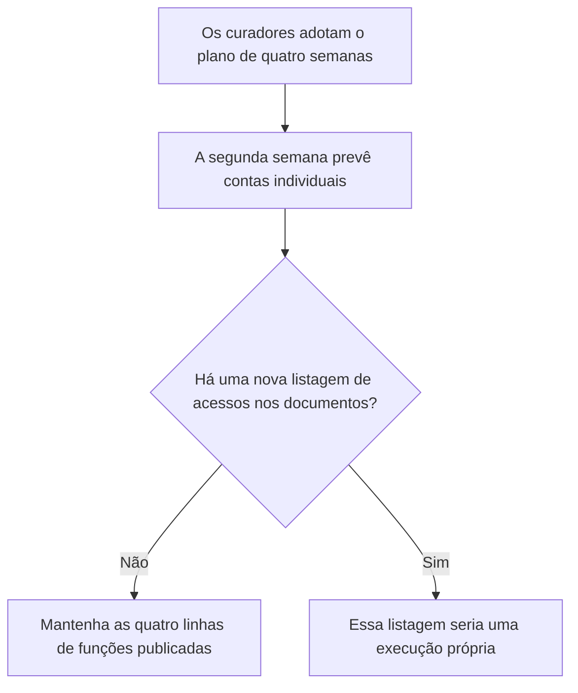
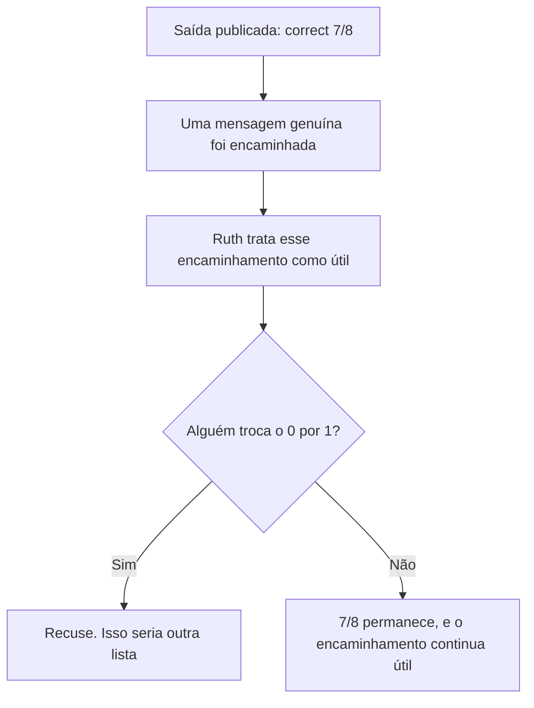
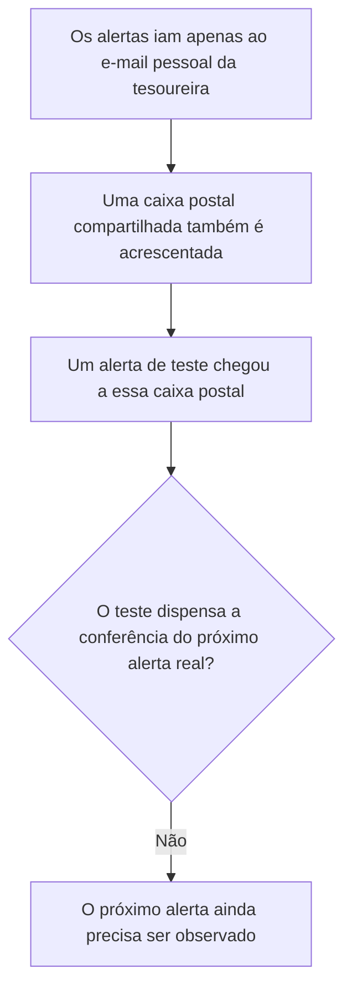
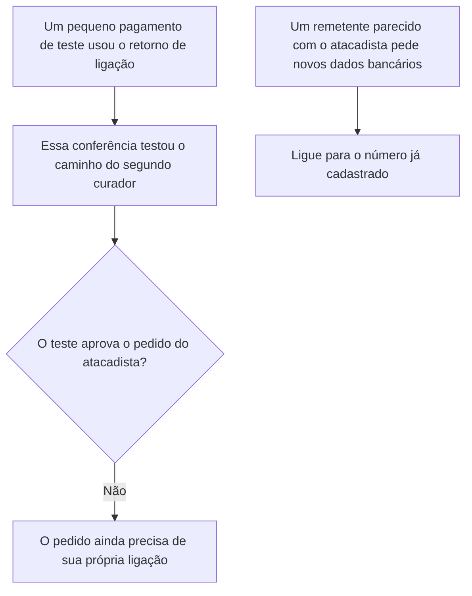
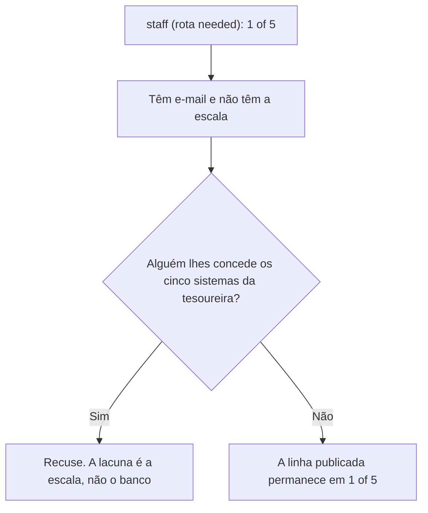
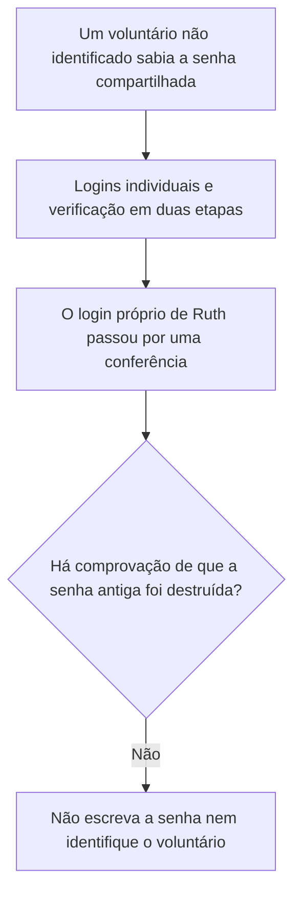

# Fatores Humanos e Política Cibernética: Curso Rápido

- Idioma: português do Brasil (`pt`); curso 006, curso rápido (1 mês). Edição de referência: [inglês](../../en/book/MANUSCRIPT.md).
- Estado editorial: **publicado, com tradução parcial e revisão de equivalência pendente**. Os capítulos 1–10 e EX001–EX056 com respostas estão disponíveis em português. A referência inglesa fixada contém vinte capítulos e EX001–EX066; os capítulos 11–20 ainda não foram traduzidos neste manuscrito. Os quatro capítulos anteriores, seus cinquenta pares e os dois programas foram preservados. A revisão integral técnica, linguística, de fontes, direitos e acessibilidade continua aberta. Nenhuma renderização A4 desta fonte é declarada; uma medição anterior não verifica o texto alterado.
- Público: funcionários e voluntários de pequenas organizações beneficentes e comunitárias que precisam de um começo rápido e prático em segurança centrada nas pessoas.
- Autor: [hiagokinlevi](https://github.com/hiagokinlevi). Texto original sob [CC0 1.0](../../../../../LICENSE); as obras citadas mantêm seus direitos.
- Limites: os laboratórios contam os sistemas que cada função alcança e resumem os tempos de reporte num teste guiado, ambos sobre dados sintéticos; nenhum funcionário, voluntário, doador, e-mail ou conta real está envolvido. O teste guiado usa uma conta de e-mail de teste e voluntários que conhecem o propósito. O curso não recomenda phishing simulado; se algum dia for usado, deve ser anunciado, acordado com os representantes dos funcionários e dos voluntários, evitar iscas sobre dinheiro, comida ou dificuldades, dar um retorno gentil e relatar apenas totais. Pessoas, organizações, sistemas e dados são **sintéticos**, salvo quando uma frase cita uma fonte pública.

[Página do curso](../../README.md) · [Índice de capítulos](../SUBJECTS.md) · [Plano do livro](PLAN.md) · [Skill do curso](../../skill/SKILL.md) · [Resoluções](#worked-results)

## Como usar este livro

Leia na ordem. Os quatro capítulos iniciais acompanham uma coordenadora de operações num pequeno banco de alimentos: fundamentos e primeiras decisões; escopo, permissão e prática segura; sistemas, dados e dependências; e um laboratório guiado com um plano de um mês. Execute cada laboratório onde ele aparece, tente os exercícios antes de consultar as resoluções e avalie-se com as rubricas.

<a id="pt-translation-ch05-10"></a>

### Continuação traduzida — capítulos 05–10

Este lote incorpora seis capítulos, EX051–EX056 e suas respostas no mesmo livro. Fonte: `levels/rapid-1-month/human-factors-policy/en/book/MANUSCRIPT.md`, revisão `bb01c9fa8768320fdc5e2fdaee91c4ecc26d83a1`, blob `51818a05bf99ecb52b4603ff970cb679640bca73`; alvo português anterior: `3cad3561072a3cf8667099e773cd1f673b621fe6`. Responsabilidade editorial: hiagokinlevi. A disponibilidade passa de **4/20 para 10/20 posições de capítulo (50%)**, e de **50/66 para 56/66 IDs com respostas (84,85%)**. São medidas de presença, não equivalência integral aprovada.

A sequência 05–10 preserva ensino, objetivos, tabelas, mapas, desenhos textuais, rubricas 0–3 e gabaritos da fonte. Tente cada exercício antes de seguir o link para sua resposta. Os próximos capítulos permanecem na [lacuna 11–20](PLAN.md#translation-gap). O [registro do lote](PLAN.md#translation-review) delimita a comparação e os testes; as [notas técnicas separadas](#pt-human-limits-05-10) distinguem o que os programas calculam do que não observam. Esta publicação não declara a coleção inglesa ou portuguesa concluída.

### Caso sintético

| Elemento | Papel | Natureza |
|---|---|---|
| **Ruth Adeyemi** | Coordenadora de operações e participante do curso rápido | Inventada |
| **Callum Shaw** | Facilitador | Inventado |
| **Oakmere Adult Learning Centre** | Instituição de formação fictícia | Inventada |
| **Riverbend Food Bank** | Organização beneficente fictícia, 12 funcionários e 60 voluntários | Inventada |

### Fontes principais

Adams e Sasse (1999), [doi:10.1145/322796.322806](https://doi.org/10.1145/322796.322806); Sasse, Brostoff e Weirich (2001), [doi:10.1023/A:1011902718709](https://doi.org/10.1023/A:1011902718709); Hadnagy (2018); Cialdini (2021); Bada, Sasse e Nurse (2019), arXiv:1901.02672; Hansche et al. (2024), NIST SP 800-50r1. Lista completa em [Referências](#references).

## Sumário

| Capítulos em português |
|---|
| [1](#ch-01) · [2](#ch-02) · [3](#ch-03) · [4](#ch-04) · [5](#ch-05) · [6](#ch-06) · [7](#ch-07) · [8](#ch-08) · [9](#ch-09) · [10](#ch-10) |

[Resoluções](#worked-results) · [Referências](#references)

<a id="ch-01"></a>

## Capítulo 1 — Fatores humanos e política cibernética: fundamentos e decisões

### Objetivos de aprendizagem

Você vai (1) explicar por que as pessoas, e não só a tecnologia, decidem os resultados de segurança; (2) reconhecer táticas comuns de engano; (3) tomar três decisões iniciais para uma pequena organização beneficente.

### 1.1 Pessoas e segurança

Ruth Adeyemi coordena as operações do fictício Riverbend Food Bank, um banco de alimentos beneficente com doze funcionários e sessenta voluntários. Ela entra num curso rápido de um mês no fictício Oakmere Adult Learning Centre, orientada pelo facilitador Callum Shaw. Callum começa com uma ideia simples: a maioria dos ataques contra pequenas organizações beneficentes chega às pessoas antes de chegar aos sistemas. Uma fatura falsa de fornecedor, uma ligação de alguém fingindo ser do banco ou um e-mail que pede a um voluntário que faça login em algum lugar dependem todos de uma pessoa agir. A segurança, portanto, depende de ajudar as pessoas a agir com segurança sob as pressões do dia a dia.

### 1.2 Não são o inimigo

Callum apresenta dois artigos clássicos. Adams e Sasse (1999), Users are not the enemy, mostraram que as pessoas descumprem as regras de segurança sobretudo porque as regras não se encaixam no seu trabalho, e não por descuido. Sasse, Brostoff e Weirich (2001) defenderam transformar o chamado elo mais fraco por meio de um design melhor. Ruth reconhece isso no Riverbend: os voluntários compartilham um único login da planilha de doações porque nunca se providenciou a criação de contas individuais. O problema é a configuração, não a atitude dos voluntários, e culpá-los só os faria esconder os erros.

### 1.3 Táticas de engano

Ruth aprende as táticas comuns descritas por Hadnagy (2018) e explicadas pelos princípios de influência de Cialdini. Os atacantes alegam autoridade, como quando se passam pelo banco ou por um grande doador; criam urgência, como um prazo que vence hoje; e usam a simpatia ou a familiaridade, como quando copiam o estilo de um fornecedor conhecido. No Riverbend, um ataque típico poderia ser um e-mail de um endereço parecido com o do atacadista de alimentos pedindo pagamento para novos dados bancários. Conhecer esses padrões ajuda Ruth a desenhar verificações simples que não dependem de perceber cada pista.

### 1.4 Conhecimento não basta

Callum avisa que falar às pessoas sobre as táticas raramente muda o comportamento por si só. Bada, Sasse e Nurse (2019) constataram que as campanhas de conscientização muitas vezes falham quando se apoiam no medo ou supõem que o conhecimento leva à ação. O NIST SP 800-50r1 (Hansche et al., 2024) descreve programas de aprendizagem que combinam conscientização, treinamento por função e avaliação. Para uma pequena organização beneficente, conclui Ruth, a abordagem prática é ter alguns hábitos fáceis, procedimentos claros para as tarefas arriscadas e um jeito amigável de pedir ajuda, em vez de palestras longas que as pessoas esquecem.

### 1.5 Três decisões iniciais

Ruth toma três decisões iniciais para o Riverbend. Primeiro, qualquer alteração dos dados bancários de um fornecedor será conferida ligando para o fornecedor no número que já consta do cadastro. Segundo, funcionários e voluntários serão informados com clareza de que reportar qualquer coisa estranha é bem-vindo e nunca leva à culpa. Terceiro, o login compartilhado da planilha de doações será substituído por contas individuais. Ela escreve as decisões numa nota de uma página para a gerente da organização, explicando em linguagem simples o motivo de cada uma. Callum observa que essas decisões atacam os maiores riscos a baixo custo.

### Exemplo resolvido

Ruth aprende por que as pessoas decidem os resultados, reconhece as táticas de autoridade e urgência e toma três decisões: retorno de ligação para alterações bancárias, uma mensagem de reporte sem culpa e contas individuais.

> **Caso sintético.** O Riverbend é sintético; Adams e Sasse (1999), Sasse et al. (2001), Hadnagy (2018), Cialdini (2021), Bada et al. (2019) e o SP 800-50r1 são reais.

### Erros e limites

As decisões precisam de continuidade. As equipes pequenas mudam com frequência.

### Exercícios

- **EX001 — Tamanho da organização.** Quantos funcionários e voluntários o Riverbend tem? *Rubrica:* 3 = doze funcionários e sessenta voluntários;; 2 = 72;; 1 = vago;; 0 = nenhuma.

- **EX002 — Onde os ataques chegam.** Segundo Callum, ao que a maioria dos ataques contra pequenas organizações beneficentes chega primeiro? *Rubrica:* 3 = às pessoas, antes de chegarem aos sistemas;; 2 = às pessoas, sem o contraste com os sistemas;; 1 = aos sistemas;; 0 = nenhuma.

- **EX003 — Causa do descumprimento.** Por que as pessoas descumprem as regras de segurança, segundo Adams e Sasse (1999)? *Rubrica:* 3 = as regras não se encaixam no seu trabalho;; 2 = encaixe;; 1 = descuido;; 0 = nenhuma.

- **EX004 — Causa do login compartilhado.** Por que os voluntários compartilham um único login de doações? *Rubrica:* 3 = nunca se providenciaram contas individuais;; 2 = configuração;; 1 = preguiça;; 0 = nenhuma.

- **EX005 — Exemplo de autoridade.** Dê um exemplo de tática de autoridade. *Rubrica:* 3 = passar-se pelo banco ou por um grande doador;; 2 = autoridade;; 1 = vago;; 0 = nenhuma.

- **EX006 — Exemplo de urgência.** Dê um exemplo de tática de urgência. *Rubrica:* 3 = um prazo que vence hoje;; 2 = prazo;; 1 = vago;; 0 = nenhuma.

- **EX007 — Ataque típico.** Que ataque típico o Riverbend poderia enfrentar? *Rubrica:* 3 = um e-mail de endereço parecido com o do atacadista com novos dados bancários;; 2 = fraude de fatura;; 1 = vago;; 0 = nenhuma.

- **EX008 — Fraqueza das campanhas.** Por que as campanhas de conscientização muitas vezes falham, segundo Bada et al. (2019)? *Rubrica:* 3 = o medo e a suposição de que o conhecimento leva à ação;; 2 = medo;; 1 = vago;; 0 = nenhuma.

- **EX009 — Conteúdo do SP 800-50r1.** O que o SP 800-50r1 combina nos programas de aprendizagem? *Rubrica:* 3 = conscientização, treinamento por função e avaliação;; 2 = três;; 1 = palestras;; 0 = nenhuma.

- **EX010 — Abordagem prática.** Que abordagem prática convém a uma pequena organização beneficente? *Rubrica:* 3 = hábitos fáceis, procedimentos claros e ajuda amigável;; 2 = hábitos;; 1 = palestras longas;; 0 = nenhuma.

- **EX011 — Primeira decisão.** Qual é a primeira decisão de Ruth? *Rubrica:* 3 = ligar para os fornecedores no número do cadastro antes de alterações bancárias;; 2 = retorno de ligação;; 1 = vago;; 0 = nenhuma.

- **EX012 — Segunda decisão.** Qual é a segunda decisão de Ruth? *Rubrica:* 3 = dizer a todos que reportar é bem-vindo, sem culpa;; 2 = sem culpa;; 1 = vago;; 0 = nenhuma.

- **EX013 — Terceira decisão.** Qual é a terceira decisão de Ruth? *Rubrica:* 3 = substituir o login compartilhado por contas individuais;; 2 = contas;; 1 = vago;; 0 = nenhuma.

### Síntese

A segurança em organizações pequenas começa pelas pessoas, por procedimentos simples e por uma cultura de reporte acolhedora.

<!-- open-cyber-academy:chapter-navigation:start ch-01 -->
### Continue estudando — aula 01 (capítulo 01 de 20 na referência; 10 disponíveis em português)

[← Início do curso](../../README.md) · [Índice das aulas](../SUBJECTS.md) · [Capítulo 02 →](#ch-02)

Continue para a próxima aula já escrita.
<!-- open-cyber-academy:chapter-navigation:end -->

<a id="ch-02"></a>

## Capítulo 2 — Escopo, permissão e prática segura

### Objetivos de aprendizagem

Você vai (1) definir o escopo do trabalho de segurança numa pequena organização beneficente; (2) obter permissão e respeitar limites; (3) praticar com segurança e ética, inclusive quanto às simulações.

### 2.1 Definição do escopo

Callum pede a Ruth que escreva o que seu trabalho de segurança vai abranger. Estão no escopo o reporte de mensagens suspeitas, o procedimento de alteração bancária, as contas individuais e um guia curto de boas-vindas para os voluntários. Ficam fora do escopo ler o e-mail de qualquer pessoa, monitorar o que os voluntários fazem e qualquer teste que engane as pessoas sem acordo. Pôr o escopo por escrito ajuda Ruth a explicar sua função aos colegas e a protege de pedidos que prejudicariam a confiança, como vigiar determinados voluntários. A gerente o lê.

### 2.2 Permissão

Ruth pede à gerente da organização e à presidente do conselho de curadores que aprovem seu escopo de uma página. Elas o assinam. Ruth conta aos funcionários e aos coordenadores de voluntários o que vai fazer e por quê. Callum explica que a permissão importa mesmo para mudanças pequenas e amigáveis, porque o trabalho de segurança mexe com as contas das pessoas, com seus dados e com a sensação de que confiam nelas. Pedir antes também traz ideias úteis: a coordenadora de voluntários sugere incluir o guia no kit de integração que todo voluntário novo já recebe, o que poupa Ruth de criar um processo separado.

### 2.3 Manuseio seguro dos reportes

Ruth aprende hábitos seguros para lidar com as mensagens reportadas. Ela nunca clica em links nem abre anexos dos e-mails reportados; encaminha-os ao voluntário de TI da organização pelo método combinado; e registra apenas a data, o tipo e o desfecho, não quem reportou. Se um reporte sugere algo grave, como dados de doadores enviados ao endereço errado, ela segue as etapas de incidente da organização e pede ajuda ao voluntário de TI, em vez de investigar sozinha. O manuseio seguro protege tanto a organização quanto a pessoa que reportou.

### 2.4 Simulações e ética

A gerente da organização pergunta se o Riverbend deveria enviar e-mails falsos de phishing para testar os voluntários. Callum explica que o engano pode prejudicar a confiança, da qual depende uma organização baseada em voluntários. Lain, Kostiainen e Čapkun (2022) constataram que algumas práticas comuns de simulação não ajudavam. Ruth recomenda nenhuma simulação por enquanto. Se algum dia forem usadas, as regras devem ser acordadas com os representantes dos funcionários e dos voluntários: anunciar o programa, evitar iscas sobre dinheiro, comida ou dificuldades pessoais, dar retorno gentil na hora, relatar só totais e nunca usar os resultados contra ninguém.

### 2.5 Resumo da prática segura

Ruth escreve para si mesma um resumo curto da prática segura: trabalhar dentro do escopo assinado; pedir antes de alterar o acesso de qualquer pessoa; lidar com os reportes sem clicar; manter os registros sem nomes; usar exemplos sintéticos nos treinamentos; e praticar os procedimentos com encenação anunciada, e não com testes secretos. Ela o prende acima da sua mesa. Callum observa que esses hábitos são o que separa um trabalho de segurança confiável de uma interferência bem-intencionada, e que importam ainda mais em organizações beneficentes, onde as pessoas doam seu tempo livremente e podem simplesmente ir embora se sentirem desconfiança.

### Exemplo resolvido

Ruth escreve um escopo e obtém sua aprovação, adota um manuseio seguro dos reportes, recomenda nenhuma simulação, com regras rígidas para o futuro, e escreve um resumo da prática segura.

> **Caso sintético.** O escopo e as regras são sintéticos; Lain et al. (2022) é real.

### Erros e limites

O escopo pode precisar de atualização. Os voluntários podem não ler os guias.

### Exercícios

- **EX014 — Item fora do escopo.** Cite um item fora do escopo de Ruth. *Rubrica:* 3 = ler o e-mail de qualquer pessoa;; 2 = monitoramento;; 1 = reporte;; 0 = nenhuma.

- **EX015 — Signatárias do escopo.** Quem assinou o escopo de Ruth? *Rubrica:* 3 = a gerente da organização e a presidente do conselho de curadores;; 2 = duas;; 1 = vago;; 0 = nenhuma.

- **EX016 — Ideia da coordenadora.** O que a coordenadora de voluntários sugeriu? *Rubrica:* 3 = incluir o guia no kit de integração;; 2 = integração;; 1 = vago;; 0 = nenhuma.

- **EX017 — Regra dos links reportados.** O que Ruth nunca deve fazer com os links dos e-mails reportados? *Rubrica:* 3 = clicar neles;; 2 = não clicar;; 1 = vago;; 0 = nenhuma.

- **EX018 — Campos registrados.** O que Ruth registra sobre os reportes? *Rubrica:* 3 = apenas data, tipo e desfecho;; 2 = mínimo;; 1 = nomes;; 0 = nenhuma.

- **EX019 — Reporte grave.** O que Ruth faz com um reporte grave? *Rubrica:* 3 = segue as etapas de incidente com o voluntário de TI;; 2 = escala;; 1 = investiga sozinha;; 0 = nenhuma.

- **EX020 — Risco das simulações.** Por que as simulações são arriscadas para uma organização de voluntários? *Rubrica:* 3 = o engano pode prejudicar a confiança;; 2 = confiança;; 1 = custo;; 0 = nenhuma.

- **EX021 — Recomendação sobre simulações.** O que Ruth recomenda agora sobre as simulações? *Rubrica:* 3 = nenhuma simulação por enquanto;; 2 = nenhuma simulação, sem o "por enquanto";; 1 = mensais;; 0 = sem resposta.

- **EX022 — Temas de isca proibidos.** Que temas de isca são proibidos se algum dia houver simulações? *Rubrica:* 3 = dinheiro, comida ou dificuldades pessoais;; 2 = dificuldades;; 1 = vago;; 0 = nenhuma.

- **EX023 — Uso dos resultados.** Como os resultados de simulação podem ser usados? *Rubrica:* 3 = só como totais, nunca contra ninguém;; 2 = agregados;; 1 = vago;; 0 = nenhuma.

- **EX024 — Prática dos procedimentos.** Como os procedimentos devem ser praticados? *Rubrica:* 3 = encenação anunciada;; 2 = encenação;; 1 = testes secretos;; 0 = nenhuma.

- **EX025 — Por que os hábitos importam mais.** Por que os hábitos seguros importam ainda mais nas organizações beneficentes? *Rubrica:* 3 = os voluntários podem ir embora se sentirem desconfiança;; 2 = voluntários;; 1 = vago;; 0 = nenhuma.

- **EX026 — Resumo afixado.** Onde Ruth guarda seu resumo da prática segura? *Rubrica:* 3 = preso acima da sua mesa;; 2 = mesa;; 1 = vago;; 0 = nenhuma.

### Síntese

Escopo claro, permissão e hábitos éticos tornam o trabalho de segurança confiável.

<!-- open-cyber-academy:chapter-navigation:start ch-02 -->
### Continue estudando — aula 02 (capítulo 02 de 20 na referência; 10 disponíveis em português)

[← Capítulo 01](#ch-01) · [Índice das aulas](../SUBJECTS.md) · [Capítulo 03 →](#ch-03)

Continue para a próxima aula já escrita.
<!-- open-cyber-academy:chapter-navigation:end -->

<a id="ch-03"></a>

## Capítulo 3 — Fatores humanos e política cibernética: sistemas, dados e dependências

### Objetivos de aprendizagem

Você vai (1) mapear os sistemas, os dados e as pessoas dos quais uma pequena organização beneficente depende; (2) encontrar os pontos em que uma pessoa ou um erro podem causar dano; (3) escolher correções simples.

### 3.1 Mapeamento dos sistemas

Ruth mapeia os sistemas do Riverbend numa página: contas de e-mail compartilhadas, a planilha de doações, uma conta bancária on-line, um aplicativo de escala de voluntários e as páginas da organização nas redes sociais. Ao lado de cada um, escreve quem o usa e que dados ele guarda. A planilha de doações guarda nomes e endereços de doadores; o aplicativo de escala guarda os telefones dos voluntários; a conta bancária pode fazer pagamentos. O mapeamento ajuda Ruth a ver onde ficam os dados pessoais e o dinheiro, que são as coisas que os atacantes mais querem e cuja perda mais prejudicaria a organização.

### 3.2 Dados e pessoas

Ruth anota como os dados circulam entre as pessoas. Os voluntários copiam os dados dos doadores dos formulários em papel para a planilha. A tesoureira aprova os pagamentos depois que a coordenadora encaminha as faturas por e-mail. Os funcionários publicam atualizações nas redes sociais usando uma única senha compartilhada. Em cada passagem, uma mensagem enganosa ou um erro simples pode causar dano. Ela conta quantos sistemas cada pessoa consegue acessar e descobre que a tesoureira, uma voluntária aposentada, alcança quase tudo, enquanto alguns funcionários que precisam acessar a escala não têm esse acesso.

### Laboratório — Contagem dos sistemas que cada função alcança

```python
# Systems each role can reach (synthetic): email, spreadsheet, bank, rota, social media.
access = {"treasurer": {"email", "spreadsheet", "bank", "rota", "social"}, "coordinator": {"email", "spreadsheet", "rota"},
          "warehouse volunteer": {"spreadsheet"}, "staff (rota needed)": {"email"}}
for r, s in access.items(): print(f"{r}: {len(s)} of 5")
```

Execute com `python3 lab_access.py`. Saída verificada:

```text
treasurer: 5 of 5
coordinator: 3 of 5
warehouse volunteer: 1 of 5
staff (rota needed): 1 of 5
```

### 3.3 Pontos únicos de falha

Ruth encontra dois pontos únicos de falha. Só a tesoureira pode aprovar pagamentos, então, se ela está fora, as faturas esperam e a pressão aumenta, algo que os atacantes podem explorar com faturas falsas urgentes. Só um voluntário sabe a senha das redes sociais, então, se essa conta for tomada, ninguém mais consegue recuperá-la rapidamente. Ela também observa que a conta bancária envia alertas apenas para o e-mail pessoal da tesoureira. Cada ponto único significa que uma ausência, um erro ou um engano poderia causar um dano duradouro.

### 3.4 Correções simples

Ruth escolhe correções simples. Um segundo curador é autorizado a aprovar pagamentos, sempre depois de um retorno de ligação em caso de alteração bancária. As contas das redes sociais recebem logins individuais com verificação em duas etapas, e os dados de recuperação ficam com a gerente da organização. Os alertas bancários passam a ir para uma caixa postal compartilhada da organização, além da tesoureira. Os dados de doadores na planilha se limitam ao necessário para as cartas de agradecimento. Cada correção custa pouco e elimina um ponto em que uma pessoa ou um erro poderiam causar um dano grave.

### 3.5 Conferência das correções

Ruth confere se cada correção funciona. Ela pede ao segundo curador que aprove um pequeno pagamento de teste com retorno de ligação, confirma que um alerta bancário de teste chega à caixa postal compartilhada e entra nas redes sociais com sua própria conta para confirmar que a verificação em duas etapas funciona. Ela registra cada conferência com a data. Callum lembra que conferir as correções faz parte do trabalho, porque muitas mudanças de segurança são feitas com boas intenções, mas nunca confirmadas, e falham em silêncio justamente quando mais são necessárias.

### Exemplo resolvido

Ruth mapeia sistemas e dados, conta os acessos por função, encontra os pontos únicos de falha nos pagamentos e nas redes sociais e confere as correções simples.

> **Caso sintético.** Os sistemas e os dados são sintéticos.

### Erros e limites

Os mapas se desatualizam. Os segundos aprovadores precisam de treinamento.

### Exercícios

- **EX027 — Localização dos dados.** Onde ficam os nomes e endereços dos doadores? *Rubrica:* 3 = na planilha de doações;; 2 = planilha;; 1 = aplicativo de escala;; 0 = nenhuma.

- **EX028 — Acesso da tesoureira.** Quantos dos cinco sistemas a tesoureira alcança no laboratório? *Rubrica:* 3 = 5;; 2 = todos;; 1 = 2;; 0 = nenhuma.

- **EX029 — Ponto único nos pagamentos.** Por que a tesoureira é um ponto único de falha? *Rubrica:* 3 = só ela pode aprovar pagamentos;; 2 = aprovação;; 1 = vago;; 0 = nenhuma.

- **EX030 — Ligação com a pressão.** Como uma fatura à espera ajuda os atacantes? *Rubrica:* 3 = aumenta a pressão que as falsificações urgentes exploram;; 2 = urgência;; 1 = vago;; 0 = nenhuma.

- **EX031 — Risco das redes sociais.** Qual é o ponto único nas redes sociais? *Rubrica:* 3 = só um voluntário sabe a senha;; 2 = uma pessoa;; 1 = vago;; 0 = nenhuma.

- **EX032 — Alertas bancários.** Para onde iam originalmente os alertas bancários? *Rubrica:* 3 = só para o e-mail pessoal da tesoureira;; 2 = pessoal;; 1 = vago;; 0 = nenhuma.

- **EX033 — Correção dos pagamentos.** O que corrige o ponto único nos pagamentos? *Rubrica:* 3 = um segundo curador autorizado, com retorno de ligação;; 2 = segundo aprovador;; 1 = vago;; 0 = nenhuma.

- **EX034 — Correção das redes sociais.** Como as contas das redes sociais são protegidas? *Rubrica:* 3 = logins individuais com verificação em duas etapas;; 2 = duas etapas;; 1 = senha compartilhada;; 0 = nenhuma.

- **EX035 — Limite dos dados de doadores.** Que limite vale para os dados dos doadores? *Rubrica:* 3 = só o necessário para as cartas de agradecimento;; 2 = mínimo;; 1 = vago;; 0 = nenhuma.

- **EX036 — Conferência das correções.** Como Ruth conferiu a correção dos alertas bancários? *Rubrica:* 3 = um alerta de teste chegou à caixa postal compartilhada;; 2 = teste;; 1 = vago;; 0 = nenhuma.

- **EX037 — Correções não conferidas.** Por que conferir as correções, segundo Callum? *Rubrica:* 3 = mudanças bem-intencionadas muitas vezes falham em silêncio;; 2 = falha silenciosa;; 1 = vago;; 0 = nenhuma.

- **EX038 — Lacuna de acesso à escala.** Que lacuna Ruth encontrou no acesso à escala? *Rubrica:* 3 = alguns funcionários que precisam dele não o têm;; 2 = acesso faltando;; 1 = vago;; 0 = nenhuma.

### Síntese

Mapear sistemas, dados e pessoas revela pontos únicos de falha que correções simples podem eliminar.

<!-- open-cyber-academy:chapter-navigation:start ch-03 -->
### Continue estudando — aula 03 (capítulo 03 de 20 na referência; 10 disponíveis em português)

[← Capítulo 02](#ch-02) · [Índice das aulas](../SUBJECTS.md) · [Capítulo 04 →](#ch-04)

Continue para a próxima aula já escrita.
<!-- open-cyber-academy:chapter-navigation:end -->

<a id="ch-04"></a>

## Capítulo 4 — Fatores humanos e política cibernética: laboratório guiado e síntese aplicada

### Objetivos de aprendizagem

Você vai (1) testar um caminho de reporte com voluntários num ambiente seguro; (2) medir se ele é rápido e claro; (3) escrever um plano de ação de um mês.

### 4.1 Caminho de reporte

O Riverbend não tinha um jeito claro de reportar mensagens suspeitas; as pessoas as mencionavam a quem estivesse por perto, quando mencionavam. Ruth monta um caminho simples: encaminhar qualquer coisa estranha para um endereço compartilhado de reporte ou avisar a coordenadora de plantão, que a encaminha. O voluntário de TI confere o endereço todo dia e responde a cada reporte com um veredito curto e um agradecimento. Ela escreve uma instrução de duas linhas e a acrescenta ao guia dos voluntários e a um cartaz no armazém. O caminho precisa ser rápido, porque os voluntários têm pouco tempo no turno.

### 4.2 Laboratório guiado

No laboratório guiado, Ruth testa o caminho com oito voluntários usando uma conta de e-mail de teste e mensagens sintéticas. Todos sabem que estão testando o caminho, não sendo testados. Cada voluntário recebe três mensagens, uma delas suspeita, e é convidado a reportar qualquer coisa estranha. Ruth cronometra quanto tempo leva o reporte e anota as confusões. O laboratório resume os tempos e os acertos. Sete dos oito reportam corretamente a mensagem suspeita; um encaminha uma mensagem genuína, sem saber qual era a estranha, o que Ruth trata como um reporte útil, e não como um erro.

### Laboratório — Tempos e acertos de reporte no laboratório guiado

```python
# Reporting times (seconds) and success for eight volunteers in the guided lab (synthetic).
times = [25, 31, 34, 38, 42, 47, 95, 110]; correct = [1, 1, 1, 1, 1, 1, 1, 0]
s = sorted(times)
print(f"correct {sum(correct)}/8; median time {(s[3] + s[4]) / 2:.0f} s; over 60 s: {sum(t > 60 for t in times)}")
```

Execute com `python3 lab_route.py`. Saída verificada:

```text
correct 7/8; median time 40 s; over 60 s: 2
```

### 4.3 Aprendizados do teste

O teste mostra que encaminhar leva menos de um minuto para a maioria dos voluntários, mas dois tiveram dificuldade para encontrar o endereço de reporte no celular. Ruth acrescenta o endereço como contato nos celulares compartilhados dos voluntários e pede ao voluntário de TI que crie um modelo de resposta rápida. Os voluntários dizem que gostam de ter retorno, o que bate com as evidências de que o retorno incentiva reportes futuros. Ruth também nota que uma voluntária ficou nervosa por ter reportado uma mensagem genuína, então acrescenta uma linha ao guia: na dúvida, reporte.

### 4.4 Plano de um mês

Ruth escreve um plano de ação de um mês. Semana um: confirmar o procedimento de retorno de ligação com a tesoureira e o segundo curador e enviar a mensagem sem culpa. Semana dois: substituir o login compartilhado de doações por contas individuais. Semana três: lançar o caminho de reporte com o guia e o cartaz. Semana quatro: revisar os reportes, as respostas e eventuais problemas com a gerente da organização. Cada etapa tem um responsável e uma verificação. Callum observa que um plano curto e concreto tem mais chance de ser cumprido do que uma estratégia ambiciosa.

### 4.5 Síntese

No fim do curso, Ruth resume o que aprendeu. A segurança no Riverbend depende das pessoas: voluntários, funcionários e curadores agindo sob pressões reais. As medidas mais úteis são simples: retorno de ligação nas alterações bancárias, contas individuais, um caminho de reporte fácil com respostas amigáveis e nenhuma culpa por erros honestos. Testes enganosos são desnecessários e poderiam prejudicar a confiança. Ela compartilha o resumo com os curadores, que adotam o plano. Callum a lembra de revisá-lo depois de três meses, porque os bons hábitos precisam de atenção regular para durar.

### Exemplo resolvido

Ruth monta um caminho de reporte, testa-o com oito voluntários, corrige o contato no celular e a questão dos reportes na dúvida e escreve um plano de quatro semanas adotado pelos curadores.

> **Caso sintético.** O laboratório e o plano são sintéticos.

### Erros e limites

Teste pequeno. Os planos atrasam sem revisão.

### Exercícios

- **EX039 — Reporte antigo.** Como as mensagens suspeitas eram reportadas antes? *Rubrica:* 3 = mencionadas a quem estivesse por perto;; 2 = informal;; 1 = botão;; 0 = nenhuma.

- **EX040 — Promessa de resposta.** O que o voluntário de TI faz para cada reporte? *Rubrica:* 3 = responde com um veredito curto e um agradecimento;; 2 = retorno;; 1 = vago;; 0 = nenhuma.

- **EX041 — Acertos no laboratório.** Quantos voluntários reportaram corretamente a mensagem suspeita no laboratório? *Rubrica:* 3 = 7 de 8;; 2 = sete;; 1 = 8 de 8;; 0 = nenhuma.

- **EX042 — Mediana do tempo no laboratório.** Qual foi a mediana do tempo de reporte no laboratório? *Rubrica:* 3 = 40 segundos;; 2 = menos de um minuto;; 1 = vago;; 0 = nenhuma.

- **EX043 — Encaminhamento genuíno.** Como Ruth tratou o voluntário que encaminhou uma mensagem genuína? *Rubrica:* 3 = como um reporte útil;; 2 = útil;; 1 = erro;; 0 = nenhuma.

- **EX044 — Correção no celular.** O que corrigiu o problema do celular? *Rubrica:* 3 = acrescentar o endereço de reporte como contato;; 2 = contato;; 1 = vago;; 0 = nenhuma.

- **EX045 — Linha da dúvida.** Que linha Ruth acrescentou ao guia? *Rubrica:* 3 = na dúvida, reporte;; 2 = dúvida;; 1 = vago;; 0 = nenhuma.

- **EX046 — Semana dois.** O que acontece na semana dois do plano? *Rubrica:* 3 = contas individuais substituem o login compartilhado;; 2 = contas;; 1 = vago;; 0 = nenhuma.

- **EX047 — Semana quatro.** O que acontece na semana quatro? *Rubrica:* 3 = revisão dos reportes e dos problemas com a gerente;; 2 = revisão;; 1 = vago;; 0 = nenhuma.

- **EX048 — Estilo do plano.** Por que preferir um plano curto e concreto? *Rubrica:* 3 = tem mais chance de ser cumprido;; 2 = cumprimento;; 1 = vago;; 0 = nenhuma.

- **EX049 — Visão sobre testes enganosos.** Qual é a visão de Ruth sobre os testes enganosos? *Rubrica:* 3 = desnecessários e podem prejudicar a confiança;; 2 = desnecessários;; 1 = vago;; 0 = nenhuma.

- **EX050 — Momento da revisão.** Quando Ruth deve revisar o plano? *Rubrica:* 3 = depois de três meses;; 2 = três meses;; 1 = nunca;; 0 = nenhuma.

### Síntese

Um teste seguro, um plano curto e medidas simples e gentis dão a uma pequena organização beneficente um começo sólido.

<!-- open-cyber-academy:chapter-navigation:start ch-04 -->
### Continue estudando — aula 04 (capítulo 04 de 20 na referência; 10 disponíveis em português)

[← Capítulo 03](#ch-03) · [Índice das aulas](../SUBJECTS.md) · [Capítulo 05 em português →](#ch-05)

Continue para os capítulos 05–10 traduzidos; o quarto módulo anterior não encerra a referência atual.
<!-- open-cyber-academy:chapter-navigation:end -->

<a id="ch-05"></a>

## Capítulo 5 — Um plano adotado não significa que a segunda semana já foi cumprida

<!-- open-cyber-academy:lesson-figures:start ch-05 -->
### Mapa da aula

Aula 05. Mapa, exemplo, EX051.



A adoção define o trabalho. Não executa a segunda semana.

### Desenho lógico

```text
saída publicada de acessos
    treasurer: 5 of 5
    coordinator: 3 of 5
    warehouse volunteer: 1 of 5
    staff (rota needed): 1 of 5
plano, segunda semana
    substituir o login compartilhado de doações
        |
        +-- a adoção pelos curadores não é essa substituição
        +-- lab_access.py não é alterado
        +-- nenhuma nova função é acrescentada ao dicionário
```
<!-- open-cyber-academy:lesson-figures:end ch-05 -->

### Objetivos de aprendizagem

Depois deste capítulo, você deverá conseguir:

1. Manter as linhas de acesso publicadas como a contagem já executada.
2. Distinguir uma etapa da segunda semana adotada no plano de contas já criadas e disponibilizadas.
3. Manter o achado sobre o login compartilhado até que exista uma listagem posterior.

### 5.1 A assinatura inicia o mês. Não conclui a tarefa de terça-feira.

O Capítulo 4 registra que os curadores adotam o plano de quatro semanas de Ruth. A segunda semana desse plano prevê substituir o login compartilhado de doações por contas individuais. Um colega trata a adoção como prova de que a substituição aconteceu e quer reescrever a nota de acessos para que cada função apresente um login individual. A única listagem nos documentos é a saída de quatro linhas de `lab_access.py`. Essa saída ainda descreve a tesoureira, a coordenadora, o voluntário do armazém e os funcionários que precisam da escala. Ela não descreve a criação e a disponibilização concluídas de contas. Ruth mantém o script inalterado. A segunda semana continua sendo uma etapa do plano adotado, não um resultado que ela já possa citar.

### 5.2 Exemplo resolvido

| O que alguém cita | O que os documentos contêm | Decisão |
|---|---|---|
| Os curadores adotam o plano | Uma decisão de seguir as quatro semanas | Mantenha a adoção |
| "Portanto, a segunda semana está concluída." | Nenhuma listagem posterior de acessos | Recuse |
| As quatro linhas de funções publicadas | A primeira execução | Mantenha-as |
| "Acrescente uma linha para cada conta nova." | O dicionário original | Recuse a alteração |

> **Caso sintético.** Nenhum login novo é disponibilizado nesta aula. As quatro linhas continuam sendo a execução verificada.

### Erros e limites

Manter a segunda semana em aberto não cancela a decisão de substituir o login compartilhado. Recusa um resultado que os documentos não contêm.

### Aplicar

- **EX051 — Qual semana foi concluída?** Os curadores adotam o plano. A segunda semana prevê substituir o login compartilhado de doações por contas individuais. A saída de acessos continua sendo as quatro linhas publicadas. A segunda semana foi executada? O que acontece com o script? *Rubrica:* 3 = adoção não é conclusão; as quatro linhas permanecem; não alterar o script; não acrescentar linhas de contas; 2 = o plano foi adotado e a saída permanece; 1 = um desses elementos; 0 = nenhum.

[Resolução de EX051 no apêndice](#answer-ex051).

<!-- open-cyber-academy:chapter-navigation:start ch-05 -->
### Continue estudando — aula 05 (capítulo 05 de 20 na referência inglesa)

[← Capítulo 04](#ch-04) · [Índice das aulas](../SUBJECTS.md) · [Capítulo 06 →](#ch-06)

Continue para a próxima aula traduzida.
<!-- open-cyber-academy:chapter-navigation:end -->

<a id="ch-06"></a>

## Capítulo 6 — Sete de oito não são oito acertos perfeitos

<!-- open-cyber-academy:lesson-figures:start ch-06 -->
### Mapa da aula

Aula 06. Mapa, exemplo, EX052.



Uma interpretação acolhedora não reescreve a contagem de acertos.

### Desenho lógico

```text
lab_route.py
    correct 7/8
    median time 40 s
    over 60 s: 2
o oitavo indicador
    uma mensagem genuína, encaminhada
    registrada como 0 na lista correct
        |
        +-- útil não é a mesma afirmação que correto
        +-- o 0 não é invertido
        +-- ninguém é identificado pelo nome
```
<!-- open-cyber-academy:lesson-figures:end ch-06 -->

### Objetivos de aprendizagem

Depois deste capítulo, você deverá conseguir:

1. Manter `correct 7/8` como a linha publicada de acertos.
2. Manter o encaminhamento da mensagem genuína como um reporte útil.
3. Recusar uma lista reescrita que produziria oito de oito.

### 6.1 Útil e correto respondem a perguntas diferentes

O laboratório guiado pediu a oito voluntários que reportassem qualquer coisa estranha. Sete reportaram a mensagem suspeita. Uma pessoa encaminhou uma mensagem genuína, e Ruth trata esse encaminhamento como um reporte útil, em vez de repreendê-la. Um colega diz que esse acolhimento significa que a saída deveria mostrar oito de oito. O programa conta apenas a mensagem suspeita. O encaminhamento genuíno corresponde ao 0 final na lista de acertos, e por isso a linha mostra 7/8. Chamá-lo de útil não altera esse 0. Ruth não modifica `lab_route.py` nem identifica a pessoa pelo nome.

### 6.2 Exemplo resolvido

| Afirmação | A qual pergunta responde | Decisão |
|---|---|---|
| Sete reportaram a mensagem suspeita | A lista de acertos | Mantenha 7/8 |
| O outro encaminhamento foi um reporte útil | A interpretação de Ruth sobre a pessoa | Mantenha essa interpretação |
| "Então o laboratório foi 8/8." | Outra contagem | Recuse |
| "Troque o último 0 por 1." | A lista publicada | Recuse |

> **Caso sintético.** A oitava pessoa permanece sem nome. O 0 pertence à lista já executada.

### Erros e limites

Proteger a pessoa de culpa não exige uma fração mais bonita. A fração e o acolhimento podem permanecer juntos.

### Aplicar

- **EX052 — Qual número muda?** Sete de oito reportaram a mensagem suspeita. A outra pessoa encaminhou uma mensagem genuína, e Ruth considera isso útil. A saída pode passar a 8/8? O que acontece com o script? *Rubrica:* 3 = 7/8 permanece; o encaminhamento genuíno continua sendo um reporte útil e não é reclassificado como reporte correto de mensagem suspeita; não alterar o script; não identificar voluntário pelo nome; 2 = 7/8 permanece e a pessoa não é culpabilizada; 1 = um desses elementos; 0 = nenhum.

[Resolução de EX052 no apêndice](#answer-ex052).

<!-- open-cyber-academy:chapter-navigation:start ch-06 -->
### Continue estudando — aula 06 (capítulo 06 de 20 na referência inglesa)

[← Capítulo 05](#ch-05) · [Índice das aulas](../SUBJECTS.md) · [Capítulo 07 →](#ch-07)

Continue para a próxima aula traduzida.
<!-- open-cyber-academy:chapter-navigation:end -->

<a id="ch-07"></a>

## Capítulo 7 — Um alerta de teste não é cada alerta posterior

<!-- open-cyber-academy:lesson-figures:start ch-07 -->
### Mapa da aula

Aula 07. Mapa, exemplo, EX053.



A conferência do caminho usa uma mensagem. Não é uma promessa sobre a mensagem seguinte.

### Desenho lógico

```text
destino original
    somente o e-mail pessoal da tesoureira
correção
    caixa postal compartilhada da organização, além da tesoureira
conferência já realizada
    um alerta de teste chegou à caixa postal compartilhada
        |
        +-- a cópia pessoal não é removida
        +-- o teste não é o próximo alerta de fatura
        +-- nenhuma chegada posterior é inventada
```
<!-- open-cyber-academy:lesson-figures:end ch-07 -->

### Objetivos de aprendizagem

Depois deste capítulo, você deverá conseguir:

1. Manter o alerta de teste como uma chegada confirmada.
2. Manter a cópia pessoal da tesoureira.
3. Recusar o uso do teste como prova de cada alerta posterior.

### 7.1 A caixa postal foi acrescentada ao lado do endereço antigo e testada uma vez

Os alertas bancários iam apenas ao e-mail pessoal da tesoureira. A correção também os envia a uma caixa postal compartilhada da organização. Ruth confirmou que um alerta de teste chegou a essa caixa postal e registrou a conferência. Um colega risca o endereço pessoal da página e escreve que os alertas futuros estão resolvidos. Os documentos dizem "além de", não "em vez de". Uma chegada não descreve o próximo alerta real do banco. Ruth não remove a cópia da tesoureira, e esta aula não inventa um segundo teste.

### 7.2 Exemplo resolvido

| Frase | Sustentação nos documentos | Decisão |
|---|---|---|
| Um alerta de teste chegou à caixa postal compartilhada | A conferência registrada por Ruth | Pode permanecer |
| A tesoureira também continua recebendo alertas | "Além de" | Pode permanecer |
| "Todos os alertas posteriores chegarão." | Nenhum teste posterior | Recuse |
| "Exclua o endereço pessoal." | A correção não determinou isso | Recuse |

> **Caso sintético.** Nenhum segundo alerta é redigido. A tesoureira continua sem nome.

### Erros e limites

Manter a cópia pessoal não significa que a caixa postal compartilhada fosse desnecessária. Significa que os documentos não substituíram um destino pelo outro.

### Aplicar

- **EX053 — O que o teste abrangeu?** Um alerta bancário de teste chegou à caixa postal compartilhada. Os alertas também continuam indo à tesoureira. Um integrante da equipe exclui o endereço pessoal e diz que os alertas posteriores estão garantidos. O que permanece? O que não está garantido? *Rubrica:* 3 = o teste realizado permanece; a cópia pessoal permanece; um alerta posterior não está garantido; não inventar segundo teste; 2 = um teste não é cada alerta, e a cópia pessoal permanece; 1 = um desses elementos; 0 = nenhum.

[Resolução de EX053 no apêndice](#answer-ex053).

<!-- open-cyber-academy:chapter-navigation:start ch-07 -->
### Continue estudando — aula 07 (capítulo 07 de 20 na referência inglesa)

[← Capítulo 06](#ch-06) · [Índice das aulas](../SUBJECTS.md) · [Capítulo 08 →](#ch-08)

Continue para a próxima aula traduzida.
<!-- open-cyber-academy:chapter-navigation:end -->

<a id="ch-08"></a>

## Capítulo 8 — Um pagamento de teste não valida os novos dados do atacadista

<!-- open-cyber-academy:lesson-figures:start ch-08 -->
### Mapa da aula

Aula 08. Mapa, exemplo, EX054.



O ensaio de ontem não responde à fatura de hoje.

### Desenho lógico

```text
conferência já realizada
    segundo curador
    pequeno pagamento de teste
    retorno de ligação utilizado
ainda necessário para uma alteração real
    ligar para o fornecedor no número cadastrado
isca típica
    endereço parecido com o do atacadista
    novos dados bancários
        |
        +-- o pagamento de teste não identifica fornecedor
        +-- nenhum valor é registrado aqui
        +-- a isca não é paga
```
<!-- open-cyber-academy:lesson-figures:end ch-08 -->

### Objetivos de aprendizagem

Depois deste capítulo, você deverá conseguir:

1. Manter o pequeno pagamento de teste como uma conferência do caminho do segundo curador.
2. Submeter um pedido posterior de alteração bancária à ligação para o número cadastrado.
3. Recusar o uso do ensaio como aprovação de uma fatura enviada por um remetente semelhante ao legítimo.

### 8.1 O retorno de ligação foi praticado. Não foi usado para aprovar um fornecedor.

Ruth pediu ao segundo curador que aprovasse um pequeno pagamento de teste, e essa aprovação usou um retorno de ligação. Separadamente, a decisão inicial exige conferir qualquer alteração dos dados bancários de um fornecedor ligando para o número já cadastrado. Um colega recebe uma mensagem de um endereço parecido com o do atacadista de alimentos, pedindo pagamento para novos dados bancários, e diz que o teste torna o caminho confiável o suficiente para pagar. O teste não tinha fornecedor nem conta nova. A mensagem semelhante à legítima é a situação para a qual a ligação foi prevista. Ruth não faz o pagamento, não inventa um valor nem o nome verdadeiro do atacadista.

### 8.2 Exemplo resolvido

| Item | O que é | Decisão |
|---|---|---|
| Pequeno pagamento de teste com retorno de ligação | Uma conferência do segundo curador | Pode permanecer como essa conferência |
| Remetente parecido com o atacadista, dados novos | A isca típica | Não pague |
| "O ensaio abrangeu esta fatura." | Um salto de conclusão | Recuse |
| Ligar para o número cadastrado | A regra para uma alteração real | Continua necessário |

> **Caso sintético.** Nenhum nome de fornecedor, número de conta ou valor é acrescentado.

### Erros e limites

Recusar a isca não desfaz o pagamento de teste. O ensaio e a fatura são objetos diferentes.

### Aplicar

- **EX054 — Qual pagamento era o teste?** O segundo curador aprovou um pequeno pagamento de teste com retorno de ligação. Depois, um remetente parecido com o atacadista pede novos dados bancários. O teste aprova esse pedido? Qual ligação continua necessária? *Rubrica:* 3 = o teste não aprova a isca; ligar para o número já cadastrado; não pagar; não inventar valor nem nome de fornecedor; 2 = a isca não é o pagamento de teste; 1 = um desses elementos; 0 = nenhum.

[Resolução de EX054 no apêndice](#answer-ex054).

<!-- open-cyber-academy:chapter-navigation:start ch-08 -->
### Continue estudando — aula 08 (capítulo 08 de 20 na referência inglesa)

[← Capítulo 07](#ch-07) · [Índice das aulas](../SUBJECTS.md) · [Capítulo 09 →](#ch-09)

Continue para a próxima aula traduzida.
<!-- open-cyber-academy:chapter-navigation:end -->

<a id="ch-09"></a>

## Capítulo 9 — A lacuna da escala não se resolve copiando a linha da tesoureira

<!-- open-cyber-academy:lesson-figures:start ch-09 -->
### Mapa da aula

Aula 09. Mapa, exemplo, EX055.



O sistema que falta é indicado pela função. Isso não é um convite para copiar outra função.

### Desenho lógico

```text
funcionários que precisam da escala
    somente e-mail
    1 of 5
tesoureira
    email, spreadsheet, bank, rota, social
    5 of 5
lacuna registrada por Ruth
    alguns funcionários que precisam da escala não têm esse acesso
        |
        +-- a correção seria a escala, não o conjunto inteiro
        +-- esta aula também não concede a escala
        +-- a saída não é reescrita
```
<!-- open-cyber-academy:lesson-figures:end ch-09 -->

### Objetivos de aprendizagem

Depois deste capítulo, você deverá conseguir:

1. Interpretar `staff (rota needed): 1 of 5` como e-mail sem acesso à escala.
2. Recusar a cópia dos cinco sistemas da tesoureira para essa função.
3. Manter a lacuna em aberto nesta aula.

### 9.1 O nome da função indica qual sistema está faltando

A listagem de acessos imprime `staff (rota needed): 1 of 5`. O dicionário dá a essa função apenas e-mail. A nota de Ruth diz que alguns funcionários que precisam da escala não têm esse acesso. Um colega "corrige" a linha concedendo a esses funcionários os cinco sistemas da tesoureira, inclusive banco e redes sociais. A lacuna é a escala. Não é motivo para entregar pagamentos ou páginas públicas. Esta aula também não concede a escala, porque nenhuma nova listagem foi executada. A linha publicada permanece em 1 of 5. Ruth não altera `lab_access.py`.

### 9.2 Exemplo resolvido

| Proposta | O que altera | Decisão |
|---|---|---|
| Manter a linha dos funcionários em 1 of 5 | Nada | Aceite para estes documentos |
| Dar a esses funcionários a escala quando uma alteração real for feita | O sistema que falta | Não foi feito nesta aula |
| Copiar os cinco sistemas da tesoureira | Também banco e redes sociais | Recuse |
| Excluir a função para fazer a lacuna desaparecer | A evidência | Recuse |

> **Caso sintético.** Nenhum funcionário é identificado pelo nome. A escala não é habilitada aqui.

### Erros e limites

Manter a lacuna visível não é decidir negar a escala para sempre. Impede que uma concessão mais ampla se faça passar pela correção menor.

### Aplicar

- **EX055 — Qual sistema estava faltando?** A saída mostra `staff (rota needed): 1 of 5`, e essa função tem apenas e-mail. Um integrante da equipe atribui os cinco sistemas da tesoureira. Qual era a lacuna? O que a saída continua mostrando? *Rubrica:* 3 = a lacuna é a escala, não o banco nem as redes sociais; a linha permanece em 1 of 5; não copiar o conjunto da tesoureira; não alterar o script; esta aula não concede a escala; 2 = a lacuna é a escala e a saída permanece; 1 = um desses elementos; 0 = nenhum.

[Resolução de EX055 no apêndice](#answer-ex055).

<!-- open-cyber-academy:chapter-navigation:start ch-09 -->
### Continue estudando — aula 09 (capítulo 09 de 20 na referência inglesa)

[← Capítulo 08](#ch-08) · [Índice das aulas](../SUBJECTS.md) · [Capítulo 10 →](#ch-10)

Continue para a próxima aula traduzida.
<!-- open-cyber-academy:chapter-navigation:end -->

<a id="ch-10"></a>

## Capítulo 10 — Um login verificado não é uma senha compartilhada destruída

<!-- open-cyber-academy:lesson-figures:start ch-10 -->
### Mapa da aula

Aula 10. Mapa, exemplo, EX056.



Uma autenticação bem-sucedida em uma conta não comprova todas as outras contas.

### Desenho lógico

```text
ponto único anterior
    um voluntário sabe a senha compartilhada das redes sociais
    essa pessoa não é identificada pelo nome
desenho da correção
    logins individuais
    verificação em duas etapas
    dados de recuperação guardados pela gerente da organização
conferência
    Ruth entra com sua própria conta
    a verificação em duas etapas funciona nessa autenticação
        |
        +-- uma conta não é cada conta
        +-- a destruição da senha compartilhada não consta dos documentos
        +-- a senha não é escrita
```
<!-- open-cyber-academy:lesson-figures:end ch-10 -->

### Objetivos de aprendizagem

Depois deste capítulo, você deverá conseguir:

1. Manter a conferência em duas etapas de Ruth como uma conferência do login dela.
2. Deixar sem afirmação a destruição da senha compartilhada antiga.
3. Não identificar a senha nem o voluntário que a conhecia.

### 10.1 A conferência tinha um único objeto: a autenticação da própria Ruth

Só um voluntário sabia a senha das redes sociais, e o livro nunca identifica essa pessoa pelo nome. A correção são logins individuais, verificação em duas etapas e dados de recuperação guardados pela gerente da organização. Ruth então entra com sua própria conta e vê a verificação em duas etapas funcionar. Um colega escreve "senha compartilhada destruída" e pede que Ruth guarde a senha antiga na nota para permitir comparação. Os documentos mostram uma conferência bem-sucedida. Não mostram uma destruição nem todas as outras contas. Ruth não escreve senha nem inventa nome. A linha da tesoureira na listagem de acessos é outro fato e não é usada para identificar quem conhecia a senha.

### 10.2 Exemplo resolvido

| Frase | Evidência | Decisão |
|---|---|---|
| O login próprio de Ruth passou pela verificação em duas etapas | A conferência | Pode permanecer |
| Os dados de recuperação ficam com a gerente | O desenho da correção | Pode permanecer como desenho |
| "A senha compartilhada foi destruída." | Não consta dos documentos | Recuse |
| "Escreva a senha antiga na margem." | Um segredo que a nota não deve guardar | Recuse |
| Identificar pelo nome o voluntário que a sabia | Nenhum nome foi fornecido | Não invente |

> **Caso sintético.** Nenhuma senha ou conta adicional é criada.

### Erros e limites

Impedir que a nota guarde uma senha não prova que a senha antiga seja inofensiva. Mantém a nota dentro do que foi conferido.

### Aplicar

- **EX056 — O que a autenticação de Ruth comprovou?** A verificação em duas etapas funcionou no login próprio de Ruth nas redes sociais. Um integrante da equipe escreve que a senha compartilhada foi destruída e pede que ela seja copiada para a nota. O que permanece válido? O que você não escreve? *Rubrica:* 3 = a conferência é de uma conta; a destruição não consta dos documentos; não escrever a senha; não identificar o voluntário pelo nome; 2 = um login não é uma senha destruída; 1 = um desses elementos; 0 = nenhum.

[Resolução de EX056 no apêndice](#answer-ex056).

<!-- open-cyber-academy:chapter-navigation:start ch-10 -->
### Continue estudando — aula 10 (capítulo 10 de 20 na referência inglesa)

[← Capítulo 09](#ch-09) · [Índice das aulas](../SUBJECTS.md) · [Capítulo 11 — tradução pendente →](PLAN.md#translation-gap)

A referência inglesa continua no Capítulo 11. Os capítulos 11–20 ainda não têm tradução neste manuscrito; um plano não substitui o ensino.
<!-- open-cyber-academy:chapter-navigation:end -->

<a id="worked-results"></a>

## Resoluções

Respostas-modelo para EX001–EX056. Ruth Adeyemi, Callum Shaw, o Oakmere Adult Learning Centre, o Riverbend Food Bank e todos os números são sintéticos. As respostas dos laboratórios citam saídas verificadas. Qualquer resposta que atenda à rubrica recebe a mesma pontuação.

**EX001.** Doze funcionários e sessenta voluntários.

**EX002.** Às pessoas, antes de chegarem aos sistemas.

**EX003.** Sobretudo porque as regras não se encaixam no seu trabalho.

**EX004.** Porque nunca se providenciaram contas individuais.

**EX005.** Passar-se pelo banco ou por um grande doador.

**EX006.** Alegar um prazo que vence hoje.

**EX007.** Um e-mail de um endereço parecido com o do atacadista pedindo pagamento para novos dados bancários.

**EX008.** Porque se apoiam no medo ou supõem que o conhecimento leva à ação.

**EX009.** Conscientização, treinamento por função e avaliação.

**EX010.** Alguns hábitos fáceis, procedimentos claros e um jeito amigável de pedir ajuda.

**EX011.** Conferir as alterações de dados bancários ligando para o fornecedor no número do cadastro.

**EX012.** Dizer a funcionários e voluntários que reportar qualquer coisa estranha é bem-vindo e nunca leva à culpa.

**EX013.** Substituir o login compartilhado de doações por contas individuais.

**EX014.** Ler o e-mail de qualquer pessoa, monitorar voluntários ou enganar pessoas sem acordo.

**EX015.** A gerente da organização e a presidente do conselho de curadores.

**EX016.** Incluir o guia no kit de integração já existente.

**EX017.** Clicar neles ou abrir anexos.

**EX018.** Apenas a data, o tipo e o desfecho.

**EX019.** Segue as etapas de incidente e pede ajuda ao voluntário de TI.

**EX020.** Porque o engano pode prejudicar a confiança da qual a organização depende.

**EX021.** Nenhuma simulação por enquanto.

**EX022.** Dinheiro, comida ou dificuldades pessoais.

**EX023.** Só como totais, nunca contra nenhuma pessoa.

**EX024.** Com encenação anunciada, e não com testes secretos.

**EX025.** Porque os voluntários doam seu tempo livremente e podem ir embora se sentirem desconfiança.

**EX026.** Preso acima da sua mesa.

**EX027.** Na planilha de doações.

**EX028.** Todos os cinco sistemas.

**EX029.** Porque só ela pode aprovar pagamentos.

**EX030.** A pressão aumenta, e os atacantes podem explorá-la com faturas falsas urgentes.

**EX031.** Só um voluntário sabe a senha compartilhada.

**EX032.** Só para o e-mail pessoal da tesoureira.

**EX033.** Autorizar um segundo curador, com retorno de ligação nas alterações bancárias.

**EX034.** Com logins individuais, verificação em duas etapas e dados de recuperação guardados pela gerente.

**EX035.** Só o necessário para as cartas de agradecimento.

**EX036.** Confirmando que um alerta bancário de teste chegou à caixa postal compartilhada.

**EX037.** Porque mudanças bem-intencionadas muitas vezes falham em silêncio quando nunca são confirmadas.

**EX038.** Alguns funcionários que precisam de acesso à escala não o têm.

**EX039.** As pessoas as mencionavam a quem estivesse por perto, quando mencionavam.

**EX040.** Responde com um veredito curto e um agradecimento.

**EX041.** Sete de oito.

**EX042.** 40 segundos.

**EX043.** Como um reporte útil, e não como um erro.

**EX044.** Acrescentar o endereço de reporte como contato nos celulares compartilhados dos voluntários.

**EX045.** Na dúvida, reporte.

**EX046.** O login compartilhado de doações é substituído por contas individuais.

**EX047.** Uma revisão dos reportes, das respostas e dos problemas com a gerente da organização.

**EX048.** Porque tem mais chance de ser cumprido do que uma estratégia ambiciosa.

**EX049.** Que são desnecessários e poderiam prejudicar a confiança.

**EX050.** Depois de três meses.

<a id="answer-ex051"></a>

**EX051.** Adoção não é conclusão. As quatro linhas permanecem. Não altere o script. Não acrescente linhas de contas.

[Voltar ao exercício EX051](#ch-05).

<a id="answer-ex052"></a>

**EX052.** 7/8 permanece. O encaminhamento genuíno continua sendo um reporte útil e não é reclassificado como reporte correto de mensagem suspeita. Não altere o script. Não identifique voluntário pelo nome.

[Voltar ao exercício EX052](#ch-06).

<a id="answer-ex053"></a>

**EX053.** O teste realizado permanece. A cópia pessoal permanece. Um alerta posterior não está garantido. Não invente segundo teste.

[Voltar ao exercício EX053](#ch-07).

<a id="answer-ex054"></a>

**EX054.** O teste não aprova a isca. Ligue para o número já cadastrado. Não pague. Não invente valor nem nome de fornecedor.

[Voltar ao exercício EX054](#ch-08).

<a id="answer-ex055"></a>

**EX055.** A lacuna é a escala, não o banco nem as redes sociais. A linha permanece em 1 of 5. Não copie o conjunto da tesoureira. Não altere o script. Esta aula não concede a escala.

[Voltar ao exercício EX055](#ch-09).

<a id="answer-ex056"></a>

**EX056.** A conferência é de uma conta. A destruição não consta dos documentos. Não escreva a senha. Não identifique o voluntário pelo nome.

[Voltar ao exercício EX056](#ch-10).

<a id="pt-human-limits-05-10"></a>

### Notas editoriais do lote 05–10 — separadas do texto traduzido

**O que os programas observam:** nenhum deles inspeciona uma conta, lê uma mensagem, cria um login ou realiza pagamento. `lab_access.py` conta elementos dos conjuntos fornecidos; o divisor apresentado como cinco é literal. `lab_route.py` soma os rótulos fornecidos em `correct`, ordena os tempos e utiliza as posições 3 e 4 com divisor oito fixo. A frase do Capítulo 6 sobre contar a mensagem suspeita deve ser lida como contagem dos indicadores do caso, não como detecção automática de phishing. Uma nova listagem também não concede autorização nem comprova, por si só, a criação de contas. Os exemplos preservam decisões e pendências da narrativa; ausência de evidência nos documentos não é uma prova universal de ausência de acontecimentos.

**Saídas reproduzidas e limites de generalização:** as listagens completas, transcritas das leituras fixadas, foram executadas em Python 3.13.5. O acesso reproduziu quatro linhas; o reporte reproduziu `correct 7/8; median time 40 s; over 60 s: 2`. Dez entradas alternativas mostraram, entre outros limites, que um sexto sistema pode imprimir `6 of 5`; sete tempos produzem 40 onde a mediana desse conjunto é 38; nove tempos produzem 40 onde a mediana é 42; tempos vazios geram `IndexError`; um indicador 2 pode produzir `9/8`. O limiar é estritamente maior que sessenta, e conjuntos eliminam elementos repetidos. Esses testes são separados da execução canônica; não alteram as listas, os gabaritos ou os acontecimentos do Riverbend. O código anterior não foi modificado silenciosamente.

**Fontes e proveniência:** foi consultada a [página oficial de NIST SP 800-50 Rev. 1](https://csrc.nist.gov/pubs/sp/800/50/r1/final), que descreve programas de aprendizagem adaptáveis e avaliação. Os quatro papéis, oito participantes, tempos, decisões de contas e prazos do caso são sintéticos, não exigências numéricas do NIST. A página oficial também lista **Marian Merritt** antes dos cinco autores que constam da referência antiga deste livro: a referência está incompleta e precisa de correção coordenada nas duas edições. Ela foi preservada abaixo, não declarada bibliograficamente aprovada. A [página dos autores no arXiv](https://arxiv.org/abs/1901.02672) confirma o trabalho de Bada, Sasse e Nurse e seu resumo; esta consulta não substitui nova revisão integral dos artigos, dos livros comerciais ou da referência ABNT.

A comparação deste lote preservou dezoito objetivos, seis tabelas com 25 linhas de exemplos, seis mapas com 25 conexões, seis desenhos textuais, seis enunciados, seus quatro níveis de rubrica e seis respostas. Sete controles estruturais inválidos foram rejeitados. A igualdade da estrutura não certifica a tradução. A reconciliação integral dos quatro capítulos anteriores, a revisão humana independente, a renderização Mermaid/A4 e a leitura ao vivo do site/MCP continuam pendentes. Os rótulos truncados em diagramas antigos não foram corrigidos nesta passagem. Nenhuma ação sobre pessoas, contas, mensagens ou dinheiro reais ocorreu.

<a id="references"></a>
## Referências

Todos os DOIs foram resolvidos em doi.org em 12 de outubro de 2026, e as normas foram conferidas nas páginas de seus editores. A lista é idêntica à da edição em inglês e cobre o livro inteiro, acrescida apenas da ABNT NBR ISO/IEC 27001:2022, citada nesta edição como referência brasileira e conferida em sua fonte oficial; as adoções brasileiras da ABNT listadas foram conferidas no catálogo oficial da ABNT, e as demais normas técnicas são citadas em sua edição internacional. Organizações, pessoas, sistemas e números dos casos são sintéticos; somente as obras abaixo são reais.

- Adams, A., & Sasse, M. A. (1999). Users are not the enemy. *Communications of the ACM*, 42(12), 40–46. <https://doi.org/10.1145/322796.322806>
- Associação Brasileira de Normas Técnicas. (2022). *ABNT NBR ISO/IEC 27001:2022 — Segurança da informação, segurança cibernética e proteção à privacidade — Sistemas de gestão da segurança da informação — Requisitos* (versão corrigida 2023). ABNT. <https://www.abntcatalogo.com.br/>
- Bada, M., Sasse, M. A., & Nurse, J. R. C. (2019). *Cyber security awareness campaigns: Why do they fail to change behaviour?* arXiv:1901.02672. <https://arxiv.org/abs/1901.02672>
- Cialdini, R. B. (2021). *Influence, new and expanded: The psychology of persuasion*. Harper Business.
- Hadnagy, C. (2018). *Social engineering: The science of human hacking* (2nd ed.). Wiley.
- Hansche, S., Ellis, B., Sanchez-Cherry, K., Snyder, J. N., & Walden, D. (2024). *Building a cybersecurity and privacy learning program* (NIST SP 800-50 Rev. 1). NIST. <https://doi.org/10.6028/NIST.SP.800-50r1>
- Lain, D., Kostiainen, K., & Čapkun, S. (2022). Phishing in organizations: Findings from a large-scale and long-term study. *2022 IEEE Symposium on Security and Privacy*, 842–859. <https://doi.org/10.1109/SP46214.2022.9833766>
- Sasse, M. A., Brostoff, S., & Weirich, D. (2001). Transforming the 'weakest link' — a human/computer interaction approach to usable and effective security. *BT Technology Journal*, 19(3), 122–131. <https://doi.org/10.1023/A:1011902718709>
